# Schema docs

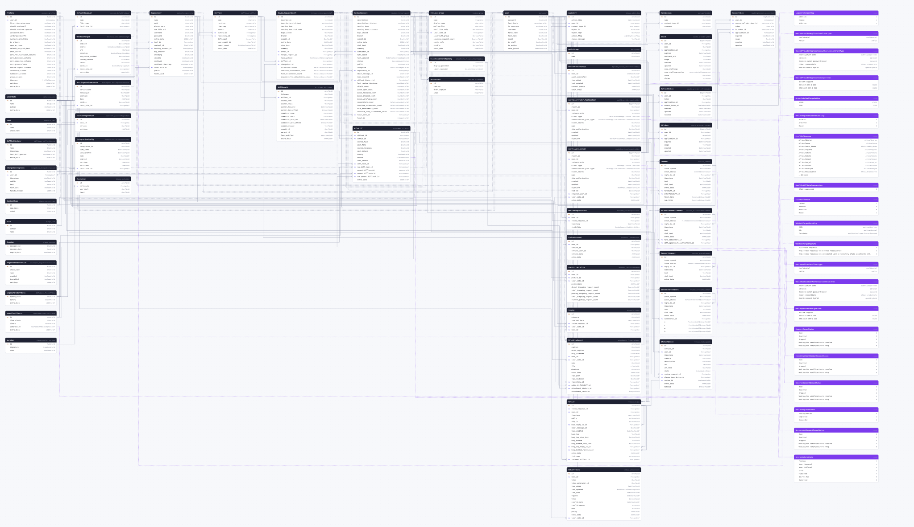

[LogEntry](#logentry) · [Permission](#permission) · [auth.Group](#authgroup) · [User](#user) · [ContentType](#contenttype) · [Site](#site) · [Session](#session) · [RegisteredExtension](#registeredextension) · [StoredConsentData](#storedconsentdata) · [SiteConfiguration](#siteconfiguration) · [oauth2_provider.Application](#oauth2_providerapplication) · [Grant](#grant) · [AccessToken](#accesstoken) · [RefreshToken](#refreshtoken) · [IDToken](#idtoken) · [ReviewRequestVisit](#reviewrequestvisit) · [LinkedAccount](#linkedaccount) · [Profile](#profile) · [LocalSiteProfile](#localsiteprofile) · [Trophy](#trophy) · [FileAttachmentHistory](#fileattachmenthistory) · [FileAttachment](#fileattachment) · [ChangeDescription](#changedescription) · [DiffSet](#diffset) · [DiffCommit](#diffcommit) · [DiffSetHistory](#diffsethistory) · [LegacyFileDiffData](#legacyfilediffdata) · [RawFileDiffData](#rawfilediffdata) · [FileDiff](#filediff) · [HostingServiceAccount](#hostingserviceaccount) · [IntegrationConfig](#integrationconfig) · [WebHookTarget](#webhooktarget) · [oauth.Application](#oauthapplication) · [reviews.Group](#reviewsgroup) · [DefaultReviewer](#defaultreviewer) · [Comment](#comment) · [FileAttachmentComment](#fileattachmentcomment) · [GeneralComment](#generalcomment) · [Screenshot](#screenshot) · [ReviewRequest](#reviewrequest) · [ScreenshotComment](#screenshotcomment) · [Review](#review) · [ReviewRequestDraft](#reviewrequestdraft) · [StatusUpdate](#statusupdate) · [Tool](#tool) · [Repository](#repository) · [LocalSite](#localsite) · [WebAPIToken](#webapitoken) · [Version](#version) · [Evolution](#evolution)

<details>
<summary>The whole schema as SQL</summary>

```sql
CREATE TABLE "django_admin_log" ("id" integer NOT NULL PRIMARY KEY AUTOINCREMENT, "action_time" datetime NOT NULL, "user_id" integer NOT NULL REFERENCES "auth_user" ("id") DEFERRABLE INITIALLY DEFERRED, "content_type_id" integer NULL REFERENCES "django_content_type" ("id") DEFERRABLE INITIALLY DEFERRED, "object_id" text NULL, "object_repr" varchar(200) NOT NULL, "action_flag" smallint unsigned NOT NULL CHECK ("action_flag" >= 0), "change_message" text NOT NULL);

CREATE TABLE "auth_permission" ("id" integer NOT NULL PRIMARY KEY AUTOINCREMENT, "name" varchar(255) NOT NULL, "content_type_id" integer NOT NULL REFERENCES "django_content_type" ("id") DEFERRABLE INITIALLY DEFERRED, "codename" varchar(100) NOT NULL);

CREATE TABLE "auth_group" ("id" integer NOT NULL PRIMARY KEY AUTOINCREMENT, "name" varchar(150) NOT NULL UNIQUE);

CREATE TABLE "auth_group_permissions" ("id" integer NOT NULL PRIMARY KEY AUTOINCREMENT, "group_id" integer NOT NULL REFERENCES "auth_group" ("id") DEFERRABLE INITIALLY DEFERRED, "permission_id" integer NOT NULL REFERENCES "auth_permission" ("id") DEFERRABLE INITIALLY DEFERRED);

CREATE TABLE "auth_user" ("id" integer NOT NULL PRIMARY KEY AUTOINCREMENT, "password" varchar(128) NOT NULL, "last_login" datetime NULL, "is_superuser" bool NOT NULL, "username" varchar(150) NOT NULL UNIQUE, "first_name" varchar(150) NOT NULL, "last_name" varchar(150) NOT NULL, "email" varchar(254) NOT NULL, "is_staff" bool NOT NULL, "is_active" bool NOT NULL, "date_joined" datetime NOT NULL);

CREATE TABLE "auth_user_groups" ("id" integer NOT NULL PRIMARY KEY AUTOINCREMENT, "user_id" integer NOT NULL REFERENCES "auth_user" ("id") DEFERRABLE INITIALLY DEFERRED, "group_id" integer NOT NULL REFERENCES "auth_group" ("id") DEFERRABLE INITIALLY DEFERRED);

CREATE TABLE "auth_user_user_permissions" ("id" integer NOT NULL PRIMARY KEY AUTOINCREMENT, "user_id" integer NOT NULL REFERENCES "auth_user" ("id") DEFERRABLE INITIALLY DEFERRED, "permission_id" integer NOT NULL REFERENCES "auth_permission" ("id") DEFERRABLE INITIALLY DEFERRED);

CREATE TABLE "django_content_type" ("id" integer NOT NULL PRIMARY KEY AUTOINCREMENT, "app_label" varchar(100) NOT NULL, "model" varchar(100) NOT NULL);

CREATE TABLE "django_site" ("id" integer NOT NULL PRIMARY KEY AUTOINCREMENT, "domain" varchar(100) NOT NULL UNIQUE, "name" varchar(50) NOT NULL);

CREATE TABLE "django_session" ("session_key" varchar(40) NOT NULL PRIMARY KEY, "session_data" text NOT NULL, "expire_date" datetime NOT NULL);

CREATE TABLE "extensions_registeredextension" ("id" integer NOT NULL PRIMARY KEY AUTOINCREMENT, "class_name" varchar(128) NOT NULL UNIQUE, "name" varchar(32) NOT NULL, "enabled" bool NOT NULL, "installed" bool NOT NULL, "settings" text NOT NULL);

CREATE TABLE "djblets_privacy_storedconsentdata" ("id" integer NOT NULL PRIMARY KEY AUTOINCREMENT, "user_id" integer NULL UNIQUE REFERENCES "auth_user" ("id") DEFERRABLE INITIALLY DEFERRED, "audit_identifier" varchar(255) NULL, "time_added" datetime NOT NULL, "last_updated" datetime NOT NULL, "consent_grants" text NOT NULL, "audit_trail" text NOT NULL);

CREATE TABLE "siteconfig_siteconfiguration" ("id" integer NOT NULL PRIMARY KEY AUTOINCREMENT, "site_id" integer NOT NULL REFERENCES "django_site" ("id") DEFERRABLE INITIALLY DEFERRED, "version" varchar(20) NOT NULL, "settings" text NOT NULL);

CREATE TABLE "oauth2_provider_application" ("id" integer NOT NULL PRIMARY KEY AUTOINCREMENT, "client_id" varchar(100) NOT NULL UNIQUE, "user_id" integer NULL REFERENCES "auth_user" ("id") DEFERRABLE INITIALLY DEFERRED, "redirect_uris" text NOT NULL, "client_type" varchar(32) NOT NULL, "authorization_grant_type" varchar(32) NOT NULL, "client_secret" varchar(255) NOT NULL, "name" varchar(255) NOT NULL, "skip_authorization" bool NOT NULL, "created" datetime NOT NULL, "updated" datetime NOT NULL, "algorithm" varchar(5) NOT NULL);

CREATE TABLE "oauth2_provider_grant" ("id" integer NOT NULL PRIMARY KEY AUTOINCREMENT, "user_id" integer NOT NULL REFERENCES "auth_user" ("id") DEFERRABLE INITIALLY DEFERRED, "code" varchar(255) NOT NULL UNIQUE, "application_id" bigint NOT NULL REFERENCES "reviewboard_oauth_application" ("id") DEFERRABLE INITIALLY DEFERRED, "expires" datetime NOT NULL, "redirect_uri" text NOT NULL, "scope" text NOT NULL, "created" datetime NOT NULL, "updated" datetime NOT NULL, "code_challenge" varchar(128) NOT NULL, "code_challenge_method" varchar(10) NOT NULL, "nonce" varchar(255) NOT NULL, "claims" text NOT NULL);

CREATE TABLE "oauth2_provider_accesstoken" ("id" integer NOT NULL PRIMARY KEY AUTOINCREMENT, "user_id" integer NULL REFERENCES "auth_user" ("id") DEFERRABLE INITIALLY DEFERRED, "source_refresh_token_id" bigint NULL UNIQUE REFERENCES "oauth2_provider_refreshtoken" ("id") DEFERRABLE INITIALLY DEFERRED, "token" varchar(255) NOT NULL UNIQUE, "id_token_id" bigint NULL UNIQUE REFERENCES "oauth2_provider_idtoken" ("id") DEFERRABLE INITIALLY DEFERRED, "application_id" bigint NULL REFERENCES "reviewboard_oauth_application" ("id") DEFERRABLE INITIALLY DEFERRED, "expires" datetime NOT NULL, "scope" text NOT NULL, "created" datetime NOT NULL, "updated" datetime NOT NULL);

CREATE TABLE "oauth2_provider_refreshtoken" ("id" integer NOT NULL PRIMARY KEY AUTOINCREMENT, "user_id" integer NOT NULL REFERENCES "auth_user" ("id") DEFERRABLE INITIALLY DEFERRED, "token" varchar(255) NOT NULL, "application_id" bigint NOT NULL REFERENCES "reviewboard_oauth_application" ("id") DEFERRABLE INITIALLY DEFERRED, "access_token_id" bigint NULL UNIQUE REFERENCES "oauth2_provider_accesstoken" ("id") DEFERRABLE INITIALLY DEFERRED, "created" datetime NOT NULL, "updated" datetime NOT NULL, "revoked" datetime NULL);

CREATE TABLE "oauth2_provider_idtoken" ("id" integer NOT NULL PRIMARY KEY AUTOINCREMENT, "user_id" integer NULL REFERENCES "auth_user" ("id") DEFERRABLE INITIALLY DEFERRED, "jti" char(32) NOT NULL UNIQUE, "application_id" bigint NULL REFERENCES "reviewboard_oauth_application" ("id") DEFERRABLE INITIALLY DEFERRED, "expires" datetime NOT NULL, "scope" text NOT NULL, "created" datetime NOT NULL, "updated" datetime NOT NULL);

CREATE TABLE "accounts_reviewrequestvisit" ("id" integer NOT NULL PRIMARY KEY AUTOINCREMENT, "user_id" integer NOT NULL REFERENCES "auth_user" ("id") DEFERRABLE INITIALLY DEFERRED, "review_request_id" integer NOT NULL REFERENCES "reviews_reviewrequest" ("id") DEFERRABLE INITIALLY DEFERRED, "timestamp" datetime NOT NULL, "visibility" varchar(1) NOT NULL);

CREATE TABLE "accounts_linkedaccount" ("id" integer NOT NULL PRIMARY KEY AUTOINCREMENT, "user_id" integer NOT NULL REFERENCES "auth_user" ("id") DEFERRABLE INITIALLY DEFERRED, "service_id" varchar(64) NOT NULL, "service_user_id" varchar(254) NOT NULL, "service_data" text NOT NULL, "extra_data" text NOT NULL);

CREATE TABLE "accounts_profile" ("id" integer NOT NULL PRIMARY KEY AUTOINCREMENT, "user_id" integer NOT NULL UNIQUE REFERENCES "auth_user" ("id") DEFERRABLE INITIALLY DEFERRED, "first_time_setup_done" bool NOT NULL, "should_send_email" bool NOT NULL, "should_send_own_updates" bool NOT NULL, "collapsed_diffs" bool NOT NULL, "wordwrapped_diffs" bool NOT NULL, "syntax_highlighting" bool NOT NULL, "is_private" bool NOT NULL, "open_an_issue" bool NOT NULL, "default_use_rich_text" bool NULL, "show_closed" bool NOT NULL, "sort_review_request_columns" varchar(256) NOT NULL, "sort_dashboard_columns" varchar(256) NOT NULL, "sort_submitter_columns" varchar(256) NOT NULL, "sort_group_columns" varchar(256) NOT NULL, "review_request_columns" varchar(256) NOT NULL, "dashboard_columns" varchar(256) NOT NULL, "submitter_columns" varchar(256) NOT NULL, "group_columns" varchar(256) NOT NULL, "timezone" varchar(30) NOT NULL, "settings" text NULL, "extra_data" text NULL);

CREATE TABLE "accounts_profile_starred_review_requests" ("id" integer NOT NULL PRIMARY KEY AUTOINCREMENT, "profile_id" integer NOT NULL REFERENCES "accounts_profile" ("id") DEFERRABLE INITIALLY DEFERRED, "reviewrequest_id" integer NOT NULL REFERENCES "reviews_reviewrequest" ("id") DEFERRABLE INITIALLY DEFERRED);

CREATE TABLE "accounts_profile_starred_groups" ("id" integer NOT NULL PRIMARY KEY AUTOINCREMENT, "profile_id" integer NOT NULL REFERENCES "accounts_profile" ("id") DEFERRABLE INITIALLY DEFERRED, "group_id" integer NOT NULL REFERENCES "reviews_group" ("id") DEFERRABLE INITIALLY DEFERRED);

CREATE TABLE "accounts_localsiteprofile" ("id" integer NOT NULL PRIMARY KEY AUTOINCREMENT, "user_id" integer NOT NULL REFERENCES "auth_user" ("id") DEFERRABLE INITIALLY DEFERRED, "profile_id" integer NOT NULL REFERENCES "accounts_profile" ("id") DEFERRABLE INITIALLY DEFERRED, "local_site_id" integer NULL REFERENCES "site_localsite" ("id") DEFERRABLE INITIALLY DEFERRED, "permissions" text NULL, "direct_incoming_request_count" integer NULL, "total_incoming_request_count" integer NULL, "pending_outgoing_request_count" integer NULL, "total_outgoing_request_count" integer NULL, "starred_public_request_count" integer NULL);

CREATE TABLE "accounts_trophy" ("id" integer NOT NULL PRIMARY KEY AUTOINCREMENT, "category" varchar(100) NOT NULL, "received_date" datetime NOT NULL, "review_request_id" integer NOT NULL REFERENCES "reviews_reviewrequest" ("id") DEFERRABLE INITIALLY DEFERRED, "local_site_id" integer NULL REFERENCES "site_localsite" ("id") DEFERRABLE INITIALLY DEFERRED, "user_id" integer NOT NULL REFERENCES "auth_user" ("id") DEFERRABLE INITIALLY DEFERRED);

CREATE TABLE "attachments_fileattachmenthistory" ("id" integer NOT NULL PRIMARY KEY AUTOINCREMENT, "display_position" integer NOT NULL, "latest_revision" integer NULL);

CREATE TABLE "attachments_fileattachment" ("id" integer NOT NULL PRIMARY KEY AUTOINCREMENT, "caption" varchar(256) NOT NULL, "draft_caption" varchar(256) NOT NULL, "orig_filename" varchar(256) NULL, "user_id" integer NULL REFERENCES "auth_user" ("id") DEFERRABLE INITIALLY DEFERRED, "local_site_id" integer NULL REFERENCES "site_localsite" ("id") DEFERRABLE INITIALLY DEFERRED, "uuid" varchar(255) NOT NULL, "file" varchar(512) NULL, "mimetype" varchar(256) NOT NULL, "extra_data" text NULL, "repo_path" varchar(1024) NULL, "repo_revision" varchar(64) NULL, "repository_id" integer NULL REFERENCES "scmtools_repository" ("id") DEFERRABLE INITIALLY DEFERRED, "added_in_filediff_id" integer NULL REFERENCES "diffviewer_filediff" ("id") DEFERRABLE INITIALLY DEFERRED, "attachment_history_id" integer NULL REFERENCES "attachments_fileattachmenthistory" ("id") DEFERRABLE INITIALLY DEFERRED, "attachment_revision" integer NOT NULL);

CREATE TABLE "changedescs_changedescription" ("id" integer NOT NULL PRIMARY KEY AUTOINCREMENT, "user_id" integer NULL REFERENCES "auth_user" ("id") DEFERRABLE INITIALLY DEFERRED, "timestamp" datetime NOT NULL, "public" bool NOT NULL, "text" text NOT NULL, "rich_text" bool NOT NULL, "fields_changed" text NOT NULL);

CREATE TABLE "diffviewer_diffset" ("id" integer NOT NULL PRIMARY KEY AUTOINCREMENT, "name" varchar(256) NOT NULL, "revision" integer NOT NULL, "timestamp" datetime NOT NULL, "basedir" varchar(256) NOT NULL, "history_id" integer NULL REFERENCES "diffviewer_diffsethistory" ("id") DEFERRABLE INITIALLY DEFERRED, "repository_id" integer NOT NULL REFERENCES "scmtools_repository" ("id") DEFERRABLE INITIALLY DEFERRED, "diffcompat" integer NOT NULL, "base_commit_id" varchar(64) NULL, "commit_count" integer NULL, "extra_data" text NULL);

CREATE TABLE "diffviewer_diffcommit" ("id" integer NOT NULL PRIMARY KEY AUTOINCREMENT, "filename" varchar(256) NOT NULL, "diffset_id" integer NOT NULL REFERENCES "diffviewer_diffset" ("id") DEFERRABLE INITIALLY DEFERRED, "author_name" varchar(256) NOT NULL, "author_email" varchar(256) NOT NULL, "author_date_utc" datetime NOT NULL, "author_date_offset" integer NOT NULL, "committer_name" varchar(256) NULL, "committer_email" varchar(256) NULL, "committer_date_utc" datetime NULL, "committer_date_offset" integer NULL, "commit_message" text NOT NULL, "commit_id" varchar(64) NOT NULL, "parent_id" varchar(64) NOT NULL, "last_modified" datetime NOT NULL, "extra_data" text NULL);

CREATE TABLE "diffviewer_diffsethistory" ("id" integer NOT NULL PRIMARY KEY AUTOINCREMENT, "name" varchar(256) NOT NULL, "timestamp" datetime NOT NULL, "last_diff_updated" datetime NULL, "extra_data" text NULL);

CREATE TABLE "diffviewer_filediffdata" ("binary_hash" varchar(40) NOT NULL PRIMARY KEY, "binary" text NOT NULL, "extra_data" text NULL);

CREATE TABLE "diffviewer_rawfilediffdata" ("id" integer NOT NULL PRIMARY KEY AUTOINCREMENT, "binary_hash" varchar(40) NOT NULL UNIQUE, "binary" BLOB NOT NULL, "compression" varchar(1) NULL, "extra_data" text NULL);

CREATE TABLE "diffviewer_filediff" ("id" integer NOT NULL PRIMARY KEY AUTOINCREMENT, "diffset_id" integer NOT NULL REFERENCES "diffviewer_diffset" ("id") DEFERRABLE INITIALLY DEFERRED, "commit_id" integer NULL REFERENCES "diffviewer_diffcommit" ("id") DEFERRABLE INITIALLY DEFERRED, "source_file" varchar(1024) NOT NULL, "dest_file" varchar(1024) NOT NULL, "source_revision" varchar(512) NOT NULL, "dest_detail" varchar(512) NOT NULL, "binary" bool NOT NULL, "status" varchar(1) NOT NULL, "diff_base64" text NOT NULL, "diff_hash_id" varchar(40) NULL REFERENCES "diffviewer_filediffdata" ("binary_hash") DEFERRABLE INITIALLY DEFERRED, "raw_diff_hash_id" integer NULL REFERENCES "diffviewer_rawfilediffdata" ("id") DEFERRABLE INITIALLY DEFERRED, "parent_diff_base64" text NOT NULL, "parent_diff_hash_id" varchar(40) NULL REFERENCES "diffviewer_filediffdata" ("binary_hash") DEFERRABLE INITIALLY DEFERRED, "raw_parent_diff_hash_id" integer NULL REFERENCES "diffviewer_rawfilediffdata" ("id") DEFERRABLE INITIALLY DEFERRED, "extra_data" text NULL);

CREATE TABLE "hostingsvcs_hostingserviceaccount" ("id" integer NOT NULL PRIMARY KEY AUTOINCREMENT, "service_name" varchar(128) NOT NULL, "hosting_url" varchar(255) NULL, "username" varchar(128) NOT NULL, "data" text NOT NULL, "visible" bool NOT NULL, "local_site_id" integer NULL REFERENCES "site_localsite" ("id") DEFERRABLE INITIALLY DEFERRED);

CREATE TABLE "integrations_integrationconfig" ("id" integer NOT NULL PRIMARY KEY AUTOINCREMENT, "integration_id" varchar(255) NOT NULL, "time_added" datetime NOT NULL, "last_updated" datetime NOT NULL, "name" varchar(255) NULL, "enabled" bool NOT NULL, "settings" text NOT NULL, "extra_data" text NOT NULL, "local_site_id" integer NULL REFERENCES "site_localsite" ("id") DEFERRABLE INITIALLY DEFERRED);

CREATE TABLE "notifications_webhooktarget" ("id" integer NOT NULL PRIMARY KEY AUTOINCREMENT, "enabled" bool NOT NULL, "events" varchar(512) NOT NULL, "url" varchar(512) NOT NULL, "encoding" varchar(40) NOT NULL, "use_custom_content" bool NOT NULL, "custom_content" text NULL, "secret" varchar(128) NOT NULL, "apply_to" varchar(1) NOT NULL, "local_site_id" integer NULL REFERENCES "site_localsite" ("id") DEFERRABLE INITIALLY DEFERRED, "extra_data" text NULL);

CREATE TABLE "notifications_webhooktarget_repositories" ("id" integer NOT NULL PRIMARY KEY AUTOINCREMENT, "webhooktarget_id" integer NOT NULL REFERENCES "notifications_webhooktarget" ("id") DEFERRABLE INITIALLY DEFERRED, "repository_id" integer NOT NULL REFERENCES "scmtools_repository" ("id") DEFERRABLE INITIALLY DEFERRED);

CREATE TABLE "reviewboard_oauth_application" ("id" integer NOT NULL PRIMARY KEY AUTOINCREMENT, "client_id" varchar(100) NOT NULL UNIQUE, "user_id" integer NULL REFERENCES "auth_user" ("id") DEFERRABLE INITIALLY DEFERRED, "redirect_uris" text NOT NULL, "client_type" varchar(32) NOT NULL, "authorization_grant_type" varchar(32) NOT NULL, "client_secret" varchar(255) NOT NULL, "name" varchar(255) NOT NULL, "skip_authorization" bool NOT NULL, "created" datetime NOT NULL, "updated" datetime NOT NULL, "algorithm" varchar(5) NOT NULL, "enabled" bool NOT NULL, "original_user_id" integer NULL REFERENCES "auth_user" ("id") DEFERRABLE INITIALLY DEFERRED, "local_site_id" integer NULL REFERENCES "site_localsite" ("id") DEFERRABLE INITIALLY DEFERRED, "extra_data" text NULL);

CREATE TABLE "reviews_group" ("id" integer NOT NULL PRIMARY KEY AUTOINCREMENT, "name" varchar(64) NOT NULL, "display_name" varchar(64) NOT NULL, "mailing_list" varchar(254) NOT NULL, "email_list_only" bool NOT NULL, "local_site_id" integer NULL REFERENCES "site_localsite" ("id") DEFERRABLE INITIALLY DEFERRED, "is_default_group" bool NOT NULL, "incoming_request_count" integer NULL, "invite_only" bool NOT NULL, "visible" bool NOT NULL, "extra_data" text NULL);

CREATE TABLE "reviews_group_users" ("id" integer NOT NULL PRIMARY KEY AUTOINCREMENT, "group_id" integer NOT NULL REFERENCES "reviews_group" ("id") DEFERRABLE INITIALLY DEFERRED, "user_id" integer NOT NULL REFERENCES "auth_user" ("id") DEFERRABLE INITIALLY DEFERRED);

CREATE TABLE "reviews_defaultreviewer" ("id" integer NOT NULL PRIMARY KEY AUTOINCREMENT, "name" varchar(64) NOT NULL, "file_regex" varchar(256) NOT NULL, "local_site_id" integer NULL REFERENCES "site_localsite" ("id") DEFERRABLE INITIALLY DEFERRED);

CREATE TABLE "reviews_defaultreviewer_repository" ("id" integer NOT NULL PRIMARY KEY AUTOINCREMENT, "defaultreviewer_id" integer NOT NULL REFERENCES "reviews_defaultreviewer" ("id") DEFERRABLE INITIALLY DEFERRED, "repository_id" integer NOT NULL REFERENCES "scmtools_repository" ("id") DEFERRABLE INITIALLY DEFERRED);

CREATE TABLE "reviews_defaultreviewer_groups" ("id" integer NOT NULL PRIMARY KEY AUTOINCREMENT, "defaultreviewer_id" integer NOT NULL REFERENCES "reviews_defaultreviewer" ("id") DEFERRABLE INITIALLY DEFERRED, "group_id" integer NOT NULL REFERENCES "reviews_group" ("id") DEFERRABLE INITIALLY DEFERRED);

CREATE TABLE "reviews_defaultreviewer_people" ("id" integer NOT NULL PRIMARY KEY AUTOINCREMENT, "defaultreviewer_id" integer NOT NULL REFERENCES "reviews_defaultreviewer" ("id") DEFERRABLE INITIALLY DEFERRED, "user_id" integer NOT NULL REFERENCES "auth_user" ("id") DEFERRABLE INITIALLY DEFERRED);

CREATE TABLE "reviews_comment" ("id" integer NOT NULL PRIMARY KEY AUTOINCREMENT, "issue_opened" bool NOT NULL, "issue_status" varchar(1) NULL, "reply_to_id" integer NULL REFERENCES "reviews_comment" ("id") DEFERRABLE INITIALLY DEFERRED, "timestamp" datetime NOT NULL, "text" text NOT NULL, "rich_text" bool NOT NULL, "extra_data" text NULL, "filediff_id" integer NOT NULL REFERENCES "diffviewer_filediff" ("id") DEFERRABLE INITIALLY DEFERRED, "interfilediff_id" integer NULL REFERENCES "diffviewer_filediff" ("id") DEFERRABLE INITIALLY DEFERRED, "first_line" integer unsigned NULL CHECK ("first_line" >= 0), "num_lines" integer unsigned NULL CHECK ("num_lines" >= 0));

CREATE TABLE "reviews_fileattachmentcomment" ("id" integer NOT NULL PRIMARY KEY AUTOINCREMENT, "issue_opened" bool NOT NULL, "issue_status" varchar(1) NULL, "reply_to_id" integer NULL REFERENCES "reviews_fileattachmentcomment" ("id") DEFERRABLE INITIALLY DEFERRED, "timestamp" datetime NOT NULL, "text" text NOT NULL, "rich_text" bool NOT NULL, "extra_data" text NULL, "file_attachment_id" integer NOT NULL REFERENCES "attachments_fileattachment" ("id") DEFERRABLE INITIALLY DEFERRED, "diff_against_file_attachment_id" integer NULL REFERENCES "attachments_fileattachment" ("id") DEFERRABLE INITIALLY DEFERRED);

CREATE TABLE "reviews_generalcomment" ("id" integer NOT NULL PRIMARY KEY AUTOINCREMENT, "issue_opened" bool NOT NULL, "issue_status" varchar(1) NULL, "reply_to_id" integer NULL REFERENCES "reviews_generalcomment" ("id") DEFERRABLE INITIALLY DEFERRED, "timestamp" datetime NOT NULL, "text" text NOT NULL, "rich_text" bool NOT NULL, "extra_data" text NULL);

CREATE TABLE "reviews_screenshot" ("id" integer NOT NULL PRIMARY KEY AUTOINCREMENT, "caption" varchar(256) NOT NULL, "draft_caption" varchar(256) NOT NULL, "image" varchar(100) NOT NULL);

CREATE TABLE "reviews_reviewrequest" ("id" integer NOT NULL PRIMARY KEY AUTOINCREMENT, "description" text NOT NULL, "description_rich_text" bool NOT NULL, "testing_done" text NOT NULL, "testing_done_rich_text" bool NOT NULL, "bugs_closed" varchar(300) NOT NULL, "branch" varchar(300) NOT NULL, "commit_id" varchar(64) NULL, "extra_data" text NULL, "rich_text" bool NOT NULL, "summary" varchar(300) NOT NULL, "submitter_id" integer NOT NULL REFERENCES "auth_user" ("id") DEFERRABLE INITIALLY DEFERRED, "time_added" datetime NOT NULL, "last_updated" datetime NOT NULL, "status" varchar(1) NOT NULL, "public" bool NOT NULL, "changenum" integer unsigned NULL CHECK ("changenum" >= 0), "repository_id" integer NULL REFERENCES "scmtools_repository" ("id") DEFERRABLE INITIALLY DEFERRED, "email_message_id" varchar(255) NULL, "time_emailed" datetime NULL, "diffset_history_id" integer NULL REFERENCES "diffviewer_diffsethistory" ("id") DEFERRABLE INITIALLY DEFERRED, "last_review_timestamp" datetime NULL, "shipit_count" integer NULL, "issue_open_count" integer NULL, "issue_resolved_count" integer NULL, "issue_dropped_count" integer NULL, "issue_verifying_count" integer NULL, "screenshots_count" integer NULL, "inactive_screenshots_count" integer NULL, "file_attachments_count" integer NULL, "inactive_file_attachments_count" integer NULL, "local_site_id" integer NULL REFERENCES "site_localsite" ("id") DEFERRABLE INITIALLY DEFERRED, "local_id" integer NULL);

CREATE TABLE "reviews_reviewrequest_target_groups" ("id" integer NOT NULL PRIMARY KEY AUTOINCREMENT, "reviewrequest_id" integer NOT NULL REFERENCES "reviews_reviewrequest" ("id") DEFERRABLE INITIALLY DEFERRED, "group_id" integer NOT NULL REFERENCES "reviews_group" ("id") DEFERRABLE INITIALLY DEFERRED);

CREATE TABLE "reviews_reviewrequest_target_people" ("id" integer NOT NULL PRIMARY KEY AUTOINCREMENT, "reviewrequest_id" integer NOT NULL REFERENCES "reviews_reviewrequest" ("id") DEFERRABLE INITIALLY DEFERRED, "user_id" integer NOT NULL REFERENCES "auth_user" ("id") DEFERRABLE INITIALLY DEFERRED);

CREATE TABLE "reviews_reviewrequest_screenshots" ("id" integer NOT NULL PRIMARY KEY AUTOINCREMENT, "reviewrequest_id" integer NOT NULL REFERENCES "reviews_reviewrequest" ("id") DEFERRABLE INITIALLY DEFERRED, "screenshot_id" integer NOT NULL REFERENCES "reviews_screenshot" ("id") DEFERRABLE INITIALLY DEFERRED);

CREATE TABLE "reviews_reviewrequest_inactive_screenshots" ("id" integer NOT NULL PRIMARY KEY AUTOINCREMENT, "reviewrequest_id" integer NOT NULL REFERENCES "reviews_reviewrequest" ("id") DEFERRABLE INITIALLY DEFERRED, "screenshot_id" integer NOT NULL REFERENCES "reviews_screenshot" ("id") DEFERRABLE INITIALLY DEFERRED);

CREATE TABLE "reviews_reviewrequest_file_attachments" ("id" integer NOT NULL PRIMARY KEY AUTOINCREMENT, "reviewrequest_id" integer NOT NULL REFERENCES "reviews_reviewrequest" ("id") DEFERRABLE INITIALLY DEFERRED, "fileattachment_id" integer NOT NULL REFERENCES "attachments_fileattachment" ("id") DEFERRABLE INITIALLY DEFERRED);

CREATE TABLE "reviews_reviewrequest_inactive_file_attachments" ("id" integer NOT NULL PRIMARY KEY AUTOINCREMENT, "reviewrequest_id" integer NOT NULL REFERENCES "reviews_reviewrequest" ("id") DEFERRABLE INITIALLY DEFERRED, "fileattachment_id" integer NOT NULL REFERENCES "attachments_fileattachment" ("id") DEFERRABLE INITIALLY DEFERRED);

CREATE TABLE "reviews_reviewrequest_file_attachment_histories" ("id" integer NOT NULL PRIMARY KEY AUTOINCREMENT, "reviewrequest_id" integer NOT NULL REFERENCES "reviews_reviewrequest" ("id") DEFERRABLE INITIALLY DEFERRED, "fileattachmenthistory_id" integer NOT NULL REFERENCES "attachments_fileattachmenthistory" ("id") DEFERRABLE INITIALLY DEFERRED);

CREATE TABLE "reviews_reviewrequest_changedescs" ("id" integer NOT NULL PRIMARY KEY AUTOINCREMENT, "reviewrequest_id" integer NOT NULL REFERENCES "reviews_reviewrequest" ("id") DEFERRABLE INITIALLY DEFERRED, "changedescription_id" integer NOT NULL REFERENCES "changedescs_changedescription" ("id") DEFERRABLE INITIALLY DEFERRED);

CREATE TABLE "reviews_reviewrequest_depends_on" ("id" integer NOT NULL PRIMARY KEY AUTOINCREMENT, "from_reviewrequest_id" integer NOT NULL REFERENCES "reviews_reviewrequest" ("id") DEFERRABLE INITIALLY DEFERRED, "to_reviewrequest_id" integer NOT NULL REFERENCES "reviews_reviewrequest" ("id") DEFERRABLE INITIALLY DEFERRED);

CREATE TABLE "reviews_screenshotcomment" ("id" integer NOT NULL PRIMARY KEY AUTOINCREMENT, "issue_opened" bool NOT NULL, "issue_status" varchar(1) NULL, "reply_to_id" integer NULL REFERENCES "reviews_screenshotcomment" ("id") DEFERRABLE INITIALLY DEFERRED, "timestamp" datetime NOT NULL, "text" text NOT NULL, "rich_text" bool NOT NULL, "extra_data" text NULL, "screenshot_id" integer NOT NULL REFERENCES "reviews_screenshot" ("id") DEFERRABLE INITIALLY DEFERRED, "x" smallint unsigned NULL CHECK ("x" >= 0), "y" smallint unsigned NOT NULL CHECK ("y" >= 0), "w" smallint unsigned NOT NULL CHECK ("w" >= 0), "h" smallint unsigned NOT NULL CHECK ("h" >= 0));

CREATE TABLE "reviews_review" ("id" integer NOT NULL PRIMARY KEY AUTOINCREMENT, "review_request_id" integer NOT NULL REFERENCES "reviews_reviewrequest" ("id") DEFERRABLE INITIALLY DEFERRED, "user_id" integer NOT NULL REFERENCES "auth_user" ("id") DEFERRABLE INITIALLY DEFERRED, "timestamp" datetime NOT NULL, "public" bool NOT NULL, "ship_it" bool NOT NULL, "base_reply_to_id" integer NULL REFERENCES "reviews_review" ("id") DEFERRABLE INITIALLY DEFERRED, "email_message_id" varchar(255) NULL, "time_emailed" datetime NULL, "body_top" text NOT NULL, "body_top_rich_text" bool NOT NULL, "body_bottom" text NOT NULL, "body_bottom_rich_text" bool NOT NULL, "body_top_reply_to_id" integer NULL REFERENCES "reviews_review" ("id") DEFERRABLE INITIALLY DEFERRED, "body_bottom_reply_to_id" integer NULL REFERENCES "reviews_review" ("id") DEFERRABLE INITIALLY DEFERRED, "extra_data" text NULL, "rich_text" bool NOT NULL, "reviewed_diffset_id" integer NULL REFERENCES "diffviewer_diffset" ("id") DEFERRABLE INITIALLY DEFERRED);

CREATE TABLE "reviews_review_comments" ("id" integer NOT NULL PRIMARY KEY AUTOINCREMENT, "review_id" integer NOT NULL REFERENCES "reviews_review" ("id") DEFERRABLE INITIALLY DEFERRED, "comment_id" integer NOT NULL REFERENCES "reviews_comment" ("id") DEFERRABLE INITIALLY DEFERRED);

CREATE TABLE "reviews_review_screenshot_comments" ("id" integer NOT NULL PRIMARY KEY AUTOINCREMENT, "review_id" integer NOT NULL REFERENCES "reviews_review" ("id") DEFERRABLE INITIALLY DEFERRED, "screenshotcomment_id" integer NOT NULL REFERENCES "reviews_screenshotcomment" ("id") DEFERRABLE INITIALLY DEFERRED);

CREATE TABLE "reviews_review_file_attachment_comments" ("id" integer NOT NULL PRIMARY KEY AUTOINCREMENT, "review_id" integer NOT NULL REFERENCES "reviews_review" ("id") DEFERRABLE INITIALLY DEFERRED, "fileattachmentcomment_id" integer NOT NULL REFERENCES "reviews_fileattachmentcomment" ("id") DEFERRABLE INITIALLY DEFERRED);

CREATE TABLE "reviews_review_general_comments" ("id" integer NOT NULL PRIMARY KEY AUTOINCREMENT, "review_id" integer NOT NULL REFERENCES "reviews_review" ("id") DEFERRABLE INITIALLY DEFERRED, "generalcomment_id" integer NOT NULL REFERENCES "reviews_generalcomment" ("id") DEFERRABLE INITIALLY DEFERRED);

CREATE TABLE "reviews_reviewrequestdraft" ("id" integer NOT NULL PRIMARY KEY AUTOINCREMENT, "description" text NOT NULL, "description_rich_text" bool NOT NULL, "testing_done" text NOT NULL, "testing_done_rich_text" bool NOT NULL, "bugs_closed" varchar(300) NOT NULL, "branch" varchar(300) NOT NULL, "commit_id" varchar(64) NULL, "extra_data" text NULL, "rich_text" bool NOT NULL, "summary" varchar(300) NOT NULL, "owner_id" integer NULL REFERENCES "auth_user" ("id") DEFERRABLE INITIALLY DEFERRED, "review_request_id" integer NOT NULL UNIQUE REFERENCES "reviews_reviewrequest" ("id") DEFERRABLE INITIALLY DEFERRED, "last_updated" datetime NOT NULL, "diffset_id" integer NULL REFERENCES "diffviewer_diffset" ("id") DEFERRABLE INITIALLY DEFERRED, "changedesc_id" integer NULL REFERENCES "changedescs_changedescription" ("id") DEFERRABLE INITIALLY DEFERRED, "screenshots_count" integer NULL, "inactive_screenshots_count" integer NULL, "file_attachments_count" integer NULL, "inactive_file_attachments_count" integer NULL);

CREATE TABLE "reviews_reviewrequestdraft_target_groups" ("id" integer NOT NULL PRIMARY KEY AUTOINCREMENT, "reviewrequestdraft_id" integer NOT NULL REFERENCES "reviews_reviewrequestdraft" ("id") DEFERRABLE INITIALLY DEFERRED, "group_id" integer NOT NULL REFERENCES "reviews_group" ("id") DEFERRABLE INITIALLY DEFERRED);

CREATE TABLE "reviews_reviewrequestdraft_target_people" ("id" integer NOT NULL PRIMARY KEY AUTOINCREMENT, "reviewrequestdraft_id" integer NOT NULL REFERENCES "reviews_reviewrequestdraft" ("id") DEFERRABLE INITIALLY DEFERRED, "user_id" integer NOT NULL REFERENCES "auth_user" ("id") DEFERRABLE INITIALLY DEFERRED);

CREATE TABLE "reviews_reviewrequestdraft_screenshots" ("id" integer NOT NULL PRIMARY KEY AUTOINCREMENT, "reviewrequestdraft_id" integer NOT NULL REFERENCES "reviews_reviewrequestdraft" ("id") DEFERRABLE INITIALLY DEFERRED, "screenshot_id" integer NOT NULL REFERENCES "reviews_screenshot" ("id") DEFERRABLE INITIALLY DEFERRED);

CREATE TABLE "reviews_reviewrequestdraft_inactive_screenshots" ("id" integer NOT NULL PRIMARY KEY AUTOINCREMENT, "reviewrequestdraft_id" integer NOT NULL REFERENCES "reviews_reviewrequestdraft" ("id") DEFERRABLE INITIALLY DEFERRED, "screenshot_id" integer NOT NULL REFERENCES "reviews_screenshot" ("id") DEFERRABLE INITIALLY DEFERRED);

CREATE TABLE "reviews_reviewrequestdraft_file_attachments" ("id" integer NOT NULL PRIMARY KEY AUTOINCREMENT, "reviewrequestdraft_id" integer NOT NULL REFERENCES "reviews_reviewrequestdraft" ("id") DEFERRABLE INITIALLY DEFERRED, "fileattachment_id" integer NOT NULL REFERENCES "attachments_fileattachment" ("id") DEFERRABLE INITIALLY DEFERRED);

CREATE TABLE "reviews_reviewrequestdraft_inactive_file_attachments" ("id" integer NOT NULL PRIMARY KEY AUTOINCREMENT, "reviewrequestdraft_id" integer NOT NULL REFERENCES "reviews_reviewrequestdraft" ("id") DEFERRABLE INITIALLY DEFERRED, "fileattachment_id" integer NOT NULL REFERENCES "attachments_fileattachment" ("id") DEFERRABLE INITIALLY DEFERRED);

CREATE TABLE "reviews_reviewrequestdraft_depends_on" ("id" integer NOT NULL PRIMARY KEY AUTOINCREMENT, "reviewrequestdraft_id" integer NOT NULL REFERENCES "reviews_reviewrequestdraft" ("id") DEFERRABLE INITIALLY DEFERRED, "reviewrequest_id" integer NOT NULL REFERENCES "reviews_reviewrequest" ("id") DEFERRABLE INITIALLY DEFERRED);

CREATE TABLE "reviews_statusupdate" ("id" integer NOT NULL PRIMARY KEY AUTOINCREMENT, "service_id" varchar(255) NOT NULL, "user_id" integer NULL REFERENCES "auth_user" ("id") DEFERRABLE INITIALLY DEFERRED, "timestamp" datetime NOT NULL, "summary" varchar(255) NOT NULL, "description" varchar(255) NOT NULL, "url" varchar(255) NOT NULL, "url_text" varchar(64) NOT NULL, "state" varchar(1) NOT NULL, "review_request_id" integer NOT NULL REFERENCES "reviews_reviewrequest" ("id") DEFERRABLE INITIALLY DEFERRED, "change_description_id" integer NULL REFERENCES "changedescs_changedescription" ("id") DEFERRABLE INITIALLY DEFERRED, "review_id" integer NULL UNIQUE REFERENCES "reviews_review" ("id") DEFERRABLE INITIALLY DEFERRED, "extra_data" text NULL, "timeout" integer NULL);

CREATE TABLE "scmtools_tool" ("id" integer NOT NULL PRIMARY KEY AUTOINCREMENT, "name" varchar(32) NOT NULL UNIQUE, "class_name" varchar(128) NOT NULL UNIQUE);

CREATE TABLE "scmtools_repository" ("id" integer NOT NULL PRIMARY KEY AUTOINCREMENT, "name" varchar(255) NOT NULL, "path" varchar(255) NOT NULL, "mirror_path" varchar(255) NOT NULL, "raw_file_url" varchar(255) NOT NULL, "username" varchar(32) NOT NULL, "password" varchar(128) NOT NULL, "extra_data" text NULL, "tool_id" integer NOT NULL REFERENCES "scmtools_tool" ("id") DEFERRABLE INITIALLY DEFERRED, "scmtool_id" varchar(255) NULL, "hosting_account_id" integer NULL REFERENCES "hostingsvcs_hostingserviceaccount" ("id") DEFERRABLE INITIALLY DEFERRED, "bug_tracker" varchar(256) NOT NULL, "encoding" varchar(32) NOT NULL, "visible" bool NOT NULL, "archived" bool NOT NULL, "archived_timestamp" datetime NULL, "local_site_id" integer NULL REFERENCES "site_localsite" ("id") DEFERRABLE INITIALLY DEFERRED, "public" bool NOT NULL, "hooks_uuid" varchar(32) NULL);

CREATE TABLE "scmtools_repository_users" ("id" integer NOT NULL PRIMARY KEY AUTOINCREMENT, "repository_id" integer NOT NULL REFERENCES "scmtools_repository" ("id") DEFERRABLE INITIALLY DEFERRED, "user_id" integer NOT NULL REFERENCES "auth_user" ("id") DEFERRABLE INITIALLY DEFERRED);

CREATE TABLE "scmtools_repository_review_groups" ("id" integer NOT NULL PRIMARY KEY AUTOINCREMENT, "repository_id" integer NOT NULL REFERENCES "scmtools_repository" ("id") DEFERRABLE INITIALLY DEFERRED, "group_id" integer NOT NULL REFERENCES "reviews_group" ("id") DEFERRABLE INITIALLY DEFERRED);

CREATE TABLE "site_localsite" ("id" integer NOT NULL PRIMARY KEY AUTOINCREMENT, "name" varchar(32) NOT NULL UNIQUE, "public" bool NOT NULL, "extra_data" text NULL);

CREATE TABLE "site_localsite_users" ("id" integer NOT NULL PRIMARY KEY AUTOINCREMENT, "localsite_id" integer NOT NULL REFERENCES "site_localsite" ("id") DEFERRABLE INITIALLY DEFERRED, "user_id" integer NOT NULL REFERENCES "auth_user" ("id") DEFERRABLE INITIALLY DEFERRED);

CREATE TABLE "site_localsite_admins" ("id" integer NOT NULL PRIMARY KEY AUTOINCREMENT, "localsite_id" integer NOT NULL REFERENCES "site_localsite" ("id") DEFERRABLE INITIALLY DEFERRED, "user_id" integer NOT NULL REFERENCES "auth_user" ("id") DEFERRABLE INITIALLY DEFERRED);

CREATE TABLE "webapi_webapitoken" ("id" integer NOT NULL PRIMARY KEY AUTOINCREMENT, "user_id" integer NOT NULL REFERENCES "auth_user" ("id") DEFERRABLE INITIALLY DEFERRED, "token" varchar(255) NOT NULL UNIQUE, "token_generator_id" varchar(255) NOT NULL, "time_added" datetime NOT NULL, "last_updated" datetime NOT NULL, "last_used" datetime NULL, "expires" datetime NULL, "valid" bool NOT NULL, "invalid_date" datetime NULL, "invalid_reason" text NOT NULL, "note" text NOT NULL, "policy" text NULL, "extra_data" text NULL, "local_site_id" integer NULL REFERENCES "site_localsite" ("id") DEFERRABLE INITIALLY DEFERRED);

CREATE TABLE "django_project_version" ("id" integer NOT NULL PRIMARY KEY AUTOINCREMENT, "signature" text NOT NULL, "when" datetime NOT NULL);

CREATE TABLE "django_evolution" ("id" integer NOT NULL PRIMARY KEY AUTOINCREMENT, "version_id" integer NOT NULL REFERENCES "django_project_version" ("id") DEFERRABLE INITIALLY DEFERRED, "app_label" varchar(200) NOT NULL, "label" varchar(100) NOT NULL);

CREATE INDEX "django_admin_log_user_id_c564eba6" ON "django_admin_log" ("user_id");

CREATE INDEX "django_admin_log_content_type_id_c4bce8eb" ON "django_admin_log" ("content_type_id");

CREATE UNIQUE INDEX "auth_permission_content_type_id_codename_01ab375a_uniq" ON "auth_permission" ("content_type_id", "codename");

CREATE INDEX "auth_permission_content_type_id_2f476e4b" ON "auth_permission" ("content_type_id");

CREATE UNIQUE INDEX "auth_group_permissions_group_id_permission_id_0cd325b0_uniq" ON "auth_group_permissions" ("group_id", "permission_id");

CREATE INDEX "auth_group_permissions_group_id_b120cbf9" ON "auth_group_permissions" ("group_id");

CREATE INDEX "auth_group_permissions_permission_id_84c5c92e" ON "auth_group_permissions" ("permission_id");

CREATE UNIQUE INDEX "auth_user_groups_user_id_group_id_94350c0c_uniq" ON "auth_user_groups" ("user_id", "group_id");

CREATE INDEX "auth_user_groups_user_id_6a12ed8b" ON "auth_user_groups" ("user_id");

CREATE INDEX "auth_user_groups_group_id_97559544" ON "auth_user_groups" ("group_id");

CREATE UNIQUE INDEX "auth_user_user_permissions_user_id_permission_id_14a6b632_uniq" ON "auth_user_user_permissions" ("user_id", "permission_id");

CREATE INDEX "auth_user_user_permissions_user_id_a95ead1b" ON "auth_user_user_permissions" ("user_id");

CREATE INDEX "auth_user_user_permissions_permission_id_1fbb5f2c" ON "auth_user_user_permissions" ("permission_id");

CREATE UNIQUE INDEX "django_content_type_app_label_model_76bd3d3b_uniq" ON "django_content_type" ("app_label", "model");

CREATE INDEX "django_session_expire_date_a5c62663" ON "django_session" ("expire_date");

CREATE INDEX "djblets_privacy_storedconsentdata_audit_identifier_eeb12ed0" ON "djblets_privacy_storedconsentdata" ("audit_identifier");

CREATE INDEX "siteconfig_siteconfiguration_site_id_a352de24" ON "siteconfig_siteconfiguration" ("site_id");

CREATE INDEX "oauth2_provider_application_user_id_79829054" ON "oauth2_provider_application" ("user_id");

CREATE INDEX "oauth2_provider_application_client_secret_53133678" ON "oauth2_provider_application" ("client_secret");

CREATE INDEX "oauth2_provider_grant_user_id_e8f62af8" ON "oauth2_provider_grant" ("user_id");

CREATE INDEX "oauth2_provider_grant_application_id_81923564" ON "oauth2_provider_grant" ("application_id");

CREATE INDEX "oauth2_provider_accesstoken_user_id_6e4c9a65" ON "oauth2_provider_accesstoken" ("user_id");

CREATE INDEX "oauth2_provider_accesstoken_application_id_b22886e1" ON "oauth2_provider_accesstoken" ("application_id");

CREATE UNIQUE INDEX "oauth2_provider_refreshtoken_token_revoked_af8a5134_uniq" ON "oauth2_provider_refreshtoken" ("token", "revoked");

CREATE INDEX "oauth2_provider_refreshtoken_user_id_da837fce" ON "oauth2_provider_refreshtoken" ("user_id");

CREATE INDEX "oauth2_provider_refreshtoken_application_id_2d1c311b" ON "oauth2_provider_refreshtoken" ("application_id");

CREATE INDEX "oauth2_provider_idtoken_user_id_dd512b59" ON "oauth2_provider_idtoken" ("user_id");

CREATE INDEX "oauth2_provider_idtoken_application_id_08c5ff4f" ON "oauth2_provider_idtoken" ("application_id");

CREATE UNIQUE INDEX "accounts_reviewrequestvisit_user_id_review_request_id_5b8724f0_uniq" ON "accounts_reviewrequestvisit" ("user_id", "review_request_id");

CREATE INDEX "accounts_reviewrequestvisit_user_id_8ed30d49" ON "accounts_reviewrequestvisit" ("user_id");

CREATE INDEX "accounts_reviewrequestvisit_review_request_id_3bd58111" ON "accounts_reviewrequestvisit" ("review_request_id");

CREATE INDEX "accounts_re_user_id_be4d4f_idx" ON "accounts_reviewrequestvisit" ("user_id", "visibility");

CREATE UNIQUE INDEX "accounts_linkedaccount_service_user_id_service_id_537d3d2e_uniq" ON "accounts_linkedaccount" ("service_user_id", "service_id");

CREATE INDEX "accounts_linkedaccount_user_id_b27ea2c3" ON "accounts_linkedaccount" ("user_id");

CREATE UNIQUE INDEX "accounts_profile_starred_review_requests_profile_id_reviewrequest_id_9077f978_uniq" ON "accounts_profile_starred_review_requests" ("profile_id", "reviewrequest_id");

CREATE INDEX "accounts_profile_starred_review_requests_profile_id_cf4bb46e" ON "accounts_profile_starred_review_requests" ("profile_id");

CREATE INDEX "accounts_profile_starred_review_requests_reviewrequest_id_be0af917" ON "accounts_profile_starred_review_requests" ("reviewrequest_id");

CREATE UNIQUE INDEX "accounts_profile_starred_groups_profile_id_group_id_82d5c8c2_uniq" ON "accounts_profile_starred_groups" ("profile_id", "group_id");

CREATE INDEX "accounts_profile_starred_groups_profile_id_f62f8a74" ON "accounts_profile_starred_groups" ("profile_id");

CREATE INDEX "accounts_profile_starred_groups_group_id_5cf2c564" ON "accounts_profile_starred_groups" ("group_id");

CREATE UNIQUE INDEX "accounts_localsiteprofile_user_id_local_site_id_c71acfac_uniq" ON "accounts_localsiteprofile" ("user_id", "local_site_id");

CREATE UNIQUE INDEX "accounts_localsiteprofile_profile_id_local_site_id_c35a7283_uniq" ON "accounts_localsiteprofile" ("profile_id", "local_site_id");

CREATE INDEX "accounts_localsiteprofile_user_id_4faa8400" ON "accounts_localsiteprofile" ("user_id");

CREATE INDEX "accounts_localsiteprofile_profile_id_6838b6f5" ON "accounts_localsiteprofile" ("profile_id");

CREATE INDEX "accounts_localsiteprofile_local_site_id_e8e611d3" ON "accounts_localsiteprofile" ("local_site_id");

CREATE INDEX "accounts_trophy_review_request_id_8d01e0f8" ON "accounts_trophy" ("review_request_id");

CREATE INDEX "accounts_trophy_local_site_id_b29042f4" ON "accounts_trophy" ("local_site_id");

CREATE INDEX "accounts_trophy_user_id_ef0f407a" ON "accounts_trophy" ("user_id");

CREATE INDEX "attachments_fileattachment_user_id_dbe26565" ON "attachments_fileattachment" ("user_id");

CREATE INDEX "attachments_fileattachment_local_site_id_be669fcf" ON "attachments_fileattachment" ("local_site_id");

CREATE INDEX "attachments_fileattachment_repo_revision_0b865a62" ON "attachments_fileattachment" ("repo_revision");

CREATE INDEX "attachments_fileattachment_repository_id_a23f76db" ON "attachments_fileattachment" ("repository_id");

CREATE INDEX "attachments_fileattachment_added_in_filediff_id_5bbf0a9b" ON "attachments_fileattachment" ("added_in_filediff_id");

CREATE INDEX "attachments_fileattachment_attachment_history_id_79d851af" ON "attachments_fileattachment" ("attachment_history_id");

CREATE INDEX "changedescs_changedescription_user_id_2341d9f9" ON "changedescs_changedescription" ("user_id");

CREATE INDEX "diffviewer_diffset_history_id_539bce58" ON "diffviewer_diffset" ("history_id");

CREATE INDEX "diffviewer_diffset_repository_id_bdf3a395" ON "diffviewer_diffset" ("repository_id");

CREATE INDEX "diffviewer_diffset_base_commit_id_037195a9" ON "diffviewer_diffset" ("base_commit_id");

CREATE UNIQUE INDEX "diffviewer_diffcommit_diffset_id_commit_id_61b21cc8_uniq" ON "diffviewer_diffcommit" ("diffset_id", "commit_id");

CREATE INDEX "diffviewer_diffcommit_diffset_id_8c3c2dbb" ON "diffviewer_diffcommit" ("diffset_id");

CREATE INDEX "diffviewer_filediff_diffset_id_f5b24a5d" ON "diffviewer_filediff" ("diffset_id");

CREATE INDEX "diffviewer_filediff_commit_id_8ba58a4a" ON "diffviewer_filediff" ("commit_id");

CREATE INDEX "diffviewer_filediff_diff_hash_id_d6cd0509" ON "diffviewer_filediff" ("diff_hash_id");

CREATE INDEX "diffviewer_filediff_raw_diff_hash_id_ce904491" ON "diffviewer_filediff" ("raw_diff_hash_id");

CREATE INDEX "diffviewer_filediff_parent_diff_hash_id_73defa3d" ON "diffviewer_filediff" ("parent_diff_hash_id");

CREATE INDEX "diffviewer_filediff_raw_parent_diff_hash_id_8bead4b4" ON "diffviewer_filediff" ("raw_parent_diff_hash_id");

CREATE INDEX "hostingsvcs_hostingserviceaccount_local_site_id_6688df40" ON "hostingsvcs_hostingserviceaccount" ("local_site_id");

CREATE INDEX "integrations_integrationconfig_integration_id_c90e0bae" ON "integrations_integrationconfig" ("integration_id");

CREATE INDEX "integrations_integrationconfig_enabled_b7f7e2fc" ON "integrations_integrationconfig" ("enabled");

CREATE INDEX "integrations_integrationconfig_local_site_id_d6913121" ON "integrations_integrationconfig" ("local_site_id");

CREATE INDEX "notifications_webhooktarget_local_site_id_1ec00cea" ON "notifications_webhooktarget" ("local_site_id");

CREATE UNIQUE INDEX "notifications_webhooktarget_repositories_webhooktarget_id_repository_id_e4f9af06_uniq" ON "notifications_webhooktarget_repositories" ("webhooktarget_id", "repository_id");

CREATE INDEX "notifications_webhooktarget_repositories_webhooktarget_id_1f60c953" ON "notifications_webhooktarget_repositories" ("webhooktarget_id");

CREATE INDEX "notifications_webhooktarget_repositories_repository_id_703af70a" ON "notifications_webhooktarget_repositories" ("repository_id");

CREATE INDEX "reviewboard_oauth_application_user_id_5306421b" ON "reviewboard_oauth_application" ("user_id");

CREATE INDEX "reviewboard_oauth_application_client_secret_4de4461a" ON "reviewboard_oauth_application" ("client_secret");

CREATE INDEX "reviewboard_oauth_application_original_user_id_7df83187" ON "reviewboard_oauth_application" ("original_user_id");

CREATE INDEX "reviewboard_oauth_application_local_site_id_412bed6e" ON "reviewboard_oauth_application" ("local_site_id");

CREATE UNIQUE INDEX "reviews_group_name_local_site_id_cd520124_uniq" ON "reviews_group" ("name", "local_site_id");

CREATE INDEX "reviews_group_name_c92d67b9" ON "reviews_group" ("name");

CREATE INDEX "reviews_group_local_site_id_b7e35237" ON "reviews_group" ("local_site_id");

CREATE UNIQUE INDEX "reviews_group_users_group_id_user_id_1710047c_uniq" ON "reviews_group_users" ("group_id", "user_id");

CREATE INDEX "reviews_group_users_group_id_3bb40386" ON "reviews_group_users" ("group_id");

CREATE INDEX "reviews_group_users_user_id_5403120e" ON "reviews_group_users" ("user_id");

CREATE INDEX "reviews_defaultreviewer_local_site_id_bcfc837d" ON "reviews_defaultreviewer" ("local_site_id");

CREATE UNIQUE INDEX "reviews_defaultreviewer_repository_defaultreviewer_id_repository_id_532b4c10_uniq" ON "reviews_defaultreviewer_repository" ("defaultreviewer_id", "repository_id");

CREATE INDEX "reviews_defaultreviewer_repository_defaultreviewer_id_6876ab14" ON "reviews_defaultreviewer_repository" ("defaultreviewer_id");

CREATE INDEX "reviews_defaultreviewer_repository_repository_id_7f3f56b6" ON "reviews_defaultreviewer_repository" ("repository_id");

CREATE UNIQUE INDEX "reviews_defaultreviewer_groups_defaultreviewer_id_group_id_f85e51ee_uniq" ON "reviews_defaultreviewer_groups" ("defaultreviewer_id", "group_id");

CREATE INDEX "reviews_defaultreviewer_groups_defaultreviewer_id_e89ca162" ON "reviews_defaultreviewer_groups" ("defaultreviewer_id");

CREATE INDEX "reviews_defaultreviewer_groups_group_id_8f130dec" ON "reviews_defaultreviewer_groups" ("group_id");

CREATE UNIQUE INDEX "reviews_defaultreviewer_people_defaultreviewer_id_user_id_f22a3474_uniq" ON "reviews_defaultreviewer_people" ("defaultreviewer_id", "user_id");

CREATE INDEX "reviews_defaultreviewer_people_defaultreviewer_id_3b5a7031" ON "reviews_defaultreviewer_people" ("defaultreviewer_id");

CREATE INDEX "reviews_defaultreviewer_people_user_id_0871feb0" ON "reviews_defaultreviewer_people" ("user_id");

CREATE INDEX "reviews_comment_issue_status_af21c71b" ON "reviews_comment" ("issue_status");

CREATE INDEX "reviews_comment_reply_to_id_a7b3749b" ON "reviews_comment" ("reply_to_id");

CREATE INDEX "reviews_comment_filediff_id_95cdd174" ON "reviews_comment" ("filediff_id");

CREATE INDEX "reviews_comment_interfilediff_id_fb77b53c" ON "reviews_comment" ("interfilediff_id");

CREATE INDEX "reviews_fileattachmentcomment_issue_status_775b5a50" ON "reviews_fileattachmentcomment" ("issue_status");

CREATE INDEX "reviews_fileattachmentcomment_reply_to_id_17c9efca" ON "reviews_fileattachmentcomment" ("reply_to_id");

CREATE INDEX "reviews_fileattachmentcomment_file_attachment_id_8db79ee7" ON "reviews_fileattachmentcomment" ("file_attachment_id");

CREATE INDEX "reviews_fileattachmentcomment_diff_against_file_attachment_id_8a13f559" ON "reviews_fileattachmentcomment" ("diff_against_file_attachment_id");

CREATE INDEX "reviews_generalcomment_issue_status_4b49c612" ON "reviews_generalcomment" ("issue_status");

CREATE INDEX "reviews_generalcomment_reply_to_id_d0a69bbf" ON "reviews_generalcomment" ("reply_to_id");

CREATE UNIQUE INDEX "reviews_reviewrequest_commit_id_repository_id_8d48574b_uniq" ON "reviews_reviewrequest" ("commit_id", "repository_id");

CREATE UNIQUE INDEX "reviews_reviewrequest_changenum_repository_id_4aa9bc58_uniq" ON "reviews_reviewrequest" ("changenum", "repository_id");

CREATE UNIQUE INDEX "reviews_reviewrequest_local_site_id_local_id_8ee6145b_uniq" ON "reviews_reviewrequest" ("local_site_id", "local_id");

CREATE INDEX "reviews_reviewrequest_commit_id_e7104524" ON "reviews_reviewrequest" ("commit_id");

CREATE INDEX "reviews_reviewrequest_submitter_id_0a5fadde" ON "reviews_reviewrequest" ("submitter_id");

CREATE INDEX "reviews_reviewrequest_status_63d3e3fd" ON "reviews_reviewrequest" ("status");

CREATE INDEX "reviews_reviewrequest_changenum_a119b782" ON "reviews_reviewrequest" ("changenum");

CREATE INDEX "reviews_reviewrequest_repository_id_a411142d" ON "reviews_reviewrequest" ("repository_id");

CREATE INDEX "reviews_reviewrequest_diffset_history_id_803728bf" ON "reviews_reviewrequest" ("diffset_history_id");

CREATE INDEX "reviews_reviewrequest_local_site_id_7eadf98c" ON "reviews_reviewrequest" ("local_site_id");

CREATE UNIQUE INDEX "reviews_reviewrequest_target_groups_reviewrequest_id_group_id_1a8ec82c_uniq" ON "reviews_reviewrequest_target_groups" ("reviewrequest_id", "group_id");

CREATE INDEX "reviews_reviewrequest_target_groups_reviewrequest_id_9f397bce" ON "reviews_reviewrequest_target_groups" ("reviewrequest_id");

CREATE INDEX "reviews_reviewrequest_target_groups_group_id_c197c2b6" ON "reviews_reviewrequest_target_groups" ("group_id");

CREATE UNIQUE INDEX "reviews_reviewrequest_target_people_reviewrequest_id_user_id_d7cb96bf_uniq" ON "reviews_reviewrequest_target_people" ("reviewrequest_id", "user_id");

CREATE INDEX "reviews_reviewrequest_target_people_reviewrequest_id_5b9a960c" ON "reviews_reviewrequest_target_people" ("reviewrequest_id");

CREATE INDEX "reviews_reviewrequest_target_people_user_id_1120a3d1" ON "reviews_reviewrequest_target_people" ("user_id");

CREATE UNIQUE INDEX "reviews_reviewrequest_screenshots_reviewrequest_id_screenshot_id_07732dbc_uniq" ON "reviews_reviewrequest_screenshots" ("reviewrequest_id", "screenshot_id");

CREATE INDEX "reviews_reviewrequest_screenshots_reviewrequest_id_67148a80" ON "reviews_reviewrequest_screenshots" ("reviewrequest_id");

CREATE INDEX "reviews_reviewrequest_screenshots_screenshot_id_a3499d76" ON "reviews_reviewrequest_screenshots" ("screenshot_id");

CREATE UNIQUE INDEX "reviews_reviewrequest_inactive_screenshots_reviewrequest_id_screenshot_id_8be75eda_uniq" ON "reviews_reviewrequest_inactive_screenshots" ("reviewrequest_id", "screenshot_id");

CREATE INDEX "reviews_reviewrequest_inactive_screenshots_reviewrequest_id_192a5b09" ON "reviews_reviewrequest_inactive_screenshots" ("reviewrequest_id");

CREATE INDEX "reviews_reviewrequest_inactive_screenshots_screenshot_id_26fa56c2" ON "reviews_reviewrequest_inactive_screenshots" ("screenshot_id");

CREATE UNIQUE INDEX "reviews_reviewrequest_file_attachments_reviewrequest_id_fileattachment_id_ccfa96ca_uniq" ON "reviews_reviewrequest_file_attachments" ("reviewrequest_id", "fileattachment_id");

CREATE INDEX "reviews_reviewrequest_file_attachments_reviewrequest_id_3bf5d0d8" ON "reviews_reviewrequest_file_attachments" ("reviewrequest_id");

CREATE INDEX "reviews_reviewrequest_file_attachments_fileattachment_id_e78e0b5e" ON "reviews_reviewrequest_file_attachments" ("fileattachment_id");

CREATE UNIQUE INDEX "reviews_reviewrequest_inactive_file_attachments_reviewrequest_id_fileattachment_id_02402ce1_uniq" ON "reviews_reviewrequest_inactive_file_attachments" ("reviewrequest_id", "fileattachment_id");

CREATE INDEX "reviews_reviewrequest_inactive_file_attachments_reviewrequest_id_649d41ec" ON "reviews_reviewrequest_inactive_file_attachments" ("reviewrequest_id");

CREATE INDEX "reviews_reviewrequest_inactive_file_attachments_fileattachment_id_c63ab996" ON "reviews_reviewrequest_inactive_file_attachments" ("fileattachment_id");

CREATE UNIQUE INDEX "reviews_reviewrequest_file_attachment_histories_reviewrequest_id_fileattachmenthistory_id_bffdaf41_uniq" ON "reviews_reviewrequest_file_attachment_histories" ("reviewrequest_id", "fileattachmenthistory_id");

CREATE INDEX "reviews_reviewrequest_file_attachment_histories_reviewrequest_id_84509ea0" ON "reviews_reviewrequest_file_attachment_histories" ("reviewrequest_id");

CREATE INDEX "reviews_reviewrequest_file_attachment_histories_fileattachmenthistory_id_78c33186" ON "reviews_reviewrequest_file_attachment_histories" ("fileattachmenthistory_id");

CREATE UNIQUE INDEX "reviews_reviewrequest_changedescs_reviewrequest_id_changedescription_id_a0489fdf_uniq" ON "reviews_reviewrequest_changedescs" ("reviewrequest_id", "changedescription_id");

CREATE INDEX "reviews_reviewrequest_changedescs_reviewrequest_id_65def65a" ON "reviews_reviewrequest_changedescs" ("reviewrequest_id");

CREATE INDEX "reviews_reviewrequest_changedescs_changedescription_id_c25c1fe7" ON "reviews_reviewrequest_changedescs" ("changedescription_id");

CREATE UNIQUE INDEX "reviews_reviewrequest_depends_on_from_reviewrequest_id_to_reviewrequest_id_94e62655_uniq" ON "reviews_reviewrequest_depends_on" ("from_reviewrequest_id", "to_reviewrequest_id");

CREATE INDEX "reviews_reviewrequest_depends_on_from_reviewrequest_id_2d1eab85" ON "reviews_reviewrequest_depends_on" ("from_reviewrequest_id");

CREATE INDEX "reviews_reviewrequest_depends_on_to_reviewrequest_id_ab47bf47" ON "reviews_reviewrequest_depends_on" ("to_reviewrequest_id");

CREATE INDEX "reviews_screenshotcomment_issue_status_818e13d1" ON "reviews_screenshotcomment" ("issue_status");

CREATE INDEX "reviews_screenshotcomment_reply_to_id_20d83c7c" ON "reviews_screenshotcomment" ("reply_to_id");

CREATE INDEX "reviews_screenshotcomment_screenshot_id_0a8f6ad7" ON "reviews_screenshotcomment" ("screenshot_id");

CREATE INDEX "reviews_review_review_request_id_be762bb2" ON "reviews_review" ("review_request_id");

CREATE INDEX "reviews_review_user_id_875caff2" ON "reviews_review" ("user_id");

CREATE INDEX "reviews_review_base_reply_to_id_a208ad8a" ON "reviews_review" ("base_reply_to_id");

CREATE INDEX "reviews_review_body_top_reply_to_id_4f3807c0" ON "reviews_review" ("body_top_reply_to_id");

CREATE INDEX "reviews_review_body_bottom_reply_to_id_a0c60294" ON "reviews_review" ("body_bottom_reply_to_id");

CREATE INDEX "reviews_review_reviewed_diffset_id_4b8bdf06" ON "reviews_review" ("reviewed_diffset_id");

CREATE UNIQUE INDEX "reviews_review_comments_review_id_comment_id_2b6b67b0_uniq" ON "reviews_review_comments" ("review_id", "comment_id");

CREATE INDEX "reviews_review_comments_review_id_0a600993" ON "reviews_review_comments" ("review_id");

CREATE INDEX "reviews_review_comments_comment_id_a1f2afdb" ON "reviews_review_comments" ("comment_id");

CREATE UNIQUE INDEX "reviews_review_screenshot_comments_review_id_screenshotcomment_id_d40817af_uniq" ON "reviews_review_screenshot_comments" ("review_id", "screenshotcomment_id");

CREATE INDEX "reviews_review_screenshot_comments_review_id_1210ef03" ON "reviews_review_screenshot_comments" ("review_id");

CREATE INDEX "reviews_review_screenshot_comments_screenshotcomment_id_c90580b3" ON "reviews_review_screenshot_comments" ("screenshotcomment_id");

CREATE UNIQUE INDEX "reviews_review_file_attachment_comments_review_id_fileattachmentcomment_id_e50f6c80_uniq" ON "reviews_review_file_attachment_comments" ("review_id", "fileattachmentcomment_id");

CREATE INDEX "reviews_review_file_attachment_comments_review_id_f33dcceb" ON "reviews_review_file_attachment_comments" ("review_id");

CREATE INDEX "reviews_review_file_attachment_comments_fileattachmentcomment_id_1dae596b" ON "reviews_review_file_attachment_comments" ("fileattachmentcomment_id");

CREATE UNIQUE INDEX "reviews_review_general_comments_review_id_generalcomment_id_92ad2601_uniq" ON "reviews_review_general_comments" ("review_id", "generalcomment_id");

CREATE INDEX "reviews_review_general_comments_review_id_b2db3c78" ON "reviews_review_general_comments" ("review_id");

CREATE INDEX "reviews_review_general_comments_generalcomment_id_08380dc1" ON "reviews_review_general_comments" ("generalcomment_id");

CREATE INDEX "reviews_reviewrequestdraft_commit_id_a36610d9" ON "reviews_reviewrequestdraft" ("commit_id");

CREATE INDEX "reviews_reviewrequestdraft_owner_id_86066878" ON "reviews_reviewrequestdraft" ("owner_id");

CREATE INDEX "reviews_reviewrequestdraft_diffset_id_ba3c2e37" ON "reviews_reviewrequestdraft" ("diffset_id");

CREATE INDEX "reviews_reviewrequestdraft_changedesc_id_70a4d612" ON "reviews_reviewrequestdraft" ("changedesc_id");

CREATE UNIQUE INDEX "reviews_reviewrequestdraft_target_groups_reviewrequestdraft_id_group_id_780014ae_uniq" ON "reviews_reviewrequestdraft_target_groups" ("reviewrequestdraft_id", "group_id");

CREATE INDEX "reviews_reviewrequestdraft_target_groups_reviewrequestdraft_id_efd7dd03" ON "reviews_reviewrequestdraft_target_groups" ("reviewrequestdraft_id");

CREATE INDEX "reviews_reviewrequestdraft_target_groups_group_id_f394ff20" ON "reviews_reviewrequestdraft_target_groups" ("group_id");

CREATE UNIQUE INDEX "reviews_reviewrequestdraft_target_people_reviewrequestdraft_id_user_id_2d4e7918_uniq" ON "reviews_reviewrequestdraft_target_people" ("reviewrequestdraft_id", "user_id");

CREATE INDEX "reviews_reviewrequestdraft_target_people_reviewrequestdraft_id_cf9235c2" ON "reviews_reviewrequestdraft_target_people" ("reviewrequestdraft_id");

CREATE INDEX "reviews_reviewrequestdraft_target_people_user_id_83de070a" ON "reviews_reviewrequestdraft_target_people" ("user_id");

CREATE UNIQUE INDEX "reviews_reviewrequestdraft_screenshots_reviewrequestdraft_id_screenshot_id_71233108_uniq" ON "reviews_reviewrequestdraft_screenshots" ("reviewrequestdraft_id", "screenshot_id");

CREATE INDEX "reviews_reviewrequestdraft_screenshots_reviewrequestdraft_id_bd7c450d" ON "reviews_reviewrequestdraft_screenshots" ("reviewrequestdraft_id");

CREATE INDEX "reviews_reviewrequestdraft_screenshots_screenshot_id_68b0d9e3" ON "reviews_reviewrequestdraft_screenshots" ("screenshot_id");

CREATE UNIQUE INDEX "reviews_reviewrequestdraft_inactive_screenshots_reviewrequestdraft_id_screenshot_id_322d1203_uniq" ON "reviews_reviewrequestdraft_inactive_screenshots" ("reviewrequestdraft_id", "screenshot_id");

CREATE INDEX "reviews_reviewrequestdraft_inactive_screenshots_reviewrequestdraft_id_a8339e18" ON "reviews_reviewrequestdraft_inactive_screenshots" ("reviewrequestdraft_id");

CREATE INDEX "reviews_reviewrequestdraft_inactive_screenshots_screenshot_id_ed06dfad" ON "reviews_reviewrequestdraft_inactive_screenshots" ("screenshot_id");

CREATE UNIQUE INDEX "reviews_reviewrequestdraft_file_attachments_reviewrequestdraft_id_fileattachment_id_d78bc93a_uniq" ON "reviews_reviewrequestdraft_file_attachments" ("reviewrequestdraft_id", "fileattachment_id");

CREATE INDEX "reviews_reviewrequestdraft_file_attachments_reviewrequestdraft_id_6ca73ce6" ON "reviews_reviewrequestdraft_file_attachments" ("reviewrequestdraft_id");

CREATE INDEX "reviews_reviewrequestdraft_file_attachments_fileattachment_id_70274302" ON "reviews_reviewrequestdraft_file_attachments" ("fileattachment_id");

CREATE UNIQUE INDEX "reviews_reviewrequestdraft_inactive_file_attachments_reviewrequestdraft_id_fileattachment_id_0392ef46_uniq" ON "reviews_reviewrequestdraft_inactive_file_attachments" ("reviewrequestdraft_id", "fileattachment_id");

CREATE INDEX "reviews_reviewrequestdraft_inactive_file_attachments_reviewrequestdraft_id_29694abc" ON "reviews_reviewrequestdraft_inactive_file_attachments" ("reviewrequestdraft_id");

CREATE INDEX "reviews_reviewrequestdraft_inactive_file_attachments_fileattachment_id_fa327aa0" ON "reviews_reviewrequestdraft_inactive_file_attachments" ("fileattachment_id");

CREATE UNIQUE INDEX "reviews_reviewrequestdraft_depends_on_reviewrequestdraft_id_reviewrequest_id_8fc5961d_uniq" ON "reviews_reviewrequestdraft_depends_on" ("reviewrequestdraft_id", "reviewrequest_id");

CREATE INDEX "reviews_reviewrequestdraft_depends_on_reviewrequestdraft_id_550d105a" ON "reviews_reviewrequestdraft_depends_on" ("reviewrequestdraft_id");

CREATE INDEX "reviews_reviewrequestdraft_depends_on_reviewrequest_id_834a2c3f" ON "reviews_reviewrequestdraft_depends_on" ("reviewrequest_id");

CREATE INDEX "reviews_statusupdate_user_id_1f850855" ON "reviews_statusupdate" ("user_id");

CREATE INDEX "reviews_statusupdate_review_request_id_09b3d2bf" ON "reviews_statusupdate" ("review_request_id");

CREATE INDEX "reviews_statusupdate_change_description_id_260b3553" ON "reviews_statusupdate" ("change_description_id");

CREATE UNIQUE INDEX "scmtools_repository_name_local_site_id_17cf0ace_uniq" ON "scmtools_repository" ("name", "local_site_id");

CREATE UNIQUE INDEX "scmtools_repository_archived_timestamp_path_local_site_id_cac61803_uniq" ON "scmtools_repository" ("archived_timestamp", "path", "local_site_id");

CREATE UNIQUE INDEX "scmtools_repository_hooks_uuid_local_site_id_05a64b12_uniq" ON "scmtools_repository" ("hooks_uuid", "local_site_id");

CREATE INDEX "scmtools_repository_tool_id_d3b242d1" ON "scmtools_repository" ("tool_id");

CREATE INDEX "scmtools_repository_hosting_account_id_fe34c221" ON "scmtools_repository" ("hosting_account_id");

CREATE INDEX "scmtools_repository_local_site_id_989f4f3a" ON "scmtools_repository" ("local_site_id");

CREATE UNIQUE INDEX "scmtools_repository_users_repository_id_user_id_c239bac4_uniq" ON "scmtools_repository_users" ("repository_id", "user_id");

CREATE INDEX "scmtools_repository_users_repository_id_d8c11b09" ON "scmtools_repository_users" ("repository_id");

CREATE INDEX "scmtools_repository_users_user_id_fd0f89b9" ON "scmtools_repository_users" ("user_id");

CREATE UNIQUE INDEX "scmtools_repository_review_groups_repository_id_group_id_1e0382de_uniq" ON "scmtools_repository_review_groups" ("repository_id", "group_id");

CREATE INDEX "scmtools_repository_review_groups_repository_id_23a2ea36" ON "scmtools_repository_review_groups" ("repository_id");

CREATE INDEX "scmtools_repository_review_groups_group_id_23e39d23" ON "scmtools_repository_review_groups" ("group_id");

CREATE INDEX "site_localsite_public_a3cbfbac" ON "site_localsite" ("public");

CREATE UNIQUE INDEX "site_localsite_users_localsite_id_user_id_2b5aa5f9_uniq" ON "site_localsite_users" ("localsite_id", "user_id");

CREATE INDEX "site_localsite_users_localsite_id_9f338deb" ON "site_localsite_users" ("localsite_id");

CREATE INDEX "site_localsite_users_user_id_d0c1231a" ON "site_localsite_users" ("user_id");

CREATE UNIQUE INDEX "site_localsite_admins_localsite_id_user_id_4644c48c_uniq" ON "site_localsite_admins" ("localsite_id", "user_id");

CREATE INDEX "site_localsite_admins_localsite_id_f1ecf08a" ON "site_localsite_admins" ("localsite_id");

CREATE INDEX "site_localsite_admins_user_id_a78f941a" ON "site_localsite_admins" ("user_id");

CREATE INDEX "webapi_webapitoken_user_id_3651ab64" ON "webapi_webapitoken" ("user_id");

CREATE INDEX "webapi_webapitoken_local_site_id_72c83924" ON "webapi_webapitoken" ("local_site_id");

CREATE INDEX "django_evolution_version_id_e55942c9" ON "django_evolution" ("version_id");
```

</details>

## LogEntry

Table `django_admin_log`, app `admin`.


| Column | Field | Type | Null | Key | Default | Description |
| --- | --- | --- | --- | --- | --- | --- |
| `id` | `AutoField` | `integer` |  | PK | `autoincrement()` |  |
| `action_time` | `DateTimeField` | `datetime` |  |  | `now()` |  |
| `user_id` | `ForeignKey` | `integer` |  | FK |  |  |
| `content_type_id` | `ForeignKey` | `integer` | yes | FK |  |  |
| `object_id` | `TextField` | `text` | yes |  |  |  |
| `object_repr` | `CharField` | `varchar(200)` |  |  |  |  |
| `action_flag` | `LogEntryActionFlag` | `smallint unsigned` |  |  |  |  |
| `change_message` | `TextField` | `text` |  |  |  |  |

Indexes:

- index `django_admin_log_user_id_c564eba6` on `user_id`
- index `django_admin_log_content_type_id_c4bce8eb` on `content_type_id`

Relations:

- `user_id` → [User](#user).`id`, on delete cascade
- `content_type_id` → [ContentType](#contenttype).`id`, on delete set null

## Permission

Table `auth_permission`, app `auth`.

The permissions system provides a way to assign permissions to specific
users and groups of users.

The permission system is used by the Django admin site, but may also be
useful in your own code. The Django admin site uses permissions as follows:

    - The "add" permission limits the user's ability to view the "add" form
      and add an object.
    - The "change" permission limits a user's ability to view the change
      list, view the "change" form and change an object.
    - The "delete" permission limits the ability to delete an object.
    - The "view" permission limits the ability to view an object.

Permissions are set globally per type of object, not per specific object
instance. It is possible to say "Mary may change news stories," but it's
not currently possible to say "Mary may change news stories, but only the
ones she created herself" or "Mary may only change news stories that have a
certain status or publication date."

The permissions listed above are automatically created for each model.

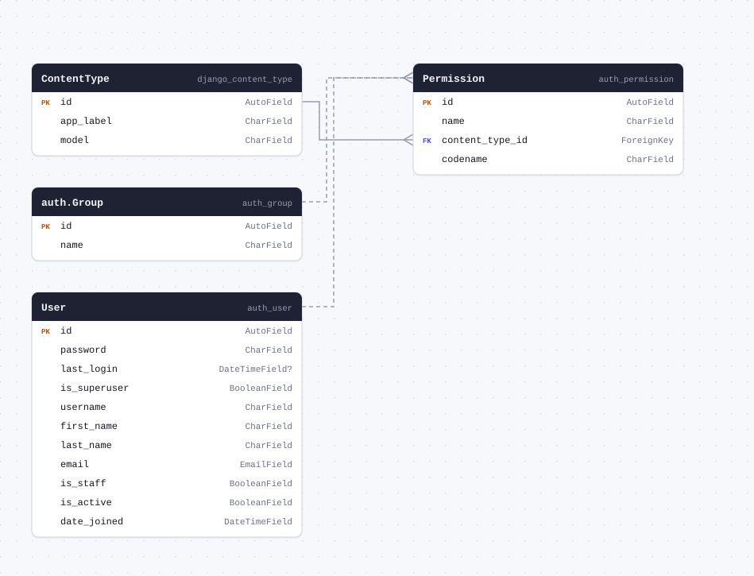

| Column | Field | Type | Null | Key | Default | Description |
| --- | --- | --- | --- | --- | --- | --- |
| `id` | `AutoField` | `integer` |  | PK | `autoincrement()` |  |
| `name` | `CharField` | `varchar(255)` |  |  |  |  |
| `content_type_id` | `ForeignKey` | `integer` |  | FK |  |  |
| `codename` | `CharField` | `varchar(100)` |  |  |  |  |

Indexes:

- index `auth_permission_content_type_id_2f476e4b` on `content_type_id`
- unique `auth_permission_content_type_id_codename_01ab375a_uniq` on `content_type_id`, `codename`

Relations:

- `content_type_id` → [ContentType](#contenttype).`id`, on delete cascade
- `group_set` — many to many with [auth.Group](#authgroup)
- `user_set` — many to many with [User](#user)

## auth.Group

Table `auth_group`, app `auth`.

Groups are a generic way of categorizing users to apply permissions, or
some other label, to those users. A user can belong to any number of
groups.

A user in a group automatically has all the permissions granted to that
group. For example, if the group 'Site editors' has the permission
can_edit_home_page, any user in that group will have that permission.

Beyond permissions, groups are a convenient way to categorize users to
apply some label, or extended functionality, to them. For example, you
could create a group 'Special users', and you could write code that would
do special things to those users -- such as giving them access to a
members-only portion of your site, or sending them members-only email
messages.

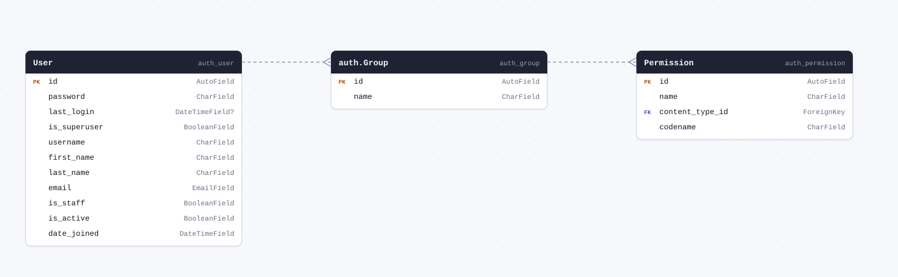

| Column | Field | Type | Null | Key | Default | Description |
| --- | --- | --- | --- | --- | --- | --- |
| `id` | `AutoField` | `integer` |  | PK | `autoincrement()` |  |
| `name` | `CharField` | `varchar(150)` |  | unique |  |  |

Relations:

- `permissions` — many to many with [Permission](#permission)
- `user_set` — many to many with [User](#user)

## User

Table `auth_user`, app `auth`.

Columns from `AbstractUser` (abstract): `username`, `first_name`, `last_name`, `email`, `is_staff`, `is_active`, `date_joined`.

Columns from `AbstractBaseUser` (abstract): `password`, `last_login`.

Columns from `PermissionsMixin` (abstract): `is_superuser`.

Users within the Django authentication system are represented by this
model.

Username and password are required. Other fields are optional.

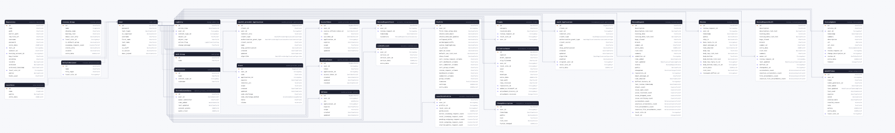

| Column | Field | Type | Null | Key | Default | Description |
| --- | --- | --- | --- | --- | --- | --- |
| `id` | `AutoField` | `integer` |  | PK | `autoincrement()` |  |
| `password` | `CharField` | `varchar(128)` |  |  |  |  |
| `last_login` | `DateTimeField` | `datetime` | yes |  |  |  |
| `is_superuser` | `BooleanField` | `bool` |  |  | `False` | Designates that this user has all permissions without explicitly assigning them. |
| `username` | `CharField` | `varchar(150)` |  | unique |  | Required. 150 characters or fewer. Letters, digits and @/./+/-/_ only. |
| `first_name` | `CharField` | `varchar(150)` |  |  |  |  |
| `last_name` | `CharField` | `varchar(150)` |  |  |  |  |
| `email` | `EmailField` | `varchar(254)` |  |  |  |  |
| `is_staff` | `BooleanField` | `bool` |  |  | `False` | Designates whether the user can log into this admin site. |
| `is_active` | `BooleanField` | `bool` |  |  | `True` | Designates whether this user should be treated as active. Unselect this instead of deleting accounts. |
| `date_joined` | `DateTimeField` | `datetime` |  |  | `now()` |  |

Relations:

- [LogEntry](#logentry).`user_id` → `id`, on delete cascade
- `groups` — many to many with [auth.Group](#authgroup)
- `user_permissions` — many to many with [Permission](#permission)
- [StoredConsentData](#storedconsentdata).`user_id` → `id`, on delete set null
- [oauth2_provider.Application](#oauth2_providerapplication).`user_id` → `id`, on delete cascade
- [Grant](#grant).`user_id` → `id`, on delete cascade
- [AccessToken](#accesstoken).`user_id` → `id`, on delete cascade
- [RefreshToken](#refreshtoken).`user_id` → `id`, on delete cascade
- [IDToken](#idtoken).`user_id` → `id`, on delete cascade
- [ReviewRequestVisit](#reviewrequestvisit).`user_id` → `id`, on delete cascade
- [LinkedAccount](#linkedaccount).`user_id` → `id`, on delete cascade
- [Profile](#profile).`user_id` → `id`, on delete cascade
- [LocalSiteProfile](#localsiteprofile).`user_id` → `id`, on delete cascade
- [Trophy](#trophy).`user_id` → `id`, on delete cascade
- [FileAttachment](#fileattachment).`user_id` → `id`, on delete cascade
- [ChangeDescription](#changedescription).`user_id` → `id`, on delete cascade
- [oauth.Application](#oauthapplication).`user_id` → `id`, on delete cascade
- [oauth.Application](#oauthapplication).`original_user_id` → `id`, on delete cascade
- `review_groups` — many to many with [reviews.Group](#reviewsgroup)
- `default_review_paths` — many to many with [DefaultReviewer](#defaultreviewer)
- [ReviewRequest](#reviewrequest).`submitter_id` → `id`, on delete cascade
- `directed_review_requests` — many to many with [ReviewRequest](#reviewrequest)
- [Review](#review).`user_id` → `id`, on delete cascade
- [ReviewRequestDraft](#reviewrequestdraft).`owner_id` → `id`, on delete cascade
- `directed_drafts` — many to many with [ReviewRequestDraft](#reviewrequestdraft)
- [StatusUpdate](#statusupdate).`user_id` → `id`, on delete cascade
- `repositories` — many to many with [Repository](#repository)
- `local_site` — many to many with [LocalSite](#localsite)
- `local_site_admins` — many to many with [LocalSite](#localsite)
- [WebAPIToken](#webapitoken).`user_id` → `id`, on delete cascade

## ContentType

Table `django_content_type`, app `contenttypes`.


| Column | Field | Type | Null | Key | Default | Description |
| --- | --- | --- | --- | --- | --- | --- |
| `id` | `AutoField` | `integer` |  | PK | `autoincrement()` |  |
| `app_label` | `CharField` | `varchar(100)` |  |  |  |  |
| `model` | `CharField` | `varchar(100)` |  |  |  |  |

Indexes:

- unique `django_content_type_app_label_model_76bd3d3b_uniq` on `app_label`, `model`

Relations:

- [LogEntry](#logentry).`content_type_id` → `id`, on delete set null
- [Permission](#permission).`content_type_id` → `id`, on delete cascade

## Site

Table `django_site`, app `sites`.

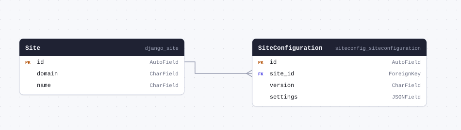

| Column | Field | Type | Null | Key | Default | Description |
| --- | --- | --- | --- | --- | --- | --- |
| `id` | `AutoField` | `integer` |  | PK | `autoincrement()` |  |
| `domain` | `CharField` | `varchar(100)` |  | unique |  |  |
| `name` | `CharField` | `varchar(50)` |  |  |  |  |

Relations:

- [SiteConfiguration](#siteconfiguration).`site_id` → `id`, on delete cascade

## Session

Table `django_session`, app `sessions`.

Columns from `AbstractBaseSession` (abstract): `session_key`, `session_data`, `expire_date`.

Django provides full support for anonymous sessions. The session
framework lets you store and retrieve arbitrary data on a
per-site-visitor basis. It stores data on the server side and
abstracts the sending and receiving of cookies. Cookies contain a
session ID -- not the data itself.

The Django sessions framework is entirely cookie-based. It does
not fall back to putting session IDs in URLs. This is an intentional
design decision. Not only does that behavior make URLs ugly, it makes
your site vulnerable to session-ID theft via the "Referer" header.

For complete documentation on using Sessions in your code, consult
the sessions documentation that is shipped with Django (also available
on the Django web site).

| Column | Field | Type | Null | Key | Default | Description |
| --- | --- | --- | --- | --- | --- | --- |
| `session_key` | `CharField` | `varchar(40)` |  | PK |  |  |
| `session_data` | `TextField` | `text` |  |  |  |  |
| `expire_date` | `DateTimeField` | `datetime` |  |  |  |  |

Indexes:

- index `django_session_expire_date_a5c62663` on `expire_date`

## RegisteredExtension

Table `extensions_registeredextension`, app `djblets_extensions`.

Extension registration info.

An extension that was both installed and enabled at least once. This
may contain settings for the extension.

This does not contain full information for the extension, such as the
author or description. That is provided by the Extension object itself.

| Column | Field | Type | Null | Key | Default | Description |
| --- | --- | --- | --- | --- | --- | --- |
| `id` | `AutoField` | `integer` |  | PK | `autoincrement()` |  |
| `class_name` | `CharField` | `varchar(128)` |  | unique |  |  |
| `name` | `CharField` | `varchar(32)` |  |  |  |  |
| `enabled` | `BooleanField` | `bool` |  |  | `False` |  |
| `installed` | `BooleanField` | `bool` |  |  | `False` |  |
| `settings` | `JSONField` | `text` |  |  |  |  |

## StoredConsentData

Table `djblets_privacy_storedconsentdata`, app `djblets_privacy`.

Stored information about a user's current and past consent decisions.

This tracks what parts of a product a user has consented to, and how those
decisions have changed in the past. The model is not meant to be queried
directly by applications, but rather used behind the scenes by
:py:class:`~djblets.privacy.consent.tracker.DatabaseConsentTracker`.

Entries are associated with a user in the database (when available), but
are also associated with a piece of identifying data for the purposes of
privacy auditing. The identifying data (stored in
:py:attr:`audit_identifier`) can be erased at any point without impacting
the model, and can also store encrypted values if needed by the
application.

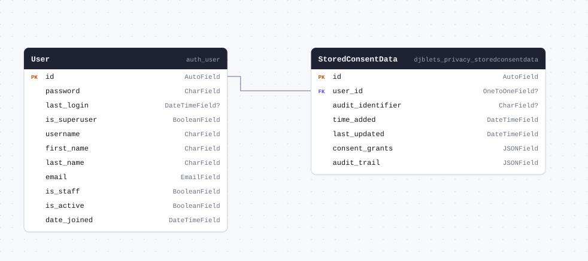

| Column | Field | Type | Null | Key | Default | Description |
| --- | --- | --- | --- | --- | --- | --- |
| `id` | `AutoField` | `integer` |  | PK | `autoincrement()` |  |
| `user_id` | `OneToOneField` | `integer` | yes | FK, unique |  | The user whose consent decisions are being stored. |
| `audit_identifier` | `CharField` | `varchar(255)` | yes |  |  | An identifier for locating the audit record as needed. The value must be able to be compared against information from the original user, but may be erased or encrypted at any point. |
| `time_added` | `DateTimeField` | `datetime` |  |  | `now()` | The date and time when the stored consent data was first added to the database. |
| `last_updated` | `DateTimeField` | `datetime` |  |  | `now()` | The date and time when the stored consent data was last updated. |
| `consent_grants` | `JSONField` | `text` |  |  | `dict()` | The consents granted or denied by the user. |
| `audit_trail` | `JSONField` | `text` |  |  | `dict()` | A record of all consent changes made by the user. |

Indexes:

- index `djblets_privacy_storedconsentdata_audit_identifier_eeb12ed0` on `audit_identifier`

Relations:

- `user_id` → [User](#user).`id`, on delete set null

## SiteConfiguration

Table `siteconfig_siteconfiguration`, app `djblets_siteconfig`.

Stored version and settings data for a Django site.

This stores dynamic settings for a site, along with version information,
allowing the application to alter and apply/synchronize settings across
threads, processes, and servers without restarting the server.

Consumers should not create or fetch their own instance of this class
through standard Django query functions. Instead, they should use
:py:meth:`SiteConfiguration.objects.get_current()
<djblets.siteconfig.managers.SiteConfigurationManager.get_current>`
instead. See the documentation for that method for details on how to safely
look up and use site configuration.


| Column | Field | Type | Null | Key | Default | Description |
| --- | --- | --- | --- | --- | --- | --- |
| `id` | `AutoField` | `integer` |  | PK | `autoincrement()` |  |
| `site_id` | `ForeignKey` | `integer` |  | FK |  |  |
| `version` | `CharField` | `varchar(20)` |  |  |  |  |
| `settings` | `JSONField` | `text` |  |  |  |  |

Indexes:

- index `siteconfig_siteconfiguration_site_id_a352de24` on `site_id`

Relations:

- `site_id` → [Site](#site).`id`, on delete cascade

## oauth2_provider.Application

Table `oauth2_provider_application`, app `oauth2_provider`.

Columns from `AbstractApplication` (abstract): `id`, `client_id`, `user_id`, `redirect_uris`, `client_type`, `authorization_grant_type`, `client_secret`, `name`, `skip_authorization`, `created`, `updated`, `algorithm`.

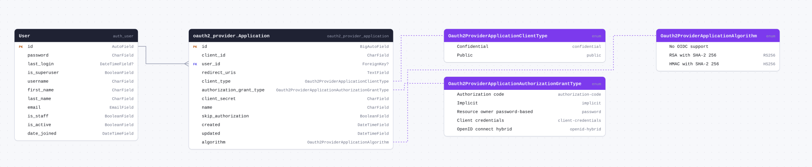

| Column | Field | Type | Null | Key | Default | Description |
| --- | --- | --- | --- | --- | --- | --- |
| `id` | `BigAutoField` | `integer` |  | PK | `autoincrement()` |  |
| `client_id` | `CharField` | `varchar(100)` |  | unique | `generate_client_id()` |  |
| `user_id` | `ForeignKey` | `integer` | yes | FK |  |  |
| `redirect_uris` | `TextField` | `text` |  |  |  | Allowed URIs list, space separated |
| `client_type` | `Oauth2ProviderApplicationClientType` | `varchar(32)` |  |  |  |  |
| `authorization_grant_type` | `Oauth2ProviderApplicationAuthorizationGrantType` | `varchar(32)` |  |  |  |  |
| `client_secret` | `CharField` | `varchar(255)` |  |  | `generate_client_secret()` |  |
| `name` | `CharField` | `varchar(255)` |  |  |  |  |
| `skip_authorization` | `BooleanField` | `bool` |  |  | `False` |  |
| `created` | `DateTimeField` | `datetime` |  |  | `now()` |  |
| `updated` | `DateTimeField` | `datetime` |  |  | `now()` |  |
| `algorithm` | `Oauth2ProviderApplicationAlgorithm` | `varchar(5)` |  |  | `''` |  |

Indexes:

- index `oauth2_provider_application_user_id_79829054` on `user_id`
- index `oauth2_provider_application_client_secret_53133678` on `client_secret`

Relations:

- `user_id` → [User](#user).`id`, on delete cascade

## Grant

Table `oauth2_provider_grant`, app `oauth2_provider`.

Columns from `AbstractGrant` (abstract): `id`, `user_id`, `code`, `application_id`, `expires`, `redirect_uri`, `scope`, `created`, `updated`, `code_challenge`, `code_challenge_method`, `nonce`, `claims`.

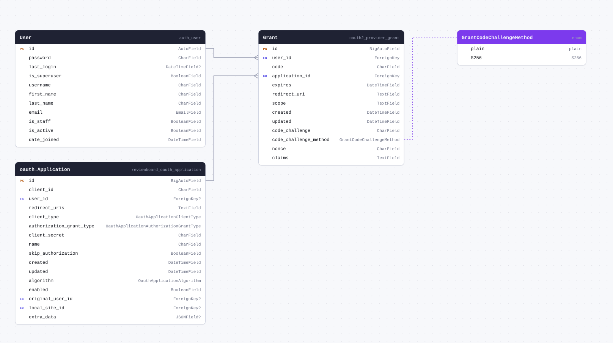

| Column | Field | Type | Null | Key | Default | Description |
| --- | --- | --- | --- | --- | --- | --- |
| `id` | `BigAutoField` | `integer` |  | PK | `autoincrement()` |  |
| `user_id` | `ForeignKey` | `integer` |  | FK |  |  |
| `code` | `CharField` | `varchar(255)` |  | unique |  |  |
| `application_id` | `ForeignKey` | `bigint` |  | FK |  |  |
| `expires` | `DateTimeField` | `datetime` |  |  |  |  |
| `redirect_uri` | `TextField` | `text` |  |  |  |  |
| `scope` | `TextField` | `text` |  |  |  |  |
| `created` | `DateTimeField` | `datetime` |  |  | `now()` |  |
| `updated` | `DateTimeField` | `datetime` |  |  | `now()` |  |
| `code_challenge` | `CharField` | `varchar(128)` |  |  | `''` |  |
| `code_challenge_method` | `GrantCodeChallengeMethod` | `varchar(10)` |  |  | `''` |  |
| `nonce` | `CharField` | `varchar(255)` |  |  | `''` |  |
| `claims` | `TextField` | `text` |  |  |  |  |

Indexes:

- index `oauth2_provider_grant_user_id_e8f62af8` on `user_id`
- index `oauth2_provider_grant_application_id_81923564` on `application_id`

Relations:

- `user_id` → [User](#user).`id`, on delete cascade
- `application_id` → [oauth.Application](#oauthapplication).`id`, on delete cascade

## AccessToken

Table `oauth2_provider_accesstoken`, app `oauth2_provider`.

Columns from `AbstractAccessToken` (abstract): `id`, `user_id`, `source_refresh_token_id`, `token`, `id_token_id`, `application_id`, `expires`, `scope`, `created`, `updated`.

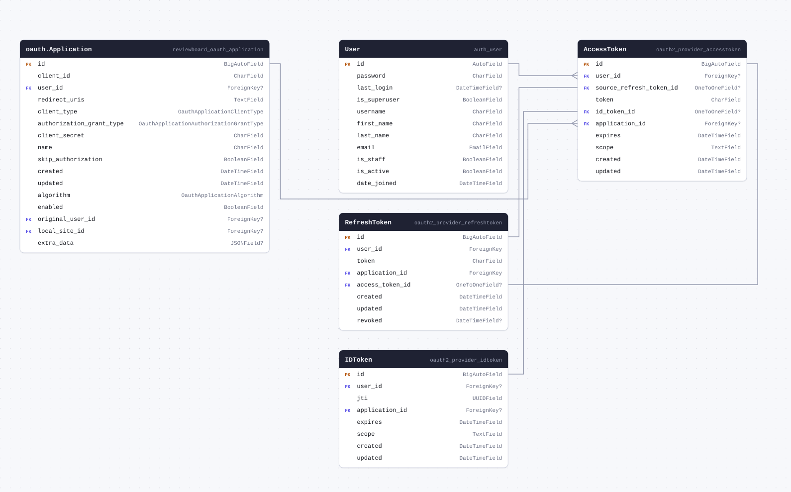

| Column | Field | Type | Null | Key | Default | Description |
| --- | --- | --- | --- | --- | --- | --- |
| `id` | `BigAutoField` | `integer` |  | PK | `autoincrement()` |  |
| `user_id` | `ForeignKey` | `integer` | yes | FK |  |  |
| `source_refresh_token_id` | `OneToOneField` | `bigint` | yes | FK, unique |  |  |
| `token` | `CharField` | `varchar(255)` |  | unique |  |  |
| `id_token_id` | `OneToOneField` | `bigint` | yes | FK, unique |  |  |
| `application_id` | `ForeignKey` | `bigint` | yes | FK |  |  |
| `expires` | `DateTimeField` | `datetime` |  |  |  |  |
| `scope` | `TextField` | `text` |  |  |  |  |
| `created` | `DateTimeField` | `datetime` |  |  | `now()` |  |
| `updated` | `DateTimeField` | `datetime` |  |  | `now()` |  |

Indexes:

- index `oauth2_provider_accesstoken_user_id_6e4c9a65` on `user_id`
- index `oauth2_provider_accesstoken_application_id_b22886e1` on `application_id`

Relations:

- `user_id` → [User](#user).`id`, on delete cascade
- `source_refresh_token_id` → [RefreshToken](#refreshtoken).`id`, on delete set null
- `id_token_id` → [IDToken](#idtoken).`id`, on delete cascade
- `application_id` → [oauth.Application](#oauthapplication).`id`, on delete cascade
- [RefreshToken](#refreshtoken).`access_token_id` → `id`, on delete set null

## RefreshToken

Table `oauth2_provider_refreshtoken`, app `oauth2_provider`.

Columns from `AbstractRefreshToken` (abstract): `id`, `user_id`, `token`, `application_id`, `access_token_id`, `created`, `updated`, `revoked`.


| Column | Field | Type | Null | Key | Default | Description |
| --- | --- | --- | --- | --- | --- | --- |
| `id` | `BigAutoField` | `integer` |  | PK | `autoincrement()` |  |
| `user_id` | `ForeignKey` | `integer` |  | FK |  |  |
| `token` | `CharField` | `varchar(255)` |  |  |  |  |
| `application_id` | `ForeignKey` | `bigint` |  | FK |  |  |
| `access_token_id` | `OneToOneField` | `bigint` | yes | FK, unique |  |  |
| `created` | `DateTimeField` | `datetime` |  |  | `now()` |  |
| `updated` | `DateTimeField` | `datetime` |  |  | `now()` |  |
| `revoked` | `DateTimeField` | `datetime` | yes |  |  |  |

Indexes:

- index `oauth2_provider_refreshtoken_user_id_da837fce` on `user_id`
- index `oauth2_provider_refreshtoken_application_id_2d1c311b` on `application_id`
- unique `oauth2_provider_refreshtoken_token_revoked_af8a5134_uniq` on `token`, `revoked`

Relations:

- [AccessToken](#accesstoken).`source_refresh_token_id` → `id`, on delete set null
- `user_id` → [User](#user).`id`, on delete cascade
- `application_id` → [oauth.Application](#oauthapplication).`id`, on delete cascade
- `access_token_id` → [AccessToken](#accesstoken).`id`, on delete set null

## IDToken

Table `oauth2_provider_idtoken`, app `oauth2_provider`.

Columns from `AbstractIDToken` (abstract): `id`, `user_id`, `jti`, `application_id`, `expires`, `scope`, `created`, `updated`.

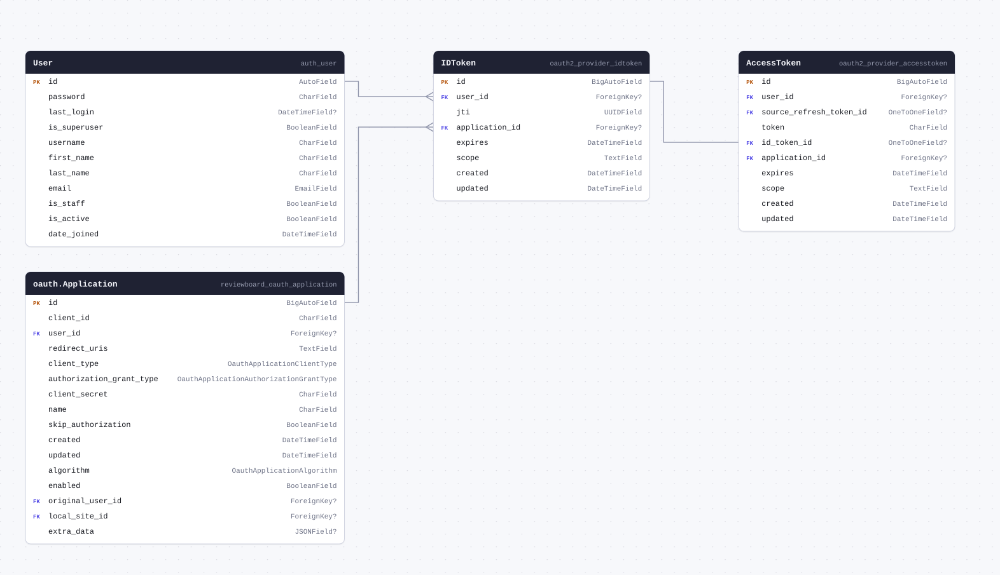

| Column | Field | Type | Null | Key | Default | Description |
| --- | --- | --- | --- | --- | --- | --- |
| `id` | `BigAutoField` | `integer` |  | PK | `autoincrement()` |  |
| `user_id` | `ForeignKey` | `integer` | yes | FK |  |  |
| `jti` | `UUIDField` | `char(32)` |  | unique | `uuid4()` |  |
| `application_id` | `ForeignKey` | `bigint` | yes | FK |  |  |
| `expires` | `DateTimeField` | `datetime` |  |  |  |  |
| `scope` | `TextField` | `text` |  |  |  |  |
| `created` | `DateTimeField` | `datetime` |  |  | `now()` |  |
| `updated` | `DateTimeField` | `datetime` |  |  | `now()` |  |

Indexes:

- index `oauth2_provider_idtoken_user_id_dd512b59` on `user_id`
- index `oauth2_provider_idtoken_application_id_08c5ff4f` on `application_id`

Relations:

- [AccessToken](#accesstoken).`id_token_id` → `id`, on delete cascade
- `user_id` → [User](#user).`id`, on delete cascade
- `application_id` → [oauth.Application](#oauthapplication).`id`, on delete cascade

## ReviewRequestVisit

Table `accounts_reviewrequestvisit`, app `accounts`.

A recording of the last time a review request was visited by a user.

Users have one ReviewRequestVisit entry in the database per review
request they've visited. This is used to keep track of any updates
to review requests they've already seen, so that we can intelligently
inform them that new discussions have taken place.

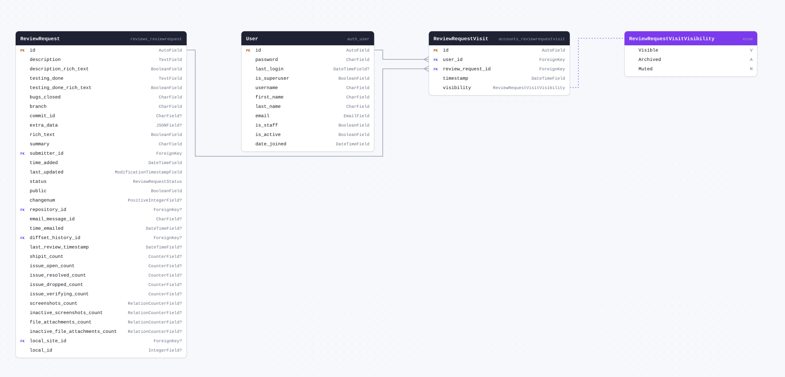

| Column | Field | Type | Null | Key | Default | Description |
| --- | --- | --- | --- | --- | --- | --- |
| `id` | `AutoField` | `integer` |  | PK | `autoincrement()` |  |
| `user_id` | `ForeignKey` | `integer` |  | FK |  |  |
| `review_request_id` | `ForeignKey` | `integer` |  | FK |  |  |
| `timestamp` | `DateTimeField` | `datetime` |  |  | `now()` |  |
| `visibility` | `ReviewRequestVisitVisibility` | `varchar(1)` |  |  | `'V'` |  |

Indexes:

- index `accounts_reviewrequestvisit_user_id_8ed30d49` on `user_id`
- index `accounts_reviewrequestvisit_review_request_id_3bd58111` on `review_request_id`
- unique `accounts_reviewrequestvisit_user_id_review_request_id_5b8724f0_uniq` on `user_id`, `review_request_id`
- index `accounts_re_user_id_be4d4f_idx` on `user_id`, `visibility`

Relations:

- `user_id` → [User](#user).`id`, on delete cascade
- `review_request_id` → [ReviewRequest](#reviewrequest).`id`, on delete cascade

## LinkedAccount

Table `accounts_linkedaccount`, app `accounts`.

A linked account on an external service.

This can be used to associate user accounts on Review Board with accounts
on external services. These services might be third parties that Review
Board interacts with (such as hosting services), or alternative methods of
authentication like OpenID or SAML.

Version Added:
    5.0

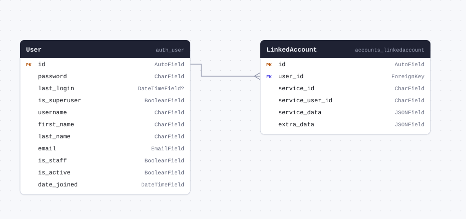

| Column | Field | Type | Null | Key | Default | Description |
| --- | --- | --- | --- | --- | --- | --- |
| `id` | `AutoField` | `integer` |  | PK | `autoincrement()` |  |
| `user_id` | `ForeignKey` | `integer` |  | FK |  |  |
| `service_id` | `CharField` | `varchar(64)` |  |  |  |  |
| `service_user_id` | `CharField` | `varchar(254)` |  |  |  |  |
| `service_data` | `JSONField` | `text` |  |  |  | Used to store private data such as session keys. |
| `extra_data` | `JSONField` | `text` |  |  |  |  |

Indexes:

- index `accounts_linkedaccount_user_id_b27ea2c3` on `user_id`
- unique `accounts_linkedaccount_service_user_id_service_id_537d3d2e_uniq` on `service_user_id`, `service_id`

Relations:

- `user_id` → [User](#user).`id`, on delete cascade

## Profile

Table `accounts_profile`, app `accounts`.

User profile which contains some basic configurable settings.

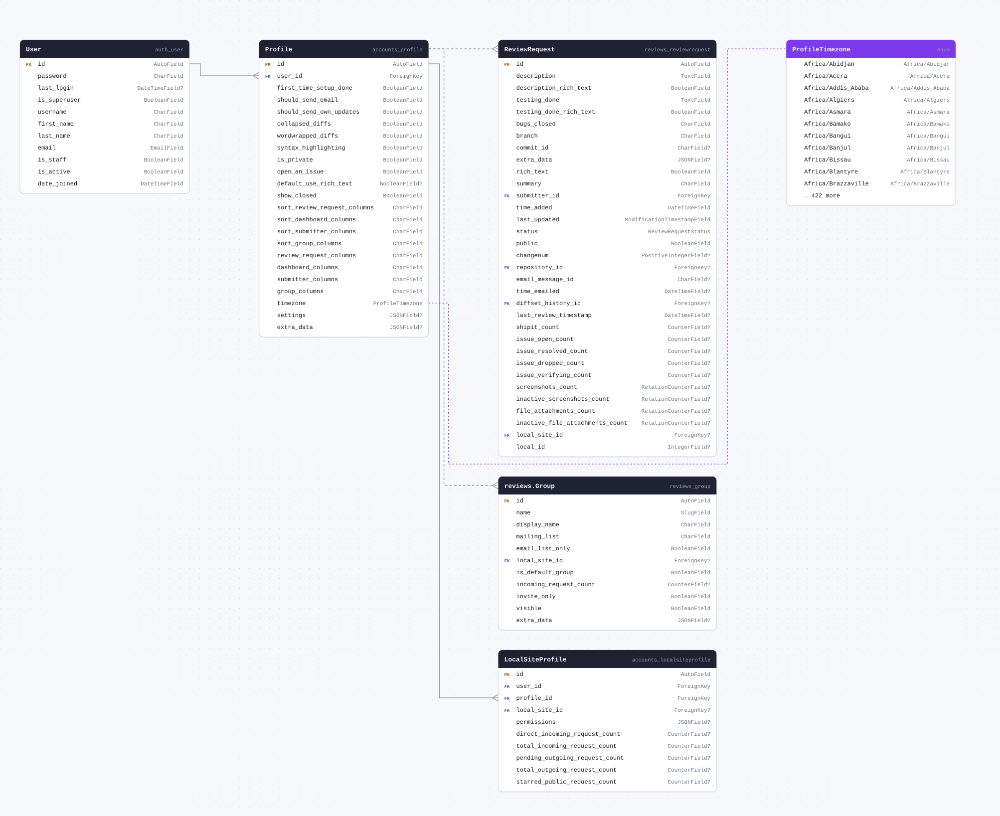

| Column | Field | Type | Null | Key | Default | Description |
| --- | --- | --- | --- | --- | --- | --- |
| `id` | `AutoField` | `integer` |  | PK | `autoincrement()` |  |
| `user_id` | `ForeignKey` | `integer` |  | FK, unique |  |  |
| `first_time_setup_done` | `BooleanField` | `bool` |  |  | `False` | Indicates whether the user has already gone through the first time setup process by saving their user preferences. |
| `should_send_email` | `BooleanField` | `bool` |  |  | `True` | Indicates whether the user wishes to receive emails. |
| `should_send_own_updates` | `BooleanField` | `bool` |  |  | `True` | Indicates whether the user wishes to receive emails about their own activity. |
| `collapsed_diffs` | `BooleanField` | `bool` |  |  | `True` | Indicates whether diffs should be shown in their collapsed state by default. |
| `wordwrapped_diffs` | `BooleanField` | `bool` |  |  | `True` | This field is unused and will be removed in a future version. |
| `syntax_highlighting` | `BooleanField` | `bool` |  |  | `True` | Indicates whether the user wishes to see syntax highlighting in the diffs. |
| `is_private` | `BooleanField` | `bool` |  |  | `False` | Indicates whether the user wishes to keep his/her profile private. |
| `open_an_issue` | `BooleanField` | `bool` |  |  | `True` | Indicates whether the user wishes to default to opening an issue or not. |
| `default_use_rich_text` | `BooleanField` | `bool` | yes |  | `None` | Indicates whether new posts or comments should default to being in Markdown format. |
| `show_closed` | `BooleanField` | `bool` |  |  | `True` |  |
| `sort_review_request_columns` | `CharField` | `varchar(256)` |  |  |  |  |
| `sort_dashboard_columns` | `CharField` | `varchar(256)` |  |  |  |  |
| `sort_submitter_columns` | `CharField` | `varchar(256)` |  |  |  |  |
| `sort_group_columns` | `CharField` | `varchar(256)` |  |  |  |  |
| `review_request_columns` | `CharField` | `varchar(256)` |  |  |  |  |
| `dashboard_columns` | `CharField` | `varchar(256)` |  |  |  |  |
| `submitter_columns` | `CharField` | `varchar(256)` |  |  |  |  |
| `group_columns` | `CharField` | `varchar(256)` |  |  |  |  |
| `timezone` | `ProfileTimezone` | `varchar(30)` |  |  | `'UTC'` |  |
| `settings` | `JSONField` | `text` | yes |  | `dict()` |  |
| `extra_data` | `JSONField` | `text` | yes |  | `dict()` |  |

Relations:

- `user_id` → [User](#user).`id`, on delete cascade
- `starred_review_requests` — many to many with [ReviewRequest](#reviewrequest)
- `starred_groups` — many to many with [reviews.Group](#reviewsgroup)
- [LocalSiteProfile](#localsiteprofile).`profile_id` → `id`, on delete cascade

## LocalSiteProfile

Table `accounts_localsiteprofile`, app `accounts`.

User profile information specific to a LocalSite.

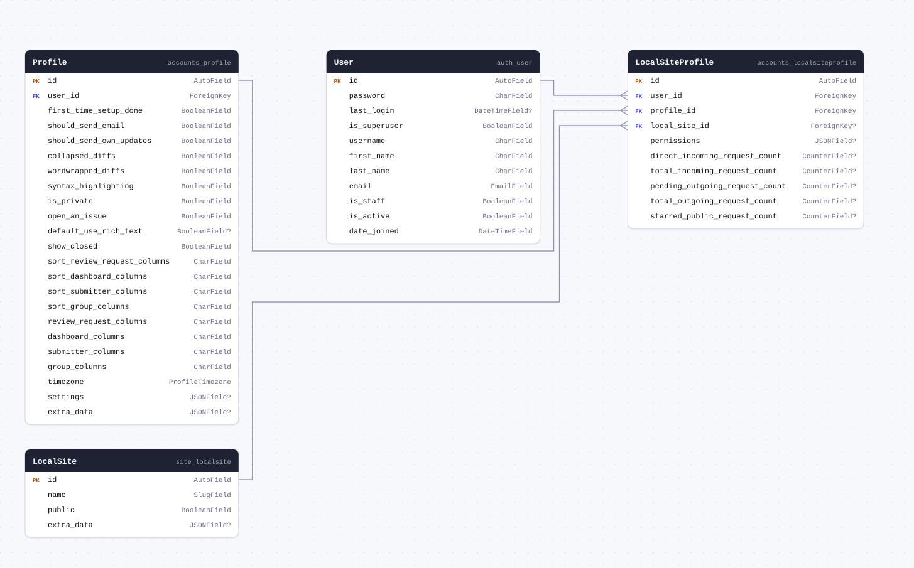

| Column | Field | Type | Null | Key | Default | Description |
| --- | --- | --- | --- | --- | --- | --- |
| `id` | `AutoField` | `integer` |  | PK | `autoincrement()` |  |
| `user_id` | `ForeignKey` | `integer` |  | FK |  |  |
| `profile_id` | `ForeignKey` | `integer` |  | FK |  |  |
| `local_site_id` | `ForeignKey` | `integer` | yes | FK |  |  |
| `permissions` | `JSONField` | `text` | yes |  |  |  |
| `direct_incoming_request_count` | `CounterField` | `integer` | yes |  | `None` |  |
| `total_incoming_request_count` | `CounterField` | `integer` | yes |  | `None` |  |
| `pending_outgoing_request_count` | `CounterField` | `integer` | yes |  | `None` |  |
| `total_outgoing_request_count` | `CounterField` | `integer` | yes |  | `None` |  |
| `starred_public_request_count` | `CounterField` | `integer` | yes |  | `None` |  |

Indexes:

- index `accounts_localsiteprofile_user_id_4faa8400` on `user_id`
- index `accounts_localsiteprofile_profile_id_6838b6f5` on `profile_id`
- index `accounts_localsiteprofile_local_site_id_e8e611d3` on `local_site_id`
- unique `accounts_localsiteprofile_user_id_local_site_id_c71acfac_uniq` on `user_id`, `local_site_id`
- unique `accounts_localsiteprofile_profile_id_local_site_id_c35a7283_uniq` on `profile_id`, `local_site_id`

Relations:

- `user_id` → [User](#user).`id`, on delete cascade
- `profile_id` → [Profile](#profile).`id`, on delete cascade
- `local_site_id` → [LocalSite](#localsite).`id`, on delete cascade

## Trophy

Table `accounts_trophy`, app `accounts`.

A trophy represents an achievement given to the user.

It is associated with a ReviewRequest and a User and can be associated
with a LocalSite.

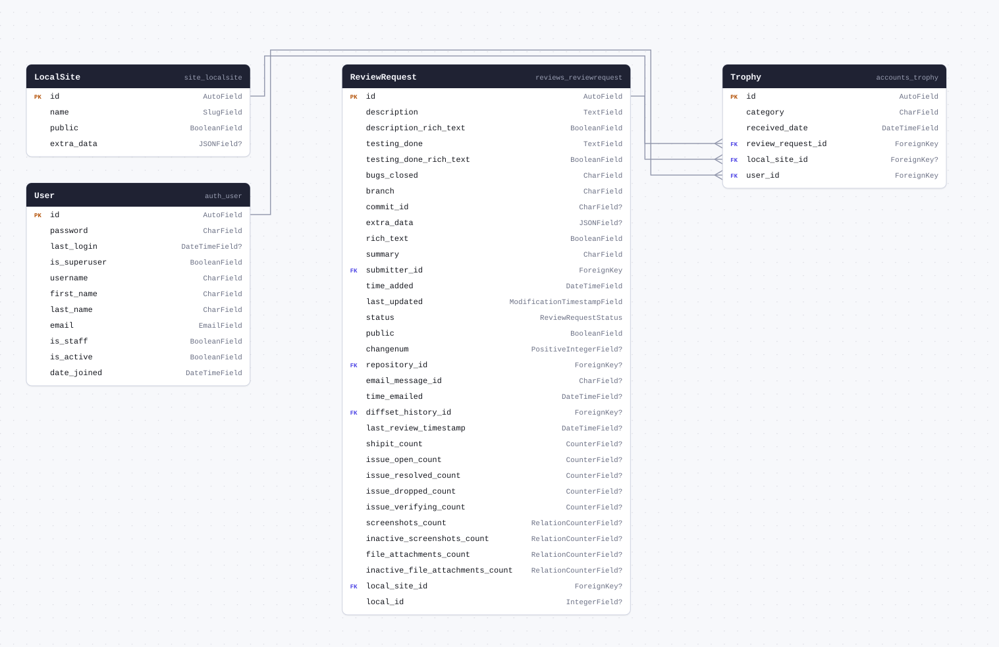

| Column | Field | Type | Null | Key | Default | Description |
| --- | --- | --- | --- | --- | --- | --- |
| `id` | `AutoField` | `integer` |  | PK | `autoincrement()` |  |
| `category` | `CharField` | `varchar(100)` |  |  |  |  |
| `received_date` | `DateTimeField` | `datetime` |  |  | `now()` |  |
| `review_request_id` | `ForeignKey` | `integer` |  | FK |  |  |
| `local_site_id` | `ForeignKey` | `integer` | yes | FK |  |  |
| `user_id` | `ForeignKey` | `integer` |  | FK |  |  |

Indexes:

- index `accounts_trophy_review_request_id_8d01e0f8` on `review_request_id`
- index `accounts_trophy_local_site_id_b29042f4` on `local_site_id`
- index `accounts_trophy_user_id_ef0f407a` on `user_id`

Relations:

- `review_request_id` → [ReviewRequest](#reviewrequest).`id`, on delete cascade
- `local_site_id` → [LocalSite](#localsite).`id`, on delete cascade
- `user_id` → [User](#user).`id`, on delete cascade

## FileAttachmentHistory

Table `attachments_fileattachmenthistory`, app `attachments`.

Revision history for a single file attachment.

This tracks multiple revisions of the same file attachment (for instance,
when someone replaces a screenshot with an updated version).

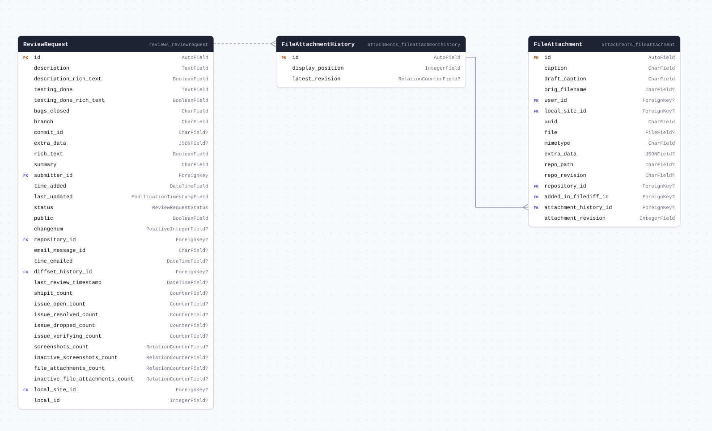

| Column | Field | Type | Null | Key | Default | Description |
| --- | --- | --- | --- | --- | --- | --- |
| `id` | `AutoField` | `integer` |  | PK | `autoincrement()` |  |
| `display_position` | `IntegerField` | `integer` |  |  |  |  |
| `latest_revision` | `RelationCounterField` | `integer` | yes |  | `None` |  |

Relations:

- [FileAttachment](#fileattachment).`attachment_history_id` → `id`, on delete cascade
- `review_request` — many to many with [ReviewRequest](#reviewrequest)

## FileAttachment

Table `attachments_fileattachment`, app `attachments`.

A file associated with a review request.

Like diffs, a file can have comments associated with it.
These comments are of type
:py:class:`reviewboard.reviews.models.FileAttachmentComment`.

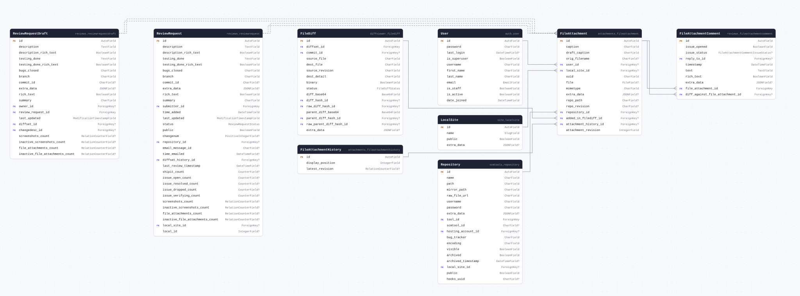

| Column | Field | Type | Null | Key | Default | Description |
| --- | --- | --- | --- | --- | --- | --- |
| `id` | `AutoField` | `integer` |  | PK | `autoincrement()` |  |
| `caption` | `CharField` | `varchar(256)` |  |  |  |  |
| `draft_caption` | `CharField` | `varchar(256)` |  |  |  |  |
| `orig_filename` | `CharField` | `varchar(256)` | yes |  |  |  |
| `user_id` | `ForeignKey` | `integer` | yes | FK |  |  |
| `local_site_id` | `ForeignKey` | `integer` | yes | FK |  |  |
| `uuid` | `CharField` | `varchar(255)` |  |  |  |  |
| `file` | `FileField` | `varchar(512)` | yes |  |  |  |
| `mimetype` | `CharField` | `varchar(256)` |  |  |  |  |
| `extra_data` | `JSONField` | `text` | yes |  |  |  |
| `repo_path` | `CharField` | `varchar(1024)` | yes |  |  |  |
| `repo_revision` | `CharField` | `varchar(64)` | yes |  |  |  |
| `repository_id` | `ForeignKey` | `integer` | yes | FK |  |  |
| `added_in_filediff_id` | `ForeignKey` | `integer` | yes | FK |  |  |
| `attachment_history_id` | `ForeignKey` | `integer` | yes | FK |  |  |
| `attachment_revision` | `IntegerField` | `integer` |  |  | `0` |  |

Indexes:

- index `attachments_fileattachment_user_id_dbe26565` on `user_id`
- index `attachments_fileattachment_local_site_id_be669fcf` on `local_site_id`
- index `attachments_fileattachment_repo_revision_0b865a62` on `repo_revision`
- index `attachments_fileattachment_repository_id_a23f76db` on `repository_id`
- index `attachments_fileattachment_added_in_filediff_id_5bbf0a9b` on `added_in_filediff_id`
- index `attachments_fileattachment_attachment_history_id_79d851af` on `attachment_history_id`

Relations:

- `user_id` → [User](#user).`id`, on delete cascade
- `local_site_id` → [LocalSite](#localsite).`id`, on delete cascade
- `repository_id` → [Repository](#repository).`id`, on delete cascade
- `added_in_filediff_id` → [FileDiff](#filediff).`id`, on delete cascade
- `attachment_history_id` → [FileAttachmentHistory](#fileattachmenthistory).`id`, on delete cascade
- [FileAttachmentComment](#fileattachmentcomment).`file_attachment_id` → `id`, on delete cascade
- [FileAttachmentComment](#fileattachmentcomment).`diff_against_file_attachment_id` → `id`, on delete cascade
- `review_request` — many to many with [ReviewRequest](#reviewrequest)
- `inactive_review_request` — many to many with [ReviewRequest](#reviewrequest)
- `drafts` — many to many with [ReviewRequestDraft](#reviewrequestdraft)
- `inactive_drafts` — many to many with [ReviewRequestDraft](#reviewrequestdraft)

## ChangeDescription

Table `changedescs_changedescription`, app `changedescs`.

The recorded set of changes, with a description and the changed fields.

This is a general model that can be used in applications for recording
changes how they see fit. A helper function, 'record_field_changed',
can be used to record information in a standard way for most value types,
but the 'fields_changed' dictionary can be manipulated however the caller
chooses.

A ChangeDescription is not bound to a particular model. It is up to models
to establish relationships with a ChangeDescription.

Each field in 'fields_changed' represents a changed field.

For string fields, the following fields will be available:

   * 'old': The old value of the field
   * 'new': The new value of the field

For list and set fields, the following fields will be available:

   * 'removed': The fields that were removed, if any.
   * 'added': The fields that were added, if any.

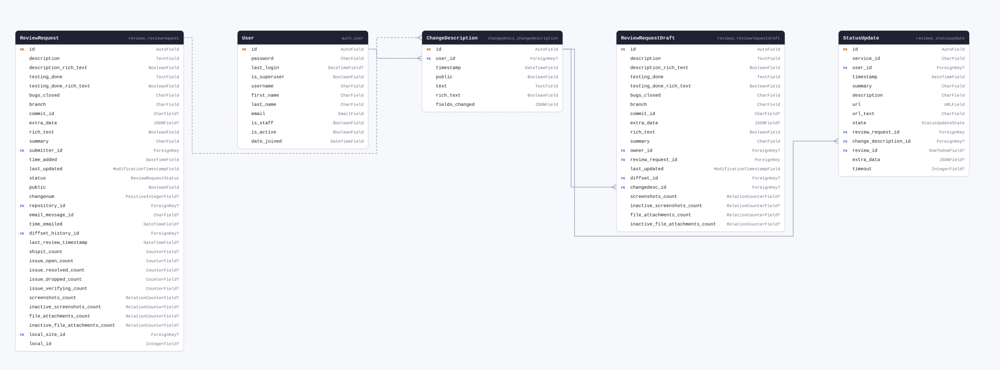

| Column | Field | Type | Null | Key | Default | Description |
| --- | --- | --- | --- | --- | --- | --- |
| `id` | `AutoField` | `integer` |  | PK | `autoincrement()` |  |
| `user_id` | `ForeignKey` | `integer` | yes | FK |  |  |
| `timestamp` | `DateTimeField` | `datetime` |  |  | `now()` |  |
| `public` | `BooleanField` | `bool` |  |  | `False` |  |
| `text` | `TextField` | `text` |  |  |  |  |
| `rich_text` | `BooleanField` | `bool` |  |  | `False` |  |
| `fields_changed` | `JSONField` | `text` |  |  |  |  |

Indexes:

- index `changedescs_changedescription_user_id_2341d9f9` on `user_id`

Relations:

- `user_id` → [User](#user).`id`, on delete cascade
- `review_request` — many to many with [ReviewRequest](#reviewrequest)
- [ReviewRequestDraft](#reviewrequestdraft).`changedesc_id` → `id`, on delete set null
- [StatusUpdate](#statusupdate).`change_description_id` → `id`, on delete cascade

## DiffSet

Table `diffviewer_diffset`, app `diffviewer`.

A revisioned collection of FileDiffs.

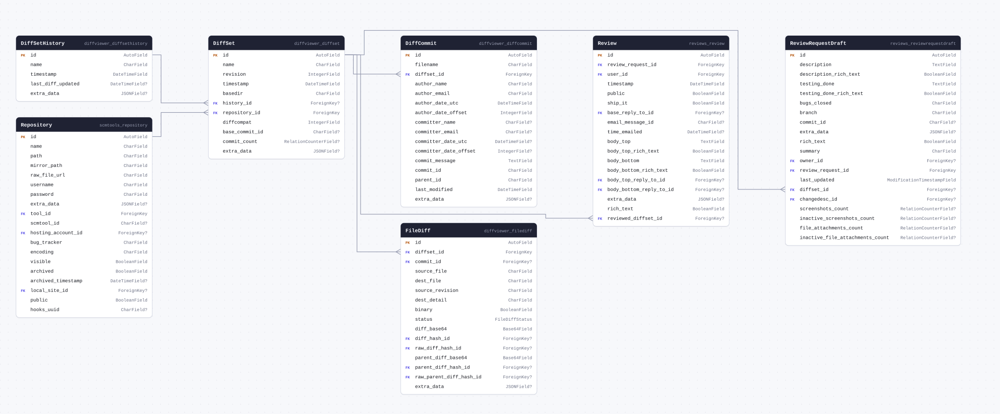

| Column | Field | Type | Null | Key | Default | Description |
| --- | --- | --- | --- | --- | --- | --- |
| `id` | `AutoField` | `integer` |  | PK | `autoincrement()` |  |
| `name` | `CharField` | `varchar(256)` |  |  |  |  |
| `revision` | `IntegerField` | `integer` |  |  |  |  |
| `timestamp` | `DateTimeField` | `datetime` |  |  | `now()` |  |
| `basedir` | `CharField` | `varchar(256)` |  |  | `''` |  |
| `history_id` | `ForeignKey` | `integer` | yes | FK |  |  |
| `repository_id` | `ForeignKey` | `integer` |  | FK |  |  |
| `diffcompat` | `IntegerField` | `integer` |  |  | `0` | The diff generator compatibility version to use. This can and should be ignored. |
| `base_commit_id` | `CharField` | `varchar(64)` | yes |  |  | The ID/revision this change is built upon. |
| `commit_count` | `RelationCounterField` | `integer` | yes |  | `None` |  |
| `extra_data` | `JSONField` | `text` | yes |  |  |  |

Indexes:

- index `diffviewer_diffset_history_id_539bce58` on `history_id`
- index `diffviewer_diffset_repository_id_bdf3a395` on `repository_id`
- index `diffviewer_diffset_base_commit_id_037195a9` on `base_commit_id`

Relations:

- `history_id` → [DiffSetHistory](#diffsethistory).`id`, on delete cascade
- `repository_id` → [Repository](#repository).`id`, on delete cascade
- [DiffCommit](#diffcommit).`diffset_id` → `id`, on delete cascade
- [FileDiff](#filediff).`diffset_id` → `id`, on delete cascade
- [Review](#review).`reviewed_diffset_id` → `id`, on delete cascade
- [ReviewRequestDraft](#reviewrequestdraft).`diffset_id` → `id`, on delete set null

## DiffCommit

Table `diffviewer_diffcommit`, app `diffviewer`.

A representation of a commit from a version control system.

A DiffSet on a Review Request that represents a commit history will have
one or more DiffCommits. Each DiffCommit will have one or more associated
FileDiffs (which also belong to the parent DiffSet).

The information stored herein is intended to fully represent the state of
a single commit in that history. The series of DiffCommits can be used to
re-create the original series of commits posted for review.

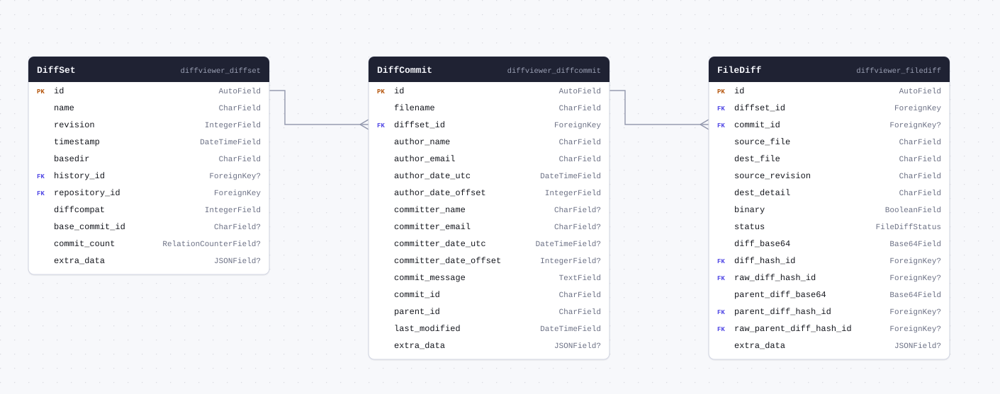

| Column | Field | Type | Null | Key | Default | Description |
| --- | --- | --- | --- | --- | --- | --- |
| `id` | `AutoField` | `integer` |  | PK | `autoincrement()` |  |
| `filename` | `CharField` | `varchar(256)` |  |  |  | The original file name of the diff. |
| `diffset_id` | `ForeignKey` | `integer` |  | FK |  |  |
| `author_name` | `CharField` | `varchar(256)` |  |  |  | The name of the commit author. |
| `author_email` | `CharField` | `varchar(256)` |  |  |  | The e-mail address of the commit author. |
| `author_date_utc` | `DateTimeField` | `datetime` |  |  |  | The date the commit was authored in UTC. |
| `author_date_offset` | `IntegerField` | `integer` |  |  |  | The author's UTC offset. |
| `committer_name` | `CharField` | `varchar(256)` | yes |  |  | The name of the committer (if applicable). |
| `committer_email` | `CharField` | `varchar(256)` | yes |  |  | The e-mail address of the committer (if applicable). |
| `committer_date_utc` | `DateTimeField` | `datetime` | yes |  |  | The date the commit was committed in UTC (if applicable). |
| `committer_date_offset` | `IntegerField` | `integer` | yes |  |  | The committer's UTC offset (if applicable). |
| `commit_message` | `TextField` | `text` |  |  |  | The commit message. |
| `commit_id` | `CharField` | `varchar(64)` |  |  |  | The unique identifier of the commit. |
| `parent_id` | `CharField` | `varchar(64)` |  |  |  | The unique identifier of the parent commit. |
| `last_modified` | `DateTimeField` | `datetime` |  |  | `now()` |  |
| `extra_data` | `JSONField` | `text` | yes |  |  |  |

Indexes:

- index `diffviewer_diffcommit_diffset_id_8c3c2dbb` on `diffset_id`
- unique `diffviewer_diffcommit_diffset_id_commit_id_61b21cc8_uniq` on `diffset_id`, `commit_id`

Relations:

- `diffset_id` → [DiffSet](#diffset).`id`, on delete cascade
- [FileDiff](#filediff).`commit_id` → `id`, on delete cascade

## DiffSetHistory

Table `diffviewer_diffsethistory`, app `diffviewer`.

A collection of diffsets.

This gives us a way to store and keep track of multiple revisions of
diffsets belonging to an object.

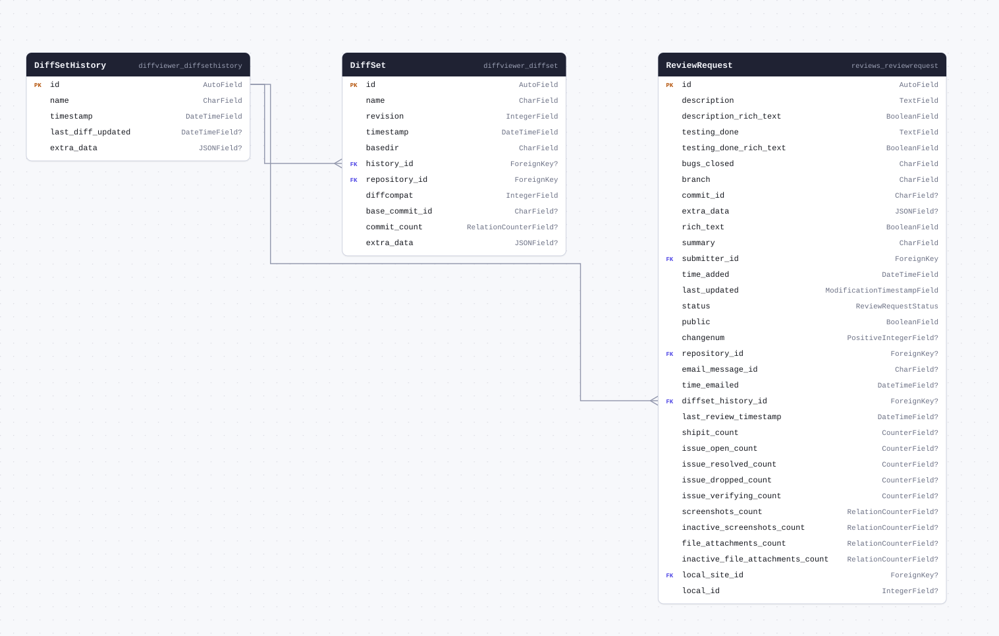

| Column | Field | Type | Null | Key | Default | Description |
| --- | --- | --- | --- | --- | --- | --- |
| `id` | `AutoField` | `integer` |  | PK | `autoincrement()` |  |
| `name` | `CharField` | `varchar(256)` |  |  |  |  |
| `timestamp` | `DateTimeField` | `datetime` |  |  | `now()` |  |
| `last_diff_updated` | `DateTimeField` | `datetime` | yes |  | `None` |  |
| `extra_data` | `JSONField` | `text` | yes |  |  |  |

Relations:

- [DiffSet](#diffset).`history_id` → `id`, on delete cascade
- [ReviewRequest](#reviewrequest).`diffset_history_id` → `id`, on delete set null

## LegacyFileDiffData

Table `diffviewer_filediffdata`, app `diffviewer`.

Deprecated, legacy class for base64-encoded diff data.

This is no longer populated, and exists solely to store legacy data
that has not been migrated to :py:class:`RawFileDiffData`.

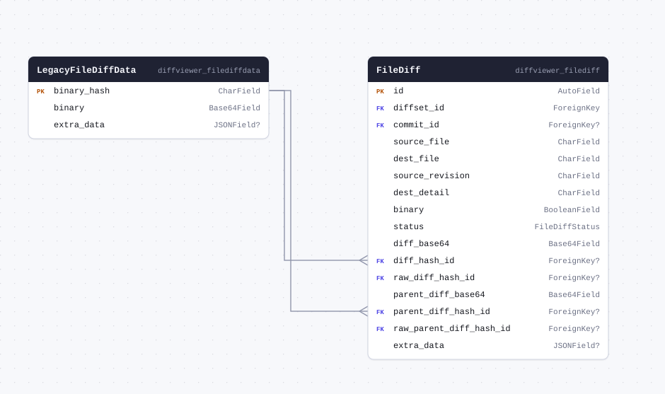

| Column | Field | Type | Null | Key | Default | Description |
| --- | --- | --- | --- | --- | --- | --- |
| `binary_hash` | `CharField` | `varchar(40)` |  | PK |  |  |
| `binary` | `Base64Field` | `text` |  |  |  |  |
| `extra_data` | `JSONField` | `text` | yes |  |  |  |

Relations:

- [FileDiff](#filediff).`legacy_diff_hash_id` → `binary_hash`, on delete set null
- [FileDiff](#filediff).`legacy_parent_diff_hash_id` → `binary_hash`, on delete set null

## RawFileDiffData

Table `diffviewer_rawfilediffdata`, app `diffviewer`.

Stores raw diff data as binary content in the database.

This is the class used in Review Board 2.5+ to store diff content.
Unlike in previous versions, the content is not base64-encoded. Instead,
it is stored either as bzip2-compressed data (if the resulting
compressed data is smaller than the raw data), or as the raw data itself.

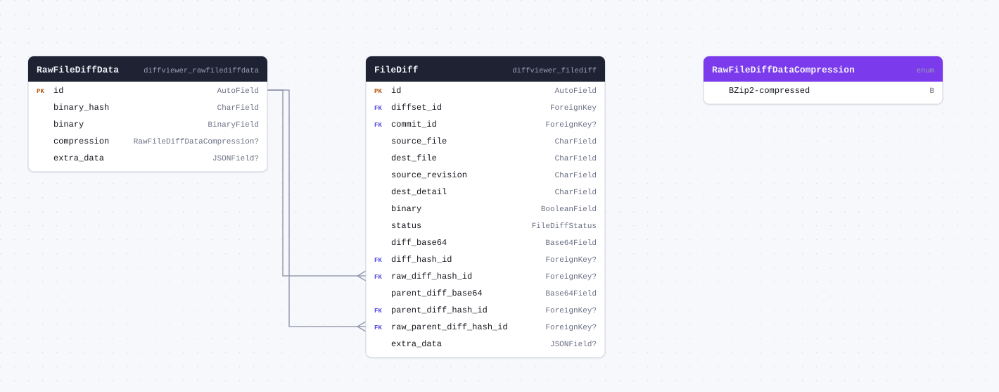

| Column | Field | Type | Null | Key | Default | Description |
| --- | --- | --- | --- | --- | --- | --- |
| `id` | `AutoField` | `integer` |  | PK | `autoincrement()` |  |
| `binary_hash` | `CharField` | `varchar(40)` |  | unique |  |  |
| `binary` | `BinaryField` | `BLOB` |  |  |  |  |
| `compression` | `RawFileDiffDataCompression` | `varchar(1)` | yes |  |  |  |
| `extra_data` | `JSONField` | `text` | yes |  |  |  |

Relations:

- [FileDiff](#filediff).`diff_hash_id` → `id`, on delete set null
- [FileDiff](#filediff).`parent_diff_hash_id` → `id`, on delete set null

## FileDiff

Table `diffviewer_filediff`, app `diffviewer`.

A diff of a single file.

This contains the patch and information needed to produce original and
patched versions of a single file in a repository.

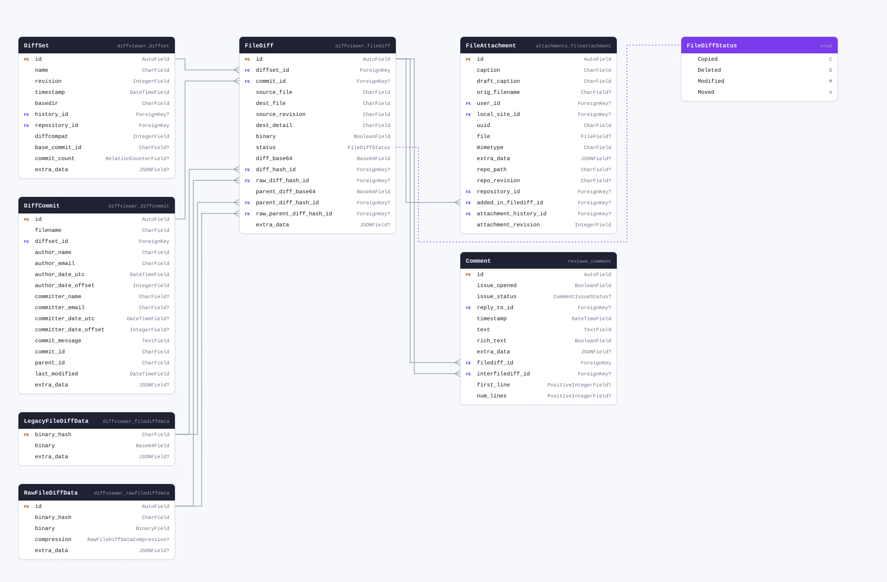

| Column | Field | Type | Null | Key | Default | Description |
| --- | --- | --- | --- | --- | --- | --- |
| `id` | `AutoField` | `integer` |  | PK | `autoincrement()` |  |
| `diffset_id` | `ForeignKey` | `integer` |  | FK |  |  |
| `commit_id` | `ForeignKey` | `integer` | yes | FK |  |  |
| `source_file` | `CharField` | `varchar(1024)` |  |  |  |  |
| `dest_file` | `CharField` | `varchar(1024)` |  |  |  |  |
| `source_revision` | `CharField` | `varchar(512)` |  |  |  |  |
| `dest_detail` | `CharField` | `varchar(512)` |  |  |  |  |
| `binary` | `BooleanField` | `bool` |  |  | `False` |  |
| `status` | `FileDiffStatus` | `varchar(1)` |  |  |  |  |
| `diff_base64` | `Base64Field` | `text` |  |  |  |  |
| `diff_hash_id` | `ForeignKey` | `varchar(40)` | yes | FK |  |  |
| `raw_diff_hash_id` | `ForeignKey` | `integer` | yes | FK |  |  |
| `parent_diff_base64` | `Base64Field` | `text` |  |  |  |  |
| `parent_diff_hash_id` | `ForeignKey` | `varchar(40)` | yes | FK |  |  |
| `raw_parent_diff_hash_id` | `ForeignKey` | `integer` | yes | FK |  |  |
| `extra_data` | `JSONField` | `text` | yes |  |  |  |

Indexes:

- index `diffviewer_filediff_diffset_id_f5b24a5d` on `diffset_id`
- index `diffviewer_filediff_commit_id_8ba58a4a` on `commit_id`
- index `diffviewer_filediff_diff_hash_id_d6cd0509` on `legacy_diff_hash_id`
- index `diffviewer_filediff_raw_diff_hash_id_ce904491` on `diff_hash_id`
- index `diffviewer_filediff_parent_diff_hash_id_73defa3d` on `legacy_parent_diff_hash_id`
- index `diffviewer_filediff_raw_parent_diff_hash_id_8bead4b4` on `parent_diff_hash_id`

Relations:

- [FileAttachment](#fileattachment).`added_in_filediff_id` → `id`, on delete cascade
- `diffset_id` → [DiffSet](#diffset).`id`, on delete cascade
- `commit_id` → [DiffCommit](#diffcommit).`id`, on delete cascade
- `legacy_diff_hash_id` → [LegacyFileDiffData](#legacyfilediffdata).`binary_hash`, on delete set null
- `diff_hash_id` → [RawFileDiffData](#rawfilediffdata).`id`, on delete set null
- `legacy_parent_diff_hash_id` → [LegacyFileDiffData](#legacyfilediffdata).`binary_hash`, on delete set null
- `parent_diff_hash_id` → [RawFileDiffData](#rawfilediffdata).`id`, on delete set null
- [Comment](#comment).`filediff_id` → `id`, on delete cascade
- [Comment](#comment).`interfilediff_id` → `id`, on delete cascade

## HostingServiceAccount

Table `hostingsvcs_hostingserviceaccount`, app `hostingsvcs`.

An account for a hosting service.

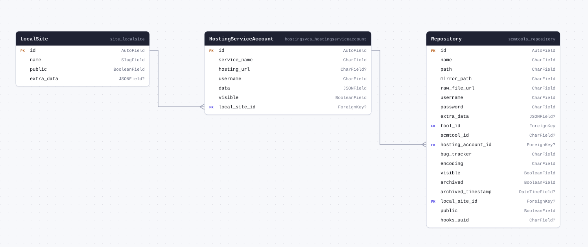

| Column | Field | Type | Null | Key | Default | Description |
| --- | --- | --- | --- | --- | --- | --- |
| `id` | `AutoField` | `integer` |  | PK | `autoincrement()` |  |
| `service_name` | `CharField` | `varchar(128)` |  |  |  | The ID of the hosting service that is associated with this account. |
| `hosting_url` | `CharField` | `varchar(255)` | yes |  |  | The hosting URL. |
| `username` | `CharField` | `varchar(128)` |  |  |  | The username of the account on the hosting service. |
| `data` | `JSONField` | `text` |  |  |  | Account data specific to the hosting service. This should generally not be changed. |
| `visible` | `BooleanField` | `bool` |  |  | `True` | Whether this account shows up as an option when configuring a repository. |
| `local_site_id` | `ForeignKey` | `integer` | yes | FK |  | The LocalSite to associate with this account. |

Indexes:

- index `hostingsvcs_hostingserviceaccount_local_site_id_6688df40` on `local_site_id`

Relations:

- `local_site_id` → [LocalSite](#localsite).`id`, on delete cascade
- [Repository](#repository).`hosting_account_id` → `id`, on delete cascade

## IntegrationConfig

Table `integrations_integrationconfig`, app `integrations`.

Columns from `BaseIntegrationConfig` (abstract): `integration_id`, `time_added`, `last_updated`, `name`, `enabled`, `settings`, `extra_data`.

Stored configuration for a particular integration.

This contains configuration settings for a given instance of an
integration, along with state indicating if that integration is to be
enabled and user-specified identifying information.

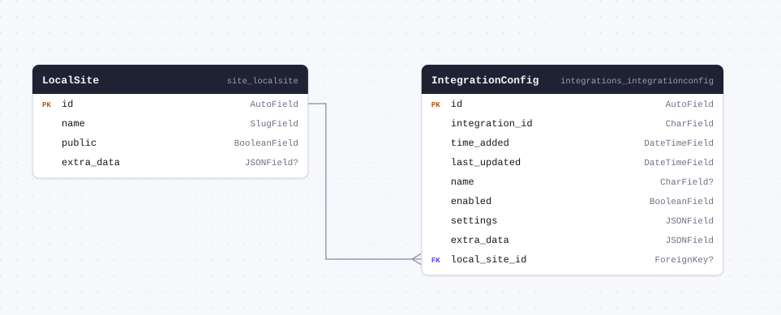

| Column | Field | Type | Null | Key | Default | Description |
| --- | --- | --- | --- | --- | --- | --- |
| `id` | `AutoField` | `integer` |  | PK | `autoincrement()` |  |
| `integration_id` | `CharField` | `varchar(255)` |  |  |  |  |
| `time_added` | `DateTimeField` | `datetime` |  |  | `now()` |  |
| `last_updated` | `DateTimeField` | `datetime` |  |  | `now()` |  |
| `name` | `CharField` | `varchar(255)` | yes |  |  |  |
| `enabled` | `BooleanField` | `bool` |  |  | `False` |  |
| `settings` | `JSONField` | `text` |  |  | `{}` |  |
| `extra_data` | `JSONField` | `text` |  |  | `{}` |  |
| `local_site_id` | `ForeignKey` | `integer` | yes | FK |  |  |

Indexes:

- index `integrations_integrationconfig_integration_id_c90e0bae` on `integration_id`
- index `integrations_integrationconfig_enabled_b7f7e2fc` on `enabled`
- index `integrations_integrationconfig_local_site_id_d6913121` on `local_site_id`

Relations:

- `local_site_id` → [LocalSite](#localsite).`id`, on delete cascade

## WebHookTarget

Table `notifications_webhooktarget`, app `notifications`.

A target for a webhook.

A webhook target is a URL which will receive a POST request when the
corresponding event occurs.

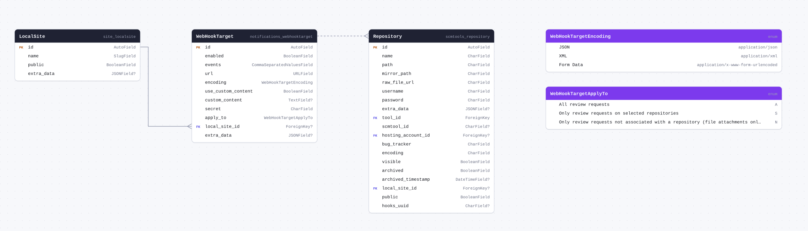

| Column | Field | Type | Null | Key | Default | Description |
| --- | --- | --- | --- | --- | --- | --- |
| `id` | `AutoField` | `integer` |  | PK | `autoincrement()` |  |
| `enabled` | `BooleanField` | `bool` |  |  | `True` |  |
| `events` | `CommaSeparatedValuesField` | `varchar(512)` |  |  |  | Select any or all events that should trigger this Webhook. |
| `url` | `URLField` | `varchar(512)` |  |  |  | When the event is triggered, HTTP requests will be made against this URL. |
| `encoding` | `WebHookTargetEncoding` | `varchar(40)` |  |  | `'application/json'` | Payload contents will be encoded in this format. |
| `use_custom_content` | `BooleanField` | `bool` |  |  | `False` |  |
| `custom_content` | `TextField` | `text` | yes |  |  | You can override what is sent to the URL above. If left blank, the default payload will be sent. |
| `secret` | `CharField` | `varchar(128)` |  |  |  | If specified, the HMAC digest for the Webhook payload will be signed with the given secret. |
| `apply_to` | `WebHookTargetApplyTo` | `varchar(1)` |  |  | `'A'` |  |
| `local_site_id` | `ForeignKey` | `integer` | yes | FK |  | If set, this Webhook will be limited to this site. |
| `extra_data` | `JSONField` | `text` | yes |  |  | Extra JSON data that can be tied to this Webhook registration. It will not be sent with the Webhook request. |

Indexes:

- index `notifications_webhooktarget_local_site_id_1ec00cea` on `local_site_id`

Relations:

- `local_site_id` → [LocalSite](#localsite).`id`, on delete cascade
- `repositories` — many to many with [Repository](#repository)

## oauth.Application

Table `reviewboard_oauth_application`, app `oauth`.

Columns from `AbstractApplication` (abstract): `id`, `client_id`, `user_id`, `redirect_uris`, `client_type`, `authorization_grant_type`, `client_secret`, `name`, `skip_authorization`, `created`, `updated`, `algorithm`.

An OAuth2 application.

This model is specialized so that it can be limited to a
:py:class:`~reviewboard.site.models.LocalSite`.

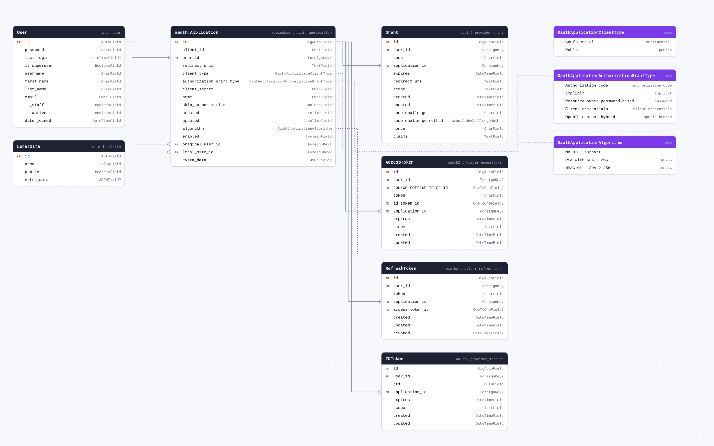

| Column | Field | Type | Null | Key | Default | Description |
| --- | --- | --- | --- | --- | --- | --- |
| `id` | `BigAutoField` | `integer` |  | PK | `autoincrement()` |  |
| `client_id` | `CharField` | `varchar(100)` |  | unique | `generate_client_id()` |  |
| `user_id` | `ForeignKey` | `integer` | yes | FK |  |  |
| `redirect_uris` | `TextField` | `text` |  |  |  | Allowed URIs list, space separated |
| `client_type` | `OauthApplicationClientType` | `varchar(32)` |  |  |  |  |
| `authorization_grant_type` | `OauthApplicationAuthorizationGrantType` | `varchar(32)` |  |  |  |  |
| `client_secret` | `CharField` | `varchar(255)` |  |  | `generate_client_secret()` |  |
| `name` | `CharField` | `varchar(255)` |  |  |  |  |
| `skip_authorization` | `BooleanField` | `bool` |  |  | `False` |  |
| `created` | `DateTimeField` | `datetime` |  |  | `now()` |  |
| `updated` | `DateTimeField` | `datetime` |  |  | `now()` |  |
| `algorithm` | `OauthApplicationAlgorithm` | `varchar(5)` |  |  | `''` |  |
| `enabled` | `BooleanField` | `bool` |  |  | `True` | Whether or not this application can be used to authenticate with Review Board. |
| `original_user_id` | `ForeignKey` | `integer` | yes | FK |  | The original owner of this application. |
| `local_site_id` | `ForeignKey` | `integer` | yes | FK |  | An optional Local Site to limit this application to.<br>If specified, only users with access to the Local Site will be able to use the application. |
| `extra_data` | `JSONField` | `text` | yes |  | `dict()` |  |

Indexes:

- index `reviewboard_oauth_application_user_id_5306421b` on `user_id`
- index `reviewboard_oauth_application_client_secret_4de4461a` on `client_secret`
- index `reviewboard_oauth_application_original_user_id_7df83187` on `original_user_id`
- index `reviewboard_oauth_application_local_site_id_412bed6e` on `local_site_id`

Relations:

- [Grant](#grant).`application_id` → `id`, on delete cascade
- [AccessToken](#accesstoken).`application_id` → `id`, on delete cascade
- [RefreshToken](#refreshtoken).`application_id` → `id`, on delete cascade
- [IDToken](#idtoken).`application_id` → `id`, on delete cascade
- `user_id` → [User](#user).`id`, on delete cascade
- `original_user_id` → [User](#user).`id`, on delete cascade
- `local_site_id` → [LocalSite](#localsite).`id`, on delete cascade

## reviews.Group

Table `reviews_group`, app `reviews`.

A group of people who can be targeted for review.

This is usually used to separate teams at a company or components of a
project.

Each group can have an e-mail address associated with it, sending
all review requests and replies to that address. If that e-mail address is
blank, e-mails are sent individually to each member of that group.

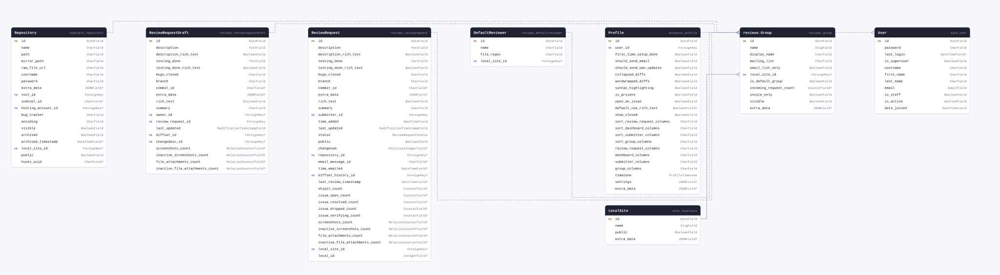

| Column | Field | Type | Null | Key | Default | Description |
| --- | --- | --- | --- | --- | --- | --- |
| `id` | `AutoField` | `integer` |  | PK | `autoincrement()` |  |
| `name` | `SlugField` | `varchar(64)` |  |  |  |  |
| `display_name` | `CharField` | `varchar(64)` |  |  |  |  |
| `mailing_list` | `CharField` | `varchar(254)` |  |  |  | The mailing list review requests and discussions are sent to. |
| `email_list_only` | `BooleanField` | `bool` |  |  | `True` | If a mailing list is specified and this option is checked, group members will not be individually included on e-mails, and only the mailing list will be used. This is highly recommended for large groups. |
| `local_site_id` | `ForeignKey` | `integer` | yes | FK |  |  |
| `is_default_group` | `BooleanField` | `bool` |  |  | `False` | If a local site is set, this will automatically add users to this group when those users are added to the local site. If there is no local site, users will be automatically added to this group when they are registered. |
| `incoming_request_count` | `CounterField` | `integer` | yes |  | `None` |  |
| `invite_only` | `BooleanField` | `bool` |  |  | `False` | If checked, only the users listed below will be able to view review requests sent to this group. |
| `visible` | `BooleanField` | `bool` |  |  | `True` |  |
| `extra_data` | `JSONField` | `text` | yes |  |  |  |

Indexes:

- index `reviews_group_name_c92d67b9` on `name`
- index `reviews_group_local_site_id_b7e35237` on `local_site_id`
- unique `reviews_group_name_local_site_id_cd520124_uniq` on `name`, `local_site_id`

Relations:

- `starred_by` — many to many with [Profile](#profile)
- `local_site_id` → [LocalSite](#localsite).`id`, on delete cascade
- `users` — many to many with [User](#user)
- `defaultreviewer_set` — many to many with [DefaultReviewer](#defaultreviewer)
- `review_requests` — many to many with [ReviewRequest](#reviewrequest)
- `drafts` — many to many with [ReviewRequestDraft](#reviewrequestdraft)
- `repositories` — many to many with [Repository](#repository)

## DefaultReviewer

Table `reviews_defaultreviewer`, app `reviews`.

Represents reviewers automatically added to review requests.

A default reviewer entry automatically adds default reviewers to a
review request when the diff modifies a file matching the ``file_regex``
pattern specified.

This is useful when different groups own different parts of a codebase.
Adding DefaultReviewer entries ensures that the right people will always
see the review request and discussions.

A ``file_regex`` of ``".*"`` will add the specified reviewers by
default for every review request.

Note that this is keyed off the same LocalSite as its "repository" member.

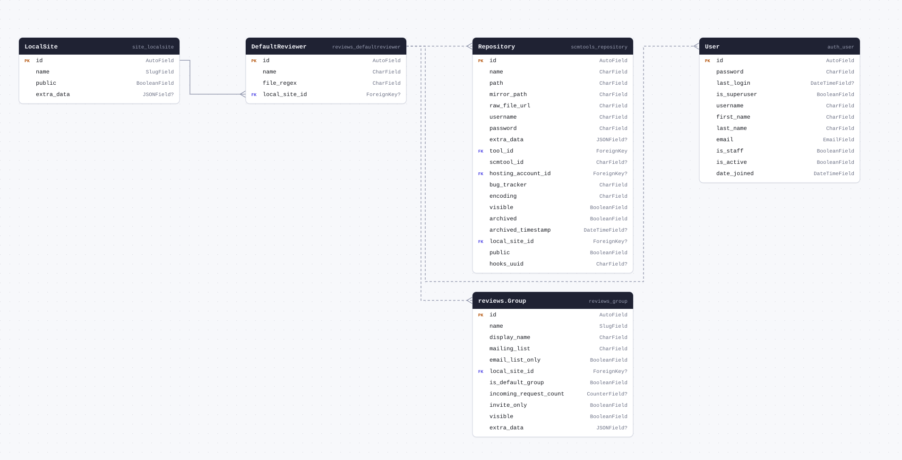

| Column | Field | Type | Null | Key | Default | Description |
| --- | --- | --- | --- | --- | --- | --- |
| `id` | `AutoField` | `integer` |  | PK | `autoincrement()` |  |
| `name` | `CharField` | `varchar(64)` |  |  |  |  |
| `file_regex` | `CharField` | `varchar(256)` |  |  |  | File paths are matched against this regular expression to determine if these reviewers should be added. |
| `local_site_id` | `ForeignKey` | `integer` | yes | FK |  |  |

Indexes:

- index `reviews_defaultreviewer_local_site_id_bcfc837d` on `local_site_id`

Relations:

- `local_site_id` → [LocalSite](#localsite).`id`, on delete cascade
- `repository` — many to many with [Repository](#repository)
- `groups` — many to many with [reviews.Group](#reviewsgroup)
- `people` — many to many with [User](#user)

## Comment

Table `reviews_comment`, app `reviews`.

Columns from `BaseComment` (abstract): `issue_opened`, `issue_status`, `reply_to_id`, `timestamp`, `text`, `rich_text`, `extra_data`.

A comment made on a diff.

A comment can belong to a single filediff or to an interdiff between
two filediffs. It can also have multiple replies.

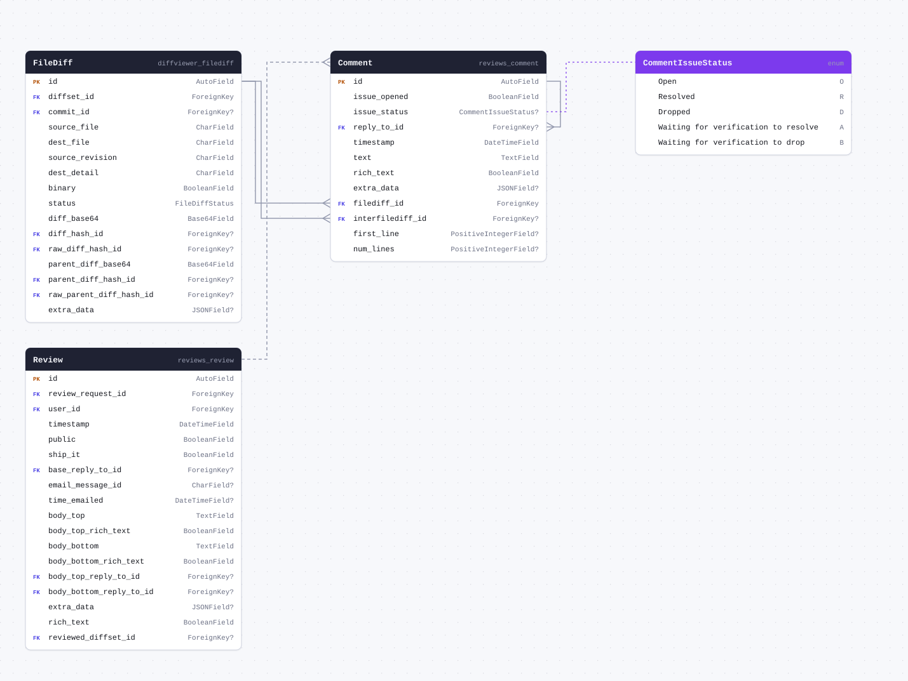

| Column | Field | Type | Null | Key | Default | Description |
| --- | --- | --- | --- | --- | --- | --- |
| `id` | `AutoField` | `integer` |  | PK | `autoincrement()` |  |
| `issue_opened` | `BooleanField` | `bool` |  |  | `False` |  |
| `issue_status` | `CommentIssueStatus` | `varchar(1)` | yes |  |  |  |
| `reply_to_id` | `ForeignKey` | `integer` | yes | FK |  |  |
| `timestamp` | `DateTimeField` | `datetime` |  |  | `now()` |  |
| `text` | `TextField` | `text` |  |  |  |  |
| `rich_text` | `BooleanField` | `bool` |  |  | `False` |  |
| `extra_data` | `JSONField` | `text` | yes |  |  |  |
| `filediff_id` | `ForeignKey` | `integer` |  | FK |  |  |
| `interfilediff_id` | `ForeignKey` | `integer` | yes | FK |  |  |
| `first_line` | `PositiveIntegerField` | `integer unsigned` | yes |  |  |  |
| `num_lines` | `PositiveIntegerField` | `integer unsigned` | yes |  |  |  |

Indexes:

- index `reviews_comment_issue_status_af21c71b` on `issue_status`
- index `reviews_comment_reply_to_id_a7b3749b` on `reply_to_id`
- index `reviews_comment_filediff_id_95cdd174` on `filediff_id`
- index `reviews_comment_interfilediff_id_fb77b53c` on `interfilediff_id`

Relations:

- `reply_to_id` → [Comment](#comment).`id`, on delete cascade
- `filediff_id` → [FileDiff](#filediff).`id`, on delete cascade
- `interfilediff_id` → [FileDiff](#filediff).`id`, on delete cascade
- `review` — many to many with [Review](#review)

## FileAttachmentComment

Table `reviews_fileattachmentcomment`, app `reviews`.

Columns from `BaseComment` (abstract): `issue_opened`, `issue_status`, `reply_to_id`, `timestamp`, `text`, `rich_text`, `extra_data`.

A comment on a file attachment.

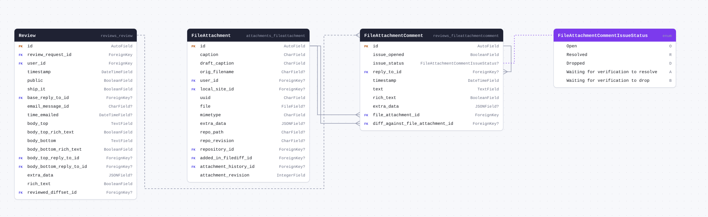

| Column | Field | Type | Null | Key | Default | Description |
| --- | --- | --- | --- | --- | --- | --- |
| `id` | `AutoField` | `integer` |  | PK | `autoincrement()` |  |
| `issue_opened` | `BooleanField` | `bool` |  |  | `False` |  |
| `issue_status` | `FileAttachmentCommentIssueStatus` | `varchar(1)` | yes |  |  |  |
| `reply_to_id` | `ForeignKey` | `integer` | yes | FK |  |  |
| `timestamp` | `DateTimeField` | `datetime` |  |  | `now()` |  |
| `text` | `TextField` | `text` |  |  |  |  |
| `rich_text` | `BooleanField` | `bool` |  |  | `False` |  |
| `extra_data` | `JSONField` | `text` | yes |  |  |  |
| `file_attachment_id` | `ForeignKey` | `integer` |  | FK |  |  |
| `diff_against_file_attachment_id` | `ForeignKey` | `integer` | yes | FK |  |  |

Indexes:

- index `reviews_fileattachmentcomment_issue_status_775b5a50` on `issue_status`
- index `reviews_fileattachmentcomment_reply_to_id_17c9efca` on `reply_to_id`
- index `reviews_fileattachmentcomment_file_attachment_id_8db79ee7` on `file_attachment_id`
- index `reviews_fileattachmentcomment_diff_against_file_attachment_id_8a13f559` on `diff_against_file_attachment_id`

Relations:

- `reply_to_id` → [FileAttachmentComment](#fileattachmentcomment).`id`, on delete cascade
- `file_attachment_id` → [FileAttachment](#fileattachment).`id`, on delete cascade
- `diff_against_file_attachment_id` → [FileAttachment](#fileattachment).`id`, on delete cascade
- `review` — many to many with [Review](#review)

## GeneralComment

Table `reviews_generalcomment`, app `reviews`.

Columns from `BaseComment` (abstract): `issue_opened`, `issue_status`, `reply_to_id`, `timestamp`, `text`, `rich_text`, `extra_data`.

A comment on a review request that is not tied to any code or file.

A general comment on a review request is used when a comment is not tied
to specific lines of code or a special file attachment, and an issue is
opened. Examples include suggestions for testing or pointing out errors
in the change description.

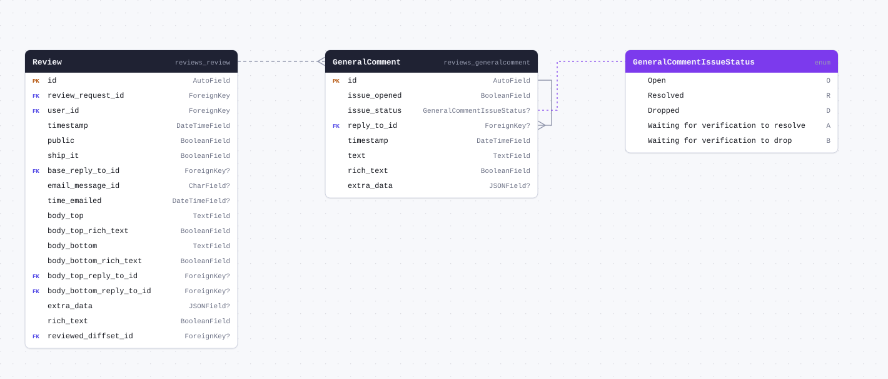

| Column | Field | Type | Null | Key | Default | Description |
| --- | --- | --- | --- | --- | --- | --- |
| `id` | `AutoField` | `integer` |  | PK | `autoincrement()` |  |
| `issue_opened` | `BooleanField` | `bool` |  |  | `False` |  |
| `issue_status` | `GeneralCommentIssueStatus` | `varchar(1)` | yes |  |  |  |
| `reply_to_id` | `ForeignKey` | `integer` | yes | FK |  |  |
| `timestamp` | `DateTimeField` | `datetime` |  |  | `now()` |  |
| `text` | `TextField` | `text` |  |  |  |  |
| `rich_text` | `BooleanField` | `bool` |  |  | `False` |  |
| `extra_data` | `JSONField` | `text` | yes |  |  |  |

Indexes:

- index `reviews_generalcomment_issue_status_4b49c612` on `issue_status`
- index `reviews_generalcomment_reply_to_id_d0a69bbf` on `reply_to_id`

Relations:

- `reply_to_id` → [GeneralComment](#generalcomment).`id`, on delete cascade
- `review` — many to many with [Review](#review)

## Screenshot

Table `reviews_screenshot`, app `reviews`.

A screenshot associated with a review request.

Like diffs, a screenshot can have comments associated with it.
These comments are of type
:py:class:`reviewboard.reviews.models.ScreenshotComment`.

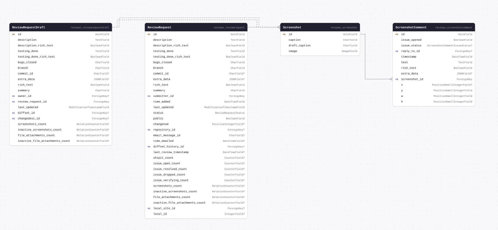

| Column | Field | Type | Null | Key | Default | Description |
| --- | --- | --- | --- | --- | --- | --- |
| `id` | `AutoField` | `integer` |  | PK | `autoincrement()` |  |
| `caption` | `CharField` | `varchar(256)` |  |  |  |  |
| `draft_caption` | `CharField` | `varchar(256)` |  |  |  |  |
| `image` | `ImageField` | `varchar(100)` |  |  |  |  |

Relations:

- `review_request` — many to many with [ReviewRequest](#reviewrequest)
- `inactive_review_request` — many to many with [ReviewRequest](#reviewrequest)
- [ScreenshotComment](#screenshotcomment).`screenshot_id` → `id`, on delete cascade
- `drafts` — many to many with [ReviewRequestDraft](#reviewrequestdraft)
- `inactive_drafts` — many to many with [ReviewRequestDraft](#reviewrequestdraft)

## ReviewRequest

Table `reviews_reviewrequest`, app `reviews`.

Columns from `BaseReviewRequestDetails` (abstract): `description`, `description_rich_text`, `testing_done`, `testing_done_rich_text`, `bugs_closed`, `branch`, `commit_id`, `extra_data`, `rich_text`.

A review request.

This is one of the primary models in Review Board. Most everything
is associated with a review request.

The ReviewRequest model contains detailed information on a review
request. Some fields are user-modifiable, while some are used for
internal state.

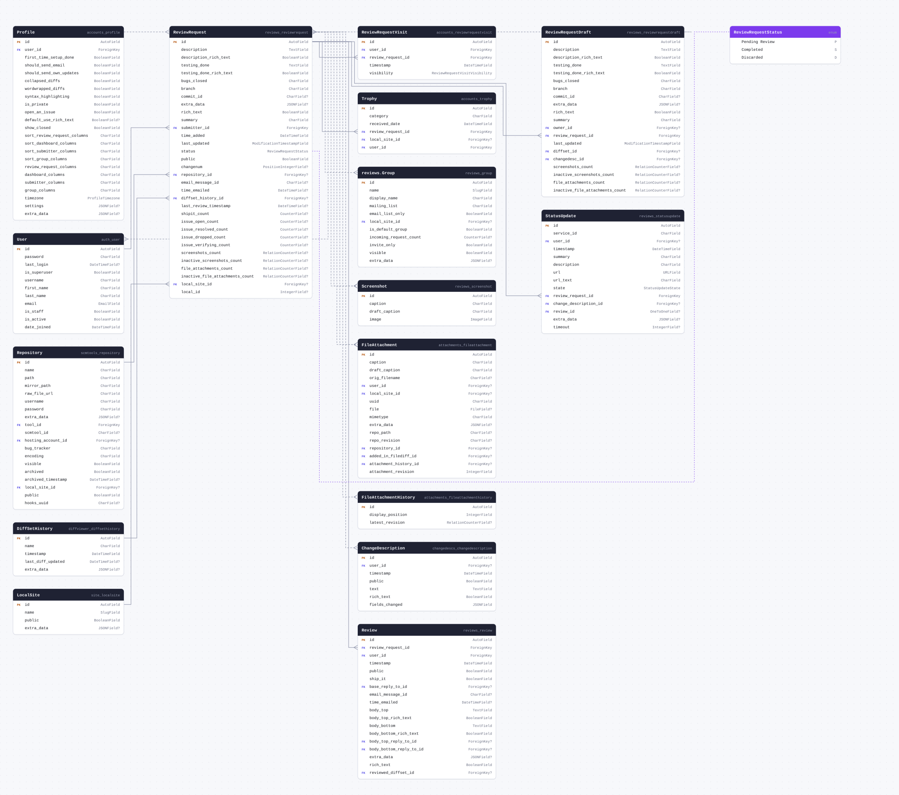

| Column | Field | Type | Null | Key | Default | Description |
| --- | --- | --- | --- | --- | --- | --- |
| `id` | `AutoField` | `integer` |  | PK | `autoincrement()` |  |
| `description` | `TextField` | `text` |  |  |  |  |
| `description_rich_text` | `BooleanField` | `bool` |  |  | `False` |  |
| `testing_done` | `TextField` | `text` |  |  |  |  |
| `testing_done_rich_text` | `BooleanField` | `bool` |  |  | `False` |  |
| `bugs_closed` | `CharField` | `varchar(300)` |  |  |  |  |
| `branch` | `CharField` | `varchar(300)` |  |  |  |  |
| `commit_id` | `CharField` | `varchar(64)` | yes |  |  |  |
| `extra_data` | `JSONField` | `text` | yes |  |  |  |
| `rich_text` | `BooleanField` | `bool` |  |  | `False` |  |
| `summary` | `CharField` | `varchar(300)` |  |  |  |  |
| `submitter_id` | `ForeignKey` | `integer` |  | FK |  |  |
| `time_added` | `DateTimeField` | `datetime` |  |  | `now()` |  |
| `last_updated` | `ModificationTimestampField` | `datetime` |  |  |  |  |
| `status` | `ReviewRequestStatus` | `varchar(1)` |  |  |  |  |
| `public` | `BooleanField` | `bool` |  |  | `False` |  |
| `changenum` | `PositiveIntegerField` | `integer unsigned` | yes |  |  |  |
| `repository_id` | `ForeignKey` | `integer` | yes | FK |  |  |
| `email_message_id` | `CharField` | `varchar(255)` | yes |  |  |  |
| `time_emailed` | `DateTimeField` | `datetime` | yes |  | `None` |  |
| `diffset_history_id` | `ForeignKey` | `integer` | yes | FK |  |  |
| `last_review_timestamp` | `DateTimeField` | `datetime` | yes |  | `None` |  |
| `shipit_count` | `CounterField` | `integer` | yes |  | `0` |  |
| `issue_open_count` | `CounterField` | `integer` | yes |  | `None` |  |
| `issue_resolved_count` | `CounterField` | `integer` | yes |  | `None` |  |
| `issue_dropped_count` | `CounterField` | `integer` | yes |  | `None` |  |
| `issue_verifying_count` | `CounterField` | `integer` | yes |  | `None` |  |
| `screenshots_count` | `RelationCounterField` | `integer` | yes |  | `None` |  |
| `inactive_screenshots_count` | `RelationCounterField` | `integer` | yes |  | `None` |  |
| `file_attachments_count` | `RelationCounterField` | `integer` | yes |  | `None` |  |
| `inactive_file_attachments_count` | `RelationCounterField` | `integer` | yes |  | `None` |  |
| `local_site_id` | `ForeignKey` | `integer` | yes | FK |  |  |
| `local_id` | `IntegerField` | `integer` | yes |  |  |  |

Indexes:

- index `reviews_reviewrequest_commit_id_e7104524` on `commit_id`
- index `reviews_reviewrequest_submitter_id_0a5fadde` on `submitter_id`
- index `reviews_reviewrequest_status_63d3e3fd` on `status`
- index `reviews_reviewrequest_changenum_a119b782` on `changenum`
- index `reviews_reviewrequest_repository_id_a411142d` on `repository_id`
- index `reviews_reviewrequest_diffset_history_id_803728bf` on `diffset_history_id`
- index `reviews_reviewrequest_local_site_id_7eadf98c` on `local_site_id`
- unique `reviews_reviewrequest_commit_id_repository_id_8d48574b_uniq` on `commit_id`, `repository_id`
- unique `reviews_reviewrequest_changenum_repository_id_4aa9bc58_uniq` on `changenum`, `repository_id`
- unique `reviews_reviewrequest_local_site_id_local_id_8ee6145b_uniq` on `local_site_id`, `local_id`

Relations:

- [ReviewRequestVisit](#reviewrequestvisit).`review_request_id` → `id`, on delete cascade
- `starred_by` — many to many with [Profile](#profile)
- [Trophy](#trophy).`review_request_id` → `id`, on delete cascade
- `submitter_id` → [User](#user).`id`, on delete cascade
- `repository_id` → [Repository](#repository).`id`, on delete cascade
- `diffset_history_id` → [DiffSetHistory](#diffsethistory).`id`, on delete set null
- `local_site_id` → [LocalSite](#localsite).`id`, on delete cascade
- `target_groups` — many to many with [reviews.Group](#reviewsgroup)
- `target_people` — many to many with [User](#user)
- `screenshots` — many to many with [Screenshot](#screenshot)
- `inactive_screenshots` — many to many with [Screenshot](#screenshot)
- `file_attachments` — many to many with [FileAttachment](#fileattachment)
- `inactive_file_attachments` — many to many with [FileAttachment](#fileattachment)
- `file_attachment_histories` — many to many with [FileAttachmentHistory](#fileattachmenthistory)
- `changedescs` — many to many with [ChangeDescription](#changedescription)
- `depends_on` — many to many with [ReviewRequest](#reviewrequest)
- [Review](#review).`review_request_id` → `id`, on delete cascade
- [ReviewRequestDraft](#reviewrequestdraft).`review_request_id` → `id`, on delete cascade
- `draft_blocks` — many to many with [ReviewRequestDraft](#reviewrequestdraft)
- [StatusUpdate](#statusupdate).`review_request_id` → `id`, on delete cascade

## ScreenshotComment

Table `reviews_screenshotcomment`, app `reviews`.

Columns from `BaseComment` (abstract): `issue_opened`, `issue_status`, `reply_to_id`, `timestamp`, `text`, `rich_text`, `extra_data`.

A comment on a screenshot.

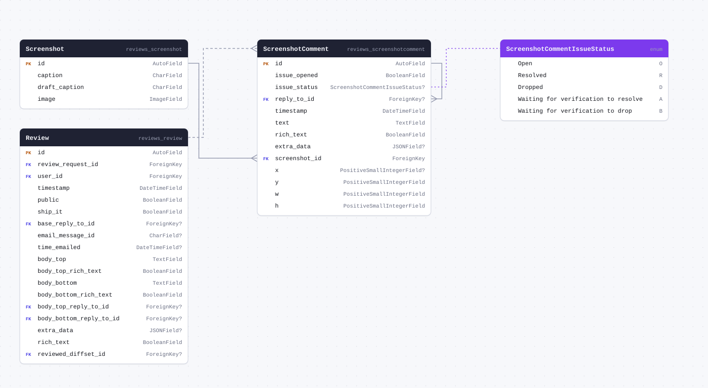

| Column | Field | Type | Null | Key | Default | Description |
| --- | --- | --- | --- | --- | --- | --- |
| `id` | `AutoField` | `integer` |  | PK | `autoincrement()` |  |
| `issue_opened` | `BooleanField` | `bool` |  |  | `False` |  |
| `issue_status` | `ScreenshotCommentIssueStatus` | `varchar(1)` | yes |  |  |  |
| `reply_to_id` | `ForeignKey` | `integer` | yes | FK |  |  |
| `timestamp` | `DateTimeField` | `datetime` |  |  | `now()` |  |
| `text` | `TextField` | `text` |  |  |  |  |
| `rich_text` | `BooleanField` | `bool` |  |  | `False` |  |
| `extra_data` | `JSONField` | `text` | yes |  |  |  |
| `screenshot_id` | `ForeignKey` | `integer` |  | FK |  |  |
| `x` | `PositiveSmallIntegerField` | `smallint unsigned` | yes |  |  |  |
| `y` | `PositiveSmallIntegerField` | `smallint unsigned` |  |  |  |  |
| `w` | `PositiveSmallIntegerField` | `smallint unsigned` |  |  |  |  |
| `h` | `PositiveSmallIntegerField` | `smallint unsigned` |  |  |  |  |

Indexes:

- index `reviews_screenshotcomment_issue_status_818e13d1` on `issue_status`
- index `reviews_screenshotcomment_reply_to_id_20d83c7c` on `reply_to_id`
- index `reviews_screenshotcomment_screenshot_id_0a8f6ad7` on `screenshot_id`

Relations:

- `reply_to_id` → [ScreenshotComment](#screenshotcomment).`id`, on delete cascade
- `screenshot_id` → [Screenshot](#screenshot).`id`, on delete cascade
- `review` — many to many with [Review](#review)

## Review

Table `reviews_review`, app `reviews`.

A review of a review request.

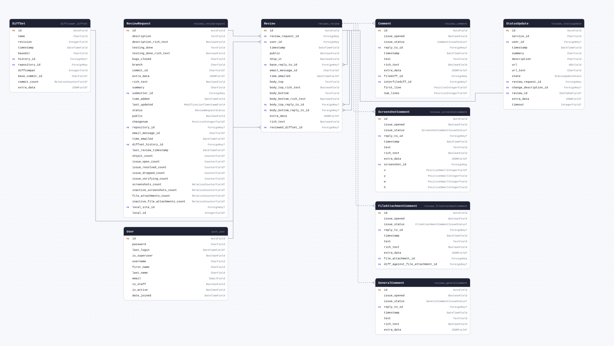

| Column | Field | Type | Null | Key | Default | Description |
| --- | --- | --- | --- | --- | --- | --- |
| `id` | `AutoField` | `integer` |  | PK | `autoincrement()` |  |
| `review_request_id` | `ForeignKey` | `integer` |  | FK |  |  |
| `user_id` | `ForeignKey` | `integer` |  | FK |  |  |
| `timestamp` | `DateTimeField` | `datetime` |  |  | `now()` |  |
| `public` | `BooleanField` | `bool` |  |  | `False` |  |
| `ship_it` | `BooleanField` | `bool` |  |  | `False` | Indicates whether the reviewer thinks this code is ready to ship. |
| `base_reply_to_id` | `ForeignKey` | `integer` | yes | FK |  | The top-most review in the discussion thread for this review reply. |
| `email_message_id` | `CharField` | `varchar(255)` | yes |  |  |  |
| `time_emailed` | `DateTimeField` | `datetime` | yes |  | `None` |  |
| `body_top` | `TextField` | `text` |  |  |  | The review text shown above the diff and screenshot comments. |
| `body_top_rich_text` | `BooleanField` | `bool` |  |  | `False` |  |
| `body_bottom` | `TextField` | `text` |  |  |  | The review text shown below the diff and screenshot comments. |
| `body_bottom_rich_text` | `BooleanField` | `bool` |  |  | `False` |  |
| `body_top_reply_to_id` | `ForeignKey` | `integer` | yes | FK |  | The review that the body (top) field is in reply to. |
| `body_bottom_reply_to_id` | `ForeignKey` | `integer` | yes | FK |  | The review that the body (bottom) field is in reply to. |
| `extra_data` | `JSONField` | `text` | yes |  |  |  |
| `rich_text` | `BooleanField` | `bool` |  |  | `False` |  |
| `reviewed_diffset_id` | `ForeignKey` | `integer` | yes | FK |  | This field is unused and will be removed in a future version. |

Indexes:

- index `reviews_review_review_request_id_be762bb2` on `review_request_id`
- index `reviews_review_user_id_875caff2` on `user_id`
- index `reviews_review_base_reply_to_id_a208ad8a` on `base_reply_to_id`
- index `reviews_review_body_top_reply_to_id_4f3807c0` on `body_top_reply_to_id`
- index `reviews_review_body_bottom_reply_to_id_a0c60294` on `body_bottom_reply_to_id`
- index `reviews_review_reviewed_diffset_id_4b8bdf06` on `reviewed_diffset_id`

Relations:

- `review_request_id` → [ReviewRequest](#reviewrequest).`id`, on delete cascade
- `user_id` → [User](#user).`id`, on delete cascade
- `base_reply_to_id` → [Review](#review).`id`, on delete cascade
- `body_top_reply_to_id` → [Review](#review).`id`, on delete cascade
- `body_bottom_reply_to_id` → [Review](#review).`id`, on delete cascade
- `reviewed_diffset_id` → [DiffSet](#diffset).`id`, on delete cascade
- `comments` — many to many with [Comment](#comment)
- `screenshot_comments` — many to many with [ScreenshotComment](#screenshotcomment)
- `file_attachment_comments` — many to many with [FileAttachmentComment](#fileattachmentcomment)
- `general_comments` — many to many with [GeneralComment](#generalcomment)
- [StatusUpdate](#statusupdate).`review_id` → `id`, on delete cascade

## ReviewRequestDraft

Table `reviews_reviewrequestdraft`, app `reviews`.

Columns from `BaseReviewRequestDetails` (abstract): `description`, `description_rich_text`, `testing_done`, `testing_done_rich_text`, `bugs_closed`, `branch`, `commit_id`, `extra_data`, `rich_text`.

A draft of a review request.

When a review request is being modified, a special draft copy of it is
created containing all the details of the review request. This copy can
be modified and eventually saved or discarded. When saved, the new
details are copied back over to the originating ReviewRequest.

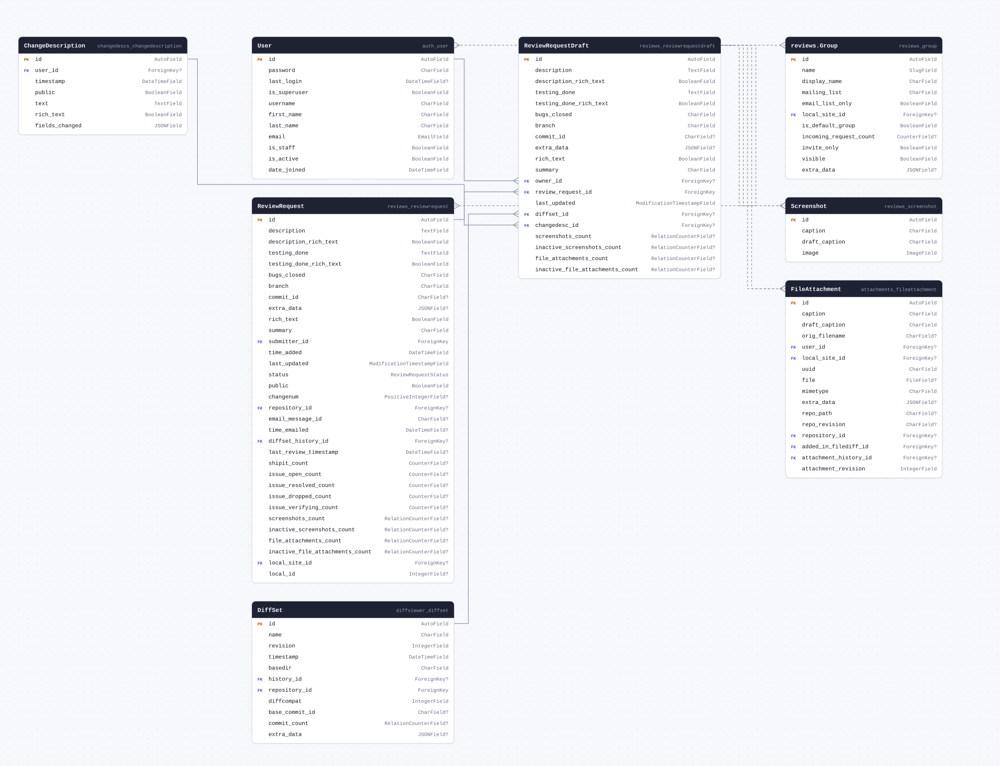

| Column | Field | Type | Null | Key | Default | Description |
| --- | --- | --- | --- | --- | --- | --- |
| `id` | `AutoField` | `integer` |  | PK | `autoincrement()` |  |
| `description` | `TextField` | `text` |  |  |  |  |
| `description_rich_text` | `BooleanField` | `bool` |  |  | `False` |  |
| `testing_done` | `TextField` | `text` |  |  |  |  |
| `testing_done_rich_text` | `BooleanField` | `bool` |  |  | `False` |  |
| `bugs_closed` | `CharField` | `varchar(300)` |  |  |  |  |
| `branch` | `CharField` | `varchar(300)` |  |  |  |  |
| `commit_id` | `CharField` | `varchar(64)` | yes |  |  |  |
| `extra_data` | `JSONField` | `text` | yes |  |  |  |
| `rich_text` | `BooleanField` | `bool` |  |  | `False` |  |
| `summary` | `CharField` | `varchar(300)` |  |  |  |  |
| `owner_id` | `ForeignKey` | `integer` | yes | FK |  |  |
| `review_request_id` | `ForeignKey` | `integer` |  | FK, unique |  |  |
| `last_updated` | `ModificationTimestampField` | `datetime` |  |  |  |  |
| `diffset_id` | `ForeignKey` | `integer` | yes | FK |  |  |
| `changedesc_id` | `ForeignKey` | `integer` | yes | FK |  |  |
| `screenshots_count` | `RelationCounterField` | `integer` | yes |  | `None` |  |
| `inactive_screenshots_count` | `RelationCounterField` | `integer` | yes |  | `None` |  |
| `file_attachments_count` | `RelationCounterField` | `integer` | yes |  | `None` |  |
| `inactive_file_attachments_count` | `RelationCounterField` | `integer` | yes |  | `None` |  |

Indexes:

- index `reviews_reviewrequestdraft_commit_id_a36610d9` on `commit_id`
- index `reviews_reviewrequestdraft_owner_id_86066878` on `owner_id`
- index `reviews_reviewrequestdraft_diffset_id_ba3c2e37` on `diffset_id`
- index `reviews_reviewrequestdraft_changedesc_id_70a4d612` on `changedesc_id`

Relations:

- `owner_id` → [User](#user).`id`, on delete cascade
- `review_request_id` → [ReviewRequest](#reviewrequest).`id`, on delete cascade
- `diffset_id` → [DiffSet](#diffset).`id`, on delete set null
- `changedesc_id` → [ChangeDescription](#changedescription).`id`, on delete set null
- `target_groups` — many to many with [reviews.Group](#reviewsgroup)
- `target_people` — many to many with [User](#user)
- `screenshots` — many to many with [Screenshot](#screenshot)
- `inactive_screenshots` — many to many with [Screenshot](#screenshot)
- `file_attachments` — many to many with [FileAttachment](#fileattachment)
- `inactive_file_attachments` — many to many with [FileAttachment](#fileattachment)
- `depends_on` — many to many with [ReviewRequest](#reviewrequest)

## StatusUpdate

Table `reviews_statusupdate`, app `reviews`.

A status update from a third-party service or extension.

This status model allows external services (such as continuous integration
services, Review Bot, etc.) to provide an update on their status. An
example of this would be a CI tool which does experimental builds of
changes. While the build is running, that tool would set its status to
pending, and when it was done, would set it to one of the done states,
and potentially associate it with a review containing issues.

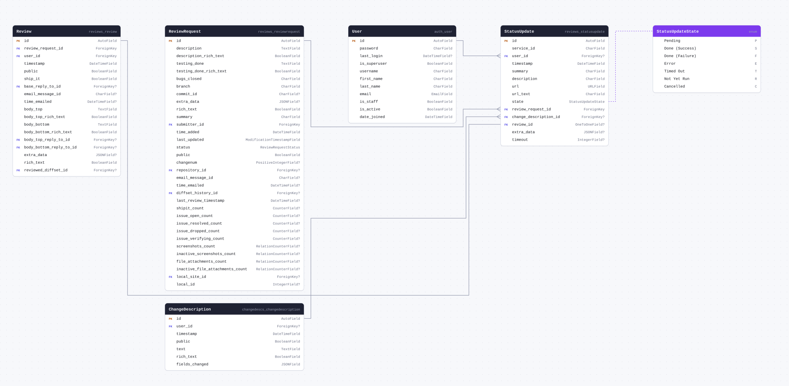

| Column | Field | Type | Null | Key | Default | Description |
| --- | --- | --- | --- | --- | --- | --- |
| `id` | `AutoField` | `integer` |  | PK | `autoincrement()` |  |
| `service_id` | `CharField` | `varchar(255)` |  |  |  |  |
| `user_id` | `ForeignKey` | `integer` | yes | FK |  |  |
| `timestamp` | `DateTimeField` | `datetime` |  |  | `now()` |  |
| `summary` | `CharField` | `varchar(255)` |  |  |  |  |
| `description` | `CharField` | `varchar(255)` |  |  |  |  |
| `url` | `URLField` | `varchar(255)` |  |  |  |  |
| `url_text` | `CharField` | `varchar(64)` |  |  |  |  |
| `state` | `StatusUpdateState` | `varchar(1)` |  |  |  |  |
| `review_request_id` | `ForeignKey` | `integer` |  | FK |  |  |
| `change_description_id` | `ForeignKey` | `integer` | yes | FK |  |  |
| `review_id` | `OneToOneField` | `integer` | yes | FK, unique |  |  |
| `extra_data` | `JSONField` | `text` | yes |  |  |  |
| `timeout` | `IntegerField` | `integer` | yes |  |  |  |

Indexes:

- index `reviews_statusupdate_user_id_1f850855` on `user_id`
- index `reviews_statusupdate_review_request_id_09b3d2bf` on `review_request_id`
- index `reviews_statusupdate_change_description_id_260b3553` on `change_description_id`

Relations:

- `user_id` → [User](#user).`id`, on delete cascade
- `review_request_id` → [ReviewRequest](#reviewrequest).`id`, on delete cascade
- `change_description_id` → [ChangeDescription](#changedescription).`id`, on delete cascade
- `review_id` → [Review](#review).`id`, on delete cascade

## Tool

Table `scmtools_tool`, app `scmtools`.

A configured source code management tool.

Each :py:class:`~reviewboard.scmtools.core.SCMTool` used by repositories
must have a corresponding :py:class:`Tool` entry. These provide information
on the capabilities of the tool, and accessors to construct a tool for
a repository.

Deprecated:
    5.0:
    This model is now obsolete. Any usage of this should be updated to use
    equivalent methods on the Repository or SCMTool instead.

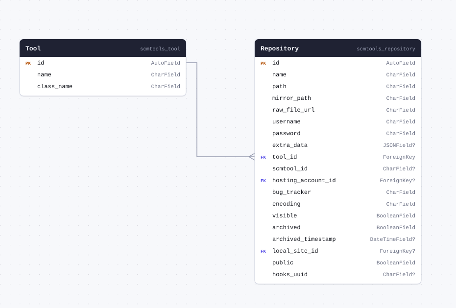

| Column | Field | Type | Null | Key | Default | Description |
| --- | --- | --- | --- | --- | --- | --- |
| `id` | `AutoField` | `integer` |  | PK | `autoincrement()` |  |
| `name` | `CharField` | `varchar(32)` |  | unique |  |  |
| `class_name` | `CharField` | `varchar(128)` |  | unique |  |  |

Relations:

- [Repository](#repository).`tool_id` → `id`, on delete cascade

## Repository

Table `scmtools_repository`, app `scmtools`.

A configured external source code repository.

Each configured Repository entry represents a source code repository that
Review Board can communicate with as part of the diff uploading and
viewing process.

Repositories are backed by a
:py:class:`~reviewboard.scmtools.core.SCMTool`, which functions as a client
for the type of repository and can fetch files, load lists of commits and
branches, and more.

Access control is managed by a combination of the :py:attr:`public`,
:py:attr:`users`, and :py:attr:`groups` fields. :py:attr:`public` controls
whether a repository is publicly-accessible by all users on the server.
When ``False``, only users explicitly listed in :py:attr:`users` or users
who are members of the groups listed in :py:attr:`groups` will be able
to access the repository or view review requests posted against it.

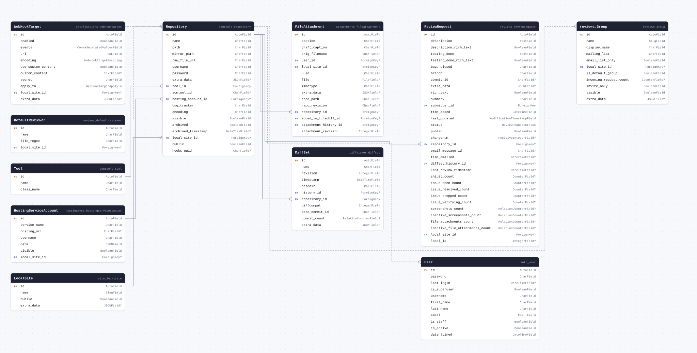

| Column | Field | Type | Null | Key | Default | Description |
| --- | --- | --- | --- | --- | --- | --- |
| `id` | `AutoField` | `integer` |  | PK | `autoincrement()` |  |
| `name` | `CharField` | `varchar(255)` |  |  |  |  |
| `path` | `CharField` | `varchar(255)` |  |  |  |  |
| `mirror_path` | `CharField` | `varchar(255)` |  |  |  |  |
| `raw_file_url` | `CharField` | `varchar(255)` |  |  |  |  |
| `username` | `CharField` | `varchar(32)` |  |  |  |  |
| `password` | `CharField` | `varchar(128)` |  |  |  |  |
| `extra_data` | `JSONField` | `text` | yes |  |  |  |
| `tool_id` | `ForeignKey` | `integer` |  | FK |  |  |
| `scmtool_id` | `CharField` | `varchar(255)` | yes |  |  |  |
| `hosting_account_id` | `ForeignKey` | `integer` | yes | FK |  |  |
| `bug_tracker` | `CharField` | `varchar(256)` |  |  |  | This should be the full path to a bug in the bug tracker for this repository, using '%s' in place of the bug ID. |
| `encoding` | `CharField` | `varchar(32)` |  |  |  | The encoding used for files in this repository. This is an advanced setting and should only be used if you're sure you need it. |
| `visible` | `BooleanField` | `bool` |  |  | `True` | Use this to control whether or not a repository is shown when creating new review requests. Existing review requests are unaffected. |
| `archived` | `BooleanField` | `bool` |  |  | `False` | Archived repositories do not show up in lists of repositories, and aren't open to new review requests. |
| `archived_timestamp` | `DateTimeField` | `datetime` | yes |  |  |  |
| `local_site_id` | `ForeignKey` | `integer` | yes | FK |  |  |
| `public` | `BooleanField` | `bool` |  |  | `True` | Review requests and files on public repositories are visible to anyone. Private repositories must explicitly list the users and groups that can access them. |
| `hooks_uuid` | `CharField` | `varchar(32)` | yes |  |  | Unique identifier used for validating incoming webhooks. |

Indexes:

- index `scmtools_repository_tool_id_d3b242d1` on `tool_id`
- index `scmtools_repository_hosting_account_id_fe34c221` on `hosting_account_id`
- index `scmtools_repository_local_site_id_989f4f3a` on `local_site_id`
- unique `scmtools_repository_name_local_site_id_17cf0ace_uniq` on `name`, `local_site_id`
- unique `scmtools_repository_archived_timestamp_path_local_site_id_cac61803_uniq` on `archived_timestamp`, `path`, `local_site_id`
- unique `scmtools_repository_hooks_uuid_local_site_id_05a64b12_uniq` on `hooks_uuid`, `local_site_id`

Relations:

- [FileAttachment](#fileattachment).`repository_id` → `id`, on delete cascade
- [DiffSet](#diffset).`repository_id` → `id`, on delete cascade
- `webhooks` — many to many with [WebHookTarget](#webhooktarget)
- `defaultreviewer_set` — many to many with [DefaultReviewer](#defaultreviewer)
- [ReviewRequest](#reviewrequest).`repository_id` → `id`, on delete cascade
- `tool_id` → [Tool](#tool).`id`, on delete cascade
- `hosting_account_id` → [HostingServiceAccount](#hostingserviceaccount).`id`, on delete cascade
- `local_site_id` → [LocalSite](#localsite).`id`, on delete cascade
- `users` — many to many with [User](#user)
- `review_groups` — many to many with [reviews.Group](#reviewsgroup)

## LocalSite

Table `site_localsite`, app `site`.

A division within a Review Board installation.

This allows the creation of independent, isolated divisions within a given
server. Users can be designated as members of a LocalSite, and optionally
as admins (which allows them to manipulate the repositories, groups and
users in the site).

Pretty much every other model in this module can all be assigned to a
single LocalSite, at which point only members will be able to see or
manipulate these objects. Access control is performed at every level, and
consistency is enforced through a liberal sprinkling of assertions and unit
tests.

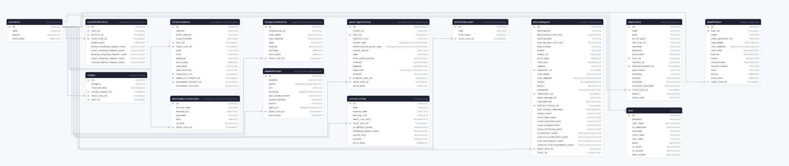

| Column | Field | Type | Null | Key | Default | Description |
| --- | --- | --- | --- | --- | --- | --- |
| `id` | `AutoField` | `integer` |  | PK | `autoincrement()` |  |
| `name` | `SlugField` | `varchar(32)` |  | unique |  |  |
| `public` | `BooleanField` | `bool` |  |  | `False` | Allow people outside the team to access and post review requests and reviews. |
| `extra_data` | `JSONField` | `text` | yes |  |  |  |

Indexes:

- index `site_localsite_public_a3cbfbac` on `public`

Relations:

- [LocalSiteProfile](#localsiteprofile).`local_site_id` → `id`, on delete cascade
- [Trophy](#trophy).`local_site_id` → `id`, on delete cascade
- [FileAttachment](#fileattachment).`local_site_id` → `id`, on delete cascade
- [HostingServiceAccount](#hostingserviceaccount).`local_site_id` → `id`, on delete cascade
- [IntegrationConfig](#integrationconfig).`local_site_id` → `id`, on delete cascade
- [WebHookTarget](#webhooktarget).`local_site_id` → `id`, on delete cascade
- [oauth.Application](#oauthapplication).`local_site_id` → `id`, on delete cascade
- [reviews.Group](#reviewsgroup).`local_site_id` → `id`, on delete cascade
- [DefaultReviewer](#defaultreviewer).`local_site_id` → `id`, on delete cascade
- [ReviewRequest](#reviewrequest).`local_site_id` → `id`, on delete cascade
- [Repository](#repository).`local_site_id` → `id`, on delete cascade
- `users` — many to many with [User](#user)
- `admins` — many to many with [User](#user)
- [WebAPIToken](#webapitoken).`local_site_id` → `id`, on delete cascade

## WebAPIToken

Table `webapi_webapitoken`, app `webapi`.

Columns from `BaseWebAPIToken` (abstract): `user_id`, `token`, `token_generator_id`, `time_added`, `last_updated`, `last_used`, `expires`, `valid`, `invalid_date`, `invalid_reason`, `note`, `policy`, `extra_data`.

An access token used for authenticating with the API.

Each token can be used to authenticate the token's owner with the API,
without requiring a username or password to be provided. Tokens can
be revoked, and new tokens added.

Tokens can store policy information, which will later be used for
restricting access to the API.

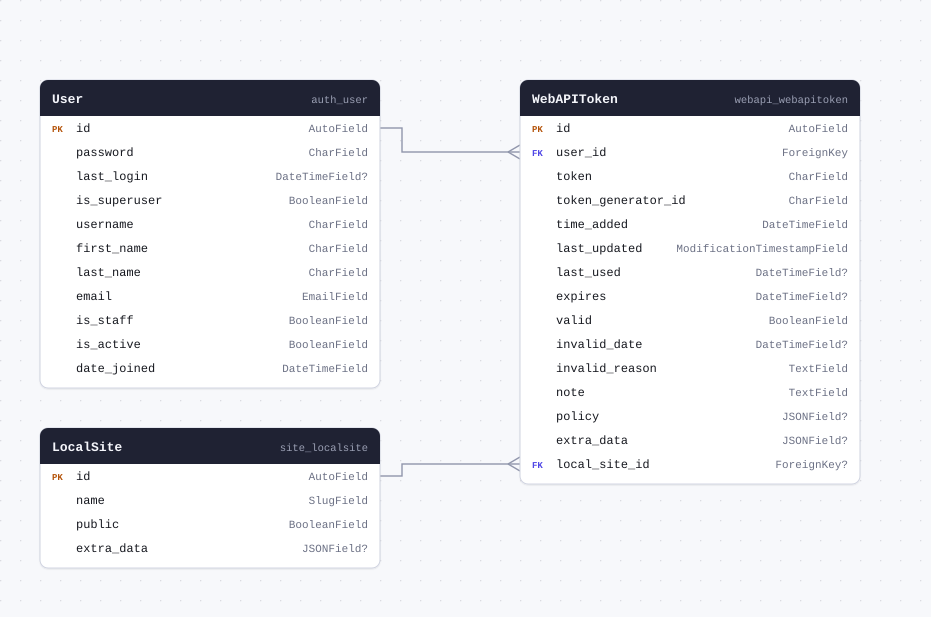

| Column | Field | Type | Null | Key | Default | Description |
| --- | --- | --- | --- | --- | --- | --- |
| `id` | `AutoField` | `integer` |  | PK | `autoincrement()` |  |
| `user_id` | `ForeignKey` | `integer` |  | FK |  | The user that owns the token. |
| `token` | `CharField` | `varchar(255)` |  | unique |  | The access token. |
| `token_generator_id` | `CharField` | `varchar(255)` |  |  |  | The token generator that generated the token. |
| `time_added` | `DateTimeField` | `datetime` |  |  | `now()` | The date and time when the token was first added to the database. |
| `last_updated` | `ModificationTimestampField` | `datetime` |  |  | `now()` | The date and time when the token was last updated. |
| `last_used` | `DateTimeField` | `datetime` | yes |  |  | The date and time when the token was last used for authentication. |
| `expires` | `DateTimeField` | `datetime` | yes |  |  | An optional field for the date and time that the token will expire. The token will be invalid and unusable for authentication after this point. |
| `valid` | `BooleanField` | `bool` |  |  | `True` | Whether the token is currently valid. |
| `invalid_date` | `DateTimeField` | `datetime` | yes |  |  | The date and time at which the token became invalid. |
| `invalid_reason` | `TextField` | `text` |  |  |  | A message indicating why the token is no longer valid. |
| `note` | `TextField` | `text` |  |  |  | A message describing the token. |
| `policy` | `JSONField` | `text` | yes |  |  | The policy document describing what this token can access in the API. If empty, this provides full access. |
| `extra_data` | `JSONField` | `text` | yes |  |  |  |
| `local_site_id` | `ForeignKey` | `integer` | yes | FK |  |  |

Indexes:

- index `webapi_webapitoken_user_id_3651ab64` on `user_id`
- index `webapi_webapitoken_local_site_id_72c83924` on `local_site_id`

Relations:

- `user_id` → [User](#user).`id`, on delete cascade
- `local_site_id` → [LocalSite](#localsite).`id`, on delete cascade

## Version

Table `django_project_version`, app `django_evolution`.


| Column | Field | Type | Null | Key | Default | Description |
| --- | --- | --- | --- | --- | --- | --- |
| `id` | `AutoField` | `integer` |  | PK | `autoincrement()` |  |
| `signature` | `SignatureField` | `text` |  |  |  |  |
| `when` | `DateTimeField` | `datetime` |  |  | `now()` |  |

Relations:

- [Evolution](#evolution).`version_id` → `id`, on delete cascade

## Evolution

Table `django_evolution`, app `django_evolution`.

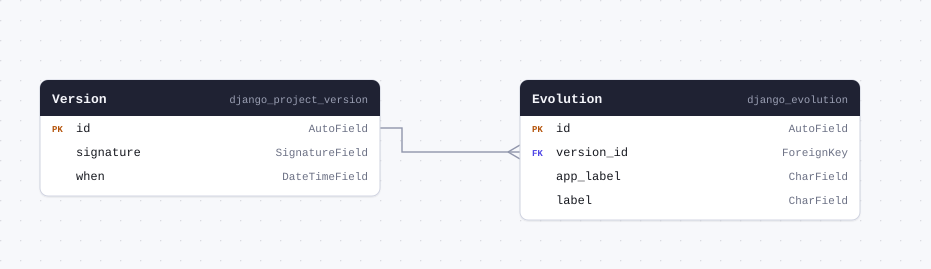

| Column | Field | Type | Null | Key | Default | Description |
| --- | --- | --- | --- | --- | --- | --- |
| `id` | `AutoField` | `integer` |  | PK | `autoincrement()` |  |
| `version_id` | `ForeignKey` | `integer` |  | FK |  |  |
| `app_label` | `CharField` | `varchar(200)` |  |  |  |  |
| `label` | `CharField` | `varchar(100)` |  |  |  |  |

Indexes:

- index `django_evolution_version_id_e55942c9` on `version_id`

Relations:

- `version_id` → [Version](#version).`id`, on delete cascade

# Enums

## LogEntryActionFlag

| Name | Stored as |
| --- | --- |
| `Addition` | `1` |
| `Change` | `2` |
| `Deletion` | `3` |

## Oauth2ProviderApplicationClientType

| Name | Stored as |
| --- | --- |
| `Confidential` | `confidential` |
| `Public` | `public` |

## Oauth2ProviderApplicationAuthorizationGrantType

| Name | Stored as |
| --- | --- |
| `Authorization code` | `authorization-code` |
| `Implicit` | `implicit` |
| `Resource owner password-based` | `password` |
| `Client credentials` | `client-credentials` |
| `OpenID connect hybrid` | `openid-hybrid` |

## Oauth2ProviderApplicationAlgorithm

| Name | Stored as |
| --- | --- |
| `No OIDC support` |  |
| `RSA with SHA-2 256` | `RS256` |
| `HMAC with SHA-2 256` | `HS256` |

## GrantCodeChallengeMethod

| Name | Stored as |
| --- | --- |
| `plain` | `plain` |
| `S256` | `S256` |

## ReviewRequestVisitVisibility

| Name | Stored as |
| --- | --- |
| `Visible` | `V` |
| `Archived` | `A` |
| `Muted` | `M` |

## ProfileTimezone

| Name | Stored as |
| --- | --- |
| `Africa/Abidjan` | `Africa/Abidjan` |
| `Africa/Accra` | `Africa/Accra` |
| `Africa/Addis_Ababa` | `Africa/Addis_Ababa` |
| `Africa/Algiers` | `Africa/Algiers` |
| `Africa/Asmara` | `Africa/Asmara` |
| `Africa/Bamako` | `Africa/Bamako` |
| `Africa/Bangui` | `Africa/Bangui` |
| `Africa/Banjul` | `Africa/Banjul` |
| `Africa/Bissau` | `Africa/Bissau` |
| `Africa/Blantyre` | `Africa/Blantyre` |
| `Africa/Brazzaville` | `Africa/Brazzaville` |
| `Africa/Bujumbura` | `Africa/Bujumbura` |
| `Africa/Cairo` | `Africa/Cairo` |
| `Africa/Casablanca` | `Africa/Casablanca` |
| `Africa/Ceuta` | `Africa/Ceuta` |
| `Africa/Conakry` | `Africa/Conakry` |
| `Africa/Dakar` | `Africa/Dakar` |
| `Africa/Dar_es_Salaam` | `Africa/Dar_es_Salaam` |
| `Africa/Djibouti` | `Africa/Djibouti` |
| `Africa/Douala` | `Africa/Douala` |
| `Africa/El_Aaiun` | `Africa/El_Aaiun` |
| `Africa/Freetown` | `Africa/Freetown` |
| `Africa/Gaborone` | `Africa/Gaborone` |
| `Africa/Harare` | `Africa/Harare` |
| `Africa/Johannesburg` | `Africa/Johannesburg` |
| `Africa/Juba` | `Africa/Juba` |
| `Africa/Kampala` | `Africa/Kampala` |
| `Africa/Khartoum` | `Africa/Khartoum` |
| `Africa/Kigali` | `Africa/Kigali` |
| `Africa/Kinshasa` | `Africa/Kinshasa` |
| `Africa/Lagos` | `Africa/Lagos` |
| `Africa/Libreville` | `Africa/Libreville` |
| `Africa/Lome` | `Africa/Lome` |
| `Africa/Luanda` | `Africa/Luanda` |
| `Africa/Lubumbashi` | `Africa/Lubumbashi` |
| `Africa/Lusaka` | `Africa/Lusaka` |
| `Africa/Malabo` | `Africa/Malabo` |
| `Africa/Maputo` | `Africa/Maputo` |
| `Africa/Maseru` | `Africa/Maseru` |
| `Africa/Mbabane` | `Africa/Mbabane` |
| `Africa/Mogadishu` | `Africa/Mogadishu` |
| `Africa/Monrovia` | `Africa/Monrovia` |
| `Africa/Nairobi` | `Africa/Nairobi` |
| `Africa/Ndjamena` | `Africa/Ndjamena` |
| `Africa/Niamey` | `Africa/Niamey` |
| `Africa/Nouakchott` | `Africa/Nouakchott` |
| `Africa/Ouagadougou` | `Africa/Ouagadougou` |
| `Africa/Porto-Novo` | `Africa/Porto-Novo` |
| `Africa/Sao_Tome` | `Africa/Sao_Tome` |
| `Africa/Tripoli` | `Africa/Tripoli` |
| `Africa/Tunis` | `Africa/Tunis` |
| `Africa/Windhoek` | `Africa/Windhoek` |
| `America/Adak` | `America/Adak` |
| `America/Anchorage` | `America/Anchorage` |
| `America/Anguilla` | `America/Anguilla` |
| `America/Antigua` | `America/Antigua` |
| `America/Araguaina` | `America/Araguaina` |
| `America/Argentina/Buenos_Aires` | `America/Argentina/Buenos_Aires` |
| `America/Argentina/Catamarca` | `America/Argentina/Catamarca` |
| `America/Argentina/Cordoba` | `America/Argentina/Cordoba` |
| `America/Argentina/Jujuy` | `America/Argentina/Jujuy` |
| `America/Argentina/La_Rioja` | `America/Argentina/La_Rioja` |
| `America/Argentina/Mendoza` | `America/Argentina/Mendoza` |
| `America/Argentina/Rio_Gallegos` | `America/Argentina/Rio_Gallegos` |
| `America/Argentina/Salta` | `America/Argentina/Salta` |
| `America/Argentina/San_Juan` | `America/Argentina/San_Juan` |
| `America/Argentina/San_Luis` | `America/Argentina/San_Luis` |
| `America/Argentina/Tucuman` | `America/Argentina/Tucuman` |
| `America/Argentina/Ushuaia` | `America/Argentina/Ushuaia` |
| `America/Aruba` | `America/Aruba` |
| `America/Asuncion` | `America/Asuncion` |
| `America/Atikokan` | `America/Atikokan` |
| `America/Bahia` | `America/Bahia` |
| `America/Bahia_Banderas` | `America/Bahia_Banderas` |
| `America/Barbados` | `America/Barbados` |
| `America/Belem` | `America/Belem` |
| `America/Belize` | `America/Belize` |
| `America/Blanc-Sablon` | `America/Blanc-Sablon` |
| `America/Boa_Vista` | `America/Boa_Vista` |
| `America/Bogota` | `America/Bogota` |
| `America/Boise` | `America/Boise` |
| `America/Cambridge_Bay` | `America/Cambridge_Bay` |
| `America/Campo_Grande` | `America/Campo_Grande` |
| `America/Cancun` | `America/Cancun` |
| `America/Caracas` | `America/Caracas` |
| `America/Cayenne` | `America/Cayenne` |
| `America/Cayman` | `America/Cayman` |
| `America/Chicago` | `America/Chicago` |
| `America/Chihuahua` | `America/Chihuahua` |
| `America/Ciudad_Juarez` | `America/Ciudad_Juarez` |
| `America/Costa_Rica` | `America/Costa_Rica` |
| `America/Coyhaique` | `America/Coyhaique` |
| `America/Creston` | `America/Creston` |
| `America/Cuiaba` | `America/Cuiaba` |
| `America/Curacao` | `America/Curacao` |
| `America/Danmarkshavn` | `America/Danmarkshavn` |
| `America/Dawson` | `America/Dawson` |
| `America/Dawson_Creek` | `America/Dawson_Creek` |
| `America/Denver` | `America/Denver` |
| `America/Detroit` | `America/Detroit` |
| `America/Dominica` | `America/Dominica` |
| `America/Edmonton` | `America/Edmonton` |
| `America/Eirunepe` | `America/Eirunepe` |
| `America/El_Salvador` | `America/El_Salvador` |
| `America/Fort_Nelson` | `America/Fort_Nelson` |
| `America/Fortaleza` | `America/Fortaleza` |
| `America/Glace_Bay` | `America/Glace_Bay` |
| `America/Goose_Bay` | `America/Goose_Bay` |
| `America/Grand_Turk` | `America/Grand_Turk` |
| `America/Grenada` | `America/Grenada` |
| `America/Guadeloupe` | `America/Guadeloupe` |
| `America/Guatemala` | `America/Guatemala` |
| `America/Guayaquil` | `America/Guayaquil` |
| `America/Guyana` | `America/Guyana` |
| `America/Halifax` | `America/Halifax` |
| `America/Havana` | `America/Havana` |
| `America/Hermosillo` | `America/Hermosillo` |
| `America/Indiana/Indianapolis` | `America/Indiana/Indianapolis` |
| `America/Indiana/Knox` | `America/Indiana/Knox` |
| `America/Indiana/Marengo` | `America/Indiana/Marengo` |
| `America/Indiana/Petersburg` | `America/Indiana/Petersburg` |
| `America/Indiana/Tell_City` | `America/Indiana/Tell_City` |
| `America/Indiana/Vevay` | `America/Indiana/Vevay` |
| `America/Indiana/Vincennes` | `America/Indiana/Vincennes` |
| `America/Indiana/Winamac` | `America/Indiana/Winamac` |
| `America/Inuvik` | `America/Inuvik` |
| `America/Iqaluit` | `America/Iqaluit` |
| `America/Jamaica` | `America/Jamaica` |
| `America/Juneau` | `America/Juneau` |
| `America/Kentucky/Louisville` | `America/Kentucky/Louisville` |
| `America/Kentucky/Monticello` | `America/Kentucky/Monticello` |
| `America/Kralendijk` | `America/Kralendijk` |
| `America/La_Paz` | `America/La_Paz` |
| `America/Lima` | `America/Lima` |
| `America/Los_Angeles` | `America/Los_Angeles` |
| `America/Lower_Princes` | `America/Lower_Princes` |
| `America/Maceio` | `America/Maceio` |
| `America/Managua` | `America/Managua` |
| `America/Manaus` | `America/Manaus` |
| `America/Marigot` | `America/Marigot` |
| `America/Martinique` | `America/Martinique` |
| `America/Matamoros` | `America/Matamoros` |
| `America/Mazatlan` | `America/Mazatlan` |
| `America/Menominee` | `America/Menominee` |
| `America/Merida` | `America/Merida` |
| `America/Metlakatla` | `America/Metlakatla` |
| `America/Mexico_City` | `America/Mexico_City` |
| `America/Miquelon` | `America/Miquelon` |
| `America/Moncton` | `America/Moncton` |
| `America/Monterrey` | `America/Monterrey` |
| `America/Montevideo` | `America/Montevideo` |
| `America/Montserrat` | `America/Montserrat` |
| `America/Nassau` | `America/Nassau` |
| `America/New_York` | `America/New_York` |
| `America/Nome` | `America/Nome` |
| `America/Noronha` | `America/Noronha` |
| `America/North_Dakota/Beulah` | `America/North_Dakota/Beulah` |
| `America/North_Dakota/Center` | `America/North_Dakota/Center` |
| `America/North_Dakota/New_Salem` | `America/North_Dakota/New_Salem` |
| `America/Nuuk` | `America/Nuuk` |
| `America/Ojinaga` | `America/Ojinaga` |
| `America/Panama` | `America/Panama` |
| `America/Paramaribo` | `America/Paramaribo` |
| `America/Phoenix` | `America/Phoenix` |
| `America/Port-au-Prince` | `America/Port-au-Prince` |
| `America/Port_of_Spain` | `America/Port_of_Spain` |
| `America/Porto_Velho` | `America/Porto_Velho` |
| `America/Puerto_Rico` | `America/Puerto_Rico` |
| `America/Punta_Arenas` | `America/Punta_Arenas` |
| `America/Rankin_Inlet` | `America/Rankin_Inlet` |
| `America/Recife` | `America/Recife` |
| `America/Regina` | `America/Regina` |
| `America/Resolute` | `America/Resolute` |
| `America/Rio_Branco` | `America/Rio_Branco` |
| `America/Santarem` | `America/Santarem` |
| `America/Santiago` | `America/Santiago` |
| `America/Santo_Domingo` | `America/Santo_Domingo` |
| `America/Sao_Paulo` | `America/Sao_Paulo` |
| `America/Scoresbysund` | `America/Scoresbysund` |
| `America/Sitka` | `America/Sitka` |
| `America/St_Barthelemy` | `America/St_Barthelemy` |
| `America/St_Johns` | `America/St_Johns` |
| `America/St_Kitts` | `America/St_Kitts` |
| `America/St_Lucia` | `America/St_Lucia` |
| `America/St_Thomas` | `America/St_Thomas` |
| `America/St_Vincent` | `America/St_Vincent` |
| `America/Swift_Current` | `America/Swift_Current` |
| `America/Tegucigalpa` | `America/Tegucigalpa` |
| `America/Thule` | `America/Thule` |
| `America/Tijuana` | `America/Tijuana` |
| `America/Toronto` | `America/Toronto` |
| `America/Tortola` | `America/Tortola` |
| `America/Vancouver` | `America/Vancouver` |
| `America/Whitehorse` | `America/Whitehorse` |
| `America/Winnipeg` | `America/Winnipeg` |
| `America/Yakutat` | `America/Yakutat` |
| `Antarctica/Casey` | `Antarctica/Casey` |
| `Antarctica/Davis` | `Antarctica/Davis` |
| `Antarctica/DumontDUrville` | `Antarctica/DumontDUrville` |
| `Antarctica/Macquarie` | `Antarctica/Macquarie` |
| `Antarctica/Mawson` | `Antarctica/Mawson` |
| `Antarctica/McMurdo` | `Antarctica/McMurdo` |
| `Antarctica/Palmer` | `Antarctica/Palmer` |
| `Antarctica/Rothera` | `Antarctica/Rothera` |
| `Antarctica/Syowa` | `Antarctica/Syowa` |
| `Antarctica/Troll` | `Antarctica/Troll` |
| `Antarctica/Vostok` | `Antarctica/Vostok` |
| `Arctic/Longyearbyen` | `Arctic/Longyearbyen` |
| `Asia/Aden` | `Asia/Aden` |
| `Asia/Almaty` | `Asia/Almaty` |
| `Asia/Amman` | `Asia/Amman` |
| `Asia/Anadyr` | `Asia/Anadyr` |
| `Asia/Aqtau` | `Asia/Aqtau` |
| `Asia/Aqtobe` | `Asia/Aqtobe` |
| `Asia/Ashgabat` | `Asia/Ashgabat` |
| `Asia/Atyrau` | `Asia/Atyrau` |
| `Asia/Baghdad` | `Asia/Baghdad` |
| `Asia/Bahrain` | `Asia/Bahrain` |
| `Asia/Baku` | `Asia/Baku` |
| `Asia/Bangkok` | `Asia/Bangkok` |
| `Asia/Barnaul` | `Asia/Barnaul` |
| `Asia/Beirut` | `Asia/Beirut` |
| `Asia/Bishkek` | `Asia/Bishkek` |
| `Asia/Brunei` | `Asia/Brunei` |
| `Asia/Chita` | `Asia/Chita` |
| `Asia/Colombo` | `Asia/Colombo` |
| `Asia/Damascus` | `Asia/Damascus` |
| `Asia/Dhaka` | `Asia/Dhaka` |
| `Asia/Dili` | `Asia/Dili` |
| `Asia/Dubai` | `Asia/Dubai` |
| `Asia/Dushanbe` | `Asia/Dushanbe` |
| `Asia/Famagusta` | `Asia/Famagusta` |
| `Asia/Gaza` | `Asia/Gaza` |
| `Asia/Hebron` | `Asia/Hebron` |
| `Asia/Ho_Chi_Minh` | `Asia/Ho_Chi_Minh` |
| `Asia/Hong_Kong` | `Asia/Hong_Kong` |
| `Asia/Hovd` | `Asia/Hovd` |
| `Asia/Irkutsk` | `Asia/Irkutsk` |
| `Asia/Jakarta` | `Asia/Jakarta` |
| `Asia/Jayapura` | `Asia/Jayapura` |
| `Asia/Jerusalem` | `Asia/Jerusalem` |
| `Asia/Kabul` | `Asia/Kabul` |
| `Asia/Kamchatka` | `Asia/Kamchatka` |
| `Asia/Karachi` | `Asia/Karachi` |
| `Asia/Kathmandu` | `Asia/Kathmandu` |
| `Asia/Khandyga` | `Asia/Khandyga` |
| `Asia/Kolkata` | `Asia/Kolkata` |
| `Asia/Krasnoyarsk` | `Asia/Krasnoyarsk` |
| `Asia/Kuala_Lumpur` | `Asia/Kuala_Lumpur` |
| `Asia/Kuching` | `Asia/Kuching` |
| `Asia/Kuwait` | `Asia/Kuwait` |
| `Asia/Macau` | `Asia/Macau` |
| `Asia/Magadan` | `Asia/Magadan` |
| `Asia/Makassar` | `Asia/Makassar` |
| `Asia/Manila` | `Asia/Manila` |
| `Asia/Muscat` | `Asia/Muscat` |
| `Asia/Nicosia` | `Asia/Nicosia` |
| `Asia/Novokuznetsk` | `Asia/Novokuznetsk` |
| `Asia/Novosibirsk` | `Asia/Novosibirsk` |
| `Asia/Omsk` | `Asia/Omsk` |
| `Asia/Oral` | `Asia/Oral` |
| `Asia/Phnom_Penh` | `Asia/Phnom_Penh` |
| `Asia/Pontianak` | `Asia/Pontianak` |
| `Asia/Pyongyang` | `Asia/Pyongyang` |
| `Asia/Qatar` | `Asia/Qatar` |
| `Asia/Qostanay` | `Asia/Qostanay` |
| `Asia/Qyzylorda` | `Asia/Qyzylorda` |
| `Asia/Riyadh` | `Asia/Riyadh` |
| `Asia/Sakhalin` | `Asia/Sakhalin` |
| `Asia/Samarkand` | `Asia/Samarkand` |
| `Asia/Seoul` | `Asia/Seoul` |
| `Asia/Shanghai` | `Asia/Shanghai` |
| `Asia/Singapore` | `Asia/Singapore` |
| `Asia/Srednekolymsk` | `Asia/Srednekolymsk` |
| `Asia/Taipei` | `Asia/Taipei` |
| `Asia/Tashkent` | `Asia/Tashkent` |
| `Asia/Tbilisi` | `Asia/Tbilisi` |
| `Asia/Tehran` | `Asia/Tehran` |
| `Asia/Thimphu` | `Asia/Thimphu` |
| `Asia/Tokyo` | `Asia/Tokyo` |
| `Asia/Tomsk` | `Asia/Tomsk` |
| `Asia/Ulaanbaatar` | `Asia/Ulaanbaatar` |
| `Asia/Urumqi` | `Asia/Urumqi` |
| `Asia/Ust-Nera` | `Asia/Ust-Nera` |
| `Asia/Vientiane` | `Asia/Vientiane` |
| `Asia/Vladivostok` | `Asia/Vladivostok` |
| `Asia/Yakutsk` | `Asia/Yakutsk` |
| `Asia/Yangon` | `Asia/Yangon` |
| `Asia/Yekaterinburg` | `Asia/Yekaterinburg` |
| `Asia/Yerevan` | `Asia/Yerevan` |
| `Atlantic/Azores` | `Atlantic/Azores` |
| `Atlantic/Bermuda` | `Atlantic/Bermuda` |
| `Atlantic/Canary` | `Atlantic/Canary` |
| `Atlantic/Cape_Verde` | `Atlantic/Cape_Verde` |
| `Atlantic/Faroe` | `Atlantic/Faroe` |
| `Atlantic/Madeira` | `Atlantic/Madeira` |
| `Atlantic/Reykjavik` | `Atlantic/Reykjavik` |
| `Atlantic/South_Georgia` | `Atlantic/South_Georgia` |
| `Atlantic/St_Helena` | `Atlantic/St_Helena` |
| `Atlantic/Stanley` | `Atlantic/Stanley` |
| `Australia/Adelaide` | `Australia/Adelaide` |
| `Australia/Brisbane` | `Australia/Brisbane` |
| `Australia/Broken_Hill` | `Australia/Broken_Hill` |
| `Australia/Darwin` | `Australia/Darwin` |
| `Australia/Eucla` | `Australia/Eucla` |
| `Australia/Hobart` | `Australia/Hobart` |
| `Australia/Lindeman` | `Australia/Lindeman` |
| `Australia/Lord_Howe` | `Australia/Lord_Howe` |
| `Australia/Melbourne` | `Australia/Melbourne` |
| `Australia/Perth` | `Australia/Perth` |
| `Australia/Sydney` | `Australia/Sydney` |
| `Canada/Atlantic` | `Canada/Atlantic` |
| `Canada/Central` | `Canada/Central` |
| `Canada/Eastern` | `Canada/Eastern` |
| `Canada/Mountain` | `Canada/Mountain` |
| `Canada/Newfoundland` | `Canada/Newfoundland` |
| `Canada/Pacific` | `Canada/Pacific` |
| `Europe/Amsterdam` | `Europe/Amsterdam` |
| `Europe/Andorra` | `Europe/Andorra` |
| `Europe/Astrakhan` | `Europe/Astrakhan` |
| `Europe/Athens` | `Europe/Athens` |
| `Europe/Belgrade` | `Europe/Belgrade` |
| `Europe/Berlin` | `Europe/Berlin` |
| `Europe/Bratislava` | `Europe/Bratislava` |
| `Europe/Brussels` | `Europe/Brussels` |
| `Europe/Bucharest` | `Europe/Bucharest` |
| `Europe/Budapest` | `Europe/Budapest` |
| `Europe/Busingen` | `Europe/Busingen` |
| `Europe/Chisinau` | `Europe/Chisinau` |
| `Europe/Copenhagen` | `Europe/Copenhagen` |
| `Europe/Dublin` | `Europe/Dublin` |
| `Europe/Gibraltar` | `Europe/Gibraltar` |
| `Europe/Guernsey` | `Europe/Guernsey` |
| `Europe/Helsinki` | `Europe/Helsinki` |
| `Europe/Isle_of_Man` | `Europe/Isle_of_Man` |
| `Europe/Istanbul` | `Europe/Istanbul` |
| `Europe/Jersey` | `Europe/Jersey` |
| `Europe/Kaliningrad` | `Europe/Kaliningrad` |
| `Europe/Kirov` | `Europe/Kirov` |
| `Europe/Kyiv` | `Europe/Kyiv` |
| `Europe/Lisbon` | `Europe/Lisbon` |
| `Europe/Ljubljana` | `Europe/Ljubljana` |
| `Europe/London` | `Europe/London` |
| `Europe/Luxembourg` | `Europe/Luxembourg` |
| `Europe/Madrid` | `Europe/Madrid` |
| `Europe/Malta` | `Europe/Malta` |
| `Europe/Mariehamn` | `Europe/Mariehamn` |
| `Europe/Minsk` | `Europe/Minsk` |
| `Europe/Monaco` | `Europe/Monaco` |
| `Europe/Moscow` | `Europe/Moscow` |
| `Europe/Oslo` | `Europe/Oslo` |
| `Europe/Paris` | `Europe/Paris` |
| `Europe/Podgorica` | `Europe/Podgorica` |
| `Europe/Prague` | `Europe/Prague` |
| `Europe/Riga` | `Europe/Riga` |
| `Europe/Rome` | `Europe/Rome` |
| `Europe/Samara` | `Europe/Samara` |
| `Europe/San_Marino` | `Europe/San_Marino` |
| `Europe/Sarajevo` | `Europe/Sarajevo` |
| `Europe/Saratov` | `Europe/Saratov` |
| `Europe/Simferopol` | `Europe/Simferopol` |
| `Europe/Skopje` | `Europe/Skopje` |
| `Europe/Sofia` | `Europe/Sofia` |
| `Europe/Stockholm` | `Europe/Stockholm` |
| `Europe/Tallinn` | `Europe/Tallinn` |
| `Europe/Tirane` | `Europe/Tirane` |
| `Europe/Ulyanovsk` | `Europe/Ulyanovsk` |
| `Europe/Vaduz` | `Europe/Vaduz` |
| `Europe/Vatican` | `Europe/Vatican` |
| `Europe/Vienna` | `Europe/Vienna` |
| `Europe/Vilnius` | `Europe/Vilnius` |
| `Europe/Volgograd` | `Europe/Volgograd` |
| `Europe/Warsaw` | `Europe/Warsaw` |
| `Europe/Zagreb` | `Europe/Zagreb` |
| `Europe/Zurich` | `Europe/Zurich` |
| `GMT` | `GMT` |
| `Indian/Antananarivo` | `Indian/Antananarivo` |
| `Indian/Chagos` | `Indian/Chagos` |
| `Indian/Christmas` | `Indian/Christmas` |
| `Indian/Cocos` | `Indian/Cocos` |
| `Indian/Comoro` | `Indian/Comoro` |
| `Indian/Kerguelen` | `Indian/Kerguelen` |
| `Indian/Mahe` | `Indian/Mahe` |
| `Indian/Maldives` | `Indian/Maldives` |
| `Indian/Mauritius` | `Indian/Mauritius` |
| `Indian/Mayotte` | `Indian/Mayotte` |
| `Indian/Reunion` | `Indian/Reunion` |
| `Pacific/Apia` | `Pacific/Apia` |
| `Pacific/Auckland` | `Pacific/Auckland` |
| `Pacific/Bougainville` | `Pacific/Bougainville` |
| `Pacific/Chatham` | `Pacific/Chatham` |
| `Pacific/Chuuk` | `Pacific/Chuuk` |
| `Pacific/Easter` | `Pacific/Easter` |
| `Pacific/Efate` | `Pacific/Efate` |
| `Pacific/Fakaofo` | `Pacific/Fakaofo` |
| `Pacific/Fiji` | `Pacific/Fiji` |
| `Pacific/Funafuti` | `Pacific/Funafuti` |
| `Pacific/Galapagos` | `Pacific/Galapagos` |
| `Pacific/Gambier` | `Pacific/Gambier` |
| `Pacific/Guadalcanal` | `Pacific/Guadalcanal` |
| `Pacific/Guam` | `Pacific/Guam` |
| `Pacific/Honolulu` | `Pacific/Honolulu` |
| `Pacific/Kanton` | `Pacific/Kanton` |
| `Pacific/Kiritimati` | `Pacific/Kiritimati` |
| `Pacific/Kosrae` | `Pacific/Kosrae` |
| `Pacific/Kwajalein` | `Pacific/Kwajalein` |
| `Pacific/Majuro` | `Pacific/Majuro` |
| `Pacific/Marquesas` | `Pacific/Marquesas` |
| `Pacific/Midway` | `Pacific/Midway` |
| `Pacific/Nauru` | `Pacific/Nauru` |
| `Pacific/Niue` | `Pacific/Niue` |
| `Pacific/Norfolk` | `Pacific/Norfolk` |
| `Pacific/Noumea` | `Pacific/Noumea` |
| `Pacific/Pago_Pago` | `Pacific/Pago_Pago` |
| `Pacific/Palau` | `Pacific/Palau` |
| `Pacific/Pitcairn` | `Pacific/Pitcairn` |
| `Pacific/Pohnpei` | `Pacific/Pohnpei` |
| `Pacific/Port_Moresby` | `Pacific/Port_Moresby` |
| `Pacific/Rarotonga` | `Pacific/Rarotonga` |
| `Pacific/Saipan` | `Pacific/Saipan` |
| `Pacific/Tahiti` | `Pacific/Tahiti` |
| `Pacific/Tarawa` | `Pacific/Tarawa` |
| `Pacific/Tongatapu` | `Pacific/Tongatapu` |
| `Pacific/Wake` | `Pacific/Wake` |
| `Pacific/Wallis` | `Pacific/Wallis` |
| `US/Alaska` | `US/Alaska` |
| `US/Arizona` | `US/Arizona` |
| `US/Central` | `US/Central` |
| `US/Eastern` | `US/Eastern` |
| `US/Hawaii` | `US/Hawaii` |
| `US/Mountain` | `US/Mountain` |
| `US/Pacific` | `US/Pacific` |
| `UTC` | `UTC` |

## RawFileDiffDataCompression

| Name | Stored as |
| --- | --- |
| `BZip2-compressed` | `B` |

## FileDiffStatus

| Name | Stored as |
| --- | --- |
| `Copied` | `C` |
| `Deleted` | `D` |
| `Modified` | `M` |
| `Moved` | `V` |

## WebHookTargetEncoding

| Name | Stored as |
| --- | --- |
| `JSON` | `application/json` |
| `XML` | `application/xml` |
| `Form Data` | `application/x-www-form-urlencoded` |

## WebHookTargetApplyTo

| Name | Stored as |
| --- | --- |
| `All review requests` | `A` |
| `Only review requests on selected repositories` | `S` |
| `Only review requests not associated with a repository (file attachments only)` | `N` |

## OauthApplicationClientType

| Name | Stored as |
| --- | --- |
| `Confidential` | `confidential` |
| `Public` | `public` |

## OauthApplicationAuthorizationGrantType

| Name | Stored as |
| --- | --- |
| `Authorization code` | `authorization-code` |
| `Implicit` | `implicit` |
| `Resource owner password-based` | `password` |
| `Client credentials` | `client-credentials` |
| `OpenID connect hybrid` | `openid-hybrid` |

## OauthApplicationAlgorithm

| Name | Stored as |
| --- | --- |
| `No OIDC support` |  |
| `RSA with SHA-2 256` | `RS256` |
| `HMAC with SHA-2 256` | `HS256` |

## CommentIssueStatus

| Name | Stored as |
| --- | --- |
| `Open` | `O` |
| `Resolved` | `R` |
| `Dropped` | `D` |
| `Waiting for verification to resolve` | `A` |
| `Waiting for verification to drop` | `B` |

## FileAttachmentCommentIssueStatus

| Name | Stored as |
| --- | --- |
| `Open` | `O` |
| `Resolved` | `R` |
| `Dropped` | `D` |
| `Waiting for verification to resolve` | `A` |
| `Waiting for verification to drop` | `B` |

## GeneralCommentIssueStatus

| Name | Stored as |
| --- | --- |
| `Open` | `O` |
| `Resolved` | `R` |
| `Dropped` | `D` |
| `Waiting for verification to resolve` | `A` |
| `Waiting for verification to drop` | `B` |

## ReviewRequestStatus

| Name | Stored as |
| --- | --- |
| `Pending Review` | `P` |
| `Completed` | `S` |
| `Discarded` | `D` |

## ScreenshotCommentIssueStatus

| Name | Stored as |
| --- | --- |
| `Open` | `O` |
| `Resolved` | `R` |
| `Dropped` | `D` |
| `Waiting for verification to resolve` | `A` |
| `Waiting for verification to drop` | `B` |

## StatusUpdateState

| Name | Stored as |
| --- | --- |
| `Pending` | `P` |
| `Done (Success)` | `S` |
| `Done (Failure)` | `F` |
| `Error` | `E` |
| `Timed Out` | `T` |
| `Not Yet Run` | `R` |
| `Cancelled` | `C` |
