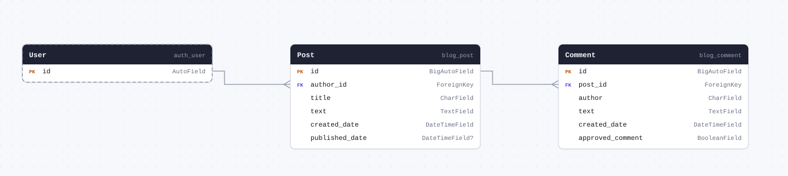
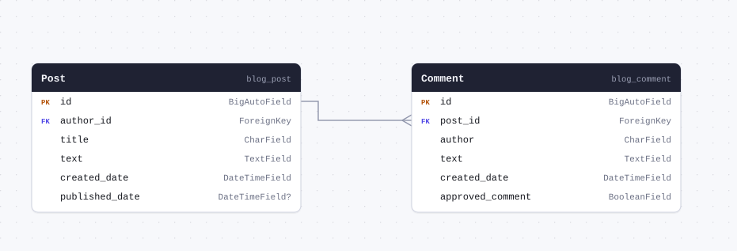

# Schema docs



[Post](#post) · [Comment](#comment)

<details>
<summary>The whole schema as SQL</summary>

```sql
CREATE TABLE "blog_post" ("id" integer NOT NULL PRIMARY KEY AUTOINCREMENT, "author_id" integer NOT NULL REFERENCES "auth_user" ("id") DEFERRABLE INITIALLY DEFERRED, "title" varchar(200) NOT NULL, "text" text NOT NULL, "created_date" datetime NOT NULL, "published_date" datetime NULL);

CREATE TABLE "blog_comment" ("id" integer NOT NULL PRIMARY KEY AUTOINCREMENT, "post_id" bigint NOT NULL REFERENCES "blog_post" ("id") DEFERRABLE INITIALLY DEFERRED, "author" varchar(200) NOT NULL, "text" text NOT NULL, "created_date" datetime NOT NULL, "approved_comment" bool NOT NULL);

CREATE INDEX "blog_post_author_id_dd7a8485" ON "blog_post" ("author_id");

CREATE INDEX "blog_comment_post_id_580e96ef" ON "blog_comment" ("post_id");
```

</details>

## Post

Table `blog_post`, app `blog`.


| Column | Field | Type | Null | Key | Default | Description |
| --- | --- | --- | --- | --- | --- | --- |
| `id` | `BigAutoField` | `integer` |  | PK | `autoincrement()` |  |
| `author_id` | `ForeignKey` | `integer` |  | FK |  |  |
| `title` | `CharField` | `varchar(200)` |  |  |  |  |
| `text` | `TextField` | `text` |  |  |  |  |
| `created_date` | `DateTimeField` | `datetime` |  |  | `now()` |  |
| `published_date` | `DateTimeField` | `datetime` | yes |  |  |  |

Indexes:

- index `blog_post_author_id_dd7a8485` on `author_id`

Relations:

- `author_id` → `User`.`id` (auth, not in these docs), on delete cascade
- [Comment](#comment).`post_id` → `id`, on delete cascade

## Comment

Table `blog_comment`, app `blog`.



| Column | Field | Type | Null | Key | Default | Description |
| --- | --- | --- | --- | --- | --- | --- |
| `id` | `BigAutoField` | `integer` |  | PK | `autoincrement()` |  |
| `post_id` | `ForeignKey` | `bigint` |  | FK |  |  |
| `author` | `CharField` | `varchar(200)` |  |  |  |  |
| `text` | `TextField` | `text` |  |  |  |  |
| `created_date` | `DateTimeField` | `datetime` |  |  | `now()` |  |
| `approved_comment` | `BooleanField` | `bool` |  |  | `False` |  |

Indexes:

- index `blog_comment_post_id_580e96ef` on `post_id`

Relations:

- `post_id` → [Post](#post).`id`, on delete cascade
