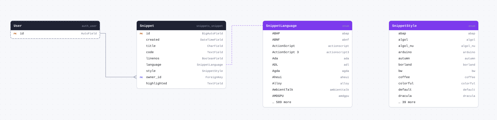

# Schema docs



[Snippet](#snippet)

<details>
<summary>The whole schema as SQL</summary>

```sql
CREATE TABLE "snippets_snippet" ("id" integer NOT NULL PRIMARY KEY AUTOINCREMENT, "created" datetime NOT NULL, "title" varchar(100) NOT NULL, "code" text NOT NULL, "linenos" bool NOT NULL, "language" varchar(100) NOT NULL, "style" varchar(100) NOT NULL, "owner_id" integer NOT NULL REFERENCES "auth_user" ("id") DEFERRABLE INITIALLY DEFERRED, "highlighted" text NOT NULL);

CREATE INDEX "snippets_snippet_owner_id_20604299" ON "snippets_snippet" ("owner_id");
```

</details>

## Snippet

Table `snippets_snippet`, app `snippets`.


| Column | Field | Type | Null | Key | Default | Description |
| --- | --- | --- | --- | --- | --- | --- |
| `id` | `BigAutoField` | `integer` |  | PK | `autoincrement()` |  |
| `created` | `DateTimeField` | `datetime` |  |  | `now()` |  |
| `title` | `CharField` | `varchar(100)` |  |  | `''` |  |
| `code` | `TextField` | `text` |  |  |  |  |
| `linenos` | `BooleanField` | `bool` |  |  | `False` |  |
| `language` | `SnippetLanguage` | `varchar(100)` |  |  | `'python'` |  |
| `style` | `SnippetStyle` | `varchar(100)` |  |  | `'friendly'` |  |
| `owner_id` | `ForeignKey` | `integer` |  | FK |  |  |
| `highlighted` | `TextField` | `text` |  |  |  |  |

Indexes:

- index `snippets_snippet_owner_id_20604299` on `owner_id`

Relations:

- `owner_id` → `User`.`id` (auth, not in these docs), on delete cascade

# Enums

## SnippetLanguage

| Name | Stored as |
| --- | --- |
| `ABAP` | `abap` |
| `ABNF` | `abnf` |
| `ActionScript` | `actionscript` |
| `ActionScript 3` | `actionscript3` |
| `Ada` | `ada` |
| `ADL` | `adl` |
| `Agda` | `agda` |
| `Aheui` | `aheui` |
| `Alloy` | `alloy` |
| `AmbientTalk` | `ambienttalk` |
| `AMDGPU` | `amdgpu` |
| `Ampl` | `ampl` |
| `Soong` | `androidbp` |
| `ANSYS parametric design language` | `ansys` |
| `ANTLR` | `antlr` |
| `ANTLR With ActionScript Target` | `antlr-actionscript` |
| `ANTLR With CPP Target` | `antlr-cpp` |
| `ANTLR With C# Target` | `antlr-csharp` |
| `ANTLR With Java Target` | `antlr-java` |
| `ANTLR With ObjectiveC Target` | `antlr-objc` |
| `ANTLR With Perl Target` | `antlr-perl` |
| `ANTLR With Python Target` | `antlr-python` |
| `ANTLR With Ruby Target` | `antlr-ruby` |
| `ApacheConf` | `apacheconf` |
| `APL` | `apl` |
| `AppleScript` | `applescript` |
| `Arduino` | `arduino` |
| `Arrow` | `arrow` |
| `Arturo` | `arturo` |
| `ASCII armored` | `asc` |
| `ASN.1` | `asn1` |
| `AspectJ` | `aspectj` |
| `aspx-cs` | `aspx-cs` |
| `aspx-vb` | `aspx-vb` |
| `Asymptote` | `asymptote` |
| `Augeas` | `augeas` |
| `autohotkey` | `autohotkey` |
| `AutoIt` | `autoit` |
| `Awk` | `awk` |
| `BARE` | `bare` |
| `Base Makefile` | `basemake` |
| `Bash` | `bash` |
| `Batchfile` | `batch` |
| `BBC Basic` | `bbcbasic` |
| `BBCode` | `bbcode` |
| `BC` | `bc` |
| `Bdd` | `bdd` |
| `Befunge` | `befunge` |
| `Berry` | `berry` |
| `BibTeX` | `bibtex` |
| `BitBake` | `bitbake` |
| `BlitzBasic` | `blitzbasic` |
| `BlitzMax` | `blitzmax` |
| `Blueprint` | `blueprint` |
| `BNF` | `bnf` |
| `Boa` | `boa` |
| `Boo` | `boo` |
| `Boogie` | `boogie` |
| `BQN` | `bqn` |
| `Brainfuck` | `brainfuck` |
| `BST` | `bst` |
| `BUGS` | `bugs` |
| `C` | `c` |
| `c-objdump` | `c-objdump` |
| `ca65 assembler` | `ca65` |
| `Caddyfile` | `caddyfile` |
| `cADL` | `cadl` |
| `CAmkES` | `camkes` |
| `CapDL` | `capdl` |
| `Cap'n Proto` | `capnp` |
| `Carbon` | `carbon` |
| `CBM BASIC V2` | `cbmbas` |
| `CDDL` | `cddl` |
| `CEL` | `cel` |
| `Ceylon` | `ceylon` |
| `Coldfusion CFC` | `cfc` |
| `CFEngine3` | `cfengine3` |
| `Coldfusion HTML` | `cfm` |
| `cfstatement` | `cfs` |
| `ChaiScript` | `chaiscript` |
| `Chapel` | `chapel` |
| `Charmci` | `charmci` |
| `Cheetah` | `cheetah` |
| `Cirru` | `cirru` |
| `Clay` | `clay` |
| `Clean` | `clean` |
| `Clojure` | `clojure` |
| `ClojureScript` | `clojurescript` |
| `CMake` | `cmake` |
| `COBOL` | `cobol` |
| `COBOLFree` | `cobolfree` |
| `CodeQL` | `codeql` |
| `CoffeeScript` | `coffeescript` |
| `COMAL-80` | `comal` |
| `Common Lisp` | `common-lisp` |
| `Component Pascal` | `componentpascal` |
| `Bash Session` | `console` |
| `Rocq Prover` | `coq` |
| `cplint` | `cplint` |
| `C++` | `cpp` |
| `cpp-objdump` | `cpp-objdump` |
| `CPSA` | `cpsa` |
| `Crystal` | `cr` |
| `Crmsh` | `crmsh` |
| `Croc` | `croc` |
| `Cryptol` | `cryptol` |
| `C#` | `csharp` |
| `Csound Orchestra` | `csound` |
| `Csound Document` | `csound-document` |
| `Csound Score` | `csound-score` |
| `CSS` | `css` |
| `CSS+Django/Jinja` | `css+django` |
| `CSS+Genshi Text` | `css+genshitext` |
| `CSS+Lasso` | `css+lasso` |
| `CSS+Mako` | `css+mako` |
| `CSS+mozpreproc` | `css+mozpreproc` |
| `CSS+Myghty` | `css+myghty` |
| `CSS+PHP` | `css+php` |
| `CSS+Ruby` | `css+ruby` |
| `CSS+Smarty` | `css+smarty` |
| `CSS+UL4` | `css+ul4` |
| `CUDA` | `cuda` |
| `Cypher` | `cypher` |
| `Cython` | `cython` |
| `D` | `d` |
| `d-objdump` | `d-objdump` |
| `Dart` | `dart` |
| `DASM16` | `dasm16` |
| `Dax` | `dax` |
| `Debian Control file` | `debcontrol` |
| `Debian Sources file` | `debian.sources` |
| `Debian Sourcelist` | `debsources` |
| `Delphi` | `delphi` |
| `Desktop file` | `desktop` |
| `Devicetree` | `devicetree` |
| `dg` | `dg` |
| `Diff` | `diff` |
| `Django/Jinja` | `django` |
| `Docker` | `docker` |
| `MSDOS Session` | `doscon` |
| `Darcs Patch` | `dpatch` |
| `DTD` | `dtd` |
| `Duel` | `duel` |
| `Dylan` | `dylan` |
| `Dylan session` | `dylan-console` |
| `DylanLID` | `dylan-lid` |
| `Earl Grey` | `earl-grey` |
| `Easytrieve` | `easytrieve` |
| `EBNF` | `ebnf` |
| `eC` | `ec` |
| `ECL` | `ecl` |
| `Eiffel` | `eiffel` |
| `Elixir` | `elixir` |
| `Elm` | `elm` |
| `Elpi` | `elpi` |
| `EmacsLisp` | `emacs-lisp` |
| `E-mail` | `email` |
| `ERB` | `erb` |
| `Erlang erl session` | `erl` |
| `Erlang` | `erlang` |
| `Evoque` | `evoque` |
| `execline` | `execline` |
| `xtlang` | `extempore` |
| `Ezhil` | `ezhil` |
| `Factor` | `factor` |
| `Fantom` | `fan` |
| `Fancy` | `fancy` |
| `Felix` | `felix` |
| `Fennel` | `fennel` |
| `Fift` | `fift` |
| `Fish` | `fish` |
| `Flatline` | `flatline` |
| `FloScript` | `floscript` |
| `Forth` | `forth` |
| `Fortran` | `fortran` |
| `FortranFixed` | `fortranfixed` |
| `FoxPro` | `foxpro` |
| `Freefem` | `freefem` |
| `F#` | `fsharp` |
| `FStar` | `fstar` |
| `FunC` | `func` |
| `Futhark` | `futhark` |
| `GAP` | `gap` |
| `GAP session` | `gap-console` |
| `GAS` | `gas` |
| `g-code` | `gcode` |
| `GDScript` | `gdscript` |
| `Genshi` | `genshi` |
| `Genshi Text` | `genshitext` |
| `Gherkin` | `gherkin` |
| `Gleam` | `gleam` |
| `GLSL` | `glsl` |
| `Gnuplot` | `gnuplot` |
| `Go` | `go` |
| `Golo` | `golo` |
| `GoodData-CL` | `gooddata-cl` |
| `GoogleSQL` | `googlesql` |
| `Gosu` | `gosu` |
| `GraphQL` | `graphql` |
| `Graphviz` | `graphviz` |
| `Groff` | `groff` |
| `Groovy` | `groovy` |
| `GSQL` | `gsql` |
| `Gosu Template` | `gst` |
| `Haml` | `haml` |
| `Handlebars` | `handlebars` |
| `Hare` | `hare` |
| `Haskell` | `haskell` |
| `Haxe` | `haxe` |
| `Hxml` | `haxeml` |
| `Hexdump` | `hexdump` |
| `HLSL` | `hlsl` |
| `HSAIL` | `hsail` |
| `Hspec` | `hspec` |
| `HTML` | `html` |
| `HTML+Cheetah` | `html+cheetah` |
| `HTML+Django/Jinja` | `html+django` |
| `HTML+Evoque` | `html+evoque` |
| `HTML+Genshi` | `html+genshi` |
| `HTML+Handlebars` | `html+handlebars` |
| `HTML+Lasso` | `html+lasso` |
| `HTML+Mako` | `html+mako` |
| `HTML+Myghty` | `html+myghty` |
| `HTML + Angular2` | `html+ng2` |
| `HTML+PHP` | `html+php` |
| `HTML+Smarty` | `html+smarty` |
| `HTML+Twig` | `html+twig` |
| `HTML+UL4` | `html+ul4` |
| `HTML+Velocity` | `html+velocity` |
| `HTTP` | `http` |
| `Hybris` | `hybris` |
| `Hy` | `hylang` |
| `Inform 6 template` | `i6t` |
| `Icon` | `icon` |
| `IDL` | `idl` |
| `Idris` | `idris` |
| `Elixir iex session` | `iex` |
| `Igor` | `igor` |
| `Inform 6` | `inform6` |
| `Inform 7` | `inform7` |
| `INI` | `ini` |
| `Io` | `io` |
| `Ioke` | `ioke` |
| `IRC logs` | `irc` |
| `Isabelle` | `isabelle` |
| `J` | `j` |
| `JAGS` | `jags` |
| `Janet` | `janet` |
| `Jasmin` | `jasmin` |
| `Java` | `java` |
| `JavaScript` | `javascript` |
| `JavaScript+Cheetah` | `javascript+cheetah` |
| `JavaScript+Django/Jinja` | `javascript+django` |
| `JavaScript+Lasso` | `javascript+lasso` |
| `JavaScript+Mako` | `javascript+mako` |
| `Javascript+mozpreproc` | `javascript+mozpreproc` |
| `JavaScript+Myghty` | `javascript+myghty` |
| `JavaScript+PHP` | `javascript+php` |
| `JavaScript+Ruby` | `javascript+ruby` |
| `JavaScript+Smarty` | `javascript+smarty` |
| `JCL` | `jcl` |
| `Julia console` | `jlcon` |
| `JMESPath` | `jmespath` |
| `JavaScript+Genshi Text` | `js+genshitext` |
| `Javascript+UL4` | `js+ul4` |
| `JSGF` | `jsgf` |
| `JSLT` | `jslt` |
| `JSON` | `json` |
| `JSON5` | `json5` |
| `JSON-LD` | `jsonld` |
| `Jsonnet` | `jsonnet` |
| `Java Server Page` | `jsp` |
| `JSX` | `jsx` |
| `Julia` | `julia` |
| `Juttle` | `juttle` |
| `K` | `k` |
| `Kal` | `kal` |
| `Kconfig` | `kconfig` |
| `Kernel log` | `kmsg` |
| `Koka` | `koka` |
| `Kotlin` | `kotlin` |
| `Kusto` | `kql` |
| `Kuin` | `kuin` |
| `Lasso` | `lasso` |
| `LDAP configuration file` | `ldapconf` |
| `LDIF` | `ldif` |
| `Lean` | `lean` |
| `Lean4` | `lean4` |
| `LessCss` | `less` |
| `Lighttpd configuration file` | `lighttpd` |
| `LilyPond` | `lilypond` |
| `Limbo` | `limbo` |
| `liquid` | `liquid` |
| `Literate Agda` | `literate-agda` |
| `Literate Cryptol` | `literate-cryptol` |
| `Literate Haskell` | `literate-haskell` |
| `Literate Idris` | `literate-idris` |
| `LiveScript` | `livescript` |
| `LLVM` | `llvm` |
| `LLVM-MIR` | `llvm-mir` |
| `LLVM-MIR Body` | `llvm-mir-body` |
| `Logos` | `logos` |
| `Logtalk` | `logtalk` |
| `LSL` | `lsl` |
| `Lua` | `lua` |
| `Luau` | `luau` |
| `Macaulay2` | `macaulay2` |
| `Makefile` | `make` |
| `Mako` | `mako` |
| `Maple` | `maple` |
| `MAQL` | `maql` |
| `Markdown` | `markdown` |
| `Mask` | `mask` |
| `Mason` | `mason` |
| `Mathematica` | `mathematica` |
| `Matlab` | `matlab` |
| `Matlab session` | `matlabsession` |
| `Maxima` | `maxima` |
| `MCFunction` | `mcfunction` |
| `MCSchema` | `mcschema` |
| `Meson` | `meson` |
| `MIME` | `mime` |
| `MiniD` | `minid` |
| `MiniScript` | `miniscript` |
| `MIPS` | `mips` |
| `Modelica` | `modelica` |
| `Modula-2` | `modula2` |
| `Mojo` | `mojo` |
| `Monkey` | `monkey` |
| `Monte` | `monte` |
| `MOOCode` | `moocode` |
| `MoonScript` | `moonscript` |
| `Mosel` | `mosel` |
| `mozhashpreproc` | `mozhashpreproc` |
| `mozpercentpreproc` | `mozpercentpreproc` |
| `MQL` | `mql` |
| `Mscgen` | `mscgen` |
| `MuPAD` | `mupad` |
| `MXML` | `mxml` |
| `Myghty` | `myghty` |
| `MySQL` | `mysql` |
| `NASM` | `nasm` |
| `NCL` | `ncl` |
| `Nemerle` | `nemerle` |
| `nesC` | `nesc` |
| `NestedText` | `nestedtext` |
| `NewLisp` | `newlisp` |
| `Newspeak` | `newspeak` |
| `Angular2` | `ng2` |
| `Nginx configuration file` | `nginx` |
| `Nimrod` | `nimrod` |
| `Nit` | `nit` |
| `Nix` | `nixos` |
| `Node.js REPL console session` | `nodejsrepl` |
| `Notmuch` | `notmuch` |
| `NSIS` | `nsis` |
| `Numba_IR` | `numba_ir` |
| `NumPy` | `numpy` |
| `NuSMV` | `nusmv` |
| `objdump` | `objdump` |
| `objdump-nasm` | `objdump-nasm` |
| `Objective-C` | `objective-c` |
| `Objective-C++` | `objective-c++` |
| `Objective-J` | `objective-j` |
| `OCaml` | `ocaml` |
| `Octave` | `octave` |
| `ODIN` | `odin` |
| `OMG Interface Definition Language` | `omg-idl` |
| `Ooc` | `ooc` |
| `Opa` | `opa` |
| `OpenEdge ABL` | `openedge` |
| `OpenSCAD` | `openscad` |
| `Org Mode` | `org` |
| `Text output` | `output` |
| `PacmanConf` | `pacmanconf` |
| `Pan` | `pan` |
| `ParaSail` | `parasail` |
| `Pawn` | `pawn` |
| `PDDL` | `pddl` |
| `PEG` | `peg` |
| `Perl` | `perl` |
| `Perl6` | `perl6` |
| `Phix` | `phix` |
| `PHP` | `php` |
| `Pig` | `pig` |
| `Pike` | `pike` |
| `PkgConfig` | `pkgconfig` |
| `PL/pgSQL` | `plpgsql` |
| `Pointless` | `pointless` |
| `Pony` | `pony` |
| `Portugol` | `portugol` |
| `PostgreSQL EXPLAIN dialect` | `postgres-explain` |
| `PostgreSQL SQL dialect` | `postgresql` |
| `PostScript` | `postscript` |
| `Gettext Catalog` | `pot` |
| `POVRay` | `pov` |
| `PowerShell` | `powershell` |
| `Praat` | `praat` |
| `Procfile` | `procfile` |
| `Prolog` | `prolog` |
| `Promela` | `promela` |
| `PromQL` | `promql` |
| `Properties` | `properties` |
| `Protocol Buffer` | `protobuf` |
| `PRQL` | `prql` |
| `PostgreSQL console (psql)` | `psql` |
| `PsySH console session for PHP` | `psysh` |
| `PTX` | `ptx` |
| `Pug` | `pug` |
| `Puppet` | `puppet` |
| `PureScript` | `purescript` |
| `PowerShell Session` | `pwsh-session` |
| `Python+UL4` | `py+ul4` |
| `Python 2.x Traceback` | `py2tb` |
| `Python console session` | `pycon` |
| `PyPy Log` | `pypylog` |
| `Python Traceback` | `pytb` |
| `Python` | `python` |
| `Python 2.x` | `python2` |
| `Q` | `q` |
| `QBasic` | `qbasic` |
| `Qlik` | `qlik` |
| `QML` | `qml` |
| `QVTO` | `qvto` |
| `Racket` | `racket` |
| `Ragel` | `ragel` |
| `Ragel in C Host` | `ragel-c` |
| `Ragel in CPP Host` | `ragel-cpp` |
| `Ragel in D Host` | `ragel-d` |
| `Embedded Ragel` | `ragel-em` |
| `Ragel in Java Host` | `ragel-java` |
| `Ragel in Objective C Host` | `ragel-objc` |
| `Ragel in Ruby Host` | `ragel-ruby` |
| `Ruby irb session` | `rbcon` |
| `RConsole` | `rconsole` |
| `Rd` | `rd` |
| `ReasonML` | `reasonml` |
| `REBOL` | `rebol` |
| `Red` | `red` |
| `Redcode` | `redcode` |
| `reg` | `registry` |
| `Rego` | `rego` |
| `Rell` | `rell` |
| `ResourceBundle` | `resourcebundle` |
| `reStructuredText` | `restructuredtext` |
| `Rexx` | `rexx` |
| `RHTML` | `rhtml` |
| `Ride` | `ride` |
| `Rita` | `rita` |
| `Relax-NG Compact` | `rng-compact` |
| `Roboconf Graph` | `roboconf-graph` |
| `Roboconf Instances` | `roboconf-instances` |
| `RobotFramework` | `robotframework` |
| `RQL` | `rql` |
| `RSL` | `rsl` |
| `Ruby` | `ruby` |
| `Rust` | `rust` |
| `SARL` | `sarl` |
| `SAS` | `sas` |
| `Sass` | `sass` |
| `Savi` | `savi` |
| `Scala` | `scala` |
| `Scaml` | `scaml` |
| `scdoc` | `scdoc` |
| `Scheme` | `scheme` |
| `Scilab` | `scilab` |
| `SCSS` | `scss` |
| `Sed` | `sed` |
| `SmartGameFormat` | `sgf` |
| `Shen` | `shen` |
| `ShExC` | `shexc` |
| `Sieve` | `sieve` |
| `Silver` | `silver` |
| `Singularity` | `singularity` |
| `Slash` | `slash` |
| `Slim` | `slim` |
| `Slurm` | `slurm` |
| `Smali` | `smali` |
| `Smalltalk` | `smalltalk` |
| `Smarty` | `smarty` |
| `Smithy` | `smithy` |
| `Standard ML` | `sml` |
| `SNBT` | `snbt` |
| `Snobol` | `snobol` |
| `Snowball` | `snowball` |
| `Solidity` | `solidity` |
| `Sophia` | `sophia` |
| `SourcePawn` | `sp` |
| `SPARQL` | `sparql` |
| `RPMSpec` | `spec` |
| `Spice` | `spice` |
| `S` | `splus` |
| `SQL` | `sql` |
| `SQL+Jinja` | `sql+jinja` |
| `sqlite3con` | `sqlite3` |
| `SquidConf` | `squidconf` |
| `Srcinfo` | `srcinfo` |
| `Scalate Server Page` | `ssp` |
| `Stan` | `stan` |
| `Stata` | `stata` |
| `SuperCollider` | `supercollider` |
| `Swift` | `swift` |
| `SWIG` | `swig` |
| `Systemd` | `systemd` |
| `systemverilog` | `systemverilog` |
| `TableGen` | `tablegen` |
| `Tact` | `tact` |
| `TADS 3` | `tads3` |
| `Tal` | `tal` |
| `TAP` | `tap` |
| `TASM` | `tasm` |
| `Tcl` | `tcl` |
| `Tcsh` | `tcsh` |
| `Tcsh Session` | `tcshcon` |
| `Tea` | `tea` |
| `teal` | `teal` |
| `Tera Term macro` | `teratermmacro` |
| `Termcap` | `termcap` |
| `Terminfo` | `terminfo` |
| `Terraform` | `terraform` |
| `TeX` | `tex` |
| `Text only` | `text` |
| `Thrift` | `thrift` |
| `ThingsDB` | `ti` |
| `tiddler` | `tid` |
| `Tl-b` | `tlb` |
| `TLS Presentation Language` | `tls` |
| `Typographic Number Theory` | `tnt` |
| `Todotxt` | `todotxt` |
| `TOML` | `toml` |
| `MoinMoin/Trac Wiki markup` | `trac-wiki` |
| `TrafficScript` | `trafficscript` |
| `Treetop` | `treetop` |
| `Transact-SQL` | `tsql` |
| `TSX` | `tsx` |
| `Turtle` | `turtle` |
| `Twig` | `twig` |
| `TypeScript` | `typescript` |
| `TypoScript` | `typoscript` |
| `TypoScriptCssData` | `typoscriptcssdata` |
| `TypoScriptHtmlData` | `typoscripthtmldata` |
| `Typst` | `typst` |
| `ucode` | `ucode` |
| `UL4` | `ul4` |
| `Unicon` | `unicon` |
| `Unix/Linux config files` | `unixconfig` |
| `UrbiScript` | `urbiscript` |
| `urlencoded` | `urlencoded` |
| `USD` | `usd` |
| `Vala` | `vala` |
| `VB.net` | `vb.net` |
| `VBScript` | `vbscript` |
| `VCL` | `vcl` |
| `VCLSnippets` | `vclsnippets` |
| `VCTreeStatus` | `vctreestatus` |
| `Velocity` | `velocity` |
| `Verifpal` | `verifpal` |
| `verilog` | `verilog` |
| `VGL` | `vgl` |
| `vhdl` | `vhdl` |
| `VimL` | `vim` |
| `Visual Prolog` | `visualprolog` |
| `Visual Prolog Grammar` | `visualprologgrammar` |
| `Vue` | `vue` |
| `Vyper` | `vyper` |
| `WebAssembly` | `wast` |
| `WDiff` | `wdiff` |
| `Web IDL` | `webidl` |
| `WebGPU Shading Language` | `wgsl` |
| `Whiley` | `whiley` |
| `Wikitext` | `wikitext` |
| `World of Warcraft TOC` | `wowtoc` |
| `Wren` | `wren` |
| `X10` | `x10` |
| `XML` | `xml` |
| `XML+Cheetah` | `xml+cheetah` |
| `XML+Django/Jinja` | `xml+django` |
| `XML+Evoque` | `xml+evoque` |
| `XML+Lasso` | `xml+lasso` |
| `XML+Mako` | `xml+mako` |
| `XML+Myghty` | `xml+myghty` |
| `XML+PHP` | `xml+php` |
| `XML+Ruby` | `xml+ruby` |
| `XML+Smarty` | `xml+smarty` |
| `XML+UL4` | `xml+ul4` |
| `XML+Velocity` | `xml+velocity` |
| `Xorg` | `xorg.conf` |
| `X++` | `xpp` |
| `XQuery` | `xquery` |
| `XSLT` | `xslt` |
| `Xtend` | `xtend` |
| `XUL+mozpreproc` | `xul+mozpreproc` |
| `YAML` | `yaml` |
| `YAML+Jinja` | `yaml+jinja` |
| `YANG` | `yang` |
| `YARA` | `yara` |
| `Zeek` | `zeek` |
| `Zephir` | `zephir` |
| `Zig` | `zig` |
| `Zone` | `zone` |

## SnippetStyle

| Name | Stored as |
| --- | --- |
| `abap` | `abap` |
| `algol` | `algol` |
| `algol_nu` | `algol_nu` |
| `arduino` | `arduino` |
| `autumn` | `autumn` |
| `borland` | `borland` |
| `bw` | `bw` |
| `coffee` | `coffee` |
| `colorful` | `colorful` |
| `default` | `default` |
| `dracula` | `dracula` |
| `emacs` | `emacs` |
| `friendly` | `friendly` |
| `friendly_grayscale` | `friendly_grayscale` |
| `fruity` | `fruity` |
| `github-dark` | `github-dark` |
| `gruvbox-dark` | `gruvbox-dark` |
| `gruvbox-light` | `gruvbox-light` |
| `igor` | `igor` |
| `inkpot` | `inkpot` |
| `lightbulb` | `lightbulb` |
| `lilypond` | `lilypond` |
| `lovelace` | `lovelace` |
| `manni` | `manni` |
| `material` | `material` |
| `monokai` | `monokai` |
| `murphy` | `murphy` |
| `native` | `native` |
| `night-owl` | `night-owl` |
| `nord` | `nord` |
| `nord-darker` | `nord-darker` |
| `one-dark` | `one-dark` |
| `paraiso-dark` | `paraiso-dark` |
| `paraiso-light` | `paraiso-light` |
| `pastie` | `pastie` |
| `perldoc` | `perldoc` |
| `rainbow_dash` | `rainbow_dash` |
| `rrt` | `rrt` |
| `sas` | `sas` |
| `solarized-dark` | `solarized-dark` |
| `solarized-light` | `solarized-light` |
| `staroffice` | `staroffice` |
| `stata-dark` | `stata-dark` |
| `stata-light` | `stata-light` |
| `tango` | `tango` |
| `trac` | `trac` |
| `vim` | `vim` |
| `vs` | `vs` |
| `xcode` | `xcode` |
| `zenburn` | `zenburn` |
