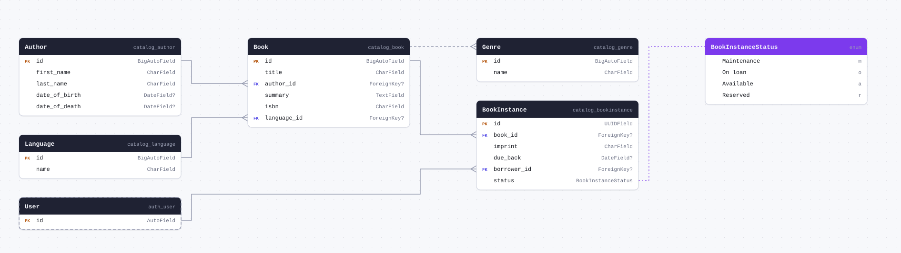
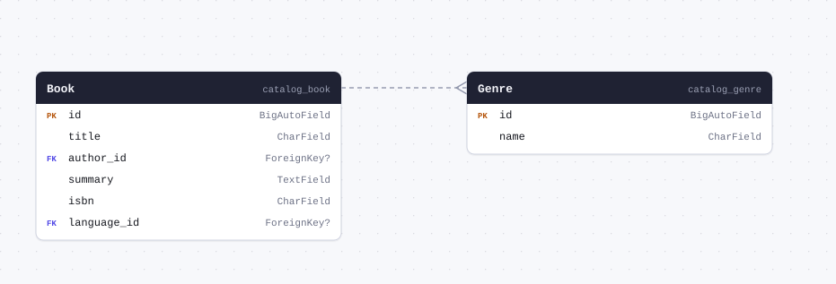
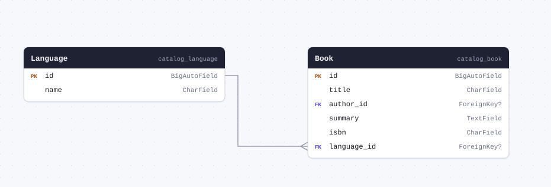
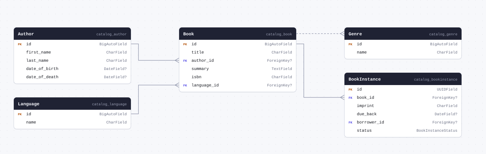
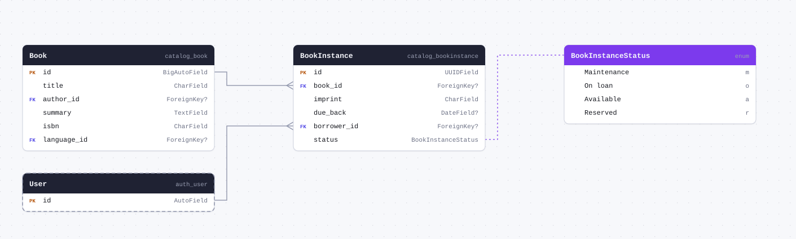
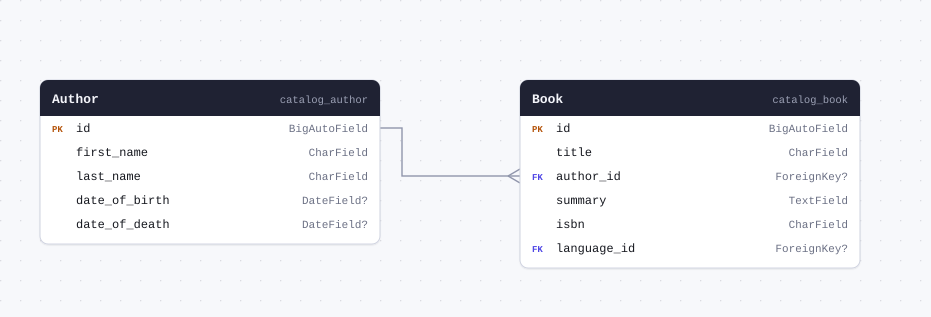

# Schema docs



[Genre](#genre) · [Language](#language) · [Book](#book) · [BookInstance](#bookinstance) · [Author](#author)

<details>
<summary>The whole schema as SQL</summary>

```sql
CREATE TABLE "catalog_genre" ("id" integer NOT NULL PRIMARY KEY AUTOINCREMENT, "name" varchar(200) NOT NULL UNIQUE);

CREATE TABLE "catalog_language" ("id" integer NOT NULL PRIMARY KEY AUTOINCREMENT, "name" varchar(200) NOT NULL UNIQUE);

CREATE TABLE "catalog_book" ("id" integer NOT NULL PRIMARY KEY AUTOINCREMENT, "title" varchar(200) NOT NULL, "author_id" bigint NULL REFERENCES "catalog_author" ("id") DEFERRABLE INITIALLY DEFERRED, "summary" text NOT NULL, "isbn" varchar(13) NOT NULL UNIQUE, "language_id" bigint NULL REFERENCES "catalog_language" ("id") DEFERRABLE INITIALLY DEFERRED);

CREATE TABLE "catalog_book_genre" ("id" integer NOT NULL PRIMARY KEY AUTOINCREMENT, "book_id" bigint NOT NULL REFERENCES "catalog_book" ("id") DEFERRABLE INITIALLY DEFERRED, "genre_id" bigint NOT NULL REFERENCES "catalog_genre" ("id") DEFERRABLE INITIALLY DEFERRED);

CREATE TABLE "catalog_bookinstance" ("id" char(32) NOT NULL PRIMARY KEY, "book_id" bigint NULL REFERENCES "catalog_book" ("id") DEFERRABLE INITIALLY DEFERRED, "imprint" varchar(200) NOT NULL, "due_back" date NULL, "borrower_id" integer NULL REFERENCES "auth_user" ("id") DEFERRABLE INITIALLY DEFERRED, "status" varchar(1) NOT NULL);

CREATE TABLE "catalog_author" ("id" integer NOT NULL PRIMARY KEY AUTOINCREMENT, "first_name" varchar(100) NOT NULL, "last_name" varchar(100) NOT NULL, "date_of_birth" date NULL, "date_of_death" date NULL);

CREATE UNIQUE INDEX "genre_name_case_insensitive_unique" ON "catalog_genre" ((LOWER("name")));

CREATE UNIQUE INDEX "language_name_case_insensitive_unique" ON "catalog_language" ((LOWER("name")));

CREATE INDEX "catalog_book_author_id_b0849980" ON "catalog_book" ("author_id");

CREATE INDEX "catalog_book_language_id_447f859e" ON "catalog_book" ("language_id");

CREATE UNIQUE INDEX "catalog_book_genre_book_id_genre_id_d15f6922_uniq" ON "catalog_book_genre" ("book_id", "genre_id");

CREATE INDEX "catalog_book_genre_book_id_e5a77c43" ON "catalog_book_genre" ("book_id");

CREATE INDEX "catalog_book_genre_genre_id_77d7ffde" ON "catalog_book_genre" ("genre_id");

CREATE INDEX "catalog_bookinstance_book_id_69f93415" ON "catalog_bookinstance" ("book_id");

CREATE INDEX "catalog_bookinstance_borrower_id_0d71c37c" ON "catalog_bookinstance" ("borrower_id");
```

</details>

## Genre

Table `catalog_genre`, app `catalog`.

Model representing a book genre.



| Column | Field | Type | Null | Key | Default | Description |
| --- | --- | --- | --- | --- | --- | --- |
| `id` | `BigAutoField` | `integer` |  | PK | `autoincrement()` |  |
| `name` | `CharField` | `varchar(200)` |  | unique |  | Enter a book genre (e.g. Science Fiction, French Poetry etc.) |

Indexes:

- unique `genre_name_case_insensitive_unique` on `LOWER("name")`

Relations:

- `book_set` — many to many with [Book](#book)

## Language

Table `catalog_language`, app `catalog`.

Model representing a Language (e.g. English, French, Japanese, etc.)



| Column | Field | Type | Null | Key | Default | Description |
| --- | --- | --- | --- | --- | --- | --- |
| `id` | `BigAutoField` | `integer` |  | PK | `autoincrement()` |  |
| `name` | `CharField` | `varchar(200)` |  | unique |  | Enter the book's natural language (e.g. English, French, Japanese etc.) |

Indexes:

- unique `language_name_case_insensitive_unique` on `LOWER("name")`

Relations:

- [Book](#book).`language_id` → `id`, on delete set null

## Book

Table `catalog_book`, app `catalog`.

Model representing a book (but not a specific copy of a book).



| Column | Field | Type | Null | Key | Default | Description |
| --- | --- | --- | --- | --- | --- | --- |
| `id` | `BigAutoField` | `integer` |  | PK | `autoincrement()` |  |
| `title` | `CharField` | `varchar(200)` |  |  |  |  |
| `author_id` | `ForeignKey` | `bigint` | yes | FK |  |  |
| `summary` | `TextField` | `text` |  |  |  | Enter a brief description of the book |
| `isbn` | `CharField` | `varchar(13)` |  | unique |  | 13 Character <a href="https://www.isbn-international.org/content/what-isbn">ISBN number</a> |
| `language_id` | `ForeignKey` | `bigint` | yes | FK |  |  |

Indexes:

- index `catalog_book_author_id_b0849980` on `author_id`
- index `catalog_book_language_id_447f859e` on `language_id`

Relations:

- `author_id` → [Author](#author).`id`, on delete restrict
- `language_id` → [Language](#language).`id`, on delete set null
- `genre` — many to many with [Genre](#genre)
- [BookInstance](#bookinstance).`book_id` → `id`, on delete restrict

## BookInstance

Table `catalog_bookinstance`, app `catalog`.

Model representing a specific copy of a book (i.e. that can be borrowed from the library).



| Column | Field | Type | Null | Key | Default | Description |
| --- | --- | --- | --- | --- | --- | --- |
| `id` | `UUIDField` | `char(32)` |  | PK | `uuid4()` | Unique ID for this particular book across whole library |
| `book_id` | `ForeignKey` | `bigint` | yes | FK |  |  |
| `imprint` | `CharField` | `varchar(200)` |  |  |  |  |
| `due_back` | `DateField` | `date` | yes |  |  |  |
| `borrower_id` | `ForeignKey` | `integer` | yes | FK |  |  |
| `status` | `BookInstanceStatus` | `varchar(1)` |  |  | `'m'` | Book availability |

Indexes:

- index `catalog_bookinstance_book_id_69f93415` on `book_id`
- index `catalog_bookinstance_borrower_id_0d71c37c` on `borrower_id`

Relations:

- `book_id` → [Book](#book).`id`, on delete restrict
- `borrower_id` → `User`.`id` (auth, not in these docs), on delete set null

## Author

Table `catalog_author`, app `catalog`.

Model representing an author.



| Column | Field | Type | Null | Key | Default | Description |
| --- | --- | --- | --- | --- | --- | --- |
| `id` | `BigAutoField` | `integer` |  | PK | `autoincrement()` |  |
| `first_name` | `CharField` | `varchar(100)` |  |  |  |  |
| `last_name` | `CharField` | `varchar(100)` |  |  |  |  |
| `date_of_birth` | `DateField` | `date` | yes |  |  |  |
| `date_of_death` | `DateField` | `date` | yes |  |  |  |

Relations:

- [Book](#book).`author_id` → `id`, on delete restrict

# Enums

## BookInstanceStatus

| Name | Stored as |
| --- | --- |
| `Maintenance` | `m` |
| `On loan` | `o` |
| `Available` | `a` |
| `Reserved` | `r` |
