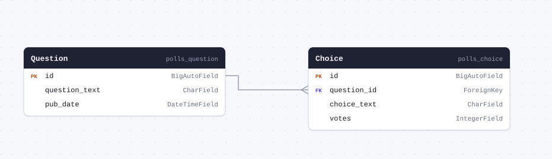

# Schema docs


[Question](#question) · [Choice](#choice)

<details>
<summary>The whole schema as SQL</summary>

```sql
CREATE TABLE "polls_question" ("id" integer NOT NULL PRIMARY KEY AUTOINCREMENT, "question_text" varchar(200) NOT NULL, "pub_date" datetime NOT NULL);

CREATE TABLE "polls_choice" ("id" integer NOT NULL PRIMARY KEY AUTOINCREMENT, "question_id" bigint NOT NULL REFERENCES "polls_question" ("id") DEFERRABLE INITIALLY DEFERRED, "choice_text" varchar(200) NOT NULL, "votes" integer NOT NULL);

CREATE INDEX "polls_choice_question_id_c5b4b260" ON "polls_choice" ("question_id");
```

</details>

## Question

Table `polls_question`, app `polls`.


| Column | Field | Type | Null | Key | Default | Description |
| --- | --- | --- | --- | --- | --- | --- |
| `id` | `BigAutoField` | `integer` |  | PK | `autoincrement()` |  |
| `question_text` | `CharField` | `varchar(200)` |  |  |  |  |
| `pub_date` | `DateTimeField` | `datetime` |  |  |  |  |

Relations:

- [Choice](#choice).`question_id` → `id`, on delete cascade

## Choice

Table `polls_choice`, app `polls`.



| Column | Field | Type | Null | Key | Default | Description |
| --- | --- | --- | --- | --- | --- | --- |
| `id` | `BigAutoField` | `integer` |  | PK | `autoincrement()` |  |
| `question_id` | `ForeignKey` | `bigint` |  | FK |  |  |
| `choice_text` | `CharField` | `varchar(200)` |  |  |  |  |
| `votes` | `IntegerField` | `integer` |  |  | `0` |  |

Indexes:

- index `polls_choice_question_id_c5b4b260` on `question_id`

Relations:

- `question_id` → [Question](#question).`id`, on delete cascade
