# Schema docs

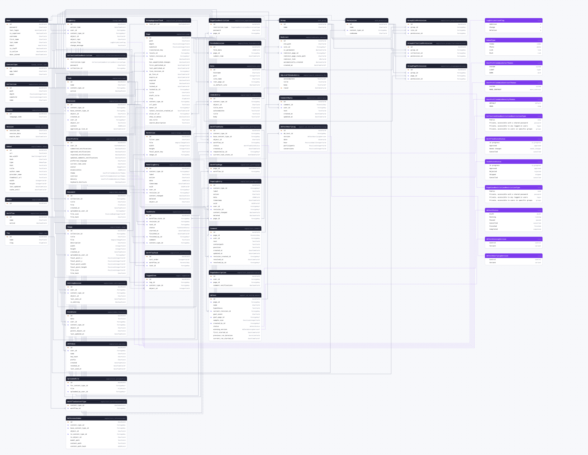

[LogEntry](#logentry) · [Permission](#permission) · [Group](#group) · [User](#user) · [ContentType](#contenttype) · [Session](#session) · [FormSubmission](#formsubmission) · [Redirect](#redirect) · [Embed](#embed) · [UserProfile](#userprofile) · [Document](#document) · [Image](#image) · [Rendition](#rendition) · [IndexEntry](#indexentry) · [SQLiteFTSIndexEntry](#sqliteftsindexentry) · [Admin](#admin) · [EditingSession](#editingsession) · [FormState](#formstate) · [Locale](#locale) · [Site](#site) · [GroupSitePermission](#groupsitepermission) · [APIToken](#apitoken) · [ModelLogEntry](#modellogentry) · [Revision](#revision) · [CollectionViewRestriction](#collectionviewrestriction) · [Collection](#collection) · [GroupCollectionPermission](#groupcollectionpermission) · [UploadedFile](#uploadedfile) · [WorkflowContentType](#workflowcontenttype) · [WorkflowState](#workflowstate) · [Workflow](#workflow) · [WorkflowTask](#workflowtask) · [Task](#task) · [GroupApprovalTask](#groupapprovaltask) · [TaskState](#taskstate) · [Page](#page) · [GroupPagePermission](#grouppagepermission) · [PageViewRestriction](#pageviewrestriction) · [WorkflowPage](#workflowpage) · [PageLogEntry](#pagelogentry) · [Comment](#comment) · [CommentReply](#commentreply) · [PageSubscription](#pagesubscription) · [ReferenceIndex](#referenceindex) · [Tag](#tag) · [TaggedItem](#taggeditem) · [AbTest](#abtest) · [AbTestHourlyLog](#abtesthourlylog)

<details>
<summary>The whole schema as SQL</summary>

```sql
CREATE TABLE "django_admin_log" ("id" integer NOT NULL PRIMARY KEY AUTOINCREMENT, "action_time" datetime NOT NULL, "user_id" integer NOT NULL REFERENCES "auth_user" ("id") DEFERRABLE INITIALLY DEFERRED, "content_type_id" integer NULL REFERENCES "django_content_type" ("id") DEFERRABLE INITIALLY DEFERRED, "object_id" text NULL, "object_repr" varchar(200) NOT NULL, "action_flag" smallint unsigned NOT NULL CHECK ("action_flag" >= 0), "change_message" text NOT NULL);

CREATE TABLE "auth_permission" ("id" integer NOT NULL PRIMARY KEY AUTOINCREMENT, "name" varchar(255) NOT NULL, "content_type_id" integer NOT NULL REFERENCES "django_content_type" ("id") DEFERRABLE INITIALLY DEFERRED, "codename" varchar(100) NOT NULL);

CREATE TABLE "auth_group" ("id" integer NOT NULL PRIMARY KEY AUTOINCREMENT, "name" varchar(150) NOT NULL UNIQUE);

CREATE TABLE "auth_group_permissions" ("id" integer NOT NULL PRIMARY KEY AUTOINCREMENT, "group_id" integer NOT NULL REFERENCES "auth_group" ("id") DEFERRABLE INITIALLY DEFERRED, "permission_id" integer NOT NULL REFERENCES "auth_permission" ("id") DEFERRABLE INITIALLY DEFERRED);

CREATE TABLE "auth_user" ("id" integer NOT NULL PRIMARY KEY AUTOINCREMENT, "password" varchar(128) NOT NULL, "last_login" datetime NULL, "is_superuser" bool NOT NULL, "username" varchar(150) NOT NULL UNIQUE, "first_name" varchar(150) NOT NULL, "last_name" varchar(150) NOT NULL, "email" varchar(254) NOT NULL, "is_staff" bool NOT NULL, "is_active" bool NOT NULL, "date_joined" datetime NOT NULL);

CREATE TABLE "auth_user_groups" ("id" integer NOT NULL PRIMARY KEY AUTOINCREMENT, "user_id" integer NOT NULL REFERENCES "auth_user" ("id") DEFERRABLE INITIALLY DEFERRED, "group_id" integer NOT NULL REFERENCES "auth_group" ("id") DEFERRABLE INITIALLY DEFERRED);

CREATE TABLE "auth_user_user_permissions" ("id" integer NOT NULL PRIMARY KEY AUTOINCREMENT, "user_id" integer NOT NULL REFERENCES "auth_user" ("id") DEFERRABLE INITIALLY DEFERRED, "permission_id" integer NOT NULL REFERENCES "auth_permission" ("id") DEFERRABLE INITIALLY DEFERRED);

CREATE TABLE "django_content_type" ("id" integer NOT NULL PRIMARY KEY AUTOINCREMENT, "app_label" varchar(100) NOT NULL, "model" varchar(100) NOT NULL);

CREATE TABLE "django_session" ("session_key" varchar(40) NOT NULL PRIMARY KEY, "session_data" text NOT NULL, "expire_date" datetime NOT NULL);

CREATE TABLE "wagtailforms_formsubmission" ("id" integer NOT NULL PRIMARY KEY AUTOINCREMENT, "form_data" text NOT NULL CHECK ((JSON_VALID("form_data") OR "form_data" IS NULL)), "page_id" integer NOT NULL REFERENCES "wagtailcore_page" ("id") DEFERRABLE INITIALLY DEFERRED, "submit_time" datetime NOT NULL);

CREATE TABLE "wagtailredirects_redirect" ("id" integer NOT NULL PRIMARY KEY AUTOINCREMENT, "old_path" varchar(255) NOT NULL, "site_id" integer NULL REFERENCES "wagtailcore_site" ("id") DEFERRABLE INITIALLY DEFERRED, "is_permanent" bool NOT NULL, "redirect_page_id" integer NULL REFERENCES "wagtailcore_page" ("id") DEFERRABLE INITIALLY DEFERRED, "redirect_page_route_path" varchar(255) NOT NULL, "redirect_link" varchar(255) NOT NULL, "automatically_created" bool NOT NULL, "created_at" datetime NULL);

CREATE TABLE "wagtailembeds_embed" ("id" integer NOT NULL PRIMARY KEY AUTOINCREMENT, "url" text NOT NULL, "max_width" smallint NULL, "hash" varchar(32) NOT NULL UNIQUE, "type" varchar(10) NOT NULL, "html" text NOT NULL, "title" text NOT NULL, "author_name" text NOT NULL, "provider_name" text NOT NULL, "thumbnail_url" text NOT NULL, "width" integer NULL, "height" integer NULL, "last_updated" datetime NOT NULL, "cache_until" datetime NULL);

CREATE TABLE "wagtailusers_userprofile" ("id" integer NOT NULL PRIMARY KEY AUTOINCREMENT, "user_id" integer NOT NULL UNIQUE REFERENCES "auth_user" ("id") DEFERRABLE INITIALLY DEFERRED, "submitted_notifications" bool NOT NULL, "approved_notifications" bool NOT NULL, "rejected_notifications" bool NOT NULL, "updated_comments_notifications" bool NOT NULL, "preferred_language" varchar(10) NOT NULL, "current_time_zone" varchar(40) NOT NULL, "avatar" varchar(100) NOT NULL, "dismissibles" text NOT NULL CHECK ((JSON_VALID("dismissibles") OR "dismissibles" IS NULL)), "theme" varchar(40) NOT NULL, "contrast" varchar(40) NOT NULL, "density" varchar(40) NOT NULL, "keyboard_shortcuts" bool NOT NULL);

CREATE TABLE "wagtaildocs_document" ("id" integer NOT NULL PRIMARY KEY AUTOINCREMENT, "collection_id" integer NOT NULL REFERENCES "wagtailcore_collection" ("id") DEFERRABLE INITIALLY DEFERRED, "title" varchar(255) NOT NULL, "file" varchar(100) NOT NULL, "created_at" datetime NOT NULL, "uploaded_by_user_id" integer NULL REFERENCES "auth_user" ("id") DEFERRABLE INITIALLY DEFERRED, "file_size" bigint unsigned NULL CHECK ("file_size" >= 0), "file_hash" varchar(40) NOT NULL);

CREATE TABLE "wagtailimages_image" ("id" integer NOT NULL PRIMARY KEY AUTOINCREMENT, "collection_id" integer NOT NULL REFERENCES "wagtailcore_collection" ("id") DEFERRABLE INITIALLY DEFERRED, "title" varchar(255) NOT NULL, "file" varchar(100) NOT NULL, "description" varchar(255) NOT NULL, "width" integer NOT NULL, "height" integer NOT NULL, "created_at" datetime NOT NULL, "uploaded_by_user_id" integer NULL REFERENCES "auth_user" ("id") DEFERRABLE INITIALLY DEFERRED, "focal_point_x" integer unsigned NULL CHECK ("focal_point_x" >= 0), "focal_point_y" integer unsigned NULL CHECK ("focal_point_y" >= 0), "focal_point_width" integer unsigned NULL CHECK ("focal_point_width" >= 0), "focal_point_height" integer unsigned NULL CHECK ("focal_point_height" >= 0), "file_size" integer unsigned NULL CHECK ("file_size" >= 0), "file_hash" varchar(40) NOT NULL);

CREATE TABLE "wagtailimages_rendition" ("id" integer NOT NULL PRIMARY KEY AUTOINCREMENT, "filter_spec" varchar(255) NOT NULL, "file" varchar(100) NOT NULL, "width" integer NOT NULL, "height" integer NOT NULL, "focal_point_key" varchar(16) NOT NULL, "image_id" integer NOT NULL REFERENCES "wagtailimages_image" ("id") DEFERRABLE INITIALLY DEFERRED);

CREATE TABLE "wagtailsearch_indexentry" ("id" integer NOT NULL PRIMARY KEY AUTOINCREMENT, "content_type_id" integer NOT NULL REFERENCES "django_content_type" ("id") DEFERRABLE INITIALLY DEFERRED, "object_id" varchar(50) NOT NULL, "title_norm" real NOT NULL, "autocomplete" text NULL, "title" text NOT NULL, "body" text NULL);

CREATE TABLE "wagtailsearch_indexentry_fts" ("autocomplete" text NULL, "title" text NOT NULL, "body" text NULL, "rowid" integer NOT NULL PRIMARY KEY REFERENCES "wagtailsearch_indexentry" ("id") DEFERRABLE INITIALLY DEFERRED);

CREATE TABLE "wagtailadmin_admin" ("id" integer NOT NULL PRIMARY KEY AUTOINCREMENT);

CREATE TABLE "wagtailadmin_editingsession" ("id" integer NOT NULL PRIMARY KEY AUTOINCREMENT, "user_id" integer NOT NULL REFERENCES "auth_user" ("id") DEFERRABLE INITIALLY DEFERRED, "content_type_id" integer NOT NULL REFERENCES "django_content_type" ("id") DEFERRABLE INITIALLY DEFERRED, "object_id" varchar(255) NOT NULL, "last_seen_at" datetime NOT NULL, "is_editing" bool NOT NULL);

CREATE TABLE "wagtailadmin_formstate" ("id" integer NOT NULL PRIMARY KEY AUTOINCREMENT, "data" text NOT NULL, "user_id" integer NOT NULL REFERENCES "auth_user" ("id") DEFERRABLE INITIALLY DEFERRED, "content_type_id" integer NOT NULL REFERENCES "django_content_type" ("id") DEFERRABLE INITIALLY DEFERRED, "object_id" varchar(255) NOT NULL, "parent_object_id" varchar(255) NOT NULL, "last_updated_at" datetime NOT NULL);

CREATE TABLE "wagtailcore_locale" ("id" integer NOT NULL PRIMARY KEY AUTOINCREMENT, "language_code" varchar(100) NOT NULL UNIQUE);

CREATE TABLE "wagtailcore_site" ("id" integer NOT NULL PRIMARY KEY AUTOINCREMENT, "hostname" varchar(255) NOT NULL, "port" integer NOT NULL, "site_name" varchar(255) NOT NULL, "root_page_id" integer NOT NULL REFERENCES "wagtailcore_page" ("id") DEFERRABLE INITIALLY DEFERRED, "is_default_site" bool NOT NULL);

CREATE TABLE "wagtailcore_groupsitepermission" ("id" integer NOT NULL PRIMARY KEY AUTOINCREMENT, "group_id" integer NOT NULL REFERENCES "auth_group" ("id") DEFERRABLE INITIALLY DEFERRED, "site_id" integer NOT NULL REFERENCES "wagtailcore_site" ("id") DEFERRABLE INITIALLY DEFERRED, "permission_id" integer NOT NULL REFERENCES "auth_permission" ("id") DEFERRABLE INITIALLY DEFERRED);

CREATE TABLE "wagtailcore_apitoken" ("id" integer NOT NULL PRIMARY KEY AUTOINCREMENT, "user_id" integer NOT NULL REFERENCES "auth_user" ("id") DEFERRABLE INITIALLY DEFERRED, "name" varchar(255) NOT NULL, "key_hash" varchar(64) NOT NULL UNIQUE, "prefix" varchar(16) NOT NULL, "created" datetime NOT NULL, "revoked_at" datetime NULL, "last_used_at" datetime NULL);

CREATE TABLE "wagtailcore_modellogentry" ("id" integer NOT NULL PRIMARY KEY AUTOINCREMENT, "content_type_id" integer NULL REFERENCES "django_content_type" ("id") DEFERRABLE INITIALLY DEFERRED, "label" text NOT NULL, "action" varchar(255) NOT NULL, "data" text NOT NULL CHECK ((JSON_VALID("data") OR "data" IS NULL)), "timestamp" datetime NOT NULL, "uuid" char(32) NULL, "user_id" integer NULL, "revision_id" integer NULL, "content_changed" bool NOT NULL, "deleted" bool NOT NULL, "object_id" varchar(255) NOT NULL);

CREATE TABLE "wagtailcore_revision" ("id" integer NOT NULL PRIMARY KEY AUTOINCREMENT, "content_type_id" integer NOT NULL REFERENCES "django_content_type" ("id") DEFERRABLE INITIALLY DEFERRED, "base_content_type_id" integer NOT NULL REFERENCES "django_content_type" ("id") DEFERRABLE INITIALLY DEFERRED, "object_id" varchar(255) NOT NULL, "created_at" datetime NOT NULL, "user_id" integer NULL REFERENCES "auth_user" ("id") DEFERRABLE INITIALLY DEFERRED, "object_str" text NOT NULL, "content" text NOT NULL CHECK ((JSON_VALID("content") OR "content" IS NULL)), "approved_go_live_at" datetime NULL);

CREATE TABLE "wagtailcore_collectionviewrestriction" ("id" integer NOT NULL PRIMARY KEY AUTOINCREMENT, "restriction_type" varchar(20) NOT NULL, "password" varchar(255) NOT NULL, "collection_id" integer NOT NULL REFERENCES "wagtailcore_collection" ("id") DEFERRABLE INITIALLY DEFERRED);

CREATE TABLE "wagtailcore_collectionviewrestriction_groups" ("id" integer NOT NULL PRIMARY KEY AUTOINCREMENT, "collectionviewrestriction_id" integer NOT NULL REFERENCES "wagtailcore_collectionviewrestriction" ("id") DEFERRABLE INITIALLY DEFERRED, "group_id" integer NOT NULL REFERENCES "auth_group" ("id") DEFERRABLE INITIALLY DEFERRED);

CREATE TABLE "wagtailcore_collection" ("id" integer NOT NULL PRIMARY KEY AUTOINCREMENT, "path" varchar(255) NOT NULL UNIQUE, "depth" integer unsigned NOT NULL CHECK ("depth" >= 0), "numchild" integer unsigned NOT NULL CHECK ("numchild" >= 0), "name" varchar(255) NOT NULL);

CREATE TABLE "wagtailcore_groupcollectionpermission" ("id" integer NOT NULL PRIMARY KEY AUTOINCREMENT, "group_id" integer NOT NULL REFERENCES "auth_group" ("id") DEFERRABLE INITIALLY DEFERRED, "collection_id" integer NOT NULL REFERENCES "wagtailcore_collection" ("id") DEFERRABLE INITIALLY DEFERRED, "permission_id" integer NOT NULL REFERENCES "auth_permission" ("id") DEFERRABLE INITIALLY DEFERRED);

CREATE TABLE "wagtailcore_uploadedfile" ("id" integer NOT NULL PRIMARY KEY AUTOINCREMENT, "for_content_type_id" integer NULL REFERENCES "django_content_type" ("id") DEFERRABLE INITIALLY DEFERRED, "file" varchar(200) NOT NULL, "uploaded_by_user_id" integer NULL REFERENCES "auth_user" ("id") DEFERRABLE INITIALLY DEFERRED);

CREATE TABLE "wagtailcore_workflowcontenttype" ("content_type_id" integer NOT NULL PRIMARY KEY REFERENCES "django_content_type" ("id") DEFERRABLE INITIALLY DEFERRED, "workflow_id" integer NOT NULL REFERENCES "wagtailcore_workflow" ("id") DEFERRABLE INITIALLY DEFERRED);

CREATE TABLE "wagtailcore_workflowstate" ("id" integer NOT NULL PRIMARY KEY AUTOINCREMENT, "content_type_id" integer NOT NULL REFERENCES "django_content_type" ("id") DEFERRABLE INITIALLY DEFERRED, "base_content_type_id" integer NOT NULL REFERENCES "django_content_type" ("id") DEFERRABLE INITIALLY DEFERRED, "object_id" varchar(255) NOT NULL, "workflow_id" integer NOT NULL REFERENCES "wagtailcore_workflow" ("id") DEFERRABLE INITIALLY DEFERRED, "status" varchar(50) NOT NULL, "created_at" datetime NOT NULL, "requested_by_id" integer NULL REFERENCES "auth_user" ("id") DEFERRABLE INITIALLY DEFERRED, "current_task_state_id" integer NULL UNIQUE REFERENCES "wagtailcore_taskstate" ("id") DEFERRABLE INITIALLY DEFERRED);

CREATE TABLE "wagtailcore_workflow" ("id" integer NOT NULL PRIMARY KEY AUTOINCREMENT, "name" varchar(255) NOT NULL, "active" bool NOT NULL);

CREATE TABLE "wagtailcore_workflowtask" ("id" integer NOT NULL PRIMARY KEY AUTOINCREMENT, "sort_order" integer NULL, "workflow_id" integer NOT NULL REFERENCES "wagtailcore_workflow" ("id") DEFERRABLE INITIALLY DEFERRED, "task_id" integer NOT NULL REFERENCES "wagtailcore_task" ("id") DEFERRABLE INITIALLY DEFERRED);

CREATE TABLE "wagtailcore_task" ("id" integer NOT NULL PRIMARY KEY AUTOINCREMENT, "name" varchar(255) NOT NULL, "content_type_id" integer NOT NULL REFERENCES "django_content_type" ("id") DEFERRABLE INITIALLY DEFERRED, "active" bool NOT NULL);

CREATE TABLE "wagtailcore_groupapprovaltask" ("task_ptr_id" integer NOT NULL PRIMARY KEY REFERENCES "wagtailcore_task" ("id") DEFERRABLE INITIALLY DEFERRED);

CREATE TABLE "wagtailcore_groupapprovaltask_groups" ("id" integer NOT NULL PRIMARY KEY AUTOINCREMENT, "groupapprovaltask_id" integer NOT NULL REFERENCES "wagtailcore_groupapprovaltask" ("task_ptr_id") DEFERRABLE INITIALLY DEFERRED, "group_id" integer NOT NULL REFERENCES "auth_group" ("id") DEFERRABLE INITIALLY DEFERRED);

CREATE TABLE "wagtailcore_taskstate" ("id" integer NOT NULL PRIMARY KEY AUTOINCREMENT, "workflow_state_id" integer NOT NULL REFERENCES "wagtailcore_workflowstate" ("id") DEFERRABLE INITIALLY DEFERRED, "revision_id" integer NOT NULL REFERENCES "wagtailcore_revision" ("id") DEFERRABLE INITIALLY DEFERRED, "task_id" integer NOT NULL REFERENCES "wagtailcore_task" ("id") DEFERRABLE INITIALLY DEFERRED, "status" varchar(50) NOT NULL, "started_at" datetime NOT NULL, "finished_at" datetime NULL, "finished_by_id" integer NULL REFERENCES "auth_user" ("id") DEFERRABLE INITIALLY DEFERRED, "comment" text NOT NULL, "content_type_id" integer NOT NULL REFERENCES "django_content_type" ("id") DEFERRABLE INITIALLY DEFERRED);

CREATE TABLE "wagtailcore_page" ("id" integer NOT NULL PRIMARY KEY AUTOINCREMENT, "path" varchar(255) NOT NULL UNIQUE, "depth" integer unsigned NOT NULL CHECK ("depth" >= 0), "numchild" integer unsigned NOT NULL CHECK ("numchild" >= 0), "translation_key" char(32) NOT NULL, "locale_id" integer NOT NULL REFERENCES "wagtailcore_locale" ("id") DEFERRABLE INITIALLY DEFERRED, "latest_revision_id" integer NULL REFERENCES "wagtailcore_revision" ("id") DEFERRABLE INITIALLY DEFERRED, "live" bool NOT NULL, "has_unpublished_changes" bool NOT NULL, "first_published_at" datetime NULL, "last_published_at" datetime NULL, "live_revision_id" integer NULL REFERENCES "wagtailcore_revision" ("id") DEFERRABLE INITIALLY DEFERRED, "go_live_at" datetime NULL, "expire_at" datetime NULL, "expired" bool NOT NULL, "locked" bool NOT NULL, "locked_at" datetime NULL, "locked_by_id" integer NULL REFERENCES "auth_user" ("id") DEFERRABLE INITIALLY DEFERRED, "title" varchar(255) NOT NULL, "draft_title" varchar(255) NOT NULL, "slug" varchar(255) NOT NULL, "content_type_id" integer NOT NULL REFERENCES "django_content_type" ("id") DEFERRABLE INITIALLY DEFERRED, "url_path" text NOT NULL, "owner_id" integer NULL REFERENCES "auth_user" ("id") DEFERRABLE INITIALLY DEFERRED, "latest_revision_created_at" datetime NULL, "alias_of_id" integer NULL REFERENCES "wagtailcore_page" ("id") DEFERRABLE INITIALLY DEFERRED, "show_in_menus" bool NOT NULL, "seo_title" varchar(255) NOT NULL, "search_description" text NOT NULL);

CREATE TABLE "wagtailcore_grouppagepermission" ("id" integer NOT NULL PRIMARY KEY AUTOINCREMENT, "group_id" integer NOT NULL REFERENCES "auth_group" ("id") DEFERRABLE INITIALLY DEFERRED, "page_id" integer NOT NULL REFERENCES "wagtailcore_page" ("id") DEFERRABLE INITIALLY DEFERRED, "permission_id" integer NOT NULL REFERENCES "auth_permission" ("id") DEFERRABLE INITIALLY DEFERRED, CONSTRAINT "unique_permission" UNIQUE ("group_id", "page_id", "permission_id"));

CREATE TABLE "wagtailcore_pageviewrestriction" ("id" integer NOT NULL PRIMARY KEY AUTOINCREMENT, "restriction_type" varchar(20) NOT NULL, "password" varchar(255) NOT NULL, "page_id" integer NOT NULL REFERENCES "wagtailcore_page" ("id") DEFERRABLE INITIALLY DEFERRED);

CREATE TABLE "wagtailcore_pageviewrestriction_groups" ("id" integer NOT NULL PRIMARY KEY AUTOINCREMENT, "pageviewrestriction_id" integer NOT NULL REFERENCES "wagtailcore_pageviewrestriction" ("id") DEFERRABLE INITIALLY DEFERRED, "group_id" integer NOT NULL REFERENCES "auth_group" ("id") DEFERRABLE INITIALLY DEFERRED);

CREATE TABLE "wagtailcore_workflowpage" ("page_id" integer NOT NULL PRIMARY KEY REFERENCES "wagtailcore_page" ("id") DEFERRABLE INITIALLY DEFERRED, "workflow_id" integer NOT NULL REFERENCES "wagtailcore_workflow" ("id") DEFERRABLE INITIALLY DEFERRED);

CREATE TABLE "wagtailcore_pagelogentry" ("id" integer NOT NULL PRIMARY KEY AUTOINCREMENT, "content_type_id" integer NULL REFERENCES "django_content_type" ("id") DEFERRABLE INITIALLY DEFERRED, "label" text NOT NULL, "action" varchar(255) NOT NULL, "data" text NOT NULL CHECK ((JSON_VALID("data") OR "data" IS NULL)), "timestamp" datetime NOT NULL, "uuid" char(32) NULL, "user_id" integer NULL, "revision_id" integer NULL, "content_changed" bool NOT NULL, "deleted" bool NOT NULL, "page_id" integer NOT NULL);

CREATE TABLE "wagtailcore_comment" ("id" integer NOT NULL PRIMARY KEY AUTOINCREMENT, "page_id" integer NOT NULL REFERENCES "wagtailcore_page" ("id") DEFERRABLE INITIALLY DEFERRED, "user_id" integer NOT NULL REFERENCES "auth_user" ("id") DEFERRABLE INITIALLY DEFERRED, "text" text NOT NULL, "contentpath" text NOT NULL, "position" text NOT NULL, "created_at" datetime NOT NULL, "updated_at" datetime NOT NULL, "revision_created_id" integer NULL REFERENCES "wagtailcore_revision" ("id") DEFERRABLE INITIALLY DEFERRED, "resolved_at" datetime NULL, "resolved_by_id" integer NULL REFERENCES "auth_user" ("id") DEFERRABLE INITIALLY DEFERRED);

CREATE TABLE "wagtailcore_commentreply" ("id" integer NOT NULL PRIMARY KEY AUTOINCREMENT, "comment_id" integer NOT NULL REFERENCES "wagtailcore_comment" ("id") DEFERRABLE INITIALLY DEFERRED, "user_id" integer NOT NULL REFERENCES "auth_user" ("id") DEFERRABLE INITIALLY DEFERRED, "text" text NOT NULL, "created_at" datetime NOT NULL, "updated_at" datetime NOT NULL);

CREATE TABLE "wagtailcore_pagesubscription" ("id" integer NOT NULL PRIMARY KEY AUTOINCREMENT, "user_id" integer NOT NULL REFERENCES "auth_user" ("id") DEFERRABLE INITIALLY DEFERRED, "page_id" integer NOT NULL REFERENCES "wagtailcore_page" ("id") DEFERRABLE INITIALLY DEFERRED, "comment_notifications" bool NOT NULL);

CREATE TABLE "wagtailcore_referenceindex" ("id" integer NOT NULL PRIMARY KEY AUTOINCREMENT, "content_type_id" integer NOT NULL REFERENCES "django_content_type" ("id") DEFERRABLE INITIALLY DEFERRED, "base_content_type_id" integer NOT NULL REFERENCES "django_content_type" ("id") DEFERRABLE INITIALLY DEFERRED, "object_id" varchar(255) NOT NULL, "to_content_type_id" integer NOT NULL REFERENCES "django_content_type" ("id") DEFERRABLE INITIALLY DEFERRED, "to_object_id" varchar(255) NOT NULL, "model_path" text NOT NULL, "content_path" text NOT NULL, "content_path_hash" char(32) NOT NULL);

CREATE TABLE "taggit_tag" ("id" integer NOT NULL PRIMARY KEY AUTOINCREMENT, "name" varchar(100) NOT NULL UNIQUE, "slug" varchar(100) NOT NULL UNIQUE);

CREATE TABLE "taggit_taggeditem" ("id" integer NOT NULL PRIMARY KEY AUTOINCREMENT, "tag_id" integer NOT NULL REFERENCES "taggit_tag" ("id") DEFERRABLE INITIALLY DEFERRED, "content_type_id" integer NOT NULL REFERENCES "django_content_type" ("id") DEFERRABLE INITIALLY DEFERRED, "object_id" integer NOT NULL, CONSTRAINT "taggit_taggeditem_content_type_id_object_id_tag_id_4bb97a8e_uniq" UNIQUE ("content_type_id", "object_id", "tag_id"));

CREATE TABLE "wagtail_ab_testing_abtest" ("id" integer NOT NULL PRIMARY KEY AUTOINCREMENT, "page_id" integer NOT NULL REFERENCES "wagtailcore_page" ("id") DEFERRABLE INITIALLY DEFERRED, "name" varchar(255) NOT NULL, "hypothesis" text NOT NULL, "variant_revision_id" integer NOT NULL REFERENCES "wagtailcore_revision" ("id") DEFERRABLE INITIALLY DEFERRED, "goal_event" varchar(255) NOT NULL, "goal_page_id" integer NULL REFERENCES "wagtailcore_page" ("id") DEFERRABLE INITIALLY DEFERRED, "sample_size" integer unsigned NOT NULL CHECK ("sample_size" >= 0), "created_by_id" integer NULL REFERENCES "auth_user" ("id") DEFERRABLE INITIALLY DEFERRED, "status" varchar(20) NOT NULL, "winning_version" varchar(9) NULL, "first_started_at" datetime NULL, "previous_run_duration" bigint NOT NULL, "current_run_started_at" datetime NULL);

CREATE TABLE "wagtail_ab_testing_abtesthourlylog" ("id" integer NOT NULL PRIMARY KEY AUTOINCREMENT, "ab_test_id" integer NOT NULL REFERENCES "wagtail_ab_testing_abtest" ("id") DEFERRABLE INITIALLY DEFERRED, "version" varchar(9) NOT NULL, "date" date NOT NULL, "hour" smallint unsigned NOT NULL CHECK ("hour" >= 0), "participants" integer unsigned NOT NULL CHECK ("participants" >= 0), "conversions" integer unsigned NOT NULL CHECK ("conversions" >= 0));

CREATE INDEX "django_admin_log_user_id_c564eba6" ON "django_admin_log" ("user_id");

CREATE INDEX "django_admin_log_content_type_id_c4bce8eb" ON "django_admin_log" ("content_type_id");

CREATE UNIQUE INDEX "auth_permission_content_type_id_codename_01ab375a_uniq" ON "auth_permission" ("content_type_id", "codename");

CREATE INDEX "auth_permission_content_type_id_2f476e4b" ON "auth_permission" ("content_type_id");

CREATE UNIQUE INDEX "auth_group_permissions_group_id_permission_id_0cd325b0_uniq" ON "auth_group_permissions" ("group_id", "permission_id");

CREATE INDEX "auth_group_permissions_group_id_b120cbf9" ON "auth_group_permissions" ("group_id");

CREATE INDEX "auth_group_permissions_permission_id_84c5c92e" ON "auth_group_permissions" ("permission_id");

CREATE UNIQUE INDEX "auth_user_groups_user_id_group_id_94350c0c_uniq" ON "auth_user_groups" ("user_id", "group_id");

CREATE INDEX "auth_user_groups_user_id_6a12ed8b" ON "auth_user_groups" ("user_id");

CREATE INDEX "auth_user_groups_group_id_97559544" ON "auth_user_groups" ("group_id");

CREATE UNIQUE INDEX "auth_user_user_permissions_user_id_permission_id_14a6b632_uniq" ON "auth_user_user_permissions" ("user_id", "permission_id");

CREATE INDEX "auth_user_user_permissions_user_id_a95ead1b" ON "auth_user_user_permissions" ("user_id");

CREATE INDEX "auth_user_user_permissions_permission_id_1fbb5f2c" ON "auth_user_user_permissions" ("permission_id");

CREATE UNIQUE INDEX "django_content_type_app_label_model_76bd3d3b_uniq" ON "django_content_type" ("app_label", "model");

CREATE INDEX "django_session_expire_date_a5c62663" ON "django_session" ("expire_date");

CREATE INDEX "wagtailforms_formsubmission_page_id_e48e93e7" ON "wagtailforms_formsubmission" ("page_id");

CREATE UNIQUE INDEX "wagtailredirects_redirect_old_path_site_id_783622d7_uniq" ON "wagtailredirects_redirect" ("old_path", "site_id");

CREATE INDEX "wagtailredirects_redirect_old_path_bb35247b" ON "wagtailredirects_redirect" ("old_path");

CREATE INDEX "wagtailredirects_redirect_site_id_780a0e1e" ON "wagtailredirects_redirect" ("site_id");

CREATE INDEX "wagtailredirects_redirect_redirect_page_id_b5728a8f" ON "wagtailredirects_redirect" ("redirect_page_id");

CREATE INDEX "wagtailembeds_embed_cache_until_26c94bb0" ON "wagtailembeds_embed" ("cache_until");

CREATE INDEX "wagtaildocs_document_collection_id_23881625" ON "wagtaildocs_document" ("collection_id");

CREATE INDEX "wagtaildocs_document_uploaded_by_user_id_17258b41" ON "wagtaildocs_document" ("uploaded_by_user_id");

CREATE INDEX "wagtailimages_image_collection_id_c2f8af7e" ON "wagtailimages_image" ("collection_id");

CREATE INDEX "wagtailimages_image_created_at_86fa6cd4" ON "wagtailimages_image" ("created_at");

CREATE INDEX "wagtailimages_image_uploaded_by_user_id_5d73dc75" ON "wagtailimages_image" ("uploaded_by_user_id");

CREATE INDEX "wagtailimages_image_file_hash_fb5bbb23" ON "wagtailimages_image" ("file_hash");

CREATE UNIQUE INDEX "wagtailimages_rendition_image_id_filter_spec_focal_point_key_323c8fe0_uniq" ON "wagtailimages_rendition" ("image_id", "filter_spec", "focal_point_key");

CREATE INDEX "wagtailimages_rendition_filter_spec_1cba3201" ON "wagtailimages_rendition" ("filter_spec");

CREATE INDEX "wagtailimages_rendition_image_id_3e1fd774" ON "wagtailimages_rendition" ("image_id");

CREATE UNIQUE INDEX "wagtailsearch_indexentry_content_type_id_object_id_bcd7ba73_uniq" ON "wagtailsearch_indexentry" ("content_type_id", "object_id");

CREATE INDEX "wagtailsearch_indexentry_content_type_id_62ed694f" ON "wagtailsearch_indexentry" ("content_type_id");

CREATE INDEX "wagtailadmin_editingsession_user_id_6e1a9b70" ON "wagtailadmin_editingsession" ("user_id");

CREATE INDEX "wagtailadmin_editingsession_content_type_id_4df7730e" ON "wagtailadmin_editingsession" ("content_type_id");

CREATE INDEX "wagtailadmi_content_717955_idx" ON "wagtailadmin_editingsession" ("content_type_id", "object_id");

CREATE INDEX "wagtailadmin_formstate_user_id_b910adc2" ON "wagtailadmin_formstate" ("user_id");

CREATE INDEX "wagtailadmin_formstate_content_type_id_e32438b3" ON "wagtailadmin_formstate" ("content_type_id");

CREATE INDEX "formstate_user_object" ON "wagtailadmin_formstate" ("user_id", "content_type_id", "object_id", "parent_object_id");

CREATE UNIQUE INDEX "wagtailcore_site_hostname_port_2c626d70_uniq" ON "wagtailcore_site" ("hostname", "port");

CREATE INDEX "wagtailcore_site_hostname_96b20b46" ON "wagtailcore_site" ("hostname");

CREATE INDEX "wagtailcore_site_root_page_id_e02fb95c" ON "wagtailcore_site" ("root_page_id");

CREATE UNIQUE INDEX "wagtailcore_groupsitepermission_group_id_site_id_permission_id_a58ee30d_uniq" ON "wagtailcore_groupsitepermission" ("group_id", "site_id", "permission_id");

CREATE INDEX "wagtailcore_groupsitepermission_group_id_e5cdbee4" ON "wagtailcore_groupsitepermission" ("group_id");

CREATE INDEX "wagtailcore_groupsitepermission_site_id_245de488" ON "wagtailcore_groupsitepermission" ("site_id");

CREATE INDEX "wagtailcore_groupsitepermission_permission_id_459b1f38" ON "wagtailcore_groupsitepermission" ("permission_id");

CREATE INDEX "wagtailcore_apitoken_user_id_49b1141b" ON "wagtailcore_apitoken" ("user_id");

CREATE INDEX "wagtailcore_modellogentry_content_type_id_68849e77" ON "wagtailcore_modellogentry" ("content_type_id");

CREATE INDEX "wagtailcore_modellogentry_action_d2d856ee" ON "wagtailcore_modellogentry" ("action");

CREATE INDEX "wagtailcore_modellogentry_timestamp_9694521b" ON "wagtailcore_modellogentry" ("timestamp");

CREATE INDEX "wagtailcore_modellogentry_user_id_0278d1bf" ON "wagtailcore_modellogentry" ("user_id");

CREATE INDEX "wagtailcore_modellogentry_revision_id_df6ca33a" ON "wagtailcore_modellogentry" ("revision_id");

CREATE INDEX "wagtailcore_modellogentry_content_changed_8bc39742" ON "wagtailcore_modellogentry" ("content_changed");

CREATE INDEX "wagtailcore_modellogentry_object_id_e0e7d4ef" ON "wagtailcore_modellogentry" ("object_id");

CREATE INDEX "wagtailcore_uuid_d6363b_idx" ON "wagtailcore_modellogentry" ("uuid", "action", "timestamp" DESC);

CREATE INDEX "wagtailcore_revision_content_type_id_c8cb69c0" ON "wagtailcore_revision" ("content_type_id");

CREATE INDEX "wagtailcore_revision_base_content_type_id_5b4ef7bd" ON "wagtailcore_revision" ("base_content_type_id");

CREATE INDEX "wagtailcore_revision_created_at_81450aa6" ON "wagtailcore_revision" ("created_at");

CREATE INDEX "wagtailcore_revision_user_id_03df83b0" ON "wagtailcore_revision" ("user_id");

CREATE INDEX "wagtailcore_revision_approved_go_live_at_88d3dee5" ON "wagtailcore_revision" ("approved_go_live_at");

CREATE INDEX "content_object_idx" ON "wagtailcore_revision" ("content_type_id", "object_id");

CREATE INDEX "base_content_object_idx" ON "wagtailcore_revision" ("base_content_type_id", "object_id");

CREATE INDEX "wagtailcore_collectionviewrestriction_collection_id_761908ec" ON "wagtailcore_collectionviewrestriction" ("collection_id");

CREATE UNIQUE INDEX "wagtailcore_collectionviewrestriction_groups_collectionviewrestriction_id_group_id_988995ae_uniq" ON "wagtailcore_collectionviewrestriction_groups" ("collectionviewrestriction_id", "group_id");

CREATE INDEX "wagtailcore_collectionviewrestriction_groups_collectionviewrestriction_id_47320efd" ON "wagtailcore_collectionviewrestriction_groups" ("collectionviewrestriction_id");

CREATE INDEX "wagtailcore_collectionviewrestriction_groups_group_id_1823f2a3" ON "wagtailcore_collectionviewrestriction_groups" ("group_id");

CREATE UNIQUE INDEX "wagtailcore_groupcollectionpermission_group_id_collection_id_permission_id_a21cefe9_uniq" ON "wagtailcore_groupcollectionpermission" ("group_id", "collection_id", "permission_id");

CREATE INDEX "wagtailcore_groupcollectionpermission_group_id_05d61460" ON "wagtailcore_groupcollectionpermission" ("group_id");

CREATE INDEX "wagtailcore_groupcollectionpermission_collection_id_5423575a" ON "wagtailcore_groupcollectionpermission" ("collection_id");

CREATE INDEX "wagtailcore_groupcollectionpermission_permission_id_1b626275" ON "wagtailcore_groupcollectionpermission" ("permission_id");

CREATE INDEX "wagtailcore_uploadedfile_for_content_type_id_b0fc87b2" ON "wagtailcore_uploadedfile" ("for_content_type_id");

CREATE INDEX "wagtailcore_uploadedfile_uploaded_by_user_id_c7580fe8" ON "wagtailcore_uploadedfile" ("uploaded_by_user_id");

CREATE INDEX "wagtailcore_workflowcontenttype_workflow_id_9aad7cd2" ON "wagtailcore_workflowcontenttype" ("workflow_id");

CREATE UNIQUE INDEX "unique_in_progress_workflow" ON "wagtailcore_workflowstate" ("base_content_type_id", "object_id") WHERE "status" IN ('in_progress', 'needs_changes');

CREATE INDEX "wagtailcore_workflowstate_content_type_id_2bb78ce1" ON "wagtailcore_workflowstate" ("content_type_id");

CREATE INDEX "wagtailcore_workflowstate_base_content_type_id_a30dc576" ON "wagtailcore_workflowstate" ("base_content_type_id");

CREATE INDEX "wagtailcore_workflowstate_workflow_id_1f18378f" ON "wagtailcore_workflowstate" ("workflow_id");

CREATE INDEX "wagtailcore_workflowstate_requested_by_id_4090bca3" ON "wagtailcore_workflowstate" ("requested_by_id");

CREATE INDEX "workflowstate_ct_id_idx" ON "wagtailcore_workflowstate" ("content_type_id", "object_id");

CREATE INDEX "workflowstate_base_ct_id_idx" ON "wagtailcore_workflowstate" ("base_content_type_id", "object_id");

CREATE UNIQUE INDEX "wagtailcore_workflowtask_workflow_id_task_id_4ec7a62b_uniq" ON "wagtailcore_workflowtask" ("workflow_id", "task_id");

CREATE INDEX "wagtailcore_workflowtask_workflow_id_b9717175" ON "wagtailcore_workflowtask" ("workflow_id");

CREATE INDEX "wagtailcore_workflowtask_task_id_ce7716fe" ON "wagtailcore_workflowtask" ("task_id");

CREATE INDEX "wagtailcore_task_content_type_id_249ab8ba" ON "wagtailcore_task" ("content_type_id");

CREATE UNIQUE INDEX "wagtailcore_groupapprovaltask_groups_groupapprovaltask_id_group_id_bb5ee7eb_uniq" ON "wagtailcore_groupapprovaltask_groups" ("groupapprovaltask_id", "group_id");

CREATE INDEX "wagtailcore_groupapprovaltask_groups_groupapprovaltask_id_9a9255ea" ON "wagtailcore_groupapprovaltask_groups" ("groupapprovaltask_id");

CREATE INDEX "wagtailcore_groupapprovaltask_groups_group_id_2e64b61f" ON "wagtailcore_groupapprovaltask_groups" ("group_id");

CREATE INDEX "wagtailcore_taskstate_workflow_state_id_9239a775" ON "wagtailcore_taskstate" ("workflow_state_id");

CREATE INDEX "wagtailcore_taskstate_revision_id_df25a499" ON "wagtailcore_taskstate" ("revision_id");

CREATE INDEX "wagtailcore_taskstate_task_id_c3677c34" ON "wagtailcore_taskstate" ("task_id");

CREATE INDEX "wagtailcore_taskstate_finished_by_id_13f98229" ON "wagtailcore_taskstate" ("finished_by_id");

CREATE INDEX "wagtailcore_taskstate_content_type_id_0a758fdc" ON "wagtailcore_taskstate" ("content_type_id");

CREATE UNIQUE INDEX "wagtailcore_page_translation_key_locale_id_9b041bad_uniq" ON "wagtailcore_page" ("translation_key", "locale_id");

CREATE INDEX "wagtailcore_page_locale_id_3c7e30a6" ON "wagtailcore_page" ("locale_id");

CREATE INDEX "wagtailcore_page_latest_revision_id_e60fef51" ON "wagtailcore_page" ("latest_revision_id");

CREATE INDEX "wagtailcore_page_first_published_at_2b5dd637" ON "wagtailcore_page" ("first_published_at");

CREATE INDEX "wagtailcore_page_live_revision_id_930bd822" ON "wagtailcore_page" ("live_revision_id");

CREATE INDEX "wagtailcore_page_locked_by_id_bcb86245" ON "wagtailcore_page" ("locked_by_id");

CREATE INDEX "wagtailcore_page_slug_e7c11b8f" ON "wagtailcore_page" ("slug");

CREATE INDEX "wagtailcore_page_content_type_id_c28424df" ON "wagtailcore_page" ("content_type_id");

CREATE INDEX "wagtailcore_page_owner_id_fbf7c332" ON "wagtailcore_page" ("owner_id");

CREATE INDEX "wagtailcore_page_alias_of_id_12945502" ON "wagtailcore_page" ("alias_of_id");

CREATE INDEX "wagtailcore_grouppagepermission_group_id_fc07e671" ON "wagtailcore_grouppagepermission" ("group_id");

CREATE INDEX "wagtailcore_grouppagepermission_page_id_710b114a" ON "wagtailcore_grouppagepermission" ("page_id");

CREATE INDEX "wagtailcore_grouppagepermission_permission_id_05acb22e" ON "wagtailcore_grouppagepermission" ("permission_id");

CREATE INDEX "wagtailcore_pageviewrestriction_page_id_15a8bea6" ON "wagtailcore_pageviewrestriction" ("page_id");

CREATE UNIQUE INDEX "wagtailcore_pageviewrestriction_groups_pageviewrestriction_id_group_id_d23f80bb_uniq" ON "wagtailcore_pageviewrestriction_groups" ("pageviewrestriction_id", "group_id");

CREATE INDEX "wagtailcore_pageviewrestriction_groups_pageviewrestriction_id_f147a99a" ON "wagtailcore_pageviewrestriction_groups" ("pageviewrestriction_id");

CREATE INDEX "wagtailcore_pageviewrestriction_groups_group_id_6460f223" ON "wagtailcore_pageviewrestriction_groups" ("group_id");

CREATE INDEX "wagtailcore_workflowpage_workflow_id_56f56ff6" ON "wagtailcore_workflowpage" ("workflow_id");

CREATE INDEX "wagtailcore_pagelogentry_content_type_id_74e7708a" ON "wagtailcore_pagelogentry" ("content_type_id");

CREATE INDEX "wagtailcore_pagelogentry_action_c2408198" ON "wagtailcore_pagelogentry" ("action");

CREATE INDEX "wagtailcore_pagelogentry_timestamp_deb774c4" ON "wagtailcore_pagelogentry" ("timestamp");

CREATE INDEX "wagtailcore_pagelogentry_user_id_604ccfd8" ON "wagtailcore_pagelogentry" ("user_id");

CREATE INDEX "wagtailcore_pagelogentry_revision_id_8043d103" ON "wagtailcore_pagelogentry" ("revision_id");

CREATE INDEX "wagtailcore_pagelogentry_content_changed_99f27ade" ON "wagtailcore_pagelogentry" ("content_changed");

CREATE INDEX "wagtailcore_pagelogentry_page_id_8464e327" ON "wagtailcore_pagelogentry" ("page_id");

CREATE INDEX "wagtailcore_uuid_06a44d_idx" ON "wagtailcore_pagelogentry" ("uuid", "action", "timestamp" DESC);

CREATE INDEX "wagtailcore_comment_page_id_108444b5" ON "wagtailcore_comment" ("page_id");

CREATE INDEX "wagtailcore_comment_user_id_0c577ca6" ON "wagtailcore_comment" ("user_id");

CREATE INDEX "wagtailcore_comment_revision_created_id_1d058279" ON "wagtailcore_comment" ("revision_created_id");

CREATE INDEX "wagtailcore_comment_resolved_by_id_a282aa0e" ON "wagtailcore_comment" ("resolved_by_id");

CREATE INDEX "wagtailcore_commentreply_comment_id_afc7e027" ON "wagtailcore_commentreply" ("comment_id");

CREATE INDEX "wagtailcore_commentreply_user_id_d0b3b9c3" ON "wagtailcore_commentreply" ("user_id");

CREATE UNIQUE INDEX "wagtailcore_pagesubscription_page_id_user_id_0cef73ed_uniq" ON "wagtailcore_pagesubscription" ("page_id", "user_id");

CREATE INDEX "wagtailcore_pagesubscription_user_id_89d7def9" ON "wagtailcore_pagesubscription" ("user_id");

CREATE INDEX "wagtailcore_pagesubscription_page_id_a085e7a6" ON "wagtailcore_pagesubscription" ("page_id");

CREATE UNIQUE INDEX "wagtailcore_referenceindex_base_content_type_id_object_id_to_content_type_id_to_object_id_content_path_hash_9e6ccd6a_uniq" ON "wagtailcore_referenceindex" ("base_content_type_id", "object_id", "to_content_type_id", "to_object_id", "content_path_hash");

CREATE INDEX "wagtailcore_referenceindex_content_type_id_766e0336" ON "wagtailcore_referenceindex" ("content_type_id");

CREATE INDEX "wagtailcore_referenceindex_base_content_type_id_313cf40f" ON "wagtailcore_referenceindex" ("base_content_type_id");

CREATE INDEX "wagtailcore_referenceindex_to_content_type_id_93690bbd" ON "wagtailcore_referenceindex" ("to_content_type_id");

CREATE INDEX "referenceindex_source_object" ON "wagtailcore_referenceindex" ("base_content_type_id", "object_id");

CREATE INDEX "referenceindex_target_object" ON "wagtailcore_referenceindex" ("to_content_type_id", "to_object_id");

CREATE INDEX "taggit_taggeditem_tag_id_f4f5b767" ON "taggit_taggeditem" ("tag_id");

CREATE INDEX "taggit_taggeditem_content_type_id_9957a03c" ON "taggit_taggeditem" ("content_type_id");

CREATE INDEX "taggit_taggeditem_object_id_e2d7d1df" ON "taggit_taggeditem" ("object_id");

CREATE INDEX "taggit_tagg_content_8fc721_idx" ON "taggit_taggeditem" ("content_type_id", "object_id");

CREATE INDEX "wagtail_ab_testing_abtest_page_id_ab17259a" ON "wagtail_ab_testing_abtest" ("page_id");

CREATE INDEX "wagtail_ab_testing_abtest_variant_revision_id_2d820ecb" ON "wagtail_ab_testing_abtest" ("variant_revision_id");

CREATE INDEX "wagtail_ab_testing_abtest_goal_page_id_4ff7d130" ON "wagtail_ab_testing_abtest" ("goal_page_id");

CREATE INDEX "wagtail_ab_testing_abtest_created_by_id_243c29e6" ON "wagtail_ab_testing_abtest" ("created_by_id");

CREATE UNIQUE INDEX "wagtail_ab_testing_abtesthourlylog_ab_test_id_version_date_hour_f388485e_uniq" ON "wagtail_ab_testing_abtesthourlylog" ("ab_test_id", "version", "date", "hour");

CREATE INDEX "wagtail_ab_testing_abtesthourlylog_ab_test_id_fe79b039" ON "wagtail_ab_testing_abtesthourlylog" ("ab_test_id");
```

</details>

## LogEntry

Table `django_admin_log`, app `admin`.


| Column | Field | Type | Null | Key | Default | Description |
| --- | --- | --- | --- | --- | --- | --- |
| `id` | `AutoField` | `integer` |  | PK | `autoincrement()` |  |
| `action_time` | `DateTimeField` | `datetime` |  |  | `now()` |  |
| `user_id` | `ForeignKey` | `integer` |  | FK |  |  |
| `content_type_id` | `ForeignKey` | `integer` | yes | FK |  |  |
| `object_id` | `TextField` | `text` | yes |  |  |  |
| `object_repr` | `CharField` | `varchar(200)` |  |  |  |  |
| `action_flag` | `LogEntryActionFlag` | `smallint unsigned` |  |  |  |  |
| `change_message` | `TextField` | `text` |  |  |  |  |

Indexes:

- index `django_admin_log_user_id_c564eba6` on `user_id`
- index `django_admin_log_content_type_id_c4bce8eb` on `content_type_id`

Relations:

- `user_id` → [User](#user).`id`, on delete cascade
- `content_type_id` → [ContentType](#contenttype).`id`, on delete set null

## Permission

Table `auth_permission`, app `auth`.

The permissions system provides a way to assign permissions to specific
users and groups of users.

The permission system is used by the Django admin site, but may also be
useful in your own code. The Django admin site uses permissions as follows:

    - The "add" permission limits the user's ability to view the "add" form
      and add an object.
    - The "change" permission limits a user's ability to view the change
      list, view the "change" form and change an object.
    - The "delete" permission limits the ability to delete an object.
    - The "view" permission limits the ability to view an object.

Permissions are set globally per type of object, not per specific object
instance. It is possible to say "Mary may change news stories," but it's
not currently possible to say "Mary may change news stories, but only the
ones she created herself" or "Mary may only change news stories that have a
certain status or publication date."

The permissions listed above are automatically created for each model.

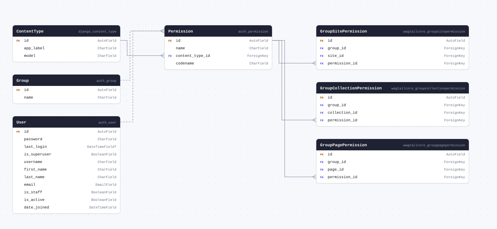

| Column | Field | Type | Null | Key | Default | Description |
| --- | --- | --- | --- | --- | --- | --- |
| `id` | `AutoField` | `integer` |  | PK | `autoincrement()` |  |
| `name` | `CharField` | `varchar(255)` |  |  |  |  |
| `content_type_id` | `ForeignKey` | `integer` |  | FK |  |  |
| `codename` | `CharField` | `varchar(100)` |  |  |  |  |

Indexes:

- index `auth_permission_content_type_id_2f476e4b` on `content_type_id`
- unique `auth_permission_content_type_id_codename_01ab375a_uniq` on `content_type_id`, `codename`

Relations:

- `content_type_id` → [ContentType](#contenttype).`id`, on delete cascade
- `group_set` — many to many with [Group](#group)
- `user_set` — many to many with [User](#user)
- [GroupSitePermission](#groupsitepermission).`permission_id` → `id`, on delete cascade
- [GroupCollectionPermission](#groupcollectionpermission).`permission_id` → `id`, on delete cascade
- [GroupPagePermission](#grouppagepermission).`permission_id` → `id`, on delete cascade

## Group

Table `auth_group`, app `auth`.

Groups are a generic way of categorizing users to apply permissions, or
some other label, to those users. A user can belong to any number of
groups.

A user in a group automatically has all the permissions granted to that
group. For example, if the group 'Site editors' has the permission
can_edit_home_page, any user in that group will have that permission.

Beyond permissions, groups are a convenient way to categorize users to
apply some label, or extended functionality, to them. For example, you
could create a group 'Special users', and you could write code that would
do special things to those users -- such as giving them access to a
members-only portion of your site, or sending them members-only email
messages.

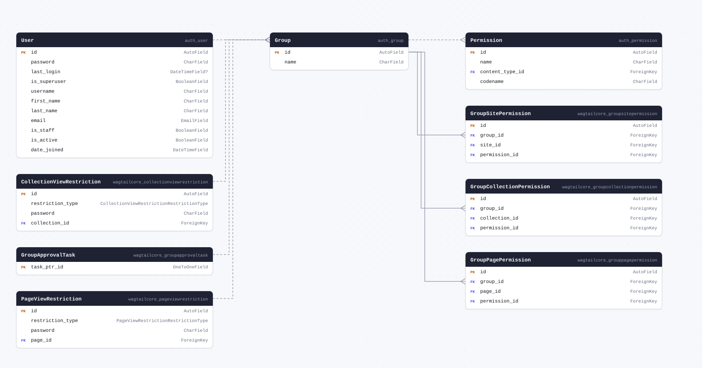

| Column | Field | Type | Null | Key | Default | Description |
| --- | --- | --- | --- | --- | --- | --- |
| `id` | `AutoField` | `integer` |  | PK | `autoincrement()` |  |
| `name` | `CharField` | `varchar(150)` |  | unique |  |  |

Relations:

- `permissions` — many to many with [Permission](#permission)
- `user_set` — many to many with [User](#user)
- [GroupSitePermission](#groupsitepermission).`group_id` → `id`, on delete cascade
- `collectionviewrestriction_set` — many to many with [CollectionViewRestriction](#collectionviewrestriction)
- [GroupCollectionPermission](#groupcollectionpermission).`group_id` → `id`, on delete cascade
- `groupapprovaltask_set` — many to many with [GroupApprovalTask](#groupapprovaltask)
- [GroupPagePermission](#grouppagepermission).`group_id` → `id`, on delete cascade
- `pageviewrestriction_set` — many to many with [PageViewRestriction](#pageviewrestriction)

## User

Table `auth_user`, app `auth`.

Columns from `AbstractUser` (abstract): `username`, `first_name`, `last_name`, `email`, `is_staff`, `is_active`, `date_joined`.

Columns from `AbstractBaseUser` (abstract): `password`, `last_login`.

Columns from `PermissionsMixin` (abstract): `is_superuser`.

Users within the Django authentication system are represented by this
model.

Username and password are required. Other fields are optional.

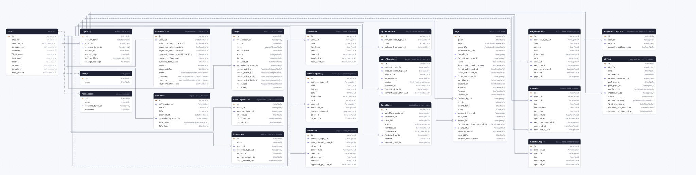

| Column | Field | Type | Null | Key | Default | Description |
| --- | --- | --- | --- | --- | --- | --- |
| `id` | `AutoField` | `integer` |  | PK | `autoincrement()` |  |
| `password` | `CharField` | `varchar(128)` |  |  |  |  |
| `last_login` | `DateTimeField` | `datetime` | yes |  |  |  |
| `is_superuser` | `BooleanField` | `bool` |  |  | `False` | Designates that this user has all permissions without explicitly assigning them. |
| `username` | `CharField` | `varchar(150)` |  | unique |  | Required. 150 characters or fewer. Letters, digits and @/./+/-/_ only. |
| `first_name` | `CharField` | `varchar(150)` |  |  |  |  |
| `last_name` | `CharField` | `varchar(150)` |  |  |  |  |
| `email` | `EmailField` | `varchar(254)` |  |  |  |  |
| `is_staff` | `BooleanField` | `bool` |  |  | `False` | Designates whether the user can log into this admin site. |
| `is_active` | `BooleanField` | `bool` |  |  | `True` | Designates whether this user should be treated as active. Unselect this instead of deleting accounts. |
| `date_joined` | `DateTimeField` | `datetime` |  |  | `now()` |  |

Relations:

- [LogEntry](#logentry).`user_id` → `id`, on delete cascade
- `groups` — many to many with [Group](#group)
- `user_permissions` — many to many with [Permission](#permission)
- [UserProfile](#userprofile).`user_id` → `id`, on delete cascade
- [Document](#document).`uploaded_by_user_id` → `id`, on delete set null
- [Image](#image).`uploaded_by_user_id` → `id`, on delete set null
- [EditingSession](#editingsession).`user_id` → `id`, on delete cascade
- [FormState](#formstate).`user_id` → `id`, on delete cascade
- [APIToken](#apitoken).`user_id` → `id`, on delete cascade
- [ModelLogEntry](#modellogentry).`user_id` → `id`, on delete do nothing, no database constraint
- [Revision](#revision).`user_id` → `id`, on delete set null
- [UploadedFile](#uploadedfile).`uploaded_by_user_id` → `id`, on delete set null
- [WorkflowState](#workflowstate).`requested_by_id` → `id`, on delete set null
- [TaskState](#taskstate).`finished_by_id` → `id`, on delete set null
- [Page](#page).`locked_by_id` → `id`, on delete set null
- [Page](#page).`owner_id` → `id`, on delete set null
- [PageLogEntry](#pagelogentry).`user_id` → `id`, on delete do nothing, no database constraint
- [Comment](#comment).`user_id` → `id`, on delete cascade
- [Comment](#comment).`resolved_by_id` → `id`, on delete set null
- [CommentReply](#commentreply).`user_id` → `id`, on delete cascade
- [PageSubscription](#pagesubscription).`user_id` → `id`, on delete cascade
- [AbTest](#abtest).`created_by_id` → `id`, on delete set null

## ContentType

Table `django_content_type`, app `contenttypes`.

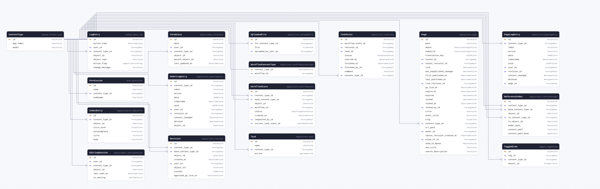

| Column | Field | Type | Null | Key | Default | Description |
| --- | --- | --- | --- | --- | --- | --- |
| `id` | `AutoField` | `integer` |  | PK | `autoincrement()` |  |
| `app_label` | `CharField` | `varchar(100)` |  |  |  |  |
| `model` | `CharField` | `varchar(100)` |  |  |  |  |

Indexes:

- unique `django_content_type_app_label_model_76bd3d3b_uniq` on `app_label`, `model`

Relations:

- [LogEntry](#logentry).`content_type_id` → `id`, on delete set null
- [Permission](#permission).`content_type_id` → `id`, on delete cascade
- [IndexEntry](#indexentry).`content_type_id` → `id`, on delete cascade
- [EditingSession](#editingsession).`content_type_id` → `id`, on delete cascade
- [FormState](#formstate).`content_type_id` → `id`, on delete cascade
- [ModelLogEntry](#modellogentry).`content_type_id` → `id`, on delete set null
- [Revision](#revision).`content_type_id` → `id`, on delete cascade
- [Revision](#revision).`base_content_type_id` → `id`, on delete cascade
- [UploadedFile](#uploadedfile).`for_content_type_id` → `id`, on delete cascade
- [WorkflowContentType](#workflowcontenttype).`content_type_id` → `id`, on delete cascade
- [WorkflowState](#workflowstate).`content_type_id` → `id`, on delete cascade
- [WorkflowState](#workflowstate).`base_content_type_id` → `id`, on delete cascade
- [Task](#task).`content_type_id` → `id`, on delete cascade
- [TaskState](#taskstate).`content_type_id` → `id`, on delete cascade
- [Page](#page).`content_type_id` → `id`, on delete set (get_default_page_content_type)
- [PageLogEntry](#pagelogentry).`content_type_id` → `id`, on delete set null
- [ReferenceIndex](#referenceindex).`content_type_id` → `id`, on delete cascade
- [ReferenceIndex](#referenceindex).`base_content_type_id` → `id`, on delete cascade
- [ReferenceIndex](#referenceindex).`to_content_type_id` → `id`, on delete cascade
- [TaggedItem](#taggeditem).`content_type_id` → `id`, on delete cascade

## Session

Table `django_session`, app `sessions`.

Columns from `AbstractBaseSession` (abstract): `session_key`, `session_data`, `expire_date`.

Django provides full support for anonymous sessions. The session
framework lets you store and retrieve arbitrary data on a
per-site-visitor basis. It stores data on the server side and
abstracts the sending and receiving of cookies. Cookies contain a
session ID -- not the data itself.

The Django sessions framework is entirely cookie-based. It does
not fall back to putting session IDs in URLs. This is an intentional
design decision. Not only does that behavior make URLs ugly, it makes
your site vulnerable to session-ID theft via the "Referer" header.

For complete documentation on using Sessions in your code, consult
the sessions documentation that is shipped with Django (also available
on the Django web site).

| Column | Field | Type | Null | Key | Default | Description |
| --- | --- | --- | --- | --- | --- | --- |
| `session_key` | `CharField` | `varchar(40)` |  | PK |  |  |
| `session_data` | `TextField` | `text` |  |  |  |  |
| `expire_date` | `DateTimeField` | `datetime` |  |  |  |  |

Indexes:

- index `django_session_expire_date_a5c62663` on `expire_date`

## FormSubmission

Table `wagtailforms_formsubmission`, app `wagtailforms`.

Columns from `AbstractFormSubmission` (abstract): `form_data`, `page_id`, `submit_time`.

Data for a Form submission.

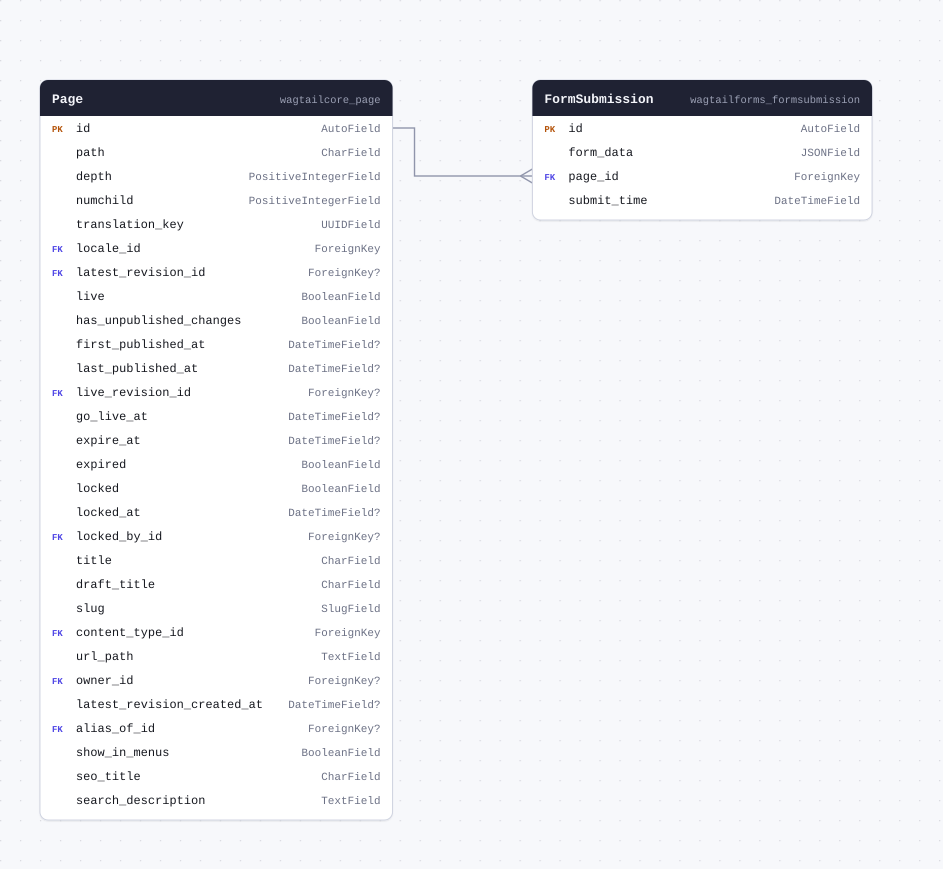

| Column | Field | Type | Null | Key | Default | Description |
| --- | --- | --- | --- | --- | --- | --- |
| `id` | `AutoField` | `integer` |  | PK | `autoincrement()` |  |
| `form_data` | `JSONField` | `text` |  |  |  |  |
| `page_id` | `ForeignKey` | `integer` |  | FK |  |  |
| `submit_time` | `DateTimeField` | `datetime` |  |  | `now()` |  |

Indexes:

- index `wagtailforms_formsubmission_page_id_e48e93e7` on `page_id`

Relations:

- `page_id` → [Page](#page).`id`, on delete cascade

## Redirect

Table `wagtailredirects_redirect`, app `wagtailredirects`.

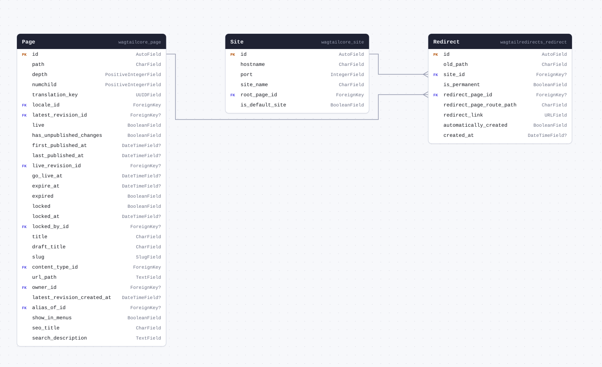

| Column | Field | Type | Null | Key | Default | Description |
| --- | --- | --- | --- | --- | --- | --- |
| `id` | `AutoField` | `integer` |  | PK | `autoincrement()` |  |
| `old_path` | `CharField` | `varchar(255)` |  |  |  |  |
| `site_id` | `ForeignKey` | `integer` | yes | FK |  |  |
| `is_permanent` | `BooleanField` | `bool` |  |  | `True` | Recommended. Permanent redirects ensure search engines forget the old page (the 'Redirect from') and index the new page instead. |
| `redirect_page_id` | `ForeignKey` | `integer` | yes | FK |  |  |
| `redirect_page_route_path` | `CharField` | `varchar(255)` |  |  |  | Optionally specify a route on the target page to redirect to. Leave blank to redirect to the default page route. |
| `redirect_link` | `URLField` | `varchar(255)` |  |  |  |  |
| `automatically_created` | `BooleanField` | `bool` |  |  | `False` |  |
| `created_at` | `DateTimeField` | `datetime` | yes |  | `now()` |  |

Indexes:

- index `wagtailredirects_redirect_old_path_bb35247b` on `old_path`
- index `wagtailredirects_redirect_site_id_780a0e1e` on `site_id`
- index `wagtailredirects_redirect_redirect_page_id_b5728a8f` on `redirect_page_id`
- unique `wagtailredirects_redirect_old_path_site_id_783622d7_uniq` on `old_path`, `site_id`

Relations:

- `site_id` → [Site](#site).`id`, on delete cascade
- `redirect_page_id` → [Page](#page).`id`, on delete cascade

## Embed

Table `wagtailembeds_embed`, app `wagtailembeds`.

When embed code is fetched from a provider (eg, youtube) we cache that code
in the database so we don't need to ask for it again.

This model is used for caching the embed html code. It also stores some
metadata which gets displayed in the editor.

If an instance of this model is deleted, it will be automatically refetched
next time the embed code is needed.

| Column | Field | Type | Null | Key | Default | Description |
| --- | --- | --- | --- | --- | --- | --- |
| `id` | `AutoField` | `integer` |  | PK | `autoincrement()` |  |
| `url` | `TextField` | `text` |  |  |  |  |
| `max_width` | `SmallIntegerField` | `smallint` | yes |  |  |  |
| `hash` | `CharField` | `varchar(32)` |  | unique |  |  |
| `type` | `EmbedType` | `varchar(10)` |  |  |  |  |
| `html` | `TextField` | `text` |  |  |  |  |
| `title` | `TextField` | `text` |  |  |  |  |
| `author_name` | `TextField` | `text` |  |  |  |  |
| `provider_name` | `TextField` | `text` |  |  |  |  |
| `thumbnail_url` | `TextField` | `text` |  |  |  |  |
| `width` | `IntegerField` | `integer` | yes |  |  |  |
| `height` | `IntegerField` | `integer` | yes |  |  |  |
| `last_updated` | `DateTimeField` | `datetime` |  |  | `now()` |  |
| `cache_until` | `DateTimeField` | `datetime` | yes |  |  |  |

Indexes:

- index `wagtailembeds_embed_cache_until_26c94bb0` on `cache_until`

## UserProfile

Table `wagtailusers_userprofile`, app `wagtailusers`.

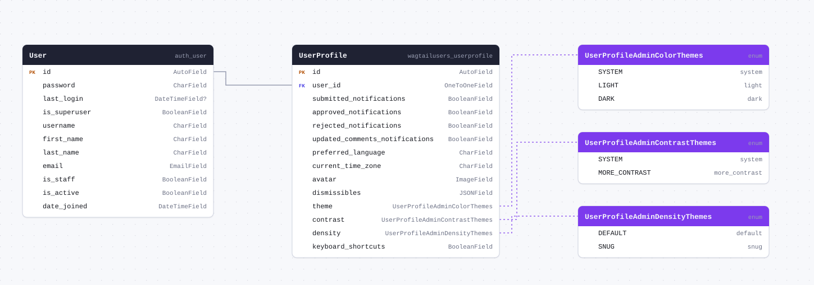

| Column | Field | Type | Null | Key | Default | Description |
| --- | --- | --- | --- | --- | --- | --- |
| `id` | `AutoField` | `integer` |  | PK | `autoincrement()` |  |
| `user_id` | `OneToOneField` | `integer` |  | FK, unique |  |  |
| `submitted_notifications` | `BooleanField` | `bool` |  |  | `True` | Receive notification when a page is submitted for moderation |
| `approved_notifications` | `BooleanField` | `bool` |  |  | `True` | Receive notification when your page edit is approved |
| `rejected_notifications` | `BooleanField` | `bool` |  |  | `True` | Receive notification when your page edit is rejected |
| `updated_comments_notifications` | `BooleanField` | `bool` |  |  | `True` | Receive notification when comments have been created, resolved, or deleted on a page that you have subscribed to receive comment notifications on |
| `preferred_language` | `CharField` | `varchar(10)` |  |  | `''` | Select language for the admin |
| `current_time_zone` | `CharField` | `varchar(40)` |  |  | `''` | Select your current time zone |
| `avatar` | `ImageField` | `varchar(100)` |  |  |  |  |
| `dismissibles` | `JSONField` | `text` |  |  | `dict()` |  |
| `theme` | `UserProfileAdminColorThemes` | `varchar(40)` |  |  | `'system'` |  |
| `contrast` | `UserProfileAdminContrastThemes` | `varchar(40)` |  |  | `'system'` |  |
| `density` | `UserProfileAdminDensityThemes` | `varchar(40)` |  |  | `'default'` |  |
| `keyboard_shortcuts` | `BooleanField` | `bool` |  |  | `True` | Enable custom keyboard shortcuts specific to Wagtail. |

Relations:

- `user_id` → [User](#user).`id`, on delete cascade

## Document

Table `wagtaildocs_document`, app `wagtaildocs`.

Columns from `AbstractDocument` (abstract): `title`, `file`, `created_at`, `uploaded_by_user_id`, `file_size`, `file_hash`.

Columns from `CollectionMember` (abstract): `collection_id`.

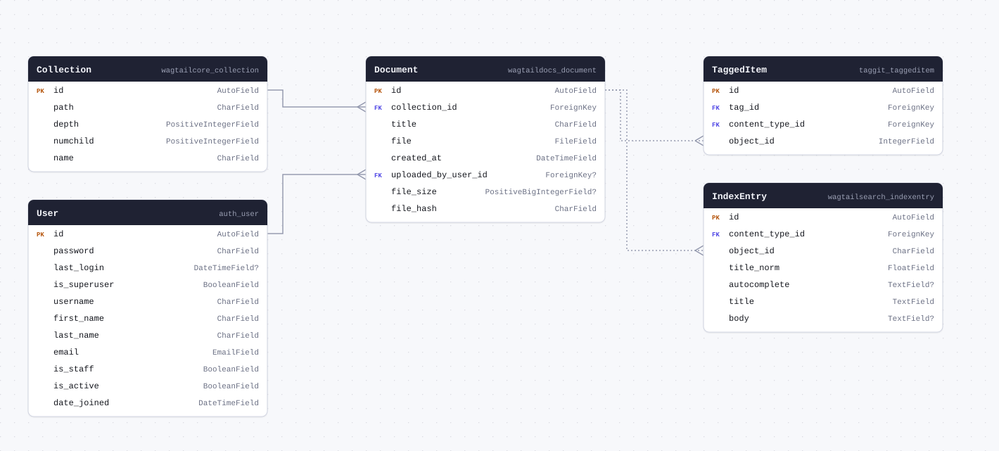

| Column | Field | Type | Null | Key | Default | Description |
| --- | --- | --- | --- | --- | --- | --- |
| `id` | `AutoField` | `integer` |  | PK | `autoincrement()` |  |
| `collection_id` | `ForeignKey` | `integer` |  | FK | `get_root_collection_id()` |  |
| `title` | `CharField` | `varchar(255)` |  |  |  |  |
| `file` | `FileField` | `varchar(100)` |  |  |  |  |
| `created_at` | `DateTimeField` | `datetime` |  |  | `now()` |  |
| `uploaded_by_user_id` | `ForeignKey` | `integer` | yes | FK |  |  |
| `file_size` | `PositiveBigIntegerField` | `bigint unsigned` | yes |  |  |  |
| `file_hash` | `CharField` | `varchar(40)` |  |  |  |  |

Indexes:

- index `wagtaildocs_document_collection_id_23881625` on `collection_id`
- index `wagtaildocs_document_uploaded_by_user_id_17258b41` on `uploaded_by_user_id`

Relations:

- `tags` — many to many with [Tag](#tag), through [TaggedItem](#taggeditem)
- `collection_id` → [Collection](#collection).`id`, on delete cascade
- `uploaded_by_user_id` → [User](#user).`id`, on delete set null
- `tagged_items` ← [TaggedItem](#taggeditem), by `content_type_id` + `object_id` (generic relation)
- `index_entries` ← [IndexEntry](#indexentry), by `content_type_id` + `object_id` (generic relation)

## Image

Table `wagtailimages_image`, app `wagtailimages`.

Columns from `AbstractImage` (abstract): `title`, `file`, `description`, `width`, `height`, `created_at`, `uploaded_by_user_id`, `focal_point_x`, `focal_point_y`, `focal_point_width`, `focal_point_height`, `file_size`, `file_hash`.

Columns from `CollectionMember` (abstract): `collection_id`.

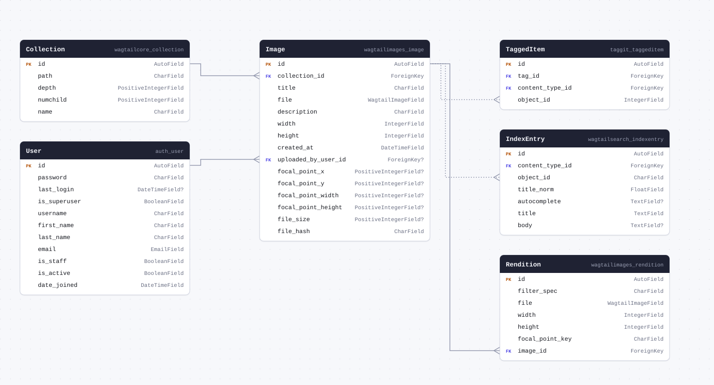

| Column | Field | Type | Null | Key | Default | Description |
| --- | --- | --- | --- | --- | --- | --- |
| `id` | `AutoField` | `integer` |  | PK | `autoincrement()` |  |
| `collection_id` | `ForeignKey` | `integer` |  | FK | `get_root_collection_id()` |  |
| `title` | `CharField` | `varchar(255)` |  |  |  |  |
| `file` | `WagtailImageField` | `varchar(100)` |  |  |  |  |
| `description` | `CharField` | `varchar(255)` |  |  | `''` |  |
| `width` | `IntegerField` | `integer` |  |  |  |  |
| `height` | `IntegerField` | `integer` |  |  |  |  |
| `created_at` | `DateTimeField` | `datetime` |  |  | `now()` |  |
| `uploaded_by_user_id` | `ForeignKey` | `integer` | yes | FK |  |  |
| `focal_point_x` | `PositiveIntegerField` | `integer unsigned` | yes |  |  |  |
| `focal_point_y` | `PositiveIntegerField` | `integer unsigned` | yes |  |  |  |
| `focal_point_width` | `PositiveIntegerField` | `integer unsigned` | yes |  |  |  |
| `focal_point_height` | `PositiveIntegerField` | `integer unsigned` | yes |  |  |  |
| `file_size` | `PositiveIntegerField` | `integer unsigned` | yes |  |  |  |
| `file_hash` | `CharField` | `varchar(40)` |  |  |  |  |

Indexes:

- index `wagtailimages_image_collection_id_c2f8af7e` on `collection_id`
- index `wagtailimages_image_created_at_86fa6cd4` on `created_at`
- index `wagtailimages_image_uploaded_by_user_id_5d73dc75` on `uploaded_by_user_id`
- index `wagtailimages_image_file_hash_fb5bbb23` on `file_hash`

Relations:

- `tags` — many to many with [Tag](#tag), through [TaggedItem](#taggeditem)
- `collection_id` → [Collection](#collection).`id`, on delete cascade
- `uploaded_by_user_id` → [User](#user).`id`, on delete set null
- `tagged_items` ← [TaggedItem](#taggeditem), by `content_type_id` + `object_id` (generic relation)
- `index_entries` ← [IndexEntry](#indexentry), by `content_type_id` + `object_id` (generic relation)
- [Rendition](#rendition).`image_id` → `id`, on delete cascade

## Rendition

Table `wagtailimages_rendition`, app `wagtailimages`.

Columns from `AbstractRendition` (abstract): `filter_spec`, `file`, `width`, `height`, `focal_point_key`.

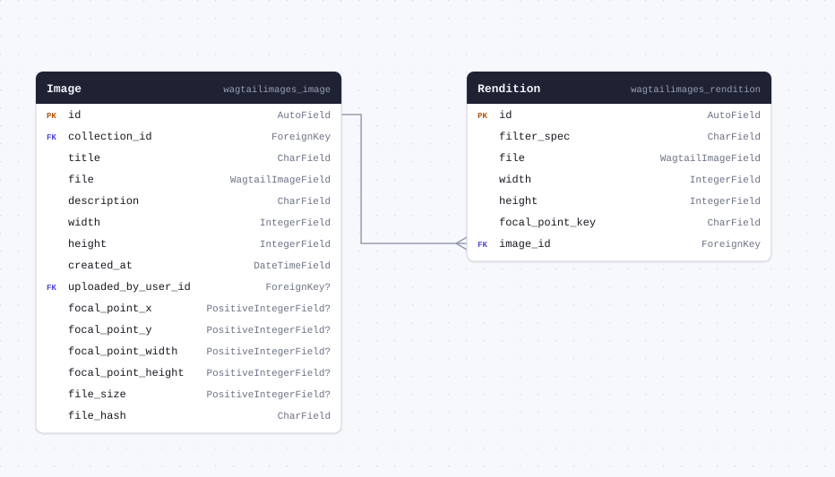

| Column | Field | Type | Null | Key | Default | Description |
| --- | --- | --- | --- | --- | --- | --- |
| `id` | `AutoField` | `integer` |  | PK | `autoincrement()` |  |
| `filter_spec` | `CharField` | `varchar(255)` |  |  |  |  |
| `file` | `WagtailImageField` | `varchar(100)` |  |  |  |  |
| `width` | `IntegerField` | `integer` |  |  |  |  |
| `height` | `IntegerField` | `integer` |  |  |  |  |
| `focal_point_key` | `CharField` | `varchar(16)` |  |  | `''` |  |
| `image_id` | `ForeignKey` | `integer` |  | FK |  |  |

Indexes:

- index `wagtailimages_rendition_filter_spec_1cba3201` on `filter_spec`
- index `wagtailimages_rendition_image_id_3e1fd774` on `image_id`
- unique `wagtailimages_rendition_image_id_filter_spec_focal_point_key_323c8fe0_uniq` on `image_id`, `filter_spec`, `focal_point_key`

Relations:

- `image_id` → [Image](#image).`id`, on delete cascade

## IndexEntry

Table `wagtailsearch_indexentry`, app `wagtailsearch`.

Columns from `AbstractSQLiteIndexEntry` (abstract): `autocomplete`, `title`, `body`.

Columns from `BaseIndexEntry` (abstract): `content_type_id`, `object_id`, `title_norm`.

The IndexEntry model that will get created in the database.

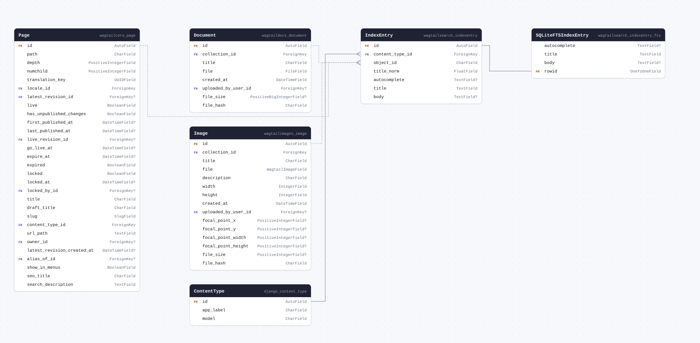

| Column | Field | Type | Null | Key | Default | Description |
| --- | --- | --- | --- | --- | --- | --- |
| `id` | `AutoField` | `integer` |  | PK | `autoincrement()` |  |
| `content_type_id` | `ForeignKey` | `integer` |  | FK |  |  |
| `object_id` | `CharField` | `varchar(50)` |  |  |  |  |
| `title_norm` | `FloatField` | `real` |  |  | `1.0` |  |
| `autocomplete` | `TextField` | `text` | yes |  |  |  |
| `title` | `TextField` | `text` |  |  |  |  |
| `body` | `TextField` | `text` | yes |  |  |  |

Indexes:

- index `wagtailsearch_indexentry_content_type_id_62ed694f` on `content_type_id`
- unique `wagtailsearch_indexentry_content_type_id_object_id_bcd7ba73_uniq` on `content_type_id`, `object_id`

Relations:

- `content_object` → any model, by `content_type_id` + `object_id` (generic foreign key)
- `object_id` → [Document](#document).`id` where `content_type_id` is Document (generic, `Document.index_entries`)
- `object_id` → [Image](#image).`id` where `content_type_id` is Image (generic, `Image.index_entries`)
- `content_type_id` → [ContentType](#contenttype).`id`, on delete cascade
- [SQLiteFTSIndexEntry](#sqliteftsindexentry).`index_entry_id` → `id`, on delete cascade
- `object_id` → [Page](#page).`id` where `content_type_id` is Page (generic, `Page.index_entries`)

## SQLiteFTSIndexEntry

Table `wagtailsearch_indexentry_fts`, app `wagtailsearch`.

Columns from `AbstractSQLiteFTSIndexEntry` (abstract): `autocomplete`, `title`, `body`.

The SQLite FTS IndexEntry model that will get created in the database if using SQLite with FTS5 support.

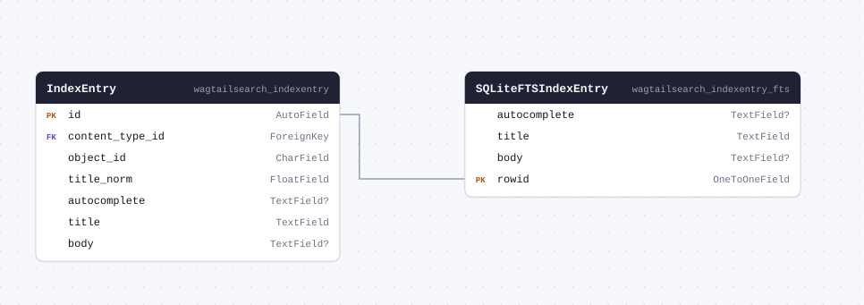

| Column | Field | Type | Null | Key | Default | Description |
| --- | --- | --- | --- | --- | --- | --- |
| `autocomplete` | `TextField` | `text` | yes |  |  |  |
| `title` | `TextField` | `text` |  |  |  |  |
| `body` | `TextField` | `text` | yes |  |  |  |
| `rowid` | `OneToOneField` | `integer` |  | PK, FK |  |  |

Relations:

- `index_entry_id` → [IndexEntry](#indexentry).`id`, on delete cascade

## Admin

Table `wagtailadmin_admin`, app `wagtailadmin`.

| Column | Field | Type | Null | Key | Default | Description |
| --- | --- | --- | --- | --- | --- | --- |
| `id` | `AutoField` | `integer` |  | PK | `autoincrement()` |  |

## EditingSession

Table `wagtailadmin_editingsession`, app `wagtailadmin`.

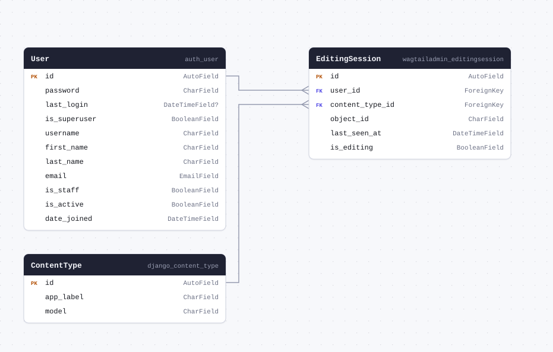

| Column | Field | Type | Null | Key | Default | Description |
| --- | --- | --- | --- | --- | --- | --- |
| `id` | `AutoField` | `integer` |  | PK | `autoincrement()` |  |
| `user_id` | `ForeignKey` | `integer` |  | FK |  |  |
| `content_type_id` | `ForeignKey` | `integer` |  | FK |  |  |
| `object_id` | `CharField` | `varchar(255)` |  |  |  |  |
| `last_seen_at` | `DateTimeField` | `datetime` |  |  |  |  |
| `is_editing` | `BooleanField` | `bool` |  |  | `False` |  |

Indexes:

- index `wagtailadmin_editingsession_user_id_6e1a9b70` on `user_id`
- index `wagtailadmin_editingsession_content_type_id_4df7730e` on `content_type_id`
- index `wagtailadmi_content_717955_idx` on `content_type_id`, `object_id`

Relations:

- `content_object` → any model, by `content_type_id` + `object_id` (generic foreign key)
- `user_id` → [User](#user).`id`, on delete cascade
- `content_type_id` → [ContentType](#contenttype).`id`, on delete cascade

## FormState

Table `wagtailadmin_formstate`, app `wagtailadmin`.

The form state of a create or edit form for a given user and object.

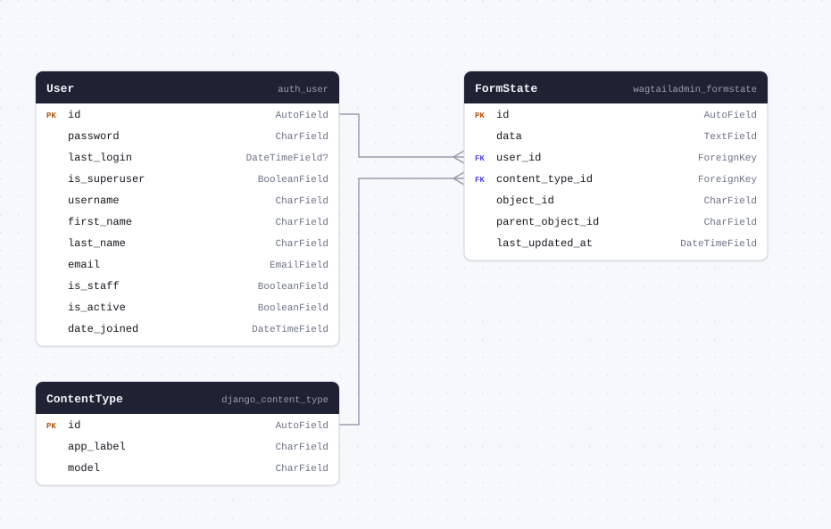

| Column | Field | Type | Null | Key | Default | Description |
| --- | --- | --- | --- | --- | --- | --- |
| `id` | `AutoField` | `integer` |  | PK | `autoincrement()` |  |
| `data` | `TextField` | `text` |  |  |  |  |
| `user_id` | `ForeignKey` | `integer` |  | FK |  |  |
| `content_type_id` | `ForeignKey` | `integer` |  | FK |  |  |
| `object_id` | `CharField` | `varchar(255)` |  |  |  |  |
| `parent_object_id` | `CharField` | `varchar(255)` |  |  |  |  |
| `last_updated_at` | `DateTimeField` | `datetime` |  |  |  |  |

Indexes:

- index `wagtailadmin_formstate_user_id_b910adc2` on `user_id`
- index `wagtailadmin_formstate_content_type_id_e32438b3` on `content_type_id`
- index `formstate_user_object` on `user_id`, `content_type_id`, `object_id`, `parent_object_id`

Relations:

- `content_object` → any model, by `content_type_id` + `object_id` (generic foreign key)
- `user_id` → [User](#user).`id`, on delete cascade
- `content_type_id` → [ContentType](#contenttype).`id`, on delete cascade

## Locale

Table `wagtailcore_locale`, app `wagtailcore`.

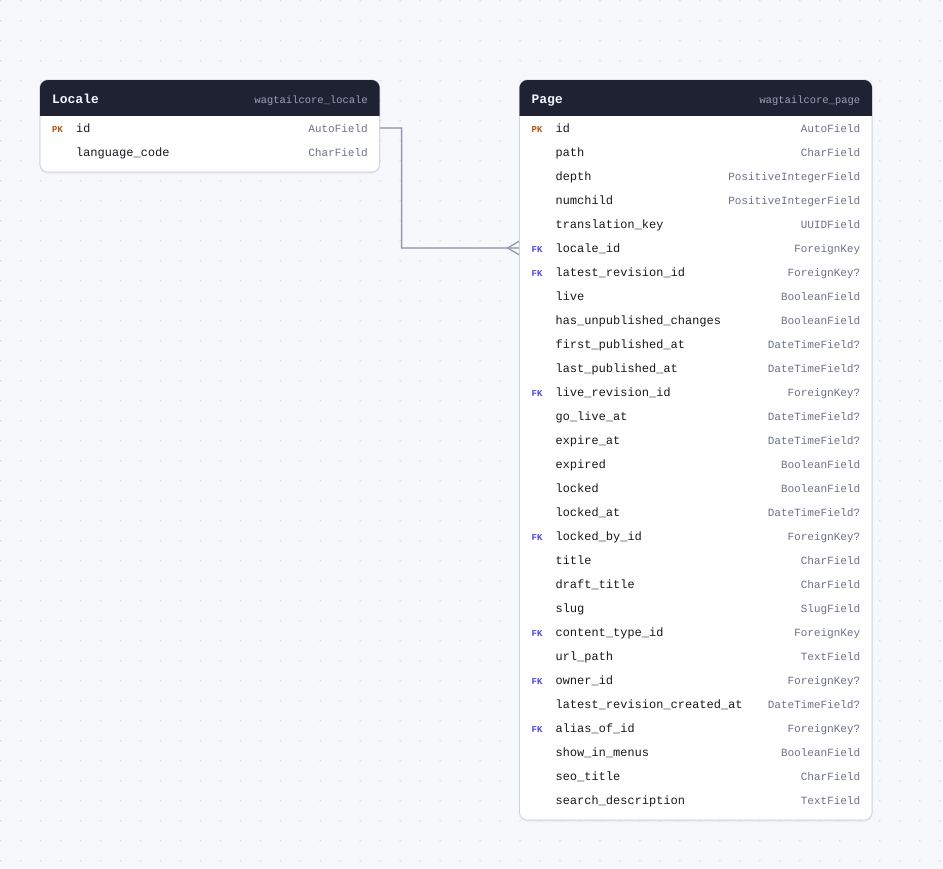

| Column | Field | Type | Null | Key | Default | Description |
| --- | --- | --- | --- | --- | --- | --- |
| `id` | `AutoField` | `integer` |  | PK | `autoincrement()` |  |
| `language_code` | `CharField` | `varchar(100)` |  | unique |  |  |

Relations:

- [Page](#page).`locale_id` → `id`, on delete protect

## Site

Table `wagtailcore_site`, app `wagtailcore`.

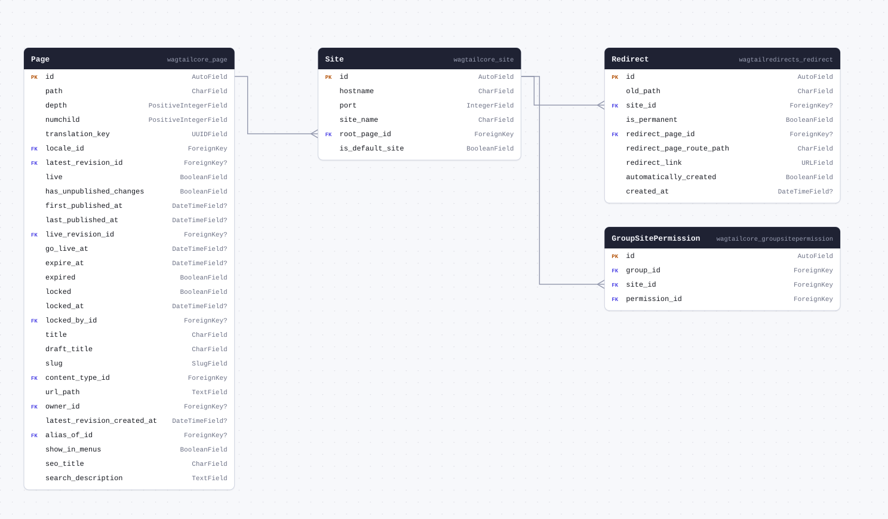

| Column | Field | Type | Null | Key | Default | Description |
| --- | --- | --- | --- | --- | --- | --- |
| `id` | `AutoField` | `integer` |  | PK | `autoincrement()` |  |
| `hostname` | `CharField` | `varchar(255)` |  |  |  |  |
| `port` | `IntegerField` | `integer` |  |  | `80` | Set this to something other than 80 if you need a specific port number to appear in URLs (e.g. development on port 8000). Does not affect request handling (so port forwarding still works). |
| `site_name` | `CharField` | `varchar(255)` |  |  |  | Human-readable name for the site. |
| `root_page_id` | `ForeignKey` | `integer` |  | FK |  |  |
| `is_default_site` | `BooleanField` | `bool` |  |  | `False` | If true, this site will handle requests for all other hostnames that do not have a site entry of their own |

Indexes:

- index `wagtailcore_site_hostname_96b20b46` on `hostname`
- index `wagtailcore_site_root_page_id_e02fb95c` on `root_page_id`
- unique `wagtailcore_site_hostname_port_2c626d70_uniq` on `hostname`, `port`

Relations:

- [Redirect](#redirect).`site_id` → `id`, on delete cascade
- `root_page_id` → [Page](#page).`id`, on delete cascade
- [GroupSitePermission](#groupsitepermission).`site_id` → `id`, on delete cascade

## GroupSitePermission

Table `wagtailcore_groupsitepermission`, app `wagtailcore`.

A rule indicating that a group has permission for some action (e.g. "edit social media settings")
within a specified site.

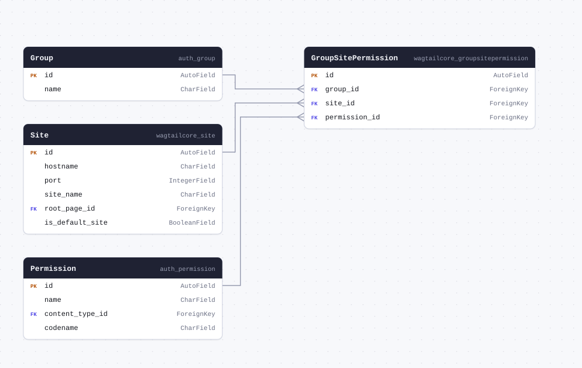

| Column | Field | Type | Null | Key | Default | Description |
| --- | --- | --- | --- | --- | --- | --- |
| `id` | `AutoField` | `integer` |  | PK | `autoincrement()` |  |
| `group_id` | `ForeignKey` | `integer` |  | FK |  |  |
| `site_id` | `ForeignKey` | `integer` |  | FK |  |  |
| `permission_id` | `ForeignKey` | `integer` |  | FK |  |  |

Indexes:

- index `wagtailcore_groupsitepermission_group_id_e5cdbee4` on `group_id`
- index `wagtailcore_groupsitepermission_site_id_245de488` on `site_id`
- index `wagtailcore_groupsitepermission_permission_id_459b1f38` on `permission_id`
- unique `wagtailcore_groupsitepermission_group_id_site_id_permission_id_a58ee30d_uniq` on `group_id`, `site_id`, `permission_id`

Relations:

- `group_id` → [Group](#group).`id`, on delete cascade
- `site_id` → [Site](#site).`id`, on delete cascade
- `permission_id` → [Permission](#permission).`id`, on delete cascade

## APIToken

Table `wagtailcore_apitoken`, app `wagtailcore`.

A bearer token authenticating API requests as a specific user. Only a
digest of the token is stored; the plaintext is shown once at creation.

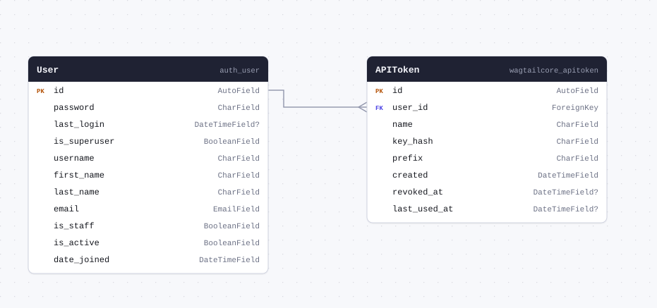

| Column | Field | Type | Null | Key | Default | Description |
| --- | --- | --- | --- | --- | --- | --- |
| `id` | `AutoField` | `integer` |  | PK | `autoincrement()` |  |
| `user_id` | `ForeignKey` | `integer` |  | FK |  |  |
| `name` | `CharField` | `varchar(255)` |  |  |  | A human-readable label to identify this token. |
| `key_hash` | `CharField` | `varchar(64)` |  | unique |  |  |
| `prefix` | `CharField` | `varchar(16)` |  |  |  |  |
| `created` | `DateTimeField` | `datetime` |  |  | `now()` |  |
| `revoked_at` | `DateTimeField` | `datetime` | yes |  |  |  |
| `last_used_at` | `DateTimeField` | `datetime` | yes |  |  |  |

Indexes:

- index `wagtailcore_apitoken_user_id_49b1141b` on `user_id`

Relations:

- `user_id` → [User](#user).`id`, on delete cascade

## ModelLogEntry

Table `wagtailcore_modellogentry`, app `wagtailcore`.

Columns from `BaseLogEntry` (abstract): `content_type_id`, `label`, `action`, `data`, `timestamp`, `uuid`, `user_id`, `revision_id`, `content_changed`, `deleted`.

Simple logger for generic Django models

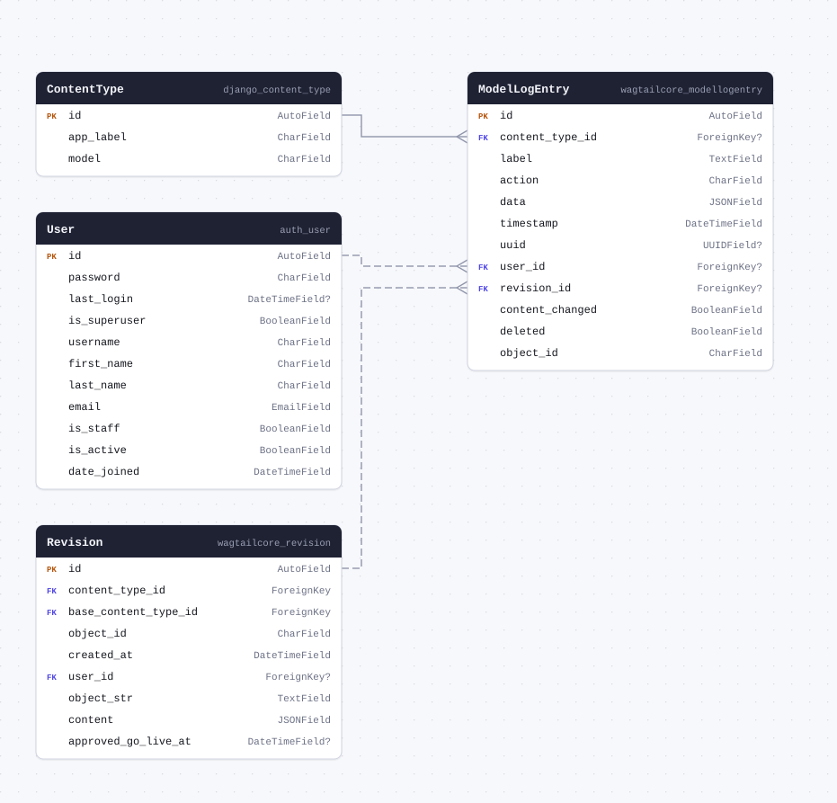

| Column | Field | Type | Null | Key | Default | Description |
| --- | --- | --- | --- | --- | --- | --- |
| `id` | `AutoField` | `integer` |  | PK | `autoincrement()` |  |
| `content_type_id` | `ForeignKey` | `integer` | yes | FK |  |  |
| `label` | `TextField` | `text` |  |  |  |  |
| `action` | `CharField` | `varchar(255)` |  |  |  |  |
| `data` | `JSONField` | `text` |  |  | `dict()` |  |
| `timestamp` | `DateTimeField` | `datetime` |  |  |  |  |
| `uuid` | `UUIDField` | `char(32)` | yes |  |  | Log entries that happened as part of the same user action are assigned the same UUID |
| `user_id` | `ForeignKey` | `integer` | yes | FK (no constraint) |  |  |
| `revision_id` | `ForeignKey` | `integer` | yes | FK (no constraint) |  |  |
| `content_changed` | `BooleanField` | `bool` |  |  | `False` |  |
| `deleted` | `BooleanField` | `bool` |  |  | `False` |  |
| `object_id` | `CharField` | `varchar(255)` |  |  |  |  |

Indexes:

- index `wagtailcore_modellogentry_content_type_id_68849e77` on `content_type_id`
- index `wagtailcore_modellogentry_action_d2d856ee` on `action`
- index `wagtailcore_modellogentry_timestamp_9694521b` on `timestamp`
- index `wagtailcore_modellogentry_user_id_0278d1bf` on `user_id`
- index `wagtailcore_modellogentry_revision_id_df6ca33a` on `revision_id`
- index `wagtailcore_modellogentry_content_changed_8bc39742` on `content_changed`
- index `wagtailcore_modellogentry_object_id_e0e7d4ef` on `object_id`
- index `wagtailcore_uuid_d6363b_idx` on `uuid`, `action`, `timestamp` desc

Relations:

- `content_type_id` → [ContentType](#contenttype).`id`, on delete set null
- `user_id` → [User](#user).`id`, on delete do nothing, no database constraint
- `revision_id` → [Revision](#revision).`id`, on delete do nothing, no database constraint

## Revision

Table `wagtailcore_revision`, app `wagtailcore`.

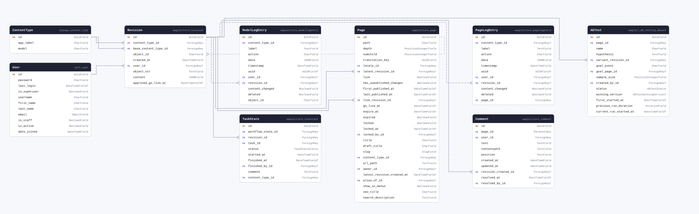

| Column | Field | Type | Null | Key | Default | Description |
| --- | --- | --- | --- | --- | --- | --- |
| `id` | `AutoField` | `integer` |  | PK | `autoincrement()` |  |
| `content_type_id` | `ForeignKey` | `integer` |  | FK |  |  |
| `base_content_type_id` | `ForeignKey` | `integer` |  | FK |  |  |
| `object_id` | `CharField` | `varchar(255)` |  |  |  |  |
| `created_at` | `DateTimeField` | `datetime` |  |  |  |  |
| `user_id` | `ForeignKey` | `integer` | yes | FK |  |  |
| `object_str` | `TextField` | `text` |  |  | `''` |  |
| `content` | `JSONField` | `text` |  |  |  |  |
| `approved_go_live_at` | `DateTimeField` | `datetime` | yes |  |  |  |

Indexes:

- index `wagtailcore_revision_content_type_id_c8cb69c0` on `content_type_id`
- index `wagtailcore_revision_base_content_type_id_5b4ef7bd` on `base_content_type_id`
- index `wagtailcore_revision_created_at_81450aa6` on `created_at`
- index `wagtailcore_revision_user_id_03df83b0` on `user_id`
- index `wagtailcore_revision_approved_go_live_at_88d3dee5` on `approved_go_live_at`
- index `content_object_idx` on `content_type_id`, `object_id`
- index `base_content_object_idx` on `base_content_type_id`, `object_id`

Relations:

- `content_object` → any model, by `content_type_id` + `object_id` (generic foreign key)
- [ModelLogEntry](#modellogentry).`revision_id` → `id`, on delete do nothing, no database constraint
- `content_type_id` → [ContentType](#contenttype).`id`, on delete cascade
- `base_content_type_id` → [ContentType](#contenttype).`id`, on delete cascade
- `user_id` → [User](#user).`id`, on delete set null
- [TaskState](#taskstate).`revision_id` → `id`, on delete cascade
- [Page](#page).`latest_revision_id` → `id`, on delete set null
- [Page](#page).`live_revision_id` → `id`, on delete set null
- `object_id` → [Page](#page).`id` where `content_type_id` is Page (generic, `Page._revisions`)
- [PageLogEntry](#pagelogentry).`revision_id` → `id`, on delete do nothing, no database constraint
- [Comment](#comment).`revision_created_id` → `id`, on delete cascade
- [AbTest](#abtest).`variant_revision_id` → `id`, on delete protect

## CollectionViewRestriction

Table `wagtailcore_collectionviewrestriction`, app `wagtailcore`.

Columns from `BaseViewRestriction` (abstract): `restriction_type`, `password`.

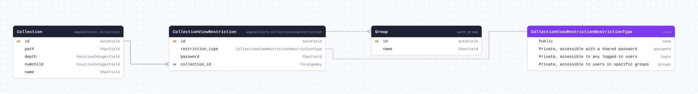

| Column | Field | Type | Null | Key | Default | Description |
| --- | --- | --- | --- | --- | --- | --- |
| `id` | `AutoField` | `integer` |  | PK | `autoincrement()` |  |
| `restriction_type` | `CollectionViewRestrictionRestrictionType` | `varchar(20)` |  |  |  |  |
| `password` | `CharField` | `varchar(255)` |  |  |  | Shared passwords should not be used to protect sensitive content. Anyone who has this password will be able to view the content. |
| `collection_id` | `ForeignKey` | `integer` |  | FK |  |  |

Indexes:

- index `wagtailcore_collectionviewrestriction_collection_id_761908ec` on `collection_id`

Relations:

- `collection_id` → [Collection](#collection).`id`, on delete cascade
- `groups` — many to many with [Group](#group)

## Collection

Table `wagtailcore_collection`, app `wagtailcore`.

Columns from `MP_Node` (abstract): `path`, `depth`, `numchild`.

A location in which resources such as images and documents can be grouped

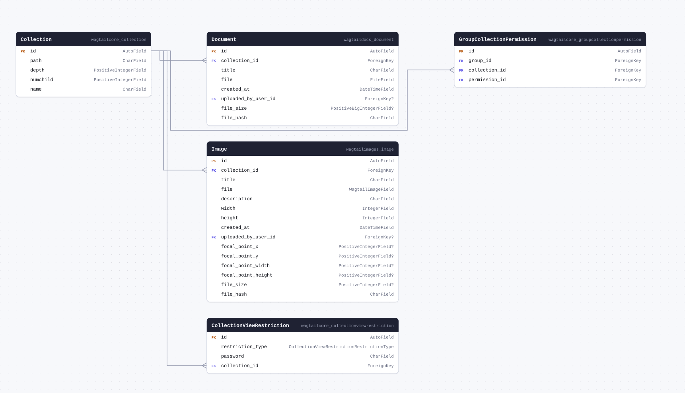

| Column | Field | Type | Null | Key | Default | Description |
| --- | --- | --- | --- | --- | --- | --- |
| `id` | `AutoField` | `integer` |  | PK | `autoincrement()` |  |
| `path` | `CharField` | `varchar(255)` |  | unique |  |  |
| `depth` | `PositiveIntegerField` | `integer unsigned` |  |  |  |  |
| `numchild` | `PositiveIntegerField` | `integer unsigned` |  |  | `0` |  |
| `name` | `CharField` | `varchar(255)` |  |  |  |  |

Relations:

- [Document](#document).`collection_id` → `id`, on delete cascade
- [Image](#image).`collection_id` → `id`, on delete cascade
- [CollectionViewRestriction](#collectionviewrestriction).`collection_id` → `id`, on delete cascade
- [GroupCollectionPermission](#groupcollectionpermission).`collection_id` → `id`, on delete cascade

## GroupCollectionPermission

Table `wagtailcore_groupcollectionpermission`, app `wagtailcore`.

A rule indicating that a group has permission for some action (e.g. "create document")
within a specified collection.

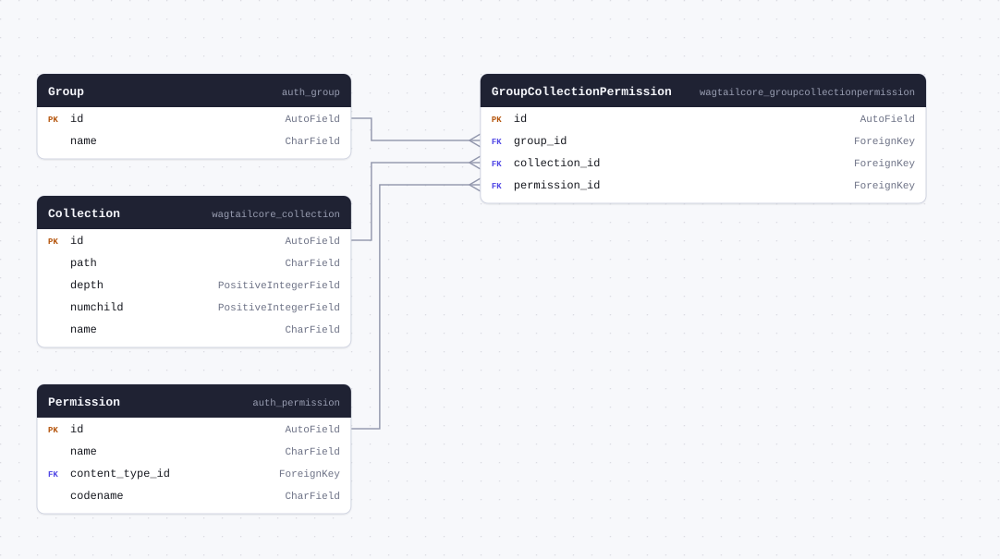

| Column | Field | Type | Null | Key | Default | Description |
| --- | --- | --- | --- | --- | --- | --- |
| `id` | `AutoField` | `integer` |  | PK | `autoincrement()` |  |
| `group_id` | `ForeignKey` | `integer` |  | FK |  |  |
| `collection_id` | `ForeignKey` | `integer` |  | FK |  |  |
| `permission_id` | `ForeignKey` | `integer` |  | FK |  |  |

Indexes:

- index `wagtailcore_groupcollectionpermission_group_id_05d61460` on `group_id`
- index `wagtailcore_groupcollectionpermission_collection_id_5423575a` on `collection_id`
- index `wagtailcore_groupcollectionpermission_permission_id_1b626275` on `permission_id`
- unique `wagtailcore_groupcollectionpermission_group_id_collection_id_permission_id_a21cefe9_uniq` on `group_id`, `collection_id`, `permission_id`

Relations:

- `group_id` → [Group](#group).`id`, on delete cascade
- `collection_id` → [Collection](#collection).`id`, on delete cascade
- `permission_id` → [Permission](#permission).`id`, on delete cascade

## UploadedFile

Table `wagtailcore_uploadedfile`, app `wagtailcore`.

Temporary storage for media fields uploaded through the multiple image/document uploader.
When validation rules (e.g. required metadata fields) prevent creating an Image/Document object from the file alone.
In this case, the file is stored against this model, to be turned into an Image/Document object once the full form
has been filled in.

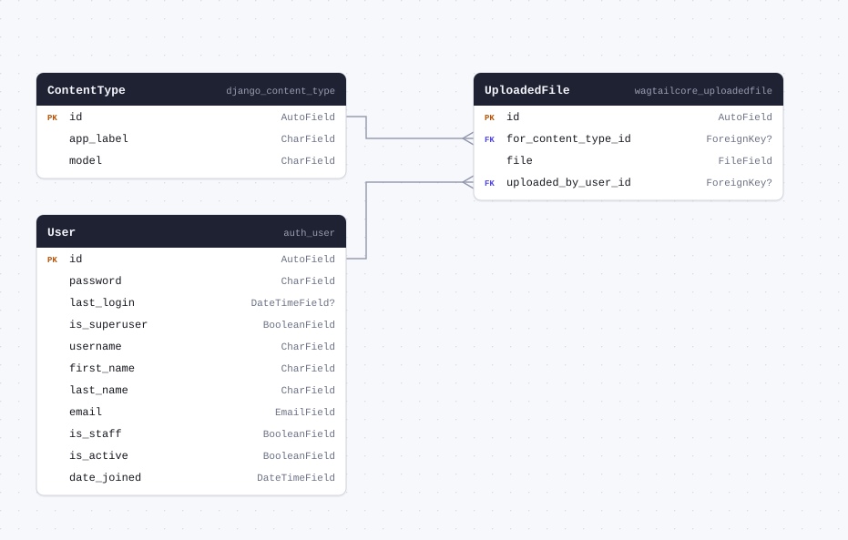

| Column | Field | Type | Null | Key | Default | Description |
| --- | --- | --- | --- | --- | --- | --- |
| `id` | `AutoField` | `integer` |  | PK | `autoincrement()` |  |
| `for_content_type_id` | `ForeignKey` | `integer` | yes | FK |  |  |
| `file` | `FileField` | `varchar(200)` |  |  |  |  |
| `uploaded_by_user_id` | `ForeignKey` | `integer` | yes | FK |  |  |

Indexes:

- index `wagtailcore_uploadedfile_for_content_type_id_b0fc87b2` on `for_content_type_id`
- index `wagtailcore_uploadedfile_uploaded_by_user_id_c7580fe8` on `uploaded_by_user_id`

Relations:

- `for_content_type_id` → [ContentType](#contenttype).`id`, on delete cascade
- `uploaded_by_user_id` → [User](#user).`id`, on delete set null

## WorkflowContentType

Table `wagtailcore_workflowcontenttype`, app `wagtailcore`.

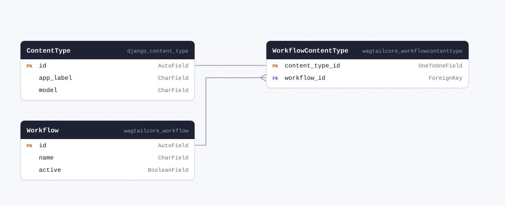

| Column | Field | Type | Null | Key | Default | Description |
| --- | --- | --- | --- | --- | --- | --- |
| `content_type_id` | `OneToOneField` | `integer` |  | PK, FK |  |  |
| `workflow_id` | `ForeignKey` | `integer` |  | FK |  |  |

Indexes:

- index `wagtailcore_workflowcontenttype_workflow_id_9aad7cd2` on `workflow_id`

Relations:

- `content_type_id` → [ContentType](#contenttype).`id`, on delete cascade
- `workflow_id` → [Workflow](#workflow).`id`, on delete cascade

## WorkflowState

Table `wagtailcore_workflowstate`, app `wagtailcore`.

Tracks the status of a started Workflow on an object.

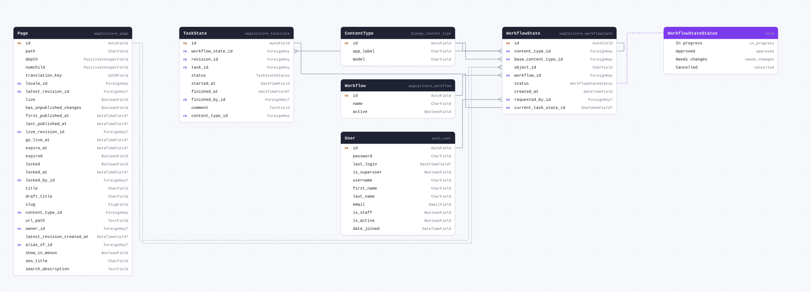

| Column | Field | Type | Null | Key | Default | Description |
| --- | --- | --- | --- | --- | --- | --- |
| `id` | `AutoField` | `integer` |  | PK | `autoincrement()` |  |
| `content_type_id` | `ForeignKey` | `integer` |  | FK |  |  |
| `base_content_type_id` | `ForeignKey` | `integer` |  | FK |  |  |
| `object_id` | `CharField` | `varchar(255)` |  |  |  |  |
| `workflow_id` | `ForeignKey` | `integer` |  | FK |  |  |
| `status` | `WorkflowStateStatus` | `varchar(50)` |  |  | `'in_progress'` |  |
| `created_at` | `DateTimeField` | `datetime` |  |  | `now()` |  |
| `requested_by_id` | `ForeignKey` | `integer` | yes | FK |  |  |
| `current_task_state_id` | `OneToOneField` | `integer` | yes | FK, unique |  |  |

Indexes:

- index `wagtailcore_workflowstate_content_type_id_2bb78ce1` on `content_type_id`
- index `wagtailcore_workflowstate_base_content_type_id_a30dc576` on `base_content_type_id`
- index `wagtailcore_workflowstate_workflow_id_1f18378f` on `workflow_id`
- index `wagtailcore_workflowstate_requested_by_id_4090bca3` on `requested_by_id`
- unique `unique_in_progress_workflow` on `base_content_type_id`, `object_id` where `"status" IN ('in_progress', 'needs_changes')`
- index `workflowstate_ct_id_idx` on `content_type_id`, `object_id`
- index `workflowstate_base_ct_id_idx` on `base_content_type_id`, `object_id`

Relations:

- `content_object` → any model, by `base_content_type_id` + `object_id` (generic foreign key)
- `content_type_id` → [ContentType](#contenttype).`id`, on delete cascade
- `base_content_type_id` → [ContentType](#contenttype).`id`, on delete cascade
- `workflow_id` → [Workflow](#workflow).`id`, on delete cascade
- `requested_by_id` → [User](#user).`id`, on delete set null
- `current_task_state_id` → [TaskState](#taskstate).`id`, on delete set null
- [TaskState](#taskstate).`workflow_state_id` → `id`, on delete cascade
- `object_id` → [Page](#page).`id` where `base_content_type_id` is Page (generic, `Page._workflow_states`)
- `object_id` → [Page](#page).`id` where `base_content_type_id` is Page (generic, `Page._specific_workflow_states`)

## Workflow

Table `wagtailcore_workflow`, app `wagtailcore`.

Columns from `AbstractWorkflow` (abstract): `name`, `active`.

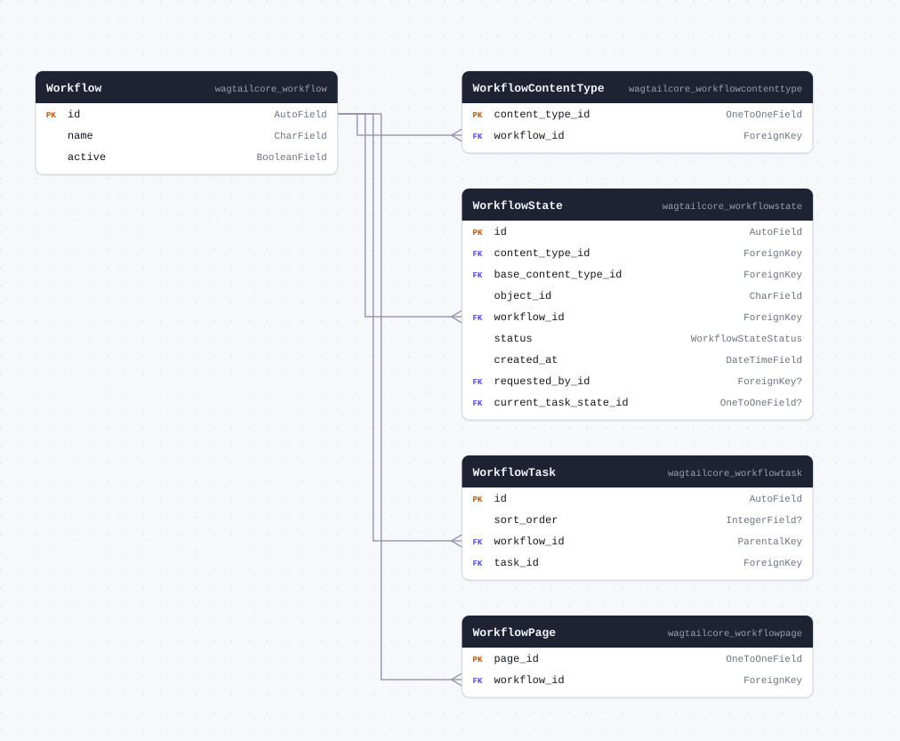

| Column | Field | Type | Null | Key | Default | Description |
| --- | --- | --- | --- | --- | --- | --- |
| `id` | `AutoField` | `integer` |  | PK | `autoincrement()` |  |
| `name` | `CharField` | `varchar(255)` |  |  |  |  |
| `active` | `BooleanField` | `bool` |  |  | `True` | Active workflows can be added to pages/snippets. Deactivating a workflow does not remove it from existing pages/snippets. |

Relations:

- [WorkflowContentType](#workflowcontenttype).`workflow_id` → `id`, on delete cascade
- [WorkflowState](#workflowstate).`workflow_id` → `id`, on delete cascade
- [WorkflowTask](#workflowtask).`workflow_id` → `id`, on delete cascade
- [WorkflowPage](#workflowpage).`workflow_id` → `id`, on delete cascade

## WorkflowTask

Table `wagtailcore_workflowtask`, app `wagtailcore`.

Columns from `Orderable` (abstract): `sort_order`.

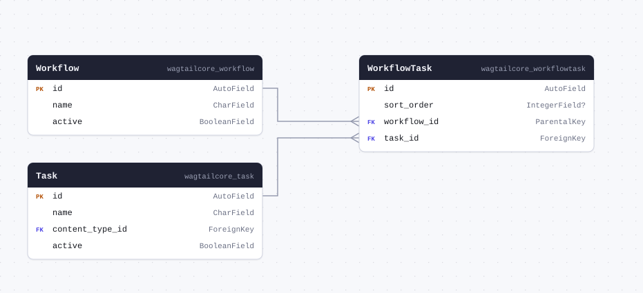

| Column | Field | Type | Null | Key | Default | Description |
| --- | --- | --- | --- | --- | --- | --- |
| `id` | `AutoField` | `integer` |  | PK | `autoincrement()` |  |
| `sort_order` | `IntegerField` | `integer` | yes |  |  |  |
| `workflow_id` | `ParentalKey` | `integer` |  | FK |  |  |
| `task_id` | `ForeignKey` | `integer` |  | FK |  |  |

Indexes:

- index `wagtailcore_workflowtask_workflow_id_b9717175` on `workflow_id`
- index `wagtailcore_workflowtask_task_id_ce7716fe` on `task_id`
- unique `wagtailcore_workflowtask_workflow_id_task_id_4ec7a62b_uniq` on `workflow_id`, `task_id`

Relations:

- `workflow_id` → [Workflow](#workflow).`id`, on delete cascade
- `task_id` → [Task](#task).`id`, on delete cascade

## Task

Table `wagtailcore_task`, app `wagtailcore`.

Subclasses (multi-table): [GroupApprovalTask](#groupapprovaltask).

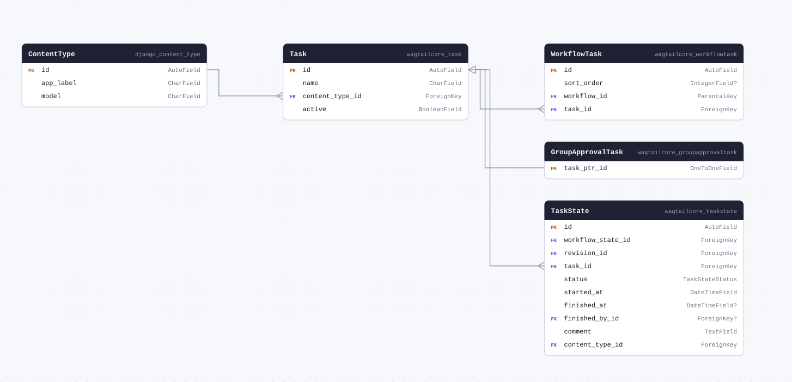

| Column | Field | Type | Null | Key | Default | Description |
| --- | --- | --- | --- | --- | --- | --- |
| `id` | `AutoField` | `integer` |  | PK | `autoincrement()` |  |
| `name` | `CharField` | `varchar(255)` |  |  |  |  |
| `content_type_id` | `ForeignKey` | `integer` |  | FK |  |  |
| `active` | `BooleanField` | `bool` |  |  | `True` | Active tasks can be added to workflows. Deactivating a task does not remove it from existing workflows. |

Indexes:

- index `wagtailcore_task_content_type_id_249ab8ba` on `content_type_id`

Relations:

- [WorkflowTask](#workflowtask).`task_id` → `id`, on delete cascade
- `content_type_id` → [ContentType](#contenttype).`id`, on delete cascade
- [GroupApprovalTask](#groupapprovaltask).`task_ptr_id` → `id`, parent link, on delete cascade
- [TaskState](#taskstate).`task_id` → `id`, on delete cascade

## GroupApprovalTask

Table `wagtailcore_groupapprovaltask`, app `wagtailcore`.

Inherits from [Task](#task) (multi-table): its rows are joined on `task_ptr_id`.

Columns from `AbstractGroupApprovalTask` (abstract): `task_ptr_id`.

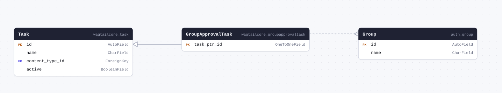

| Column | Field | Type | Null | Key | Default | Description |
| --- | --- | --- | --- | --- | --- | --- |
| `task_ptr_id` | `OneToOneField` | `integer` |  | PK, FK |  |  |

Relations:

- `task_ptr_id` → [Task](#task).`id`, parent link, on delete cascade
- `groups` — many to many with [Group](#group)

## TaskState

Table `wagtailcore_taskstate`, app `wagtailcore`.

Tracks the status of a given Task for a particular revision.

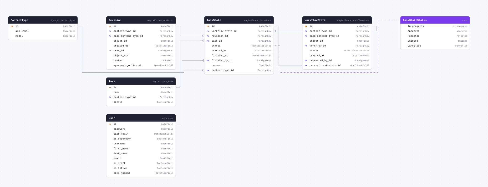

| Column | Field | Type | Null | Key | Default | Description |
| --- | --- | --- | --- | --- | --- | --- |
| `id` | `AutoField` | `integer` |  | PK | `autoincrement()` |  |
| `workflow_state_id` | `ForeignKey` | `integer` |  | FK |  |  |
| `revision_id` | `ForeignKey` | `integer` |  | FK |  |  |
| `task_id` | `ForeignKey` | `integer` |  | FK |  |  |
| `status` | `TaskStateStatus` | `varchar(50)` |  |  | `'in_progress'` |  |
| `started_at` | `DateTimeField` | `datetime` |  |  | `now()` |  |
| `finished_at` | `DateTimeField` | `datetime` | yes |  |  |  |
| `finished_by_id` | `ForeignKey` | `integer` | yes | FK |  |  |
| `comment` | `TextField` | `text` |  |  |  |  |
| `content_type_id` | `ForeignKey` | `integer` |  | FK |  |  |

Indexes:

- index `wagtailcore_taskstate_workflow_state_id_9239a775` on `workflow_state_id`
- index `wagtailcore_taskstate_revision_id_df25a499` on `revision_id`
- index `wagtailcore_taskstate_task_id_c3677c34` on `task_id`
- index `wagtailcore_taskstate_finished_by_id_13f98229` on `finished_by_id`
- index `wagtailcore_taskstate_content_type_id_0a758fdc` on `content_type_id`

Relations:

- [WorkflowState](#workflowstate).`current_task_state_id` → `id`, on delete set null
- `workflow_state_id` → [WorkflowState](#workflowstate).`id`, on delete cascade
- `revision_id` → [Revision](#revision).`id`, on delete cascade
- `task_id` → [Task](#task).`id`, on delete cascade
- `finished_by_id` → [User](#user).`id`, on delete set null
- `content_type_id` → [ContentType](#contenttype).`id`, on delete cascade

## Page

Table `wagtailcore_page`, app `wagtailcore`.

Columns from `AbstractPage` (abstract): `title`, `draft_title`, `slug`, `content_type_id`, `url_path`, `owner_id`, `latest_revision_created_at`, `alias_of_id`.

Columns from `DraftStateMixin` (abstract): `live`, `has_unpublished_changes`, `first_published_at`, `last_published_at`, `live_revision_id`, `go_live_at`, `expire_at`, `expired`.

Columns from `LockableMixin` (abstract): `locked`, `locked_at`, `locked_by_id`.

Columns from `RevisionMixin` (abstract): `latest_revision_id`.

Columns from `TranslatableMixin` (abstract): `translation_key`, `locale_id`.

Columns from `MP_Node` (abstract): `path`, `depth`, `numchild`.

Columns from `DefaultBasePageMixin` (abstract): `seo_title`, `search_description`.

Columns from `ShowInMenusMixin` (abstract): `show_in_menus`.

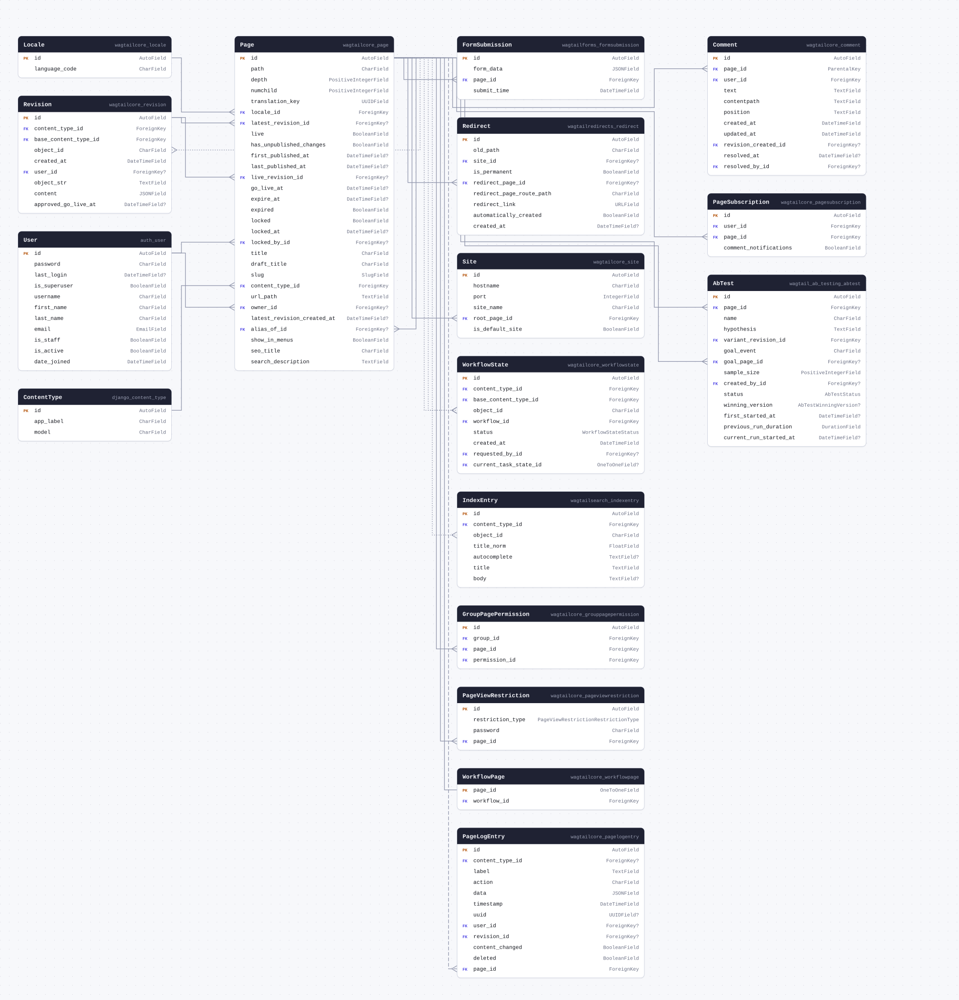

| Column | Field | Type | Null | Key | Default | Description |
| --- | --- | --- | --- | --- | --- | --- |
| `id` | `AutoField` | `integer` |  | PK | `autoincrement()` |  |
| `path` | `CharField` | `varchar(255)` |  | unique |  |  |
| `depth` | `PositiveIntegerField` | `integer unsigned` |  |  |  |  |
| `numchild` | `PositiveIntegerField` | `integer unsigned` |  |  | `0` |  |
| `translation_key` | `UUIDField` | `char(32)` |  |  | `uuid4()` |  |
| `locale_id` | `ForeignKey` | `integer` |  | FK |  |  |
| `latest_revision_id` | `ForeignKey` | `integer` | yes | FK |  |  |
| `live` | `BooleanField` | `bool` |  |  | `True` |  |
| `has_unpublished_changes` | `BooleanField` | `bool` |  |  | `False` |  |
| `first_published_at` | `DateTimeField` | `datetime` | yes |  |  |  |
| `last_published_at` | `DateTimeField` | `datetime` | yes |  |  |  |
| `live_revision_id` | `ForeignKey` | `integer` | yes | FK |  |  |
| `go_live_at` | `DateTimeField` | `datetime` | yes |  |  |  |
| `expire_at` | `DateTimeField` | `datetime` | yes |  |  |  |
| `expired` | `BooleanField` | `bool` |  |  | `False` |  |
| `locked` | `BooleanField` | `bool` |  |  | `False` |  |
| `locked_at` | `DateTimeField` | `datetime` | yes |  |  |  |
| `locked_by_id` | `ForeignKey` | `integer` | yes | FK |  |  |
| `title` | `CharField` | `varchar(255)` |  |  |  | The page title as you'd like it to be seen by the public |
| `draft_title` | `CharField` | `varchar(255)` |  |  |  |  |
| `slug` | `SlugField` | `varchar(255)` |  |  |  | The name of the page as it will appear in URLs e.g http://domain.com/blog/[my-slug]/ |
| `content_type_id` | `ForeignKey` | `integer` |  | FK |  |  |
| `url_path` | `TextField` | `text` |  |  |  |  |
| `owner_id` | `ForeignKey` | `integer` | yes | FK |  |  |
| `latest_revision_created_at` | `DateTimeField` | `datetime` | yes |  |  |  |
| `alias_of_id` | `ForeignKey` | `integer` | yes | FK |  |  |
| `show_in_menus` | `BooleanField` | `bool` |  |  | `False` | Whether a link to this page will appear in automatically generated menus |
| `seo_title` | `CharField` | `varchar(255)` |  |  |  | The name of the page displayed on search engine results as the clickable headline. |
| `search_description` | `TextField` | `text` |  |  |  | The descriptive text displayed underneath a headline in search engine results. |

Indexes:

- index `wagtailcore_page_locale_id_3c7e30a6` on `locale_id`
- index `wagtailcore_page_latest_revision_id_e60fef51` on `latest_revision_id`
- index `wagtailcore_page_first_published_at_2b5dd637` on `first_published_at`
- index `wagtailcore_page_live_revision_id_930bd822` on `live_revision_id`
- index `wagtailcore_page_locked_by_id_bcb86245` on `locked_by_id`
- index `wagtailcore_page_slug_e7c11b8f` on `slug`
- index `wagtailcore_page_content_type_id_c28424df` on `content_type_id`
- index `wagtailcore_page_owner_id_fbf7c332` on `owner_id`
- index `wagtailcore_page_alias_of_id_12945502` on `alias_of_id`
- unique `wagtailcore_page_translation_key_locale_id_9b041bad_uniq` on `translation_key`, `locale_id`

Relations:

- [FormSubmission](#formsubmission).`page_id` → `id`, on delete cascade
- [Redirect](#redirect).`redirect_page_id` → `id`, on delete cascade
- [Site](#site).`root_page_id` → `id`, on delete cascade
- `locale_id` → [Locale](#locale).`id`, on delete protect
- `latest_revision_id` → [Revision](#revision).`id`, on delete set null
- `live_revision_id` → [Revision](#revision).`id`, on delete set null
- `locked_by_id` → [User](#user).`id`, on delete set null
- `content_type_id` → [ContentType](#contenttype).`id`, on delete set (get_default_page_content_type)
- `owner_id` → [User](#user).`id`, on delete set null
- `alias_of_id` → [Page](#page).`id`, on delete set null
- `_revisions` ← [Revision](#revision), by `content_type_id` + `object_id` (generic relation)
- `_workflow_states` ← [WorkflowState](#workflowstate), by `base_content_type_id` + `object_id` (generic relation)
- `_specific_workflow_states` ← [WorkflowState](#workflowstate), by `base_content_type_id` + `object_id` (generic relation)
- `index_entries` ← [IndexEntry](#indexentry), by `content_type_id` + `object_id` (generic relation)
- [GroupPagePermission](#grouppagepermission).`page_id` → `id`, on delete cascade
- [PageViewRestriction](#pageviewrestriction).`page_id` → `id`, on delete cascade
- [WorkflowPage](#workflowpage).`page_id` → `id`, on delete cascade
- [PageLogEntry](#pagelogentry).`page_id` → `id`, on delete do nothing, no database constraint
- [Comment](#comment).`page_id` → `id`, on delete cascade
- [PageSubscription](#pagesubscription).`page_id` → `id`, on delete cascade
- [AbTest](#abtest).`page_id` → `id`, on delete cascade
- [AbTest](#abtest).`goal_page_id` → `id`, on delete set null

## GroupPagePermission

Table `wagtailcore_grouppagepermission`, app `wagtailcore`.

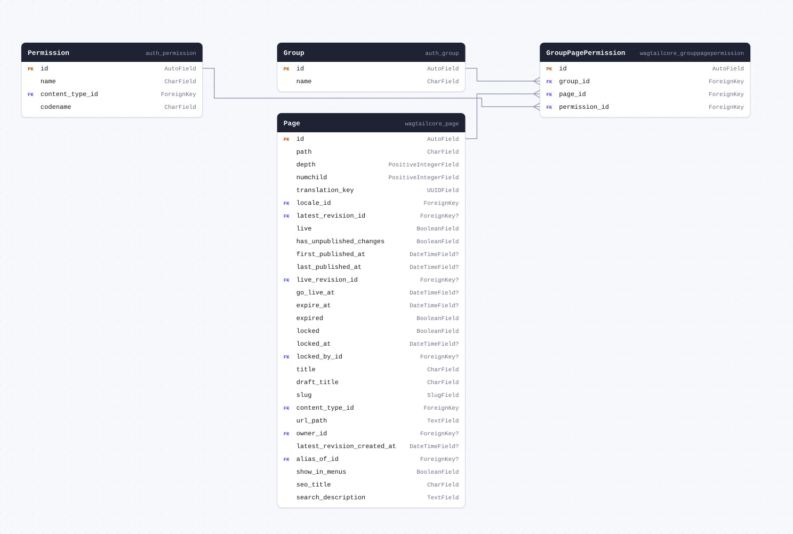

| Column | Field | Type | Null | Key | Default | Description |
| --- | --- | --- | --- | --- | --- | --- |
| `id` | `AutoField` | `integer` |  | PK | `autoincrement()` |  |
| `group_id` | `ForeignKey` | `integer` |  | FK |  |  |
| `page_id` | `ForeignKey` | `integer` |  | FK |  |  |
| `permission_id` | `ForeignKey` | `integer` |  | FK |  |  |

Indexes:

- index `wagtailcore_grouppagepermission_group_id_fc07e671` on `group_id`
- index `wagtailcore_grouppagepermission_page_id_710b114a` on `page_id`
- index `wagtailcore_grouppagepermission_permission_id_05acb22e` on `permission_id`
- unique `unique_permission` on `group_id`, `page_id`, `permission_id`

Relations:

- `group_id` → [Group](#group).`id`, on delete cascade
- `page_id` → [Page](#page).`id`, on delete cascade
- `permission_id` → [Permission](#permission).`id`, on delete cascade

## PageViewRestriction

Table `wagtailcore_pageviewrestriction`, app `wagtailcore`.

Columns from `BaseViewRestriction` (abstract): `restriction_type`, `password`.

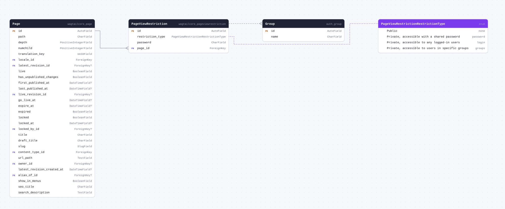

| Column | Field | Type | Null | Key | Default | Description |
| --- | --- | --- | --- | --- | --- | --- |
| `id` | `AutoField` | `integer` |  | PK | `autoincrement()` |  |
| `restriction_type` | `PageViewRestrictionRestrictionType` | `varchar(20)` |  |  |  |  |
| `password` | `CharField` | `varchar(255)` |  |  |  | Shared passwords should not be used to protect sensitive content. Anyone who has this password will be able to view the content. |
| `page_id` | `ForeignKey` | `integer` |  | FK |  |  |

Indexes:

- index `wagtailcore_pageviewrestriction_page_id_15a8bea6` on `page_id`

Relations:

- `page_id` → [Page](#page).`id`, on delete cascade
- `groups` — many to many with [Group](#group)

## WorkflowPage

Table `wagtailcore_workflowpage`, app `wagtailcore`.

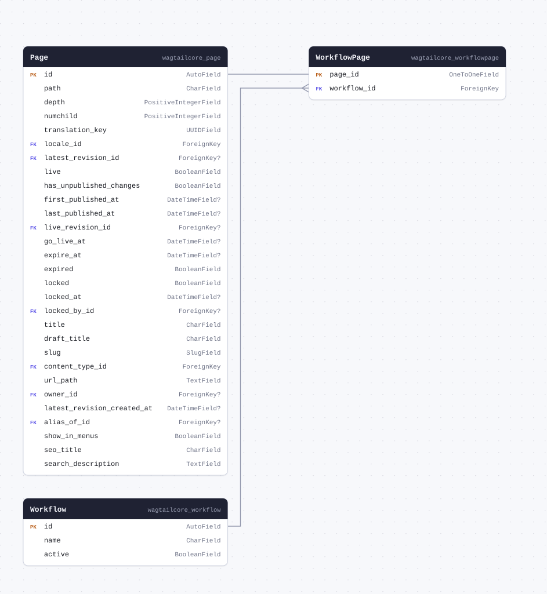

| Column | Field | Type | Null | Key | Default | Description |
| --- | --- | --- | --- | --- | --- | --- |
| `page_id` | `OneToOneField` | `integer` |  | PK, FK |  |  |
| `workflow_id` | `ForeignKey` | `integer` |  | FK |  |  |

Indexes:

- index `wagtailcore_workflowpage_workflow_id_56f56ff6` on `workflow_id`

Relations:

- `page_id` → [Page](#page).`id`, on delete cascade
- `workflow_id` → [Workflow](#workflow).`id`, on delete cascade

## PageLogEntry

Table `wagtailcore_pagelogentry`, app `wagtailcore`.

Columns from `BaseLogEntry` (abstract): `content_type_id`, `label`, `action`, `data`, `timestamp`, `uuid`, `user_id`, `revision_id`, `content_changed`, `deleted`.

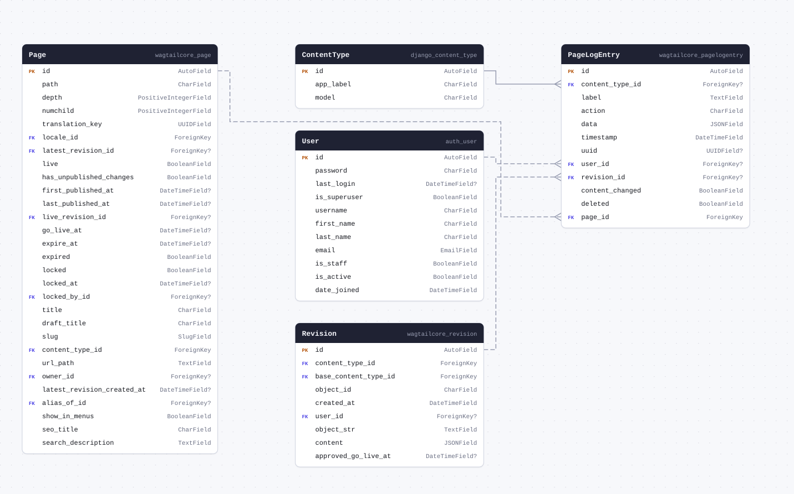

| Column | Field | Type | Null | Key | Default | Description |
| --- | --- | --- | --- | --- | --- | --- |
| `id` | `AutoField` | `integer` |  | PK | `autoincrement()` |  |
| `content_type_id` | `ForeignKey` | `integer` | yes | FK |  |  |
| `label` | `TextField` | `text` |  |  |  |  |
| `action` | `CharField` | `varchar(255)` |  |  |  |  |
| `data` | `JSONField` | `text` |  |  | `dict()` |  |
| `timestamp` | `DateTimeField` | `datetime` |  |  |  |  |
| `uuid` | `UUIDField` | `char(32)` | yes |  |  | Log entries that happened as part of the same user action are assigned the same UUID |
| `user_id` | `ForeignKey` | `integer` | yes | FK (no constraint) |  |  |
| `revision_id` | `ForeignKey` | `integer` | yes | FK (no constraint) |  |  |
| `content_changed` | `BooleanField` | `bool` |  |  | `False` |  |
| `deleted` | `BooleanField` | `bool` |  |  | `False` |  |
| `page_id` | `ForeignKey` | `integer` |  | FK (no constraint) |  |  |

Indexes:

- index `wagtailcore_pagelogentry_content_type_id_74e7708a` on `content_type_id`
- index `wagtailcore_pagelogentry_action_c2408198` on `action`
- index `wagtailcore_pagelogentry_timestamp_deb774c4` on `timestamp`
- index `wagtailcore_pagelogentry_user_id_604ccfd8` on `user_id`
- index `wagtailcore_pagelogentry_revision_id_8043d103` on `revision_id`
- index `wagtailcore_pagelogentry_content_changed_99f27ade` on `content_changed`
- index `wagtailcore_pagelogentry_page_id_8464e327` on `page_id`
- index `wagtailcore_uuid_06a44d_idx` on `uuid`, `action`, `timestamp` desc

Relations:

- `content_type_id` → [ContentType](#contenttype).`id`, on delete set null
- `user_id` → [User](#user).`id`, on delete do nothing, no database constraint
- `revision_id` → [Revision](#revision).`id`, on delete do nothing, no database constraint
- `page_id` → [Page](#page).`id`, on delete do nothing, no database constraint

## Comment

Table `wagtailcore_comment`, app `wagtailcore`.

A comment on a field, or a field within a streamfield block

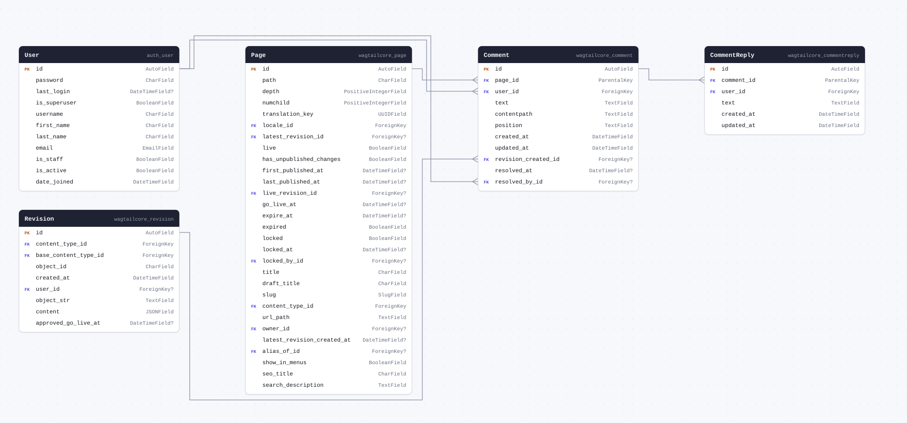

| Column | Field | Type | Null | Key | Default | Description |
| --- | --- | --- | --- | --- | --- | --- |
| `id` | `AutoField` | `integer` |  | PK | `autoincrement()` |  |
| `page_id` | `ParentalKey` | `integer` |  | FK |  |  |
| `user_id` | `ForeignKey` | `integer` |  | FK |  |  |
| `text` | `TextField` | `text` |  |  |  |  |
| `contentpath` | `TextField` | `text` |  |  |  |  |
| `position` | `TextField` | `text` |  |  |  |  |
| `created_at` | `DateTimeField` | `datetime` |  |  | `now()` |  |
| `updated_at` | `DateTimeField` | `datetime` |  |  | `now()` |  |
| `revision_created_id` | `ForeignKey` | `integer` | yes | FK |  |  |
| `resolved_at` | `DateTimeField` | `datetime` | yes |  |  |  |
| `resolved_by_id` | `ForeignKey` | `integer` | yes | FK |  |  |

Indexes:

- index `wagtailcore_comment_page_id_108444b5` on `page_id`
- index `wagtailcore_comment_user_id_0c577ca6` on `user_id`
- index `wagtailcore_comment_revision_created_id_1d058279` on `revision_created_id`
- index `wagtailcore_comment_resolved_by_id_a282aa0e` on `resolved_by_id`

Relations:

- `page_id` → [Page](#page).`id`, on delete cascade
- `user_id` → [User](#user).`id`, on delete cascade
- `revision_created_id` → [Revision](#revision).`id`, on delete cascade
- `resolved_by_id` → [User](#user).`id`, on delete set null
- [CommentReply](#commentreply).`comment_id` → `id`, on delete cascade

## CommentReply

Table `wagtailcore_commentreply`, app `wagtailcore`.

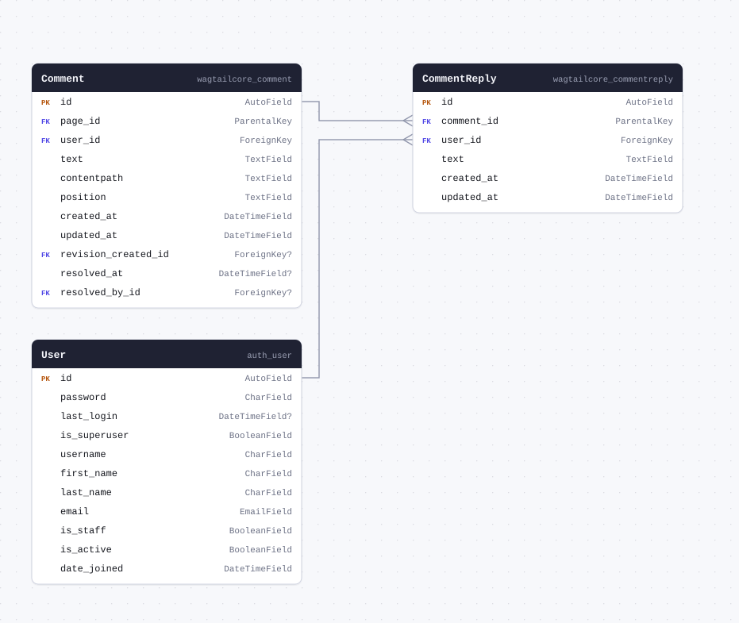

| Column | Field | Type | Null | Key | Default | Description |
| --- | --- | --- | --- | --- | --- | --- |
| `id` | `AutoField` | `integer` |  | PK | `autoincrement()` |  |
| `comment_id` | `ParentalKey` | `integer` |  | FK |  |  |
| `user_id` | `ForeignKey` | `integer` |  | FK |  |  |
| `text` | `TextField` | `text` |  |  |  |  |
| `created_at` | `DateTimeField` | `datetime` |  |  | `now()` |  |
| `updated_at` | `DateTimeField` | `datetime` |  |  | `now()` |  |

Indexes:

- index `wagtailcore_commentreply_comment_id_afc7e027` on `comment_id`
- index `wagtailcore_commentreply_user_id_d0b3b9c3` on `user_id`

Relations:

- `comment_id` → [Comment](#comment).`id`, on delete cascade
- `user_id` → [User](#user).`id`, on delete cascade

## PageSubscription

Table `wagtailcore_pagesubscription`, app `wagtailcore`.

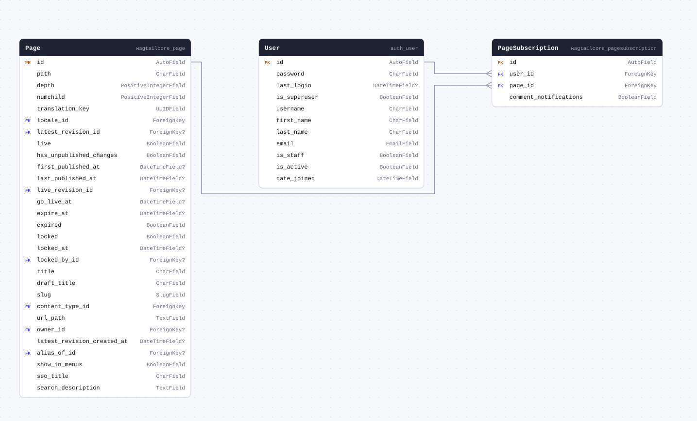

| Column | Field | Type | Null | Key | Default | Description |
| --- | --- | --- | --- | --- | --- | --- |
| `id` | `AutoField` | `integer` |  | PK | `autoincrement()` |  |
| `user_id` | `ForeignKey` | `integer` |  | FK |  |  |
| `page_id` | `ForeignKey` | `integer` |  | FK |  |  |
| `comment_notifications` | `BooleanField` | `bool` |  |  |  |  |

Indexes:

- index `wagtailcore_pagesubscription_user_id_89d7def9` on `user_id`
- index `wagtailcore_pagesubscription_page_id_a085e7a6` on `page_id`
- unique `wagtailcore_pagesubscription_page_id_user_id_0cef73ed_uniq` on `page_id`, `user_id`

Relations:

- `user_id` → [User](#user).`id`, on delete cascade
- `page_id` → [Page](#page).`id`, on delete cascade

## ReferenceIndex

Table `wagtailcore_referenceindex`, app `wagtailcore`.

Records references between objects for quick retrieval of object usage.

References are extracted from Foreign Keys, Chooser Blocks in StreamFields, and links in Rich Text Fields.
This index allows us to efficiently find all of the references to a particular object from all of these sources.

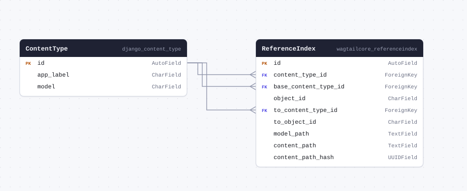

| Column | Field | Type | Null | Key | Default | Description |
| --- | --- | --- | --- | --- | --- | --- |
| `id` | `AutoField` | `integer` |  | PK | `autoincrement()` |  |
| `content_type_id` | `ForeignKey` | `integer` |  | FK |  |  |
| `base_content_type_id` | `ForeignKey` | `integer` |  | FK |  |  |
| `object_id` | `CharField` | `varchar(255)` |  |  |  |  |
| `to_content_type_id` | `ForeignKey` | `integer` |  | FK |  |  |
| `to_object_id` | `CharField` | `varchar(255)` |  |  |  |  |
| `model_path` | `TextField` | `text` |  |  |  |  |
| `content_path` | `TextField` | `text` |  |  |  |  |
| `content_path_hash` | `UUIDField` | `char(32)` |  |  |  |  |

Indexes:

- index `wagtailcore_referenceindex_content_type_id_766e0336` on `content_type_id`
- index `wagtailcore_referenceindex_base_content_type_id_313cf40f` on `base_content_type_id`
- index `wagtailcore_referenceindex_to_content_type_id_93690bbd` on `to_content_type_id`
- unique `wagtailcore_referenceindex_base_content_type_id_object_id_to_content_type_id_to_object_id_content_path_hash_9e6ccd6a_uniq` on `base_content_type_id`, `object_id`, `to_content_type_id`, `to_object_id`, `content_path_hash`
- index `referenceindex_source_object` on `base_content_type_id`, `object_id`
- index `referenceindex_target_object` on `to_content_type_id`, `to_object_id`

Relations:

- `content_type_id` → [ContentType](#contenttype).`id`, on delete cascade
- `base_content_type_id` → [ContentType](#contenttype).`id`, on delete cascade
- `to_content_type_id` → [ContentType](#contenttype).`id`, on delete cascade

## Tag

Table `taggit_tag`, app `taggit`.

Columns from `TagBase` (abstract): `name`, `slug`.

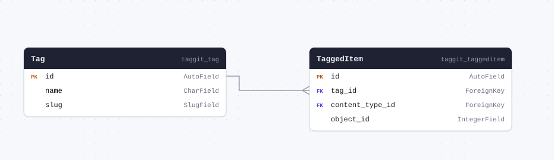

| Column | Field | Type | Null | Key | Default | Description |
| --- | --- | --- | --- | --- | --- | --- |
| `id` | `AutoField` | `integer` |  | PK | `autoincrement()` |  |
| `name` | `CharField` | `varchar(100)` |  | unique |  |  |
| `slug` | `SlugField` | `varchar(100)` |  | unique |  |  |

Relations:

- `document_set` — many to many with [Document](#document), through [TaggedItem](#taggeditem)
- `image_set` — many to many with [Image](#image), through [TaggedItem](#taggeditem)
- [TaggedItem](#taggeditem).`tag_id` → `id`, on delete cascade

## TaggedItem

Table `taggit_taggeditem`, app `taggit`.

Columns from `GenericTaggedItemBase` (abstract): `object_id`.

Columns from `CommonGenericTaggedItemBase` (abstract): `content_type_id`.

Columns from `TaggedItemBase` (abstract): `tag_id`.

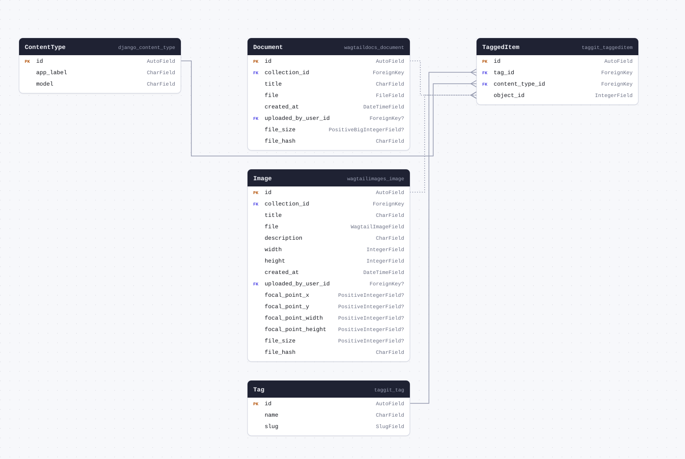

| Column | Field | Type | Null | Key | Default | Description |
| --- | --- | --- | --- | --- | --- | --- |
| `id` | `AutoField` | `integer` |  | PK | `autoincrement()` |  |
| `tag_id` | `ForeignKey` | `integer` |  | FK |  |  |
| `content_type_id` | `ForeignKey` | `integer` |  | FK |  |  |
| `object_id` | `IntegerField` | `integer` |  |  |  |  |

Indexes:

- index `taggit_taggeditem_tag_id_f4f5b767` on `tag_id`
- index `taggit_taggeditem_content_type_id_9957a03c` on `content_type_id`
- index `taggit_taggeditem_object_id_e2d7d1df` on `object_id`
- unique `taggit_taggeditem_content_type_id_object_id_tag_id_4bb97a8e_uniq` on `content_type_id`, `object_id`, `tag_id`
- index `taggit_tagg_content_8fc721_idx` on `content_type_id`, `object_id`

Relations:

- `content_object` → any model, by `content_type_id` + `object_id` (generic foreign key)
- `object_id` → [Document](#document).`id` where `content_type_id` is Document (generic, `Document.tagged_items`)
- `object_id` → [Image](#image).`id` where `content_type_id` is Image (generic, `Image.tagged_items`)
- `tag_id` → [Tag](#tag).`id`, on delete cascade
- `content_type_id` → [ContentType](#contenttype).`id`, on delete cascade

## AbTest

Table `wagtail_ab_testing_abtest`, app `wagtail_ab_testing`.

Represents an A/B test that has been set up by the user.

The live page content is used as the control, the revision pointed to in
the `.variant_revision` field contains the changes that are being tested.

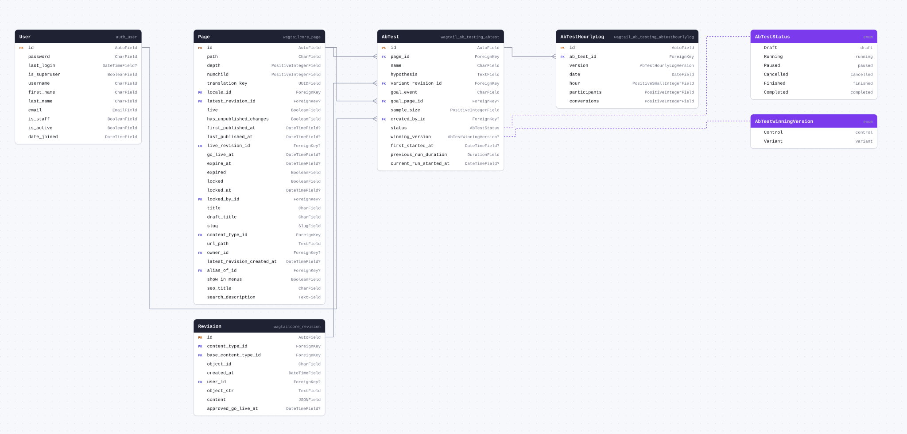

| Column | Field | Type | Null | Key | Default | Description |
| --- | --- | --- | --- | --- | --- | --- |
| `id` | `AutoField` | `integer` |  | PK | `autoincrement()` |  |
| `page_id` | `ForeignKey` | `integer` |  | FK |  |  |
| `name` | `CharField` | `varchar(255)` |  |  |  |  |
| `hypothesis` | `TextField` | `text` |  |  |  |  |
| `variant_revision_id` | `ForeignKey` | `integer` |  | FK |  |  |
| `goal_event` | `CharField` | `varchar(255)` |  |  |  |  |
| `goal_page_id` | `ForeignKey` | `integer` | yes | FK |  |  |
| `sample_size` | `PositiveIntegerField` | `integer unsigned` |  |  |  |  |
| `created_by_id` | `ForeignKey` | `integer` | yes | FK |  |  |
| `status` | `AbTestStatus` | `varchar(20)` |  |  | `'draft'` |  |
| `winning_version` | `AbTestWinningVersion` | `varchar(9)` | yes |  |  |  |
| `first_started_at` | `DateTimeField` | `datetime` | yes |  |  |  |
| `previous_run_duration` | `DurationField` | `bigint` |  |  | `datetime.timedelta(0)` |  |
| `current_run_started_at` | `DateTimeField` | `datetime` | yes |  |  |  |

Indexes:

- index `wagtail_ab_testing_abtest_page_id_ab17259a` on `page_id`
- index `wagtail_ab_testing_abtest_variant_revision_id_2d820ecb` on `variant_revision_id`
- index `wagtail_ab_testing_abtest_goal_page_id_4ff7d130` on `goal_page_id`
- index `wagtail_ab_testing_abtest_created_by_id_243c29e6` on `created_by_id`

Relations:

- `page_id` → [Page](#page).`id`, on delete cascade
- `variant_revision_id` → [Revision](#revision).`id`, on delete protect
- `goal_page_id` → [Page](#page).`id`, on delete set null
- `created_by_id` → [User](#user).`id`, on delete set null
- [AbTestHourlyLog](#abtesthourlylog).`ab_test_id` → `id`, on delete cascade

## AbTestHourlyLog

Table `wagtail_ab_testing_abtesthourlylog`, app `wagtail_ab_testing`.

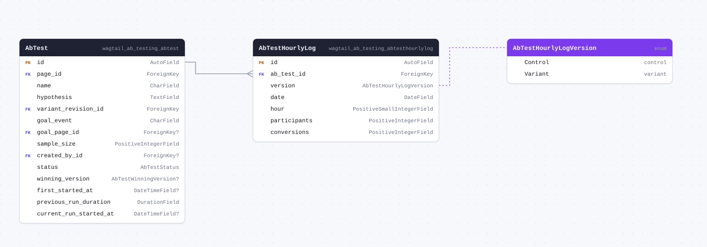

| Column | Field | Type | Null | Key | Default | Description |
| --- | --- | --- | --- | --- | --- | --- |
| `id` | `AutoField` | `integer` |  | PK | `autoincrement()` |  |
| `ab_test_id` | `ForeignKey` | `integer` |  | FK |  |  |
| `version` | `AbTestHourlyLogVersion` | `varchar(9)` |  |  |  |  |
| `date` | `DateField` | `date` |  |  |  |  |
| `hour` | `PositiveSmallIntegerField` | `smallint unsigned` |  |  |  |  |
| `participants` | `PositiveIntegerField` | `integer unsigned` |  |  | `0` |  |
| `conversions` | `PositiveIntegerField` | `integer unsigned` |  |  | `0` |  |

Indexes:

- index `wagtail_ab_testing_abtesthourlylog_ab_test_id_fe79b039` on `ab_test_id`
- unique `wagtail_ab_testing_abtesthourlylog_ab_test_id_version_date_hour_f388485e_uniq` on `ab_test_id`, `version`, `date`, `hour`

Relations:

- `ab_test_id` → [AbTest](#abtest).`id`, on delete cascade

# Enums

## LogEntryActionFlag

| Name | Stored as |
| --- | --- |
| `Addition` | `1` |
| `Change` | `2` |
| `Deletion` | `3` |

## EmbedType

| Name | Stored as |
| --- | --- |
| `Video` | `video` |
| `Photo` | `photo` |
| `Link` | `link` |
| `Rich` | `rich` |

## UserProfileAdminColorThemes

| Name | Stored as |
| --- | --- |
| `SYSTEM` | `system` |
| `LIGHT` | `light` |
| `DARK` | `dark` |

## UserProfileAdminContrastThemes

| Name | Stored as |
| --- | --- |
| `SYSTEM` | `system` |
| `MORE_CONTRAST` | `more_contrast` |

## UserProfileAdminDensityThemes

| Name | Stored as |
| --- | --- |
| `DEFAULT` | `default` |
| `SNUG` | `snug` |

## CollectionViewRestrictionRestrictionType

| Name | Stored as |
| --- | --- |
| `Public` | `none` |
| `Private, accessible with a shared password` | `password` |
| `Private, accessible to any logged-in users` | `login` |
| `Private, accessible to users in specific groups` | `groups` |

## WorkflowStateStatus

| Name | Stored as |
| --- | --- |
| `In progress` | `in_progress` |
| `Approved` | `approved` |
| `Needs changes` | `needs_changes` |
| `Cancelled` | `cancelled` |

## TaskStateStatus

| Name | Stored as |
| --- | --- |
| `In progress` | `in_progress` |
| `Approved` | `approved` |
| `Rejected` | `rejected` |
| `Skipped` | `skipped` |
| `Cancelled` | `cancelled` |

## PageViewRestrictionRestrictionType

| Name | Stored as |
| --- | --- |
| `Public` | `none` |
| `Private, accessible with a shared password` | `password` |
| `Private, accessible to any logged-in users` | `login` |
| `Private, accessible to users in specific groups` | `groups` |

## AbTestStatus

| Name | Stored as |
| --- | --- |
| `Draft` | `draft` |
| `Running` | `running` |
| `Paused` | `paused` |
| `Cancelled` | `cancelled` |
| `Finished` | `finished` |
| `Completed` | `completed` |

## AbTestWinningVersion

| Name | Stored as |
| --- | --- |
| `Control` | `control` |
| `Variant` | `variant` |

## AbTestHourlyLogVersion

| Name | Stored as |
| --- | --- |
| `Control` | `control` |
| `Variant` | `variant` |
