# Schema docs


[Addon](#addon) · [Event](#event) · [AddonActivityLog](#addonactivitylog) · [KotlinSDKCleanup](#kotlinsdkcleanup) · [KotlinSDKBuild](#kotlinsdkbuild) · [KotlinSDKArtifact](#kotlinsdkartifact) · [weblate_auth.Permission](#weblate_authpermission) · [Role](#role) · [weblate_auth.Group](#weblate_authgroup) · [TeamMembership](#teammembership) · [User](#user) · [AutoGroup](#autogroup) · [UserBlock](#userblock) · [Invitation](#invitation) · [Check](#check) · [MachineryInstallation](#machineryinstallation) · [MachineryError](#machineryerror) · [MachineryExclusion](#machineryexclusion) · [Workspace](#workspace) · [ContributorAgreement](#contributoragreement) · [Alert](#alert) · [Announcement](#announcement) · [BackupAuthorClaim](#backupauthorclaim) · [BackupAuthorVote](#backupauthorvote) · [Category](#category) · [Project](#project) · [Change](#change) · [PendingUnitChange](#pendingunitchange) · [Comment](#comment) · [Suggestion](#suggestion) · [Vote](#vote) · [Variant](#variant) · [Unit](#unit) · [Translation](#translation) · [ComponentLink](#componentlink) · [Component](#component) · [ComponentList](#componentlist) · [AutoComponentList](#autocomponentlist) · [Label](#label) · [Report](#report) · [SavedSearch](#savedsearch) · [WorkflowSetting](#workflowsetting) · [Language](#language) · [Plural](#plural) · [Memory](#memory) · [MemoryScope](#memoryscope) · [MemoryScopeMigrationState](#memoryscopemigrationstate) · [Screenshot](#screenshot) · [ScreenshotOCR](#screenshotocr) · [Font](#font) · [FontGroup](#fontgroup) · [FontOverride](#fontoverride) · [Subscription](#subscription) · [TeamAuditLog](#teamauditlog) · [AuditLog](#auditlog) · [VerifiedEmail](#verifiedemail) · [Profile](#profile) · [Setting](#setting) · [Installation](#installation) · [PendingInstallation](#pendinginstallation) · [GitHubAppCredentials](#githubappcredentials) · [SecurityScan](#securityscan) · [SecurityFinding](#securityfinding) · [SecurityFindingEvent](#securityfindingevent) · [ConfigurationError](#configurationerror) · [SupportStatus](#supportstatus) · [BackupService](#backupservice) · [BackupLog](#backuplog) · [Metric](#metric) · [auth.Permission](#authpermission) · [auth.Group](#authgroup) · [ContentType](#contenttype) · [Session](#session) · [LogEntry](#logentry) · [UserSocialAuth](#usersocialauth) · [Nonce](#nonce) · [Association](#association) · [Code](#code) · [Partial](#partial) · [Token](#token) · [SolarSchedule](#solarschedule) · [IntervalSchedule](#intervalschedule) · [ClockedSchedule](#clockedschedule) · [CrontabSchedule](#crontabschedule) · [PeriodicTasks](#periodictasks) · [PeriodicTask](#periodictask) · [StaticDevice](#staticdevice) · [StaticToken](#statictoken) · [TOTPDevice](#totpdevice) · [WebAuthnCredential](#webauthncredential) · [WebAuthnAttestation](#webauthnattestation) · [WebAuthnUserHandle](#webauthnuserhandle)

<details>
<summary>The whole schema as SQL</summary>

```sql
-- Written for PostgreSQL 17, assumed: the database could not be asked.

CREATE TABLE "addons_addon" ("id" integer NOT NULL PRIMARY KEY GENERATED BY DEFAULT AS IDENTITY, "component_id" integer NULL, "project_id" integer NULL, "category_id" integer NULL, "name" varchar(100) NOT NULL, "configuration" jsonb NOT NULL, "state" jsonb NOT NULL, "repo_scope" boolean NOT NULL);

CREATE TABLE "addons_event" ("id" integer NOT NULL PRIMARY KEY GENERATED BY DEFAULT AS IDENTITY, "addon_id" integer NOT NULL, "event" integer NOT NULL);

CREATE TABLE "addons_addonactivitylog" ("id" integer NOT NULL PRIMARY KEY GENERATED BY DEFAULT AS IDENTITY, "addon_id" integer NOT NULL, "component_id" integer NULL, "event" integer NOT NULL, "created" timestamp with time zone NOT NULL, "details" jsonb NOT NULL, "status" integer NOT NULL);

CREATE TABLE "kotlin_sdk_kotlinsdkcleanup" ("id" integer NOT NULL PRIMARY KEY GENERATED BY DEFAULT AS IDENTITY, "path" text NOT NULL UNIQUE, "build_id" integer NULL UNIQUE);

CREATE TABLE "kotlin_sdk_kotlinsdkbuild" ("id" integer NOT NULL PRIMARY KEY GENERATED BY DEFAULT AS IDENTITY, "addon_id" integer NOT NULL, "package_name" varchar(127) NOT NULL, "version_code" bigint NOT NULL CHECK ("version_code" >= 0), "metadata" jsonb NOT NULL, "pending_manifest" jsonb NOT NULL, "digest" varchar(64) NOT NULL, "created" timestamp with time zone NOT NULL, "retired" timestamp with time zone NULL, "status" varchar(16) NOT NULL, "error" text NOT NULL, "published" timestamp with time zone NULL, CONSTRAINT "kotlin_sdk_build_unique" UNIQUE ("addon_id", "package_name", "version_code"));

CREATE TABLE "kotlin_sdk_kotlinsdkartifact" ("id" integer NOT NULL PRIMARY KEY GENERATED BY DEFAULT AS IDENTITY, "addon_id" integer NOT NULL, "digest" varchar(64) NOT NULL, "unreferenced" timestamp with time zone NULL, CONSTRAINT "kotlin_sdk_artifact_unique" UNIQUE ("addon_id", "digest"));

CREATE TABLE "kotlin_sdk_kotlinsdkartifact_builds" ("id" integer NOT NULL PRIMARY KEY GENERATED BY DEFAULT AS IDENTITY, "kotlinsdkartifact_id" integer NOT NULL, "kotlinsdkbuild_id" integer NOT NULL);

CREATE TABLE "weblate_auth_permission" ("id" integer NOT NULL PRIMARY KEY GENERATED BY DEFAULT AS IDENTITY, "codename" varchar(100) NOT NULL UNIQUE, "name" varchar(200) NOT NULL);

CREATE TABLE "weblate_auth_role" ("id" integer NOT NULL PRIMARY KEY GENERATED BY DEFAULT AS IDENTITY, "name" varchar(200) NOT NULL UNIQUE);

CREATE TABLE "weblate_auth_role_permissions" ("id" integer NOT NULL PRIMARY KEY GENERATED BY DEFAULT AS IDENTITY, "role_id" integer NOT NULL, "permission_id" integer NOT NULL);

CREATE TABLE "weblate_auth_group" ("id" integer NOT NULL PRIMARY KEY GENERATED BY DEFAULT AS IDENTITY, "name" varchar(150) NOT NULL, "defining_project_id" integer NULL, "defining_workspace_id" uuid NULL, "project_selection" integer NOT NULL, "language_selection" integer NOT NULL, "internal" boolean NOT NULL, "enforced_2fa" boolean NOT NULL, CONSTRAINT "weblate_auth_group_single_definition" CHECK (("defining_project_id" IS NULL OR "defining_workspace_id" IS NULL)));

CREATE TABLE "weblate_auth_group_roles" ("id" integer NOT NULL PRIMARY KEY GENERATED BY DEFAULT AS IDENTITY, "group_id" integer NOT NULL, "role_id" integer NOT NULL);

CREATE TABLE "weblate_auth_group_projects" ("id" integer NOT NULL PRIMARY KEY GENERATED BY DEFAULT AS IDENTITY, "group_id" integer NOT NULL, "project_id" integer NOT NULL);

CREATE TABLE "weblate_auth_group_components" ("id" integer NOT NULL PRIMARY KEY GENERATED BY DEFAULT AS IDENTITY, "group_id" integer NOT NULL, "component_id" integer NOT NULL);

CREATE TABLE "weblate_auth_group_componentlists" ("id" integer NOT NULL PRIMARY KEY GENERATED BY DEFAULT AS IDENTITY, "group_id" integer NOT NULL, "componentlist_id" integer NOT NULL);

CREATE TABLE "weblate_auth_group_languages" ("id" integer NOT NULL PRIMARY KEY GENERATED BY DEFAULT AS IDENTITY, "group_id" integer NOT NULL, "language_id" integer NOT NULL);

CREATE TABLE "weblate_auth_group_admins" ("id" integer NOT NULL PRIMARY KEY GENERATED BY DEFAULT AS IDENTITY, "group_id" integer NOT NULL, "user_id" integer NOT NULL);

CREATE TABLE "weblate_auth_user_groups" ("id" integer NOT NULL PRIMARY KEY GENERATED BY DEFAULT AS IDENTITY, "user_id" integer NOT NULL, "group_id" integer NOT NULL, CONSTRAINT "weblate_auth_user_groups_user_id_group_id_16cfc05b_uniq" UNIQUE ("user_id", "group_id"));

CREATE TABLE "weblate_auth_user_groups_limit_languages" ("id" integer NOT NULL PRIMARY KEY GENERATED BY DEFAULT AS IDENTITY, "teammembership_id" integer NOT NULL, "language_id" integer NOT NULL);

CREATE TABLE "weblate_auth_user" ("id" integer NOT NULL PRIMARY KEY GENERATED BY DEFAULT AS IDENTITY, "password" varchar(128) NOT NULL, "last_login" timestamp with time zone NULL, "username" varchar(150) NOT NULL UNIQUE, "full_name" varchar(150) NOT NULL, "email" varchar(190) NULL UNIQUE, "is_superuser" boolean NOT NULL, "is_active" boolean NOT NULL, "is_bot" boolean NOT NULL, "date_expires" timestamp with time zone NULL, "date_joined" timestamp with time zone NOT NULL);

CREATE TABLE "weblate_auth_autogroup" ("id" integer NOT NULL PRIMARY KEY GENERATED BY DEFAULT AS IDENTITY, "match" varchar(200) NOT NULL, "group_id" integer NOT NULL);

CREATE TABLE "weblate_auth_userblock" ("id" integer NOT NULL PRIMARY KEY GENERATED BY DEFAULT AS IDENTITY, "user_id" integer NOT NULL, "project_id" integer NOT NULL, "expiry" timestamp with time zone NULL, "note" text NOT NULL);

CREATE TABLE "weblate_auth_invitation" ("uuid" uuid NOT NULL PRIMARY KEY, "backup_authorship" boolean NOT NULL, "timestamp" timestamp with time zone NOT NULL, "author_id" integer NOT NULL, "user_id" integer NULL, "username" varchar(150) NOT NULL, "full_name" varchar(150) NOT NULL, "group_id" integer NOT NULL, "email" varchar(190) NOT NULL, "automatic" boolean NOT NULL, "team_admin" boolean NOT NULL, "is_superuser" boolean NOT NULL);

CREATE TABLE "weblate_auth_invitation_limit_languages" ("id" integer NOT NULL PRIMARY KEY GENERATED BY DEFAULT AS IDENTITY, "invitation_id" uuid NOT NULL, "language_id" integer NOT NULL);

CREATE TABLE "checks_check" ("id" integer NOT NULL PRIMARY KEY GENERATED BY DEFAULT AS IDENTITY, "unit_id" integer NOT NULL, "name" varchar(50) NOT NULL, "dismissed" boolean NOT NULL, "metadata" jsonb NOT NULL);

CREATE TABLE "machinery_machineryinstallation" ("id" integer NOT NULL PRIMARY KEY GENERATED BY DEFAULT AS IDENTITY, "engine" varchar(100) NOT NULL, "slug" varchar(100) NOT NULL, "configuration" jsonb NOT NULL, "enabled" boolean NOT NULL, "workspace_id" uuid NULL, "project_id" integer NULL, CONSTRAINT "machinery_one_scope" CHECK (("workspace_id" IS NULL OR "project_id" IS NULL)));

CREATE TABLE "machinery_machineryerror" ("id" integer NOT NULL PRIMARY KEY GENERATED BY DEFAULT AS IDENTITY, "installation_id" integer NOT NULL, "timestamp" timestamp with time zone NOT NULL, "error" text NOT NULL);

CREATE TABLE "machinery_machineryexclusion" ("id" integer NOT NULL PRIMARY KEY GENERATED BY DEFAULT AS IDENTITY, "workspace_id" uuid NULL, "project_id" integer NULL, "installation_id" integer NULL, "engine" varchar(100) NOT NULL, CONSTRAINT "machinery_exclusion_one_scope" CHECK ((("workspace_id" IS NULL AND "project_id" IS NOT NULL) OR ("workspace_id" IS NOT NULL AND "project_id" IS NULL))), CONSTRAINT "machinery_exclusion_one_target" CHECK ((("installation_id" IS NULL AND NOT ("engine" = '')) OR ("installation_id" IS NOT NULL AND "engine" = ''))), CONSTRAINT "machinery_workspace_installation_exclusion" UNIQUE ("workspace_id", "installation_id"), CONSTRAINT "machinery_project_installation_exclusion" UNIQUE ("project_id", "installation_id"));

CREATE TABLE "workspaces_workspace" ("id" uuid NOT NULL PRIMARY KEY, "metric_id" integer DEFAULT ((nextval('workspaces_workspace_metric_id_seq'::regclass))) NOT NULL UNIQUE, "name" varchar(100) NOT NULL, "propagation_scope" varchar(20) NOT NULL, "name_managed" boolean NOT NULL, "use_workspace_tm" boolean NOT NULL, "contribute_workspace_tm" boolean NOT NULL, "license" varchar(150) NOT NULL, "agreement" text NOT NULL, "new_lang" varchar(10) NOT NULL, "language_code_style" varchar(20) NOT NULL, "secondary_language_id" integer NULL, "check_flags" text NOT NULL, "enforced_checks" jsonb NOT NULL, "inherit_enforced_checks" boolean NOT NULL, "commit_message" text NOT NULL, "add_message" text NOT NULL, "delete_message" text NOT NULL, "merge_message" text NOT NULL, "addon_message" text NOT NULL, "pull_message" text NOT NULL);

CREATE TABLE "trans_contributoragreement" ("id" integer NOT NULL PRIMARY KEY GENERATED BY DEFAULT AS IDENTITY, "user_id" integer NOT NULL, "component_id" integer NULL, "project_id" integer NULL, "category_id" integer NULL, "workspace_id" uuid NULL, "timestamp" timestamp with time zone NOT NULL, CONSTRAINT "contributor_agreement_single_scope" CHECK ((("component_id" IS NOT NULL AND "project_id" IS NULL AND "category_id" IS NULL AND "workspace_id" IS NULL) OR ("component_id" IS NULL AND "project_id" IS NOT NULL AND "category_id" IS NULL AND "workspace_id" IS NULL) OR ("component_id" IS NULL AND "project_id" IS NULL AND "category_id" IS NOT NULL AND "workspace_id" IS NULL) OR ("component_id" IS NULL AND "project_id" IS NULL AND "category_id" IS NULL AND "workspace_id" IS NOT NULL))));

CREATE TABLE "trans_alert" ("id" integer NOT NULL PRIMARY KEY GENERATED BY DEFAULT AS IDENTITY, "component_id" integer NOT NULL, "timestamp" timestamp with time zone NOT NULL, "updated" timestamp with time zone NOT NULL, "name" varchar(150) NOT NULL, "dismissed_at" timestamp with time zone NULL, "dismissed_by_id" integer NULL, "dismissal_reason" varchar(500) NOT NULL, "dismissal_fingerprint" varchar(64) NOT NULL, "severity" smallint NOT NULL CHECK ("severity" >= 0), "details" jsonb NOT NULL);

CREATE TABLE "trans_announcement" ("id" integer NOT NULL PRIMARY KEY GENERATED BY DEFAULT AS IDENTITY, "message" text NOT NULL, "project_id" integer NULL, "category_id" integer NULL, "component_id" integer NULL, "language_id" integer NULL, "severity" varchar(25) NOT NULL, "expiry" date NULL, "notify" boolean NOT NULL);

CREATE TABLE "trans_backupauthorclaim" ("id" integer NOT NULL PRIMARY KEY GENERATED BY DEFAULT AS IDENTITY, "project_id" integer NOT NULL, "user_id" integer NOT NULL, "invitation_id" uuid NULL UNIQUE, "accepted_at" timestamp with time zone NULL);

CREATE TABLE "trans_backupauthorvote" ("id" integer NOT NULL PRIMARY KEY GENERATED BY DEFAULT AS IDENTITY, "claim_id" integer NOT NULL, "suggestion_id" integer NOT NULL, "placeholder_id" integer NULL, "value" smallint NOT NULL);

CREATE TABLE "trans_category" ("id" integer NOT NULL PRIMARY KEY GENERATED BY DEFAULT AS IDENTITY, "name" varchar(100) NOT NULL, "slug" varchar(100) NOT NULL, "project_id" integer NOT NULL, "category_id" integer NULL, "check_flags" text NOT NULL, "enforced_checks" jsonb NOT NULL, "inherit_enforced_checks" boolean NOT NULL, "license" varchar(150) NOT NULL, "inherit_license" boolean NOT NULL, "agreement" text NOT NULL, "inherit_agreement" boolean NOT NULL, "new_lang" varchar(10) NOT NULL, "inherit_new_lang" boolean NOT NULL, "language_code_style" varchar(20) NOT NULL, "inherit_language_code_style" boolean NOT NULL, "secondary_language_id" integer NULL, "inherit_secondary_language" boolean NOT NULL, "commit_message" text NOT NULL, "inherit_commit_message" boolean NOT NULL, "add_message" text NOT NULL, "inherit_add_message" boolean NOT NULL, "delete_message" text NOT NULL, "inherit_delete_message" boolean NOT NULL, "merge_message" text NOT NULL, "inherit_merge_message" boolean NOT NULL, "addon_message" text NOT NULL, "inherit_addon_message" boolean NOT NULL, "pull_message" text NOT NULL, "inherit_pull_message" boolean NOT NULL);

CREATE TABLE "trans_project" ("id" integer NOT NULL PRIMARY KEY GENERATED BY DEFAULT AS IDENTITY, "name" varchar(60) NOT NULL UNIQUE, "slug" varchar(60) NOT NULL UNIQUE, "web" varchar(200) NOT NULL, "instructions" text NOT NULL, "workspace_id" uuid NULL, "use_shared_tm" boolean NOT NULL, "contribute_shared_tm" boolean NOT NULL, "use_workspace_tm" boolean NOT NULL, "contribute_workspace_tm" boolean NOT NULL, "autoclean_tm" boolean NOT NULL, "access_control" integer NOT NULL, "public_sharing" boolean NOT NULL, "enforced_2fa" boolean NOT NULL, "translation_review" boolean NOT NULL, "source_review" boolean NOT NULL, "commit_policy" integer NOT NULL, "enable_hooks" boolean NOT NULL, "language_aliases" text NOT NULL, "secondary_language_id" integer NULL, "check_flags" text NOT NULL, "enforced_checks" jsonb NOT NULL, "inherit_enforced_checks" boolean NOT NULL, "license" varchar(150) NOT NULL, "inherit_license" boolean NOT NULL, "agreement" text NOT NULL, "inherit_agreement" boolean NOT NULL, "new_lang" varchar(10) NOT NULL, "inherit_new_lang" boolean NOT NULL, "language_code_style" varchar(20) NOT NULL, "inherit_language_code_style" boolean NOT NULL, "inherit_secondary_language" boolean NOT NULL, "commit_message" text NOT NULL, "inherit_commit_message" boolean NOT NULL, "add_message" text NOT NULL, "inherit_add_message" boolean NOT NULL, "delete_message" text NOT NULL, "inherit_delete_message" boolean NOT NULL, "merge_message" text NOT NULL, "inherit_merge_message" boolean NOT NULL, "addon_message" text NOT NULL, "inherit_addon_message" boolean NOT NULL, "pull_message" text NOT NULL, "inherit_pull_message" boolean NOT NULL);

CREATE TABLE "trans_change" ("id" integer NOT NULL PRIMARY KEY GENERATED BY DEFAULT AS IDENTITY, "backup_author_claim_id" integer NULL, "unit_id" integer NULL, "language_id" integer NULL, "project_id" integer NULL, "workspace_id" uuid NULL, "category_id" integer NULL, "component_id" integer NULL, "translation_id" integer NULL, "comment_id" integer NULL, "suggestion_id" integer NULL, "announcement_id" integer NULL, "screenshot_id" integer NULL, "alert_id" integer NULL, "addon_id" integer NULL, "user_id" integer NULL, "author_id" integer NULL, "timestamp" timestamp with time zone NOT NULL, "action" integer NOT NULL, "target" text NOT NULL, "old" text NOT NULL, "details" jsonb NOT NULL);

CREATE TABLE "trans_pendingunitchange" ("id" integer NOT NULL PRIMARY KEY GENERATED BY DEFAULT AS IDENTITY, "backup_author_claim_id" integer NULL, "unit_id" integer NOT NULL, "author_id" integer NOT NULL, "target" text NOT NULL, "explanation" text NOT NULL, "source_unit_explanation" text NOT NULL, "state" integer NOT NULL, "timestamp" timestamp with time zone NOT NULL, "add_unit" boolean NOT NULL, "automatically_translated" boolean NOT NULL, "metadata" jsonb NOT NULL);

CREATE TABLE "trans_comment" ("id" integer NOT NULL PRIMARY KEY GENERATED BY DEFAULT AS IDENTITY, "backup_author_claim_id" integer NULL, "unit_id" integer NOT NULL, "comment" text NOT NULL, "user_id" integer NULL, "timestamp" timestamp with time zone NOT NULL, "resolved" boolean NOT NULL, "userdetails" jsonb NOT NULL);

CREATE TABLE "trans_suggestion" ("id" integer NOT NULL PRIMARY KEY GENERATED BY DEFAULT AS IDENTITY, "backup_author_claim_id" integer NULL, "unit_id" integer NOT NULL, "target" text NOT NULL, "user_id" integer NULL, "userdetails" jsonb NOT NULL, "timestamp" timestamp with time zone NOT NULL);

CREATE TABLE "trans_vote" ("id" integer NOT NULL PRIMARY KEY GENERATED BY DEFAULT AS IDENTITY, "suggestion_id" integer NOT NULL, "user_id" integer NOT NULL, "value" smallint NOT NULL);

CREATE TABLE "trans_variant" ("id" integer NOT NULL PRIMARY KEY GENERATED BY DEFAULT AS IDENTITY, "component_id" integer NOT NULL, "variant_regex" varchar(190) NOT NULL, "key" text NOT NULL);

CREATE TABLE "trans_variant_defining_units" ("id" integer NOT NULL PRIMARY KEY GENERATED BY DEFAULT AS IDENTITY, "variant_id" integer NOT NULL, "unit_id" integer NOT NULL);

CREATE TABLE "trans_unit" ("id" integer NOT NULL PRIMARY KEY GENERATED BY DEFAULT AS IDENTITY, "translation_id" integer NOT NULL, "id_hash" bigint NOT NULL, "location" text NOT NULL, "context" text NOT NULL, "note" text NOT NULL, "flags" text NOT NULL, "source" text NOT NULL, "previous_source" text NOT NULL, "target" text NOT NULL, "state" integer NOT NULL, "original_state" integer NOT NULL, "details" jsonb NOT NULL, "position" integer NOT NULL, "num_words" integer NOT NULL, "priority" integer NOT NULL, "timestamp" timestamp with time zone NOT NULL, "last_updated" timestamp with time zone NOT NULL, "extra_flags" text NOT NULL, "explanation" text NOT NULL, "variant_id" integer NULL, "automatically_translated" boolean NOT NULL, "source_unit_id" integer NULL, "translation_parent_id" integer NULL);

CREATE TABLE "trans_unit_labels" ("id" integer NOT NULL PRIMARY KEY GENERATED BY DEFAULT AS IDENTITY, "unit_id" integer NOT NULL, "label_id" integer NOT NULL);

CREATE TABLE "trans_translation" ("id" integer NOT NULL PRIMARY KEY GENERATED BY DEFAULT AS IDENTITY, "component_id" integer NOT NULL, "language_id" integer NOT NULL, "plural_id" integer NOT NULL, "revision" varchar(200) NOT NULL, "filename" varchar(400) NOT NULL, "language_code" varchar(50) NOT NULL, "check_flags" text NOT NULL);

CREATE TABLE "trans_component_links" ("id" integer NOT NULL PRIMARY KEY GENERATED BY DEFAULT AS IDENTITY, "component_id" integer NOT NULL, "project_id" integer NOT NULL, "category_id" integer NULL);

CREATE TABLE "trans_component" ("id" integer NOT NULL PRIMARY KEY GENERATED BY DEFAULT AS IDENTITY, "name" varchar(100) NOT NULL, "slug" varchar(100) NOT NULL, "project_id" integer NOT NULL, "category_id" integer NULL, "vcs" varchar(20) NOT NULL, "vcs_params" jsonb NOT NULL, "repo" varchar(300) NOT NULL, "linked_component_id" integer NULL, "push" varchar(300) NOT NULL, "repoweb" varchar(200) NOT NULL, "repoweb_translations" varchar(200) NOT NULL, "git_export" varchar(220) NOT NULL, "report_source_bugs" varchar(190) NOT NULL, "branch" varchar(200) NOT NULL, "push_branch" varchar(200) NOT NULL, "filemask" varchar(400) NOT NULL, "screenshot_filemask" varchar(400) NOT NULL, "template" varchar(400) NOT NULL, "edit_template" boolean NOT NULL, "intermediate" varchar(400) NOT NULL, "new_base" varchar(400) NOT NULL, "file_format" varchar(50) NOT NULL, "file_format_params" jsonb NOT NULL, "locked" boolean NOT NULL, "hide_glossary_matches" boolean NOT NULL, "allow_translation_propagation" boolean NOT NULL, "contribute_project_tm" boolean NOT NULL, "enable_suggestions" boolean NOT NULL, "suggestion_voting" boolean NOT NULL, "suggestion_autoaccept" smallint NOT NULL CHECK ("suggestion_autoaccept" >= 0), "check_flags" text NOT NULL, "enforced_checks" jsonb NOT NULL, "inherit_enforced_checks" boolean NOT NULL, "license" varchar(150) NOT NULL, "inherit_license" boolean NOT NULL, "agreement" text NOT NULL, "inherit_agreement" boolean NOT NULL, "new_lang" varchar(10) NOT NULL, "inherit_new_lang" boolean NOT NULL, "language_code_style" varchar(20) NOT NULL, "inherit_language_code_style" boolean NOT NULL, "manage_units" boolean NOT NULL, "merge_style" varchar(10) NOT NULL, "commit_message" text NOT NULL, "inherit_commit_message" boolean NOT NULL, "add_message" text NOT NULL, "inherit_add_message" boolean NOT NULL, "delete_message" text NOT NULL, "inherit_delete_message" boolean NOT NULL, "merge_message" text NOT NULL, "inherit_merge_message" boolean NOT NULL, "addon_message" text NOT NULL, "inherit_addon_message" boolean NOT NULL, "pull_message" text NOT NULL, "inherit_pull_message" boolean NOT NULL, "push_on_commit" boolean NOT NULL, "push_on_update" boolean NOT NULL, "commit_pending_age" smallint NOT NULL, "auto_lock_error" boolean NOT NULL, "source_language_id" integer NOT NULL, "language_regex" varchar(500) NOT NULL, "variant_regex" varchar(190) NOT NULL, "priority" integer NOT NULL, "restricted" boolean NOT NULL, "is_glossary" boolean NOT NULL, "glossary_color" varchar(30) NOT NULL, "remote_revision" varchar(200) NOT NULL, "local_revision" varchar(200) NOT NULL, "processed_revision" varchar(200) NOT NULL, "pull_request_url" varchar(2048) NOT NULL, "key_filter" varchar(500) NOT NULL, "secondary_language_id" integer NULL, "inherit_secondary_language" boolean NOT NULL);

CREATE TABLE "trans_componentlist" ("id" integer NOT NULL PRIMARY KEY GENERATED BY DEFAULT AS IDENTITY, "name" varchar(100) NOT NULL UNIQUE, "slug" varchar(100) NOT NULL UNIQUE, "show_dashboard" boolean NOT NULL);

CREATE TABLE "trans_componentlist_components" ("id" integer NOT NULL PRIMARY KEY GENERATED BY DEFAULT AS IDENTITY, "componentlist_id" integer NOT NULL, "component_id" integer NOT NULL);

CREATE TABLE "trans_autocomponentlist" ("id" integer NOT NULL PRIMARY KEY GENERATED BY DEFAULT AS IDENTITY, "project_match" varchar(200) NOT NULL, "component_match" varchar(200) NOT NULL, "componentlist_id" integer NOT NULL);

CREATE TABLE "trans_label" ("id" integer NOT NULL PRIMARY KEY GENERATED BY DEFAULT AS IDENTITY, "project_id" integer NOT NULL, "name" varchar(190) NOT NULL, "color" varchar(30) NOT NULL, "description" varchar(250) NOT NULL);

CREATE TABLE "trans_report" ("id" integer NOT NULL PRIMARY KEY GENERATED BY DEFAULT AS IDENTITY, "creator_id" integer NOT NULL, "created" timestamp with time zone NOT NULL, "kind" varchar(32) NOT NULL, "version" smallint NOT NULL CHECK ("version" >= 0), "parameters" jsonb NOT NULL, "data" jsonb NOT NULL, "workspace_id" uuid NULL, "project_id" integer NULL, "category_id" integer NULL, "component_id" integer NULL, CONSTRAINT "trans_report_single_scope" CHECK ((("category_id" IS NULL AND "component_id" IS NULL AND "project_id" IS NULL AND "workspace_id" IS NULL) OR ("category_id" IS NULL AND "component_id" IS NULL AND "project_id" IS NULL AND "workspace_id" IS NOT NULL) OR ("category_id" IS NULL AND "component_id" IS NULL AND "project_id" IS NOT NULL AND "workspace_id" IS NULL) OR ("category_id" IS NOT NULL AND "component_id" IS NULL AND "project_id" IS NULL AND "workspace_id" IS NULL) OR ("category_id" IS NULL AND "component_id" IS NOT NULL AND "project_id" IS NULL AND "workspace_id" IS NULL))));

CREATE TABLE "trans_savedsearch" ("id" integer NOT NULL PRIMARY KEY GENERATED BY DEFAULT AS IDENTITY, "project_id" integer NULL, "user_id" integer NULL, "name" varchar(190) NOT NULL, "query" text NOT NULL, "description" varchar(250) NOT NULL, CONSTRAINT "trans_saved_search_single_scope" CHECK ((("project_id" IS NOT NULL AND "user_id" IS NULL) OR ("project_id" IS NULL AND "user_id" IS NOT NULL))), CONSTRAINT "trans_saved_search_project_name" UNIQUE ("project_id", "name"), CONSTRAINT "trans_saved_search_user_name" UNIQUE ("user_id", "name"));

CREATE TABLE "trans_workflowsetting" ("id" integer NOT NULL PRIMARY KEY GENERATED BY DEFAULT AS IDENTITY, "project_id" integer NULL, "language_id" integer NOT NULL, "source_language_id" integer NULL, "translation_review" boolean NOT NULL, "enable_suggestions" boolean NOT NULL, "restrict_direct_editing" boolean NOT NULL, "suggestion_voting" boolean NOT NULL, "suggestion_autoaccept" smallint NOT NULL CHECK ("suggestion_autoaccept" >= 0));

CREATE TABLE "lang_language" ("id" integer NOT NULL PRIMARY KEY GENERATED BY DEFAULT AS IDENTITY, "code" varchar(50) NOT NULL UNIQUE, "name" varchar(100) NOT NULL, "direction" varchar(3) NOT NULL, "population" bigint NOT NULL);

CREATE TABLE "lang_plural" ("id" integer NOT NULL PRIMARY KEY GENERATED BY DEFAULT AS IDENTITY, "source" smallint NOT NULL, "number" smallint NOT NULL, "formula" text NOT NULL, "type" integer NOT NULL, "language_id" integer NOT NULL);

CREATE TABLE "memory_memory" ("id" integer NOT NULL PRIMARY KEY GENERATED BY DEFAULT AS IDENTITY, "source_language_id" integer NOT NULL, "target_language_id" integer NOT NULL, "source" text NOT NULL, "target" text NOT NULL, "origin" text NOT NULL, "context" text NOT NULL, "legacy_user_id" integer NULL, "legacy_project_id" integer NULL, "legacy_from_file" boolean NOT NULL, "legacy_shared" boolean NOT NULL, "status" integer NOT NULL);

CREATE TABLE "memory_memoryscope" ("id" integer NOT NULL PRIMARY KEY GENERATED BY DEFAULT AS IDENTITY, "memory_id" integer NOT NULL, "scope" smallint NOT NULL CHECK ("scope" >= 0), "project_id" integer NULL, "workspace_id" uuid NULL, "source_project_id" integer NULL, "source_component_id" integer NULL, "user_id" integer NULL);

CREATE TABLE "memory_memoryscopemigrationstate" ("name" varchar(50) NOT NULL PRIMARY KEY, "last_memory_id" integer NOT NULL, "completed" boolean NOT NULL, "updated" timestamp with time zone NOT NULL);

CREATE TABLE "screenshots_screenshot" ("id" integer NOT NULL PRIMARY KEY GENERATED BY DEFAULT AS IDENTITY, "backup_author_claim_id" integer NULL, "name" varchar(200) NOT NULL, "repository_filename" varchar(200) NOT NULL, "image" varchar(100) NOT NULL, "translation_id" integer NOT NULL, "timestamp" timestamp with time zone NOT NULL, "user_id" integer NULL);

CREATE TABLE "screenshots_screenshot_units" ("id" integer NOT NULL PRIMARY KEY GENERATED BY DEFAULT AS IDENTITY, "screenshot_id" integer NOT NULL, "unit_id" integer NOT NULL);

CREATE TABLE "screenshots_screenshotocr" ("screenshot_id" integer NOT NULL PRIMARY KEY, "signature" jsonb NOT NULL, "generation" uuid NOT NULL, "data" jsonb NULL, "task_id" uuid NULL, "requested_at" timestamp with time zone NULL, "error" varchar(16) NOT NULL);

CREATE TABLE "fonts_font" ("id" integer NOT NULL PRIMARY KEY GENERATED BY DEFAULT AS IDENTITY, "family" varchar(100) NOT NULL, "style" varchar(100) NOT NULL, "font" varchar(100) NOT NULL, "project_id" integer NOT NULL, "timestamp" timestamp with time zone NOT NULL, "user_id" integer NULL);

CREATE TABLE "fonts_fontgroup" ("id" integer NOT NULL PRIMARY KEY GENERATED BY DEFAULT AS IDENTITY, "name" varchar(100) NOT NULL, "font_id" integer NOT NULL, "project_id" integer NOT NULL);

CREATE TABLE "fonts_fontoverride" ("id" integer NOT NULL PRIMARY KEY GENERATED BY DEFAULT AS IDENTITY, "group_id" integer NOT NULL, "font_id" integer NOT NULL, "language_id" integer NOT NULL);

CREATE TABLE "accounts_subscription" ("id" integer NOT NULL PRIMARY KEY GENERATED BY DEFAULT AS IDENTITY, "user_id" integer NOT NULL, "notification" varchar(100) NOT NULL, "scope" integer NOT NULL, "frequency" integer NOT NULL, "project_id" integer NULL, "component_id" integer NULL, "onetime" boolean NOT NULL);

CREATE TABLE "accounts_teamauditlog" ("id" integer NOT NULL PRIMARY KEY GENERATED BY DEFAULT AS IDENTITY, "team_id" integer NULL, "team_name" varchar(150) NOT NULL, "scope" varchar(10) NOT NULL, "scope_label" varchar(200) NOT NULL, "project_id" integer NULL, "workspace_id" uuid NULL, "actor_id" integer NULL, "event" varchar(20) NOT NULL, "details" jsonb NOT NULL, "timestamp" timestamp with time zone NOT NULL);

CREATE TABLE "accounts_auditlog" ("id" integer NOT NULL PRIMARY KEY GENERATED BY DEFAULT AS IDENTITY, "user_id" integer NULL, "activity" varchar(20) NOT NULL, "params" jsonb NOT NULL, "address" inet NULL, "user_agent" varchar(200) NOT NULL, "timestamp" timestamp with time zone NOT NULL);

CREATE TABLE "accounts_verifiedemail" ("id" integer NOT NULL PRIMARY KEY GENERATED BY DEFAULT AS IDENTITY, "is_deliverable" boolean NOT NULL, "social_id" bigint NOT NULL, "email" varchar(190) NOT NULL);

CREATE TABLE "accounts_profile" ("id" integer NOT NULL PRIMARY KEY GENERATED BY DEFAULT AS IDENTITY, "user_id" integer NOT NULL UNIQUE, "language" varchar(10) NOT NULL, "suggested" integer NOT NULL, "translated" integer NOT NULL, "uploaded" integer NOT NULL, "commented" integer NOT NULL, "theme" varchar(10) NOT NULL, "hide_completed" boolean NOT NULL, "secondary_in_zen" boolean NOT NULL, "hide_source_secondary" boolean NOT NULL, "wide_tables" boolean NOT NULL, "listing_columns" jsonb NOT NULL, "editor_link" varchar(200) NOT NULL, "translate_mode" integer NOT NULL, "zen_mode" integer NOT NULL, "special_chars" varchar(30) NOT NULL, "nearby_strings" smallint NOT NULL, "auto_watch" boolean NOT NULL, "contribute_personal_tm" boolean NOT NULL, "dashboard_view" integer NOT NULL, "dashboard_component_list_id" integer NULL, "website" varchar(200) NOT NULL, "contact" varchar(200) NOT NULL, "liberapay" varchar(50) NOT NULL, "fediverse" varchar(200) NOT NULL, "codesite" varchar(200) NOT NULL, "github" varchar(50) NOT NULL, "twitter" varchar(50) NOT NULL, "linkedin" varchar(50) NOT NULL, "location" varchar(100) NOT NULL, "company" varchar(100) NOT NULL, "public_email" varchar(190) NOT NULL, "commit_email" varchar(190) NOT NULL, "commit_name" integer NOT NULL, "last_2fa" varchar(15) NOT NULL);

CREATE TABLE "accounts_profile_languages" ("id" integer NOT NULL PRIMARY KEY GENERATED BY DEFAULT AS IDENTITY, "profile_id" integer NOT NULL, "language_id" integer NOT NULL);

CREATE TABLE "accounts_profile_secondary_languages" ("id" integer NOT NULL PRIMARY KEY GENERATED BY DEFAULT AS IDENTITY, "profile_id" integer NOT NULL, "language_id" integer NOT NULL);

CREATE TABLE "accounts_profile_watched" ("id" integer NOT NULL PRIMARY KEY GENERATED BY DEFAULT AS IDENTITY, "profile_id" integer NOT NULL, "project_id" integer NOT NULL);

CREATE TABLE "configuration_setting" ("id" integer NOT NULL PRIMARY KEY GENERATED BY DEFAULT AS IDENTITY, "category" integer NOT NULL, "name" varchar(100) NOT NULL, "value" jsonb NOT NULL);

CREATE TABLE "vcs_installation" ("id" integer NOT NULL PRIMARY KEY GENERATED BY DEFAULT AS IDENTITY, "provider" varchar(20) NOT NULL, "installation_id" varchar(50) NOT NULL, "target_type" varchar(20) NOT NULL, "target_login" varchar(255) NOT NULL, "workspace_id" uuid NOT NULL, "hostname" varchar(255) NOT NULL, "enabled" boolean NOT NULL, "created" timestamp with time zone NOT NULL, "repositories" jsonb NOT NULL, "repositories_updated" timestamp with time zone NULL);

CREATE TABLE "vcs_pendinginstallation" ("id" integer NOT NULL PRIMARY KEY GENERATED BY DEFAULT AS IDENTITY, "provider" varchar(20) NOT NULL, "hostname" varchar(255) NOT NULL, "installation_id" varchar(50) NOT NULL, "payload" jsonb NOT NULL, "created" timestamp with time zone NOT NULL, "updated" timestamp with time zone NOT NULL);

CREATE TABLE "vcs_githubappcredentials" ("id" integer NOT NULL PRIMARY KEY GENERATED BY DEFAULT AS IDENTITY, "hostname" varchar(255) NOT NULL UNIQUE, "app_id" varchar(50) NOT NULL, "app_slug" varchar(255) NOT NULL, "private_key" text NOT NULL, "client_id" varchar(255) NOT NULL, "client_secret" varchar(255) NOT NULL, "webhook_secret" varchar(255) NOT NULL, "webhook_token" uuid NOT NULL UNIQUE, "html_url" varchar(200) NOT NULL, "created" timestamp with time zone NOT NULL, "updated" timestamp with time zone NOT NULL);

CREATE TABLE "wladmin_securityscan" ("id" uuid NOT NULL PRIMARY KEY, "actor_id" integer NULL, "filename" varchar(255) NOT NULL, "operation" varchar(20) NOT NULL, "finding_type" varchar(50) NOT NULL, "state" varchar(20) NOT NULL, "created" timestamp with time zone NOT NULL, "completed" timestamp with time zone NULL, "processed" integer NOT NULL CHECK ("processed" >= 0), "total" integer NOT NULL CHECK ("total" >= 0), "summary" jsonb NOT NULL, "error" text NOT NULL);

CREATE TABLE "wladmin_securityfinding" ("id" integer NOT NULL PRIMARY KEY GENERATED BY DEFAULT AS IDENTITY, "user_id" integer NOT NULL, "finding_type" varchar(50) NOT NULL, "key" varchar(64) NOT NULL, "evidence" jsonb NOT NULL, "status" varchar(10) NOT NULL, "first_seen" timestamp with time zone NOT NULL, "last_seen" timestamp with time zone NOT NULL, "handled_at" timestamp with time zone NULL, CONSTRAINT "security_finding_identity" UNIQUE ("user_id", "finding_type", "key"));

CREATE TABLE "wladmin_securityfindingevent" ("id" integer NOT NULL PRIMARY KEY GENERATED BY DEFAULT AS IDENTITY, "finding_id" integer NOT NULL, "scan_id" uuid NOT NULL, "actor_id" integer NULL, "action" varchar(20) NOT NULL, "timestamp" timestamp with time zone NOT NULL, "reason" varchar(50) NOT NULL, "evidence" jsonb NOT NULL, CONSTRAINT "security_finding_event_identity" UNIQUE ("finding_id", "scan_id", "action"));

CREATE TABLE "wladmin_configurationerror" ("id" integer NOT NULL PRIMARY KEY GENERATED BY DEFAULT AS IDENTITY, "name" varchar(150) NOT NULL UNIQUE, "message" text NOT NULL, "timestamp" timestamp with time zone NOT NULL, "ignored" boolean NOT NULL);

CREATE TABLE "wladmin_supportstatus" ("id" integer NOT NULL PRIMARY KEY GENERATED BY DEFAULT AS IDENTITY, "name" varchar(150) NOT NULL, "secret" varchar(400) NOT NULL, "expiry" timestamp with time zone NULL, "in_limits" boolean NOT NULL, "discoverable" boolean NOT NULL, "limits" jsonb NOT NULL, "has_subscription" boolean NOT NULL, "backup_repository" varchar(500) NOT NULL, "enabled" boolean NOT NULL);

CREATE TABLE "wladmin_backupservice" ("id" integer NOT NULL PRIMARY KEY GENERATED BY DEFAULT AS IDENTITY, "repository" varchar(500) NOT NULL, "enabled" boolean NOT NULL, "timestamp" timestamp with time zone NOT NULL, "passphrase" varchar(100) NOT NULL, "paperkey" text NOT NULL);

CREATE TABLE "wladmin_backuplog" ("id" integer NOT NULL PRIMARY KEY GENERATED BY DEFAULT AS IDENTITY, "service_id" integer NOT NULL, "timestamp" timestamp with time zone NOT NULL, "event" varchar(100) NOT NULL, "warning" boolean NOT NULL, "log" text NOT NULL);

CREATE TABLE "metrics_metric" ("id" bigint NOT NULL PRIMARY KEY GENERATED BY DEFAULT AS IDENTITY, "date" date NOT NULL, "scope" smallint NOT NULL, "relation" integer NOT NULL, "secondary" integer NOT NULL, "changes" integer NOT NULL, "data" jsonb NULL);

CREATE TABLE "auth_permission" ("id" integer NOT NULL PRIMARY KEY GENERATED BY DEFAULT AS IDENTITY, "name" varchar(255) NOT NULL, "content_type_id" integer NOT NULL, "codename" varchar(100) NOT NULL);

CREATE TABLE "auth_group" ("id" integer NOT NULL PRIMARY KEY GENERATED BY DEFAULT AS IDENTITY, "name" varchar(150) NOT NULL UNIQUE);

CREATE TABLE "auth_group_permissions" ("id" integer NOT NULL PRIMARY KEY GENERATED BY DEFAULT AS IDENTITY, "group_id" integer NOT NULL, "permission_id" integer NOT NULL);

CREATE TABLE "django_content_type" ("id" integer NOT NULL PRIMARY KEY GENERATED BY DEFAULT AS IDENTITY, "app_label" varchar(100) NOT NULL, "model" varchar(100) NOT NULL);

CREATE TABLE "django_session" ("session_key" varchar(40) NOT NULL PRIMARY KEY, "session_data" text NOT NULL, "expire_date" timestamp with time zone NOT NULL);

CREATE TABLE "django_admin_log" ("id" integer NOT NULL PRIMARY KEY GENERATED BY DEFAULT AS IDENTITY, "action_time" timestamp with time zone NOT NULL, "user_id" integer NOT NULL, "content_type_id" integer NULL, "object_id" text NULL, "object_repr" varchar(200) NOT NULL, "action_flag" smallint NOT NULL CHECK ("action_flag" >= 0), "change_message" text NOT NULL);

CREATE TABLE "social_auth_usersocialauth" ("id" bigint NOT NULL PRIMARY KEY GENERATED BY DEFAULT AS IDENTITY, "user_id" integer NOT NULL, "provider" varchar(32) NOT NULL, "id_key" varchar(255) NOT NULL, "uid" varchar(255) NOT NULL, "extra_data" jsonb NOT NULL, "created" timestamp with time zone NOT NULL, "modified" timestamp with time zone NOT NULL, CONSTRAINT "user_social_auth_uid_required" CHECK (NOT ("uid" = '')));

CREATE TABLE "social_auth_nonce" ("id" bigint NOT NULL PRIMARY KEY GENERATED BY DEFAULT AS IDENTITY, "server_url" varchar(255) NOT NULL, "timestamp" integer NOT NULL, "salt" varchar(65) NOT NULL);

CREATE TABLE "social_auth_association" ("id" bigint NOT NULL PRIMARY KEY GENERATED BY DEFAULT AS IDENTITY, "server_url" varchar(255) NOT NULL, "handle" varchar(255) NOT NULL, "secret" varchar(255) NOT NULL, "issued" integer NOT NULL, "lifetime" integer NOT NULL, "assoc_type" varchar(64) NOT NULL);

CREATE TABLE "social_auth_code" ("id" bigint NOT NULL PRIMARY KEY GENERATED BY DEFAULT AS IDENTITY, "email" varchar(254) NOT NULL, "code" varchar(32) NOT NULL, "verified" boolean NOT NULL, "timestamp" timestamp with time zone NOT NULL);

CREATE TABLE "social_auth_partial" ("id" bigint NOT NULL PRIMARY KEY GENERATED BY DEFAULT AS IDENTITY, "token" varchar(32) NOT NULL, "next_step" smallint NOT NULL CHECK ("next_step" >= 0), "backend" varchar(32) NOT NULL, "data" jsonb NOT NULL, "timestamp" timestamp with time zone NOT NULL);

CREATE TABLE "authtoken_token" ("key" varchar(40) NOT NULL PRIMARY KEY, "user_id" integer NOT NULL UNIQUE, "created" timestamp with time zone NOT NULL);

CREATE TABLE "django_celery_beat_solarschedule" ("id" integer NOT NULL PRIMARY KEY GENERATED BY DEFAULT AS IDENTITY, "event" varchar(24) NOT NULL, "latitude" numeric(9, 6) NOT NULL, "longitude" numeric(9, 6) NOT NULL);

CREATE TABLE "django_celery_beat_intervalschedule" ("id" integer NOT NULL PRIMARY KEY GENERATED BY DEFAULT AS IDENTITY, "every" integer NOT NULL, "period" varchar(24) NOT NULL);

CREATE TABLE "django_celery_beat_clockedschedule" ("id" integer NOT NULL PRIMARY KEY GENERATED BY DEFAULT AS IDENTITY, "clocked_time" timestamp with time zone NOT NULL);

CREATE TABLE "django_celery_beat_crontabschedule" ("id" integer NOT NULL PRIMARY KEY GENERATED BY DEFAULT AS IDENTITY, "minute" varchar(240) NOT NULL, "hour" varchar(96) NOT NULL, "day_of_month" varchar(124) NOT NULL, "month_of_year" varchar(64) NOT NULL, "day_of_week" varchar(64) NOT NULL, "timezone" varchar(63) NOT NULL);

CREATE TABLE "django_celery_beat_periodictasks" ("ident" smallint NOT NULL PRIMARY KEY, "last_update" timestamp with time zone NOT NULL);

CREATE TABLE "django_celery_beat_periodictask" ("id" integer NOT NULL PRIMARY KEY GENERATED BY DEFAULT AS IDENTITY, "name" varchar(200) NOT NULL UNIQUE, "task" varchar(200) NOT NULL, "interval_id" integer NULL, "crontab_id" integer NULL, "solar_id" integer NULL, "clocked_id" integer NULL, "args" text NOT NULL, "kwargs" text NOT NULL, "queue" varchar(200) NULL, "exchange" varchar(200) NULL, "routing_key" varchar(200) NULL, "headers" text NOT NULL, "priority" integer NULL CHECK ("priority" >= 0), "expires" timestamp with time zone NULL, "expire_seconds" integer NULL CHECK ("expire_seconds" >= 0), "one_off" boolean NOT NULL, "start_time" timestamp with time zone NULL, "enabled" boolean NOT NULL, "last_run_at" timestamp with time zone NULL, "total_run_count" integer NOT NULL CHECK ("total_run_count" >= 0), "date_changed" timestamp with time zone NOT NULL, "description" text NOT NULL);

CREATE TABLE "otp_static_staticdevice" ("id" integer NOT NULL PRIMARY KEY GENERATED BY DEFAULT AS IDENTITY, "user_id" integer NOT NULL, "name" varchar(64) NOT NULL, "confirmed" boolean NOT NULL, "throttling_failure_timestamp" timestamp with time zone NULL, "throttling_failure_count" integer NOT NULL CHECK ("throttling_failure_count" >= 0), "created_at" timestamp with time zone NULL, "last_used_at" timestamp with time zone NULL);

CREATE TABLE "otp_static_statictoken" ("id" integer NOT NULL PRIMARY KEY GENERATED BY DEFAULT AS IDENTITY, "device_id" integer NOT NULL, "token" varchar(16) NOT NULL);

CREATE TABLE "otp_totp_totpdevice" ("id" integer NOT NULL PRIMARY KEY GENERATED BY DEFAULT AS IDENTITY, "user_id" integer NOT NULL, "name" varchar(64) NOT NULL, "confirmed" boolean NOT NULL, "throttling_failure_timestamp" timestamp with time zone NULL, "throttling_failure_count" integer NOT NULL CHECK ("throttling_failure_count" >= 0), "created_at" timestamp with time zone NULL, "last_used_at" timestamp with time zone NULL, "key" varchar(80) NOT NULL, "step" smallint NOT NULL CHECK ("step" >= 0), "t0" bigint NOT NULL, "digits" smallint NOT NULL CHECK ("digits" >= 0), "tolerance" smallint NOT NULL CHECK ("tolerance" >= 0), "drift" smallint NOT NULL, "last_t" bigint NOT NULL);

CREATE TABLE "django_otp_webauthn_webauthncredential" ("id" bigint NOT NULL PRIMARY KEY GENERATED BY DEFAULT AS IDENTITY, "user_id" integer NOT NULL, "name" varchar(64) NOT NULL, "confirmed" boolean NOT NULL, "created_at" timestamp with time zone NULL, "last_used_at" timestamp with time zone NULL, "credential_type" varchar(32) NOT NULL, "credential_id" bytea NOT NULL, "public_key" bytea NOT NULL, "transports" jsonb NOT NULL, "sign_count" integer NOT NULL CHECK ("sign_count" >= 0), "backup_eligible" boolean NOT NULL, "backup_state" boolean NOT NULL, "aaguid" varchar(36) NOT NULL, "credential_id_sha256" varchar(64) NOT NULL UNIQUE, "discoverable" boolean NULL);

CREATE TABLE "django_otp_webauthn_webauthnattestation" ("id" bigint NOT NULL PRIMARY KEY GENERATED BY DEFAULT AS IDENTITY, "fmt" varchar(255) NOT NULL, "data" bytea NOT NULL, "client_data_json" bytea NOT NULL, "credential_id" bigint NOT NULL UNIQUE);

CREATE TABLE "django_otp_webauthn_webauthnuserhandle" ("handle_hex" varchar(128) NOT NULL UNIQUE, "user_id" integer NOT NULL PRIMARY KEY);

ALTER TABLE "addons_addon" ADD CONSTRAINT "addons_addon_component_id_87dbd2fc_fk_trans_component_id" FOREIGN KEY ("component_id") REFERENCES "trans_component" ("id") DEFERRABLE INITIALLY DEFERRED;

ALTER TABLE "addons_addon" ADD CONSTRAINT "addons_addon_project_id_d2181050_fk_trans_project_id" FOREIGN KEY ("project_id") REFERENCES "trans_project" ("id") DEFERRABLE INITIALLY DEFERRED;

ALTER TABLE "addons_addon" ADD CONSTRAINT "addons_addon_category_id_99fed34f_fk_trans_category_id" FOREIGN KEY ("category_id") REFERENCES "trans_category" ("id") DEFERRABLE INITIALLY DEFERRED;

CREATE INDEX "addons_addon_component_id_87dbd2fc" ON "addons_addon" ("component_id");

CREATE INDEX "addons_addon_project_id_d2181050" ON "addons_addon" ("project_id");

CREATE INDEX "addons_addon_category_id_99fed34f" ON "addons_addon" ("category_id");

CREATE INDEX "addons_addon_repo_scope_20c74be8" ON "addons_addon" ("repo_scope");

ALTER TABLE "addons_event" ADD CONSTRAINT "addons_event_addon_id_event_2407a5ef_uniq" UNIQUE ("addon_id", "event");

ALTER TABLE "addons_event" ADD CONSTRAINT "addons_event_addon_id_66d8d06c_fk_addons_addon_id" FOREIGN KEY ("addon_id") REFERENCES "addons_addon" ("id") DEFERRABLE INITIALLY DEFERRED;

ALTER TABLE "addons_addonactivitylog" ADD CONSTRAINT "addons_addonactivitylog_addon_id_44e38f98_fk_addons_addon_id" FOREIGN KEY ("addon_id") REFERENCES "addons_addon" ("id") DEFERRABLE INITIALLY DEFERRED;

ALTER TABLE "addons_addonactivitylog" ADD CONSTRAINT "addons_addonactivity_component_id_baafffdc_fk_trans_com" FOREIGN KEY ("component_id") REFERENCES "trans_component" ("id") DEFERRABLE INITIALLY DEFERRED;

CREATE INDEX "addons_addonactivitylog_addon_id_44e38f98" ON "addons_addonactivitylog" ("addon_id");

CREATE INDEX "addons_addonactivitylog_component_id_baafffdc" ON "addons_addonactivitylog" ("component_id");

ALTER TABLE "kotlin_sdk_kotlinsdkcleanup" ADD CONSTRAINT "kotlin_sdk_kotlinsdk_build_id_5cb8cade_fk_kotlin_sd" FOREIGN KEY ("build_id") REFERENCES "kotlin_sdk_kotlinsdkbuild" ("id") DEFERRABLE INITIALLY DEFERRED;

CREATE INDEX "kotlin_sdk_kotlinsdkcleanup_path_eac6eb18_like" ON "kotlin_sdk_kotlinsdkcleanup" ("path" text_pattern_ops);

ALTER TABLE "kotlin_sdk_kotlinsdkbuild" ADD CONSTRAINT "kotlin_sdk_kotlinsdkbuild_addon_id_7ab4618d_fk_addons_addon_id" FOREIGN KEY ("addon_id") REFERENCES "addons_addon" ("id") DEFERRABLE INITIALLY DEFERRED;

CREATE INDEX "kotlin_sdk_kotlinsdkbuild_addon_id_7ab4618d" ON "kotlin_sdk_kotlinsdkbuild" ("addon_id");

ALTER TABLE "kotlin_sdk_kotlinsdkartifact" ADD CONSTRAINT "kotlin_sdk_kotlinsdk_addon_id_ebe8e551_fk_addons_ad" FOREIGN KEY ("addon_id") REFERENCES "addons_addon" ("id") DEFERRABLE INITIALLY DEFERRED;

CREATE INDEX "kotlin_sdk_kotlinsdkartifact_addon_id_ebe8e551" ON "kotlin_sdk_kotlinsdkartifact" ("addon_id");

ALTER TABLE "kotlin_sdk_kotlinsdkartifact_builds" ADD CONSTRAINT "kotlin_sdk_kotlinsdkarti_kotlinsdkartifact_id_kot_6c5e8d5f_uniq" UNIQUE ("kotlinsdkartifact_id", "kotlinsdkbuild_id");

ALTER TABLE "kotlin_sdk_kotlinsdkartifact_builds" ADD CONSTRAINT "kotlin_sdk_kotlinsdk_kotlinsdkartifact_id_ebd2906e_fk_kotlin_sd" FOREIGN KEY ("kotlinsdkartifact_id") REFERENCES "kotlin_sdk_kotlinsdkartifact" ("id") DEFERRABLE INITIALLY DEFERRED;

ALTER TABLE "kotlin_sdk_kotlinsdkartifact_builds" ADD CONSTRAINT "kotlin_sdk_kotlinsdk_kotlinsdkbuild_id_070b729b_fk_kotlin_sd" FOREIGN KEY ("kotlinsdkbuild_id") REFERENCES "kotlin_sdk_kotlinsdkbuild" ("id") DEFERRABLE INITIALLY DEFERRED;

CREATE INDEX "kotlin_sdk_kotlinsdkartifa_kotlinsdkartifact_id_ebd2906e" ON "kotlin_sdk_kotlinsdkartifact_builds" ("kotlinsdkartifact_id");

CREATE INDEX "kotlin_sdk_kotlinsdkartifact_builds_kotlinsdkbuild_id_070b729b" ON "kotlin_sdk_kotlinsdkartifact_builds" ("kotlinsdkbuild_id");

CREATE INDEX "weblate_auth_permission_codename_b551931f_like" ON "weblate_auth_permission" ("codename" varchar_pattern_ops);

CREATE INDEX "weblate_auth_role_name_97854f8d_like" ON "weblate_auth_role" ("name" varchar_pattern_ops);

ALTER TABLE "weblate_auth_role_permissions" ADD CONSTRAINT "weblate_auth_role_permis_role_id_permission_id_58e25e9f_uniq" UNIQUE ("role_id", "permission_id");

ALTER TABLE "weblate_auth_role_permissions" ADD CONSTRAINT "weblate_auth_role_pe_role_id_fa163124_fk_weblate_a" FOREIGN KEY ("role_id") REFERENCES "weblate_auth_role" ("id") DEFERRABLE INITIALLY DEFERRED;

ALTER TABLE "weblate_auth_role_permissions" ADD CONSTRAINT "weblate_auth_role_pe_permission_id_d0650152_fk_weblate_a" FOREIGN KEY ("permission_id") REFERENCES "weblate_auth_permission" ("id") DEFERRABLE INITIALLY DEFERRED;

CREATE INDEX "weblate_auth_role_permissions_role_id_fa163124" ON "weblate_auth_role_permissions" ("role_id");

CREATE INDEX "weblate_auth_role_permissions_permission_id_d0650152" ON "weblate_auth_role_permissions" ("permission_id");

ALTER TABLE "weblate_auth_group" ADD CONSTRAINT "weblate_auth_group_defining_project_id_b2ad81a7_fk_trans_pro" FOREIGN KEY ("defining_project_id") REFERENCES "trans_project" ("id") DEFERRABLE INITIALLY DEFERRED;

ALTER TABLE "weblate_auth_group" ADD CONSTRAINT "weblate_auth_group_defining_workspace_i_84f40bfd_fk_workspace" FOREIGN KEY ("defining_workspace_id") REFERENCES "workspaces_workspace" ("id") DEFERRABLE INITIALLY DEFERRED;

CREATE UNIQUE INDEX "weblate_auth_group_unique_workspace_name" ON "weblate_auth_group" ("defining_workspace_id", "name") WHERE "defining_workspace_id" IS NOT NULL;

CREATE INDEX "weblate_auth_group_defining_project_id_b2ad81a7" ON "weblate_auth_group" ("defining_project_id");

CREATE INDEX "weblate_auth_group_defining_workspace_id_84f40bfd" ON "weblate_auth_group" ("defining_workspace_id");

ALTER TABLE "weblate_auth_group_roles" ADD CONSTRAINT "weblate_auth_group_roles_group_id_role_id_9662132c_uniq" UNIQUE ("group_id", "role_id");

ALTER TABLE "weblate_auth_group_roles" ADD CONSTRAINT "weblate_auth_group_r_group_id_ed18f8d0_fk_weblate_a" FOREIGN KEY ("group_id") REFERENCES "weblate_auth_group" ("id") DEFERRABLE INITIALLY DEFERRED;

ALTER TABLE "weblate_auth_group_roles" ADD CONSTRAINT "weblate_auth_group_r_role_id_de6300ca_fk_weblate_a" FOREIGN KEY ("role_id") REFERENCES "weblate_auth_role" ("id") DEFERRABLE INITIALLY DEFERRED;

CREATE INDEX "weblate_auth_group_roles_group_id_ed18f8d0" ON "weblate_auth_group_roles" ("group_id");

CREATE INDEX "weblate_auth_group_roles_role_id_de6300ca" ON "weblate_auth_group_roles" ("role_id");

ALTER TABLE "weblate_auth_group_projects" ADD CONSTRAINT "weblate_auth_group_projects_group_id_project_id_2a91e8e2_uniq" UNIQUE ("group_id", "project_id");

ALTER TABLE "weblate_auth_group_projects" ADD CONSTRAINT "weblate_auth_group_p_group_id_f713a220_fk_weblate_a" FOREIGN KEY ("group_id") REFERENCES "weblate_auth_group" ("id") DEFERRABLE INITIALLY DEFERRED;

ALTER TABLE "weblate_auth_group_projects" ADD CONSTRAINT "weblate_auth_group_p_project_id_26b8e2b6_fk_trans_pro" FOREIGN KEY ("project_id") REFERENCES "trans_project" ("id") DEFERRABLE INITIALLY DEFERRED;

CREATE INDEX "weblate_auth_group_projects_group_id_f713a220" ON "weblate_auth_group_projects" ("group_id");

CREATE INDEX "weblate_auth_group_projects_project_id_26b8e2b6" ON "weblate_auth_group_projects" ("project_id");

ALTER TABLE "weblate_auth_group_components" ADD CONSTRAINT "weblate_auth_group_compo_group_id_component_id_57e2f006_uniq" UNIQUE ("group_id", "component_id");

ALTER TABLE "weblate_auth_group_components" ADD CONSTRAINT "weblate_auth_group_c_group_id_a07e20aa_fk_weblate_a" FOREIGN KEY ("group_id") REFERENCES "weblate_auth_group" ("id") DEFERRABLE INITIALLY DEFERRED;

ALTER TABLE "weblate_auth_group_components" ADD CONSTRAINT "weblate_auth_group_c_component_id_2b53d012_fk_trans_com" FOREIGN KEY ("component_id") REFERENCES "trans_component" ("id") DEFERRABLE INITIALLY DEFERRED;

CREATE INDEX "weblate_auth_group_components_group_id_a07e20aa" ON "weblate_auth_group_components" ("group_id");

CREATE INDEX "weblate_auth_group_components_component_id_2b53d012" ON "weblate_auth_group_components" ("component_id");

ALTER TABLE "weblate_auth_group_componentlists" ADD CONSTRAINT "weblate_auth_group_compo_group_id_componentlist_i_4a7f6bad_uniq" UNIQUE ("group_id", "componentlist_id");

ALTER TABLE "weblate_auth_group_componentlists" ADD CONSTRAINT "weblate_auth_group_c_group_id_7af40eb9_fk_weblate_a" FOREIGN KEY ("group_id") REFERENCES "weblate_auth_group" ("id") DEFERRABLE INITIALLY DEFERRED;

ALTER TABLE "weblate_auth_group_componentlists" ADD CONSTRAINT "weblate_auth_group_c_componentlist_id_b59f8fe9_fk_trans_com" FOREIGN KEY ("componentlist_id") REFERENCES "trans_componentlist" ("id") DEFERRABLE INITIALLY DEFERRED;

CREATE INDEX "weblate_auth_group_componentlists_group_id_7af40eb9" ON "weblate_auth_group_componentlists" ("group_id");

CREATE INDEX "weblate_auth_group_componentlists_componentlist_id_b59f8fe9" ON "weblate_auth_group_componentlists" ("componentlist_id");

ALTER TABLE "weblate_auth_group_languages" ADD CONSTRAINT "weblate_auth_group_languages_group_id_language_id_c34f29db_uniq" UNIQUE ("group_id", "language_id");

ALTER TABLE "weblate_auth_group_languages" ADD CONSTRAINT "weblate_auth_group_l_group_id_aa12d0a6_fk_weblate_a" FOREIGN KEY ("group_id") REFERENCES "weblate_auth_group" ("id") DEFERRABLE INITIALLY DEFERRED;

ALTER TABLE "weblate_auth_group_languages" ADD CONSTRAINT "weblate_auth_group_l_language_id_4b7f5d81_fk_lang_lang" FOREIGN KEY ("language_id") REFERENCES "lang_language" ("id") DEFERRABLE INITIALLY DEFERRED;

CREATE INDEX "weblate_auth_group_languages_group_id_aa12d0a6" ON "weblate_auth_group_languages" ("group_id");

CREATE INDEX "weblate_auth_group_languages_language_id_4b7f5d81" ON "weblate_auth_group_languages" ("language_id");

ALTER TABLE "weblate_auth_group_admins" ADD CONSTRAINT "weblate_auth_group_admins_group_id_user_id_8c69bc69_uniq" UNIQUE ("group_id", "user_id");

ALTER TABLE "weblate_auth_group_admins" ADD CONSTRAINT "weblate_auth_group_a_group_id_fa29ae29_fk_weblate_a" FOREIGN KEY ("group_id") REFERENCES "weblate_auth_group" ("id") DEFERRABLE INITIALLY DEFERRED;

ALTER TABLE "weblate_auth_group_admins" ADD CONSTRAINT "weblate_auth_group_a_user_id_f5851c1b_fk_weblate_a" FOREIGN KEY ("user_id") REFERENCES "weblate_auth_user" ("id") DEFERRABLE INITIALLY DEFERRED;

CREATE INDEX "weblate_auth_group_admins_group_id_fa29ae29" ON "weblate_auth_group_admins" ("group_id");

CREATE INDEX "weblate_auth_group_admins_user_id_f5851c1b" ON "weblate_auth_group_admins" ("user_id");

ALTER TABLE "weblate_auth_user_groups" ADD CONSTRAINT "weblate_auth_user_gr_user_id_37e61ff1_fk_weblate_a" FOREIGN KEY ("user_id") REFERENCES "weblate_auth_user" ("id") DEFERRABLE INITIALLY DEFERRED;

ALTER TABLE "weblate_auth_user_groups" ADD CONSTRAINT "weblate_auth_user_gr_group_id_48c0a977_fk_weblate_a" FOREIGN KEY ("group_id") REFERENCES "weblate_auth_group" ("id") DEFERRABLE INITIALLY DEFERRED;

CREATE INDEX "weblate_auth_user_groups_user_id_37e61ff1" ON "weblate_auth_user_groups" ("user_id");

CREATE INDEX "weblate_auth_user_groups_group_id_48c0a977" ON "weblate_auth_user_groups" ("group_id");

ALTER TABLE "weblate_auth_user_groups_limit_languages" ADD CONSTRAINT "weblate_auth_user_groups_teammembership_id_langua_73451555_uniq" UNIQUE ("teammembership_id", "language_id");

ALTER TABLE "weblate_auth_user_groups_limit_languages" ADD CONSTRAINT "weblate_auth_user_gr_teammembership_id_8da6367c_fk_weblate_a" FOREIGN KEY ("teammembership_id") REFERENCES "weblate_auth_user_groups" ("id") DEFERRABLE INITIALLY DEFERRED;

ALTER TABLE "weblate_auth_user_groups_limit_languages" ADD CONSTRAINT "weblate_auth_user_gr_language_id_52ecbc9e_fk_lang_lang" FOREIGN KEY ("language_id") REFERENCES "lang_language" ("id") DEFERRABLE INITIALLY DEFERRED;

CREATE INDEX "weblate_auth_user_groups_l_teammembership_id_8da6367c" ON "weblate_auth_user_groups_limit_languages" ("teammembership_id");

CREATE INDEX "weblate_auth_user_groups_limit_languages_language_id_52ecbc9e" ON "weblate_auth_user_groups_limit_languages" ("language_id");

CREATE UNIQUE INDEX "weblate_auth_user_username_ci" ON "weblate_auth_user" ((UPPER("username")));

CREATE UNIQUE INDEX "weblate_auth_user_email_ci" ON "weblate_auth_user" ((LOWER(("email") COLLATE "C")));

CREATE INDEX "weblate_auth_user_username_d226e4a0_like" ON "weblate_auth_user" ("username" varchar_pattern_ops);

CREATE INDEX "weblate_auth_user_email_aaabd769_like" ON "weblate_auth_user" ("email" varchar_pattern_ops);

CREATE INDEX "weblate_auth_user_is_bot_f4b1c6fb" ON "weblate_auth_user" ("is_bot");

ALTER TABLE "weblate_auth_autogroup" ADD CONSTRAINT "weblate_auth_autogro_group_id_37b7ff0b_fk_weblate_a" FOREIGN KEY ("group_id") REFERENCES "weblate_auth_group" ("id") DEFERRABLE INITIALLY DEFERRED;

CREATE INDEX "weblate_auth_autogroup_group_id_37b7ff0b" ON "weblate_auth_autogroup" ("group_id");

ALTER TABLE "weblate_auth_userblock" ADD CONSTRAINT "weblate_auth_userblock_user_id_project_id_7e74a707_uniq" UNIQUE ("user_id", "project_id");

ALTER TABLE "weblate_auth_userblock" ADD CONSTRAINT "weblate_auth_userblock_user_id_06173205_fk_weblate_auth_user_id" FOREIGN KEY ("user_id") REFERENCES "weblate_auth_user" ("id") DEFERRABLE INITIALLY DEFERRED;

ALTER TABLE "weblate_auth_userblock" ADD CONSTRAINT "weblate_auth_userblock_project_id_44aae0be_fk_trans_project_id" FOREIGN KEY ("project_id") REFERENCES "trans_project" ("id") DEFERRABLE INITIALLY DEFERRED;

CREATE INDEX "weblate_auth_userblock_project_id_44aae0be" ON "weblate_auth_userblock" ("project_id");

ALTER TABLE "weblate_auth_invitation" ADD CONSTRAINT "weblate_auth_invitat_author_id_a713ef92_fk_weblate_a" FOREIGN KEY ("author_id") REFERENCES "weblate_auth_user" ("id") DEFERRABLE INITIALLY DEFERRED;

ALTER TABLE "weblate_auth_invitation" ADD CONSTRAINT "weblate_auth_invitat_user_id_6a0c6dec_fk_weblate_a" FOREIGN KEY ("user_id") REFERENCES "weblate_auth_user" ("id") DEFERRABLE INITIALLY DEFERRED;

ALTER TABLE "weblate_auth_invitation" ADD CONSTRAINT "weblate_auth_invitat_group_id_07a52aff_fk_weblate_a" FOREIGN KEY ("group_id") REFERENCES "weblate_auth_group" ("id") DEFERRABLE INITIALLY DEFERRED;

CREATE INDEX "weblate_auth_invitation_author_id_a713ef92" ON "weblate_auth_invitation" ("author_id");

CREATE INDEX "weblate_auth_invitation_user_id_6a0c6dec" ON "weblate_auth_invitation" ("user_id");

CREATE INDEX "weblate_auth_invitation_group_id_07a52aff" ON "weblate_auth_invitation" ("group_id");

ALTER TABLE "weblate_auth_invitation_limit_languages" ADD CONSTRAINT "weblate_auth_invitation__invitation_id_language_i_f7270cfe_uniq" UNIQUE ("invitation_id", "language_id");

ALTER TABLE "weblate_auth_invitation_limit_languages" ADD CONSTRAINT "weblate_auth_invitat_invitation_id_ed3a1e77_fk_weblate_a" FOREIGN KEY ("invitation_id") REFERENCES "weblate_auth_invitation" ("uuid") DEFERRABLE INITIALLY DEFERRED;

ALTER TABLE "weblate_auth_invitation_limit_languages" ADD CONSTRAINT "weblate_auth_invitat_language_id_26454a1a_fk_lang_lang" FOREIGN KEY ("language_id") REFERENCES "lang_language" ("id") DEFERRABLE INITIALLY DEFERRED;

CREATE INDEX "weblate_auth_invitation_limit_languages_invitation_id_ed3a1e77" ON "weblate_auth_invitation_limit_languages" ("invitation_id");

CREATE INDEX "weblate_auth_invitation_limit_languages_language_id_26454a1a" ON "weblate_auth_invitation_limit_languages" ("language_id");

ALTER TABLE "checks_check" ADD CONSTRAINT "checks_check_unit_id_name_ea73a317_uniq" UNIQUE ("unit_id", "name");

ALTER TABLE "checks_check" ADD CONSTRAINT "checks_check_unit_id_c312ecef_fk_trans_unit_id" FOREIGN KEY ("unit_id") REFERENCES "trans_unit" ("id") DEFERRABLE INITIALLY DEFERRED;

CREATE INDEX "checks_check_dismissed_a11836a3" ON "checks_check" ("dismissed");

CREATE INDEX "checks_active_unit_idx" ON "checks_check" ("unit_id") WHERE NOT "dismissed";

ALTER TABLE "machinery_machineryinstallation" ADD CONSTRAINT "machinery_machineryi_workspace_id_071d1875_fk_workspace" FOREIGN KEY ("workspace_id") REFERENCES "workspaces_workspace" ("id") DEFERRABLE INITIALLY DEFERRED;

ALTER TABLE "machinery_machineryinstallation" ADD CONSTRAINT "machinery_machineryi_project_id_7821aa7d_fk_trans_pro" FOREIGN KEY ("project_id") REFERENCES "trans_project" ("id") DEFERRABLE INITIALLY DEFERRED;

CREATE UNIQUE INDEX "machinery_site_slug" ON "machinery_machineryinstallation" ("slug") WHERE ("project_id" IS NULL AND "slug" > '' AND "workspace_id" IS NULL);

CREATE UNIQUE INDEX "machinery_workspace_slug" ON "machinery_machineryinstallation" ("workspace_id", "slug") WHERE ("slug" > '' AND "workspace_id" IS NOT NULL);

CREATE UNIQUE INDEX "machinery_project_slug" ON "machinery_machineryinstallation" ("project_id", "slug") WHERE ("project_id" IS NOT NULL AND "slug" > '');

CREATE INDEX "machinery_machineryinstallation_slug_620b370d" ON "machinery_machineryinstallation" ("slug");

CREATE INDEX "machinery_machineryinstallation_slug_620b370d_like" ON "machinery_machineryinstallation" ("slug" varchar_pattern_ops);

CREATE INDEX "machinery_machineryinstallation_workspace_id_071d1875" ON "machinery_machineryinstallation" ("workspace_id");

CREATE INDEX "machinery_machineryinstallation_project_id_7821aa7d" ON "machinery_machineryinstallation" ("project_id");

ALTER TABLE "machinery_machineryerror" ADD CONSTRAINT "machinery_machinerye_installation_id_721886a4_fk_machinery" FOREIGN KEY ("installation_id") REFERENCES "machinery_machineryinstallation" ("id") DEFERRABLE INITIALLY DEFERRED;

CREATE INDEX "machinery_machineryerror_installation_id_721886a4" ON "machinery_machineryerror" ("installation_id");

CREATE INDEX "machinery_machineryerror_timestamp_07d8c763" ON "machinery_machineryerror" ("timestamp");

CREATE INDEX "machinery_m_install_ec7c4c_idx" ON "machinery_machineryerror" ("installation_id", "timestamp" DESC, "id" DESC);

ALTER TABLE "machinery_machineryexclusion" ADD CONSTRAINT "machinery_machinerye_workspace_id_7aa4f8fd_fk_workspace" FOREIGN KEY ("workspace_id") REFERENCES "workspaces_workspace" ("id") DEFERRABLE INITIALLY DEFERRED;

ALTER TABLE "machinery_machineryexclusion" ADD CONSTRAINT "machinery_machinerye_project_id_d1dfc73d_fk_trans_pro" FOREIGN KEY ("project_id") REFERENCES "trans_project" ("id") DEFERRABLE INITIALLY DEFERRED;

ALTER TABLE "machinery_machineryexclusion" ADD CONSTRAINT "machinery_machinerye_installation_id_f938fc8b_fk_machinery" FOREIGN KEY ("installation_id") REFERENCES "machinery_machineryinstallation" ("id") DEFERRABLE INITIALLY DEFERRED;

CREATE UNIQUE INDEX "machinery_workspace_engine_exclusion" ON "machinery_machineryexclusion" ("workspace_id", "engine") WHERE NOT ("engine" = '');

CREATE UNIQUE INDEX "machinery_project_engine_exclusion" ON "machinery_machineryexclusion" ("project_id", "engine") WHERE NOT ("engine" = '');

CREATE INDEX "machinery_machineryexclusion_workspace_id_7aa4f8fd" ON "machinery_machineryexclusion" ("workspace_id");

CREATE INDEX "machinery_machineryexclusion_project_id_d1dfc73d" ON "machinery_machineryexclusion" ("project_id");

CREATE INDEX "machinery_machineryexclusion_installation_id_f938fc8b" ON "machinery_machineryexclusion" ("installation_id");

ALTER TABLE "workspaces_workspace" ADD CONSTRAINT "workspaces_workspace_secondary_language_i_b8ff77e6_fk_lang_lang" FOREIGN KEY ("secondary_language_id") REFERENCES "lang_language" ("id") DEFERRABLE INITIALLY DEFERRED;

CREATE INDEX "workspaces_workspace_secondary_language_id_b8ff77e6" ON "workspaces_workspace" ("secondary_language_id");

ALTER TABLE "trans_contributoragreement" ADD CONSTRAINT "trans_contributoragr_user_id_220dedfc_fk_weblate_a" FOREIGN KEY ("user_id") REFERENCES "weblate_auth_user" ("id") DEFERRABLE INITIALLY DEFERRED;

ALTER TABLE "trans_contributoragreement" ADD CONSTRAINT "trans_contributoragr_component_id_31bafbef_fk_trans_com" FOREIGN KEY ("component_id") REFERENCES "trans_component" ("id") DEFERRABLE INITIALLY DEFERRED;

ALTER TABLE "trans_contributoragreement" ADD CONSTRAINT "trans_contributoragr_project_id_5761269c_fk_trans_pro" FOREIGN KEY ("project_id") REFERENCES "trans_project" ("id") DEFERRABLE INITIALLY DEFERRED;

ALTER TABLE "trans_contributoragreement" ADD CONSTRAINT "trans_contributoragr_category_id_16151d5d_fk_trans_cat" FOREIGN KEY ("category_id") REFERENCES "trans_category" ("id") DEFERRABLE INITIALLY DEFERRED;

ALTER TABLE "trans_contributoragreement" ADD CONSTRAINT "trans_contributoragr_workspace_id_34926ae5_fk_workspace" FOREIGN KEY ("workspace_id") REFERENCES "workspaces_workspace" ("id") DEFERRABLE INITIALLY DEFERRED;

CREATE UNIQUE INDEX "contributor_agreement_unique_component" ON "trans_contributoragreement" ("user_id", "component_id") WHERE "component_id" IS NOT NULL;

CREATE UNIQUE INDEX "contributor_agreement_unique_project" ON "trans_contributoragreement" ("user_id", "project_id") WHERE "project_id" IS NOT NULL;

CREATE UNIQUE INDEX "contributor_agreement_unique_category" ON "trans_contributoragreement" ("user_id", "category_id") WHERE "category_id" IS NOT NULL;

CREATE UNIQUE INDEX "contributor_agreement_unique_workspace" ON "trans_contributoragreement" ("user_id", "workspace_id") WHERE "workspace_id" IS NOT NULL;

CREATE INDEX "trans_contributoragreement_component_id_31bafbef" ON "trans_contributoragreement" ("component_id");

CREATE INDEX "trans_contributoragreement_project_id_5761269c" ON "trans_contributoragreement" ("project_id");

CREATE INDEX "trans_contributoragreement_category_id_16151d5d" ON "trans_contributoragreement" ("category_id");

CREATE INDEX "trans_contributoragreement_workspace_id_34926ae5" ON "trans_contributoragreement" ("workspace_id");

ALTER TABLE "trans_alert" ADD CONSTRAINT "trans_alert_component_id_name_4a5a9b1d_uniq" UNIQUE ("component_id", "name");

ALTER TABLE "trans_alert" ADD CONSTRAINT "trans_alert_component_id_e9bdfacb_fk_trans_component_id" FOREIGN KEY ("component_id") REFERENCES "trans_component" ("id") DEFERRABLE INITIALLY DEFERRED;

ALTER TABLE "trans_alert" ADD CONSTRAINT "trans_alert_dismissed_by_id_7fb54cb8_fk_weblate_auth_user_id" FOREIGN KEY ("dismissed_by_id") REFERENCES "weblate_auth_user" ("id") DEFERRABLE INITIALLY DEFERRED;

CREATE INDEX "trans_alert_dismissed_by_id_7fb54cb8" ON "trans_alert" ("dismissed_by_id");

CREATE INDEX "trans_alert_severity_3a81ac0d" ON "trans_alert" ("severity");

CREATE INDEX "trans_alert_active_idx" ON "trans_alert" ("component_id", "severity") WHERE "dismissed_at" IS NULL;

ALTER TABLE "trans_announcement" ADD CONSTRAINT "trans_announcement_project_id_3713e8a9_fk_trans_project_id" FOREIGN KEY ("project_id") REFERENCES "trans_project" ("id") DEFERRABLE INITIALLY DEFERRED;

ALTER TABLE "trans_announcement" ADD CONSTRAINT "trans_announcement_category_id_913f87b9_fk_trans_category_id" FOREIGN KEY ("category_id") REFERENCES "trans_category" ("id") DEFERRABLE INITIALLY DEFERRED;

ALTER TABLE "trans_announcement" ADD CONSTRAINT "trans_announcement_component_id_72695410_fk_trans_component_id" FOREIGN KEY ("component_id") REFERENCES "trans_component" ("id") DEFERRABLE INITIALLY DEFERRED;

ALTER TABLE "trans_announcement" ADD CONSTRAINT "trans_announcement_language_id_f5f7a357_fk_lang_language_id" FOREIGN KEY ("language_id") REFERENCES "lang_language" ("id") DEFERRABLE INITIALLY DEFERRED;

CREATE INDEX "trans_announcement_project_id_3713e8a9" ON "trans_announcement" ("project_id");

CREATE INDEX "trans_announcement_category_id_913f87b9" ON "trans_announcement" ("category_id");

CREATE INDEX "trans_announcement_component_id_72695410" ON "trans_announcement" ("component_id");

CREATE INDEX "trans_announcement_language_id_f5f7a357" ON "trans_announcement" ("language_id");

CREATE INDEX "trans_announcement_expiry_a06d62a1" ON "trans_announcement" ("expiry");

ALTER TABLE "trans_backupauthorclaim" ADD CONSTRAINT "trans_backupauthorclaim_project_id_9f198408_fk_trans_project_id" FOREIGN KEY ("project_id") REFERENCES "trans_project" ("id") DEFERRABLE INITIALLY DEFERRED;

ALTER TABLE "trans_backupauthorclaim" ADD CONSTRAINT "trans_backupauthorcl_user_id_7d26dd3f_fk_weblate_a" FOREIGN KEY ("user_id") REFERENCES "weblate_auth_user" ("id") DEFERRABLE INITIALLY DEFERRED;

ALTER TABLE "trans_backupauthorclaim" ADD CONSTRAINT "trans_backupauthorcl_invitation_id_d0b51998_fk_weblate_a" FOREIGN KEY ("invitation_id") REFERENCES "weblate_auth_invitation" ("uuid") DEFERRABLE INITIALLY DEFERRED;

CREATE INDEX "trans_backupauthorclaim_project_id_9f198408" ON "trans_backupauthorclaim" ("project_id");

CREATE INDEX "trans_backupauthorclaim_user_id_7d26dd3f" ON "trans_backupauthorclaim" ("user_id");

ALTER TABLE "trans_backupauthorvote" ADD CONSTRAINT "trans_backupauthorvo_claim_id_69890c5f_fk_trans_bac" FOREIGN KEY ("claim_id") REFERENCES "trans_backupauthorclaim" ("id") DEFERRABLE INITIALLY DEFERRED;

ALTER TABLE "trans_backupauthorvote" ADD CONSTRAINT "trans_backupauthorvo_suggestion_id_bdad2c90_fk_trans_sug" FOREIGN KEY ("suggestion_id") REFERENCES "trans_suggestion" ("id") DEFERRABLE INITIALLY DEFERRED;

ALTER TABLE "trans_backupauthorvote" ADD CONSTRAINT "trans_backupauthorvote_placeholder_id_cda3b1bd_fk_trans_vote_id" FOREIGN KEY ("placeholder_id") REFERENCES "trans_vote" ("id") DEFERRABLE INITIALLY DEFERRED;

CREATE INDEX "trans_backupauthorvote_claim_id_69890c5f" ON "trans_backupauthorvote" ("claim_id");

CREATE INDEX "trans_backupauthorvote_suggestion_id_bdad2c90" ON "trans_backupauthorvote" ("suggestion_id");

CREATE INDEX "trans_backupauthorvote_placeholder_id_cda3b1bd" ON "trans_backupauthorvote" ("placeholder_id");

ALTER TABLE "trans_category" ADD CONSTRAINT "trans_category_project_id_7dc717ed_fk_trans_project_id" FOREIGN KEY ("project_id") REFERENCES "trans_project" ("id") DEFERRABLE INITIALLY DEFERRED;

ALTER TABLE "trans_category" ADD CONSTRAINT "trans_category_category_id_0f21e824_fk_trans_category_id" FOREIGN KEY ("category_id") REFERENCES "trans_category" ("id") DEFERRABLE INITIALLY DEFERRED;

ALTER TABLE "trans_category" ADD CONSTRAINT "trans_category_secondary_language_i_3b074b19_fk_lang_lang" FOREIGN KEY ("secondary_language_id") REFERENCES "lang_language" ("id") DEFERRABLE INITIALLY DEFERRED;

ALTER TABLE "trans_category" ADD CONSTRAINT "category_slug_unique" UNIQUE NULLS NOT DISTINCT ("project_id", "category_id", "slug");

ALTER TABLE "trans_category" ADD CONSTRAINT "category_name_unique" UNIQUE NULLS NOT DISTINCT ("project_id", "category_id", "name");

CREATE INDEX "trans_category_slug_52f13beb" ON "trans_category" ("slug");

CREATE INDEX "trans_category_slug_52f13beb_like" ON "trans_category" ("slug" varchar_pattern_ops);

CREATE INDEX "trans_category_project_id_7dc717ed" ON "trans_category" ("project_id");

CREATE INDEX "trans_category_category_id_0f21e824" ON "trans_category" ("category_id");

CREATE INDEX "trans_category_secondary_language_id_3b074b19" ON "trans_category" ("secondary_language_id");

ALTER TABLE "trans_project" ADD CONSTRAINT "trans_project_workspace_id_a1945651_fk_workspaces_workspace_id" FOREIGN KEY ("workspace_id") REFERENCES "workspaces_workspace" ("id") DEFERRABLE INITIALLY DEFERRED;

ALTER TABLE "trans_project" ADD CONSTRAINT "trans_project_secondary_language_i_57e84b09_fk_lang_lang" FOREIGN KEY ("secondary_language_id") REFERENCES "lang_language" ("id") DEFERRABLE INITIALLY DEFERRED;

CREATE INDEX "trans_project_name_a3285a23_like" ON "trans_project" ("name" varchar_pattern_ops);

CREATE INDEX "trans_project_slug_77cd973b_like" ON "trans_project" ("slug" varchar_pattern_ops);

CREATE INDEX "trans_project_workspace_id_a1945651" ON "trans_project" ("workspace_id");

CREATE INDEX "trans_project_access_control_c17e787a" ON "trans_project" ("access_control");

CREATE INDEX "trans_project_secondary_language_id_57e84b09" ON "trans_project" ("secondary_language_id");

ALTER TABLE "trans_change" ADD CONSTRAINT "trans_change_backup_author_claim__69f41b5a_fk_trans_bac" FOREIGN KEY ("backup_author_claim_id") REFERENCES "trans_backupauthorclaim" ("id") DEFERRABLE INITIALLY DEFERRED;

ALTER TABLE "trans_change" ADD CONSTRAINT "trans_change_unit_id_76b0c6c0_fk_trans_unit_id" FOREIGN KEY ("unit_id") REFERENCES "trans_unit" ("id") DEFERRABLE INITIALLY DEFERRED;

ALTER TABLE "trans_change" ADD CONSTRAINT "trans_change_language_id_73bd2ce4_fk_lang_language_id" FOREIGN KEY ("language_id") REFERENCES "lang_language" ("id") DEFERRABLE INITIALLY DEFERRED;

ALTER TABLE "trans_change" ADD CONSTRAINT "trans_change_project_id_b2db51ee_fk_trans_project_id" FOREIGN KEY ("project_id") REFERENCES "trans_project" ("id") DEFERRABLE INITIALLY DEFERRED;

ALTER TABLE "trans_change" ADD CONSTRAINT "trans_change_workspace_id_a1fbe04c_fk_workspaces_workspace_id" FOREIGN KEY ("workspace_id") REFERENCES "workspaces_workspace" ("id") DEFERRABLE INITIALLY DEFERRED;

ALTER TABLE "trans_change" ADD CONSTRAINT "trans_change_category_id_436958e0_fk_trans_category_id" FOREIGN KEY ("category_id") REFERENCES "trans_category" ("id") DEFERRABLE INITIALLY DEFERRED;

ALTER TABLE "trans_change" ADD CONSTRAINT "trans_change_component_id_288ed925_fk_trans_component_id" FOREIGN KEY ("component_id") REFERENCES "trans_component" ("id") DEFERRABLE INITIALLY DEFERRED;

ALTER TABLE "trans_change" ADD CONSTRAINT "trans_change_translation_id_c5aa927b_fk_trans_translation_id" FOREIGN KEY ("translation_id") REFERENCES "trans_translation" ("id") DEFERRABLE INITIALLY DEFERRED;

ALTER TABLE "trans_change" ADD CONSTRAINT "trans_change_comment_id_9702b436_fk_trans_comment_id" FOREIGN KEY ("comment_id") REFERENCES "trans_comment" ("id") DEFERRABLE INITIALLY DEFERRED;

ALTER TABLE "trans_change" ADD CONSTRAINT "trans_change_suggestion_id_0e61f1cb_fk_trans_suggestion_id" FOREIGN KEY ("suggestion_id") REFERENCES "trans_suggestion" ("id") DEFERRABLE INITIALLY DEFERRED;

ALTER TABLE "trans_change" ADD CONSTRAINT "trans_change_announcement_id_1ad27981_fk_trans_announcement_id" FOREIGN KEY ("announcement_id") REFERENCES "trans_announcement" ("id") DEFERRABLE INITIALLY DEFERRED;

ALTER TABLE "trans_change" ADD CONSTRAINT "trans_change_screenshot_id_ebbee35e_fk_screensho" FOREIGN KEY ("screenshot_id") REFERENCES "screenshots_screenshot" ("id") DEFERRABLE INITIALLY DEFERRED;

ALTER TABLE "trans_change" ADD CONSTRAINT "trans_change_alert_id_34808078_fk_trans_alert_id" FOREIGN KEY ("alert_id") REFERENCES "trans_alert" ("id") DEFERRABLE INITIALLY DEFERRED;

ALTER TABLE "trans_change" ADD CONSTRAINT "trans_change_addon_id_84220e1c_fk_addons_addon_id" FOREIGN KEY ("addon_id") REFERENCES "addons_addon" ("id") DEFERRABLE INITIALLY DEFERRED;

ALTER TABLE "trans_change" ADD CONSTRAINT "trans_change_user_id_8d1225f9_fk_weblate_auth_user_id" FOREIGN KEY ("user_id") REFERENCES "weblate_auth_user" ("id") DEFERRABLE INITIALLY DEFERRED;

ALTER TABLE "trans_change" ADD CONSTRAINT "trans_change_author_id_09329d48_fk_weblate_auth_user_id" FOREIGN KEY ("author_id") REFERENCES "weblate_auth_user" ("id") DEFERRABLE INITIALLY DEFERRED;

CREATE INDEX "trans_change_backup_author_claim_id_69f41b5a" ON "trans_change" ("backup_author_claim_id");

CREATE INDEX "trans_change_comment_id_9702b436" ON "trans_change" ("comment_id");

CREATE INDEX "trans_change_suggestion_id_0e61f1cb" ON "trans_change" ("suggestion_id");

CREATE INDEX "trans_change_announcement_id_1ad27981" ON "trans_change" ("announcement_id");

CREATE INDEX "trans_change_screenshot_id_ebbee35e" ON "trans_change" ("screenshot_id");

CREATE INDEX "trans_change_alert_id_34808078" ON "trans_change" ("alert_id");

CREATE INDEX "trans_change_addon_id_84220e1c" ON "trans_change" ("addon_id");

CREATE INDEX "trans_change_user_id_8d1225f9" ON "trans_change" ("user_id");

CREATE INDEX "trans_change_action_idx" ON "trans_change" ("timestamp" DESC, "action");

CREATE INDEX "trans_change_project_idx" ON "trans_change" ("project_id", "timestamp" DESC, "action") WHERE "project_id" IS NOT NULL;

CREATE INDEX "trans_change_workspace_idx" ON "trans_change" ("workspace_id", "timestamp" DESC, "action") WHERE "workspace_id" IS NOT NULL;

CREATE INDEX "trans_change_language_idx" ON "trans_change" ("language_id", "timestamp" DESC, "action") WHERE "language_id" IS NOT NULL;

CREATE INDEX "trans_change_prj_language_idx" ON "trans_change" ("project_id", "language_id", "timestamp" DESC, "action") WHERE ("project_id" IS NOT NULL AND "language_id" IS NOT NULL);

CREATE INDEX "trans_change_component_idx" ON "trans_change" ("component_id", "timestamp" DESC, "action") WHERE "component_id" IS NOT NULL;

CREATE INDEX "trans_change_translation_idx" ON "trans_change" ("translation_id", "timestamp" DESC, "action") WHERE "translation_id" IS NOT NULL;

CREATE INDEX "trans_change_category_idx" ON "trans_change" ("category_id", "timestamp" DESC, "action") WHERE "category_id" IS NOT NULL;

CREATE INDEX "trans_change_announce_idx" ON "trans_change" ("timestamp" DESC) WHERE "action" = 46;

CREATE INDEX "trans_change_lang_comp_idx" ON "trans_change" ("language_id", "component_id", "timestamp" DESC) WHERE ("component_id" IS NOT NULL AND "language_id" IS NOT NULL);

CREATE INDEX "trans_change_lang_cat_idx" ON "trans_change" ("language_id", "category_id", "timestamp" DESC) WHERE ("category_id" IS NOT NULL AND "language_id" IS NOT NULL);

CREATE INDEX "trans_change_unit_idx" ON "trans_change" ("unit_id", "timestamp" DESC, "action") WHERE "unit_id" IS NOT NULL;

CREATE INDEX "trans_change_site_addon_idx" ON "trans_change" ("timestamp" DESC) WHERE ("action" IN (60, 61, 62) AND "project_id" IS NULL AND "category_id" IS NULL AND "component_id" IS NULL);

CREATE INDEX "trans_change_proj_addon_idx" ON "trans_change" ("project_id", "timestamp" DESC) WHERE ("action" IN (60, 61, 62) AND "project_id" IS NOT NULL AND "component_id" IS NULL);

CREATE INDEX "trans_change_user_idx" ON "trans_change" ("user_id", "timestamp" DESC, "action");

ALTER TABLE "trans_pendingunitchange" ADD CONSTRAINT "trans_pendingunitcha_backup_author_claim__96ae0409_fk_trans_bac" FOREIGN KEY ("backup_author_claim_id") REFERENCES "trans_backupauthorclaim" ("id") DEFERRABLE INITIALLY DEFERRED;

ALTER TABLE "trans_pendingunitchange" ADD CONSTRAINT "trans_pendingunitchange_unit_id_eda769c3_fk_trans_unit_id" FOREIGN KEY ("unit_id") REFERENCES "trans_unit" ("id") DEFERRABLE INITIALLY DEFERRED;

ALTER TABLE "trans_pendingunitchange" ADD CONSTRAINT "trans_pendingunitcha_author_id_38073ef3_fk_weblate_a" FOREIGN KEY ("author_id") REFERENCES "weblate_auth_user" ("id") DEFERRABLE INITIALLY DEFERRED;

CREATE INDEX "trans_pendingunitchange_backup_author_claim_id_96ae0409" ON "trans_pendingunitchange" ("backup_author_claim_id");

CREATE INDEX "trans_pendingunitchange_unit_id_eda769c3" ON "trans_pendingunitchange" ("unit_id");

CREATE INDEX "trans_pendingunitchange_author_id_38073ef3" ON "trans_pendingunitchange" ("author_id");

CREATE INDEX "trans_pendingunitchange_state_bbbe001f" ON "trans_pendingunitchange" ("state");

CREATE INDEX "trans_pendingunitchange_timestamp_1f1271fd" ON "trans_pendingunitchange" ("timestamp");

ALTER TABLE "trans_comment" ADD CONSTRAINT "trans_comment_backup_author_claim__3052bed5_fk_trans_bac" FOREIGN KEY ("backup_author_claim_id") REFERENCES "trans_backupauthorclaim" ("id") DEFERRABLE INITIALLY DEFERRED;

ALTER TABLE "trans_comment" ADD CONSTRAINT "trans_comment_unit_id_73ca7c89_fk_trans_unit_id" FOREIGN KEY ("unit_id") REFERENCES "trans_unit" ("id") DEFERRABLE INITIALLY DEFERRED;

ALTER TABLE "trans_comment" ADD CONSTRAINT "trans_comment_user_id_c2f200eb_fk_weblate_auth_user_id" FOREIGN KEY ("user_id") REFERENCES "weblate_auth_user" ("id") DEFERRABLE INITIALLY DEFERRED;

CREATE INDEX "trans_comment_backup_author_claim_id_3052bed5" ON "trans_comment" ("backup_author_claim_id");

CREATE INDEX "trans_comment_unit_id_73ca7c89" ON "trans_comment" ("unit_id");

CREATE INDEX "trans_comment_user_id_c2f200eb" ON "trans_comment" ("user_id");

CREATE INDEX "trans_comment_timestamp_1148a5ab" ON "trans_comment" ("timestamp");

CREATE INDEX "trans_comment_resolved_81cae7f4" ON "trans_comment" ("resolved");

CREATE INDEX "comment_comment_fulltext" ON "trans_comment" USING gin ("comment" gin_trgm_ops, "unit_id");

ALTER TABLE "trans_suggestion" ADD CONSTRAINT "trans_suggestion_backup_author_claim__f18fec6a_fk_trans_bac" FOREIGN KEY ("backup_author_claim_id") REFERENCES "trans_backupauthorclaim" ("id") DEFERRABLE INITIALLY DEFERRED;

ALTER TABLE "trans_suggestion" ADD CONSTRAINT "trans_suggestion_unit_id_eb46fceb_fk_trans_unit_id" FOREIGN KEY ("unit_id") REFERENCES "trans_unit" ("id") DEFERRABLE INITIALLY DEFERRED;

ALTER TABLE "trans_suggestion" ADD CONSTRAINT "trans_suggestion_user_id_69ce0c2b_fk_weblate_auth_user_id" FOREIGN KEY ("user_id") REFERENCES "weblate_auth_user" ("id") DEFERRABLE INITIALLY DEFERRED;

CREATE INDEX "trans_suggestion_backup_author_claim_id_f18fec6a" ON "trans_suggestion" ("backup_author_claim_id");

CREATE INDEX "trans_suggestion_unit_id_eb46fceb" ON "trans_suggestion" ("unit_id");

CREATE INDEX "trans_suggestion_user_id_69ce0c2b" ON "trans_suggestion" ("user_id");

CREATE INDEX "suggestion_target_fulltext" ON "trans_suggestion" USING gin ("target" gin_trgm_ops, "unit_id");

ALTER TABLE "trans_vote" ADD CONSTRAINT "trans_vote_suggestion_id_user_id_fe8bdce2_uniq" UNIQUE ("suggestion_id", "user_id");

ALTER TABLE "trans_vote" ADD CONSTRAINT "trans_vote_suggestion_id_0df2bda2_fk_trans_suggestion_id" FOREIGN KEY ("suggestion_id") REFERENCES "trans_suggestion" ("id") DEFERRABLE INITIALLY DEFERRED;

ALTER TABLE "trans_vote" ADD CONSTRAINT "trans_vote_user_id_86a644fd_fk_weblate_auth_user_id" FOREIGN KEY ("user_id") REFERENCES "weblate_auth_user" ("id") DEFERRABLE INITIALLY DEFERRED;

CREATE INDEX "trans_vote_user_id_86a644fd" ON "trans_vote" ("user_id");

ALTER TABLE "trans_variant" ADD CONSTRAINT "trans_variant_component_id_0915cbfc_fk_trans_component_id" FOREIGN KEY ("component_id") REFERENCES "trans_component" ("id") DEFERRABLE INITIALLY DEFERRED;

CREATE UNIQUE INDEX "trans_variant_unique_key_md5" ON "trans_variant" ((MD5("key")), "component_id", "variant_regex");

ALTER TABLE "trans_variant_defining_units" ADD CONSTRAINT "trans_variant_defining_units_variant_id_unit_id_cf32c9b3_uniq" UNIQUE ("variant_id", "unit_id");

ALTER TABLE "trans_variant_defining_units" ADD CONSTRAINT "trans_variant_defini_variant_id_20848c13_fk_trans_var" FOREIGN KEY ("variant_id") REFERENCES "trans_variant" ("id") DEFERRABLE INITIALLY DEFERRED;

ALTER TABLE "trans_variant_defining_units" ADD CONSTRAINT "trans_variant_defining_units_unit_id_f692977b_fk_trans_unit_id" FOREIGN KEY ("unit_id") REFERENCES "trans_unit" ("id") DEFERRABLE INITIALLY DEFERRED;

CREATE INDEX "trans_variant_defining_units_variant_id_20848c13" ON "trans_variant_defining_units" ("variant_id");

CREATE INDEX "trans_variant_defining_units_unit_id_f692977b" ON "trans_variant_defining_units" ("unit_id");

ALTER TABLE "trans_unit" ADD CONSTRAINT "trans_unit_translation_id_id_hash_ab945589_uniq" UNIQUE ("translation_id", "id_hash");

ALTER TABLE "trans_unit" ADD CONSTRAINT "trans_unit_translation_id_513bb910_fk_trans_translation_id" FOREIGN KEY ("translation_id") REFERENCES "trans_translation" ("id") DEFERRABLE INITIALLY DEFERRED;

ALTER TABLE "trans_unit" ADD CONSTRAINT "trans_unit_variant_id_c3315c70_fk_trans_variant_id" FOREIGN KEY ("variant_id") REFERENCES "trans_variant" ("id") DEFERRABLE INITIALLY DEFERRED;

ALTER TABLE "trans_unit" ADD CONSTRAINT "trans_unit_source_unit_id_7a735f87_fk_trans_unit_id" FOREIGN KEY ("source_unit_id") REFERENCES "trans_unit" ("id") DEFERRABLE INITIALLY DEFERRED;

ALTER TABLE "trans_unit" ADD CONSTRAINT "trans_unit_translation_parent_id_bad2a48e_fk_trans_unit_id" FOREIGN KEY ("translation_parent_id") REFERENCES "trans_unit" ("id") DEFERRABLE INITIALLY DEFERRED;

CREATE INDEX "trans_unit_variant_id_c3315c70" ON "trans_unit" ("variant_id");

CREATE INDEX "trans_unit_automatically_translated_96d2b31d" ON "trans_unit" ("automatically_translated");

CREATE INDEX "trans_unit_source_unit_id_7a735f87" ON "trans_unit" ("source_unit_id");

CREATE INDEX "trans_unit_translation_parent_id_bad2a48e" ON "trans_unit" ("translation_parent_id");

CREATE INDEX "trans_unit_source_md5" ON "trans_unit" ((MD5(LOWER("source"))), "translation_id");

CREATE INDEX "trans_unit_target_md5" ON "trans_unit" ((MD5(LOWER("target"))), "translation_id");

CREATE INDEX "trans_unit_context_md5" ON "trans_unit" ((MD5(LOWER("context"))), "translation_id");

CREATE INDEX "unit_source_fulltext" ON "trans_unit" USING gin ("source" gin_trgm_ops, "translation_id");

CREATE INDEX "unit_target_fulltext" ON "trans_unit" USING gin ("target" gin_trgm_ops, "translation_id");

CREATE INDEX "unit_context_fulltext" ON "trans_unit" USING gin ("context" gin_trgm_ops, "translation_id");

CREATE INDEX "unit_note_fulltext" ON "trans_unit" USING gin ("note" gin_trgm_ops, "translation_id");

CREATE INDEX "unit_location_fulltext" ON "trans_unit" USING gin ("location" gin_trgm_ops, "translation_id");

CREATE INDEX "unit_explanation_fulltext" ON "trans_unit" USING gin ("explanation" gin_trgm_ops, "translation_id");

CREATE INDEX "trans_unit_source_tm_idx" ON "trans_unit" USING gin ("source" gin_trgm_ops) WHERE ("state" >= 20 AND NOT ("target" = ''));

ALTER TABLE "trans_unit_labels" ADD CONSTRAINT "trans_unit_labels_unit_id_label_id_6ab4c307_uniq" UNIQUE ("unit_id", "label_id");

ALTER TABLE "trans_unit_labels" ADD CONSTRAINT "trans_unit_labels_unit_id_a3c2ddc5_fk_trans_unit_id" FOREIGN KEY ("unit_id") REFERENCES "trans_unit" ("id") DEFERRABLE INITIALLY DEFERRED;

ALTER TABLE "trans_unit_labels" ADD CONSTRAINT "trans_unit_labels_label_id_4ca92ebd_fk_trans_label_id" FOREIGN KEY ("label_id") REFERENCES "trans_label" ("id") DEFERRABLE INITIALLY DEFERRED;

CREATE INDEX "trans_unit_labels_unit_id_a3c2ddc5" ON "trans_unit_labels" ("unit_id");

CREATE INDEX "trans_unit_labels_label_id_4ca92ebd" ON "trans_unit_labels" ("label_id");

ALTER TABLE "trans_translation" ADD CONSTRAINT "trans_translation_component_id_language_id_331fa2a7_uniq" UNIQUE ("component_id", "language_id");

ALTER TABLE "trans_translation" ADD CONSTRAINT "trans_translation_component_id_c4b70a26_fk_trans_component_id" FOREIGN KEY ("component_id") REFERENCES "trans_component" ("id") DEFERRABLE INITIALLY DEFERRED;

ALTER TABLE "trans_translation" ADD CONSTRAINT "trans_translation_language_id_030f0b30_fk_lang_language_id" FOREIGN KEY ("language_id") REFERENCES "lang_language" ("id") DEFERRABLE INITIALLY DEFERRED;

ALTER TABLE "trans_translation" ADD CONSTRAINT "trans_translation_plural_id_5cf36dc7_fk_lang_plural_id" FOREIGN KEY ("plural_id") REFERENCES "lang_plural" ("id") DEFERRABLE INITIALLY DEFERRED;

CREATE INDEX "trans_translation_language_id_030f0b30" ON "trans_translation" ("language_id");

CREATE INDEX "trans_translation_plural_id_5cf36dc7" ON "trans_translation" ("plural_id");

ALTER TABLE "trans_component_links" ADD CONSTRAINT "trans_component_links_component_id_project_id_8e996e95_uniq" UNIQUE ("component_id", "project_id");

ALTER TABLE "trans_component_links" ADD CONSTRAINT "trans_component_link_component_id_2342af45_fk_trans_com" FOREIGN KEY ("component_id") REFERENCES "trans_component" ("id") DEFERRABLE INITIALLY DEFERRED;

ALTER TABLE "trans_component_links" ADD CONSTRAINT "trans_component_links_project_id_840f1e11_fk_trans_project_id" FOREIGN KEY ("project_id") REFERENCES "trans_project" ("id") DEFERRABLE INITIALLY DEFERRED;

ALTER TABLE "trans_component_links" ADD CONSTRAINT "trans_component_links_category_id_28d2bcf2_fk_trans_category_id" FOREIGN KEY ("category_id") REFERENCES "trans_category" ("id") DEFERRABLE INITIALLY DEFERRED;

CREATE INDEX "trans_component_links_component_id_2342af45" ON "trans_component_links" ("component_id");

CREATE INDEX "trans_component_links_project_id_840f1e11" ON "trans_component_links" ("project_id");

CREATE INDEX "trans_component_links_category_id_28d2bcf2" ON "trans_component_links" ("category_id");

ALTER TABLE "trans_component" ADD CONSTRAINT "trans_component_project_id_04a8b52c_fk_trans_project_id" FOREIGN KEY ("project_id") REFERENCES "trans_project" ("id") DEFERRABLE INITIALLY DEFERRED;

ALTER TABLE "trans_component" ADD CONSTRAINT "trans_component_category_id_7c9c5306_fk_trans_category_id" FOREIGN KEY ("category_id") REFERENCES "trans_category" ("id") DEFERRABLE INITIALLY DEFERRED;

ALTER TABLE "trans_component" ADD CONSTRAINT "trans_component_linked_component_id_82b0de9e_fk_trans_com" FOREIGN KEY ("linked_component_id") REFERENCES "trans_component" ("id") DEFERRABLE INITIALLY DEFERRED;

ALTER TABLE "trans_component" ADD CONSTRAINT "trans_component_source_language_id_2610b49e_fk_lang_language_id" FOREIGN KEY ("source_language_id") REFERENCES "lang_language" ("id") DEFERRABLE INITIALLY DEFERRED;

ALTER TABLE "trans_component" ADD CONSTRAINT "trans_component_secondary_language_i_496a8d45_fk_lang_lang" FOREIGN KEY ("secondary_language_id") REFERENCES "lang_language" ("id") DEFERRABLE INITIALLY DEFERRED;

ALTER TABLE "trans_component" ADD CONSTRAINT "component_slug_unique" UNIQUE NULLS NOT DISTINCT ("project_id", "category_id", "slug");

ALTER TABLE "trans_component" ADD CONSTRAINT "component_name_unique" UNIQUE NULLS NOT DISTINCT ("project_id", "category_id", "name");

CREATE INDEX "trans_component_slug_5bd48be1" ON "trans_component" ("slug");

CREATE INDEX "trans_component_slug_5bd48be1_like" ON "trans_component" ("slug" varchar_pattern_ops);

CREATE INDEX "trans_component_category_id_7c9c5306" ON "trans_component" ("category_id");

CREATE INDEX "trans_component_linked_component_id_82b0de9e" ON "trans_component" ("linked_component_id");

CREATE INDEX "trans_component_source_language_id_2610b49e" ON "trans_component" ("source_language_id");

CREATE INDEX "trans_component_restricted_ec682d06" ON "trans_component" ("restricted");

CREATE INDEX "trans_component_is_glossary_b4b922b7" ON "trans_component" ("is_glossary");

CREATE INDEX "trans_component_secondary_language_id_496a8d45" ON "trans_component" ("secondary_language_id");

CREATE INDEX "trans_compo_project_d044e1_idx" ON "trans_component" ("project_id", "allow_translation_propagation");

CREATE INDEX "trans_comp_repo_branch_idx" ON "trans_component" ("repo", "branch");

CREATE INDEX "trans_componentlist_name_93196759_like" ON "trans_componentlist" ("name" varchar_pattern_ops);

CREATE INDEX "trans_componentlist_slug_05ac37c2_like" ON "trans_componentlist" ("slug" varchar_pattern_ops);

CREATE INDEX "trans_componentlist_show_dashboard_1394f78f" ON "trans_componentlist" ("show_dashboard");

ALTER TABLE "trans_componentlist_components" ADD CONSTRAINT "trans_componentlist_comp_componentlist_id_compone_99528c41_uniq" UNIQUE ("componentlist_id", "component_id");

ALTER TABLE "trans_componentlist_components" ADD CONSTRAINT "trans_componentlist__componentlist_id_44d9ba8f_fk_trans_com" FOREIGN KEY ("componentlist_id") REFERENCES "trans_componentlist" ("id") DEFERRABLE INITIALLY DEFERRED;

ALTER TABLE "trans_componentlist_components" ADD CONSTRAINT "trans_componentlist__component_id_5642ff5c_fk_trans_com" FOREIGN KEY ("component_id") REFERENCES "trans_component" ("id") DEFERRABLE INITIALLY DEFERRED;

CREATE INDEX "trans_componentlist_components_componentlist_id_44d9ba8f" ON "trans_componentlist_components" ("componentlist_id");

CREATE INDEX "trans_componentlist_components_component_id_5642ff5c" ON "trans_componentlist_components" ("component_id");

ALTER TABLE "trans_autocomponentlist" ADD CONSTRAINT "trans_autocomponentl_componentlist_id_9ff87f21_fk_trans_com" FOREIGN KEY ("componentlist_id") REFERENCES "trans_componentlist" ("id") DEFERRABLE INITIALLY DEFERRED;

CREATE INDEX "trans_autocomponentlist_componentlist_id_9ff87f21" ON "trans_autocomponentlist" ("componentlist_id");

ALTER TABLE "trans_label" ADD CONSTRAINT "trans_label_project_id_name_ef6f7cca_uniq" UNIQUE ("project_id", "name");

ALTER TABLE "trans_label" ADD CONSTRAINT "trans_label_project_id_8320ed70_fk_trans_project_id" FOREIGN KEY ("project_id") REFERENCES "trans_project" ("id") DEFERRABLE INITIALLY DEFERRED;

ALTER TABLE "trans_report" ADD CONSTRAINT "trans_report_creator_id_2b66af65_fk_weblate_auth_user_id" FOREIGN KEY ("creator_id") REFERENCES "weblate_auth_user" ("id") DEFERRABLE INITIALLY DEFERRED;

ALTER TABLE "trans_report" ADD CONSTRAINT "trans_report_workspace_id_f914bdb5_fk_workspaces_workspace_id" FOREIGN KEY ("workspace_id") REFERENCES "workspaces_workspace" ("id") DEFERRABLE INITIALLY DEFERRED;

ALTER TABLE "trans_report" ADD CONSTRAINT "trans_report_project_id_026b7e0f_fk_trans_project_id" FOREIGN KEY ("project_id") REFERENCES "trans_project" ("id") DEFERRABLE INITIALLY DEFERRED;

ALTER TABLE "trans_report" ADD CONSTRAINT "trans_report_category_id_fb4530ac_fk_trans_category_id" FOREIGN KEY ("category_id") REFERENCES "trans_category" ("id") DEFERRABLE INITIALLY DEFERRED;

ALTER TABLE "trans_report" ADD CONSTRAINT "trans_report_component_id_894b3313_fk_trans_component_id" FOREIGN KEY ("component_id") REFERENCES "trans_component" ("id") DEFERRABLE INITIALLY DEFERRED;

CREATE INDEX "trans_report_creator_id_2b66af65" ON "trans_report" ("creator_id");

CREATE INDEX "trans_report_created_04e774e5" ON "trans_report" ("created");

CREATE INDEX "trans_report_kind_82833535" ON "trans_report" ("kind");

CREATE INDEX "trans_report_kind_82833535_like" ON "trans_report" ("kind" varchar_pattern_ops);

CREATE INDEX "trans_report_workspace_id_f914bdb5" ON "trans_report" ("workspace_id");

CREATE INDEX "trans_report_project_id_026b7e0f" ON "trans_report" ("project_id");

CREATE INDEX "trans_report_category_id_fb4530ac" ON "trans_report" ("category_id");

CREATE INDEX "trans_report_component_id_894b3313" ON "trans_report" ("component_id");

ALTER TABLE "trans_savedsearch" ADD CONSTRAINT "trans_savedsearch_project_id_6559d9bb_fk_trans_project_id" FOREIGN KEY ("project_id") REFERENCES "trans_project" ("id") DEFERRABLE INITIALLY DEFERRED;

ALTER TABLE "trans_savedsearch" ADD CONSTRAINT "trans_savedsearch_user_id_8c4baec1_fk_weblate_auth_user_id" FOREIGN KEY ("user_id") REFERENCES "weblate_auth_user" ("id") DEFERRABLE INITIALLY DEFERRED;

ALTER TABLE "trans_workflowsetting" ADD CONSTRAINT "trans_workflowsetting_project_id_32daa6c8_fk_trans_project_id" FOREIGN KEY ("project_id") REFERENCES "trans_project" ("id") DEFERRABLE INITIALLY DEFERRED;

ALTER TABLE "trans_workflowsetting" ADD CONSTRAINT "trans_workflowsetting_language_id_fcb1fa15_fk_lang_language_id" FOREIGN KEY ("language_id") REFERENCES "lang_language" ("id") DEFERRABLE INITIALLY DEFERRED;

ALTER TABLE "trans_workflowsetting" ADD CONSTRAINT "trans_workflowsettin_source_language_id_6df86150_fk_lang_lang" FOREIGN KEY ("source_language_id") REFERENCES "lang_language" ("id") DEFERRABLE INITIALLY DEFERRED;

CREATE INDEX "trans_workflowsetting_project_id_32daa6c8" ON "trans_workflowsetting" ("project_id");

CREATE INDEX "trans_workflowsetting_language_id_fcb1fa15" ON "trans_workflowsetting" ("language_id");

CREATE INDEX "trans_workflowsetting_source_language_id_6df86150" ON "trans_workflowsetting" ("source_language_id");

CREATE INDEX "lang_language_code_764a7a1d_like" ON "lang_language" ("code" varchar_pattern_ops);

ALTER TABLE "lang_plural" ADD CONSTRAINT "lang_plural_language_id_b5f4646a_fk_lang_language_id" FOREIGN KEY ("language_id") REFERENCES "lang_language" ("id") DEFERRABLE INITIALLY DEFERRED;

CREATE UNIQUE INDEX "lang_plural_unique_cldr_zero" ON "lang_plural" ("language_id") WHERE "source" = 3;

CREATE INDEX "lang_plural_language_id_b5f4646a" ON "lang_plural" ("language_id");

ALTER TABLE "memory_memory" ADD CONSTRAINT "memory_memory_source_language_id_c53ef4ff_fk_lang_language_id" FOREIGN KEY ("source_language_id") REFERENCES "lang_language" ("id") DEFERRABLE INITIALLY DEFERRED;

ALTER TABLE "memory_memory" ADD CONSTRAINT "memory_memory_target_language_id_c44dca3c_fk_lang_language_id" FOREIGN KEY ("target_language_id") REFERENCES "lang_language" ("id") DEFERRABLE INITIALLY DEFERRED;

ALTER TABLE "memory_memory" ADD CONSTRAINT "memory_memory_legacy_user_id_aedef6a6_fk_weblate_auth_user_id" FOREIGN KEY ("legacy_user_id") REFERENCES "weblate_auth_user" ("id") DEFERRABLE INITIALLY DEFERRED;

ALTER TABLE "memory_memory" ADD CONSTRAINT "memory_memory_legacy_project_id_13aeb4a1_fk_trans_project_id" FOREIGN KEY ("legacy_project_id") REFERENCES "trans_project" ("id") DEFERRABLE INITIALLY DEFERRED;

CREATE INDEX "memory_memory_source_language_id_c53ef4ff" ON "memory_memory" ("source_language_id");

CREATE INDEX "memory_memory_target_language_id_c44dca3c" ON "memory_memory" ("target_language_id");

CREATE INDEX "memory_memory_legacy_user_id_aedef6a6" ON "memory_memory" ("legacy_user_id");

CREATE INDEX "memory_memory_legacy_project_id_13aeb4a1" ON "memory_memory" ("legacy_project_id");

CREATE INDEX "memory_md5_index" ON "memory_memory" ((MD5("origin")), (MD5("source")), (MD5("target")), "source_language_id", "target_language_id");

CREATE INDEX "memory_from_file" ON "memory_memory" ("legacy_from_file") WHERE "legacy_from_file";

CREATE INDEX "memory_source_trgm" ON "memory_memory" USING gin ("source" gin_trgm_ops, "target_language_id", "source_language_id");

CREATE INDEX "memory_source_gist_prefix" ON "memory_memory" USING gist ("source_language_id", "target_language_id", (LEFT("source", 2048)) gist_trgm_ops);

ALTER TABLE "memory_memoryscope" ADD CONSTRAINT "memory_memoryscope_memory_id_59a416c6_fk_memory_memory_id" FOREIGN KEY ("memory_id") REFERENCES "memory_memory" ("id") DEFERRABLE INITIALLY DEFERRED;

ALTER TABLE "memory_memoryscope" ADD CONSTRAINT "memory_memoryscope_project_id_0f24de49_fk_trans_project_id" FOREIGN KEY ("project_id") REFERENCES "trans_project" ("id") DEFERRABLE INITIALLY DEFERRED;

ALTER TABLE "memory_memoryscope" ADD CONSTRAINT "memory_memoryscope_workspace_id_6d209c88_fk_workspace" FOREIGN KEY ("workspace_id") REFERENCES "workspaces_workspace" ("id") DEFERRABLE INITIALLY DEFERRED;

ALTER TABLE "memory_memoryscope" ADD CONSTRAINT "memory_memoryscope_source_project_id_080b6f0a_fk_trans_pro" FOREIGN KEY ("source_project_id") REFERENCES "trans_project" ("id") DEFERRABLE INITIALLY DEFERRED;

ALTER TABLE "memory_memoryscope" ADD CONSTRAINT "memory_memoryscope_source_component_id_bc705407_fk_trans_com" FOREIGN KEY ("source_component_id") REFERENCES "trans_component" ("id") DEFERRABLE INITIALLY DEFERRED;

ALTER TABLE "memory_memoryscope" ADD CONSTRAINT "memory_memoryscope_user_id_bccb55f8_fk_weblate_auth_user_id" FOREIGN KEY ("user_id") REFERENCES "weblate_auth_user" ("id") DEFERRABLE INITIALLY DEFERRED;

CREATE UNIQUE INDEX "memory_scope_unique_project" ON "memory_memoryscope" ("memory_id", "scope", "project_id") WHERE ("project_id" IS NOT NULL AND "scope" IN (1, 6));

CREATE UNIQUE INDEX "memory_scope_unique_workspace" ON "memory_memoryscope" ("memory_id", "scope", "workspace_id", "source_project_id") WHERE ("scope" = 2 AND "source_project_id" IS NOT NULL AND "workspace_id" IS NOT NULL);

CREATE UNIQUE INDEX "memory_scope_workspace_null" ON "memory_memoryscope" ("memory_id", "scope", "workspace_id") WHERE ("scope" = 2 AND "source_project_id" IS NULL AND "workspace_id" IS NOT NULL);

CREATE UNIQUE INDEX "memory_scope_unique_user" ON "memory_memoryscope" ("memory_id", "scope", "user_id") WHERE ("scope" IN (4, 7) AND "user_id" IS NOT NULL);

CREATE UNIQUE INDEX "memory_scope_unique_global" ON "memory_memoryscope" ("memory_id", "scope") WHERE "scope" = 5;

CREATE UNIQUE INDEX "memory_scope_unique_shared" ON "memory_memoryscope" ("memory_id", "scope", "source_project_id") WHERE ("scope" = 3 AND "source_project_id" IS NOT NULL);

CREATE UNIQUE INDEX "memory_scope_shared_null" ON "memory_memoryscope" ("memory_id", "scope") WHERE ("scope" = 3 AND "source_project_id" IS NULL);

CREATE INDEX "memory_memoryscope_memory_id_59a416c6" ON "memory_memoryscope" ("memory_id");

CREATE INDEX "memory_memoryscope_project_id_0f24de49" ON "memory_memoryscope" ("project_id");

CREATE INDEX "memory_memoryscope_workspace_id_6d209c88" ON "memory_memoryscope" ("workspace_id");

CREATE INDEX "memory_memoryscope_source_project_id_080b6f0a" ON "memory_memoryscope" ("source_project_id");

CREATE INDEX "memory_memoryscope_source_component_id_bc705407" ON "memory_memoryscope" ("source_component_id");

CREATE INDEX "memory_memoryscope_user_id_bccb55f8" ON "memory_memoryscope" ("user_id");

CREATE INDEX "memory_scope_scope_memory" ON "memory_memoryscope" ("scope", "memory_id");

CREATE INDEX "memory_scope_project" ON "memory_memoryscope" ("scope", "project_id", "memory_id");

CREATE INDEX "memory_scope_workspace" ON "memory_memoryscope" ("scope", "workspace_id", "memory_id");

CREATE INDEX "memory_scope_source_project" ON "memory_memoryscope" ("scope", "source_project_id", "memory_id");

CREATE INDEX "memory_scope_source_component" ON "memory_memoryscope" ("scope", "source_component_id", "memory_id");

CREATE INDEX "memory_scope_workspace_source" ON "memory_memoryscope" ("scope", "workspace_id", "source_project_id", "memory_id");

CREATE INDEX "memory_scope_user" ON "memory_memoryscope" ("scope", "user_id", "memory_id");

CREATE INDEX "memory_memoryscopemigrationstate_name_d3f4ce7e_like" ON "memory_memoryscopemigrationstate" ("name" varchar_pattern_ops);

ALTER TABLE "screenshots_screenshot" ADD CONSTRAINT "screenshots_screensh_backup_author_claim__19b10d15_fk_trans_bac" FOREIGN KEY ("backup_author_claim_id") REFERENCES "trans_backupauthorclaim" ("id") DEFERRABLE INITIALLY DEFERRED;

ALTER TABLE "screenshots_screenshot" ADD CONSTRAINT "screenshots_screensh_translation_id_3b239850_fk_trans_tra" FOREIGN KEY ("translation_id") REFERENCES "trans_translation" ("id") DEFERRABLE INITIALLY DEFERRED;

ALTER TABLE "screenshots_screenshot" ADD CONSTRAINT "screenshots_screenshot_user_id_9350e149_fk_weblate_auth_user_id" FOREIGN KEY ("user_id") REFERENCES "weblate_auth_user" ("id") DEFERRABLE INITIALLY DEFERRED;

CREATE INDEX "screenshots_screenshot_backup_author_claim_id_19b10d15" ON "screenshots_screenshot" ("backup_author_claim_id");

CREATE INDEX "screenshots_screenshot_translation_id_3b239850" ON "screenshots_screenshot" ("translation_id");

CREATE INDEX "screenshots_screenshot_user_id_9350e149" ON "screenshots_screenshot" ("user_id");

ALTER TABLE "screenshots_screenshot_units" ADD CONSTRAINT "screenshots_screenshot_u_screenshot_id_unit_id_c8f65eb6_uniq" UNIQUE ("screenshot_id", "unit_id");

ALTER TABLE "screenshots_screenshot_units" ADD CONSTRAINT "screenshots_screensh_screenshot_id_03db0a11_fk_screensho" FOREIGN KEY ("screenshot_id") REFERENCES "screenshots_screenshot" ("id") DEFERRABLE INITIALLY DEFERRED;

ALTER TABLE "screenshots_screenshot_units" ADD CONSTRAINT "screenshots_screenshot_units_unit_id_2b24914f_fk_trans_unit_id" FOREIGN KEY ("unit_id") REFERENCES "trans_unit" ("id") DEFERRABLE INITIALLY DEFERRED;

CREATE INDEX "screenshots_screenshot_units_screenshot_id_03db0a11" ON "screenshots_screenshot_units" ("screenshot_id");

CREATE INDEX "screenshots_screenshot_units_unit_id_2b24914f" ON "screenshots_screenshot_units" ("unit_id");

ALTER TABLE "screenshots_screenshotocr" ADD CONSTRAINT "screenshots_screensh_screenshot_id_845ecce4_fk_screensho" FOREIGN KEY ("screenshot_id") REFERENCES "screenshots_screenshot" ("id") DEFERRABLE INITIALLY DEFERRED;

ALTER TABLE "fonts_font" ADD CONSTRAINT "fonts_font_family_style_project_id_9f3996b3_uniq" UNIQUE ("family", "style", "project_id");

ALTER TABLE "fonts_font" ADD CONSTRAINT "fonts_font_project_id_855704e0_fk_trans_project_id" FOREIGN KEY ("project_id") REFERENCES "trans_project" ("id") DEFERRABLE INITIALLY DEFERRED;

ALTER TABLE "fonts_font" ADD CONSTRAINT "fonts_font_user_id_5897e323_fk_weblate_auth_user_id" FOREIGN KEY ("user_id") REFERENCES "weblate_auth_user" ("id") DEFERRABLE INITIALLY DEFERRED;

CREATE INDEX "fonts_font_project_id_855704e0" ON "fonts_font" ("project_id");

CREATE INDEX "fonts_font_user_id_5897e323" ON "fonts_font" ("user_id");

ALTER TABLE "fonts_fontgroup" ADD CONSTRAINT "fonts_fontgroup_project_id_name_0b0fa938_uniq" UNIQUE ("project_id", "name");

ALTER TABLE "fonts_fontgroup" ADD CONSTRAINT "fonts_fontgroup_font_id_e4c04e1d_fk_fonts_font_id" FOREIGN KEY ("font_id") REFERENCES "fonts_font" ("id") DEFERRABLE INITIALLY DEFERRED;

ALTER TABLE "fonts_fontgroup" ADD CONSTRAINT "fonts_fontgroup_project_id_5d47adf5_fk_trans_project_id" FOREIGN KEY ("project_id") REFERENCES "trans_project" ("id") DEFERRABLE INITIALLY DEFERRED;

CREATE INDEX "fonts_fontgroup_name_cf198a4d" ON "fonts_fontgroup" ("name");

CREATE INDEX "fonts_fontgroup_name_cf198a4d_like" ON "fonts_fontgroup" ("name" varchar_pattern_ops);

CREATE INDEX "fonts_fontgroup_font_id_e4c04e1d" ON "fonts_fontgroup" ("font_id");

ALTER TABLE "fonts_fontoverride" ADD CONSTRAINT "fonts_fontoverride_group_id_language_id_92a46b82_uniq" UNIQUE ("group_id", "language_id");

ALTER TABLE "fonts_fontoverride" ADD CONSTRAINT "fonts_fontoverride_group_id_cab65c09_fk_fonts_fontgroup_id" FOREIGN KEY ("group_id") REFERENCES "fonts_fontgroup" ("id") DEFERRABLE INITIALLY DEFERRED;

ALTER TABLE "fonts_fontoverride" ADD CONSTRAINT "fonts_fontoverride_font_id_ae703c52_fk_fonts_font_id" FOREIGN KEY ("font_id") REFERENCES "fonts_font" ("id") DEFERRABLE INITIALLY DEFERRED;

ALTER TABLE "fonts_fontoverride" ADD CONSTRAINT "fonts_fontoverride_language_id_ccb8c819_fk_lang_language_id" FOREIGN KEY ("language_id") REFERENCES "lang_language" ("id") DEFERRABLE INITIALLY DEFERRED;

CREATE INDEX "fonts_fontoverride_font_id_ae703c52" ON "fonts_fontoverride" ("font_id");

CREATE INDEX "fonts_fontoverride_language_id_ccb8c819" ON "fonts_fontoverride" ("language_id");

ALTER TABLE "accounts_subscription" ADD CONSTRAINT "accounts_subscription_user_id_980c85f5_fk_weblate_auth_user_id" FOREIGN KEY ("user_id") REFERENCES "weblate_auth_user" ("id") DEFERRABLE INITIALLY DEFERRED;

ALTER TABLE "accounts_subscription" ADD CONSTRAINT "accounts_subscription_project_id_0ac0474e_fk_trans_project_id" FOREIGN KEY ("project_id") REFERENCES "trans_project" ("id") DEFERRABLE INITIALLY DEFERRED;

ALTER TABLE "accounts_subscription" ADD CONSTRAINT "accounts_subscriptio_component_id_f17fa0c7_fk_trans_com" FOREIGN KEY ("component_id") REFERENCES "trans_component" ("id") DEFERRABLE INITIALLY DEFERRED;

ALTER TABLE "accounts_subscription" ADD CONSTRAINT "accounts_subscription_notification_unique" UNIQUE NULLS NOT DISTINCT ("notification", "scope", "project_id", "component_id", "user_id");

CREATE INDEX "accounts_subscription_user_id_980c85f5" ON "accounts_subscription" ("user_id");

CREATE INDEX "accounts_subscription_project_id_0ac0474e" ON "accounts_subscription" ("project_id");

CREATE INDEX "accounts_subscription_component_id_f17fa0c7" ON "accounts_subscription" ("component_id");

ALTER TABLE "accounts_teamauditlog" ADD CONSTRAINT "accounts_teamauditlog_team_id_b59809a3_fk_weblate_auth_group_id" FOREIGN KEY ("team_id") REFERENCES "weblate_auth_group" ("id") DEFERRABLE INITIALLY DEFERRED;

ALTER TABLE "accounts_teamauditlog" ADD CONSTRAINT "accounts_teamauditlog_project_id_c3db3056_fk_trans_project_id" FOREIGN KEY ("project_id") REFERENCES "trans_project" ("id") DEFERRABLE INITIALLY DEFERRED;

ALTER TABLE "accounts_teamauditlog" ADD CONSTRAINT "accounts_teamauditlo_workspace_id_43f2ba4f_fk_workspace" FOREIGN KEY ("workspace_id") REFERENCES "workspaces_workspace" ("id") DEFERRABLE INITIALLY DEFERRED;

ALTER TABLE "accounts_teamauditlog" ADD CONSTRAINT "accounts_teamauditlog_actor_id_96cc352d_fk_weblate_auth_user_id" FOREIGN KEY ("actor_id") REFERENCES "weblate_auth_user" ("id") DEFERRABLE INITIALLY DEFERRED;

CREATE INDEX "accounts_teamauditlog_team_id_b59809a3" ON "accounts_teamauditlog" ("team_id");

CREATE INDEX "accounts_teamauditlog_project_id_c3db3056" ON "accounts_teamauditlog" ("project_id");

CREATE INDEX "accounts_teamauditlog_workspace_id_43f2ba4f" ON "accounts_teamauditlog" ("workspace_id");

CREATE INDEX "accounts_teamauditlog_actor_id_96cc352d" ON "accounts_teamauditlog" ("actor_id");

CREATE INDEX "accounts_teamauditlog_timestamp_184b340e" ON "accounts_teamauditlog" ("timestamp");

ALTER TABLE "accounts_auditlog" ADD CONSTRAINT "accounts_auditlog_user_id_1dfbca79_fk_weblate_auth_user_id" FOREIGN KEY ("user_id") REFERENCES "weblate_auth_user" ("id") DEFERRABLE INITIALLY DEFERRED;

CREATE INDEX "accounts_auditlog_user_id_1dfbca79" ON "accounts_auditlog" ("user_id");

CREATE INDEX "accounts_auditlog_activity_8f58593c" ON "accounts_auditlog" ("activity");

CREATE INDEX "accounts_auditlog_activity_8f58593c_like" ON "accounts_auditlog" ("activity" varchar_pattern_ops);

CREATE INDEX "accounts_auditlog_timestamp_fc82620d" ON "accounts_auditlog" ("timestamp");

ALTER TABLE "accounts_verifiedemail" ADD CONSTRAINT "accounts_verifiedema_social_id_c6d8a262_fk_social_au" FOREIGN KEY ("social_id") REFERENCES "social_auth_usersocialauth" ("id") DEFERRABLE INITIALLY DEFERRED;

CREATE INDEX "accounts_verifiedemail_social_id_c6d8a262" ON "accounts_verifiedemail" ("social_id");

CREATE INDEX "accounts_verifiedemail_email" ON "accounts_verifiedemail" ((LOWER(("email") COLLATE "C")));

ALTER TABLE "accounts_profile" ADD CONSTRAINT "accounts_profile_user_id_49a85d32_fk_weblate_auth_user_id" FOREIGN KEY ("user_id") REFERENCES "weblate_auth_user" ("id") DEFERRABLE INITIALLY DEFERRED;

ALTER TABLE "accounts_profile" ADD CONSTRAINT "accounts_profile_dashboard_component__4730151f_fk_trans_com" FOREIGN KEY ("dashboard_component_list_id") REFERENCES "trans_componentlist" ("id") DEFERRABLE INITIALLY DEFERRED;

CREATE INDEX "accounts_profile_suggested_8e0fb145" ON "accounts_profile" ("suggested");

CREATE INDEX "accounts_profile_translated_45d8856d" ON "accounts_profile" ("translated");

CREATE INDEX "accounts_profile_uploaded_f5223324" ON "accounts_profile" ("uploaded");

CREATE INDEX "accounts_profile_commented_8e3a8722" ON "accounts_profile" ("commented");

CREATE INDEX "accounts_profile_dashboard_component_list_id_4730151f" ON "accounts_profile" ("dashboard_component_list_id");

ALTER TABLE "accounts_profile_languages" ADD CONSTRAINT "accounts_profile_languages_profile_id_language_id_48036091_uniq" UNIQUE ("profile_id", "language_id");

ALTER TABLE "accounts_profile_languages" ADD CONSTRAINT "accounts_profile_lan_profile_id_eabf6019_fk_accounts_" FOREIGN KEY ("profile_id") REFERENCES "accounts_profile" ("id") DEFERRABLE INITIALLY DEFERRED;

ALTER TABLE "accounts_profile_languages" ADD CONSTRAINT "accounts_profile_lan_language_id_194609ba_fk_lang_lang" FOREIGN KEY ("language_id") REFERENCES "lang_language" ("id") DEFERRABLE INITIALLY DEFERRED;

CREATE INDEX "accounts_profile_languages_profile_id_eabf6019" ON "accounts_profile_languages" ("profile_id");

CREATE INDEX "accounts_profile_languages_language_id_194609ba" ON "accounts_profile_languages" ("language_id");

ALTER TABLE "accounts_profile_secondary_languages" ADD CONSTRAINT "accounts_profile_seconda_profile_id_language_id_cb800d1e_uniq" UNIQUE ("profile_id", "language_id");

ALTER TABLE "accounts_profile_secondary_languages" ADD CONSTRAINT "accounts_profile_sec_profile_id_acf6974e_fk_accounts_" FOREIGN KEY ("profile_id") REFERENCES "accounts_profile" ("id") DEFERRABLE INITIALLY DEFERRED;

ALTER TABLE "accounts_profile_secondary_languages" ADD CONSTRAINT "accounts_profile_sec_language_id_e0f1e325_fk_lang_lang" FOREIGN KEY ("language_id") REFERENCES "lang_language" ("id") DEFERRABLE INITIALLY DEFERRED;

CREATE INDEX "accounts_profile_secondary_languages_profile_id_acf6974e" ON "accounts_profile_secondary_languages" ("profile_id");

CREATE INDEX "accounts_profile_secondary_languages_language_id_e0f1e325" ON "accounts_profile_secondary_languages" ("language_id");

ALTER TABLE "accounts_profile_watched" ADD CONSTRAINT "accounts_profile_watched_profile_id_project_id_678d8754_uniq" UNIQUE ("profile_id", "project_id");

ALTER TABLE "accounts_profile_watched" ADD CONSTRAINT "accounts_profile_wat_profile_id_adce7487_fk_accounts_" FOREIGN KEY ("profile_id") REFERENCES "accounts_profile" ("id") DEFERRABLE INITIALLY DEFERRED;

ALTER TABLE "accounts_profile_watched" ADD CONSTRAINT "accounts_profile_wat_project_id_b8975f00_fk_trans_pro" FOREIGN KEY ("project_id") REFERENCES "trans_project" ("id") DEFERRABLE INITIALLY DEFERRED;

CREATE INDEX "accounts_profile_watched_profile_id_adce7487" ON "accounts_profile_watched" ("profile_id");

CREATE INDEX "accounts_profile_watched_project_id_b8975f00" ON "accounts_profile_watched" ("project_id");

ALTER TABLE "configuration_setting" ADD CONSTRAINT "configuration_setting_category_name_5144ffcf_uniq" UNIQUE ("category", "name");

ALTER TABLE "vcs_installation" ADD CONSTRAINT "vcs_installation_provider_hostname_instal_ab8ed013_uniq" UNIQUE ("provider", "hostname", "installation_id", "workspace_id");

ALTER TABLE "vcs_installation" ADD CONSTRAINT "vcs_installation_workspace_id_1a97507d_fk_workspace" FOREIGN KEY ("workspace_id") REFERENCES "workspaces_workspace" ("id") DEFERRABLE INITIALLY DEFERRED;

CREATE INDEX "vcs_installation_workspace_id_1a97507d" ON "vcs_installation" ("workspace_id");

ALTER TABLE "vcs_pendinginstallation" ADD CONSTRAINT "vcs_pendinginstallation_provider_hostname_instal_1c297e27_uniq" UNIQUE ("provider", "hostname", "installation_id");

CREATE INDEX "vcs_githubappcredentials_hostname_71ed5837_like" ON "vcs_githubappcredentials" ("hostname" varchar_pattern_ops);

ALTER TABLE "wladmin_securityscan" ADD CONSTRAINT "wladmin_securityscan_actor_id_0aebe956_fk_weblate_auth_user_id" FOREIGN KEY ("actor_id") REFERENCES "weblate_auth_user" ("id") DEFERRABLE INITIALLY DEFERRED;

CREATE INDEX "wladmin_securityscan_actor_id_0aebe956" ON "wladmin_securityscan" ("actor_id");

CREATE INDEX "wladmin_securityscan_state_135c0fa8" ON "wladmin_securityscan" ("state");

CREATE INDEX "wladmin_securityscan_state_135c0fa8_like" ON "wladmin_securityscan" ("state" varchar_pattern_ops);

ALTER TABLE "wladmin_securityfinding" ADD CONSTRAINT "wladmin_securityfind_user_id_6c31bc00_fk_weblate_a" FOREIGN KEY ("user_id") REFERENCES "weblate_auth_user" ("id") DEFERRABLE INITIALLY DEFERRED;

CREATE INDEX "wladmin_securityfinding_user_id_6c31bc00" ON "wladmin_securityfinding" ("user_id");

CREATE INDEX "wladmin_sec_status_ec922b_idx" ON "wladmin_securityfinding" ("status", "finding_type");

ALTER TABLE "wladmin_securityfindingevent" ADD CONSTRAINT "wladmin_securityfind_finding_id_fb30cf88_fk_wladmin_s" FOREIGN KEY ("finding_id") REFERENCES "wladmin_securityfinding" ("id") DEFERRABLE INITIALLY DEFERRED;

ALTER TABLE "wladmin_securityfindingevent" ADD CONSTRAINT "wladmin_securityfind_scan_id_573ba79c_fk_wladmin_s" FOREIGN KEY ("scan_id") REFERENCES "wladmin_securityscan" ("id") DEFERRABLE INITIALLY DEFERRED;

ALTER TABLE "wladmin_securityfindingevent" ADD CONSTRAINT "wladmin_securityfind_actor_id_ddbbf0da_fk_weblate_a" FOREIGN KEY ("actor_id") REFERENCES "weblate_auth_user" ("id") DEFERRABLE INITIALLY DEFERRED;

CREATE INDEX "wladmin_securityfindingevent_finding_id_fb30cf88" ON "wladmin_securityfindingevent" ("finding_id");

CREATE INDEX "wladmin_securityfindingevent_scan_id_573ba79c" ON "wladmin_securityfindingevent" ("scan_id");

CREATE INDEX "wladmin_securityfindingevent_actor_id_ddbbf0da" ON "wladmin_securityfindingevent" ("actor_id");

CREATE INDEX "wladmin_configurationerror_name_99ad2168_like" ON "wladmin_configurationerror" ("name" varchar_pattern_ops);

CREATE INDEX "wladmin_configurationerror_ignored_8a22575f" ON "wladmin_configurationerror" ("ignored");

CREATE INDEX "wladmin_con_ignored_fb498d_idx" ON "wladmin_configurationerror" ("ignored", "timestamp");

CREATE INDEX "wladmin_supportstatus_expiry_2855a549" ON "wladmin_supportstatus" ("expiry");

CREATE INDEX "wladmin_supportstatus_enabled_fbe08b47" ON "wladmin_supportstatus" ("enabled");

ALTER TABLE "wladmin_backuplog" ADD CONSTRAINT "wladmin_backuplog_service_id_10292c2d_fk_wladmin_b" FOREIGN KEY ("service_id") REFERENCES "wladmin_backupservice" ("id") DEFERRABLE INITIALLY DEFERRED;

CREATE INDEX "wladmin_backuplog_service_id_10292c2d" ON "wladmin_backuplog" ("service_id");

CREATE INDEX "wladmin_backuplog_event_fbf23e08" ON "wladmin_backuplog" ("event");

CREATE INDEX "wladmin_backuplog_event_fbf23e08_like" ON "wladmin_backuplog" ("event" varchar_pattern_ops);

ALTER TABLE "metrics_metric" ADD CONSTRAINT "metrics_metric_scope_relation_secondary_date_f0ac693e_uniq" UNIQUE ("scope", "relation", "secondary", "date");

ALTER TABLE "auth_permission" ADD CONSTRAINT "auth_permission_content_type_id_codename_01ab375a_uniq" UNIQUE ("content_type_id", "codename");

ALTER TABLE "auth_permission" ADD CONSTRAINT "auth_permission_content_type_id_2f476e4b_fk_django_co" FOREIGN KEY ("content_type_id") REFERENCES "django_content_type" ("id") DEFERRABLE INITIALLY DEFERRED;

CREATE INDEX "auth_permission_content_type_id_2f476e4b" ON "auth_permission" ("content_type_id");

CREATE INDEX "auth_group_name_a6ea08ec_like" ON "auth_group" ("name" varchar_pattern_ops);

ALTER TABLE "auth_group_permissions" ADD CONSTRAINT "auth_group_permissions_group_id_permission_id_0cd325b0_uniq" UNIQUE ("group_id", "permission_id");

ALTER TABLE "auth_group_permissions" ADD CONSTRAINT "auth_group_permissions_group_id_b120cbf9_fk_auth_group_id" FOREIGN KEY ("group_id") REFERENCES "auth_group" ("id") DEFERRABLE INITIALLY DEFERRED;

ALTER TABLE "auth_group_permissions" ADD CONSTRAINT "auth_group_permissio_permission_id_84c5c92e_fk_auth_perm" FOREIGN KEY ("permission_id") REFERENCES "auth_permission" ("id") DEFERRABLE INITIALLY DEFERRED;

CREATE INDEX "auth_group_permissions_group_id_b120cbf9" ON "auth_group_permissions" ("group_id");

CREATE INDEX "auth_group_permissions_permission_id_84c5c92e" ON "auth_group_permissions" ("permission_id");

ALTER TABLE "django_content_type" ADD CONSTRAINT "django_content_type_app_label_model_76bd3d3b_uniq" UNIQUE ("app_label", "model");

CREATE INDEX "django_session_session_key_c0390e0f_like" ON "django_session" ("session_key" varchar_pattern_ops);

CREATE INDEX "django_session_expire_date_a5c62663" ON "django_session" ("expire_date");

ALTER TABLE "django_admin_log" ADD CONSTRAINT "django_admin_log_user_id_c564eba6_fk_weblate_auth_user_id" FOREIGN KEY ("user_id") REFERENCES "weblate_auth_user" ("id") DEFERRABLE INITIALLY DEFERRED;

ALTER TABLE "django_admin_log" ADD CONSTRAINT "django_admin_log_content_type_id_c4bce8eb_fk_django_co" FOREIGN KEY ("content_type_id") REFERENCES "django_content_type" ("id") DEFERRABLE INITIALLY DEFERRED;

CREATE INDEX "django_admin_log_user_id_c564eba6" ON "django_admin_log" ("user_id");

CREATE INDEX "django_admin_log_content_type_id_c4bce8eb" ON "django_admin_log" ("content_type_id");

ALTER TABLE "social_auth_usersocialauth" ADD CONSTRAINT "social_auth_usersocialauth_provider_uid_e6b5e668_uniq" UNIQUE ("provider", "uid");

ALTER TABLE "social_auth_usersocialauth" ADD CONSTRAINT "social_auth_usersoci_user_id_17d28448_fk_weblate_a" FOREIGN KEY ("user_id") REFERENCES "weblate_auth_user" ("id") DEFERRABLE INITIALLY DEFERRED;

CREATE INDEX "social_auth_usersocialauth_user_id_17d28448" ON "social_auth_usersocialauth" ("user_id");

CREATE INDEX "social_auth_usersocialauth_uid_796e51dc" ON "social_auth_usersocialauth" ("uid");

CREATE INDEX "social_auth_usersocialauth_uid_796e51dc_like" ON "social_auth_usersocialauth" ("uid" varchar_pattern_ops);

ALTER TABLE "social_auth_nonce" ADD CONSTRAINT "social_auth_nonce_server_url_timestamp_salt_f6284463_uniq" UNIQUE ("server_url", "timestamp", "salt");

CREATE INDEX "social_auth_nonce_timestamp_bc4d078a" ON "social_auth_nonce" ("timestamp");

ALTER TABLE "social_auth_association" ADD CONSTRAINT "social_auth_association_server_url_handle_078befa2_uniq" UNIQUE ("server_url", "handle");

ALTER TABLE "social_auth_code" ADD CONSTRAINT "social_auth_code_email_code_801b2d02_uniq" UNIQUE ("email", "code");

CREATE INDEX "social_auth_code_code_a2393167" ON "social_auth_code" ("code");

CREATE INDEX "social_auth_code_code_a2393167_like" ON "social_auth_code" ("code" varchar_pattern_ops);

CREATE INDEX "social_auth_code_timestamp_176b341f" ON "social_auth_code" ("timestamp");

CREATE INDEX "social_auth_partial_token_3017fea3" ON "social_auth_partial" ("token");

CREATE INDEX "social_auth_partial_token_3017fea3_like" ON "social_auth_partial" ("token" varchar_pattern_ops);

CREATE INDEX "social_auth_partial_timestamp_50f2119f" ON "social_auth_partial" ("timestamp");

ALTER TABLE "authtoken_token" ADD CONSTRAINT "authtoken_token_user_id_35299eff_fk_weblate_auth_user_id" FOREIGN KEY ("user_id") REFERENCES "weblate_auth_user" ("id") DEFERRABLE INITIALLY DEFERRED;

CREATE INDEX "authtoken_token_key_10f0b77e_like" ON "authtoken_token" ("key" varchar_pattern_ops);

ALTER TABLE "django_celery_beat_solarschedule" ADD CONSTRAINT "django_celery_beat_solar_event_latitude_longitude_ba64999a_uniq" UNIQUE ("event", "latitude", "longitude");

ALTER TABLE "django_celery_beat_periodictask" ADD CONSTRAINT "django_celery_beat_p_interval_id_a8ca27da_fk_django_ce" FOREIGN KEY ("interval_id") REFERENCES "django_celery_beat_intervalschedule" ("id") DEFERRABLE INITIALLY DEFERRED;

ALTER TABLE "django_celery_beat_periodictask" ADD CONSTRAINT "django_celery_beat_p_crontab_id_d3cba168_fk_django_ce" FOREIGN KEY ("crontab_id") REFERENCES "django_celery_beat_crontabschedule" ("id") DEFERRABLE INITIALLY DEFERRED;

ALTER TABLE "django_celery_beat_periodictask" ADD CONSTRAINT "django_celery_beat_p_solar_id_a87ce72c_fk_django_ce" FOREIGN KEY ("solar_id") REFERENCES "django_celery_beat_solarschedule" ("id") DEFERRABLE INITIALLY DEFERRED;

ALTER TABLE "django_celery_beat_periodictask" ADD CONSTRAINT "django_celery_beat_p_clocked_id_47a69f82_fk_django_ce" FOREIGN KEY ("clocked_id") REFERENCES "django_celery_beat_clockedschedule" ("id") DEFERRABLE INITIALLY DEFERRED;

CREATE INDEX "django_celery_beat_periodictask_name_265a36b7_like" ON "django_celery_beat_periodictask" ("name" varchar_pattern_ops);

CREATE INDEX "django_celery_beat_periodictask_interval_id_a8ca27da" ON "django_celery_beat_periodictask" ("interval_id");

CREATE INDEX "django_celery_beat_periodictask_crontab_id_d3cba168" ON "django_celery_beat_periodictask" ("crontab_id");

CREATE INDEX "django_celery_beat_periodictask_solar_id_a87ce72c" ON "django_celery_beat_periodictask" ("solar_id");

CREATE INDEX "django_celery_beat_periodictask_clocked_id_47a69f82" ON "django_celery_beat_periodictask" ("clocked_id");

ALTER TABLE "otp_static_staticdevice" ADD CONSTRAINT "otp_static_staticdev_user_id_7f9cff2b_fk_weblate_a" FOREIGN KEY ("user_id") REFERENCES "weblate_auth_user" ("id") DEFERRABLE INITIALLY DEFERRED;

CREATE INDEX "otp_static_staticdevice_user_id_7f9cff2b" ON "otp_static_staticdevice" ("user_id");

ALTER TABLE "otp_static_statictoken" ADD CONSTRAINT "otp_static_statictok_device_id_74b7c7d1_fk_otp_stati" FOREIGN KEY ("device_id") REFERENCES "otp_static_staticdevice" ("id") DEFERRABLE INITIALLY DEFERRED;

CREATE INDEX "otp_static_statictoken_device_id_74b7c7d1" ON "otp_static_statictoken" ("device_id");

CREATE INDEX "otp_static_statictoken_token_d0a51866" ON "otp_static_statictoken" ("token");

CREATE INDEX "otp_static_statictoken_token_d0a51866_like" ON "otp_static_statictoken" ("token" varchar_pattern_ops);

ALTER TABLE "otp_totp_totpdevice" ADD CONSTRAINT "otp_totp_totpdevice_user_id_0fb18292_fk_weblate_auth_user_id" FOREIGN KEY ("user_id") REFERENCES "weblate_auth_user" ("id") DEFERRABLE INITIALLY DEFERRED;

CREATE INDEX "otp_totp_totpdevice_user_id_0fb18292" ON "otp_totp_totpdevice" ("user_id");

ALTER TABLE "django_otp_webauthn_webauthncredential" ADD CONSTRAINT "django_otp_webauthn__user_id_023391d8_fk_weblate_a" FOREIGN KEY ("user_id") REFERENCES "weblate_auth_user" ("id") DEFERRABLE INITIALLY DEFERRED;

CREATE INDEX "django_otp_webauthn_webauthncredential_user_id_023391d8" ON "django_otp_webauthn_webauthncredential" ("user_id");

CREATE INDEX "django_otp_webauthn_weba_credential_id_sha256_1a385252_like" ON "django_otp_webauthn_webauthncredential" ("credential_id_sha256" varchar_pattern_ops);

CREATE INDEX "webauthncredential_sha256_idx" ON "django_otp_webauthn_webauthncredential" ("credential_id_sha256");

ALTER TABLE "django_otp_webauthn_webauthnattestation" ADD CONSTRAINT "django_otp_webauthn__credential_id_b2e6f7e8_fk_django_ot" FOREIGN KEY ("credential_id") REFERENCES "django_otp_webauthn_webauthncredential" ("id") DEFERRABLE INITIALLY DEFERRED;

ALTER TABLE "django_otp_webauthn_webauthnuserhandle" ADD CONSTRAINT "django_otp_webauthn__user_id_47f479ce_fk_weblate_a" FOREIGN KEY ("user_id") REFERENCES "weblate_auth_user" ("id") DEFERRABLE INITIALLY DEFERRED;

CREATE INDEX "django_otp_webauthn_webauthnuserhandle_handle_hex_ebcf77a1_like" ON "django_otp_webauthn_webauthnuserhandle" ("handle_hex" varchar_pattern_ops);
```

</details>

## Addon

Table `addons_addon`, app `addons`.

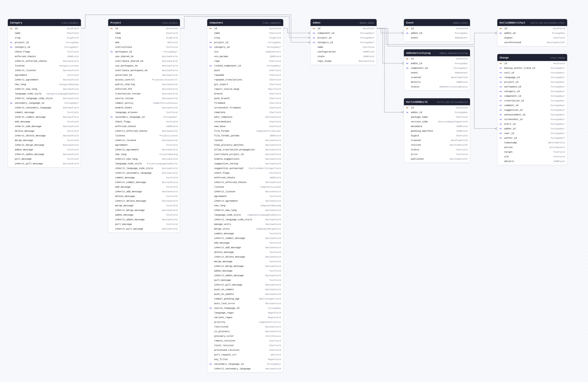

| Column | Field | Type | Null | Key | Default | Description |
| --- | --- | --- | --- | --- | --- | --- |
| `id` | `AutoField` | `integer` |  | PK | `autoincrement()` |  |
| `component_id` | `ForeignKey` | `integer` | yes | FK |  |  |
| `project_id` | `ForeignKey` | `integer` | yes | FK |  |  |
| `category_id` | `ForeignKey` | `integer` | yes | FK |  |  |
| `name` | `CharField` | `varchar(100)` |  |  |  |  |
| `configuration` | `JSONField` | `jsonb` |  |  | `dict()` |  |
| `state` | `JSONField` | `jsonb` |  |  | `dict()` |  |
| `repo_scope` | `BooleanField` | `boolean` |  |  | `False` |  |

Indexes:

- index `addons_addon_component_id_87dbd2fc` on `component_id`
- index `addons_addon_project_id_d2181050` on `project_id`
- index `addons_addon_category_id_99fed34f` on `category_id`
- index `addons_addon_repo_scope_20c74be8` on `repo_scope`

Relations:

- `component_id` → [Component](#component).`id`, on delete cascade
- `project_id` → [Project](#project).`id`, on delete cascade
- `category_id` → [Category](#category).`id`, on delete cascade
- [Event](#event).`addon_id` → `id`, on delete cascade
- [AddonActivityLog](#addonactivitylog).`addon_id` → `id`, on delete cascade
- [KotlinSDKBuild](#kotlinsdkbuild).`addon_id` → `id`, on delete cascade
- [KotlinSDKArtifact](#kotlinsdkartifact).`addon_id` → `id`, on delete cascade
- [Change](#change).`addon_id` → `id`, on delete set null

## Event

Table `addons_event`, app `addons`.

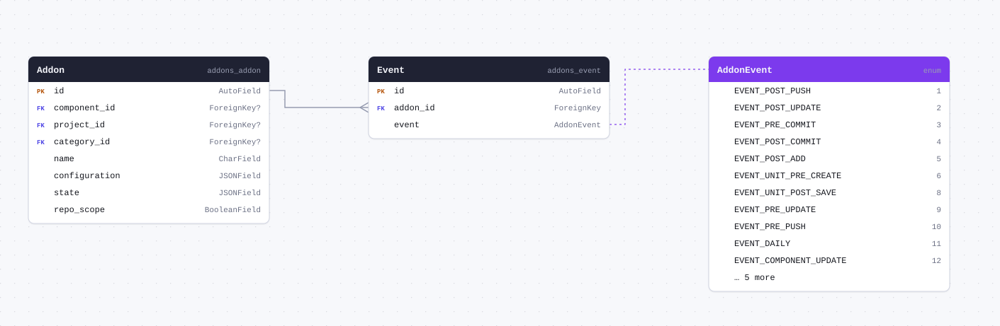

| Column | Field | Type | Null | Key | Default | Description |
| --- | --- | --- | --- | --- | --- | --- |
| `id` | `AutoField` | `integer` |  | PK | `autoincrement()` |  |
| `addon_id` | `ForeignKey` | `integer` |  | FK |  |  |
| `event` | `AddonEvent` | `integer` |  |  |  |  |

Indexes:

- unique `addons_event_addon_id_event_2407a5ef_uniq` on `addon_id`, `event`

Relations:

- `addon_id` → [Addon](#addon).`id`, on delete cascade

## AddonActivityLog

Table `addons_addonactivitylog`, app `addons`.

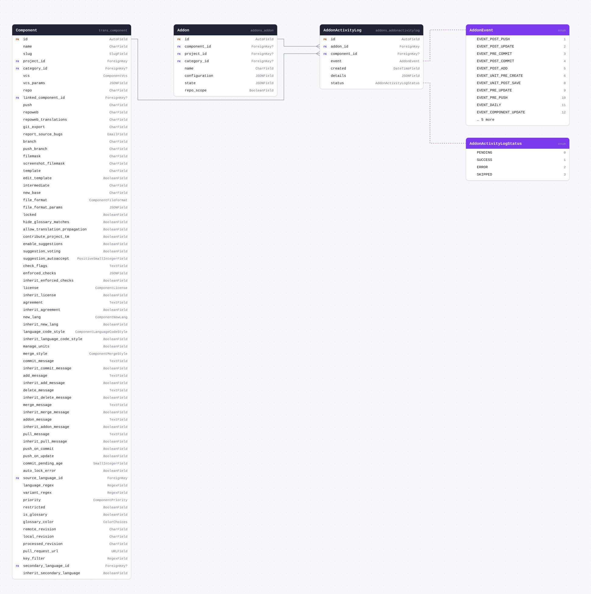

| Column | Field | Type | Null | Key | Default | Description |
| --- | --- | --- | --- | --- | --- | --- |
| `id` | `AutoField` | `integer` |  | PK | `autoincrement()` |  |
| `addon_id` | `ForeignKey` | `integer` |  | FK |  |  |
| `component_id` | `ForeignKey` | `integer` | yes | FK |  |  |
| `event` | `AddonEvent` | `integer` |  |  |  |  |
| `created` | `DateTimeField` | `timestamp with time zone` |  |  | `now()` |  |
| `details` | `JSONField` | `jsonb` |  |  | `dict()` |  |
| `status` | `AddonActivityLogStatus` | `integer` |  |  | `1` |  |

Indexes:

- index `addons_addonactivitylog_addon_id_44e38f98` on `addon_id`
- index `addons_addonactivitylog_component_id_baafffdc` on `component_id`

Relations:

- `addon_id` → [Addon](#addon).`id`, on delete cascade
- `component_id` → [Component](#component).`id`, on delete cascade

## KotlinSDKCleanup

Table `kotlin_sdk_kotlinsdkcleanup`, app `kotlin_sdk`.

Internal deletion intent for a retired manifest or uninstalled add-on.

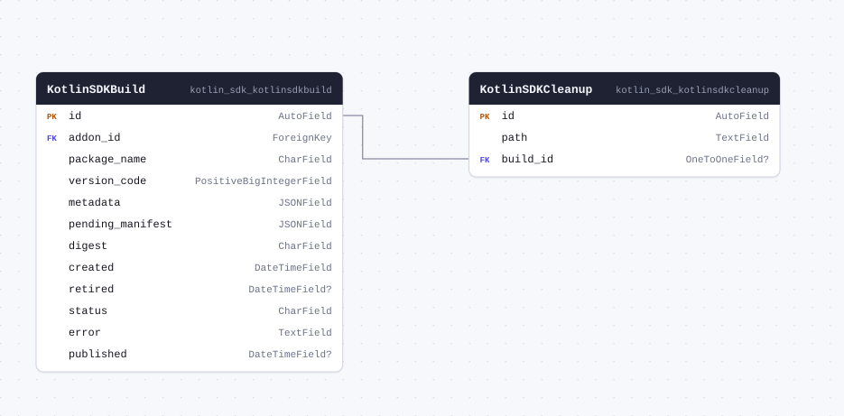

| Column | Field | Type | Null | Key | Default | Description |
| --- | --- | --- | --- | --- | --- | --- |
| `id` | `AutoField` | `integer` |  | PK | `autoincrement()` |  |
| `path` | `TextField` | `text` |  | unique |  |  |
| `build_id` | `OneToOneField` | `integer` | yes | FK, unique |  |  |

Indexes:

- index `kotlin_sdk_kotlinsdkcleanup_path_eac6eb18_like` on `path` (`text_pattern_ops`)

Relations:

- `build_id` → [KotlinSDKBuild](#kotlinsdkbuild).`id`, on delete set null

## KotlinSDKBuild

Table `kotlin_sdk_kotlinsdkbuild`, app `kotlin_sdk`.

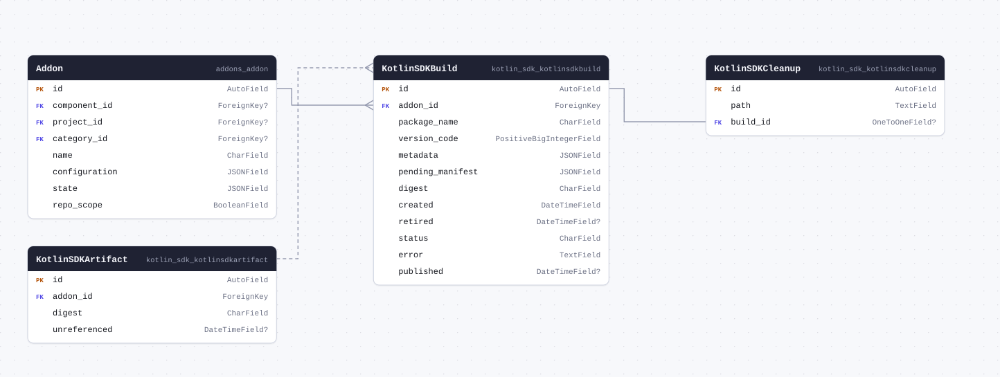

| Column | Field | Type | Null | Key | Default | Description |
| --- | --- | --- | --- | --- | --- | --- |
| `id` | `AutoField` | `integer` |  | PK | `autoincrement()` |  |
| `addon_id` | `ForeignKey` | `integer` |  | FK |  |  |
| `package_name` | `CharField` | `varchar(127)` |  |  |  |  |
| `version_code` | `PositiveBigIntegerField` | `bigint` |  |  |  |  |
| `metadata` | `JSONField` | `jsonb` |  |  | `dict()` |  |
| `pending_manifest` | `JSONField` | `jsonb` |  |  | `dict()` |  |
| `digest` | `CharField` | `varchar(64)` |  |  |  |  |
| `created` | `DateTimeField` | `timestamp with time zone` |  |  | `now()` |  |
| `retired` | `DateTimeField` | `timestamp with time zone` | yes |  |  |  |
| `status` | `CharField` | `varchar(16)` |  |  | `'pending'` |  |
| `error` | `TextField` | `text` |  |  |  |  |
| `published` | `DateTimeField` | `timestamp with time zone` | yes |  |  |  |

Indexes:

- index `kotlin_sdk_kotlinsdkbuild_addon_id_7ab4618d` on `addon_id`
- unique `kotlin_sdk_build_unique` on `addon_id`, `package_name`, `version_code`

Relations:

- [KotlinSDKCleanup](#kotlinsdkcleanup).`build_id` → `id`, on delete set null
- `addon_id` → [Addon](#addon).`id`, on delete cascade
- `artifacts` — many to many with [KotlinSDKArtifact](#kotlinsdkartifact)

## KotlinSDKArtifact

Table `kotlin_sdk_kotlinsdkartifact`, app `kotlin_sdk`.

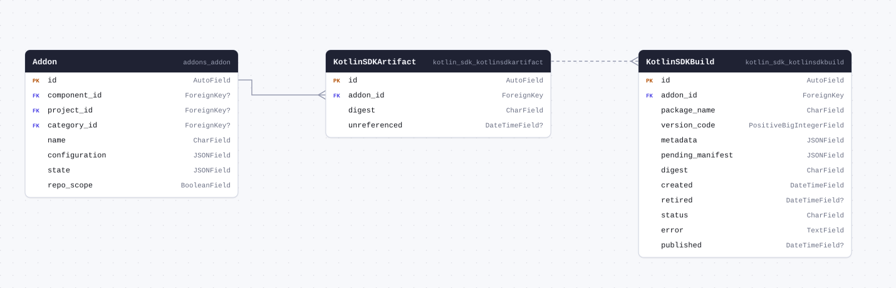

| Column | Field | Type | Null | Key | Default | Description |
| --- | --- | --- | --- | --- | --- | --- |
| `id` | `AutoField` | `integer` |  | PK | `autoincrement()` |  |
| `addon_id` | `ForeignKey` | `integer` |  | FK |  |  |
| `digest` | `CharField` | `varchar(64)` |  |  |  |  |
| `unreferenced` | `DateTimeField` | `timestamp with time zone` | yes |  |  |  |

Indexes:

- index `kotlin_sdk_kotlinsdkartifact_addon_id_ebe8e551` on `addon_id`
- unique `kotlin_sdk_artifact_unique` on `addon_id`, `digest`

Relations:

- `addon_id` → [Addon](#addon).`id`, on delete cascade
- `builds` — many to many with [KotlinSDKBuild](#kotlinsdkbuild)

## weblate_auth.Permission

Table `weblate_auth_permission`, app `weblate_auth`.

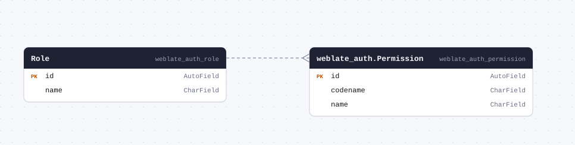

| Column | Field | Type | Null | Key | Default | Description |
| --- | --- | --- | --- | --- | --- | --- |
| `id` | `AutoField` | `integer` |  | PK | `autoincrement()` |  |
| `codename` | `CharField` | `varchar(100)` |  | unique |  |  |
| `name` | `CharField` | `varchar(200)` |  |  |  |  |

Indexes:

- index `weblate_auth_permission_codename_b551931f_like` on `codename` (`varchar_pattern_ops`)

Relations:

- `role_set` — many to many with [Role](#role)

## Role

Table `weblate_auth_role`, app `weblate_auth`.

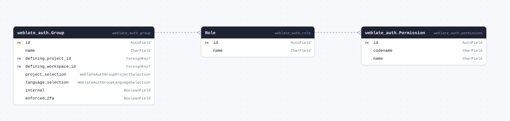

| Column | Field | Type | Null | Key | Default | Description |
| --- | --- | --- | --- | --- | --- | --- |
| `id` | `AutoField` | `integer` |  | PK | `autoincrement()` |  |
| `name` | `CharField` | `varchar(200)` |  | unique |  |  |

Indexes:

- index `weblate_auth_role_name_97854f8d_like` on `name` (`varchar_pattern_ops`)

Relations:

- `permissions` — many to many with [weblate_auth.Permission](#weblate_authpermission)
- `group_set` — many to many with [weblate_auth.Group](#weblate_authgroup)

## weblate_auth.Group

Table `weblate_auth_group`, app `weblate_auth`.

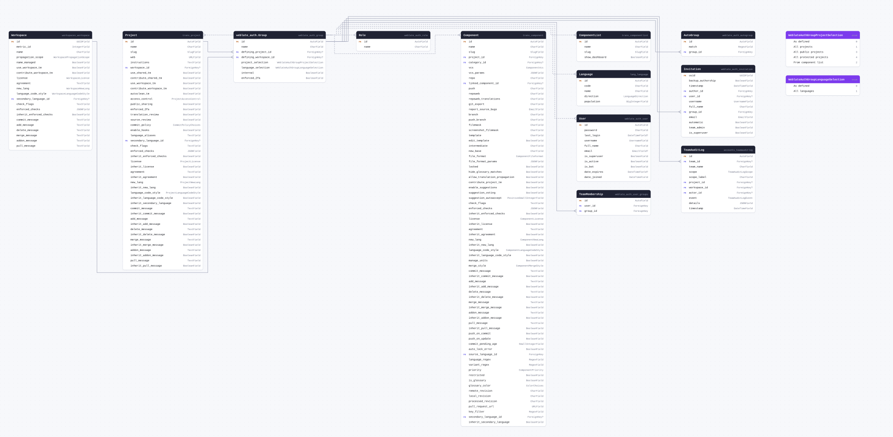

| Column | Field | Type | Null | Key | Default | Description |
| --- | --- | --- | --- | --- | --- | --- |
| `id` | `AutoField` | `integer` |  | PK | `autoincrement()` |  |
| `name` | `CharField` | `varchar(150)` |  |  |  |  |
| `defining_project_id` | `ForeignKey` | `integer` | yes | FK |  |  |
| `defining_workspace_id` | `ForeignKey` | `uuid` | yes | FK |  |  |
| `project_selection` | `WeblateAuthGroupProjectSelection` | `integer` |  |  | `0` |  |
| `language_selection` | `WeblateAuthGroupLanguageSelection` | `integer` |  |  | `0` |  |
| `internal` | `BooleanField` | `boolean` |  |  | `False` |  |
| `enforced_2fa` | `BooleanField` | `boolean` |  |  | `False` | Requires users to have two-factor authentication configured. |

Indexes:

- index `weblate_auth_group_defining_project_id_b2ad81a7` on `defining_project_id`
- index `weblate_auth_group_defining_workspace_id_84f40bfd` on `defining_workspace_id`
- unique `weblate_auth_group_unique_workspace_name` on `defining_workspace_id`, `name` where `"defining_workspace_id" IS NOT NULL`

Checks:

- `weblate_auth_group_single_definition`: `("defining_project_id" IS NULL OR "defining_workspace_id" IS NULL)`

Relations:

- `user_set` — many to many with [User](#user), through [TeamMembership](#teammembership)
- `defining_project_id` → [Project](#project).`id`, on delete cascade
- `defining_workspace_id` → [Workspace](#workspace).`id`, on delete cascade
- `roles` — many to many with [Role](#role)
- `projects` — many to many with [Project](#project)
- `components` — many to many with [Component](#component)
- `componentlists` — many to many with [ComponentList](#componentlist)
- `languages` — many to many with [Language](#language)
- `admins` — many to many with [User](#user)
- [TeamMembership](#teammembership).`group_id` → `id`, on delete cascade
- [AutoGroup](#autogroup).`group_id` → `id`, on delete cascade
- [Invitation](#invitation).`group_id` → `id`, on delete cascade
- [TeamAuditLog](#teamauditlog).`team_id` → `id`, on delete set null

## TeamMembership

Table `weblate_auth_user_groups`, app `weblate_auth`.

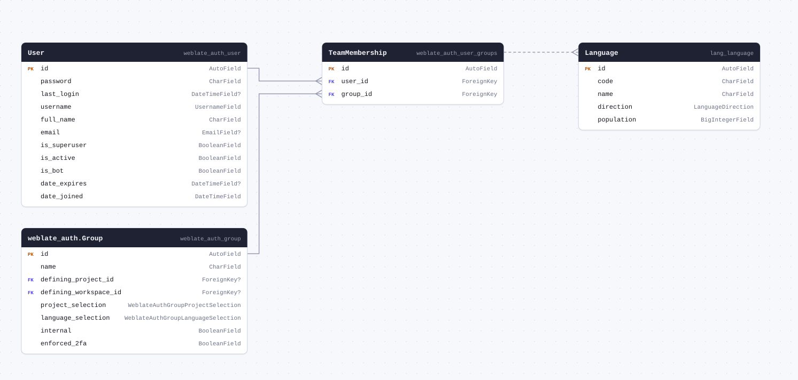

| Column | Field | Type | Null | Key | Default | Description |
| --- | --- | --- | --- | --- | --- | --- |
| `id` | `AutoField` | `integer` |  | PK | `autoincrement()` |  |
| `user_id` | `ForeignKey` | `integer` |  | FK |  |  |
| `group_id` | `ForeignKey` | `integer` |  | FK |  |  |

Indexes:

- index `weblate_auth_user_groups_user_id_37e61ff1` on `user_id`
- index `weblate_auth_user_groups_group_id_48c0a977` on `group_id`
- unique `weblate_auth_user_groups_user_id_group_id_16cfc05b_uniq` on `user_id`, `group_id`

Relations:

- `user_id` → [User](#user).`id`, on delete cascade
- `group_id` → [weblate_auth.Group](#weblate_authgroup).`id`, on delete cascade
- `limit_languages` — many to many with [Language](#language)

## User

Table `weblate_auth_user`, app `weblate_auth`.

Columns from `AbstractBaseUser` (abstract): `password`, `last_login`.

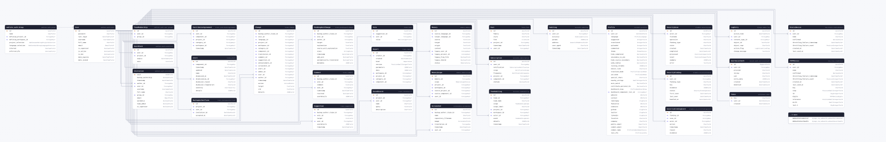

| Column | Field | Type | Null | Key | Default | Description |
| --- | --- | --- | --- | --- | --- | --- |
| `id` | `AutoField` | `integer` |  | PK | `autoincrement()` |  |
| `password` | `CharField` | `varchar(128)` |  |  |  |  |
| `last_login` | `DateTimeField` | `timestamp with time zone` | yes |  |  |  |
| `username` | `UsernameField` | `varchar(150)` |  | unique |  | Username may only contain letters, numbers or the following characters: @ . + - _ |
| `full_name` | `CharField` | `varchar(150)` |  |  |  |  |
| `email` | `EmailField` | `varchar(190)` | yes | unique |  |  |
| `is_superuser` | `BooleanField` | `boolean` |  |  | `False` | User has all possible permissions. |
| `is_active` | `BooleanField` | `boolean` |  |  | `True` | Mark user as inactive instead of removing. |
| `is_bot` | `BooleanField` | `boolean` |  |  | `False` |  |
| `date_expires` | `DateTimeField` | `timestamp with time zone` | yes |  | `None` | The account will be disabled after the expiry. |
| `date_joined` | `DateTimeField` | `timestamp with time zone` |  |  | `now()` |  |

Indexes:

- index `weblate_auth_user_username_d226e4a0_like` on `username` (`varchar_pattern_ops`)
- index `weblate_auth_user_email_aaabd769_like` on `email` (`varchar_pattern_ops`)
- index `weblate_auth_user_is_bot_f4b1c6fb` on `is_bot`
- unique `weblate_auth_user_username_ci` on `UPPER("username")`
- unique `weblate_auth_user_email_ci` on `LOWER(("email") COLLATE "C")`

Relations:

- `groups` — many to many with [weblate_auth.Group](#weblate_authgroup), through [TeamMembership](#teammembership)
- `user_votes` — many to many with [Suggestion](#suggestion), through [Vote](#vote)
- `administered_group_set` — many to many with [weblate_auth.Group](#weblate_authgroup)
- [TeamMembership](#teammembership).`user_id` → `id`, on delete cascade
- [UserBlock](#userblock).`user_id` → `id`, on delete cascade
- [Invitation](#invitation).`author_id` → `id`, on delete cascade
- [Invitation](#invitation).`user_id` → `id`, on delete cascade
- [ContributorAgreement](#contributoragreement).`user_id` → `id`, on delete cascade
- [Alert](#alert).`dismissed_by_id` → `id`, on delete set null
- [BackupAuthorClaim](#backupauthorclaim).`user_id` → `id`, on delete cascade
- [Change](#change).`user_id` → `id`, on delete cascade
- [Change](#change).`author_id` → `id`, on delete cascade
- [PendingUnitChange](#pendingunitchange).`author_id` → `id`, on delete cascade
- [Comment](#comment).`user_id` → `id`, on delete cascade
- [Suggestion](#suggestion).`user_id` → `id`, on delete cascade
- [Vote](#vote).`user_id` → `id`, on delete cascade
- [Report](#report).`creator_id` → `id`, on delete cascade
- [SavedSearch](#savedsearch).`user_id` → `id`, on delete cascade
- [Memory](#memory).`legacy_user_id` → `id`, on delete cascade
- [MemoryScope](#memoryscope).`user_id` → `id`, on delete cascade
- [Screenshot](#screenshot).`user_id` → `id`, on delete set null
- [Font](#font).`user_id` → `id`, on delete set null
- [Subscription](#subscription).`user_id` → `id`, on delete cascade
- [TeamAuditLog](#teamauditlog).`actor_id` → `id`, on delete set null
- [AuditLog](#auditlog).`user_id` → `id`, on delete cascade
- [Profile](#profile).`user_id` → `id`, on delete cascade
- [SecurityScan](#securityscan).`actor_id` → `id`, on delete set null
- [SecurityFinding](#securityfinding).`user_id` → `id`, on delete cascade
- [SecurityFindingEvent](#securityfindingevent).`actor_id` → `id`, on delete set null
- [LogEntry](#logentry).`user_id` → `id`, on delete cascade
- [UserSocialAuth](#usersocialauth).`user_id` → `id`, on delete cascade
- [Token](#token).`user_id` → `id`, on delete cascade
- [StaticDevice](#staticdevice).`user_id` → `id`, on delete cascade
- [TOTPDevice](#totpdevice).`user_id` → `id`, on delete cascade
- [WebAuthnCredential](#webauthncredential).`user_id` → `id`, on delete cascade
- [WebAuthnUserHandle](#webauthnuserhandle).`user_id` → `id`, on delete cascade

## AutoGroup

Table `weblate_auth_autogroup`, app `weblate_auth`.

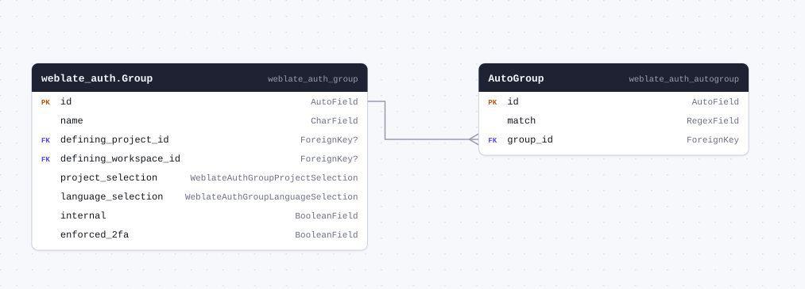

| Column | Field | Type | Null | Key | Default | Description |
| --- | --- | --- | --- | --- | --- | --- |
| `id` | `AutoField` | `integer` |  | PK | `autoincrement()` |  |
| `match` | `RegexField` | `varchar(200)` |  |  | `'^$'` | Users with e-mail addresses found to match will be added to this team. |
| `group_id` | `ForeignKey` | `integer` |  | FK |  |  |

Indexes:

- index `weblate_auth_autogroup_group_id_37b7ff0b` on `group_id`

Relations:

- `group_id` → [weblate_auth.Group](#weblate_authgroup).`id`, on delete cascade

## UserBlock

Table `weblate_auth_userblock`, app `weblate_auth`.

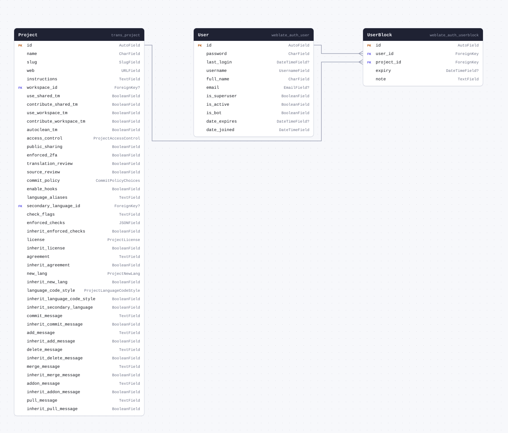

| Column | Field | Type | Null | Key | Default | Description |
| --- | --- | --- | --- | --- | --- | --- |
| `id` | `AutoField` | `integer` |  | PK | `autoincrement()` |  |
| `user_id` | `ForeignKey` | `integer` |  | FK |  |  |
| `project_id` | `ForeignKey` | `integer` |  | FK |  |  |
| `expiry` | `DateTimeField` | `timestamp with time zone` | yes |  |  |  |
| `note` | `TextField` | `text` |  |  |  | Internal notes regarding blocking the user that are not visible to the user. |

Indexes:

- index `weblate_auth_userblock_project_id_44aae0be` on `project_id`
- unique `weblate_auth_userblock_user_id_project_id_7e74a707_uniq` on `user_id`, `project_id`

Relations:

- `user_id` → [User](#user).`id`, on delete cascade
- `project_id` → [Project](#project).`id`, on delete cascade

## Invitation

Table `weblate_auth_invitation`, app `weblate_auth`.

User invitation store.

Either user or e-mail attribute is set, this is to invite current and new users.

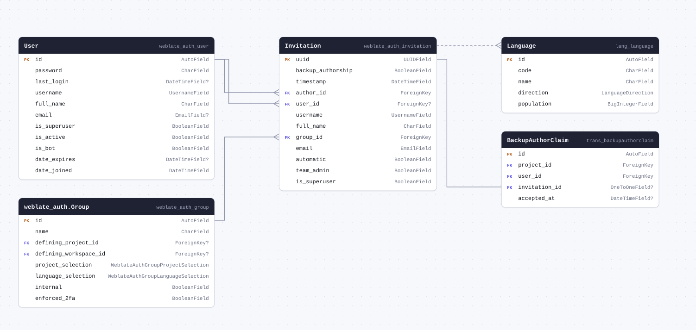

| Column | Field | Type | Null | Key | Default | Description |
| --- | --- | --- | --- | --- | --- | --- |
| `uuid` | `UUIDField` | `uuid` |  | PK | `uuid4()` |  |
| `backup_authorship` | `BooleanField` | `boolean` |  |  | `False` |  |
| `timestamp` | `DateTimeField` | `timestamp with time zone` |  |  | `now()` |  |
| `author_id` | `ForeignKey` | `integer` |  | FK |  |  |
| `user_id` | `ForeignKey` | `integer` | yes | FK |  | Please type in an existing Weblate account name or e-mail address. |
| `username` | `UsernameField` | `varchar(150)` |  |  |  | Suggest username for the user. It can be changed later. |
| `full_name` | `CharField` | `varchar(150)` |  |  |  | Suggest full name for the user. It can be changed later. |
| `group_id` | `ForeignKey` | `integer` |  | FK |  | The user is granted all permissions included in membership of these teams. |
| `email` | `EmailField` | `varchar(190)` |  |  |  |  |
| `automatic` | `BooleanField` | `boolean` |  |  | `False` |  |
| `team_admin` | `BooleanField` | `boolean` |  |  | `False` |  |
| `is_superuser` | `BooleanField` | `boolean` |  |  | `False` | User has all possible permissions. |

Indexes:

- index `weblate_auth_invitation_author_id_a713ef92` on `author_id`
- index `weblate_auth_invitation_user_id_6a0c6dec` on `user_id`
- index `weblate_auth_invitation_group_id_07a52aff` on `group_id`

Relations:

- `author_id` → [User](#user).`id`, on delete cascade
- `user_id` → [User](#user).`id`, on delete cascade
- `group_id` → [weblate_auth.Group](#weblate_authgroup).`id`, on delete cascade
- `limit_languages` — many to many with [Language](#language)
- [BackupAuthorClaim](#backupauthorclaim).`invitation_id` → `uuid`, on delete set null

## Check

Table `checks_check`, app `checks`.

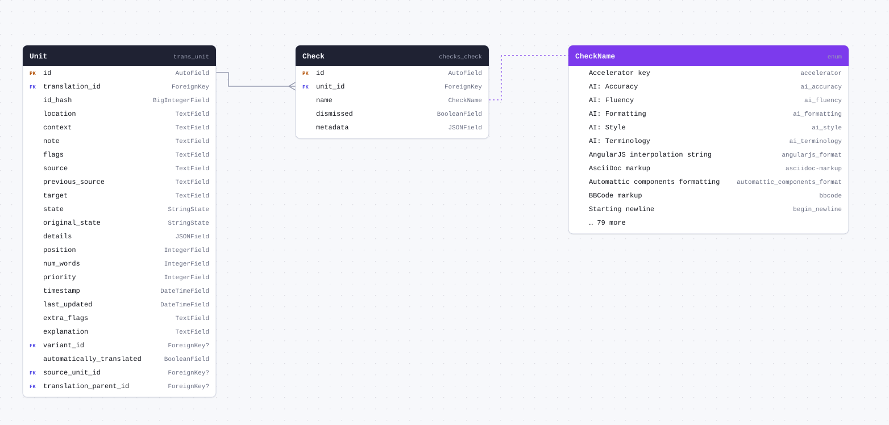

| Column | Field | Type | Null | Key | Default | Description |
| --- | --- | --- | --- | --- | --- | --- |
| `id` | `AutoField` | `integer` |  | PK | `autoincrement()` |  |
| `unit_id` | `ForeignKey` | `integer` |  | FK |  |  |
| `name` | `CheckName` | `varchar(50)` |  |  |  |  |
| `dismissed` | `BooleanField` | `boolean` |  |  | `False` |  |
| `metadata` | `JSONField` | `jsonb` |  |  | `dict()` |  |

Indexes:

- index `checks_check_dismissed_a11836a3` on `dismissed`
- unique `checks_check_unit_id_name_ea73a317_uniq` on `unit_id`, `name`
- index `checks_active_unit_idx` on `unit_id` where `NOT "dismissed"`

Relations:

- `unit_id` → [Unit](#unit).`id`, on delete cascade

## MachineryInstallation

Table `machinery_machineryinstallation`, app `machinery`.

One configured instance of a translation service.

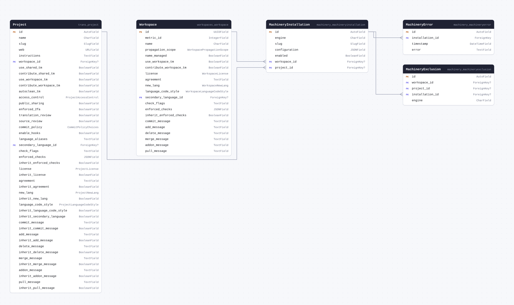

| Column | Field | Type | Null | Key | Default | Description |
| --- | --- | --- | --- | --- | --- | --- |
| `id` | `AutoField` | `integer` |  | PK | `autoincrement()` |  |
| `engine` | `CharField` | `varchar(100)` |  |  |  |  |
| `slug` | `SlugField` | `varchar(100)` |  |  |  |  |
| `configuration` | `JSONField` | `jsonb` |  |  | `dict()` |  |
| `enabled` | `BooleanField` | `boolean` |  |  | `True` |  |
| `workspace_id` | `ForeignKey` | `uuid` | yes | FK |  |  |
| `project_id` | `ForeignKey` | `integer` | yes | FK |  |  |

Indexes:

- index `machinery_machineryinstallation_slug_620b370d` on `slug`
- index `machinery_machineryinstallation_slug_620b370d_like` on `slug` (`varchar_pattern_ops`)
- index `machinery_machineryinstallation_workspace_id_071d1875` on `workspace_id`
- index `machinery_machineryinstallation_project_id_7821aa7d` on `project_id`
- unique `machinery_site_slug` on `slug` where `("project_id" IS NULL AND "slug" > '' AND "workspace_id" IS NULL)`
- unique `machinery_workspace_slug` on `workspace_id`, `slug` where `("slug" > '' AND "workspace_id" IS NOT NULL)`
- unique `machinery_project_slug` on `project_id`, `slug` where `("project_id" IS NOT NULL AND "slug" > '')`

Checks:

- `machinery_one_scope`: `("workspace_id" IS NULL OR "project_id" IS NULL)`

Relations:

- `workspace_id` → [Workspace](#workspace).`id`, on delete cascade
- `project_id` → [Project](#project).`id`, on delete cascade
- [MachineryError](#machineryerror).`installation_id` → `id`, on delete cascade
- [MachineryExclusion](#machineryexclusion).`installation_id` → `id`, on delete cascade

## MachineryError

Table `machinery_machineryerror`, app `machinery`.

An operational error belonging to one translation service installation.

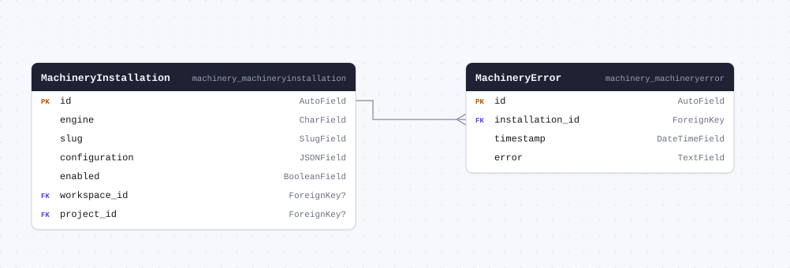

| Column | Field | Type | Null | Key | Default | Description |
| --- | --- | --- | --- | --- | --- | --- |
| `id` | `AutoField` | `integer` |  | PK | `autoincrement()` |  |
| `installation_id` | `ForeignKey` | `integer` |  | FK |  |  |
| `timestamp` | `DateTimeField` | `timestamp with time zone` |  |  | `now()` |  |
| `error` | `TextField` | `text` |  |  |  |  |

Indexes:

- index `machinery_machineryerror_installation_id_721886a4` on `installation_id`
- index `machinery_machineryerror_timestamp_07d8c763` on `timestamp`
- index `machinery_m_install_ec7c4c_idx` on `installation_id`, `timestamp` desc, `id` desc

Relations:

- `installation_id` → [MachineryInstallation](#machineryinstallation).`id`, on delete cascade

## MachineryExclusion

Table `machinery_machineryexclusion`, app `machinery`.

Hide inherited installations at a workspace or project scope.

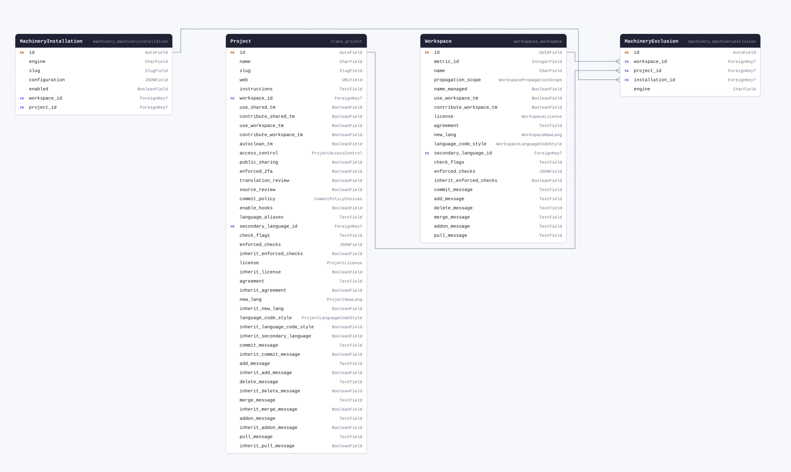

| Column | Field | Type | Null | Key | Default | Description |
| --- | --- | --- | --- | --- | --- | --- |
| `id` | `AutoField` | `integer` |  | PK | `autoincrement()` |  |
| `workspace_id` | `ForeignKey` | `uuid` | yes | FK |  |  |
| `project_id` | `ForeignKey` | `integer` | yes | FK |  |  |
| `installation_id` | `ForeignKey` | `integer` | yes | FK |  |  |
| `engine` | `CharField` | `varchar(100)` |  |  |  |  |

Indexes:

- index `machinery_machineryexclusion_workspace_id_7aa4f8fd` on `workspace_id`
- index `machinery_machineryexclusion_project_id_d1dfc73d` on `project_id`
- index `machinery_machineryexclusion_installation_id_f938fc8b` on `installation_id`
- unique `machinery_workspace_installation_exclusion` on `workspace_id`, `installation_id`
- unique `machinery_project_installation_exclusion` on `project_id`, `installation_id`
- unique `machinery_workspace_engine_exclusion` on `workspace_id`, `engine` where `NOT ("engine" = '')`
- unique `machinery_project_engine_exclusion` on `project_id`, `engine` where `NOT ("engine" = '')`

Checks:

- `machinery_exclusion_one_scope`: `(("workspace_id" IS NULL AND "project_id" IS NOT NULL) OR ("workspace_id" IS NOT NULL AND "project_id" IS NULL))`
- `machinery_exclusion_one_target`: `(("installation_id" IS NULL AND NOT ("engine" = '')) OR ("installation_id" IS NOT NULL AND "engine" = ''))`

Relations:

- `workspace_id` → [Workspace](#workspace).`id`, on delete cascade
- `project_id` → [Project](#project).`id`, on delete cascade
- `installation_id` → [MachineryInstallation](#machineryinstallation).`id`, on delete cascade

## Workspace

Table `workspaces_workspace`, app `workspaces`.

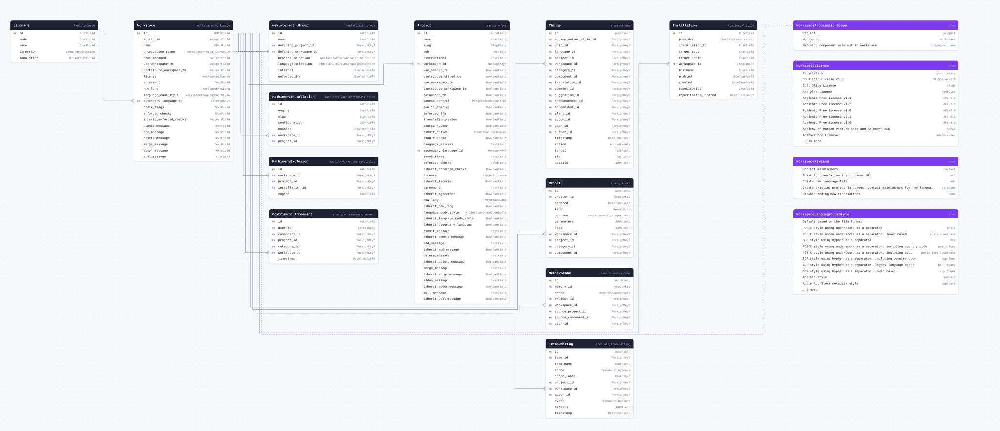

| Column | Field | Type | Null | Key | Default | Description |
| --- | --- | --- | --- | --- | --- | --- |
| `id` | `UUIDField` | `uuid` |  | PK | `uuid4()` |  |
| `metric_id` | `IntegerField` | `integer` |  | unique | `((nextval('workspaces_workspace_metric_id_seq'::regclass)))` (database) |  |
| `name` | `CharField` | `varchar(100)` |  |  |  | Display name |
| `propagation_scope` | `WorkspacePropagationScope` | `varchar(20)` |  |  | `'project'` | Where translations of matching strings are propagated. |
| `name_managed` | `BooleanField` | `boolean` |  |  | `False` | Whether Weblate can update the name automatically. |
| `use_workspace_tm` | `BooleanField` | `boolean` |  |  | `False` | Uses the pool of shared translations between projects in this workspace. |
| `contribute_workspace_tm` | `BooleanField` | `boolean` |  |  | `False` | Contributes translations to the pool shared between projects in this workspace. |
| `license` | `WorkspaceLicense` | `varchar(150)` |  |  | `''` |  |
| `agreement` | `TextField` | `text` |  |  | `''` | Contributor license agreement which needs to be approved before a user can translate components in this workspace. |
| `new_lang` | `WorkspaceNewLang` | `varchar(10)` |  |  | `'add'` | How to handle requests for creating new translations. |
| `language_code_style` | `WorkspaceLanguageCodeStyle` | `varchar(20)` |  |  | `''` | Customize language code used to generate the filename for translations created by Weblate. |
| `secondary_language_id` | `ForeignKey` | `integer` | yes | FK | `None` | Additional language to show together with the source language while translating. |
| `check_flags` | `TextField` | `text` |  |  | `''` | Additional comma-separated flags to influence Weblate behavior. |
| `enforced_checks` | `JSONField` | `jsonb` |  |  | `list()` | List of checks which can not be dismissed. |
| `inherit_enforced_checks` | `BooleanField` | `boolean` |  |  | `True` | Use enforced checks from the workspace. |
| `commit_message` | `TextField` | `text` |  |  | `'chore(l10n): update {{ language_name }} translation\n\nTranslation: {{ component_full_name }}\nLanguage: {{ language_name }}\nProgress: {{ stats.translated_percent }}% ({{ stats.translated }} of {{ stats.all }} strings)\nTranslate-URL: {{ url }}'` | You can use template language for various info, please consult the documentation for more details. |
| `add_message` | `TextField` | `text` |  |  | `'chore(l10n): add {{ language_name }} translation\n\nTranslation: {{ component_full_name }}\nLanguage: {{ language_name }}\nTranslate-URL: {{ url }}'` | You can use template language for various info, please consult the documentation for more details. |
| `delete_message` | `TextField` | `text` |  |  | `'chore(l10n): remove {{ language_name }} translation\n\nTranslation: {{ component_full_name }}\nLanguage: {{ language_name }}\nTranslate-URL: {{ url }}'` | You can use template language for various info, please consult the documentation for more details. |
| `merge_message` | `TextField` | `text` |  |  | `'chore(l10n): merge remote changes\n\nTranslation: {{ component_full_name }}\nRemote-Branch: {{ component_remote_branch }}\nTranslate-URL: {{ url }}'` | You can use template language for various info, please consult the documentation for more details. |
| `addon_message` | `TextField` | `text` |  |  | `'chore(l10n): update translation files\n\nAdd-on: {{ addon_name }}\nTranslation: {{ component_full_name }}\nTranslate-URL: {{ url }}'` | You can use template language for various info, please consult the documentation for more details. |
| `pull_message` | `TextField` | `text` |  |  | `'chore(l10n): update translations\n\nTranslations updated in [{{ site_title }}]({{ site_url }}) for [{{ component_full_name }}]({{ url }}).\n\n\nIncluded components:\n\n* [{{ linked.full_name }}]({{ linked.url }})\n\n\n\nTranslation status:\n\n\n'` | You can use template language for various info, please consult the documentation for more details. |

Indexes:

- index `workspaces_workspace_secondary_language_id_b8ff77e6` on `secondary_language_id`

Relations:

- [weblate_auth.Group](#weblate_authgroup).`defining_workspace_id` → `id`, on delete cascade
- [MachineryInstallation](#machineryinstallation).`workspace_id` → `id`, on delete cascade
- [MachineryExclusion](#machineryexclusion).`workspace_id` → `id`, on delete cascade
- `secondary_language_id` → [Language](#language).`id`, on delete cascade
- [ContributorAgreement](#contributoragreement).`workspace_id` → `id`, on delete cascade
- [Project](#project).`workspace_id` → `id`, on delete protect
- [Change](#change).`workspace_id` → `id`, on delete cascade
- [Report](#report).`workspace_id` → `id`, on delete cascade
- [MemoryScope](#memoryscope).`workspace_id` → `id`, on delete cascade
- [TeamAuditLog](#teamauditlog).`workspace_id` → `id`, on delete set null
- [Installation](#installation).`workspace_id` → `id`, on delete cascade

## ContributorAgreement

Table `trans_contributoragreement`, app `trans`.

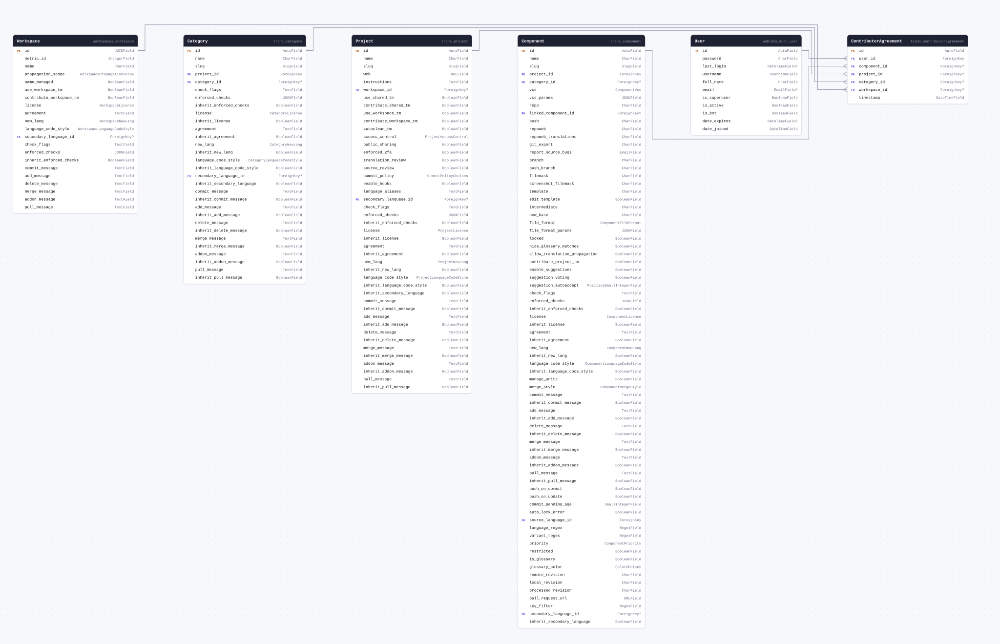

| Column | Field | Type | Null | Key | Default | Description |
| --- | --- | --- | --- | --- | --- | --- |
| `id` | `AutoField` | `integer` |  | PK | `autoincrement()` |  |
| `user_id` | `ForeignKey` | `integer` |  | FK |  |  |
| `component_id` | `ForeignKey` | `integer` | yes | FK |  |  |
| `project_id` | `ForeignKey` | `integer` | yes | FK |  |  |
| `category_id` | `ForeignKey` | `integer` | yes | FK |  |  |
| `workspace_id` | `ForeignKey` | `uuid` | yes | FK |  |  |
| `timestamp` | `DateTimeField` | `timestamp with time zone` |  |  | `now()` |  |

Indexes:

- index `trans_contributoragreement_component_id_31bafbef` on `component_id`
- index `trans_contributoragreement_project_id_5761269c` on `project_id`
- index `trans_contributoragreement_category_id_16151d5d` on `category_id`
- index `trans_contributoragreement_workspace_id_34926ae5` on `workspace_id`
- unique `contributor_agreement_unique_component` on `user_id`, `component_id` where `"component_id" IS NOT NULL`
- unique `contributor_agreement_unique_project` on `user_id`, `project_id` where `"project_id" IS NOT NULL`
- unique `contributor_agreement_unique_category` on `user_id`, `category_id` where `"category_id" IS NOT NULL`
- unique `contributor_agreement_unique_workspace` on `user_id`, `workspace_id` where `"workspace_id" IS NOT NULL`

Checks:

- `contributor_agreement_single_scope`: `(("component_id" IS NOT NULL AND "project_id" IS NULL AND "category_id" IS NULL AND "workspace_id" IS NULL) OR ("component_id" IS NULL AND "project_id" IS NOT NULL AND "category_id" IS NULL AND "workspace_id" IS NULL) OR ("component_id" IS NULL AND "project_id" IS NULL AND "category_id" IS NOT NULL AND "workspace_id" IS NULL) OR ("component_id" IS NULL AND "project_id" IS NULL AND "category_id" IS NULL AND "workspace_id" IS NOT NULL))`

Relations:

- `user_id` → [User](#user).`id`, on delete cascade
- `component_id` → [Component](#component).`id`, on delete cascade
- `project_id` → [Project](#project).`id`, on delete cascade
- `category_id` → [Category](#category).`id`, on delete cascade
- `workspace_id` → [Workspace](#workspace).`id`, on delete cascade

## Alert

Table `trans_alert`, app `trans`.

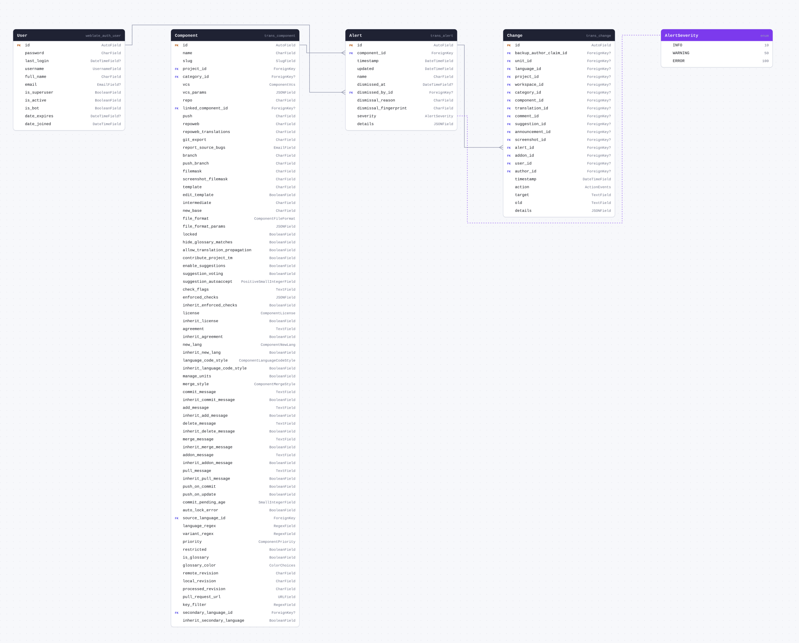

| Column | Field | Type | Null | Key | Default | Description |
| --- | --- | --- | --- | --- | --- | --- |
| `id` | `AutoField` | `integer` |  | PK | `autoincrement()` |  |
| `component_id` | `ForeignKey` | `integer` |  | FK |  |  |
| `timestamp` | `DateTimeField` | `timestamp with time zone` |  |  | `now()` |  |
| `updated` | `DateTimeField` | `timestamp with time zone` |  |  | `now()` |  |
| `name` | `CharField` | `varchar(150)` |  |  |  |  |
| `dismissed_at` | `DateTimeField` | `timestamp with time zone` | yes |  |  |  |
| `dismissed_by_id` | `ForeignKey` | `integer` | yes | FK |  |  |
| `dismissal_reason` | `CharField` | `varchar(500)` |  |  |  |  |
| `dismissal_fingerprint` | `CharField` | `varchar(64)` |  |  |  |  |
| `severity` | `AlertSeverity` | `smallint` |  |  | `100` |  |
| `details` | `JSONField` | `jsonb` |  |  | `dict()` |  |

Indexes:

- index `trans_alert_dismissed_by_id_7fb54cb8` on `dismissed_by_id`
- index `trans_alert_severity_3a81ac0d` on `severity`
- unique `trans_alert_component_id_name_4a5a9b1d_uniq` on `component_id`, `name`
- index `trans_alert_active_idx` on `component_id`, `severity` where `"dismissed_at" IS NULL`

Relations:

- `component_id` → [Component](#component).`id`, on delete cascade
- `dismissed_by_id` → [User](#user).`id`, on delete set null
- [Change](#change).`alert_id` → `id`, on delete set null

## Announcement

Table `trans_announcement`, app `trans`.

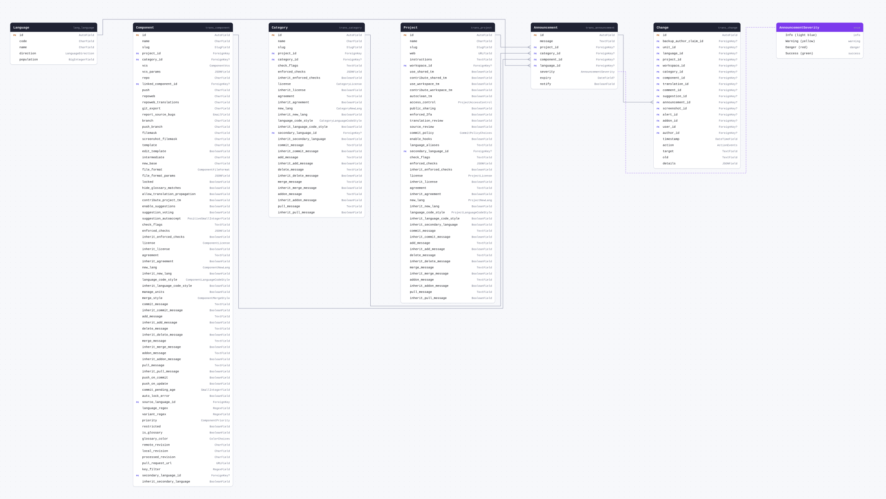

| Column | Field | Type | Null | Key | Default | Description |
| --- | --- | --- | --- | --- | --- | --- |
| `id` | `AutoField` | `integer` |  | PK | `autoincrement()` |  |
| `message` | `TextField` | `text` |  |  |  | You can use Markdown and mention users by @username. |
| `project_id` | `ForeignKey` | `integer` | yes | FK |  |  |
| `category_id` | `ForeignKey` | `integer` | yes | FK |  |  |
| `component_id` | `ForeignKey` | `integer` | yes | FK |  |  |
| `language_id` | `ForeignKey` | `integer` | yes | FK |  |  |
| `severity` | `AnnouncementSeverity` | `varchar(25)` |  |  | `'info'` | Severity defines color used for the message. |
| `expiry` | `DateField` | `date` | yes |  |  | The message will be not shown after this date. Use it to announce string freeze and translation deadline for next release. |
| `notify` | `BooleanField` | `boolean` |  |  | `False` | Send notification to subscribed users. |

Indexes:

- index `trans_announcement_project_id_3713e8a9` on `project_id`
- index `trans_announcement_category_id_913f87b9` on `category_id`
- index `trans_announcement_component_id_72695410` on `component_id`
- index `trans_announcement_language_id_f5f7a357` on `language_id`
- index `trans_announcement_expiry_a06d62a1` on `expiry`

Relations:

- `project_id` → [Project](#project).`id`, on delete cascade
- `category_id` → [Category](#category).`id`, on delete cascade
- `component_id` → [Component](#component).`id`, on delete cascade
- `language_id` → [Language](#language).`id`, on delete cascade
- [Change](#change).`announcement_id` → `id`, on delete set null

## BackupAuthorClaim

Table `trans_backupauthorclaim`, app `trans`.

An internal claim, bound to a particular invitation and restored project.

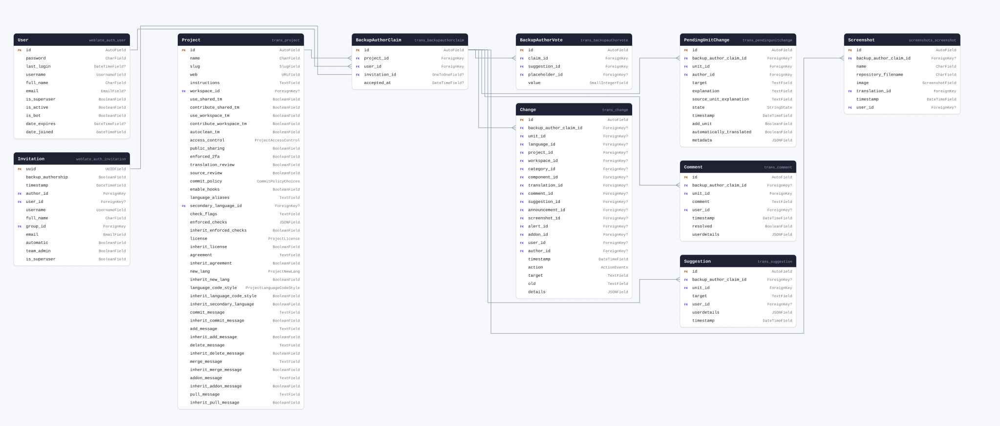

| Column | Field | Type | Null | Key | Default | Description |
| --- | --- | --- | --- | --- | --- | --- |
| `id` | `AutoField` | `integer` |  | PK | `autoincrement()` |  |
| `project_id` | `ForeignKey` | `integer` |  | FK |  |  |
| `user_id` | `ForeignKey` | `integer` |  | FK |  |  |
| `invitation_id` | `OneToOneField` | `uuid` | yes | FK, unique |  |  |
| `accepted_at` | `DateTimeField` | `timestamp with time zone` | yes |  |  |  |

Indexes:

- index `trans_backupauthorclaim_project_id_9f198408` on `project_id`
- index `trans_backupauthorclaim_user_id_7d26dd3f` on `user_id`

Relations:

- `project_id` → [Project](#project).`id`, on delete cascade
- `user_id` → [User](#user).`id`, on delete cascade
- `invitation_id` → [Invitation](#invitation).`uuid`, on delete set null
- [BackupAuthorVote](#backupauthorvote).`claim_id` → `id`, on delete cascade
- [Change](#change).`backup_author_claim_id` → `id`, on delete set null
- [PendingUnitChange](#pendingunitchange).`backup_author_claim_id` → `id`, on delete set null
- [Comment](#comment).`backup_author_claim_id` → `id`, on delete set null
- [Suggestion](#suggestion).`backup_author_claim_id` → `id`, on delete set null
- [Screenshot](#screenshot).`backup_author_claim_id` → `id`, on delete set null

## BackupAuthorVote

Table `trans_backupauthorvote`, app `trans`.

Keep distinct claimed votes while their anonymous display is coalesced.

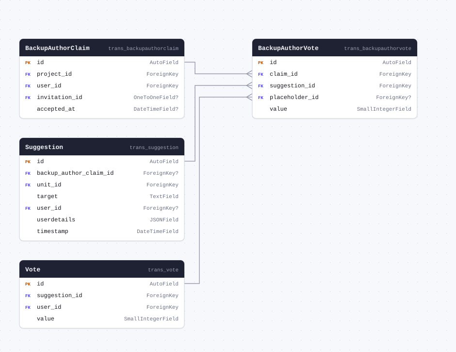

| Column | Field | Type | Null | Key | Default | Description |
| --- | --- | --- | --- | --- | --- | --- |
| `id` | `AutoField` | `integer` |  | PK | `autoincrement()` |  |
| `claim_id` | `ForeignKey` | `integer` |  | FK |  |  |
| `suggestion_id` | `ForeignKey` | `integer` |  | FK |  |  |
| `placeholder_id` | `ForeignKey` | `integer` | yes | FK |  |  |
| `value` | `SmallIntegerField` | `smallint` |  |  |  |  |

Indexes:

- index `trans_backupauthorvote_claim_id_69890c5f` on `claim_id`
- index `trans_backupauthorvote_suggestion_id_bdad2c90` on `suggestion_id`
- index `trans_backupauthorvote_placeholder_id_cda3b1bd` on `placeholder_id`

Relations:

- `claim_id` → [BackupAuthorClaim](#backupauthorclaim).`id`, on delete cascade
- `suggestion_id` → [Suggestion](#suggestion).`id`, on delete cascade
- `placeholder_id` → [Vote](#vote).`id`, on delete cascade

## Category

Table `trans_category`, app `trans`.

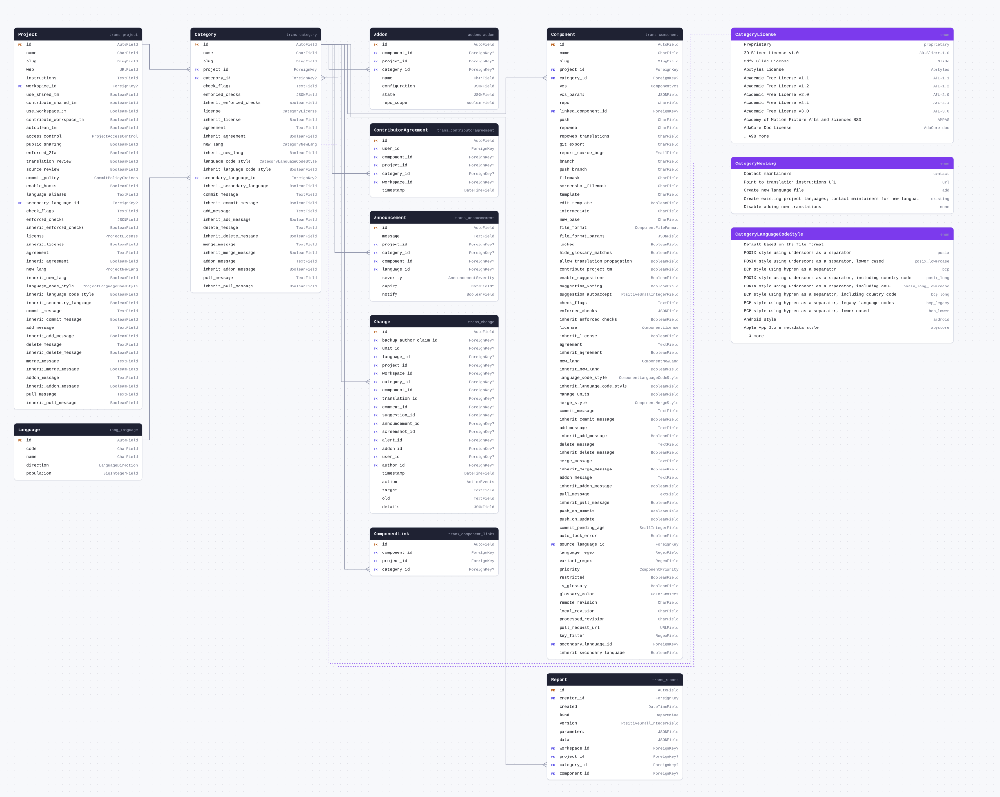

| Column | Field | Type | Null | Key | Default | Description |
| --- | --- | --- | --- | --- | --- | --- |
| `id` | `AutoField` | `integer` |  | PK | `autoincrement()` |  |
| `name` | `CharField` | `varchar(100)` |  |  |  | Display name |
| `slug` | `SlugField` | `varchar(100)` |  |  |  | Name used in URLs and filenames. |
| `project_id` | `ForeignKey` | `integer` |  | FK |  |  |
| `category_id` | `ForeignKey` | `integer` | yes | FK |  |  |
| `check_flags` | `TextField` | `text` |  |  | `''` | Additional comma-separated flags to influence Weblate behavior. |
| `enforced_checks` | `JSONField` | `jsonb` |  |  | `list()` | List of checks which can not be dismissed. |
| `inherit_enforced_checks` | `BooleanField` | `boolean` |  |  | `True` | Use enforced checks from the parent category, project or workspace. |
| `license` | `CategoryLicense` | `varchar(150)` |  |  | `''` |  |
| `inherit_license` | `BooleanField` | `boolean` |  |  | `True` | Use the translation license configured in the parent category or project. |
| `agreement` | `TextField` | `text` |  |  | `''` | Contributor license agreement which needs to be approved before a user can translate components in this category. |
| `inherit_agreement` | `BooleanField` | `boolean` |  |  | `True` | Use the contributor license agreement configured in the parent category or project. |
| `new_lang` | `CategoryNewLang` | `varchar(10)` |  |  | `'add'` | How to handle requests for creating new translations. |
| `inherit_new_lang` | `BooleanField` | `boolean` |  |  | `True` | Use the adding new translations setting configured in the parent category or project. |
| `language_code_style` | `CategoryLanguageCodeStyle` | `varchar(20)` |  |  | `''` | Customize language code used to generate the filename for translations created by Weblate. |
| `inherit_language_code_style` | `BooleanField` | `boolean` |  |  | `True` | Use the language code style configured in the parent category or project. |
| `secondary_language_id` | `ForeignKey` | `integer` | yes | FK | `None` | Additional language to show together with the source language while translating. |
| `inherit_secondary_language` | `BooleanField` | `boolean` |  |  | `True` | Use the secondary language configured in the parent category or project. |
| `commit_message` | `TextField` | `text` |  |  | `'chore(l10n): update {{ language_name }} translation\n\nTranslation: {{ component_full_name }}\nLanguage: {{ language_name }}\nProgress: {{ stats.translated_percent }}% ({{ stats.translated }} of {{ stats.all }} strings)\nTranslate-URL: {{ url }}'` | You can use template language for various info, please consult the documentation for more details. |
| `inherit_commit_message` | `BooleanField` | `boolean` |  |  | `True` | Use the commit message when translating configured in the parent category or project. |
| `add_message` | `TextField` | `text` |  |  | `'chore(l10n): add {{ language_name }} translation\n\nTranslation: {{ component_full_name }}\nLanguage: {{ language_name }}\nTranslate-URL: {{ url }}'` | You can use template language for various info, please consult the documentation for more details. |
| `inherit_add_message` | `BooleanField` | `boolean` |  |  | `True` | Use the commit message when adding translation configured in the parent category or project. |
| `delete_message` | `TextField` | `text` |  |  | `'chore(l10n): remove {{ language_name }} translation\n\nTranslation: {{ component_full_name }}\nLanguage: {{ language_name }}\nTranslate-URL: {{ url }}'` | You can use template language for various info, please consult the documentation for more details. |
| `inherit_delete_message` | `BooleanField` | `boolean` |  |  | `True` | Use the commit message when removing translation configured in the parent category or project. |
| `merge_message` | `TextField` | `text` |  |  | `'chore(l10n): merge remote changes\n\nTranslation: {{ component_full_name }}\nRemote-Branch: {{ component_remote_branch }}\nTranslate-URL: {{ url }}'` | You can use template language for various info, please consult the documentation for more details. |
| `inherit_merge_message` | `BooleanField` | `boolean` |  |  | `True` | Use the commit message when merging translation configured in the parent category or project. |
| `addon_message` | `TextField` | `text` |  |  | `'chore(l10n): update translation files\n\nAdd-on: {{ addon_name }}\nTranslation: {{ component_full_name }}\nTranslate-URL: {{ url }}'` | You can use template language for various info, please consult the documentation for more details. |
| `inherit_addon_message` | `BooleanField` | `boolean` |  |  | `True` | Use the commit message when add-on makes a change configured in the parent category or project. |
| `pull_message` | `TextField` | `text` |  |  | `'chore(l10n): update translations\n\nTranslations updated in [{{ site_title }}]({{ site_url }}) for [{{ component_full_name }}]({{ url }}).\n\n\nIncluded components:\n\n* [{{ linked.full_name }}]({{ linked.url }})\n\n\n\nTranslation status:\n\n\n'` | You can use template language for various info, please consult the documentation for more details. |
| `inherit_pull_message` | `BooleanField` | `boolean` |  |  | `True` | Use the merge request message configured in the parent category or project. |

Indexes:

- index `trans_category_slug_52f13beb` on `slug`
- index `trans_category_slug_52f13beb_like` on `slug` (`varchar_pattern_ops`)
- index `trans_category_project_id_7dc717ed` on `project_id`
- index `trans_category_category_id_0f21e824` on `category_id`
- index `trans_category_secondary_language_id_3b074b19` on `secondary_language_id`
- unique `category_slug_unique` on `project_id`, `category_id`, `slug`, nulls not distinct
- unique `category_name_unique` on `project_id`, `category_id`, `name`, nulls not distinct

Relations:

- [Addon](#addon).`category_id` → `id`, on delete cascade
- [ContributorAgreement](#contributoragreement).`category_id` → `id`, on delete cascade
- [Announcement](#announcement).`category_id` → `id`, on delete cascade
- `project_id` → [Project](#project).`id`, on delete cascade
- `category_id` → [Category](#category).`id`, on delete cascade
- `secondary_language_id` → [Language](#language).`id`, on delete cascade
- [Change](#change).`category_id` → `id`, on delete cascade
- [ComponentLink](#componentlink).`category_id` → `id`, on delete set null
- [Component](#component).`category_id` → `id`, on delete cascade
- [Report](#report).`category_id` → `id`, on delete cascade

## Project

Table `trans_project`, app `trans`.

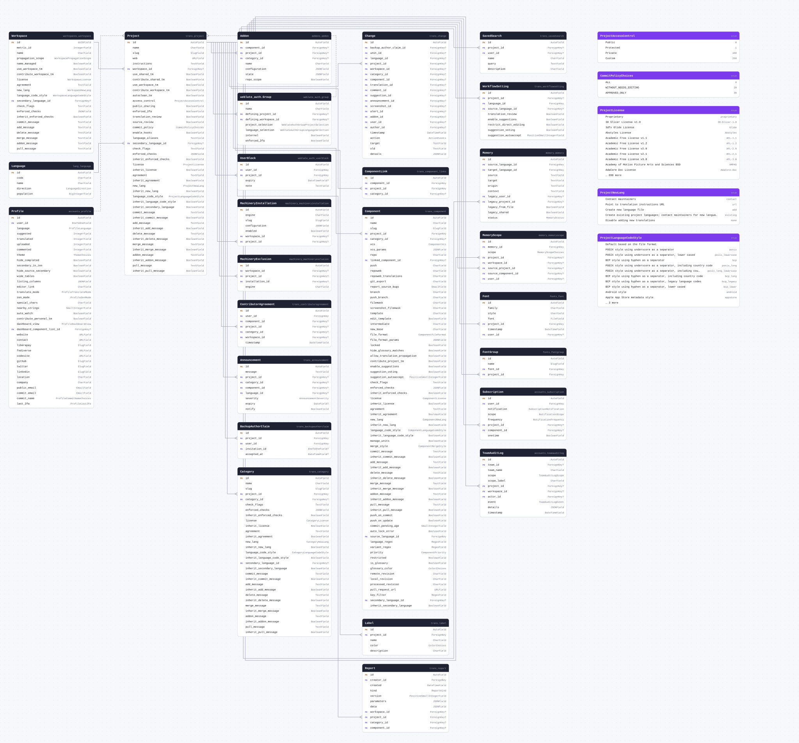

| Column | Field | Type | Null | Key | Default | Description |
| --- | --- | --- | --- | --- | --- | --- |
| `id` | `AutoField` | `integer` |  | PK | `autoincrement()` |  |
| `name` | `CharField` | `varchar(60)` |  | unique |  | Display name |
| `slug` | `SlugField` | `varchar(60)` |  | unique |  | Name used in URLs and filenames. |
| `web` | `URLField` | `varchar(200)` |  |  |  | Main website of translated project. |
| `instructions` | `TextField` | `text` |  |  |  | You can use Markdown and mention users by @username. |
| `workspace_id` | `ForeignKey` | `uuid` | yes | FK |  | Workspace this project belongs to. Standalone projects do not need one. |
| `use_shared_tm` | `BooleanField` | `boolean` |  |  | `True` | Uses the pool of shared translations between projects. |
| `contribute_shared_tm` | `BooleanField` | `boolean` |  |  | `True` | Publishes source strings, translations, and project and component origin to the global shared translation memory. Project access control does not restrict this shared data. |
| `use_workspace_tm` | `BooleanField` | `boolean` |  |  | `False` | Uses the pool of shared translations between projects in the workspace. |
| `contribute_workspace_tm` | `BooleanField` | `boolean` |  |  | `False` | Contributes translations to the pool shared between projects in the workspace. |
| `autoclean_tm` | `BooleanField` | `boolean` |  |  | `False` | Automatically removes outdated and obsolete entries from translation memory. |
| `access_control` | `ProjectAccessControl` | `integer` |  |  | `0` | How to restrict access to this project is detailed in the documentation. |
| `public_sharing` | `BooleanField` | `boolean` |  |  | `False` | Allows anonymous access to the engage pages and status widgets for Private and Custom projects. Public and Protected projects are always publicly shared regardless of this setting. |
| `enforced_2fa` | `BooleanField` | `boolean` |  |  | `False` | Requires contributors to have two-factor authentication configured before being able to contribute. |
| `translation_review` | `BooleanField` | `boolean` |  |  | `False` | Requires dedicated reviewers to approve translations. |
| `source_review` | `BooleanField` | `boolean` |  |  | `False` | Requires dedicated reviewers to approve source strings. |
| `commit_policy` | `CommitPolicyChoices` | `integer` |  |  | `0` | Select which translations should be included when committing changes. More restrictive options will skip translations with potential quality issues. |
| `enable_hooks` | `BooleanField` | `boolean` |  |  | `True` | Whether to allow updating this repository by remote hooks. |
| `language_aliases` | `TextField` | `text` |  |  | `''` | Comma-separated list of language code mappings, for example: en_GB:en,en_US:en |
| `secondary_language_id` | `ForeignKey` | `integer` | yes | FK | `None` | Additional language to show together with the source language while translating. |
| `check_flags` | `TextField` | `text` |  |  | `''` | Additional comma-separated flags to influence Weblate behavior. |
| `enforced_checks` | `JSONField` | `jsonb` |  |  | `list()` | List of checks which can not be dismissed. |
| `inherit_enforced_checks` | `BooleanField` | `boolean` |  |  | `True` | Use enforced checks from the workspace. |
| `license` | `ProjectLicense` | `varchar(150)` |  |  | `''` |  |
| `inherit_license` | `BooleanField` | `boolean` |  |  | `True` | Use the translation license configured in the workspace. |
| `agreement` | `TextField` | `text` |  |  | `''` | Contributor license agreement which needs to be approved before a user can translate components in this project. |
| `inherit_agreement` | `BooleanField` | `boolean` |  |  | `True` | Use the contributor license agreement configured in the workspace. |
| `new_lang` | `ProjectNewLang` | `varchar(10)` |  |  | `'add'` | How to handle requests for creating new translations. |
| `inherit_new_lang` | `BooleanField` | `boolean` |  |  | `True` | Use the adding new translations setting configured in the workspace. |
| `language_code_style` | `ProjectLanguageCodeStyle` | `varchar(20)` |  |  | `''` | Customize language code used to generate the filename for translations created by Weblate. |
| `inherit_language_code_style` | `BooleanField` | `boolean` |  |  | `True` | Use the language code style configured in the workspace. |
| `inherit_secondary_language` | `BooleanField` | `boolean` |  |  | `True` | Use the secondary language configured in the workspace. |
| `commit_message` | `TextField` | `text` |  |  | `'chore(l10n): update {{ language_name }} translation\n\nTranslation: {{ component_full_name }}\nLanguage: {{ language_name }}\nProgress: {{ stats.translated_percent }}% ({{ stats.translated }} of {{ stats.all }} strings)\nTranslate-URL: {{ url }}'` | You can use template language for various info, please consult the documentation for more details. |
| `inherit_commit_message` | `BooleanField` | `boolean` |  |  | `True` | Use the commit message when translating configured in the workspace. |
| `add_message` | `TextField` | `text` |  |  | `'chore(l10n): add {{ language_name }} translation\n\nTranslation: {{ component_full_name }}\nLanguage: {{ language_name }}\nTranslate-URL: {{ url }}'` | You can use template language for various info, please consult the documentation for more details. |
| `inherit_add_message` | `BooleanField` | `boolean` |  |  | `True` | Use the commit message when adding translation configured in the workspace. |
| `delete_message` | `TextField` | `text` |  |  | `'chore(l10n): remove {{ language_name }} translation\n\nTranslation: {{ component_full_name }}\nLanguage: {{ language_name }}\nTranslate-URL: {{ url }}'` | You can use template language for various info, please consult the documentation for more details. |
| `inherit_delete_message` | `BooleanField` | `boolean` |  |  | `True` | Use the commit message when removing translation configured in the workspace. |
| `merge_message` | `TextField` | `text` |  |  | `'chore(l10n): merge remote changes\n\nTranslation: {{ component_full_name }}\nRemote-Branch: {{ component_remote_branch }}\nTranslate-URL: {{ url }}'` | You can use template language for various info, please consult the documentation for more details. |
| `inherit_merge_message` | `BooleanField` | `boolean` |  |  | `True` | Use the commit message when merging translation configured in the workspace. |
| `addon_message` | `TextField` | `text` |  |  | `'chore(l10n): update translation files\n\nAdd-on: {{ addon_name }}\nTranslation: {{ component_full_name }}\nTranslate-URL: {{ url }}'` | You can use template language for various info, please consult the documentation for more details. |
| `inherit_addon_message` | `BooleanField` | `boolean` |  |  | `True` | Use the commit message when add-on makes a change configured in the workspace. |
| `pull_message` | `TextField` | `text` |  |  | `'chore(l10n): update translations\n\nTranslations updated in [{{ site_title }}]({{ site_url }}) for [{{ component_full_name }}]({{ url }}).\n\n\nIncluded components:\n\n* [{{ linked.full_name }}]({{ linked.url }})\n\n\n\nTranslation status:\n\n\n'` | You can use template language for various info, please consult the documentation for more details. |
| `inherit_pull_message` | `BooleanField` | `boolean` |  |  | `True` | Use the merge request message configured in the workspace. |

Indexes:

- index `trans_project_name_a3285a23_like` on `name` (`varchar_pattern_ops`)
- index `trans_project_slug_77cd973b_like` on `slug` (`varchar_pattern_ops`)
- index `trans_project_workspace_id_a1945651` on `workspace_id`
- index `trans_project_access_control_c17e787a` on `access_control`
- index `trans_project_secondary_language_id_57e84b09` on `secondary_language_id`

Relations:

- `shared_components` — many to many with [Component](#component), through [ComponentLink](#componentlink)
- [Addon](#addon).`project_id` → `id`, on delete cascade
- [weblate_auth.Group](#weblate_authgroup).`defining_project_id` → `id`, on delete cascade
- `group_set` — many to many with [weblate_auth.Group](#weblate_authgroup)
- [UserBlock](#userblock).`project_id` → `id`, on delete cascade
- [MachineryInstallation](#machineryinstallation).`project_id` → `id`, on delete cascade
- [MachineryExclusion](#machineryexclusion).`project_id` → `id`, on delete cascade
- [ContributorAgreement](#contributoragreement).`project_id` → `id`, on delete cascade
- [Announcement](#announcement).`project_id` → `id`, on delete cascade
- [BackupAuthorClaim](#backupauthorclaim).`project_id` → `id`, on delete cascade
- [Category](#category).`project_id` → `id`, on delete cascade
- `workspace_id` → [Workspace](#workspace).`id`, on delete protect
- `secondary_language_id` → [Language](#language).`id`, on delete cascade
- [Change](#change).`project_id` → `id`, on delete cascade
- [ComponentLink](#componentlink).`project_id` → `id`, on delete cascade
- [Component](#component).`project_id` → `id`, on delete cascade
- [Label](#label).`project_id` → `id`, on delete cascade
- [Report](#report).`project_id` → `id`, on delete cascade
- [SavedSearch](#savedsearch).`project_id` → `id`, on delete cascade
- [WorkflowSetting](#workflowsetting).`project_id` → `id`, on delete cascade
- [Memory](#memory).`legacy_project_id` → `id`, on delete cascade
- [MemoryScope](#memoryscope).`project_id` → `id`, on delete cascade
- [MemoryScope](#memoryscope).`source_project_id` → `id`, on delete cascade
- [Font](#font).`project_id` → `id`, on delete cascade
- [FontGroup](#fontgroup).`project_id` → `id`, on delete cascade
- [Subscription](#subscription).`project_id` → `id`, on delete cascade
- [TeamAuditLog](#teamauditlog).`project_id` → `id`, on delete set null
- `profile_set` — many to many with [Profile](#profile)

## Change

Table `trans_change`, app `trans`.

Columns from `BackupAuthorshipMixin` (abstract): `backup_author_claim_id`.

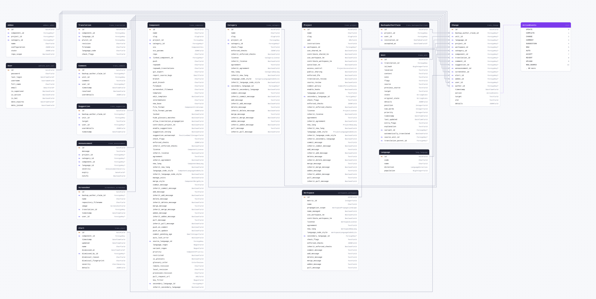

| Column | Field | Type | Null | Key | Default | Description |
| --- | --- | --- | --- | --- | --- | --- |
| `id` | `AutoField` | `integer` |  | PK | `autoincrement()` |  |
| `backup_author_claim_id` | `ForeignKey` | `integer` | yes | FK |  |  |
| `unit_id` | `ForeignKey` | `integer` | yes | FK |  |  |
| `language_id` | `ForeignKey` | `integer` | yes | FK |  |  |
| `project_id` | `ForeignKey` | `integer` | yes | FK |  |  |
| `workspace_id` | `ForeignKey` | `uuid` | yes | FK |  |  |
| `category_id` | `ForeignKey` | `integer` | yes | FK |  |  |
| `component_id` | `ForeignKey` | `integer` | yes | FK |  |  |
| `translation_id` | `ForeignKey` | `integer` | yes | FK |  |  |
| `comment_id` | `ForeignKey` | `integer` | yes | FK |  |  |
| `suggestion_id` | `ForeignKey` | `integer` | yes | FK |  |  |
| `announcement_id` | `ForeignKey` | `integer` | yes | FK |  |  |
| `screenshot_id` | `ForeignKey` | `integer` | yes | FK |  |  |
| `alert_id` | `ForeignKey` | `integer` | yes | FK |  |  |
| `addon_id` | `ForeignKey` | `integer` | yes | FK |  |  |
| `user_id` | `ForeignKey` | `integer` | yes | FK |  |  |
| `author_id` | `ForeignKey` | `integer` | yes | FK |  |  |
| `timestamp` | `DateTimeField` | `timestamp with time zone` |  |  | `now()` |  |
| `action` | `ActionEvents` | `integer` |  |  | `2` |  |
| `target` | `TextField` | `text` |  |  | `''` |  |
| `old` | `TextField` | `text` |  |  | `''` |  |
| `details` | `JSONField` | `jsonb` |  |  | `dict()` |  |

Indexes:

- index `trans_change_backup_author_claim_id_69f41b5a` on `backup_author_claim_id`
- index `trans_change_comment_id_9702b436` on `comment_id`
- index `trans_change_suggestion_id_0e61f1cb` on `suggestion_id`
- index `trans_change_announcement_id_1ad27981` on `announcement_id`
- index `trans_change_screenshot_id_ebbee35e` on `screenshot_id`
- index `trans_change_alert_id_34808078` on `alert_id`
- index `trans_change_addon_id_84220e1c` on `addon_id`
- index `trans_change_user_id_8d1225f9` on `user_id`
- index `trans_change_action_idx` on `timestamp` desc, `action`
- index `trans_change_project_idx` on `project_id`, `timestamp` desc, `action` where `"project_id" IS NOT NULL`
- index `trans_change_workspace_idx` on `workspace_id`, `timestamp` desc, `action` where `"workspace_id" IS NOT NULL`
- index `trans_change_language_idx` on `language_id`, `timestamp` desc, `action` where `"language_id" IS NOT NULL`
- index `trans_change_prj_language_idx` on `project_id`, `language_id`, `timestamp` desc, `action` where `("project_id" IS NOT NULL AND "language_id" IS NOT NULL)`
- index `trans_change_component_idx` on `component_id`, `timestamp` desc, `action` where `"component_id" IS NOT NULL`
- index `trans_change_translation_idx` on `translation_id`, `timestamp` desc, `action` where `"translation_id" IS NOT NULL`
- index `trans_change_category_idx` on `category_id`, `timestamp` desc, `action` where `"category_id" IS NOT NULL`
- index `trans_change_announce_idx` on `timestamp` desc where `"action" = 46`
- index `trans_change_lang_comp_idx` on `language_id`, `component_id`, `timestamp` desc where `("component_id" IS NOT NULL AND "language_id" IS NOT NULL)`
- index `trans_change_lang_cat_idx` on `language_id`, `category_id`, `timestamp` desc where `("category_id" IS NOT NULL AND "language_id" IS NOT NULL)`
- index `trans_change_unit_idx` on `unit_id`, `timestamp` desc, `action` where `"unit_id" IS NOT NULL`
- index `trans_change_site_addon_idx` on `timestamp` desc where `("action" IN (60, 61, 62) AND "project_id" IS NULL AND "category_id" IS NULL AND "component_id" IS NULL)`
- index `trans_change_proj_addon_idx` on `project_id`, `timestamp` desc where `("action" IN (60, 61, 62) AND "project_id" IS NOT NULL AND "component_id" IS NULL)`
- index `trans_change_user_idx` on `user_id`, `timestamp` desc, `action`

Relations:

- `backup_author_claim_id` → [BackupAuthorClaim](#backupauthorclaim).`id`, on delete set null
- `unit_id` → [Unit](#unit).`id`, on delete cascade
- `language_id` → [Language](#language).`id`, on delete cascade
- `project_id` → [Project](#project).`id`, on delete cascade
- `workspace_id` → [Workspace](#workspace).`id`, on delete cascade
- `category_id` → [Category](#category).`id`, on delete cascade
- `component_id` → [Component](#component).`id`, on delete cascade
- `translation_id` → [Translation](#translation).`id`, on delete cascade
- `comment_id` → [Comment](#comment).`id`, on delete set null
- `suggestion_id` → [Suggestion](#suggestion).`id`, on delete set null
- `announcement_id` → [Announcement](#announcement).`id`, on delete set null
- `screenshot_id` → [Screenshot](#screenshot).`id`, on delete set null
- `alert_id` → [Alert](#alert).`id`, on delete set null
- `addon_id` → [Addon](#addon).`id`, on delete set null
- `user_id` → [User](#user).`id`, on delete cascade
- `author_id` → [User](#user).`id`, on delete cascade

## PendingUnitChange

Table `trans_pendingunitchange`, app `trans`.

Columns from `BackupAuthorshipMixin` (abstract): `backup_author_claim_id`.

Stores actual change data that needs to be committed to a repository.

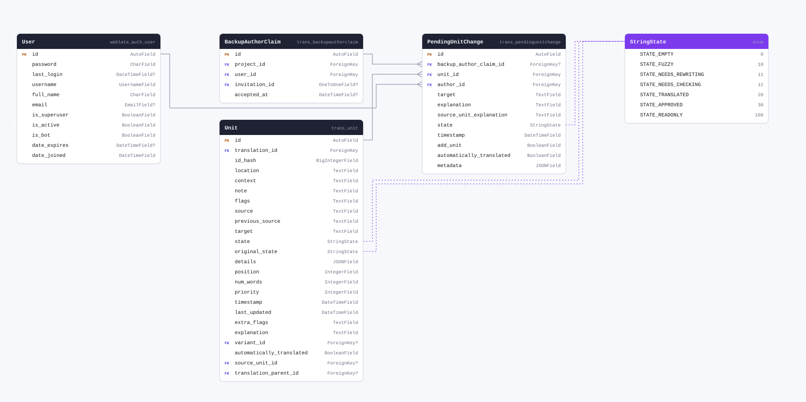

| Column | Field | Type | Null | Key | Default | Description |
| --- | --- | --- | --- | --- | --- | --- |
| `id` | `AutoField` | `integer` |  | PK | `autoincrement()` |  |
| `backup_author_claim_id` | `ForeignKey` | `integer` | yes | FK |  |  |
| `unit_id` | `ForeignKey` | `integer` |  | FK |  |  |
| `author_id` | `ForeignKey` | `integer` |  | FK |  |  |
| `target` | `TextField` | `text` |  |  | `''` |  |
| `explanation` | `TextField` | `text` |  |  | `''` |  |
| `source_unit_explanation` | `TextField` | `text` |  |  | `''` |  |
| `state` | `StringState` | `integer` |  |  | `0` |  |
| `timestamp` | `DateTimeField` | `timestamp with time zone` |  |  | `now()` |  |
| `add_unit` | `BooleanField` | `boolean` |  |  | `False` |  |
| `automatically_translated` | `BooleanField` | `boolean` |  |  | `False` |  |
| `metadata` | `JSONField` | `jsonb` |  |  | `dict()` |  |

Indexes:

- index `trans_pendingunitchange_backup_author_claim_id_96ae0409` on `backup_author_claim_id`
- index `trans_pendingunitchange_unit_id_eda769c3` on `unit_id`
- index `trans_pendingunitchange_author_id_38073ef3` on `author_id`
- index `trans_pendingunitchange_state_bbbe001f` on `state`
- index `trans_pendingunitchange_timestamp_1f1271fd` on `timestamp`

Relations:

- `backup_author_claim_id` → [BackupAuthorClaim](#backupauthorclaim).`id`, on delete set null
- `unit_id` → [Unit](#unit).`id`, on delete cascade
- `author_id` → [User](#user).`id`, on delete cascade

## Comment

Table `trans_comment`, app `trans`.

Columns from `BackupAuthorshipMixin` (abstract): `backup_author_claim_id`.

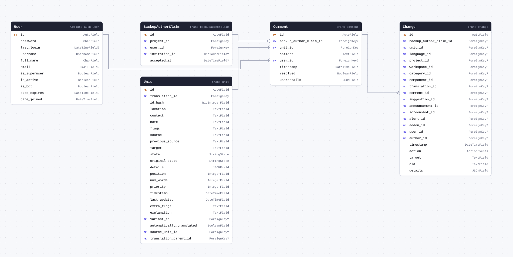

| Column | Field | Type | Null | Key | Default | Description |
| --- | --- | --- | --- | --- | --- | --- |
| `id` | `AutoField` | `integer` |  | PK | `autoincrement()` |  |
| `backup_author_claim_id` | `ForeignKey` | `integer` | yes | FK |  |  |
| `unit_id` | `ForeignKey` | `integer` |  | FK |  |  |
| `comment` | `TextField` | `text` |  |  |  |  |
| `user_id` | `ForeignKey` | `integer` | yes | FK |  |  |
| `timestamp` | `DateTimeField` | `timestamp with time zone` |  |  | `now()` |  |
| `resolved` | `BooleanField` | `boolean` |  |  | `False` |  |
| `userdetails` | `JSONField` | `jsonb` |  |  | `dict()` |  |

Indexes:

- index `trans_comment_backup_author_claim_id_3052bed5` on `backup_author_claim_id`
- index `trans_comment_unit_id_73ca7c89` on `unit_id`
- index `trans_comment_user_id_c2f200eb` on `user_id`
- index `trans_comment_timestamp_1148a5ab` on `timestamp`
- index `trans_comment_resolved_81cae7f4` on `resolved`
- gin index `comment_comment_fulltext` on `comment`, `unit_id` (`gin_trgm_ops`)

Relations:

- [Change](#change).`comment_id` → `id`, on delete set null
- `backup_author_claim_id` → [BackupAuthorClaim](#backupauthorclaim).`id`, on delete set null
- `unit_id` → [Unit](#unit).`id`, on delete cascade
- `user_id` → [User](#user).`id`, on delete cascade

## Suggestion

Table `trans_suggestion`, app `trans`.

Columns from `BackupAuthorshipMixin` (abstract): `backup_author_claim_id`.

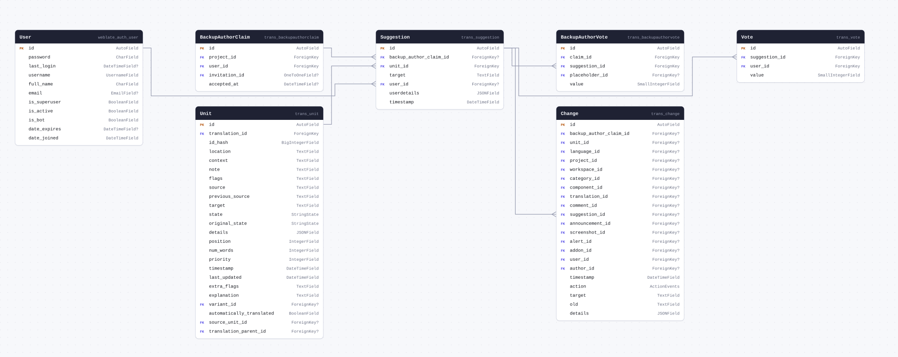

| Column | Field | Type | Null | Key | Default | Description |
| --- | --- | --- | --- | --- | --- | --- |
| `id` | `AutoField` | `integer` |  | PK | `autoincrement()` |  |
| `backup_author_claim_id` | `ForeignKey` | `integer` | yes | FK |  |  |
| `unit_id` | `ForeignKey` | `integer` |  | FK |  |  |
| `target` | `TextField` | `text` |  |  |  |  |
| `user_id` | `ForeignKey` | `integer` | yes | FK |  |  |
| `userdetails` | `JSONField` | `jsonb` |  |  | `dict()` |  |
| `timestamp` | `DateTimeField` | `timestamp with time zone` |  |  | `now()` |  |

Indexes:

- index `trans_suggestion_backup_author_claim_id_f18fec6a` on `backup_author_claim_id`
- index `trans_suggestion_unit_id_eb46fceb` on `unit_id`
- index `trans_suggestion_user_id_69ce0c2b` on `user_id`
- gin index `suggestion_target_fulltext` on `target`, `unit_id` (`gin_trgm_ops`)

Relations:

- `votes` — many to many with [User](#user), through [Vote](#vote)
- [BackupAuthorVote](#backupauthorvote).`suggestion_id` → `id`, on delete cascade
- [Change](#change).`suggestion_id` → `id`, on delete set null
- `backup_author_claim_id` → [BackupAuthorClaim](#backupauthorclaim).`id`, on delete set null
- `unit_id` → [Unit](#unit).`id`, on delete cascade
- `user_id` → [User](#user).`id`, on delete cascade
- [Vote](#vote).`suggestion_id` → `id`, on delete cascade

## Vote

Table `trans_vote`, app `trans`.

Suggestion voting.

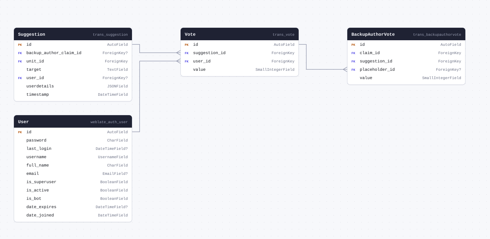

| Column | Field | Type | Null | Key | Default | Description |
| --- | --- | --- | --- | --- | --- | --- |
| `id` | `AutoField` | `integer` |  | PK | `autoincrement()` |  |
| `suggestion_id` | `ForeignKey` | `integer` |  | FK |  |  |
| `user_id` | `ForeignKey` | `integer` |  | FK |  |  |
| `value` | `SmallIntegerField` | `smallint` |  |  | `0` |  |

Indexes:

- index `trans_vote_user_id_86a644fd` on `user_id`
- unique `trans_vote_suggestion_id_user_id_fe8bdce2_uniq` on `suggestion_id`, `user_id`

Relations:

- [BackupAuthorVote](#backupauthorvote).`placeholder_id` → `id`, on delete cascade
- `suggestion_id` → [Suggestion](#suggestion).`id`, on delete cascade
- `user_id` → [User](#user).`id`, on delete cascade

## Variant

Table `trans_variant`, app `trans`.

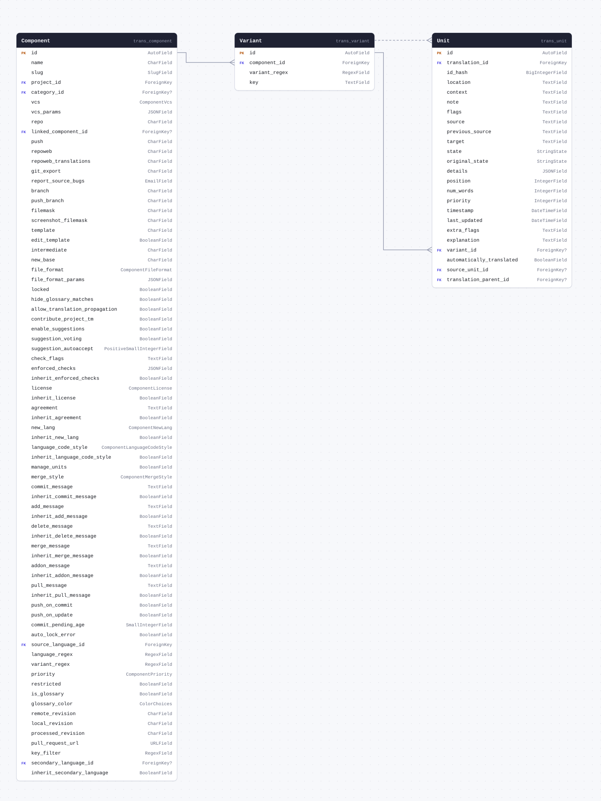

| Column | Field | Type | Null | Key | Default | Description |
| --- | --- | --- | --- | --- | --- | --- |
| `id` | `AutoField` | `integer` |  | PK | `autoincrement()` |  |
| `component_id` | `ForeignKey` | `integer` |  | FK |  |  |
| `variant_regex` | `RegexField` | `varchar(190)` |  |  |  |  |
| `key` | `TextField` | `text` |  |  |  |  |

Indexes:

- unique `trans_variant_unique_key_md5` on `component_id`, `variant_regex`, `MD5("key")`

Relations:

- `component_id` → [Component](#component).`id`, on delete cascade
- `defining_units` — many to many with [Unit](#unit)
- [Unit](#unit).`variant_id` → `id`, on delete set null

## Unit

Table `trans_unit`, app `trans`.

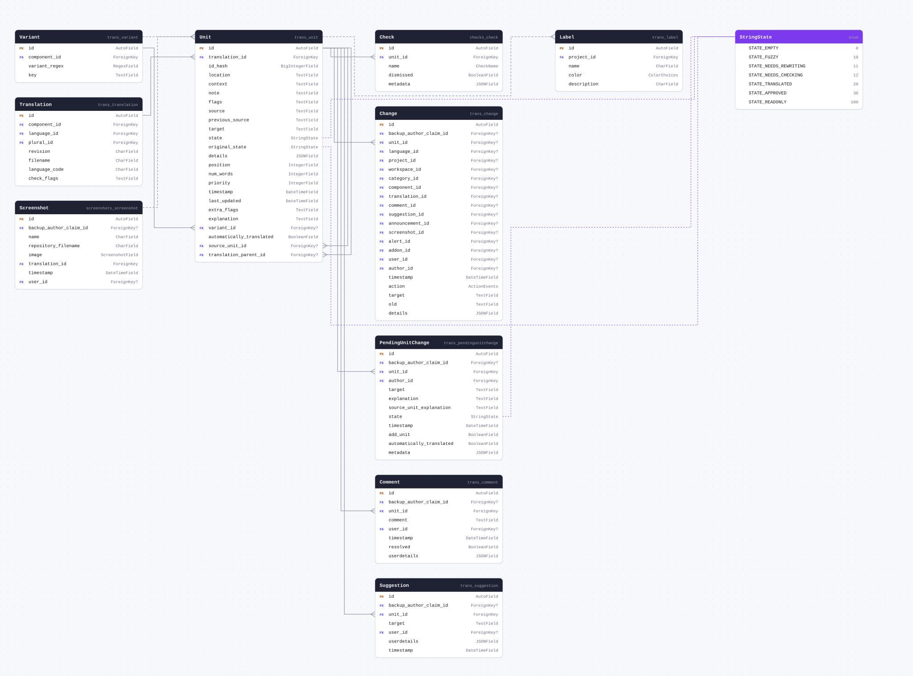

| Column | Field | Type | Null | Key | Default | Description |
| --- | --- | --- | --- | --- | --- | --- |
| `id` | `AutoField` | `integer` |  | PK | `autoincrement()` |  |
| `translation_id` | `ForeignKey` | `integer` |  | FK |  |  |
| `id_hash` | `BigIntegerField` | `bigint` |  |  |  |  |
| `location` | `TextField` | `text` |  |  | `''` |  |
| `context` | `TextField` | `text` |  |  | `''` |  |
| `note` | `TextField` | `text` |  |  | `''` |  |
| `flags` | `TextField` | `text` |  |  | `''` |  |
| `source` | `TextField` | `text` |  |  |  |  |
| `previous_source` | `TextField` | `text` |  |  | `''` |  |
| `target` | `TextField` | `text` |  |  | `''` |  |
| `state` | `StringState` | `integer` |  |  | `0` |  |
| `original_state` | `StringState` | `integer` |  |  | `0` |  |
| `details` | `JSONField` | `jsonb` |  |  | `dict()` |  |
| `position` | `IntegerField` | `integer` |  |  |  |  |
| `num_words` | `IntegerField` | `integer` |  |  | `0` |  |
| `priority` | `IntegerField` | `integer` |  |  | `100` |  |
| `timestamp` | `DateTimeField` | `timestamp with time zone` |  |  | `now()` |  |
| `last_updated` | `DateTimeField` | `timestamp with time zone` |  |  | `now()` |  |
| `extra_flags` | `TextField` | `text` |  |  | `''` | Additional comma-separated flags to influence Weblate behavior. |
| `explanation` | `TextField` | `text` |  |  | `''` | Additional explanation to clarify meaning or usage of the string. |
| `variant_id` | `ForeignKey` | `integer` | yes | FK | `None` |  |
| `automatically_translated` | `BooleanField` | `boolean` |  |  | `False` | Indicates whether this string was translated automatically. |
| `source_unit_id` | `ForeignKey` | `integer` | yes | FK |  |  |
| `translation_parent_id` | `ForeignKey` | `integer` | yes | FK |  |  |

Indexes:

- index `trans_unit_variant_id_c3315c70` on `variant_id`
- index `trans_unit_automatically_translated_96d2b31d` on `automatically_translated`
- index `trans_unit_source_unit_id_7a735f87` on `source_unit_id`
- index `trans_unit_translation_parent_id_bad2a48e` on `translation_parent_id`
- unique `trans_unit_translation_id_id_hash_ab945589_uniq` on `translation_id`, `id_hash`
- index `trans_unit_source_md5` on `translation_id`, `MD5(LOWER("source"))`
- index `trans_unit_target_md5` on `translation_id`, `MD5(LOWER("target"))`
- index `trans_unit_context_md5` on `translation_id`, `MD5(LOWER("context"))`
- gin index `unit_source_fulltext` on `source`, `translation_id` (`gin_trgm_ops`)
- gin index `unit_target_fulltext` on `target`, `translation_id` (`gin_trgm_ops`)
- gin index `unit_context_fulltext` on `context`, `translation_id` (`gin_trgm_ops`)
- gin index `unit_note_fulltext` on `note`, `translation_id` (`gin_trgm_ops`)
- gin index `unit_location_fulltext` on `location`, `translation_id` (`gin_trgm_ops`)
- gin index `unit_explanation_fulltext` on `explanation`, `translation_id` (`gin_trgm_ops`)
- gin index `trans_unit_source_tm_idx` on `source` (`gin_trgm_ops`) where `("state" >= 20 AND NOT ("target" = ''))`

Relations:

- [Check](#check).`unit_id` → `id`, on delete cascade
- [Change](#change).`unit_id` → `id`, on delete cascade
- [PendingUnitChange](#pendingunitchange).`unit_id` → `id`, on delete cascade
- [Comment](#comment).`unit_id` → `id`, on delete cascade
- [Suggestion](#suggestion).`unit_id` → `id`, on delete cascade
- `defined_variants` — many to many with [Variant](#variant)
- `translation_id` → [Translation](#translation).`id`, on delete cascade
- `variant_id` → [Variant](#variant).`id`, on delete set null
- `source_unit_id` → [Unit](#unit).`id`, on delete cascade
- `translation_parent_id` → [Unit](#unit).`id`, on delete set null
- `labels` — many to many with [Label](#label)
- `screenshots` — many to many with [Screenshot](#screenshot)

## Translation

Table `trans_translation`, app `trans`.

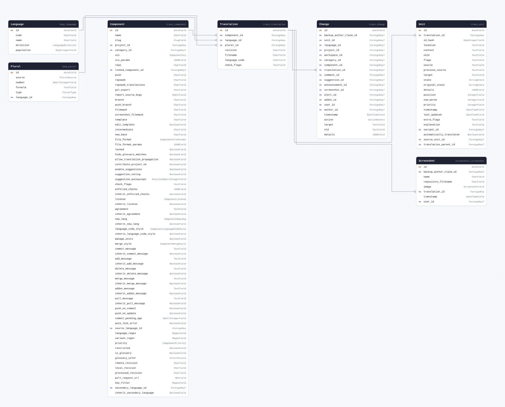

| Column | Field | Type | Null | Key | Default | Description |
| --- | --- | --- | --- | --- | --- | --- |
| `id` | `AutoField` | `integer` |  | PK | `autoincrement()` |  |
| `component_id` | `ForeignKey` | `integer` |  | FK |  |  |
| `language_id` | `ForeignKey` | `integer` |  | FK |  |  |
| `plural_id` | `ForeignKey` | `integer` |  | FK |  |  |
| `revision` | `CharField` | `varchar(200)` |  |  | `''` |  |
| `filename` | `CharField` | `varchar(400)` |  |  |  |  |
| `language_code` | `CharField` | `varchar(50)` |  |  | `''` |  |
| `check_flags` | `TextField` | `text` |  |  | `''` |  |

Indexes:

- index `trans_translation_language_id_030f0b30` on `language_id`
- index `trans_translation_plural_id_5cf36dc7` on `plural_id`
- unique `trans_translation_component_id_language_id_331fa2a7_uniq` on `component_id`, `language_id`

Relations:

- [Change](#change).`translation_id` → `id`, on delete cascade
- [Unit](#unit).`translation_id` → `id`, on delete cascade
- `component_id` → [Component](#component).`id`, on delete cascade
- `language_id` → [Language](#language).`id`, on delete cascade
- `plural_id` → [Plural](#plural).`id`, on delete cascade
- [Screenshot](#screenshot).`translation_id` → `id`, on delete cascade

## ComponentLink

Table `trans_component_links`, app `trans`.

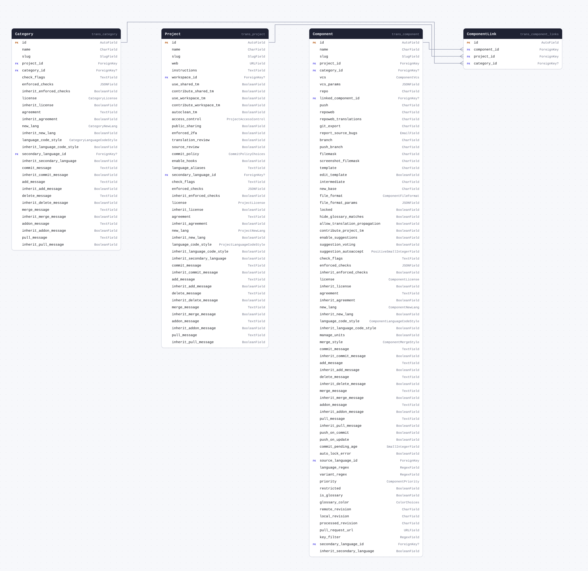

| Column | Field | Type | Null | Key | Default | Description |
| --- | --- | --- | --- | --- | --- | --- |
| `id` | `AutoField` | `integer` |  | PK | `autoincrement()` |  |
| `component_id` | `ForeignKey` | `integer` |  | FK |  |  |
| `project_id` | `ForeignKey` | `integer` |  | FK |  |  |
| `category_id` | `ForeignKey` | `integer` | yes | FK |  |  |

Indexes:

- index `trans_component_links_component_id_2342af45` on `component_id`
- index `trans_component_links_project_id_840f1e11` on `project_id`
- index `trans_component_links_category_id_28d2bcf2` on `category_id`
- unique `trans_component_links_component_id_project_id_8e996e95_uniq` on `component_id`, `project_id`

Relations:

- `component_id` → [Component](#component).`id`, on delete cascade
- `project_id` → [Project](#project).`id`, on delete cascade
- `category_id` → [Category](#category).`id`, on delete set null

## Component

Table `trans_component`, app `trans`.

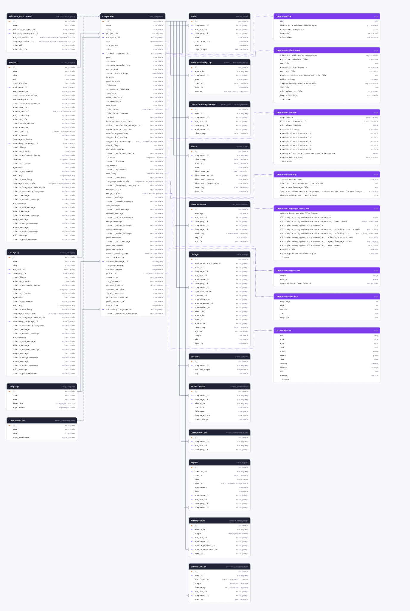

| Column | Field | Type | Null | Key | Default | Description |
| --- | --- | --- | --- | --- | --- | --- |
| `id` | `AutoField` | `integer` |  | PK | `autoincrement()` |  |
| `name` | `CharField` | `varchar(100)` |  |  |  | Display name |
| `slug` | `SlugField` | `varchar(100)` |  |  |  | Name used in URLs and filenames. |
| `project_id` | `ForeignKey` | `integer` |  | FK |  |  |
| `category_id` | `ForeignKey` | `integer` | yes | FK |  |  |
| `vcs` | `ComponentVcs` | `varchar(20)` |  |  | `'git'` | Version control system to use to access your repository containing translations. You can also choose additional integration with third party providers to submit pull/merge requests. |
| `vcs_params` | `JSONField` | `jsonb` |  |  | `dict()` |  |
| `repo` | `CharField` | `varchar(300)` |  |  |  | URL of a repository, use weblate://project/component to share it with other component. |
| `linked_component_id` | `ForeignKey` | `integer` | yes | FK |  |  |
| `push` | `CharField` | `varchar(300)` |  |  |  | URL of a push repository, pushing is turned off if empty. When using pull/merge requests, keep empty to fork the repository. |
| `repoweb` | `CharField` | `varchar(200)` |  |  |  | Link to repository browser, use {{branch}} for branch, {{filename}} and {{line}} as filename and line placeholders. You might want to strip leading directory by using {{filename\|parentdir}}. |
| `repoweb_translations` | `CharField` | `varchar(200)` |  |  |  | Link to repository browser for translation files, use {{branch}} for branch, {{filename}} and {{line}} as filename and line placeholders. If left empty, the Repository browser above will be used. You might want to strip leading directory by using {{filename\|parentdir}}. |
| `git_export` | `CharField` | `varchar(220)` |  |  |  | URL of repository where users can fetch changes from Weblate |
| `report_source_bugs` | `EmailField` | `varchar(190)` |  |  |  | E-mail address for reports on errors in source strings. Leave empty for no e-mails. |
| `branch` | `CharField` | `varchar(200)` |  |  | `''` | Repository branch to translate |
| `push_branch` | `CharField` | `varchar(200)` |  |  | `''` | Branch for pushing changes. Leave empty to use repository branch when pushing directly to the repository. When using pull/merge requests, specify a branch name different from the repository branch. |
| `filemask` | `CharField` | `varchar(400)` |  |  |  | Path of files to translate relative to repository root, use * instead of language code, for example: po/*.po or locale/*/LC_MESSAGES/django.po. |
| `screenshot_filemask` | `CharField` | `varchar(400)` |  |  |  | Path of screenshots relative to repository root, for example: docs/screenshots/*.png. |
| `template` | `CharField` | `varchar(400)` |  |  |  | Filename of translation base file, containing all strings and their source for monolingual translations. |
| `edit_template` | `BooleanField` | `boolean` |  |  | `True` | Whether users will be able to edit the base file for monolingual translations. |
| `intermediate` | `CharField` | `varchar(400)` |  |  |  | Filename of intermediate translation file. In most cases this is a translation file provided by developers and is used when creating actual source strings. |
| `new_base` | `CharField` | `varchar(400)` |  |  |  | Filename of file used for creating new translations. For gettext choose .pot file. |
| `file_format` | `ComponentFileFormat` | `varchar(50)` |  |  |  |  |
| `file_format_params` | `JSONField` | `jsonb` |  |  | `dict()` |  |
| `locked` | `BooleanField` | `boolean` |  |  | `False` | Locked component will not get any translation updates. |
| `hide_glossary_matches` | `BooleanField` | `boolean` |  |  | `False` | Hides the glossary panel in the translation editor. |
| `allow_translation_propagation` | `BooleanField` | `boolean` |  |  | `True` | Whether translation updates in other components will cause automatic translation in this one |
| `contribute_project_tm` | `BooleanField` | `boolean` |  |  | `True` | Allow this component's translations to be added to the project-level translation memory. |
| `enable_suggestions` | `BooleanField` | `boolean` |  |  | `True` | Whether to allow translation suggestions at all. |
| `suggestion_voting` | `BooleanField` | `boolean` |  |  | `False` | Allows users to vote on suggestions. |
| `suggestion_autoaccept` | `PositiveSmallIntegerField` | `smallint` |  |  | `0` | Automatically accept suggestions with this number of votes, use 0 to turn it off. |
| `check_flags` | `TextField` | `text` |  |  | `''` | Additional comma-separated flags to influence Weblate behavior. |
| `enforced_checks` | `JSONField` | `jsonb` |  |  | `list()` | List of checks which can not be dismissed. |
| `inherit_enforced_checks` | `BooleanField` | `boolean` |  |  | `True` | Use enforced checks from the project, category or workspace. |
| `license` | `ComponentLicense` | `varchar(150)` |  |  | `''` |  |
| `inherit_license` | `BooleanField` | `boolean` |  |  | `True` | Use the translation license configured in the category or project. |
| `agreement` | `TextField` | `text` |  |  | `''` | Contributor license agreement which needs to be approved before a user can translate this component. |
| `inherit_agreement` | `BooleanField` | `boolean` |  |  | `True` | Use the contributor license agreement configured in the category or project. |
| `new_lang` | `ComponentNewLang` | `varchar(10)` |  |  | `'add'` | How to handle requests for creating new translations. |
| `inherit_new_lang` | `BooleanField` | `boolean` |  |  | `True` | Use the adding new translations setting configured in the category or project. |
| `language_code_style` | `ComponentLanguageCodeStyle` | `varchar(20)` |  |  | `''` | Customize language code used to generate the filename for translations created by Weblate. |
| `inherit_language_code_style` | `BooleanField` | `boolean` |  |  | `True` | Use the language code style configured in the category or project. |
| `manage_units` | `BooleanField` | `boolean` |  |  | `False` | Enables adding, removing, and editing source strings and keys in Weblate. If your strings are extracted from the source code or managed externally you probably want to keep it disabled. |
| `merge_style` | `ComponentMergeStyle` | `varchar(10)` |  |  | `'rebase'` | Define whether Weblate should merge the upstream repository or rebase changes onto it. |
| `commit_message` | `TextField` | `text` |  |  | `'chore(l10n): update {{ language_name }} translation\n\nTranslation: {{ component_full_name }}\nLanguage: {{ language_name }}\nProgress: {{ stats.translated_percent }}% ({{ stats.translated }} of {{ stats.all }} strings)\nTranslate-URL: {{ url }}'` | You can use template language for various info, please consult the documentation for more details. |
| `inherit_commit_message` | `BooleanField` | `boolean` |  |  | `True` | Use the commit message when translating configured in the category or project. |
| `add_message` | `TextField` | `text` |  |  | `'chore(l10n): add {{ language_name }} translation\n\nTranslation: {{ component_full_name }}\nLanguage: {{ language_name }}\nTranslate-URL: {{ url }}'` | You can use template language for various info, please consult the documentation for more details. |
| `inherit_add_message` | `BooleanField` | `boolean` |  |  | `True` | Use the commit message when adding translation configured in the category or project. |
| `delete_message` | `TextField` | `text` |  |  | `'chore(l10n): remove {{ language_name }} translation\n\nTranslation: {{ component_full_name }}\nLanguage: {{ language_name }}\nTranslate-URL: {{ url }}'` | You can use template language for various info, please consult the documentation for more details. |
| `inherit_delete_message` | `BooleanField` | `boolean` |  |  | `True` | Use the commit message when removing translation configured in the category or project. |
| `merge_message` | `TextField` | `text` |  |  | `'chore(l10n): merge remote changes\n\nTranslation: {{ component_full_name }}\nRemote-Branch: {{ component_remote_branch }}\nTranslate-URL: {{ url }}'` | You can use template language for various info, please consult the documentation for more details. |
| `inherit_merge_message` | `BooleanField` | `boolean` |  |  | `True` | Use the commit message when merging translation configured in the category or project. |
| `addon_message` | `TextField` | `text` |  |  | `'chore(l10n): update translation files\n\nAdd-on: {{ addon_name }}\nTranslation: {{ component_full_name }}\nTranslate-URL: {{ url }}'` | You can use template language for various info, please consult the documentation for more details. |
| `inherit_addon_message` | `BooleanField` | `boolean` |  |  | `True` | Use the commit message when add-on makes a change configured in the category or project. |
| `pull_message` | `TextField` | `text` |  |  | `'chore(l10n): update translations\n\nTranslations updated in [{{ site_title }}]({{ site_url }}) for [{{ component_full_name }}]({{ url }}).\n\n\nIncluded components:\n\n* [{{ linked.full_name }}]({{ linked.url }})\n\n\n\nTranslation status:\n\n\n'` | You can use template language for various info, please consult the documentation for more details. |
| `inherit_pull_message` | `BooleanField` | `boolean` |  |  | `True` | Use the merge request message configured in the category or project. |
| `push_on_commit` | `BooleanField` | `boolean` |  |  | `True` | Whether the repository should be pushed upstream on every commit. |
| `push_on_update` | `BooleanField` | `boolean` |  |  | `True` | Whether the repository should be pushed upstream after updating it, even when the update did not commit any translations. When turned off, commits made by the update are pushed with the next translation commit. |
| `commit_pending_age` | `SmallIntegerField` | `smallint` |  |  | `24` | Time in hours after which any pending changes will be committed to the VCS. |
| `auto_lock_error` | `BooleanField` | `boolean` |  |  | `True` | Whether the component should be locked on repository errors. |
| `source_language_id` | `ForeignKey` | `integer` |  | FK | `get_default_lang()` | Language used for source strings in all components |
| `language_regex` | `RegexField` | `varchar(500)` |  |  | `'^[^.]+$'` | Regular expression used to filter translation files when scanning for file mask. |
| `variant_regex` | `RegexField` | `varchar(190)` |  |  | `''` | Regular expression used to determine variants of a string. |
| `priority` | `ComponentPriority` | `integer` |  |  | `100` | Components with higher priority are offered first to translators. |
| `restricted` | `BooleanField` | `boolean` |  |  | `False` | Restrict access to the component to only those explicitly given permission. |
| `is_glossary` | `BooleanField` | `boolean` |  |  | `False` | Glossaries are different from regular translations but help keep track of and share consistent terminology. |
| `glossary_color` | `ColorChoices` | `varchar(30)` |  |  | `'silver'` |  |
| `remote_revision` | `CharField` | `varchar(200)` |  |  | `''` |  |
| `local_revision` | `CharField` | `varchar(200)` |  |  | `''` |  |
| `processed_revision` | `CharField` | `varchar(200)` |  |  | `''` |  |
| `pull_request_url` | `URLField` | `varchar(2048)` |  |  | `''` |  |
| `key_filter` | `RegexField` | `varchar(500)` |  |  | `''` | Regular expression used to filter keys. This is only available for monolingual formats. |
| `secondary_language_id` | `ForeignKey` | `integer` | yes | FK | `None` | Additional language to show together with the source language while translating. This setting is inherited from the project if left empty. |
| `inherit_secondary_language` | `BooleanField` | `boolean` |  |  | `True` | Use the secondary language configured in the category or project. |

Indexes:

- index `trans_component_slug_5bd48be1` on `slug`
- index `trans_component_slug_5bd48be1_like` on `slug` (`varchar_pattern_ops`)
- index `trans_component_category_id_7c9c5306` on `category_id`
- index `trans_component_linked_component_id_82b0de9e` on `linked_component_id`
- index `trans_component_source_language_id_2610b49e` on `source_language_id`
- index `trans_component_restricted_ec682d06` on `restricted`
- index `trans_component_is_glossary_b4b922b7` on `is_glossary`
- index `trans_component_secondary_language_id_496a8d45` on `secondary_language_id`
- unique `component_slug_unique` on `project_id`, `category_id`, `slug`, nulls not distinct
- unique `component_name_unique` on `project_id`, `category_id`, `name`, nulls not distinct
- index `trans_compo_project_d044e1_idx` on `project_id`, `allow_translation_propagation`
- index `trans_comp_repo_branch_idx` on `repo`, `branch`

Relations:

- `links` — many to many with [Project](#project), through [ComponentLink](#componentlink)
- [Addon](#addon).`component_id` → `id`, on delete cascade
- [AddonActivityLog](#addonactivitylog).`component_id` → `id`, on delete cascade
- `group_set` — many to many with [weblate_auth.Group](#weblate_authgroup)
- [ContributorAgreement](#contributoragreement).`component_id` → `id`, on delete cascade
- [Alert](#alert).`component_id` → `id`, on delete cascade
- [Announcement](#announcement).`component_id` → `id`, on delete cascade
- [Change](#change).`component_id` → `id`, on delete cascade
- [Variant](#variant).`component_id` → `id`, on delete cascade
- [Translation](#translation).`component_id` → `id`, on delete cascade
- [ComponentLink](#componentlink).`component_id` → `id`, on delete cascade
- `project_id` → [Project](#project).`id`, on delete cascade
- `category_id` → [Category](#category).`id`, on delete cascade
- `linked_component_id` → [Component](#component).`id`, on delete cascade
- `source_language_id` → [Language](#language).`id`, on delete cascade
- `secondary_language_id` → [Language](#language).`id`, on delete cascade
- `componentlist_set` — many to many with [ComponentList](#componentlist)
- [Report](#report).`component_id` → `id`, on delete cascade
- [MemoryScope](#memoryscope).`source_component_id` → `id`, on delete set null
- [Subscription](#subscription).`component_id` → `id`, on delete cascade

## ComponentList

Table `trans_componentlist`, app `trans`.

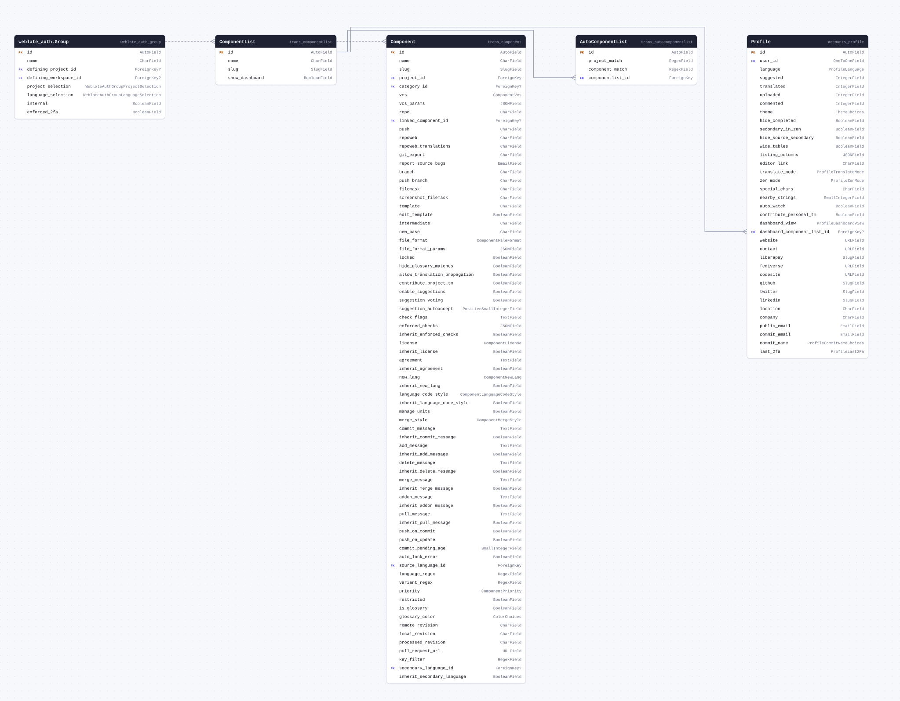

| Column | Field | Type | Null | Key | Default | Description |
| --- | --- | --- | --- | --- | --- | --- |
| `id` | `AutoField` | `integer` |  | PK | `autoincrement()` |  |
| `name` | `CharField` | `varchar(100)` |  | unique |  | Display name |
| `slug` | `SlugField` | `varchar(100)` |  | unique |  | Name used in URLs and filenames. |
| `show_dashboard` | `BooleanField` | `boolean` |  |  | `True` | When enabled this component list will be shown as a tab on the dashboard |

Indexes:

- index `trans_componentlist_name_93196759_like` on `name` (`varchar_pattern_ops`)
- index `trans_componentlist_slug_05ac37c2_like` on `slug` (`varchar_pattern_ops`)
- index `trans_componentlist_show_dashboard_1394f78f` on `show_dashboard`

Relations:

- `group_set` — many to many with [weblate_auth.Group](#weblate_authgroup)
- `components` — many to many with [Component](#component)
- [AutoComponentList](#autocomponentlist).`componentlist_id` → `id`, on delete cascade
- [Profile](#profile).`dashboard_component_list_id` → `id`, on delete set null

## AutoComponentList

Table `trans_autocomponentlist`, app `trans`.

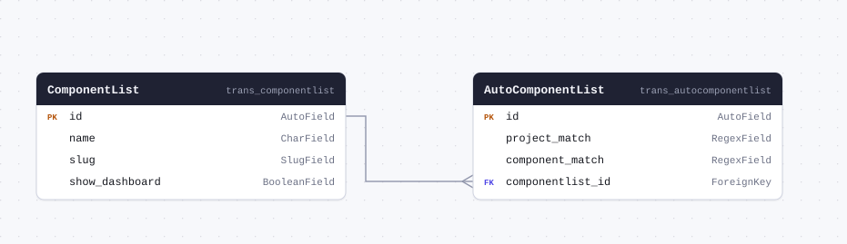

| Column | Field | Type | Null | Key | Default | Description |
| --- | --- | --- | --- | --- | --- | --- |
| `id` | `AutoField` | `integer` |  | PK | `autoincrement()` |  |
| `project_match` | `RegexField` | `varchar(200)` |  |  | `'^$'` | Regular expression which is used to match project slug. |
| `component_match` | `RegexField` | `varchar(200)` |  |  | `'^$'` | Regular expression which is used to match component slug. |
| `componentlist_id` | `ForeignKey` | `integer` |  | FK |  |  |

Indexes:

- index `trans_autocomponentlist_componentlist_id_9ff87f21` on `componentlist_id`

Relations:

- `componentlist_id` → [ComponentList](#componentlist).`id`, on delete cascade

## Label

Table `trans_label`, app `trans`.

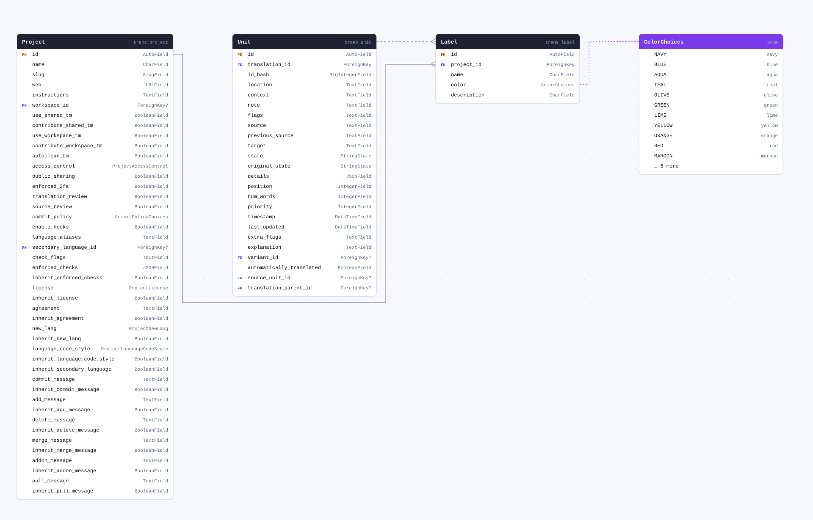

| Column | Field | Type | Null | Key | Default | Description |
| --- | --- | --- | --- | --- | --- | --- |
| `id` | `AutoField` | `integer` |  | PK | `autoincrement()` |  |
| `project_id` | `ForeignKey` | `integer` |  | FK |  |  |
| `name` | `CharField` | `varchar(190)` |  |  |  |  |
| `color` | `ColorChoices` | `varchar(30)` |  |  | `None` |  |
| `description` | `CharField` | `varchar(250)` |  |  | `''` |  |

Indexes:

- unique `trans_label_project_id_name_ef6f7cca_uniq` on `project_id`, `name`

Relations:

- `unit_set` — many to many with [Unit](#unit)
- `project_id` → [Project](#project).`id`, on delete cascade

## Report

Table `trans_report`, app `trans`.

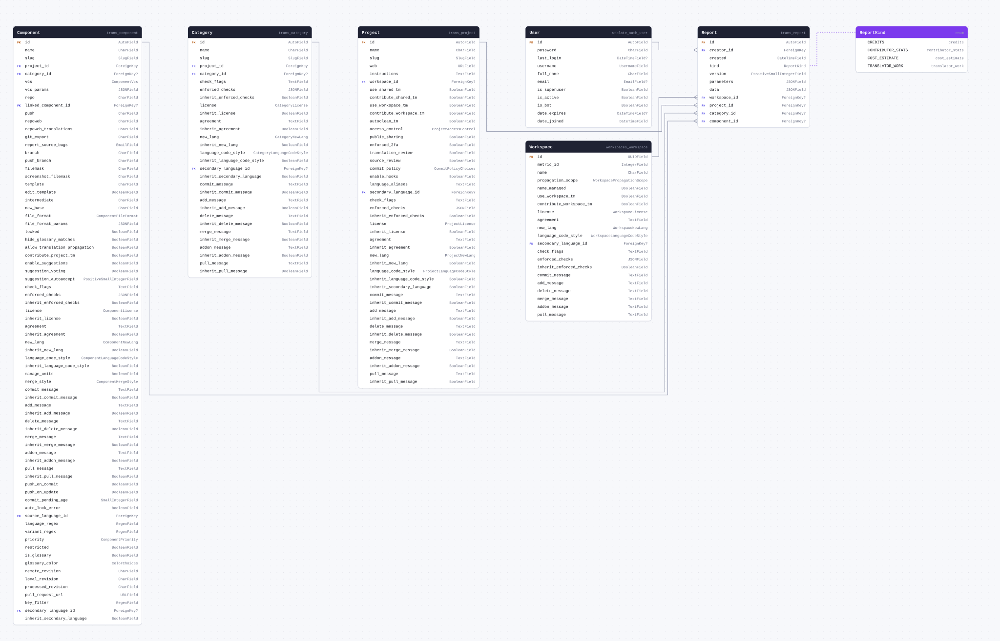

| Column | Field | Type | Null | Key | Default | Description |
| --- | --- | --- | --- | --- | --- | --- |
| `id` | `AutoField` | `integer` |  | PK | `autoincrement()` |  |
| `creator_id` | `ForeignKey` | `integer` |  | FK |  |  |
| `created` | `DateTimeField` | `timestamp with time zone` |  |  | `now()` |  |
| `kind` | `ReportKind` | `varchar(32)` |  |  |  |  |
| `version` | `PositiveSmallIntegerField` | `smallint` |  |  | `1` |  |
| `parameters` | `JSONField` | `jsonb` |  |  | `dict()` |  |
| `data` | `JSONField` | `jsonb` |  |  | `dict()` |  |
| `workspace_id` | `ForeignKey` | `uuid` | yes | FK |  |  |
| `project_id` | `ForeignKey` | `integer` | yes | FK |  |  |
| `category_id` | `ForeignKey` | `integer` | yes | FK |  |  |
| `component_id` | `ForeignKey` | `integer` | yes | FK |  |  |

Indexes:

- index `trans_report_creator_id_2b66af65` on `creator_id`
- index `trans_report_created_04e774e5` on `created`
- index `trans_report_kind_82833535` on `kind`
- index `trans_report_kind_82833535_like` on `kind` (`varchar_pattern_ops`)
- index `trans_report_workspace_id_f914bdb5` on `workspace_id`
- index `trans_report_project_id_026b7e0f` on `project_id`
- index `trans_report_category_id_fb4530ac` on `category_id`
- index `trans_report_component_id_894b3313` on `component_id`

Checks:

- `trans_report_single_scope`: `(("category_id" IS NULL AND "component_id" IS NULL AND "project_id" IS NULL AND "workspace_id" IS NULL) OR ("category_id" IS NULL AND "component_id" IS NULL AND "project_id" IS NULL AND "workspace_id" IS NOT NULL) OR ("category_id" IS NULL AND "component_id" IS NULL AND "project_id" IS NOT NULL AND "workspace_id" IS NULL) OR ("category_id" IS NOT NULL AND "component_id" IS NULL AND "project_id" IS NULL AND "workspace_id" IS NULL) OR ("category_id" IS NULL AND "component_id" IS NOT NULL AND "project_id" IS NULL AND "workspace_id" IS NULL))`

Relations:

- `creator_id` → [User](#user).`id`, on delete cascade
- `workspace_id` → [Workspace](#workspace).`id`, on delete cascade
- `project_id` → [Project](#project).`id`, on delete cascade
- `category_id` → [Category](#category).`id`, on delete cascade
- `component_id` → [Component](#component).`id`, on delete cascade

## SavedSearch

Table `trans_savedsearch`, app `trans`.

Search query saved for a project or for a single user.

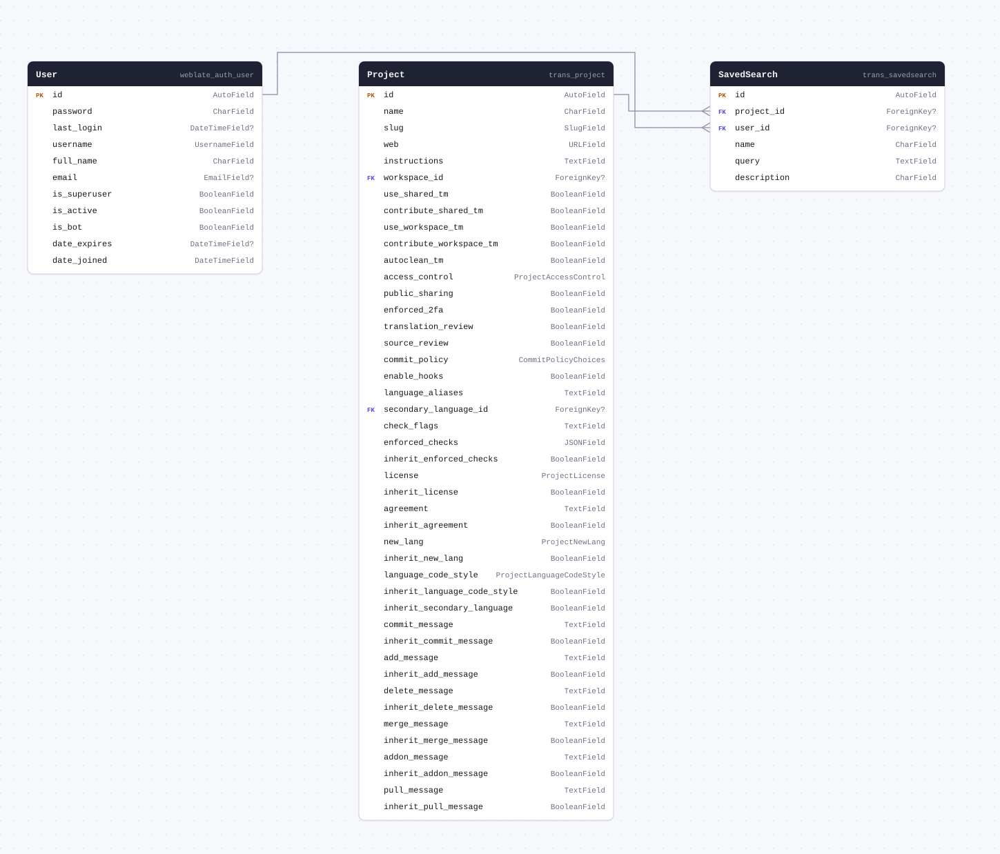

| Column | Field | Type | Null | Key | Default | Description |
| --- | --- | --- | --- | --- | --- | --- |
| `id` | `AutoField` | `integer` |  | PK | `autoincrement()` |  |
| `project_id` | `ForeignKey` | `integer` | yes | FK |  |  |
| `user_id` | `ForeignKey` | `integer` | yes | FK |  |  |
| `name` | `CharField` | `varchar(190)` |  |  |  |  |
| `query` | `TextField` | `text` |  |  |  |  |
| `description` | `CharField` | `varchar(250)` |  |  | `''` |  |

Indexes:

- unique `trans_saved_search_project_name` on `project_id`, `name`
- unique `trans_saved_search_user_name` on `user_id`, `name`

Checks:

- `trans_saved_search_single_scope`: `(("project_id" IS NOT NULL AND "user_id" IS NULL) OR ("project_id" IS NULL AND "user_id" IS NOT NULL))`

Relations:

- `project_id` → [Project](#project).`id`, on delete cascade
- `user_id` → [User](#user).`id`, on delete cascade

## WorkflowSetting

Table `trans_workflowsetting`, app `trans`.

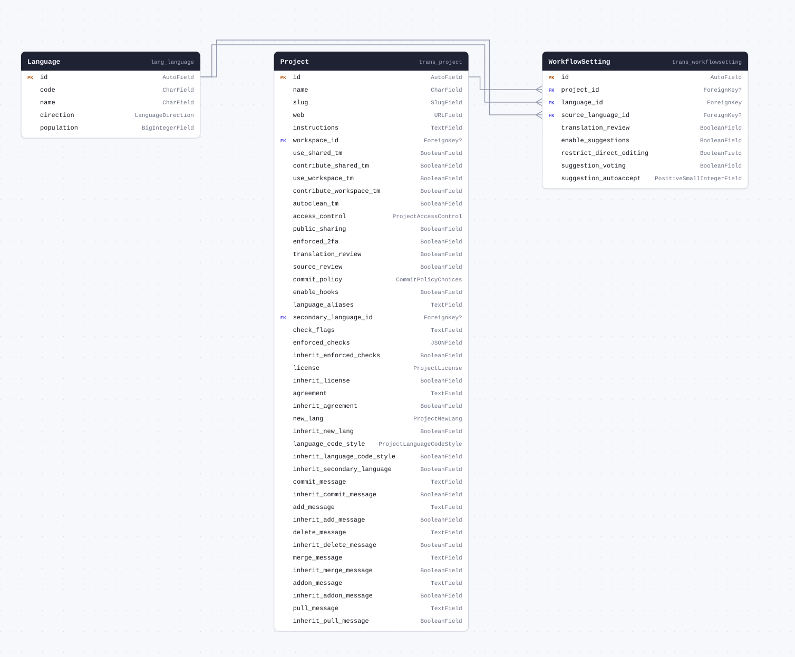

| Column | Field | Type | Null | Key | Default | Description |
| --- | --- | --- | --- | --- | --- | --- |
| `id` | `AutoField` | `integer` |  | PK | `autoincrement()` |  |
| `project_id` | `ForeignKey` | `integer` | yes | FK |  |  |
| `language_id` | `ForeignKey` | `integer` |  | FK |  |  |
| `source_language_id` | `ForeignKey` | `integer` | yes | FK |  | Translate from this language. Leave empty to use the component source language. |
| `translation_review` | `BooleanField` | `boolean` |  |  | `False` | Requires dedicated reviewers to approve translations. |
| `enable_suggestions` | `BooleanField` | `boolean` |  |  | `True` | Whether to allow translation suggestions at all. |
| `restrict_direct_editing` | `BooleanField` | `boolean` |  |  | `False` | Only users with the “Edit string when suggestions are enforced” permission can make direct changes. |
| `suggestion_voting` | `BooleanField` | `boolean` |  |  | `False` | Allows users to vote on suggestions. |
| `suggestion_autoaccept` | `PositiveSmallIntegerField` | `smallint` |  |  | `0` | Automatically accept suggestions with this number of votes, use 0 to turn it off. |

Indexes:

- index `trans_workflowsetting_project_id_32daa6c8` on `project_id`
- index `trans_workflowsetting_language_id_fcb1fa15` on `language_id`
- index `trans_workflowsetting_source_language_id_6df86150` on `source_language_id`

Relations:

- `project_id` → [Project](#project).`id`, on delete cascade
- `language_id` → [Language](#language).`id`, on delete cascade
- `source_language_id` → [Language](#language).`id`, on delete protect

## Language

Table `lang_language`, app `lang`.

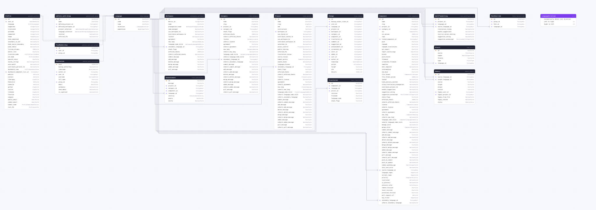

| Column | Field | Type | Null | Key | Default | Description |
| --- | --- | --- | --- | --- | --- | --- |
| `id` | `AutoField` | `integer` |  | PK | `autoincrement()` |  |
| `code` | `CharField` | `varchar(50)` |  | unique |  |  |
| `name` | `CharField` | `varchar(100)` |  |  |  |  |
| `direction` | `LanguageDirection` | `varchar(3)` |  |  | `''` |  |
| `population` | `BigIntegerField` | `bigint` |  |  | `0` | Number of people speaking this language. |

Indexes:

- index `lang_language_code_764a7a1d_like` on `code` (`varchar_pattern_ops`)

Relations:

- `group_set` — many to many with [weblate_auth.Group](#weblate_authgroup)
- `teammembership_set` — many to many with [TeamMembership](#teammembership)
- `invitation_set` — many to many with [Invitation](#invitation)
- [Workspace](#workspace).`secondary_language_id` → `id`, on delete cascade
- [Announcement](#announcement).`language_id` → `id`, on delete cascade
- [Category](#category).`secondary_language_id` → `id`, on delete cascade
- [Project](#project).`secondary_language_id` → `id`, on delete cascade
- [Change](#change).`language_id` → `id`, on delete cascade
- [Translation](#translation).`language_id` → `id`, on delete cascade
- [Component](#component).`source_language_id` → `id`, on delete cascade
- [Component](#component).`secondary_language_id` → `id`, on delete cascade
- [WorkflowSetting](#workflowsetting).`language_id` → `id`, on delete cascade
- [WorkflowSetting](#workflowsetting).`source_language_id` → `id`, on delete protect
- [Plural](#plural).`language_id` → `id`, on delete cascade
- [Memory](#memory).`source_language_id` → `id`, on delete cascade
- [Memory](#memory).`target_language_id` → `id`, on delete cascade
- [FontOverride](#fontoverride).`language_id` → `id`, on delete cascade
- `profile_set` — many to many with [Profile](#profile)
- `secondary_profile_set` — many to many with [Profile](#profile)

## Plural

Table `lang_plural`, app `lang`.

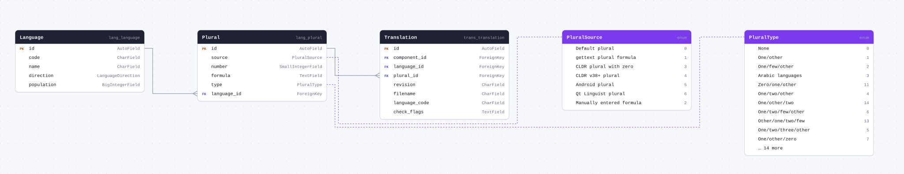

| Column | Field | Type | Null | Key | Default | Description |
| --- | --- | --- | --- | --- | --- | --- |
| `id` | `AutoField` | `integer` |  | PK | `autoincrement()` |  |
| `source` | `PluralSource` | `smallint` |  |  | `0` |  |
| `number` | `SmallIntegerField` | `smallint` |  |  | `2` |  |
| `formula` | `TextField` | `text` |  |  | `'n != 1'` |  |
| `type` | `PluralType` | `integer` |  |  | `666` |  |
| `language_id` | `ForeignKey` | `integer` |  | FK |  |  |

Indexes:

- index `lang_plural_language_id_b5f4646a` on `language_id`
- unique `lang_plural_unique_cldr_zero` on `language_id` where `"source" = 3`

Relations:

- [Translation](#translation).`plural_id` → `id`, on delete cascade
- `language_id` → [Language](#language).`id`, on delete cascade

## Memory

Table `memory_memory`, app `memory`.

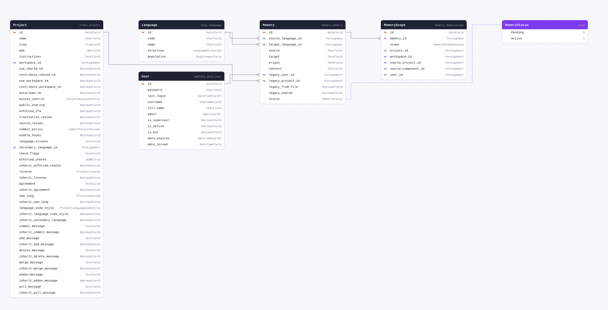

| Column | Field | Type | Null | Key | Default | Description |
| --- | --- | --- | --- | --- | --- | --- |
| `id` | `AutoField` | `integer` |  | PK | `autoincrement()` |  |
| `source_language_id` | `ForeignKey` | `integer` |  | FK |  |  |
| `target_language_id` | `ForeignKey` | `integer` |  | FK |  |  |
| `source` | `TextField` | `text` |  |  |  |  |
| `target` | `TextField` | `text` |  |  |  |  |
| `origin` | `TextField` | `text` |  |  |  |  |
| `context` | `TextField` | `text` |  |  | `''` |  |
| `legacy_user_id` | `ForeignKey` | `integer` | yes | FK | `None` |  |
| `legacy_project_id` | `ForeignKey` | `integer` | yes | FK | `None` |  |
| `legacy_from_file` | `BooleanField` | `boolean` |  |  | `False` |  |
| `legacy_shared` | `BooleanField` | `boolean` |  |  | `False` |  |
| `status` | `MemoryStatus` | `integer` |  |  | `0` |  |

Indexes:

- index `memory_memory_source_language_id_c53ef4ff` on `source_language_id`
- index `memory_memory_target_language_id_c44dca3c` on `target_language_id`
- index `memory_memory_legacy_user_id_aedef6a6` on `legacy_user_id`
- index `memory_memory_legacy_project_id_13aeb4a1` on `legacy_project_id`
- index `memory_md5_index` on `source_language_id`, `target_language_id`, `MD5("origin")`, `MD5("source")`, `MD5("target")`
- index `memory_from_file` on `legacy_from_file` where `"legacy_from_file"`
- gin index `memory_source_trgm` on `source`, `target_language_id`, `source_language_id` (`gin_trgm_ops`)
- gist index `memory_source_gist_prefix` on `source_language_id`, `target_language_id`, `LEFT("source", 2048) gist_trgm_ops`

Relations:

- `source_language_id` → [Language](#language).`id`, on delete cascade
- `target_language_id` → [Language](#language).`id`, on delete cascade
- `legacy_user_id` → [User](#user).`id`, on delete cascade
- `legacy_project_id` → [Project](#project).`id`, on delete cascade
- [MemoryScope](#memoryscope).`memory_id` → `id`, on delete cascade

## MemoryScope

Table `memory_memoryscope`, app `memory`.

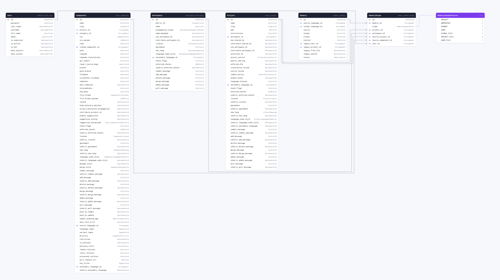

| Column | Field | Type | Null | Key | Default | Description |
| --- | --- | --- | --- | --- | --- | --- |
| `id` | `AutoField` | `integer` |  | PK | `autoincrement()` |  |
| `memory_id` | `ForeignKey` | `integer` |  | FK |  |  |
| `scope` | `MemoryScopeChoices` | `smallint` |  |  |  |  |
| `project_id` | `ForeignKey` | `integer` | yes | FK |  |  |
| `workspace_id` | `ForeignKey` | `uuid` | yes | FK |  |  |
| `source_project_id` | `ForeignKey` | `integer` | yes | FK |  |  |
| `source_component_id` | `ForeignKey` | `integer` | yes | FK |  |  |
| `user_id` | `ForeignKey` | `integer` | yes | FK |  |  |

Indexes:

- index `memory_memoryscope_memory_id_59a416c6` on `memory_id`
- index `memory_memoryscope_project_id_0f24de49` on `project_id`
- index `memory_memoryscope_workspace_id_6d209c88` on `workspace_id`
- index `memory_memoryscope_source_project_id_080b6f0a` on `source_project_id`
- index `memory_memoryscope_source_component_id_bc705407` on `source_component_id`
- index `memory_memoryscope_user_id_bccb55f8` on `user_id`
- unique `memory_scope_unique_project` on `memory_id`, `scope`, `project_id` where `("project_id" IS NOT NULL AND "scope" IN (1, 6))`
- unique `memory_scope_unique_workspace` on `memory_id`, `scope`, `workspace_id`, `source_project_id` where `("scope" = 2 AND "source_project_id" IS NOT NULL AND "workspace_id" IS NOT NULL)`
- unique `memory_scope_workspace_null` on `memory_id`, `scope`, `workspace_id` where `("scope" = 2 AND "source_project_id" IS NULL AND "workspace_id" IS NOT NULL)`
- unique `memory_scope_unique_user` on `memory_id`, `scope`, `user_id` where `("scope" IN (4, 7) AND "user_id" IS NOT NULL)`
- unique `memory_scope_unique_global` on `memory_id`, `scope` where `"scope" = 5`
- unique `memory_scope_unique_shared` on `memory_id`, `scope`, `source_project_id` where `("scope" = 3 AND "source_project_id" IS NOT NULL)`
- unique `memory_scope_shared_null` on `memory_id`, `scope` where `("scope" = 3 AND "source_project_id" IS NULL)`
- index `memory_scope_scope_memory` on `scope`, `memory_id`
- index `memory_scope_project` on `scope`, `project_id`, `memory_id`
- index `memory_scope_workspace` on `scope`, `workspace_id`, `memory_id`
- index `memory_scope_source_project` on `scope`, `source_project_id`, `memory_id`
- index `memory_scope_source_component` on `scope`, `source_component_id`, `memory_id`
- index `memory_scope_workspace_source` on `scope`, `workspace_id`, `source_project_id`, `memory_id`
- index `memory_scope_user` on `scope`, `user_id`, `memory_id`

Relations:

- `memory_id` → [Memory](#memory).`id`, on delete cascade
- `project_id` → [Project](#project).`id`, on delete cascade
- `workspace_id` → [Workspace](#workspace).`id`, on delete cascade
- `source_project_id` → [Project](#project).`id`, on delete cascade
- `source_component_id` → [Component](#component).`id`, on delete set null
- `user_id` → [User](#user).`id`, on delete cascade

## MemoryScopeMigrationState

Table `memory_memoryscopemigrationstate`, app `memory`.

| Column | Field | Type | Null | Key | Default | Description |
| --- | --- | --- | --- | --- | --- | --- |
| `name` | `CharField` | `varchar(50)` |  | PK |  |  |
| `last_memory_id` | `IntegerField` | `integer` |  |  | `0` |  |
| `completed` | `BooleanField` | `boolean` |  |  | `False` |  |
| `updated` | `DateTimeField` | `timestamp with time zone` |  |  | `now()` |  |

Indexes:

- index `memory_memoryscopemigrationstate_name_d3f4ce7e_like` on `name` (`varchar_pattern_ops`)

## Screenshot

Table `screenshots_screenshot`, app `screenshots`.

Columns from `BackupAuthorshipMixin` (abstract): `backup_author_claim_id`.

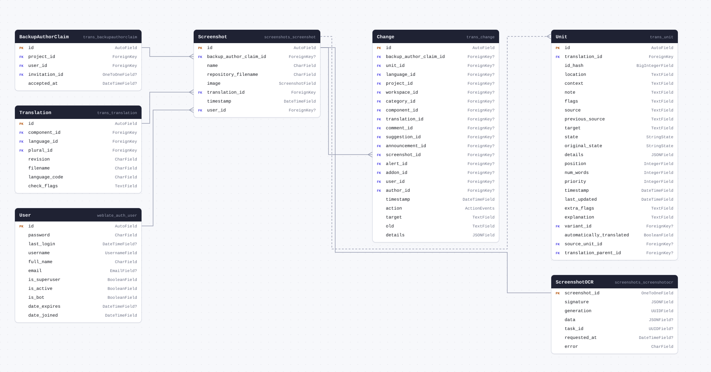

| Column | Field | Type | Null | Key | Default | Description |
| --- | --- | --- | --- | --- | --- | --- |
| `id` | `AutoField` | `integer` |  | PK | `autoincrement()` |  |
| `backup_author_claim_id` | `ForeignKey` | `integer` | yes | FK |  |  |
| `name` | `CharField` | `varchar(200)` |  |  |  |  |
| `repository_filename` | `CharField` | `varchar(200)` |  |  |  | Scan for screenshot file change on repository update. |
| `image` | `ScreenshotField` | `varchar(100)` |  |  |  | Upload image up to 2000x2000 pixels. |
| `translation_id` | `ForeignKey` | `integer` |  | FK |  |  |
| `timestamp` | `DateTimeField` | `timestamp with time zone` |  |  | `now()` |  |
| `user_id` | `ForeignKey` | `integer` | yes | FK |  |  |

Indexes:

- index `screenshots_screenshot_backup_author_claim_id_19b10d15` on `backup_author_claim_id`
- index `screenshots_screenshot_translation_id_3b239850` on `translation_id`
- index `screenshots_screenshot_user_id_9350e149` on `user_id`

Relations:

- [Change](#change).`screenshot_id` → `id`, on delete set null
- `backup_author_claim_id` → [BackupAuthorClaim](#backupauthorclaim).`id`, on delete set null
- `translation_id` → [Translation](#translation).`id`, on delete cascade
- `user_id` → [User](#user).`id`, on delete set null
- `units` — many to many with [Unit](#unit)
- [ScreenshotOCR](#screenshotocr).`screenshot_id` → `id`, on delete cascade

## ScreenshotOCR

Table `screenshots_screenshotocr`, app `screenshots`.

Disposable derived data, intentionally excluded from REST and backups.

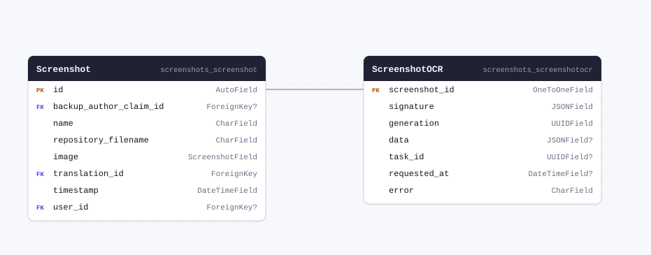

| Column | Field | Type | Null | Key | Default | Description |
| --- | --- | --- | --- | --- | --- | --- |
| `screenshot_id` | `OneToOneField` | `integer` |  | PK, FK |  |  |
| `signature` | `JSONField` | `jsonb` |  |  | `dict()` |  |
| `generation` | `UUIDField` | `uuid` |  |  | `uuid4()` |  |
| `data` | `JSONField` | `jsonb` | yes |  |  |  |
| `task_id` | `UUIDField` | `uuid` | yes |  |  |  |
| `requested_at` | `DateTimeField` | `timestamp with time zone` | yes |  |  |  |
| `error` | `CharField` | `varchar(16)` |  |  |  |  |

Relations:

- `screenshot_id` → [Screenshot](#screenshot).`id`, on delete cascade

## Font

Table `fonts_font`, app `fonts`.

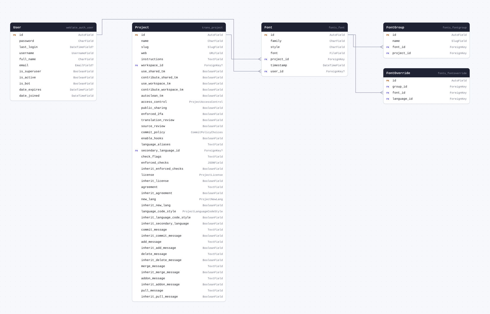

| Column | Field | Type | Null | Key | Default | Description |
| --- | --- | --- | --- | --- | --- | --- |
| `id` | `AutoField` | `integer` |  | PK | `autoincrement()` |  |
| `family` | `CharField` | `varchar(100)` |  |  |  |  |
| `style` | `CharField` | `varchar(100)` |  |  |  |  |
| `font` | `FileField` | `varchar(100)` |  |  |  | OpenType and TrueType fonts are supported. |
| `project_id` | `ForeignKey` | `integer` |  | FK |  |  |
| `timestamp` | `DateTimeField` | `timestamp with time zone` |  |  | `now()` |  |
| `user_id` | `ForeignKey` | `integer` | yes | FK |  |  |

Indexes:

- index `fonts_font_project_id_855704e0` on `project_id`
- index `fonts_font_user_id_5897e323` on `user_id`
- unique `fonts_font_family_style_project_id_9f3996b3_uniq` on `family`, `style`, `project_id`

Relations:

- `project_id` → [Project](#project).`id`, on delete cascade
- `user_id` → [User](#user).`id`, on delete set null
- [FontGroup](#fontgroup).`font_id` → `id`, on delete cascade
- [FontOverride](#fontoverride).`font_id` → `id`, on delete cascade

## FontGroup

Table `fonts_fontgroup`, app `fonts`.

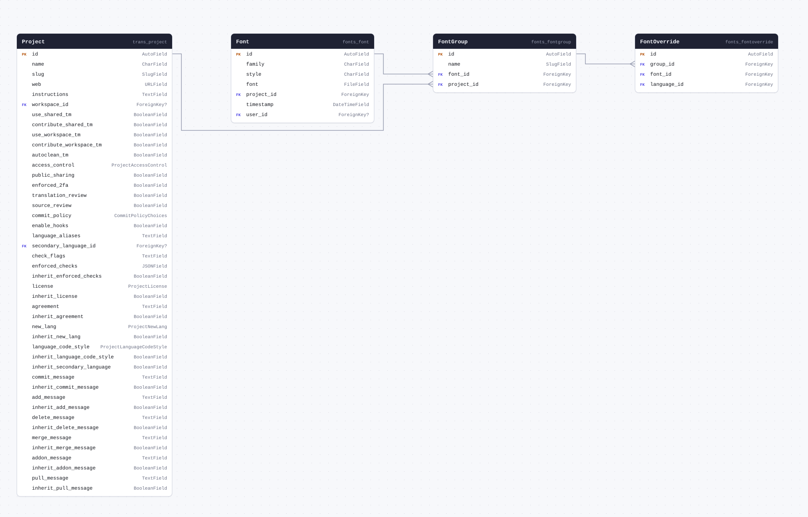

| Column | Field | Type | Null | Key | Default | Description |
| --- | --- | --- | --- | --- | --- | --- |
| `id` | `AutoField` | `integer` |  | PK | `autoincrement()` |  |
| `name` | `SlugField` | `varchar(100)` |  |  |  | Identifier you will use in checks to select this font group. Avoid whitespaces and special characters. |
| `font_id` | `ForeignKey` | `integer` |  | FK |  | Default font is used unless per language override matches. |
| `project_id` | `ForeignKey` | `integer` |  | FK |  |  |

Indexes:

- index `fonts_fontgroup_name_cf198a4d` on `name`
- index `fonts_fontgroup_name_cf198a4d_like` on `name` (`varchar_pattern_ops`)
- index `fonts_fontgroup_font_id_e4c04e1d` on `font_id`
- unique `fonts_fontgroup_project_id_name_0b0fa938_uniq` on `project_id`, `name`

Relations:

- `font_id` → [Font](#font).`id`, on delete cascade
- `project_id` → [Project](#project).`id`, on delete cascade
- [FontOverride](#fontoverride).`group_id` → `id`, on delete cascade

## FontOverride

Table `fonts_fontoverride`, app `fonts`.


| Column | Field | Type | Null | Key | Default | Description |
| --- | --- | --- | --- | --- | --- | --- |
| `id` | `AutoField` | `integer` |  | PK | `autoincrement()` |  |
| `group_id` | `ForeignKey` | `integer` |  | FK |  |  |
| `font_id` | `ForeignKey` | `integer` |  | FK |  |  |
| `language_id` | `ForeignKey` | `integer` |  | FK |  |  |

Indexes:

- index `fonts_fontoverride_font_id_ae703c52` on `font_id`
- index `fonts_fontoverride_language_id_ccb8c819` on `language_id`
- unique `fonts_fontoverride_group_id_language_id_92a46b82_uniq` on `group_id`, `language_id`

Relations:

- `group_id` → [FontGroup](#fontgroup).`id`, on delete cascade
- `font_id` → [Font](#font).`id`, on delete cascade
- `language_id` → [Language](#language).`id`, on delete cascade

## Subscription

Table `accounts_subscription`, app `accounts`.


| Column | Field | Type | Null | Key | Default | Description |
| --- | --- | --- | --- | --- | --- | --- |
| `id` | `AutoField` | `integer` |  | PK | `autoincrement()` |  |
| `user_id` | `ForeignKey` | `integer` |  | FK |  |  |
| `notification` | `SubscriptionNotification` | `varchar(100)` |  |  |  |  |
| `scope` | `NotificationScope` | `integer` |  |  |  |  |
| `frequency` | `NotificationFrequency` | `integer` |  |  |  |  |
| `project_id` | `ForeignKey` | `integer` | yes | FK |  |  |
| `component_id` | `ForeignKey` | `integer` | yes | FK |  |  |
| `onetime` | `BooleanField` | `boolean` |  |  | `False` |  |

Indexes:

- index `accounts_subscription_user_id_980c85f5` on `user_id`
- index `accounts_subscription_project_id_0ac0474e` on `project_id`
- index `accounts_subscription_component_id_f17fa0c7` on `component_id`
- unique `accounts_subscription_notification_unique` on `notification`, `scope`, `project_id`, `component_id`, `user_id`, nulls not distinct

Relations:

- `user_id` → [User](#user).`id`, on delete cascade
- `project_id` → [Project](#project).`id`, on delete cascade
- `component_id` → [Component](#component).`id`, on delete cascade

## TeamAuditLog

Table `accounts_teamauditlog`, app `accounts`.

Private, immutable snapshots of administrative team changes.


| Column | Field | Type | Null | Key | Default | Description |
| --- | --- | --- | --- | --- | --- | --- |
| `id` | `AutoField` | `integer` |  | PK | `autoincrement()` |  |
| `team_id` | `ForeignKey` | `integer` | yes | FK |  |  |
| `team_name` | `CharField` | `varchar(150)` |  |  |  |  |
| `scope` | `TeamAuditLogScope` | `varchar(10)` |  |  |  |  |
| `scope_label` | `CharField` | `varchar(200)` |  |  |  |  |
| `project_id` | `ForeignKey` | `integer` | yes | FK |  |  |
| `workspace_id` | `ForeignKey` | `uuid` | yes | FK |  |  |
| `actor_id` | `ForeignKey` | `integer` | yes | FK |  |  |
| `event` | `TeamAuditLogEvent` | `varchar(20)` |  |  |  |  |
| `details` | `JSONField` | `jsonb` |  |  | `dict()` |  |
| `timestamp` | `DateTimeField` | `timestamp with time zone` |  |  | `now()` |  |

Indexes:

- index `accounts_teamauditlog_team_id_b59809a3` on `team_id`
- index `accounts_teamauditlog_project_id_c3db3056` on `project_id`
- index `accounts_teamauditlog_workspace_id_43f2ba4f` on `workspace_id`
- index `accounts_teamauditlog_actor_id_96cc352d` on `actor_id`
- index `accounts_teamauditlog_timestamp_184b340e` on `timestamp`

Relations:

- `team_id` → [weblate_auth.Group](#weblate_authgroup).`id`, on delete set null
- `project_id` → [Project](#project).`id`, on delete set null
- `workspace_id` → [Workspace](#workspace).`id`, on delete set null
- `actor_id` → [User](#user).`id`, on delete set null

## AuditLog

Table `accounts_auditlog`, app `accounts`.

User audit log storage.


| Column | Field | Type | Null | Key | Default | Description |
| --- | --- | --- | --- | --- | --- | --- |
| `id` | `AutoField` | `integer` |  | PK | `autoincrement()` |  |
| `user_id` | `ForeignKey` | `integer` | yes | FK |  |  |
| `activity` | `AuditLogActivity` | `varchar(20)` |  |  |  |  |
| `params` | `JSONField` | `jsonb` |  |  | `dict()` |  |
| `address` | `GenericIPAddressField` | `inet` | yes |  |  |  |
| `user_agent` | `CharField` | `varchar(200)` |  |  | `''` |  |
| `timestamp` | `DateTimeField` | `timestamp with time zone` |  |  | `now()` |  |

Indexes:

- index `accounts_auditlog_user_id_1dfbca79` on `user_id`
- index `accounts_auditlog_activity_8f58593c` on `activity`
- index `accounts_auditlog_activity_8f58593c_like` on `activity` (`varchar_pattern_ops`)
- index `accounts_auditlog_timestamp_fc82620d` on `timestamp`

Relations:

- `user_id` → [User](#user).`id`, on delete cascade

## VerifiedEmail

Table `accounts_verifiedemail`, app `accounts`.

Storage for verified e-mails from auth backends.


| Column | Field | Type | Null | Key | Default | Description |
| --- | --- | --- | --- | --- | --- | --- |
| `id` | `AutoField` | `integer` |  | PK | `autoincrement()` |  |
| `is_deliverable` | `BooleanField` | `boolean` |  |  | `True` |  |
| `social_id` | `ForeignKey` | `bigint` |  | FK |  |  |
| `email` | `EmailField` | `varchar(190)` |  |  |  |  |

Indexes:

- index `accounts_verifiedemail_social_id_c6d8a262` on `social_id`
- index `accounts_verifiedemail_email` on `LOWER(("email") COLLATE "C")`

Relations:

- `social_id` → [UserSocialAuth](#usersocialauth).`id`, on delete cascade

## Profile

Table `accounts_profile`, app `accounts`.

User profiles storage.


| Column | Field | Type | Null | Key | Default | Description |
| --- | --- | --- | --- | --- | --- | --- |
| `id` | `AutoField` | `integer` |  | PK | `autoincrement()` |  |
| `user_id` | `OneToOneField` | `integer` |  | FK, unique |  |  |
| `language` | `ProfileLanguage` | `varchar(10)` |  |  |  |  |
| `suggested` | `IntegerField` | `integer` |  |  | `0` |  |
| `translated` | `IntegerField` | `integer` |  |  | `0` |  |
| `uploaded` | `IntegerField` | `integer` |  |  | `0` |  |
| `commented` | `IntegerField` | `integer` |  |  | `0` |  |
| `theme` | `ThemeChoices` | `varchar(10)` |  |  | `'auto'` |  |
| `hide_completed` | `BooleanField` | `boolean` |  |  | `False` |  |
| `secondary_in_zen` | `BooleanField` | `boolean` |  |  | `True` |  |
| `hide_source_secondary` | `BooleanField` | `boolean` |  |  | `False` |  |
| `wide_tables` | `BooleanField` | `boolean` |  |  | `False` | Instead of hiding columns on narrow screens, keep all columns and scroll the table horizontally. |
| `listing_columns` | `JSONField` | `jsonb` |  |  | `get_default_listing_columns()` | Choose which statistics columns are shown in project, component, and language lists. |
| `editor_link` | `CharField` | `varchar(200)` |  |  | `''` | Enter a custom URL to be used as link to the source code. You can use {{branch}} for branch, {{filename}} and {{line}} as filename and line placeholders. |
| `translate_mode` | `ProfileTranslateMode` | `integer` |  |  | `0` |  |
| `zen_mode` | `ProfileZenMode` | `integer` |  |  | `0` |  |
| `special_chars` | `CharField` | `varchar(30)` |  |  | `''` | You can specify additional special visual keyboard characters to be shown while translating. It can be useful for characters you use frequently, but are hard to type on your keyboard. |
| `nearby_strings` | `SmallIntegerField` | `smallint` |  |  | `15` | Number of nearby strings to show in each direction in the full editor. |
| `auto_watch` | `BooleanField` | `boolean` |  |  | `True` | Projects are added to your watched projects when you contribute to them. |
| `contribute_personal_tm` | `BooleanField` | `boolean` |  |  | `get_default_contribute_personal_tm()` | Allow your translations to be added to your personal translation memory. |
| `dashboard_view` | `ProfileDashboardView` | `integer` |  |  | `1` |  |
| `dashboard_component_list_id` | `ForeignKey` | `integer` | yes | FK |  |  |
| `website` | `URLField` | `varchar(200)` |  |  |  |  |
| `contact` | `URLField` | `varchar(200)` |  |  |  | Link to contact you online using services like Signal, SimpleX or Telegram. |
| `liberapay` | `SlugField` | `varchar(50)` |  |  |  | Liberapay is a platform to donate money to teams, organizations and individuals. |
| `fediverse` | `URLField` | `varchar(200)` |  |  |  | Link to your Fediverse profile for federated services like Mastodon or diaspora*. |
| `codesite` | `URLField` | `varchar(200)` |  |  |  | Link to your code profile for services like Codeberg or GitLab. |
| `github` | `SlugField` | `varchar(50)` |  |  |  |  |
| `twitter` | `SlugField` | `varchar(50)` |  |  |  |  |
| `linkedin` | `SlugField` | `varchar(50)` |  |  |  | Your LinkedIn profile name from linkedin.com/in/profilename |
| `location` | `CharField` | `varchar(100)` |  |  |  |  |
| `company` | `CharField` | `varchar(100)` |  |  |  |  |
| `public_email` | `EmailField` | `varchar(190)` |  |  |  |  |
| `commit_email` | `EmailField` | `varchar(190)` |  |  |  |  |
| `commit_name` | `ProfileCommitNameChoices` | `integer` |  |  | `0` |  |
| `last_2fa` | `ProfileLast2Fa` | `varchar(15)` |  |  | `''` |  |

Indexes:

- index `accounts_profile_suggested_8e0fb145` on `suggested`
- index `accounts_profile_translated_45d8856d` on `translated`
- index `accounts_profile_uploaded_f5223324` on `uploaded`
- index `accounts_profile_commented_8e3a8722` on `commented`
- index `accounts_profile_dashboard_component_list_id_4730151f` on `dashboard_component_list_id`

Relations:

- `user_id` → [User](#user).`id`, on delete cascade
- `dashboard_component_list_id` → [ComponentList](#componentlist).`id`, on delete set null
- `languages` — many to many with [Language](#language)
- `secondary_languages` — many to many with [Language](#language)
- `watched` — many to many with [Project](#project)

## Setting

Table `configuration_setting`, app `configuration`.

| Column | Field | Type | Null | Key | Default | Description |
| --- | --- | --- | --- | --- | --- | --- |
| `id` | `AutoField` | `integer` |  | PK | `autoincrement()` |  |
| `category` | `SettingCategory` | `integer` |  |  |  |  |
| `name` | `CharField` | `varchar(100)` |  |  |  |  |
| `value` | `JSONField` | `jsonb` |  |  |  |  |

Indexes:

- unique `configuration_setting_category_name_5144ffcf_uniq` on `category`, `name`

## Installation

Table `vcs_installation`, app `vcs`.

Proxy models, on this table: `GitHubInstallation`.

Generic code-hosting integration connecting a workspace to a remote account.

The fields here are provider-agnostic: a provider-issued installation id, the
account it targets, the host it lives on, and a cached repository list.
Provider-specific authentication and API behaviour lives in proxy subclasses
such as :class:`weblate.vcs.github.GitHubInstallation`; the ``provider``
discriminator records which one owns each row so those proxies can scope
their queries.


| Column | Field | Type | Null | Key | Default | Description |
| --- | --- | --- | --- | --- | --- | --- |
| `id` | `AutoField` | `integer` |  | PK | `autoincrement()` |  |
| `provider` | `InstallationProvider` | `varchar(20)` |  |  | `'github'` |  |
| `installation_id` | `CharField` | `varchar(50)` |  |  |  |  |
| `target_type` | `CharField` | `varchar(20)` |  |  |  | Organization or User |
| `target_login` | `CharField` | `varchar(255)` |  |  |  | Hosting organization or user login |
| `workspace_id` | `ForeignKey` | `uuid` |  | FK |  |  |
| `hostname` | `CharField` | `varchar(255)` |  |  | `'github.com'` |  |
| `enabled` | `BooleanField` | `boolean` |  |  | `True` |  |
| `created` | `DateTimeField` | `timestamp with time zone` |  |  | `now()` |  |
| `repositories` | `JSONField` | `jsonb` |  |  | `list()` |  |
| `repositories_updated` | `DateTimeField` | `timestamp with time zone` | yes |  |  |  |

Indexes:

- index `vcs_installation_workspace_id_1a97507d` on `workspace_id`
- unique `vcs_installation_provider_hostname_instal_ab8ed013_uniq` on `provider`, `hostname`, `installation_id`, `workspace_id`

Relations:

- `workspace_id` → [Workspace](#workspace).`id`, on delete cascade

## PendingInstallation

Table `vcs_pendinginstallation`, app `vcs`.

Signed provider webhook payload waiting for workspace authorization.

Rows here are intentionally not workspace-scoped. A provider webhook can
arrive before the redirect that proves which Weblate workspace may use the
installation. Provider-specific setup code replays the payload only after
that authority is validated.

| Column | Field | Type | Null | Key | Default | Description |
| --- | --- | --- | --- | --- | --- | --- |
| `id` | `AutoField` | `integer` |  | PK | `autoincrement()` |  |
| `provider` | `InstallationProvider` | `varchar(20)` |  |  |  |  |
| `hostname` | `CharField` | `varchar(255)` |  |  |  |  |
| `installation_id` | `CharField` | `varchar(50)` |  |  |  |  |
| `payload` | `JSONField` | `jsonb` |  |  | `dict()` |  |
| `created` | `DateTimeField` | `timestamp with time zone` |  |  | `now()` |  |
| `updated` | `DateTimeField` | `timestamp with time zone` |  |  | `now()` |  |

Indexes:

- unique `vcs_pendinginstallation_provider_hostname_instal_1c297e27_uniq` on `provider`, `hostname`, `installation_id`

## GitHubAppCredentials

Table `vcs_githubappcredentials`, app `vcs`.

Per-host Weblate GitHub App credentials stored in the database.

Rows in this table are created by the manifest registration flow in
:mod:`weblate.vcs.views`; this is the only way GitHub Apps are configured.

| Column | Field | Type | Null | Key | Default | Description |
| --- | --- | --- | --- | --- | --- | --- |
| `id` | `AutoField` | `integer` |  | PK | `autoincrement()` |  |
| `hostname` | `CharField` | `varchar(255)` |  | unique |  |  |
| `app_id` | `CharField` | `varchar(50)` |  |  |  |  |
| `app_slug` | `CharField` | `varchar(255)` |  |  |  |  |
| `private_key` | `TextField` | `text` |  |  |  |  |
| `client_id` | `CharField` | `varchar(255)` |  |  |  |  |
| `client_secret` | `CharField` | `varchar(255)` |  |  |  |  |
| `webhook_secret` | `CharField` | `varchar(255)` |  |  |  |  |
| `webhook_token` | `UUIDField` | `uuid` |  | unique | `uuid4()` |  |
| `html_url` | `URLField` | `varchar(200)` |  |  |  |  |
| `created` | `DateTimeField` | `timestamp with time zone` |  |  | `now()` |  |
| `updated` | `DateTimeField` | `timestamp with time zone` |  |  | `now()` |  |

Indexes:

- index `vcs_githubappcredentials_hostname_71ed5837_like` on `hostname` (`varchar_pattern_ops`)

## SecurityScan

Table `wladmin_securityscan`, app `wladmin`.

Credential-free state of an account security operation.


| Column | Field | Type | Null | Key | Default | Description |
| --- | --- | --- | --- | --- | --- | --- |
| `id` | `UUIDField` | `uuid` |  | PK | `uuid4()` |  |
| `actor_id` | `ForeignKey` | `integer` | yes | FK |  |  |
| `filename` | `CharField` | `varchar(255)` |  |  | `''` |  |
| `operation` | `CharField` | `varchar(20)` |  |  | `'validate'` |  |
| `finding_type` | `CharField` | `varchar(50)` |  |  | `'leaked-password'` |  |
| `state` | `CharField` | `varchar(20)` |  |  | `'pending'` |  |
| `created` | `DateTimeField` | `timestamp with time zone` |  |  | `now()` |  |
| `completed` | `DateTimeField` | `timestamp with time zone` | yes |  |  |  |
| `processed` | `PositiveIntegerField` | `integer` |  |  | `0` |  |
| `total` | `PositiveIntegerField` | `integer` |  |  | `0` |  |
| `summary` | `JSONField` | `jsonb` |  |  | `dict()` |  |
| `error` | `TextField` | `text` |  |  | `''` |  |

Indexes:

- index `wladmin_securityscan_actor_id_0aebe956` on `actor_id`
- index `wladmin_securityscan_state_135c0fa8` on `state`
- index `wladmin_securityscan_state_135c0fa8_like` on `state` (`varchar_pattern_ops`)

Relations:

- `actor_id` → [User](#user).`id`, on delete set null
- [SecurityFindingEvent](#securityfindingevent).`scan_id` → `id`, on delete cascade

## SecurityFinding

Table `wladmin_securityfinding`, app `wladmin`.

A typed account security issue, without authentication secrets.


| Column | Field | Type | Null | Key | Default | Description |
| --- | --- | --- | --- | --- | --- | --- |
| `id` | `AutoField` | `integer` |  | PK | `autoincrement()` |  |
| `user_id` | `ForeignKey` | `integer` |  | FK |  |  |
| `finding_type` | `CharField` | `varchar(50)` |  |  |  |  |
| `key` | `CharField` | `varchar(64)` |  |  |  |  |
| `evidence` | `JSONField` | `jsonb` |  |  | `dict()` |  |
| `status` | `SecurityFindingStatus` | `varchar(10)` |  |  | `'open'` |  |
| `first_seen` | `DateTimeField` | `timestamp with time zone` |  |  | `now()` |  |
| `last_seen` | `DateTimeField` | `timestamp with time zone` |  |  | `now()` |  |
| `handled_at` | `DateTimeField` | `timestamp with time zone` | yes |  |  |  |

Indexes:

- index `wladmin_securityfinding_user_id_6c31bc00` on `user_id`
- unique `security_finding_identity` on `user_id`, `finding_type`, `key`
- index `wladmin_sec_status_ec922b_idx` on `status`, `finding_type`

Relations:

- `user_id` → [User](#user).`id`, on delete cascade
- [SecurityFindingEvent](#securityfindingevent).`finding_id` → `id`, on delete cascade

## SecurityFindingEvent

Table `wladmin_securityfindingevent`, app `wladmin`.


| Column | Field | Type | Null | Key | Default | Description |
| --- | --- | --- | --- | --- | --- | --- |
| `id` | `AutoField` | `integer` |  | PK | `autoincrement()` |  |
| `finding_id` | `ForeignKey` | `integer` |  | FK |  |  |
| `scan_id` | `ForeignKey` | `uuid` |  | FK |  |  |
| `actor_id` | `ForeignKey` | `integer` | yes | FK |  |  |
| `action` | `CharField` | `varchar(20)` |  |  |  |  |
| `timestamp` | `DateTimeField` | `timestamp with time zone` |  |  | `now()` |  |
| `reason` | `CharField` | `varchar(50)` |  |  | `''` |  |
| `evidence` | `JSONField` | `jsonb` |  |  | `dict()` |  |

Indexes:

- index `wladmin_securityfindingevent_finding_id_fb30cf88` on `finding_id`
- index `wladmin_securityfindingevent_scan_id_573ba79c` on `scan_id`
- index `wladmin_securityfindingevent_actor_id_ddbbf0da` on `actor_id`
- unique `security_finding_event_identity` on `finding_id`, `scan_id`, `action`

Relations:

- `finding_id` → [SecurityFinding](#securityfinding).`id`, on delete cascade
- `scan_id` → [SecurityScan](#securityscan).`id`, on delete cascade
- `actor_id` → [User](#user).`id`, on delete set null

## ConfigurationError

Table `wladmin_configurationerror`, app `wladmin`.

| Column | Field | Type | Null | Key | Default | Description |
| --- | --- | --- | --- | --- | --- | --- |
| `id` | `AutoField` | `integer` |  | PK | `autoincrement()` |  |
| `name` | `CharField` | `varchar(150)` |  | unique |  |  |
| `message` | `TextField` | `text` |  |  |  |  |
| `timestamp` | `DateTimeField` | `timestamp with time zone` |  |  | `now()` |  |
| `ignored` | `BooleanField` | `boolean` |  |  | `False` |  |

Indexes:

- index `wladmin_configurationerror_name_99ad2168_like` on `name` (`varchar_pattern_ops`)
- index `wladmin_configurationerror_ignored_8a22575f` on `ignored`
- index `wladmin_con_ignored_fb498d_idx` on `ignored`, `timestamp`

## SupportStatus

Table `wladmin_supportstatus`, app `wladmin`.

| Column | Field | Type | Null | Key | Default | Description |
| --- | --- | --- | --- | --- | --- | --- |
| `id` | `AutoField` | `integer` |  | PK | `autoincrement()` |  |
| `name` | `CharField` | `varchar(150)` |  |  |  |  |
| `secret` | `CharField` | `varchar(400)` |  |  |  |  |
| `expiry` | `DateTimeField` | `timestamp with time zone` | yes |  |  |  |
| `in_limits` | `BooleanField` | `boolean` |  |  | `True` |  |
| `discoverable` | `BooleanField` | `boolean` |  |  | `False` |  |
| `limits` | `JSONField` | `jsonb` |  |  | `dict()` |  |
| `has_subscription` | `BooleanField` | `boolean` |  |  | `False` |  |
| `backup_repository` | `CharField` | `varchar(500)` |  |  | `''` |  |
| `enabled` | `BooleanField` | `boolean` |  |  | `True` |  |

Indexes:

- index `wladmin_supportstatus_expiry_2855a549` on `expiry`
- index `wladmin_supportstatus_enabled_fbe08b47` on `enabled`

## BackupService

Table `wladmin_backupservice`, app `wladmin`.


| Column | Field | Type | Null | Key | Default | Description |
| --- | --- | --- | --- | --- | --- | --- |
| `id` | `AutoField` | `integer` |  | PK | `autoincrement()` |  |
| `repository` | `CharField` | `varchar(500)` |  |  | `''` | Use /path/to/repo for local backups or user@host:/path/to/repo or ssh://user@host:port/path/to/backups for remote SSH backups. |
| `enabled` | `BooleanField` | `boolean` |  |  | `True` |  |
| `timestamp` | `DateTimeField` | `timestamp with time zone` |  |  | `now()` |  |
| `passphrase` | `CharField` | `varchar(100)` |  |  | `make_password()` |  |
| `paperkey` | `TextField` | `text` |  |  |  |  |

Relations:

- [BackupLog](#backuplog).`service_id` → `id`, on delete cascade

## BackupLog

Table `wladmin_backuplog`, app `wladmin`.


| Column | Field | Type | Null | Key | Default | Description |
| --- | --- | --- | --- | --- | --- | --- |
| `id` | `AutoField` | `integer` |  | PK | `autoincrement()` |  |
| `service_id` | `ForeignKey` | `integer` |  | FK |  |  |
| `timestamp` | `DateTimeField` | `timestamp with time zone` |  |  | `now()` |  |
| `event` | `BackupLogEvent` | `varchar(100)` |  |  |  |  |
| `warning` | `BooleanField` | `boolean` |  |  | `False` |  |
| `log` | `TextField` | `text` |  |  |  |  |

Indexes:

- index `wladmin_backuplog_service_id_10292c2d` on `service_id`
- index `wladmin_backuplog_event_fbf23e08` on `event`
- index `wladmin_backuplog_event_fbf23e08_like` on `event` (`varchar_pattern_ops`)

Relations:

- `service_id` → [BackupService](#backupservice).`id`, on delete cascade

## Metric

Table `metrics_metric`, app `metrics`.

| Column | Field | Type | Null | Key | Default | Description |
| --- | --- | --- | --- | --- | --- | --- |
| `id` | `BigAutoField` | `bigint` |  | PK | `autoincrement()` |  |
| `date` | `DateField` | `date` |  |  | `date.today()` |  |
| `scope` | `SmallIntegerField` | `smallint` |  |  |  |  |
| `relation` | `IntegerField` | `integer` |  |  |  |  |
| `secondary` | `IntegerField` | `integer` |  |  | `0` |  |
| `changes` | `IntegerField` | `integer` |  |  |  |  |
| `data` | `JSONField` | `jsonb` | yes |  |  |  |

Indexes:

- unique `metrics_metric_scope_relation_secondary_date_f0ac693e_uniq` on `scope`, `relation`, `secondary`, `date`

## auth.Permission

Table `auth_permission`, app `auth`.

The permissions system provides a way to assign permissions to specific
users and groups of users.

The permission system is used by the Django admin site, but may also be
useful in your own code. The Django admin site uses permissions as follows:

    - The "add" permission limits the user's ability to view the "add" form
      and add an object.
    - The "change" permission limits a user's ability to view the change
      list, view the "change" form and change an object.
    - The "delete" permission limits the ability to delete an object.
    - The "view" permission limits the ability to view an object.

Permissions are set globally per type of object, not per specific object
instance. It is possible to say "Mary may change news stories," but it's
not currently possible to say "Mary may change news stories, but only the
ones she created herself" or "Mary may only change news stories that have a
certain status or publication date."

The permissions listed above are automatically created for each model.


| Column | Field | Type | Null | Key | Default | Description |
| --- | --- | --- | --- | --- | --- | --- |
| `id` | `AutoField` | `integer` |  | PK | `autoincrement()` |  |
| `name` | `CharField` | `varchar(255)` |  |  |  |  |
| `content_type_id` | `ForeignKey` | `integer` |  | FK |  |  |
| `codename` | `CharField` | `varchar(100)` |  |  |  |  |

Indexes:

- index `auth_permission_content_type_id_2f476e4b` on `content_type_id`
- unique `auth_permission_content_type_id_codename_01ab375a_uniq` on `content_type_id`, `codename`

Relations:

- `content_type_id` → [ContentType](#contenttype).`id`, on delete cascade
- `group_set` — many to many with [auth.Group](#authgroup)

## auth.Group

Table `auth_group`, app `auth`.

Groups are a generic way of categorizing users to apply permissions, or
some other label, to those users. A user can belong to any number of
groups.

A user in a group automatically has all the permissions granted to that
group. For example, if the group 'Site editors' has the permission
can_edit_home_page, any user in that group will have that permission.

Beyond permissions, groups are a convenient way to categorize users to
apply some label, or extended functionality, to them. For example, you
could create a group 'Special users', and you could write code that would
do special things to those users -- such as giving them access to a
members-only portion of your site, or sending them members-only email
messages.


| Column | Field | Type | Null | Key | Default | Description |
| --- | --- | --- | --- | --- | --- | --- |
| `id` | `AutoField` | `integer` |  | PK | `autoincrement()` |  |
| `name` | `CharField` | `varchar(150)` |  | unique |  |  |

Indexes:

- index `auth_group_name_a6ea08ec_like` on `name` (`varchar_pattern_ops`)

Relations:

- `permissions` — many to many with [auth.Permission](#authpermission)

## ContentType

Table `django_content_type`, app `contenttypes`.


| Column | Field | Type | Null | Key | Default | Description |
| --- | --- | --- | --- | --- | --- | --- |
| `id` | `AutoField` | `integer` |  | PK | `autoincrement()` |  |
| `app_label` | `CharField` | `varchar(100)` |  |  |  |  |
| `model` | `CharField` | `varchar(100)` |  |  |  |  |

Indexes:

- unique `django_content_type_app_label_model_76bd3d3b_uniq` on `app_label`, `model`

Relations:

- [auth.Permission](#authpermission).`content_type_id` → `id`, on delete cascade
- [LogEntry](#logentry).`content_type_id` → `id`, on delete set null

## Session

Table `django_session`, app `sessions`.

Columns from `AbstractBaseSession` (abstract): `session_key`, `session_data`, `expire_date`.

Django provides full support for anonymous sessions. The session
framework lets you store and retrieve arbitrary data on a
per-site-visitor basis. It stores data on the server side and
abstracts the sending and receiving of cookies. Cookies contain a
session ID -- not the data itself.

The Django sessions framework is entirely cookie-based. It does
not fall back to putting session IDs in URLs. This is an intentional
design decision. Not only does that behavior make URLs ugly, it makes
your site vulnerable to session-ID theft via the "Referer" header.

For complete documentation on using Sessions in your code, consult
the sessions documentation that is shipped with Django (also available
on the Django web site).

| Column | Field | Type | Null | Key | Default | Description |
| --- | --- | --- | --- | --- | --- | --- |
| `session_key` | `CharField` | `varchar(40)` |  | PK |  |  |
| `session_data` | `TextField` | `text` |  |  |  |  |
| `expire_date` | `DateTimeField` | `timestamp with time zone` |  |  |  |  |

Indexes:

- index `django_session_session_key_c0390e0f_like` on `session_key` (`varchar_pattern_ops`)
- index `django_session_expire_date_a5c62663` on `expire_date`

## LogEntry

Table `django_admin_log`, app `admin`.


| Column | Field | Type | Null | Key | Default | Description |
| --- | --- | --- | --- | --- | --- | --- |
| `id` | `AutoField` | `integer` |  | PK | `autoincrement()` |  |
| `action_time` | `DateTimeField` | `timestamp with time zone` |  |  | `now()` |  |
| `user_id` | `ForeignKey` | `integer` |  | FK |  |  |
| `content_type_id` | `ForeignKey` | `integer` | yes | FK |  |  |
| `object_id` | `TextField` | `text` | yes |  |  |  |
| `object_repr` | `CharField` | `varchar(200)` |  |  |  |  |
| `action_flag` | `LogEntryActionFlag` | `smallint` |  |  |  |  |
| `change_message` | `TextField` | `text` |  |  |  |  |

Indexes:

- index `django_admin_log_user_id_c564eba6` on `user_id`
- index `django_admin_log_content_type_id_c4bce8eb` on `content_type_id`

Relations:

- `user_id` → [User](#user).`id`, on delete cascade
- `content_type_id` → [ContentType](#contenttype).`id`, on delete set null

## UserSocialAuth

Table `social_auth_usersocialauth`, app `social_django`.

Columns from `AbstractUserSocialAuth` (abstract): `user_id`, `provider`, `id_key`, `uid`, `extra_data`, `created`, `modified`.

Social Auth association model


| Column | Field | Type | Null | Key | Default | Description |
| --- | --- | --- | --- | --- | --- | --- |
| `id` | `BigAutoField` | `bigint` |  | PK | `autoincrement()` |  |
| `user_id` | `ForeignKey` | `integer` |  | FK |  |  |
| `provider` | `CharField` | `varchar(32)` |  |  |  |  |
| `id_key` | `CharField` | `varchar(255)` |  |  | `''` |  |
| `uid` | `CharField` | `varchar(255)` |  |  |  |  |
| `extra_data` | `JSONField` | `jsonb` |  |  | `dict()` |  |
| `created` | `DateTimeField` | `timestamp with time zone` |  |  | `now()` |  |
| `modified` | `DateTimeField` | `timestamp with time zone` |  |  | `now()` |  |

Indexes:

- index `social_auth_usersocialauth_user_id_17d28448` on `user_id`
- index `social_auth_usersocialauth_uid_796e51dc` on `uid`
- index `social_auth_usersocialauth_uid_796e51dc_like` on `uid` (`varchar_pattern_ops`)
- unique `social_auth_usersocialauth_provider_uid_e6b5e668_uniq` on `provider`, `uid`

Checks:

- `user_social_auth_uid_required`: `NOT ("uid" = '')`

Relations:

- [VerifiedEmail](#verifiedemail).`social_id` → `id`, on delete cascade
- `user_id` → [User](#user).`id`, on delete cascade

## Nonce

Table `social_auth_nonce`, app `social_django`.

One use numbers

| Column | Field | Type | Null | Key | Default | Description |
| --- | --- | --- | --- | --- | --- | --- |
| `id` | `BigAutoField` | `bigint` |  | PK | `autoincrement()` |  |
| `server_url` | `CharField` | `varchar(255)` |  |  |  |  |
| `timestamp` | `IntegerField` | `integer` |  |  |  |  |
| `salt` | `CharField` | `varchar(65)` |  |  |  |  |

Indexes:

- index `social_auth_nonce_timestamp_bc4d078a` on `timestamp`
- unique `social_auth_nonce_server_url_timestamp_salt_f6284463_uniq` on `server_url`, `timestamp`, `salt`

## Association

Table `social_auth_association`, app `social_django`.

OpenId account association

| Column | Field | Type | Null | Key | Default | Description |
| --- | --- | --- | --- | --- | --- | --- |
| `id` | `BigAutoField` | `bigint` |  | PK | `autoincrement()` |  |
| `server_url` | `CharField` | `varchar(255)` |  |  |  |  |
| `handle` | `CharField` | `varchar(255)` |  |  |  |  |
| `secret` | `CharField` | `varchar(255)` |  |  |  |  |
| `issued` | `IntegerField` | `integer` |  |  |  |  |
| `lifetime` | `IntegerField` | `integer` |  |  |  |  |
| `assoc_type` | `CharField` | `varchar(64)` |  |  |  |  |

Indexes:

- unique `social_auth_association_server_url_handle_078befa2_uniq` on `server_url`, `handle`

## Code

Table `social_auth_code`, app `social_django`.

| Column | Field | Type | Null | Key | Default | Description |
| --- | --- | --- | --- | --- | --- | --- |
| `id` | `BigAutoField` | `bigint` |  | PK | `autoincrement()` |  |
| `email` | `EmailField` | `varchar(254)` |  |  |  |  |
| `code` | `CharField` | `varchar(32)` |  |  |  |  |
| `verified` | `BooleanField` | `boolean` |  |  | `False` |  |
| `timestamp` | `DateTimeField` | `timestamp with time zone` |  |  | `now()` |  |

Indexes:

- index `social_auth_code_code_a2393167` on `code`
- index `social_auth_code_code_a2393167_like` on `code` (`varchar_pattern_ops`)
- index `social_auth_code_timestamp_176b341f` on `timestamp`
- unique `social_auth_code_email_code_801b2d02_uniq` on `email`, `code`

## Partial

Table `social_auth_partial`, app `social_django`.

| Column | Field | Type | Null | Key | Default | Description |
| --- | --- | --- | --- | --- | --- | --- |
| `id` | `BigAutoField` | `bigint` |  | PK | `autoincrement()` |  |
| `token` | `CharField` | `varchar(32)` |  |  |  |  |
| `next_step` | `PositiveSmallIntegerField` | `smallint` |  |  | `0` |  |
| `backend` | `CharField` | `varchar(32)` |  |  |  |  |
| `data` | `JSONField` | `jsonb` |  |  | `dict()` |  |
| `timestamp` | `DateTimeField` | `timestamp with time zone` |  |  | `now()` |  |

Indexes:

- index `social_auth_partial_token_3017fea3` on `token`
- index `social_auth_partial_token_3017fea3_like` on `token` (`varchar_pattern_ops`)
- index `social_auth_partial_timestamp_50f2119f` on `timestamp`

## Token

Table `authtoken_token`, app `authtoken`.

Proxy models, on this table: `TokenProxy`.

The default authorization token model.


| Column | Field | Type | Null | Key | Default | Description |
| --- | --- | --- | --- | --- | --- | --- |
| `key` | `CharField` | `varchar(40)` |  | PK |  |  |
| `user_id` | `OneToOneField` | `integer` |  | FK, unique |  |  |
| `created` | `DateTimeField` | `timestamp with time zone` |  |  | `now()` |  |

Indexes:

- index `authtoken_token_key_10f0b77e_like` on `key` (`varchar_pattern_ops`)

Relations:

- `user_id` → [User](#user).`id`, on delete cascade

## SolarSchedule

Table `django_celery_beat_solarschedule`, app `django_celery_beat`.

Schedule following astronomical patterns.

Example: to run every sunrise in New York City:

>>> event='sunrise', latitude=40.7128, longitude=74.0060


| Column | Field | Type | Null | Key | Default | Description |
| --- | --- | --- | --- | --- | --- | --- |
| `id` | `AutoField` | `integer` |  | PK | `autoincrement()` |  |
| `event` | `SolarScheduleEvent` | `varchar(24)` |  |  |  | The type of solar event when the job should run |
| `latitude` | `DecimalField(9, 6)` | `numeric(9, 6)` |  |  |  | Run the task when the event happens at this latitude |
| `longitude` | `DecimalField(9, 6)` | `numeric(9, 6)` |  |  |  | Run the task when the event happens at this longitude |

Indexes:

- unique `django_celery_beat_solar_event_latitude_longitude_ba64999a_uniq` on `event`, `latitude`, `longitude`

Relations:

- [PeriodicTask](#periodictask).`solar_id` → `id`, on delete cascade

## IntervalSchedule

Table `django_celery_beat_intervalschedule`, app `django_celery_beat`.

Schedule executing on a regular interval.

Example: execute every 2 days:

>>> every=2, period=DAYS


| Column | Field | Type | Null | Key | Default | Description |
| --- | --- | --- | --- | --- | --- | --- |
| `id` | `AutoField` | `integer` |  | PK | `autoincrement()` |  |
| `every` | `IntegerField` | `integer` |  |  |  | Number of interval periods to wait before running the task again |
| `period` | `IntervalSchedulePeriod` | `varchar(24)` |  |  |  | The type of period between task runs (Example: days) |

Relations:

- [PeriodicTask](#periodictask).`interval_id` → `id`, on delete cascade

## ClockedSchedule

Table `django_celery_beat_clockedschedule`, app `django_celery_beat`.

clocked schedule.


| Column | Field | Type | Null | Key | Default | Description |
| --- | --- | --- | --- | --- | --- | --- |
| `id` | `AutoField` | `integer` |  | PK | `autoincrement()` |  |
| `clocked_time` | `DateTimeField` | `timestamp with time zone` |  |  |  | Run the task at clocked time |

Relations:

- [PeriodicTask](#periodictask).`clocked_id` → `id`, on delete cascade

## CrontabSchedule

Table `django_celery_beat_crontabschedule`, app `django_celery_beat`.

Timezone Aware Crontab-like schedule.

Example:  Run every hour at 0 minutes for days of month 10-15:

>>> minute="0", hour="*", day_of_week="*",
... day_of_month="10-15", month_of_year="*"


| Column | Field | Type | Null | Key | Default | Description |
| --- | --- | --- | --- | --- | --- | --- |
| `id` | `AutoField` | `integer` |  | PK | `autoincrement()` |  |
| `minute` | `CharField` | `varchar(240)` |  |  | `'*'` | Cron Minutes to Run. Use "*" for "all". (Example: "0,30") |
| `hour` | `CharField` | `varchar(96)` |  |  | `'*'` | Cron Hours to Run. Use "*" for "all". (Example: "8,20") |
| `day_of_month` | `CharField` | `varchar(124)` |  |  | `'*'` | Cron Days Of The Month to Run. Use "*" for "all". (Example: "1,15") |
| `month_of_year` | `CharField` | `varchar(64)` |  |  | `'*'` | Cron Months (1-12) Of The Year to Run. Use "*" for "all". (Example: "1,12") |
| `day_of_week` | `CharField` | `varchar(64)` |  |  | `'*'` | Cron Days Of The Week to Run. Use "*" for "all", Sunday is 0 or 7, Monday is 1. (Example: "0,5") |
| `timezone` | `CrontabScheduleTimezone` | `varchar(63)` |  |  | `crontab_schedule_celery_timezone()` | Timezone to Run the Cron Schedule on. Default is UTC. |

Relations:

- [PeriodicTask](#periodictask).`crontab_id` → `id`, on delete cascade

## PeriodicTasks

Table `django_celery_beat_periodictasks`, app `django_celery_beat`.

Helper table for tracking updates to periodic tasks.

This stores a single row with ``ident=1``. ``last_update`` is updated via
signals whenever anything changes in the :class:`~.PeriodicTask` model.
Basically this acts like a DB data audit trigger.
Doing this so we also track deletions, and not just insert/update.

| Column | Field | Type | Null | Key | Default | Description |
| --- | --- | --- | --- | --- | --- | --- |
| `ident` | `SmallIntegerField` | `smallint` |  | PK | `1` |  |
| `last_update` | `DateTimeField` | `timestamp with time zone` |  |  |  |  |

## PeriodicTask

Table `django_celery_beat_periodictask`, app `django_celery_beat`.

Model representing a periodic task.


| Column | Field | Type | Null | Key | Default | Description |
| --- | --- | --- | --- | --- | --- | --- |
| `id` | `AutoField` | `integer` |  | PK | `autoincrement()` |  |
| `name` | `CharField` | `varchar(200)` |  | unique |  | Short Description For This Task |
| `task` | `CharField` | `varchar(200)` |  |  |  | The Name of the Celery Task that Should be Run.  (Example: "proj.tasks.import_contacts") |
| `interval_id` | `ForeignKey` | `integer` | yes | FK |  | Interval Schedule to run the task on.  Set only one schedule type, leave the others null. |
| `crontab_id` | `ForeignKey` | `integer` | yes | FK |  | Crontab Schedule to run the task on.  Set only one schedule type, leave the others null. |
| `solar_id` | `ForeignKey` | `integer` | yes | FK |  | Solar Schedule to run the task on.  Set only one schedule type, leave the others null. |
| `clocked_id` | `ForeignKey` | `integer` | yes | FK |  | Clocked Schedule to run the task on.  Set only one schedule type, leave the others null. |
| `args` | `TextField` | `text` |  |  | `'[]'` | JSON encoded positional arguments (Example: ["arg1", "arg2"]) |
| `kwargs` | `TextField` | `text` |  |  | `'{}'` | JSON encoded keyword arguments (Example: {"argument": "value"}) |
| `queue` | `CharField` | `varchar(200)` | yes |  | `None` | Queue defined in CELERY_TASK_QUEUES. Leave None for default queuing. |
| `exchange` | `CharField` | `varchar(200)` | yes |  | `None` | Override Exchange for low-level AMQP routing |
| `routing_key` | `CharField` | `varchar(200)` | yes |  | `None` | Override Routing Key for low-level AMQP routing |
| `headers` | `TextField` | `text` |  |  | `'{}'` | JSON encoded message headers for the AMQP message. |
| `priority` | `PositiveIntegerField` | `integer` | yes |  | `None` | Priority Number between 0 and 255. Supported by: RabbitMQ, Redis (priority reversed, 0 is highest). |
| `expires` | `DateTimeField` | `timestamp with time zone` | yes |  |  | Datetime after which the schedule will no longer trigger the task to run |
| `expire_seconds` | `PositiveIntegerField` | `integer` | yes |  |  | Timedelta with seconds which the schedule will no longer trigger the task to run |
| `one_off` | `BooleanField` | `boolean` |  |  | `False` | If True, the schedule will only run the task a single time |
| `start_time` | `DateTimeField` | `timestamp with time zone` | yes |  |  | Datetime when the schedule should begin triggering the task to run |
| `enabled` | `BooleanField` | `boolean` |  |  | `True` | Set to False to disable the schedule |
| `last_run_at` | `DateTimeField` | `timestamp with time zone` | yes |  |  | Datetime that the schedule last triggered the task to run. Reset to None if enabled is set to False. |
| `total_run_count` | `PositiveIntegerField` | `integer` |  |  | `0` | Running count of how many times the schedule has triggered the task |
| `date_changed` | `DateTimeField` | `timestamp with time zone` |  |  | `now()` | Datetime that this PeriodicTask was last modified |
| `description` | `TextField` | `text` |  |  |  | Detailed description about the details of this Periodic Task |

Indexes:

- index `django_celery_beat_periodictask_name_265a36b7_like` on `name` (`varchar_pattern_ops`)
- index `django_celery_beat_periodictask_interval_id_a8ca27da` on `interval_id`
- index `django_celery_beat_periodictask_crontab_id_d3cba168` on `crontab_id`
- index `django_celery_beat_periodictask_solar_id_a87ce72c` on `solar_id`
- index `django_celery_beat_periodictask_clocked_id_47a69f82` on `clocked_id`

Relations:

- `interval_id` → [IntervalSchedule](#intervalschedule).`id`, on delete cascade
- `crontab_id` → [CrontabSchedule](#crontabschedule).`id`, on delete cascade
- `solar_id` → [SolarSchedule](#solarschedule).`id`, on delete cascade
- `clocked_id` → [ClockedSchedule](#clockedschedule).`id`, on delete cascade

## StaticDevice

Table `otp_static_staticdevice`, app `otp_static`.

Columns from `TimestampMixin` (abstract): `created_at`, `last_used_at`.

Columns from `ThrottlingMixin` (abstract): `throttling_failure_timestamp`, `throttling_failure_count`.

Columns from `Device` (abstract): `user_id`, `name`, `confirmed`.

A static :class:`~django_otp.models.Device` simply consists of random
tokens shared by the database and the user.

These are frequently used as emergency tokens in case a user's normal
device is lost or unavailable. They can be consumed in any order; each
token will be removed from the database as soon as it is used.

This model has no fields of its own, but serves as a container for
:class:`StaticToken` objects.

.. attribute:: token_set

    The RelatedManager for our tokens.


| Column | Field | Type | Null | Key | Default | Description |
| --- | --- | --- | --- | --- | --- | --- |
| `id` | `AutoField` | `integer` |  | PK | `autoincrement()` |  |
| `user_id` | `ForeignKey` | `integer` |  | FK |  | The user that this device belongs to. |
| `name` | `CharField` | `varchar(64)` |  |  |  | The human-readable name of this device. |
| `confirmed` | `BooleanField` | `boolean` |  |  | `True` | Is this device ready for use? |
| `throttling_failure_timestamp` | `DateTimeField` | `timestamp with time zone` | yes |  | `None` | A timestamp of the last failed verification attempt. Null if last attempt succeeded. |
| `throttling_failure_count` | `PositiveIntegerField` | `integer` |  |  | `0` | Number of successive failed attempts. |
| `created_at` | `DateTimeField` | `timestamp with time zone` | yes |  | `now()` | The date and time when this device was initially created in the system. |
| `last_used_at` | `DateTimeField` | `timestamp with time zone` | yes |  |  | The most recent date and time this device was used. |

Indexes:

- index `otp_static_staticdevice_user_id_7f9cff2b` on `user_id`

Relations:

- `user_id` → [User](#user).`id`, on delete cascade
- [StaticToken](#statictoken).`device_id` → `id`, on delete cascade

## StaticToken

Table `otp_static_statictoken`, app `otp_static`.

A single token belonging to a :class:`StaticDevice`.

.. attribute:: device

    *ForeignKey*: A foreign key to :class:`StaticDevice`.

.. attribute:: token

    *CharField*: A random string up to 16 characters.


| Column | Field | Type | Null | Key | Default | Description |
| --- | --- | --- | --- | --- | --- | --- |
| `id` | `AutoField` | `integer` |  | PK | `autoincrement()` |  |
| `device_id` | `ForeignKey` | `integer` |  | FK |  |  |
| `token` | `CharField` | `varchar(16)` |  |  |  |  |

Indexes:

- index `otp_static_statictoken_device_id_74b7c7d1` on `device_id`
- index `otp_static_statictoken_token_d0a51866` on `token`
- index `otp_static_statictoken_token_d0a51866_like` on `token` (`varchar_pattern_ops`)

Relations:

- `device_id` → [StaticDevice](#staticdevice).`id`, on delete cascade

## TOTPDevice

Table `otp_totp_totpdevice`, app `otp_totp`.

Columns from `TimestampMixin` (abstract): `created_at`, `last_used_at`.

Columns from `ThrottlingMixin` (abstract): `throttling_failure_timestamp`, `throttling_failure_count`.

Columns from `Device` (abstract): `user_id`, `name`, `confirmed`.

A generic TOTP :class:`~django_otp.models.Device`. The model fields mostly
correspond to the arguments to :func:`django_otp.oath.totp`. They all have
sensible defaults, including the key, which is randomly generated.

.. attribute:: key

    *CharField*: A hex-encoded secret key of up to 40 bytes. (Default: 20
    random bytes)

.. attribute:: step

    *PositiveSmallIntegerField*: The time step in seconds. (Default: 30)

.. attribute:: t0

    *BigIntegerField*: The Unix time at which to begin counting steps.
    (Default: 0)

.. attribute:: digits

    *PositiveSmallIntegerField*: The number of digits to expect in a token
    (6 or 8).  (Default: 6)

.. attribute:: tolerance

    *PositiveSmallIntegerField*: The number of time steps in the past or
    future to allow. For example, if this is 1, we'll accept any of three
    tokens: the current one, the previous one, and the next one. (Default:
    1)

.. attribute:: drift

    *SmallIntegerField*: The number of time steps the prover is known to
    deviate from our clock.  If :setting:`OTP_TOTP_SYNC` is ``True``, we'll
    update this any time we match a token that is not the current one.
    (Default: 0)

.. attribute:: last_t

    *BigIntegerField*: The time step of the last verified token. To avoid
    verifying the same token twice, this will be updated on each successful
    verification. Only tokens at a higher time step will be verified
    subsequently. (Default: -1)


| Column | Field | Type | Null | Key | Default | Description |
| --- | --- | --- | --- | --- | --- | --- |
| `id` | `AutoField` | `integer` |  | PK | `autoincrement()` |  |
| `user_id` | `ForeignKey` | `integer` |  | FK |  | The user that this device belongs to. |
| `name` | `CharField` | `varchar(64)` |  |  |  | The human-readable name of this device. |
| `confirmed` | `BooleanField` | `boolean` |  |  | `True` | Is this device ready for use? |
| `throttling_failure_timestamp` | `DateTimeField` | `timestamp with time zone` | yes |  | `None` | A timestamp of the last failed verification attempt. Null if last attempt succeeded. |
| `throttling_failure_count` | `PositiveIntegerField` | `integer` |  |  | `0` | Number of successive failed attempts. |
| `created_at` | `DateTimeField` | `timestamp with time zone` | yes |  | `now()` | The date and time when this device was initially created in the system. |
| `last_used_at` | `DateTimeField` | `timestamp with time zone` | yes |  |  | The most recent date and time this device was used. |
| `key` | `CharField` | `varchar(80)` |  |  | `default_key()` | A hex-encoded secret key of up to 40 bytes. |
| `step` | `PositiveSmallIntegerField` | `smallint` |  |  | `30` | The time step in seconds. |
| `t0` | `BigIntegerField` | `bigint` |  |  | `0` | The Unix time at which to begin counting steps. |
| `digits` | `TOTPDeviceDigits` | `smallint` |  |  | `6` | The number of digits to expect in a token. |
| `tolerance` | `PositiveSmallIntegerField` | `smallint` |  |  | `1` | The number of time steps in the past or future to allow. |
| `drift` | `SmallIntegerField` | `smallint` |  |  | `0` | The number of time steps the prover is known to deviate from our clock. |
| `last_t` | `BigIntegerField` | `bigint` |  |  | `-1` | The t value of the latest verified token. The next token must be at a higher time step. |

Indexes:

- index `otp_totp_totpdevice_user_id_0fb18292` on `user_id`

Relations:

- `user_id` → [User](#user).`id`, on delete cascade

## WebAuthnCredential

Table `django_otp_webauthn_webauthncredential`, app `django_otp_webauthn`.

Columns from `AbstractWebAuthnCredential` (abstract): `credential_type`, `credential_id`, `public_key`, `transports`, `sign_count`, `backup_eligible`, `backup_state`, `aaguid`, `credential_id_sha256`, `discoverable`.

Columns from `TimestampMixin` (abstract): `created_at`, `last_used_at`.

Columns from `Device` (abstract): `user_id`, `name`, `confirmed`.

A OTP device that validates against a user's credential.

See https://www.w3.org/TR/webauthn-3/ for more information about the FIDO 2
Web Authentication standard.


| Column | Field | Type | Null | Key | Default | Description |
| --- | --- | --- | --- | --- | --- | --- |
| `id` | `BigAutoField` | `bigint` |  | PK | `autoincrement()` |  |
| `user_id` | `ForeignKey` | `integer` |  | FK |  | The user that this device belongs to. |
| `name` | `CharField` | `varchar(64)` |  |  |  | The human-readable name of this device. |
| `confirmed` | `BooleanField` | `boolean` |  |  | `True` | Is this device ready for use? |
| `created_at` | `DateTimeField` | `timestamp with time zone` | yes |  | `now()` | The date and time when this device was initially created in the system. |
| `last_used_at` | `DateTimeField` | `timestamp with time zone` | yes |  |  | The most recent date and time this device was used. |
| `credential_type` | `WebAuthnCredentialCredentialType` | `varchar(32)` |  |  | `'public-key'` |  |
| `credential_id` | `BinaryField` | `bytea` |  |  |  |  |
| `public_key` | `BinaryField` | `bytea` |  |  |  |  |
| `transports` | `JSONField` | `jsonb` |  |  | `list()` |  |
| `sign_count` | `PositiveIntegerField` | `integer` |  |  | `0` |  |
| `backup_eligible` | `BooleanField` | `boolean` |  |  | `False` |  |
| `backup_state` | `BooleanField` | `boolean` |  |  | `False` |  |
| `aaguid` | `CharField` | `varchar(36)` |  |  |  |  |
| `credential_id_sha256` | `CharField` | `varchar(64)` |  | unique |  |  |
| `discoverable` | `BooleanField` | `boolean` | yes |  | `None` |  |

Indexes:

- index `django_otp_webauthn_webauthncredential_user_id_023391d8` on `user_id`
- index `django_otp_webauthn_weba_credential_id_sha256_1a385252_like` on `credential_id_sha256` (`varchar_pattern_ops`)
- index `webauthncredential_sha256_idx` on `credential_id_sha256`

Relations:

- `user_id` → [User](#user).`id`, on delete cascade
- [WebAuthnAttestation](#webauthnattestation).`credential_id` → `id`, on delete cascade

## WebAuthnAttestation

Table `django_otp_webauthn_webauthnattestation`, app `django_otp_webauthn`.

Columns from `AbstractWebAuthnAttestation` (abstract): `fmt`, `data`, `client_data_json`.

Model to store attestation for registered credentials for future reference


| Column | Field | Type | Null | Key | Default | Description |
| --- | --- | --- | --- | --- | --- | --- |
| `id` | `BigAutoField` | `bigint` |  | PK | `autoincrement()` |  |
| `fmt` | `WebAuthnAttestationFmt` | `varchar(255)` |  |  |  |  |
| `data` | `BinaryField` | `bytea` |  |  |  |  |
| `client_data_json` | `BinaryField` | `bytea` |  |  |  |  |
| `credential_id` | `OneToOneField` | `bigint` |  | FK, unique |  |  |

Relations:

- `credential_id` → [WebAuthnCredential](#webauthncredential).`id`, on delete cascade

## WebAuthnUserHandle

Table `django_otp_webauthn_webauthnuserhandle`, app `django_otp_webauthn`.

Model to store WebAuthn 'user handles'[^1] for individual users.

User handles are used as by authenticators to identify credentials belonging
to the same user. This allows authenticators to identify if they already
have a credential for a given user. In practice this is used to avoid having
multiple credentials for the same user on the same authenticator.

This models follows the recommendation [^2] in the WebAuthn Level 3
specification to let the user handle be 64 random bytes, stored with the
user account.

For practical compatibility reasons, we store the user handle as a hex
string so it can be indexed across multiple database vendors.

- [^1]: https://www.w3.org/TR/webauthn-3/#user-handle
- [^2]: https://www.w3.org/TR/webauthn-3/#sctn-user-handle-privacy


| Column | Field | Type | Null | Key | Default | Description |
| --- | --- | --- | --- | --- | --- | --- |
| `handle_hex` | `CharField` | `varchar(128)` |  | unique |  |  |
| `user_id` | `OneToOneField` | `integer` |  | PK, FK |  |  |

Indexes:

- index `django_otp_webauthn_webauthnuserhandle_handle_hex_ebcf77a1_like` on `handle_hex` (`varchar_pattern_ops`)

Relations:

- `user_id` → [User](#user).`id`, on delete cascade

# Enums

## AddonEvent

| Name | Stored as |
| --- | --- |
| `EVENT_POST_PUSH` | `1` |
| `EVENT_POST_UPDATE` | `2` |
| `EVENT_PRE_COMMIT` | `3` |
| `EVENT_POST_COMMIT` | `4` |
| `EVENT_POST_ADD` | `5` |
| `EVENT_UNIT_PRE_CREATE` | `6` |
| `EVENT_UNIT_POST_SAVE` | `8` |
| `EVENT_PRE_UPDATE` | `9` |
| `EVENT_PRE_PUSH` | `10` |
| `EVENT_DAILY` | `11` |
| `EVENT_COMPONENT_UPDATE` | `12` |
| `EVENT_CHANGE` | `13` |
| `EVENT_UNIT_POST_SYNC` | `14` |
| `EVENT_INSTALL` | `15` |
| `EVENT_POST_REMOVE` | `16` |
| `EVENT_MANUAL` | `17` |

## AddonActivityLogStatus

| Name | Stored as |
| --- | --- |
| `PENDING` | `0` |
| `SUCCESS` | `1` |
| `ERROR` | `2` |
| `SKIPPED` | `3` |

## WeblateAuthGroupProjectSelection

| Name | Stored as |
| --- | --- |
| `As defined` | `0` |
| `All projects` | `1` |
| `All public projects` | `3` |
| `All protected projects` | `4` |
| `From component list` | `2` |

## WeblateAuthGroupLanguageSelection

| Name | Stored as |
| --- | --- |
| `As defined` | `0` |
| `All languages` | `1` |

## CheckName

| Name | Stored as |
| --- | --- |
| `Accelerator key` | `accelerator` |
| `AI: Accuracy` | `ai_accuracy` |
| `AI: Fluency` | `ai_fluency` |
| `AI: Formatting` | `ai_formatting` |
| `AI: Style` | `ai_style` |
| `AI: Terminology` | `ai_terminology` |
| `AngularJS interpolation string` | `angularjs_format` |
| `AsciiDoc markup` | `asciidoc-markup` |
| `Automattic components formatting` | `automattic_components_format` |
| `BBCode markup` | `bbcode` |
| `Starting newline` | `begin_newline` |
| `Starting spaces` | `begin_space` |
| `C format` | `c_format` |
| `C# format` | `c_sharp_format` |
| `Does not follow glossary` | `check_glossary` |
| `Double space` | `double_space` |
| `Consecutive duplicated words` | `duplicate` |
| `Ellipsis` | `ellipsis` |
| `Mismatched colon` | `end_colon` |
| `Mismatched ellipsis` | `end_ellipsis` |
| `Mismatched exclamation mark` | `end_exclamation` |
| `Mismatched interrobang` | `end_interrobang` |
| `Trailing newline` | `end_newline` |
| `Mismatched question mark` | `end_question` |
| `Mismatched semicolon` | `end_semicolon` |
| `Trailing space` | `end_space` |
| `Mismatched full stop` | `end_stop` |
| `ECMAScript template literals` | `es_format` |
| `Mismatched \n` | `escaped_newline` |
| `Fluent parts` | `fluent-parts` |
| `Fluent references` | `fluent-references` |
| `Fluent source inner HTML` | `fluent-source-inner-html` |
| `Fluent source syntax` | `fluent-source-syntax` |
| `Fluent translation inner HTML` | `fluent-target-inner-html` |
| `Fluent translation syntax` | `fluent-target-syntax` |
| `i18next interpolation` | `i18next_interpolation` |
| `ICU MessageFormat` | `icu_message_format` |
| `ICU MessageFormat syntax` | `icu_message_format_syntax` |
| `Inconsistent` | `inconsistent` |
| `Java MessageFormat` | `java_format` |
| `Java format` | `java_printf_format` |
| `JavaScript format` | `javascript_format` |
| `Non‑standard characters in Kabyle` | `kabyle-characters` |
| `Kashida letter used` | `kashida` |
| `Laravel format` | `laravel_format` |
| `Long untranslated` | `long_untranslated` |
| `Lua format` | `lua_format` |
| `Maximum length of translation` | `max-length` |
| `Maximum number of lines` | `max-lines` |
| `Maximum size of translation` | `max-size` |
| `Markdown links` | `md-link` |
| `Markdown references` | `md-reflink` |
| `Markdown syntax` | `md-syntax` |
| `Multiple capitals` | `multiple_capital` |
| `Multiple failing checks` | `multiple_failures` |
| `Mismatching line breaks` | `newline-count` |
| `Objective-C format` | `objc_format` |
| `Object Pascal format` | `object_pascal_format` |
| `Unpluralised` | `optional_plural` |
| `Percent placeholders` | `percent_placeholders` |
| `Perl brace format` | `perl_brace_format` |
| `Perl format` | `perl_format` |
| `PHP format` | `php_format` |
| `Placeholders` | `placeholders` |
| `Missing plurals` | `plurals` |
| `Prohibited initial character` | `prohibited_initial_character` |
| `Punctuation spacing` | `punctuation_spacing` |
| `Python brace format` | `python_brace_format` |
| `Python format` | `python_format` |
| `Qt format` | `qt_format` |
| `Qt plural format` | `qt_plural_format` |
| `Regular expression` | `regex` |
| `Reused translation` | `reused` |
| `Inconsistent reStructuredText` | `rst-references` |
| `reStructuredText syntax error` | `rst-syntax` |
| `Ruby format` | `ruby_format` |
| `Unsafe HTML` | `safe-html` |
| `Safe MDX` | `safe-mdx` |
| `Unchanged translation` | `same` |
| `Same plurals` | `same-plurals` |
| `Scheme format` | `scheme_format` |
| `Source string length` | `source-max-length` |
| `Has been translated` | `translated` |
| `Multiple unnamed variables` | `unnamed_format` |
| `URL` | `url` |
| `Vue I18n formatting` | `vue_format` |
| `Chars around XML tags` | `xml-chars-around-tags` |
| `XML syntax` | `xml-invalid` |
| `XML markup` | `xml-tags` |
| `Zero-width space` | `zero-width-space` |

## WorkspacePropagationScope

| Name | Stored as |
| --- | --- |
| `Project` | `project` |
| `Workspace` | `workspace` |
| `Matching component name within workspace` | `component_name` |

## WorkspaceLicense

| Name | Stored as |
| --- | --- |
| `Proprietary` | `proprietary` |
| `3D Slicer License v1.0` | `3D-Slicer-1.0` |
| `3dfx Glide License` | `Glide` |
| `Abstyles License` | `Abstyles` |
| `Academic Free License v1.1` | `AFL-1.1` |
| `Academic Free License v1.2` | `AFL-1.2` |
| `Academic Free License v2.0` | `AFL-2.0` |
| `Academic Free License v2.1` | `AFL-2.1` |
| `Academic Free License v3.0` | `AFL-3.0` |
| `Academy of Motion Picture Arts and Sciences BSD` | `AMPAS` |
| `AdaCore Doc License` | `AdaCore-doc` |
| `Adaptive Public License 1.0` | `APL-1.0` |
| `Adobe Display PostScript License` | `Adobe-Display-PostScript` |
| `Adobe Glyph List License` | `Adobe-Glyph` |
| `Adobe Postscript AFM License` | `APAFML` |
| `Adobe Systems Incorporated Source Code License Agreement` | `Adobe-2006` |
| `Adobe Utopia Font License` | `Adobe-Utopia` |
| `Advanced Cryptics Dictionary License` | `Advanced-Cryptics-Dictionary` |
| `Affero General Public License v1.0 only` | `AGPL-1.0-only` |
| `Affero General Public License v1.0 or later` | `AGPL-1.0-or-later` |
| `Afmparse License` | `Afmparse` |
| `Aladdin Free Public License` | `Aladdin` |
| `ALGLIB Documentation License` | `ALGLIB-Documentation` |
| `Amazon Digital Services License` | `ADSL` |
| `AMD newlib License` | `AMD-newlib` |
| `AMD's plpa_map.c License` | `AMDPLPA` |
| `AML glslang variant License` | `AML-glslang` |
| `ANTLR Software Rights Notice` | `ANTLR-PD` |
| `ANTLR Software Rights Notice with license fallback` | `ANTLR-PD-fallback` |
| `Any OSI License` | `any-OSI` |
| `Any OSI License - Perl Modules` | `any-OSI-perl-modules` |
| `Apache License 1.0` | `Apache-1.0` |
| `Apache License 1.1` | `Apache-1.1` |
| `Apache License 2.0` | `Apache-2.0` |
| `App::s2p License` | `App-s2p` |
| `Apple MIT License` | `AML` |
| `Apple Public Source License 1.0` | `APSL-1.0` |
| `Apple Public Source License 1.1` | `APSL-1.1` |
| `Apple Public Source License 1.2` | `APSL-1.2` |
| `Apple Public Source License 2.0` | `APSL-2.0` |
| `Arphic Public License` | `Arphic-1999` |
| `Artistic License 1.0` | `Artistic-1.0` |
| `Artistic License 1.0 (dist)` | `Artistic-dist` |
| `Artistic License 1.0 (Perl)` | `Artistic-1.0-Perl` |
| `Artistic License 1.0 w/clause 8` | `Artistic-1.0-cl8` |
| `Artistic License 2.0` | `Artistic-2.0` |
| `Aspell Russian License` | `Aspell-RU` |
| `ASWF Digital Assets License 1.1` | `ASWF-Digital-Assets-1.1` |
| `ASWF Digital Assets License version 1.0` | `ASWF-Digital-Assets-1.0` |
| `atc Game License` | `atc-game` |
| `Attribution Assurance License` | `AAL` |
| `Baekmuk License` | `Baekmuk` |
| `Bahyph License` | `Bahyph` |
| `Barr License` | `Barr` |
| `bcrypt Solar Designer License` | `bcrypt-Solar-Designer` |
| `Beerware License` | `Beerware` |
| `Bitstream Charter Font License` | `Bitstream-Charter` |
| `Bitstream Vera Font License` | `Bitstream-Vera` |
| `BitTorrent Open Source License v1.0` | `BitTorrent-1.0` |
| `BitTorrent Open Source License v1.1` | `BitTorrent-1.1` |
| `Blue Oak Model License 1.0.0` | `BlueOak-1.0.0` |
| `Boehm-Demers-Weiser GC License` | `Boehm-GC` |
| `Boehm-Demers-Weiser GC License (without fee)` | `Boehm-GC-without-fee` |
| `Boost Software License 1.0` | `BSL-1.0` |
| `Borceux license` | `Borceux` |
| `Brian Gladman 2-Clause License` | `Brian-Gladman-2-Clause` |
| `Brian Gladman 3-Clause License` | `Brian-Gladman-3-Clause` |
| `Brian Gladman 3-Clause License (no conversion clause)` | `Brian-Gladman-3-Clause-no-conversion` |
| `BSD - ask to endorse` | `BSD-ask-to-endorse` |
| `BSD 1-Clause License` | `BSD-1-Clause` |
| `BSD 2-Clause "Simplified" License` | `BSD-2-Clause` |
| `BSD 2-Clause - first lines requirement` | `BSD-2-Clause-first-lines` |
| `BSD 2-Clause - Ian Darwin variant` | `BSD-2-Clause-Darwin` |
| `BSD 2-Clause - position unchanged variant` | `BSD-2-Clause-pos-unchanged` |
| `BSD 2-Clause pkgconf disclaimer variant` | `BSD-2-Clause-pkgconf-disclaimer` |
| `BSD 2-Clause with views sentence` | `BSD-2-Clause-Views` |
| `BSD 3-Clause "New" or "Revised" License` | `BSD-3-Clause` |
| `BSD 3-Clause - OpenWebUI variant` | `BSD-3-Clause-OpenWebUI` |
| `BSD 3-Clause acpica variant` | `BSD-3-Clause-acpica` |
| `BSD 3-Clause Clear License` | `BSD-3-Clause-Clear` |
| `BSD 3-Clause Flex variant` | `BSD-3-Clause-flex` |
| `BSD 3-Clause Modification` | `BSD-3-Clause-Modification` |
| `BSD 3-Clause No Military License` | `BSD-3-Clause-No-Military-License` |
| `BSD 3-Clause No Nuclear License` | `BSD-3-Clause-No-Nuclear-License` |
| `BSD 3-Clause No Nuclear License 2014` | `BSD-3-Clause-No-Nuclear-License-2014` |
| `BSD 3-Clause No Nuclear Warranty` | `BSD-3-Clause-No-Nuclear-Warranty` |
| `BSD 3-Clause Open MPI variant` | `BSD-3-Clause-Open-MPI` |
| `BSD 3-Clause Sun Microsystems` | `BSD-3-Clause-Sun` |
| `BSD 3-Clause Tso variant` | `BSD-3-Clause-Tso` |
| `BSD 4 Clause Shortened` | `BSD-4-Clause-Shortened` |
| `BSD 4-Clause "Original" or "Old" License` | `BSD-4-Clause` |
| `BSD 4.3 RENO License` | `BSD-4.3RENO` |
| `BSD 4.3 TAHOE License` | `BSD-4.3TAHOE` |
| `BSD Advertising Acknowledgement License` | `BSD-Advertising-Acknowledgement` |
| `BSD Mark Modifications License` | `BSD-Mark-Modifications` |
| `BSD Protection License` | `BSD-Protection` |
| `BSD Source Code Attribution` | `BSD-Source-Code` |
| `BSD Source Code Attribution - beginning of file variant` | `BSD-Source-beginning-file` |
| `BSD Source Code Attribution - GPL alternative` | `BSD-Source-alt-GPL` |
| `BSD Source Code Attribution - no disclaimer` | `BSD-Source-Code-no-disclaimer` |
| `BSD with attribution` | `BSD-3-Clause-Attribution` |
| `BSD with Attribution and HPND disclaimer` | `BSD-Attribution-HPND-disclaimer` |
| `BSD Zero Clause License` | `0BSD` |
| `BSD-2-Clause Plus Patent License` | `BSD-2-Clause-Patent` |
| `BSD-4-Clause (University of California-Specific)` | `BSD-4-Clause-UC` |
| `BSD-Inferno-Nettverk` | `BSD-Inferno-Nettverk` |
| `Buddy License` | `Buddy` |
| `Buena Onda License Agreement v1.1` | `BOLA-1.1` |
| `Bugroff License` | `Bugroff` |
| `Business Source License 1.1` | `BUSL-1.1` |
| `bzip2 and libbzip2 License v1.0.6` | `bzip2-1.0.6` |
| `Caldera License` | `Caldera` |
| `Caldera License (without preamble)` | `Caldera-no-preamble` |
| `Catharon License` | `Catharon` |
| `CeCILL Free Software License Agreement v1.0` | `CECILL-1.0` |
| `CeCILL Free Software License Agreement v1.1` | `CECILL-1.1` |
| `CeCILL Free Software License Agreement v2.0` | `CECILL-2.0` |
| `CeCILL Free Software License Agreement v2.1` | `CECILL-2.1` |
| `CeCILL-B Free Software License Agreement` | `CECILL-B` |
| `CeCILL-C Free Software License Agreement` | `CECILL-C` |
| `CERN Open Hardware Licence v1.1` | `CERN-OHL-1.1` |
| `CERN Open Hardware Licence v1.2` | `CERN-OHL-1.2` |
| `CERN Open Hardware Licence Version 2 - Permissive` | `CERN-OHL-P-2.0` |
| `CERN Open Hardware Licence Version 2 - Strongly Reciprocal` | `CERN-OHL-S-2.0` |
| `CERN Open Hardware Licence Version 2 - Weakly Reciprocal` | `CERN-OHL-W-2.0` |
| `CFITSIO License` | `CFITSIO` |
| `check-cvs License` | `check-cvs` |
| `Checkmk License` | `checkmk` |
| `Clarified Artistic License` | `ClArtistic` |
| `Clips License` | `Clips` |
| `CMU    Mach - no notices-in-documentation variant` | `CMU-Mach-nodoc` |
| `CMU License` | `MIT-CMU` |
| `CMU Mach License` | `CMU-Mach` |
| `CNRI Jython License` | `CNRI-Jython` |
| `CNRI Python License` | `CNRI-Python` |
| `CNRI Python Open Source GPL Compatible License Agreement` | `CNRI-Python-GPL-Compatible` |
| `Code Project Open License 1.02` | `CPOL-1.02` |
| `Common Attack    Pattern Enumeration and Classification License` | `CAPEC-tou` |
| `Common Development and Distribution License 1.0` | `CDDL-1.0` |
| `Common Development and Distribution License 1.1` | `CDDL-1.1` |
| `Common Documentation License 1.0` | `CDL-1.0` |
| `Common Lisp LOOP License` | `LOOP` |
| `Common Public Attribution License 1.0` | `CPAL-1.0` |
| `Common Public License 1.0` | `CPL-1.0` |
| `Common Vulnerability Enumeration ToU License` | `cve-tou` |
| `Community Data License Agreement Permissive 1.0` | `CDLA-Permissive-1.0` |
| `Community Data License Agreement Permissive 2.0` | `CDLA-Permissive-2.0` |
| `Community Data License Agreement Sharing 1.0` | `CDLA-Sharing-1.0` |
| `Community Specification License 1.0` | `Community-Spec-1.0` |
| `Computational Use of Data Agreement v1.0` | `C-UDA-1.0` |
| `Computer Associates Trusted Open Source License 1.1` | `CATOSL-1.1` |
| `Condor Public License v1.1` | `Condor-1.1` |
| `Copyfree Open Innovation License` | `COIL-1.0` |
| `copyleft-next 0.3.0` | `copyleft-next-0.3.0` |
| `copyleft-next 0.3.1` | `copyleft-next-0.3.1` |
| `Cornell Lossless JPEG License` | `Cornell-Lossless-JPEG` |
| `Creative    Commons Public Domain Mark 1.0 Universal` | `CC-PDM-1.0` |
| `Creative Commons Attribution 1.0 Generic` | `CC-BY-1.0` |
| `Creative Commons Attribution 2.0 Generic` | `CC-BY-2.0` |
| `Creative Commons Attribution 2.5 Australia` | `CC-BY-2.5-AU` |
| `Creative Commons Attribution 2.5 Generic` | `CC-BY-2.5` |
| `Creative Commons Attribution 3.0 Australia` | `CC-BY-3.0-AU` |
| `Creative Commons Attribution 3.0 Austria` | `CC-BY-3.0-AT` |
| `Creative Commons Attribution 3.0 Germany` | `CC-BY-3.0-DE` |
| `Creative Commons Attribution 3.0 IGO` | `CC-BY-3.0-IGO` |
| `Creative Commons Attribution 3.0 Netherlands` | `CC-BY-3.0-NL` |
| `Creative Commons Attribution 3.0 United States` | `CC-BY-3.0-US` |
| `Creative Commons Attribution 3.0 Unported` | `CC-BY-3.0` |
| `Creative Commons Attribution 4.0 International` | `CC-BY-4.0` |
| `Creative Commons Attribution No Derivatives 1.0 Generic` | `CC-BY-ND-1.0` |
| `Creative Commons Attribution No Derivatives 2.0 Generic` | `CC-BY-ND-2.0` |
| `Creative Commons Attribution No Derivatives 2.5 Generic` | `CC-BY-ND-2.5` |
| `Creative Commons Attribution No Derivatives 3.0 Germany` | `CC-BY-ND-3.0-DE` |
| `Creative Commons Attribution No Derivatives 3.0 Unported` | `CC-BY-ND-3.0` |
| `Creative Commons Attribution No Derivatives 4.0 International` | `CC-BY-ND-4.0` |
| `Creative Commons Attribution Non Commercial 1.0 Generic` | `CC-BY-NC-1.0` |
| `Creative Commons Attribution Non Commercial 2.0 Generic` | `CC-BY-NC-2.0` |
| `Creative Commons Attribution Non Commercial 2.5 Generic` | `CC-BY-NC-2.5` |
| `Creative Commons Attribution Non Commercial 3.0 Germany` | `CC-BY-NC-3.0-DE` |
| `Creative Commons Attribution Non Commercial 3.0 IGO` | `CC-BY-NC-3.0-IGO` |
| `Creative Commons Attribution Non Commercial 3.0 Unported` | `CC-BY-NC-3.0` |
| `Creative Commons Attribution Non Commercial 4.0 International` | `CC-BY-NC-4.0` |
| `Creative Commons Attribution Non Commercial No Derivatives 1.0 Generic` | `CC-BY-NC-ND-1.0` |
| `Creative Commons Attribution Non Commercial No Derivatives 2.0 Generic` | `CC-BY-NC-ND-2.0` |
| `Creative Commons Attribution Non Commercial No Derivatives 2.5 Generic` | `CC-BY-NC-ND-2.5` |
| `Creative Commons Attribution Non Commercial No Derivatives 3.0 Germany` | `CC-BY-NC-ND-3.0-DE` |
| `Creative Commons Attribution Non Commercial No Derivatives 3.0 IGO` | `CC-BY-NC-ND-3.0-IGO` |
| `Creative Commons Attribution Non Commercial No Derivatives 3.0 Unported` | `CC-BY-NC-ND-3.0` |
| `Creative Commons Attribution Non Commercial No Derivatives 4.0 International` | `CC-BY-NC-ND-4.0` |
| `Creative Commons Attribution Non Commercial Share Alike 1.0 Generic` | `CC-BY-NC-SA-1.0` |
| `Creative Commons Attribution Non Commercial Share Alike 2.0 England and Wales` | `CC-BY-NC-SA-2.0-UK` |
| `Creative Commons Attribution Non Commercial Share Alike 2.0 Generic` | `CC-BY-NC-SA-2.0` |
| `Creative Commons Attribution Non Commercial Share Alike 2.0 Germany` | `CC-BY-NC-SA-2.0-DE` |
| `Creative Commons Attribution Non Commercial Share Alike 2.5 Generic` | `CC-BY-NC-SA-2.5` |
| `Creative Commons Attribution Non Commercial Share Alike 3.0 Germany` | `CC-BY-NC-SA-3.0-DE` |
| `Creative Commons Attribution Non Commercial Share Alike 3.0 IGO` | `CC-BY-NC-SA-3.0-IGO` |
| `Creative Commons Attribution Non Commercial Share Alike 3.0 Unported` | `CC-BY-NC-SA-3.0` |
| `Creative Commons Attribution Non Commercial Share Alike 4.0 International` | `CC-BY-NC-SA-4.0` |
| `Creative Commons Attribution Share Alike 1.0 Generic` | `CC-BY-SA-1.0` |
| `Creative Commons Attribution Share Alike 2.0 England and Wales` | `CC-BY-SA-2.0-UK` |
| `Creative Commons Attribution Share Alike 2.0 Generic` | `CC-BY-SA-2.0` |
| `Creative Commons Attribution Share Alike 2.1 Japan` | `CC-BY-SA-2.1-JP` |
| `Creative Commons Attribution Share Alike 2.5 Generic` | `CC-BY-SA-2.5` |
| `Creative Commons Attribution Share Alike 3.0 Austria` | `CC-BY-SA-3.0-AT` |
| `Creative Commons Attribution Share Alike 3.0 Germany` | `CC-BY-SA-3.0-DE` |
| `Creative Commons Attribution Share Alike 3.0 Unported` | `CC-BY-SA-3.0` |
| `Creative Commons Attribution Share Alike 4.0 International` | `CC-BY-SA-4.0` |
| `Creative Commons Attribution-NonCommercial-ShareAlike 2.0 France` | `CC-BY-NC-SA-2.0-FR` |
| `Creative Commons Attribution-ShareAlike 3.0 IGO` | `CC-BY-SA-3.0-IGO` |
| `Creative Commons Public Domain Dedication and Certification` | `CC-PDDC` |
| `Creative Commons Share Alike 1.0 Generic` | `CC-SA-1.0` |
| `Creative Commons Zero v1.0 Universal` | `CC0-1.0` |
| `Cronyx License` | `Cronyx` |
| `Crossword License` | `Crossword` |
| `Cryptographic Autonomy License 1.0` | `CAL-1.0` |
| `Cryptographic Autonomy License 1.0 (Combined Work Exception)` | `CAL-1.0-Combined-Work-Exception` |
| `CryptoSwift License` | `CryptoSwift` |
| `CrystalStacker License` | `CrystalStacker` |
| `CUA Office Public License v1.0` | `CUA-OPL-1.0` |
| `Cube License` | `Cube` |
| `curl License` | `curl` |
| `Data licence Germany – attribution – version 2.0` | `DL-DE-BY-2.0` |
| `Data licence Germany – zero – version 2.0` | `DL-DE-ZERO-2.0` |
| `David M. Gay dtoa License` | `dtoa` |
| `DEC 3-Clause License` | `DEC-3-Clause` |
| `Detection Rule License 1.0` | `DRL-1.0` |
| `Detection Rule License 1.1` | `DRL-1.1` |
| `Deutsche Freie Software Lizenz` | `D-FSL-1.0` |
| `diffmark license` | `diffmark` |
| `Do What The F*ck You Want To But It's Not My Fault Public License` | `WTFNMFPL` |
| `Do What The F*ck You Want To Public License` | `WTFPL` |
| `DOC License` | `DOC` |
| `DocBook DTD License` | `DocBook-DTD` |
| `DocBook Schema License` | `DocBook-Schema` |
| `DocBook Stylesheet License` | `DocBook-Stylesheet` |
| `DocBook XML License` | `DocBook-XML` |
| `Dotseqn License` | `Dotseqn` |
| `DSDP License` | `DSDP` |
| `dvipdfm License` | `dvipdfm` |
| `Eclipse Public License 1.0` | `EPL-1.0` |
| `Eclipse Public License 2.0` | `EPL-2.0` |
| `Educational Community License v1.0` | `ECL-1.0` |
| `Educational Community License v2.0` | `ECL-2.0` |
| `eGenix.com Public License 1.1.0` | `eGenix` |
| `Eiffel Forum License v1.0` | `EFL-1.0` |
| `Eiffel Forum License v2.0` | `EFL-2.0` |
| `Elastic License 2.0` | `Elastic-2.0` |
| `Enlightenment License (e16)` | `MIT-advertising` |
| `enna License` | `MIT-enna` |
| `Entessa Public License v1.0` | `Entessa` |
| `EPICS Open License` | `EPICS` |
| `Erlang Public License v1.1` | `ErlPL-1.1` |
| `Etalab Open License 2.0` | `etalab-2.0` |
| `EU DataGrid Software License` | `EUDatagrid` |
| `European Space Agency Public License (ESA-PL) - V2.4 - Strong Copyleft (Type 1)` | `ESA-PL-strong-copyleft-2.4` |
| `European Space Agency Public License – v2.4 – Permissive (Type 3)` | `ESA-PL-permissive-2.4` |
| `European Space Agency Public License – v2.4 – Weak Copyleft (Type 2)` | `ESA-PL-weak-copyleft-2.4` |
| `European Union Public License 1.0` | `EUPL-1.0` |
| `European Union Public License 1.1` | `EUPL-1.1` |
| `European Union Public License 1.2` | `EUPL-1.2` |
| `Eurosym License` | `Eurosym` |
| `Fair License` | `Fair` |
| `feh License` | `MIT-feh` |
| `Ferguson Twofish License` | `Ferguson-Twofish` |
| `Frameworx Open License 1.0` | `Frameworx-1.0` |
| `Fraunhofer FDK AAC Codec Library` | `FDK-AAC` |
| `Fraunhofer FDK MPEG-H Software` | `FDK-MPEG-H` |
| `FreeBSD Documentation License` | `FreeBSD-DOC` |
| `FreeImage Public License v1.0` | `FreeImage` |
| `Freetype Project License` | `FTL` |
| `FSF All Permissive License` | `FSFAP` |
| `FSF All Permissive License (without Warranty)` | `FSFAP-no-warranty-disclaimer` |
| `FSF Unlimited License` | `FSFUL` |
| `FSF Unlimited License (with License Retention and Short Disclaimer)` | `FSFULLRSD` |
| `FSF Unlimited License (With License Retention and Warranty Disclaimer)` | `FSFULLRWD` |
| `FSF Unlimited License (with License Retention)` | `FSFULLR` |
| `Functional Source License, Version 1.1, ALv2 Future License` | `FSL-1.1-ALv2` |
| `Functional Source License, Version 1.1, MIT Future License` | `FSL-1.1-MIT` |
| `Furuseth License` | `Furuseth` |
| `Fuzzy Bitmap License` | `FBM` |
| `fwlw License` | `fwlw` |
| `Game Programming Gems License` | `Game-Programming-Gems` |
| `GD License` | `GD` |
| `Generic XTS License` | `generic-xts` |
| `Giftware License` | `Giftware` |
| `GL2PS License` | `GL2PS` |
| `Glulxe License` | `Glulxe` |
| `Gnome GCR Documentation License` | `GCR-docs` |
| `GNU Affero General Public License v3.0 only` | `AGPL-3.0-only` |
| `GNU Affero General Public License v3.0 or later` | `AGPL-3.0-or-later` |
| `GNU Free Documentation License v1.1 only` | `GFDL-1.1-only` |
| `GNU Free Documentation License v1.1 only - invariants` | `GFDL-1.1-invariants-only` |
| `GNU Free Documentation License v1.1 only - no invariants` | `GFDL-1.1-no-invariants-only` |
| `GNU Free Documentation License v1.1 or later` | `GFDL-1.1-or-later` |
| `GNU Free Documentation License v1.1 or later - invariants` | `GFDL-1.1-invariants-or-later` |
| `GNU Free Documentation License v1.1 or later - no invariants` | `GFDL-1.1-no-invariants-or-later` |
| `GNU Free Documentation License v1.2 only` | `GFDL-1.2-only` |
| `GNU Free Documentation License v1.2 only - invariants` | `GFDL-1.2-invariants-only` |
| `GNU Free Documentation License v1.2 only - no invariants` | `GFDL-1.2-no-invariants-only` |
| `GNU Free Documentation License v1.2 or later` | `GFDL-1.2-or-later` |
| `GNU Free Documentation License v1.2 or later - invariants` | `GFDL-1.2-invariants-or-later` |
| `GNU Free Documentation License v1.2 or later - no invariants` | `GFDL-1.2-no-invariants-or-later` |
| `GNU Free Documentation License v1.3 only` | `GFDL-1.3-only` |
| `GNU Free Documentation License v1.3 only - invariants` | `GFDL-1.3-invariants-only` |
| `GNU Free Documentation License v1.3 only - no invariants` | `GFDL-1.3-no-invariants-only` |
| `GNU Free Documentation License v1.3 or later` | `GFDL-1.3-or-later` |
| `GNU Free Documentation License v1.3 or later - invariants` | `GFDL-1.3-invariants-or-later` |
| `GNU Free Documentation License v1.3 or later - no invariants` | `GFDL-1.3-no-invariants-or-later` |
| `GNU General Public License v1.0 only` | `GPL-1.0-only` |
| `GNU General Public License v1.0 or later` | `GPL-1.0-or-later` |
| `GNU General Public License v2.0 only` | `GPL-2.0-only` |
| `GNU General Public License v2.0 or later` | `GPL-2.0-or-later` |
| `GNU General Public License v3.0 only` | `GPL-3.0-only` |
| `GNU General Public License v3.0 or later` | `GPL-3.0-or-later` |
| `GNU Lesser General Public License v2.1 only` | `LGPL-2.1-only` |
| `GNU Lesser General Public License v2.1 or later` | `LGPL-2.1-or-later` |
| `GNU Lesser General Public License v3.0 only` | `LGPL-3.0-only` |
| `GNU Lesser General Public License v3.0 or later` | `LGPL-3.0-or-later` |
| `GNU Library General Public License v2 only` | `LGPL-2.0-only` |
| `GNU Library General Public License v2 or later` | `LGPL-2.0-or-later` |
| `gnuplot License` | `gnuplot` |
| `Good Luck With That Public License` | `GLWTPL` |
| `Graphics Gems License` | `Graphics-Gems` |
| `gSOAP Public License v1.3b` | `gSOAP-1.3b` |
| `gtkbook License` | `gtkbook` |
| `Gutmann License` | `Gutmann` |
| `Haskell Language Report License` | `HaskellReport` |
| `HDF5 License` | `HDF5` |
| `hdparm License` | `hdparm` |
| `Hewlett-Packard 1986 License` | `HP-1986` |
| `Hewlett-Packard 1989 License` | `HP-1989` |
| `Hewlett-Packard BSD variant license` | `BSD-3-Clause-HP` |
| `HIDAPI License` | `HIDAPI` |
| `Hippocratic License 2.1` | `Hippocratic-2.1` |
| `Hippocratic License 3.0` | `Hippocratic-3.0-core` |
| `Historical Permission Notice and Disclaimer` | `HPND` |
| `Historical Permission Notice and Disclaimer    - INRIA-IMAG variant` | `HPND-INRIA-IMAG` |
| `Historical Permission Notice and Disclaimer - DEC variant` | `HPND-DEC` |
| `Historical Permission Notice and Disclaimer - documentation sell variant` | `HPND-doc-sell` |
| `Historical Permission Notice and Disclaimer - documentation variant` | `HPND-doc` |
| `Historical Permission Notice and Disclaimer - Fenneberg-Livingston variant` | `HPND-Fenneberg-Livingston` |
| `Historical Permission Notice and Disclaimer - Intel variant` | `HPND-Intel` |
| `Historical Permission Notice and Disclaimer - Kevlin Henney variant` | `HPND-Kevlin-Henney` |
| `Historical Permission Notice and Disclaimer - Markus Kuhn variant` | `HPND-Markus-Kuhn` |
| `Historical Permission Notice and Disclaimer - merchantability variant` | `HPND-merchantability-variant` |
| `Historical Permission Notice and Disclaimer - Netrek variant` | `HPND-Netrek` |
| `Historical Permission Notice and Disclaimer - Pbmplus variant` | `HPND-Pbmplus` |
| `Historical Permission Notice and Disclaimer - sell regexpr variant` | `HPND-sell-regexpr` |
| `Historical Permission Notice and Disclaimer - sell variant` | `HPND-sell-variant` |
| `Historical Permission Notice and Disclaimer - sell xserver variant with MIT disclaimer` | `HPND-sell-MIT-disclaimer-xserver` |
| `Historical Permission Notice and Disclaimer - SMC variant` | `HPND-SMC` |
| `Historical Permission Notice and Disclaimer - University of California variant` | `HPND-UC` |
| `Historical Permission Notice and Disclaimer - University of California, US export warning` | `HPND-UC-export-US` |
| `Historical Permission Notice and Disclaimer with MIT disclaimer` | `HPND-MIT-disclaimer` |
| `HPND - sell variant with safety critical systems clause` | `HPND-sell-variant-critical-systems` |
| `HPND sell variant with MIT disclaimer` | `HPND-sell-variant-MIT-disclaimer` |
| `HPND sell variant with MIT disclaimer - reverse` | `HPND-sell-variant-MIT-disclaimer-rev` |
| `HPND with US Government export control and 2 disclaimers` | `HPND-export2-US` |
| `HPND with US Government export control warning` | `HPND-export-US` |
| `HPND with US Government export control warning and acknowledgment` | `HPND-export-US-acknowledgement` |
| `HPND with US Government export control warning and modification rqmt` | `HPND-export-US-modify` |
| `HTML Tidy License` | `HTMLTIDY` |
| `hyphen-bulgarian License` | `hyphen-bulgarian` |
| `IBM PowerPC Initialization and Boot Software` | `IBM-pibs` |
| `IBM Public License v1.0` | `IPL-1.0` |
| `ICU License` | `ICU` |
| `IEC    Code Components End-user licence agreement` | `IEC-Code-Components-EULA` |
| `ImageMagick License` | `ImageMagick` |
| `iMatix Standard Function Library Agreement` | `iMatix` |
| `Imlib2 License` | `Imlib2` |
| `Independent JPEG Group License` | `IJG` |
| `Independent JPEG Group License - short` | `IJG-short` |
| `Info-ZIP License` | `Info-ZIP` |
| `Informatica License` | `Informatica` |
| `Inner Net License v2.0` | `Inner-Net-2.0` |
| `Inno Setup License` | `InnoSetup` |
| `Intel ACPI Software License Agreement` | `Intel-ACPI` |
| `Intel Open Source License` | `Intel` |
| `Interbase Public License v1.0` | `Interbase-1.0` |
| `IPA Font License` | `IPA` |
| `ISC License` | `ISC` |
| `ISC Veillard variant` | `ISC-Veillard` |
| `ISO permission notice` | `ISO-permission` |
| `Jam License` | `Jam` |
| `Japan Network Information Center License` | `JPNIC` |
| `JasPer License` | `JasPer-2.0` |
| `Jove License` | `jove` |
| `JPL Image Use Policy` | `JPL-image` |
| `JSON License` | `JSON` |
| `Kastrup License` | `Kastrup` |
| `Kazlib License` | `Kazlib` |
| `Knuth CTAN License` | `Knuth-CTAN` |
| `LaTeX Project Public License v1.0` | `LPPL-1.0` |
| `LaTeX Project Public License v1.1` | `LPPL-1.1` |
| `LaTeX Project Public License v1.2` | `LPPL-1.2` |
| `LaTeX Project Public License v1.3a` | `LPPL-1.3a` |
| `LaTeX Project Public License v1.3c` | `LPPL-1.3c` |
| `Latex2e License` | `Latex2e` |
| `Latex2e with translated notice permission` | `Latex2e-translated-notice` |
| `Lawrence Berkeley National Labs BSD variant license` | `BSD-3-Clause-LBNL` |
| `Leptonica License` | `Leptonica` |
| `Lesser General Public License For Linguistic Resources` | `LGPLLR` |
| `libpng License` | `Libpng` |
| `libselinux public domain notice` | `libselinux-1.0` |
| `libtiff License` | `libtiff` |
| `libutil David Nugent License` | `libutil-David-Nugent` |
| `Licence Art Libre 1.2` | `LAL-1.2` |
| `Licence Art Libre 1.3` | `LAL-1.3` |
| `Licence Libre du Québec – Permissive version 1.1` | `LiLiQ-P-1.1` |
| `Licence Libre du Québec – Réciprocité forte version 1.1` | `LiLiQ-Rplus-1.1` |
| `Licence Libre du Québec – Réciprocité version 1.1` | `LiLiQ-R-1.1` |
| `Linux Kernel Variant of OpenIB.org license` | `Linux-OpenIB` |
| `Linux man-pages - 1 paragraph` | `Linux-man-pages-1-para` |
| `Linux man-pages Copyleft` | `Linux-man-pages-copyleft` |
| `Linux man-pages Copyleft - 2 paragraphs` | `Linux-man-pages-copyleft-2-para` |
| `Linux man-pages Copyleft Variant` | `Linux-man-pages-copyleft-var` |
| `LPD Documentation License` | `LPD-document` |
| `lsof License` | `lsof` |
| `Lucent Public License v1.02` | `LPL-1.02` |
| `Lucent Public License Version 1.0` | `LPL-1.0` |
| `Lucida Bitmap Fonts License` | `Lucida-Bitmap-Fonts` |
| `LZMA SDK License (versions 9.11 to 9.20)` | `LZMA-SDK-9.11-to-9.20` |
| `LZMA SDK License (versions 9.22 and beyond)` | `LZMA-SDK-9.22` |
| `Mackerras 3-Clause - acknowledgment variant` | `Mackerras-3-Clause-acknowledgment` |
| `Mackerras 3-Clause License` | `Mackerras-3-Clause` |
| `magaz License` | `magaz` |
| `mailprio License` | `mailprio` |
| `MakeIndex License` | `MakeIndex` |
| `man2html License` | `man2html` |
| `Martin Birgmeier License` | `Martin-Birgmeier` |
| `Matrix Template Library License` | `MTLL` |
| `McPhee Slideshow License` | `McPhee-slideshow` |
| `metamail License` | `metamail` |
| `Michigan/Merit Networks License` | `UMich-Merit` |
| `Microsoft Limited Public License` | `MS-LPL` |
| `Microsoft Public License` | `MS-PL` |
| `Microsoft Reciprocal License` | `MS-RL` |
| `Minecraft Mod Public License v1.0.1` | `MMPL-1.0.1` |
| `Minpack License` | `Minpack` |
| `MIPS License` | `MIPS` |
| `MIT +no-false-attribs license` | `MITNFA` |
| `MIT Click License` | `MIT-Click` |
| `MIT Festival Variant` | `MIT-Festival` |
| `MIT Khronos - old variant` | `MIT-Khronos-old` |
| `MIT License` | `MIT` |
| `MIT License Modern Variant` | `MIT-Modern-Variant` |
| `MIT No Attribution` | `MIT-0` |
| `MIT Open Group variant` | `MIT-open-group` |
| `MIT testregex Variant` | `MIT-testregex` |
| `MIT Tom Wu Variant` | `MIT-Wu` |
| `MIT-STK License` | `MIT-STK` |
| `MMIXware License` | `MMIXware` |
| `Motosoto License` | `Motosoto` |
| `Mozilla Public License 1.0` | `MPL-1.0` |
| `Mozilla Public License 1.1` | `MPL-1.1` |
| `Mozilla Public License 2.0` | `MPL-2.0` |
| `Mozilla Public License 2.0 (no copyleft exception)` | `MPL-2.0-no-copyleft-exception` |
| `MPEG Software Simulation` | `MPEG-SSG` |
| `mpi Permissive License` | `mpi-permissive` |
| `mpich2 License` | `mpich2` |
| `mplus Font License` | `mplus` |
| `Mulan Permissive Software License, Version 1` | `MulanPSL-1.0` |
| `Mulan Permissive Software License, Version 2` | `MulanPSL-2.0` |
| `Multics License` | `Multics` |
| `Mup License` | `Mup` |
| `MVT License 1.1` | `MVT-1.1` |
| `Nara Institute of Science and Technology License (2003)` | `NAIST-2003` |
| `NASA Open Source Agreement 1.3` | `NASA-1.3` |
| `Naumen Public License` | `Naumen` |
| `NCBI Public Domain Notice` | `NCBI-PD` |
| `NCL Source Code License` | `NCL` |
| `Net Boolean Public License v1` | `NBPL-1.0` |
| `NetCDF license` | `NetCDF` |
| `Nethack General Public License` | `NGPL` |
| `Netizen Open Source License` | `NOSL` |
| `Netscape Public License v1.0` | `NPL-1.0` |
| `Netscape Public License v1.1` | `NPL-1.1` |
| `Newsletr License` | `Newsletr` |
| `ngrep License` | `ngrep` |
| `NICTA Public Software License, Version 1.0` | `NICTA-1.0` |
| `NIST    Public Domain Notice TNT variant` | `NIST-PD-TNT` |
| `NIST Public Domain Notice` | `NIST-PD` |
| `NIST Public Domain Notice with license fallback` | `NIST-PD-fallback` |
| `NIST Software License` | `NIST-Software` |
| `No Limit Public License` | `NLPL` |
| `Nokia Open Source License` | `Nokia` |
| `Non-Commercial Government Licence` | `NCGL-UK-2.0` |
| `Non-Profit Open Software License 3.0` | `NPOSL-3.0` |
| `Norwegian Licence for Open Government Data (NLOD) 1.0` | `NLOD-1.0` |
| `Norwegian Licence for Open Government Data (NLOD) 2.0` | `NLOD-2.0` |
| `Noweb License` | `Noweb` |
| `NRL License` | `NRL` |
| `NTIA Public Domain Notice` | `NTIA-PD` |
| `NTP License` | `NTP` |
| `NTP No Attribution` | `NTP-0` |
| `OAR License` | `OAR` |
| `OCLC Research Public License 2.0` | `OCLC-2.0` |
| `OFFIS License` | `OFFIS` |
| `OGC Software License, Version 1.0` | `OGC-1.0` |
| `Open CASCADE Technology Public License` | `OCCT-PL` |
| `Open Data Commons Attribution License v1.0` | `ODC-By-1.0` |
| `Open Data Commons Open Database License v1.0` | `ODbL-1.0` |
| `Open Data Commons Public Domain Dedication & License 1.0` | `PDDL-1.0` |
| `Open Government Licence - Canada` | `OGL-Canada-2.0` |
| `Open Government Licence v1.0` | `OGL-UK-1.0` |
| `Open Government Licence v2.0` | `OGL-UK-2.0` |
| `Open Government Licence v3.0` | `OGL-UK-3.0` |
| `Open Group Test Suite License` | `OGTSL` |
| `Open LDAP Public License 2.2.2` | `OLDAP-2.2.2` |
| `Open LDAP Public License v1.1` | `OLDAP-1.1` |
| `Open LDAP Public License v1.2` | `OLDAP-1.2` |
| `Open LDAP Public License v1.3` | `OLDAP-1.3` |
| `Open LDAP Public License v1.4` | `OLDAP-1.4` |
| `Open LDAP Public License v2.0 (or possibly 2.0A and 2.0B)` | `OLDAP-2.0` |
| `Open LDAP Public License v2.0.1` | `OLDAP-2.0.1` |
| `Open LDAP Public License v2.1` | `OLDAP-2.1` |
| `Open LDAP Public License v2.2` | `OLDAP-2.2` |
| `Open LDAP Public License v2.2.1` | `OLDAP-2.2.1` |
| `Open LDAP Public License v2.3` | `OLDAP-2.3` |
| `Open LDAP Public License v2.4` | `OLDAP-2.4` |
| `Open LDAP Public License v2.5` | `OLDAP-2.5` |
| `Open LDAP Public License v2.6` | `OLDAP-2.6` |
| `Open LDAP Public License v2.7` | `OLDAP-2.7` |
| `Open LDAP Public License v2.8` | `OLDAP-2.8` |
| `Open Logistics Foundation License Version 1.3` | `OLFL-1.3` |
| `Open Market License` | `OML` |
| `Open Public License v1.0` | `OPL-1.0` |
| `Open Publication License v1.0` | `OPUBL-1.0` |
| `Open Software License 1.0` | `OSL-1.0` |
| `Open Software License 1.1` | `OSL-1.1` |
| `Open Software License 2.0` | `OSL-2.0` |
| `Open Software License 2.1` | `OSL-2.1` |
| `Open Software License 3.0` | `OSL-3.0` |
| `Open Use of Data Agreement v1.0` | `O-UDA-1.0` |
| `OpenMDW License Agreement v1.0` | `OpenMDW-1.0` |
| `OpenPBS v2.3 Software License` | `OpenPBS-2.3` |
| `OpenSSL License` | `OpenSSL` |
| `OpenSSL License - standalone` | `OpenSSL-standalone` |
| `OpenVision License` | `OpenVision` |
| `OSC License 1.0` | `OSC-1.0` |
| `OSET Public License version 2.1` | `OSET-PL-2.1` |
| `OSSP License` | `OSSP` |
| `PADL License` | `PADL` |
| `ParaType Free Font Licensing Agreement v1.3` | `ParaType-Free-Font-1.3` |
| `Peer Production License` | `PPL` |
| `PHP License v3.0` | `PHP-3.0` |
| `PHP License v3.01` | `PHP-3.01` |
| `Pixar License` | `Pixar` |
| `pkgconf License` | `pkgconf` |
| `Plexus Classworlds License` | `Plexus` |
| `PNG Reference Library License v1 (for libpng 0.5 through 1.6.35)` | `libpng-1.6.35` |
| `PNG Reference Library version 2` | `libpng-2.0` |
| `pnmstitch License` | `pnmstitch` |
| `PolyForm Noncommercial License 1.0.0` | `PolyForm-Noncommercial-1.0.0` |
| `PolyForm Small Business License 1.0.0` | `PolyForm-Small-Business-1.0.0` |
| `PostgreSQL License` | `PostgreSQL` |
| `psfrag License` | `psfrag` |
| `psutils License` | `psutils` |
| `Python ldap License` | `python-ldap` |
| `Python License 2.0` | `Python-2.0` |
| `Python License 2.0.1` | `Python-2.0.1` |
| `Python Software Foundation License 2.0` | `PSF-2.0` |
| `Q Public License 1.0` | `QPL-1.0` |
| `Q Public License 1.0 - INRIA 2004 variant` | `QPL-1.0-INRIA-2004` |
| `Qhull License` | `Qhull` |
| `radvd License` | `radvd` |
| `Rdisc License` | `Rdisc` |
| `RealNetworks Public Source License v1.0` | `RPSL-1.0` |
| `Reciprocal Public License 1.1` | `RPL-1.1` |
| `Reciprocal Public License 1.5` | `RPL-1.5` |
| `Red Hat eCos Public License v1.1` | `RHeCos-1.1` |
| `Ricoh Source Code Public License` | `RSCPL` |
| `RSA Message-Digest License` | `RSA-MD` |
| `Ruby License` | `Ruby` |
| `Ruby pty extension license` | `Ruby-pty` |
| `Sax Public Domain Notice` | `SAX-PD` |
| `Sax Public Domain Notice 2.0` | `SAX-PD-2.0` |
| `Saxpath License` | `Saxpath` |
| `SCEA Shared Source License` | `SCEA` |
| `Scheme Language Report License` | `SchemeReport` |
| `Scheme Widget Library (SWL) Software License Agreement` | `SWL` |
| `Secure Messaging Protocol Public License` | `SMPPL` |
| `Sendmail License` | `Sendmail` |
| `Sendmail License 8.23` | `Sendmail-8.23` |
| `Sendmail Open Source License v1.1` | `Sendmail-Open-Source-1.1` |
| `Server Side Public License, v 1` | `SSPL-1.0` |
| `SGI Free Software License B v1.0` | `SGI-B-1.0` |
| `SGI Free Software License B v1.1` | `SGI-B-1.1` |
| `SGI Free Software License B v2.0` | `SGI-B-2.0` |
| `SGI OpenGL License` | `SGI-OpenGL` |
| `SGMLUG Parser Materials License` | `SGMLUG-PM` |
| `SGP4 Permission Notice` | `SGP4` |
| `SIL Open Font License 1.0` | `OFL-1.0` |
| `SIL Open Font License 1.0 with no Reserved Font Name` | `OFL-1.0-no-RFN` |
| `SIL Open Font License 1.0 with Reserved Font Name` | `OFL-1.0-RFN` |
| `SIL Open Font License 1.1` | `OFL-1.1` |
| `SIL Open Font License 1.1 with no Reserved Font Name` | `OFL-1.1-no-RFN` |
| `SIL Open Font License 1.1 with Reserved Font Name` | `OFL-1.1-RFN` |
| `Simple Public License 2.0` | `SimPL-2.0` |
| `SL License` | `SL` |
| `Sleepycat License` | `Sleepycat` |
| `SMAIL General Public License` | `SMAIL-GPL` |
| `SNIA Public License 1.1` | `SNIA` |
| `snprintf License` | `snprintf` |
| `SOFA Software License` | `SOFA` |
| `softSurfer License` | `softSurfer` |
| `Solderpad Hardware License v0.5` | `SHL-0.5` |
| `Solderpad Hardware License, Version 0.51` | `SHL-0.51` |
| `Soundex License` | `Soundex` |
| `Spencer License 86` | `Spencer-86` |
| `Spencer License 94` | `Spencer-94` |
| `Spencer License 99` | `Spencer-99` |
| `SQLite Blessing` | `blessing` |
| `SSH OpenSSH license` | `SSH-OpenSSH` |
| `SSH short notice` | `SSH-short` |
| `ssh-keyscan License` | `ssh-keyscan` |
| `SSLeay License - standalone` | `SSLeay-standalone` |
| `Standard ML of New Jersey License` | `SMLNJ` |
| `SugarCRM Public License v1.1.3` | `SugarCRM-1.1.3` |
| `Sun Industry Standards Source License v1.1` | `SISSL` |
| `Sun Industry Standards Source License v1.2` | `SISSL-1.2` |
| `Sun PPP License` | `Sun-PPP` |
| `Sun PPP License (2000)` | `Sun-PPP-2000` |
| `Sun Public License v1.0` | `SPL-1.0` |
| `SunPro License` | `SunPro` |
| `Sustainable Use License v1.0` | `SUL-1.0` |
| `swrule License` | `swrule` |
| `Sybase Open Watcom Public License 1.0` | `Watcom-1.0` |
| `Symlinks License` | `Symlinks` |
| `Systemics BSD variant license` | `BSD-Systemics` |
| `Systemics W3Works BSD variant license` | `BSD-Systemics-W3Works` |
| `Taiwan Open Government Data License, version 1.0` | `OGDL-Taiwan-1.0` |
| `TAPR Open Hardware License v1.0` | `TAPR-OHL-1.0` |
| `TCL/TK License` | `TCL` |
| `TCP Wrappers License` | `TCP-wrappers` |
| `Technische Universitaet Berlin License 1.0` | `TU-Berlin-1.0` |
| `Technische Universitaet Berlin License 2.0` | `TU-Berlin-2.0` |
| `TekHVC License` | `TekHVC` |
| `TermReadKey License` | `TermReadKey` |
| `Text-Tabs+Wrap License` | `TTWL` |
| `The MirOS Licence` | `MirOS` |
| `The Parity Public License 6.0.0` | `Parity-6.0.0` |
| `The Parity Public License 7.0.0` | `Parity-7.0.0` |
| `The Unlicense` | `Unlicense` |
| `ThirdEye License` | `ThirdEye` |
| `THOR Public License 1.0` | `TPL-1.0` |
| `threeparttable License` | `threeparttable` |
| `Time::ParseDate License` | `TPDL` |
| `TMate Open Source License` | `TMate` |
| `TORQUE v2.5+ Software License v1.1` | `TORQUE-1.1` |
| `Transitive Grace Period Public Licence 1.0` | `TGPPL-1.0` |
| `Trusster Open Source License` | `TOSL` |
| `TrustedQSL License` | `TrustedQSL` |
| `TTYP0 License` | `TTYP0` |
| `Ubuntu Font Licence v1.0` | `Ubuntu-font-1.0` |
| `UCAR License` | `UCAR` |
| `ulem License` | `ulem` |
| `Unicode License Agreement - Data Files and Software (2015)` | `Unicode-DFS-2015` |
| `Unicode License Agreement - Data Files and Software (2016)` | `Unicode-DFS-2016` |
| `Unicode License v3` | `Unicode-3.0` |
| `Unicode Terms of Use` | `Unicode-TOU` |
| `United    Kingdom Open Parliament Licence v3.0` | `OPL-UK-3.0` |
| `Universal Permissive License v1.0` | `UPL-1.0` |
| `University of Illinois/NCSA Open Source License` | `NCSA` |
| `UnixCrypt License` | `UnixCrypt` |
| `Unlicense - libtelnet variant` | `Unlicense-libtelnet` |
| `Unlicense - libwhirlpool variant` | `Unlicense-libwhirlpool` |
| `UnRAR License` | `UnRAR` |
| `Upstream Compatibility License v1.0` | `UCL-1.0` |
| `Utah Raster Toolkit Run Length Encoded License` | `URT-RLE` |
| `Vim License` | `Vim` |
| `Vixie Cron License` | `Vixie-Cron` |
| `VOSTROM Public License for Open Source` | `VOSTROM` |
| `Vovida Software License v1.0` | `VSL-1.0` |
| `W3C Software Notice and Document License (2015-05-13)` | `W3C-20150513` |
| `W3C Software Notice and License (1998-07-20)` | `W3C-19980720` |
| `W3C Software Notice and License (2002-12-31)` | `W3C` |
| `w3m License` | `w3m` |
| `Widget Workshop License` | `Widget-Workshop` |
| `WordNet License` | `WordNet` |
| `Wsuipa License` | `Wsuipa` |
| `WWL License` | `wwl` |
| `X.Net License` | `Xnet` |
| `X11 License` | `X11` |
| `X11 License Distribution Modification Variant` | `X11-distribute-modifications-variant` |
| `X11 no permit persons clause` | `X11-no-permit-persons` |
| `X11 swapped final paragraphs` | `X11-swapped` |
| `Xdebug License v 1.03` | `Xdebug-1.03` |
| `Xerox License` | `Xerox` |
| `Xfig License` | `Xfig` |
| `XFree86 License 1.1` | `XFree86-1.1` |
| `xinetd License` | `xinetd` |
| `xkeyboard-config Zinoviev License` | `xkeyboard-config-Zinoviev` |
| `xlock License` | `xlock` |
| `XPP License` | `xpp` |
| `XSkat License` | `XSkat` |
| `xzoom License` | `xzoom` |
| `Yahoo! Public License v1.0` | `YPL-1.0` |
| `Yahoo! Public License v1.1` | `YPL-1.1` |
| `Zed License` | `Zed` |
| `Zeeff License` | `Zeeff` |
| `Zend License v2.0` | `Zend-2.0` |
| `Zimbra Public License v1.3` | `Zimbra-1.3` |
| `Zimbra Public License v1.4` | `Zimbra-1.4` |
| `zlib License` | `Zlib` |
| `zlib/libpng License with Acknowledgement` | `zlib-acknowledgement` |
| `Zope Public License 1.1` | `ZPL-1.1` |
| `Zope Public License 2.0` | `ZPL-2.0` |
| `Zope Public License 2.1` | `ZPL-2.1` |

## WorkspaceNewLang

| Name | Stored as |
| --- | --- |
| `Contact maintainers` | `contact` |
| `Point to translation instructions URL` | `url` |
| `Create new language file` | `add` |
| `Create existing project languages; contact maintainers for new languages` | `existing` |
| `Disable adding new translations` | `none` |

## WorkspaceLanguageCodeStyle

| Name | Stored as |
| --- | --- |
| `Default based on the file format` |  |
| `POSIX style using underscore as a separator` | `posix` |
| `POSIX style using underscore as a separator, lower cased` | `posix_lowercase` |
| `BCP style using hyphen as a separator` | `bcp` |
| `POSIX style using underscore as a separator, including country code` | `posix_long` |
| `POSIX style using underscore as a separator, including country code, lower cased` | `posix_long_lowercase` |
| `BCP style using hyphen as a separator, including country code` | `bcp_long` |
| `BCP style using hyphen as a separator, legacy language codes` | `bcp_legacy` |
| `BCP style using hyphen as a separator, lower cased` | `bcp_lower` |
| `Android style` | `android` |
| `Apple App Store metadata style` | `appstore` |
| `Google Play metadata style` | `googleplay` |
| `Linux style` | `linux` |
| `Linux style, lower cased` | `linux_lowercase` |

## AlertSeverity

| Name | Stored as |
| --- | --- |
| `INFO` | `10` |
| `WARNING` | `50` |
| `ERROR` | `100` |

## AnnouncementSeverity

| Name | Stored as |
| --- | --- |
| `Info (light blue)` | `info` |
| `Warning (yellow)` | `warning` |
| `Danger (red)` | `danger` |
| `Success (green)` | `success` |

## CategoryLicense

| Name | Stored as |
| --- | --- |
| `Proprietary` | `proprietary` |
| `3D Slicer License v1.0` | `3D-Slicer-1.0` |
| `3dfx Glide License` | `Glide` |
| `Abstyles License` | `Abstyles` |
| `Academic Free License v1.1` | `AFL-1.1` |
| `Academic Free License v1.2` | `AFL-1.2` |
| `Academic Free License v2.0` | `AFL-2.0` |
| `Academic Free License v2.1` | `AFL-2.1` |
| `Academic Free License v3.0` | `AFL-3.0` |
| `Academy of Motion Picture Arts and Sciences BSD` | `AMPAS` |
| `AdaCore Doc License` | `AdaCore-doc` |
| `Adaptive Public License 1.0` | `APL-1.0` |
| `Adobe Display PostScript License` | `Adobe-Display-PostScript` |
| `Adobe Glyph List License` | `Adobe-Glyph` |
| `Adobe Postscript AFM License` | `APAFML` |
| `Adobe Systems Incorporated Source Code License Agreement` | `Adobe-2006` |
| `Adobe Utopia Font License` | `Adobe-Utopia` |
| `Advanced Cryptics Dictionary License` | `Advanced-Cryptics-Dictionary` |
| `Affero General Public License v1.0 only` | `AGPL-1.0-only` |
| `Affero General Public License v1.0 or later` | `AGPL-1.0-or-later` |
| `Afmparse License` | `Afmparse` |
| `Aladdin Free Public License` | `Aladdin` |
| `ALGLIB Documentation License` | `ALGLIB-Documentation` |
| `Amazon Digital Services License` | `ADSL` |
| `AMD newlib License` | `AMD-newlib` |
| `AMD's plpa_map.c License` | `AMDPLPA` |
| `AML glslang variant License` | `AML-glslang` |
| `ANTLR Software Rights Notice` | `ANTLR-PD` |
| `ANTLR Software Rights Notice with license fallback` | `ANTLR-PD-fallback` |
| `Any OSI License` | `any-OSI` |
| `Any OSI License - Perl Modules` | `any-OSI-perl-modules` |
| `Apache License 1.0` | `Apache-1.0` |
| `Apache License 1.1` | `Apache-1.1` |
| `Apache License 2.0` | `Apache-2.0` |
| `App::s2p License` | `App-s2p` |
| `Apple MIT License` | `AML` |
| `Apple Public Source License 1.0` | `APSL-1.0` |
| `Apple Public Source License 1.1` | `APSL-1.1` |
| `Apple Public Source License 1.2` | `APSL-1.2` |
| `Apple Public Source License 2.0` | `APSL-2.0` |
| `Arphic Public License` | `Arphic-1999` |
| `Artistic License 1.0` | `Artistic-1.0` |
| `Artistic License 1.0 (dist)` | `Artistic-dist` |
| `Artistic License 1.0 (Perl)` | `Artistic-1.0-Perl` |
| `Artistic License 1.0 w/clause 8` | `Artistic-1.0-cl8` |
| `Artistic License 2.0` | `Artistic-2.0` |
| `Aspell Russian License` | `Aspell-RU` |
| `ASWF Digital Assets License 1.1` | `ASWF-Digital-Assets-1.1` |
| `ASWF Digital Assets License version 1.0` | `ASWF-Digital-Assets-1.0` |
| `atc Game License` | `atc-game` |
| `Attribution Assurance License` | `AAL` |
| `Baekmuk License` | `Baekmuk` |
| `Bahyph License` | `Bahyph` |
| `Barr License` | `Barr` |
| `bcrypt Solar Designer License` | `bcrypt-Solar-Designer` |
| `Beerware License` | `Beerware` |
| `Bitstream Charter Font License` | `Bitstream-Charter` |
| `Bitstream Vera Font License` | `Bitstream-Vera` |
| `BitTorrent Open Source License v1.0` | `BitTorrent-1.0` |
| `BitTorrent Open Source License v1.1` | `BitTorrent-1.1` |
| `Blue Oak Model License 1.0.0` | `BlueOak-1.0.0` |
| `Boehm-Demers-Weiser GC License` | `Boehm-GC` |
| `Boehm-Demers-Weiser GC License (without fee)` | `Boehm-GC-without-fee` |
| `Boost Software License 1.0` | `BSL-1.0` |
| `Borceux license` | `Borceux` |
| `Brian Gladman 2-Clause License` | `Brian-Gladman-2-Clause` |
| `Brian Gladman 3-Clause License` | `Brian-Gladman-3-Clause` |
| `Brian Gladman 3-Clause License (no conversion clause)` | `Brian-Gladman-3-Clause-no-conversion` |
| `BSD - ask to endorse` | `BSD-ask-to-endorse` |
| `BSD 1-Clause License` | `BSD-1-Clause` |
| `BSD 2-Clause "Simplified" License` | `BSD-2-Clause` |
| `BSD 2-Clause - first lines requirement` | `BSD-2-Clause-first-lines` |
| `BSD 2-Clause - Ian Darwin variant` | `BSD-2-Clause-Darwin` |
| `BSD 2-Clause - position unchanged variant` | `BSD-2-Clause-pos-unchanged` |
| `BSD 2-Clause pkgconf disclaimer variant` | `BSD-2-Clause-pkgconf-disclaimer` |
| `BSD 2-Clause with views sentence` | `BSD-2-Clause-Views` |
| `BSD 3-Clause "New" or "Revised" License` | `BSD-3-Clause` |
| `BSD 3-Clause - OpenWebUI variant` | `BSD-3-Clause-OpenWebUI` |
| `BSD 3-Clause acpica variant` | `BSD-3-Clause-acpica` |
| `BSD 3-Clause Clear License` | `BSD-3-Clause-Clear` |
| `BSD 3-Clause Flex variant` | `BSD-3-Clause-flex` |
| `BSD 3-Clause Modification` | `BSD-3-Clause-Modification` |
| `BSD 3-Clause No Military License` | `BSD-3-Clause-No-Military-License` |
| `BSD 3-Clause No Nuclear License` | `BSD-3-Clause-No-Nuclear-License` |
| `BSD 3-Clause No Nuclear License 2014` | `BSD-3-Clause-No-Nuclear-License-2014` |
| `BSD 3-Clause No Nuclear Warranty` | `BSD-3-Clause-No-Nuclear-Warranty` |
| `BSD 3-Clause Open MPI variant` | `BSD-3-Clause-Open-MPI` |
| `BSD 3-Clause Sun Microsystems` | `BSD-3-Clause-Sun` |
| `BSD 3-Clause Tso variant` | `BSD-3-Clause-Tso` |
| `BSD 4 Clause Shortened` | `BSD-4-Clause-Shortened` |
| `BSD 4-Clause "Original" or "Old" License` | `BSD-4-Clause` |
| `BSD 4.3 RENO License` | `BSD-4.3RENO` |
| `BSD 4.3 TAHOE License` | `BSD-4.3TAHOE` |
| `BSD Advertising Acknowledgement License` | `BSD-Advertising-Acknowledgement` |
| `BSD Mark Modifications License` | `BSD-Mark-Modifications` |
| `BSD Protection License` | `BSD-Protection` |
| `BSD Source Code Attribution` | `BSD-Source-Code` |
| `BSD Source Code Attribution - beginning of file variant` | `BSD-Source-beginning-file` |
| `BSD Source Code Attribution - GPL alternative` | `BSD-Source-alt-GPL` |
| `BSD Source Code Attribution - no disclaimer` | `BSD-Source-Code-no-disclaimer` |
| `BSD with attribution` | `BSD-3-Clause-Attribution` |
| `BSD with Attribution and HPND disclaimer` | `BSD-Attribution-HPND-disclaimer` |
| `BSD Zero Clause License` | `0BSD` |
| `BSD-2-Clause Plus Patent License` | `BSD-2-Clause-Patent` |
| `BSD-4-Clause (University of California-Specific)` | `BSD-4-Clause-UC` |
| `BSD-Inferno-Nettverk` | `BSD-Inferno-Nettverk` |
| `Buddy License` | `Buddy` |
| `Buena Onda License Agreement v1.1` | `BOLA-1.1` |
| `Bugroff License` | `Bugroff` |
| `Business Source License 1.1` | `BUSL-1.1` |
| `bzip2 and libbzip2 License v1.0.6` | `bzip2-1.0.6` |
| `Caldera License` | `Caldera` |
| `Caldera License (without preamble)` | `Caldera-no-preamble` |
| `Catharon License` | `Catharon` |
| `CeCILL Free Software License Agreement v1.0` | `CECILL-1.0` |
| `CeCILL Free Software License Agreement v1.1` | `CECILL-1.1` |
| `CeCILL Free Software License Agreement v2.0` | `CECILL-2.0` |
| `CeCILL Free Software License Agreement v2.1` | `CECILL-2.1` |
| `CeCILL-B Free Software License Agreement` | `CECILL-B` |
| `CeCILL-C Free Software License Agreement` | `CECILL-C` |
| `CERN Open Hardware Licence v1.1` | `CERN-OHL-1.1` |
| `CERN Open Hardware Licence v1.2` | `CERN-OHL-1.2` |
| `CERN Open Hardware Licence Version 2 - Permissive` | `CERN-OHL-P-2.0` |
| `CERN Open Hardware Licence Version 2 - Strongly Reciprocal` | `CERN-OHL-S-2.0` |
| `CERN Open Hardware Licence Version 2 - Weakly Reciprocal` | `CERN-OHL-W-2.0` |
| `CFITSIO License` | `CFITSIO` |
| `check-cvs License` | `check-cvs` |
| `Checkmk License` | `checkmk` |
| `Clarified Artistic License` | `ClArtistic` |
| `Clips License` | `Clips` |
| `CMU    Mach - no notices-in-documentation variant` | `CMU-Mach-nodoc` |
| `CMU License` | `MIT-CMU` |
| `CMU Mach License` | `CMU-Mach` |
| `CNRI Jython License` | `CNRI-Jython` |
| `CNRI Python License` | `CNRI-Python` |
| `CNRI Python Open Source GPL Compatible License Agreement` | `CNRI-Python-GPL-Compatible` |
| `Code Project Open License 1.02` | `CPOL-1.02` |
| `Common Attack    Pattern Enumeration and Classification License` | `CAPEC-tou` |
| `Common Development and Distribution License 1.0` | `CDDL-1.0` |
| `Common Development and Distribution License 1.1` | `CDDL-1.1` |
| `Common Documentation License 1.0` | `CDL-1.0` |
| `Common Lisp LOOP License` | `LOOP` |
| `Common Public Attribution License 1.0` | `CPAL-1.0` |
| `Common Public License 1.0` | `CPL-1.0` |
| `Common Vulnerability Enumeration ToU License` | `cve-tou` |
| `Community Data License Agreement Permissive 1.0` | `CDLA-Permissive-1.0` |
| `Community Data License Agreement Permissive 2.0` | `CDLA-Permissive-2.0` |
| `Community Data License Agreement Sharing 1.0` | `CDLA-Sharing-1.0` |
| `Community Specification License 1.0` | `Community-Spec-1.0` |
| `Computational Use of Data Agreement v1.0` | `C-UDA-1.0` |
| `Computer Associates Trusted Open Source License 1.1` | `CATOSL-1.1` |
| `Condor Public License v1.1` | `Condor-1.1` |
| `Copyfree Open Innovation License` | `COIL-1.0` |
| `copyleft-next 0.3.0` | `copyleft-next-0.3.0` |
| `copyleft-next 0.3.1` | `copyleft-next-0.3.1` |
| `Cornell Lossless JPEG License` | `Cornell-Lossless-JPEG` |
| `Creative    Commons Public Domain Mark 1.0 Universal` | `CC-PDM-1.0` |
| `Creative Commons Attribution 1.0 Generic` | `CC-BY-1.0` |
| `Creative Commons Attribution 2.0 Generic` | `CC-BY-2.0` |
| `Creative Commons Attribution 2.5 Australia` | `CC-BY-2.5-AU` |
| `Creative Commons Attribution 2.5 Generic` | `CC-BY-2.5` |
| `Creative Commons Attribution 3.0 Australia` | `CC-BY-3.0-AU` |
| `Creative Commons Attribution 3.0 Austria` | `CC-BY-3.0-AT` |
| `Creative Commons Attribution 3.0 Germany` | `CC-BY-3.0-DE` |
| `Creative Commons Attribution 3.0 IGO` | `CC-BY-3.0-IGO` |
| `Creative Commons Attribution 3.0 Netherlands` | `CC-BY-3.0-NL` |
| `Creative Commons Attribution 3.0 United States` | `CC-BY-3.0-US` |
| `Creative Commons Attribution 3.0 Unported` | `CC-BY-3.0` |
| `Creative Commons Attribution 4.0 International` | `CC-BY-4.0` |
| `Creative Commons Attribution No Derivatives 1.0 Generic` | `CC-BY-ND-1.0` |
| `Creative Commons Attribution No Derivatives 2.0 Generic` | `CC-BY-ND-2.0` |
| `Creative Commons Attribution No Derivatives 2.5 Generic` | `CC-BY-ND-2.5` |
| `Creative Commons Attribution No Derivatives 3.0 Germany` | `CC-BY-ND-3.0-DE` |
| `Creative Commons Attribution No Derivatives 3.0 Unported` | `CC-BY-ND-3.0` |
| `Creative Commons Attribution No Derivatives 4.0 International` | `CC-BY-ND-4.0` |
| `Creative Commons Attribution Non Commercial 1.0 Generic` | `CC-BY-NC-1.0` |
| `Creative Commons Attribution Non Commercial 2.0 Generic` | `CC-BY-NC-2.0` |
| `Creative Commons Attribution Non Commercial 2.5 Generic` | `CC-BY-NC-2.5` |
| `Creative Commons Attribution Non Commercial 3.0 Germany` | `CC-BY-NC-3.0-DE` |
| `Creative Commons Attribution Non Commercial 3.0 IGO` | `CC-BY-NC-3.0-IGO` |
| `Creative Commons Attribution Non Commercial 3.0 Unported` | `CC-BY-NC-3.0` |
| `Creative Commons Attribution Non Commercial 4.0 International` | `CC-BY-NC-4.0` |
| `Creative Commons Attribution Non Commercial No Derivatives 1.0 Generic` | `CC-BY-NC-ND-1.0` |
| `Creative Commons Attribution Non Commercial No Derivatives 2.0 Generic` | `CC-BY-NC-ND-2.0` |
| `Creative Commons Attribution Non Commercial No Derivatives 2.5 Generic` | `CC-BY-NC-ND-2.5` |
| `Creative Commons Attribution Non Commercial No Derivatives 3.0 Germany` | `CC-BY-NC-ND-3.0-DE` |
| `Creative Commons Attribution Non Commercial No Derivatives 3.0 IGO` | `CC-BY-NC-ND-3.0-IGO` |
| `Creative Commons Attribution Non Commercial No Derivatives 3.0 Unported` | `CC-BY-NC-ND-3.0` |
| `Creative Commons Attribution Non Commercial No Derivatives 4.0 International` | `CC-BY-NC-ND-4.0` |
| `Creative Commons Attribution Non Commercial Share Alike 1.0 Generic` | `CC-BY-NC-SA-1.0` |
| `Creative Commons Attribution Non Commercial Share Alike 2.0 England and Wales` | `CC-BY-NC-SA-2.0-UK` |
| `Creative Commons Attribution Non Commercial Share Alike 2.0 Generic` | `CC-BY-NC-SA-2.0` |
| `Creative Commons Attribution Non Commercial Share Alike 2.0 Germany` | `CC-BY-NC-SA-2.0-DE` |
| `Creative Commons Attribution Non Commercial Share Alike 2.5 Generic` | `CC-BY-NC-SA-2.5` |
| `Creative Commons Attribution Non Commercial Share Alike 3.0 Germany` | `CC-BY-NC-SA-3.0-DE` |
| `Creative Commons Attribution Non Commercial Share Alike 3.0 IGO` | `CC-BY-NC-SA-3.0-IGO` |
| `Creative Commons Attribution Non Commercial Share Alike 3.0 Unported` | `CC-BY-NC-SA-3.0` |
| `Creative Commons Attribution Non Commercial Share Alike 4.0 International` | `CC-BY-NC-SA-4.0` |
| `Creative Commons Attribution Share Alike 1.0 Generic` | `CC-BY-SA-1.0` |
| `Creative Commons Attribution Share Alike 2.0 England and Wales` | `CC-BY-SA-2.0-UK` |
| `Creative Commons Attribution Share Alike 2.0 Generic` | `CC-BY-SA-2.0` |
| `Creative Commons Attribution Share Alike 2.1 Japan` | `CC-BY-SA-2.1-JP` |
| `Creative Commons Attribution Share Alike 2.5 Generic` | `CC-BY-SA-2.5` |
| `Creative Commons Attribution Share Alike 3.0 Austria` | `CC-BY-SA-3.0-AT` |
| `Creative Commons Attribution Share Alike 3.0 Germany` | `CC-BY-SA-3.0-DE` |
| `Creative Commons Attribution Share Alike 3.0 Unported` | `CC-BY-SA-3.0` |
| `Creative Commons Attribution Share Alike 4.0 International` | `CC-BY-SA-4.0` |
| `Creative Commons Attribution-NonCommercial-ShareAlike 2.0 France` | `CC-BY-NC-SA-2.0-FR` |
| `Creative Commons Attribution-ShareAlike 3.0 IGO` | `CC-BY-SA-3.0-IGO` |
| `Creative Commons Public Domain Dedication and Certification` | `CC-PDDC` |
| `Creative Commons Share Alike 1.0 Generic` | `CC-SA-1.0` |
| `Creative Commons Zero v1.0 Universal` | `CC0-1.0` |
| `Cronyx License` | `Cronyx` |
| `Crossword License` | `Crossword` |
| `Cryptographic Autonomy License 1.0` | `CAL-1.0` |
| `Cryptographic Autonomy License 1.0 (Combined Work Exception)` | `CAL-1.0-Combined-Work-Exception` |
| `CryptoSwift License` | `CryptoSwift` |
| `CrystalStacker License` | `CrystalStacker` |
| `CUA Office Public License v1.0` | `CUA-OPL-1.0` |
| `Cube License` | `Cube` |
| `curl License` | `curl` |
| `Data licence Germany – attribution – version 2.0` | `DL-DE-BY-2.0` |
| `Data licence Germany – zero – version 2.0` | `DL-DE-ZERO-2.0` |
| `David M. Gay dtoa License` | `dtoa` |
| `DEC 3-Clause License` | `DEC-3-Clause` |
| `Detection Rule License 1.0` | `DRL-1.0` |
| `Detection Rule License 1.1` | `DRL-1.1` |
| `Deutsche Freie Software Lizenz` | `D-FSL-1.0` |
| `diffmark license` | `diffmark` |
| `Do What The F*ck You Want To But It's Not My Fault Public License` | `WTFNMFPL` |
| `Do What The F*ck You Want To Public License` | `WTFPL` |
| `DOC License` | `DOC` |
| `DocBook DTD License` | `DocBook-DTD` |
| `DocBook Schema License` | `DocBook-Schema` |
| `DocBook Stylesheet License` | `DocBook-Stylesheet` |
| `DocBook XML License` | `DocBook-XML` |
| `Dotseqn License` | `Dotseqn` |
| `DSDP License` | `DSDP` |
| `dvipdfm License` | `dvipdfm` |
| `Eclipse Public License 1.0` | `EPL-1.0` |
| `Eclipse Public License 2.0` | `EPL-2.0` |
| `Educational Community License v1.0` | `ECL-1.0` |
| `Educational Community License v2.0` | `ECL-2.0` |
| `eGenix.com Public License 1.1.0` | `eGenix` |
| `Eiffel Forum License v1.0` | `EFL-1.0` |
| `Eiffel Forum License v2.0` | `EFL-2.0` |
| `Elastic License 2.0` | `Elastic-2.0` |
| `Enlightenment License (e16)` | `MIT-advertising` |
| `enna License` | `MIT-enna` |
| `Entessa Public License v1.0` | `Entessa` |
| `EPICS Open License` | `EPICS` |
| `Erlang Public License v1.1` | `ErlPL-1.1` |
| `Etalab Open License 2.0` | `etalab-2.0` |
| `EU DataGrid Software License` | `EUDatagrid` |
| `European Space Agency Public License (ESA-PL) - V2.4 - Strong Copyleft (Type 1)` | `ESA-PL-strong-copyleft-2.4` |
| `European Space Agency Public License – v2.4 – Permissive (Type 3)` | `ESA-PL-permissive-2.4` |
| `European Space Agency Public License – v2.4 – Weak Copyleft (Type 2)` | `ESA-PL-weak-copyleft-2.4` |
| `European Union Public License 1.0` | `EUPL-1.0` |
| `European Union Public License 1.1` | `EUPL-1.1` |
| `European Union Public License 1.2` | `EUPL-1.2` |
| `Eurosym License` | `Eurosym` |
| `Fair License` | `Fair` |
| `feh License` | `MIT-feh` |
| `Ferguson Twofish License` | `Ferguson-Twofish` |
| `Frameworx Open License 1.0` | `Frameworx-1.0` |
| `Fraunhofer FDK AAC Codec Library` | `FDK-AAC` |
| `Fraunhofer FDK MPEG-H Software` | `FDK-MPEG-H` |
| `FreeBSD Documentation License` | `FreeBSD-DOC` |
| `FreeImage Public License v1.0` | `FreeImage` |
| `Freetype Project License` | `FTL` |
| `FSF All Permissive License` | `FSFAP` |
| `FSF All Permissive License (without Warranty)` | `FSFAP-no-warranty-disclaimer` |
| `FSF Unlimited License` | `FSFUL` |
| `FSF Unlimited License (with License Retention and Short Disclaimer)` | `FSFULLRSD` |
| `FSF Unlimited License (With License Retention and Warranty Disclaimer)` | `FSFULLRWD` |
| `FSF Unlimited License (with License Retention)` | `FSFULLR` |
| `Functional Source License, Version 1.1, ALv2 Future License` | `FSL-1.1-ALv2` |
| `Functional Source License, Version 1.1, MIT Future License` | `FSL-1.1-MIT` |
| `Furuseth License` | `Furuseth` |
| `Fuzzy Bitmap License` | `FBM` |
| `fwlw License` | `fwlw` |
| `Game Programming Gems License` | `Game-Programming-Gems` |
| `GD License` | `GD` |
| `Generic XTS License` | `generic-xts` |
| `Giftware License` | `Giftware` |
| `GL2PS License` | `GL2PS` |
| `Glulxe License` | `Glulxe` |
| `Gnome GCR Documentation License` | `GCR-docs` |
| `GNU Affero General Public License v3.0 only` | `AGPL-3.0-only` |
| `GNU Affero General Public License v3.0 or later` | `AGPL-3.0-or-later` |
| `GNU Free Documentation License v1.1 only` | `GFDL-1.1-only` |
| `GNU Free Documentation License v1.1 only - invariants` | `GFDL-1.1-invariants-only` |
| `GNU Free Documentation License v1.1 only - no invariants` | `GFDL-1.1-no-invariants-only` |
| `GNU Free Documentation License v1.1 or later` | `GFDL-1.1-or-later` |
| `GNU Free Documentation License v1.1 or later - invariants` | `GFDL-1.1-invariants-or-later` |
| `GNU Free Documentation License v1.1 or later - no invariants` | `GFDL-1.1-no-invariants-or-later` |
| `GNU Free Documentation License v1.2 only` | `GFDL-1.2-only` |
| `GNU Free Documentation License v1.2 only - invariants` | `GFDL-1.2-invariants-only` |
| `GNU Free Documentation License v1.2 only - no invariants` | `GFDL-1.2-no-invariants-only` |
| `GNU Free Documentation License v1.2 or later` | `GFDL-1.2-or-later` |
| `GNU Free Documentation License v1.2 or later - invariants` | `GFDL-1.2-invariants-or-later` |
| `GNU Free Documentation License v1.2 or later - no invariants` | `GFDL-1.2-no-invariants-or-later` |
| `GNU Free Documentation License v1.3 only` | `GFDL-1.3-only` |
| `GNU Free Documentation License v1.3 only - invariants` | `GFDL-1.3-invariants-only` |
| `GNU Free Documentation License v1.3 only - no invariants` | `GFDL-1.3-no-invariants-only` |
| `GNU Free Documentation License v1.3 or later` | `GFDL-1.3-or-later` |
| `GNU Free Documentation License v1.3 or later - invariants` | `GFDL-1.3-invariants-or-later` |
| `GNU Free Documentation License v1.3 or later - no invariants` | `GFDL-1.3-no-invariants-or-later` |
| `GNU General Public License v1.0 only` | `GPL-1.0-only` |
| `GNU General Public License v1.0 or later` | `GPL-1.0-or-later` |
| `GNU General Public License v2.0 only` | `GPL-2.0-only` |
| `GNU General Public License v2.0 or later` | `GPL-2.0-or-later` |
| `GNU General Public License v3.0 only` | `GPL-3.0-only` |
| `GNU General Public License v3.0 or later` | `GPL-3.0-or-later` |
| `GNU Lesser General Public License v2.1 only` | `LGPL-2.1-only` |
| `GNU Lesser General Public License v2.1 or later` | `LGPL-2.1-or-later` |
| `GNU Lesser General Public License v3.0 only` | `LGPL-3.0-only` |
| `GNU Lesser General Public License v3.0 or later` | `LGPL-3.0-or-later` |
| `GNU Library General Public License v2 only` | `LGPL-2.0-only` |
| `GNU Library General Public License v2 or later` | `LGPL-2.0-or-later` |
| `gnuplot License` | `gnuplot` |
| `Good Luck With That Public License` | `GLWTPL` |
| `Graphics Gems License` | `Graphics-Gems` |
| `gSOAP Public License v1.3b` | `gSOAP-1.3b` |
| `gtkbook License` | `gtkbook` |
| `Gutmann License` | `Gutmann` |
| `Haskell Language Report License` | `HaskellReport` |
| `HDF5 License` | `HDF5` |
| `hdparm License` | `hdparm` |
| `Hewlett-Packard 1986 License` | `HP-1986` |
| `Hewlett-Packard 1989 License` | `HP-1989` |
| `Hewlett-Packard BSD variant license` | `BSD-3-Clause-HP` |
| `HIDAPI License` | `HIDAPI` |
| `Hippocratic License 2.1` | `Hippocratic-2.1` |
| `Hippocratic License 3.0` | `Hippocratic-3.0-core` |
| `Historical Permission Notice and Disclaimer` | `HPND` |
| `Historical Permission Notice and Disclaimer    - INRIA-IMAG variant` | `HPND-INRIA-IMAG` |
| `Historical Permission Notice and Disclaimer - DEC variant` | `HPND-DEC` |
| `Historical Permission Notice and Disclaimer - documentation sell variant` | `HPND-doc-sell` |
| `Historical Permission Notice and Disclaimer - documentation variant` | `HPND-doc` |
| `Historical Permission Notice and Disclaimer - Fenneberg-Livingston variant` | `HPND-Fenneberg-Livingston` |
| `Historical Permission Notice and Disclaimer - Intel variant` | `HPND-Intel` |
| `Historical Permission Notice and Disclaimer - Kevlin Henney variant` | `HPND-Kevlin-Henney` |
| `Historical Permission Notice and Disclaimer - Markus Kuhn variant` | `HPND-Markus-Kuhn` |
| `Historical Permission Notice and Disclaimer - merchantability variant` | `HPND-merchantability-variant` |
| `Historical Permission Notice and Disclaimer - Netrek variant` | `HPND-Netrek` |
| `Historical Permission Notice and Disclaimer - Pbmplus variant` | `HPND-Pbmplus` |
| `Historical Permission Notice and Disclaimer - sell regexpr variant` | `HPND-sell-regexpr` |
| `Historical Permission Notice and Disclaimer - sell variant` | `HPND-sell-variant` |
| `Historical Permission Notice and Disclaimer - sell xserver variant with MIT disclaimer` | `HPND-sell-MIT-disclaimer-xserver` |
| `Historical Permission Notice and Disclaimer - SMC variant` | `HPND-SMC` |
| `Historical Permission Notice and Disclaimer - University of California variant` | `HPND-UC` |
| `Historical Permission Notice and Disclaimer - University of California, US export warning` | `HPND-UC-export-US` |
| `Historical Permission Notice and Disclaimer with MIT disclaimer` | `HPND-MIT-disclaimer` |
| `HPND - sell variant with safety critical systems clause` | `HPND-sell-variant-critical-systems` |
| `HPND sell variant with MIT disclaimer` | `HPND-sell-variant-MIT-disclaimer` |
| `HPND sell variant with MIT disclaimer - reverse` | `HPND-sell-variant-MIT-disclaimer-rev` |
| `HPND with US Government export control and 2 disclaimers` | `HPND-export2-US` |
| `HPND with US Government export control warning` | `HPND-export-US` |
| `HPND with US Government export control warning and acknowledgment` | `HPND-export-US-acknowledgement` |
| `HPND with US Government export control warning and modification rqmt` | `HPND-export-US-modify` |
| `HTML Tidy License` | `HTMLTIDY` |
| `hyphen-bulgarian License` | `hyphen-bulgarian` |
| `IBM PowerPC Initialization and Boot Software` | `IBM-pibs` |
| `IBM Public License v1.0` | `IPL-1.0` |
| `ICU License` | `ICU` |
| `IEC    Code Components End-user licence agreement` | `IEC-Code-Components-EULA` |
| `ImageMagick License` | `ImageMagick` |
| `iMatix Standard Function Library Agreement` | `iMatix` |
| `Imlib2 License` | `Imlib2` |
| `Independent JPEG Group License` | `IJG` |
| `Independent JPEG Group License - short` | `IJG-short` |
| `Info-ZIP License` | `Info-ZIP` |
| `Informatica License` | `Informatica` |
| `Inner Net License v2.0` | `Inner-Net-2.0` |
| `Inno Setup License` | `InnoSetup` |
| `Intel ACPI Software License Agreement` | `Intel-ACPI` |
| `Intel Open Source License` | `Intel` |
| `Interbase Public License v1.0` | `Interbase-1.0` |
| `IPA Font License` | `IPA` |
| `ISC License` | `ISC` |
| `ISC Veillard variant` | `ISC-Veillard` |
| `ISO permission notice` | `ISO-permission` |
| `Jam License` | `Jam` |
| `Japan Network Information Center License` | `JPNIC` |
| `JasPer License` | `JasPer-2.0` |
| `Jove License` | `jove` |
| `JPL Image Use Policy` | `JPL-image` |
| `JSON License` | `JSON` |
| `Kastrup License` | `Kastrup` |
| `Kazlib License` | `Kazlib` |
| `Knuth CTAN License` | `Knuth-CTAN` |
| `LaTeX Project Public License v1.0` | `LPPL-1.0` |
| `LaTeX Project Public License v1.1` | `LPPL-1.1` |
| `LaTeX Project Public License v1.2` | `LPPL-1.2` |
| `LaTeX Project Public License v1.3a` | `LPPL-1.3a` |
| `LaTeX Project Public License v1.3c` | `LPPL-1.3c` |
| `Latex2e License` | `Latex2e` |
| `Latex2e with translated notice permission` | `Latex2e-translated-notice` |
| `Lawrence Berkeley National Labs BSD variant license` | `BSD-3-Clause-LBNL` |
| `Leptonica License` | `Leptonica` |
| `Lesser General Public License For Linguistic Resources` | `LGPLLR` |
| `libpng License` | `Libpng` |
| `libselinux public domain notice` | `libselinux-1.0` |
| `libtiff License` | `libtiff` |
| `libutil David Nugent License` | `libutil-David-Nugent` |
| `Licence Art Libre 1.2` | `LAL-1.2` |
| `Licence Art Libre 1.3` | `LAL-1.3` |
| `Licence Libre du Québec – Permissive version 1.1` | `LiLiQ-P-1.1` |
| `Licence Libre du Québec – Réciprocité forte version 1.1` | `LiLiQ-Rplus-1.1` |
| `Licence Libre du Québec – Réciprocité version 1.1` | `LiLiQ-R-1.1` |
| `Linux Kernel Variant of OpenIB.org license` | `Linux-OpenIB` |
| `Linux man-pages - 1 paragraph` | `Linux-man-pages-1-para` |
| `Linux man-pages Copyleft` | `Linux-man-pages-copyleft` |
| `Linux man-pages Copyleft - 2 paragraphs` | `Linux-man-pages-copyleft-2-para` |
| `Linux man-pages Copyleft Variant` | `Linux-man-pages-copyleft-var` |
| `LPD Documentation License` | `LPD-document` |
| `lsof License` | `lsof` |
| `Lucent Public License v1.02` | `LPL-1.02` |
| `Lucent Public License Version 1.0` | `LPL-1.0` |
| `Lucida Bitmap Fonts License` | `Lucida-Bitmap-Fonts` |
| `LZMA SDK License (versions 9.11 to 9.20)` | `LZMA-SDK-9.11-to-9.20` |
| `LZMA SDK License (versions 9.22 and beyond)` | `LZMA-SDK-9.22` |
| `Mackerras 3-Clause - acknowledgment variant` | `Mackerras-3-Clause-acknowledgment` |
| `Mackerras 3-Clause License` | `Mackerras-3-Clause` |
| `magaz License` | `magaz` |
| `mailprio License` | `mailprio` |
| `MakeIndex License` | `MakeIndex` |
| `man2html License` | `man2html` |
| `Martin Birgmeier License` | `Martin-Birgmeier` |
| `Matrix Template Library License` | `MTLL` |
| `McPhee Slideshow License` | `McPhee-slideshow` |
| `metamail License` | `metamail` |
| `Michigan/Merit Networks License` | `UMich-Merit` |
| `Microsoft Limited Public License` | `MS-LPL` |
| `Microsoft Public License` | `MS-PL` |
| `Microsoft Reciprocal License` | `MS-RL` |
| `Minecraft Mod Public License v1.0.1` | `MMPL-1.0.1` |
| `Minpack License` | `Minpack` |
| `MIPS License` | `MIPS` |
| `MIT +no-false-attribs license` | `MITNFA` |
| `MIT Click License` | `MIT-Click` |
| `MIT Festival Variant` | `MIT-Festival` |
| `MIT Khronos - old variant` | `MIT-Khronos-old` |
| `MIT License` | `MIT` |
| `MIT License Modern Variant` | `MIT-Modern-Variant` |
| `MIT No Attribution` | `MIT-0` |
| `MIT Open Group variant` | `MIT-open-group` |
| `MIT testregex Variant` | `MIT-testregex` |
| `MIT Tom Wu Variant` | `MIT-Wu` |
| `MIT-STK License` | `MIT-STK` |
| `MMIXware License` | `MMIXware` |
| `Motosoto License` | `Motosoto` |
| `Mozilla Public License 1.0` | `MPL-1.0` |
| `Mozilla Public License 1.1` | `MPL-1.1` |
| `Mozilla Public License 2.0` | `MPL-2.0` |
| `Mozilla Public License 2.0 (no copyleft exception)` | `MPL-2.0-no-copyleft-exception` |
| `MPEG Software Simulation` | `MPEG-SSG` |
| `mpi Permissive License` | `mpi-permissive` |
| `mpich2 License` | `mpich2` |
| `mplus Font License` | `mplus` |
| `Mulan Permissive Software License, Version 1` | `MulanPSL-1.0` |
| `Mulan Permissive Software License, Version 2` | `MulanPSL-2.0` |
| `Multics License` | `Multics` |
| `Mup License` | `Mup` |
| `MVT License 1.1` | `MVT-1.1` |
| `Nara Institute of Science and Technology License (2003)` | `NAIST-2003` |
| `NASA Open Source Agreement 1.3` | `NASA-1.3` |
| `Naumen Public License` | `Naumen` |
| `NCBI Public Domain Notice` | `NCBI-PD` |
| `NCL Source Code License` | `NCL` |
| `Net Boolean Public License v1` | `NBPL-1.0` |
| `NetCDF license` | `NetCDF` |
| `Nethack General Public License` | `NGPL` |
| `Netizen Open Source License` | `NOSL` |
| `Netscape Public License v1.0` | `NPL-1.0` |
| `Netscape Public License v1.1` | `NPL-1.1` |
| `Newsletr License` | `Newsletr` |
| `ngrep License` | `ngrep` |
| `NICTA Public Software License, Version 1.0` | `NICTA-1.0` |
| `NIST    Public Domain Notice TNT variant` | `NIST-PD-TNT` |
| `NIST Public Domain Notice` | `NIST-PD` |
| `NIST Public Domain Notice with license fallback` | `NIST-PD-fallback` |
| `NIST Software License` | `NIST-Software` |
| `No Limit Public License` | `NLPL` |
| `Nokia Open Source License` | `Nokia` |
| `Non-Commercial Government Licence` | `NCGL-UK-2.0` |
| `Non-Profit Open Software License 3.0` | `NPOSL-3.0` |
| `Norwegian Licence for Open Government Data (NLOD) 1.0` | `NLOD-1.0` |
| `Norwegian Licence for Open Government Data (NLOD) 2.0` | `NLOD-2.0` |
| `Noweb License` | `Noweb` |
| `NRL License` | `NRL` |
| `NTIA Public Domain Notice` | `NTIA-PD` |
| `NTP License` | `NTP` |
| `NTP No Attribution` | `NTP-0` |
| `OAR License` | `OAR` |
| `OCLC Research Public License 2.0` | `OCLC-2.0` |
| `OFFIS License` | `OFFIS` |
| `OGC Software License, Version 1.0` | `OGC-1.0` |
| `Open CASCADE Technology Public License` | `OCCT-PL` |
| `Open Data Commons Attribution License v1.0` | `ODC-By-1.0` |
| `Open Data Commons Open Database License v1.0` | `ODbL-1.0` |
| `Open Data Commons Public Domain Dedication & License 1.0` | `PDDL-1.0` |
| `Open Government Licence - Canada` | `OGL-Canada-2.0` |
| `Open Government Licence v1.0` | `OGL-UK-1.0` |
| `Open Government Licence v2.0` | `OGL-UK-2.0` |
| `Open Government Licence v3.0` | `OGL-UK-3.0` |
| `Open Group Test Suite License` | `OGTSL` |
| `Open LDAP Public License 2.2.2` | `OLDAP-2.2.2` |
| `Open LDAP Public License v1.1` | `OLDAP-1.1` |
| `Open LDAP Public License v1.2` | `OLDAP-1.2` |
| `Open LDAP Public License v1.3` | `OLDAP-1.3` |
| `Open LDAP Public License v1.4` | `OLDAP-1.4` |
| `Open LDAP Public License v2.0 (or possibly 2.0A and 2.0B)` | `OLDAP-2.0` |
| `Open LDAP Public License v2.0.1` | `OLDAP-2.0.1` |
| `Open LDAP Public License v2.1` | `OLDAP-2.1` |
| `Open LDAP Public License v2.2` | `OLDAP-2.2` |
| `Open LDAP Public License v2.2.1` | `OLDAP-2.2.1` |
| `Open LDAP Public License v2.3` | `OLDAP-2.3` |
| `Open LDAP Public License v2.4` | `OLDAP-2.4` |
| `Open LDAP Public License v2.5` | `OLDAP-2.5` |
| `Open LDAP Public License v2.6` | `OLDAP-2.6` |
| `Open LDAP Public License v2.7` | `OLDAP-2.7` |
| `Open LDAP Public License v2.8` | `OLDAP-2.8` |
| `Open Logistics Foundation License Version 1.3` | `OLFL-1.3` |
| `Open Market License` | `OML` |
| `Open Public License v1.0` | `OPL-1.0` |
| `Open Publication License v1.0` | `OPUBL-1.0` |
| `Open Software License 1.0` | `OSL-1.0` |
| `Open Software License 1.1` | `OSL-1.1` |
| `Open Software License 2.0` | `OSL-2.0` |
| `Open Software License 2.1` | `OSL-2.1` |
| `Open Software License 3.0` | `OSL-3.0` |
| `Open Use of Data Agreement v1.0` | `O-UDA-1.0` |
| `OpenMDW License Agreement v1.0` | `OpenMDW-1.0` |
| `OpenPBS v2.3 Software License` | `OpenPBS-2.3` |
| `OpenSSL License` | `OpenSSL` |
| `OpenSSL License - standalone` | `OpenSSL-standalone` |
| `OpenVision License` | `OpenVision` |
| `OSC License 1.0` | `OSC-1.0` |
| `OSET Public License version 2.1` | `OSET-PL-2.1` |
| `OSSP License` | `OSSP` |
| `PADL License` | `PADL` |
| `ParaType Free Font Licensing Agreement v1.3` | `ParaType-Free-Font-1.3` |
| `Peer Production License` | `PPL` |
| `PHP License v3.0` | `PHP-3.0` |
| `PHP License v3.01` | `PHP-3.01` |
| `Pixar License` | `Pixar` |
| `pkgconf License` | `pkgconf` |
| `Plexus Classworlds License` | `Plexus` |
| `PNG Reference Library License v1 (for libpng 0.5 through 1.6.35)` | `libpng-1.6.35` |
| `PNG Reference Library version 2` | `libpng-2.0` |
| `pnmstitch License` | `pnmstitch` |
| `PolyForm Noncommercial License 1.0.0` | `PolyForm-Noncommercial-1.0.0` |
| `PolyForm Small Business License 1.0.0` | `PolyForm-Small-Business-1.0.0` |
| `PostgreSQL License` | `PostgreSQL` |
| `psfrag License` | `psfrag` |
| `psutils License` | `psutils` |
| `Python ldap License` | `python-ldap` |
| `Python License 2.0` | `Python-2.0` |
| `Python License 2.0.1` | `Python-2.0.1` |
| `Python Software Foundation License 2.0` | `PSF-2.0` |
| `Q Public License 1.0` | `QPL-1.0` |
| `Q Public License 1.0 - INRIA 2004 variant` | `QPL-1.0-INRIA-2004` |
| `Qhull License` | `Qhull` |
| `radvd License` | `radvd` |
| `Rdisc License` | `Rdisc` |
| `RealNetworks Public Source License v1.0` | `RPSL-1.0` |
| `Reciprocal Public License 1.1` | `RPL-1.1` |
| `Reciprocal Public License 1.5` | `RPL-1.5` |
| `Red Hat eCos Public License v1.1` | `RHeCos-1.1` |
| `Ricoh Source Code Public License` | `RSCPL` |
| `RSA Message-Digest License` | `RSA-MD` |
| `Ruby License` | `Ruby` |
| `Ruby pty extension license` | `Ruby-pty` |
| `Sax Public Domain Notice` | `SAX-PD` |
| `Sax Public Domain Notice 2.0` | `SAX-PD-2.0` |
| `Saxpath License` | `Saxpath` |
| `SCEA Shared Source License` | `SCEA` |
| `Scheme Language Report License` | `SchemeReport` |
| `Scheme Widget Library (SWL) Software License Agreement` | `SWL` |
| `Secure Messaging Protocol Public License` | `SMPPL` |
| `Sendmail License` | `Sendmail` |
| `Sendmail License 8.23` | `Sendmail-8.23` |
| `Sendmail Open Source License v1.1` | `Sendmail-Open-Source-1.1` |
| `Server Side Public License, v 1` | `SSPL-1.0` |
| `SGI Free Software License B v1.0` | `SGI-B-1.0` |
| `SGI Free Software License B v1.1` | `SGI-B-1.1` |
| `SGI Free Software License B v2.0` | `SGI-B-2.0` |
| `SGI OpenGL License` | `SGI-OpenGL` |
| `SGMLUG Parser Materials License` | `SGMLUG-PM` |
| `SGP4 Permission Notice` | `SGP4` |
| `SIL Open Font License 1.0` | `OFL-1.0` |
| `SIL Open Font License 1.0 with no Reserved Font Name` | `OFL-1.0-no-RFN` |
| `SIL Open Font License 1.0 with Reserved Font Name` | `OFL-1.0-RFN` |
| `SIL Open Font License 1.1` | `OFL-1.1` |
| `SIL Open Font License 1.1 with no Reserved Font Name` | `OFL-1.1-no-RFN` |
| `SIL Open Font License 1.1 with Reserved Font Name` | `OFL-1.1-RFN` |
| `Simple Public License 2.0` | `SimPL-2.0` |
| `SL License` | `SL` |
| `Sleepycat License` | `Sleepycat` |
| `SMAIL General Public License` | `SMAIL-GPL` |
| `SNIA Public License 1.1` | `SNIA` |
| `snprintf License` | `snprintf` |
| `SOFA Software License` | `SOFA` |
| `softSurfer License` | `softSurfer` |
| `Solderpad Hardware License v0.5` | `SHL-0.5` |
| `Solderpad Hardware License, Version 0.51` | `SHL-0.51` |
| `Soundex License` | `Soundex` |
| `Spencer License 86` | `Spencer-86` |
| `Spencer License 94` | `Spencer-94` |
| `Spencer License 99` | `Spencer-99` |
| `SQLite Blessing` | `blessing` |
| `SSH OpenSSH license` | `SSH-OpenSSH` |
| `SSH short notice` | `SSH-short` |
| `ssh-keyscan License` | `ssh-keyscan` |
| `SSLeay License - standalone` | `SSLeay-standalone` |
| `Standard ML of New Jersey License` | `SMLNJ` |
| `SugarCRM Public License v1.1.3` | `SugarCRM-1.1.3` |
| `Sun Industry Standards Source License v1.1` | `SISSL` |
| `Sun Industry Standards Source License v1.2` | `SISSL-1.2` |
| `Sun PPP License` | `Sun-PPP` |
| `Sun PPP License (2000)` | `Sun-PPP-2000` |
| `Sun Public License v1.0` | `SPL-1.0` |
| `SunPro License` | `SunPro` |
| `Sustainable Use License v1.0` | `SUL-1.0` |
| `swrule License` | `swrule` |
| `Sybase Open Watcom Public License 1.0` | `Watcom-1.0` |
| `Symlinks License` | `Symlinks` |
| `Systemics BSD variant license` | `BSD-Systemics` |
| `Systemics W3Works BSD variant license` | `BSD-Systemics-W3Works` |
| `Taiwan Open Government Data License, version 1.0` | `OGDL-Taiwan-1.0` |
| `TAPR Open Hardware License v1.0` | `TAPR-OHL-1.0` |
| `TCL/TK License` | `TCL` |
| `TCP Wrappers License` | `TCP-wrappers` |
| `Technische Universitaet Berlin License 1.0` | `TU-Berlin-1.0` |
| `Technische Universitaet Berlin License 2.0` | `TU-Berlin-2.0` |
| `TekHVC License` | `TekHVC` |
| `TermReadKey License` | `TermReadKey` |
| `Text-Tabs+Wrap License` | `TTWL` |
| `The MirOS Licence` | `MirOS` |
| `The Parity Public License 6.0.0` | `Parity-6.0.0` |
| `The Parity Public License 7.0.0` | `Parity-7.0.0` |
| `The Unlicense` | `Unlicense` |
| `ThirdEye License` | `ThirdEye` |
| `THOR Public License 1.0` | `TPL-1.0` |
| `threeparttable License` | `threeparttable` |
| `Time::ParseDate License` | `TPDL` |
| `TMate Open Source License` | `TMate` |
| `TORQUE v2.5+ Software License v1.1` | `TORQUE-1.1` |
| `Transitive Grace Period Public Licence 1.0` | `TGPPL-1.0` |
| `Trusster Open Source License` | `TOSL` |
| `TrustedQSL License` | `TrustedQSL` |
| `TTYP0 License` | `TTYP0` |
| `Ubuntu Font Licence v1.0` | `Ubuntu-font-1.0` |
| `UCAR License` | `UCAR` |
| `ulem License` | `ulem` |
| `Unicode License Agreement - Data Files and Software (2015)` | `Unicode-DFS-2015` |
| `Unicode License Agreement - Data Files and Software (2016)` | `Unicode-DFS-2016` |
| `Unicode License v3` | `Unicode-3.0` |
| `Unicode Terms of Use` | `Unicode-TOU` |
| `United    Kingdom Open Parliament Licence v3.0` | `OPL-UK-3.0` |
| `Universal Permissive License v1.0` | `UPL-1.0` |
| `University of Illinois/NCSA Open Source License` | `NCSA` |
| `UnixCrypt License` | `UnixCrypt` |
| `Unlicense - libtelnet variant` | `Unlicense-libtelnet` |
| `Unlicense - libwhirlpool variant` | `Unlicense-libwhirlpool` |
| `UnRAR License` | `UnRAR` |
| `Upstream Compatibility License v1.0` | `UCL-1.0` |
| `Utah Raster Toolkit Run Length Encoded License` | `URT-RLE` |
| `Vim License` | `Vim` |
| `Vixie Cron License` | `Vixie-Cron` |
| `VOSTROM Public License for Open Source` | `VOSTROM` |
| `Vovida Software License v1.0` | `VSL-1.0` |
| `W3C Software Notice and Document License (2015-05-13)` | `W3C-20150513` |
| `W3C Software Notice and License (1998-07-20)` | `W3C-19980720` |
| `W3C Software Notice and License (2002-12-31)` | `W3C` |
| `w3m License` | `w3m` |
| `Widget Workshop License` | `Widget-Workshop` |
| `WordNet License` | `WordNet` |
| `Wsuipa License` | `Wsuipa` |
| `WWL License` | `wwl` |
| `X.Net License` | `Xnet` |
| `X11 License` | `X11` |
| `X11 License Distribution Modification Variant` | `X11-distribute-modifications-variant` |
| `X11 no permit persons clause` | `X11-no-permit-persons` |
| `X11 swapped final paragraphs` | `X11-swapped` |
| `Xdebug License v 1.03` | `Xdebug-1.03` |
| `Xerox License` | `Xerox` |
| `Xfig License` | `Xfig` |
| `XFree86 License 1.1` | `XFree86-1.1` |
| `xinetd License` | `xinetd` |
| `xkeyboard-config Zinoviev License` | `xkeyboard-config-Zinoviev` |
| `xlock License` | `xlock` |
| `XPP License` | `xpp` |
| `XSkat License` | `XSkat` |
| `xzoom License` | `xzoom` |
| `Yahoo! Public License v1.0` | `YPL-1.0` |
| `Yahoo! Public License v1.1` | `YPL-1.1` |
| `Zed License` | `Zed` |
| `Zeeff License` | `Zeeff` |
| `Zend License v2.0` | `Zend-2.0` |
| `Zimbra Public License v1.3` | `Zimbra-1.3` |
| `Zimbra Public License v1.4` | `Zimbra-1.4` |
| `zlib License` | `Zlib` |
| `zlib/libpng License with Acknowledgement` | `zlib-acknowledgement` |
| `Zope Public License 1.1` | `ZPL-1.1` |
| `Zope Public License 2.0` | `ZPL-2.0` |
| `Zope Public License 2.1` | `ZPL-2.1` |

## CategoryNewLang

| Name | Stored as |
| --- | --- |
| `Contact maintainers` | `contact` |
| `Point to translation instructions URL` | `url` |
| `Create new language file` | `add` |
| `Create existing project languages; contact maintainers for new languages` | `existing` |
| `Disable adding new translations` | `none` |

## CategoryLanguageCodeStyle

| Name | Stored as |
| --- | --- |
| `Default based on the file format` |  |
| `POSIX style using underscore as a separator` | `posix` |
| `POSIX style using underscore as a separator, lower cased` | `posix_lowercase` |
| `BCP style using hyphen as a separator` | `bcp` |
| `POSIX style using underscore as a separator, including country code` | `posix_long` |
| `POSIX style using underscore as a separator, including country code, lower cased` | `posix_long_lowercase` |
| `BCP style using hyphen as a separator, including country code` | `bcp_long` |
| `BCP style using hyphen as a separator, legacy language codes` | `bcp_legacy` |
| `BCP style using hyphen as a separator, lower cased` | `bcp_lower` |
| `Android style` | `android` |
| `Apple App Store metadata style` | `appstore` |
| `Google Play metadata style` | `googleplay` |
| `Linux style` | `linux` |
| `Linux style, lower cased` | `linux_lowercase` |

## ProjectAccessControl

| Name | Stored as |
| --- | --- |
| `Public` | `0` |
| `Protected` | `1` |
| `Private` | `100` |
| `Custom` | `200` |

## CommitPolicyChoices

| Name | Stored as |
| --- | --- |
| `ALL` | `0` |
| `WITHOUT_NEEDS_EDITING` | `20` |
| `APPROVED_ONLY` | `30` |

## ProjectLicense

| Name | Stored as |
| --- | --- |
| `Proprietary` | `proprietary` |
| `3D Slicer License v1.0` | `3D-Slicer-1.0` |
| `3dfx Glide License` | `Glide` |
| `Abstyles License` | `Abstyles` |
| `Academic Free License v1.1` | `AFL-1.1` |
| `Academic Free License v1.2` | `AFL-1.2` |
| `Academic Free License v2.0` | `AFL-2.0` |
| `Academic Free License v2.1` | `AFL-2.1` |
| `Academic Free License v3.0` | `AFL-3.0` |
| `Academy of Motion Picture Arts and Sciences BSD` | `AMPAS` |
| `AdaCore Doc License` | `AdaCore-doc` |
| `Adaptive Public License 1.0` | `APL-1.0` |
| `Adobe Display PostScript License` | `Adobe-Display-PostScript` |
| `Adobe Glyph List License` | `Adobe-Glyph` |
| `Adobe Postscript AFM License` | `APAFML` |
| `Adobe Systems Incorporated Source Code License Agreement` | `Adobe-2006` |
| `Adobe Utopia Font License` | `Adobe-Utopia` |
| `Advanced Cryptics Dictionary License` | `Advanced-Cryptics-Dictionary` |
| `Affero General Public License v1.0 only` | `AGPL-1.0-only` |
| `Affero General Public License v1.0 or later` | `AGPL-1.0-or-later` |
| `Afmparse License` | `Afmparse` |
| `Aladdin Free Public License` | `Aladdin` |
| `ALGLIB Documentation License` | `ALGLIB-Documentation` |
| `Amazon Digital Services License` | `ADSL` |
| `AMD newlib License` | `AMD-newlib` |
| `AMD's plpa_map.c License` | `AMDPLPA` |
| `AML glslang variant License` | `AML-glslang` |
| `ANTLR Software Rights Notice` | `ANTLR-PD` |
| `ANTLR Software Rights Notice with license fallback` | `ANTLR-PD-fallback` |
| `Any OSI License` | `any-OSI` |
| `Any OSI License - Perl Modules` | `any-OSI-perl-modules` |
| `Apache License 1.0` | `Apache-1.0` |
| `Apache License 1.1` | `Apache-1.1` |
| `Apache License 2.0` | `Apache-2.0` |
| `App::s2p License` | `App-s2p` |
| `Apple MIT License` | `AML` |
| `Apple Public Source License 1.0` | `APSL-1.0` |
| `Apple Public Source License 1.1` | `APSL-1.1` |
| `Apple Public Source License 1.2` | `APSL-1.2` |
| `Apple Public Source License 2.0` | `APSL-2.0` |
| `Arphic Public License` | `Arphic-1999` |
| `Artistic License 1.0` | `Artistic-1.0` |
| `Artistic License 1.0 (dist)` | `Artistic-dist` |
| `Artistic License 1.0 (Perl)` | `Artistic-1.0-Perl` |
| `Artistic License 1.0 w/clause 8` | `Artistic-1.0-cl8` |
| `Artistic License 2.0` | `Artistic-2.0` |
| `Aspell Russian License` | `Aspell-RU` |
| `ASWF Digital Assets License 1.1` | `ASWF-Digital-Assets-1.1` |
| `ASWF Digital Assets License version 1.0` | `ASWF-Digital-Assets-1.0` |
| `atc Game License` | `atc-game` |
| `Attribution Assurance License` | `AAL` |
| `Baekmuk License` | `Baekmuk` |
| `Bahyph License` | `Bahyph` |
| `Barr License` | `Barr` |
| `bcrypt Solar Designer License` | `bcrypt-Solar-Designer` |
| `Beerware License` | `Beerware` |
| `Bitstream Charter Font License` | `Bitstream-Charter` |
| `Bitstream Vera Font License` | `Bitstream-Vera` |
| `BitTorrent Open Source License v1.0` | `BitTorrent-1.0` |
| `BitTorrent Open Source License v1.1` | `BitTorrent-1.1` |
| `Blue Oak Model License 1.0.0` | `BlueOak-1.0.0` |
| `Boehm-Demers-Weiser GC License` | `Boehm-GC` |
| `Boehm-Demers-Weiser GC License (without fee)` | `Boehm-GC-without-fee` |
| `Boost Software License 1.0` | `BSL-1.0` |
| `Borceux license` | `Borceux` |
| `Brian Gladman 2-Clause License` | `Brian-Gladman-2-Clause` |
| `Brian Gladman 3-Clause License` | `Brian-Gladman-3-Clause` |
| `Brian Gladman 3-Clause License (no conversion clause)` | `Brian-Gladman-3-Clause-no-conversion` |
| `BSD - ask to endorse` | `BSD-ask-to-endorse` |
| `BSD 1-Clause License` | `BSD-1-Clause` |
| `BSD 2-Clause "Simplified" License` | `BSD-2-Clause` |
| `BSD 2-Clause - first lines requirement` | `BSD-2-Clause-first-lines` |
| `BSD 2-Clause - Ian Darwin variant` | `BSD-2-Clause-Darwin` |
| `BSD 2-Clause - position unchanged variant` | `BSD-2-Clause-pos-unchanged` |
| `BSD 2-Clause pkgconf disclaimer variant` | `BSD-2-Clause-pkgconf-disclaimer` |
| `BSD 2-Clause with views sentence` | `BSD-2-Clause-Views` |
| `BSD 3-Clause "New" or "Revised" License` | `BSD-3-Clause` |
| `BSD 3-Clause - OpenWebUI variant` | `BSD-3-Clause-OpenWebUI` |
| `BSD 3-Clause acpica variant` | `BSD-3-Clause-acpica` |
| `BSD 3-Clause Clear License` | `BSD-3-Clause-Clear` |
| `BSD 3-Clause Flex variant` | `BSD-3-Clause-flex` |
| `BSD 3-Clause Modification` | `BSD-3-Clause-Modification` |
| `BSD 3-Clause No Military License` | `BSD-3-Clause-No-Military-License` |
| `BSD 3-Clause No Nuclear License` | `BSD-3-Clause-No-Nuclear-License` |
| `BSD 3-Clause No Nuclear License 2014` | `BSD-3-Clause-No-Nuclear-License-2014` |
| `BSD 3-Clause No Nuclear Warranty` | `BSD-3-Clause-No-Nuclear-Warranty` |
| `BSD 3-Clause Open MPI variant` | `BSD-3-Clause-Open-MPI` |
| `BSD 3-Clause Sun Microsystems` | `BSD-3-Clause-Sun` |
| `BSD 3-Clause Tso variant` | `BSD-3-Clause-Tso` |
| `BSD 4 Clause Shortened` | `BSD-4-Clause-Shortened` |
| `BSD 4-Clause "Original" or "Old" License` | `BSD-4-Clause` |
| `BSD 4.3 RENO License` | `BSD-4.3RENO` |
| `BSD 4.3 TAHOE License` | `BSD-4.3TAHOE` |
| `BSD Advertising Acknowledgement License` | `BSD-Advertising-Acknowledgement` |
| `BSD Mark Modifications License` | `BSD-Mark-Modifications` |
| `BSD Protection License` | `BSD-Protection` |
| `BSD Source Code Attribution` | `BSD-Source-Code` |
| `BSD Source Code Attribution - beginning of file variant` | `BSD-Source-beginning-file` |
| `BSD Source Code Attribution - GPL alternative` | `BSD-Source-alt-GPL` |
| `BSD Source Code Attribution - no disclaimer` | `BSD-Source-Code-no-disclaimer` |
| `BSD with attribution` | `BSD-3-Clause-Attribution` |
| `BSD with Attribution and HPND disclaimer` | `BSD-Attribution-HPND-disclaimer` |
| `BSD Zero Clause License` | `0BSD` |
| `BSD-2-Clause Plus Patent License` | `BSD-2-Clause-Patent` |
| `BSD-4-Clause (University of California-Specific)` | `BSD-4-Clause-UC` |
| `BSD-Inferno-Nettverk` | `BSD-Inferno-Nettverk` |
| `Buddy License` | `Buddy` |
| `Buena Onda License Agreement v1.1` | `BOLA-1.1` |
| `Bugroff License` | `Bugroff` |
| `Business Source License 1.1` | `BUSL-1.1` |
| `bzip2 and libbzip2 License v1.0.6` | `bzip2-1.0.6` |
| `Caldera License` | `Caldera` |
| `Caldera License (without preamble)` | `Caldera-no-preamble` |
| `Catharon License` | `Catharon` |
| `CeCILL Free Software License Agreement v1.0` | `CECILL-1.0` |
| `CeCILL Free Software License Agreement v1.1` | `CECILL-1.1` |
| `CeCILL Free Software License Agreement v2.0` | `CECILL-2.0` |
| `CeCILL Free Software License Agreement v2.1` | `CECILL-2.1` |
| `CeCILL-B Free Software License Agreement` | `CECILL-B` |
| `CeCILL-C Free Software License Agreement` | `CECILL-C` |
| `CERN Open Hardware Licence v1.1` | `CERN-OHL-1.1` |
| `CERN Open Hardware Licence v1.2` | `CERN-OHL-1.2` |
| `CERN Open Hardware Licence Version 2 - Permissive` | `CERN-OHL-P-2.0` |
| `CERN Open Hardware Licence Version 2 - Strongly Reciprocal` | `CERN-OHL-S-2.0` |
| `CERN Open Hardware Licence Version 2 - Weakly Reciprocal` | `CERN-OHL-W-2.0` |
| `CFITSIO License` | `CFITSIO` |
| `check-cvs License` | `check-cvs` |
| `Checkmk License` | `checkmk` |
| `Clarified Artistic License` | `ClArtistic` |
| `Clips License` | `Clips` |
| `CMU    Mach - no notices-in-documentation variant` | `CMU-Mach-nodoc` |
| `CMU License` | `MIT-CMU` |
| `CMU Mach License` | `CMU-Mach` |
| `CNRI Jython License` | `CNRI-Jython` |
| `CNRI Python License` | `CNRI-Python` |
| `CNRI Python Open Source GPL Compatible License Agreement` | `CNRI-Python-GPL-Compatible` |
| `Code Project Open License 1.02` | `CPOL-1.02` |
| `Common Attack    Pattern Enumeration and Classification License` | `CAPEC-tou` |
| `Common Development and Distribution License 1.0` | `CDDL-1.0` |
| `Common Development and Distribution License 1.1` | `CDDL-1.1` |
| `Common Documentation License 1.0` | `CDL-1.0` |
| `Common Lisp LOOP License` | `LOOP` |
| `Common Public Attribution License 1.0` | `CPAL-1.0` |
| `Common Public License 1.0` | `CPL-1.0` |
| `Common Vulnerability Enumeration ToU License` | `cve-tou` |
| `Community Data License Agreement Permissive 1.0` | `CDLA-Permissive-1.0` |
| `Community Data License Agreement Permissive 2.0` | `CDLA-Permissive-2.0` |
| `Community Data License Agreement Sharing 1.0` | `CDLA-Sharing-1.0` |
| `Community Specification License 1.0` | `Community-Spec-1.0` |
| `Computational Use of Data Agreement v1.0` | `C-UDA-1.0` |
| `Computer Associates Trusted Open Source License 1.1` | `CATOSL-1.1` |
| `Condor Public License v1.1` | `Condor-1.1` |
| `Copyfree Open Innovation License` | `COIL-1.0` |
| `copyleft-next 0.3.0` | `copyleft-next-0.3.0` |
| `copyleft-next 0.3.1` | `copyleft-next-0.3.1` |
| `Cornell Lossless JPEG License` | `Cornell-Lossless-JPEG` |
| `Creative    Commons Public Domain Mark 1.0 Universal` | `CC-PDM-1.0` |
| `Creative Commons Attribution 1.0 Generic` | `CC-BY-1.0` |
| `Creative Commons Attribution 2.0 Generic` | `CC-BY-2.0` |
| `Creative Commons Attribution 2.5 Australia` | `CC-BY-2.5-AU` |
| `Creative Commons Attribution 2.5 Generic` | `CC-BY-2.5` |
| `Creative Commons Attribution 3.0 Australia` | `CC-BY-3.0-AU` |
| `Creative Commons Attribution 3.0 Austria` | `CC-BY-3.0-AT` |
| `Creative Commons Attribution 3.0 Germany` | `CC-BY-3.0-DE` |
| `Creative Commons Attribution 3.0 IGO` | `CC-BY-3.0-IGO` |
| `Creative Commons Attribution 3.0 Netherlands` | `CC-BY-3.0-NL` |
| `Creative Commons Attribution 3.0 United States` | `CC-BY-3.0-US` |
| `Creative Commons Attribution 3.0 Unported` | `CC-BY-3.0` |
| `Creative Commons Attribution 4.0 International` | `CC-BY-4.0` |
| `Creative Commons Attribution No Derivatives 1.0 Generic` | `CC-BY-ND-1.0` |
| `Creative Commons Attribution No Derivatives 2.0 Generic` | `CC-BY-ND-2.0` |
| `Creative Commons Attribution No Derivatives 2.5 Generic` | `CC-BY-ND-2.5` |
| `Creative Commons Attribution No Derivatives 3.0 Germany` | `CC-BY-ND-3.0-DE` |
| `Creative Commons Attribution No Derivatives 3.0 Unported` | `CC-BY-ND-3.0` |
| `Creative Commons Attribution No Derivatives 4.0 International` | `CC-BY-ND-4.0` |
| `Creative Commons Attribution Non Commercial 1.0 Generic` | `CC-BY-NC-1.0` |
| `Creative Commons Attribution Non Commercial 2.0 Generic` | `CC-BY-NC-2.0` |
| `Creative Commons Attribution Non Commercial 2.5 Generic` | `CC-BY-NC-2.5` |
| `Creative Commons Attribution Non Commercial 3.0 Germany` | `CC-BY-NC-3.0-DE` |
| `Creative Commons Attribution Non Commercial 3.0 IGO` | `CC-BY-NC-3.0-IGO` |
| `Creative Commons Attribution Non Commercial 3.0 Unported` | `CC-BY-NC-3.0` |
| `Creative Commons Attribution Non Commercial 4.0 International` | `CC-BY-NC-4.0` |
| `Creative Commons Attribution Non Commercial No Derivatives 1.0 Generic` | `CC-BY-NC-ND-1.0` |
| `Creative Commons Attribution Non Commercial No Derivatives 2.0 Generic` | `CC-BY-NC-ND-2.0` |
| `Creative Commons Attribution Non Commercial No Derivatives 2.5 Generic` | `CC-BY-NC-ND-2.5` |
| `Creative Commons Attribution Non Commercial No Derivatives 3.0 Germany` | `CC-BY-NC-ND-3.0-DE` |
| `Creative Commons Attribution Non Commercial No Derivatives 3.0 IGO` | `CC-BY-NC-ND-3.0-IGO` |
| `Creative Commons Attribution Non Commercial No Derivatives 3.0 Unported` | `CC-BY-NC-ND-3.0` |
| `Creative Commons Attribution Non Commercial No Derivatives 4.0 International` | `CC-BY-NC-ND-4.0` |
| `Creative Commons Attribution Non Commercial Share Alike 1.0 Generic` | `CC-BY-NC-SA-1.0` |
| `Creative Commons Attribution Non Commercial Share Alike 2.0 England and Wales` | `CC-BY-NC-SA-2.0-UK` |
| `Creative Commons Attribution Non Commercial Share Alike 2.0 Generic` | `CC-BY-NC-SA-2.0` |
| `Creative Commons Attribution Non Commercial Share Alike 2.0 Germany` | `CC-BY-NC-SA-2.0-DE` |
| `Creative Commons Attribution Non Commercial Share Alike 2.5 Generic` | `CC-BY-NC-SA-2.5` |
| `Creative Commons Attribution Non Commercial Share Alike 3.0 Germany` | `CC-BY-NC-SA-3.0-DE` |
| `Creative Commons Attribution Non Commercial Share Alike 3.0 IGO` | `CC-BY-NC-SA-3.0-IGO` |
| `Creative Commons Attribution Non Commercial Share Alike 3.0 Unported` | `CC-BY-NC-SA-3.0` |
| `Creative Commons Attribution Non Commercial Share Alike 4.0 International` | `CC-BY-NC-SA-4.0` |
| `Creative Commons Attribution Share Alike 1.0 Generic` | `CC-BY-SA-1.0` |
| `Creative Commons Attribution Share Alike 2.0 England and Wales` | `CC-BY-SA-2.0-UK` |
| `Creative Commons Attribution Share Alike 2.0 Generic` | `CC-BY-SA-2.0` |
| `Creative Commons Attribution Share Alike 2.1 Japan` | `CC-BY-SA-2.1-JP` |
| `Creative Commons Attribution Share Alike 2.5 Generic` | `CC-BY-SA-2.5` |
| `Creative Commons Attribution Share Alike 3.0 Austria` | `CC-BY-SA-3.0-AT` |
| `Creative Commons Attribution Share Alike 3.0 Germany` | `CC-BY-SA-3.0-DE` |
| `Creative Commons Attribution Share Alike 3.0 Unported` | `CC-BY-SA-3.0` |
| `Creative Commons Attribution Share Alike 4.0 International` | `CC-BY-SA-4.0` |
| `Creative Commons Attribution-NonCommercial-ShareAlike 2.0 France` | `CC-BY-NC-SA-2.0-FR` |
| `Creative Commons Attribution-ShareAlike 3.0 IGO` | `CC-BY-SA-3.0-IGO` |
| `Creative Commons Public Domain Dedication and Certification` | `CC-PDDC` |
| `Creative Commons Share Alike 1.0 Generic` | `CC-SA-1.0` |
| `Creative Commons Zero v1.0 Universal` | `CC0-1.0` |
| `Cronyx License` | `Cronyx` |
| `Crossword License` | `Crossword` |
| `Cryptographic Autonomy License 1.0` | `CAL-1.0` |
| `Cryptographic Autonomy License 1.0 (Combined Work Exception)` | `CAL-1.0-Combined-Work-Exception` |
| `CryptoSwift License` | `CryptoSwift` |
| `CrystalStacker License` | `CrystalStacker` |
| `CUA Office Public License v1.0` | `CUA-OPL-1.0` |
| `Cube License` | `Cube` |
| `curl License` | `curl` |
| `Data licence Germany – attribution – version 2.0` | `DL-DE-BY-2.0` |
| `Data licence Germany – zero – version 2.0` | `DL-DE-ZERO-2.0` |
| `David M. Gay dtoa License` | `dtoa` |
| `DEC 3-Clause License` | `DEC-3-Clause` |
| `Detection Rule License 1.0` | `DRL-1.0` |
| `Detection Rule License 1.1` | `DRL-1.1` |
| `Deutsche Freie Software Lizenz` | `D-FSL-1.0` |
| `diffmark license` | `diffmark` |
| `Do What The F*ck You Want To But It's Not My Fault Public License` | `WTFNMFPL` |
| `Do What The F*ck You Want To Public License` | `WTFPL` |
| `DOC License` | `DOC` |
| `DocBook DTD License` | `DocBook-DTD` |
| `DocBook Schema License` | `DocBook-Schema` |
| `DocBook Stylesheet License` | `DocBook-Stylesheet` |
| `DocBook XML License` | `DocBook-XML` |
| `Dotseqn License` | `Dotseqn` |
| `DSDP License` | `DSDP` |
| `dvipdfm License` | `dvipdfm` |
| `Eclipse Public License 1.0` | `EPL-1.0` |
| `Eclipse Public License 2.0` | `EPL-2.0` |
| `Educational Community License v1.0` | `ECL-1.0` |
| `Educational Community License v2.0` | `ECL-2.0` |
| `eGenix.com Public License 1.1.0` | `eGenix` |
| `Eiffel Forum License v1.0` | `EFL-1.0` |
| `Eiffel Forum License v2.0` | `EFL-2.0` |
| `Elastic License 2.0` | `Elastic-2.0` |
| `Enlightenment License (e16)` | `MIT-advertising` |
| `enna License` | `MIT-enna` |
| `Entessa Public License v1.0` | `Entessa` |
| `EPICS Open License` | `EPICS` |
| `Erlang Public License v1.1` | `ErlPL-1.1` |
| `Etalab Open License 2.0` | `etalab-2.0` |
| `EU DataGrid Software License` | `EUDatagrid` |
| `European Space Agency Public License (ESA-PL) - V2.4 - Strong Copyleft (Type 1)` | `ESA-PL-strong-copyleft-2.4` |
| `European Space Agency Public License – v2.4 – Permissive (Type 3)` | `ESA-PL-permissive-2.4` |
| `European Space Agency Public License – v2.4 – Weak Copyleft (Type 2)` | `ESA-PL-weak-copyleft-2.4` |
| `European Union Public License 1.0` | `EUPL-1.0` |
| `European Union Public License 1.1` | `EUPL-1.1` |
| `European Union Public License 1.2` | `EUPL-1.2` |
| `Eurosym License` | `Eurosym` |
| `Fair License` | `Fair` |
| `feh License` | `MIT-feh` |
| `Ferguson Twofish License` | `Ferguson-Twofish` |
| `Frameworx Open License 1.0` | `Frameworx-1.0` |
| `Fraunhofer FDK AAC Codec Library` | `FDK-AAC` |
| `Fraunhofer FDK MPEG-H Software` | `FDK-MPEG-H` |
| `FreeBSD Documentation License` | `FreeBSD-DOC` |
| `FreeImage Public License v1.0` | `FreeImage` |
| `Freetype Project License` | `FTL` |
| `FSF All Permissive License` | `FSFAP` |
| `FSF All Permissive License (without Warranty)` | `FSFAP-no-warranty-disclaimer` |
| `FSF Unlimited License` | `FSFUL` |
| `FSF Unlimited License (with License Retention and Short Disclaimer)` | `FSFULLRSD` |
| `FSF Unlimited License (With License Retention and Warranty Disclaimer)` | `FSFULLRWD` |
| `FSF Unlimited License (with License Retention)` | `FSFULLR` |
| `Functional Source License, Version 1.1, ALv2 Future License` | `FSL-1.1-ALv2` |
| `Functional Source License, Version 1.1, MIT Future License` | `FSL-1.1-MIT` |
| `Furuseth License` | `Furuseth` |
| `Fuzzy Bitmap License` | `FBM` |
| `fwlw License` | `fwlw` |
| `Game Programming Gems License` | `Game-Programming-Gems` |
| `GD License` | `GD` |
| `Generic XTS License` | `generic-xts` |
| `Giftware License` | `Giftware` |
| `GL2PS License` | `GL2PS` |
| `Glulxe License` | `Glulxe` |
| `Gnome GCR Documentation License` | `GCR-docs` |
| `GNU Affero General Public License v3.0 only` | `AGPL-3.0-only` |
| `GNU Affero General Public License v3.0 or later` | `AGPL-3.0-or-later` |
| `GNU Free Documentation License v1.1 only` | `GFDL-1.1-only` |
| `GNU Free Documentation License v1.1 only - invariants` | `GFDL-1.1-invariants-only` |
| `GNU Free Documentation License v1.1 only - no invariants` | `GFDL-1.1-no-invariants-only` |
| `GNU Free Documentation License v1.1 or later` | `GFDL-1.1-or-later` |
| `GNU Free Documentation License v1.1 or later - invariants` | `GFDL-1.1-invariants-or-later` |
| `GNU Free Documentation License v1.1 or later - no invariants` | `GFDL-1.1-no-invariants-or-later` |
| `GNU Free Documentation License v1.2 only` | `GFDL-1.2-only` |
| `GNU Free Documentation License v1.2 only - invariants` | `GFDL-1.2-invariants-only` |
| `GNU Free Documentation License v1.2 only - no invariants` | `GFDL-1.2-no-invariants-only` |
| `GNU Free Documentation License v1.2 or later` | `GFDL-1.2-or-later` |
| `GNU Free Documentation License v1.2 or later - invariants` | `GFDL-1.2-invariants-or-later` |
| `GNU Free Documentation License v1.2 or later - no invariants` | `GFDL-1.2-no-invariants-or-later` |
| `GNU Free Documentation License v1.3 only` | `GFDL-1.3-only` |
| `GNU Free Documentation License v1.3 only - invariants` | `GFDL-1.3-invariants-only` |
| `GNU Free Documentation License v1.3 only - no invariants` | `GFDL-1.3-no-invariants-only` |
| `GNU Free Documentation License v1.3 or later` | `GFDL-1.3-or-later` |
| `GNU Free Documentation License v1.3 or later - invariants` | `GFDL-1.3-invariants-or-later` |
| `GNU Free Documentation License v1.3 or later - no invariants` | `GFDL-1.3-no-invariants-or-later` |
| `GNU General Public License v1.0 only` | `GPL-1.0-only` |
| `GNU General Public License v1.0 or later` | `GPL-1.0-or-later` |
| `GNU General Public License v2.0 only` | `GPL-2.0-only` |
| `GNU General Public License v2.0 or later` | `GPL-2.0-or-later` |
| `GNU General Public License v3.0 only` | `GPL-3.0-only` |
| `GNU General Public License v3.0 or later` | `GPL-3.0-or-later` |
| `GNU Lesser General Public License v2.1 only` | `LGPL-2.1-only` |
| `GNU Lesser General Public License v2.1 or later` | `LGPL-2.1-or-later` |
| `GNU Lesser General Public License v3.0 only` | `LGPL-3.0-only` |
| `GNU Lesser General Public License v3.0 or later` | `LGPL-3.0-or-later` |
| `GNU Library General Public License v2 only` | `LGPL-2.0-only` |
| `GNU Library General Public License v2 or later` | `LGPL-2.0-or-later` |
| `gnuplot License` | `gnuplot` |
| `Good Luck With That Public License` | `GLWTPL` |
| `Graphics Gems License` | `Graphics-Gems` |
| `gSOAP Public License v1.3b` | `gSOAP-1.3b` |
| `gtkbook License` | `gtkbook` |
| `Gutmann License` | `Gutmann` |
| `Haskell Language Report License` | `HaskellReport` |
| `HDF5 License` | `HDF5` |
| `hdparm License` | `hdparm` |
| `Hewlett-Packard 1986 License` | `HP-1986` |
| `Hewlett-Packard 1989 License` | `HP-1989` |
| `Hewlett-Packard BSD variant license` | `BSD-3-Clause-HP` |
| `HIDAPI License` | `HIDAPI` |
| `Hippocratic License 2.1` | `Hippocratic-2.1` |
| `Hippocratic License 3.0` | `Hippocratic-3.0-core` |
| `Historical Permission Notice and Disclaimer` | `HPND` |
| `Historical Permission Notice and Disclaimer    - INRIA-IMAG variant` | `HPND-INRIA-IMAG` |
| `Historical Permission Notice and Disclaimer - DEC variant` | `HPND-DEC` |
| `Historical Permission Notice and Disclaimer - documentation sell variant` | `HPND-doc-sell` |
| `Historical Permission Notice and Disclaimer - documentation variant` | `HPND-doc` |
| `Historical Permission Notice and Disclaimer - Fenneberg-Livingston variant` | `HPND-Fenneberg-Livingston` |
| `Historical Permission Notice and Disclaimer - Intel variant` | `HPND-Intel` |
| `Historical Permission Notice and Disclaimer - Kevlin Henney variant` | `HPND-Kevlin-Henney` |
| `Historical Permission Notice and Disclaimer - Markus Kuhn variant` | `HPND-Markus-Kuhn` |
| `Historical Permission Notice and Disclaimer - merchantability variant` | `HPND-merchantability-variant` |
| `Historical Permission Notice and Disclaimer - Netrek variant` | `HPND-Netrek` |
| `Historical Permission Notice and Disclaimer - Pbmplus variant` | `HPND-Pbmplus` |
| `Historical Permission Notice and Disclaimer - sell regexpr variant` | `HPND-sell-regexpr` |
| `Historical Permission Notice and Disclaimer - sell variant` | `HPND-sell-variant` |
| `Historical Permission Notice and Disclaimer - sell xserver variant with MIT disclaimer` | `HPND-sell-MIT-disclaimer-xserver` |
| `Historical Permission Notice and Disclaimer - SMC variant` | `HPND-SMC` |
| `Historical Permission Notice and Disclaimer - University of California variant` | `HPND-UC` |
| `Historical Permission Notice and Disclaimer - University of California, US export warning` | `HPND-UC-export-US` |
| `Historical Permission Notice and Disclaimer with MIT disclaimer` | `HPND-MIT-disclaimer` |
| `HPND - sell variant with safety critical systems clause` | `HPND-sell-variant-critical-systems` |
| `HPND sell variant with MIT disclaimer` | `HPND-sell-variant-MIT-disclaimer` |
| `HPND sell variant with MIT disclaimer - reverse` | `HPND-sell-variant-MIT-disclaimer-rev` |
| `HPND with US Government export control and 2 disclaimers` | `HPND-export2-US` |
| `HPND with US Government export control warning` | `HPND-export-US` |
| `HPND with US Government export control warning and acknowledgment` | `HPND-export-US-acknowledgement` |
| `HPND with US Government export control warning and modification rqmt` | `HPND-export-US-modify` |
| `HTML Tidy License` | `HTMLTIDY` |
| `hyphen-bulgarian License` | `hyphen-bulgarian` |
| `IBM PowerPC Initialization and Boot Software` | `IBM-pibs` |
| `IBM Public License v1.0` | `IPL-1.0` |
| `ICU License` | `ICU` |
| `IEC    Code Components End-user licence agreement` | `IEC-Code-Components-EULA` |
| `ImageMagick License` | `ImageMagick` |
| `iMatix Standard Function Library Agreement` | `iMatix` |
| `Imlib2 License` | `Imlib2` |
| `Independent JPEG Group License` | `IJG` |
| `Independent JPEG Group License - short` | `IJG-short` |
| `Info-ZIP License` | `Info-ZIP` |
| `Informatica License` | `Informatica` |
| `Inner Net License v2.0` | `Inner-Net-2.0` |
| `Inno Setup License` | `InnoSetup` |
| `Intel ACPI Software License Agreement` | `Intel-ACPI` |
| `Intel Open Source License` | `Intel` |
| `Interbase Public License v1.0` | `Interbase-1.0` |
| `IPA Font License` | `IPA` |
| `ISC License` | `ISC` |
| `ISC Veillard variant` | `ISC-Veillard` |
| `ISO permission notice` | `ISO-permission` |
| `Jam License` | `Jam` |
| `Japan Network Information Center License` | `JPNIC` |
| `JasPer License` | `JasPer-2.0` |
| `Jove License` | `jove` |
| `JPL Image Use Policy` | `JPL-image` |
| `JSON License` | `JSON` |
| `Kastrup License` | `Kastrup` |
| `Kazlib License` | `Kazlib` |
| `Knuth CTAN License` | `Knuth-CTAN` |
| `LaTeX Project Public License v1.0` | `LPPL-1.0` |
| `LaTeX Project Public License v1.1` | `LPPL-1.1` |
| `LaTeX Project Public License v1.2` | `LPPL-1.2` |
| `LaTeX Project Public License v1.3a` | `LPPL-1.3a` |
| `LaTeX Project Public License v1.3c` | `LPPL-1.3c` |
| `Latex2e License` | `Latex2e` |
| `Latex2e with translated notice permission` | `Latex2e-translated-notice` |
| `Lawrence Berkeley National Labs BSD variant license` | `BSD-3-Clause-LBNL` |
| `Leptonica License` | `Leptonica` |
| `Lesser General Public License For Linguistic Resources` | `LGPLLR` |
| `libpng License` | `Libpng` |
| `libselinux public domain notice` | `libselinux-1.0` |
| `libtiff License` | `libtiff` |
| `libutil David Nugent License` | `libutil-David-Nugent` |
| `Licence Art Libre 1.2` | `LAL-1.2` |
| `Licence Art Libre 1.3` | `LAL-1.3` |
| `Licence Libre du Québec – Permissive version 1.1` | `LiLiQ-P-1.1` |
| `Licence Libre du Québec – Réciprocité forte version 1.1` | `LiLiQ-Rplus-1.1` |
| `Licence Libre du Québec – Réciprocité version 1.1` | `LiLiQ-R-1.1` |
| `Linux Kernel Variant of OpenIB.org license` | `Linux-OpenIB` |
| `Linux man-pages - 1 paragraph` | `Linux-man-pages-1-para` |
| `Linux man-pages Copyleft` | `Linux-man-pages-copyleft` |
| `Linux man-pages Copyleft - 2 paragraphs` | `Linux-man-pages-copyleft-2-para` |
| `Linux man-pages Copyleft Variant` | `Linux-man-pages-copyleft-var` |
| `LPD Documentation License` | `LPD-document` |
| `lsof License` | `lsof` |
| `Lucent Public License v1.02` | `LPL-1.02` |
| `Lucent Public License Version 1.0` | `LPL-1.0` |
| `Lucida Bitmap Fonts License` | `Lucida-Bitmap-Fonts` |
| `LZMA SDK License (versions 9.11 to 9.20)` | `LZMA-SDK-9.11-to-9.20` |
| `LZMA SDK License (versions 9.22 and beyond)` | `LZMA-SDK-9.22` |
| `Mackerras 3-Clause - acknowledgment variant` | `Mackerras-3-Clause-acknowledgment` |
| `Mackerras 3-Clause License` | `Mackerras-3-Clause` |
| `magaz License` | `magaz` |
| `mailprio License` | `mailprio` |
| `MakeIndex License` | `MakeIndex` |
| `man2html License` | `man2html` |
| `Martin Birgmeier License` | `Martin-Birgmeier` |
| `Matrix Template Library License` | `MTLL` |
| `McPhee Slideshow License` | `McPhee-slideshow` |
| `metamail License` | `metamail` |
| `Michigan/Merit Networks License` | `UMich-Merit` |
| `Microsoft Limited Public License` | `MS-LPL` |
| `Microsoft Public License` | `MS-PL` |
| `Microsoft Reciprocal License` | `MS-RL` |
| `Minecraft Mod Public License v1.0.1` | `MMPL-1.0.1` |
| `Minpack License` | `Minpack` |
| `MIPS License` | `MIPS` |
| `MIT +no-false-attribs license` | `MITNFA` |
| `MIT Click License` | `MIT-Click` |
| `MIT Festival Variant` | `MIT-Festival` |
| `MIT Khronos - old variant` | `MIT-Khronos-old` |
| `MIT License` | `MIT` |
| `MIT License Modern Variant` | `MIT-Modern-Variant` |
| `MIT No Attribution` | `MIT-0` |
| `MIT Open Group variant` | `MIT-open-group` |
| `MIT testregex Variant` | `MIT-testregex` |
| `MIT Tom Wu Variant` | `MIT-Wu` |
| `MIT-STK License` | `MIT-STK` |
| `MMIXware License` | `MMIXware` |
| `Motosoto License` | `Motosoto` |
| `Mozilla Public License 1.0` | `MPL-1.0` |
| `Mozilla Public License 1.1` | `MPL-1.1` |
| `Mozilla Public License 2.0` | `MPL-2.0` |
| `Mozilla Public License 2.0 (no copyleft exception)` | `MPL-2.0-no-copyleft-exception` |
| `MPEG Software Simulation` | `MPEG-SSG` |
| `mpi Permissive License` | `mpi-permissive` |
| `mpich2 License` | `mpich2` |
| `mplus Font License` | `mplus` |
| `Mulan Permissive Software License, Version 1` | `MulanPSL-1.0` |
| `Mulan Permissive Software License, Version 2` | `MulanPSL-2.0` |
| `Multics License` | `Multics` |
| `Mup License` | `Mup` |
| `MVT License 1.1` | `MVT-1.1` |
| `Nara Institute of Science and Technology License (2003)` | `NAIST-2003` |
| `NASA Open Source Agreement 1.3` | `NASA-1.3` |
| `Naumen Public License` | `Naumen` |
| `NCBI Public Domain Notice` | `NCBI-PD` |
| `NCL Source Code License` | `NCL` |
| `Net Boolean Public License v1` | `NBPL-1.0` |
| `NetCDF license` | `NetCDF` |
| `Nethack General Public License` | `NGPL` |
| `Netizen Open Source License` | `NOSL` |
| `Netscape Public License v1.0` | `NPL-1.0` |
| `Netscape Public License v1.1` | `NPL-1.1` |
| `Newsletr License` | `Newsletr` |
| `ngrep License` | `ngrep` |
| `NICTA Public Software License, Version 1.0` | `NICTA-1.0` |
| `NIST    Public Domain Notice TNT variant` | `NIST-PD-TNT` |
| `NIST Public Domain Notice` | `NIST-PD` |
| `NIST Public Domain Notice with license fallback` | `NIST-PD-fallback` |
| `NIST Software License` | `NIST-Software` |
| `No Limit Public License` | `NLPL` |
| `Nokia Open Source License` | `Nokia` |
| `Non-Commercial Government Licence` | `NCGL-UK-2.0` |
| `Non-Profit Open Software License 3.0` | `NPOSL-3.0` |
| `Norwegian Licence for Open Government Data (NLOD) 1.0` | `NLOD-1.0` |
| `Norwegian Licence for Open Government Data (NLOD) 2.0` | `NLOD-2.0` |
| `Noweb License` | `Noweb` |
| `NRL License` | `NRL` |
| `NTIA Public Domain Notice` | `NTIA-PD` |
| `NTP License` | `NTP` |
| `NTP No Attribution` | `NTP-0` |
| `OAR License` | `OAR` |
| `OCLC Research Public License 2.0` | `OCLC-2.0` |
| `OFFIS License` | `OFFIS` |
| `OGC Software License, Version 1.0` | `OGC-1.0` |
| `Open CASCADE Technology Public License` | `OCCT-PL` |
| `Open Data Commons Attribution License v1.0` | `ODC-By-1.0` |
| `Open Data Commons Open Database License v1.0` | `ODbL-1.0` |
| `Open Data Commons Public Domain Dedication & License 1.0` | `PDDL-1.0` |
| `Open Government Licence - Canada` | `OGL-Canada-2.0` |
| `Open Government Licence v1.0` | `OGL-UK-1.0` |
| `Open Government Licence v2.0` | `OGL-UK-2.0` |
| `Open Government Licence v3.0` | `OGL-UK-3.0` |
| `Open Group Test Suite License` | `OGTSL` |
| `Open LDAP Public License 2.2.2` | `OLDAP-2.2.2` |
| `Open LDAP Public License v1.1` | `OLDAP-1.1` |
| `Open LDAP Public License v1.2` | `OLDAP-1.2` |
| `Open LDAP Public License v1.3` | `OLDAP-1.3` |
| `Open LDAP Public License v1.4` | `OLDAP-1.4` |
| `Open LDAP Public License v2.0 (or possibly 2.0A and 2.0B)` | `OLDAP-2.0` |
| `Open LDAP Public License v2.0.1` | `OLDAP-2.0.1` |
| `Open LDAP Public License v2.1` | `OLDAP-2.1` |
| `Open LDAP Public License v2.2` | `OLDAP-2.2` |
| `Open LDAP Public License v2.2.1` | `OLDAP-2.2.1` |
| `Open LDAP Public License v2.3` | `OLDAP-2.3` |
| `Open LDAP Public License v2.4` | `OLDAP-2.4` |
| `Open LDAP Public License v2.5` | `OLDAP-2.5` |
| `Open LDAP Public License v2.6` | `OLDAP-2.6` |
| `Open LDAP Public License v2.7` | `OLDAP-2.7` |
| `Open LDAP Public License v2.8` | `OLDAP-2.8` |
| `Open Logistics Foundation License Version 1.3` | `OLFL-1.3` |
| `Open Market License` | `OML` |
| `Open Public License v1.0` | `OPL-1.0` |
| `Open Publication License v1.0` | `OPUBL-1.0` |
| `Open Software License 1.0` | `OSL-1.0` |
| `Open Software License 1.1` | `OSL-1.1` |
| `Open Software License 2.0` | `OSL-2.0` |
| `Open Software License 2.1` | `OSL-2.1` |
| `Open Software License 3.0` | `OSL-3.0` |
| `Open Use of Data Agreement v1.0` | `O-UDA-1.0` |
| `OpenMDW License Agreement v1.0` | `OpenMDW-1.0` |
| `OpenPBS v2.3 Software License` | `OpenPBS-2.3` |
| `OpenSSL License` | `OpenSSL` |
| `OpenSSL License - standalone` | `OpenSSL-standalone` |
| `OpenVision License` | `OpenVision` |
| `OSC License 1.0` | `OSC-1.0` |
| `OSET Public License version 2.1` | `OSET-PL-2.1` |
| `OSSP License` | `OSSP` |
| `PADL License` | `PADL` |
| `ParaType Free Font Licensing Agreement v1.3` | `ParaType-Free-Font-1.3` |
| `Peer Production License` | `PPL` |
| `PHP License v3.0` | `PHP-3.0` |
| `PHP License v3.01` | `PHP-3.01` |
| `Pixar License` | `Pixar` |
| `pkgconf License` | `pkgconf` |
| `Plexus Classworlds License` | `Plexus` |
| `PNG Reference Library License v1 (for libpng 0.5 through 1.6.35)` | `libpng-1.6.35` |
| `PNG Reference Library version 2` | `libpng-2.0` |
| `pnmstitch License` | `pnmstitch` |
| `PolyForm Noncommercial License 1.0.0` | `PolyForm-Noncommercial-1.0.0` |
| `PolyForm Small Business License 1.0.0` | `PolyForm-Small-Business-1.0.0` |
| `PostgreSQL License` | `PostgreSQL` |
| `psfrag License` | `psfrag` |
| `psutils License` | `psutils` |
| `Python ldap License` | `python-ldap` |
| `Python License 2.0` | `Python-2.0` |
| `Python License 2.0.1` | `Python-2.0.1` |
| `Python Software Foundation License 2.0` | `PSF-2.0` |
| `Q Public License 1.0` | `QPL-1.0` |
| `Q Public License 1.0 - INRIA 2004 variant` | `QPL-1.0-INRIA-2004` |
| `Qhull License` | `Qhull` |
| `radvd License` | `radvd` |
| `Rdisc License` | `Rdisc` |
| `RealNetworks Public Source License v1.0` | `RPSL-1.0` |
| `Reciprocal Public License 1.1` | `RPL-1.1` |
| `Reciprocal Public License 1.5` | `RPL-1.5` |
| `Red Hat eCos Public License v1.1` | `RHeCos-1.1` |
| `Ricoh Source Code Public License` | `RSCPL` |
| `RSA Message-Digest License` | `RSA-MD` |
| `Ruby License` | `Ruby` |
| `Ruby pty extension license` | `Ruby-pty` |
| `Sax Public Domain Notice` | `SAX-PD` |
| `Sax Public Domain Notice 2.0` | `SAX-PD-2.0` |
| `Saxpath License` | `Saxpath` |
| `SCEA Shared Source License` | `SCEA` |
| `Scheme Language Report License` | `SchemeReport` |
| `Scheme Widget Library (SWL) Software License Agreement` | `SWL` |
| `Secure Messaging Protocol Public License` | `SMPPL` |
| `Sendmail License` | `Sendmail` |
| `Sendmail License 8.23` | `Sendmail-8.23` |
| `Sendmail Open Source License v1.1` | `Sendmail-Open-Source-1.1` |
| `Server Side Public License, v 1` | `SSPL-1.0` |
| `SGI Free Software License B v1.0` | `SGI-B-1.0` |
| `SGI Free Software License B v1.1` | `SGI-B-1.1` |
| `SGI Free Software License B v2.0` | `SGI-B-2.0` |
| `SGI OpenGL License` | `SGI-OpenGL` |
| `SGMLUG Parser Materials License` | `SGMLUG-PM` |
| `SGP4 Permission Notice` | `SGP4` |
| `SIL Open Font License 1.0` | `OFL-1.0` |
| `SIL Open Font License 1.0 with no Reserved Font Name` | `OFL-1.0-no-RFN` |
| `SIL Open Font License 1.0 with Reserved Font Name` | `OFL-1.0-RFN` |
| `SIL Open Font License 1.1` | `OFL-1.1` |
| `SIL Open Font License 1.1 with no Reserved Font Name` | `OFL-1.1-no-RFN` |
| `SIL Open Font License 1.1 with Reserved Font Name` | `OFL-1.1-RFN` |
| `Simple Public License 2.0` | `SimPL-2.0` |
| `SL License` | `SL` |
| `Sleepycat License` | `Sleepycat` |
| `SMAIL General Public License` | `SMAIL-GPL` |
| `SNIA Public License 1.1` | `SNIA` |
| `snprintf License` | `snprintf` |
| `SOFA Software License` | `SOFA` |
| `softSurfer License` | `softSurfer` |
| `Solderpad Hardware License v0.5` | `SHL-0.5` |
| `Solderpad Hardware License, Version 0.51` | `SHL-0.51` |
| `Soundex License` | `Soundex` |
| `Spencer License 86` | `Spencer-86` |
| `Spencer License 94` | `Spencer-94` |
| `Spencer License 99` | `Spencer-99` |
| `SQLite Blessing` | `blessing` |
| `SSH OpenSSH license` | `SSH-OpenSSH` |
| `SSH short notice` | `SSH-short` |
| `ssh-keyscan License` | `ssh-keyscan` |
| `SSLeay License - standalone` | `SSLeay-standalone` |
| `Standard ML of New Jersey License` | `SMLNJ` |
| `SugarCRM Public License v1.1.3` | `SugarCRM-1.1.3` |
| `Sun Industry Standards Source License v1.1` | `SISSL` |
| `Sun Industry Standards Source License v1.2` | `SISSL-1.2` |
| `Sun PPP License` | `Sun-PPP` |
| `Sun PPP License (2000)` | `Sun-PPP-2000` |
| `Sun Public License v1.0` | `SPL-1.0` |
| `SunPro License` | `SunPro` |
| `Sustainable Use License v1.0` | `SUL-1.0` |
| `swrule License` | `swrule` |
| `Sybase Open Watcom Public License 1.0` | `Watcom-1.0` |
| `Symlinks License` | `Symlinks` |
| `Systemics BSD variant license` | `BSD-Systemics` |
| `Systemics W3Works BSD variant license` | `BSD-Systemics-W3Works` |
| `Taiwan Open Government Data License, version 1.0` | `OGDL-Taiwan-1.0` |
| `TAPR Open Hardware License v1.0` | `TAPR-OHL-1.0` |
| `TCL/TK License` | `TCL` |
| `TCP Wrappers License` | `TCP-wrappers` |
| `Technische Universitaet Berlin License 1.0` | `TU-Berlin-1.0` |
| `Technische Universitaet Berlin License 2.0` | `TU-Berlin-2.0` |
| `TekHVC License` | `TekHVC` |
| `TermReadKey License` | `TermReadKey` |
| `Text-Tabs+Wrap License` | `TTWL` |
| `The MirOS Licence` | `MirOS` |
| `The Parity Public License 6.0.0` | `Parity-6.0.0` |
| `The Parity Public License 7.0.0` | `Parity-7.0.0` |
| `The Unlicense` | `Unlicense` |
| `ThirdEye License` | `ThirdEye` |
| `THOR Public License 1.0` | `TPL-1.0` |
| `threeparttable License` | `threeparttable` |
| `Time::ParseDate License` | `TPDL` |
| `TMate Open Source License` | `TMate` |
| `TORQUE v2.5+ Software License v1.1` | `TORQUE-1.1` |
| `Transitive Grace Period Public Licence 1.0` | `TGPPL-1.0` |
| `Trusster Open Source License` | `TOSL` |
| `TrustedQSL License` | `TrustedQSL` |
| `TTYP0 License` | `TTYP0` |
| `Ubuntu Font Licence v1.0` | `Ubuntu-font-1.0` |
| `UCAR License` | `UCAR` |
| `ulem License` | `ulem` |
| `Unicode License Agreement - Data Files and Software (2015)` | `Unicode-DFS-2015` |
| `Unicode License Agreement - Data Files and Software (2016)` | `Unicode-DFS-2016` |
| `Unicode License v3` | `Unicode-3.0` |
| `Unicode Terms of Use` | `Unicode-TOU` |
| `United    Kingdom Open Parliament Licence v3.0` | `OPL-UK-3.0` |
| `Universal Permissive License v1.0` | `UPL-1.0` |
| `University of Illinois/NCSA Open Source License` | `NCSA` |
| `UnixCrypt License` | `UnixCrypt` |
| `Unlicense - libtelnet variant` | `Unlicense-libtelnet` |
| `Unlicense - libwhirlpool variant` | `Unlicense-libwhirlpool` |
| `UnRAR License` | `UnRAR` |
| `Upstream Compatibility License v1.0` | `UCL-1.0` |
| `Utah Raster Toolkit Run Length Encoded License` | `URT-RLE` |
| `Vim License` | `Vim` |
| `Vixie Cron License` | `Vixie-Cron` |
| `VOSTROM Public License for Open Source` | `VOSTROM` |
| `Vovida Software License v1.0` | `VSL-1.0` |
| `W3C Software Notice and Document License (2015-05-13)` | `W3C-20150513` |
| `W3C Software Notice and License (1998-07-20)` | `W3C-19980720` |
| `W3C Software Notice and License (2002-12-31)` | `W3C` |
| `w3m License` | `w3m` |
| `Widget Workshop License` | `Widget-Workshop` |
| `WordNet License` | `WordNet` |
| `Wsuipa License` | `Wsuipa` |
| `WWL License` | `wwl` |
| `X.Net License` | `Xnet` |
| `X11 License` | `X11` |
| `X11 License Distribution Modification Variant` | `X11-distribute-modifications-variant` |
| `X11 no permit persons clause` | `X11-no-permit-persons` |
| `X11 swapped final paragraphs` | `X11-swapped` |
| `Xdebug License v 1.03` | `Xdebug-1.03` |
| `Xerox License` | `Xerox` |
| `Xfig License` | `Xfig` |
| `XFree86 License 1.1` | `XFree86-1.1` |
| `xinetd License` | `xinetd` |
| `xkeyboard-config Zinoviev License` | `xkeyboard-config-Zinoviev` |
| `xlock License` | `xlock` |
| `XPP License` | `xpp` |
| `XSkat License` | `XSkat` |
| `xzoom License` | `xzoom` |
| `Yahoo! Public License v1.0` | `YPL-1.0` |
| `Yahoo! Public License v1.1` | `YPL-1.1` |
| `Zed License` | `Zed` |
| `Zeeff License` | `Zeeff` |
| `Zend License v2.0` | `Zend-2.0` |
| `Zimbra Public License v1.3` | `Zimbra-1.3` |
| `Zimbra Public License v1.4` | `Zimbra-1.4` |
| `zlib License` | `Zlib` |
| `zlib/libpng License with Acknowledgement` | `zlib-acknowledgement` |
| `Zope Public License 1.1` | `ZPL-1.1` |
| `Zope Public License 2.0` | `ZPL-2.0` |
| `Zope Public License 2.1` | `ZPL-2.1` |

## ProjectNewLang

| Name | Stored as |
| --- | --- |
| `Contact maintainers` | `contact` |
| `Point to translation instructions URL` | `url` |
| `Create new language file` | `add` |
| `Create existing project languages; contact maintainers for new languages` | `existing` |
| `Disable adding new translations` | `none` |

## ProjectLanguageCodeStyle

| Name | Stored as |
| --- | --- |
| `Default based on the file format` |  |
| `POSIX style using underscore as a separator` | `posix` |
| `POSIX style using underscore as a separator, lower cased` | `posix_lowercase` |
| `BCP style using hyphen as a separator` | `bcp` |
| `POSIX style using underscore as a separator, including country code` | `posix_long` |
| `POSIX style using underscore as a separator, including country code, lower cased` | `posix_long_lowercase` |
| `BCP style using hyphen as a separator, including country code` | `bcp_long` |
| `BCP style using hyphen as a separator, legacy language codes` | `bcp_legacy` |
| `BCP style using hyphen as a separator, lower cased` | `bcp_lower` |
| `Android style` | `android` |
| `Apple App Store metadata style` | `appstore` |
| `Google Play metadata style` | `googleplay` |
| `Linux style` | `linux` |
| `Linux style, lower cased` | `linux_lowercase` |

## ActionEvents

| Name | Stored as |
| --- | --- |
| `UPDATE` | `0` |
| `COMPLETE` | `1` |
| `CHANGE` | `2` |
| `COMMENT` | `3` |
| `SUGGESTION` | `4` |
| `NEW` | `5` |
| `AUTO` | `6` |
| `ACCEPT` | `7` |
| `REVERT` | `8` |
| `UPLOAD` | `9` |
| `NEW_SOURCE` | `13` |
| `LOCK` | `14` |
| `UNLOCK` | `15` |
| `COMMIT` | `17` |
| `PUSH` | `18` |
| `RESET` | `19` |
| `MERGE` | `20` |
| `REBASE` | `21` |
| `FAILED_MERGE` | `22` |
| `FAILED_REBASE` | `23` |
| `PARSE_ERROR` | `24` |
| `REMOVE_TRANSLATION` | `25` |
| `SUGGESTION_DELETE` | `26` |
| `REPLACE` | `27` |
| `FAILED_PUSH` | `28` |
| `SUGGESTION_CLEANUP` | `29` |
| `SOURCE_CHANGE` | `30` |
| `NEW_UNIT` | `31` |
| `BULK_EDIT` | `32` |
| `ACCESS_EDIT` | `33` |
| `ADD_USER` | `34` |
| `REMOVE_USER` | `35` |
| `APPROVE` | `36` |
| `MARKED_EDIT` | `37` |
| `REMOVE_COMPONENT` | `38` |
| `REMOVE_PROJECT` | `39` |
| `RENAME_PROJECT` | `41` |
| `RENAME_COMPONENT` | `42` |
| `MOVE_COMPONENT` | `43` |
| `NEW_CONTRIBUTOR` | `45` |
| `ANNOUNCEMENT` | `46` |
| `ALERT` | `47` |
| `ADDED_LANGUAGE` | `48` |
| `REQUESTED_LANGUAGE` | `49` |
| `CREATE_PROJECT` | `50` |
| `CREATE_COMPONENT` | `51` |
| `INVITE_USER` | `52` |
| `HOOK` | `53` |
| `REPLACE_UPLOAD` | `54` |
| `LICENSE_CHANGE` | `55` |
| `AGREEMENT_CHANGE` | `56` |
| `SCREENSHOT_ADDED` | `57` |
| `SCREENSHOT_UPLOADED` | `58` |
| `STRING_REPO_UPDATE` | `59` |
| `ADDON_CREATE` | `60` |
| `ADDON_CHANGE` | `61` |
| `ADDON_REMOVE` | `62` |
| `STRING_REMOVE` | `63` |
| `COMMENT_DELETE` | `64` |
| `COMMENT_RESOLVE` | `65` |
| `EXPLANATION` | `66` |
| `REMOVE_CATEGORY` | `67` |
| `RENAME_CATEGORY` | `68` |
| `MOVE_CATEGORY` | `69` |
| `SAVE_FAILED` | `70` |
| `NEW_UNIT_REPO` | `71` |
| `STRING_UPLOAD_UPDATE` | `72` |
| `NEW_UNIT_UPLOAD` | `73` |
| `SOURCE_UPLOAD` | `74` |
| `COMPLETED_COMPONENT` | `75` |
| `ENFORCED_CHECK` | `76` |
| `PROPAGATED_EDIT` | `77` |
| `FILE_UPLOAD` | `78` |
| `EXTRA_FLAGS` | `79` |
| `FONT_CREATE` | `80` |
| `FONT_CHANGE` | `81` |
| `FONT_REMOVE` | `82` |
| `FORCE_SYNC` | `83` |
| `FORCE_SCAN` | `84` |
| `SCREENSHOT_REMOVED` | `85` |
| `LABEL_ADD` | `86` |
| `LABEL_REMOVE` | `87` |
| `REPO_CLEANUP` | `88` |
| `NEW_SOURCE_UPLOAD` | `89` |
| `NEW_SOURCE_REPO` | `90` |
| `PROJECT_BACKUP` | `91` |
| `PROJECT_RESTORE` | `92` |
| `COMPONENT_RESTORE` | `93` |
| `USER_REVERT` | `94` |
| `PROJECT_SETTING_CHANGE` | `95` |
| `COMPONENT_SETTING_CHANGE` | `96` |
| `USER_ACCESS_CHANGE` | `97` |
| `CREATE_WORKSPACE` | `98` |
| `WORKSPACE_SETTING_CHANGE` | `99` |
| `MOVE_PROJECT` | `100` |
| `REMOTE_UPDATE` | `101` |
| `FAILED_REMOTE_UPDATE` | `102` |
| `ALERT_DISMISSED` | `103` |
| `ALERT_REOPENED` | `104` |

## StringState

| Name | Stored as |
| --- | --- |
| `STATE_EMPTY` | `0` |
| `STATE_FUZZY` | `10` |
| `STATE_NEEDS_REWRITING` | `11` |
| `STATE_NEEDS_CHECKING` | `12` |
| `STATE_TRANSLATED` | `20` |
| `STATE_APPROVED` | `30` |
| `STATE_READONLY` | `100` |

## ComponentVcs

| Name | Stored as |
| --- | --- |
| `Git` | `git` |
| `GitHub (via Weblate GitHub app)` | `github-app` |
| `No remote repository` | `local` |
| `Mercurial` | `mercurial` |
| `Subversion` | `subversion` |

## ComponentFileFormat

| Name | Stored as |
| --- | --- |
| `XLIFF 1.2 with Apple extensions` | `apple-xliff` |
| `App store metadata files` | `appstore` |
| `ARB file` | `arb` |
| `Android String Resource` | `aresource` |
| `AsciiDoc file` | `asciidoc` |
| `Advanced SubStation Alpha subtitle file` | `ass` |
| `Haiku catkeys` | `catkeys` |
| `Compose Multiplatform Resource` | `cmp-resource` |
| `CSV file` | `csv` |
| `Multivalue CSV file` | `csv-multi` |
| `Simple CSV file` | `csv-simple` |
| `DokuWiki text file` | `dokuwiki` |
| `DTD file` | `dtd` |
| `Flat XML file` | `flatxml` |
| `Fluent file` | `fluent` |
| `Format.JS JSON file` | `formatjs` |
| `go-i18n v1 JSON file` | `go-i18n-json` |
| `go-i18n v2 JSON file` | `go-i18n-json-v2` |
| `go-i18n TOML file` | `go-i18n-toml` |
| `gotext JSON file` | `gotext` |
| `GWT properties` | `gwt` |
| `HTML file` | `html` |
| `i18next JSON file v3` | `i18next` |
| `i18next JSON file v4` | `i18nextv4` |
| `IDML file` | `idml` |
| `INI file` | `ini` |
| `Inno Setup INI file` | `islu` |
| `Joomla language file` | `joomla` |
| `JSON file` | `json` |
| `JSON nested structure file` | `json-nested` |
| `Laravel PHP strings` | `laravel` |
| `Markdown file` | `markdown` |
| `MDX file` | `mdx` |
| `MediaWiki text file` | `mediawiki` |
| `@draggable/i18n lang file` | `mi18n-lang` |
| `Mobile Kotlin Resource` | `moko-resource` |
| `Nextcloud JSON file` | `nextcloud-json` |
| `OpenDocument file` | `odf` |
| `PHP strings` | `php` |
| `gettext PO file` | `po` |
| `gettext PO file (monolingual)` | `po-mono` |
| `XLIFF 1.2 with gettext extensions` | `poxliff` |
| `Java Properties` | `properties` |
| `RC file` | `rc` |
| `RESJSON file` | `resjson` |
| `ResourceDictionary file` | `resourcedictionary` |
| `.NET resource file` | `resx` |
| `Ruby YAML file` | `ruby-yaml` |
| `SubRip subtitle file` | `srt` |
| `SubStation Alpha subtitle file` | `ssa` |
| `iOS strings` | `strings` |
| `Stringsdict file` | `stringsdict` |
| `MicroDVD subtitle file` | `sub` |
| `TermBase eXchange file` | `tbx` |
| `TOML file` | `toml` |
| `Qt Linguist translation file (version 2)` | `ts` |
| `Qt Linguist translation file (version 1)` | `ts1` |
| `Plain text file` | `txt` |
| `WebExtension JSON file` | `webextension` |
| `WixLocalization file` | `wxl` |
| `XLIFF 1.2 translation file` | `xliff` |
| `XLIFF 2.0 translation file` | `xliff2` |
| `Excel Open XML` | `xlsx` |
| `XWiki Full Page` | `xwiki-fullpage` |
| `XWiki Java Properties` | `xwiki-java-properties` |
| `XWiki Page Properties` | `xwiki-page-properties` |
| `YAML file` | `yaml` |

## ComponentLicense

| Name | Stored as |
| --- | --- |
| `Proprietary` | `proprietary` |
| `3D Slicer License v1.0` | `3D-Slicer-1.0` |
| `3dfx Glide License` | `Glide` |
| `Abstyles License` | `Abstyles` |
| `Academic Free License v1.1` | `AFL-1.1` |
| `Academic Free License v1.2` | `AFL-1.2` |
| `Academic Free License v2.0` | `AFL-2.0` |
| `Academic Free License v2.1` | `AFL-2.1` |
| `Academic Free License v3.0` | `AFL-3.0` |
| `Academy of Motion Picture Arts and Sciences BSD` | `AMPAS` |
| `AdaCore Doc License` | `AdaCore-doc` |
| `Adaptive Public License 1.0` | `APL-1.0` |
| `Adobe Display PostScript License` | `Adobe-Display-PostScript` |
| `Adobe Glyph List License` | `Adobe-Glyph` |
| `Adobe Postscript AFM License` | `APAFML` |
| `Adobe Systems Incorporated Source Code License Agreement` | `Adobe-2006` |
| `Adobe Utopia Font License` | `Adobe-Utopia` |
| `Advanced Cryptics Dictionary License` | `Advanced-Cryptics-Dictionary` |
| `Affero General Public License v1.0 only` | `AGPL-1.0-only` |
| `Affero General Public License v1.0 or later` | `AGPL-1.0-or-later` |
| `Afmparse License` | `Afmparse` |
| `Aladdin Free Public License` | `Aladdin` |
| `ALGLIB Documentation License` | `ALGLIB-Documentation` |
| `Amazon Digital Services License` | `ADSL` |
| `AMD newlib License` | `AMD-newlib` |
| `AMD's plpa_map.c License` | `AMDPLPA` |
| `AML glslang variant License` | `AML-glslang` |
| `ANTLR Software Rights Notice` | `ANTLR-PD` |
| `ANTLR Software Rights Notice with license fallback` | `ANTLR-PD-fallback` |
| `Any OSI License` | `any-OSI` |
| `Any OSI License - Perl Modules` | `any-OSI-perl-modules` |
| `Apache License 1.0` | `Apache-1.0` |
| `Apache License 1.1` | `Apache-1.1` |
| `Apache License 2.0` | `Apache-2.0` |
| `App::s2p License` | `App-s2p` |
| `Apple MIT License` | `AML` |
| `Apple Public Source License 1.0` | `APSL-1.0` |
| `Apple Public Source License 1.1` | `APSL-1.1` |
| `Apple Public Source License 1.2` | `APSL-1.2` |
| `Apple Public Source License 2.0` | `APSL-2.0` |
| `Arphic Public License` | `Arphic-1999` |
| `Artistic License 1.0` | `Artistic-1.0` |
| `Artistic License 1.0 (dist)` | `Artistic-dist` |
| `Artistic License 1.0 (Perl)` | `Artistic-1.0-Perl` |
| `Artistic License 1.0 w/clause 8` | `Artistic-1.0-cl8` |
| `Artistic License 2.0` | `Artistic-2.0` |
| `Aspell Russian License` | `Aspell-RU` |
| `ASWF Digital Assets License 1.1` | `ASWF-Digital-Assets-1.1` |
| `ASWF Digital Assets License version 1.0` | `ASWF-Digital-Assets-1.0` |
| `atc Game License` | `atc-game` |
| `Attribution Assurance License` | `AAL` |
| `Baekmuk License` | `Baekmuk` |
| `Bahyph License` | `Bahyph` |
| `Barr License` | `Barr` |
| `bcrypt Solar Designer License` | `bcrypt-Solar-Designer` |
| `Beerware License` | `Beerware` |
| `Bitstream Charter Font License` | `Bitstream-Charter` |
| `Bitstream Vera Font License` | `Bitstream-Vera` |
| `BitTorrent Open Source License v1.0` | `BitTorrent-1.0` |
| `BitTorrent Open Source License v1.1` | `BitTorrent-1.1` |
| `Blue Oak Model License 1.0.0` | `BlueOak-1.0.0` |
| `Boehm-Demers-Weiser GC License` | `Boehm-GC` |
| `Boehm-Demers-Weiser GC License (without fee)` | `Boehm-GC-without-fee` |
| `Boost Software License 1.0` | `BSL-1.0` |
| `Borceux license` | `Borceux` |
| `Brian Gladman 2-Clause License` | `Brian-Gladman-2-Clause` |
| `Brian Gladman 3-Clause License` | `Brian-Gladman-3-Clause` |
| `Brian Gladman 3-Clause License (no conversion clause)` | `Brian-Gladman-3-Clause-no-conversion` |
| `BSD - ask to endorse` | `BSD-ask-to-endorse` |
| `BSD 1-Clause License` | `BSD-1-Clause` |
| `BSD 2-Clause "Simplified" License` | `BSD-2-Clause` |
| `BSD 2-Clause - first lines requirement` | `BSD-2-Clause-first-lines` |
| `BSD 2-Clause - Ian Darwin variant` | `BSD-2-Clause-Darwin` |
| `BSD 2-Clause - position unchanged variant` | `BSD-2-Clause-pos-unchanged` |
| `BSD 2-Clause pkgconf disclaimer variant` | `BSD-2-Clause-pkgconf-disclaimer` |
| `BSD 2-Clause with views sentence` | `BSD-2-Clause-Views` |
| `BSD 3-Clause "New" or "Revised" License` | `BSD-3-Clause` |
| `BSD 3-Clause - OpenWebUI variant` | `BSD-3-Clause-OpenWebUI` |
| `BSD 3-Clause acpica variant` | `BSD-3-Clause-acpica` |
| `BSD 3-Clause Clear License` | `BSD-3-Clause-Clear` |
| `BSD 3-Clause Flex variant` | `BSD-3-Clause-flex` |
| `BSD 3-Clause Modification` | `BSD-3-Clause-Modification` |
| `BSD 3-Clause No Military License` | `BSD-3-Clause-No-Military-License` |
| `BSD 3-Clause No Nuclear License` | `BSD-3-Clause-No-Nuclear-License` |
| `BSD 3-Clause No Nuclear License 2014` | `BSD-3-Clause-No-Nuclear-License-2014` |
| `BSD 3-Clause No Nuclear Warranty` | `BSD-3-Clause-No-Nuclear-Warranty` |
| `BSD 3-Clause Open MPI variant` | `BSD-3-Clause-Open-MPI` |
| `BSD 3-Clause Sun Microsystems` | `BSD-3-Clause-Sun` |
| `BSD 3-Clause Tso variant` | `BSD-3-Clause-Tso` |
| `BSD 4 Clause Shortened` | `BSD-4-Clause-Shortened` |
| `BSD 4-Clause "Original" or "Old" License` | `BSD-4-Clause` |
| `BSD 4.3 RENO License` | `BSD-4.3RENO` |
| `BSD 4.3 TAHOE License` | `BSD-4.3TAHOE` |
| `BSD Advertising Acknowledgement License` | `BSD-Advertising-Acknowledgement` |
| `BSD Mark Modifications License` | `BSD-Mark-Modifications` |
| `BSD Protection License` | `BSD-Protection` |
| `BSD Source Code Attribution` | `BSD-Source-Code` |
| `BSD Source Code Attribution - beginning of file variant` | `BSD-Source-beginning-file` |
| `BSD Source Code Attribution - GPL alternative` | `BSD-Source-alt-GPL` |
| `BSD Source Code Attribution - no disclaimer` | `BSD-Source-Code-no-disclaimer` |
| `BSD with attribution` | `BSD-3-Clause-Attribution` |
| `BSD with Attribution and HPND disclaimer` | `BSD-Attribution-HPND-disclaimer` |
| `BSD Zero Clause License` | `0BSD` |
| `BSD-2-Clause Plus Patent License` | `BSD-2-Clause-Patent` |
| `BSD-4-Clause (University of California-Specific)` | `BSD-4-Clause-UC` |
| `BSD-Inferno-Nettverk` | `BSD-Inferno-Nettverk` |
| `Buddy License` | `Buddy` |
| `Buena Onda License Agreement v1.1` | `BOLA-1.1` |
| `Bugroff License` | `Bugroff` |
| `Business Source License 1.1` | `BUSL-1.1` |
| `bzip2 and libbzip2 License v1.0.6` | `bzip2-1.0.6` |
| `Caldera License` | `Caldera` |
| `Caldera License (without preamble)` | `Caldera-no-preamble` |
| `Catharon License` | `Catharon` |
| `CeCILL Free Software License Agreement v1.0` | `CECILL-1.0` |
| `CeCILL Free Software License Agreement v1.1` | `CECILL-1.1` |
| `CeCILL Free Software License Agreement v2.0` | `CECILL-2.0` |
| `CeCILL Free Software License Agreement v2.1` | `CECILL-2.1` |
| `CeCILL-B Free Software License Agreement` | `CECILL-B` |
| `CeCILL-C Free Software License Agreement` | `CECILL-C` |
| `CERN Open Hardware Licence v1.1` | `CERN-OHL-1.1` |
| `CERN Open Hardware Licence v1.2` | `CERN-OHL-1.2` |
| `CERN Open Hardware Licence Version 2 - Permissive` | `CERN-OHL-P-2.0` |
| `CERN Open Hardware Licence Version 2 - Strongly Reciprocal` | `CERN-OHL-S-2.0` |
| `CERN Open Hardware Licence Version 2 - Weakly Reciprocal` | `CERN-OHL-W-2.0` |
| `CFITSIO License` | `CFITSIO` |
| `check-cvs License` | `check-cvs` |
| `Checkmk License` | `checkmk` |
| `Clarified Artistic License` | `ClArtistic` |
| `Clips License` | `Clips` |
| `CMU    Mach - no notices-in-documentation variant` | `CMU-Mach-nodoc` |
| `CMU License` | `MIT-CMU` |
| `CMU Mach License` | `CMU-Mach` |
| `CNRI Jython License` | `CNRI-Jython` |
| `CNRI Python License` | `CNRI-Python` |
| `CNRI Python Open Source GPL Compatible License Agreement` | `CNRI-Python-GPL-Compatible` |
| `Code Project Open License 1.02` | `CPOL-1.02` |
| `Common Attack    Pattern Enumeration and Classification License` | `CAPEC-tou` |
| `Common Development and Distribution License 1.0` | `CDDL-1.0` |
| `Common Development and Distribution License 1.1` | `CDDL-1.1` |
| `Common Documentation License 1.0` | `CDL-1.0` |
| `Common Lisp LOOP License` | `LOOP` |
| `Common Public Attribution License 1.0` | `CPAL-1.0` |
| `Common Public License 1.0` | `CPL-1.0` |
| `Common Vulnerability Enumeration ToU License` | `cve-tou` |
| `Community Data License Agreement Permissive 1.0` | `CDLA-Permissive-1.0` |
| `Community Data License Agreement Permissive 2.0` | `CDLA-Permissive-2.0` |
| `Community Data License Agreement Sharing 1.0` | `CDLA-Sharing-1.0` |
| `Community Specification License 1.0` | `Community-Spec-1.0` |
| `Computational Use of Data Agreement v1.0` | `C-UDA-1.0` |
| `Computer Associates Trusted Open Source License 1.1` | `CATOSL-1.1` |
| `Condor Public License v1.1` | `Condor-1.1` |
| `Copyfree Open Innovation License` | `COIL-1.0` |
| `copyleft-next 0.3.0` | `copyleft-next-0.3.0` |
| `copyleft-next 0.3.1` | `copyleft-next-0.3.1` |
| `Cornell Lossless JPEG License` | `Cornell-Lossless-JPEG` |
| `Creative    Commons Public Domain Mark 1.0 Universal` | `CC-PDM-1.0` |
| `Creative Commons Attribution 1.0 Generic` | `CC-BY-1.0` |
| `Creative Commons Attribution 2.0 Generic` | `CC-BY-2.0` |
| `Creative Commons Attribution 2.5 Australia` | `CC-BY-2.5-AU` |
| `Creative Commons Attribution 2.5 Generic` | `CC-BY-2.5` |
| `Creative Commons Attribution 3.0 Australia` | `CC-BY-3.0-AU` |
| `Creative Commons Attribution 3.0 Austria` | `CC-BY-3.0-AT` |
| `Creative Commons Attribution 3.0 Germany` | `CC-BY-3.0-DE` |
| `Creative Commons Attribution 3.0 IGO` | `CC-BY-3.0-IGO` |
| `Creative Commons Attribution 3.0 Netherlands` | `CC-BY-3.0-NL` |
| `Creative Commons Attribution 3.0 United States` | `CC-BY-3.0-US` |
| `Creative Commons Attribution 3.0 Unported` | `CC-BY-3.0` |
| `Creative Commons Attribution 4.0 International` | `CC-BY-4.0` |
| `Creative Commons Attribution No Derivatives 1.0 Generic` | `CC-BY-ND-1.0` |
| `Creative Commons Attribution No Derivatives 2.0 Generic` | `CC-BY-ND-2.0` |
| `Creative Commons Attribution No Derivatives 2.5 Generic` | `CC-BY-ND-2.5` |
| `Creative Commons Attribution No Derivatives 3.0 Germany` | `CC-BY-ND-3.0-DE` |
| `Creative Commons Attribution No Derivatives 3.0 Unported` | `CC-BY-ND-3.0` |
| `Creative Commons Attribution No Derivatives 4.0 International` | `CC-BY-ND-4.0` |
| `Creative Commons Attribution Non Commercial 1.0 Generic` | `CC-BY-NC-1.0` |
| `Creative Commons Attribution Non Commercial 2.0 Generic` | `CC-BY-NC-2.0` |
| `Creative Commons Attribution Non Commercial 2.5 Generic` | `CC-BY-NC-2.5` |
| `Creative Commons Attribution Non Commercial 3.0 Germany` | `CC-BY-NC-3.0-DE` |
| `Creative Commons Attribution Non Commercial 3.0 IGO` | `CC-BY-NC-3.0-IGO` |
| `Creative Commons Attribution Non Commercial 3.0 Unported` | `CC-BY-NC-3.0` |
| `Creative Commons Attribution Non Commercial 4.0 International` | `CC-BY-NC-4.0` |
| `Creative Commons Attribution Non Commercial No Derivatives 1.0 Generic` | `CC-BY-NC-ND-1.0` |
| `Creative Commons Attribution Non Commercial No Derivatives 2.0 Generic` | `CC-BY-NC-ND-2.0` |
| `Creative Commons Attribution Non Commercial No Derivatives 2.5 Generic` | `CC-BY-NC-ND-2.5` |
| `Creative Commons Attribution Non Commercial No Derivatives 3.0 Germany` | `CC-BY-NC-ND-3.0-DE` |
| `Creative Commons Attribution Non Commercial No Derivatives 3.0 IGO` | `CC-BY-NC-ND-3.0-IGO` |
| `Creative Commons Attribution Non Commercial No Derivatives 3.0 Unported` | `CC-BY-NC-ND-3.0` |
| `Creative Commons Attribution Non Commercial No Derivatives 4.0 International` | `CC-BY-NC-ND-4.0` |
| `Creative Commons Attribution Non Commercial Share Alike 1.0 Generic` | `CC-BY-NC-SA-1.0` |
| `Creative Commons Attribution Non Commercial Share Alike 2.0 England and Wales` | `CC-BY-NC-SA-2.0-UK` |
| `Creative Commons Attribution Non Commercial Share Alike 2.0 Generic` | `CC-BY-NC-SA-2.0` |
| `Creative Commons Attribution Non Commercial Share Alike 2.0 Germany` | `CC-BY-NC-SA-2.0-DE` |
| `Creative Commons Attribution Non Commercial Share Alike 2.5 Generic` | `CC-BY-NC-SA-2.5` |
| `Creative Commons Attribution Non Commercial Share Alike 3.0 Germany` | `CC-BY-NC-SA-3.0-DE` |
| `Creative Commons Attribution Non Commercial Share Alike 3.0 IGO` | `CC-BY-NC-SA-3.0-IGO` |
| `Creative Commons Attribution Non Commercial Share Alike 3.0 Unported` | `CC-BY-NC-SA-3.0` |
| `Creative Commons Attribution Non Commercial Share Alike 4.0 International` | `CC-BY-NC-SA-4.0` |
| `Creative Commons Attribution Share Alike 1.0 Generic` | `CC-BY-SA-1.0` |
| `Creative Commons Attribution Share Alike 2.0 England and Wales` | `CC-BY-SA-2.0-UK` |
| `Creative Commons Attribution Share Alike 2.0 Generic` | `CC-BY-SA-2.0` |
| `Creative Commons Attribution Share Alike 2.1 Japan` | `CC-BY-SA-2.1-JP` |
| `Creative Commons Attribution Share Alike 2.5 Generic` | `CC-BY-SA-2.5` |
| `Creative Commons Attribution Share Alike 3.0 Austria` | `CC-BY-SA-3.0-AT` |
| `Creative Commons Attribution Share Alike 3.0 Germany` | `CC-BY-SA-3.0-DE` |
| `Creative Commons Attribution Share Alike 3.0 Unported` | `CC-BY-SA-3.0` |
| `Creative Commons Attribution Share Alike 4.0 International` | `CC-BY-SA-4.0` |
| `Creative Commons Attribution-NonCommercial-ShareAlike 2.0 France` | `CC-BY-NC-SA-2.0-FR` |
| `Creative Commons Attribution-ShareAlike 3.0 IGO` | `CC-BY-SA-3.0-IGO` |
| `Creative Commons Public Domain Dedication and Certification` | `CC-PDDC` |
| `Creative Commons Share Alike 1.0 Generic` | `CC-SA-1.0` |
| `Creative Commons Zero v1.0 Universal` | `CC0-1.0` |
| `Cronyx License` | `Cronyx` |
| `Crossword License` | `Crossword` |
| `Cryptographic Autonomy License 1.0` | `CAL-1.0` |
| `Cryptographic Autonomy License 1.0 (Combined Work Exception)` | `CAL-1.0-Combined-Work-Exception` |
| `CryptoSwift License` | `CryptoSwift` |
| `CrystalStacker License` | `CrystalStacker` |
| `CUA Office Public License v1.0` | `CUA-OPL-1.0` |
| `Cube License` | `Cube` |
| `curl License` | `curl` |
| `Data licence Germany – attribution – version 2.0` | `DL-DE-BY-2.0` |
| `Data licence Germany – zero – version 2.0` | `DL-DE-ZERO-2.0` |
| `David M. Gay dtoa License` | `dtoa` |
| `DEC 3-Clause License` | `DEC-3-Clause` |
| `Detection Rule License 1.0` | `DRL-1.0` |
| `Detection Rule License 1.1` | `DRL-1.1` |
| `Deutsche Freie Software Lizenz` | `D-FSL-1.0` |
| `diffmark license` | `diffmark` |
| `Do What The F*ck You Want To But It's Not My Fault Public License` | `WTFNMFPL` |
| `Do What The F*ck You Want To Public License` | `WTFPL` |
| `DOC License` | `DOC` |
| `DocBook DTD License` | `DocBook-DTD` |
| `DocBook Schema License` | `DocBook-Schema` |
| `DocBook Stylesheet License` | `DocBook-Stylesheet` |
| `DocBook XML License` | `DocBook-XML` |
| `Dotseqn License` | `Dotseqn` |
| `DSDP License` | `DSDP` |
| `dvipdfm License` | `dvipdfm` |
| `Eclipse Public License 1.0` | `EPL-1.0` |
| `Eclipse Public License 2.0` | `EPL-2.0` |
| `Educational Community License v1.0` | `ECL-1.0` |
| `Educational Community License v2.0` | `ECL-2.0` |
| `eGenix.com Public License 1.1.0` | `eGenix` |
| `Eiffel Forum License v1.0` | `EFL-1.0` |
| `Eiffel Forum License v2.0` | `EFL-2.0` |
| `Elastic License 2.0` | `Elastic-2.0` |
| `Enlightenment License (e16)` | `MIT-advertising` |
| `enna License` | `MIT-enna` |
| `Entessa Public License v1.0` | `Entessa` |
| `EPICS Open License` | `EPICS` |
| `Erlang Public License v1.1` | `ErlPL-1.1` |
| `Etalab Open License 2.0` | `etalab-2.0` |
| `EU DataGrid Software License` | `EUDatagrid` |
| `European Space Agency Public License (ESA-PL) - V2.4 - Strong Copyleft (Type 1)` | `ESA-PL-strong-copyleft-2.4` |
| `European Space Agency Public License – v2.4 – Permissive (Type 3)` | `ESA-PL-permissive-2.4` |
| `European Space Agency Public License – v2.4 – Weak Copyleft (Type 2)` | `ESA-PL-weak-copyleft-2.4` |
| `European Union Public License 1.0` | `EUPL-1.0` |
| `European Union Public License 1.1` | `EUPL-1.1` |
| `European Union Public License 1.2` | `EUPL-1.2` |
| `Eurosym License` | `Eurosym` |
| `Fair License` | `Fair` |
| `feh License` | `MIT-feh` |
| `Ferguson Twofish License` | `Ferguson-Twofish` |
| `Frameworx Open License 1.0` | `Frameworx-1.0` |
| `Fraunhofer FDK AAC Codec Library` | `FDK-AAC` |
| `Fraunhofer FDK MPEG-H Software` | `FDK-MPEG-H` |
| `FreeBSD Documentation License` | `FreeBSD-DOC` |
| `FreeImage Public License v1.0` | `FreeImage` |
| `Freetype Project License` | `FTL` |
| `FSF All Permissive License` | `FSFAP` |
| `FSF All Permissive License (without Warranty)` | `FSFAP-no-warranty-disclaimer` |
| `FSF Unlimited License` | `FSFUL` |
| `FSF Unlimited License (with License Retention and Short Disclaimer)` | `FSFULLRSD` |
| `FSF Unlimited License (With License Retention and Warranty Disclaimer)` | `FSFULLRWD` |
| `FSF Unlimited License (with License Retention)` | `FSFULLR` |
| `Functional Source License, Version 1.1, ALv2 Future License` | `FSL-1.1-ALv2` |
| `Functional Source License, Version 1.1, MIT Future License` | `FSL-1.1-MIT` |
| `Furuseth License` | `Furuseth` |
| `Fuzzy Bitmap License` | `FBM` |
| `fwlw License` | `fwlw` |
| `Game Programming Gems License` | `Game-Programming-Gems` |
| `GD License` | `GD` |
| `Generic XTS License` | `generic-xts` |
| `Giftware License` | `Giftware` |
| `GL2PS License` | `GL2PS` |
| `Glulxe License` | `Glulxe` |
| `Gnome GCR Documentation License` | `GCR-docs` |
| `GNU Affero General Public License v3.0 only` | `AGPL-3.0-only` |
| `GNU Affero General Public License v3.0 or later` | `AGPL-3.0-or-later` |
| `GNU Free Documentation License v1.1 only` | `GFDL-1.1-only` |
| `GNU Free Documentation License v1.1 only - invariants` | `GFDL-1.1-invariants-only` |
| `GNU Free Documentation License v1.1 only - no invariants` | `GFDL-1.1-no-invariants-only` |
| `GNU Free Documentation License v1.1 or later` | `GFDL-1.1-or-later` |
| `GNU Free Documentation License v1.1 or later - invariants` | `GFDL-1.1-invariants-or-later` |
| `GNU Free Documentation License v1.1 or later - no invariants` | `GFDL-1.1-no-invariants-or-later` |
| `GNU Free Documentation License v1.2 only` | `GFDL-1.2-only` |
| `GNU Free Documentation License v1.2 only - invariants` | `GFDL-1.2-invariants-only` |
| `GNU Free Documentation License v1.2 only - no invariants` | `GFDL-1.2-no-invariants-only` |
| `GNU Free Documentation License v1.2 or later` | `GFDL-1.2-or-later` |
| `GNU Free Documentation License v1.2 or later - invariants` | `GFDL-1.2-invariants-or-later` |
| `GNU Free Documentation License v1.2 or later - no invariants` | `GFDL-1.2-no-invariants-or-later` |
| `GNU Free Documentation License v1.3 only` | `GFDL-1.3-only` |
| `GNU Free Documentation License v1.3 only - invariants` | `GFDL-1.3-invariants-only` |
| `GNU Free Documentation License v1.3 only - no invariants` | `GFDL-1.3-no-invariants-only` |
| `GNU Free Documentation License v1.3 or later` | `GFDL-1.3-or-later` |
| `GNU Free Documentation License v1.3 or later - invariants` | `GFDL-1.3-invariants-or-later` |
| `GNU Free Documentation License v1.3 or later - no invariants` | `GFDL-1.3-no-invariants-or-later` |
| `GNU General Public License v1.0 only` | `GPL-1.0-only` |
| `GNU General Public License v1.0 or later` | `GPL-1.0-or-later` |
| `GNU General Public License v2.0 only` | `GPL-2.0-only` |
| `GNU General Public License v2.0 or later` | `GPL-2.0-or-later` |
| `GNU General Public License v3.0 only` | `GPL-3.0-only` |
| `GNU General Public License v3.0 or later` | `GPL-3.0-or-later` |
| `GNU Lesser General Public License v2.1 only` | `LGPL-2.1-only` |
| `GNU Lesser General Public License v2.1 or later` | `LGPL-2.1-or-later` |
| `GNU Lesser General Public License v3.0 only` | `LGPL-3.0-only` |
| `GNU Lesser General Public License v3.0 or later` | `LGPL-3.0-or-later` |
| `GNU Library General Public License v2 only` | `LGPL-2.0-only` |
| `GNU Library General Public License v2 or later` | `LGPL-2.0-or-later` |
| `gnuplot License` | `gnuplot` |
| `Good Luck With That Public License` | `GLWTPL` |
| `Graphics Gems License` | `Graphics-Gems` |
| `gSOAP Public License v1.3b` | `gSOAP-1.3b` |
| `gtkbook License` | `gtkbook` |
| `Gutmann License` | `Gutmann` |
| `Haskell Language Report License` | `HaskellReport` |
| `HDF5 License` | `HDF5` |
| `hdparm License` | `hdparm` |
| `Hewlett-Packard 1986 License` | `HP-1986` |
| `Hewlett-Packard 1989 License` | `HP-1989` |
| `Hewlett-Packard BSD variant license` | `BSD-3-Clause-HP` |
| `HIDAPI License` | `HIDAPI` |
| `Hippocratic License 2.1` | `Hippocratic-2.1` |
| `Hippocratic License 3.0` | `Hippocratic-3.0-core` |
| `Historical Permission Notice and Disclaimer` | `HPND` |
| `Historical Permission Notice and Disclaimer    - INRIA-IMAG variant` | `HPND-INRIA-IMAG` |
| `Historical Permission Notice and Disclaimer - DEC variant` | `HPND-DEC` |
| `Historical Permission Notice and Disclaimer - documentation sell variant` | `HPND-doc-sell` |
| `Historical Permission Notice and Disclaimer - documentation variant` | `HPND-doc` |
| `Historical Permission Notice and Disclaimer - Fenneberg-Livingston variant` | `HPND-Fenneberg-Livingston` |
| `Historical Permission Notice and Disclaimer - Intel variant` | `HPND-Intel` |
| `Historical Permission Notice and Disclaimer - Kevlin Henney variant` | `HPND-Kevlin-Henney` |
| `Historical Permission Notice and Disclaimer - Markus Kuhn variant` | `HPND-Markus-Kuhn` |
| `Historical Permission Notice and Disclaimer - merchantability variant` | `HPND-merchantability-variant` |
| `Historical Permission Notice and Disclaimer - Netrek variant` | `HPND-Netrek` |
| `Historical Permission Notice and Disclaimer - Pbmplus variant` | `HPND-Pbmplus` |
| `Historical Permission Notice and Disclaimer - sell regexpr variant` | `HPND-sell-regexpr` |
| `Historical Permission Notice and Disclaimer - sell variant` | `HPND-sell-variant` |
| `Historical Permission Notice and Disclaimer - sell xserver variant with MIT disclaimer` | `HPND-sell-MIT-disclaimer-xserver` |
| `Historical Permission Notice and Disclaimer - SMC variant` | `HPND-SMC` |
| `Historical Permission Notice and Disclaimer - University of California variant` | `HPND-UC` |
| `Historical Permission Notice and Disclaimer - University of California, US export warning` | `HPND-UC-export-US` |
| `Historical Permission Notice and Disclaimer with MIT disclaimer` | `HPND-MIT-disclaimer` |
| `HPND - sell variant with safety critical systems clause` | `HPND-sell-variant-critical-systems` |
| `HPND sell variant with MIT disclaimer` | `HPND-sell-variant-MIT-disclaimer` |
| `HPND sell variant with MIT disclaimer - reverse` | `HPND-sell-variant-MIT-disclaimer-rev` |
| `HPND with US Government export control and 2 disclaimers` | `HPND-export2-US` |
| `HPND with US Government export control warning` | `HPND-export-US` |
| `HPND with US Government export control warning and acknowledgment` | `HPND-export-US-acknowledgement` |
| `HPND with US Government export control warning and modification rqmt` | `HPND-export-US-modify` |
| `HTML Tidy License` | `HTMLTIDY` |
| `hyphen-bulgarian License` | `hyphen-bulgarian` |
| `IBM PowerPC Initialization and Boot Software` | `IBM-pibs` |
| `IBM Public License v1.0` | `IPL-1.0` |
| `ICU License` | `ICU` |
| `IEC    Code Components End-user licence agreement` | `IEC-Code-Components-EULA` |
| `ImageMagick License` | `ImageMagick` |
| `iMatix Standard Function Library Agreement` | `iMatix` |
| `Imlib2 License` | `Imlib2` |
| `Independent JPEG Group License` | `IJG` |
| `Independent JPEG Group License - short` | `IJG-short` |
| `Info-ZIP License` | `Info-ZIP` |
| `Informatica License` | `Informatica` |
| `Inner Net License v2.0` | `Inner-Net-2.0` |
| `Inno Setup License` | `InnoSetup` |
| `Intel ACPI Software License Agreement` | `Intel-ACPI` |
| `Intel Open Source License` | `Intel` |
| `Interbase Public License v1.0` | `Interbase-1.0` |
| `IPA Font License` | `IPA` |
| `ISC License` | `ISC` |
| `ISC Veillard variant` | `ISC-Veillard` |
| `ISO permission notice` | `ISO-permission` |
| `Jam License` | `Jam` |
| `Japan Network Information Center License` | `JPNIC` |
| `JasPer License` | `JasPer-2.0` |
| `Jove License` | `jove` |
| `JPL Image Use Policy` | `JPL-image` |
| `JSON License` | `JSON` |
| `Kastrup License` | `Kastrup` |
| `Kazlib License` | `Kazlib` |
| `Knuth CTAN License` | `Knuth-CTAN` |
| `LaTeX Project Public License v1.0` | `LPPL-1.0` |
| `LaTeX Project Public License v1.1` | `LPPL-1.1` |
| `LaTeX Project Public License v1.2` | `LPPL-1.2` |
| `LaTeX Project Public License v1.3a` | `LPPL-1.3a` |
| `LaTeX Project Public License v1.3c` | `LPPL-1.3c` |
| `Latex2e License` | `Latex2e` |
| `Latex2e with translated notice permission` | `Latex2e-translated-notice` |
| `Lawrence Berkeley National Labs BSD variant license` | `BSD-3-Clause-LBNL` |
| `Leptonica License` | `Leptonica` |
| `Lesser General Public License For Linguistic Resources` | `LGPLLR` |
| `libpng License` | `Libpng` |
| `libselinux public domain notice` | `libselinux-1.0` |
| `libtiff License` | `libtiff` |
| `libutil David Nugent License` | `libutil-David-Nugent` |
| `Licence Art Libre 1.2` | `LAL-1.2` |
| `Licence Art Libre 1.3` | `LAL-1.3` |
| `Licence Libre du Québec – Permissive version 1.1` | `LiLiQ-P-1.1` |
| `Licence Libre du Québec – Réciprocité forte version 1.1` | `LiLiQ-Rplus-1.1` |
| `Licence Libre du Québec – Réciprocité version 1.1` | `LiLiQ-R-1.1` |
| `Linux Kernel Variant of OpenIB.org license` | `Linux-OpenIB` |
| `Linux man-pages - 1 paragraph` | `Linux-man-pages-1-para` |
| `Linux man-pages Copyleft` | `Linux-man-pages-copyleft` |
| `Linux man-pages Copyleft - 2 paragraphs` | `Linux-man-pages-copyleft-2-para` |
| `Linux man-pages Copyleft Variant` | `Linux-man-pages-copyleft-var` |
| `LPD Documentation License` | `LPD-document` |
| `lsof License` | `lsof` |
| `Lucent Public License v1.02` | `LPL-1.02` |
| `Lucent Public License Version 1.0` | `LPL-1.0` |
| `Lucida Bitmap Fonts License` | `Lucida-Bitmap-Fonts` |
| `LZMA SDK License (versions 9.11 to 9.20)` | `LZMA-SDK-9.11-to-9.20` |
| `LZMA SDK License (versions 9.22 and beyond)` | `LZMA-SDK-9.22` |
| `Mackerras 3-Clause - acknowledgment variant` | `Mackerras-3-Clause-acknowledgment` |
| `Mackerras 3-Clause License` | `Mackerras-3-Clause` |
| `magaz License` | `magaz` |
| `mailprio License` | `mailprio` |
| `MakeIndex License` | `MakeIndex` |
| `man2html License` | `man2html` |
| `Martin Birgmeier License` | `Martin-Birgmeier` |
| `Matrix Template Library License` | `MTLL` |
| `McPhee Slideshow License` | `McPhee-slideshow` |
| `metamail License` | `metamail` |
| `Michigan/Merit Networks License` | `UMich-Merit` |
| `Microsoft Limited Public License` | `MS-LPL` |
| `Microsoft Public License` | `MS-PL` |
| `Microsoft Reciprocal License` | `MS-RL` |
| `Minecraft Mod Public License v1.0.1` | `MMPL-1.0.1` |
| `Minpack License` | `Minpack` |
| `MIPS License` | `MIPS` |
| `MIT +no-false-attribs license` | `MITNFA` |
| `MIT Click License` | `MIT-Click` |
| `MIT Festival Variant` | `MIT-Festival` |
| `MIT Khronos - old variant` | `MIT-Khronos-old` |
| `MIT License` | `MIT` |
| `MIT License Modern Variant` | `MIT-Modern-Variant` |
| `MIT No Attribution` | `MIT-0` |
| `MIT Open Group variant` | `MIT-open-group` |
| `MIT testregex Variant` | `MIT-testregex` |
| `MIT Tom Wu Variant` | `MIT-Wu` |
| `MIT-STK License` | `MIT-STK` |
| `MMIXware License` | `MMIXware` |
| `Motosoto License` | `Motosoto` |
| `Mozilla Public License 1.0` | `MPL-1.0` |
| `Mozilla Public License 1.1` | `MPL-1.1` |
| `Mozilla Public License 2.0` | `MPL-2.0` |
| `Mozilla Public License 2.0 (no copyleft exception)` | `MPL-2.0-no-copyleft-exception` |
| `MPEG Software Simulation` | `MPEG-SSG` |
| `mpi Permissive License` | `mpi-permissive` |
| `mpich2 License` | `mpich2` |
| `mplus Font License` | `mplus` |
| `Mulan Permissive Software License, Version 1` | `MulanPSL-1.0` |
| `Mulan Permissive Software License, Version 2` | `MulanPSL-2.0` |
| `Multics License` | `Multics` |
| `Mup License` | `Mup` |
| `MVT License 1.1` | `MVT-1.1` |
| `Nara Institute of Science and Technology License (2003)` | `NAIST-2003` |
| `NASA Open Source Agreement 1.3` | `NASA-1.3` |
| `Naumen Public License` | `Naumen` |
| `NCBI Public Domain Notice` | `NCBI-PD` |
| `NCL Source Code License` | `NCL` |
| `Net Boolean Public License v1` | `NBPL-1.0` |
| `NetCDF license` | `NetCDF` |
| `Nethack General Public License` | `NGPL` |
| `Netizen Open Source License` | `NOSL` |
| `Netscape Public License v1.0` | `NPL-1.0` |
| `Netscape Public License v1.1` | `NPL-1.1` |
| `Newsletr License` | `Newsletr` |
| `ngrep License` | `ngrep` |
| `NICTA Public Software License, Version 1.0` | `NICTA-1.0` |
| `NIST    Public Domain Notice TNT variant` | `NIST-PD-TNT` |
| `NIST Public Domain Notice` | `NIST-PD` |
| `NIST Public Domain Notice with license fallback` | `NIST-PD-fallback` |
| `NIST Software License` | `NIST-Software` |
| `No Limit Public License` | `NLPL` |
| `Nokia Open Source License` | `Nokia` |
| `Non-Commercial Government Licence` | `NCGL-UK-2.0` |
| `Non-Profit Open Software License 3.0` | `NPOSL-3.0` |
| `Norwegian Licence for Open Government Data (NLOD) 1.0` | `NLOD-1.0` |
| `Norwegian Licence for Open Government Data (NLOD) 2.0` | `NLOD-2.0` |
| `Noweb License` | `Noweb` |
| `NRL License` | `NRL` |
| `NTIA Public Domain Notice` | `NTIA-PD` |
| `NTP License` | `NTP` |
| `NTP No Attribution` | `NTP-0` |
| `OAR License` | `OAR` |
| `OCLC Research Public License 2.0` | `OCLC-2.0` |
| `OFFIS License` | `OFFIS` |
| `OGC Software License, Version 1.0` | `OGC-1.0` |
| `Open CASCADE Technology Public License` | `OCCT-PL` |
| `Open Data Commons Attribution License v1.0` | `ODC-By-1.0` |
| `Open Data Commons Open Database License v1.0` | `ODbL-1.0` |
| `Open Data Commons Public Domain Dedication & License 1.0` | `PDDL-1.0` |
| `Open Government Licence - Canada` | `OGL-Canada-2.0` |
| `Open Government Licence v1.0` | `OGL-UK-1.0` |
| `Open Government Licence v2.0` | `OGL-UK-2.0` |
| `Open Government Licence v3.0` | `OGL-UK-3.0` |
| `Open Group Test Suite License` | `OGTSL` |
| `Open LDAP Public License 2.2.2` | `OLDAP-2.2.2` |
| `Open LDAP Public License v1.1` | `OLDAP-1.1` |
| `Open LDAP Public License v1.2` | `OLDAP-1.2` |
| `Open LDAP Public License v1.3` | `OLDAP-1.3` |
| `Open LDAP Public License v1.4` | `OLDAP-1.4` |
| `Open LDAP Public License v2.0 (or possibly 2.0A and 2.0B)` | `OLDAP-2.0` |
| `Open LDAP Public License v2.0.1` | `OLDAP-2.0.1` |
| `Open LDAP Public License v2.1` | `OLDAP-2.1` |
| `Open LDAP Public License v2.2` | `OLDAP-2.2` |
| `Open LDAP Public License v2.2.1` | `OLDAP-2.2.1` |
| `Open LDAP Public License v2.3` | `OLDAP-2.3` |
| `Open LDAP Public License v2.4` | `OLDAP-2.4` |
| `Open LDAP Public License v2.5` | `OLDAP-2.5` |
| `Open LDAP Public License v2.6` | `OLDAP-2.6` |
| `Open LDAP Public License v2.7` | `OLDAP-2.7` |
| `Open LDAP Public License v2.8` | `OLDAP-2.8` |
| `Open Logistics Foundation License Version 1.3` | `OLFL-1.3` |
| `Open Market License` | `OML` |
| `Open Public License v1.0` | `OPL-1.0` |
| `Open Publication License v1.0` | `OPUBL-1.0` |
| `Open Software License 1.0` | `OSL-1.0` |
| `Open Software License 1.1` | `OSL-1.1` |
| `Open Software License 2.0` | `OSL-2.0` |
| `Open Software License 2.1` | `OSL-2.1` |
| `Open Software License 3.0` | `OSL-3.0` |
| `Open Use of Data Agreement v1.0` | `O-UDA-1.0` |
| `OpenMDW License Agreement v1.0` | `OpenMDW-1.0` |
| `OpenPBS v2.3 Software License` | `OpenPBS-2.3` |
| `OpenSSL License` | `OpenSSL` |
| `OpenSSL License - standalone` | `OpenSSL-standalone` |
| `OpenVision License` | `OpenVision` |
| `OSC License 1.0` | `OSC-1.0` |
| `OSET Public License version 2.1` | `OSET-PL-2.1` |
| `OSSP License` | `OSSP` |
| `PADL License` | `PADL` |
| `ParaType Free Font Licensing Agreement v1.3` | `ParaType-Free-Font-1.3` |
| `Peer Production License` | `PPL` |
| `PHP License v3.0` | `PHP-3.0` |
| `PHP License v3.01` | `PHP-3.01` |
| `Pixar License` | `Pixar` |
| `pkgconf License` | `pkgconf` |
| `Plexus Classworlds License` | `Plexus` |
| `PNG Reference Library License v1 (for libpng 0.5 through 1.6.35)` | `libpng-1.6.35` |
| `PNG Reference Library version 2` | `libpng-2.0` |
| `pnmstitch License` | `pnmstitch` |
| `PolyForm Noncommercial License 1.0.0` | `PolyForm-Noncommercial-1.0.0` |
| `PolyForm Small Business License 1.0.0` | `PolyForm-Small-Business-1.0.0` |
| `PostgreSQL License` | `PostgreSQL` |
| `psfrag License` | `psfrag` |
| `psutils License` | `psutils` |
| `Python ldap License` | `python-ldap` |
| `Python License 2.0` | `Python-2.0` |
| `Python License 2.0.1` | `Python-2.0.1` |
| `Python Software Foundation License 2.0` | `PSF-2.0` |
| `Q Public License 1.0` | `QPL-1.0` |
| `Q Public License 1.0 - INRIA 2004 variant` | `QPL-1.0-INRIA-2004` |
| `Qhull License` | `Qhull` |
| `radvd License` | `radvd` |
| `Rdisc License` | `Rdisc` |
| `RealNetworks Public Source License v1.0` | `RPSL-1.0` |
| `Reciprocal Public License 1.1` | `RPL-1.1` |
| `Reciprocal Public License 1.5` | `RPL-1.5` |
| `Red Hat eCos Public License v1.1` | `RHeCos-1.1` |
| `Ricoh Source Code Public License` | `RSCPL` |
| `RSA Message-Digest License` | `RSA-MD` |
| `Ruby License` | `Ruby` |
| `Ruby pty extension license` | `Ruby-pty` |
| `Sax Public Domain Notice` | `SAX-PD` |
| `Sax Public Domain Notice 2.0` | `SAX-PD-2.0` |
| `Saxpath License` | `Saxpath` |
| `SCEA Shared Source License` | `SCEA` |
| `Scheme Language Report License` | `SchemeReport` |
| `Scheme Widget Library (SWL) Software License Agreement` | `SWL` |
| `Secure Messaging Protocol Public License` | `SMPPL` |
| `Sendmail License` | `Sendmail` |
| `Sendmail License 8.23` | `Sendmail-8.23` |
| `Sendmail Open Source License v1.1` | `Sendmail-Open-Source-1.1` |
| `Server Side Public License, v 1` | `SSPL-1.0` |
| `SGI Free Software License B v1.0` | `SGI-B-1.0` |
| `SGI Free Software License B v1.1` | `SGI-B-1.1` |
| `SGI Free Software License B v2.0` | `SGI-B-2.0` |
| `SGI OpenGL License` | `SGI-OpenGL` |
| `SGMLUG Parser Materials License` | `SGMLUG-PM` |
| `SGP4 Permission Notice` | `SGP4` |
| `SIL Open Font License 1.0` | `OFL-1.0` |
| `SIL Open Font License 1.0 with no Reserved Font Name` | `OFL-1.0-no-RFN` |
| `SIL Open Font License 1.0 with Reserved Font Name` | `OFL-1.0-RFN` |
| `SIL Open Font License 1.1` | `OFL-1.1` |
| `SIL Open Font License 1.1 with no Reserved Font Name` | `OFL-1.1-no-RFN` |
| `SIL Open Font License 1.1 with Reserved Font Name` | `OFL-1.1-RFN` |
| `Simple Public License 2.0` | `SimPL-2.0` |
| `SL License` | `SL` |
| `Sleepycat License` | `Sleepycat` |
| `SMAIL General Public License` | `SMAIL-GPL` |
| `SNIA Public License 1.1` | `SNIA` |
| `snprintf License` | `snprintf` |
| `SOFA Software License` | `SOFA` |
| `softSurfer License` | `softSurfer` |
| `Solderpad Hardware License v0.5` | `SHL-0.5` |
| `Solderpad Hardware License, Version 0.51` | `SHL-0.51` |
| `Soundex License` | `Soundex` |
| `Spencer License 86` | `Spencer-86` |
| `Spencer License 94` | `Spencer-94` |
| `Spencer License 99` | `Spencer-99` |
| `SQLite Blessing` | `blessing` |
| `SSH OpenSSH license` | `SSH-OpenSSH` |
| `SSH short notice` | `SSH-short` |
| `ssh-keyscan License` | `ssh-keyscan` |
| `SSLeay License - standalone` | `SSLeay-standalone` |
| `Standard ML of New Jersey License` | `SMLNJ` |
| `SugarCRM Public License v1.1.3` | `SugarCRM-1.1.3` |
| `Sun Industry Standards Source License v1.1` | `SISSL` |
| `Sun Industry Standards Source License v1.2` | `SISSL-1.2` |
| `Sun PPP License` | `Sun-PPP` |
| `Sun PPP License (2000)` | `Sun-PPP-2000` |
| `Sun Public License v1.0` | `SPL-1.0` |
| `SunPro License` | `SunPro` |
| `Sustainable Use License v1.0` | `SUL-1.0` |
| `swrule License` | `swrule` |
| `Sybase Open Watcom Public License 1.0` | `Watcom-1.0` |
| `Symlinks License` | `Symlinks` |
| `Systemics BSD variant license` | `BSD-Systemics` |
| `Systemics W3Works BSD variant license` | `BSD-Systemics-W3Works` |
| `Taiwan Open Government Data License, version 1.0` | `OGDL-Taiwan-1.0` |
| `TAPR Open Hardware License v1.0` | `TAPR-OHL-1.0` |
| `TCL/TK License` | `TCL` |
| `TCP Wrappers License` | `TCP-wrappers` |
| `Technische Universitaet Berlin License 1.0` | `TU-Berlin-1.0` |
| `Technische Universitaet Berlin License 2.0` | `TU-Berlin-2.0` |
| `TekHVC License` | `TekHVC` |
| `TermReadKey License` | `TermReadKey` |
| `Text-Tabs+Wrap License` | `TTWL` |
| `The MirOS Licence` | `MirOS` |
| `The Parity Public License 6.0.0` | `Parity-6.0.0` |
| `The Parity Public License 7.0.0` | `Parity-7.0.0` |
| `The Unlicense` | `Unlicense` |
| `ThirdEye License` | `ThirdEye` |
| `THOR Public License 1.0` | `TPL-1.0` |
| `threeparttable License` | `threeparttable` |
| `Time::ParseDate License` | `TPDL` |
| `TMate Open Source License` | `TMate` |
| `TORQUE v2.5+ Software License v1.1` | `TORQUE-1.1` |
| `Transitive Grace Period Public Licence 1.0` | `TGPPL-1.0` |
| `Trusster Open Source License` | `TOSL` |
| `TrustedQSL License` | `TrustedQSL` |
| `TTYP0 License` | `TTYP0` |
| `Ubuntu Font Licence v1.0` | `Ubuntu-font-1.0` |
| `UCAR License` | `UCAR` |
| `ulem License` | `ulem` |
| `Unicode License Agreement - Data Files and Software (2015)` | `Unicode-DFS-2015` |
| `Unicode License Agreement - Data Files and Software (2016)` | `Unicode-DFS-2016` |
| `Unicode License v3` | `Unicode-3.0` |
| `Unicode Terms of Use` | `Unicode-TOU` |
| `United    Kingdom Open Parliament Licence v3.0` | `OPL-UK-3.0` |
| `Universal Permissive License v1.0` | `UPL-1.0` |
| `University of Illinois/NCSA Open Source License` | `NCSA` |
| `UnixCrypt License` | `UnixCrypt` |
| `Unlicense - libtelnet variant` | `Unlicense-libtelnet` |
| `Unlicense - libwhirlpool variant` | `Unlicense-libwhirlpool` |
| `UnRAR License` | `UnRAR` |
| `Upstream Compatibility License v1.0` | `UCL-1.0` |
| `Utah Raster Toolkit Run Length Encoded License` | `URT-RLE` |
| `Vim License` | `Vim` |
| `Vixie Cron License` | `Vixie-Cron` |
| `VOSTROM Public License for Open Source` | `VOSTROM` |
| `Vovida Software License v1.0` | `VSL-1.0` |
| `W3C Software Notice and Document License (2015-05-13)` | `W3C-20150513` |
| `W3C Software Notice and License (1998-07-20)` | `W3C-19980720` |
| `W3C Software Notice and License (2002-12-31)` | `W3C` |
| `w3m License` | `w3m` |
| `Widget Workshop License` | `Widget-Workshop` |
| `WordNet License` | `WordNet` |
| `Wsuipa License` | `Wsuipa` |
| `WWL License` | `wwl` |
| `X.Net License` | `Xnet` |
| `X11 License` | `X11` |
| `X11 License Distribution Modification Variant` | `X11-distribute-modifications-variant` |
| `X11 no permit persons clause` | `X11-no-permit-persons` |
| `X11 swapped final paragraphs` | `X11-swapped` |
| `Xdebug License v 1.03` | `Xdebug-1.03` |
| `Xerox License` | `Xerox` |
| `Xfig License` | `Xfig` |
| `XFree86 License 1.1` | `XFree86-1.1` |
| `xinetd License` | `xinetd` |
| `xkeyboard-config Zinoviev License` | `xkeyboard-config-Zinoviev` |
| `xlock License` | `xlock` |
| `XPP License` | `xpp` |
| `XSkat License` | `XSkat` |
| `xzoom License` | `xzoom` |
| `Yahoo! Public License v1.0` | `YPL-1.0` |
| `Yahoo! Public License v1.1` | `YPL-1.1` |
| `Zed License` | `Zed` |
| `Zeeff License` | `Zeeff` |
| `Zend License v2.0` | `Zend-2.0` |
| `Zimbra Public License v1.3` | `Zimbra-1.3` |
| `Zimbra Public License v1.4` | `Zimbra-1.4` |
| `zlib License` | `Zlib` |
| `zlib/libpng License with Acknowledgement` | `zlib-acknowledgement` |
| `Zope Public License 1.1` | `ZPL-1.1` |
| `Zope Public License 2.0` | `ZPL-2.0` |
| `Zope Public License 2.1` | `ZPL-2.1` |

## ComponentNewLang

| Name | Stored as |
| --- | --- |
| `Contact maintainers` | `contact` |
| `Point to translation instructions URL` | `url` |
| `Create new language file` | `add` |
| `Create existing project languages; contact maintainers for new languages` | `existing` |
| `Disable adding new translations` | `none` |

## ComponentLanguageCodeStyle

| Name | Stored as |
| --- | --- |
| `Default based on the file format` |  |
| `POSIX style using underscore as a separator` | `posix` |
| `POSIX style using underscore as a separator, lower cased` | `posix_lowercase` |
| `BCP style using hyphen as a separator` | `bcp` |
| `POSIX style using underscore as a separator, including country code` | `posix_long` |
| `POSIX style using underscore as a separator, including country code, lower cased` | `posix_long_lowercase` |
| `BCP style using hyphen as a separator, including country code` | `bcp_long` |
| `BCP style using hyphen as a separator, legacy language codes` | `bcp_legacy` |
| `BCP style using hyphen as a separator, lower cased` | `bcp_lower` |
| `Android style` | `android` |
| `Apple App Store metadata style` | `appstore` |
| `Google Play metadata style` | `googleplay` |
| `Linux style` | `linux` |
| `Linux style, lower cased` | `linux_lowercase` |

## ComponentMergeStyle

| Name | Stored as |
| --- | --- |
| `Merge` | `merge` |
| `Rebase` | `rebase` |
| `Merge without fast-forward` | `merge_noff` |

## ComponentPriority

| Name | Stored as |
| --- | --- |
| `Very high` | `60` |
| `High` | `80` |
| `Medium` | `100` |
| `Low` | `120` |
| `Very low` | `140` |

## ColorChoices

| Name | Stored as |
| --- | --- |
| `NAVY` | `navy` |
| `BLUE` | `blue` |
| `AQUA` | `aqua` |
| `TEAL` | `teal` |
| `OLIVE` | `olive` |
| `GREEN` | `green` |
| `LIME` | `lime` |
| `YELLOW` | `yellow` |
| `ORANGE` | `orange` |
| `RED` | `red` |
| `MAROON` | `maroon` |
| `FUCHSIA` | `fuchsia` |
| `PURPLE` | `purple` |
| `BLACK` | `black` |
| `GRAY` | `gray` |
| `SILVER` | `silver` |

## ReportKind

| Name | Stored as |
| --- | --- |
| `CREDITS` | `credits` |
| `CONTRIBUTOR_STATS` | `contributor_stats` |
| `COST_ESTIMATE` | `cost_estimate` |
| `TRANSLATOR_WORK` | `translator_work` |

## LanguageDirection

| Name | Stored as |
| --- | --- |
| `Automatically detect text direction` |  |
| `Left to right` | `ltr` |
| `Right to left` | `rtl` |

## PluralSource

| Name | Stored as |
| --- | --- |
| `Default plural` | `0` |
| `gettext plural formula` | `1` |
| `CLDR plural with zero` | `3` |
| `CLDR v38+ plural` | `4` |
| `Android plural` | `5` |
| `Qt Linguist plural` | `6` |
| `Manually entered formula` | `2` |

## PluralType

| Name | Stored as |
| --- | --- |
| `None` | `0` |
| `One/other` | `1` |
| `One/few/other` | `2` |
| `Arabic languages` | `3` |
| `Zero/one/other` | `11` |
| `One/two/other` | `4` |
| `One/other/two` | `14` |
| `One/two/few/other` | `6` |
| `Other/one/two/few` | `13` |
| `One/two/three/other` | `5` |
| `One/other/zero` | `7` |
| `One/few/many/other` | `8` |
| `Two/other` | `9` |
| `One/two/few/many/other` | `10` |
| `Zero/one/two/few/many/other` | `12` |
| `Zero/other` | `15` |
| `Zero/one/few/other` | `16` |
| `Zero/one/two/few/other` | `17` |
| `Zero/one/two/other` | `18` |
| `Zero/one/few/many/other` | `19` |
| `One/many/other` | `20` |
| `Zero/one/many/other` | `21` |
| `One/few/many` | `22` |
| `One/zero/few/other` | `23` |
| `Unknown` | `666` |

## MemoryStatus

| Name | Stored as |
| --- | --- |
| `Pending` | `0` |
| `Active` | `1` |

## MemoryScopeChoices

| Name | Stored as |
| --- | --- |
| `PROJECT` | `1` |
| `WORKSPACE` | `2` |
| `SHARED` | `3` |
| `USER` | `4` |
| `GLOBAL_FILE` | `5` |
| `PROJECT_FILE` | `6` |
| `USER_FILE` | `7` |

## SubscriptionNotification

| Name | Stored as |
| --- | --- |
| `Operation was performed in the repository` | `RepositoryNotification` |
| `Component was locked or unlocked` | `LockNotification` |
| `License was changed` | `LicenseNotification` |
| `Parse error occurred` | `ParseErrorNotification` |
| `String is available for translation` | `NewStringNotificaton` |
| `Translation activity summary` | `TranslationActivitySummaryNotification` |
| `Contributor made their first translation` | `NewContributorNotificaton` |
| `Suggestion was added` | `NewSuggestionNotificaton` |
| `Language was translated` | `LanguageTranslatedNotificaton` |
| `Component was translated` | `ComponentTranslatedNotificaton` |
| `Comment was added` | `NewCommentNotificaton` |
| `You were mentioned in a comment` | `MentionCommentNotificaton` |
| `String you contributed to received a comment` | `LastAuthorCommentNotificaton` |
| `String was edited by user` | `TranslatedStringNotificaton` |
| `String was approved` | `ApprovedStringNotificaton` |
| `String was changed` | `ChangedStringNotificaton` |
| `New language was added or requested` | `NewTranslationNotificaton` |
| `New translation component was created` | `NewComponentNotificaton` |
| `Announcement was published` | `NewAnnouncementNotificaton` |
| `New alert emerged in a component` | `NewAlertNotificaton` |
| `Repository operation failed` | `MergeFailureNotification` |
| `Pending suggestions exist` | `PendingSuggestionsNotification` |
| `Unfinished strings exist` | `ToDoStringsNotification` |

## NotificationScope

| Name | Stored as |
| --- | --- |
| `SCOPE_ALL` | `0` |
| `SCOPE_WATCHED` | `10` |
| `SCOPE_ADMIN` | `20` |
| `SCOPE_PROJECT` | `30` |
| `SCOPE_COMPONENT` | `40` |

## NotificationFrequency

| Name | Stored as |
| --- | --- |
| `FREQ_NONE` | `0` |
| `FREQ_INSTANT` | `1` |
| `FREQ_DAILY` | `2` |
| `FREQ_WEEKLY` | `3` |
| `FREQ_MONTHLY` | `4` |

## TeamAuditLogScope

| Name | Stored as |
| --- | --- |
| `SITE` | `site` |
| `PROJECT` | `project` |
| `WORKSPACE` | `workspace` |

## TeamAuditLogEvent

| Name | Stored as |
| --- | --- |
| `CREATED` | `created` |
| `CHANGED` | `changed` |
| `DELETED` | `deleted` |
| `MEMBER_ADDED` | `member-added` |
| `MEMBER_REMOVED` | `member-removed` |
| `MEMBER_CHANGED` | `member-changed` |

## AuditLogActivity

| Name | Stored as |
| --- | --- |
| `accepted` | `accepted` |
| `admin-locked` | `admin-locked` |
| `auth-connect` | `auth-connect` |
| `auth-disconnect` | `auth-disconnect` |
| `autocreated` | `autocreated` |
| `blocked` | `blocked` |
| `connect` | `connect` |
| `disabled` | `disabled` |
| `disabled-expiry` | `disabled-expiry` |
| `donate` | `donate` |
| `email` | `email` |
| `email-cleanup` | `email-cleanup` |
| `enabled` | `enabled` |
| `external-create` | `external-create` |
| `failed-auth` | `failed-auth` |
| `full_name` | `full_name` |
| `invited` | `invited` |
| `locked` | `locked` |
| `login` | `login` |
| `login-new` | `login-new` |
| `password` | `password` |
| `password-leak` | `password-leak` |
| `rate-limit` | `rate-limit` |
| `recovery-generate` | `recovery-generate` |
| `recovery-show` | `recovery-show` |
| `register` | `register` |
| `removal-request` | `removal-request` |
| `removed` | `removed` |
| `reset` | `reset` |
| `reset-request` | `reset-request` |
| `sent-email` | `sent-email` |
| `sitewide-team-add` | `sitewide-team-add` |
| `sitewide-team-change` | `sitewide-team-change` |
| `sitewide-team-remove` | `sitewide-team-remove` |
| `superuser-granted` | `superuser-granted` |
| `superuser-revoked` | `superuser-revoked` |
| `team-add` | `team-add` |
| `team-admin-added` | `team-admin-added` |
| `team-admin-removed` | `team-admin-removed` |
| `team-change` | `team-change` |
| `team-remove` | `team-remove` |
| `token-created` | `token-created` |
| `token-removed` | `token-removed` |
| `tos` | `tos` |
| `trial` | `trial` |
| `twofactor-add` | `twofactor-add` |
| `twofactor-failed` | `twofactor-failed` |
| `twofactor-login` | `twofactor-login` |
| `twofactor-remove` | `twofactor-remove` |
| `username` | `username` |

## ProfileLanguage

| Name | Stored as |
| --- | --- |
| `العربية` | `ar` |
| `Azərbaycan` | `az` |
| `башҡорт теле` | `ba` |
| `Беларуская` | `be` |
| `Biełaruskaja` | `be-latn` |
| `Български` | `bg` |
| `Brezhoneg` | `br` |
| `Català` | `ca` |
| `Čeština` | `cs` |
| `Cymraeg` | `cy` |
| `Dansk` | `da` |
| `Deutsch` | `de` |
| `English` | `en` |
| `Ελληνικά` | `el` |
| `English (United Kingdom)` | `en-gb` |
| `Español` | `es` |
| `Suomi` | `fi` |
| `Français` | `fr` |
| `Gaeilge` | `ga` |
| `Galego` | `gl` |
| `עברית` | `he` |
| `Magyar` | `hu` |
| `Hrvatski` | `hr` |
| `Indonesia` | `id` |
| `Íslenska` | `is` |
| `Italiano` | `it` |
| `日本語` | `ja` |
| `Taqbaylit` | `kab` |
| `Қазақ тілі` | `kk` |
| `한국어` | `ko` |
| `ລາວ` | `lo` |
| `Norsk bokmål` | `nb` |
| `Nederlands` | `nl` |
| `Polski` | `pl` |
| `Português` | `pt` |
| `Português brasileiro` | `pt-br` |
| `Română` | `ro` |
| `Русский` | `ru` |
| `Slovenčina` | `sk` |
| `Slovenščina` | `sl` |
| `Shqip` | `sq` |
| `Српски` | `sr` |
| `Srpski` | `sr-latn` |
| `Svenska` | `sv` |
| `தமிழ்` | `ta` |
| `ไทย` | `th` |
| `Türkçe` | `tr` |
| `Українська` | `uk` |
| `Tiếng việt` | `vi` |
| `简体中文` | `zh-hans` |
| `正體中文` | `zh-hant` |

## ThemeChoices

| Name | Stored as |
| --- | --- |
| `AUTO` | `auto` |
| `LIGHT` | `light` |
| `DARK` | `dark` |

## ProfileTranslateMode

| Name | Stored as |
| --- | --- |
| `Full editor` | `0` |
| `Zen mode` | `1` |

## ProfileZenMode

| Name | Stored as |
| --- | --- |
| `Top to bottom` | `0` |
| `Side by side` | `1` |

## ProfileDashboardView

| Name | Stored as |
| --- | --- |
| `Watched translations` | `1` |
| `All component lists` | `6` |
| `Component list` | `4` |
| `Suggested translations` | `5` |
| `Managed projects` | `7` |

## ProfileCommitNameChoices

| Name | Stored as |
| --- | --- |
| `DEFAULT` | `0` |
| `PUBLIC` | `1` |
| `PRIVATE` | `2` |

## ProfileLast2Fa

| Name | Stored as |
| --- | --- |
| `None` |  |
| `TOTP` | `totp` |
| `WebAuthn` | `webauthn` |

## SettingCategory

| Name | Stored as |
| --- | --- |
| `UI` | `1` |
| `MT` | `2` |

## InstallationProvider

| Name | Stored as |
| --- | --- |
| `GITHUB` | `github` |

## SecurityFindingStatus

| Name | Stored as |
| --- | --- |
| `OPEN` | `open` |
| `RESOLVED` | `resolved` |
| `DISMISSED` | `dismissed` |

## BackupLogEvent

| Name | Stored as |
| --- | --- |
| `Backup performed` | `backup` |
| `Backup failed` | `error` |
| `Database backup performed` | `database` |
| `Database backup failed` | `database-error` |
| `Deleted the oldest backups` | `prune` |
| `Cleaned up backup storage` | `cleanup` |
| `Repository initialization` | `init` |

## LogEntryActionFlag

| Name | Stored as |
| --- | --- |
| `Addition` | `1` |
| `Change` | `2` |
| `Deletion` | `3` |

## SolarScheduleEvent

| Name | Stored as |
| --- | --- |
| `Astronomical dawn` | `dawn_astronomical` |
| `Civil dawn` | `dawn_civil` |
| `Nautical dawn` | `dawn_nautical` |
| `Astronomical dusk` | `dusk_astronomical` |
| `Civil dusk` | `dusk_civil` |
| `Nautical dusk` | `dusk_nautical` |
| `Solar noon` | `solar_noon` |
| `Sunrise` | `sunrise` |
| `Sunset` | `sunset` |

## IntervalSchedulePeriod

| Name | Stored as |
| --- | --- |
| `Days` | `days` |
| `Hours` | `hours` |
| `Minutes` | `minutes` |
| `Seconds` | `seconds` |
| `Microseconds` | `microseconds` |

## CrontabScheduleTimezone

| Name | Stored as |
| --- | --- |
| `Africa/Abidjan` | `Africa/Abidjan` |
| `Africa/Accra` | `Africa/Accra` |
| `Africa/Addis Ababa` | `Africa/Addis_Ababa` |
| `Africa/Algiers` | `Africa/Algiers` |
| `Africa/Asmara` | `Africa/Asmara` |
| `Africa/Asmera` | `Africa/Asmera` |
| `Africa/Bamako` | `Africa/Bamako` |
| `Africa/Bangui` | `Africa/Bangui` |
| `Africa/Banjul` | `Africa/Banjul` |
| `Africa/Bissau` | `Africa/Bissau` |
| `Africa/Blantyre` | `Africa/Blantyre` |
| `Africa/Brazzaville` | `Africa/Brazzaville` |
| `Africa/Bujumbura` | `Africa/Bujumbura` |
| `Africa/Cairo` | `Africa/Cairo` |
| `Africa/Casablanca` | `Africa/Casablanca` |
| `Africa/Ceuta` | `Africa/Ceuta` |
| `Africa/Conakry` | `Africa/Conakry` |
| `Africa/Dakar` | `Africa/Dakar` |
| `Africa/Dar es Salaam` | `Africa/Dar_es_Salaam` |
| `Africa/Djibouti` | `Africa/Djibouti` |
| `Africa/Douala` | `Africa/Douala` |
| `Africa/El Aaiun` | `Africa/El_Aaiun` |
| `Africa/Freetown` | `Africa/Freetown` |
| `Africa/Gaborone` | `Africa/Gaborone` |
| `Africa/Harare` | `Africa/Harare` |
| `Africa/Johannesburg` | `Africa/Johannesburg` |
| `Africa/Juba` | `Africa/Juba` |
| `Africa/Kampala` | `Africa/Kampala` |
| `Africa/Khartoum` | `Africa/Khartoum` |
| `Africa/Kigali` | `Africa/Kigali` |
| `Africa/Kinshasa` | `Africa/Kinshasa` |
| `Africa/Lagos` | `Africa/Lagos` |
| `Africa/Libreville` | `Africa/Libreville` |
| `Africa/Lome` | `Africa/Lome` |
| `Africa/Luanda` | `Africa/Luanda` |
| `Africa/Lubumbashi` | `Africa/Lubumbashi` |
| `Africa/Lusaka` | `Africa/Lusaka` |
| `Africa/Malabo` | `Africa/Malabo` |
| `Africa/Maputo` | `Africa/Maputo` |
| `Africa/Maseru` | `Africa/Maseru` |
| `Africa/Mbabane` | `Africa/Mbabane` |
| `Africa/Mogadishu` | `Africa/Mogadishu` |
| `Africa/Monrovia` | `Africa/Monrovia` |
| `Africa/Nairobi` | `Africa/Nairobi` |
| `Africa/Ndjamena` | `Africa/Ndjamena` |
| `Africa/Niamey` | `Africa/Niamey` |
| `Africa/Nouakchott` | `Africa/Nouakchott` |
| `Africa/Ouagadougou` | `Africa/Ouagadougou` |
| `Africa/Porto-Novo` | `Africa/Porto-Novo` |
| `Africa/Sao Tome` | `Africa/Sao_Tome` |
| `Africa/Timbuktu` | `Africa/Timbuktu` |
| `Africa/Tripoli` | `Africa/Tripoli` |
| `Africa/Tunis` | `Africa/Tunis` |
| `Africa/Windhoek` | `Africa/Windhoek` |
| `America/Adak` | `America/Adak` |
| `America/Anchorage` | `America/Anchorage` |
| `America/Anguilla` | `America/Anguilla` |
| `America/Antigua` | `America/Antigua` |
| `America/Araguaina` | `America/Araguaina` |
| `America/Argentina/Buenos Aires` | `America/Argentina/Buenos_Aires` |
| `America/Argentina/Catamarca` | `America/Argentina/Catamarca` |
| `America/Argentina/ComodRivadavia` | `America/Argentina/ComodRivadavia` |
| `America/Argentina/Cordoba` | `America/Argentina/Cordoba` |
| `America/Argentina/Jujuy` | `America/Argentina/Jujuy` |
| `America/Argentina/La Rioja` | `America/Argentina/La_Rioja` |
| `America/Argentina/Mendoza` | `America/Argentina/Mendoza` |
| `America/Argentina/Rio Gallegos` | `America/Argentina/Rio_Gallegos` |
| `America/Argentina/Salta` | `America/Argentina/Salta` |
| `America/Argentina/San Juan` | `America/Argentina/San_Juan` |
| `America/Argentina/San Luis` | `America/Argentina/San_Luis` |
| `America/Argentina/Tucuman` | `America/Argentina/Tucuman` |
| `America/Argentina/Ushuaia` | `America/Argentina/Ushuaia` |
| `America/Aruba` | `America/Aruba` |
| `America/Asuncion` | `America/Asuncion` |
| `America/Atikokan` | `America/Atikokan` |
| `America/Atka` | `America/Atka` |
| `America/Bahia` | `America/Bahia` |
| `America/Bahia Banderas` | `America/Bahia_Banderas` |
| `America/Barbados` | `America/Barbados` |
| `America/Belem` | `America/Belem` |
| `America/Belize` | `America/Belize` |
| `America/Blanc-Sablon` | `America/Blanc-Sablon` |
| `America/Boa Vista` | `America/Boa_Vista` |
| `America/Bogota` | `America/Bogota` |
| `America/Boise` | `America/Boise` |
| `America/Buenos Aires` | `America/Buenos_Aires` |
| `America/Cambridge Bay` | `America/Cambridge_Bay` |
| `America/Campo Grande` | `America/Campo_Grande` |
| `America/Cancun` | `America/Cancun` |
| `America/Caracas` | `America/Caracas` |
| `America/Catamarca` | `America/Catamarca` |
| `America/Cayenne` | `America/Cayenne` |
| `America/Cayman` | `America/Cayman` |
| `America/Chicago` | `America/Chicago` |
| `America/Chihuahua` | `America/Chihuahua` |
| `America/Ciudad Juarez` | `America/Ciudad_Juarez` |
| `America/Coral Harbour` | `America/Coral_Harbour` |
| `America/Cordoba` | `America/Cordoba` |
| `America/Costa Rica` | `America/Costa_Rica` |
| `America/Coyhaique` | `America/Coyhaique` |
| `America/Creston` | `America/Creston` |
| `America/Cuiaba` | `America/Cuiaba` |
| `America/Curacao` | `America/Curacao` |
| `America/Danmarkshavn` | `America/Danmarkshavn` |
| `America/Dawson` | `America/Dawson` |
| `America/Dawson Creek` | `America/Dawson_Creek` |
| `America/Denver` | `America/Denver` |
| `America/Detroit` | `America/Detroit` |
| `America/Dominica` | `America/Dominica` |
| `America/Edmonton` | `America/Edmonton` |
| `America/Eirunepe` | `America/Eirunepe` |
| `America/El Salvador` | `America/El_Salvador` |
| `America/Ensenada` | `America/Ensenada` |
| `America/Fort Nelson` | `America/Fort_Nelson` |
| `America/Fort Wayne` | `America/Fort_Wayne` |
| `America/Fortaleza` | `America/Fortaleza` |
| `America/Glace Bay` | `America/Glace_Bay` |
| `America/Godthab` | `America/Godthab` |
| `America/Goose Bay` | `America/Goose_Bay` |
| `America/Grand Turk` | `America/Grand_Turk` |
| `America/Grenada` | `America/Grenada` |
| `America/Guadeloupe` | `America/Guadeloupe` |
| `America/Guatemala` | `America/Guatemala` |
| `America/Guayaquil` | `America/Guayaquil` |
| `America/Guyana` | `America/Guyana` |
| `America/Halifax` | `America/Halifax` |
| `America/Havana` | `America/Havana` |
| `America/Hermosillo` | `America/Hermosillo` |
| `America/Indiana/Indianapolis` | `America/Indiana/Indianapolis` |
| `America/Indiana/Knox` | `America/Indiana/Knox` |
| `America/Indiana/Marengo` | `America/Indiana/Marengo` |
| `America/Indiana/Petersburg` | `America/Indiana/Petersburg` |
| `America/Indiana/Tell City` | `America/Indiana/Tell_City` |
| `America/Indiana/Vevay` | `America/Indiana/Vevay` |
| `America/Indiana/Vincennes` | `America/Indiana/Vincennes` |
| `America/Indiana/Winamac` | `America/Indiana/Winamac` |
| `America/Indianapolis` | `America/Indianapolis` |
| `America/Inuvik` | `America/Inuvik` |
| `America/Iqaluit` | `America/Iqaluit` |
| `America/Jamaica` | `America/Jamaica` |
| `America/Jujuy` | `America/Jujuy` |
| `America/Juneau` | `America/Juneau` |
| `America/Kentucky/Louisville` | `America/Kentucky/Louisville` |
| `America/Kentucky/Monticello` | `America/Kentucky/Monticello` |
| `America/Knox IN` | `America/Knox_IN` |
| `America/Kralendijk` | `America/Kralendijk` |
| `America/La Paz` | `America/La_Paz` |
| `America/Lima` | `America/Lima` |
| `America/Los Angeles` | `America/Los_Angeles` |
| `America/Louisville` | `America/Louisville` |
| `America/Lower Princes` | `America/Lower_Princes` |
| `America/Maceio` | `America/Maceio` |
| `America/Managua` | `America/Managua` |
| `America/Manaus` | `America/Manaus` |
| `America/Marigot` | `America/Marigot` |
| `America/Martinique` | `America/Martinique` |
| `America/Matamoros` | `America/Matamoros` |
| `America/Mazatlan` | `America/Mazatlan` |
| `America/Mendoza` | `America/Mendoza` |
| `America/Menominee` | `America/Menominee` |
| `America/Merida` | `America/Merida` |
| `America/Metlakatla` | `America/Metlakatla` |
| `America/Mexico City` | `America/Mexico_City` |
| `America/Miquelon` | `America/Miquelon` |
| `America/Moncton` | `America/Moncton` |
| `America/Monterrey` | `America/Monterrey` |
| `America/Montevideo` | `America/Montevideo` |
| `America/Montreal` | `America/Montreal` |
| `America/Montserrat` | `America/Montserrat` |
| `America/Nassau` | `America/Nassau` |
| `America/New York` | `America/New_York` |
| `America/Nipigon` | `America/Nipigon` |
| `America/Nome` | `America/Nome` |
| `America/Noronha` | `America/Noronha` |
| `America/North Dakota/Beulah` | `America/North_Dakota/Beulah` |
| `America/North Dakota/Center` | `America/North_Dakota/Center` |
| `America/North Dakota/New Salem` | `America/North_Dakota/New_Salem` |
| `America/Nuuk` | `America/Nuuk` |
| `America/Ojinaga` | `America/Ojinaga` |
| `America/Panama` | `America/Panama` |
| `America/Pangnirtung` | `America/Pangnirtung` |
| `America/Paramaribo` | `America/Paramaribo` |
| `America/Phoenix` | `America/Phoenix` |
| `America/Port-au-Prince` | `America/Port-au-Prince` |
| `America/Port of Spain` | `America/Port_of_Spain` |
| `America/Porto Acre` | `America/Porto_Acre` |
| `America/Porto Velho` | `America/Porto_Velho` |
| `America/Puerto Rico` | `America/Puerto_Rico` |
| `America/Punta Arenas` | `America/Punta_Arenas` |
| `America/Rainy River` | `America/Rainy_River` |
| `America/Rankin Inlet` | `America/Rankin_Inlet` |
| `America/Recife` | `America/Recife` |
| `America/Regina` | `America/Regina` |
| `America/Resolute` | `America/Resolute` |
| `America/Rio Branco` | `America/Rio_Branco` |
| `America/Rosario` | `America/Rosario` |
| `America/Santa Isabel` | `America/Santa_Isabel` |
| `America/Santarem` | `America/Santarem` |
| `America/Santiago` | `America/Santiago` |
| `America/Santo Domingo` | `America/Santo_Domingo` |
| `America/Sao Paulo` | `America/Sao_Paulo` |
| `America/Scoresbysund` | `America/Scoresbysund` |
| `America/Shiprock` | `America/Shiprock` |
| `America/Sitka` | `America/Sitka` |
| `America/St Barthelemy` | `America/St_Barthelemy` |
| `America/St Johns` | `America/St_Johns` |
| `America/St Kitts` | `America/St_Kitts` |
| `America/St Lucia` | `America/St_Lucia` |
| `America/St Thomas` | `America/St_Thomas` |
| `America/St Vincent` | `America/St_Vincent` |
| `America/Swift Current` | `America/Swift_Current` |
| `America/Tegucigalpa` | `America/Tegucigalpa` |
| `America/Thule` | `America/Thule` |
| `America/Thunder Bay` | `America/Thunder_Bay` |
| `America/Tijuana` | `America/Tijuana` |
| `America/Toronto` | `America/Toronto` |
| `America/Tortola` | `America/Tortola` |
| `America/Vancouver` | `America/Vancouver` |
| `America/Virgin` | `America/Virgin` |
| `America/Whitehorse` | `America/Whitehorse` |
| `America/Winnipeg` | `America/Winnipeg` |
| `America/Yakutat` | `America/Yakutat` |
| `America/Yellowknife` | `America/Yellowknife` |
| `Antarctica/Casey` | `Antarctica/Casey` |
| `Antarctica/Davis` | `Antarctica/Davis` |
| `Antarctica/DumontDUrville` | `Antarctica/DumontDUrville` |
| `Antarctica/Macquarie` | `Antarctica/Macquarie` |
| `Antarctica/Mawson` | `Antarctica/Mawson` |
| `Antarctica/McMurdo` | `Antarctica/McMurdo` |
| `Antarctica/Palmer` | `Antarctica/Palmer` |
| `Antarctica/Rothera` | `Antarctica/Rothera` |
| `Antarctica/South Pole` | `Antarctica/South_Pole` |
| `Antarctica/Syowa` | `Antarctica/Syowa` |
| `Antarctica/Troll` | `Antarctica/Troll` |
| `Antarctica/Vostok` | `Antarctica/Vostok` |
| `Arctic/Longyearbyen` | `Arctic/Longyearbyen` |
| `Asia/Aden` | `Asia/Aden` |
| `Asia/Almaty` | `Asia/Almaty` |
| `Asia/Amman` | `Asia/Amman` |
| `Asia/Anadyr` | `Asia/Anadyr` |
| `Asia/Aqtau` | `Asia/Aqtau` |
| `Asia/Aqtobe` | `Asia/Aqtobe` |
| `Asia/Ashgabat` | `Asia/Ashgabat` |
| `Asia/Ashkhabad` | `Asia/Ashkhabad` |
| `Asia/Atyrau` | `Asia/Atyrau` |
| `Asia/Baghdad` | `Asia/Baghdad` |
| `Asia/Bahrain` | `Asia/Bahrain` |
| `Asia/Baku` | `Asia/Baku` |
| `Asia/Bangkok` | `Asia/Bangkok` |
| `Asia/Barnaul` | `Asia/Barnaul` |
| `Asia/Beirut` | `Asia/Beirut` |
| `Asia/Bishkek` | `Asia/Bishkek` |
| `Asia/Brunei` | `Asia/Brunei` |
| `Asia/Calcutta` | `Asia/Calcutta` |
| `Asia/Chita` | `Asia/Chita` |
| `Asia/Choibalsan` | `Asia/Choibalsan` |
| `Asia/Chongqing` | `Asia/Chongqing` |
| `Asia/Chungking` | `Asia/Chungking` |
| `Asia/Colombo` | `Asia/Colombo` |
| `Asia/Dacca` | `Asia/Dacca` |
| `Asia/Damascus` | `Asia/Damascus` |
| `Asia/Dhaka` | `Asia/Dhaka` |
| `Asia/Dili` | `Asia/Dili` |
| `Asia/Dubai` | `Asia/Dubai` |
| `Asia/Dushanbe` | `Asia/Dushanbe` |
| `Asia/Famagusta` | `Asia/Famagusta` |
| `Asia/Gaza` | `Asia/Gaza` |
| `Asia/Harbin` | `Asia/Harbin` |
| `Asia/Hebron` | `Asia/Hebron` |
| `Asia/Ho Chi Minh` | `Asia/Ho_Chi_Minh` |
| `Asia/Hong Kong` | `Asia/Hong_Kong` |
| `Asia/Hovd` | `Asia/Hovd` |
| `Asia/Irkutsk` | `Asia/Irkutsk` |
| `Asia/Istanbul` | `Asia/Istanbul` |
| `Asia/Jakarta` | `Asia/Jakarta` |
| `Asia/Jayapura` | `Asia/Jayapura` |
| `Asia/Jerusalem` | `Asia/Jerusalem` |
| `Asia/Kabul` | `Asia/Kabul` |
| `Asia/Kamchatka` | `Asia/Kamchatka` |
| `Asia/Karachi` | `Asia/Karachi` |
| `Asia/Kashgar` | `Asia/Kashgar` |
| `Asia/Kathmandu` | `Asia/Kathmandu` |
| `Asia/Katmandu` | `Asia/Katmandu` |
| `Asia/Khandyga` | `Asia/Khandyga` |
| `Asia/Kolkata` | `Asia/Kolkata` |
| `Asia/Krasnoyarsk` | `Asia/Krasnoyarsk` |
| `Asia/Kuala Lumpur` | `Asia/Kuala_Lumpur` |
| `Asia/Kuching` | `Asia/Kuching` |
| `Asia/Kuwait` | `Asia/Kuwait` |
| `Asia/Macao` | `Asia/Macao` |
| `Asia/Macau` | `Asia/Macau` |
| `Asia/Magadan` | `Asia/Magadan` |
| `Asia/Makassar` | `Asia/Makassar` |
| `Asia/Manila` | `Asia/Manila` |
| `Asia/Muscat` | `Asia/Muscat` |
| `Asia/Nicosia` | `Asia/Nicosia` |
| `Asia/Novokuznetsk` | `Asia/Novokuznetsk` |
| `Asia/Novosibirsk` | `Asia/Novosibirsk` |
| `Asia/Omsk` | `Asia/Omsk` |
| `Asia/Oral` | `Asia/Oral` |
| `Asia/Phnom Penh` | `Asia/Phnom_Penh` |
| `Asia/Pontianak` | `Asia/Pontianak` |
| `Asia/Pyongyang` | `Asia/Pyongyang` |
| `Asia/Qatar` | `Asia/Qatar` |
| `Asia/Qostanay` | `Asia/Qostanay` |
| `Asia/Qyzylorda` | `Asia/Qyzylorda` |
| `Asia/Rangoon` | `Asia/Rangoon` |
| `Asia/Riyadh` | `Asia/Riyadh` |
| `Asia/Saigon` | `Asia/Saigon` |
| `Asia/Sakhalin` | `Asia/Sakhalin` |
| `Asia/Samarkand` | `Asia/Samarkand` |
| `Asia/Seoul` | `Asia/Seoul` |
| `Asia/Shanghai` | `Asia/Shanghai` |
| `Asia/Singapore` | `Asia/Singapore` |
| `Asia/Srednekolymsk` | `Asia/Srednekolymsk` |
| `Asia/Taipei` | `Asia/Taipei` |
| `Asia/Tashkent` | `Asia/Tashkent` |
| `Asia/Tbilisi` | `Asia/Tbilisi` |
| `Asia/Tehran` | `Asia/Tehran` |
| `Asia/Tel Aviv` | `Asia/Tel_Aviv` |
| `Asia/Thimbu` | `Asia/Thimbu` |
| `Asia/Thimphu` | `Asia/Thimphu` |
| `Asia/Tokyo` | `Asia/Tokyo` |
| `Asia/Tomsk` | `Asia/Tomsk` |
| `Asia/Ujung Pandang` | `Asia/Ujung_Pandang` |
| `Asia/Ulaanbaatar` | `Asia/Ulaanbaatar` |
| `Asia/Ulan Bator` | `Asia/Ulan_Bator` |
| `Asia/Urumqi` | `Asia/Urumqi` |
| `Asia/Ust-Nera` | `Asia/Ust-Nera` |
| `Asia/Vientiane` | `Asia/Vientiane` |
| `Asia/Vladivostok` | `Asia/Vladivostok` |
| `Asia/Yakutsk` | `Asia/Yakutsk` |
| `Asia/Yangon` | `Asia/Yangon` |
| `Asia/Yekaterinburg` | `Asia/Yekaterinburg` |
| `Asia/Yerevan` | `Asia/Yerevan` |
| `Atlantic/Azores` | `Atlantic/Azores` |
| `Atlantic/Bermuda` | `Atlantic/Bermuda` |
| `Atlantic/Canary` | `Atlantic/Canary` |
| `Atlantic/Cape Verde` | `Atlantic/Cape_Verde` |
| `Atlantic/Faeroe` | `Atlantic/Faeroe` |
| `Atlantic/Faroe` | `Atlantic/Faroe` |
| `Atlantic/Jan Mayen` | `Atlantic/Jan_Mayen` |
| `Atlantic/Madeira` | `Atlantic/Madeira` |
| `Atlantic/Reykjavik` | `Atlantic/Reykjavik` |
| `Atlantic/South Georgia` | `Atlantic/South_Georgia` |
| `Atlantic/St Helena` | `Atlantic/St_Helena` |
| `Atlantic/Stanley` | `Atlantic/Stanley` |
| `Australia/ACT` | `Australia/ACT` |
| `Australia/Adelaide` | `Australia/Adelaide` |
| `Australia/Brisbane` | `Australia/Brisbane` |
| `Australia/Broken Hill` | `Australia/Broken_Hill` |
| `Australia/Canberra` | `Australia/Canberra` |
| `Australia/Currie` | `Australia/Currie` |
| `Australia/Darwin` | `Australia/Darwin` |
| `Australia/Eucla` | `Australia/Eucla` |
| `Australia/Hobart` | `Australia/Hobart` |
| `Australia/LHI` | `Australia/LHI` |
| `Australia/Lindeman` | `Australia/Lindeman` |
| `Australia/Lord Howe` | `Australia/Lord_Howe` |
| `Australia/Melbourne` | `Australia/Melbourne` |
| `Australia/NSW` | `Australia/NSW` |
| `Australia/North` | `Australia/North` |
| `Australia/Perth` | `Australia/Perth` |
| `Australia/Queensland` | `Australia/Queensland` |
| `Australia/South` | `Australia/South` |
| `Australia/Sydney` | `Australia/Sydney` |
| `Australia/Tasmania` | `Australia/Tasmania` |
| `Australia/Victoria` | `Australia/Victoria` |
| `Australia/West` | `Australia/West` |
| `Australia/Yancowinna` | `Australia/Yancowinna` |
| `Brazil/Acre` | `Brazil/Acre` |
| `Brazil/DeNoronha` | `Brazil/DeNoronha` |
| `Brazil/East` | `Brazil/East` |
| `Brazil/West` | `Brazil/West` |
| `CET` | `CET` |
| `CST6CDT` | `CST6CDT` |
| `Canada/Atlantic` | `Canada/Atlantic` |
| `Canada/Central` | `Canada/Central` |
| `Canada/Eastern` | `Canada/Eastern` |
| `Canada/Mountain` | `Canada/Mountain` |
| `Canada/Newfoundland` | `Canada/Newfoundland` |
| `Canada/Pacific` | `Canada/Pacific` |
| `Canada/Saskatchewan` | `Canada/Saskatchewan` |
| `Canada/Yukon` | `Canada/Yukon` |
| `Chile/Continental` | `Chile/Continental` |
| `Chile/EasterIsland` | `Chile/EasterIsland` |
| `Cuba` | `Cuba` |
| `EET` | `EET` |
| `EST` | `EST` |
| `EST5EDT` | `EST5EDT` |
| `Egypt` | `Egypt` |
| `Eire` | `Eire` |
| `Etc/GMT` | `Etc/GMT` |
| `Etc/GMT-0` | `Etc/GMT-0` |
| `Etc/GMT-1` | `Etc/GMT-1` |
| `Etc/GMT-10` | `Etc/GMT-10` |
| `Etc/GMT-11` | `Etc/GMT-11` |
| `Etc/GMT-12` | `Etc/GMT-12` |
| `Etc/GMT-13` | `Etc/GMT-13` |
| `Etc/GMT-14` | `Etc/GMT-14` |
| `Etc/GMT-2` | `Etc/GMT-2` |
| `Etc/GMT-3` | `Etc/GMT-3` |
| `Etc/GMT-4` | `Etc/GMT-4` |
| `Etc/GMT-5` | `Etc/GMT-5` |
| `Etc/GMT-6` | `Etc/GMT-6` |
| `Etc/GMT-7` | `Etc/GMT-7` |
| `Etc/GMT-8` | `Etc/GMT-8` |
| `Etc/GMT-9` | `Etc/GMT-9` |
| `Etc/GMT+0` | `Etc/GMT+0` |
| `Etc/GMT+1` | `Etc/GMT+1` |
| `Etc/GMT+10` | `Etc/GMT+10` |
| `Etc/GMT+11` | `Etc/GMT+11` |
| `Etc/GMT+12` | `Etc/GMT+12` |
| `Etc/GMT+2` | `Etc/GMT+2` |
| `Etc/GMT+3` | `Etc/GMT+3` |
| `Etc/GMT+4` | `Etc/GMT+4` |
| `Etc/GMT+5` | `Etc/GMT+5` |
| `Etc/GMT+6` | `Etc/GMT+6` |
| `Etc/GMT+7` | `Etc/GMT+7` |
| `Etc/GMT+8` | `Etc/GMT+8` |
| `Etc/GMT+9` | `Etc/GMT+9` |
| `Etc/GMT0` | `Etc/GMT0` |
| `Etc/Greenwich` | `Etc/Greenwich` |
| `Etc/UCT` | `Etc/UCT` |
| `Etc/UTC` | `Etc/UTC` |
| `Etc/Universal` | `Etc/Universal` |
| `Etc/Zulu` | `Etc/Zulu` |
| `Europe/Amsterdam` | `Europe/Amsterdam` |
| `Europe/Andorra` | `Europe/Andorra` |
| `Europe/Astrakhan` | `Europe/Astrakhan` |
| `Europe/Athens` | `Europe/Athens` |
| `Europe/Belfast` | `Europe/Belfast` |
| `Europe/Belgrade` | `Europe/Belgrade` |
| `Europe/Berlin` | `Europe/Berlin` |
| `Europe/Bratislava` | `Europe/Bratislava` |
| `Europe/Brussels` | `Europe/Brussels` |
| `Europe/Bucharest` | `Europe/Bucharest` |
| `Europe/Budapest` | `Europe/Budapest` |
| `Europe/Busingen` | `Europe/Busingen` |
| `Europe/Chisinau` | `Europe/Chisinau` |
| `Europe/Copenhagen` | `Europe/Copenhagen` |
| `Europe/Dublin` | `Europe/Dublin` |
| `Europe/Gibraltar` | `Europe/Gibraltar` |
| `Europe/Guernsey` | `Europe/Guernsey` |
| `Europe/Helsinki` | `Europe/Helsinki` |
| `Europe/Isle of Man` | `Europe/Isle_of_Man` |
| `Europe/Istanbul` | `Europe/Istanbul` |
| `Europe/Jersey` | `Europe/Jersey` |
| `Europe/Kaliningrad` | `Europe/Kaliningrad` |
| `Europe/Kiev` | `Europe/Kiev` |
| `Europe/Kirov` | `Europe/Kirov` |
| `Europe/Kyiv` | `Europe/Kyiv` |
| `Europe/Lisbon` | `Europe/Lisbon` |
| `Europe/Ljubljana` | `Europe/Ljubljana` |
| `Europe/London` | `Europe/London` |
| `Europe/Luxembourg` | `Europe/Luxembourg` |
| `Europe/Madrid` | `Europe/Madrid` |
| `Europe/Malta` | `Europe/Malta` |
| `Europe/Mariehamn` | `Europe/Mariehamn` |
| `Europe/Minsk` | `Europe/Minsk` |
| `Europe/Monaco` | `Europe/Monaco` |
| `Europe/Moscow` | `Europe/Moscow` |
| `Europe/Nicosia` | `Europe/Nicosia` |
| `Europe/Oslo` | `Europe/Oslo` |
| `Europe/Paris` | `Europe/Paris` |
| `Europe/Podgorica` | `Europe/Podgorica` |
| `Europe/Prague` | `Europe/Prague` |
| `Europe/Riga` | `Europe/Riga` |
| `Europe/Rome` | `Europe/Rome` |
| `Europe/Samara` | `Europe/Samara` |
| `Europe/San Marino` | `Europe/San_Marino` |
| `Europe/Sarajevo` | `Europe/Sarajevo` |
| `Europe/Saratov` | `Europe/Saratov` |
| `Europe/Simferopol` | `Europe/Simferopol` |
| `Europe/Skopje` | `Europe/Skopje` |
| `Europe/Sofia` | `Europe/Sofia` |
| `Europe/Stockholm` | `Europe/Stockholm` |
| `Europe/Tallinn` | `Europe/Tallinn` |
| `Europe/Tirane` | `Europe/Tirane` |
| `Europe/Tiraspol` | `Europe/Tiraspol` |
| `Europe/Ulyanovsk` | `Europe/Ulyanovsk` |
| `Europe/Uzhgorod` | `Europe/Uzhgorod` |
| `Europe/Vaduz` | `Europe/Vaduz` |
| `Europe/Vatican` | `Europe/Vatican` |
| `Europe/Vienna` | `Europe/Vienna` |
| `Europe/Vilnius` | `Europe/Vilnius` |
| `Europe/Volgograd` | `Europe/Volgograd` |
| `Europe/Warsaw` | `Europe/Warsaw` |
| `Europe/Zagreb` | `Europe/Zagreb` |
| `Europe/Zaporozhye` | `Europe/Zaporozhye` |
| `Europe/Zurich` | `Europe/Zurich` |
| `GB` | `GB` |
| `GB-Eire` | `GB-Eire` |
| `GMT` | `GMT` |
| `GMT-0` | `GMT-0` |
| `GMT+0` | `GMT+0` |
| `GMT0` | `GMT0` |
| `Greenwich` | `Greenwich` |
| `HST` | `HST` |
| `Hongkong` | `Hongkong` |
| `Iceland` | `Iceland` |
| `Indian/Antananarivo` | `Indian/Antananarivo` |
| `Indian/Chagos` | `Indian/Chagos` |
| `Indian/Christmas` | `Indian/Christmas` |
| `Indian/Cocos` | `Indian/Cocos` |
| `Indian/Comoro` | `Indian/Comoro` |
| `Indian/Kerguelen` | `Indian/Kerguelen` |
| `Indian/Mahe` | `Indian/Mahe` |
| `Indian/Maldives` | `Indian/Maldives` |
| `Indian/Mauritius` | `Indian/Mauritius` |
| `Indian/Mayotte` | `Indian/Mayotte` |
| `Indian/Reunion` | `Indian/Reunion` |
| `Iran` | `Iran` |
| `Israel` | `Israel` |
| `Jamaica` | `Jamaica` |
| `Japan` | `Japan` |
| `Kwajalein` | `Kwajalein` |
| `Libya` | `Libya` |
| `MET` | `MET` |
| `MST` | `MST` |
| `MST7MDT` | `MST7MDT` |
| `Mexico/BajaNorte` | `Mexico/BajaNorte` |
| `Mexico/BajaSur` | `Mexico/BajaSur` |
| `Mexico/General` | `Mexico/General` |
| `NZ` | `NZ` |
| `NZ-CHAT` | `NZ-CHAT` |
| `Navajo` | `Navajo` |
| `PRC` | `PRC` |
| `PST8PDT` | `PST8PDT` |
| `Pacific/Apia` | `Pacific/Apia` |
| `Pacific/Auckland` | `Pacific/Auckland` |
| `Pacific/Bougainville` | `Pacific/Bougainville` |
| `Pacific/Chatham` | `Pacific/Chatham` |
| `Pacific/Chuuk` | `Pacific/Chuuk` |
| `Pacific/Easter` | `Pacific/Easter` |
| `Pacific/Efate` | `Pacific/Efate` |
| `Pacific/Enderbury` | `Pacific/Enderbury` |
| `Pacific/Fakaofo` | `Pacific/Fakaofo` |
| `Pacific/Fiji` | `Pacific/Fiji` |
| `Pacific/Funafuti` | `Pacific/Funafuti` |
| `Pacific/Galapagos` | `Pacific/Galapagos` |
| `Pacific/Gambier` | `Pacific/Gambier` |
| `Pacific/Guadalcanal` | `Pacific/Guadalcanal` |
| `Pacific/Guam` | `Pacific/Guam` |
| `Pacific/Honolulu` | `Pacific/Honolulu` |
| `Pacific/Johnston` | `Pacific/Johnston` |
| `Pacific/Kanton` | `Pacific/Kanton` |
| `Pacific/Kiritimati` | `Pacific/Kiritimati` |
| `Pacific/Kosrae` | `Pacific/Kosrae` |
| `Pacific/Kwajalein` | `Pacific/Kwajalein` |
| `Pacific/Majuro` | `Pacific/Majuro` |
| `Pacific/Marquesas` | `Pacific/Marquesas` |
| `Pacific/Midway` | `Pacific/Midway` |
| `Pacific/Nauru` | `Pacific/Nauru` |
| `Pacific/Niue` | `Pacific/Niue` |
| `Pacific/Norfolk` | `Pacific/Norfolk` |
| `Pacific/Noumea` | `Pacific/Noumea` |
| `Pacific/Pago Pago` | `Pacific/Pago_Pago` |
| `Pacific/Palau` | `Pacific/Palau` |
| `Pacific/Pitcairn` | `Pacific/Pitcairn` |
| `Pacific/Pohnpei` | `Pacific/Pohnpei` |
| `Pacific/Ponape` | `Pacific/Ponape` |
| `Pacific/Port Moresby` | `Pacific/Port_Moresby` |
| `Pacific/Rarotonga` | `Pacific/Rarotonga` |
| `Pacific/Saipan` | `Pacific/Saipan` |
| `Pacific/Samoa` | `Pacific/Samoa` |
| `Pacific/Tahiti` | `Pacific/Tahiti` |
| `Pacific/Tarawa` | `Pacific/Tarawa` |
| `Pacific/Tongatapu` | `Pacific/Tongatapu` |
| `Pacific/Truk` | `Pacific/Truk` |
| `Pacific/Wake` | `Pacific/Wake` |
| `Pacific/Wallis` | `Pacific/Wallis` |
| `Pacific/Yap` | `Pacific/Yap` |
| `Poland` | `Poland` |
| `Portugal` | `Portugal` |
| `ROC` | `ROC` |
| `ROK` | `ROK` |
| `Singapore` | `Singapore` |
| `Turkey` | `Turkey` |
| `UCT` | `UCT` |
| `US/Alaska` | `US/Alaska` |
| `US/Aleutian` | `US/Aleutian` |
| `US/Arizona` | `US/Arizona` |
| `US/Central` | `US/Central` |
| `US/East-Indiana` | `US/East-Indiana` |
| `US/Eastern` | `US/Eastern` |
| `US/Hawaii` | `US/Hawaii` |
| `US/Indiana-Starke` | `US/Indiana-Starke` |
| `US/Michigan` | `US/Michigan` |
| `US/Mountain` | `US/Mountain` |
| `US/Pacific` | `US/Pacific` |
| `US/Samoa` | `US/Samoa` |
| `UTC` | `UTC` |
| `Universal` | `Universal` |
| `W-SU` | `W-SU` |
| `WET` | `WET` |
| `Zulu` | `Zulu` |
| `localtime` | `localtime` |

## TOTPDeviceDigits

| Name | Stored as |
| --- | --- |
| `6` | `6` |
| `8` | `8` |

## WebAuthnCredentialCredentialType

| Name | Stored as |
| --- | --- |
| `Public Key` | `public-key` |

## WebAuthnAttestationFmt

| Name | Stored as |
| --- | --- |
| `packed` | `packed` |
| `tpm` | `tpm` |
| `android-key` | `android-key` |
| `android-safetynet` | `android-safetynet` |
| `fido-u2f` | `fido-u2f` |
| `none` | `none` |
