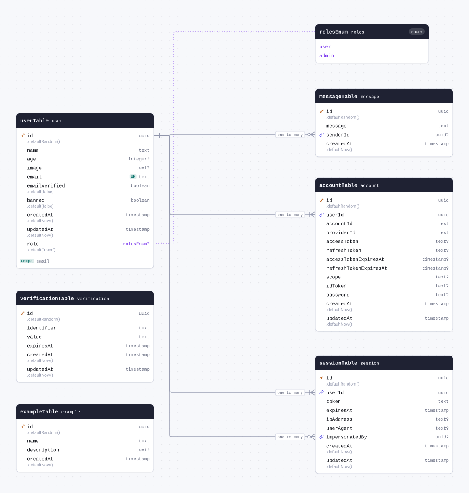
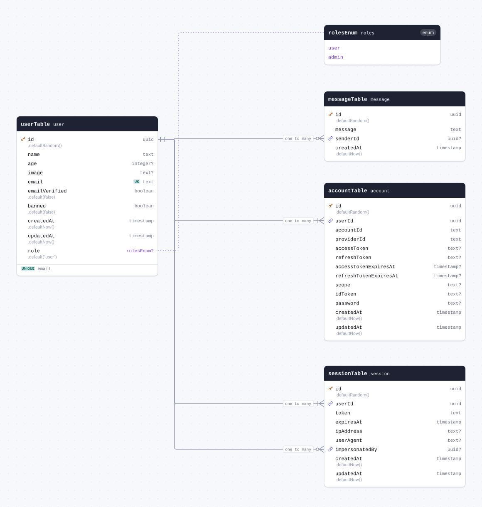
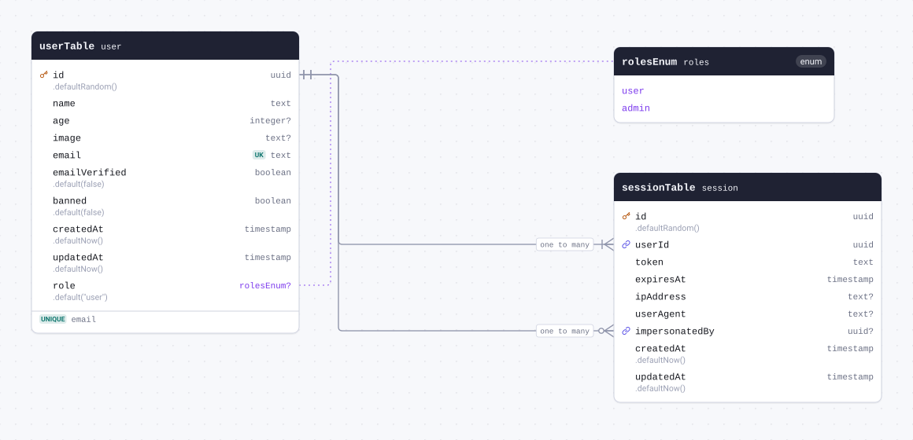
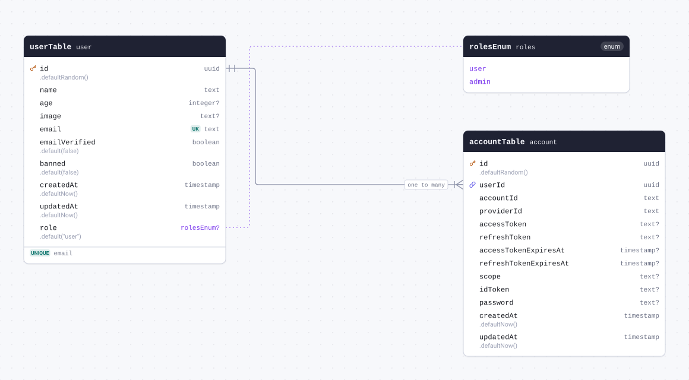
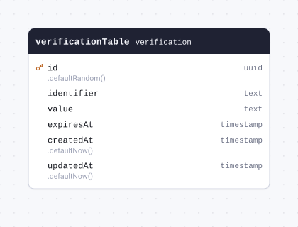
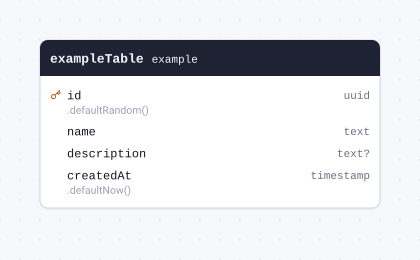
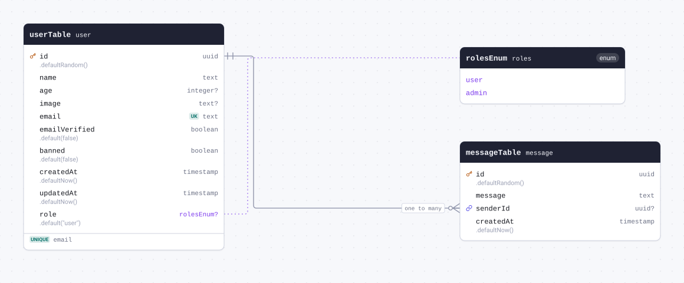

# Schema docs



<details>
<summary>The whole schema as SQL</summary>

```sql
CREATE TYPE "roles" AS ENUM('user', 'admin');

CREATE TABLE "account" (
	"id" uuid PRIMARY KEY DEFAULT gen_random_uuid(),
	"user_id" uuid NOT NULL,
	"account_id" text NOT NULL,
	"provider_id" text NOT NULL,
	"access_token" text,
	"refresh_token" text,
	"access_token_expires_at" timestamp,
	"refresh_token_expires_at" timestamp,
	"scope" text,
	"id_token" text,
	"password" text,
	"created_at" timestamp DEFAULT now() NOT NULL,
	"updated_at" timestamp DEFAULT now() NOT NULL
);

CREATE TABLE "example" (
	"id" uuid PRIMARY KEY DEFAULT gen_random_uuid(),
	"name" text NOT NULL,
	"description" text,
	"created_at" timestamp DEFAULT now() NOT NULL
);

CREATE TABLE "message" (
	"id" uuid PRIMARY KEY DEFAULT gen_random_uuid(),
	"message" text NOT NULL,
	"sender_id" uuid,
	"created_at" timestamp DEFAULT now() NOT NULL
);

CREATE TABLE "session" (
	"id" uuid PRIMARY KEY DEFAULT gen_random_uuid(),
	"user_id" uuid NOT NULL,
	"token" text NOT NULL,
	"expires_at" timestamp NOT NULL,
	"ip_address" text,
	"user_agent" text,
	"impersonated_by" uuid,
	"created_at" timestamp DEFAULT now() NOT NULL,
	"updated_at" timestamp DEFAULT now() NOT NULL
);

CREATE TABLE "user" (
	"id" uuid PRIMARY KEY DEFAULT gen_random_uuid(),
	"name" text NOT NULL,
	"age" integer,
	"image" text,
	"email" text NOT NULL UNIQUE,
	"email_verified" boolean DEFAULT false NOT NULL,
	"banned" boolean DEFAULT false NOT NULL,
	"created_at" timestamp DEFAULT now() NOT NULL,
	"updated_at" timestamp DEFAULT now() NOT NULL,
	"role" "roles" DEFAULT 'user'::"roles"
);

CREATE TABLE "verification" (
	"id" uuid PRIMARY KEY DEFAULT gen_random_uuid(),
	"identifier" text NOT NULL,
	"value" text NOT NULL,
	"expires_at" timestamp NOT NULL,
	"created_at" timestamp DEFAULT now() NOT NULL,
	"updated_at" timestamp DEFAULT now() NOT NULL
);

CREATE UNIQUE INDEX "email_idx" ON "user" ("email");

ALTER TABLE "account" ADD CONSTRAINT "account_user_id_user_id_fkey" FOREIGN KEY ("user_id") REFERENCES "user"("id");

ALTER TABLE "message" ADD CONSTRAINT "message_sender_id_user_id_fkey" FOREIGN KEY ("sender_id") REFERENCES "user"("id");

ALTER TABLE "session" ADD CONSTRAINT "session_user_id_user_id_fkey" FOREIGN KEY ("user_id") REFERENCES "user"("id");

ALTER TABLE "session" ADD CONSTRAINT "session_impersonated_by_user_id_fkey" FOREIGN KEY ("impersonated_by") REFERENCES "user"("id");
```

</details>

## Contents

| Table                                         | Name in the database | Description |
| --------------------------------------------- | -------------------- | ----------- |
| [userTable](#table-userTable)                 | `user`               |             |
| [sessionTable](#table-sessionTable)           | `session`            |             |
| [accountTable](#table-accountTable)           | `account`            |             |
| [verificationTable](#table-verificationTable) | `verification`       |             |
| [exampleTable](#table-exampleTable)           | `example`            |             |
| [messageTable](#table-messageTable)           | `message`            |             |

| Enum                         | Name in the database | Description |
| ---------------------------- | -------------------- | ----------- |
| [rolesEnum](#enum-rolesEnum) | `roles`              |             |

## Tables

<a id="table-userTable"></a>

### userTable

Table `user`.



| Column                             | Type                           | Constraints     | Default            | Description |
| ---------------------------------- | ------------------------------ | --------------- | ------------------ | ----------- |
| `id`                               | `uuid`                         | PK NOT NULL     | `.defaultRandom()` |             |
| `name`                             | `text`                         | NOT NULL        |                    |             |
| `age`                              | `integer`                      | NULL            |                    |             |
| `image`                            | `text`                         | NULL            |                    |             |
| `email`                            | `text`                         | UNIQUE NOT NULL |                    |             |
| `emailVerified` (`email_verified`) | `boolean`                      | NOT NULL        | `.default(false)`  |             |
| `banned`                           | `boolean`                      | NOT NULL        | `.default(false)`  |             |
| `createdAt` (`created_at`)         | `timestamp`                    | NOT NULL        | `.defaultNow()`    |             |
| `updatedAt` (`updated_at`)         | `timestamp`                    | NOT NULL        | `.defaultNow()`    |             |
| `role`                             | [`rolesEnum`](#enum-rolesEnum) | NULL            | `.default("user")` |             |

#### Definition

```sql
CREATE TABLE "user" (
	"id" uuid PRIMARY KEY DEFAULT gen_random_uuid(),
	"name" text NOT NULL,
	"age" integer,
	"image" text,
	"email" text NOT NULL UNIQUE,
	"email_verified" boolean DEFAULT false NOT NULL,
	"banned" boolean DEFAULT false NOT NULL,
	"created_at" timestamp DEFAULT now() NOT NULL,
	"updated_at" timestamp DEFAULT now() NOT NULL,
	"role" "roles" DEFAULT 'user'::"roles"
);

CREATE UNIQUE INDEX "email_idx" ON "user" ("email");
```

#### Indexes

- UNIQUE `email`

#### Referenced by

- `id` → [sessionTable.userId](#table-sessionTable) (one to many)
- `id` → [sessionTable.impersonatedBy](#table-sessionTable) (one to many)
- `id` → [accountTable.userId](#table-accountTable) (one to many)
- `id` → [messageTable.senderId](#table-messageTable) (one to many)

<details>
<summary>Queries and their SQL</summary>

**Select**: Every row of userTable.

```ts
db.select().from(userTable);
```

```sql
select "id", "name", "age", "image", "email", "email_verified", "banned", "created_at", "updated_at", "role"
from "user"
```

**Count**: How many rows userTable has.

```ts
db.select({ count: count() }).from(userTable);
```

```sql
select count(*)
from "user"
```

**Find many**: The rows of userTable, through the relational query API.

```ts
db.query.userTable.findMany();
```

```sql
select "d0"."id" as "id", "d0"."name" as "name", "d0"."age" as "age", "d0"."image" as "image", "d0"."email" as "email", "d0"."email_verified" as "emailVerified", "d0"."banned" as "banned", "d0"."created_at" as "createdAt", "d0"."updated_at" as "updatedAt", "d0"."role" as "role"
from "user" as "d0"
```

**Find by primary key**: One row of userTable, through the relational query API.

```ts
db.query.userTable.findFirst({ where: { id: "00000000-0000-0000-0000-000000000000" } });
```

```sql
select "d0"."id" as "id", "d0"."name" as "name", "d0"."age" as "age", "d0"."image" as "image", "d0"."email" as "email", "d0"."email_verified" as "emailVerified", "d0"."banned" as "banned", "d0"."created_at" as "createdAt", "d0"."updated_at" as "updatedAt", "d0"."role" as "role"
from "user" as "d0"
where "d0"."id" = $1
limit $2
-- params: ["00000000-0000-0000-0000-000000000000",1]
```

**Insert**: Adds a row to userTable, giving the columns that have no default.

```ts
db.insert(userTable).values({ name: "name", email: "email" });
```

```sql
insert into "user" ("id", "name", "age", "image", "email", "email_verified", "banned", "created_at", "updated_at", "role")
values (default, $1, default, default, $2, default, default, default, default, default)
-- params: ["name","email"]
```

**Update**: Changes a row of userTable, found by its primary key.

```ts
db.update(userTable)
  .set({ name: "name" })
  .where(eq(userTable.id, "00000000-0000-0000-0000-000000000000"));
```

```sql
update "user"
set "name" = $1
where "user"."id" = $2
-- params: ["name","00000000-0000-0000-0000-000000000000"]
```

**Delete**: Deletes a row of userTable, found by its primary key.

```ts
db.delete(userTable).where(eq(userTable.id, "00000000-0000-0000-0000-000000000000"));
```

```sql
delete from "user"
where "user"."id" = $1
-- params: ["00000000-0000-0000-0000-000000000000"]
```

</details>

<a id="table-sessionTable"></a>

### sessionTable

Table `session`.



| Column                               | Type        | Constraints                                 | Default            | Description |
| ------------------------------------ | ----------- | ------------------------------------------- | ------------------ | ----------- |
| `id`                                 | `uuid`      | PK NOT NULL                                 | `.defaultRandom()` |             |
| `userId` (`user_id`)                 | `uuid`      | NOT NULL → [userTable.id](#table-userTable) |                    |             |
| `token`                              | `text`      | NOT NULL                                    |                    |             |
| `expiresAt` (`expires_at`)           | `timestamp` | NOT NULL                                    |                    |             |
| `ipAddress` (`ip_address`)           | `text`      | NULL                                        |                    |             |
| `userAgent` (`user_agent`)           | `text`      | NULL                                        |                    |             |
| `impersonatedBy` (`impersonated_by`) | `uuid`      | NULL → [userTable.id](#table-userTable)     |                    |             |
| `createdAt` (`created_at`)           | `timestamp` | NOT NULL                                    | `.defaultNow()`    |             |
| `updatedAt` (`updated_at`)           | `timestamp` | NOT NULL                                    | `.defaultNow()`    |             |

#### Definition

```sql
CREATE TABLE "session" (
	"id" uuid PRIMARY KEY DEFAULT gen_random_uuid(),
	"user_id" uuid NOT NULL,
	"token" text NOT NULL,
	"expires_at" timestamp NOT NULL,
	"ip_address" text,
	"user_agent" text,
	"impersonated_by" uuid,
	"created_at" timestamp DEFAULT now() NOT NULL,
	"updated_at" timestamp DEFAULT now() NOT NULL
);

ALTER TABLE "session" ADD CONSTRAINT "session_user_id_user_id_fkey" FOREIGN KEY ("user_id") REFERENCES "user"("id");

ALTER TABLE "session" ADD CONSTRAINT "session_impersonated_by_user_id_fkey" FOREIGN KEY ("impersonated_by") REFERENCES "user"("id");
```

#### References

- `userId` → [userTable.id](#table-userTable) (many to one)
- `impersonatedBy` → [userTable.id](#table-userTable) (many to one)

<details>
<summary>Queries and their SQL</summary>

**Select**: Every row of sessionTable.

```ts
db.select().from(sessionTable);
```

```sql
select "id", "user_id", "token", "expires_at", "ip_address", "user_agent", "impersonated_by", "created_at", "updated_at"
from "session"
```

**Count**: How many rows sessionTable has.

```ts
db.select({ count: count() }).from(sessionTable);
```

```sql
select count(*)
from "session"
```

**Find many**: The rows of sessionTable, through the relational query API.

```ts
db.query.sessionTable.findMany();
```

```sql
select "d0"."id" as "id", "d0"."user_id" as "userId", "d0"."token" as "token", "d0"."expires_at" as "expiresAt", "d0"."ip_address" as "ipAddress", "d0"."user_agent" as "userAgent", "d0"."impersonated_by" as "impersonatedBy", "d0"."created_at" as "createdAt", "d0"."updated_at" as "updatedAt"
from "session" as "d0"
```

**Find by primary key**: One row of sessionTable, through the relational query API.

```ts
db.query.sessionTable.findFirst({ where: { id: "00000000-0000-0000-0000-000000000000" } });
```

```sql
select "d0"."id" as "id", "d0"."user_id" as "userId", "d0"."token" as "token", "d0"."expires_at" as "expiresAt", "d0"."ip_address" as "ipAddress", "d0"."user_agent" as "userAgent", "d0"."impersonated_by" as "impersonatedBy", "d0"."created_at" as "createdAt", "d0"."updated_at" as "updatedAt"
from "session" as "d0"
where "d0"."id" = $1
limit $2
-- params: ["00000000-0000-0000-0000-000000000000",1]
```

**Insert**: Adds a row to sessionTable, giving the columns that have no default.

```ts
db.insert(sessionTable).values({
  userId: "00000000-0000-0000-0000-000000000000",
  token: "token",
  expiresAt: new Date("2026-01-01T00:00:00.000Z"),
});
```

```sql
insert into "session" ("id", "user_id", "token", "expires_at", "ip_address", "user_agent", "impersonated_by", "created_at", "updated_at")
values (default, $1, $2, $3, default, default, default, default, default)
-- params: ["00000000-0000-0000-0000-000000000000","token","2026-01-01T00:00:00.000Z"]
```

**Update**: Changes a row of sessionTable, found by its primary key.

```ts
db.update(sessionTable)
  .set({ userId: "00000000-0000-0000-0000-000000000000" })
  .where(eq(sessionTable.id, "00000000-0000-0000-0000-000000000000"));
```

```sql
update "session"
set "user_id" = $1
where "session"."id" = $2
-- params: ["00000000-0000-0000-0000-000000000000","00000000-0000-0000-0000-000000000000"]
```

**Delete**: Deletes a row of sessionTable, found by its primary key.

```ts
db.delete(sessionTable).where(eq(sessionTable.id, "00000000-0000-0000-0000-000000000000"));
```

```sql
delete from "session"
where "session"."id" = $1
-- params: ["00000000-0000-0000-0000-000000000000"]
```

</details>

<a id="table-accountTable"></a>

### accountTable

Table `account`.



| Column                                               | Type        | Constraints                                 | Default            | Description |
| ---------------------------------------------------- | ----------- | ------------------------------------------- | ------------------ | ----------- |
| `id`                                                 | `uuid`      | PK NOT NULL                                 | `.defaultRandom()` |             |
| `userId` (`user_id`)                                 | `uuid`      | NOT NULL → [userTable.id](#table-userTable) |                    |             |
| `accountId` (`account_id`)                           | `text`      | NOT NULL                                    |                    |             |
| `providerId` (`provider_id`)                         | `text`      | NOT NULL                                    |                    |             |
| `accessToken` (`access_token`)                       | `text`      | NULL                                        |                    |             |
| `refreshToken` (`refresh_token`)                     | `text`      | NULL                                        |                    |             |
| `accessTokenExpiresAt` (`access_token_expires_at`)   | `timestamp` | NULL                                        |                    |             |
| `refreshTokenExpiresAt` (`refresh_token_expires_at`) | `timestamp` | NULL                                        |                    |             |
| `scope`                                              | `text`      | NULL                                        |                    |             |
| `idToken` (`id_token`)                               | `text`      | NULL                                        |                    |             |
| `password`                                           | `text`      | NULL                                        |                    |             |
| `createdAt` (`created_at`)                           | `timestamp` | NOT NULL                                    | `.defaultNow()`    |             |
| `updatedAt` (`updated_at`)                           | `timestamp` | NOT NULL                                    | `.defaultNow()`    |             |

#### Definition

```sql
CREATE TABLE "account" (
	"id" uuid PRIMARY KEY DEFAULT gen_random_uuid(),
	"user_id" uuid NOT NULL,
	"account_id" text NOT NULL,
	"provider_id" text NOT NULL,
	"access_token" text,
	"refresh_token" text,
	"access_token_expires_at" timestamp,
	"refresh_token_expires_at" timestamp,
	"scope" text,
	"id_token" text,
	"password" text,
	"created_at" timestamp DEFAULT now() NOT NULL,
	"updated_at" timestamp DEFAULT now() NOT NULL
);

ALTER TABLE "account" ADD CONSTRAINT "account_user_id_user_id_fkey" FOREIGN KEY ("user_id") REFERENCES "user"("id");
```

#### References

- `userId` → [userTable.id](#table-userTable) (many to one)

<details>
<summary>Queries and their SQL</summary>

**Select**: Every row of accountTable.

```ts
db.select().from(accountTable);
```

```sql
select "id", "user_id", "account_id", "provider_id", "access_token", "refresh_token", "access_token_expires_at", "refresh_token_expires_at", "scope", "id_token", "password", "created_at", "updated_at"
from "account"
```

**Count**: How many rows accountTable has.

```ts
db.select({ count: count() }).from(accountTable);
```

```sql
select count(*)
from "account"
```

**Find many**: The rows of accountTable, through the relational query API.

```ts
db.query.accountTable.findMany();
```

```sql
select "d0"."id" as "id", "d0"."user_id" as "userId", "d0"."account_id" as "accountId", "d0"."provider_id" as "providerId", "d0"."access_token" as "accessToken", "d0"."refresh_token" as "refreshToken", "d0"."access_token_expires_at" as "accessTokenExpiresAt", "d0"."refresh_token_expires_at" as "refreshTokenExpiresAt", "d0"."scope" as "scope", "d0"."id_token" as "idToken", "d0"."password" as "password", "d0"."created_at" as "createdAt", "d0"."updated_at" as "updatedAt"
from "account" as "d0"
```

**Find by primary key**: One row of accountTable, through the relational query API.

```ts
db.query.accountTable.findFirst({ where: { id: "00000000-0000-0000-0000-000000000000" } });
```

```sql
select "d0"."id" as "id", "d0"."user_id" as "userId", "d0"."account_id" as "accountId", "d0"."provider_id" as "providerId", "d0"."access_token" as "accessToken", "d0"."refresh_token" as "refreshToken", "d0"."access_token_expires_at" as "accessTokenExpiresAt", "d0"."refresh_token_expires_at" as "refreshTokenExpiresAt", "d0"."scope" as "scope", "d0"."id_token" as "idToken", "d0"."password" as "password", "d0"."created_at" as "createdAt", "d0"."updated_at" as "updatedAt"
from "account" as "d0"
where "d0"."id" = $1
limit $2
-- params: ["00000000-0000-0000-0000-000000000000",1]
```

**Insert**: Adds a row to accountTable, giving the columns that have no default.

```ts
db.insert(accountTable).values({
  userId: "00000000-0000-0000-0000-000000000000",
  accountId: "accountId",
  providerId: "providerId",
});
```

```sql
insert into "account" ("id", "user_id", "account_id", "provider_id", "access_token", "refresh_token", "access_token_expires_at", "refresh_token_expires_at", "scope", "id_token", "password", "created_at", "updated_at")
values (default, $1, $2, $3, default, default, default, default, default, default, default, default, default)
-- params: ["00000000-0000-0000-0000-000000000000","accountId","providerId"]
```

**Update**: Changes a row of accountTable, found by its primary key.

```ts
db.update(accountTable)
  .set({ userId: "00000000-0000-0000-0000-000000000000" })
  .where(eq(accountTable.id, "00000000-0000-0000-0000-000000000000"));
```

```sql
update "account"
set "user_id" = $1
where "account"."id" = $2
-- params: ["00000000-0000-0000-0000-000000000000","00000000-0000-0000-0000-000000000000"]
```

**Delete**: Deletes a row of accountTable, found by its primary key.

```ts
db.delete(accountTable).where(eq(accountTable.id, "00000000-0000-0000-0000-000000000000"));
```

```sql
delete from "account"
where "account"."id" = $1
-- params: ["00000000-0000-0000-0000-000000000000"]
```

</details>

<a id="table-verificationTable"></a>

### verificationTable

Table `verification`.



| Column                     | Type        | Constraints | Default            | Description |
| -------------------------- | ----------- | ----------- | ------------------ | ----------- |
| `id`                       | `uuid`      | PK NOT NULL | `.defaultRandom()` |             |
| `identifier`               | `text`      | NOT NULL    |                    |             |
| `value`                    | `text`      | NOT NULL    |                    |             |
| `expiresAt` (`expires_at`) | `timestamp` | NOT NULL    |                    |             |
| `createdAt` (`created_at`) | `timestamp` | NOT NULL    | `.defaultNow()`    |             |
| `updatedAt` (`updated_at`) | `timestamp` | NOT NULL    | `.defaultNow()`    |             |

#### Definition

```sql
CREATE TABLE "verification" (
	"id" uuid PRIMARY KEY DEFAULT gen_random_uuid(),
	"identifier" text NOT NULL,
	"value" text NOT NULL,
	"expires_at" timestamp NOT NULL,
	"created_at" timestamp DEFAULT now() NOT NULL,
	"updated_at" timestamp DEFAULT now() NOT NULL
);
```

<details>
<summary>Queries and their SQL</summary>

**Select**: Every row of verificationTable.

```ts
db.select().from(verificationTable);
```

```sql
select "id", "identifier", "value", "expires_at", "created_at", "updated_at"
from "verification"
```

**Count**: How many rows verificationTable has.

```ts
db.select({ count: count() }).from(verificationTable);
```

```sql
select count(*)
from "verification"
```

**Find many**: The rows of verificationTable, through the relational query API.

```ts
db.query.verificationTable.findMany();
```

```sql
select "d0"."id" as "id", "d0"."identifier" as "identifier", "d0"."value" as "value", "d0"."expires_at" as "expiresAt", "d0"."created_at" as "createdAt", "d0"."updated_at" as "updatedAt"
from "verification" as "d0"
```

**Find by primary key**: One row of verificationTable, through the relational query API.

```ts
db.query.verificationTable.findFirst({ where: { id: "00000000-0000-0000-0000-000000000000" } });
```

```sql
select "d0"."id" as "id", "d0"."identifier" as "identifier", "d0"."value" as "value", "d0"."expires_at" as "expiresAt", "d0"."created_at" as "createdAt", "d0"."updated_at" as "updatedAt"
from "verification" as "d0"
where "d0"."id" = $1
limit $2
-- params: ["00000000-0000-0000-0000-000000000000",1]
```

**Insert**: Adds a row to verificationTable, giving the columns that have no default.

```ts
db.insert(verificationTable).values({
  identifier: "identifier",
  value: "value",
  expiresAt: new Date("2026-01-01T00:00:00.000Z"),
});
```

```sql
insert into "verification" ("id", "identifier", "value", "expires_at", "created_at", "updated_at")
values (default, $1, $2, $3, default, default)
-- params: ["identifier","value","2026-01-01T00:00:00.000Z"]
```

**Update**: Changes a row of verificationTable, found by its primary key.

```ts
db.update(verificationTable)
  .set({ identifier: "identifier" })
  .where(eq(verificationTable.id, "00000000-0000-0000-0000-000000000000"));
```

```sql
update "verification"
set "identifier" = $1
where "verification"."id" = $2
-- params: ["identifier","00000000-0000-0000-0000-000000000000"]
```

**Delete**: Deletes a row of verificationTable, found by its primary key.

```ts
db.delete(verificationTable).where(
  eq(verificationTable.id, "00000000-0000-0000-0000-000000000000"),
);
```

```sql
delete from "verification"
where "verification"."id" = $1
-- params: ["00000000-0000-0000-0000-000000000000"]
```

</details>

<a id="table-exampleTable"></a>

### exampleTable

Table `example`.



| Column                     | Type        | Constraints | Default            | Description |
| -------------------------- | ----------- | ----------- | ------------------ | ----------- |
| `id`                       | `uuid`      | PK NOT NULL | `.defaultRandom()` |             |
| `name`                     | `text`      | NOT NULL    |                    |             |
| `description`              | `text`      | NULL        |                    |             |
| `createdAt` (`created_at`) | `timestamp` | NOT NULL    | `.defaultNow()`    |             |

#### Definition

```sql
CREATE TABLE "example" (
	"id" uuid PRIMARY KEY DEFAULT gen_random_uuid(),
	"name" text NOT NULL,
	"description" text,
	"created_at" timestamp DEFAULT now() NOT NULL
);
```

<details>
<summary>Queries and their SQL</summary>

**Select**: Every row of exampleTable.

```ts
db.select().from(exampleTable);
```

```sql
select "id", "name", "description", "created_at"
from "example"
```

**Count**: How many rows exampleTable has.

```ts
db.select({ count: count() }).from(exampleTable);
```

```sql
select count(*)
from "example"
```

**Find many**: The rows of exampleTable, through the relational query API.

```ts
db.query.exampleTable.findMany();
```

```sql
select "d0"."id" as "id", "d0"."name" as "name", "d0"."description" as "description", "d0"."created_at" as "createdAt"
from "example" as "d0"
```

**Find by primary key**: One row of exampleTable, through the relational query API.

```ts
db.query.exampleTable.findFirst({ where: { id: "00000000-0000-0000-0000-000000000000" } });
```

```sql
select "d0"."id" as "id", "d0"."name" as "name", "d0"."description" as "description", "d0"."created_at" as "createdAt"
from "example" as "d0"
where "d0"."id" = $1
limit $2
-- params: ["00000000-0000-0000-0000-000000000000",1]
```

**Insert**: Adds a row to exampleTable, giving the columns that have no default.

```ts
db.insert(exampleTable).values({ name: "name" });
```

```sql
insert into "example" ("id", "name", "description", "created_at")
values (default, $1, default, default)
-- params: ["name"]
```

**Update**: Changes a row of exampleTable, found by its primary key.

```ts
db.update(exampleTable)
  .set({ name: "name" })
  .where(eq(exampleTable.id, "00000000-0000-0000-0000-000000000000"));
```

```sql
update "example"
set "name" = $1
where "example"."id" = $2
-- params: ["name","00000000-0000-0000-0000-000000000000"]
```

**Delete**: Deletes a row of exampleTable, found by its primary key.

```ts
db.delete(exampleTable).where(eq(exampleTable.id, "00000000-0000-0000-0000-000000000000"));
```

```sql
delete from "example"
where "example"."id" = $1
-- params: ["00000000-0000-0000-0000-000000000000"]
```

</details>

<a id="table-messageTable"></a>

### messageTable

Table `message`.



| Column                     | Type        | Constraints                             | Default            | Description |
| -------------------------- | ----------- | --------------------------------------- | ------------------ | ----------- |
| `id`                       | `uuid`      | PK NOT NULL                             | `.defaultRandom()` |             |
| `message`                  | `text`      | NOT NULL                                |                    |             |
| `senderId` (`sender_id`)   | `uuid`      | NULL → [userTable.id](#table-userTable) |                    |             |
| `createdAt` (`created_at`) | `timestamp` | NOT NULL                                | `.defaultNow()`    |             |

#### Definition

```sql
CREATE TABLE "message" (
	"id" uuid PRIMARY KEY DEFAULT gen_random_uuid(),
	"message" text NOT NULL,
	"sender_id" uuid,
	"created_at" timestamp DEFAULT now() NOT NULL
);

ALTER TABLE "message" ADD CONSTRAINT "message_sender_id_user_id_fkey" FOREIGN KEY ("sender_id") REFERENCES "user"("id");
```

#### References

- `senderId` → [userTable.id](#table-userTable) (many to one)

<details>
<summary>Queries and their SQL</summary>

**Select**: Every row of messageTable.

```ts
db.select().from(messageTable);
```

```sql
select "id", "message", "sender_id", "created_at"
from "message"
```

**Count**: How many rows messageTable has.

```ts
db.select({ count: count() }).from(messageTable);
```

```sql
select count(*)
from "message"
```

**Find many**: The rows of messageTable, through the relational query API.

```ts
db.query.messageTable.findMany();
```

```sql
select "d0"."id" as "id", "d0"."message" as "message", "d0"."sender_id" as "senderId", "d0"."created_at" as "createdAt"
from "message" as "d0"
```

**Find by primary key**: One row of messageTable, through the relational query API.

```ts
db.query.messageTable.findFirst({ where: { id: "00000000-0000-0000-0000-000000000000" } });
```

```sql
select "d0"."id" as "id", "d0"."message" as "message", "d0"."sender_id" as "senderId", "d0"."created_at" as "createdAt"
from "message" as "d0"
where "d0"."id" = $1
limit $2
-- params: ["00000000-0000-0000-0000-000000000000",1]
```

**Insert**: Adds a row to messageTable, giving the columns that have no default.

```ts
db.insert(messageTable).values({ message: "message" });
```

```sql
insert into "message" ("id", "message", "sender_id", "created_at")
values (default, $1, default, default)
-- params: ["message"]
```

**Update**: Changes a row of messageTable, found by its primary key.

```ts
db.update(messageTable)
  .set({ message: "message" })
  .where(eq(messageTable.id, "00000000-0000-0000-0000-000000000000"));
```

```sql
update "message"
set "message" = $1
where "message"."id" = $2
-- params: ["message","00000000-0000-0000-0000-000000000000"]
```

**Delete**: Deletes a row of messageTable, found by its primary key.

```ts
db.delete(messageTable).where(eq(messageTable.id, "00000000-0000-0000-0000-000000000000"));
```

```sql
delete from "message"
where "message"."id" = $1
-- params: ["00000000-0000-0000-0000-000000000000"]
```

</details>

## Enums

<a id="enum-rolesEnum"></a>

### rolesEnum

Type `roles`.

- `user`
- `admin`

#### Definition

```sql
CREATE TYPE "roles" AS ENUM('user', 'admin');
```
