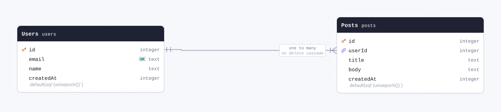

# Schema docs


<details>
<summary>The whole schema as SQL</summary>

```sql
CREATE TABLE `posts` (
	`id` integer PRIMARY KEY AUTOINCREMENT,
	`user_id` integer NOT NULL,
	`title` text NOT NULL,
	`body` text NOT NULL,
	`created_at` integer DEFAULT (unixepoch()) NOT NULL,
	CONSTRAINT `fk_posts_user_id_users_id_fk` FOREIGN KEY (`user_id`) REFERENCES `users`(`id`) ON DELETE CASCADE
);

CREATE TABLE `users` (
	`id` integer PRIMARY KEY AUTOINCREMENT,
	`email` text NOT NULL UNIQUE,
	`name` text NOT NULL,
	`created_at` integer DEFAULT (unixepoch()) NOT NULL
);
```

</details>

## Contents

| Table                 | Name in the database | Description |
| --------------------- | -------------------- | ----------- |
| [Users](#table-Users) | `users`              |             |
| [Posts](#table-Posts) | `posts`              |             |

## Tables

<a id="table-Users"></a>

### Users

Table `users`.



| Column                     | Type      | Constraints     | Default                          | Description |
| -------------------------- | --------- | --------------- | -------------------------------- | ----------- |
| `id`                       | `integer` | PK NOT NULL     |                                  |             |
| `email`                    | `text`    | UNIQUE NOT NULL |                                  |             |
| `name`                     | `text`    | NOT NULL        |                                  |             |
| `createdAt` (`created_at`) | `integer` | NOT NULL        | ``.default(sql`(unixepoch())`)`` |             |

#### Definition

```sql
CREATE TABLE `users` (
	`id` integer PRIMARY KEY AUTOINCREMENT,
	`email` text NOT NULL UNIQUE,
	`name` text NOT NULL,
	`created_at` integer DEFAULT (unixepoch()) NOT NULL
);
```

#### Referenced by

- `id` → [Posts.userId](#table-Posts) (one to many, on delete cascade)

<details>
<summary>Queries and their SQL</summary>

**Select**: Every row of Users.

```ts
db.select().from(Users);
```

```sql
select "id", "email", "name", "created_at"
from "users"
```

**Count**: How many rows Users has.

```ts
db.select({ count: count() }).from(Users);
```

```sql
select count(*)
from "users"
```

**Find many with relations**: The rows of Users with what they relate to, through the relational query API.

```ts
db.query.Users.findMany({ with: { posts: true } });
```

```sql
select "d0"."id" as "id", "d0"."email" as "email", "d0"."name" as "name", "d0"."created_at" as "createdAt", (select json_group_array(json_object('id', "id", 'userId', "userId", 'title', "title", 'body', "body", 'createdAt', "createdAt")) as "r" from (select "d1"."id" as "id", "d1"."user_id" as "userId", "d1"."title" as "title", "d1"."body" as "body", "d1"."created_at" as "createdAt" from "posts" as "d1" where "d0"."id" = "d1"."user_id") as "t") as "posts"
from "users" as "d0"
```

**Find by primary key**: One row of Users, through the relational query API.

```ts
db.query.Users.findFirst({ where: { id: 1 } });
```

```sql
select "d0"."id" as "id", "d0"."email" as "email", "d0"."name" as "name", "d0"."created_at" as "createdAt"
from "users" as "d0"
where "d0"."id" = ?
limit ?
-- params: [1,1]
```

**Insert**: Adds a row to Users, giving the columns that have no default.

```ts
db.insert(Users).values({ id: 1, email: "email", name: "name" });
```

```sql
insert into "users" ("id", "email", "name", "created_at")
values (?, ?, ?, (unixepoch()))
-- params: [1,"email","name"]
```

**Update**: Changes a row of Users, found by its primary key.

```ts
db.update(Users).set({ email: "email" }).where(eq(Users.id, 1));
```

```sql
update "users"
set "email" = ?
where "users"."id" = ?
-- params: ["email",1]
```

**Delete**: Deletes a row of Users, found by its primary key.

```ts
db.delete(Users).where(eq(Users.id, 1));
```

```sql
delete from "users"
where "users"."id" = ?
-- params: [1]
```

</details>

<a id="table-Posts"></a>

### Posts

Table `posts`.


| Column                     | Type      | Constraints                         | Default                          | Description |
| -------------------------- | --------- | ----------------------------------- | -------------------------------- | ----------- |
| `id`                       | `integer` | PK NOT NULL                         |                                  |             |
| `userId` (`user_id`)       | `integer` | NOT NULL → [Users.id](#table-Users) |                                  |             |
| `title`                    | `text`    | NOT NULL                            |                                  |             |
| `body`                     | `text`    | NOT NULL                            |                                  |             |
| `createdAt` (`created_at`) | `integer` | NOT NULL                            | ``.default(sql`(unixepoch())`)`` |             |

#### Definition

```sql
CREATE TABLE `posts` (
	`id` integer PRIMARY KEY AUTOINCREMENT,
	`user_id` integer NOT NULL,
	`title` text NOT NULL,
	`body` text NOT NULL,
	`created_at` integer DEFAULT (unixepoch()) NOT NULL,
	CONSTRAINT `fk_posts_user_id_users_id_fk` FOREIGN KEY (`user_id`) REFERENCES `users`(`id`) ON DELETE CASCADE
);
```

#### References

- `userId` → [Users.id](#table-Users) (many to one, on delete cascade)

<details>
<summary>Queries and their SQL</summary>

**Select**: Every row of Posts.

```ts
db.select().from(Posts);
```

```sql
select "id", "user_id", "title", "body", "created_at"
from "posts"
```

**Count**: How many rows Posts has.

```ts
db.select({ count: count() }).from(Posts);
```

```sql
select count(*)
from "posts"
```

**Find many with relations**: The rows of Posts with what they relate to, through the relational query API.

```ts
db.query.Posts.findMany({ with: { user: true } });
```

```sql
select "d0"."id" as "id", "d0"."user_id" as "userId", "d0"."title" as "title", "d0"."body" as "body", "d0"."created_at" as "createdAt", (select json_object('id', "id", 'email', "email", 'name', "name", 'createdAt', "createdAt") as "r" from (select "d1"."id" as "id", "d1"."email" as "email", "d1"."name" as "name", "d1"."created_at" as "createdAt" from "users" as "d1" where "d0"."user_id" = "d1"."id" limit ?) as "t") as "user"
from "posts" as "d0"
-- params: [1]
```

**Find by primary key**: One row of Posts, through the relational query API.

```ts
db.query.Posts.findFirst({ where: { id: 1 } });
```

```sql
select "d0"."id" as "id", "d0"."user_id" as "userId", "d0"."title" as "title", "d0"."body" as "body", "d0"."created_at" as "createdAt"
from "posts" as "d0"
where "d0"."id" = ?
limit ?
-- params: [1,1]
```

**Insert**: Adds a row to Posts, giving the columns that have no default.

```ts
db.insert(Posts).values({ id: 1, userId: 1, title: "title", body: "body" });
```

```sql
insert into "posts" ("id", "user_id", "title", "body", "created_at")
values (?, ?, ?, ?, (unixepoch()))
-- params: [1,1,"title","body"]
```

**Update**: Changes a row of Posts, found by its primary key.

```ts
db.update(Posts).set({ userId: 1 }).where(eq(Posts.id, 1));
```

```sql
update "posts"
set "user_id" = ?
where "posts"."id" = ?
-- params: [1,1]
```

**Delete**: Deletes a row of Posts, found by its primary key.

```ts
db.delete(Posts).where(eq(Posts.id, 1));
```

```sql
delete from "posts"
where "posts"."id" = ?
-- params: [1]
```

</details>
