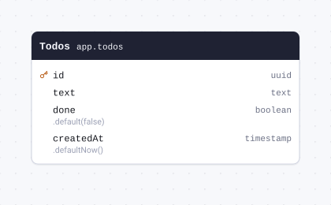

# Schema docs



<details>
<summary>The whole schema as SQL</summary>

```sql
CREATE TABLE "app"."todos" (
	"id" uuid PRIMARY KEY,
	"text" text NOT NULL,
	"done" boolean DEFAULT false NOT NULL,
	"created_at" timestamp with time zone DEFAULT now() NOT NULL
);
```

</details>

## Contents

| Table                 | Name in the database | Description |
| --------------------- | -------------------- | ----------- |
| [Todos](#table-Todos) | `app.todos`          |             |

## Tables

<a id="table-Todos"></a>

### Todos

Table `app.todos`.


| Column                     | Type        | Constraints | Default           | Description |
| -------------------------- | ----------- | ----------- | ----------------- | ----------- |
| `id`                       | `uuid`      | PK NOT NULL |                   |             |
| `text`                     | `text`      | NOT NULL    |                   |             |
| `done`                     | `boolean`   | NOT NULL    | `.default(false)` |             |
| `createdAt` (`created_at`) | `timestamp` | NOT NULL    | `.defaultNow()`   |             |

<details>
<summary>Queries and their SQL</summary>

**Select**: Every row of Todos.

```ts
db.select().from(Todos);
```

```sql
select "id", "text", "done", "created_at"
from "app"."todos"
```

**Count**: How many rows Todos has.

```ts
db.select({ count: count() }).from(Todos);
```

```sql
select count(*)
from "app"."todos"
```

**Find many**: The rows of Todos, through the relational query API.

```ts
db.query.Todos.findMany();
```

```sql
select "d0"."id" as "id", "d0"."text" as "text", "d0"."done" as "done", "d0"."created_at" as "createdAt"
from "app"."todos" as "d0"
```

**Find by primary key**: One row of Todos, through the relational query API.

```ts
db.query.Todos.findFirst({ where: { id: "00000000-0000-0000-0000-000000000000" } });
```

```sql
select "d0"."id" as "id", "d0"."text" as "text", "d0"."done" as "done", "d0"."created_at" as "createdAt"
from "app"."todos" as "d0"
where "d0"."id" = $1
limit $2
-- params: ["00000000-0000-0000-0000-000000000000",1]
```

**Insert**: Adds a row to Todos, giving the columns that have no default.

```ts
db.insert(Todos).values({ id: "00000000-0000-0000-0000-000000000000", text: "text" });
```

```sql
insert into "app"."todos" ("id", "text", "done", "created_at")
values ($1, $2, default, default)
-- params: ["00000000-0000-0000-0000-000000000000","text"]
```

**Update**: Changes a row of Todos, found by its primary key.

```ts
db.update(Todos).set({ text: "text" }).where(eq(Todos.id, "00000000-0000-0000-0000-000000000000"));
```

```sql
update "app"."todos"
set "text" = $1
where "app"."todos"."id" = $2
-- params: ["text","00000000-0000-0000-0000-000000000000"]
```

**Delete**: Deletes a row of Todos, found by its primary key.

```ts
db.delete(Todos).where(eq(Todos.id, "00000000-0000-0000-0000-000000000000"));
```

```sql
delete from "app"."todos"
where "app"."todos"."id" = $1
-- params: ["00000000-0000-0000-0000-000000000000"]
```

</details>
