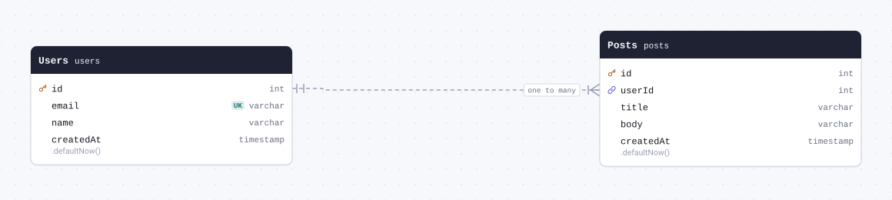

# Schema docs



<details>
<summary>The whole schema as SQL</summary>

```sql
CREATE TABLE `posts` (
	`id` int AUTO_INCREMENT PRIMARY KEY,
	`user_id` int NOT NULL,
	`title` varchar(255) NOT NULL,
	`body` varchar(4096) NOT NULL,
	`created_at` timestamp NOT NULL DEFAULT (now())
);

CREATE TABLE `users` (
	`id` int AUTO_INCREMENT PRIMARY KEY,
	`email` varchar(255) NOT NULL,
	`name` varchar(255) NOT NULL,
	`created_at` timestamp NOT NULL DEFAULT (now()),
	CONSTRAINT `email_unique` UNIQUE INDEX(`email`)
);
```

</details>

## Contents

| Table                 | Name in the database | Description |
| --------------------- | -------------------- | ----------- |
| [Users](#table-Users) | `users`              |             |
| [Posts](#table-Posts) | `posts`              |             |

## Tables

<a id="table-Users"></a>

### Users

Table `users`.


| Column                     | Type        | Constraints     | Default         | Description |
| -------------------------- | ----------- | --------------- | --------------- | ----------- |
| `id`                       | `int`       | PK NOT NULL     |                 |             |
| `email`                    | `varchar`   | UNIQUE NOT NULL |                 |             |
| `name`                     | `varchar`   | NOT NULL        |                 |             |
| `createdAt` (`created_at`) | `timestamp` | NOT NULL        | `.defaultNow()` |             |

#### Definition

```sql
CREATE TABLE `users` (
	`id` int AUTO_INCREMENT PRIMARY KEY,
	`email` varchar(255) NOT NULL,
	`name` varchar(255) NOT NULL,
	`created_at` timestamp NOT NULL DEFAULT (now()),
	CONSTRAINT `email_unique` UNIQUE INDEX(`email`)
);
```

#### Referenced by

- `id` → [Posts.userId](#table-Posts) (one to many, defineRelations)

<details>
<summary>Queries and their SQL</summary>

**Select**: Every row of Users.

```ts
db.select().from(Users);
```

```sql
select `id`, `email`, `name`, `created_at`
from `users`
```

**Count**: How many rows Users has.

```ts
db.select({ count: count() }).from(Users);
```

```sql
select count(*)
from `users`
```

**Find many with relations**: The rows of Users with what they relate to, through the relational query API.

```ts
db.query.Users.findMany({ with: { posts: true } });
```

```sql
select `d0`.`id` as `id`, `d0`.`email` as `email`, `d0`.`name` as `name`, `d0`.`created_at` as `createdAt`, `posts`.`r` as `posts`
from `users` as `d0`
left join lateral(select coalesce(json_arrayagg(json_object('id', `id`, 'userId', `userId`, 'title', `title`, 'body', `body`, 'createdAt', `createdAt`)), json_array()) as `r` from (select `d1`.`id` as `id`, `d1`.`user_id` as `userId`, `d1`.`title` as `title`, `d1`.`body` as `body`, `d1`.`created_at` as `createdAt` from `posts` as `d1` where `d0`.`id` = `d1`.`user_id`) as `t`) as `posts` on true
```

**Find by primary key**: One row of Users, through the relational query API.

```ts
db.query.Users.findFirst({ where: { id: 1 } });
```

```sql
select `d0`.`id` as `id`, `d0`.`email` as `email`, `d0`.`name` as `name`, `d0`.`created_at` as `createdAt`
from `users` as `d0`
where `d0`.`id` = ?
limit ?
-- params: [1,1]
```

**Insert**: Adds a row to Users, giving the columns that have no default.

```ts
db.insert(Users).values({ id: 1, email: "email", name: "name" });
```

```sql
insert into `users` (`id`, `email`, `name`, `created_at`)
values (?, ?, ?, default)
-- params: [1,"email","name"]
```

**Update**: Changes a row of Users, found by its primary key.

```ts
db.update(Users).set({ email: "email" }).where(eq(Users.id, 1));
```

```sql
update `users`
set `email` = ?
where `users`.`id` = ?
-- params: ["email",1]
```

**Delete**: Deletes a row of Users, found by its primary key.

```ts
db.delete(Users).where(eq(Users.id, 1));
```

```sql
delete from `users`
where `users`.`id` = ?
-- params: [1]
```

</details>

<a id="table-Posts"></a>

### Posts

Table `posts`.


| Column                     | Type        | Constraints                         | Default         | Description |
| -------------------------- | ----------- | ----------------------------------- | --------------- | ----------- |
| `id`                       | `int`       | PK NOT NULL                         |                 |             |
| `userId` (`user_id`)       | `int`       | NOT NULL → [Users.id](#table-Users) |                 |             |
| `title`                    | `varchar`   | NOT NULL                            |                 |             |
| `body`                     | `varchar`   | NOT NULL                            |                 |             |
| `createdAt` (`created_at`) | `timestamp` | NOT NULL                            | `.defaultNow()` |             |

#### Definition

```sql
CREATE TABLE `posts` (
	`id` int AUTO_INCREMENT PRIMARY KEY,
	`user_id` int NOT NULL,
	`title` varchar(255) NOT NULL,
	`body` varchar(4096) NOT NULL,
	`created_at` timestamp NOT NULL DEFAULT (now())
);
```

#### References

- `userId` → [Users.id](#table-Users) (many to one, defineRelations, no foreign key)

<details>
<summary>Queries and their SQL</summary>

**Select**: Every row of Posts.

```ts
db.select().from(Posts);
```

```sql
select `id`, `user_id`, `title`, `body`, `created_at`
from `posts`
```

**Count**: How many rows Posts has.

```ts
db.select({ count: count() }).from(Posts);
```

```sql
select count(*)
from `posts`
```

**Find many with relations**: The rows of Posts with what they relate to, through the relational query API.

```ts
db.query.Posts.findMany({ with: { user: true } });
```

```sql
select `d0`.`id` as `id`, `d0`.`user_id` as `userId`, `d0`.`title` as `title`, `d0`.`body` as `body`, `d0`.`created_at` as `createdAt`, `user`.`r` as `user`
from `posts` as `d0`
left join lateral(select json_object('id', `id`, 'email', `email`, 'name', `name`, 'createdAt', `createdAt`) as `r` from (select `d1`.`id` as `id`, `d1`.`email` as `email`, `d1`.`name` as `name`, `d1`.`created_at` as `createdAt` from `users` as `d1` where `d0`.`user_id` = `d1`.`id` limit ?) as `t`) as `user` on true
-- params: [1]
```

**Find by primary key**: One row of Posts, through the relational query API.

```ts
db.query.Posts.findFirst({ where: { id: 1 } });
```

```sql
select `d0`.`id` as `id`, `d0`.`user_id` as `userId`, `d0`.`title` as `title`, `d0`.`body` as `body`, `d0`.`created_at` as `createdAt`
from `posts` as `d0`
where `d0`.`id` = ?
limit ?
-- params: [1,1]
```

**Insert**: Adds a row to Posts, giving the columns that have no default.

```ts
db.insert(Posts).values({ id: 1, userId: 1, title: "title", body: "body" });
```

```sql
insert into `posts` (`id`, `user_id`, `title`, `body`, `created_at`)
values (?, ?, ?, ?, default)
-- params: [1,1,"title","body"]
```

**Update**: Changes a row of Posts, found by its primary key.

```ts
db.update(Posts).set({ userId: 1 }).where(eq(Posts.id, 1));
```

```sql
update `posts`
set `user_id` = ?
where `posts`.`id` = ?
-- params: [1,1]
```

**Delete**: Deletes a row of Posts, found by its primary key.

```ts
db.delete(Posts).where(eq(Posts.id, 1));
```

```sql
delete from `posts`
where `posts`.`id` = ?
-- params: [1]
```

</details>
