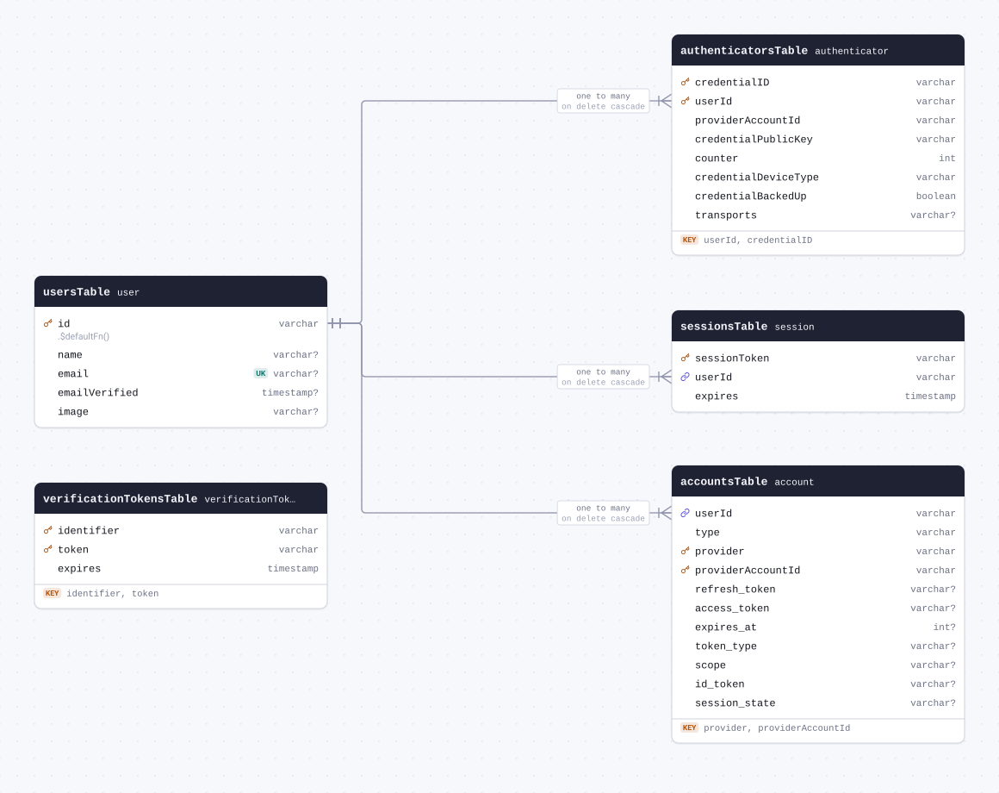
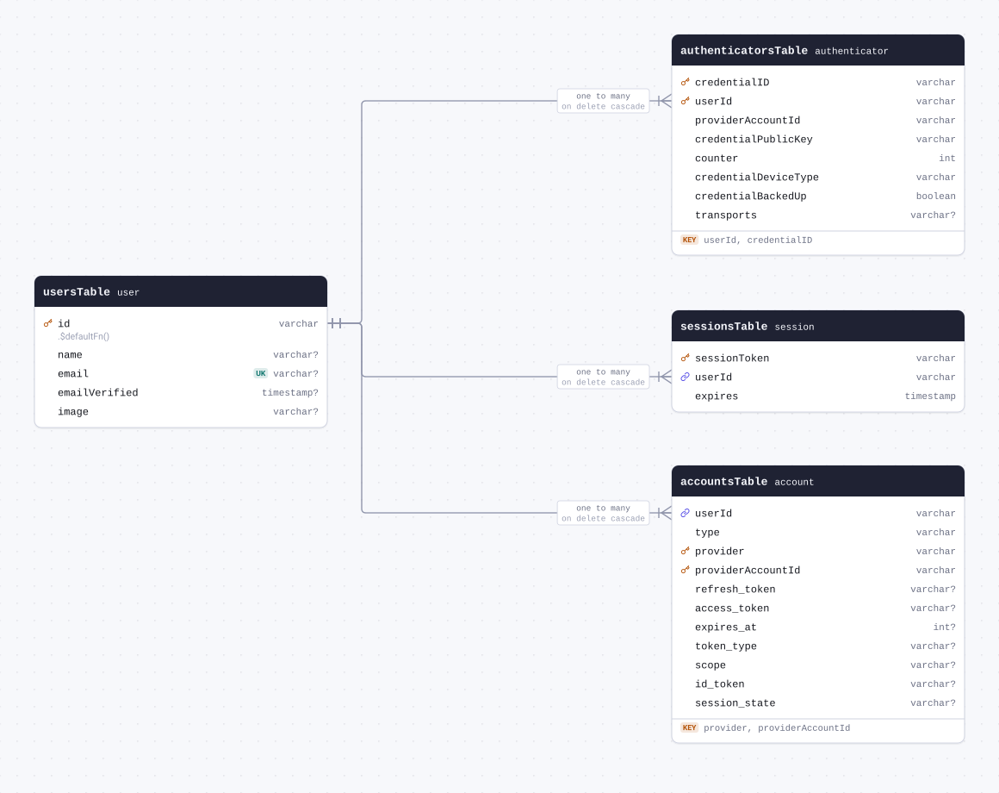
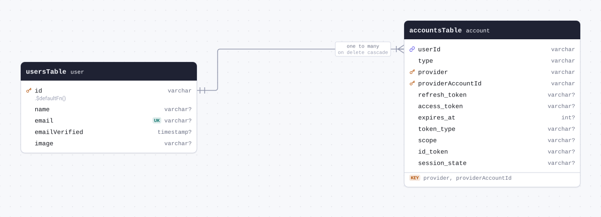
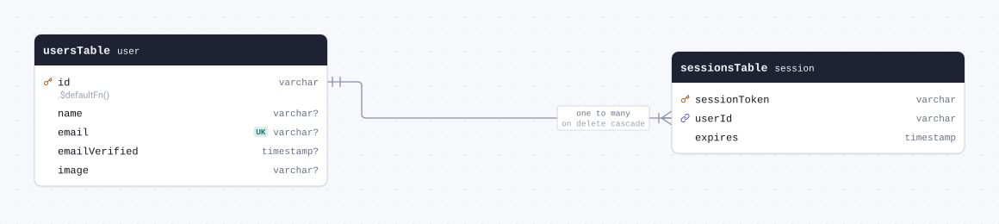
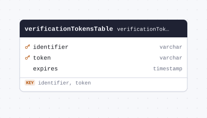
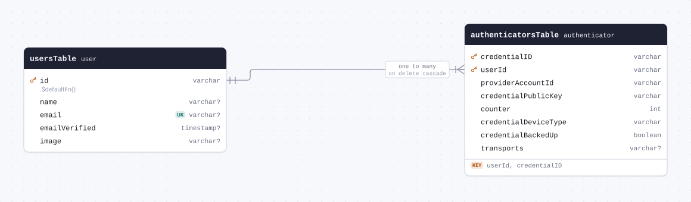

# Schema docs



<details>
<summary>The whole schema as SQL</summary>

```sql
CREATE TABLE `account` (
	`userId` varchar(255) NOT NULL,
	`type` varchar(255) NOT NULL,
	`provider` varchar(255) NOT NULL,
	`providerAccountId` varchar(255) NOT NULL,
	`refresh_token` varchar(255),
	`access_token` varchar(255),
	`expires_at` int,
	`token_type` varchar(255),
	`scope` varchar(255),
	`id_token` varchar(2048),
	`session_state` varchar(255),
	CONSTRAINT PRIMARY KEY(`provider`,`providerAccountId`)
);

CREATE TABLE `authenticator` (
	`credentialID` varchar(255) NOT NULL,
	`userId` varchar(255) NOT NULL,
	`providerAccountId` varchar(255) NOT NULL,
	`credentialPublicKey` varchar(255) NOT NULL,
	`counter` int NOT NULL,
	`credentialDeviceType` varchar(255) NOT NULL,
	`credentialBackedUp` boolean NOT NULL,
	`transports` varchar(255),
	CONSTRAINT PRIMARY KEY(`userId`,`credentialID`),
	CONSTRAINT `credentialID_unique` UNIQUE INDEX(`credentialID`)
);

CREATE TABLE `session` (
	`sessionToken` varchar(255) PRIMARY KEY,
	`userId` varchar(255) NOT NULL,
	`expires` timestamp NOT NULL
);

CREATE TABLE `user` (
	`id` varchar(255) PRIMARY KEY,
	`name` varchar(255),
	`email` varchar(255),
	`emailVerified` timestamp(3),
	`image` varchar(255),
	CONSTRAINT `email_unique` UNIQUE INDEX(`email`)
);

CREATE TABLE `verificationToken` (
	`identifier` varchar(255) NOT NULL,
	`token` varchar(255) NOT NULL,
	`expires` timestamp NOT NULL,
	CONSTRAINT PRIMARY KEY(`identifier`,`token`)
);

ALTER TABLE `account` ADD CONSTRAINT `account_userId_user_id_fkey` FOREIGN KEY (`userId`) REFERENCES `user`(`id`) ON DELETE CASCADE;

ALTER TABLE `authenticator` ADD CONSTRAINT `authenticator_userId_user_id_fkey` FOREIGN KEY (`userId`) REFERENCES `user`(`id`) ON DELETE CASCADE;

ALTER TABLE `session` ADD CONSTRAINT `session_userId_user_id_fkey` FOREIGN KEY (`userId`) REFERENCES `user`(`id`) ON DELETE CASCADE;
```

</details>

## Contents

| Table                                                     | Name in the database | Description |
| --------------------------------------------------------- | -------------------- | ----------- |
| [usersTable](#table-usersTable)                           | `user`               |             |
| [accountsTable](#table-accountsTable)                     | `account`            |             |
| [sessionsTable](#table-sessionsTable)                     | `session`            |             |
| [verificationTokensTable](#table-verificationTokensTable) | `verificationToken`  |             |
| [authenticatorsTable](#table-authenticatorsTable)         | `authenticator`      |             |

## Tables

<a id="table-usersTable"></a>

### usersTable

Table `user`.



| Column          | Type        | Constraints | Default         | Description |
| --------------- | ----------- | ----------- | --------------- | ----------- |
| `id`            | `varchar`   | PK NOT NULL | `.$defaultFn()` |             |
| `name`          | `varchar`   | NULL        |                 |             |
| `email`         | `varchar`   | UNIQUE NULL |                 |             |
| `emailVerified` | `timestamp` | NULL        |                 |             |
| `image`         | `varchar`   | NULL        |                 |             |

#### Definition

```sql
CREATE TABLE `user` (
	`id` varchar(255) PRIMARY KEY,
	`name` varchar(255),
	`email` varchar(255),
	`emailVerified` timestamp(3),
	`image` varchar(255),
	CONSTRAINT `email_unique` UNIQUE INDEX(`email`)
);
```

#### Referenced by

- `id` → [accountsTable.userId](#table-accountsTable) (one to many, on delete cascade)
- `id` → [sessionsTable.userId](#table-sessionsTable) (one to many, on delete cascade)
- `id` → [authenticatorsTable.userId](#table-authenticatorsTable) (one to many, on delete cascade)

<details>
<summary>Queries and their SQL</summary>

**Select**: Every row of usersTable.

```ts
db.select().from(usersTable);
```

```sql
select `id`, `name`, `email`, `emailVerified`, `image`
from `user`
```

**Count**: How many rows usersTable has.

```ts
db.select({ count: count() }).from(usersTable);
```

```sql
select count(*)
from `user`
```

**Find many**: The rows of usersTable, through the relational query API.

```ts
db.query.usersTable.findMany();
```

```sql
select `d0`.`id` as `id`, `d0`.`name` as `name`, `d0`.`email` as `email`, `d0`.`emailVerified` as `emailVerified`, `d0`.`image` as `image`
from `user` as `d0`
```

**Find by primary key**: One row of usersTable, through the relational query API.

```ts
db.query.usersTable.findFirst({ where: { id: "id" } });
```

```sql
select `d0`.`id` as `id`, `d0`.`name` as `name`, `d0`.`email` as `email`, `d0`.`emailVerified` as `emailVerified`, `d0`.`image` as `image`
from `user` as `d0`
where `d0`.`id` = ?
limit ?
-- params: ["id",1]
```

**Insert**: Adds a row to usersTable, giving the columns that have no default.

```ts
db.insert(usersTable).values({});
```

```sql
insert into `user` (`id`, `name`, `email`, `emailVerified`, `image`)
values (?, default, default, default, default)
-- params: ["00000000-0000-4000-8000-000000000000"]
```

**Update**: Changes a row of usersTable, found by its primary key.

```ts
db.update(usersTable).set({ name: "name" }).where(eq(usersTable.id, "id"));
```

```sql
update `user`
set `name` = ?
where `user`.`id` = ?
-- params: ["name","id"]
```

**Delete**: Deletes a row of usersTable, found by its primary key.

```ts
db.delete(usersTable).where(eq(usersTable.id, "id"));
```

```sql
delete from `user`
where `user`.`id` = ?
-- params: ["id"]
```

</details>

<a id="table-accountsTable"></a>

### accountsTable

Table `account`.



| Column              | Type      | Constraints                                   | Default | Description |
| ------------------- | --------- | --------------------------------------------- | ------- | ----------- |
| `userId`            | `varchar` | NOT NULL → [usersTable.id](#table-usersTable) |         |             |
| `type`              | `varchar` | NOT NULL                                      |         |             |
| `provider`          | `varchar` | PK NOT NULL                                   |         |             |
| `providerAccountId` | `varchar` | PK NOT NULL                                   |         |             |
| `refresh_token`     | `varchar` | NULL                                          |         |             |
| `access_token`      | `varchar` | NULL                                          |         |             |
| `expires_at`        | `int`     | NULL                                          |         |             |
| `token_type`        | `varchar` | NULL                                          |         |             |
| `scope`             | `varchar` | NULL                                          |         |             |
| `id_token`          | `varchar` | NULL                                          |         |             |
| `session_state`     | `varchar` | NULL                                          |         |             |

#### Definition

```sql
CREATE TABLE `account` (
	`userId` varchar(255) NOT NULL,
	`type` varchar(255) NOT NULL,
	`provider` varchar(255) NOT NULL,
	`providerAccountId` varchar(255) NOT NULL,
	`refresh_token` varchar(255),
	`access_token` varchar(255),
	`expires_at` int,
	`token_type` varchar(255),
	`scope` varchar(255),
	`id_token` varchar(2048),
	`session_state` varchar(255),
	CONSTRAINT PRIMARY KEY(`provider`,`providerAccountId`)
);

ALTER TABLE `account` ADD CONSTRAINT `account_userId_user_id_fkey` FOREIGN KEY (`userId`) REFERENCES `user`(`id`) ON DELETE CASCADE;
```

#### Indexes

- PRIMARY KEY `provider`, `providerAccountId`

#### References

- `userId` → [usersTable.id](#table-usersTable) (many to one, on delete cascade)

<details>
<summary>Queries and their SQL</summary>

**Select**: Every row of accountsTable.

```ts
db.select().from(accountsTable);
```

```sql
select `userId`, `type`, `provider`, `providerAccountId`, `refresh_token`, `access_token`, `expires_at`, `token_type`, `scope`, `id_token`, `session_state`
from `account`
```

**Count**: How many rows accountsTable has.

```ts
db.select({ count: count() }).from(accountsTable);
```

```sql
select count(*)
from `account`
```

**Find many**: The rows of accountsTable, through the relational query API.

```ts
db.query.accountsTable.findMany();
```

```sql
select `d0`.`userId` as `userId`, `d0`.`type` as `type`, `d0`.`provider` as `provider`, `d0`.`providerAccountId` as `providerAccountId`, `d0`.`refresh_token` as `refresh_token`, `d0`.`access_token` as `access_token`, `d0`.`expires_at` as `expires_at`, `d0`.`token_type` as `token_type`, `d0`.`scope` as `scope`, `d0`.`id_token` as `id_token`, `d0`.`session_state` as `session_state`
from `account` as `d0`
```

**Find by primary key**: One row of accountsTable, through the relational query API.

```ts
db.query.accountsTable.findFirst({
  where: { provider: "provider", providerAccountId: "providerAccountId" },
});
```

```sql
select `d0`.`userId` as `userId`, `d0`.`type` as `type`, `d0`.`provider` as `provider`, `d0`.`providerAccountId` as `providerAccountId`, `d0`.`refresh_token` as `refresh_token`, `d0`.`access_token` as `access_token`, `d0`.`expires_at` as `expires_at`, `d0`.`token_type` as `token_type`, `d0`.`scope` as `scope`, `d0`.`id_token` as `id_token`, `d0`.`session_state` as `session_state`
from `account` as `d0`
where ((`d0`.`provider` = ?) and (`d0`.`providerAccountId` = ?))
limit ?
-- params: ["provider","providerAccountId",1]
```

**Insert**: Adds a row to accountsTable, giving the columns that have no default.

```ts
db.insert(accountsTable).values({
  userId: "userId",
  type: "type",
  provider: "provider",
  providerAccountId: "providerAccountId",
});
```

```sql
insert into `account` (`userId`, `type`, `provider`, `providerAccountId`, `refresh_token`, `access_token`, `expires_at`, `token_type`, `scope`, `id_token`, `session_state`)
values (?, ?, ?, ?, default, default, default, default, default, default, default)
-- params: ["userId","type","provider","providerAccountId"]
```

**Update**: Changes a row of accountsTable, found by its primary key.

```ts
db.update(accountsTable)
  .set({ userId: "userId" })
  .where(
    and(
      eq(accountsTable.provider, "provider"),
      eq(accountsTable.providerAccountId, "providerAccountId"),
    ),
  );
```

```sql
update `account`
set `userId` = ?
where ((`account`.`provider` = ?) and (`account`.`providerAccountId` = ?))
-- params: ["userId","provider","providerAccountId"]
```

**Delete**: Deletes a row of accountsTable, found by its primary key.

```ts
db.delete(accountsTable).where(
  and(
    eq(accountsTable.provider, "provider"),
    eq(accountsTable.providerAccountId, "providerAccountId"),
  ),
);
```

```sql
delete from `account`
where ((`account`.`provider` = ?) and (`account`.`providerAccountId` = ?))
-- params: ["provider","providerAccountId"]
```

</details>

<a id="table-sessionsTable"></a>

### sessionsTable

Table `session`.



| Column         | Type        | Constraints                                   | Default | Description |
| -------------- | ----------- | --------------------------------------------- | ------- | ----------- |
| `sessionToken` | `varchar`   | PK NOT NULL                                   |         |             |
| `userId`       | `varchar`   | NOT NULL → [usersTable.id](#table-usersTable) |         |             |
| `expires`      | `timestamp` | NOT NULL                                      |         |             |

#### Definition

```sql
CREATE TABLE `session` (
	`sessionToken` varchar(255) PRIMARY KEY,
	`userId` varchar(255) NOT NULL,
	`expires` timestamp NOT NULL
);

ALTER TABLE `session` ADD CONSTRAINT `session_userId_user_id_fkey` FOREIGN KEY (`userId`) REFERENCES `user`(`id`) ON DELETE CASCADE;
```

#### References

- `userId` → [usersTable.id](#table-usersTable) (many to one, on delete cascade)

<details>
<summary>Queries and their SQL</summary>

**Select**: Every row of sessionsTable.

```ts
db.select().from(sessionsTable);
```

```sql
select `sessionToken`, `userId`, `expires`
from `session`
```

**Count**: How many rows sessionsTable has.

```ts
db.select({ count: count() }).from(sessionsTable);
```

```sql
select count(*)
from `session`
```

**Find many**: The rows of sessionsTable, through the relational query API.

```ts
db.query.sessionsTable.findMany();
```

```sql
select `d0`.`sessionToken` as `sessionToken`, `d0`.`userId` as `userId`, `d0`.`expires` as `expires`
from `session` as `d0`
```

**Find by primary key**: One row of sessionsTable, through the relational query API.

```ts
db.query.sessionsTable.findFirst({ where: { sessionToken: "sessionToken" } });
```

```sql
select `d0`.`sessionToken` as `sessionToken`, `d0`.`userId` as `userId`, `d0`.`expires` as `expires`
from `session` as `d0`
where `d0`.`sessionToken` = ?
limit ?
-- params: ["sessionToken",1]
```

**Insert**: Adds a row to sessionsTable, giving the columns that have no default.

```ts
db.insert(sessionsTable).values({
  sessionToken: "sessionToken",
  userId: "userId",
  expires: new Date("2026-01-01T00:00:00.000Z"),
});
```

```sql
insert into `session` (`sessionToken`, `userId`, `expires`)
values (?, ?, ?)
-- params: ["sessionToken","userId","2026-01-01 00:00:00.000"]
```

**Update**: Changes a row of sessionsTable, found by its primary key.

```ts
db.update(sessionsTable)
  .set({ userId: "userId" })
  .where(eq(sessionsTable.sessionToken, "sessionToken"));
```

```sql
update `session`
set `userId` = ?
where `session`.`sessionToken` = ?
-- params: ["userId","sessionToken"]
```

**Delete**: Deletes a row of sessionsTable, found by its primary key.

```ts
db.delete(sessionsTable).where(eq(sessionsTable.sessionToken, "sessionToken"));
```

```sql
delete from `session`
where `session`.`sessionToken` = ?
-- params: ["sessionToken"]
```

</details>

<a id="table-verificationTokensTable"></a>

### verificationTokensTable

Table `verificationToken`.



| Column       | Type        | Constraints | Default | Description |
| ------------ | ----------- | ----------- | ------- | ----------- |
| `identifier` | `varchar`   | PK NOT NULL |         |             |
| `token`      | `varchar`   | PK NOT NULL |         |             |
| `expires`    | `timestamp` | NOT NULL    |         |             |

#### Definition

```sql
CREATE TABLE `verificationToken` (
	`identifier` varchar(255) NOT NULL,
	`token` varchar(255) NOT NULL,
	`expires` timestamp NOT NULL,
	CONSTRAINT PRIMARY KEY(`identifier`,`token`)
);
```

#### Indexes

- PRIMARY KEY `identifier`, `token`

<details>
<summary>Queries and their SQL</summary>

**Select**: Every row of verificationTokensTable.

```ts
db.select().from(verificationTokensTable);
```

```sql
select `identifier`, `token`, `expires`
from `verificationToken`
```

**Count**: How many rows verificationTokensTable has.

```ts
db.select({ count: count() }).from(verificationTokensTable);
```

```sql
select count(*)
from `verificationToken`
```

**Find many**: The rows of verificationTokensTable, through the relational query API.

```ts
db.query.verificationTokensTable.findMany();
```

```sql
select `d0`.`identifier` as `identifier`, `d0`.`token` as `token`, `d0`.`expires` as `expires`
from `verificationToken` as `d0`
```

**Find by primary key**: One row of verificationTokensTable, through the relational query API.

```ts
db.query.verificationTokensTable.findFirst({ where: { identifier: "identifier", token: "token" } });
```

```sql
select `d0`.`identifier` as `identifier`, `d0`.`token` as `token`, `d0`.`expires` as `expires`
from `verificationToken` as `d0`
where ((`d0`.`identifier` = ?) and (`d0`.`token` = ?))
limit ?
-- params: ["identifier","token",1]
```

**Insert**: Adds a row to verificationTokensTable, giving the columns that have no default.

```ts
db.insert(verificationTokensTable).values({
  identifier: "identifier",
  token: "token",
  expires: new Date("2026-01-01T00:00:00.000Z"),
});
```

```sql
insert into `verificationToken` (`identifier`, `token`, `expires`)
values (?, ?, ?)
-- params: ["identifier","token","2026-01-01 00:00:00.000"]
```

**Update**: Changes a row of verificationTokensTable, found by its primary key.

```ts
db.update(verificationTokensTable)
  .set({ expires: new Date("2026-01-01T00:00:00.000Z") })
  .where(
    and(
      eq(verificationTokensTable.identifier, "identifier"),
      eq(verificationTokensTable.token, "token"),
    ),
  );
```

```sql
update `verificationToken`
set `expires` = ?
where ((`verificationToken`.`identifier` = ?) and (`verificationToken`.`token` = ?))
-- params: ["2026-01-01 00:00:00.000","identifier","token"]
```

**Delete**: Deletes a row of verificationTokensTable, found by its primary key.

```ts
db.delete(verificationTokensTable).where(
  and(
    eq(verificationTokensTable.identifier, "identifier"),
    eq(verificationTokensTable.token, "token"),
  ),
);
```

```sql
delete from `verificationToken`
where ((`verificationToken`.`identifier` = ?) and (`verificationToken`.`token` = ?))
-- params: ["identifier","token"]
```

</details>

<a id="table-authenticatorsTable"></a>

### authenticatorsTable

Table `authenticator`.



| Column                 | Type      | Constraints                                      | Default | Description |
| ---------------------- | --------- | ------------------------------------------------ | ------- | ----------- |
| `credentialID`         | `varchar` | PK UNIQUE NOT NULL                               |         |             |
| `userId`               | `varchar` | PK NOT NULL → [usersTable.id](#table-usersTable) |         |             |
| `providerAccountId`    | `varchar` | NOT NULL                                         |         |             |
| `credentialPublicKey`  | `varchar` | NOT NULL                                         |         |             |
| `counter`              | `int`     | NOT NULL                                         |         |             |
| `credentialDeviceType` | `varchar` | NOT NULL                                         |         |             |
| `credentialBackedUp`   | `boolean` | NOT NULL                                         |         |             |
| `transports`           | `varchar` | NULL                                             |         |             |

#### Definition

```sql
CREATE TABLE `authenticator` (
	`credentialID` varchar(255) NOT NULL,
	`userId` varchar(255) NOT NULL,
	`providerAccountId` varchar(255) NOT NULL,
	`credentialPublicKey` varchar(255) NOT NULL,
	`counter` int NOT NULL,
	`credentialDeviceType` varchar(255) NOT NULL,
	`credentialBackedUp` boolean NOT NULL,
	`transports` varchar(255),
	CONSTRAINT PRIMARY KEY(`userId`,`credentialID`),
	CONSTRAINT `credentialID_unique` UNIQUE INDEX(`credentialID`)
);

ALTER TABLE `authenticator` ADD CONSTRAINT `authenticator_userId_user_id_fkey` FOREIGN KEY (`userId`) REFERENCES `user`(`id`) ON DELETE CASCADE;
```

#### Indexes

- PRIMARY KEY `userId`, `credentialID`

#### References

- `userId` → [usersTable.id](#table-usersTable) (many to one, on delete cascade)

<details>
<summary>Queries and their SQL</summary>

**Select**: Every row of authenticatorsTable.

```ts
db.select().from(authenticatorsTable);
```

```sql
select `credentialID`, `userId`, `providerAccountId`, `credentialPublicKey`, `counter`, `credentialDeviceType`, `credentialBackedUp`, `transports`
from `authenticator`
```

**Count**: How many rows authenticatorsTable has.

```ts
db.select({ count: count() }).from(authenticatorsTable);
```

```sql
select count(*)
from `authenticator`
```

**Find many**: The rows of authenticatorsTable, through the relational query API.

```ts
db.query.authenticatorsTable.findMany();
```

```sql
select `d0`.`credentialID` as `credentialID`, `d0`.`userId` as `userId`, `d0`.`providerAccountId` as `providerAccountId`, `d0`.`credentialPublicKey` as `credentialPublicKey`, `d0`.`counter` as `counter`, `d0`.`credentialDeviceType` as `credentialDeviceType`, `d0`.`credentialBackedUp` as `credentialBackedUp`, `d0`.`transports` as `transports`
from `authenticator` as `d0`
```

**Find by primary key**: One row of authenticatorsTable, through the relational query API.

```ts
db.query.authenticatorsTable.findFirst({
  where: { credentialID: "credentialID", userId: "userId" },
});
```

```sql
select `d0`.`credentialID` as `credentialID`, `d0`.`userId` as `userId`, `d0`.`providerAccountId` as `providerAccountId`, `d0`.`credentialPublicKey` as `credentialPublicKey`, `d0`.`counter` as `counter`, `d0`.`credentialDeviceType` as `credentialDeviceType`, `d0`.`credentialBackedUp` as `credentialBackedUp`, `d0`.`transports` as `transports`
from `authenticator` as `d0`
where ((`d0`.`credentialID` = ?) and (`d0`.`userId` = ?))
limit ?
-- params: ["credentialID","userId",1]
```

**Insert**: Adds a row to authenticatorsTable, giving the columns that have no default.

```ts
db.insert(authenticatorsTable).values({
  credentialID: "credentialID",
  userId: "userId",
  providerAccountId: "providerAccountId",
  credentialPublicKey: "credentialPublicKey",
  counter: 1,
  credentialDeviceType: "credentialDeviceType",
  credentialBackedUp: true,
});
```

```sql
insert into `authenticator` (`credentialID`, `userId`, `providerAccountId`, `credentialPublicKey`, `counter`, `credentialDeviceType`, `credentialBackedUp`, `transports`)
values (?, ?, ?, ?, ?, ?, ?, default)
-- params: ["credentialID","userId","providerAccountId","credentialPublicKey",1,"credentialDeviceType",true]
```

**Update**: Changes a row of authenticatorsTable, found by its primary key.

```ts
db.update(authenticatorsTable)
  .set({ providerAccountId: "providerAccountId" })
  .where(
    and(
      eq(authenticatorsTable.credentialID, "credentialID"),
      eq(authenticatorsTable.userId, "userId"),
    ),
  );
```

```sql
update `authenticator`
set `providerAccountId` = ?
where ((`authenticator`.`credentialID` = ?) and (`authenticator`.`userId` = ?))
-- params: ["providerAccountId","credentialID","userId"]
```

**Delete**: Deletes a row of authenticatorsTable, found by its primary key.

```ts
db.delete(authenticatorsTable).where(
  and(
    eq(authenticatorsTable.credentialID, "credentialID"),
    eq(authenticatorsTable.userId, "userId"),
  ),
);
```

```sql
delete from `authenticator`
where ((`authenticator`.`credentialID` = ?) and (`authenticator`.`userId` = ?))
-- params: ["credentialID","userId"]
```

</details>
