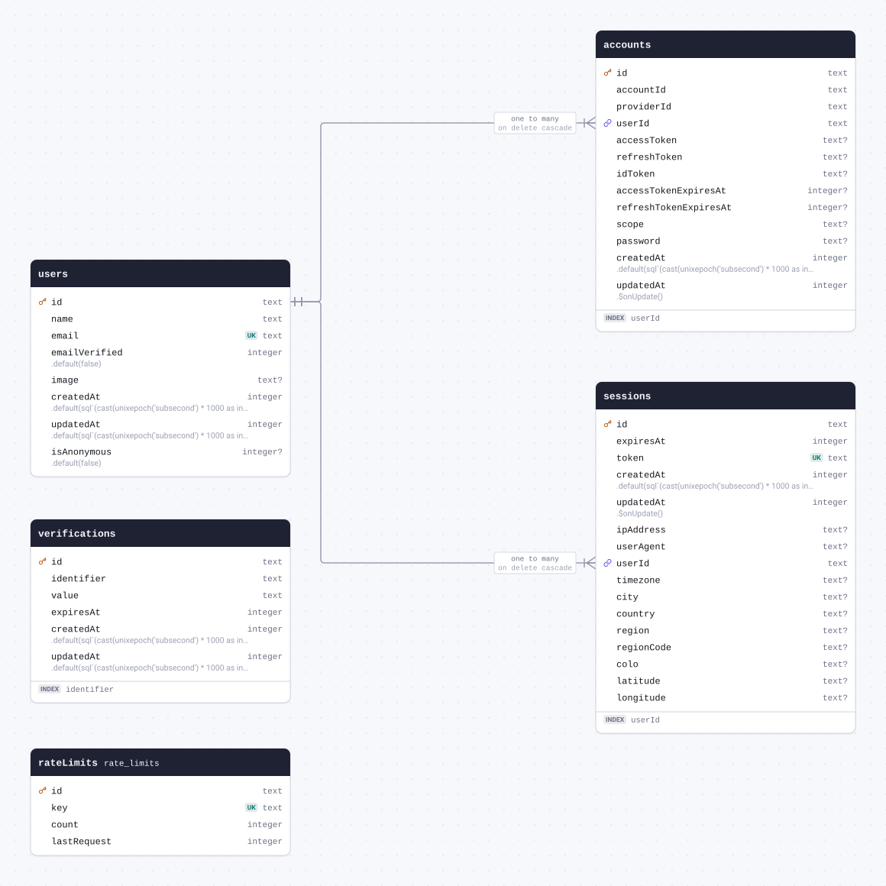
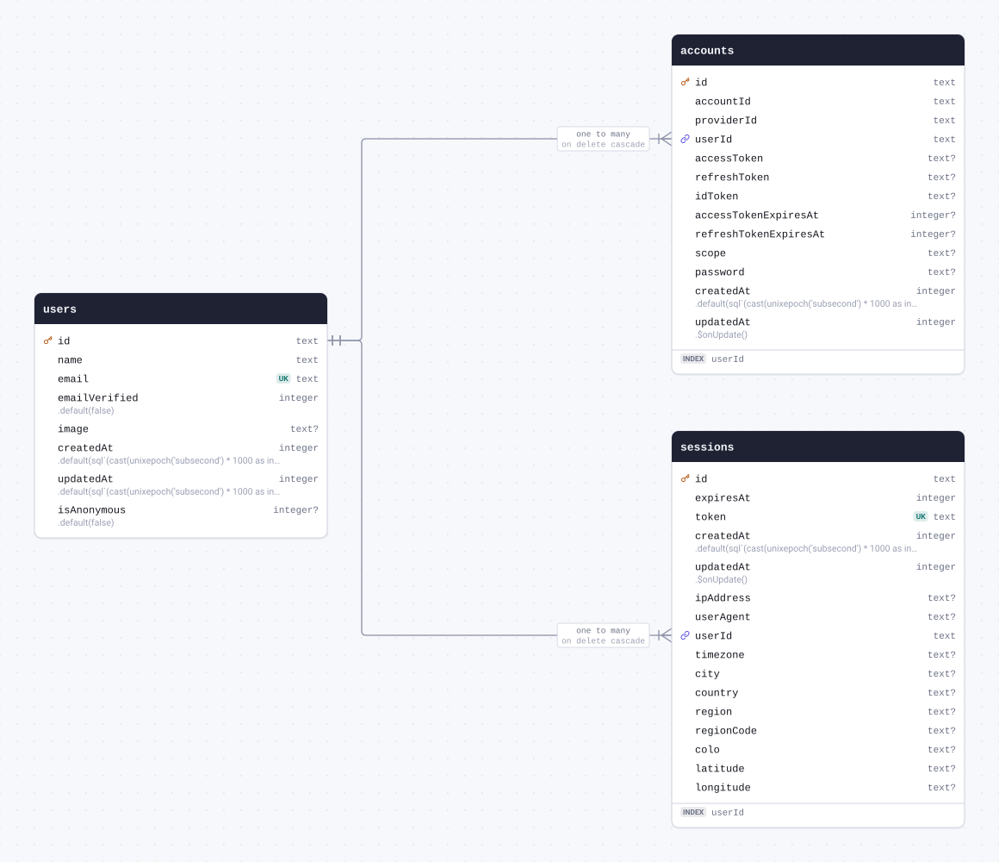
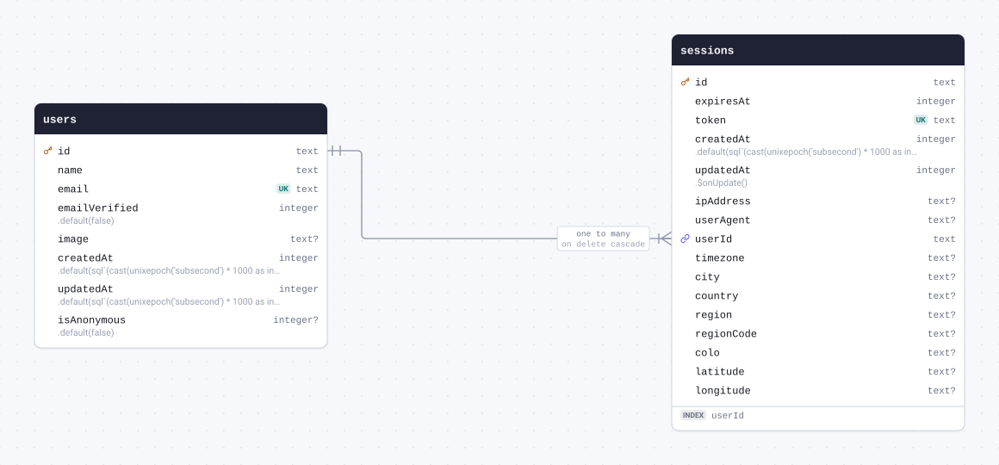
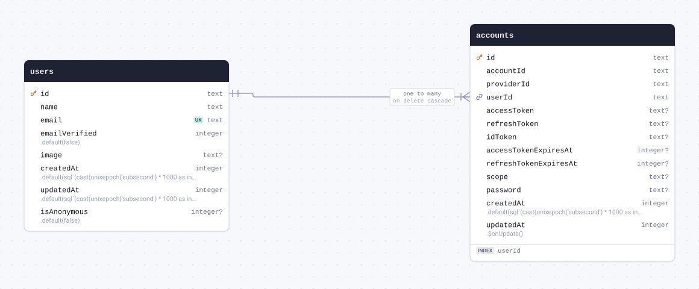
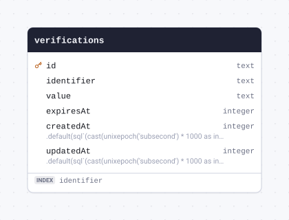
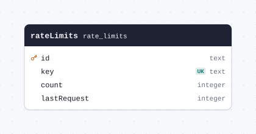

# Schema docs



<details>
<summary>The whole schema as SQL</summary>

```sql
CREATE TABLE `accounts` (
	`id` text PRIMARY KEY,
	`account_id` text NOT NULL,
	`provider_id` text NOT NULL,
	`user_id` text NOT NULL,
	`access_token` text,
	`refresh_token` text,
	`id_token` text,
	`access_token_expires_at` integer,
	`refresh_token_expires_at` integer,
	`scope` text,
	`password` text,
	`created_at` integer DEFAULT (cast(unixepoch('subsecond') * 1000 as integer)) NOT NULL,
	`updated_at` integer NOT NULL,
	CONSTRAINT `fk_accounts_user_id_users_id_fk` FOREIGN KEY (`user_id`) REFERENCES `users`(`id`) ON DELETE CASCADE
);

CREATE TABLE `rate_limits` (
	`id` text PRIMARY KEY,
	`key` text NOT NULL UNIQUE,
	`count` integer NOT NULL,
	`last_request` integer NOT NULL
);

CREATE TABLE `sessions` (
	`id` text PRIMARY KEY,
	`expires_at` integer NOT NULL,
	`token` text NOT NULL UNIQUE,
	`created_at` integer DEFAULT (cast(unixepoch('subsecond') * 1000 as integer)) NOT NULL,
	`updated_at` integer NOT NULL,
	`ip_address` text,
	`user_agent` text,
	`user_id` text NOT NULL,
	`timezone` text,
	`city` text,
	`country` text,
	`region` text,
	`region_code` text,
	`colo` text,
	`latitude` text,
	`longitude` text,
	CONSTRAINT `fk_sessions_user_id_users_id_fk` FOREIGN KEY (`user_id`) REFERENCES `users`(`id`) ON DELETE CASCADE
);

CREATE TABLE `users` (
	`id` text PRIMARY KEY,
	`name` text NOT NULL,
	`email` text NOT NULL UNIQUE,
	`email_verified` integer DEFAULT false NOT NULL,
	`image` text,
	`created_at` integer DEFAULT (cast(unixepoch('subsecond') * 1000 as integer)) NOT NULL,
	`updated_at` integer DEFAULT (cast(unixepoch('subsecond') * 1000 as integer)) NOT NULL,
	`is_anonymous` integer DEFAULT false
);

CREATE TABLE `verifications` (
	`id` text PRIMARY KEY,
	`identifier` text NOT NULL,
	`value` text NOT NULL,
	`expires_at` integer NOT NULL,
	`created_at` integer DEFAULT (cast(unixepoch('subsecond') * 1000 as integer)) NOT NULL,
	`updated_at` integer DEFAULT (cast(unixepoch('subsecond') * 1000 as integer)) NOT NULL
);

CREATE INDEX `accounts_userId_idx` ON `accounts` (`user_id`);

CREATE INDEX `sessions_userId_idx` ON `sessions` (`user_id`);

CREATE INDEX `verifications_identifier_idx` ON `verifications` (`identifier`);
```

</details>

## Contents

| Table                                 | Name in the database | Description |
| ------------------------------------- | -------------------- | ----------- |
| [users](#table-users)                 | `users`              |             |
| [sessions](#table-sessions)           | `sessions`           |             |
| [accounts](#table-accounts)           | `accounts`           |             |
| [verifications](#table-verifications) | `verifications`      |             |
| [rateLimits](#table-rateLimits)       | `rate_limits`        |             |

## Tables

<a id="table-users"></a>

### users



| Column                             | Type      | Constraints     | Default                                                                            | Description |
| ---------------------------------- | --------- | --------------- | ---------------------------------------------------------------------------------- | ----------- |
| `id`                               | `text`    | PK NOT NULL     |                                                                                    |             |
| `name`                             | `text`    | NOT NULL        |                                                                                    |             |
| `email`                            | `text`    | UNIQUE NOT NULL |                                                                                    |             |
| `emailVerified` (`email_verified`) | `integer` | NOT NULL        | `.default(false)`                                                                  |             |
| `image`                            | `text`    | NULL            |                                                                                    |             |
| `createdAt` (`created_at`)         | `integer` | NOT NULL        | ``.default(sql`(cast(unixepoch('subsecond') * 1000 as integer))`)``                |             |
| `updatedAt` (`updated_at`)         | `integer` | NOT NULL        | ``.default(sql`(cast(unixepoch('subsecond') * 1000 as integer))`)`` `.$onUpdate()` |             |
| `isAnonymous` (`is_anonymous`)     | `integer` | NULL            | `.default(false)`                                                                  |             |

#### Definition

```sql
CREATE TABLE `users` (
	`id` text PRIMARY KEY,
	`name` text NOT NULL,
	`email` text NOT NULL UNIQUE,
	`email_verified` integer DEFAULT false NOT NULL,
	`image` text,
	`created_at` integer DEFAULT (cast(unixepoch('subsecond') * 1000 as integer)) NOT NULL,
	`updated_at` integer DEFAULT (cast(unixepoch('subsecond') * 1000 as integer)) NOT NULL,
	`is_anonymous` integer DEFAULT false
);
```

#### Referenced by

- `id` → [sessions.userId](#table-sessions) (one to many, on delete cascade)
- `id` → [accounts.userId](#table-accounts) (one to many, on delete cascade)

<details>
<summary>Queries and their SQL</summary>

**Select**: Every row of users.

```ts
db.select().from(users);
```

```sql
select "id", "name", "email", "email_verified", "image", "created_at", "updated_at", "is_anonymous"
from "users"
```

**Count**: How many rows users has.

```ts
db.select({ count: count() }).from(users);
```

```sql
select count(*)
from "users"
```

**Find many**: The rows of users, through the relational query API.

```ts
db.query.users.findMany();
```

```sql
select "d0"."id" as "id", "d0"."name" as "name", "d0"."email" as "email", "d0"."email_verified" as "emailVerified", "d0"."image" as "image", "d0"."created_at" as "createdAt", "d0"."updated_at" as "updatedAt", "d0"."is_anonymous" as "isAnonymous"
from "users" as "d0"
```

**Find by primary key**: One row of users, through the relational query API.

```ts
db.query.users.findFirst({ where: { id: "id" } });
```

```sql
select "d0"."id" as "id", "d0"."name" as "name", "d0"."email" as "email", "d0"."email_verified" as "emailVerified", "d0"."image" as "image", "d0"."created_at" as "createdAt", "d0"."updated_at" as "updatedAt", "d0"."is_anonymous" as "isAnonymous"
from "users" as "d0"
where "d0"."id" = ?
limit ?
-- params: ["id",1]
```

**Insert**: Adds a row to users, giving the columns that have no default.

```ts
db.insert(users).values({ id: "id", name: "name", email: "email" });
```

```sql
insert into "users" ("id", "name", "email", "email_verified", "image", "created_at", "updated_at", "is_anonymous")
values (?, ?, ?, ?, null, (cast(unixepoch('subsecond') * 1000 as integer)), (cast(unixepoch('subsecond') * 1000 as integer)), ?)
-- params: ["id","name","email",0,0]
```

**Update**: Changes a row of users, found by its primary key.

```ts
db.update(users).set({ name: "name" }).where(eq(users.id, "id"));
```

```sql
update "users"
set "name" = ?, "updated_at" = ?
where "users"."id" = ?
-- params: ["name",1767225600000,"id"]
```

**Delete**: Deletes a row of users, found by its primary key.

```ts
db.delete(users).where(eq(users.id, "id"));
```

```sql
delete from "users"
where "users"."id" = ?
-- params: ["id"]
```

</details>

<a id="table-sessions"></a>

### sessions



| Column                       | Type      | Constraints                         | Default                                                             | Description |
| ---------------------------- | --------- | ----------------------------------- | ------------------------------------------------------------------- | ----------- |
| `id`                         | `text`    | PK NOT NULL                         |                                                                     |             |
| `expiresAt` (`expires_at`)   | `integer` | NOT NULL                            |                                                                     |             |
| `token`                      | `text`    | UNIQUE NOT NULL                     |                                                                     |             |
| `createdAt` (`created_at`)   | `integer` | NOT NULL                            | ``.default(sql`(cast(unixepoch('subsecond') * 1000 as integer))`)`` |             |
| `updatedAt` (`updated_at`)   | `integer` | NOT NULL                            | `.$onUpdate()`                                                      |             |
| `ipAddress` (`ip_address`)   | `text`    | NULL                                |                                                                     |             |
| `userAgent` (`user_agent`)   | `text`    | NULL                                |                                                                     |             |
| `userId` (`user_id`)         | `text`    | NOT NULL → [users.id](#table-users) |                                                                     |             |
| `timezone`                   | `text`    | NULL                                |                                                                     |             |
| `city`                       | `text`    | NULL                                |                                                                     |             |
| `country`                    | `text`    | NULL                                |                                                                     |             |
| `region`                     | `text`    | NULL                                |                                                                     |             |
| `regionCode` (`region_code`) | `text`    | NULL                                |                                                                     |             |
| `colo`                       | `text`    | NULL                                |                                                                     |             |
| `latitude`                   | `text`    | NULL                                |                                                                     |             |
| `longitude`                  | `text`    | NULL                                |                                                                     |             |

#### Definition

```sql
CREATE TABLE `sessions` (
	`id` text PRIMARY KEY,
	`expires_at` integer NOT NULL,
	`token` text NOT NULL UNIQUE,
	`created_at` integer DEFAULT (cast(unixepoch('subsecond') * 1000 as integer)) NOT NULL,
	`updated_at` integer NOT NULL,
	`ip_address` text,
	`user_agent` text,
	`user_id` text NOT NULL,
	`timezone` text,
	`city` text,
	`country` text,
	`region` text,
	`region_code` text,
	`colo` text,
	`latitude` text,
	`longitude` text,
	CONSTRAINT `fk_sessions_user_id_users_id_fk` FOREIGN KEY (`user_id`) REFERENCES `users`(`id`) ON DELETE CASCADE
);

CREATE INDEX `sessions_userId_idx` ON `sessions` (`user_id`);
```

#### Indexes

- INDEX `userId`

#### References

- `userId` → [users.id](#table-users) (many to one, on delete cascade)

<details>
<summary>Queries and their SQL</summary>

**Select**: Every row of sessions.

```ts
db.select().from(sessions);
```

```sql
select "id", "expires_at", "token", "created_at", "updated_at", "ip_address", "user_agent", "user_id", "timezone", "city", "country", "region", "region_code", "colo", "latitude", "longitude"
from "sessions"
```

**Count**: How many rows sessions has.

```ts
db.select({ count: count() }).from(sessions);
```

```sql
select count(*)
from "sessions"
```

**Find many**: The rows of sessions, through the relational query API.

```ts
db.query.sessions.findMany();
```

```sql
select "d0"."id" as "id", "d0"."expires_at" as "expiresAt", "d0"."token" as "token", "d0"."created_at" as "createdAt", "d0"."updated_at" as "updatedAt", "d0"."ip_address" as "ipAddress", "d0"."user_agent" as "userAgent", "d0"."user_id" as "userId", "d0"."timezone" as "timezone", "d0"."city" as "city", "d0"."country" as "country", "d0"."region" as "region", "d0"."region_code" as "regionCode", "d0"."colo" as "colo", "d0"."latitude" as "latitude", "d0"."longitude" as "longitude"
from "sessions" as "d0"
```

**Find by primary key**: One row of sessions, through the relational query API.

```ts
db.query.sessions.findFirst({ where: { id: "id" } });
```

```sql
select "d0"."id" as "id", "d0"."expires_at" as "expiresAt", "d0"."token" as "token", "d0"."created_at" as "createdAt", "d0"."updated_at" as "updatedAt", "d0"."ip_address" as "ipAddress", "d0"."user_agent" as "userAgent", "d0"."user_id" as "userId", "d0"."timezone" as "timezone", "d0"."city" as "city", "d0"."country" as "country", "d0"."region" as "region", "d0"."region_code" as "regionCode", "d0"."colo" as "colo", "d0"."latitude" as "latitude", "d0"."longitude" as "longitude"
from "sessions" as "d0"
where "d0"."id" = ?
limit ?
-- params: ["id",1]
```

**Insert**: Adds a row to sessions, giving the columns that have no default.

```ts
db.insert(sessions).values({
  id: "id",
  expiresAt: 1,
  token: "token",
  updatedAt: 1,
  userId: "userId",
});
```

```sql
insert into "sessions" ("id", "expires_at", "token", "created_at", "updated_at", "ip_address", "user_agent", "user_id", "timezone", "city", "country", "region", "region_code", "colo", "latitude", "longitude")
values (?, ?, ?, (cast(unixepoch('subsecond') * 1000 as integer)), ?, null, null, ?, null, null, null, null, null, null, null, null)
-- params: ["id",1,"token",1,"userId"]
```

**Update**: Changes a row of sessions, found by its primary key.

```ts
db.update(sessions).set({ expiresAt: 1 }).where(eq(sessions.id, "id"));
```

```sql
update "sessions"
set "expires_at" = ?, "updated_at" = ?
where "sessions"."id" = ?
-- params: [1,1767225600000,"id"]
```

**Delete**: Deletes a row of sessions, found by its primary key.

```ts
db.delete(sessions).where(eq(sessions.id, "id"));
```

```sql
delete from "sessions"
where "sessions"."id" = ?
-- params: ["id"]
```

</details>

<a id="table-accounts"></a>

### accounts



| Column                                               | Type      | Constraints                         | Default                                                             | Description |
| ---------------------------------------------------- | --------- | ----------------------------------- | ------------------------------------------------------------------- | ----------- |
| `id`                                                 | `text`    | PK NOT NULL                         |                                                                     |             |
| `accountId` (`account_id`)                           | `text`    | NOT NULL                            |                                                                     |             |
| `providerId` (`provider_id`)                         | `text`    | NOT NULL                            |                                                                     |             |
| `userId` (`user_id`)                                 | `text`    | NOT NULL → [users.id](#table-users) |                                                                     |             |
| `accessToken` (`access_token`)                       | `text`    | NULL                                |                                                                     |             |
| `refreshToken` (`refresh_token`)                     | `text`    | NULL                                |                                                                     |             |
| `idToken` (`id_token`)                               | `text`    | NULL                                |                                                                     |             |
| `accessTokenExpiresAt` (`access_token_expires_at`)   | `integer` | NULL                                |                                                                     |             |
| `refreshTokenExpiresAt` (`refresh_token_expires_at`) | `integer` | NULL                                |                                                                     |             |
| `scope`                                              | `text`    | NULL                                |                                                                     |             |
| `password`                                           | `text`    | NULL                                |                                                                     |             |
| `createdAt` (`created_at`)                           | `integer` | NOT NULL                            | ``.default(sql`(cast(unixepoch('subsecond') * 1000 as integer))`)`` |             |
| `updatedAt` (`updated_at`)                           | `integer` | NOT NULL                            | `.$onUpdate()`                                                      |             |

#### Definition

```sql
CREATE TABLE `accounts` (
	`id` text PRIMARY KEY,
	`account_id` text NOT NULL,
	`provider_id` text NOT NULL,
	`user_id` text NOT NULL,
	`access_token` text,
	`refresh_token` text,
	`id_token` text,
	`access_token_expires_at` integer,
	`refresh_token_expires_at` integer,
	`scope` text,
	`password` text,
	`created_at` integer DEFAULT (cast(unixepoch('subsecond') * 1000 as integer)) NOT NULL,
	`updated_at` integer NOT NULL,
	CONSTRAINT `fk_accounts_user_id_users_id_fk` FOREIGN KEY (`user_id`) REFERENCES `users`(`id`) ON DELETE CASCADE
);

CREATE INDEX `accounts_userId_idx` ON `accounts` (`user_id`);
```

#### Indexes

- INDEX `userId`

#### References

- `userId` → [users.id](#table-users) (many to one, on delete cascade)

<details>
<summary>Queries and their SQL</summary>

**Select**: Every row of accounts.

```ts
db.select().from(accounts);
```

```sql
select "id", "account_id", "provider_id", "user_id", "access_token", "refresh_token", "id_token", "access_token_expires_at", "refresh_token_expires_at", "scope", "password", "created_at", "updated_at"
from "accounts"
```

**Count**: How many rows accounts has.

```ts
db.select({ count: count() }).from(accounts);
```

```sql
select count(*)
from "accounts"
```

**Find many**: The rows of accounts, through the relational query API.

```ts
db.query.accounts.findMany();
```

```sql
select "d0"."id" as "id", "d0"."account_id" as "accountId", "d0"."provider_id" as "providerId", "d0"."user_id" as "userId", "d0"."access_token" as "accessToken", "d0"."refresh_token" as "refreshToken", "d0"."id_token" as "idToken", "d0"."access_token_expires_at" as "accessTokenExpiresAt", "d0"."refresh_token_expires_at" as "refreshTokenExpiresAt", "d0"."scope" as "scope", "d0"."password" as "password", "d0"."created_at" as "createdAt", "d0"."updated_at" as "updatedAt"
from "accounts" as "d0"
```

**Find by primary key**: One row of accounts, through the relational query API.

```ts
db.query.accounts.findFirst({ where: { id: "id" } });
```

```sql
select "d0"."id" as "id", "d0"."account_id" as "accountId", "d0"."provider_id" as "providerId", "d0"."user_id" as "userId", "d0"."access_token" as "accessToken", "d0"."refresh_token" as "refreshToken", "d0"."id_token" as "idToken", "d0"."access_token_expires_at" as "accessTokenExpiresAt", "d0"."refresh_token_expires_at" as "refreshTokenExpiresAt", "d0"."scope" as "scope", "d0"."password" as "password", "d0"."created_at" as "createdAt", "d0"."updated_at" as "updatedAt"
from "accounts" as "d0"
where "d0"."id" = ?
limit ?
-- params: ["id",1]
```

**Insert**: Adds a row to accounts, giving the columns that have no default.

```ts
db.insert(accounts).values({
  id: "id",
  accountId: "accountId",
  providerId: "providerId",
  userId: "userId",
  updatedAt: 1,
});
```

```sql
insert into "accounts" ("id", "account_id", "provider_id", "user_id", "access_token", "refresh_token", "id_token", "access_token_expires_at", "refresh_token_expires_at", "scope", "password", "created_at", "updated_at")
values (?, ?, ?, ?, null, null, null, null, null, null, null, (cast(unixepoch('subsecond') * 1000 as integer)), ?)
-- params: ["id","accountId","providerId","userId",1]
```

**Update**: Changes a row of accounts, found by its primary key.

```ts
db.update(accounts).set({ accountId: "accountId" }).where(eq(accounts.id, "id"));
```

```sql
update "accounts"
set "account_id" = ?, "updated_at" = ?
where "accounts"."id" = ?
-- params: ["accountId",1767225600000,"id"]
```

**Delete**: Deletes a row of accounts, found by its primary key.

```ts
db.delete(accounts).where(eq(accounts.id, "id"));
```

```sql
delete from "accounts"
where "accounts"."id" = ?
-- params: ["id"]
```

</details>

<a id="table-verifications"></a>

### verifications



| Column                     | Type      | Constraints | Default                                                                            | Description |
| -------------------------- | --------- | ----------- | ---------------------------------------------------------------------------------- | ----------- |
| `id`                       | `text`    | PK NOT NULL |                                                                                    |             |
| `identifier`               | `text`    | NOT NULL    |                                                                                    |             |
| `value`                    | `text`    | NOT NULL    |                                                                                    |             |
| `expiresAt` (`expires_at`) | `integer` | NOT NULL    |                                                                                    |             |
| `createdAt` (`created_at`) | `integer` | NOT NULL    | ``.default(sql`(cast(unixepoch('subsecond') * 1000 as integer))`)``                |             |
| `updatedAt` (`updated_at`) | `integer` | NOT NULL    | ``.default(sql`(cast(unixepoch('subsecond') * 1000 as integer))`)`` `.$onUpdate()` |             |

#### Definition

```sql
CREATE TABLE `verifications` (
	`id` text PRIMARY KEY,
	`identifier` text NOT NULL,
	`value` text NOT NULL,
	`expires_at` integer NOT NULL,
	`created_at` integer DEFAULT (cast(unixepoch('subsecond') * 1000 as integer)) NOT NULL,
	`updated_at` integer DEFAULT (cast(unixepoch('subsecond') * 1000 as integer)) NOT NULL
);

CREATE INDEX `verifications_identifier_idx` ON `verifications` (`identifier`);
```

#### Indexes

- INDEX `identifier`

<details>
<summary>Queries and their SQL</summary>

**Select**: Every row of verifications.

```ts
db.select().from(verifications);
```

```sql
select "id", "identifier", "value", "expires_at", "created_at", "updated_at"
from "verifications"
```

**Count**: How many rows verifications has.

```ts
db.select({ count: count() }).from(verifications);
```

```sql
select count(*)
from "verifications"
```

**Find many**: The rows of verifications, through the relational query API.

```ts
db.query.verifications.findMany();
```

```sql
select "d0"."id" as "id", "d0"."identifier" as "identifier", "d0"."value" as "value", "d0"."expires_at" as "expiresAt", "d0"."created_at" as "createdAt", "d0"."updated_at" as "updatedAt"
from "verifications" as "d0"
```

**Find by primary key**: One row of verifications, through the relational query API.

```ts
db.query.verifications.findFirst({ where: { id: "id" } });
```

```sql
select "d0"."id" as "id", "d0"."identifier" as "identifier", "d0"."value" as "value", "d0"."expires_at" as "expiresAt", "d0"."created_at" as "createdAt", "d0"."updated_at" as "updatedAt"
from "verifications" as "d0"
where "d0"."id" = ?
limit ?
-- params: ["id",1]
```

**Insert**: Adds a row to verifications, giving the columns that have no default.

```ts
db.insert(verifications).values({
  id: "id",
  identifier: "identifier",
  value: "value",
  expiresAt: 1,
});
```

```sql
insert into "verifications" ("id", "identifier", "value", "expires_at", "created_at", "updated_at")
values (?, ?, ?, ?, (cast(unixepoch('subsecond') * 1000 as integer)), (cast(unixepoch('subsecond') * 1000 as integer)))
-- params: ["id","identifier","value",1]
```

**Update**: Changes a row of verifications, found by its primary key.

```ts
db.update(verifications).set({ identifier: "identifier" }).where(eq(verifications.id, "id"));
```

```sql
update "verifications"
set "identifier" = ?, "updated_at" = ?
where "verifications"."id" = ?
-- params: ["identifier",1767225600000,"id"]
```

**Delete**: Deletes a row of verifications, found by its primary key.

```ts
db.delete(verifications).where(eq(verifications.id, "id"));
```

```sql
delete from "verifications"
where "verifications"."id" = ?
-- params: ["id"]
```

</details>

<a id="table-rateLimits"></a>

### rateLimits

Table `rate_limits`.



| Column                         | Type      | Constraints     | Default | Description |
| ------------------------------ | --------- | --------------- | ------- | ----------- |
| `id`                           | `text`    | PK NOT NULL     |         |             |
| `key`                          | `text`    | UNIQUE NOT NULL |         |             |
| `count`                        | `integer` | NOT NULL        |         |             |
| `lastRequest` (`last_request`) | `integer` | NOT NULL        |         |             |

#### Definition

```sql
CREATE TABLE `rate_limits` (
	`id` text PRIMARY KEY,
	`key` text NOT NULL UNIQUE,
	`count` integer NOT NULL,
	`last_request` integer NOT NULL
);
```

<details>
<summary>Queries and their SQL</summary>

**Select**: Every row of rateLimits.

```ts
db.select().from(rateLimits);
```

```sql
select "id", "key", "count", "last_request"
from "rate_limits"
```

**Count**: How many rows rateLimits has.

```ts
db.select({ count: count() }).from(rateLimits);
```

```sql
select count(*)
from "rate_limits"
```

**Find many**: The rows of rateLimits, through the relational query API.

```ts
db.query.rateLimits.findMany();
```

```sql
select "d0"."id" as "id", "d0"."key" as "key", "d0"."count" as "count", "d0"."last_request" as "lastRequest"
from "rate_limits" as "d0"
```

**Find by primary key**: One row of rateLimits, through the relational query API.

```ts
db.query.rateLimits.findFirst({ where: { id: "id" } });
```

```sql
select "d0"."id" as "id", "d0"."key" as "key", "d0"."count" as "count", "d0"."last_request" as "lastRequest"
from "rate_limits" as "d0"
where "d0"."id" = ?
limit ?
-- params: ["id",1]
```

**Insert**: Adds a row to rateLimits, giving the columns that have no default.

```ts
db.insert(rateLimits).values({ id: "id", key: "key", count: 1, lastRequest: 1 });
```

```sql
insert into "rate_limits" ("id", "key", "count", "last_request")
values (?, ?, ?, ?)
-- params: ["id","key",1,1]
```

**Update**: Changes a row of rateLimits, found by its primary key.

```ts
db.update(rateLimits).set({ key: "key" }).where(eq(rateLimits.id, "id"));
```

```sql
update "rate_limits"
set "key" = ?
where "rate_limits"."id" = ?
-- params: ["key","id"]
```

**Delete**: Deletes a row of rateLimits, found by its primary key.

```ts
db.delete(rateLimits).where(eq(rateLimits.id, "id"));
```

```sql
delete from "rate_limits"
where "rate_limits"."id" = ?
-- params: ["id"]
```

</details>
