# Schema docs

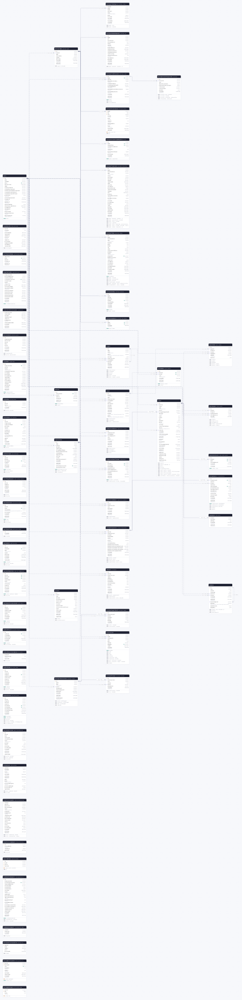

<details>
<summary>The whole schema as SQL</summary>

```sql
CREATE TABLE `accounts` (
	`id` varchar(15) PRIMARY KEY,
	`userId` varchar(15) NOT NULL,
	`type` varchar(255) NOT NULL,
	`provider` varchar(255) NOT NULL,
	`providerAccountId` varchar(255) NOT NULL,
	`access_token` text,
	`expires_in` int,
	`id_token` text,
	`refresh_token` text,
	`refresh_token_expires_in` int,
	`scope` varchar(255),
	`token_type` varchar(255),
	`createdAt` timestamp NOT NULL DEFAULT (now()),
	`updatedAt` timestamp NOT NULL DEFAULT (now()) ON UPDATE CURRENT_TIMESTAMP,
	`tempColumn` text
);

CREATE TABLE `agent_api_authorization_codes` (
	`id` varchar(15) PRIMARY KEY,
	`userId` varchar(15) NOT NULL,
	`codeHash` varchar(64) NOT NULL,
	`codeChallenge` varchar(64) NOT NULL,
	`redirectUri` varchar(512) NOT NULL,
	`scopes` json NOT NULL,
	`expiresAt` timestamp NOT NULL,
	`consumedAt` timestamp,
	`createdAt` timestamp NOT NULL DEFAULT (now()),
	CONSTRAINT `code_hash_idx` UNIQUE INDEX(`codeHash`)
);

CREATE TABLE `agent_api_idempotency` (
	`id` varchar(15) PRIMARY KEY,
	`userId` varchar(15) NOT NULL,
	`operation` varchar(64) NOT NULL,
	`keyHash` varchar(64) NOT NULL,
	`requestHash` varchar(64) NOT NULL,
	`state` varchar(16) NOT NULL DEFAULT 'pending',
	`statusCode` int,
	`response` json,
	`expiresAt` timestamp NOT NULL,
	`createdAt` timestamp NOT NULL DEFAULT (now()),
	`updatedAt` timestamp NOT NULL DEFAULT (now()) ON UPDATE CURRENT_TIMESTAMP,
	CONSTRAINT `user_operation_key_idx` UNIQUE INDEX(`userId`,`operation`,`keyHash`)
);

CREATE TABLE `agent_api_keys` (
	`id` varchar(15) PRIMARY KEY,
	`userId` varchar(15) NOT NULL,
	`tokenHash` varchar(64) NOT NULL,
	`name` varchar(100) NOT NULL DEFAULT 'Cap CLI',
	`scopes` json NOT NULL,
	`expiresAt` timestamp NOT NULL,
	`revokedAt` timestamp,
	`createdAt` timestamp NOT NULL DEFAULT (now()),
	`lastUsedAt` timestamp,
	CONSTRAINT `token_hash_idx` UNIQUE INDEX(`tokenHash`)
);

CREATE TABLE `agent_api_operations` (
	`id` varchar(15) PRIMARY KEY,
	`userId` varchar(15) NOT NULL,
	`kind` varchar(32) NOT NULL,
	`resourceId` varchar(15) NOT NULL,
	`resultResourceId` varchar(15),
	`state` varchar(16) NOT NULL DEFAULT 'queued',
	`payload` json NOT NULL,
	`result` json,
	`errorCode` varchar(64),
	`errorMessage` text,
	`createdAt` timestamp NOT NULL DEFAULT (now()),
	`updatedAt` timestamp NOT NULL DEFAULT (now()) ON UPDATE CURRENT_TIMESTAMP,
	`completedAt` timestamp
);

CREATE TABLE `auth_api_keys` (
	`id` varchar(36) PRIMARY KEY,
	`userId` varchar(15) NOT NULL,
	`source` varchar(32) NOT NULL DEFAULT 'unknown',
	`createdAt` timestamp NOT NULL DEFAULT (now())
);

CREATE TABLE `comments` (
	`id` varchar(15) PRIMARY KEY,
	`type` varchar(6) NOT NULL,
	`content` text NOT NULL,
	`timestamp` float,
	`authorId` varchar(15) NOT NULL,
	`videoId` varchar(15) NOT NULL,
	`createdAt` timestamp NOT NULL DEFAULT (now()),
	`updatedAt` timestamp NOT NULL DEFAULT (now()) ON UPDATE CURRENT_TIMESTAMP,
	`parentCommentId` varchar(15),
	`mediaKey` varchar(512),
	`mediaDuration` float,
	`mediaMeta` json
);

CREATE TABLE `developer_api_keys` (
	`id` varchar(15) PRIMARY KEY,
	`appId` varchar(15) NOT NULL,
	`keyType` varchar(8) NOT NULL,
	`keyPrefix` varchar(12) NOT NULL,
	`keyHash` varchar(64) NOT NULL,
	`encryptedKey` text NOT NULL,
	`lastUsedAt` timestamp,
	`revokedAt` timestamp,
	`createdAt` timestamp NOT NULL DEFAULT (now()),
	CONSTRAINT `key_hash_idx` UNIQUE INDEX(`keyHash`)
);

CREATE TABLE `developer_app_domains` (
	`id` varchar(15) PRIMARY KEY,
	`appId` varchar(15) NOT NULL,
	`domain` varchar(253) NOT NULL,
	`createdAt` timestamp NOT NULL DEFAULT (now()),
	CONSTRAINT `app_domain_unique` UNIQUE INDEX(`appId`,`domain`)
);

CREATE TABLE `developer_apps` (
	`id` varchar(15) PRIMARY KEY,
	`ownerId` varchar(15) NOT NULL,
	`name` varchar(255) NOT NULL,
	`environment` varchar(16) NOT NULL,
	`logoUrl` varchar(1024),
	`deletedAt` timestamp,
	`createdAt` timestamp NOT NULL DEFAULT (now()),
	`updatedAt` timestamp NOT NULL DEFAULT (now()) ON UPDATE CURRENT_TIMESTAMP
);

CREATE TABLE `developer_credit_accounts` (
	`id` varchar(15) PRIMARY KEY,
	`appId` varchar(15) NOT NULL,
	`ownerId` varchar(15) NOT NULL,
	`balanceMicroCredits` bigint unsigned NOT NULL DEFAULT 0,
	`stripeCustomerId` varchar(255),
	`stripePaymentMethodId` varchar(255),
	`autoTopUpEnabled` boolean NOT NULL DEFAULT false,
	`autoTopUpThresholdMicroCredits` bigint unsigned NOT NULL DEFAULT 0,
	`autoTopUpAmountCents` int NOT NULL DEFAULT 0,
	`createdAt` timestamp NOT NULL DEFAULT (now()),
	`updatedAt` timestamp NOT NULL DEFAULT (now()) ON UPDATE CURRENT_TIMESTAMP,
	CONSTRAINT `app_id_unique` UNIQUE INDEX(`appId`)
);

CREATE TABLE `developer_credit_transactions` (
	`id` varchar(15) PRIMARY KEY,
	`accountId` varchar(15) NOT NULL,
	`type` varchar(16) NOT NULL,
	`amountMicroCredits` bigint NOT NULL,
	`balanceAfterMicroCredits` bigint unsigned NOT NULL,
	`referenceId` varchar(255),
	`referenceType` varchar(32),
	`metadata` json,
	`createdAt` timestamp NOT NULL DEFAULT (now())
);

CREATE TABLE `developer_daily_storage_snapshots` (
	`id` varchar(15) PRIMARY KEY,
	`appId` varchar(15) NOT NULL,
	`snapshotDate` varchar(10) NOT NULL,
	`totalDurationMinutes` float NOT NULL DEFAULT 0,
	`videoCount` int NOT NULL DEFAULT 0,
	`microCreditsCharged` bigint unsigned NOT NULL DEFAULT 0,
	`processedAt` timestamp,
	`createdAt` timestamp NOT NULL DEFAULT (now()),
	CONSTRAINT `app_date_unique` UNIQUE INDEX(`appId`,`snapshotDate`)
);

CREATE TABLE `developer_delivery_daily` (
	`appId` varchar(15) NOT NULL,
	`day` date NOT NULL,
	`tier` varchar(8) NOT NULL,
	`seconds` bigint NOT NULL DEFAULT 0,
	`bytes` bigint NOT NULL DEFAULT 0,
	`requests` int NOT NULL DEFAULT 0,
	`abandonedBytes` bigint NOT NULL DEFAULT 0,
	`final` boolean NOT NULL DEFAULT false,
	`finalizedAt` timestamp,
	`updatedAt` timestamp NOT NULL,
	CONSTRAINT PRIMARY KEY(`appId`,`day`,`tier`)
);

CREATE TABLE `developer_delivery_log_files` (
	`logFile` varchar(191) PRIMARY KEY,
	`etag` varchar(128) NOT NULL,
	`logHour` datetime NOT NULL,
	`parts` json NOT NULL,
	`processedAt` timestamp NOT NULL
);

CREATE TABLE `developer_transcripts` (
	`id` varchar(15) PRIMARY KEY,
	`appId` varchar(15) NOT NULL,
	`externalUserId` varchar(255),
	`name` varchar(255) NOT NULL DEFAULT 'Untitled',
	`status` varchar(16) NOT NULL,
	`sourceType` varchar(8) NOT NULL,
	`sourceUrl` varchar(2048),
	`videoId` varchar(15),
	`requestedAt` timestamp(3),
	`s3Key` varchar(512),
	`resultKey` varchar(512),
	`sourceBytes` bigint unsigned,
	`durationSeconds` float,
	`requestedLanguage` varchar(16),
	`language` varchar(16),
	`text` mediumtext,
	`wordCount` int,
	`reservedMicroCredits` bigint unsigned NOT NULL DEFAULT 0,
	`billedMicroCredits` bigint unsigned NOT NULL DEFAULT 0,
	`errorCode` varchar(64),
	`errorMessage` varchar(512),
	`metadata` json,
	`runId` varchar(32),
	`queuedAt` timestamp,
	`startedAt` timestamp,
	`completedAt` timestamp,
	`deletedAt` timestamp,
	`createdAt` timestamp NOT NULL DEFAULT (now()),
	`updatedAt` timestamp NOT NULL DEFAULT (now()) ON UPDATE CURRENT_TIMESTAMP
);

CREATE TABLE `developer_video_imports` (
	`videoId` varchar(15) PRIMARY KEY,
	`appId` varchar(15) NOT NULL,
	`keyId` varchar(15) NOT NULL,
	`sourceUrl` varchar(2048) NOT NULL,
	`state` varchar(16) NOT NULL DEFAULT 'downloading',
	`bytes` bigint unsigned,
	`errorCode` varchar(32),
	`startedAt` timestamp NOT NULL DEFAULT (now()),
	`finishedAt` timestamp,
	`createdAt` timestamp NOT NULL DEFAULT (now())
);

CREATE TABLE `developer_videos` (
	`id` varchar(15) PRIMARY KEY,
	`appId` varchar(15) NOT NULL,
	`externalUserId` varchar(255),
	`name` varchar(255) NOT NULL DEFAULT 'Untitled',
	`duration` float,
	`width` int,
	`height` int,
	`fps` int,
	`s3Key` varchar(512),
	`transcriptionStatus` varchar(16),
	`metadata` json,
	`status` varchar(16) NOT NULL DEFAULT 'uploading',
	`playbackId` varchar(64),
	`maxResolutionTier` varchar(8) NOT NULL DEFAULT '1080p',
	`renditions` json,
	`storedBytes` bigint unsigned,
	`errorReason` varchar(512),
	`processing` json,
	`storagePaidUntil` timestamp,
	`deletedAt` timestamp,
	`filesDeletedAt` timestamp,
	`createdAt` timestamp NOT NULL DEFAULT (now()),
	`updatedAt` timestamp NOT NULL DEFAULT (now()) ON UPDATE CURRENT_TIMESTAMP,
	CONSTRAINT `playback_id_idx` UNIQUE INDEX(`playbackId`)
);

CREATE TABLE `developer_webhook_endpoints` (
	`id` varchar(15) PRIMARY KEY,
	`appId` varchar(15) NOT NULL,
	`url` varchar(2048) NOT NULL,
	`secretPrefix` varchar(12) NOT NULL,
	`encryptedSecret` text NOT NULL,
	`events` json NOT NULL,
	`enabled` boolean NOT NULL DEFAULT true,
	`disabledReason` varchar(32),
	`lastDeliveryAt` timestamp,
	`lastDeliveryStatus` varchar(16),
	`lastResponseStatus` int,
	`lastErrorCode` varchar(32),
	`consecutiveFailures` int NOT NULL DEFAULT 0,
	`failingSince` timestamp,
	`deletedAt` timestamp,
	`createdAt` timestamp NOT NULL DEFAULT (now()),
	`updatedAt` timestamp NOT NULL DEFAULT (now()) ON UPDATE CURRENT_TIMESTAMP
);

CREATE TABLE `directory_users` (
	`id` varchar(64) PRIMARY KEY,
	`organizationId` varchar(15) NOT NULL,
	`directoryId` varchar(64) NOT NULL,
	`userId` varchar(15) NOT NULL,
	`email` varchar(255) NOT NULL,
	`active` boolean NOT NULL DEFAULT true,
	`createdAt` timestamp NOT NULL DEFAULT (now()),
	`updatedAt` timestamp NOT NULL DEFAULT (now()) ON UPDATE CURRENT_TIMESTAMP
);

CREATE TABLE `folders` (
	`id` varchar(15) PRIMARY KEY,
	`name` varchar(255) NOT NULL,
	`color` varchar(16) NOT NULL DEFAULT 'normal',
	`public` boolean NOT NULL DEFAULT false,
	`settings` json,
	`organizationId` varchar(15) NOT NULL,
	`createdById` varchar(15) NOT NULL,
	`parentId` varchar(15),
	`spaceId` varchar(15),
	`createdAt` timestamp NOT NULL DEFAULT (now()),
	`updatedAt` timestamp NOT NULL DEFAULT (now()) ON UPDATE CURRENT_TIMESTAMP
);

CREATE TABLE `imported_videos` (
	`id` varchar(15) NOT NULL,
	`orgId` varchar(15) NOT NULL,
	`source` varchar(255) NOT NULL,
	`source_id` varchar(255) NOT NULL,
	CONSTRAINT PRIMARY KEY(`orgId`,`source`,`source_id`)
);

CREATE TABLE `integration_installations` (
	`id` varchar(15) PRIMARY KEY,
	`provider` varchar(64) NOT NULL,
	`externalId` varchar(255) NOT NULL,
	`displayName` varchar(255) NOT NULL,
	`organizationId` varchar(15) NOT NULL,
	`installedByUserId` varchar(15) NOT NULL,
	`encryptedCredentials` text NOT NULL,
	`metadata` json NOT NULL,
	`createdAt` timestamp NOT NULL DEFAULT (now()),
	`updatedAt` timestamp NOT NULL DEFAULT (now()) ON UPDATE CURRENT_TIMESTAMP,
	CONSTRAINT `provider_external_id_idx` UNIQUE INDEX(`provider`,`externalId`)
);

CREATE TABLE `loom_migration_imports` (
	`videoId` varchar(15) PRIMARY KEY,
	`requestId` varchar(15) NOT NULL,
	`createdAt` datetime NOT NULL
);

CREATE TABLE `loom_migration_requests` (
	`id` varchar(15) PRIMARY KEY,
	`organizationId` varchar(15) NOT NULL,
	`activeOrganizationId` varchar(15),
	`requestedByUserId` varchar(15) NOT NULL,
	`workspaceName` varchar(255),
	`customerNote` text,
	`customerReply` text,
	`invitedAt` datetime,
	`status` varchar(32) NOT NULL DEFAULT 'pending',
	`capMessage` text,
	`expectedVideoCount` int,
	`importedVideoCount` int NOT NULL DEFAULT 0,
	`queuedVideoCount` int NOT NULL DEFAULT 0,
	`activeImportCount` int NOT NULL DEFAULT 0,
	`activeImportLeaseToken` varchar(36),
	`activeImportLeaseUntil` datetime,
	`lastOperatorUserId` varchar(15),
	`lastOperatorAt` datetime,
	`completedAt` datetime,
	`createdAt` datetime NOT NULL,
	`updatedAt` datetime NOT NULL,
	CONSTRAINT `loom_migration_active_org_idx` UNIQUE INDEX(`activeOrganizationId`)
);

CREATE TABLE `loops_sync_jobs` (
	`userId` varchar(15) PRIMARY KEY,
	`revision` int NOT NULL DEFAULT 1,
	`nextAttemptAt` datetime NOT NULL,
	`leaseToken` varchar(36),
	`leaseUntil` datetime,
	`failures` int NOT NULL DEFAULT 0,
	`lastError` varchar(64),
	`profileHash` varchar(64),
	`teammateJoinedAt` datetime,
	`syncedEmail` varchar(255),
	`lastSyncedAt` datetime
);

CREATE TABLE `mcp_oauth_clients` (
	`id` varchar(15) PRIMARY KEY,
	`clientId` varchar(128) NOT NULL,
	`clientName` varchar(100) NOT NULL,
	`redirectUris` json NOT NULL,
	`activatedAt` timestamp,
	`createdAt` timestamp NOT NULL DEFAULT (now()),
	CONSTRAINT `client_id_idx` UNIQUE INDEX(`clientId`)
);

CREATE TABLE `mcp_oauth_codes` (
	`id` varchar(15) PRIMARY KEY,
	`userId` varchar(15) NOT NULL,
	`clientId` varchar(128) NOT NULL,
	`codeHash` varchar(64) NOT NULL,
	`codeChallenge` varchar(64) NOT NULL,
	`redirectUri` varchar(512) NOT NULL,
	`resource` varchar(512) NOT NULL,
	`expiresAt` timestamp NOT NULL,
	`consumedAt` timestamp,
	`createdAt` timestamp NOT NULL DEFAULT (now()),
	CONSTRAINT `code_hash_idx` UNIQUE INDEX(`codeHash`)
);

CREATE TABLE `mcp_oauth_registration_quotas` (
	`windowId` varchar(10) PRIMARY KEY,
	`registrations` int NOT NULL DEFAULT 0,
	`expiresAt` timestamp NOT NULL
);

CREATE TABLE `mcp_oauth_tokens` (
	`id` varchar(15) PRIMARY KEY,
	`userId` varchar(15) NOT NULL,
	`clientId` varchar(128) NOT NULL,
	`familyId` varchar(15) NOT NULL,
	`resource` varchar(512) NOT NULL,
	`accessHash` varchar(64) NOT NULL,
	`refreshHash` varchar(64) NOT NULL,
	`accessExpiresAt` timestamp NOT NULL,
	`refreshExpiresAt` timestamp NOT NULL,
	`revokedAt` timestamp,
	`createdAt` timestamp NOT NULL DEFAULT (now()),
	CONSTRAINT `access_hash_idx` UNIQUE INDEX(`accessHash`),
	CONSTRAINT `refresh_hash_idx` UNIQUE INDEX(`refreshHash`)
);

CREATE TABLE `media_processing_budgets` (
	`id` varchar(64) PRIMARY KEY,
	`reserved_bytes` bigint unsigned NOT NULL DEFAULT 0,
	`limit_bytes` bigint unsigned NOT NULL,
	`expires_at` datetime(3) NOT NULL
);

CREATE TABLE `messenger_conversations` (
	`id` varchar(15) PRIMARY KEY,
	`agent` varchar(32) NOT NULL,
	`mode` varchar(16) NOT NULL DEFAULT 'agent',
	`userId` varchar(15),
	`anonymousId` varchar(64),
	`takeoverByUserId` varchar(15),
	`takeoverAt` timestamp,
	`createdAt` timestamp NOT NULL DEFAULT (now()),
	`updatedAt` timestamp NOT NULL DEFAULT (now()) ON UPDATE CURRENT_TIMESTAMP,
	`lastMessageAt` timestamp NOT NULL DEFAULT (now())
);

CREATE TABLE `messenger_messages` (
	`id` varchar(15) PRIMARY KEY,
	`conversationId` varchar(15) NOT NULL,
	`role` varchar(16) NOT NULL,
	`content` text NOT NULL,
	`userId` varchar(15),
	`anonymousId` varchar(64),
	`createdAt` timestamp NOT NULL DEFAULT (now())
);

CREATE TABLE `messenger_support_emails` (
	`id` varchar(15) PRIMARY KEY,
	`conversationId` varchar(15) NOT NULL,
	`userId` varchar(15) NOT NULL,
	`userEmail` varchar(255) NOT NULL,
	`subject` varchar(255) NOT NULL,
	`message` text NOT NULL,
	`createdAt` timestamp NOT NULL DEFAULT (now())
);

CREATE TABLE `mobile_push_claims` (
	`id` varchar(128) PRIMARY KEY,
	`createdAt` timestamp NOT NULL DEFAULT (now())
);

CREATE TABLE `mobile_push_tokens` (
	`id` varchar(15) PRIMARY KEY,
	`userId` varchar(15) NOT NULL,
	`token` varchar(200) NOT NULL,
	`sessionHash` varchar(64) NOT NULL,
	`environment` varchar(10) NOT NULL,
	`createdAt` timestamp NOT NULL DEFAULT (now()),
	`updatedAt` timestamp NOT NULL DEFAULT (now()) ON UPDATE CURRENT_TIMESTAMP,
	CONSTRAINT `token_idx` UNIQUE INDEX(`token`)
);

CREATE TABLE `notifications` (
	`id` varchar(15) PRIMARY KEY,
	`orgId` varchar(15) NOT NULL,
	`recipientId` varchar(15) NOT NULL,
	`type` varchar(16) NOT NULL,
	`data` json NOT NULL,
	`videoId` varchar(50),
	`dedupKey` varchar(128),
	`readAt` timestamp,
	`createdAt` timestamp NOT NULL DEFAULT (now()),
	CONSTRAINT `dedup_key_idx` UNIQUE INDEX(`dedupKey`)
);

CREATE TABLE `organization_directory_sync` (
	`organizationId` varchar(15) PRIMARY KEY,
	`requestedAt` datetime,
	`syncedAt` datetime,
	`leaseExpiresAt` datetime,
	`lastError` varchar(255),
	`heldRemovals` int NOT NULL DEFAULT 0,
	`removalsApprovedAt` datetime,
	`createdAt` timestamp NOT NULL DEFAULT (now()),
	`updatedAt` timestamp NOT NULL DEFAULT (now()) ON UPDATE CURRENT_TIMESTAMP
);

CREATE TABLE `organization_invites` (
	`id` varchar(15) PRIMARY KEY,
	`organizationId` varchar(15) NOT NULL,
	`invitedEmail` varchar(255) NOT NULL,
	`invitedByUserId` varchar(15) NOT NULL,
	`role` varchar(255) NOT NULL,
	`status` varchar(255) NOT NULL DEFAULT 'pending',
	`createdAt` timestamp NOT NULL DEFAULT (now()),
	`updatedAt` timestamp NOT NULL DEFAULT (now()) ON UPDATE CURRENT_TIMESTAMP,
	`expiresAt` timestamp
);

CREATE TABLE `organization_members` (
	`id` varchar(15) PRIMARY KEY,
	`userId` varchar(15) NOT NULL,
	`organizationId` varchar(15) NOT NULL,
	`role` varchar(255) NOT NULL,
	`hasProSeat` boolean NOT NULL DEFAULT false,
	`createdAt` timestamp NOT NULL DEFAULT (now()),
	`updatedAt` timestamp NOT NULL DEFAULT (now()) ON UPDATE CURRENT_TIMESTAMP
);

CREATE TABLE `organization_sso` (
	`organizationId` varchar(15) PRIMARY KEY,
	`purchasedByUserId` varchar(15) NOT NULL,
	`stripeCustomerId` varchar(255),
	`stripeSubscriptionId` varchar(255),
	`stripePriceId` varchar(255),
	`status` varchar(32) NOT NULL DEFAULT 'unpaid',
	`paidThrough` datetime,
	`currentPeriodEnd` datetime,
	`cancelAtPeriodEnd` boolean NOT NULL DEFAULT false,
	`checkoutAttemptId` varchar(36),
	`checkoutCurrency` varchar(3),
	`checkoutPriceId` varchar(255),
	`checkoutSessionId` varchar(255),
	`checkoutStartedAt` datetime,
	`createdAt` timestamp NOT NULL DEFAULT (now()),
	`updatedAt` timestamp NOT NULL DEFAULT (now()) ON UPDATE CURRENT_TIMESTAMP,
	CONSTRAINT `sso_stripe_subscription_id_idx` UNIQUE INDEX(`stripeSubscriptionId`)
);

CREATE TABLE `organizations` (
	`id` varchar(15) PRIMARY KEY,
	`name` varchar(255) NOT NULL,
	`ownerId` varchar(15) NOT NULL,
	`metadata` json,
	`tombstoneAt` timestamp,
	`allowedEmailDomain` varchar(255),
	`defaultVideoVisibility` varchar(7),
	`customDomain` varchar(255),
	`domainVerified` timestamp,
	`settings` json,
	`iconUrl` varchar(1024),
	`shareableLinkIconUrl` varchar(1024),
	`createdAt` timestamp NOT NULL DEFAULT (now()),
	`updatedAt` timestamp NOT NULL DEFAULT (now()) ON UPDATE CURRENT_TIMESTAMP,
	`workosOrganizationId` varchar(255),
	`workosConnectionId` varchar(255),
	CONSTRAINT `workos_organization_id_idx` UNIQUE INDEX(`workosOrganizationId`)
);

CREATE TABLE `s3_buckets` (
	`id` varchar(15) PRIMARY KEY,
	`ownerId` varchar(15) NOT NULL,
	`organizationId` varchar(15),
	`region` text NOT NULL,
	`endpoint` text,
	`bucketName` text NOT NULL,
	`accessKeyId` text NOT NULL,
	`secretAccessKey` text NOT NULL,
	`provider` text NOT NULL DEFAULT ('aws'),
	`active` boolean NOT NULL DEFAULT true,
	`createdAt` timestamp NOT NULL DEFAULT (now()),
	`updatedAt` timestamp NOT NULL DEFAULT (now()) ON UPDATE CURRENT_TIMESTAMP
);

CREATE TABLE `sessions` (
	`id` varchar(15) PRIMARY KEY,
	`sessionToken` varchar(255) NOT NULL,
	`userId` varchar(15) NOT NULL,
	`expires` datetime NOT NULL,
	`created_at` timestamp NOT NULL DEFAULT (now()),
	`updated_at` timestamp NOT NULL DEFAULT (now()) ON UPDATE CURRENT_TIMESTAMP,
	CONSTRAINT `session_token_idx` UNIQUE INDEX(`sessionToken`)
);

CREATE TABLE `shared_videos` (
	`id` varchar(15) PRIMARY KEY,
	`videoId` varchar(15) NOT NULL,
	`folderId` varchar(15),
	`organizationId` varchar(15) NOT NULL,
	`sharedByUserId` varchar(15) NOT NULL,
	`sharedAt` timestamp NOT NULL DEFAULT (now())
);

CREATE TABLE `signed_baas` (
	`id` varchar(15) PRIMARY KEY,
	`organizationId` varchar(15) NOT NULL,
	`userId` varchar(15) NOT NULL,
	`status` varchar(255) NOT NULL DEFAULT 'pending',
	`stripeSubscriptionId` varchar(255),
	`entityName` varchar(255) NOT NULL,
	`entityType` varchar(255) NOT NULL,
	`entityAddress` varchar(500) NOT NULL,
	`signerName` varchar(255) NOT NULL,
	`signerTitle` varchar(255) NOT NULL,
	`noticesEmail` varchar(255) NOT NULL,
	`signatureData` longtext NOT NULL,
	`signedAt` timestamp,
	`emailSentAt` timestamp,
	`createdAt` timestamp NOT NULL DEFAULT (now()),
	`updatedAt` timestamp NOT NULL DEFAULT (now()) ON UPDATE CURRENT_TIMESTAMP,
	CONSTRAINT `signed_baa_organization_id_idx` UNIQUE INDEX(`organizationId`)
);

CREATE TABLE `space_members` (
	`id` varchar(15) PRIMARY KEY,
	`spaceId` varchar(15) NOT NULL,
	`userId` varchar(15) NOT NULL,
	`role` varchar(255) NOT NULL DEFAULT 'member',
	`createdAt` timestamp NOT NULL DEFAULT (now()),
	`updatedAt` timestamp NOT NULL DEFAULT (now()) ON UPDATE CURRENT_TIMESTAMP,
	CONSTRAINT `space_id_user_id_unique` UNIQUE INDEX(`spaceId`,`userId`)
);

CREATE TABLE `space_videos` (
	`id` varchar(15) PRIMARY KEY,
	`spaceId` varchar(15) NOT NULL,
	`folderId` varchar(15),
	`videoId` varchar(15) NOT NULL,
	`addedById` varchar(15) NOT NULL,
	`addedAt` timestamp NOT NULL DEFAULT (now())
);

CREATE TABLE `spaces` (
	`id` varchar(15) PRIMARY KEY,
	`primary` boolean NOT NULL DEFAULT false,
	`name` varchar(255) NOT NULL,
	`organizationId` varchar(15) NOT NULL,
	`createdById` varchar(15) NOT NULL,
	`iconUrl` varchar(255),
	`description` varchar(1000),
	`settings` json,
	`password` text,
	`createdAt` timestamp NOT NULL DEFAULT (now()),
	`updatedAt` timestamp NOT NULL DEFAULT (now()) ON UPDATE CURRENT_TIMESTAMP,
	`privacy` varchar(255) NOT NULL DEFAULT 'Private',
	`public` boolean NOT NULL DEFAULT false
);

CREATE TABLE `storage_integrations` (
	`id` varchar(15) PRIMARY KEY,
	`ownerId` varchar(15) NOT NULL,
	`organizationId` varchar(15),
	`provider` varchar(64) NOT NULL,
	`displayName` varchar(255) NOT NULL,
	`status` varchar(32) NOT NULL DEFAULT 'active',
	`active` boolean NOT NULL DEFAULT false,
	`encryptedConfig` text NOT NULL,
	`googleDriveAccessToken` text,
	`googleDriveAccessTokenExpiresAt` timestamp,
	`googleDriveTokenRefreshLeaseId` varchar(64),
	`googleDriveTokenRefreshLeaseExpiresAt` timestamp,
	`googleDriveStorageQuotaCache` json,
	`createdAt` timestamp NOT NULL DEFAULT (now()),
	`updatedAt` timestamp NOT NULL DEFAULT (now()) ON UPDATE CURRENT_TIMESTAMP
);

CREATE TABLE `storage_objects` (
	`id` varchar(15) PRIMARY KEY,
	`integrationId` varchar(15) NOT NULL,
	`ownerId` varchar(15) NOT NULL,
	`videoId` varchar(15),
	`objectKey` text NOT NULL,
	`objectKeyHash` varchar(64) NOT NULL,
	`providerObjectId` varchar(255) NOT NULL,
	`uploadSessionUrl` text,
	`uploadStatus` varchar(32) NOT NULL DEFAULT 'pending',
	`contentType` varchar(255),
	`contentLength` bigint unsigned,
	`metadata` json,
	`createdAt` timestamp NOT NULL DEFAULT (now()),
	`updatedAt` timestamp NOT NULL DEFAULT (now()) ON UPDATE CURRENT_TIMESTAMP,
	CONSTRAINT `integration_key_hash_idx` UNIQUE INDEX(`integrationId`,`objectKeyHash`)
);

CREATE TABLE `users` (
	`id` varchar(15) PRIMARY KEY,
	`name` varchar(255),
	`lastName` varchar(255),
	`email` varchar(255) NOT NULL,
	`emailVerified` timestamp,
	`image` varchar(255),
	`stripeCustomerId` varchar(255),
	`stripeSubscriptionId` varchar(255),
	`thirdPartyStripeSubscriptionId` varchar(255),
	`stripeSubscriptionStatus` varchar(255),
	`stripeSubscriptionPriceId` varchar(255),
	`preferences` json DEFAULT ('null'),
	`activeOrganizationId` varchar(15),
	`created_at` timestamp NOT NULL DEFAULT (now()),
	`updated_at` timestamp NOT NULL DEFAULT (now()) ON UPDATE CURRENT_TIMESTAMP,
	`onboardingSteps` json,
	`onboarding_completed_at` timestamp,
	`customBucket` varchar(15),
	`inviteQuota` int NOT NULL DEFAULT 1,
	`defaultOrgId` varchar(15),
	`authSessionVersion` int NOT NULL DEFAULT 0,
	`marketingOrigin` varchar(20) NOT NULL DEFAULT 'unknown',
	CONSTRAINT `email_idx` UNIQUE INDEX(`email`)
);

CREATE TABLE `verification_tokens` (
	`identifier` varchar(255) PRIMARY KEY,
	`token` varchar(255) NOT NULL,
	`expires` datetime NOT NULL,
	`created_at` timestamp NOT NULL DEFAULT (now()),
	`updated_at` timestamp NOT NULL DEFAULT (now()) ON UPDATE CURRENT_TIMESTAMP,
	CONSTRAINT `token_unique` UNIQUE INDEX(`token`)
);

CREATE TABLE `video_edits` (
	`videoId` varchar(15) PRIMARY KEY,
	`sourceKey` varchar(512) NOT NULL,
	`editSpec` json NOT NULL,
	`createdAt` timestamp NOT NULL DEFAULT (now()),
	`updatedAt` timestamp NOT NULL DEFAULT (now()) ON UPDATE CURRENT_TIMESTAMP
);

CREATE TABLE `video_processing_jobs` (
	`video_id` varchar(15) PRIMARY KEY,
	`owner_id` varchar(15) NOT NULL,
	`generation` varchar(64) NOT NULL,
	`manifest_sha256` varchar(64),
	`state` varchar(32) NOT NULL DEFAULT 'committing',
	`attempt_id` varchar(64),
	`attempt_count` int NOT NULL DEFAULT 0,
	`lease_expires_at` datetime(3),
	`next_retry_at` datetime(3) NOT NULL,
	`workflow_run_id` varchar(255),
	`remote_job_id` varchar(255),
	`source` json,
	`verification` json,
	`output` json,
	`error_code` varchar(64),
	`error_message` text,
	`created_at` datetime(3) NOT NULL,
	`updated_at` datetime(3) NOT NULL
);

CREATE TABLE `video_uploads` (
	`video_id` varchar(15) PRIMARY KEY,
	`uploaded` bigint unsigned NOT NULL,
	`total` bigint unsigned NOT NULL,
	`started_at` timestamp NOT NULL DEFAULT (now()),
	`updated_at` timestamp NOT NULL DEFAULT (now()),
	`mode` varchar(255),
	`phase` varchar(32) NOT NULL DEFAULT 'uploading',
	`processing_progress` int NOT NULL DEFAULT 0,
	`processing_message` varchar(255),
	`processing_error` text,
	`raw_file_key` varchar(512)
);

CREATE TABLE `video_viewer_grants` (
	`id` varchar(15) PRIMARY KEY,
	`videoId` varchar(15) NOT NULL,
	`email` varchar(255) NOT NULL,
	`invitedByUserId` varchar(15) NOT NULL,
	`createdAt` timestamp NOT NULL DEFAULT (now()),
	`revokedAt` timestamp,
	CONSTRAINT `video_email_idx` UNIQUE INDEX(`videoId`,`email`)
);

CREATE TABLE `videos` (
	`id` varchar(15) PRIMARY KEY,
	`ownerId` varchar(15) NOT NULL,
	`orgId` varchar(15) NOT NULL,
	`name` varchar(255) NOT NULL DEFAULT 'My Video',
	`bucket` varchar(15),
	`storageIntegrationId` varchar(15),
	`duration` float,
	`width` int,
	`height` int,
	`fps` int,
	`metadata` json,
	`public` boolean NOT NULL DEFAULT true,
	`settings` json,
	`transcriptionStatus` varchar(255),
	`source` json NOT NULL DEFAULT ('{"type":"MediaConvert"}'),
	`folderId` varchar(15),
	`createdAt` timestamp NOT NULL DEFAULT (now()),
	`effectiveCreatedAt` datetime GENERATED ALWAYS AS (COALESCE(
          STR_TO_DATE(JSON_UNQUOTE(JSON_EXTRACT(`metadata`, '$.customCreatedAt')), '%Y-%m-%dT%H:%i:%s.%fZ'),
          STR_TO_DATE(JSON_UNQUOTE(JSON_EXTRACT(`metadata`, '$.customCreatedAt')), '%Y-%m-%dT%H:%i:%sZ'),
          `createdAt`
        )) STORED,
	`updatedAt` timestamp NOT NULL DEFAULT (now()) ON UPDATE CURRENT_TIMESTAMP,
	`password` text,
	`xStreamInfo` text,
	`firstViewEmailSentAt` timestamp,
	`isScreenshot` boolean NOT NULL DEFAULT false,
	`awsRegion` varchar(255),
	`awsBucket` varchar(255),
	`videoStartTime` varchar(255),
	`audioStartTime` varchar(255),
	`jobId` varchar(255),
	`jobStatus` varchar(255),
	`skipProcessing` boolean NOT NULL DEFAULT false
);

CREATE INDEX `user_id_idx` ON `accounts` (`userId`);

CREATE INDEX `provider_account_id_idx` ON `accounts` (`providerAccountId`);

CREATE INDEX `expires_at_idx` ON `agent_api_authorization_codes` (`expiresAt`);

CREATE INDEX `user_created_at_idx` ON `agent_api_authorization_codes` (`userId`,`createdAt`);

CREATE INDEX `expires_at_idx` ON `agent_api_idempotency` (`expiresAt`);

CREATE INDEX `user_created_at_idx` ON `agent_api_keys` (`userId`,`createdAt`);

CREATE INDEX `expires_at_idx` ON `agent_api_keys` (`expiresAt`);

CREATE INDEX `user_created_at_idx` ON `agent_api_operations` (`userId`,`createdAt`);

CREATE INDEX `state_updated_at_idx` ON `agent_api_operations` (`state`,`updatedAt`);

CREATE INDEX `resource_id_idx` ON `agent_api_operations` (`resourceId`);

CREATE INDEX `user_id_created_at_idx` ON `auth_api_keys` (`userId`,`createdAt`);

CREATE INDEX `video_type_created_idx` ON `comments` (`videoId`,`type`,`createdAt`,`id`);

CREATE INDEX `author_id_idx` ON `comments` (`authorId`);

CREATE INDEX `parent_comment_id_idx` ON `comments` (`parentCommentId`);

CREATE INDEX `app_key_type_idx` ON `developer_api_keys` (`appId`,`keyType`);

CREATE INDEX `owner_deleted_idx` ON `developer_apps` (`ownerId`,`deletedAt`);

CREATE INDEX `owner_idx` ON `developer_credit_accounts` (`ownerId`);

CREATE INDEX `auto_top_up_idx` ON `developer_credit_accounts` (`autoTopUpEnabled`);

CREATE INDEX `account_type_created_idx` ON `developer_credit_transactions` (`accountId`,`type`,`createdAt`);

CREATE INDEX `account_created_idx` ON `developer_credit_transactions` (`accountId`,`createdAt`);

CREATE INDEX `account_ref_dedup_idx` ON `developer_credit_transactions` (`accountId`,`referenceId`,`referenceType`);

CREATE INDEX `reference_type_id_idx` ON `developer_credit_transactions` (`referenceType`,`referenceId`);

CREATE INDEX `day_idx` ON `developer_delivery_daily` (`day`);

CREATE INDEX `log_hour_idx` ON `developer_delivery_log_files` (`logHour`);

CREATE INDEX `dev_transcripts_app_list_idx` ON `developer_transcripts` (`appId`,`deletedAt`,`createdAt`,`id`);

CREATE INDEX `dev_transcripts_app_user_idx` ON `developer_transcripts` (`appId`,`externalUserId`,`createdAt`);

CREATE INDEX `dev_transcripts_app_status_idx` ON `developer_transcripts` (`appId`,`status`,`createdAt`);

CREATE INDEX `dev_transcripts_status_updated_idx` ON `developer_transcripts` (`status`,`updatedAt`);

CREATE INDEX `dev_transcripts_app_completed_idx` ON `developer_transcripts` (`appId`,`status`,`completedAt`,`durationSeconds`,`billedMicroCredits`);

CREATE INDEX `dev_transcripts_app_status_held_idx` ON `developer_transcripts` (`appId`,`status`,`createdAt`,`deletedAt`,`reservedMicroCredits`);

CREATE INDEX `dev_transcripts_app_video_idx` ON `developer_transcripts` (`appId`,`videoId`,`requestedAt`,`id`);

CREATE INDEX `dev_imports_app_state_idx` ON `developer_video_imports` (`appId`,`state`);

CREATE INDEX `dev_imports_key_created_idx` ON `developer_video_imports` (`keyId`,`createdAt`);

CREATE INDEX `app_created_idx` ON `developer_videos` (`appId`,`createdAt`);

CREATE INDEX `app_user_idx` ON `developer_videos` (`appId`,`externalUserId`);

CREATE INDEX `app_deleted_idx` ON `developer_videos` (`appId`,`deletedAt`);

CREATE INDEX `files_pending_idx` ON `developer_videos` (`filesDeletedAt`,`deletedAt`);

CREATE INDEX `app_storage_idx` ON `developer_videos` (`appId`,`deletedAt`,`status`,`maxResolutionTier`,`width`,`height`,`storagePaidUntil`,`duration`,`createdAt`);

CREATE INDEX `first_month_due_idx` ON `developer_videos` (`storagePaidUntil`,`status`,`createdAt`);

CREATE INDEX `dev_webhooks_app_list_idx` ON `developer_webhook_endpoints` (`appId`,`deletedAt`,`createdAt`,`id`);

CREATE INDEX `directory_users_organization_id_idx` ON `directory_users` (`organizationId`);

CREATE INDEX `directory_users_user_org_idx` ON `directory_users` (`userId`,`organizationId`);

CREATE INDEX `organization_id_idx` ON `folders` (`organizationId`);

CREATE INDEX `created_by_id_idx` ON `folders` (`createdById`);

CREATE INDEX `parent_id_idx` ON `folders` (`parentId`);

CREATE INDEX `space_id_idx` ON `folders` (`spaceId`);

CREATE INDEX `public_parent_id_idx` ON `folders` (`public`,`parentId`);

CREATE INDEX `public_space_parent_id_idx` ON `folders` (`public`,`spaceId`,`parentId`);

CREATE INDEX `id_idx` ON `imported_videos` (`id`);

CREATE INDEX `organization_provider_display_name_idx` ON `integration_installations` (`organizationId`,`provider`,`displayName`);

CREATE INDEX `loom_migration_imports_request_idx` ON `loom_migration_imports` (`requestId`);

CREATE INDEX `loom_migration_org_created_idx` ON `loom_migration_requests` (`organizationId`,`createdAt`);

CREATE INDEX `loom_migration_status_created_idx` ON `loom_migration_requests` (`status`,`createdAt`);

CREATE INDEX `loops_sync_due_idx` ON `loops_sync_jobs` (`nextAttemptAt`);

CREATE INDEX `inactive_created_at_idx` ON `mcp_oauth_clients` (`activatedAt`,`createdAt`);

CREATE INDEX `expires_at_idx` ON `mcp_oauth_codes` (`expiresAt`);

CREATE INDEX `expires_at_idx` ON `mcp_oauth_registration_quotas` (`expiresAt`);

CREATE INDEX `family_id_idx` ON `mcp_oauth_tokens` (`familyId`);

CREATE INDEX `client_active_idx` ON `mcp_oauth_tokens` (`clientId`,`revokedAt`,`refreshExpiresAt`);

CREATE INDEX `refresh_expires_at_idx` ON `mcp_oauth_tokens` (`refreshExpiresAt`);

CREATE INDEX `media_budget_expiry_idx` ON `media_processing_budgets` (`expires_at`);

CREATE INDEX `user_last_message_idx` ON `messenger_conversations` (`userId`,`lastMessageAt`);

CREATE INDEX `anonymous_last_message_idx` ON `messenger_conversations` (`anonymousId`,`lastMessageAt`);

CREATE INDEX `mode_last_message_idx` ON `messenger_conversations` (`mode`,`lastMessageAt`);

CREATE INDEX `updated_at_idx` ON `messenger_conversations` (`updatedAt`);

CREATE INDEX `conversation_created_at_idx` ON `messenger_messages` (`conversationId`,`createdAt`);

CREATE INDEX `role_created_at_idx` ON `messenger_messages` (`role`,`createdAt`);

CREATE INDEX `support_email_user_created_at_idx` ON `messenger_support_emails` (`userId`,`createdAt`);

CREATE INDEX `support_email_conversation_created_at_idx` ON `messenger_support_emails` (`conversationId`,`createdAt`);

CREATE INDEX `created_at_idx` ON `mobile_push_claims` (`createdAt`);

CREATE INDEX `user_id_idx` ON `mobile_push_tokens` (`userId`);

CREATE INDEX `session_hash_idx` ON `mobile_push_tokens` (`sessionHash`);

CREATE INDEX `org_id_idx` ON `notifications` (`orgId`);

CREATE INDEX `type_idx` ON `notifications` (`type`);

CREATE INDEX `read_at_idx` ON `notifications` (`readAt`);

CREATE INDEX `created_at_idx` ON `notifications` (`createdAt`);

CREATE INDEX `recipient_read_idx` ON `notifications` (`recipientId`,`readAt`);

CREATE INDEX `recipient_created_idx` ON `notifications` (`recipientId`,`createdAt`);

CREATE INDEX `type_recipient_created_idx` ON `notifications` (`type`,`recipientId`,`createdAt`);

CREATE INDEX `type_recipient_video_created_idx` ON `notifications` (`type`,`recipientId`,`videoId`,`createdAt`);

CREATE INDEX `video_id_idx` ON `notifications` (`videoId`);

CREATE INDEX `organization_id_idx` ON `organization_invites` (`organizationId`);

CREATE INDEX `invited_email_idx` ON `organization_invites` (`invitedEmail`);

CREATE INDEX `invited_by_user_id_idx` ON `organization_invites` (`invitedByUserId`);

CREATE INDEX `status_idx` ON `organization_invites` (`status`);

CREATE INDEX `organization_id_idx` ON `organization_members` (`organizationId`);

CREATE INDEX `user_id_organization_id_idx` ON `organization_members` (`userId`,`organizationId`);

CREATE INDEX `owner_id_tombstone_idx` ON `organizations` (`ownerId`,`tombstoneAt`);

CREATE INDEX `custom_domain_idx` ON `organizations` (`customDomain`);

CREATE INDEX `owner_organization_idx` ON `s3_buckets` (`ownerId`,`organizationId`);

CREATE INDEX `organization_id_idx` ON `s3_buckets` (`organizationId`);

CREATE INDEX `organization_active_idx` ON `s3_buckets` (`organizationId`,`active`,`updatedAt`);

CREATE INDEX `user_id_idx` ON `sessions` (`userId`);

CREATE INDEX `folder_id_idx` ON `shared_videos` (`folderId`);

CREATE INDEX `organization_id_idx` ON `shared_videos` (`organizationId`);

CREATE INDEX `shared_by_user_id_idx` ON `shared_videos` (`sharedByUserId`);

CREATE INDEX `video_id_organization_id_idx` ON `shared_videos` (`videoId`,`organizationId`);

CREATE INDEX `video_id_folder_id_idx` ON `shared_videos` (`videoId`,`folderId`);

CREATE INDEX `signed_baa_stripe_subscription_idx` ON `signed_baas` (`stripeSubscriptionId`);

CREATE INDEX `user_id_idx` ON `space_members` (`userId`);

CREATE INDEX `folder_id_idx` ON `space_videos` (`folderId`);

CREATE INDEX `video_id_idx` ON `space_videos` (`videoId`);

CREATE INDEX `added_by_id_idx` ON `space_videos` (`addedById`);

CREATE INDEX `space_id_video_id_idx` ON `space_videos` (`spaceId`,`videoId`);

CREATE INDEX `space_id_folder_id_idx` ON `space_videos` (`spaceId`,`folderId`);

CREATE INDEX `organization_id_idx` ON `spaces` (`organizationId`);

CREATE INDEX `created_by_id_idx` ON `spaces` (`createdById`);

CREATE INDEX `public_organization_id_idx` ON `spaces` (`public`,`organizationId`);

CREATE INDEX `owner_provider_idx` ON `storage_integrations` (`ownerId`,`provider`);

CREATE INDEX `owner_active_idx` ON `storage_integrations` (`ownerId`,`active`);

CREATE INDEX `organization_provider_idx` ON `storage_integrations` (`organizationId`,`provider`);

CREATE INDEX `organization_active_idx` ON `storage_integrations` (`organizationId`,`active`,`status`);

CREATE INDEX `integration_status_idx` ON `storage_objects` (`integrationId`,`uploadStatus`);

CREATE INDEX `integration_object_key_prefix_idx` ON `storage_objects` (`integrationId`,`objectKey`(191));

CREATE INDEX `video_id_idx` ON `storage_objects` (`videoId`);

CREATE INDEX `owner_id_idx` ON `storage_objects` (`ownerId`);

CREATE INDEX `processing_state_retry_video_idx` ON `video_processing_jobs` (`state`,`next_retry_at`,`video_id`);

CREATE INDEX `processing_state_lease_video_idx` ON `video_processing_jobs` (`state`,`lease_expires_at`,`video_id`);

CREATE INDEX `phase_updated_at_video_id_idx` ON `video_uploads` (`phase`,`updated_at`,`video_id`);

CREATE INDEX `started_at_idx` ON `video_uploads` (`started_at`);

CREATE INDEX `owner_id_idx` ON `videos` (`ownerId`);

CREATE INDEX `owner_updated_id_idx` ON `videos` (`ownerId`,`updatedAt`,`id`);

CREATE INDEX `is_public_idx` ON `videos` (`public`);

CREATE INDEX `folder_id_idx` ON `videos` (`folderId`);

CREATE INDEX `storage_integration_id_idx` ON `videos` (`storageIntegrationId`);

CREATE INDEX `org_owner_folder_idx` ON `videos` (`orgId`,`ownerId`,`folderId`);

CREATE INDEX `org_owner_folder_effective_idx` ON `videos` (`orgId`,`ownerId`,`folderId`,`effectiveCreatedAt`);

CREATE INDEX `org_effective_created_idx` ON `videos` (`orgId`,`effectiveCreatedAt`);

CREATE INDEX `screenshot_transcription_created_idx` ON `videos` (`isScreenshot`,`transcriptionStatus`,`createdAt`);

ALTER TABLE `developer_api_keys` ADD CONSTRAINT `developer_api_keys_appId_developer_apps_id_fkey` FOREIGN KEY (`appId`) REFERENCES `developer_apps`(`id`);

ALTER TABLE `developer_app_domains` ADD CONSTRAINT `developer_app_domains_appId_developer_apps_id_fkey` FOREIGN KEY (`appId`) REFERENCES `developer_apps`(`id`);

ALTER TABLE `developer_credit_accounts` ADD CONSTRAINT `developer_credit_accounts_appId_developer_apps_id_fkey` FOREIGN KEY (`appId`) REFERENCES `developer_apps`(`id`);

ALTER TABLE `developer_credit_transactions` ADD CONSTRAINT `dev_credit_txn_account_fk` FOREIGN KEY (`accountId`) REFERENCES `developer_credit_accounts`(`id`);

ALTER TABLE `developer_daily_storage_snapshots` ADD CONSTRAINT `developer_daily_storage_snapshots_appId_developer_apps_id_fkey` FOREIGN KEY (`appId`) REFERENCES `developer_apps`(`id`);

ALTER TABLE `developer_delivery_daily` ADD CONSTRAINT `developer_delivery_daily_appId_developer_apps_id_fkey` FOREIGN KEY (`appId`) REFERENCES `developer_apps`(`id`);

ALTER TABLE `developer_transcripts` ADD CONSTRAINT `developer_transcripts_appId_developer_apps_id_fkey` FOREIGN KEY (`appId`) REFERENCES `developer_apps`(`id`);

ALTER TABLE `developer_video_imports` ADD CONSTRAINT `developer_video_imports_appId_developer_apps_id_fkey` FOREIGN KEY (`appId`) REFERENCES `developer_apps`(`id`);

ALTER TABLE `developer_videos` ADD CONSTRAINT `developer_videos_appId_developer_apps_id_fkey` FOREIGN KEY (`appId`) REFERENCES `developer_apps`(`id`);

ALTER TABLE `developer_webhook_endpoints` ADD CONSTRAINT `developer_webhook_endpoints_appId_developer_apps_id_fkey` FOREIGN KEY (`appId`) REFERENCES `developer_apps`(`id`);

ALTER TABLE `messenger_messages` ADD CONSTRAINT `messenger_messages_v1HSvDjJoJGa_fkey` FOREIGN KEY (`conversationId`) REFERENCES `messenger_conversations`(`id`) ON DELETE CASCADE;

ALTER TABLE `messenger_support_emails` ADD CONSTRAINT `support_email_conversation_fk` FOREIGN KEY (`conversationId`) REFERENCES `messenger_conversations`(`id`) ON DELETE CASCADE;

ALTER TABLE `storage_objects` ADD CONSTRAINT `storage_objects_integrationId_storage_integrations_id_fkey` FOREIGN KEY (`integrationId`) REFERENCES `storage_integrations`(`id`) ON DELETE RESTRICT;

ALTER TABLE `video_edits` ADD CONSTRAINT `video_edits_videoId_videos_id_fkey` FOREIGN KEY (`videoId`) REFERENCES `videos`(`id`) ON DELETE CASCADE;

ALTER TABLE `video_viewer_grants` ADD CONSTRAINT `video_viewer_grants_videoId_videos_id_fkey` FOREIGN KEY (`videoId`) REFERENCES `videos`(`id`) ON DELETE CASCADE;

ALTER TABLE `videos` ADD CONSTRAINT `videos_storageIntegrationId_storage_integrations_id_fkey` FOREIGN KEY (`storageIntegrationId`) REFERENCES `storage_integrations`(`id`) ON DELETE RESTRICT;
```

</details>

## Contents

| Table                                                                   | Name in the database                | Description                                                                                     |
| ----------------------------------------------------------------------- | ----------------------------------- | ----------------------------------------------------------------------------------------------- |
| [users](#table-users)                                                   | `users`                             |                                                                                                 |
| [loopsSyncJobs](#table-loopsSyncJobs)                                   | `loops_sync_jobs`                   |                                                                                                 |
| [accounts](#table-accounts)                                             | `accounts`                          |                                                                                                 |
| [sessions](#table-sessions)                                             | `sessions`                          |                                                                                                 |
| [verificationTokens](#table-verificationTokens)                         | `verification_tokens`               |                                                                                                 |
| [organizations](#table-organizations)                                   | `organizations`                     |                                                                                                 |
| [organizationSso](#table-organizationSso)                               | `organization_sso`                  |                                                                                                 |
| [organizationDirectorySync](#table-organizationDirectorySync)           | `organization_directory_sync`       |                                                                                                 |
| [directoryUsers](#table-directoryUsers)                                 | `directory_users`                   |                                                                                                 |
| [organizationMembers](#table-organizationMembers)                       | `organization_members`              |                                                                                                 |
| [integrationInstallations](#table-integrationInstallations)             | `integration_installations`         |                                                                                                 |
| [organizationInvites](#table-organizationInvites)                       | `organization_invites`              |                                                                                                 |
| [folders](#table-folders)                                               | `folders`                           |                                                                                                 |
| [videos](#table-videos)                                                 | `videos`                            |                                                                                                 |
| [videoEdits](#table-videoEdits)                                         | `video_edits`                       |                                                                                                 |
| [sharedVideos](#table-sharedVideos)                                     | `shared_videos`                     |                                                                                                 |
| [videoViewerGrants](#table-videoViewerGrants)                           | `video_viewer_grants`               |                                                                                                 |
| [comments](#table-comments)                                             | `comments`                          |                                                                                                 |
| [notifications](#table-notifications)                                   | `notifications`                     |                                                                                                 |
| [messengerConversations](#table-messengerConversations)                 | `messenger_conversations`           |                                                                                                 |
| [messengerMessages](#table-messengerMessages)                           | `messenger_messages`                |                                                                                                 |
| [messengerSupportEmails](#table-messengerSupportEmails)                 | `messenger_support_emails`          |                                                                                                 |
| [signedBaas](#table-signedBaas)                                         | `signed_baas`                       |                                                                                                 |
| [s3Buckets](#table-s3Buckets)                                           | `s3_buckets`                        |                                                                                                 |
| [storageIntegrations](#table-storageIntegrations)                       | `storage_integrations`              |                                                                                                 |
| [storageObjects](#table-storageObjects)                                 | `storage_objects`                   |                                                                                                 |
| [authApiKeys](#table-authApiKeys)                                       | `auth_api_keys`                     |                                                                                                 |
| [mobilePushTokens](#table-mobilePushTokens)                             | `mobile_push_tokens`                |                                                                                                 |
| [mobilePushClaims](#table-mobilePushClaims)                             | `mobile_push_claims`                | One row per push that must send at most once, such as a Cap's view push for a 10-minute window. |
| [agentApiKeys](#table-agentApiKeys)                                     | `agent_api_keys`                    |                                                                                                 |
| [agentApiIdempotency](#table-agentApiIdempotency)                       | `agent_api_idempotency`             |                                                                                                 |
| [agentApiAuthorizationCodes](#table-agentApiAuthorizationCodes)         | `agent_api_authorization_codes`     |                                                                                                 |
| [mcpOAuthClients](#table-mcpOAuthClients)                               | `mcp_oauth_clients`                 |                                                                                                 |
| [mcpOAuthRegistrationQuotas](#table-mcpOAuthRegistrationQuotas)         | `mcp_oauth_registration_quotas`     |                                                                                                 |
| [mcpOAuthCodes](#table-mcpOAuthCodes)                                   | `mcp_oauth_codes`                   |                                                                                                 |
| [mcpOAuthTokens](#table-mcpOAuthTokens)                                 | `mcp_oauth_tokens`                  |                                                                                                 |
| [agentApiOperations](#table-agentApiOperations)                         | `agent_api_operations`              |                                                                                                 |
| [spaces](#table-spaces)                                                 | `spaces`                            |                                                                                                 |
| [spaceMembers](#table-spaceMembers)                                     | `space_members`                     |                                                                                                 |
| [spaceVideos](#table-spaceVideos)                                       | `space_videos`                      |                                                                                                 |
| [videoUploads](#table-videoUploads)                                     | `video_uploads`                     |                                                                                                 |
| [videoProcessingJobs](#table-videoProcessingJobs)                       | `video_processing_jobs`             |                                                                                                 |
| [mediaProcessingBudgets](#table-mediaProcessingBudgets)                 | `media_processing_budgets`          |                                                                                                 |
| [importedVideos](#table-importedVideos)                                 | `imported_videos`                   |                                                                                                 |
| [loomMigrationRequests](#table-loomMigrationRequests)                   | `loom_migration_requests`           |                                                                                                 |
| [loomMigrationImports](#table-loomMigrationImports)                     | `loom_migration_imports`            |                                                                                                 |
| [developerApps](#table-developerApps)                                   | `developer_apps`                    |                                                                                                 |
| [developerAppDomains](#table-developerAppDomains)                       | `developer_app_domains`             |                                                                                                 |
| [developerApiKeys](#table-developerApiKeys)                             | `developer_api_keys`                |                                                                                                 |
| [developerVideos](#table-developerVideos)                               | `developer_videos`                  |                                                                                                 |
| [developerTranscripts](#table-developerTranscripts)                     | `developer_transcripts`             |                                                                                                 |
| [developerCreditAccounts](#table-developerCreditAccounts)               | `developer_credit_accounts`         |                                                                                                 |
| [developerCreditTransactions](#table-developerCreditTransactions)       | `developer_credit_transactions`     |                                                                                                 |
| [developerDailyStorageSnapshots](#table-developerDailyStorageSnapshots) | `developer_daily_storage_snapshots` |                                                                                                 |
| [developerDeliveryDaily](#table-developerDeliveryDaily)                 | `developer_delivery_daily`          |                                                                                                 |
| [developerDeliveryLogFiles](#table-developerDeliveryLogFiles)           | `developer_delivery_log_files`      |                                                                                                 |
| [developerWebhookEndpoints](#table-developerWebhookEndpoints)           | `developer_webhook_endpoints`       |                                                                                                 |
| [developerVideoImports](#table-developerVideoImports)                   | `developer_video_imports`           |                                                                                                 |

## Tables

<a id="table-users"></a>

### users

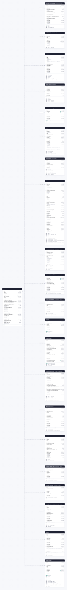

| Column                           | Type        | Constraints | Default               | Description |
| -------------------------------- | ----------- | ----------- | --------------------- | ----------- |
| `id`                             | `varchar`   | PK NOT NULL |                       |             |
| `name`                           | `varchar`   | NULL        |                       |             |
| `lastName`                       | `varchar`   | NULL        |                       |             |
| `email`                          | `varchar`   | NOT NULL    |                       |             |
| `emailVerified`                  | `timestamp` | NULL        |                       |             |
| `image`                          | `varchar`   | NULL        |                       |             |
| `stripeCustomerId`               | `varchar`   | NULL        |                       |             |
| `stripeSubscriptionId`           | `varchar`   | NULL        |                       |             |
| `thirdPartyStripeSubscriptionId` | `varchar`   | NULL        |                       |             |
| `stripeSubscriptionStatus`       | `varchar`   | NULL        |                       |             |
| `stripeSubscriptionPriceId`      | `varchar`   | NULL        |                       |             |
| `preferences`                    | `json`      | NULL        | `.default(null)`      |             |
| `activeOrganizationId`           | `varchar`   | NULL        |                       |             |
| `created_at`                     | `timestamp` | NOT NULL    | `.defaultNow()`       |             |
| `updated_at`                     | `timestamp` | NOT NULL    | `.defaultNow()`       |             |
| `onboardingSteps`                | `json`      | NULL        |                       |             |
| `onboarding_completed_at`        | `timestamp` | NULL        |                       |             |
| `customBucket`                   | `varchar`   | NULL        |                       |             |
| `inviteQuota`                    | `int`       | NOT NULL    | `.default(1)`         |             |
| `defaultOrgId`                   | `varchar`   | NULL        |                       |             |
| `authSessionVersion`             | `int`       | NOT NULL    | `.default(0)`         |             |
| `marketingOrigin`                | `varchar`   | NOT NULL    | `.default("unknown")` |             |

#### Definition

```sql
CREATE TABLE `users` (
	`id` varchar(15) PRIMARY KEY,
	`name` varchar(255),
	`lastName` varchar(255),
	`email` varchar(255) NOT NULL,
	`emailVerified` timestamp,
	`image` varchar(255),
	`stripeCustomerId` varchar(255),
	`stripeSubscriptionId` varchar(255),
	`thirdPartyStripeSubscriptionId` varchar(255),
	`stripeSubscriptionStatus` varchar(255),
	`stripeSubscriptionPriceId` varchar(255),
	`preferences` json DEFAULT ('null'),
	`activeOrganizationId` varchar(15),
	`created_at` timestamp NOT NULL DEFAULT (now()),
	`updated_at` timestamp NOT NULL DEFAULT (now()) ON UPDATE CURRENT_TIMESTAMP,
	`onboardingSteps` json,
	`onboarding_completed_at` timestamp,
	`customBucket` varchar(15),
	`inviteQuota` int NOT NULL DEFAULT 1,
	`defaultOrgId` varchar(15),
	`authSessionVersion` int NOT NULL DEFAULT 0,
	`marketingOrigin` varchar(20) NOT NULL DEFAULT 'unknown',
	CONSTRAINT `email_idx` UNIQUE INDEX(`email`)
);
```

#### Indexes

- UNIQUE `email`

#### Referenced by

- `id` → [notifications.recipientId](#table-notifications) (one to many, defineRelations)
- `id` → [comments.authorId](#table-comments) (one to many, defineRelations)
- `id` → [messengerConversations.userId](#table-messengerConversations) (one to many, defineRelations)
- `id` → [messengerMessages.userId](#table-messengerMessages) (one to many, defineRelations)
- `id` → [messengerSupportEmails.userId](#table-messengerSupportEmails) (one to many, defineRelations)
- `id` → [accounts.userId](#table-accounts) (one to many, defineRelations)
- `id` → [s3Buckets.ownerId](#table-s3Buckets) (one to many, defineRelations)
- `id` → [storageIntegrations.ownerId](#table-storageIntegrations) (one to many, defineRelations)
- `id` → [organizations.ownerId](#table-organizations) (one to many, defineRelations)
- `id` → [sessions.userId](#table-sessions) (one to many, defineRelations)
- `id` → [organizationMembers.userId](#table-organizationMembers) (one to many, defineRelations)
- `id` → [integrationInstallations.installedByUserId](#table-integrationInstallations) (one to many, defineRelations)
- `id` → [organizationInvites.invitedByUserId](#table-organizationInvites) (one to many, defineRelations)
- `id` → [videos.ownerId](#table-videos) (one to many, defineRelations)
- `id` → [sharedVideos.sharedByUserId](#table-sharedVideos) (one to many, defineRelations)
- `id` → [spaces.createdById](#table-spaces) (one to many, defineRelations)
- `id` → [spaceMembers.userId](#table-spaceMembers) (one to many, defineRelations)
- `id` → [spaceVideos.addedById](#table-spaceVideos) (one to many, defineRelations)
- `id` → [folders.createdById](#table-folders) (one to many, defineRelations)
- `id` → [developerApps.ownerId](#table-developerApps) (one to many, defineRelations)
- `id` → [developerCreditAccounts.ownerId](#table-developerCreditAccounts) (one to many, defineRelations)

<details>
<summary>Queries and their SQL</summary>

**Select**: Every row of users.

```ts
db.select().from(users);
```

```sql
select `id`, `name`, `lastName`, `email`, `emailVerified`, `image`, `stripeCustomerId`, `stripeSubscriptionId`, `thirdPartyStripeSubscriptionId`, `stripeSubscriptionStatus`, `stripeSubscriptionPriceId`, `preferences`, `activeOrganizationId`, `created_at`, `updated_at`, `onboardingSteps`, `onboarding_completed_at`, `customBucket`, `inviteQuota`, `defaultOrgId`, `authSessionVersion`, `marketingOrigin`
from `users`
```

**Count**: How many rows users has.

```ts
db.select({ count: count() }).from(users);
```

```sql
select count(*)
from `users`
```

**Find many**: The rows of users, through the relational query API.

```ts
db.query.users.findMany();
```

```sql
select `d0`.`id` as `id`, `d0`.`name` as `name`, `d0`.`lastName` as `lastName`, `d0`.`email` as `email`, `d0`.`emailVerified` as `emailVerified`, `d0`.`image` as `image`, `d0`.`stripeCustomerId` as `stripeCustomerId`, `d0`.`stripeSubscriptionId` as `stripeSubscriptionId`, `d0`.`thirdPartyStripeSubscriptionId` as `thirdPartyStripeSubscriptionId`, `d0`.`stripeSubscriptionStatus` as `stripeSubscriptionStatus`, `d0`.`stripeSubscriptionPriceId` as `stripeSubscriptionPriceId`, `d0`.`preferences` as `preferences`, `d0`.`activeOrganizationId` as `activeOrganizationId`, `d0`.`created_at` as `created_at`, `d0`.`updated_at` as `updated_at`, `d0`.`onboardingSteps` as `onboardingSteps`, `d0`.`onboarding_completed_at` as `onboarding_completed_at`, `d0`.`customBucket` as `customBucket`, `d0`.`inviteQuota` as `inviteQuota`, `d0`.`defaultOrgId` as `defaultOrgId`, `d0`.`authSessionVersion` as `authSessionVersion`, `d0`.`marketingOrigin` as `marketingOrigin`
from `users` as `d0`
```

**Find by primary key**: One row of users, through the relational query API.

```ts
db.query.users.findFirst({ where: { id: "id" } });
```

```sql
select `d0`.`id` as `id`, `d0`.`name` as `name`, `d0`.`lastName` as `lastName`, `d0`.`email` as `email`, `d0`.`emailVerified` as `emailVerified`, `d0`.`image` as `image`, `d0`.`stripeCustomerId` as `stripeCustomerId`, `d0`.`stripeSubscriptionId` as `stripeSubscriptionId`, `d0`.`thirdPartyStripeSubscriptionId` as `thirdPartyStripeSubscriptionId`, `d0`.`stripeSubscriptionStatus` as `stripeSubscriptionStatus`, `d0`.`stripeSubscriptionPriceId` as `stripeSubscriptionPriceId`, `d0`.`preferences` as `preferences`, `d0`.`activeOrganizationId` as `activeOrganizationId`, `d0`.`created_at` as `created_at`, `d0`.`updated_at` as `updated_at`, `d0`.`onboardingSteps` as `onboardingSteps`, `d0`.`onboarding_completed_at` as `onboarding_completed_at`, `d0`.`customBucket` as `customBucket`, `d0`.`inviteQuota` as `inviteQuota`, `d0`.`defaultOrgId` as `defaultOrgId`, `d0`.`authSessionVersion` as `authSessionVersion`, `d0`.`marketingOrigin` as `marketingOrigin`
from `users` as `d0`
where `d0`.`id` = ?
limit ?
-- params: ["id",1]
```

**Insert**: Adds a row to users, giving the columns that have no default.

```ts
db.insert(users).values({ id: "id", email: "email" });
```

```sql
insert into `users` (`id`, `name`, `lastName`, `email`, `emailVerified`, `image`, `stripeCustomerId`, `stripeSubscriptionId`, `thirdPartyStripeSubscriptionId`, `stripeSubscriptionStatus`, `stripeSubscriptionPriceId`, `preferences`, `activeOrganizationId`, `created_at`, `updated_at`, `onboardingSteps`, `onboarding_completed_at`, `customBucket`, `inviteQuota`, `defaultOrgId`, `authSessionVersion`, `marketingOrigin`)
values (?, default, default, ?, default, default, default, default, default, default, default, default, default, default, default, default, default, default, default, default, default, default)
-- params: ["id","email"]
```

**Update**: Changes a row of users, found by its primary key.

```ts
db.update(users).set({ name: "name" }).where(eq(users.id, "id"));
```

```sql
update `users`
set `name` = ?
where `users`.`id` = ?
-- params: ["name","id"]
```

**Delete**: Deletes a row of users, found by its primary key.

```ts
db.delete(users).where(eq(users.id, "id"));
```

```sql
delete from `users`
where `users`.`id` = ?
-- params: ["id"]
```

</details>

<a id="table-loopsSyncJobs"></a>

### loopsSyncJobs

Table `loops_sync_jobs`.

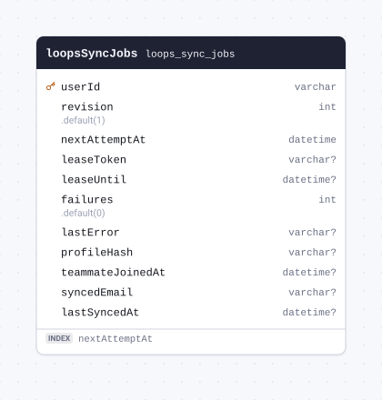

| Column             | Type       | Constraints | Default       | Description |
| ------------------ | ---------- | ----------- | ------------- | ----------- |
| `userId`           | `varchar`  | PK NOT NULL |               |             |
| `revision`         | `int`      | NOT NULL    | `.default(1)` |             |
| `nextAttemptAt`    | `datetime` | NOT NULL    |               |             |
| `leaseToken`       | `varchar`  | NULL        |               |             |
| `leaseUntil`       | `datetime` | NULL        |               |             |
| `failures`         | `int`      | NOT NULL    | `.default(0)` |             |
| `lastError`        | `varchar`  | NULL        |               |             |
| `profileHash`      | `varchar`  | NULL        |               |             |
| `teammateJoinedAt` | `datetime` | NULL        |               |             |
| `syncedEmail`      | `varchar`  | NULL        |               |             |
| `lastSyncedAt`     | `datetime` | NULL        |               |             |

#### Definition

```sql
CREATE TABLE `loops_sync_jobs` (
	`userId` varchar(15) PRIMARY KEY,
	`revision` int NOT NULL DEFAULT 1,
	`nextAttemptAt` datetime NOT NULL,
	`leaseToken` varchar(36),
	`leaseUntil` datetime,
	`failures` int NOT NULL DEFAULT 0,
	`lastError` varchar(64),
	`profileHash` varchar(64),
	`teammateJoinedAt` datetime,
	`syncedEmail` varchar(255),
	`lastSyncedAt` datetime
);

CREATE INDEX `loops_sync_due_idx` ON `loops_sync_jobs` (`nextAttemptAt`);
```

#### Indexes

- INDEX `nextAttemptAt`

<details>
<summary>Queries and their SQL</summary>

**Select**: Every row of loopsSyncJobs.

```ts
db.select().from(loopsSyncJobs);
```

```sql
select `userId`, `revision`, `nextAttemptAt`, `leaseToken`, `leaseUntil`, `failures`, `lastError`, `profileHash`, `teammateJoinedAt`, `syncedEmail`, `lastSyncedAt`
from `loops_sync_jobs`
```

**Count**: How many rows loopsSyncJobs has.

```ts
db.select({ count: count() }).from(loopsSyncJobs);
```

```sql
select count(*)
from `loops_sync_jobs`
```

**Find many**: The rows of loopsSyncJobs, through the relational query API.

```ts
db.query.loopsSyncJobs.findMany();
```

```sql
select `d0`.`userId` as `userId`, `d0`.`revision` as `revision`, `d0`.`nextAttemptAt` as `nextAttemptAt`, `d0`.`leaseToken` as `leaseToken`, `d0`.`leaseUntil` as `leaseUntil`, `d0`.`failures` as `failures`, `d0`.`lastError` as `lastError`, `d0`.`profileHash` as `profileHash`, `d0`.`teammateJoinedAt` as `teammateJoinedAt`, `d0`.`syncedEmail` as `syncedEmail`, `d0`.`lastSyncedAt` as `lastSyncedAt`
from `loops_sync_jobs` as `d0`
```

**Find by primary key**: One row of loopsSyncJobs, through the relational query API.

```ts
db.query.loopsSyncJobs.findFirst({ where: { userId: "userId" } });
```

```sql
select `d0`.`userId` as `userId`, `d0`.`revision` as `revision`, `d0`.`nextAttemptAt` as `nextAttemptAt`, `d0`.`leaseToken` as `leaseToken`, `d0`.`leaseUntil` as `leaseUntil`, `d0`.`failures` as `failures`, `d0`.`lastError` as `lastError`, `d0`.`profileHash` as `profileHash`, `d0`.`teammateJoinedAt` as `teammateJoinedAt`, `d0`.`syncedEmail` as `syncedEmail`, `d0`.`lastSyncedAt` as `lastSyncedAt`
from `loops_sync_jobs` as `d0`
where `d0`.`userId` = ?
limit ?
-- params: ["userId",1]
```

**Insert**: Adds a row to loopsSyncJobs, giving the columns that have no default.

```ts
db.insert(loopsSyncJobs).values({
  userId: "userId",
  nextAttemptAt: new Date("2026-01-01T00:00:00.000Z"),
});
```

```sql
insert into `loops_sync_jobs` (`userId`, `revision`, `nextAttemptAt`, `leaseToken`, `leaseUntil`, `failures`, `lastError`, `profileHash`, `teammateJoinedAt`, `syncedEmail`, `lastSyncedAt`)
values (?, default, ?, default, default, default, default, default, default, default, default)
-- params: ["userId","2026-01-01 00:00:00.000"]
```

**Update**: Changes a row of loopsSyncJobs, found by its primary key.

```ts
db.update(loopsSyncJobs).set({ revision: 1 }).where(eq(loopsSyncJobs.userId, "userId"));
```

```sql
update `loops_sync_jobs`
set `revision` = ?
where `loops_sync_jobs`.`userId` = ?
-- params: [1,"userId"]
```

**Delete**: Deletes a row of loopsSyncJobs, found by its primary key.

```ts
db.delete(loopsSyncJobs).where(eq(loopsSyncJobs.userId, "userId"));
```

```sql
delete from `loops_sync_jobs`
where `loops_sync_jobs`.`userId` = ?
-- params: ["userId"]
```

</details>

<a id="table-accounts"></a>

### accounts

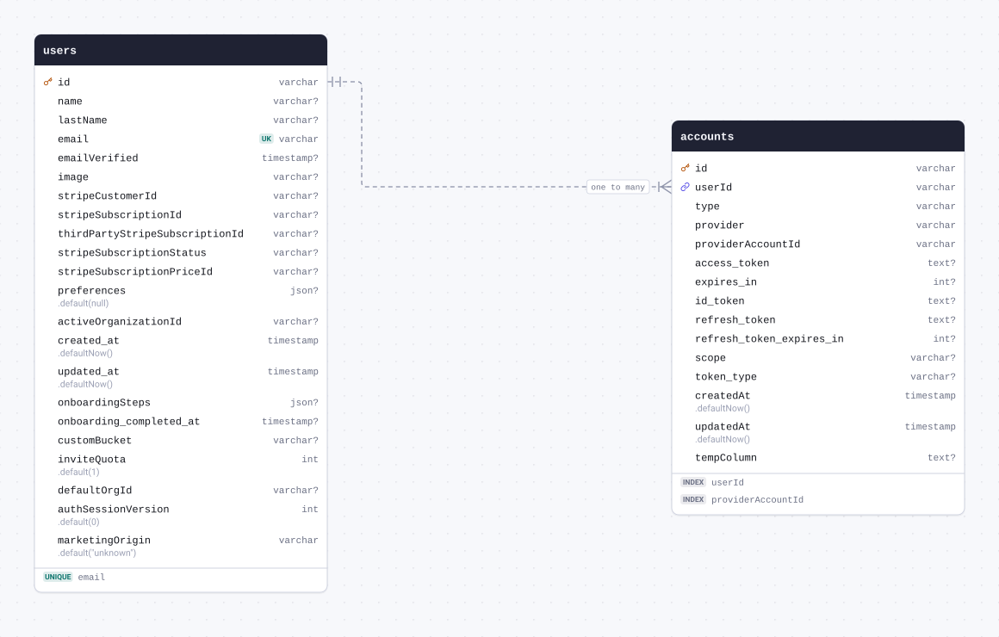

| Column                     | Type        | Constraints                         | Default         | Description |
| -------------------------- | ----------- | ----------------------------------- | --------------- | ----------- |
| `id`                       | `varchar`   | PK NOT NULL                         |                 |             |
| `userId`                   | `varchar`   | NOT NULL → [users.id](#table-users) |                 |             |
| `type`                     | `varchar`   | NOT NULL                            |                 |             |
| `provider`                 | `varchar`   | NOT NULL                            |                 |             |
| `providerAccountId`        | `varchar`   | NOT NULL                            |                 |             |
| `access_token`             | `text`      | NULL                                |                 |             |
| `expires_in`               | `int`       | NULL                                |                 |             |
| `id_token`                 | `text`      | NULL                                |                 |             |
| `refresh_token`            | `text`      | NULL                                |                 |             |
| `refresh_token_expires_in` | `int`       | NULL                                |                 |             |
| `scope`                    | `varchar`   | NULL                                |                 |             |
| `token_type`               | `varchar`   | NULL                                |                 |             |
| `createdAt`                | `timestamp` | NOT NULL                            | `.defaultNow()` |             |
| `updatedAt`                | `timestamp` | NOT NULL                            | `.defaultNow()` |             |
| `tempColumn`               | `text`      | NULL                                |                 |             |

#### Definition

```sql
CREATE TABLE `accounts` (
	`id` varchar(15) PRIMARY KEY,
	`userId` varchar(15) NOT NULL,
	`type` varchar(255) NOT NULL,
	`provider` varchar(255) NOT NULL,
	`providerAccountId` varchar(255) NOT NULL,
	`access_token` text,
	`expires_in` int,
	`id_token` text,
	`refresh_token` text,
	`refresh_token_expires_in` int,
	`scope` varchar(255),
	`token_type` varchar(255),
	`createdAt` timestamp NOT NULL DEFAULT (now()),
	`updatedAt` timestamp NOT NULL DEFAULT (now()) ON UPDATE CURRENT_TIMESTAMP,
	`tempColumn` text
);

CREATE INDEX `user_id_idx` ON `accounts` (`userId`);

CREATE INDEX `provider_account_id_idx` ON `accounts` (`providerAccountId`);
```

#### Indexes

- INDEX `userId`
- INDEX `providerAccountId`

#### References

- `userId` → [users.id](#table-users) (many to one, defineRelations, no foreign key)

<details>
<summary>Queries and their SQL</summary>

**Select**: Every row of accounts.

```ts
db.select().from(accounts);
```

```sql
select `id`, `userId`, `type`, `provider`, `providerAccountId`, `access_token`, `expires_in`, `id_token`, `refresh_token`, `refresh_token_expires_in`, `scope`, `token_type`, `createdAt`, `updatedAt`, `tempColumn`
from `accounts`
```

**Count**: How many rows accounts has.

```ts
db.select({ count: count() }).from(accounts);
```

```sql
select count(*)
from `accounts`
```

**Find many**: The rows of accounts, through the relational query API.

```ts
db.query.accounts.findMany();
```

```sql
select `d0`.`id` as `id`, `d0`.`userId` as `userId`, `d0`.`type` as `type`, `d0`.`provider` as `provider`, `d0`.`providerAccountId` as `providerAccountId`, `d0`.`access_token` as `access_token`, `d0`.`expires_in` as `expires_in`, `d0`.`id_token` as `id_token`, `d0`.`refresh_token` as `refresh_token`, `d0`.`refresh_token_expires_in` as `refresh_token_expires_in`, `d0`.`scope` as `scope`, `d0`.`token_type` as `token_type`, `d0`.`createdAt` as `createdAt`, `d0`.`updatedAt` as `updatedAt`, `d0`.`tempColumn` as `tempColumn`
from `accounts` as `d0`
```

**Find by primary key**: One row of accounts, through the relational query API.

```ts
db.query.accounts.findFirst({ where: { id: "id" } });
```

```sql
select `d0`.`id` as `id`, `d0`.`userId` as `userId`, `d0`.`type` as `type`, `d0`.`provider` as `provider`, `d0`.`providerAccountId` as `providerAccountId`, `d0`.`access_token` as `access_token`, `d0`.`expires_in` as `expires_in`, `d0`.`id_token` as `id_token`, `d0`.`refresh_token` as `refresh_token`, `d0`.`refresh_token_expires_in` as `refresh_token_expires_in`, `d0`.`scope` as `scope`, `d0`.`token_type` as `token_type`, `d0`.`createdAt` as `createdAt`, `d0`.`updatedAt` as `updatedAt`, `d0`.`tempColumn` as `tempColumn`
from `accounts` as `d0`
where `d0`.`id` = ?
limit ?
-- params: ["id",1]
```

**Insert**: Adds a row to accounts, giving the columns that have no default.

```ts
db.insert(accounts).values({
  id: "id",
  userId: "userId",
  type: "type",
  provider: "provider",
  providerAccountId: "providerAccountId",
});
```

```sql
insert into `accounts` (`id`, `userId`, `type`, `provider`, `providerAccountId`, `access_token`, `expires_in`, `id_token`, `refresh_token`, `refresh_token_expires_in`, `scope`, `token_type`, `createdAt`, `updatedAt`, `tempColumn`)
values (?, ?, ?, ?, ?, default, default, default, default, default, default, default, default, default, default)
-- params: ["id","userId","type","provider","providerAccountId"]
```

**Update**: Changes a row of accounts, found by its primary key.

```ts
db.update(accounts).set({ userId: "userId" }).where(eq(accounts.id, "id"));
```

```sql
update `accounts`
set `userId` = ?
where `accounts`.`id` = ?
-- params: ["userId","id"]
```

**Delete**: Deletes a row of accounts, found by its primary key.

```ts
db.delete(accounts).where(eq(accounts.id, "id"));
```

```sql
delete from `accounts`
where `accounts`.`id` = ?
-- params: ["id"]
```

</details>

<a id="table-sessions"></a>

### sessions

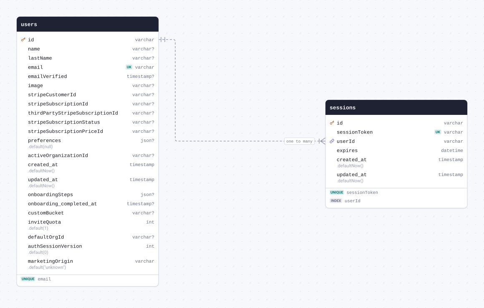

| Column         | Type        | Constraints                         | Default         | Description |
| -------------- | ----------- | ----------------------------------- | --------------- | ----------- |
| `id`           | `varchar`   | PK NOT NULL                         |                 |             |
| `sessionToken` | `varchar`   | NOT NULL                            |                 |             |
| `userId`       | `varchar`   | NOT NULL → [users.id](#table-users) |                 |             |
| `expires`      | `datetime`  | NOT NULL                            |                 |             |
| `created_at`   | `timestamp` | NOT NULL                            | `.defaultNow()` |             |
| `updated_at`   | `timestamp` | NOT NULL                            | `.defaultNow()` |             |

#### Definition

```sql
CREATE TABLE `sessions` (
	`id` varchar(15) PRIMARY KEY,
	`sessionToken` varchar(255) NOT NULL,
	`userId` varchar(15) NOT NULL,
	`expires` datetime NOT NULL,
	`created_at` timestamp NOT NULL DEFAULT (now()),
	`updated_at` timestamp NOT NULL DEFAULT (now()) ON UPDATE CURRENT_TIMESTAMP,
	CONSTRAINT `session_token_idx` UNIQUE INDEX(`sessionToken`)
);

CREATE INDEX `user_id_idx` ON `sessions` (`userId`);
```

#### Indexes

- UNIQUE `sessionToken`
- INDEX `userId`

#### References

- `userId` → [users.id](#table-users) (many to one, defineRelations, no foreign key)

<details>
<summary>Queries and their SQL</summary>

**Select**: Every row of sessions.

```ts
db.select().from(sessions);
```

```sql
select `id`, `sessionToken`, `userId`, `expires`, `created_at`, `updated_at`
from `sessions`
```

**Count**: How many rows sessions has.

```ts
db.select({ count: count() }).from(sessions);
```

```sql
select count(*)
from `sessions`
```

**Find many**: The rows of sessions, through the relational query API.

```ts
db.query.sessions.findMany();
```

```sql
select `d0`.`id` as `id`, `d0`.`sessionToken` as `sessionToken`, `d0`.`userId` as `userId`, `d0`.`expires` as `expires`, `d0`.`created_at` as `created_at`, `d0`.`updated_at` as `updated_at`
from `sessions` as `d0`
```

**Find by primary key**: One row of sessions, through the relational query API.

```ts
db.query.sessions.findFirst({ where: { id: "id" } });
```

```sql
select `d0`.`id` as `id`, `d0`.`sessionToken` as `sessionToken`, `d0`.`userId` as `userId`, `d0`.`expires` as `expires`, `d0`.`created_at` as `created_at`, `d0`.`updated_at` as `updated_at`
from `sessions` as `d0`
where `d0`.`id` = ?
limit ?
-- params: ["id",1]
```

**Insert**: Adds a row to sessions, giving the columns that have no default.

```ts
db.insert(sessions).values({
  id: "id",
  sessionToken: "sessionToken",
  userId: "userId",
  expires: new Date("2026-01-01T00:00:00.000Z"),
});
```

```sql
insert into `sessions` (`id`, `sessionToken`, `userId`, `expires`, `created_at`, `updated_at`)
values (?, ?, ?, ?, default, default)
-- params: ["id","sessionToken","userId","2026-01-01 00:00:00.000"]
```

**Update**: Changes a row of sessions, found by its primary key.

```ts
db.update(sessions).set({ sessionToken: "sessionToken" }).where(eq(sessions.id, "id"));
```

```sql
update `sessions`
set `sessionToken` = ?
where `sessions`.`id` = ?
-- params: ["sessionToken","id"]
```

**Delete**: Deletes a row of sessions, found by its primary key.

```ts
db.delete(sessions).where(eq(sessions.id, "id"));
```

```sql
delete from `sessions`
where `sessions`.`id` = ?
-- params: ["id"]
```

</details>

<a id="table-verificationTokens"></a>

### verificationTokens

Table `verification_tokens`.

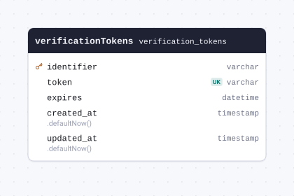

| Column       | Type        | Constraints     | Default         | Description |
| ------------ | ----------- | --------------- | --------------- | ----------- |
| `identifier` | `varchar`   | PK NOT NULL     |                 |             |
| `token`      | `varchar`   | UNIQUE NOT NULL |                 |             |
| `expires`    | `datetime`  | NOT NULL        |                 |             |
| `created_at` | `timestamp` | NOT NULL        | `.defaultNow()` |             |
| `updated_at` | `timestamp` | NOT NULL        | `.defaultNow()` |             |

#### Definition

```sql
CREATE TABLE `verification_tokens` (
	`identifier` varchar(255) PRIMARY KEY,
	`token` varchar(255) NOT NULL,
	`expires` datetime NOT NULL,
	`created_at` timestamp NOT NULL DEFAULT (now()),
	`updated_at` timestamp NOT NULL DEFAULT (now()) ON UPDATE CURRENT_TIMESTAMP,
	CONSTRAINT `token_unique` UNIQUE INDEX(`token`)
);
```

<details>
<summary>Queries and their SQL</summary>

**Select**: Every row of verificationTokens.

```ts
db.select().from(verificationTokens);
```

```sql
select `identifier`, `token`, `expires`, `created_at`, `updated_at`
from `verification_tokens`
```

**Count**: How many rows verificationTokens has.

```ts
db.select({ count: count() }).from(verificationTokens);
```

```sql
select count(*)
from `verification_tokens`
```

**Find many**: The rows of verificationTokens, through the relational query API.

```ts
db.query.verificationTokens.findMany();
```

```sql
select `d0`.`identifier` as `identifier`, `d0`.`token` as `token`, `d0`.`expires` as `expires`, `d0`.`created_at` as `created_at`, `d0`.`updated_at` as `updated_at`
from `verification_tokens` as `d0`
```

**Find by primary key**: One row of verificationTokens, through the relational query API.

```ts
db.query.verificationTokens.findFirst({ where: { identifier: "identifier" } });
```

```sql
select `d0`.`identifier` as `identifier`, `d0`.`token` as `token`, `d0`.`expires` as `expires`, `d0`.`created_at` as `created_at`, `d0`.`updated_at` as `updated_at`
from `verification_tokens` as `d0`
where `d0`.`identifier` = ?
limit ?
-- params: ["identifier",1]
```

**Insert**: Adds a row to verificationTokens, giving the columns that have no default.

```ts
db.insert(verificationTokens).values({
  identifier: "identifier",
  token: "token",
  expires: new Date("2026-01-01T00:00:00.000Z"),
});
```

```sql
insert into `verification_tokens` (`identifier`, `token`, `expires`, `created_at`, `updated_at`)
values (?, ?, ?, default, default)
-- params: ["identifier","token","2026-01-01 00:00:00.000"]
```

**Update**: Changes a row of verificationTokens, found by its primary key.

```ts
db.update(verificationTokens)
  .set({ token: "token" })
  .where(eq(verificationTokens.identifier, "identifier"));
```

```sql
update `verification_tokens`
set `token` = ?
where `verification_tokens`.`identifier` = ?
-- params: ["token","identifier"]
```

**Delete**: Deletes a row of verificationTokens, found by its primary key.

```ts
db.delete(verificationTokens).where(eq(verificationTokens.identifier, "identifier"));
```

```sql
delete from `verification_tokens`
where `verification_tokens`.`identifier` = ?
-- params: ["identifier"]
```

</details>

<a id="table-organizations"></a>

### organizations

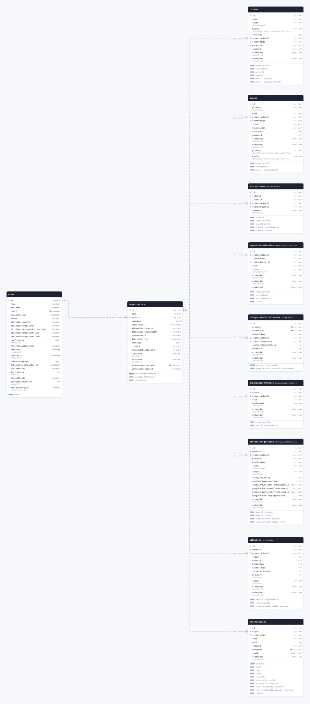

| Column                   | Type        | Constraints                         | Default         | Description |
| ------------------------ | ----------- | ----------------------------------- | --------------- | ----------- |
| `id`                     | `varchar`   | PK NOT NULL                         |                 |             |
| `name`                   | `varchar`   | NOT NULL                            |                 |             |
| `ownerId`                | `varchar`   | NOT NULL → [users.id](#table-users) |                 |             |
| `metadata`               | `json`      | NULL                                |                 |             |
| `tombstoneAt`            | `timestamp` | NULL                                |                 |             |
| `allowedEmailDomain`     | `varchar`   | NULL                                |                 |             |
| `defaultVideoVisibility` | `varchar`   | NULL                                |                 |             |
| `customDomain`           | `varchar`   | NULL                                |                 |             |
| `domainVerified`         | `timestamp` | NULL                                |                 |             |
| `settings`               | `json`      | NULL                                |                 |             |
| `iconUrl`                | `varchar`   | NULL                                |                 |             |
| `shareableLinkIconUrl`   | `varchar`   | NULL                                |                 |             |
| `createdAt`              | `timestamp` | NOT NULL                            | `.defaultNow()` |             |
| `updatedAt`              | `timestamp` | NOT NULL                            | `.defaultNow()` |             |
| `workosOrganizationId`   | `varchar`   | NULL                                |                 |             |
| `workosConnectionId`     | `varchar`   | NULL                                |                 |             |

#### Definition

```sql
CREATE TABLE `organizations` (
	`id` varchar(15) PRIMARY KEY,
	`name` varchar(255) NOT NULL,
	`ownerId` varchar(15) NOT NULL,
	`metadata` json,
	`tombstoneAt` timestamp,
	`allowedEmailDomain` varchar(255),
	`defaultVideoVisibility` varchar(7),
	`customDomain` varchar(255),
	`domainVerified` timestamp,
	`settings` json,
	`iconUrl` varchar(1024),
	`shareableLinkIconUrl` varchar(1024),
	`createdAt` timestamp NOT NULL DEFAULT (now()),
	`updatedAt` timestamp NOT NULL DEFAULT (now()) ON UPDATE CURRENT_TIMESTAMP,
	`workosOrganizationId` varchar(255),
	`workosConnectionId` varchar(255),
	CONSTRAINT `workos_organization_id_idx` UNIQUE INDEX(`workosOrganizationId`)
);

CREATE INDEX `owner_id_tombstone_idx` ON `organizations` (`ownerId`,`tombstoneAt`);

CREATE INDEX `custom_domain_idx` ON `organizations` (`customDomain`);
```

#### Indexes

- INDEX `ownerId`, `tombstoneAt`
- INDEX `customDomain`
- UNIQUE `workosOrganizationId`

#### References

- `ownerId` → [users.id](#table-users) (many to one, defineRelations, no foreign key)

#### Referenced by

- `id` → [notifications.orgId](#table-notifications) (one to many, defineRelations)
- `id` → [s3Buckets.organizationId](#table-s3Buckets) (one to many, defineRelations)
- `id` → [storageIntegrations.organizationId](#table-storageIntegrations) (one to many, defineRelations)
- `id` → [organizationMembers.organizationId](#table-organizationMembers) (one to many, defineRelations)
- `id` → [integrationInstallations.organizationId](#table-integrationInstallations) (one to many, defineRelations)
- `id` → [organizationInvites.organizationId](#table-organizationInvites) (one to many, defineRelations)
- `id` → [sharedVideos.organizationId](#table-sharedVideos) (one to many, defineRelations)
- `id` → [spaces.organizationId](#table-spaces) (one to many, defineRelations)
- `id` → [folders.organizationId](#table-folders) (one to many, defineRelations)

<details>
<summary>Queries and their SQL</summary>

**Select**: Every row of organizations.

```ts
db.select().from(organizations);
```

```sql
select `id`, `name`, `ownerId`, `metadata`, `tombstoneAt`, `allowedEmailDomain`, `defaultVideoVisibility`, `customDomain`, `domainVerified`, `settings`, `iconUrl`, `shareableLinkIconUrl`, `createdAt`, `updatedAt`, `workosOrganizationId`, `workosConnectionId`
from `organizations`
```

**Count**: How many rows organizations has.

```ts
db.select({ count: count() }).from(organizations);
```

```sql
select count(*)
from `organizations`
```

**Find many**: The rows of organizations, through the relational query API.

```ts
db.query.organizations.findMany();
```

```sql
select `d0`.`id` as `id`, `d0`.`name` as `name`, `d0`.`ownerId` as `ownerId`, `d0`.`metadata` as `metadata`, `d0`.`tombstoneAt` as `tombstoneAt`, `d0`.`allowedEmailDomain` as `allowedEmailDomain`, `d0`.`defaultVideoVisibility` as `defaultVideoVisibility`, `d0`.`customDomain` as `customDomain`, `d0`.`domainVerified` as `domainVerified`, `d0`.`settings` as `settings`, `d0`.`iconUrl` as `iconUrl`, `d0`.`shareableLinkIconUrl` as `shareableLinkIconUrl`, `d0`.`createdAt` as `createdAt`, `d0`.`updatedAt` as `updatedAt`, `d0`.`workosOrganizationId` as `workosOrganizationId`, `d0`.`workosConnectionId` as `workosConnectionId`
from `organizations` as `d0`
```

**Find by primary key**: One row of organizations, through the relational query API.

```ts
db.query.organizations.findFirst({ where: { id: "id" } });
```

```sql
select `d0`.`id` as `id`, `d0`.`name` as `name`, `d0`.`ownerId` as `ownerId`, `d0`.`metadata` as `metadata`, `d0`.`tombstoneAt` as `tombstoneAt`, `d0`.`allowedEmailDomain` as `allowedEmailDomain`, `d0`.`defaultVideoVisibility` as `defaultVideoVisibility`, `d0`.`customDomain` as `customDomain`, `d0`.`domainVerified` as `domainVerified`, `d0`.`settings` as `settings`, `d0`.`iconUrl` as `iconUrl`, `d0`.`shareableLinkIconUrl` as `shareableLinkIconUrl`, `d0`.`createdAt` as `createdAt`, `d0`.`updatedAt` as `updatedAt`, `d0`.`workosOrganizationId` as `workosOrganizationId`, `d0`.`workosConnectionId` as `workosConnectionId`
from `organizations` as `d0`
where `d0`.`id` = ?
limit ?
-- params: ["id",1]
```

**Insert**: Adds a row to organizations, giving the columns that have no default.

```ts
db.insert(organizations).values({ id: "id", name: "name", ownerId: "ownerId" });
```

```sql
insert into `organizations` (`id`, `name`, `ownerId`, `metadata`, `tombstoneAt`, `allowedEmailDomain`, `defaultVideoVisibility`, `customDomain`, `domainVerified`, `settings`, `iconUrl`, `shareableLinkIconUrl`, `createdAt`, `updatedAt`, `workosOrganizationId`, `workosConnectionId`)
values (?, ?, ?, default, default, default, default, default, default, default, default, default, default, default, default, default)
-- params: ["id","name","ownerId"]
```

**Update**: Changes a row of organizations, found by its primary key.

```ts
db.update(organizations).set({ name: "name" }).where(eq(organizations.id, "id"));
```

```sql
update `organizations`
set `name` = ?
where `organizations`.`id` = ?
-- params: ["name","id"]
```

**Delete**: Deletes a row of organizations, found by its primary key.

```ts
db.delete(organizations).where(eq(organizations.id, "id"));
```

```sql
delete from `organizations`
where `organizations`.`id` = ?
-- params: ["id"]
```

</details>

<a id="table-organizationSso"></a>

### organizationSso

Table `organization_sso`.

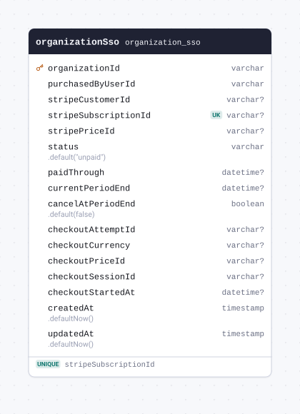

| Column                 | Type        | Constraints | Default              | Description |
| ---------------------- | ----------- | ----------- | -------------------- | ----------- |
| `organizationId`       | `varchar`   | PK NOT NULL |                      |             |
| `purchasedByUserId`    | `varchar`   | NOT NULL    |                      |             |
| `stripeCustomerId`     | `varchar`   | NULL        |                      |             |
| `stripeSubscriptionId` | `varchar`   | NULL        |                      |             |
| `stripePriceId`        | `varchar`   | NULL        |                      |             |
| `status`               | `varchar`   | NOT NULL    | `.default("unpaid")` |             |
| `paidThrough`          | `datetime`  | NULL        |                      |             |
| `currentPeriodEnd`     | `datetime`  | NULL        |                      |             |
| `cancelAtPeriodEnd`    | `boolean`   | NOT NULL    | `.default(false)`    |             |
| `checkoutAttemptId`    | `varchar`   | NULL        |                      |             |
| `checkoutCurrency`     | `varchar`   | NULL        |                      |             |
| `checkoutPriceId`      | `varchar`   | NULL        |                      |             |
| `checkoutSessionId`    | `varchar`   | NULL        |                      |             |
| `checkoutStartedAt`    | `datetime`  | NULL        |                      |             |
| `createdAt`            | `timestamp` | NOT NULL    | `.defaultNow()`      |             |
| `updatedAt`            | `timestamp` | NOT NULL    | `.defaultNow()`      |             |

#### Definition

```sql
CREATE TABLE `organization_sso` (
	`organizationId` varchar(15) PRIMARY KEY,
	`purchasedByUserId` varchar(15) NOT NULL,
	`stripeCustomerId` varchar(255),
	`stripeSubscriptionId` varchar(255),
	`stripePriceId` varchar(255),
	`status` varchar(32) NOT NULL DEFAULT 'unpaid',
	`paidThrough` datetime,
	`currentPeriodEnd` datetime,
	`cancelAtPeriodEnd` boolean NOT NULL DEFAULT false,
	`checkoutAttemptId` varchar(36),
	`checkoutCurrency` varchar(3),
	`checkoutPriceId` varchar(255),
	`checkoutSessionId` varchar(255),
	`checkoutStartedAt` datetime,
	`createdAt` timestamp NOT NULL DEFAULT (now()),
	`updatedAt` timestamp NOT NULL DEFAULT (now()) ON UPDATE CURRENT_TIMESTAMP,
	CONSTRAINT `sso_stripe_subscription_id_idx` UNIQUE INDEX(`stripeSubscriptionId`)
);
```

#### Indexes

- UNIQUE `stripeSubscriptionId`

<details>
<summary>Queries and their SQL</summary>

**Select**: Every row of organizationSso.

```ts
db.select().from(organizationSso);
```

```sql
select `organizationId`, `purchasedByUserId`, `stripeCustomerId`, `stripeSubscriptionId`, `stripePriceId`, `status`, `paidThrough`, `currentPeriodEnd`, `cancelAtPeriodEnd`, `checkoutAttemptId`, `checkoutCurrency`, `checkoutPriceId`, `checkoutSessionId`, `checkoutStartedAt`, `createdAt`, `updatedAt`
from `organization_sso`
```

**Count**: How many rows organizationSso has.

```ts
db.select({ count: count() }).from(organizationSso);
```

```sql
select count(*)
from `organization_sso`
```

**Find many**: The rows of organizationSso, through the relational query API.

```ts
db.query.organizationSso.findMany();
```

```sql
select `d0`.`organizationId` as `organizationId`, `d0`.`purchasedByUserId` as `purchasedByUserId`, `d0`.`stripeCustomerId` as `stripeCustomerId`, `d0`.`stripeSubscriptionId` as `stripeSubscriptionId`, `d0`.`stripePriceId` as `stripePriceId`, `d0`.`status` as `status`, `d0`.`paidThrough` as `paidThrough`, `d0`.`currentPeriodEnd` as `currentPeriodEnd`, `d0`.`cancelAtPeriodEnd` as `cancelAtPeriodEnd`, `d0`.`checkoutAttemptId` as `checkoutAttemptId`, `d0`.`checkoutCurrency` as `checkoutCurrency`, `d0`.`checkoutPriceId` as `checkoutPriceId`, `d0`.`checkoutSessionId` as `checkoutSessionId`, `d0`.`checkoutStartedAt` as `checkoutStartedAt`, `d0`.`createdAt` as `createdAt`, `d0`.`updatedAt` as `updatedAt`
from `organization_sso` as `d0`
```

**Find by primary key**: One row of organizationSso, through the relational query API.

```ts
db.query.organizationSso.findFirst({ where: { organizationId: "organizationId" } });
```

```sql
select `d0`.`organizationId` as `organizationId`, `d0`.`purchasedByUserId` as `purchasedByUserId`, `d0`.`stripeCustomerId` as `stripeCustomerId`, `d0`.`stripeSubscriptionId` as `stripeSubscriptionId`, `d0`.`stripePriceId` as `stripePriceId`, `d0`.`status` as `status`, `d0`.`paidThrough` as `paidThrough`, `d0`.`currentPeriodEnd` as `currentPeriodEnd`, `d0`.`cancelAtPeriodEnd` as `cancelAtPeriodEnd`, `d0`.`checkoutAttemptId` as `checkoutAttemptId`, `d0`.`checkoutCurrency` as `checkoutCurrency`, `d0`.`checkoutPriceId` as `checkoutPriceId`, `d0`.`checkoutSessionId` as `checkoutSessionId`, `d0`.`checkoutStartedAt` as `checkoutStartedAt`, `d0`.`createdAt` as `createdAt`, `d0`.`updatedAt` as `updatedAt`
from `organization_sso` as `d0`
where `d0`.`organizationId` = ?
limit ?
-- params: ["organizationId",1]
```

**Insert**: Adds a row to organizationSso, giving the columns that have no default.

```ts
db.insert(organizationSso).values({
  organizationId: "organizationId",
  purchasedByUserId: "purchasedByUserId",
});
```

```sql
insert into `organization_sso` (`organizationId`, `purchasedByUserId`, `stripeCustomerId`, `stripeSubscriptionId`, `stripePriceId`, `status`, `paidThrough`, `currentPeriodEnd`, `cancelAtPeriodEnd`, `checkoutAttemptId`, `checkoutCurrency`, `checkoutPriceId`, `checkoutSessionId`, `checkoutStartedAt`, `createdAt`, `updatedAt`)
values (?, ?, default, default, default, default, default, default, default, default, default, default, default, default, default, default)
-- params: ["organizationId","purchasedByUserId"]
```

**Update**: Changes a row of organizationSso, found by its primary key.

```ts
db.update(organizationSso)
  .set({ purchasedByUserId: "purchasedByUserId" })
  .where(eq(organizationSso.organizationId, "organizationId"));
```

```sql
update `organization_sso`
set `purchasedByUserId` = ?
where `organization_sso`.`organizationId` = ?
-- params: ["purchasedByUserId","organizationId"]
```

**Delete**: Deletes a row of organizationSso, found by its primary key.

```ts
db.delete(organizationSso).where(eq(organizationSso.organizationId, "organizationId"));
```

```sql
delete from `organization_sso`
where `organization_sso`.`organizationId` = ?
-- params: ["organizationId"]
```

</details>

<a id="table-organizationDirectorySync"></a>

### organizationDirectorySync

Table `organization_directory_sync`.

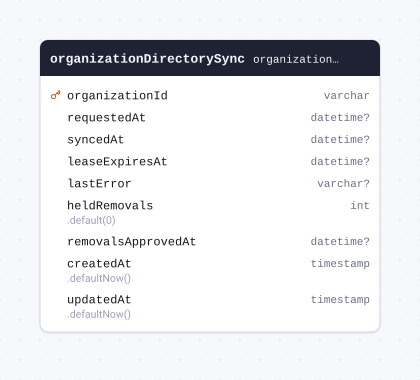

| Column               | Type        | Constraints | Default         | Description |
| -------------------- | ----------- | ----------- | --------------- | ----------- |
| `organizationId`     | `varchar`   | PK NOT NULL |                 |             |
| `requestedAt`        | `datetime`  | NULL        |                 |             |
| `syncedAt`           | `datetime`  | NULL        |                 |             |
| `leaseExpiresAt`     | `datetime`  | NULL        |                 |             |
| `lastError`          | `varchar`   | NULL        |                 |             |
| `heldRemovals`       | `int`       | NOT NULL    | `.default(0)`   |             |
| `removalsApprovedAt` | `datetime`  | NULL        |                 |             |
| `createdAt`          | `timestamp` | NOT NULL    | `.defaultNow()` |             |
| `updatedAt`          | `timestamp` | NOT NULL    | `.defaultNow()` |             |

#### Definition

```sql
CREATE TABLE `organization_directory_sync` (
	`organizationId` varchar(15) PRIMARY KEY,
	`requestedAt` datetime,
	`syncedAt` datetime,
	`leaseExpiresAt` datetime,
	`lastError` varchar(255),
	`heldRemovals` int NOT NULL DEFAULT 0,
	`removalsApprovedAt` datetime,
	`createdAt` timestamp NOT NULL DEFAULT (now()),
	`updatedAt` timestamp NOT NULL DEFAULT (now()) ON UPDATE CURRENT_TIMESTAMP
);
```

<details>
<summary>Queries and their SQL</summary>

**Select**: Every row of organizationDirectorySync.

```ts
db.select().from(organizationDirectorySync);
```

```sql
select `organizationId`, `requestedAt`, `syncedAt`, `leaseExpiresAt`, `lastError`, `heldRemovals`, `removalsApprovedAt`, `createdAt`, `updatedAt`
from `organization_directory_sync`
```

**Count**: How many rows organizationDirectorySync has.

```ts
db.select({ count: count() }).from(organizationDirectorySync);
```

```sql
select count(*)
from `organization_directory_sync`
```

**Find many**: The rows of organizationDirectorySync, through the relational query API.

```ts
db.query.organizationDirectorySync.findMany();
```

```sql
select `d0`.`organizationId` as `organizationId`, `d0`.`requestedAt` as `requestedAt`, `d0`.`syncedAt` as `syncedAt`, `d0`.`leaseExpiresAt` as `leaseExpiresAt`, `d0`.`lastError` as `lastError`, `d0`.`heldRemovals` as `heldRemovals`, `d0`.`removalsApprovedAt` as `removalsApprovedAt`, `d0`.`createdAt` as `createdAt`, `d0`.`updatedAt` as `updatedAt`
from `organization_directory_sync` as `d0`
```

**Find by primary key**: One row of organizationDirectorySync, through the relational query API.

```ts
db.query.organizationDirectorySync.findFirst({ where: { organizationId: "organizationId" } });
```

```sql
select `d0`.`organizationId` as `organizationId`, `d0`.`requestedAt` as `requestedAt`, `d0`.`syncedAt` as `syncedAt`, `d0`.`leaseExpiresAt` as `leaseExpiresAt`, `d0`.`lastError` as `lastError`, `d0`.`heldRemovals` as `heldRemovals`, `d0`.`removalsApprovedAt` as `removalsApprovedAt`, `d0`.`createdAt` as `createdAt`, `d0`.`updatedAt` as `updatedAt`
from `organization_directory_sync` as `d0`
where `d0`.`organizationId` = ?
limit ?
-- params: ["organizationId",1]
```

**Insert**: Adds a row to organizationDirectorySync, giving the columns that have no default.

```ts
db.insert(organizationDirectorySync).values({ organizationId: "organizationId" });
```

```sql
insert into `organization_directory_sync` (`organizationId`, `requestedAt`, `syncedAt`, `leaseExpiresAt`, `lastError`, `heldRemovals`, `removalsApprovedAt`, `createdAt`, `updatedAt`)
values (?, default, default, default, default, default, default, default, default)
-- params: ["organizationId"]
```

**Update**: Changes a row of organizationDirectorySync, found by its primary key.

```ts
db.update(organizationDirectorySync)
  .set({ requestedAt: new Date("2026-01-01T00:00:00.000Z") })
  .where(eq(organizationDirectorySync.organizationId, "organizationId"));
```

```sql
update `organization_directory_sync`
set `requestedAt` = ?
where `organization_directory_sync`.`organizationId` = ?
-- params: ["2026-01-01 00:00:00.000","organizationId"]
```

**Delete**: Deletes a row of organizationDirectorySync, found by its primary key.

```ts
db.delete(organizationDirectorySync).where(
  eq(organizationDirectorySync.organizationId, "organizationId"),
);
```

```sql
delete from `organization_directory_sync`
where `organization_directory_sync`.`organizationId` = ?
-- params: ["organizationId"]
```

</details>

<a id="table-directoryUsers"></a>

### directoryUsers

Table `directory_users`.

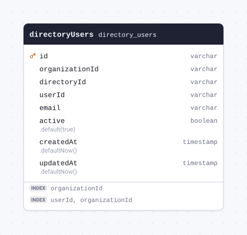

| Column           | Type        | Constraints | Default          | Description |
| ---------------- | ----------- | ----------- | ---------------- | ----------- |
| `id`             | `varchar`   | PK NOT NULL |                  |             |
| `organizationId` | `varchar`   | NOT NULL    |                  |             |
| `directoryId`    | `varchar`   | NOT NULL    |                  |             |
| `userId`         | `varchar`   | NOT NULL    |                  |             |
| `email`          | `varchar`   | NOT NULL    |                  |             |
| `active`         | `boolean`   | NOT NULL    | `.default(true)` |             |
| `createdAt`      | `timestamp` | NOT NULL    | `.defaultNow()`  |             |
| `updatedAt`      | `timestamp` | NOT NULL    | `.defaultNow()`  |             |

#### Definition

```sql
CREATE TABLE `directory_users` (
	`id` varchar(64) PRIMARY KEY,
	`organizationId` varchar(15) NOT NULL,
	`directoryId` varchar(64) NOT NULL,
	`userId` varchar(15) NOT NULL,
	`email` varchar(255) NOT NULL,
	`active` boolean NOT NULL DEFAULT true,
	`createdAt` timestamp NOT NULL DEFAULT (now()),
	`updatedAt` timestamp NOT NULL DEFAULT (now()) ON UPDATE CURRENT_TIMESTAMP
);

CREATE INDEX `directory_users_organization_id_idx` ON `directory_users` (`organizationId`);

CREATE INDEX `directory_users_user_org_idx` ON `directory_users` (`userId`,`organizationId`);
```

#### Indexes

- INDEX `organizationId`
- INDEX `userId`, `organizationId`

<details>
<summary>Queries and their SQL</summary>

**Select**: Every row of directoryUsers.

```ts
db.select().from(directoryUsers);
```

```sql
select `id`, `organizationId`, `directoryId`, `userId`, `email`, `active`, `createdAt`, `updatedAt`
from `directory_users`
```

**Count**: How many rows directoryUsers has.

```ts
db.select({ count: count() }).from(directoryUsers);
```

```sql
select count(*)
from `directory_users`
```

**Find many**: The rows of directoryUsers, through the relational query API.

```ts
db.query.directoryUsers.findMany();
```

```sql
select `d0`.`id` as `id`, `d0`.`organizationId` as `organizationId`, `d0`.`directoryId` as `directoryId`, `d0`.`userId` as `userId`, `d0`.`email` as `email`, `d0`.`active` as `active`, `d0`.`createdAt` as `createdAt`, `d0`.`updatedAt` as `updatedAt`
from `directory_users` as `d0`
```

**Find by primary key**: One row of directoryUsers, through the relational query API.

```ts
db.query.directoryUsers.findFirst({ where: { id: "id" } });
```

```sql
select `d0`.`id` as `id`, `d0`.`organizationId` as `organizationId`, `d0`.`directoryId` as `directoryId`, `d0`.`userId` as `userId`, `d0`.`email` as `email`, `d0`.`active` as `active`, `d0`.`createdAt` as `createdAt`, `d0`.`updatedAt` as `updatedAt`
from `directory_users` as `d0`
where `d0`.`id` = ?
limit ?
-- params: ["id",1]
```

**Insert**: Adds a row to directoryUsers, giving the columns that have no default.

```ts
db.insert(directoryUsers).values({
  id: "id",
  organizationId: "organizationId",
  directoryId: "directoryId",
  userId: "userId",
  email: "email",
});
```

```sql
insert into `directory_users` (`id`, `organizationId`, `directoryId`, `userId`, `email`, `active`, `createdAt`, `updatedAt`)
values (?, ?, ?, ?, ?, default, default, default)
-- params: ["id","organizationId","directoryId","userId","email"]
```

**Update**: Changes a row of directoryUsers, found by its primary key.

```ts
db.update(directoryUsers)
  .set({ organizationId: "organizationId" })
  .where(eq(directoryUsers.id, "id"));
```

```sql
update `directory_users`
set `organizationId` = ?
where `directory_users`.`id` = ?
-- params: ["organizationId","id"]
```

**Delete**: Deletes a row of directoryUsers, found by its primary key.

```ts
db.delete(directoryUsers).where(eq(directoryUsers.id, "id"));
```

```sql
delete from `directory_users`
where `directory_users`.`id` = ?
-- params: ["id"]
```

</details>

<a id="table-organizationMembers"></a>

### organizationMembers

Table `organization_members`.

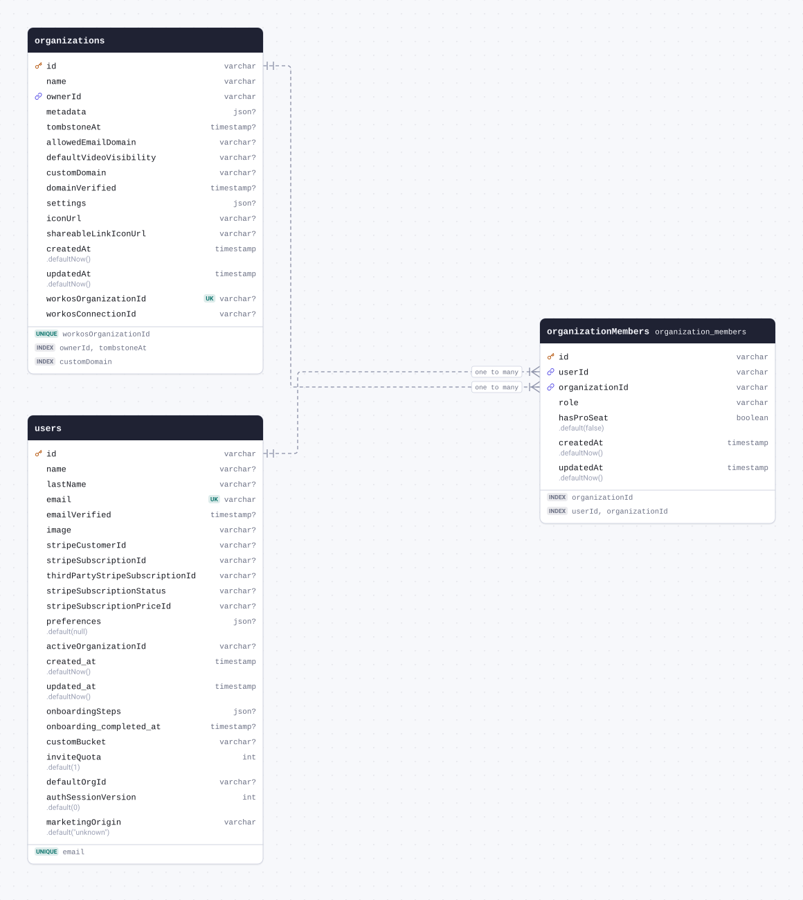

| Column           | Type        | Constraints                                         | Default           | Description |
| ---------------- | ----------- | --------------------------------------------------- | ----------------- | ----------- |
| `id`             | `varchar`   | PK NOT NULL                                         |                   |             |
| `userId`         | `varchar`   | NOT NULL → [users.id](#table-users)                 |                   |             |
| `organizationId` | `varchar`   | NOT NULL → [organizations.id](#table-organizations) |                   |             |
| `role`           | `varchar`   | NOT NULL                                            |                   |             |
| `hasProSeat`     | `boolean`   | NOT NULL                                            | `.default(false)` |             |
| `createdAt`      | `timestamp` | NOT NULL                                            | `.defaultNow()`   |             |
| `updatedAt`      | `timestamp` | NOT NULL                                            | `.defaultNow()`   |             |

#### Definition

```sql
CREATE TABLE `organization_members` (
	`id` varchar(15) PRIMARY KEY,
	`userId` varchar(15) NOT NULL,
	`organizationId` varchar(15) NOT NULL,
	`role` varchar(255) NOT NULL,
	`hasProSeat` boolean NOT NULL DEFAULT false,
	`createdAt` timestamp NOT NULL DEFAULT (now()),
	`updatedAt` timestamp NOT NULL DEFAULT (now()) ON UPDATE CURRENT_TIMESTAMP
);

CREATE INDEX `organization_id_idx` ON `organization_members` (`organizationId`);

CREATE INDEX `user_id_organization_id_idx` ON `organization_members` (`userId`,`organizationId`);
```

#### Indexes

- INDEX `organizationId`
- INDEX `userId`, `organizationId`

#### References

- `userId` → [users.id](#table-users) (many to one, defineRelations, no foreign key)
- `organizationId` → [organizations.id](#table-organizations) (many to one, defineRelations, no foreign key)

<details>
<summary>Queries and their SQL</summary>

**Select**: Every row of organizationMembers.

```ts
db.select().from(organizationMembers);
```

```sql
select `id`, `userId`, `organizationId`, `role`, `hasProSeat`, `createdAt`, `updatedAt`
from `organization_members`
```

**Count**: How many rows organizationMembers has.

```ts
db.select({ count: count() }).from(organizationMembers);
```

```sql
select count(*)
from `organization_members`
```

**Find many**: The rows of organizationMembers, through the relational query API.

```ts
db.query.organizationMembers.findMany();
```

```sql
select `d0`.`id` as `id`, `d0`.`userId` as `userId`, `d0`.`organizationId` as `organizationId`, `d0`.`role` as `role`, `d0`.`hasProSeat` as `hasProSeat`, `d0`.`createdAt` as `createdAt`, `d0`.`updatedAt` as `updatedAt`
from `organization_members` as `d0`
```

**Find by primary key**: One row of organizationMembers, through the relational query API.

```ts
db.query.organizationMembers.findFirst({ where: { id: "id" } });
```

```sql
select `d0`.`id` as `id`, `d0`.`userId` as `userId`, `d0`.`organizationId` as `organizationId`, `d0`.`role` as `role`, `d0`.`hasProSeat` as `hasProSeat`, `d0`.`createdAt` as `createdAt`, `d0`.`updatedAt` as `updatedAt`
from `organization_members` as `d0`
where `d0`.`id` = ?
limit ?
-- params: ["id",1]
```

**Insert**: Adds a row to organizationMembers, giving the columns that have no default.

```ts
db.insert(organizationMembers).values({
  id: "id",
  userId: "userId",
  organizationId: "organizationId",
  role: "role",
});
```

```sql
insert into `organization_members` (`id`, `userId`, `organizationId`, `role`, `hasProSeat`, `createdAt`, `updatedAt`)
values (?, ?, ?, ?, default, default, default)
-- params: ["id","userId","organizationId","role"]
```

**Update**: Changes a row of organizationMembers, found by its primary key.

```ts
db.update(organizationMembers).set({ userId: "userId" }).where(eq(organizationMembers.id, "id"));
```

```sql
update `organization_members`
set `userId` = ?
where `organization_members`.`id` = ?
-- params: ["userId","id"]
```

**Delete**: Deletes a row of organizationMembers, found by its primary key.

```ts
db.delete(organizationMembers).where(eq(organizationMembers.id, "id"));
```

```sql
delete from `organization_members`
where `organization_members`.`id` = ?
-- params: ["id"]
```

</details>

<a id="table-integrationInstallations"></a>

### integrationInstallations

Table `integration_installations`.

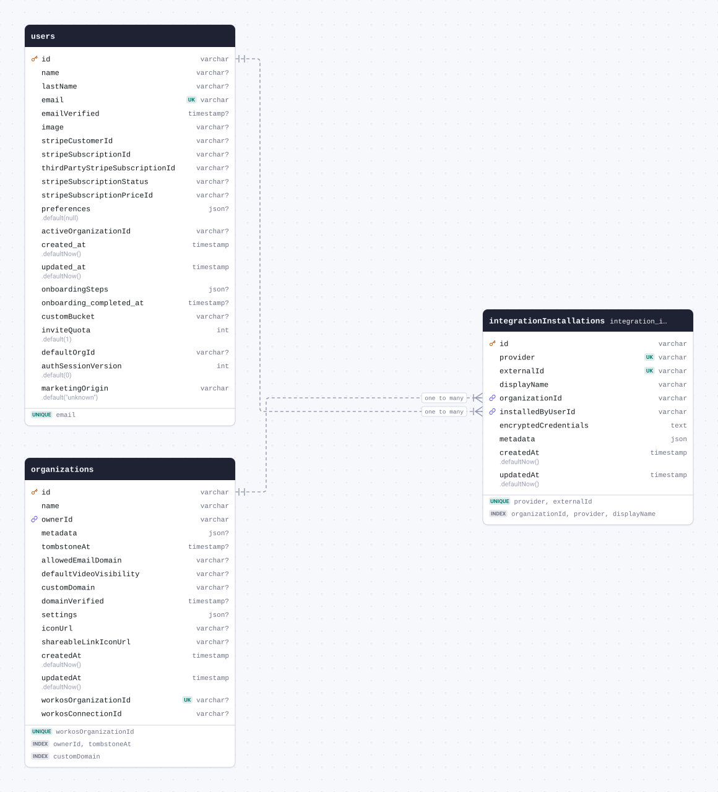

| Column                 | Type        | Constraints                                         | Default         | Description |
| ---------------------- | ----------- | --------------------------------------------------- | --------------- | ----------- |
| `id`                   | `varchar`   | PK NOT NULL                                         |                 |             |
| `provider`             | `varchar`   | NOT NULL                                            |                 |             |
| `externalId`           | `varchar`   | NOT NULL                                            |                 |             |
| `displayName`          | `varchar`   | NOT NULL                                            |                 |             |
| `organizationId`       | `varchar`   | NOT NULL → [organizations.id](#table-organizations) |                 |             |
| `installedByUserId`    | `varchar`   | NOT NULL → [users.id](#table-users)                 |                 |             |
| `encryptedCredentials` | `text`      | NOT NULL                                            |                 |             |
| `metadata`             | `json`      | NOT NULL                                            |                 |             |
| `createdAt`            | `timestamp` | NOT NULL                                            | `.defaultNow()` |             |
| `updatedAt`            | `timestamp` | NOT NULL                                            | `.defaultNow()` |             |

#### Definition

```sql
CREATE TABLE `integration_installations` (
	`id` varchar(15) PRIMARY KEY,
	`provider` varchar(64) NOT NULL,
	`externalId` varchar(255) NOT NULL,
	`displayName` varchar(255) NOT NULL,
	`organizationId` varchar(15) NOT NULL,
	`installedByUserId` varchar(15) NOT NULL,
	`encryptedCredentials` text NOT NULL,
	`metadata` json NOT NULL,
	`createdAt` timestamp NOT NULL DEFAULT (now()),
	`updatedAt` timestamp NOT NULL DEFAULT (now()) ON UPDATE CURRENT_TIMESTAMP,
	CONSTRAINT `provider_external_id_idx` UNIQUE INDEX(`provider`,`externalId`)
);

CREATE INDEX `organization_provider_display_name_idx` ON `integration_installations` (`organizationId`,`provider`,`displayName`);
```

#### Indexes

- UNIQUE `provider`, `externalId`
- INDEX `organizationId`, `provider`, `displayName`

#### References

- `organizationId` → [organizations.id](#table-organizations) (many to one, defineRelations, no foreign key)
- `installedByUserId` → [users.id](#table-users) (many to one, defineRelations, no foreign key)

<details>
<summary>Queries and their SQL</summary>

**Select**: Every row of integrationInstallations.

```ts
db.select().from(integrationInstallations);
```

```sql
select `id`, `provider`, `externalId`, `displayName`, `organizationId`, `installedByUserId`, `encryptedCredentials`, `metadata`, `createdAt`, `updatedAt`
from `integration_installations`
```

**Count**: How many rows integrationInstallations has.

```ts
db.select({ count: count() }).from(integrationInstallations);
```

```sql
select count(*)
from `integration_installations`
```

**Find many**: The rows of integrationInstallations, through the relational query API.

```ts
db.query.integrationInstallations.findMany();
```

```sql
select `d0`.`id` as `id`, `d0`.`provider` as `provider`, `d0`.`externalId` as `externalId`, `d0`.`displayName` as `displayName`, `d0`.`organizationId` as `organizationId`, `d0`.`installedByUserId` as `installedByUserId`, `d0`.`encryptedCredentials` as `encryptedCredentials`, `d0`.`metadata` as `metadata`, `d0`.`createdAt` as `createdAt`, `d0`.`updatedAt` as `updatedAt`
from `integration_installations` as `d0`
```

**Find by primary key**: One row of integrationInstallations, through the relational query API.

```ts
db.query.integrationInstallations.findFirst({ where: { id: "id" } });
```

```sql
select `d0`.`id` as `id`, `d0`.`provider` as `provider`, `d0`.`externalId` as `externalId`, `d0`.`displayName` as `displayName`, `d0`.`organizationId` as `organizationId`, `d0`.`installedByUserId` as `installedByUserId`, `d0`.`encryptedCredentials` as `encryptedCredentials`, `d0`.`metadata` as `metadata`, `d0`.`createdAt` as `createdAt`, `d0`.`updatedAt` as `updatedAt`
from `integration_installations` as `d0`
where `d0`.`id` = ?
limit ?
-- params: ["id",1]
```

**Insert**: Adds a row to integrationInstallations, giving the columns that have no default.

```ts
db.insert(integrationInstallations).values({
  id: "id",
  provider: "provider",
  externalId: "externalId",
  displayName: "displayName",
  organizationId: "organizationId",
  installedByUserId: "installedByUserId",
  encryptedCredentials: "encryptedCredentials",
  metadata: {},
});
```

```sql
insert into `integration_installations` (`id`, `provider`, `externalId`, `displayName`, `organizationId`, `installedByUserId`, `encryptedCredentials`, `metadata`, `createdAt`, `updatedAt`)
values (?, ?, ?, ?, ?, ?, ?, ?, default, default)
-- params: ["id","provider","externalId","displayName","organizationId","installedByUserId","encryptedCredentials","{}"]
```

**Update**: Changes a row of integrationInstallations, found by its primary key.

```ts
db.update(integrationInstallations)
  .set({ provider: "provider" })
  .where(eq(integrationInstallations.id, "id"));
```

```sql
update `integration_installations`
set `provider` = ?
where `integration_installations`.`id` = ?
-- params: ["provider","id"]
```

**Delete**: Deletes a row of integrationInstallations, found by its primary key.

```ts
db.delete(integrationInstallations).where(eq(integrationInstallations.id, "id"));
```

```sql
delete from `integration_installations`
where `integration_installations`.`id` = ?
-- params: ["id"]
```

</details>

<a id="table-organizationInvites"></a>

### organizationInvites

Table `organization_invites`.

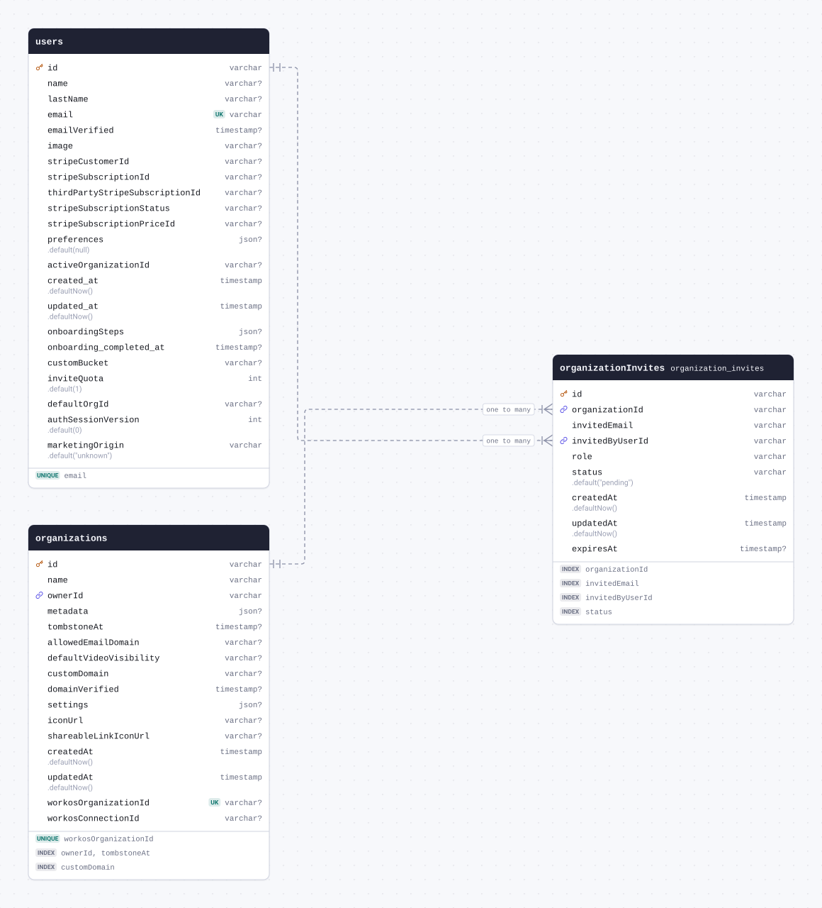

| Column            | Type        | Constraints                                         | Default               | Description |
| ----------------- | ----------- | --------------------------------------------------- | --------------------- | ----------- |
| `id`              | `varchar`   | PK NOT NULL                                         |                       |             |
| `organizationId`  | `varchar`   | NOT NULL → [organizations.id](#table-organizations) |                       |             |
| `invitedEmail`    | `varchar`   | NOT NULL                                            |                       |             |
| `invitedByUserId` | `varchar`   | NOT NULL → [users.id](#table-users)                 |                       |             |
| `role`            | `varchar`   | NOT NULL                                            |                       |             |
| `status`          | `varchar`   | NOT NULL                                            | `.default("pending")` |             |
| `createdAt`       | `timestamp` | NOT NULL                                            | `.defaultNow()`       |             |
| `updatedAt`       | `timestamp` | NOT NULL                                            | `.defaultNow()`       |             |
| `expiresAt`       | `timestamp` | NULL                                                |                       |             |

#### Definition

```sql
CREATE TABLE `organization_invites` (
	`id` varchar(15) PRIMARY KEY,
	`organizationId` varchar(15) NOT NULL,
	`invitedEmail` varchar(255) NOT NULL,
	`invitedByUserId` varchar(15) NOT NULL,
	`role` varchar(255) NOT NULL,
	`status` varchar(255) NOT NULL DEFAULT 'pending',
	`createdAt` timestamp NOT NULL DEFAULT (now()),
	`updatedAt` timestamp NOT NULL DEFAULT (now()) ON UPDATE CURRENT_TIMESTAMP,
	`expiresAt` timestamp
);

CREATE INDEX `organization_id_idx` ON `organization_invites` (`organizationId`);

CREATE INDEX `invited_email_idx` ON `organization_invites` (`invitedEmail`);

CREATE INDEX `invited_by_user_id_idx` ON `organization_invites` (`invitedByUserId`);

CREATE INDEX `status_idx` ON `organization_invites` (`status`);
```

#### Indexes

- INDEX `organizationId`
- INDEX `invitedEmail`
- INDEX `invitedByUserId`
- INDEX `status`

#### References

- `organizationId` → [organizations.id](#table-organizations) (many to one, defineRelations, no foreign key)
- `invitedByUserId` → [users.id](#table-users) (many to one, defineRelations, no foreign key)

<details>
<summary>Queries and their SQL</summary>

**Select**: Every row of organizationInvites.

```ts
db.select().from(organizationInvites);
```

```sql
select `id`, `organizationId`, `invitedEmail`, `invitedByUserId`, `role`, `status`, `createdAt`, `updatedAt`, `expiresAt`
from `organization_invites`
```

**Count**: How many rows organizationInvites has.

```ts
db.select({ count: count() }).from(organizationInvites);
```

```sql
select count(*)
from `organization_invites`
```

**Find many**: The rows of organizationInvites, through the relational query API.

```ts
db.query.organizationInvites.findMany();
```

```sql
select `d0`.`id` as `id`, `d0`.`organizationId` as `organizationId`, `d0`.`invitedEmail` as `invitedEmail`, `d0`.`invitedByUserId` as `invitedByUserId`, `d0`.`role` as `role`, `d0`.`status` as `status`, `d0`.`createdAt` as `createdAt`, `d0`.`updatedAt` as `updatedAt`, `d0`.`expiresAt` as `expiresAt`
from `organization_invites` as `d0`
```

**Find by primary key**: One row of organizationInvites, through the relational query API.

```ts
db.query.organizationInvites.findFirst({ where: { id: "id" } });
```

```sql
select `d0`.`id` as `id`, `d0`.`organizationId` as `organizationId`, `d0`.`invitedEmail` as `invitedEmail`, `d0`.`invitedByUserId` as `invitedByUserId`, `d0`.`role` as `role`, `d0`.`status` as `status`, `d0`.`createdAt` as `createdAt`, `d0`.`updatedAt` as `updatedAt`, `d0`.`expiresAt` as `expiresAt`
from `organization_invites` as `d0`
where `d0`.`id` = ?
limit ?
-- params: ["id",1]
```

**Insert**: Adds a row to organizationInvites, giving the columns that have no default.

```ts
db.insert(organizationInvites).values({
  id: "id",
  organizationId: "organizationId",
  invitedEmail: "invitedEmail",
  invitedByUserId: "invitedByUserId",
  role: "role",
});
```

```sql
insert into `organization_invites` (`id`, `organizationId`, `invitedEmail`, `invitedByUserId`, `role`, `status`, `createdAt`, `updatedAt`, `expiresAt`)
values (?, ?, ?, ?, ?, default, default, default, default)
-- params: ["id","organizationId","invitedEmail","invitedByUserId","role"]
```

**Update**: Changes a row of organizationInvites, found by its primary key.

```ts
db.update(organizationInvites)
  .set({ organizationId: "organizationId" })
  .where(eq(organizationInvites.id, "id"));
```

```sql
update `organization_invites`
set `organizationId` = ?
where `organization_invites`.`id` = ?
-- params: ["organizationId","id"]
```

**Delete**: Deletes a row of organizationInvites, found by its primary key.

```ts
db.delete(organizationInvites).where(eq(organizationInvites.id, "id"));
```

```sql
delete from `organization_invites`
where `organization_invites`.`id` = ?
-- params: ["id"]
```

</details>

<a id="table-folders"></a>

### folders

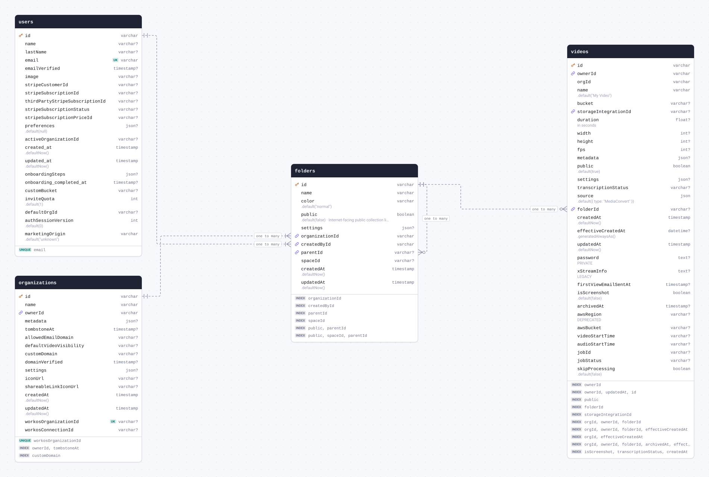

| Column           | Type        | Constraints                                         | Default              | Description                                       |
| ---------------- | ----------- | --------------------------------------------------- | -------------------- | ------------------------------------------------- |
| `id`             | `varchar`   | PK NOT NULL                                         |                      |                                                   |
| `name`           | `varchar`   | NOT NULL                                            |                      |                                                   |
| `color`          | `varchar`   | NOT NULL                                            | `.default("normal")` |                                                   |
| `public`         | `boolean`   | NOT NULL                                            | `.default(false)`    | Internet-facing public collection link (/c/[id]). |
| `settings`       | `json`      | NULL                                                |                      |                                                   |
| `organizationId` | `varchar`   | NOT NULL → [organizations.id](#table-organizations) |                      |                                                   |
| `createdById`    | `varchar`   | NOT NULL → [users.id](#table-users)                 |                      |                                                   |
| `parentId`       | `varchar`   | NULL → [folders.id](#table-folders)                 |                      |                                                   |
| `spaceId`        | `varchar`   | NULL                                                |                      |                                                   |
| `createdAt`      | `timestamp` | NOT NULL                                            | `.defaultNow()`      |                                                   |
| `updatedAt`      | `timestamp` | NOT NULL                                            | `.defaultNow()`      |                                                   |

#### Definition

```sql
CREATE TABLE `folders` (
	`id` varchar(15) PRIMARY KEY,
	`name` varchar(255) NOT NULL,
	`color` varchar(16) NOT NULL DEFAULT 'normal',
	`public` boolean NOT NULL DEFAULT false,
	`settings` json,
	`organizationId` varchar(15) NOT NULL,
	`createdById` varchar(15) NOT NULL,
	`parentId` varchar(15),
	`spaceId` varchar(15),
	`createdAt` timestamp NOT NULL DEFAULT (now()),
	`updatedAt` timestamp NOT NULL DEFAULT (now()) ON UPDATE CURRENT_TIMESTAMP
);

CREATE INDEX `organization_id_idx` ON `folders` (`organizationId`);

CREATE INDEX `created_by_id_idx` ON `folders` (`createdById`);

CREATE INDEX `parent_id_idx` ON `folders` (`parentId`);

CREATE INDEX `space_id_idx` ON `folders` (`spaceId`);

CREATE INDEX `public_parent_id_idx` ON `folders` (`public`,`parentId`);

CREATE INDEX `public_space_parent_id_idx` ON `folders` (`public`,`spaceId`,`parentId`);
```

#### Indexes

- INDEX `organizationId`
- INDEX `createdById`
- INDEX `parentId`
- INDEX `spaceId`
- INDEX `public`, `parentId`
- INDEX `public`, `spaceId`, `parentId`

#### References

- `organizationId` → [organizations.id](#table-organizations) (many to one, defineRelations, no foreign key)
- `createdById` → [users.id](#table-users) (many to one, defineRelations, no foreign key)
- `parentId` → [folders.id](#table-folders) (many to one, defineRelations, no foreign key)

#### Referenced by

- `id` → [videos.folderId](#table-videos) (one to many, defineRelations)
- `id` → [folders.parentId](#table-folders) (one to many, defineRelations)

<details>
<summary>Queries and their SQL</summary>

**Select**: Every row of folders.

```ts
db.select().from(folders);
```

```sql
select `id`, `name`, `color`, `public`, `settings`, `organizationId`, `createdById`, `parentId`, `spaceId`, `createdAt`, `updatedAt`
from `folders`
```

**Count**: How many rows folders has.

```ts
db.select({ count: count() }).from(folders);
```

```sql
select count(*)
from `folders`
```

**Find many**: The rows of folders, through the relational query API.

```ts
db.query.folders.findMany();
```

```sql
select `d0`.`id` as `id`, `d0`.`name` as `name`, `d0`.`color` as `color`, `d0`.`public` as `public`, `d0`.`settings` as `settings`, `d0`.`organizationId` as `organizationId`, `d0`.`createdById` as `createdById`, `d0`.`parentId` as `parentId`, `d0`.`spaceId` as `spaceId`, `d0`.`createdAt` as `createdAt`, `d0`.`updatedAt` as `updatedAt`
from `folders` as `d0`
```

**Find by primary key**: One row of folders, through the relational query API.

```ts
db.query.folders.findFirst({ where: { id: "id" } });
```

```sql
select `d0`.`id` as `id`, `d0`.`name` as `name`, `d0`.`color` as `color`, `d0`.`public` as `public`, `d0`.`settings` as `settings`, `d0`.`organizationId` as `organizationId`, `d0`.`createdById` as `createdById`, `d0`.`parentId` as `parentId`, `d0`.`spaceId` as `spaceId`, `d0`.`createdAt` as `createdAt`, `d0`.`updatedAt` as `updatedAt`
from `folders` as `d0`
where `d0`.`id` = ?
limit ?
-- params: ["id",1]
```

**Insert**: Adds a row to folders, giving the columns that have no default.

```ts
db.insert(folders).values({
  id: "id",
  name: "name",
  organizationId: "organizationId",
  createdById: "createdById",
});
```

```sql
insert into `folders` (`id`, `name`, `color`, `public`, `settings`, `organizationId`, `createdById`, `parentId`, `spaceId`, `createdAt`, `updatedAt`)
values (?, ?, default, default, default, ?, ?, default, default, default, default)
-- params: ["id","name","organizationId","createdById"]
```

**Update**: Changes a row of folders, found by its primary key.

```ts
db.update(folders).set({ name: "name" }).where(eq(folders.id, "id"));
```

```sql
update `folders`
set `name` = ?
where `folders`.`id` = ?
-- params: ["name","id"]
```

**Delete**: Deletes a row of folders, found by its primary key.

```ts
db.delete(folders).where(eq(folders.id, "id"));
```

```sql
delete from `folders`
where `folders`.`id` = ?
-- params: ["id"]
```

</details>

<a id="table-videos"></a>

### videos

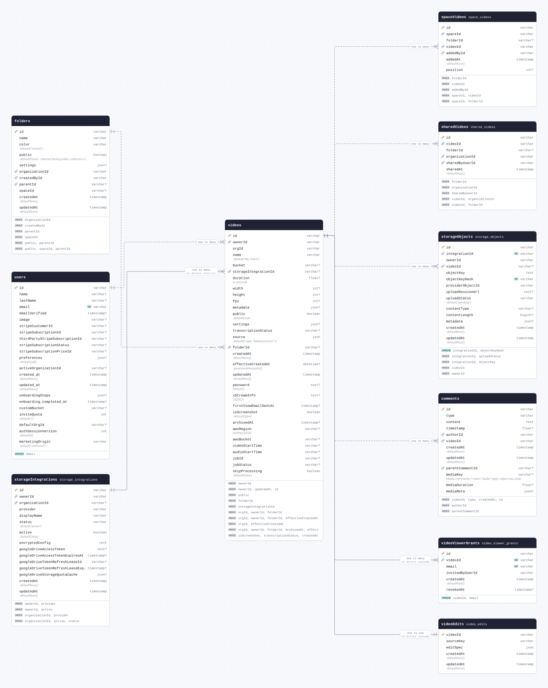

| Column                 | Type        | Constraints                                                 | Default                              | Description |
| ---------------------- | ----------- | ----------------------------------------------------------- | ------------------------------------ | ----------- |
| `id`                   | `varchar`   | PK NOT NULL                                                 |                                      |             |
| `ownerId`              | `varchar`   | NOT NULL → [users.id](#table-users)                         |                                      |             |
| `orgId`                | `varchar`   | NOT NULL                                                    |                                      |             |
| `name`                 | `varchar`   | NOT NULL                                                    | `.default("My Video")`               |             |
| `bucket`               | `varchar`   | NULL                                                        |                                      |             |
| `storageIntegrationId` | `varchar`   | NULL → [storageIntegrations.id](#table-storageIntegrations) |                                      |             |
| `duration`             | `float`     | NULL                                                        |                                      | in seconds  |
| `width`                | `int`       | NULL                                                        |                                      |             |
| `height`               | `int`       | NULL                                                        |                                      |             |
| `fps`                  | `int`       | NULL                                                        |                                      |             |
| `metadata`             | `json`      | NULL                                                        |                                      |             |
| `public`               | `boolean`   | NOT NULL                                                    | `.default(true)`                     |             |
| `settings`             | `json`      | NULL                                                        |                                      |             |
| `transcriptionStatus`  | `varchar`   | NULL                                                        |                                      |             |
| `source`               | `json`      | NOT NULL                                                    | `.default({ type: "MediaConvert" })` |             |
| `folderId`             | `varchar`   | NULL → [folders.id](#table-folders)                         |                                      |             |
| `createdAt`            | `timestamp` | NOT NULL                                                    | `.defaultNow()`                      |             |
| `effectiveCreatedAt`   | `datetime`  | NULL                                                        | `.generatedAlwaysAs()`               |             |
| `updatedAt`            | `timestamp` | NOT NULL                                                    | `.defaultNow()`                      |             |
| `password`             | `text`      | NULL                                                        |                                      | PRIVATE     |
| `xStreamInfo`          | `text`      | NULL                                                        |                                      | LEGACY      |
| `firstViewEmailSentAt` | `timestamp` | NULL                                                        |                                      |             |
| `isScreenshot`         | `boolean`   | NOT NULL                                                    | `.default(false)`                    |             |
| `awsRegion`            | `varchar`   | NULL                                                        |                                      | DEPRECATED  |
| `awsBucket`            | `varchar`   | NULL                                                        |                                      |             |
| `videoStartTime`       | `varchar`   | NULL                                                        |                                      |             |
| `audioStartTime`       | `varchar`   | NULL                                                        |                                      |             |
| `jobId`                | `varchar`   | NULL                                                        |                                      |             |
| `jobStatus`            | `varchar`   | NULL                                                        |                                      |             |
| `skipProcessing`       | `boolean`   | NOT NULL                                                    | `.default(false)`                    |             |

#### Definition

```sql
CREATE TABLE `videos` (
	`id` varchar(15) PRIMARY KEY,
	`ownerId` varchar(15) NOT NULL,
	`orgId` varchar(15) NOT NULL,
	`name` varchar(255) NOT NULL DEFAULT 'My Video',
	`bucket` varchar(15),
	`storageIntegrationId` varchar(15),
	`duration` float,
	`width` int,
	`height` int,
	`fps` int,
	`metadata` json,
	`public` boolean NOT NULL DEFAULT true,
	`settings` json,
	`transcriptionStatus` varchar(255),
	`source` json NOT NULL DEFAULT ('{"type":"MediaConvert"}'),
	`folderId` varchar(15),
	`createdAt` timestamp NOT NULL DEFAULT (now()),
	`effectiveCreatedAt` datetime GENERATED ALWAYS AS (COALESCE(
          STR_TO_DATE(JSON_UNQUOTE(JSON_EXTRACT(`metadata`, '$.customCreatedAt')), '%Y-%m-%dT%H:%i:%s.%fZ'),
          STR_TO_DATE(JSON_UNQUOTE(JSON_EXTRACT(`metadata`, '$.customCreatedAt')), '%Y-%m-%dT%H:%i:%sZ'),
          `createdAt`
        )) STORED,
	`updatedAt` timestamp NOT NULL DEFAULT (now()) ON UPDATE CURRENT_TIMESTAMP,
	`password` text,
	`xStreamInfo` text,
	`firstViewEmailSentAt` timestamp,
	`isScreenshot` boolean NOT NULL DEFAULT false,
	`awsRegion` varchar(255),
	`awsBucket` varchar(255),
	`videoStartTime` varchar(255),
	`audioStartTime` varchar(255),
	`jobId` varchar(255),
	`jobStatus` varchar(255),
	`skipProcessing` boolean NOT NULL DEFAULT false
);

CREATE INDEX `owner_id_idx` ON `videos` (`ownerId`);

CREATE INDEX `owner_updated_id_idx` ON `videos` (`ownerId`,`updatedAt`,`id`);

CREATE INDEX `is_public_idx` ON `videos` (`public`);

CREATE INDEX `folder_id_idx` ON `videos` (`folderId`);

CREATE INDEX `storage_integration_id_idx` ON `videos` (`storageIntegrationId`);

CREATE INDEX `org_owner_folder_idx` ON `videos` (`orgId`,`ownerId`,`folderId`);

CREATE INDEX `org_owner_folder_effective_idx` ON `videos` (`orgId`,`ownerId`,`folderId`,`effectiveCreatedAt`);

CREATE INDEX `org_effective_created_idx` ON `videos` (`orgId`,`effectiveCreatedAt`);

CREATE INDEX `screenshot_transcription_created_idx` ON `videos` (`isScreenshot`,`transcriptionStatus`,`createdAt`);

ALTER TABLE `videos` ADD CONSTRAINT `videos_storageIntegrationId_storage_integrations_id_fkey` FOREIGN KEY (`storageIntegrationId`) REFERENCES `storage_integrations`(`id`) ON DELETE RESTRICT;
```

#### Indexes

- INDEX `ownerId`
- INDEX `ownerId`, `updatedAt`, `id`
- INDEX `public`
- INDEX `folderId`
- INDEX `storageIntegrationId`
- INDEX `orgId`, `ownerId`, `folderId`
- INDEX `orgId`, `ownerId`, `folderId`, `effectiveCreatedAt`
- INDEX `orgId`, `effectiveCreatedAt`
- INDEX `isScreenshot`, `transcriptionStatus`, `createdAt`

#### References

- `storageIntegrationId` → [storageIntegrations.id](#table-storageIntegrations) (many to one, on delete restrict)
- `ownerId` → [users.id](#table-users) (many to one, defineRelations, no foreign key)
- `folderId` → [folders.id](#table-folders) (many to one, defineRelations, no foreign key)

#### Referenced by

- `id` → [videoEdits.videoId](#table-videoEdits) (one to one, on delete cascade)
- `id` → [videoViewerGrants.videoId](#table-videoViewerGrants) (one to many, on delete cascade)
- `id` → [comments.videoId](#table-comments) (one to many, defineRelations)
- `id` → [storageObjects.videoId](#table-storageObjects) (one to many, defineRelations)
- `id` → [sharedVideos.videoId](#table-sharedVideos) (one to many, defineRelations)
- `id` → [spaceVideos.videoId](#table-spaceVideos) (one to many, defineRelations)

<details>
<summary>Queries and their SQL</summary>

**Select**: Every row of videos.

```ts
db.select().from(videos);
```

```sql
select `id`, `ownerId`, `orgId`, `name`, `bucket`, `storageIntegrationId`, `duration`, `width`, `height`, `fps`, `metadata`, `public`, `settings`, `transcriptionStatus`, `source`, `folderId`, `createdAt`, `effectiveCreatedAt`, `updatedAt`, `password`, `xStreamInfo`, `firstViewEmailSentAt`, `isScreenshot`, `awsRegion`, `awsBucket`, `videoStartTime`, `audioStartTime`, `jobId`, `jobStatus`, `skipProcessing`
from `videos`
```

**Count**: How many rows videos has.

```ts
db.select({ count: count() }).from(videos);
```

```sql
select count(*)
from `videos`
```

**Find many**: The rows of videos, through the relational query API.

```ts
db.query.videos.findMany();
```

```sql
select `d0`.`id` as `id`, `d0`.`ownerId` as `ownerId`, `d0`.`orgId` as `orgId`, `d0`.`name` as `name`, `d0`.`bucket` as `bucket`, `d0`.`storageIntegrationId` as `storageIntegrationId`, `d0`.`duration` as `duration`, `d0`.`width` as `width`, `d0`.`height` as `height`, `d0`.`fps` as `fps`, `d0`.`metadata` as `metadata`, `d0`.`public` as `public`, `d0`.`settings` as `settings`, `d0`.`transcriptionStatus` as `transcriptionStatus`, `d0`.`source` as `source`, `d0`.`folderId` as `folderId`, `d0`.`createdAt` as `createdAt`, `d0`.`effectiveCreatedAt` as `effectiveCreatedAt`, `d0`.`updatedAt` as `updatedAt`, `d0`.`password` as `password`, `d0`.`xStreamInfo` as `xStreamInfo`, `d0`.`firstViewEmailSentAt` as `firstViewEmailSentAt`, `d0`.`isScreenshot` as `isScreenshot`, `d0`.`awsRegion` as `awsRegion`, `d0`.`awsBucket` as `awsBucket`, `d0`.`videoStartTime` as `videoStartTime`, `d0`.`audioStartTime` as `audioStartTime`, `d0`.`jobId` as `jobId`, `d0`.`jobStatus` as `jobStatus`, `d0`.`skipProcessing` as `skipProcessing`
from `videos` as `d0`
```

**Find by primary key**: One row of videos, through the relational query API.

```ts
db.query.videos.findFirst({ where: { id: "id" } });
```

```sql
select `d0`.`id` as `id`, `d0`.`ownerId` as `ownerId`, `d0`.`orgId` as `orgId`, `d0`.`name` as `name`, `d0`.`bucket` as `bucket`, `d0`.`storageIntegrationId` as `storageIntegrationId`, `d0`.`duration` as `duration`, `d0`.`width` as `width`, `d0`.`height` as `height`, `d0`.`fps` as `fps`, `d0`.`metadata` as `metadata`, `d0`.`public` as `public`, `d0`.`settings` as `settings`, `d0`.`transcriptionStatus` as `transcriptionStatus`, `d0`.`source` as `source`, `d0`.`folderId` as `folderId`, `d0`.`createdAt` as `createdAt`, `d0`.`effectiveCreatedAt` as `effectiveCreatedAt`, `d0`.`updatedAt` as `updatedAt`, `d0`.`password` as `password`, `d0`.`xStreamInfo` as `xStreamInfo`, `d0`.`firstViewEmailSentAt` as `firstViewEmailSentAt`, `d0`.`isScreenshot` as `isScreenshot`, `d0`.`awsRegion` as `awsRegion`, `d0`.`awsBucket` as `awsBucket`, `d0`.`videoStartTime` as `videoStartTime`, `d0`.`audioStartTime` as `audioStartTime`, `d0`.`jobId` as `jobId`, `d0`.`jobStatus` as `jobStatus`, `d0`.`skipProcessing` as `skipProcessing`
from `videos` as `d0`
where `d0`.`id` = ?
limit ?
-- params: ["id",1]
```

**Insert**: Adds a row to videos, giving the columns that have no default.

```ts
db.insert(videos).values({ id: "id", ownerId: "ownerId", orgId: "orgId" });
```

```sql
insert into `videos` (`id`, `ownerId`, `orgId`, `name`, `bucket`, `storageIntegrationId`, `duration`, `width`, `height`, `fps`, `metadata`, `public`, `settings`, `transcriptionStatus`, `source`, `folderId`, `createdAt`, `updatedAt`, `password`, `xStreamInfo`, `firstViewEmailSentAt`, `isScreenshot`, `awsRegion`, `awsBucket`, `videoStartTime`, `audioStartTime`, `jobId`, `jobStatus`, `skipProcessing`)
values (?, ?, ?, default, default, default, default, default, default, default, default, default, default, default, default, default, default, default, default, default, default, default, default, default, default, default, default, default, default)
-- params: ["id","ownerId","orgId"]
```

**Update**: Changes a row of videos, found by its primary key.

```ts
db.update(videos).set({ ownerId: "ownerId" }).where(eq(videos.id, "id"));
```

```sql
update `videos`
set `ownerId` = ?
where `videos`.`id` = ?
-- params: ["ownerId","id"]
```

**Delete**: Deletes a row of videos, found by its primary key.

```ts
db.delete(videos).where(eq(videos.id, "id"));
```

```sql
delete from `videos`
where `videos`.`id` = ?
-- params: ["id"]
```

</details>

<a id="table-videoEdits"></a>

### videoEdits

Table `video_edits`.

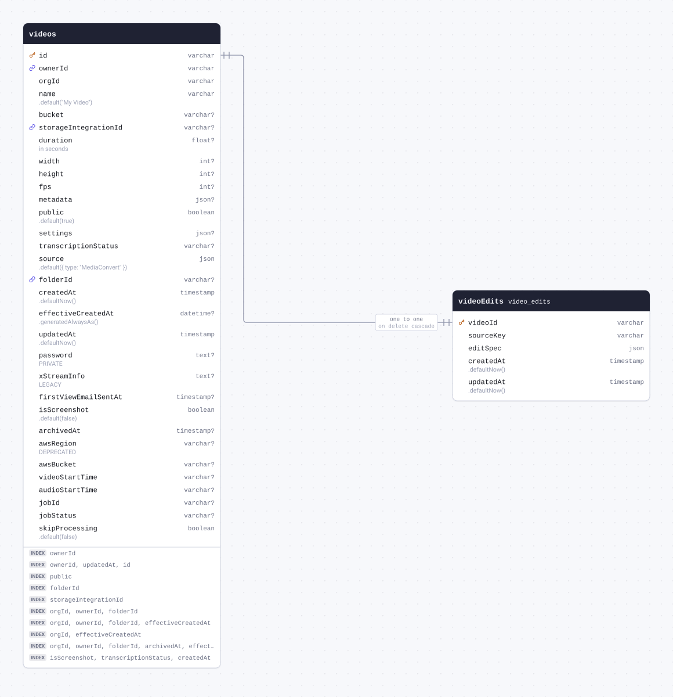

| Column      | Type        | Constraints                              | Default         | Description |
| ----------- | ----------- | ---------------------------------------- | --------------- | ----------- |
| `videoId`   | `varchar`   | PK NOT NULL → [videos.id](#table-videos) |                 |             |
| `sourceKey` | `varchar`   | NOT NULL                                 |                 |             |
| `editSpec`  | `json`      | NOT NULL                                 |                 |             |
| `createdAt` | `timestamp` | NOT NULL                                 | `.defaultNow()` |             |
| `updatedAt` | `timestamp` | NOT NULL                                 | `.defaultNow()` |             |

#### Definition

```sql
CREATE TABLE `video_edits` (
	`videoId` varchar(15) PRIMARY KEY,
	`sourceKey` varchar(512) NOT NULL,
	`editSpec` json NOT NULL,
	`createdAt` timestamp NOT NULL DEFAULT (now()),
	`updatedAt` timestamp NOT NULL DEFAULT (now()) ON UPDATE CURRENT_TIMESTAMP
);

ALTER TABLE `video_edits` ADD CONSTRAINT `video_edits_videoId_videos_id_fkey` FOREIGN KEY (`videoId`) REFERENCES `videos`(`id`) ON DELETE CASCADE;
```

#### References

- `videoId` → [videos.id](#table-videos) (one to one, on delete cascade)

<details>
<summary>Queries and their SQL</summary>

**Select**: Every row of videoEdits.

```ts
db.select().from(videoEdits);
```

```sql
select `videoId`, `sourceKey`, `editSpec`, `createdAt`, `updatedAt`
from `video_edits`
```

**Count**: How many rows videoEdits has.

```ts
db.select({ count: count() }).from(videoEdits);
```

```sql
select count(*)
from `video_edits`
```

**Find many**: The rows of videoEdits, through the relational query API.

```ts
db.query.videoEdits.findMany();
```

```sql
select `d0`.`videoId` as `videoId`, `d0`.`sourceKey` as `sourceKey`, `d0`.`editSpec` as `editSpec`, `d0`.`createdAt` as `createdAt`, `d0`.`updatedAt` as `updatedAt`
from `video_edits` as `d0`
```

**Find by primary key**: One row of videoEdits, through the relational query API.

```ts
db.query.videoEdits.findFirst({ where: { videoId: "videoId" } });
```

```sql
select `d0`.`videoId` as `videoId`, `d0`.`sourceKey` as `sourceKey`, `d0`.`editSpec` as `editSpec`, `d0`.`createdAt` as `createdAt`, `d0`.`updatedAt` as `updatedAt`
from `video_edits` as `d0`
where `d0`.`videoId` = ?
limit ?
-- params: ["videoId",1]
```

**Insert**: Adds a row to videoEdits, giving the columns that have no default.

```ts
db.insert(videoEdits).values({ videoId: "videoId", sourceKey: "sourceKey", editSpec: {} });
```

```sql
insert into `video_edits` (`videoId`, `sourceKey`, `editSpec`, `createdAt`, `updatedAt`)
values (?, ?, ?, default, default)
-- params: ["videoId","sourceKey","{}"]
```

**Update**: Changes a row of videoEdits, found by its primary key.

```ts
db.update(videoEdits).set({ sourceKey: "sourceKey" }).where(eq(videoEdits.videoId, "videoId"));
```

```sql
update `video_edits`
set `sourceKey` = ?
where `video_edits`.`videoId` = ?
-- params: ["sourceKey","videoId"]
```

**Delete**: Deletes a row of videoEdits, found by its primary key.

```ts
db.delete(videoEdits).where(eq(videoEdits.videoId, "videoId"));
```

```sql
delete from `video_edits`
where `video_edits`.`videoId` = ?
-- params: ["videoId"]
```

</details>

<a id="table-sharedVideos"></a>

### sharedVideos

Table `shared_videos`.

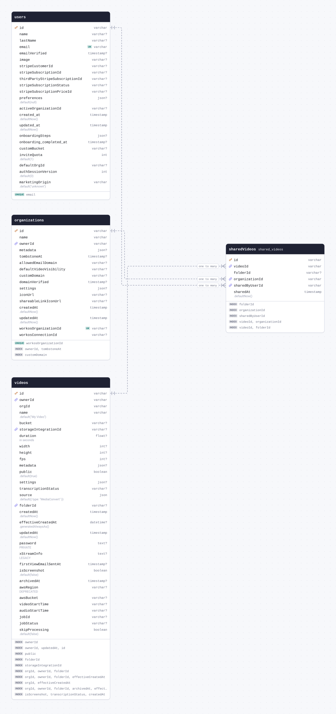

| Column           | Type        | Constraints                                         | Default         | Description |
| ---------------- | ----------- | --------------------------------------------------- | --------------- | ----------- |
| `id`             | `varchar`   | PK NOT NULL                                         |                 |             |
| `videoId`        | `varchar`   | NOT NULL → [videos.id](#table-videos)               |                 |             |
| `folderId`       | `varchar`   | NULL                                                |                 |             |
| `organizationId` | `varchar`   | NOT NULL → [organizations.id](#table-organizations) |                 |             |
| `sharedByUserId` | `varchar`   | NOT NULL → [users.id](#table-users)                 |                 |             |
| `sharedAt`       | `timestamp` | NOT NULL                                            | `.defaultNow()` |             |

#### Definition

```sql
CREATE TABLE `shared_videos` (
	`id` varchar(15) PRIMARY KEY,
	`videoId` varchar(15) NOT NULL,
	`folderId` varchar(15),
	`organizationId` varchar(15) NOT NULL,
	`sharedByUserId` varchar(15) NOT NULL,
	`sharedAt` timestamp NOT NULL DEFAULT (now())
);

CREATE INDEX `folder_id_idx` ON `shared_videos` (`folderId`);

CREATE INDEX `organization_id_idx` ON `shared_videos` (`organizationId`);

CREATE INDEX `shared_by_user_id_idx` ON `shared_videos` (`sharedByUserId`);

CREATE INDEX `video_id_organization_id_idx` ON `shared_videos` (`videoId`,`organizationId`);

CREATE INDEX `video_id_folder_id_idx` ON `shared_videos` (`videoId`,`folderId`);
```

#### Indexes

- INDEX `folderId`
- INDEX `organizationId`
- INDEX `sharedByUserId`
- INDEX `videoId`, `organizationId`
- INDEX `videoId`, `folderId`

#### References

- `videoId` → [videos.id](#table-videos) (many to one, defineRelations, no foreign key)
- `organizationId` → [organizations.id](#table-organizations) (many to one, defineRelations, no foreign key)
- `sharedByUserId` → [users.id](#table-users) (many to one, defineRelations, no foreign key)

<details>
<summary>Queries and their SQL</summary>

**Select**: Every row of sharedVideos.

```ts
db.select().from(sharedVideos);
```

```sql
select `id`, `videoId`, `folderId`, `organizationId`, `sharedByUserId`, `sharedAt`
from `shared_videos`
```

**Count**: How many rows sharedVideos has.

```ts
db.select({ count: count() }).from(sharedVideos);
```

```sql
select count(*)
from `shared_videos`
```

**Find many**: The rows of sharedVideos, through the relational query API.

```ts
db.query.sharedVideos.findMany();
```

```sql
select `d0`.`id` as `id`, `d0`.`videoId` as `videoId`, `d0`.`folderId` as `folderId`, `d0`.`organizationId` as `organizationId`, `d0`.`sharedByUserId` as `sharedByUserId`, `d0`.`sharedAt` as `sharedAt`
from `shared_videos` as `d0`
```

**Find by primary key**: One row of sharedVideos, through the relational query API.

```ts
db.query.sharedVideos.findFirst({ where: { id: "id" } });
```

```sql
select `d0`.`id` as `id`, `d0`.`videoId` as `videoId`, `d0`.`folderId` as `folderId`, `d0`.`organizationId` as `organizationId`, `d0`.`sharedByUserId` as `sharedByUserId`, `d0`.`sharedAt` as `sharedAt`
from `shared_videos` as `d0`
where `d0`.`id` = ?
limit ?
-- params: ["id",1]
```

**Insert**: Adds a row to sharedVideos, giving the columns that have no default.

```ts
db.insert(sharedVideos).values({
  id: "id",
  videoId: "videoId",
  organizationId: "organizationId",
  sharedByUserId: "sharedByUserId",
});
```

```sql
insert into `shared_videos` (`id`, `videoId`, `folderId`, `organizationId`, `sharedByUserId`, `sharedAt`)
values (?, ?, default, ?, ?, default)
-- params: ["id","videoId","organizationId","sharedByUserId"]
```

**Update**: Changes a row of sharedVideos, found by its primary key.

```ts
db.update(sharedVideos).set({ videoId: "videoId" }).where(eq(sharedVideos.id, "id"));
```

```sql
update `shared_videos`
set `videoId` = ?
where `shared_videos`.`id` = ?
-- params: ["videoId","id"]
```

**Delete**: Deletes a row of sharedVideos, found by its primary key.

```ts
db.delete(sharedVideos).where(eq(sharedVideos.id, "id"));
```

```sql
delete from `shared_videos`
where `shared_videos`.`id` = ?
-- params: ["id"]
```

</details>

<a id="table-videoViewerGrants"></a>

### videoViewerGrants

Table `video_viewer_grants`.

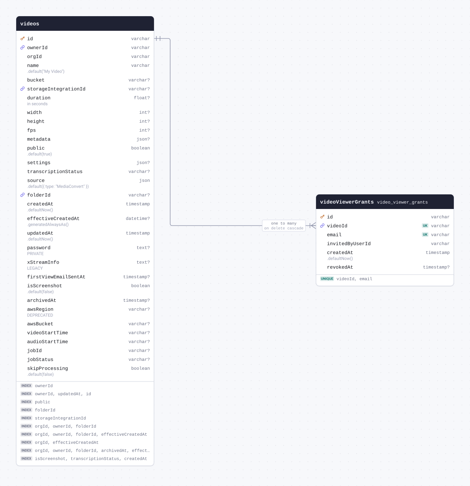

| Column            | Type        | Constraints                           | Default         | Description |
| ----------------- | ----------- | ------------------------------------- | --------------- | ----------- |
| `id`              | `varchar`   | PK NOT NULL                           |                 |             |
| `videoId`         | `varchar`   | NOT NULL → [videos.id](#table-videos) |                 |             |
| `email`           | `varchar`   | NOT NULL                              |                 |             |
| `invitedByUserId` | `varchar`   | NOT NULL                              |                 |             |
| `createdAt`       | `timestamp` | NOT NULL                              | `.defaultNow()` |             |
| `revokedAt`       | `timestamp` | NULL                                  |                 |             |

#### Definition

```sql
CREATE TABLE `video_viewer_grants` (
	`id` varchar(15) PRIMARY KEY,
	`videoId` varchar(15) NOT NULL,
	`email` varchar(255) NOT NULL,
	`invitedByUserId` varchar(15) NOT NULL,
	`createdAt` timestamp NOT NULL DEFAULT (now()),
	`revokedAt` timestamp,
	CONSTRAINT `video_email_idx` UNIQUE INDEX(`videoId`,`email`)
);

ALTER TABLE `video_viewer_grants` ADD CONSTRAINT `video_viewer_grants_videoId_videos_id_fkey` FOREIGN KEY (`videoId`) REFERENCES `videos`(`id`) ON DELETE CASCADE;
```

#### Indexes

- UNIQUE `videoId`, `email`

#### References

- `videoId` → [videos.id](#table-videos) (many to one, on delete cascade)

<details>
<summary>Queries and their SQL</summary>

**Select**: Every row of videoViewerGrants.

```ts
db.select().from(videoViewerGrants);
```

```sql
select `id`, `videoId`, `email`, `invitedByUserId`, `createdAt`, `revokedAt`
from `video_viewer_grants`
```

**Count**: How many rows videoViewerGrants has.

```ts
db.select({ count: count() }).from(videoViewerGrants);
```

```sql
select count(*)
from `video_viewer_grants`
```

**Find many**: The rows of videoViewerGrants, through the relational query API.

```ts
db.query.videoViewerGrants.findMany();
```

```sql
select `d0`.`id` as `id`, `d0`.`videoId` as `videoId`, `d0`.`email` as `email`, `d0`.`invitedByUserId` as `invitedByUserId`, `d0`.`createdAt` as `createdAt`, `d0`.`revokedAt` as `revokedAt`
from `video_viewer_grants` as `d0`
```

**Find by primary key**: One row of videoViewerGrants, through the relational query API.

```ts
db.query.videoViewerGrants.findFirst({ where: { id: "id" } });
```

```sql
select `d0`.`id` as `id`, `d0`.`videoId` as `videoId`, `d0`.`email` as `email`, `d0`.`invitedByUserId` as `invitedByUserId`, `d0`.`createdAt` as `createdAt`, `d0`.`revokedAt` as `revokedAt`
from `video_viewer_grants` as `d0`
where `d0`.`id` = ?
limit ?
-- params: ["id",1]
```

**Insert**: Adds a row to videoViewerGrants, giving the columns that have no default.

```ts
db.insert(videoViewerGrants).values({
  id: "id",
  videoId: "videoId",
  email: "email",
  invitedByUserId: "invitedByUserId",
});
```

```sql
insert into `video_viewer_grants` (`id`, `videoId`, `email`, `invitedByUserId`, `createdAt`, `revokedAt`)
values (?, ?, ?, ?, default, default)
-- params: ["id","videoId","email","invitedByUserId"]
```

**Update**: Changes a row of videoViewerGrants, found by its primary key.

```ts
db.update(videoViewerGrants).set({ videoId: "videoId" }).where(eq(videoViewerGrants.id, "id"));
```

```sql
update `video_viewer_grants`
set `videoId` = ?
where `video_viewer_grants`.`id` = ?
-- params: ["videoId","id"]
```

**Delete**: Deletes a row of videoViewerGrants, found by its primary key.

```ts
db.delete(videoViewerGrants).where(eq(videoViewerGrants.id, "id"));
```

```sql
delete from `video_viewer_grants`
where `video_viewer_grants`.`id` = ?
-- params: ["id"]
```

</details>

<a id="table-comments"></a>

### comments

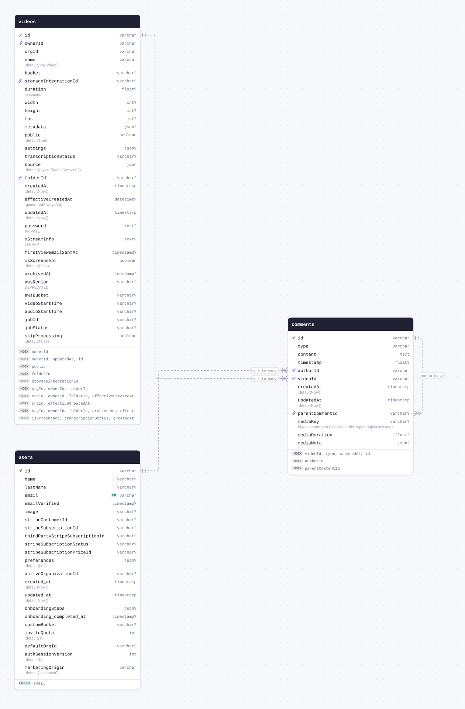

| Column            | Type        | Constraints                           | Default         | Description                                                                                                                                                                                      |
| ----------------- | ----------- | ------------------------------------- | --------------- | ------------------------------------------------------------------------------------------------------------------------------------------------------------------------------------------------ |
| `id`              | `varchar`   | PK NOT NULL                           |                 |                                                                                                                                                                                                  |
| `type`            | `varchar`   | NOT NULL                              |                 |                                                                                                                                                                                                  |
| `content`         | `text`      | NOT NULL                              |                 |                                                                                                                                                                                                  |
| `timestamp`       | `float`     | NULL                                  |                 |                                                                                                                                                                                                  |
| `authorId`        | `varchar`   | NOT NULL → [users.id](#table-users)   |                 |                                                                                                                                                                                                  |
| `videoId`         | `varchar`   | NOT NULL → [videos.id](#table-videos) |                 |                                                                                                                                                                                                  |
| `createdAt`       | `timestamp` | NOT NULL                              | `.defaultNow()` |                                                                                                                                                                                                  |
| `updatedAt`       | `timestamp` | NOT NULL                              | `.defaultNow()` |                                                                                                                                                                                                  |
| `parentCommentId` | `varchar`   | NULL → [comments.id](#table-comments) |                 |                                                                                                                                                                                                  |
| `mediaKey`        | `varchar`   | NULL                                  |                 | Media comments ("video"/"audio" type): object key under the parent video's prefix (`${ownerId}/${videoId}/comments/${commentId}/...`), served via /api/storage/object which asserts that prefix. |
| `mediaDuration`   | `float`     | NULL                                  |                 |                                                                                                                                                                                                  |
| `mediaMeta`       | `json`      | NULL                                  |                 |                                                                                                                                                                                                  |

#### Definition

```sql
CREATE TABLE `comments` (
	`id` varchar(15) PRIMARY KEY,
	`type` varchar(6) NOT NULL,
	`content` text NOT NULL,
	`timestamp` float,
	`authorId` varchar(15) NOT NULL,
	`videoId` varchar(15) NOT NULL,
	`createdAt` timestamp NOT NULL DEFAULT (now()),
	`updatedAt` timestamp NOT NULL DEFAULT (now()) ON UPDATE CURRENT_TIMESTAMP,
	`parentCommentId` varchar(15),
	`mediaKey` varchar(512),
	`mediaDuration` float,
	`mediaMeta` json
);

CREATE INDEX `video_type_created_idx` ON `comments` (`videoId`,`type`,`createdAt`,`id`);

CREATE INDEX `author_id_idx` ON `comments` (`authorId`);

CREATE INDEX `parent_comment_id_idx` ON `comments` (`parentCommentId`);
```

#### Indexes

- INDEX `videoId`, `type`, `createdAt`, `id`
- INDEX `authorId`
- INDEX `parentCommentId`

#### References

- `authorId` → [users.id](#table-users) (many to one, defineRelations, no foreign key)
- `videoId` → [videos.id](#table-videos) (many to one, defineRelations, no foreign key)
- `parentCommentId` → [comments.id](#table-comments) (many to one, defineRelations, no foreign key)

#### Referenced by

- `id` → [comments.parentCommentId](#table-comments) (one to many, defineRelations)

<details>
<summary>Queries and their SQL</summary>

**Select**: Every row of comments.

```ts
db.select().from(comments);
```

```sql
select `id`, `type`, `content`, `timestamp`, `authorId`, `videoId`, `createdAt`, `updatedAt`, `parentCommentId`, `mediaKey`, `mediaDuration`, `mediaMeta`
from `comments`
```

**Count**: How many rows comments has.

```ts
db.select({ count: count() }).from(comments);
```

```sql
select count(*)
from `comments`
```

**Find many**: The rows of comments, through the relational query API.

```ts
db.query.comments.findMany();
```

```sql
select `d0`.`id` as `id`, `d0`.`type` as `type`, `d0`.`content` as `content`, `d0`.`timestamp` as `timestamp`, `d0`.`authorId` as `authorId`, `d0`.`videoId` as `videoId`, `d0`.`createdAt` as `createdAt`, `d0`.`updatedAt` as `updatedAt`, `d0`.`parentCommentId` as `parentCommentId`, `d0`.`mediaKey` as `mediaKey`, `d0`.`mediaDuration` as `mediaDuration`, `d0`.`mediaMeta` as `mediaMeta`
from `comments` as `d0`
```

**Find by primary key**: One row of comments, through the relational query API.

```ts
db.query.comments.findFirst({ where: { id: "id" } });
```

```sql
select `d0`.`id` as `id`, `d0`.`type` as `type`, `d0`.`content` as `content`, `d0`.`timestamp` as `timestamp`, `d0`.`authorId` as `authorId`, `d0`.`videoId` as `videoId`, `d0`.`createdAt` as `createdAt`, `d0`.`updatedAt` as `updatedAt`, `d0`.`parentCommentId` as `parentCommentId`, `d0`.`mediaKey` as `mediaKey`, `d0`.`mediaDuration` as `mediaDuration`, `d0`.`mediaMeta` as `mediaMeta`
from `comments` as `d0`
where `d0`.`id` = ?
limit ?
-- params: ["id",1]
```

**Insert**: Adds a row to comments, giving the columns that have no default.

```ts
db.insert(comments).values({
  id: "id",
  type: "type",
  content: "content",
  authorId: "authorId",
  videoId: "videoId",
});
```

```sql
insert into `comments` (`id`, `type`, `content`, `timestamp`, `authorId`, `videoId`, `createdAt`, `updatedAt`, `parentCommentId`, `mediaKey`, `mediaDuration`, `mediaMeta`)
values (?, ?, ?, default, ?, ?, default, default, default, default, default, default)
-- params: ["id","type","content","authorId","videoId"]
```

**Update**: Changes a row of comments, found by its primary key.

```ts
db.update(comments).set({ type: "type" }).where(eq(comments.id, "id"));
```

```sql
update `comments`
set `type` = ?
where `comments`.`id` = ?
-- params: ["type","id"]
```

**Delete**: Deletes a row of comments, found by its primary key.

```ts
db.delete(comments).where(eq(comments.id, "id"));
```

```sql
delete from `comments`
where `comments`.`id` = ?
-- params: ["id"]
```

</details>

<a id="table-notifications"></a>

### notifications

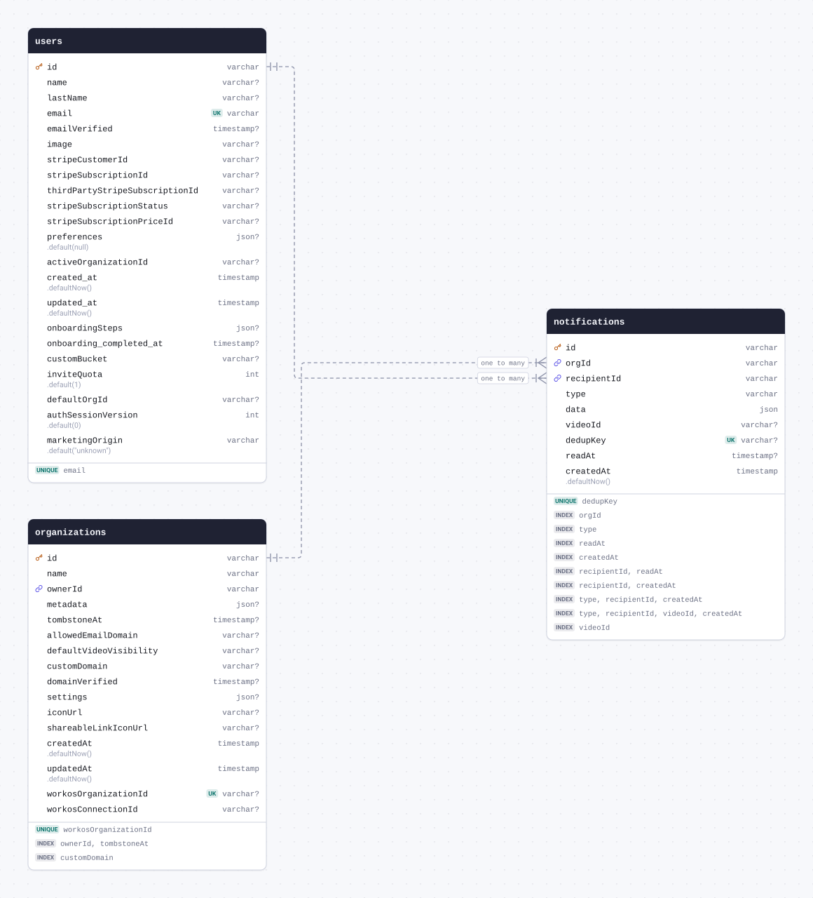

| Column        | Type        | Constraints                                         | Default         | Description |
| ------------- | ----------- | --------------------------------------------------- | --------------- | ----------- |
| `id`          | `varchar`   | PK NOT NULL                                         |                 |             |
| `orgId`       | `varchar`   | NOT NULL → [organizations.id](#table-organizations) |                 |             |
| `recipientId` | `varchar`   | NOT NULL → [users.id](#table-users)                 |                 |             |
| `type`        | `varchar`   | NOT NULL                                            |                 |             |
| `data`        | `json`      | NOT NULL                                            |                 |             |
| `videoId`     | `varchar`   | NULL                                                |                 |             |
| `dedupKey`    | `varchar`   | NULL                                                |                 |             |
| `readAt`      | `timestamp` | NULL                                                |                 |             |
| `createdAt`   | `timestamp` | NOT NULL                                            | `.defaultNow()` |             |

#### Definition

```sql
CREATE TABLE `notifications` (
	`id` varchar(15) PRIMARY KEY,
	`orgId` varchar(15) NOT NULL,
	`recipientId` varchar(15) NOT NULL,
	`type` varchar(16) NOT NULL,
	`data` json NOT NULL,
	`videoId` varchar(50),
	`dedupKey` varchar(128),
	`readAt` timestamp,
	`createdAt` timestamp NOT NULL DEFAULT (now()),
	CONSTRAINT `dedup_key_idx` UNIQUE INDEX(`dedupKey`)
);

CREATE INDEX `org_id_idx` ON `notifications` (`orgId`);

CREATE INDEX `type_idx` ON `notifications` (`type`);

CREATE INDEX `read_at_idx` ON `notifications` (`readAt`);

CREATE INDEX `created_at_idx` ON `notifications` (`createdAt`);

CREATE INDEX `recipient_read_idx` ON `notifications` (`recipientId`,`readAt`);

CREATE INDEX `recipient_created_idx` ON `notifications` (`recipientId`,`createdAt`);

CREATE INDEX `type_recipient_created_idx` ON `notifications` (`type`,`recipientId`,`createdAt`);

CREATE INDEX `type_recipient_video_created_idx` ON `notifications` (`type`,`recipientId`,`videoId`,`createdAt`);

CREATE INDEX `video_id_idx` ON `notifications` (`videoId`);
```

#### Indexes

- INDEX `orgId`
- INDEX `type`
- INDEX `readAt`
- INDEX `createdAt`
- INDEX `recipientId`, `readAt`
- INDEX `recipientId`, `createdAt`
- UNIQUE `dedupKey`
- INDEX `type`, `recipientId`, `createdAt`
- INDEX `type`, `recipientId`, `videoId`, `createdAt`
- INDEX `videoId`

#### References

- `orgId` → [organizations.id](#table-organizations) (many to one, defineRelations, no foreign key)
- `recipientId` → [users.id](#table-users) (many to one, defineRelations, no foreign key)

<details>
<summary>Queries and their SQL</summary>

**Select**: Every row of notifications.

```ts
db.select().from(notifications);
```

```sql
select `id`, `orgId`, `recipientId`, `type`, `data`, `videoId`, `dedupKey`, `readAt`, `createdAt`
from `notifications`
```

**Count**: How many rows notifications has.

```ts
db.select({ count: count() }).from(notifications);
```

```sql
select count(*)
from `notifications`
```

**Find many**: The rows of notifications, through the relational query API.

```ts
db.query.notifications.findMany();
```

```sql
select `d0`.`id` as `id`, `d0`.`orgId` as `orgId`, `d0`.`recipientId` as `recipientId`, `d0`.`type` as `type`, `d0`.`data` as `data`, `d0`.`videoId` as `videoId`, `d0`.`dedupKey` as `dedupKey`, `d0`.`readAt` as `readAt`, `d0`.`createdAt` as `createdAt`
from `notifications` as `d0`
```

**Find by primary key**: One row of notifications, through the relational query API.

```ts
db.query.notifications.findFirst({ where: { id: "id" } });
```

```sql
select `d0`.`id` as `id`, `d0`.`orgId` as `orgId`, `d0`.`recipientId` as `recipientId`, `d0`.`type` as `type`, `d0`.`data` as `data`, `d0`.`videoId` as `videoId`, `d0`.`dedupKey` as `dedupKey`, `d0`.`readAt` as `readAt`, `d0`.`createdAt` as `createdAt`
from `notifications` as `d0`
where `d0`.`id` = ?
limit ?
-- params: ["id",1]
```

**Insert**: Adds a row to notifications, giving the columns that have no default.

```ts
db.insert(notifications).values({
  id: "id",
  orgId: "orgId",
  recipientId: "recipientId",
  type: "type",
  data: {},
});
```

```sql
insert into `notifications` (`id`, `orgId`, `recipientId`, `type`, `data`, `videoId`, `dedupKey`, `readAt`, `createdAt`)
values (?, ?, ?, ?, ?, default, default, default, default)
-- params: ["id","orgId","recipientId","type","{}"]
```

**Update**: Changes a row of notifications, found by its primary key.

```ts
db.update(notifications).set({ orgId: "orgId" }).where(eq(notifications.id, "id"));
```

```sql
update `notifications`
set `orgId` = ?
where `notifications`.`id` = ?
-- params: ["orgId","id"]
```

**Delete**: Deletes a row of notifications, found by its primary key.

```ts
db.delete(notifications).where(eq(notifications.id, "id"));
```

```sql
delete from `notifications`
where `notifications`.`id` = ?
-- params: ["id"]
```

</details>

<a id="table-messengerConversations"></a>

### messengerConversations

Table `messenger_conversations`.

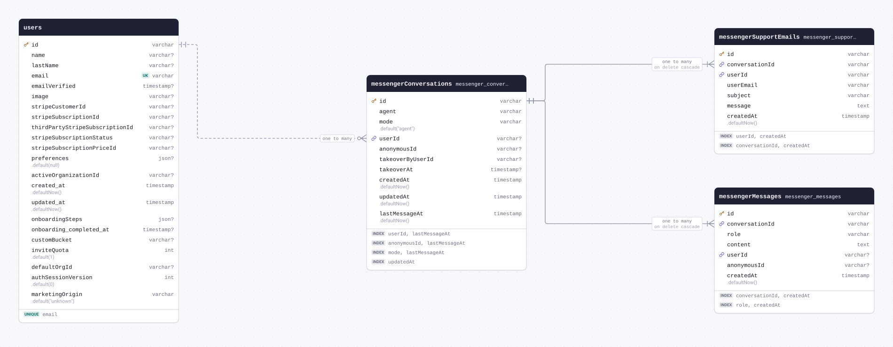

| Column             | Type        | Constraints                     | Default             | Description |
| ------------------ | ----------- | ------------------------------- | ------------------- | ----------- |
| `id`               | `varchar`   | PK NOT NULL                     |                     |             |
| `agent`            | `varchar`   | NOT NULL                        |                     |             |
| `mode`             | `varchar`   | NOT NULL                        | `.default("agent")` |             |
| `userId`           | `varchar`   | NULL → [users.id](#table-users) |                     |             |
| `anonymousId`      | `varchar`   | NULL                            |                     |             |
| `takeoverByUserId` | `varchar`   | NULL                            |                     |             |
| `takeoverAt`       | `timestamp` | NULL                            |                     |             |
| `createdAt`        | `timestamp` | NOT NULL                        | `.defaultNow()`     |             |
| `updatedAt`        | `timestamp` | NOT NULL                        | `.defaultNow()`     |             |
| `lastMessageAt`    | `timestamp` | NOT NULL                        | `.defaultNow()`     |             |

#### Definition

```sql
CREATE TABLE `messenger_conversations` (
	`id` varchar(15) PRIMARY KEY,
	`agent` varchar(32) NOT NULL,
	`mode` varchar(16) NOT NULL DEFAULT 'agent',
	`userId` varchar(15),
	`anonymousId` varchar(64),
	`takeoverByUserId` varchar(15),
	`takeoverAt` timestamp,
	`createdAt` timestamp NOT NULL DEFAULT (now()),
	`updatedAt` timestamp NOT NULL DEFAULT (now()) ON UPDATE CURRENT_TIMESTAMP,
	`lastMessageAt` timestamp NOT NULL DEFAULT (now())
);

CREATE INDEX `user_last_message_idx` ON `messenger_conversations` (`userId`,`lastMessageAt`);

CREATE INDEX `anonymous_last_message_idx` ON `messenger_conversations` (`anonymousId`,`lastMessageAt`);

CREATE INDEX `mode_last_message_idx` ON `messenger_conversations` (`mode`,`lastMessageAt`);

CREATE INDEX `updated_at_idx` ON `messenger_conversations` (`updatedAt`);
```

#### Indexes

- INDEX `userId`, `lastMessageAt`
- INDEX `anonymousId`, `lastMessageAt`
- INDEX `mode`, `lastMessageAt`
- INDEX `updatedAt`

#### References

- `userId` → [users.id](#table-users) (many to one, defineRelations, no foreign key)

#### Referenced by

- `id` → [messengerMessages.conversationId](#table-messengerMessages) (one to many, on delete cascade)
- `id` → [messengerSupportEmails.conversationId](#table-messengerSupportEmails) (one to many, on delete cascade)

<details>
<summary>Queries and their SQL</summary>

**Select**: Every row of messengerConversations.

```ts
db.select().from(messengerConversations);
```

```sql
select `id`, `agent`, `mode`, `userId`, `anonymousId`, `takeoverByUserId`, `takeoverAt`, `createdAt`, `updatedAt`, `lastMessageAt`
from `messenger_conversations`
```

**Count**: How many rows messengerConversations has.

```ts
db.select({ count: count() }).from(messengerConversations);
```

```sql
select count(*)
from `messenger_conversations`
```

**Find many**: The rows of messengerConversations, through the relational query API.

```ts
db.query.messengerConversations.findMany();
```

```sql
select `d0`.`id` as `id`, `d0`.`agent` as `agent`, `d0`.`mode` as `mode`, `d0`.`userId` as `userId`, `d0`.`anonymousId` as `anonymousId`, `d0`.`takeoverByUserId` as `takeoverByUserId`, `d0`.`takeoverAt` as `takeoverAt`, `d0`.`createdAt` as `createdAt`, `d0`.`updatedAt` as `updatedAt`, `d0`.`lastMessageAt` as `lastMessageAt`
from `messenger_conversations` as `d0`
```

**Find by primary key**: One row of messengerConversations, through the relational query API.

```ts
db.query.messengerConversations.findFirst({ where: { id: "id" } });
```

```sql
select `d0`.`id` as `id`, `d0`.`agent` as `agent`, `d0`.`mode` as `mode`, `d0`.`userId` as `userId`, `d0`.`anonymousId` as `anonymousId`, `d0`.`takeoverByUserId` as `takeoverByUserId`, `d0`.`takeoverAt` as `takeoverAt`, `d0`.`createdAt` as `createdAt`, `d0`.`updatedAt` as `updatedAt`, `d0`.`lastMessageAt` as `lastMessageAt`
from `messenger_conversations` as `d0`
where `d0`.`id` = ?
limit ?
-- params: ["id",1]
```

**Insert**: Adds a row to messengerConversations, giving the columns that have no default.

```ts
db.insert(messengerConversations).values({ id: "id", agent: "agent" });
```

```sql
insert into `messenger_conversations` (`id`, `agent`, `mode`, `userId`, `anonymousId`, `takeoverByUserId`, `takeoverAt`, `createdAt`, `updatedAt`, `lastMessageAt`)
values (?, ?, default, default, default, default, default, default, default, default)
-- params: ["id","agent"]
```

**Update**: Changes a row of messengerConversations, found by its primary key.

```ts
db.update(messengerConversations)
  .set({ agent: "agent" })
  .where(eq(messengerConversations.id, "id"));
```

```sql
update `messenger_conversations`
set `agent` = ?
where `messenger_conversations`.`id` = ?
-- params: ["agent","id"]
```

**Delete**: Deletes a row of messengerConversations, found by its primary key.

```ts
db.delete(messengerConversations).where(eq(messengerConversations.id, "id"));
```

```sql
delete from `messenger_conversations`
where `messenger_conversations`.`id` = ?
-- params: ["id"]
```

</details>

<a id="table-messengerMessages"></a>

### messengerMessages

Table `messenger_messages`.

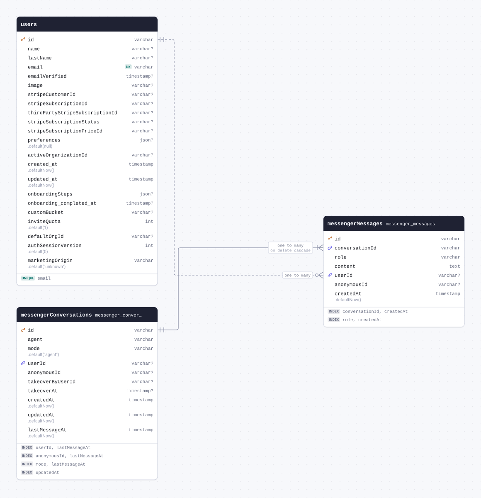

| Column           | Type        | Constraints                                                           | Default         | Description |
| ---------------- | ----------- | --------------------------------------------------------------------- | --------------- | ----------- |
| `id`             | `varchar`   | PK NOT NULL                                                           |                 |             |
| `conversationId` | `varchar`   | NOT NULL → [messengerConversations.id](#table-messengerConversations) |                 |             |
| `role`           | `varchar`   | NOT NULL                                                              |                 |             |
| `content`        | `text`      | NOT NULL                                                              |                 |             |
| `userId`         | `varchar`   | NULL → [users.id](#table-users)                                       |                 |             |
| `anonymousId`    | `varchar`   | NULL                                                                  |                 |             |
| `createdAt`      | `timestamp` | NOT NULL                                                              | `.defaultNow()` |             |

#### Definition

```sql
CREATE TABLE `messenger_messages` (
	`id` varchar(15) PRIMARY KEY,
	`conversationId` varchar(15) NOT NULL,
	`role` varchar(16) NOT NULL,
	`content` text NOT NULL,
	`userId` varchar(15),
	`anonymousId` varchar(64),
	`createdAt` timestamp NOT NULL DEFAULT (now())
);

CREATE INDEX `conversation_created_at_idx` ON `messenger_messages` (`conversationId`,`createdAt`);

CREATE INDEX `role_created_at_idx` ON `messenger_messages` (`role`,`createdAt`);

ALTER TABLE `messenger_messages` ADD CONSTRAINT `messenger_messages_v1HSvDjJoJGa_fkey` FOREIGN KEY (`conversationId`) REFERENCES `messenger_conversations`(`id`) ON DELETE CASCADE;
```

#### Indexes

- INDEX `conversationId`, `createdAt`
- INDEX `role`, `createdAt`

#### References

- `conversationId` → [messengerConversations.id](#table-messengerConversations) (many to one, on delete cascade)
- `userId` → [users.id](#table-users) (many to one, defineRelations, no foreign key)

<details>
<summary>Queries and their SQL</summary>

**Select**: Every row of messengerMessages.

```ts
db.select().from(messengerMessages);
```

```sql
select `id`, `conversationId`, `role`, `content`, `userId`, `anonymousId`, `createdAt`
from `messenger_messages`
```

**Count**: How many rows messengerMessages has.

```ts
db.select({ count: count() }).from(messengerMessages);
```

```sql
select count(*)
from `messenger_messages`
```

**Find many**: The rows of messengerMessages, through the relational query API.

```ts
db.query.messengerMessages.findMany();
```

```sql
select `d0`.`id` as `id`, `d0`.`conversationId` as `conversationId`, `d0`.`role` as `role`, `d0`.`content` as `content`, `d0`.`userId` as `userId`, `d0`.`anonymousId` as `anonymousId`, `d0`.`createdAt` as `createdAt`
from `messenger_messages` as `d0`
```

**Find by primary key**: One row of messengerMessages, through the relational query API.

```ts
db.query.messengerMessages.findFirst({ where: { id: "id" } });
```

```sql
select `d0`.`id` as `id`, `d0`.`conversationId` as `conversationId`, `d0`.`role` as `role`, `d0`.`content` as `content`, `d0`.`userId` as `userId`, `d0`.`anonymousId` as `anonymousId`, `d0`.`createdAt` as `createdAt`
from `messenger_messages` as `d0`
where `d0`.`id` = ?
limit ?
-- params: ["id",1]
```

**Insert**: Adds a row to messengerMessages, giving the columns that have no default.

```ts
db.insert(messengerMessages).values({
  id: "id",
  conversationId: "conversationId",
  role: "role",
  content: "content",
});
```

```sql
insert into `messenger_messages` (`id`, `conversationId`, `role`, `content`, `userId`, `anonymousId`, `createdAt`)
values (?, ?, ?, ?, default, default, default)
-- params: ["id","conversationId","role","content"]
```

**Update**: Changes a row of messengerMessages, found by its primary key.

```ts
db.update(messengerMessages)
  .set({ conversationId: "conversationId" })
  .where(eq(messengerMessages.id, "id"));
```

```sql
update `messenger_messages`
set `conversationId` = ?
where `messenger_messages`.`id` = ?
-- params: ["conversationId","id"]
```

**Delete**: Deletes a row of messengerMessages, found by its primary key.

```ts
db.delete(messengerMessages).where(eq(messengerMessages.id, "id"));
```

```sql
delete from `messenger_messages`
where `messenger_messages`.`id` = ?
-- params: ["id"]
```

</details>

<a id="table-messengerSupportEmails"></a>

### messengerSupportEmails

Table `messenger_support_emails`.

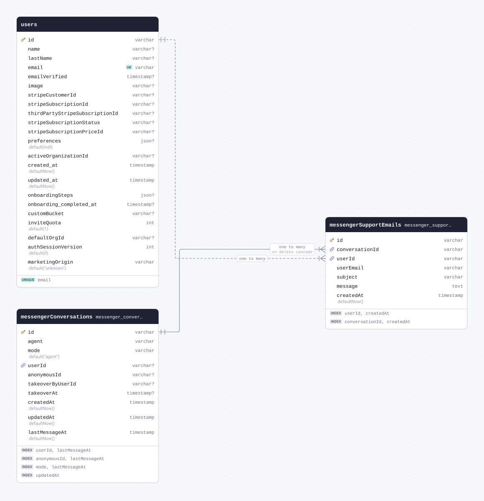

| Column           | Type        | Constraints                                                           | Default         | Description |
| ---------------- | ----------- | --------------------------------------------------------------------- | --------------- | ----------- |
| `id`             | `varchar`   | PK NOT NULL                                                           |                 |             |
| `conversationId` | `varchar`   | NOT NULL → [messengerConversations.id](#table-messengerConversations) |                 |             |
| `userId`         | `varchar`   | NOT NULL → [users.id](#table-users)                                   |                 |             |
| `userEmail`      | `varchar`   | NOT NULL                                                              |                 |             |
| `subject`        | `varchar`   | NOT NULL                                                              |                 |             |
| `message`        | `text`      | NOT NULL                                                              |                 |             |
| `createdAt`      | `timestamp` | NOT NULL                                                              | `.defaultNow()` |             |

#### Definition

```sql
CREATE TABLE `messenger_support_emails` (
	`id` varchar(15) PRIMARY KEY,
	`conversationId` varchar(15) NOT NULL,
	`userId` varchar(15) NOT NULL,
	`userEmail` varchar(255) NOT NULL,
	`subject` varchar(255) NOT NULL,
	`message` text NOT NULL,
	`createdAt` timestamp NOT NULL DEFAULT (now())
);

CREATE INDEX `support_email_user_created_at_idx` ON `messenger_support_emails` (`userId`,`createdAt`);

CREATE INDEX `support_email_conversation_created_at_idx` ON `messenger_support_emails` (`conversationId`,`createdAt`);

ALTER TABLE `messenger_support_emails` ADD CONSTRAINT `support_email_conversation_fk` FOREIGN KEY (`conversationId`) REFERENCES `messenger_conversations`(`id`) ON DELETE CASCADE;
```

#### Indexes

- INDEX `userId`, `createdAt`
- INDEX `conversationId`, `createdAt`

#### References

- `conversationId` → [messengerConversations.id](#table-messengerConversations) (many to one, on delete cascade)
- `userId` → [users.id](#table-users) (many to one, defineRelations, no foreign key)

<details>
<summary>Queries and their SQL</summary>

**Select**: Every row of messengerSupportEmails.

```ts
db.select().from(messengerSupportEmails);
```

```sql
select `id`, `conversationId`, `userId`, `userEmail`, `subject`, `message`, `createdAt`
from `messenger_support_emails`
```

**Count**: How many rows messengerSupportEmails has.

```ts
db.select({ count: count() }).from(messengerSupportEmails);
```

```sql
select count(*)
from `messenger_support_emails`
```

**Find many**: The rows of messengerSupportEmails, through the relational query API.

```ts
db.query.messengerSupportEmails.findMany();
```

```sql
select `d0`.`id` as `id`, `d0`.`conversationId` as `conversationId`, `d0`.`userId` as `userId`, `d0`.`userEmail` as `userEmail`, `d0`.`subject` as `subject`, `d0`.`message` as `message`, `d0`.`createdAt` as `createdAt`
from `messenger_support_emails` as `d0`
```

**Find by primary key**: One row of messengerSupportEmails, through the relational query API.

```ts
db.query.messengerSupportEmails.findFirst({ where: { id: "id" } });
```

```sql
select `d0`.`id` as `id`, `d0`.`conversationId` as `conversationId`, `d0`.`userId` as `userId`, `d0`.`userEmail` as `userEmail`, `d0`.`subject` as `subject`, `d0`.`message` as `message`, `d0`.`createdAt` as `createdAt`
from `messenger_support_emails` as `d0`
where `d0`.`id` = ?
limit ?
-- params: ["id",1]
```

**Insert**: Adds a row to messengerSupportEmails, giving the columns that have no default.

```ts
db.insert(messengerSupportEmails).values({
  id: "id",
  conversationId: "conversationId",
  userId: "userId",
  userEmail: "userEmail",
  subject: "subject",
  message: "message",
});
```

```sql
insert into `messenger_support_emails` (`id`, `conversationId`, `userId`, `userEmail`, `subject`, `message`, `createdAt`)
values (?, ?, ?, ?, ?, ?, default)
-- params: ["id","conversationId","userId","userEmail","subject","message"]
```

**Update**: Changes a row of messengerSupportEmails, found by its primary key.

```ts
db.update(messengerSupportEmails)
  .set({ conversationId: "conversationId" })
  .where(eq(messengerSupportEmails.id, "id"));
```

```sql
update `messenger_support_emails`
set `conversationId` = ?
where `messenger_support_emails`.`id` = ?
-- params: ["conversationId","id"]
```

**Delete**: Deletes a row of messengerSupportEmails, found by its primary key.

```ts
db.delete(messengerSupportEmails).where(eq(messengerSupportEmails.id, "id"));
```

```sql
delete from `messenger_support_emails`
where `messenger_support_emails`.`id` = ?
-- params: ["id"]
```

</details>

<a id="table-signedBaas"></a>

### signedBaas

Table `signed_baas`.

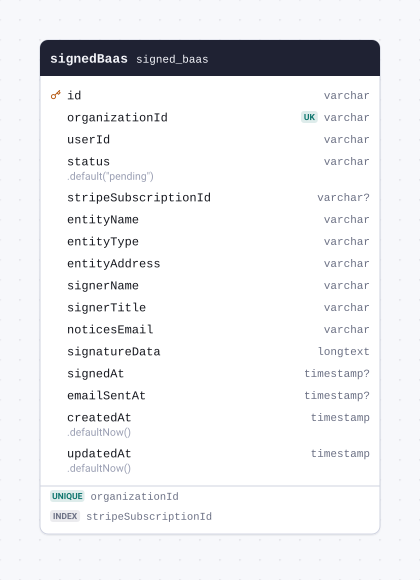

| Column                 | Type        | Constraints | Default               | Description |
| ---------------------- | ----------- | ----------- | --------------------- | ----------- |
| `id`                   | `varchar`   | PK NOT NULL |                       |             |
| `organizationId`       | `varchar`   | NOT NULL    |                       |             |
| `userId`               | `varchar`   | NOT NULL    |                       |             |
| `status`               | `varchar`   | NOT NULL    | `.default("pending")` |             |
| `stripeSubscriptionId` | `varchar`   | NULL        |                       |             |
| `entityName`           | `varchar`   | NOT NULL    |                       |             |
| `entityType`           | `varchar`   | NOT NULL    |                       |             |
| `entityAddress`        | `varchar`   | NOT NULL    |                       |             |
| `signerName`           | `varchar`   | NOT NULL    |                       |             |
| `signerTitle`          | `varchar`   | NOT NULL    |                       |             |
| `noticesEmail`         | `varchar`   | NOT NULL    |                       |             |
| `signatureData`        | `longtext`  | NOT NULL    |                       |             |
| `signedAt`             | `timestamp` | NULL        |                       |             |
| `emailSentAt`          | `timestamp` | NULL        |                       |             |
| `createdAt`            | `timestamp` | NOT NULL    | `.defaultNow()`       |             |
| `updatedAt`            | `timestamp` | NOT NULL    | `.defaultNow()`       |             |

#### Definition

```sql
CREATE TABLE `signed_baas` (
	`id` varchar(15) PRIMARY KEY,
	`organizationId` varchar(15) NOT NULL,
	`userId` varchar(15) NOT NULL,
	`status` varchar(255) NOT NULL DEFAULT 'pending',
	`stripeSubscriptionId` varchar(255),
	`entityName` varchar(255) NOT NULL,
	`entityType` varchar(255) NOT NULL,
	`entityAddress` varchar(500) NOT NULL,
	`signerName` varchar(255) NOT NULL,
	`signerTitle` varchar(255) NOT NULL,
	`noticesEmail` varchar(255) NOT NULL,
	`signatureData` longtext NOT NULL,
	`signedAt` timestamp,
	`emailSentAt` timestamp,
	`createdAt` timestamp NOT NULL DEFAULT (now()),
	`updatedAt` timestamp NOT NULL DEFAULT (now()) ON UPDATE CURRENT_TIMESTAMP,
	CONSTRAINT `signed_baa_organization_id_idx` UNIQUE INDEX(`organizationId`)
);

CREATE INDEX `signed_baa_stripe_subscription_idx` ON `signed_baas` (`stripeSubscriptionId`);
```

#### Indexes

- UNIQUE `organizationId`
- INDEX `stripeSubscriptionId`

<details>
<summary>Queries and their SQL</summary>

**Select**: Every row of signedBaas.

```ts
db.select().from(signedBaas);
```

```sql
select `id`, `organizationId`, `userId`, `status`, `stripeSubscriptionId`, `entityName`, `entityType`, `entityAddress`, `signerName`, `signerTitle`, `noticesEmail`, `signatureData`, `signedAt`, `emailSentAt`, `createdAt`, `updatedAt`
from `signed_baas`
```

**Count**: How many rows signedBaas has.

```ts
db.select({ count: count() }).from(signedBaas);
```

```sql
select count(*)
from `signed_baas`
```

**Find many**: The rows of signedBaas, through the relational query API.

```ts
db.query.signedBaas.findMany();
```

```sql
select `d0`.`id` as `id`, `d0`.`organizationId` as `organizationId`, `d0`.`userId` as `userId`, `d0`.`status` as `status`, `d0`.`stripeSubscriptionId` as `stripeSubscriptionId`, `d0`.`entityName` as `entityName`, `d0`.`entityType` as `entityType`, `d0`.`entityAddress` as `entityAddress`, `d0`.`signerName` as `signerName`, `d0`.`signerTitle` as `signerTitle`, `d0`.`noticesEmail` as `noticesEmail`, `d0`.`signatureData` as `signatureData`, `d0`.`signedAt` as `signedAt`, `d0`.`emailSentAt` as `emailSentAt`, `d0`.`createdAt` as `createdAt`, `d0`.`updatedAt` as `updatedAt`
from `signed_baas` as `d0`
```

**Find by primary key**: One row of signedBaas, through the relational query API.

```ts
db.query.signedBaas.findFirst({ where: { id: "id" } });
```

```sql
select `d0`.`id` as `id`, `d0`.`organizationId` as `organizationId`, `d0`.`userId` as `userId`, `d0`.`status` as `status`, `d0`.`stripeSubscriptionId` as `stripeSubscriptionId`, `d0`.`entityName` as `entityName`, `d0`.`entityType` as `entityType`, `d0`.`entityAddress` as `entityAddress`, `d0`.`signerName` as `signerName`, `d0`.`signerTitle` as `signerTitle`, `d0`.`noticesEmail` as `noticesEmail`, `d0`.`signatureData` as `signatureData`, `d0`.`signedAt` as `signedAt`, `d0`.`emailSentAt` as `emailSentAt`, `d0`.`createdAt` as `createdAt`, `d0`.`updatedAt` as `updatedAt`
from `signed_baas` as `d0`
where `d0`.`id` = ?
limit ?
-- params: ["id",1]
```

**Insert**: Adds a row to signedBaas, giving the columns that have no default.

```ts
db.insert(signedBaas).values({
  id: "id",
  organizationId: "organizationId",
  userId: "userId",
  entityName: "entityName",
  entityType: "entityType",
  entityAddress: "entityAddress",
  signerName: "signerName",
  signerTitle: "signerTitle",
  noticesEmail: "noticesEmail",
  signatureData: "signatureData",
});
```

```sql
insert into `signed_baas` (`id`, `organizationId`, `userId`, `status`, `stripeSubscriptionId`, `entityName`, `entityType`, `entityAddress`, `signerName`, `signerTitle`, `noticesEmail`, `signatureData`, `signedAt`, `emailSentAt`, `createdAt`, `updatedAt`)
values (?, ?, ?, default, default, ?, ?, ?, ?, ?, ?, ?, default, default, default, default)
-- params: ["id","organizationId","userId","entityName","entityType","entityAddress","signerName","signerTitle","noticesEmail","signatureData"]
```

**Update**: Changes a row of signedBaas, found by its primary key.

```ts
db.update(signedBaas).set({ organizationId: "organizationId" }).where(eq(signedBaas.id, "id"));
```

```sql
update `signed_baas`
set `organizationId` = ?
where `signed_baas`.`id` = ?
-- params: ["organizationId","id"]
```

**Delete**: Deletes a row of signedBaas, found by its primary key.

```ts
db.delete(signedBaas).where(eq(signedBaas.id, "id"));
```

```sql
delete from `signed_baas`
where `signed_baas`.`id` = ?
-- params: ["id"]
```

</details>

<a id="table-s3Buckets"></a>

### s3Buckets

Table `s3_buckets`.

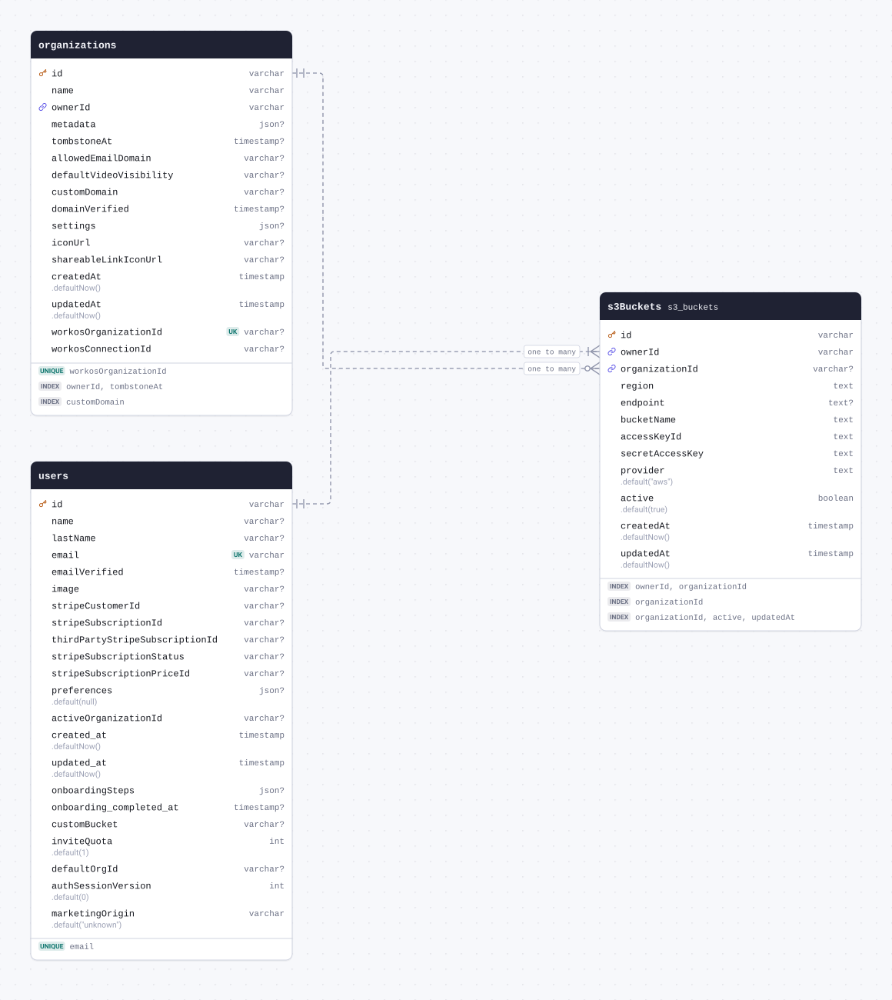

| Column            | Type        | Constraints                                     | Default           | Description |
| ----------------- | ----------- | ----------------------------------------------- | ----------------- | ----------- |
| `id`              | `varchar`   | PK NOT NULL                                     |                   |             |
| `ownerId`         | `varchar`   | NOT NULL → [users.id](#table-users)             |                   |             |
| `organizationId`  | `varchar`   | NULL → [organizations.id](#table-organizations) |                   |             |
| `region`          | `text`      | NOT NULL                                        |                   |             |
| `endpoint`        | `text`      | NULL                                            |                   |             |
| `bucketName`      | `text`      | NOT NULL                                        |                   |             |
| `accessKeyId`     | `text`      | NOT NULL                                        |                   |             |
| `secretAccessKey` | `text`      | NOT NULL                                        |                   |             |
| `provider`        | `text`      | NOT NULL                                        | `.default("aws")` |             |
| `active`          | `boolean`   | NOT NULL                                        | `.default(true)`  |             |
| `createdAt`       | `timestamp` | NOT NULL                                        | `.defaultNow()`   |             |
| `updatedAt`       | `timestamp` | NOT NULL                                        | `.defaultNow()`   |             |

#### Definition

```sql
CREATE TABLE `s3_buckets` (
	`id` varchar(15) PRIMARY KEY,
	`ownerId` varchar(15) NOT NULL,
	`organizationId` varchar(15),
	`region` text NOT NULL,
	`endpoint` text,
	`bucketName` text NOT NULL,
	`accessKeyId` text NOT NULL,
	`secretAccessKey` text NOT NULL,
	`provider` text NOT NULL DEFAULT ('aws'),
	`active` boolean NOT NULL DEFAULT true,
	`createdAt` timestamp NOT NULL DEFAULT (now()),
	`updatedAt` timestamp NOT NULL DEFAULT (now()) ON UPDATE CURRENT_TIMESTAMP
);

CREATE INDEX `owner_organization_idx` ON `s3_buckets` (`ownerId`,`organizationId`);

CREATE INDEX `organization_id_idx` ON `s3_buckets` (`organizationId`);

CREATE INDEX `organization_active_idx` ON `s3_buckets` (`organizationId`,`active`,`updatedAt`);
```

#### Indexes

- INDEX `ownerId`, `organizationId`
- INDEX `organizationId`
- INDEX `organizationId`, `active`, `updatedAt`

#### References

- `ownerId` → [users.id](#table-users) (many to one, defineRelations, no foreign key)
- `organizationId` → [organizations.id](#table-organizations) (many to one, defineRelations, no foreign key)

<details>
<summary>Queries and their SQL</summary>

**Select**: Every row of s3Buckets.

```ts
db.select().from(s3Buckets);
```

```sql
select `id`, `ownerId`, `organizationId`, `region`, `endpoint`, `bucketName`, `accessKeyId`, `secretAccessKey`, `provider`, `active`, `createdAt`, `updatedAt`
from `s3_buckets`
```

**Count**: How many rows s3Buckets has.

```ts
db.select({ count: count() }).from(s3Buckets);
```

```sql
select count(*)
from `s3_buckets`
```

**Find many**: The rows of s3Buckets, through the relational query API.

```ts
db.query.s3Buckets.findMany();
```

```sql
select `d0`.`id` as `id`, `d0`.`ownerId` as `ownerId`, `d0`.`organizationId` as `organizationId`, `d0`.`region` as `region`, `d0`.`endpoint` as `endpoint`, `d0`.`bucketName` as `bucketName`, `d0`.`accessKeyId` as `accessKeyId`, `d0`.`secretAccessKey` as `secretAccessKey`, `d0`.`provider` as `provider`, `d0`.`active` as `active`, `d0`.`createdAt` as `createdAt`, `d0`.`updatedAt` as `updatedAt`
from `s3_buckets` as `d0`
```

**Find by primary key**: One row of s3Buckets, through the relational query API.

```ts
db.query.s3Buckets.findFirst({ where: { id: "id" } });
```

```sql
select `d0`.`id` as `id`, `d0`.`ownerId` as `ownerId`, `d0`.`organizationId` as `organizationId`, `d0`.`region` as `region`, `d0`.`endpoint` as `endpoint`, `d0`.`bucketName` as `bucketName`, `d0`.`accessKeyId` as `accessKeyId`, `d0`.`secretAccessKey` as `secretAccessKey`, `d0`.`provider` as `provider`, `d0`.`active` as `active`, `d0`.`createdAt` as `createdAt`, `d0`.`updatedAt` as `updatedAt`
from `s3_buckets` as `d0`
where `d0`.`id` = ?
limit ?
-- params: ["id",1]
```

**Insert**: Adds a row to s3Buckets, giving the columns that have no default.

```ts
db.insert(s3Buckets).values({
  id: "id",
  ownerId: "ownerId",
  region: "region",
  bucketName: "bucketName",
  accessKeyId: "accessKeyId",
  secretAccessKey: "secretAccessKey",
});
```

```sql
insert into `s3_buckets` (`id`, `ownerId`, `organizationId`, `region`, `endpoint`, `bucketName`, `accessKeyId`, `secretAccessKey`, `provider`, `active`, `createdAt`, `updatedAt`)
values (?, ?, default, ?, default, ?, ?, ?, default, default, default, default)
-- params: ["id","ownerId","region","bucketName","accessKeyId","secretAccessKey"]
```

**Update**: Changes a row of s3Buckets, found by its primary key.

```ts
db.update(s3Buckets).set({ ownerId: "ownerId" }).where(eq(s3Buckets.id, "id"));
```

```sql
update `s3_buckets`
set `ownerId` = ?
where `s3_buckets`.`id` = ?
-- params: ["ownerId","id"]
```

**Delete**: Deletes a row of s3Buckets, found by its primary key.

```ts
db.delete(s3Buckets).where(eq(s3Buckets.id, "id"));
```

```sql
delete from `s3_buckets`
where `s3_buckets`.`id` = ?
-- params: ["id"]
```

</details>

<a id="table-storageIntegrations"></a>

### storageIntegrations

Table `storage_integrations`.

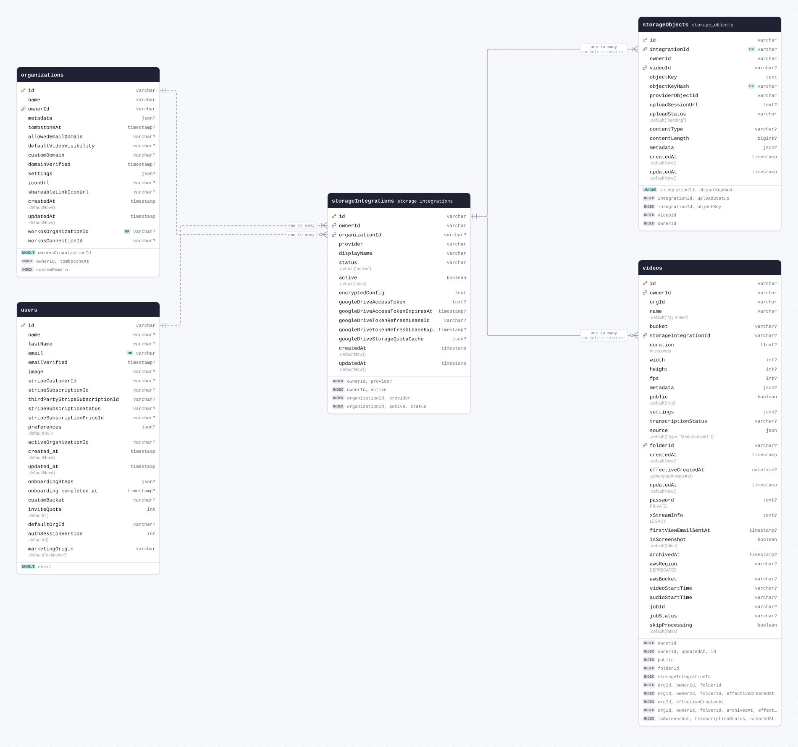

| Column                                  | Type        | Constraints                                     | Default              | Description |
| --------------------------------------- | ----------- | ----------------------------------------------- | -------------------- | ----------- |
| `id`                                    | `varchar`   | PK NOT NULL                                     |                      |             |
| `ownerId`                               | `varchar`   | NOT NULL → [users.id](#table-users)             |                      |             |
| `organizationId`                        | `varchar`   | NULL → [organizations.id](#table-organizations) |                      |             |
| `provider`                              | `varchar`   | NOT NULL                                        |                      |             |
| `displayName`                           | `varchar`   | NOT NULL                                        |                      |             |
| `status`                                | `varchar`   | NOT NULL                                        | `.default("active")` |             |
| `active`                                | `boolean`   | NOT NULL                                        | `.default(false)`    |             |
| `encryptedConfig`                       | `text`      | NOT NULL                                        |                      |             |
| `googleDriveAccessToken`                | `text`      | NULL                                            |                      |             |
| `googleDriveAccessTokenExpiresAt`       | `timestamp` | NULL                                            |                      |             |
| `googleDriveTokenRefreshLeaseId`        | `varchar`   | NULL                                            |                      |             |
| `googleDriveTokenRefreshLeaseExpiresAt` | `timestamp` | NULL                                            |                      |             |
| `googleDriveStorageQuotaCache`          | `json`      | NULL                                            |                      |             |
| `createdAt`                             | `timestamp` | NOT NULL                                        | `.defaultNow()`      |             |
| `updatedAt`                             | `timestamp` | NOT NULL                                        | `.defaultNow()`      |             |

#### Definition

```sql
CREATE TABLE `storage_integrations` (
	`id` varchar(15) PRIMARY KEY,
	`ownerId` varchar(15) NOT NULL,
	`organizationId` varchar(15),
	`provider` varchar(64) NOT NULL,
	`displayName` varchar(255) NOT NULL,
	`status` varchar(32) NOT NULL DEFAULT 'active',
	`active` boolean NOT NULL DEFAULT false,
	`encryptedConfig` text NOT NULL,
	`googleDriveAccessToken` text,
	`googleDriveAccessTokenExpiresAt` timestamp,
	`googleDriveTokenRefreshLeaseId` varchar(64),
	`googleDriveTokenRefreshLeaseExpiresAt` timestamp,
	`googleDriveStorageQuotaCache` json,
	`createdAt` timestamp NOT NULL DEFAULT (now()),
	`updatedAt` timestamp NOT NULL DEFAULT (now()) ON UPDATE CURRENT_TIMESTAMP
);

CREATE INDEX `owner_provider_idx` ON `storage_integrations` (`ownerId`,`provider`);

CREATE INDEX `owner_active_idx` ON `storage_integrations` (`ownerId`,`active`);

CREATE INDEX `organization_provider_idx` ON `storage_integrations` (`organizationId`,`provider`);

CREATE INDEX `organization_active_idx` ON `storage_integrations` (`organizationId`,`active`,`status`);
```

#### Indexes

- INDEX `ownerId`, `provider`
- INDEX `ownerId`, `active`
- INDEX `organizationId`, `provider`
- INDEX `organizationId`, `active`, `status`

#### References

- `ownerId` → [users.id](#table-users) (many to one, defineRelations, no foreign key)
- `organizationId` → [organizations.id](#table-organizations) (many to one, defineRelations, no foreign key)

#### Referenced by

- `id` → [videos.storageIntegrationId](#table-videos) (one to many, on delete restrict)
- `id` → [storageObjects.integrationId](#table-storageObjects) (one to many, on delete restrict)

<details>
<summary>Queries and their SQL</summary>

**Select**: Every row of storageIntegrations.

```ts
db.select().from(storageIntegrations);
```

```sql
select `id`, `ownerId`, `organizationId`, `provider`, `displayName`, `status`, `active`, `encryptedConfig`, `googleDriveAccessToken`, `googleDriveAccessTokenExpiresAt`, `googleDriveTokenRefreshLeaseId`, `googleDriveTokenRefreshLeaseExpiresAt`, `googleDriveStorageQuotaCache`, `createdAt`, `updatedAt`
from `storage_integrations`
```

**Count**: How many rows storageIntegrations has.

```ts
db.select({ count: count() }).from(storageIntegrations);
```

```sql
select count(*)
from `storage_integrations`
```

**Find many**: The rows of storageIntegrations, through the relational query API.

```ts
db.query.storageIntegrations.findMany();
```

```sql
select `d0`.`id` as `id`, `d0`.`ownerId` as `ownerId`, `d0`.`organizationId` as `organizationId`, `d0`.`provider` as `provider`, `d0`.`displayName` as `displayName`, `d0`.`status` as `status`, `d0`.`active` as `active`, `d0`.`encryptedConfig` as `encryptedConfig`, `d0`.`googleDriveAccessToken` as `googleDriveAccessToken`, `d0`.`googleDriveAccessTokenExpiresAt` as `googleDriveAccessTokenExpiresAt`, `d0`.`googleDriveTokenRefreshLeaseId` as `googleDriveTokenRefreshLeaseId`, `d0`.`googleDriveTokenRefreshLeaseExpiresAt` as `googleDriveTokenRefreshLeaseExpiresAt`, `d0`.`googleDriveStorageQuotaCache` as `googleDriveStorageQuotaCache`, `d0`.`createdAt` as `createdAt`, `d0`.`updatedAt` as `updatedAt`
from `storage_integrations` as `d0`
```

**Find by primary key**: One row of storageIntegrations, through the relational query API.

```ts
db.query.storageIntegrations.findFirst({ where: { id: "id" } });
```

```sql
select `d0`.`id` as `id`, `d0`.`ownerId` as `ownerId`, `d0`.`organizationId` as `organizationId`, `d0`.`provider` as `provider`, `d0`.`displayName` as `displayName`, `d0`.`status` as `status`, `d0`.`active` as `active`, `d0`.`encryptedConfig` as `encryptedConfig`, `d0`.`googleDriveAccessToken` as `googleDriveAccessToken`, `d0`.`googleDriveAccessTokenExpiresAt` as `googleDriveAccessTokenExpiresAt`, `d0`.`googleDriveTokenRefreshLeaseId` as `googleDriveTokenRefreshLeaseId`, `d0`.`googleDriveTokenRefreshLeaseExpiresAt` as `googleDriveTokenRefreshLeaseExpiresAt`, `d0`.`googleDriveStorageQuotaCache` as `googleDriveStorageQuotaCache`, `d0`.`createdAt` as `createdAt`, `d0`.`updatedAt` as `updatedAt`
from `storage_integrations` as `d0`
where `d0`.`id` = ?
limit ?
-- params: ["id",1]
```

**Insert**: Adds a row to storageIntegrations, giving the columns that have no default.

```ts
db.insert(storageIntegrations).values({
  id: "id",
  ownerId: "ownerId",
  provider: "provider",
  displayName: "displayName",
  encryptedConfig: "encryptedConfig",
});
```

```sql
insert into `storage_integrations` (`id`, `ownerId`, `organizationId`, `provider`, `displayName`, `status`, `active`, `encryptedConfig`, `googleDriveAccessToken`, `googleDriveAccessTokenExpiresAt`, `googleDriveTokenRefreshLeaseId`, `googleDriveTokenRefreshLeaseExpiresAt`, `googleDriveStorageQuotaCache`, `createdAt`, `updatedAt`)
values (?, ?, default, ?, ?, default, default, ?, default, default, default, default, default, default, default)
-- params: ["id","ownerId","provider","displayName","encryptedConfig"]
```

**Update**: Changes a row of storageIntegrations, found by its primary key.

```ts
db.update(storageIntegrations).set({ ownerId: "ownerId" }).where(eq(storageIntegrations.id, "id"));
```

```sql
update `storage_integrations`
set `ownerId` = ?
where `storage_integrations`.`id` = ?
-- params: ["ownerId","id"]
```

**Delete**: Deletes a row of storageIntegrations, found by its primary key.

```ts
db.delete(storageIntegrations).where(eq(storageIntegrations.id, "id"));
```

```sql
delete from `storage_integrations`
where `storage_integrations`.`id` = ?
-- params: ["id"]
```

</details>

<a id="table-storageObjects"></a>

### storageObjects

Table `storage_objects`.

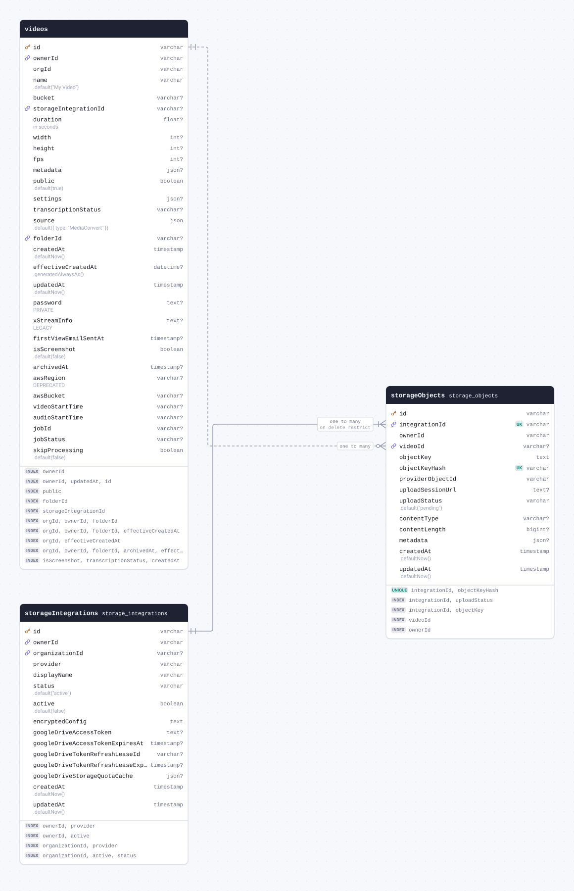

| Column             | Type        | Constraints                                                     | Default               | Description |
| ------------------ | ----------- | --------------------------------------------------------------- | --------------------- | ----------- |
| `id`               | `varchar`   | PK NOT NULL                                                     |                       |             |
| `integrationId`    | `varchar`   | NOT NULL → [storageIntegrations.id](#table-storageIntegrations) |                       |             |
| `ownerId`          | `varchar`   | NOT NULL                                                        |                       |             |
| `videoId`          | `varchar`   | NULL → [videos.id](#table-videos)                               |                       |             |
| `objectKey`        | `text`      | NOT NULL                                                        |                       |             |
| `objectKeyHash`    | `varchar`   | NOT NULL                                                        |                       |             |
| `providerObjectId` | `varchar`   | NOT NULL                                                        |                       |             |
| `uploadSessionUrl` | `text`      | NULL                                                            |                       |             |
| `uploadStatus`     | `varchar`   | NOT NULL                                                        | `.default("pending")` |             |
| `contentType`      | `varchar`   | NULL                                                            |                       |             |
| `contentLength`    | `bigint`    | NULL                                                            |                       |             |
| `metadata`         | `json`      | NULL                                                            |                       |             |
| `createdAt`        | `timestamp` | NOT NULL                                                        | `.defaultNow()`       |             |
| `updatedAt`        | `timestamp` | NOT NULL                                                        | `.defaultNow()`       |             |

#### Definition

```sql
CREATE TABLE `storage_objects` (
	`id` varchar(15) PRIMARY KEY,
	`integrationId` varchar(15) NOT NULL,
	`ownerId` varchar(15) NOT NULL,
	`videoId` varchar(15),
	`objectKey` text NOT NULL,
	`objectKeyHash` varchar(64) NOT NULL,
	`providerObjectId` varchar(255) NOT NULL,
	`uploadSessionUrl` text,
	`uploadStatus` varchar(32) NOT NULL DEFAULT 'pending',
	`contentType` varchar(255),
	`contentLength` bigint unsigned,
	`metadata` json,
	`createdAt` timestamp NOT NULL DEFAULT (now()),
	`updatedAt` timestamp NOT NULL DEFAULT (now()) ON UPDATE CURRENT_TIMESTAMP,
	CONSTRAINT `integration_key_hash_idx` UNIQUE INDEX(`integrationId`,`objectKeyHash`)
);

CREATE INDEX `integration_status_idx` ON `storage_objects` (`integrationId`,`uploadStatus`);

CREATE INDEX `integration_object_key_prefix_idx` ON `storage_objects` (`integrationId`,`objectKey`(191));

CREATE INDEX `video_id_idx` ON `storage_objects` (`videoId`);

CREATE INDEX `owner_id_idx` ON `storage_objects` (`ownerId`);

ALTER TABLE `storage_objects` ADD CONSTRAINT `storage_objects_integrationId_storage_integrations_id_fkey` FOREIGN KEY (`integrationId`) REFERENCES `storage_integrations`(`id`) ON DELETE RESTRICT;
```

#### Indexes

- UNIQUE `integrationId`, `objectKeyHash`
- INDEX `integrationId`, `uploadStatus`
- INDEX `integrationId`, `objectKey`
- INDEX `videoId`
- INDEX `ownerId`

#### References

- `integrationId` → [storageIntegrations.id](#table-storageIntegrations) (many to one, on delete restrict)
- `videoId` → [videos.id](#table-videos) (many to one, defineRelations, no foreign key)

<details>
<summary>Queries and their SQL</summary>

**Select**: Every row of storageObjects.

```ts
db.select().from(storageObjects);
```

```sql
select `id`, `integrationId`, `ownerId`, `videoId`, `objectKey`, `objectKeyHash`, `providerObjectId`, `uploadSessionUrl`, `uploadStatus`, `contentType`, `contentLength`, `metadata`, `createdAt`, `updatedAt`
from `storage_objects`
```

**Count**: How many rows storageObjects has.

```ts
db.select({ count: count() }).from(storageObjects);
```

```sql
select count(*)
from `storage_objects`
```

**Find many**: The rows of storageObjects, through the relational query API.

```ts
db.query.storageObjects.findMany();
```

```sql
select `d0`.`id` as `id`, `d0`.`integrationId` as `integrationId`, `d0`.`ownerId` as `ownerId`, `d0`.`videoId` as `videoId`, `d0`.`objectKey` as `objectKey`, `d0`.`objectKeyHash` as `objectKeyHash`, `d0`.`providerObjectId` as `providerObjectId`, `d0`.`uploadSessionUrl` as `uploadSessionUrl`, `d0`.`uploadStatus` as `uploadStatus`, `d0`.`contentType` as `contentType`, `d0`.`contentLength` as `contentLength`, `d0`.`metadata` as `metadata`, `d0`.`createdAt` as `createdAt`, `d0`.`updatedAt` as `updatedAt`
from `storage_objects` as `d0`
```

**Find by primary key**: One row of storageObjects, through the relational query API.

```ts
db.query.storageObjects.findFirst({ where: { id: "id" } });
```

```sql
select `d0`.`id` as `id`, `d0`.`integrationId` as `integrationId`, `d0`.`ownerId` as `ownerId`, `d0`.`videoId` as `videoId`, `d0`.`objectKey` as `objectKey`, `d0`.`objectKeyHash` as `objectKeyHash`, `d0`.`providerObjectId` as `providerObjectId`, `d0`.`uploadSessionUrl` as `uploadSessionUrl`, `d0`.`uploadStatus` as `uploadStatus`, `d0`.`contentType` as `contentType`, `d0`.`contentLength` as `contentLength`, `d0`.`metadata` as `metadata`, `d0`.`createdAt` as `createdAt`, `d0`.`updatedAt` as `updatedAt`
from `storage_objects` as `d0`
where `d0`.`id` = ?
limit ?
-- params: ["id",1]
```

**Insert**: Adds a row to storageObjects, giving the columns that have no default.

```ts
db.insert(storageObjects).values({
  id: "id",
  integrationId: "integrationId",
  ownerId: "ownerId",
  objectKey: "objectKey",
  objectKeyHash: "objectKeyHash",
  providerObjectId: "providerObjectId",
});
```

```sql
insert into `storage_objects` (`id`, `integrationId`, `ownerId`, `videoId`, `objectKey`, `objectKeyHash`, `providerObjectId`, `uploadSessionUrl`, `uploadStatus`, `contentType`, `contentLength`, `metadata`, `createdAt`, `updatedAt`)
values (?, ?, ?, default, ?, ?, ?, default, default, default, default, default, default, default)
-- params: ["id","integrationId","ownerId","objectKey","objectKeyHash","providerObjectId"]
```

**Update**: Changes a row of storageObjects, found by its primary key.

```ts
db.update(storageObjects)
  .set({ integrationId: "integrationId" })
  .where(eq(storageObjects.id, "id"));
```

```sql
update `storage_objects`
set `integrationId` = ?
where `storage_objects`.`id` = ?
-- params: ["integrationId","id"]
```

**Delete**: Deletes a row of storageObjects, found by its primary key.

```ts
db.delete(storageObjects).where(eq(storageObjects.id, "id"));
```

```sql
delete from `storage_objects`
where `storage_objects`.`id` = ?
-- params: ["id"]
```

</details>

<a id="table-authApiKeys"></a>

### authApiKeys

Table `auth_api_keys`.

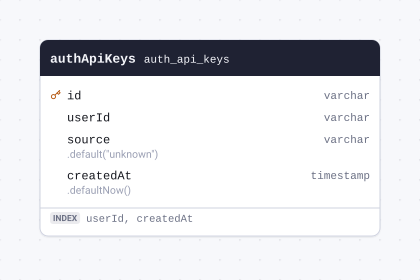

| Column      | Type        | Constraints | Default               | Description |
| ----------- | ----------- | ----------- | --------------------- | ----------- |
| `id`        | `varchar`   | PK NOT NULL |                       |             |
| `userId`    | `varchar`   | NOT NULL    |                       |             |
| `source`    | `varchar`   | NOT NULL    | `.default("unknown")` |             |
| `createdAt` | `timestamp` | NOT NULL    | `.defaultNow()`       |             |

#### Definition

```sql
CREATE TABLE `auth_api_keys` (
	`id` varchar(36) PRIMARY KEY,
	`userId` varchar(15) NOT NULL,
	`source` varchar(32) NOT NULL DEFAULT 'unknown',
	`createdAt` timestamp NOT NULL DEFAULT (now())
);

CREATE INDEX `user_id_created_at_idx` ON `auth_api_keys` (`userId`,`createdAt`);
```

#### Indexes

- INDEX `userId`, `createdAt`

<details>
<summary>Queries and their SQL</summary>

**Select**: Every row of authApiKeys.

```ts
db.select().from(authApiKeys);
```

```sql
select `id`, `userId`, `source`, `createdAt`
from `auth_api_keys`
```

**Count**: How many rows authApiKeys has.

```ts
db.select({ count: count() }).from(authApiKeys);
```

```sql
select count(*)
from `auth_api_keys`
```

**Find many**: The rows of authApiKeys, through the relational query API.

```ts
db.query.authApiKeys.findMany();
```

```sql
select `d0`.`id` as `id`, `d0`.`userId` as `userId`, `d0`.`source` as `source`, `d0`.`createdAt` as `createdAt`
from `auth_api_keys` as `d0`
```

**Find by primary key**: One row of authApiKeys, through the relational query API.

```ts
db.query.authApiKeys.findFirst({ where: { id: "id" } });
```

```sql
select `d0`.`id` as `id`, `d0`.`userId` as `userId`, `d0`.`source` as `source`, `d0`.`createdAt` as `createdAt`
from `auth_api_keys` as `d0`
where `d0`.`id` = ?
limit ?
-- params: ["id",1]
```

**Insert**: Adds a row to authApiKeys, giving the columns that have no default.

```ts
db.insert(authApiKeys).values({ id: "id", userId: "userId" });
```

```sql
insert into `auth_api_keys` (`id`, `userId`, `source`, `createdAt`)
values (?, ?, default, default)
-- params: ["id","userId"]
```

**Update**: Changes a row of authApiKeys, found by its primary key.

```ts
db.update(authApiKeys).set({ userId: "userId" }).where(eq(authApiKeys.id, "id"));
```

```sql
update `auth_api_keys`
set `userId` = ?
where `auth_api_keys`.`id` = ?
-- params: ["userId","id"]
```

**Delete**: Deletes a row of authApiKeys, found by its primary key.

```ts
db.delete(authApiKeys).where(eq(authApiKeys.id, "id"));
```

```sql
delete from `auth_api_keys`
where `auth_api_keys`.`id` = ?
-- params: ["id"]
```

</details>

<a id="table-mobilePushTokens"></a>

### mobilePushTokens

Table `mobile_push_tokens`.

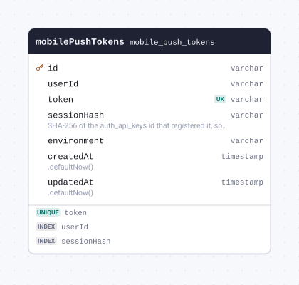

| Column        | Type        | Constraints | Default         | Description                                                                              |
| ------------- | ----------- | ----------- | --------------- | ---------------------------------------------------------------------------------------- |
| `id`          | `varchar`   | PK NOT NULL |                 |                                                                                          |
| `userId`      | `varchar`   | NOT NULL    |                 |                                                                                          |
| `token`       | `varchar`   | NOT NULL    |                 |                                                                                          |
| `sessionHash` | `varchar`   | NOT NULL    |                 | SHA-256 of the auth_api_keys id that registered it, so the token dies with that session. |
| `environment` | `varchar`   | NOT NULL    |                 |                                                                                          |
| `createdAt`   | `timestamp` | NOT NULL    | `.defaultNow()` |                                                                                          |
| `updatedAt`   | `timestamp` | NOT NULL    | `.defaultNow()` |                                                                                          |

#### Definition

```sql
CREATE TABLE `mobile_push_tokens` (
	`id` varchar(15) PRIMARY KEY,
	`userId` varchar(15) NOT NULL,
	`token` varchar(200) NOT NULL,
	`sessionHash` varchar(64) NOT NULL,
	`environment` varchar(10) NOT NULL,
	`createdAt` timestamp NOT NULL DEFAULT (now()),
	`updatedAt` timestamp NOT NULL DEFAULT (now()) ON UPDATE CURRENT_TIMESTAMP,
	CONSTRAINT `token_idx` UNIQUE INDEX(`token`)
);

CREATE INDEX `user_id_idx` ON `mobile_push_tokens` (`userId`);

CREATE INDEX `session_hash_idx` ON `mobile_push_tokens` (`sessionHash`);
```

#### Indexes

- UNIQUE `token`
- INDEX `userId`
- INDEX `sessionHash`

<details>
<summary>Queries and their SQL</summary>

**Select**: Every row of mobilePushTokens.

```ts
db.select().from(mobilePushTokens);
```

```sql
select `id`, `userId`, `token`, `sessionHash`, `environment`, `createdAt`, `updatedAt`
from `mobile_push_tokens`
```

**Count**: How many rows mobilePushTokens has.

```ts
db.select({ count: count() }).from(mobilePushTokens);
```

```sql
select count(*)
from `mobile_push_tokens`
```

**Find many**: The rows of mobilePushTokens, through the relational query API.

```ts
db.query.mobilePushTokens.findMany();
```

```sql
select `d0`.`id` as `id`, `d0`.`userId` as `userId`, `d0`.`token` as `token`, `d0`.`sessionHash` as `sessionHash`, `d0`.`environment` as `environment`, `d0`.`createdAt` as `createdAt`, `d0`.`updatedAt` as `updatedAt`
from `mobile_push_tokens` as `d0`
```

**Find by primary key**: One row of mobilePushTokens, through the relational query API.

```ts
db.query.mobilePushTokens.findFirst({ where: { id: "id" } });
```

```sql
select `d0`.`id` as `id`, `d0`.`userId` as `userId`, `d0`.`token` as `token`, `d0`.`sessionHash` as `sessionHash`, `d0`.`environment` as `environment`, `d0`.`createdAt` as `createdAt`, `d0`.`updatedAt` as `updatedAt`
from `mobile_push_tokens` as `d0`
where `d0`.`id` = ?
limit ?
-- params: ["id",1]
```

**Insert**: Adds a row to mobilePushTokens, giving the columns that have no default.

```ts
db.insert(mobilePushTokens).values({
  id: "id",
  userId: "userId",
  token: "token",
  sessionHash: "sessionHash",
  environment: "environment",
});
```

```sql
insert into `mobile_push_tokens` (`id`, `userId`, `token`, `sessionHash`, `environment`, `createdAt`, `updatedAt`)
values (?, ?, ?, ?, ?, default, default)
-- params: ["id","userId","token","sessionHash","environment"]
```

**Update**: Changes a row of mobilePushTokens, found by its primary key.

```ts
db.update(mobilePushTokens).set({ userId: "userId" }).where(eq(mobilePushTokens.id, "id"));
```

```sql
update `mobile_push_tokens`
set `userId` = ?
where `mobile_push_tokens`.`id` = ?
-- params: ["userId","id"]
```

**Delete**: Deletes a row of mobilePushTokens, found by its primary key.

```ts
db.delete(mobilePushTokens).where(eq(mobilePushTokens.id, "id"));
```

```sql
delete from `mobile_push_tokens`
where `mobile_push_tokens`.`id` = ?
-- params: ["id"]
```

</details>

<a id="table-mobilePushClaims"></a>

### mobilePushClaims

Table `mobile_push_claims`. One row per push that must send at most once, such as a Cap's view push for a 10-minute window.

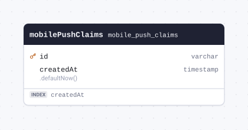

| Column      | Type        | Constraints | Default         | Description |
| ----------- | ----------- | ----------- | --------------- | ----------- |
| `id`        | `varchar`   | PK NOT NULL |                 |             |
| `createdAt` | `timestamp` | NOT NULL    | `.defaultNow()` |             |

#### Definition

```sql
CREATE TABLE `mobile_push_claims` (
	`id` varchar(128) PRIMARY KEY,
	`createdAt` timestamp NOT NULL DEFAULT (now())
);

CREATE INDEX `created_at_idx` ON `mobile_push_claims` (`createdAt`);
```

#### Indexes

- INDEX `createdAt`

<details>
<summary>Queries and their SQL</summary>

**Select**: Every row of mobilePushClaims.

```ts
db.select().from(mobilePushClaims);
```

```sql
select `id`, `createdAt`
from `mobile_push_claims`
```

**Count**: How many rows mobilePushClaims has.

```ts
db.select({ count: count() }).from(mobilePushClaims);
```

```sql
select count(*)
from `mobile_push_claims`
```

**Find many**: The rows of mobilePushClaims, through the relational query API.

```ts
db.query.mobilePushClaims.findMany();
```

```sql
select `d0`.`id` as `id`, `d0`.`createdAt` as `createdAt`
from `mobile_push_claims` as `d0`
```

**Find by primary key**: One row of mobilePushClaims, through the relational query API.

```ts
db.query.mobilePushClaims.findFirst({ where: { id: "id" } });
```

```sql
select `d0`.`id` as `id`, `d0`.`createdAt` as `createdAt`
from `mobile_push_claims` as `d0`
where `d0`.`id` = ?
limit ?
-- params: ["id",1]
```

**Insert**: Adds a row to mobilePushClaims, giving the columns that have no default.

```ts
db.insert(mobilePushClaims).values({ id: "id" });
```

```sql
insert into `mobile_push_claims` (`id`, `createdAt`)
values (?, default)
-- params: ["id"]
```

**Update**: Changes a row of mobilePushClaims, found by its primary key.

```ts
db.update(mobilePushClaims)
  .set({ createdAt: new Date("2026-01-01T00:00:00.000Z") })
  .where(eq(mobilePushClaims.id, "id"));
```

```sql
update `mobile_push_claims`
set `createdAt` = ?
where `mobile_push_claims`.`id` = ?
-- params: ["2026-01-01 00:00:00.000","id"]
```

**Delete**: Deletes a row of mobilePushClaims, found by its primary key.

```ts
db.delete(mobilePushClaims).where(eq(mobilePushClaims.id, "id"));
```

```sql
delete from `mobile_push_claims`
where `mobile_push_claims`.`id` = ?
-- params: ["id"]
```

</details>

<a id="table-agentApiKeys"></a>

### agentApiKeys

Table `agent_api_keys`.

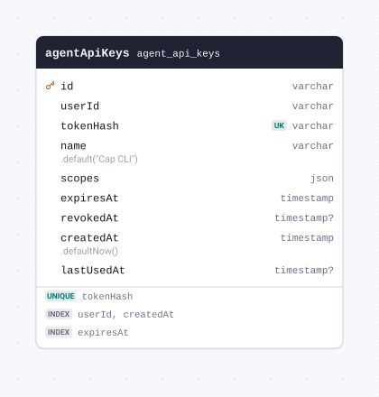

| Column       | Type        | Constraints | Default               | Description |
| ------------ | ----------- | ----------- | --------------------- | ----------- |
| `id`         | `varchar`   | PK NOT NULL |                       |             |
| `userId`     | `varchar`   | NOT NULL    |                       |             |
| `tokenHash`  | `varchar`   | NOT NULL    |                       |             |
| `name`       | `varchar`   | NOT NULL    | `.default("Cap CLI")` |             |
| `scopes`     | `json`      | NOT NULL    |                       |             |
| `expiresAt`  | `timestamp` | NOT NULL    |                       |             |
| `revokedAt`  | `timestamp` | NULL        |                       |             |
| `createdAt`  | `timestamp` | NOT NULL    | `.defaultNow()`       |             |
| `lastUsedAt` | `timestamp` | NULL        |                       |             |

#### Definition

```sql
CREATE TABLE `agent_api_keys` (
	`id` varchar(15) PRIMARY KEY,
	`userId` varchar(15) NOT NULL,
	`tokenHash` varchar(64) NOT NULL,
	`name` varchar(100) NOT NULL DEFAULT 'Cap CLI',
	`scopes` json NOT NULL,
	`expiresAt` timestamp NOT NULL,
	`revokedAt` timestamp,
	`createdAt` timestamp NOT NULL DEFAULT (now()),
	`lastUsedAt` timestamp,
	CONSTRAINT `token_hash_idx` UNIQUE INDEX(`tokenHash`)
);

CREATE INDEX `user_created_at_idx` ON `agent_api_keys` (`userId`,`createdAt`);

CREATE INDEX `expires_at_idx` ON `agent_api_keys` (`expiresAt`);
```

#### Indexes

- UNIQUE `tokenHash`
- INDEX `userId`, `createdAt`
- INDEX `expiresAt`

<details>
<summary>Queries and their SQL</summary>

**Select**: Every row of agentApiKeys.

```ts
db.select().from(agentApiKeys);
```

```sql
select `id`, `userId`, `tokenHash`, `name`, `scopes`, `expiresAt`, `revokedAt`, `createdAt`, `lastUsedAt`
from `agent_api_keys`
```

**Count**: How many rows agentApiKeys has.

```ts
db.select({ count: count() }).from(agentApiKeys);
```

```sql
select count(*)
from `agent_api_keys`
```

**Find many**: The rows of agentApiKeys, through the relational query API.

```ts
db.query.agentApiKeys.findMany();
```

```sql
select `d0`.`id` as `id`, `d0`.`userId` as `userId`, `d0`.`tokenHash` as `tokenHash`, `d0`.`name` as `name`, `d0`.`scopes` as `scopes`, `d0`.`expiresAt` as `expiresAt`, `d0`.`revokedAt` as `revokedAt`, `d0`.`createdAt` as `createdAt`, `d0`.`lastUsedAt` as `lastUsedAt`
from `agent_api_keys` as `d0`
```

**Find by primary key**: One row of agentApiKeys, through the relational query API.

```ts
db.query.agentApiKeys.findFirst({ where: { id: "id" } });
```

```sql
select `d0`.`id` as `id`, `d0`.`userId` as `userId`, `d0`.`tokenHash` as `tokenHash`, `d0`.`name` as `name`, `d0`.`scopes` as `scopes`, `d0`.`expiresAt` as `expiresAt`, `d0`.`revokedAt` as `revokedAt`, `d0`.`createdAt` as `createdAt`, `d0`.`lastUsedAt` as `lastUsedAt`
from `agent_api_keys` as `d0`
where `d0`.`id` = ?
limit ?
-- params: ["id",1]
```

**Insert**: Adds a row to agentApiKeys, giving the columns that have no default.

```ts
db.insert(agentApiKeys).values({
  id: "id",
  userId: "userId",
  tokenHash: "tokenHash",
  scopes: {},
  expiresAt: new Date("2026-01-01T00:00:00.000Z"),
});
```

```sql
insert into `agent_api_keys` (`id`, `userId`, `tokenHash`, `name`, `scopes`, `expiresAt`, `revokedAt`, `createdAt`, `lastUsedAt`)
values (?, ?, ?, default, ?, ?, default, default, default)
-- params: ["id","userId","tokenHash","{}","2026-01-01 00:00:00.000"]
```

**Update**: Changes a row of agentApiKeys, found by its primary key.

```ts
db.update(agentApiKeys).set({ userId: "userId" }).where(eq(agentApiKeys.id, "id"));
```

```sql
update `agent_api_keys`
set `userId` = ?
where `agent_api_keys`.`id` = ?
-- params: ["userId","id"]
```

**Delete**: Deletes a row of agentApiKeys, found by its primary key.

```ts
db.delete(agentApiKeys).where(eq(agentApiKeys.id, "id"));
```

```sql
delete from `agent_api_keys`
where `agent_api_keys`.`id` = ?
-- params: ["id"]
```

</details>

<a id="table-agentApiIdempotency"></a>

### agentApiIdempotency

Table `agent_api_idempotency`.

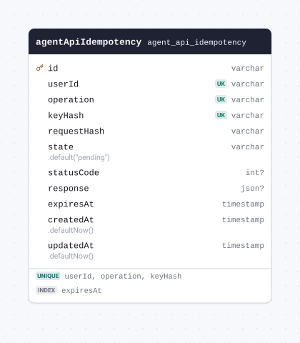

| Column        | Type        | Constraints | Default               | Description |
| ------------- | ----------- | ----------- | --------------------- | ----------- |
| `id`          | `varchar`   | PK NOT NULL |                       |             |
| `userId`      | `varchar`   | NOT NULL    |                       |             |
| `operation`   | `varchar`   | NOT NULL    |                       |             |
| `keyHash`     | `varchar`   | NOT NULL    |                       |             |
| `requestHash` | `varchar`   | NOT NULL    |                       |             |
| `state`       | `varchar`   | NOT NULL    | `.default("pending")` |             |
| `statusCode`  | `int`       | NULL        |                       |             |
| `response`    | `json`      | NULL        |                       |             |
| `expiresAt`   | `timestamp` | NOT NULL    |                       |             |
| `createdAt`   | `timestamp` | NOT NULL    | `.defaultNow()`       |             |
| `updatedAt`   | `timestamp` | NOT NULL    | `.defaultNow()`       |             |

#### Definition

```sql
CREATE TABLE `agent_api_idempotency` (
	`id` varchar(15) PRIMARY KEY,
	`userId` varchar(15) NOT NULL,
	`operation` varchar(64) NOT NULL,
	`keyHash` varchar(64) NOT NULL,
	`requestHash` varchar(64) NOT NULL,
	`state` varchar(16) NOT NULL DEFAULT 'pending',
	`statusCode` int,
	`response` json,
	`expiresAt` timestamp NOT NULL,
	`createdAt` timestamp NOT NULL DEFAULT (now()),
	`updatedAt` timestamp NOT NULL DEFAULT (now()) ON UPDATE CURRENT_TIMESTAMP,
	CONSTRAINT `user_operation_key_idx` UNIQUE INDEX(`userId`,`operation`,`keyHash`)
);

CREATE INDEX `expires_at_idx` ON `agent_api_idempotency` (`expiresAt`);
```

#### Indexes

- UNIQUE `userId`, `operation`, `keyHash`
- INDEX `expiresAt`

<details>
<summary>Queries and their SQL</summary>

**Select**: Every row of agentApiIdempotency.

```ts
db.select().from(agentApiIdempotency);
```

```sql
select `id`, `userId`, `operation`, `keyHash`, `requestHash`, `state`, `statusCode`, `response`, `expiresAt`, `createdAt`, `updatedAt`
from `agent_api_idempotency`
```

**Count**: How many rows agentApiIdempotency has.

```ts
db.select({ count: count() }).from(agentApiIdempotency);
```

```sql
select count(*)
from `agent_api_idempotency`
```

**Find many**: The rows of agentApiIdempotency, through the relational query API.

```ts
db.query.agentApiIdempotency.findMany();
```

```sql
select `d0`.`id` as `id`, `d0`.`userId` as `userId`, `d0`.`operation` as `operation`, `d0`.`keyHash` as `keyHash`, `d0`.`requestHash` as `requestHash`, `d0`.`state` as `state`, `d0`.`statusCode` as `statusCode`, `d0`.`response` as `response`, `d0`.`expiresAt` as `expiresAt`, `d0`.`createdAt` as `createdAt`, `d0`.`updatedAt` as `updatedAt`
from `agent_api_idempotency` as `d0`
```

**Find by primary key**: One row of agentApiIdempotency, through the relational query API.

```ts
db.query.agentApiIdempotency.findFirst({ where: { id: "id" } });
```

```sql
select `d0`.`id` as `id`, `d0`.`userId` as `userId`, `d0`.`operation` as `operation`, `d0`.`keyHash` as `keyHash`, `d0`.`requestHash` as `requestHash`, `d0`.`state` as `state`, `d0`.`statusCode` as `statusCode`, `d0`.`response` as `response`, `d0`.`expiresAt` as `expiresAt`, `d0`.`createdAt` as `createdAt`, `d0`.`updatedAt` as `updatedAt`
from `agent_api_idempotency` as `d0`
where `d0`.`id` = ?
limit ?
-- params: ["id",1]
```

**Insert**: Adds a row to agentApiIdempotency, giving the columns that have no default.

```ts
db.insert(agentApiIdempotency).values({
  id: "id",
  userId: "userId",
  operation: "operation",
  keyHash: "keyHash",
  requestHash: "requestHash",
  expiresAt: new Date("2026-01-01T00:00:00.000Z"),
});
```

```sql
insert into `agent_api_idempotency` (`id`, `userId`, `operation`, `keyHash`, `requestHash`, `state`, `statusCode`, `response`, `expiresAt`, `createdAt`, `updatedAt`)
values (?, ?, ?, ?, ?, default, default, default, ?, default, default)
-- params: ["id","userId","operation","keyHash","requestHash","2026-01-01 00:00:00.000"]
```

**Update**: Changes a row of agentApiIdempotency, found by its primary key.

```ts
db.update(agentApiIdempotency).set({ userId: "userId" }).where(eq(agentApiIdempotency.id, "id"));
```

```sql
update `agent_api_idempotency`
set `userId` = ?
where `agent_api_idempotency`.`id` = ?
-- params: ["userId","id"]
```

**Delete**: Deletes a row of agentApiIdempotency, found by its primary key.

```ts
db.delete(agentApiIdempotency).where(eq(agentApiIdempotency.id, "id"));
```

```sql
delete from `agent_api_idempotency`
where `agent_api_idempotency`.`id` = ?
-- params: ["id"]
```

</details>

<a id="table-agentApiAuthorizationCodes"></a>

### agentApiAuthorizationCodes

Table `agent_api_authorization_codes`.

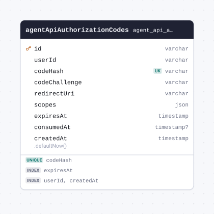

| Column          | Type        | Constraints | Default         | Description |
| --------------- | ----------- | ----------- | --------------- | ----------- |
| `id`            | `varchar`   | PK NOT NULL |                 |             |
| `userId`        | `varchar`   | NOT NULL    |                 |             |
| `codeHash`      | `varchar`   | NOT NULL    |                 |             |
| `codeChallenge` | `varchar`   | NOT NULL    |                 |             |
| `redirectUri`   | `varchar`   | NOT NULL    |                 |             |
| `scopes`        | `json`      | NOT NULL    |                 |             |
| `expiresAt`     | `timestamp` | NOT NULL    |                 |             |
| `consumedAt`    | `timestamp` | NULL        |                 |             |
| `createdAt`     | `timestamp` | NOT NULL    | `.defaultNow()` |             |

#### Definition

```sql
CREATE TABLE `agent_api_authorization_codes` (
	`id` varchar(15) PRIMARY KEY,
	`userId` varchar(15) NOT NULL,
	`codeHash` varchar(64) NOT NULL,
	`codeChallenge` varchar(64) NOT NULL,
	`redirectUri` varchar(512) NOT NULL,
	`scopes` json NOT NULL,
	`expiresAt` timestamp NOT NULL,
	`consumedAt` timestamp,
	`createdAt` timestamp NOT NULL DEFAULT (now()),
	CONSTRAINT `code_hash_idx` UNIQUE INDEX(`codeHash`)
);

CREATE INDEX `expires_at_idx` ON `agent_api_authorization_codes` (`expiresAt`);

CREATE INDEX `user_created_at_idx` ON `agent_api_authorization_codes` (`userId`,`createdAt`);
```

#### Indexes

- UNIQUE `codeHash`
- INDEX `expiresAt`
- INDEX `userId`, `createdAt`

<details>
<summary>Queries and their SQL</summary>

**Select**: Every row of agentApiAuthorizationCodes.

```ts
db.select().from(agentApiAuthorizationCodes);
```

```sql
select `id`, `userId`, `codeHash`, `codeChallenge`, `redirectUri`, `scopes`, `expiresAt`, `consumedAt`, `createdAt`
from `agent_api_authorization_codes`
```

**Count**: How many rows agentApiAuthorizationCodes has.

```ts
db.select({ count: count() }).from(agentApiAuthorizationCodes);
```

```sql
select count(*)
from `agent_api_authorization_codes`
```

**Find many**: The rows of agentApiAuthorizationCodes, through the relational query API.

```ts
db.query.agentApiAuthorizationCodes.findMany();
```

```sql
select `d0`.`id` as `id`, `d0`.`userId` as `userId`, `d0`.`codeHash` as `codeHash`, `d0`.`codeChallenge` as `codeChallenge`, `d0`.`redirectUri` as `redirectUri`, `d0`.`scopes` as `scopes`, `d0`.`expiresAt` as `expiresAt`, `d0`.`consumedAt` as `consumedAt`, `d0`.`createdAt` as `createdAt`
from `agent_api_authorization_codes` as `d0`
```

**Find by primary key**: One row of agentApiAuthorizationCodes, through the relational query API.

```ts
db.query.agentApiAuthorizationCodes.findFirst({ where: { id: "id" } });
```

```sql
select `d0`.`id` as `id`, `d0`.`userId` as `userId`, `d0`.`codeHash` as `codeHash`, `d0`.`codeChallenge` as `codeChallenge`, `d0`.`redirectUri` as `redirectUri`, `d0`.`scopes` as `scopes`, `d0`.`expiresAt` as `expiresAt`, `d0`.`consumedAt` as `consumedAt`, `d0`.`createdAt` as `createdAt`
from `agent_api_authorization_codes` as `d0`
where `d0`.`id` = ?
limit ?
-- params: ["id",1]
```

**Insert**: Adds a row to agentApiAuthorizationCodes, giving the columns that have no default.

```ts
db.insert(agentApiAuthorizationCodes).values({
  id: "id",
  userId: "userId",
  codeHash: "codeHash",
  codeChallenge: "codeChallenge",
  redirectUri: "redirectUri",
  scopes: {},
  expiresAt: new Date("2026-01-01T00:00:00.000Z"),
});
```

```sql
insert into `agent_api_authorization_codes` (`id`, `userId`, `codeHash`, `codeChallenge`, `redirectUri`, `scopes`, `expiresAt`, `consumedAt`, `createdAt`)
values (?, ?, ?, ?, ?, ?, ?, default, default)
-- params: ["id","userId","codeHash","codeChallenge","redirectUri","{}","2026-01-01 00:00:00.000"]
```

**Update**: Changes a row of agentApiAuthorizationCodes, found by its primary key.

```ts
db.update(agentApiAuthorizationCodes)
  .set({ userId: "userId" })
  .where(eq(agentApiAuthorizationCodes.id, "id"));
```

```sql
update `agent_api_authorization_codes`
set `userId` = ?
where `agent_api_authorization_codes`.`id` = ?
-- params: ["userId","id"]
```

**Delete**: Deletes a row of agentApiAuthorizationCodes, found by its primary key.

```ts
db.delete(agentApiAuthorizationCodes).where(eq(agentApiAuthorizationCodes.id, "id"));
```

```sql
delete from `agent_api_authorization_codes`
where `agent_api_authorization_codes`.`id` = ?
-- params: ["id"]
```

</details>

<a id="table-mcpOAuthClients"></a>

### mcpOAuthClients

Table `mcp_oauth_clients`.

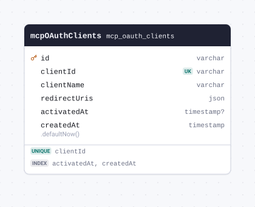

| Column         | Type        | Constraints | Default         | Description |
| -------------- | ----------- | ----------- | --------------- | ----------- |
| `id`           | `varchar`   | PK NOT NULL |                 |             |
| `clientId`     | `varchar`   | NOT NULL    |                 |             |
| `clientName`   | `varchar`   | NOT NULL    |                 |             |
| `redirectUris` | `json`      | NOT NULL    |                 |             |
| `activatedAt`  | `timestamp` | NULL        |                 |             |
| `createdAt`    | `timestamp` | NOT NULL    | `.defaultNow()` |             |

#### Definition

```sql
CREATE TABLE `mcp_oauth_clients` (
	`id` varchar(15) PRIMARY KEY,
	`clientId` varchar(128) NOT NULL,
	`clientName` varchar(100) NOT NULL,
	`redirectUris` json NOT NULL,
	`activatedAt` timestamp,
	`createdAt` timestamp NOT NULL DEFAULT (now()),
	CONSTRAINT `client_id_idx` UNIQUE INDEX(`clientId`)
);

CREATE INDEX `inactive_created_at_idx` ON `mcp_oauth_clients` (`activatedAt`,`createdAt`);
```

#### Indexes

- UNIQUE `clientId`
- INDEX `activatedAt`, `createdAt`

<details>
<summary>Queries and their SQL</summary>

**Select**: Every row of mcpOAuthClients.

```ts
db.select().from(mcpOAuthClients);
```

```sql
select `id`, `clientId`, `clientName`, `redirectUris`, `activatedAt`, `createdAt`
from `mcp_oauth_clients`
```

**Count**: How many rows mcpOAuthClients has.

```ts
db.select({ count: count() }).from(mcpOAuthClients);
```

```sql
select count(*)
from `mcp_oauth_clients`
```

**Find many**: The rows of mcpOAuthClients, through the relational query API.

```ts
db.query.mcpOAuthClients.findMany();
```

```sql
select `d0`.`id` as `id`, `d0`.`clientId` as `clientId`, `d0`.`clientName` as `clientName`, `d0`.`redirectUris` as `redirectUris`, `d0`.`activatedAt` as `activatedAt`, `d0`.`createdAt` as `createdAt`
from `mcp_oauth_clients` as `d0`
```

**Find by primary key**: One row of mcpOAuthClients, through the relational query API.

```ts
db.query.mcpOAuthClients.findFirst({ where: { id: "id" } });
```

```sql
select `d0`.`id` as `id`, `d0`.`clientId` as `clientId`, `d0`.`clientName` as `clientName`, `d0`.`redirectUris` as `redirectUris`, `d0`.`activatedAt` as `activatedAt`, `d0`.`createdAt` as `createdAt`
from `mcp_oauth_clients` as `d0`
where `d0`.`id` = ?
limit ?
-- params: ["id",1]
```

**Insert**: Adds a row to mcpOAuthClients, giving the columns that have no default.

```ts
db.insert(mcpOAuthClients).values({
  id: "id",
  clientId: "clientId",
  clientName: "clientName",
  redirectUris: {},
});
```

```sql
insert into `mcp_oauth_clients` (`id`, `clientId`, `clientName`, `redirectUris`, `activatedAt`, `createdAt`)
values (?, ?, ?, ?, default, default)
-- params: ["id","clientId","clientName","{}"]
```

**Update**: Changes a row of mcpOAuthClients, found by its primary key.

```ts
db.update(mcpOAuthClients).set({ clientId: "clientId" }).where(eq(mcpOAuthClients.id, "id"));
```

```sql
update `mcp_oauth_clients`
set `clientId` = ?
where `mcp_oauth_clients`.`id` = ?
-- params: ["clientId","id"]
```

**Delete**: Deletes a row of mcpOAuthClients, found by its primary key.

```ts
db.delete(mcpOAuthClients).where(eq(mcpOAuthClients.id, "id"));
```

```sql
delete from `mcp_oauth_clients`
where `mcp_oauth_clients`.`id` = ?
-- params: ["id"]
```

</details>

<a id="table-mcpOAuthRegistrationQuotas"></a>

### mcpOAuthRegistrationQuotas

Table `mcp_oauth_registration_quotas`.

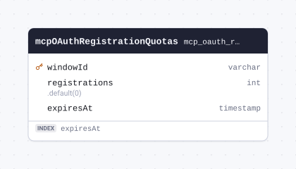

| Column          | Type        | Constraints | Default       | Description |
| --------------- | ----------- | ----------- | ------------- | ----------- |
| `windowId`      | `varchar`   | PK NOT NULL |               |             |
| `registrations` | `int`       | NOT NULL    | `.default(0)` |             |
| `expiresAt`     | `timestamp` | NOT NULL    |               |             |

#### Definition

```sql
CREATE TABLE `mcp_oauth_registration_quotas` (
	`windowId` varchar(10) PRIMARY KEY,
	`registrations` int NOT NULL DEFAULT 0,
	`expiresAt` timestamp NOT NULL
);

CREATE INDEX `expires_at_idx` ON `mcp_oauth_registration_quotas` (`expiresAt`);
```

#### Indexes

- INDEX `expiresAt`

<details>
<summary>Queries and their SQL</summary>

**Select**: Every row of mcpOAuthRegistrationQuotas.

```ts
db.select().from(mcpOAuthRegistrationQuotas);
```

```sql
select `windowId`, `registrations`, `expiresAt`
from `mcp_oauth_registration_quotas`
```

**Count**: How many rows mcpOAuthRegistrationQuotas has.

```ts
db.select({ count: count() }).from(mcpOAuthRegistrationQuotas);
```

```sql
select count(*)
from `mcp_oauth_registration_quotas`
```

**Find many**: The rows of mcpOAuthRegistrationQuotas, through the relational query API.

```ts
db.query.mcpOAuthRegistrationQuotas.findMany();
```

```sql
select `d0`.`windowId` as `windowId`, `d0`.`registrations` as `registrations`, `d0`.`expiresAt` as `expiresAt`
from `mcp_oauth_registration_quotas` as `d0`
```

**Find by primary key**: One row of mcpOAuthRegistrationQuotas, through the relational query API.

```ts
db.query.mcpOAuthRegistrationQuotas.findFirst({ where: { windowId: "windowId" } });
```

```sql
select `d0`.`windowId` as `windowId`, `d0`.`registrations` as `registrations`, `d0`.`expiresAt` as `expiresAt`
from `mcp_oauth_registration_quotas` as `d0`
where `d0`.`windowId` = ?
limit ?
-- params: ["windowId",1]
```

**Insert**: Adds a row to mcpOAuthRegistrationQuotas, giving the columns that have no default.

```ts
db.insert(mcpOAuthRegistrationQuotas).values({
  windowId: "windowId",
  expiresAt: new Date("2026-01-01T00:00:00.000Z"),
});
```

```sql
insert into `mcp_oauth_registration_quotas` (`windowId`, `registrations`, `expiresAt`)
values (?, default, ?)
-- params: ["windowId","2026-01-01 00:00:00.000"]
```

**Update**: Changes a row of mcpOAuthRegistrationQuotas, found by its primary key.

```ts
db.update(mcpOAuthRegistrationQuotas)
  .set({ registrations: 1 })
  .where(eq(mcpOAuthRegistrationQuotas.windowId, "windowId"));
```

```sql
update `mcp_oauth_registration_quotas`
set `registrations` = ?
where `mcp_oauth_registration_quotas`.`windowId` = ?
-- params: [1,"windowId"]
```

**Delete**: Deletes a row of mcpOAuthRegistrationQuotas, found by its primary key.

```ts
db.delete(mcpOAuthRegistrationQuotas).where(eq(mcpOAuthRegistrationQuotas.windowId, "windowId"));
```

```sql
delete from `mcp_oauth_registration_quotas`
where `mcp_oauth_registration_quotas`.`windowId` = ?
-- params: ["windowId"]
```

</details>

<a id="table-mcpOAuthCodes"></a>

### mcpOAuthCodes

Table `mcp_oauth_codes`.

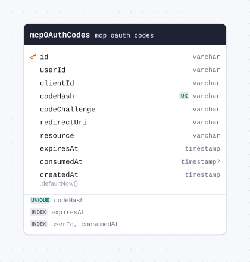

| Column          | Type        | Constraints | Default         | Description |
| --------------- | ----------- | ----------- | --------------- | ----------- |
| `id`            | `varchar`   | PK NOT NULL |                 |             |
| `userId`        | `varchar`   | NOT NULL    |                 |             |
| `clientId`      | `varchar`   | NOT NULL    |                 |             |
| `codeHash`      | `varchar`   | NOT NULL    |                 |             |
| `codeChallenge` | `varchar`   | NOT NULL    |                 |             |
| `redirectUri`   | `varchar`   | NOT NULL    |                 |             |
| `resource`      | `varchar`   | NOT NULL    |                 |             |
| `expiresAt`     | `timestamp` | NOT NULL    |                 |             |
| `consumedAt`    | `timestamp` | NULL        |                 |             |
| `createdAt`     | `timestamp` | NOT NULL    | `.defaultNow()` |             |

#### Definition

```sql
CREATE TABLE `mcp_oauth_codes` (
	`id` varchar(15) PRIMARY KEY,
	`userId` varchar(15) NOT NULL,
	`clientId` varchar(128) NOT NULL,
	`codeHash` varchar(64) NOT NULL,
	`codeChallenge` varchar(64) NOT NULL,
	`redirectUri` varchar(512) NOT NULL,
	`resource` varchar(512) NOT NULL,
	`expiresAt` timestamp NOT NULL,
	`consumedAt` timestamp,
	`createdAt` timestamp NOT NULL DEFAULT (now()),
	CONSTRAINT `code_hash_idx` UNIQUE INDEX(`codeHash`)
);

CREATE INDEX `expires_at_idx` ON `mcp_oauth_codes` (`expiresAt`);
```

#### Indexes

- UNIQUE `codeHash`
- INDEX `expiresAt`

<details>
<summary>Queries and their SQL</summary>

**Select**: Every row of mcpOAuthCodes.

```ts
db.select().from(mcpOAuthCodes);
```

```sql
select `id`, `userId`, `clientId`, `codeHash`, `codeChallenge`, `redirectUri`, `resource`, `expiresAt`, `consumedAt`, `createdAt`
from `mcp_oauth_codes`
```

**Count**: How many rows mcpOAuthCodes has.

```ts
db.select({ count: count() }).from(mcpOAuthCodes);
```

```sql
select count(*)
from `mcp_oauth_codes`
```

**Find many**: The rows of mcpOAuthCodes, through the relational query API.

```ts
db.query.mcpOAuthCodes.findMany();
```

```sql
select `d0`.`id` as `id`, `d0`.`userId` as `userId`, `d0`.`clientId` as `clientId`, `d0`.`codeHash` as `codeHash`, `d0`.`codeChallenge` as `codeChallenge`, `d0`.`redirectUri` as `redirectUri`, `d0`.`resource` as `resource`, `d0`.`expiresAt` as `expiresAt`, `d0`.`consumedAt` as `consumedAt`, `d0`.`createdAt` as `createdAt`
from `mcp_oauth_codes` as `d0`
```

**Find by primary key**: One row of mcpOAuthCodes, through the relational query API.

```ts
db.query.mcpOAuthCodes.findFirst({ where: { id: "id" } });
```

```sql
select `d0`.`id` as `id`, `d0`.`userId` as `userId`, `d0`.`clientId` as `clientId`, `d0`.`codeHash` as `codeHash`, `d0`.`codeChallenge` as `codeChallenge`, `d0`.`redirectUri` as `redirectUri`, `d0`.`resource` as `resource`, `d0`.`expiresAt` as `expiresAt`, `d0`.`consumedAt` as `consumedAt`, `d0`.`createdAt` as `createdAt`
from `mcp_oauth_codes` as `d0`
where `d0`.`id` = ?
limit ?
-- params: ["id",1]
```

**Insert**: Adds a row to mcpOAuthCodes, giving the columns that have no default.

```ts
db.insert(mcpOAuthCodes).values({
  id: "id",
  userId: "userId",
  clientId: "clientId",
  codeHash: "codeHash",
  codeChallenge: "codeChallenge",
  redirectUri: "redirectUri",
  resource: "resource",
  expiresAt: new Date("2026-01-01T00:00:00.000Z"),
});
```

```sql
insert into `mcp_oauth_codes` (`id`, `userId`, `clientId`, `codeHash`, `codeChallenge`, `redirectUri`, `resource`, `expiresAt`, `consumedAt`, `createdAt`)
values (?, ?, ?, ?, ?, ?, ?, ?, default, default)
-- params: ["id","userId","clientId","codeHash","codeChallenge","redirectUri","resource","2026-01-01 00:00:00.000"]
```

**Update**: Changes a row of mcpOAuthCodes, found by its primary key.

```ts
db.update(mcpOAuthCodes).set({ userId: "userId" }).where(eq(mcpOAuthCodes.id, "id"));
```

```sql
update `mcp_oauth_codes`
set `userId` = ?
where `mcp_oauth_codes`.`id` = ?
-- params: ["userId","id"]
```

**Delete**: Deletes a row of mcpOAuthCodes, found by its primary key.

```ts
db.delete(mcpOAuthCodes).where(eq(mcpOAuthCodes.id, "id"));
```

```sql
delete from `mcp_oauth_codes`
where `mcp_oauth_codes`.`id` = ?
-- params: ["id"]
```

</details>

<a id="table-mcpOAuthTokens"></a>

### mcpOAuthTokens

Table `mcp_oauth_tokens`.

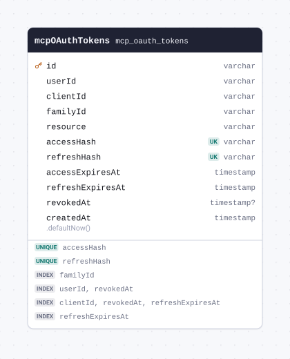

| Column             | Type        | Constraints | Default         | Description |
| ------------------ | ----------- | ----------- | --------------- | ----------- |
| `id`               | `varchar`   | PK NOT NULL |                 |             |
| `userId`           | `varchar`   | NOT NULL    |                 |             |
| `clientId`         | `varchar`   | NOT NULL    |                 |             |
| `familyId`         | `varchar`   | NOT NULL    |                 |             |
| `resource`         | `varchar`   | NOT NULL    |                 |             |
| `accessHash`       | `varchar`   | NOT NULL    |                 |             |
| `refreshHash`      | `varchar`   | NOT NULL    |                 |             |
| `accessExpiresAt`  | `timestamp` | NOT NULL    |                 |             |
| `refreshExpiresAt` | `timestamp` | NOT NULL    |                 |             |
| `revokedAt`        | `timestamp` | NULL        |                 |             |
| `createdAt`        | `timestamp` | NOT NULL    | `.defaultNow()` |             |

#### Definition

```sql
CREATE TABLE `mcp_oauth_tokens` (
	`id` varchar(15) PRIMARY KEY,
	`userId` varchar(15) NOT NULL,
	`clientId` varchar(128) NOT NULL,
	`familyId` varchar(15) NOT NULL,
	`resource` varchar(512) NOT NULL,
	`accessHash` varchar(64) NOT NULL,
	`refreshHash` varchar(64) NOT NULL,
	`accessExpiresAt` timestamp NOT NULL,
	`refreshExpiresAt` timestamp NOT NULL,
	`revokedAt` timestamp,
	`createdAt` timestamp NOT NULL DEFAULT (now()),
	CONSTRAINT `access_hash_idx` UNIQUE INDEX(`accessHash`),
	CONSTRAINT `refresh_hash_idx` UNIQUE INDEX(`refreshHash`)
);

CREATE INDEX `family_id_idx` ON `mcp_oauth_tokens` (`familyId`);

CREATE INDEX `client_active_idx` ON `mcp_oauth_tokens` (`clientId`,`revokedAt`,`refreshExpiresAt`);

CREATE INDEX `refresh_expires_at_idx` ON `mcp_oauth_tokens` (`refreshExpiresAt`);
```

#### Indexes

- UNIQUE `accessHash`
- UNIQUE `refreshHash`
- INDEX `familyId`
- INDEX `clientId`, `revokedAt`, `refreshExpiresAt`
- INDEX `refreshExpiresAt`

<details>
<summary>Queries and their SQL</summary>

**Select**: Every row of mcpOAuthTokens.

```ts
db.select().from(mcpOAuthTokens);
```

```sql
select `id`, `userId`, `clientId`, `familyId`, `resource`, `accessHash`, `refreshHash`, `accessExpiresAt`, `refreshExpiresAt`, `revokedAt`, `createdAt`
from `mcp_oauth_tokens`
```

**Count**: How many rows mcpOAuthTokens has.

```ts
db.select({ count: count() }).from(mcpOAuthTokens);
```

```sql
select count(*)
from `mcp_oauth_tokens`
```

**Find many**: The rows of mcpOAuthTokens, through the relational query API.

```ts
db.query.mcpOAuthTokens.findMany();
```

```sql
select `d0`.`id` as `id`, `d0`.`userId` as `userId`, `d0`.`clientId` as `clientId`, `d0`.`familyId` as `familyId`, `d0`.`resource` as `resource`, `d0`.`accessHash` as `accessHash`, `d0`.`refreshHash` as `refreshHash`, `d0`.`accessExpiresAt` as `accessExpiresAt`, `d0`.`refreshExpiresAt` as `refreshExpiresAt`, `d0`.`revokedAt` as `revokedAt`, `d0`.`createdAt` as `createdAt`
from `mcp_oauth_tokens` as `d0`
```

**Find by primary key**: One row of mcpOAuthTokens, through the relational query API.

```ts
db.query.mcpOAuthTokens.findFirst({ where: { id: "id" } });
```

```sql
select `d0`.`id` as `id`, `d0`.`userId` as `userId`, `d0`.`clientId` as `clientId`, `d0`.`familyId` as `familyId`, `d0`.`resource` as `resource`, `d0`.`accessHash` as `accessHash`, `d0`.`refreshHash` as `refreshHash`, `d0`.`accessExpiresAt` as `accessExpiresAt`, `d0`.`refreshExpiresAt` as `refreshExpiresAt`, `d0`.`revokedAt` as `revokedAt`, `d0`.`createdAt` as `createdAt`
from `mcp_oauth_tokens` as `d0`
where `d0`.`id` = ?
limit ?
-- params: ["id",1]
```

**Insert**: Adds a row to mcpOAuthTokens, giving the columns that have no default.

```ts
db.insert(mcpOAuthTokens).values({
  id: "id",
  userId: "userId",
  clientId: "clientId",
  familyId: "familyId",
  resource: "resource",
  accessHash: "accessHash",
  refreshHash: "refreshHash",
  accessExpiresAt: new Date("2026-01-01T00:00:00.000Z"),
  refreshExpiresAt: new Date("2026-01-01T00:00:00.000Z"),
});
```

```sql
insert into `mcp_oauth_tokens` (`id`, `userId`, `clientId`, `familyId`, `resource`, `accessHash`, `refreshHash`, `accessExpiresAt`, `refreshExpiresAt`, `revokedAt`, `createdAt`)
values (?, ?, ?, ?, ?, ?, ?, ?, ?, default, default)
-- params: ["id","userId","clientId","familyId","resource","accessHash","refreshHash","2026-01-01 00:00:00.000","2026-01-01 00:00:00.000"]
```

**Update**: Changes a row of mcpOAuthTokens, found by its primary key.

```ts
db.update(mcpOAuthTokens).set({ userId: "userId" }).where(eq(mcpOAuthTokens.id, "id"));
```

```sql
update `mcp_oauth_tokens`
set `userId` = ?
where `mcp_oauth_tokens`.`id` = ?
-- params: ["userId","id"]
```

**Delete**: Deletes a row of mcpOAuthTokens, found by its primary key.

```ts
db.delete(mcpOAuthTokens).where(eq(mcpOAuthTokens.id, "id"));
```

```sql
delete from `mcp_oauth_tokens`
where `mcp_oauth_tokens`.`id` = ?
-- params: ["id"]
```

</details>

<a id="table-agentApiOperations"></a>

### agentApiOperations

Table `agent_api_operations`.

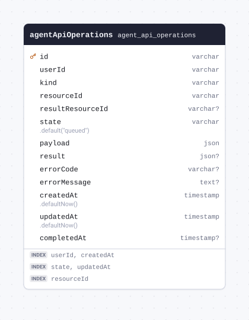

| Column             | Type        | Constraints | Default              | Description |
| ------------------ | ----------- | ----------- | -------------------- | ----------- |
| `id`               | `varchar`   | PK NOT NULL |                      |             |
| `userId`           | `varchar`   | NOT NULL    |                      |             |
| `kind`             | `varchar`   | NOT NULL    |                      |             |
| `resourceId`       | `varchar`   | NOT NULL    |                      |             |
| `resultResourceId` | `varchar`   | NULL        |                      |             |
| `state`            | `varchar`   | NOT NULL    | `.default("queued")` |             |
| `payload`          | `json`      | NOT NULL    |                      |             |
| `result`           | `json`      | NULL        |                      |             |
| `errorCode`        | `varchar`   | NULL        |                      |             |
| `errorMessage`     | `text`      | NULL        |                      |             |
| `createdAt`        | `timestamp` | NOT NULL    | `.defaultNow()`      |             |
| `updatedAt`        | `timestamp` | NOT NULL    | `.defaultNow()`      |             |
| `completedAt`      | `timestamp` | NULL        |                      |             |

#### Definition

```sql
CREATE TABLE `agent_api_operations` (
	`id` varchar(15) PRIMARY KEY,
	`userId` varchar(15) NOT NULL,
	`kind` varchar(32) NOT NULL,
	`resourceId` varchar(15) NOT NULL,
	`resultResourceId` varchar(15),
	`state` varchar(16) NOT NULL DEFAULT 'queued',
	`payload` json NOT NULL,
	`result` json,
	`errorCode` varchar(64),
	`errorMessage` text,
	`createdAt` timestamp NOT NULL DEFAULT (now()),
	`updatedAt` timestamp NOT NULL DEFAULT (now()) ON UPDATE CURRENT_TIMESTAMP,
	`completedAt` timestamp
);

CREATE INDEX `user_created_at_idx` ON `agent_api_operations` (`userId`,`createdAt`);

CREATE INDEX `state_updated_at_idx` ON `agent_api_operations` (`state`,`updatedAt`);

CREATE INDEX `resource_id_idx` ON `agent_api_operations` (`resourceId`);
```

#### Indexes

- INDEX `userId`, `createdAt`
- INDEX `state`, `updatedAt`
- INDEX `resourceId`

<details>
<summary>Queries and their SQL</summary>

**Select**: Every row of agentApiOperations.

```ts
db.select().from(agentApiOperations);
```

```sql
select `id`, `userId`, `kind`, `resourceId`, `resultResourceId`, `state`, `payload`, `result`, `errorCode`, `errorMessage`, `createdAt`, `updatedAt`, `completedAt`
from `agent_api_operations`
```

**Count**: How many rows agentApiOperations has.

```ts
db.select({ count: count() }).from(agentApiOperations);
```

```sql
select count(*)
from `agent_api_operations`
```

**Find many**: The rows of agentApiOperations, through the relational query API.

```ts
db.query.agentApiOperations.findMany();
```

```sql
select `d0`.`id` as `id`, `d0`.`userId` as `userId`, `d0`.`kind` as `kind`, `d0`.`resourceId` as `resourceId`, `d0`.`resultResourceId` as `resultResourceId`, `d0`.`state` as `state`, `d0`.`payload` as `payload`, `d0`.`result` as `result`, `d0`.`errorCode` as `errorCode`, `d0`.`errorMessage` as `errorMessage`, `d0`.`createdAt` as `createdAt`, `d0`.`updatedAt` as `updatedAt`, `d0`.`completedAt` as `completedAt`
from `agent_api_operations` as `d0`
```

**Find by primary key**: One row of agentApiOperations, through the relational query API.

```ts
db.query.agentApiOperations.findFirst({ where: { id: "id" } });
```

```sql
select `d0`.`id` as `id`, `d0`.`userId` as `userId`, `d0`.`kind` as `kind`, `d0`.`resourceId` as `resourceId`, `d0`.`resultResourceId` as `resultResourceId`, `d0`.`state` as `state`, `d0`.`payload` as `payload`, `d0`.`result` as `result`, `d0`.`errorCode` as `errorCode`, `d0`.`errorMessage` as `errorMessage`, `d0`.`createdAt` as `createdAt`, `d0`.`updatedAt` as `updatedAt`, `d0`.`completedAt` as `completedAt`
from `agent_api_operations` as `d0`
where `d0`.`id` = ?
limit ?
-- params: ["id",1]
```

**Insert**: Adds a row to agentApiOperations, giving the columns that have no default.

```ts
db.insert(agentApiOperations).values({
  id: "id",
  userId: "userId",
  kind: "kind",
  resourceId: "resourceId",
  payload: {},
});
```

```sql
insert into `agent_api_operations` (`id`, `userId`, `kind`, `resourceId`, `resultResourceId`, `state`, `payload`, `result`, `errorCode`, `errorMessage`, `createdAt`, `updatedAt`, `completedAt`)
values (?, ?, ?, ?, default, default, ?, default, default, default, default, default, default)
-- params: ["id","userId","kind","resourceId","{}"]
```

**Update**: Changes a row of agentApiOperations, found by its primary key.

```ts
db.update(agentApiOperations).set({ userId: "userId" }).where(eq(agentApiOperations.id, "id"));
```

```sql
update `agent_api_operations`
set `userId` = ?
where `agent_api_operations`.`id` = ?
-- params: ["userId","id"]
```

**Delete**: Deletes a row of agentApiOperations, found by its primary key.

```ts
db.delete(agentApiOperations).where(eq(agentApiOperations.id, "id"));
```

```sql
delete from `agent_api_operations`
where `agent_api_operations`.`id` = ?
-- params: ["id"]
```

</details>

<a id="table-spaces"></a>

### spaces

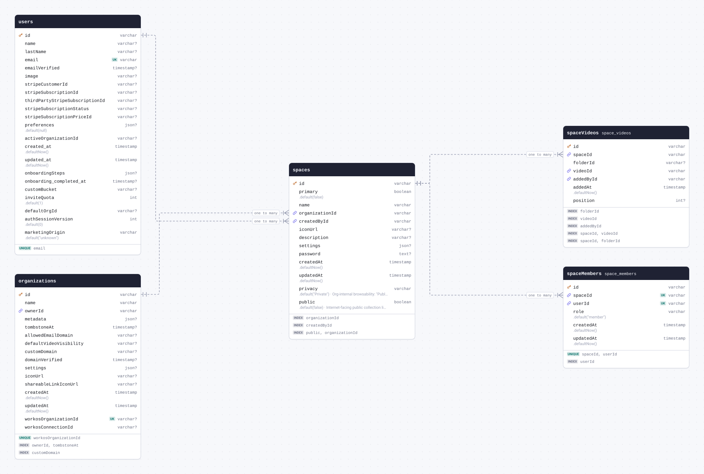

| Column           | Type        | Constraints                                         | Default               | Description                                                                                                                      |
| ---------------- | ----------- | --------------------------------------------------- | --------------------- | -------------------------------------------------------------------------------------------------------------------------------- |
| `id`             | `varchar`   | PK NOT NULL                                         |                       |                                                                                                                                  |
| `primary`        | `boolean`   | NOT NULL                                            | `.default(false)`     |                                                                                                                                  |
| `name`           | `varchar`   | NOT NULL                                            |                       |                                                                                                                                  |
| `organizationId` | `varchar`   | NOT NULL → [organizations.id](#table-organizations) |                       |                                                                                                                                  |
| `createdById`    | `varchar`   | NOT NULL → [users.id](#table-users)                 |                       |                                                                                                                                  |
| `iconUrl`        | `varchar`   | NULL                                                |                       |                                                                                                                                  |
| `description`    | `varchar`   | NULL                                                |                       |                                                                                                                                  |
| `settings`       | `json`      | NULL                                                |                       |                                                                                                                                  |
| `password`       | `text`      | NULL                                                |                       |                                                                                                                                  |
| `createdAt`      | `timestamp` | NOT NULL                                            | `.defaultNow()`       |                                                                                                                                  |
| `updatedAt`      | `timestamp` | NOT NULL                                            | `.defaultNow()`       |                                                                                                                                  |
| `privacy`        | `varchar`   | NOT NULL                                            | `.default("Private")` | Org-internal browsability: "Public" spaces are visible to all org members. Unrelated to the internet-facing `public` flag below. |
| `public`         | `boolean`   | NOT NULL                                            | `.default(false)`     | Internet-facing public collection link (/c/[id]).                                                                                |

#### Definition

```sql
CREATE TABLE `spaces` (
	`id` varchar(15) PRIMARY KEY,
	`primary` boolean NOT NULL DEFAULT false,
	`name` varchar(255) NOT NULL,
	`organizationId` varchar(15) NOT NULL,
	`createdById` varchar(15) NOT NULL,
	`iconUrl` varchar(255),
	`description` varchar(1000),
	`settings` json,
	`password` text,
	`createdAt` timestamp NOT NULL DEFAULT (now()),
	`updatedAt` timestamp NOT NULL DEFAULT (now()) ON UPDATE CURRENT_TIMESTAMP,
	`privacy` varchar(255) NOT NULL DEFAULT 'Private',
	`public` boolean NOT NULL DEFAULT false
);

CREATE INDEX `organization_id_idx` ON `spaces` (`organizationId`);

CREATE INDEX `created_by_id_idx` ON `spaces` (`createdById`);

CREATE INDEX `public_organization_id_idx` ON `spaces` (`public`,`organizationId`);
```

#### Indexes

- INDEX `organizationId`
- INDEX `createdById`
- INDEX `public`, `organizationId`

#### References

- `organizationId` → [organizations.id](#table-organizations) (many to one, defineRelations, no foreign key)
- `createdById` → [users.id](#table-users) (many to one, defineRelations, no foreign key)

#### Referenced by

- `id` → [spaceMembers.spaceId](#table-spaceMembers) (one to many, defineRelations)
- `id` → [spaceVideos.spaceId](#table-spaceVideos) (one to many, defineRelations)

<details>
<summary>Queries and their SQL</summary>

**Select**: Every row of spaces.

```ts
db.select().from(spaces);
```

```sql
select `id`, `primary`, `name`, `organizationId`, `createdById`, `iconUrl`, `description`, `settings`, `password`, `createdAt`, `updatedAt`, `privacy`, `public`
from `spaces`
```

**Count**: How many rows spaces has.

```ts
db.select({ count: count() }).from(spaces);
```

```sql
select count(*)
from `spaces`
```

**Find many**: The rows of spaces, through the relational query API.

```ts
db.query.spaces.findMany();
```

```sql
select `d0`.`id` as `id`, `d0`.`primary` as `primary`, `d0`.`name` as `name`, `d0`.`organizationId` as `organizationId`, `d0`.`createdById` as `createdById`, `d0`.`iconUrl` as `iconUrl`, `d0`.`description` as `description`, `d0`.`settings` as `settings`, `d0`.`password` as `password`, `d0`.`createdAt` as `createdAt`, `d0`.`updatedAt` as `updatedAt`, `d0`.`privacy` as `privacy`, `d0`.`public` as `public`
from `spaces` as `d0`
```

**Find by primary key**: One row of spaces, through the relational query API.

```ts
db.query.spaces.findFirst({ where: { id: "id" } });
```

```sql
select `d0`.`id` as `id`, `d0`.`primary` as `primary`, `d0`.`name` as `name`, `d0`.`organizationId` as `organizationId`, `d0`.`createdById` as `createdById`, `d0`.`iconUrl` as `iconUrl`, `d0`.`description` as `description`, `d0`.`settings` as `settings`, `d0`.`password` as `password`, `d0`.`createdAt` as `createdAt`, `d0`.`updatedAt` as `updatedAt`, `d0`.`privacy` as `privacy`, `d0`.`public` as `public`
from `spaces` as `d0`
where `d0`.`id` = ?
limit ?
-- params: ["id",1]
```

**Insert**: Adds a row to spaces, giving the columns that have no default.

```ts
db.insert(spaces).values({
  id: "id",
  name: "name",
  organizationId: "organizationId",
  createdById: "createdById",
});
```

```sql
insert into `spaces` (`id`, `primary`, `name`, `organizationId`, `createdById`, `iconUrl`, `description`, `settings`, `password`, `createdAt`, `updatedAt`, `privacy`, `public`)
values (?, default, ?, ?, ?, default, default, default, default, default, default, default, default)
-- params: ["id","name","organizationId","createdById"]
```

**Update**: Changes a row of spaces, found by its primary key.

```ts
db.update(spaces).set({ primary: true }).where(eq(spaces.id, "id"));
```

```sql
update `spaces`
set `primary` = ?
where `spaces`.`id` = ?
-- params: [true,"id"]
```

**Delete**: Deletes a row of spaces, found by its primary key.

```ts
db.delete(spaces).where(eq(spaces.id, "id"));
```

```sql
delete from `spaces`
where `spaces`.`id` = ?
-- params: ["id"]
```

</details>

<a id="table-spaceMembers"></a>

### spaceMembers

Table `space_members`.

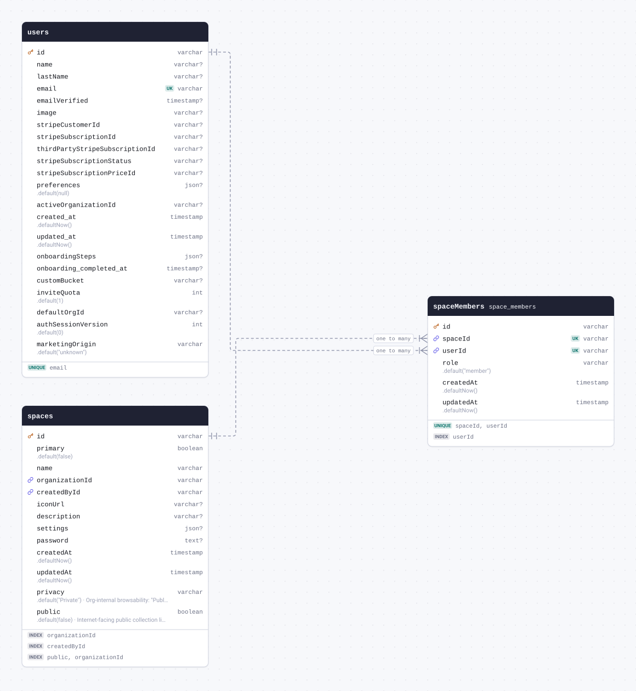

| Column      | Type        | Constraints                           | Default              | Description |
| ----------- | ----------- | ------------------------------------- | -------------------- | ----------- |
| `id`        | `varchar`   | PK NOT NULL                           |                      |             |
| `spaceId`   | `varchar`   | NOT NULL → [spaces.id](#table-spaces) |                      |             |
| `userId`    | `varchar`   | NOT NULL → [users.id](#table-users)   |                      |             |
| `role`      | `varchar`   | NOT NULL                              | `.default("member")` |             |
| `createdAt` | `timestamp` | NOT NULL                              | `.defaultNow()`      |             |
| `updatedAt` | `timestamp` | NOT NULL                              | `.defaultNow()`      |             |

#### Definition

```sql
CREATE TABLE `space_members` (
	`id` varchar(15) PRIMARY KEY,
	`spaceId` varchar(15) NOT NULL,
	`userId` varchar(15) NOT NULL,
	`role` varchar(255) NOT NULL DEFAULT 'member',
	`createdAt` timestamp NOT NULL DEFAULT (now()),
	`updatedAt` timestamp NOT NULL DEFAULT (now()) ON UPDATE CURRENT_TIMESTAMP,
	CONSTRAINT `space_id_user_id_unique` UNIQUE INDEX(`spaceId`,`userId`)
);

CREATE INDEX `user_id_idx` ON `space_members` (`userId`);
```

#### Indexes

- INDEX `userId`
- UNIQUE `spaceId`, `userId`

#### References

- `spaceId` → [spaces.id](#table-spaces) (many to one, defineRelations, no foreign key)
- `userId` → [users.id](#table-users) (many to one, defineRelations, no foreign key)

<details>
<summary>Queries and their SQL</summary>

**Select**: Every row of spaceMembers.

```ts
db.select().from(spaceMembers);
```

```sql
select `id`, `spaceId`, `userId`, `role`, `createdAt`, `updatedAt`
from `space_members`
```

**Count**: How many rows spaceMembers has.

```ts
db.select({ count: count() }).from(spaceMembers);
```

```sql
select count(*)
from `space_members`
```

**Find many**: The rows of spaceMembers, through the relational query API.

```ts
db.query.spaceMembers.findMany();
```

```sql
select `d0`.`id` as `id`, `d0`.`spaceId` as `spaceId`, `d0`.`userId` as `userId`, `d0`.`role` as `role`, `d0`.`createdAt` as `createdAt`, `d0`.`updatedAt` as `updatedAt`
from `space_members` as `d0`
```

**Find by primary key**: One row of spaceMembers, through the relational query API.

```ts
db.query.spaceMembers.findFirst({ where: { id: "id" } });
```

```sql
select `d0`.`id` as `id`, `d0`.`spaceId` as `spaceId`, `d0`.`userId` as `userId`, `d0`.`role` as `role`, `d0`.`createdAt` as `createdAt`, `d0`.`updatedAt` as `updatedAt`
from `space_members` as `d0`
where `d0`.`id` = ?
limit ?
-- params: ["id",1]
```

**Insert**: Adds a row to spaceMembers, giving the columns that have no default.

```ts
db.insert(spaceMembers).values({ id: "id", spaceId: "spaceId", userId: "userId" });
```

```sql
insert into `space_members` (`id`, `spaceId`, `userId`, `role`, `createdAt`, `updatedAt`)
values (?, ?, ?, default, default, default)
-- params: ["id","spaceId","userId"]
```

**Update**: Changes a row of spaceMembers, found by its primary key.

```ts
db.update(spaceMembers).set({ spaceId: "spaceId" }).where(eq(spaceMembers.id, "id"));
```

```sql
update `space_members`
set `spaceId` = ?
where `space_members`.`id` = ?
-- params: ["spaceId","id"]
```

**Delete**: Deletes a row of spaceMembers, found by its primary key.

```ts
db.delete(spaceMembers).where(eq(spaceMembers.id, "id"));
```

```sql
delete from `space_members`
where `space_members`.`id` = ?
-- params: ["id"]
```

</details>

<a id="table-spaceVideos"></a>

### spaceVideos

Table `space_videos`.

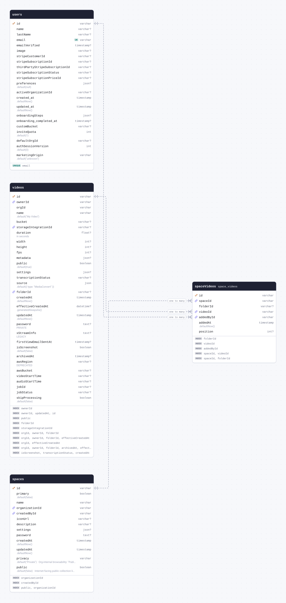

| Column      | Type        | Constraints                           | Default         | Description |
| ----------- | ----------- | ------------------------------------- | --------------- | ----------- |
| `id`        | `varchar`   | PK NOT NULL                           |                 |             |
| `spaceId`   | `varchar`   | NOT NULL → [spaces.id](#table-spaces) |                 |             |
| `folderId`  | `varchar`   | NULL                                  |                 |             |
| `videoId`   | `varchar`   | NOT NULL → [videos.id](#table-videos) |                 |             |
| `addedById` | `varchar`   | NOT NULL → [users.id](#table-users)   |                 |             |
| `addedAt`   | `timestamp` | NOT NULL                              | `.defaultNow()` |             |

#### Definition

```sql
CREATE TABLE `space_videos` (
	`id` varchar(15) PRIMARY KEY,
	`spaceId` varchar(15) NOT NULL,
	`folderId` varchar(15),
	`videoId` varchar(15) NOT NULL,
	`addedById` varchar(15) NOT NULL,
	`addedAt` timestamp NOT NULL DEFAULT (now())
);

CREATE INDEX `folder_id_idx` ON `space_videos` (`folderId`);

CREATE INDEX `video_id_idx` ON `space_videos` (`videoId`);

CREATE INDEX `added_by_id_idx` ON `space_videos` (`addedById`);

CREATE INDEX `space_id_video_id_idx` ON `space_videos` (`spaceId`,`videoId`);

CREATE INDEX `space_id_folder_id_idx` ON `space_videos` (`spaceId`,`folderId`);
```

#### Indexes

- INDEX `folderId`
- INDEX `videoId`
- INDEX `addedById`
- INDEX `spaceId`, `videoId`
- INDEX `spaceId`, `folderId`

#### References

- `spaceId` → [spaces.id](#table-spaces) (many to one, defineRelations, no foreign key)
- `videoId` → [videos.id](#table-videos) (many to one, defineRelations, no foreign key)
- `addedById` → [users.id](#table-users) (many to one, defineRelations, no foreign key)

<details>
<summary>Queries and their SQL</summary>

**Select**: Every row of spaceVideos.

```ts
db.select().from(spaceVideos);
```

```sql
select `id`, `spaceId`, `folderId`, `videoId`, `addedById`, `addedAt`
from `space_videos`
```

**Count**: How many rows spaceVideos has.

```ts
db.select({ count: count() }).from(spaceVideos);
```

```sql
select count(*)
from `space_videos`
```

**Find many**: The rows of spaceVideos, through the relational query API.

```ts
db.query.spaceVideos.findMany();
```

```sql
select `d0`.`id` as `id`, `d0`.`spaceId` as `spaceId`, `d0`.`folderId` as `folderId`, `d0`.`videoId` as `videoId`, `d0`.`addedById` as `addedById`, `d0`.`addedAt` as `addedAt`
from `space_videos` as `d0`
```

**Find by primary key**: One row of spaceVideos, through the relational query API.

```ts
db.query.spaceVideos.findFirst({ where: { id: "id" } });
```

```sql
select `d0`.`id` as `id`, `d0`.`spaceId` as `spaceId`, `d0`.`folderId` as `folderId`, `d0`.`videoId` as `videoId`, `d0`.`addedById` as `addedById`, `d0`.`addedAt` as `addedAt`
from `space_videos` as `d0`
where `d0`.`id` = ?
limit ?
-- params: ["id",1]
```

**Insert**: Adds a row to spaceVideos, giving the columns that have no default.

```ts
db.insert(spaceVideos).values({
  id: "id",
  spaceId: "spaceId",
  videoId: "videoId",
  addedById: "addedById",
});
```

```sql
insert into `space_videos` (`id`, `spaceId`, `folderId`, `videoId`, `addedById`, `addedAt`)
values (?, ?, default, ?, ?, default)
-- params: ["id","spaceId","videoId","addedById"]
```

**Update**: Changes a row of spaceVideos, found by its primary key.

```ts
db.update(spaceVideos).set({ spaceId: "spaceId" }).where(eq(spaceVideos.id, "id"));
```

```sql
update `space_videos`
set `spaceId` = ?
where `space_videos`.`id` = ?
-- params: ["spaceId","id"]
```

**Delete**: Deletes a row of spaceVideos, found by its primary key.

```ts
db.delete(spaceVideos).where(eq(spaceVideos.id, "id"));
```

```sql
delete from `space_videos`
where `space_videos`.`id` = ?
-- params: ["id"]
```

</details>

<a id="table-videoUploads"></a>

### videoUploads

Table `video_uploads`.

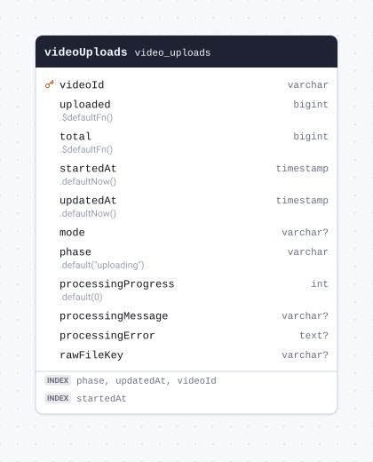

| Column                                       | Type        | Constraints | Default                 | Description |
| -------------------------------------------- | ----------- | ----------- | ----------------------- | ----------- |
| `videoId` (`video_id`)                       | `varchar`   | PK NOT NULL |                         |             |
| `uploaded`                                   | `bigint`    | NOT NULL    | `.$defaultFn()`         |             |
| `total`                                      | `bigint`    | NOT NULL    | `.$defaultFn()`         |             |
| `startedAt` (`started_at`)                   | `timestamp` | NOT NULL    | `.defaultNow()`         |             |
| `updatedAt` (`updated_at`)                   | `timestamp` | NOT NULL    | `.defaultNow()`         |             |
| `mode`                                       | `varchar`   | NULL        |                         |             |
| `phase`                                      | `varchar`   | NOT NULL    | `.default("uploading")` |             |
| `processingProgress` (`processing_progress`) | `int`       | NOT NULL    | `.default(0)`           |             |
| `processingMessage` (`processing_message`)   | `varchar`   | NULL        |                         |             |
| `processingError` (`processing_error`)       | `text`      | NULL        |                         |             |
| `rawFileKey` (`raw_file_key`)                | `varchar`   | NULL        |                         |             |

#### Definition

```sql
CREATE TABLE `video_uploads` (
	`video_id` varchar(15) PRIMARY KEY,
	`uploaded` bigint unsigned NOT NULL,
	`total` bigint unsigned NOT NULL,
	`started_at` timestamp NOT NULL DEFAULT (now()),
	`updated_at` timestamp NOT NULL DEFAULT (now()),
	`mode` varchar(255),
	`phase` varchar(32) NOT NULL DEFAULT 'uploading',
	`processing_progress` int NOT NULL DEFAULT 0,
	`processing_message` varchar(255),
	`processing_error` text,
	`raw_file_key` varchar(512)
);

CREATE INDEX `phase_updated_at_video_id_idx` ON `video_uploads` (`phase`,`updated_at`,`video_id`);

CREATE INDEX `started_at_idx` ON `video_uploads` (`started_at`);
```

#### Indexes

- INDEX `phase`, `updatedAt`, `videoId`
- INDEX `startedAt`

<details>
<summary>Queries and their SQL</summary>

**Select**: Every row of videoUploads.

```ts
db.select().from(videoUploads);
```

```sql
select `video_id`, `uploaded`, `total`, `started_at`, `updated_at`, `mode`, `phase`, `processing_progress`, `processing_message`, `processing_error`, `raw_file_key`
from `video_uploads`
```

**Count**: How many rows videoUploads has.

```ts
db.select({ count: count() }).from(videoUploads);
```

```sql
select count(*)
from `video_uploads`
```

**Find many**: The rows of videoUploads, through the relational query API.

```ts
db.query.videoUploads.findMany();
```

```sql
select `d0`.`video_id` as `videoId`, `d0`.`uploaded` as `uploaded`, `d0`.`total` as `total`, `d0`.`started_at` as `startedAt`, `d0`.`updated_at` as `updatedAt`, `d0`.`mode` as `mode`, `d0`.`phase` as `phase`, `d0`.`processing_progress` as `processingProgress`, `d0`.`processing_message` as `processingMessage`, `d0`.`processing_error` as `processingError`, `d0`.`raw_file_key` as `rawFileKey`
from `video_uploads` as `d0`
```

**Find by primary key**: One row of videoUploads, through the relational query API.

```ts
db.query.videoUploads.findFirst({ where: { videoId: "videoId" } });
```

```sql
select `d0`.`video_id` as `videoId`, `d0`.`uploaded` as `uploaded`, `d0`.`total` as `total`, `d0`.`started_at` as `startedAt`, `d0`.`updated_at` as `updatedAt`, `d0`.`mode` as `mode`, `d0`.`phase` as `phase`, `d0`.`processing_progress` as `processingProgress`, `d0`.`processing_message` as `processingMessage`, `d0`.`processing_error` as `processingError`, `d0`.`raw_file_key` as `rawFileKey`
from `video_uploads` as `d0`
where `d0`.`video_id` = ?
limit ?
-- params: ["videoId",1]
```

**Insert**: Adds a row to videoUploads, giving the columns that have no default.

```ts
db.insert(videoUploads).values({ videoId: "videoId" });
```

```sql
insert into `video_uploads` (`video_id`, `uploaded`, `total`, `started_at`, `updated_at`, `mode`, `phase`, `processing_progress`, `processing_message`, `processing_error`, `raw_file_key`)
values (?, ?, ?, default, default, default, default, default, default, default, default)
-- params: ["videoId",0,0]
```

**Update**: Changes a row of videoUploads, found by its primary key.

```ts
db.update(videoUploads).set({ uploaded: 1 }).where(eq(videoUploads.videoId, "videoId"));
```

```sql
update `video_uploads`
set `uploaded` = ?
where `video_uploads`.`video_id` = ?
-- params: [1,"videoId"]
```

**Delete**: Deletes a row of videoUploads, found by its primary key.

```ts
db.delete(videoUploads).where(eq(videoUploads.videoId, "videoId"));
```

```sql
delete from `video_uploads`
where `video_uploads`.`video_id` = ?
-- params: ["videoId"]
```

</details>

<a id="table-videoProcessingJobs"></a>

### videoProcessingJobs

Table `video_processing_jobs`.

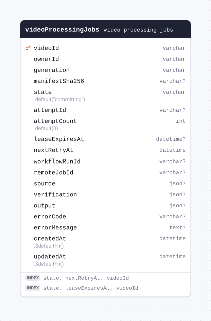

| Column                                | Type       | Constraints | Default                  | Description |
| ------------------------------------- | ---------- | ----------- | ------------------------ | ----------- |
| `videoId` (`video_id`)                | `varchar`  | PK NOT NULL |                          |             |
| `ownerId` (`owner_id`)                | `varchar`  | NOT NULL    |                          |             |
| `generation`                          | `varchar`  | NOT NULL    |                          |             |
| `manifestSha256` (`manifest_sha256`)  | `varchar`  | NULL        |                          |             |
| `state`                               | `varchar`  | NOT NULL    | `.default("committing")` |             |
| `attemptId` (`attempt_id`)            | `varchar`  | NULL        |                          |             |
| `attemptCount` (`attempt_count`)      | `int`      | NOT NULL    | `.default(0)`            |             |
| `leaseExpiresAt` (`lease_expires_at`) | `datetime` | NULL        |                          |             |
| `nextRetryAt` (`next_retry_at`)       | `datetime` | NOT NULL    |                          |             |
| `workflowRunId` (`workflow_run_id`)   | `varchar`  | NULL        |                          |             |
| `remoteJobId` (`remote_job_id`)       | `varchar`  | NULL        |                          |             |
| `source`                              | `json`     | NULL        |                          |             |
| `verification`                        | `json`     | NULL        |                          |             |
| `output`                              | `json`     | NULL        |                          |             |
| `errorCode` (`error_code`)            | `varchar`  | NULL        |                          |             |
| `errorMessage` (`error_message`)      | `text`     | NULL        |                          |             |
| `createdAt` (`created_at`)            | `datetime` | NOT NULL    | `.$defaultFn()`          |             |
| `updatedAt` (`updated_at`)            | `datetime` | NOT NULL    | `.$defaultFn()`          |             |

#### Definition

```sql
CREATE TABLE `video_processing_jobs` (
	`video_id` varchar(15) PRIMARY KEY,
	`owner_id` varchar(15) NOT NULL,
	`generation` varchar(64) NOT NULL,
	`manifest_sha256` varchar(64),
	`state` varchar(32) NOT NULL DEFAULT 'committing',
	`attempt_id` varchar(64),
	`attempt_count` int NOT NULL DEFAULT 0,
	`lease_expires_at` datetime(3),
	`next_retry_at` datetime(3) NOT NULL,
	`workflow_run_id` varchar(255),
	`remote_job_id` varchar(255),
	`source` json,
	`verification` json,
	`output` json,
	`error_code` varchar(64),
	`error_message` text,
	`created_at` datetime(3) NOT NULL,
	`updated_at` datetime(3) NOT NULL
);

CREATE INDEX `processing_state_retry_video_idx` ON `video_processing_jobs` (`state`,`next_retry_at`,`video_id`);

CREATE INDEX `processing_state_lease_video_idx` ON `video_processing_jobs` (`state`,`lease_expires_at`,`video_id`);
```

#### Indexes

- INDEX `state`, `nextRetryAt`, `videoId`
- INDEX `state`, `leaseExpiresAt`, `videoId`

<details>
<summary>Queries and their SQL</summary>

**Select**: Every row of videoProcessingJobs.

```ts
db.select().from(videoProcessingJobs);
```

```sql
select `video_id`, `owner_id`, `generation`, `manifest_sha256`, `state`, `attempt_id`, `attempt_count`, `lease_expires_at`, `next_retry_at`, `workflow_run_id`, `remote_job_id`, `source`, `verification`, `output`, `error_code`, `error_message`, `created_at`, `updated_at`
from `video_processing_jobs`
```

**Count**: How many rows videoProcessingJobs has.

```ts
db.select({ count: count() }).from(videoProcessingJobs);
```

```sql
select count(*)
from `video_processing_jobs`
```

**Find many**: The rows of videoProcessingJobs, through the relational query API.

```ts
db.query.videoProcessingJobs.findMany();
```

```sql
select `d0`.`video_id` as `videoId`, `d0`.`owner_id` as `ownerId`, `d0`.`generation` as `generation`, `d0`.`manifest_sha256` as `manifestSha256`, `d0`.`state` as `state`, `d0`.`attempt_id` as `attemptId`, `d0`.`attempt_count` as `attemptCount`, `d0`.`lease_expires_at` as `leaseExpiresAt`, `d0`.`next_retry_at` as `nextRetryAt`, `d0`.`workflow_run_id` as `workflowRunId`, `d0`.`remote_job_id` as `remoteJobId`, `d0`.`source` as `source`, `d0`.`verification` as `verification`, `d0`.`output` as `output`, `d0`.`error_code` as `errorCode`, `d0`.`error_message` as `errorMessage`, `d0`.`created_at` as `createdAt`, `d0`.`updated_at` as `updatedAt`
from `video_processing_jobs` as `d0`
```

**Find by primary key**: One row of videoProcessingJobs, through the relational query API.

```ts
db.query.videoProcessingJobs.findFirst({ where: { videoId: "videoId" } });
```

```sql
select `d0`.`video_id` as `videoId`, `d0`.`owner_id` as `ownerId`, `d0`.`generation` as `generation`, `d0`.`manifest_sha256` as `manifestSha256`, `d0`.`state` as `state`, `d0`.`attempt_id` as `attemptId`, `d0`.`attempt_count` as `attemptCount`, `d0`.`lease_expires_at` as `leaseExpiresAt`, `d0`.`next_retry_at` as `nextRetryAt`, `d0`.`workflow_run_id` as `workflowRunId`, `d0`.`remote_job_id` as `remoteJobId`, `d0`.`source` as `source`, `d0`.`verification` as `verification`, `d0`.`output` as `output`, `d0`.`error_code` as `errorCode`, `d0`.`error_message` as `errorMessage`, `d0`.`created_at` as `createdAt`, `d0`.`updated_at` as `updatedAt`
from `video_processing_jobs` as `d0`
where `d0`.`video_id` = ?
limit ?
-- params: ["videoId",1]
```

**Insert**: Adds a row to videoProcessingJobs, giving the columns that have no default.

```ts
db.insert(videoProcessingJobs).values({
  videoId: "videoId",
  ownerId: "ownerId",
  generation: "generation",
  nextRetryAt: new Date("2026-01-01T00:00:00.000Z"),
});
```

```sql
insert into `video_processing_jobs` (`video_id`, `owner_id`, `generation`, `manifest_sha256`, `state`, `attempt_id`, `attempt_count`, `lease_expires_at`, `next_retry_at`, `workflow_run_id`, `remote_job_id`, `source`, `verification`, `output`, `error_code`, `error_message`, `created_at`, `updated_at`)
values (?, ?, ?, default, default, default, default, default, ?, default, default, default, default, default, default, default, ?, ?)
-- params: ["videoId","ownerId","generation","2026-01-01 00:00:00.000","2026-01-01 00:00:00.000","2026-01-01 00:00:00.000"]
```

**Update**: Changes a row of videoProcessingJobs, found by its primary key.

```ts
db.update(videoProcessingJobs)
  .set({ ownerId: "ownerId" })
  .where(eq(videoProcessingJobs.videoId, "videoId"));
```

```sql
update `video_processing_jobs`
set `owner_id` = ?
where `video_processing_jobs`.`video_id` = ?
-- params: ["ownerId","videoId"]
```

**Delete**: Deletes a row of videoProcessingJobs, found by its primary key.

```ts
db.delete(videoProcessingJobs).where(eq(videoProcessingJobs.videoId, "videoId"));
```

```sql
delete from `video_processing_jobs`
where `video_processing_jobs`.`video_id` = ?
-- params: ["videoId"]
```

</details>

<a id="table-mediaProcessingBudgets"></a>

### mediaProcessingBudgets

Table `media_processing_budgets`.

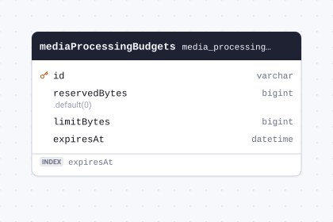

| Column                             | Type       | Constraints | Default       | Description |
| ---------------------------------- | ---------- | ----------- | ------------- | ----------- |
| `id`                               | `varchar`  | PK NOT NULL |               |             |
| `reservedBytes` (`reserved_bytes`) | `bigint`   | NOT NULL    | `.default(0)` |             |
| `limitBytes` (`limit_bytes`)       | `bigint`   | NOT NULL    |               |             |
| `expiresAt` (`expires_at`)         | `datetime` | NOT NULL    |               |             |

#### Definition

```sql
CREATE TABLE `media_processing_budgets` (
	`id` varchar(64) PRIMARY KEY,
	`reserved_bytes` bigint unsigned NOT NULL DEFAULT 0,
	`limit_bytes` bigint unsigned NOT NULL,
	`expires_at` datetime(3) NOT NULL
);

CREATE INDEX `media_budget_expiry_idx` ON `media_processing_budgets` (`expires_at`);
```

#### Indexes

- INDEX `expiresAt`

<details>
<summary>Queries and their SQL</summary>

**Select**: Every row of mediaProcessingBudgets.

```ts
db.select().from(mediaProcessingBudgets);
```

```sql
select `id`, `reserved_bytes`, `limit_bytes`, `expires_at`
from `media_processing_budgets`
```

**Count**: How many rows mediaProcessingBudgets has.

```ts
db.select({ count: count() }).from(mediaProcessingBudgets);
```

```sql
select count(*)
from `media_processing_budgets`
```

**Find many**: The rows of mediaProcessingBudgets, through the relational query API.

```ts
db.query.mediaProcessingBudgets.findMany();
```

```sql
select `d0`.`id` as `id`, `d0`.`reserved_bytes` as `reservedBytes`, `d0`.`limit_bytes` as `limitBytes`, `d0`.`expires_at` as `expiresAt`
from `media_processing_budgets` as `d0`
```

**Find by primary key**: One row of mediaProcessingBudgets, through the relational query API.

```ts
db.query.mediaProcessingBudgets.findFirst({ where: { id: "id" } });
```

```sql
select `d0`.`id` as `id`, `d0`.`reserved_bytes` as `reservedBytes`, `d0`.`limit_bytes` as `limitBytes`, `d0`.`expires_at` as `expiresAt`
from `media_processing_budgets` as `d0`
where `d0`.`id` = ?
limit ?
-- params: ["id",1]
```

**Insert**: Adds a row to mediaProcessingBudgets, giving the columns that have no default.

```ts
db.insert(mediaProcessingBudgets).values({
  id: "id",
  limitBytes: 1,
  expiresAt: new Date("2026-01-01T00:00:00.000Z"),
});
```

```sql
insert into `media_processing_budgets` (`id`, `reserved_bytes`, `limit_bytes`, `expires_at`)
values (?, default, ?, ?)
-- params: ["id",1,"2026-01-01 00:00:00.000"]
```

**Update**: Changes a row of mediaProcessingBudgets, found by its primary key.

```ts
db.update(mediaProcessingBudgets)
  .set({ reservedBytes: 1 })
  .where(eq(mediaProcessingBudgets.id, "id"));
```

```sql
update `media_processing_budgets`
set `reserved_bytes` = ?
where `media_processing_budgets`.`id` = ?
-- params: [1,"id"]
```

**Delete**: Deletes a row of mediaProcessingBudgets, found by its primary key.

```ts
db.delete(mediaProcessingBudgets).where(eq(mediaProcessingBudgets.id, "id"));
```

```sql
delete from `media_processing_budgets`
where `media_processing_budgets`.`id` = ?
-- params: ["id"]
```

</details>

<a id="table-importedVideos"></a>

### importedVideos

Table `imported_videos`.

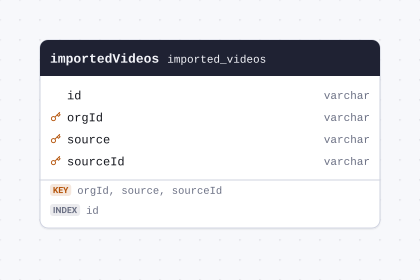

| Column                   | Type      | Constraints | Default | Description |
| ------------------------ | --------- | ----------- | ------- | ----------- |
| `id`                     | `varchar` | NOT NULL    |         |             |
| `orgId`                  | `varchar` | PK NOT NULL |         |             |
| `source`                 | `varchar` | PK NOT NULL |         |             |
| `sourceId` (`source_id`) | `varchar` | PK NOT NULL |         |             |

#### Definition

```sql
CREATE TABLE `imported_videos` (
	`id` varchar(15) NOT NULL,
	`orgId` varchar(15) NOT NULL,
	`source` varchar(255) NOT NULL,
	`source_id` varchar(255) NOT NULL,
	CONSTRAINT PRIMARY KEY(`orgId`,`source`,`source_id`)
);

CREATE INDEX `id_idx` ON `imported_videos` (`id`);
```

#### Indexes

- PRIMARY KEY `orgId`, `source`, `sourceId`
- INDEX `id`

<details>
<summary>Queries and their SQL</summary>

**Select**: Every row of importedVideos.

```ts
db.select().from(importedVideos);
```

```sql
select `id`, `orgId`, `source`, `source_id`
from `imported_videos`
```

**Count**: How many rows importedVideos has.

```ts
db.select({ count: count() }).from(importedVideos);
```

```sql
select count(*)
from `imported_videos`
```

**Find many**: The rows of importedVideos, through the relational query API.

```ts
db.query.importedVideos.findMany();
```

```sql
select `d0`.`id` as `id`, `d0`.`orgId` as `orgId`, `d0`.`source` as `source`, `d0`.`source_id` as `sourceId`
from `imported_videos` as `d0`
```

**Find by primary key**: One row of importedVideos, through the relational query API.

```ts
db.query.importedVideos.findFirst({
  where: { orgId: "orgId", source: "source", sourceId: "sourceId" },
});
```

```sql
select `d0`.`id` as `id`, `d0`.`orgId` as `orgId`, `d0`.`source` as `source`, `d0`.`source_id` as `sourceId`
from `imported_videos` as `d0`
where ((`d0`.`orgId` = ?) and (`d0`.`source` = ?) and (`d0`.`source_id` = ?))
limit ?
-- params: ["orgId","source","sourceId",1]
```

**Insert**: Adds a row to importedVideos, giving the columns that have no default.

```ts
db.insert(importedVideos).values({
  id: "id",
  orgId: "orgId",
  source: "source",
  sourceId: "sourceId",
});
```

```sql
insert into `imported_videos` (`id`, `orgId`, `source`, `source_id`)
values (?, ?, ?, ?)
-- params: ["id","orgId","source","sourceId"]
```

**Update**: Changes a row of importedVideos, found by its primary key.

```ts
db.update(importedVideos)
  .set({ id: "id" })
  .where(
    and(
      eq(importedVideos.orgId, "orgId"),
      eq(importedVideos.source, "source"),
      eq(importedVideos.sourceId, "sourceId"),
    ),
  );
```

```sql
update `imported_videos`
set `id` = ?
where ((`imported_videos`.`orgId` = ?) and (`imported_videos`.`source` = ?) and (`imported_videos`.`source_id` = ?))
-- params: ["id","orgId","source","sourceId"]
```

**Delete**: Deletes a row of importedVideos, found by its primary key.

```ts
db.delete(importedVideos).where(
  and(
    eq(importedVideos.orgId, "orgId"),
    eq(importedVideos.source, "source"),
    eq(importedVideos.sourceId, "sourceId"),
  ),
);
```

```sql
delete from `imported_videos`
where ((`imported_videos`.`orgId` = ?) and (`imported_videos`.`source` = ?) and (`imported_videos`.`source_id` = ?))
-- params: ["orgId","source","sourceId"]
```

</details>

<a id="table-loomMigrationRequests"></a>

### loomMigrationRequests

Table `loom_migration_requests`.

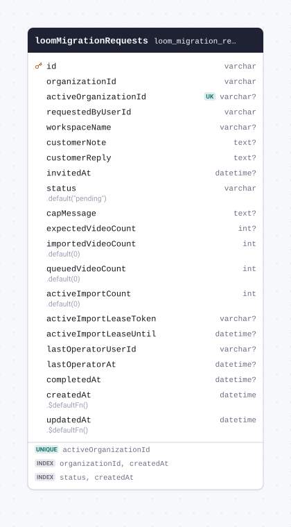

| Column                   | Type       | Constraints | Default               | Description |
| ------------------------ | ---------- | ----------- | --------------------- | ----------- |
| `id`                     | `varchar`  | PK NOT NULL |                       |             |
| `organizationId`         | `varchar`  | NOT NULL    |                       |             |
| `activeOrganizationId`   | `varchar`  | NULL        |                       |             |
| `requestedByUserId`      | `varchar`  | NOT NULL    |                       |             |
| `workspaceName`          | `varchar`  | NULL        |                       |             |
| `customerNote`           | `text`     | NULL        |                       |             |
| `customerReply`          | `text`     | NULL        |                       |             |
| `invitedAt`              | `datetime` | NULL        |                       |             |
| `status`                 | `varchar`  | NOT NULL    | `.default("pending")` |             |
| `capMessage`             | `text`     | NULL        |                       |             |
| `expectedVideoCount`     | `int`      | NULL        |                       |             |
| `importedVideoCount`     | `int`      | NOT NULL    | `.default(0)`         |             |
| `queuedVideoCount`       | `int`      | NOT NULL    | `.default(0)`         |             |
| `activeImportCount`      | `int`      | NOT NULL    | `.default(0)`         |             |
| `activeImportLeaseToken` | `varchar`  | NULL        |                       |             |
| `activeImportLeaseUntil` | `datetime` | NULL        |                       |             |
| `lastOperatorUserId`     | `varchar`  | NULL        |                       |             |
| `lastOperatorAt`         | `datetime` | NULL        |                       |             |
| `completedAt`            | `datetime` | NULL        |                       |             |
| `createdAt`              | `datetime` | NOT NULL    | `.$defaultFn()`       |             |
| `updatedAt`              | `datetime` | NOT NULL    | `.$defaultFn()`       |             |

#### Definition

```sql
CREATE TABLE `loom_migration_requests` (
	`id` varchar(15) PRIMARY KEY,
	`organizationId` varchar(15) NOT NULL,
	`activeOrganizationId` varchar(15),
	`requestedByUserId` varchar(15) NOT NULL,
	`workspaceName` varchar(255),
	`customerNote` text,
	`customerReply` text,
	`invitedAt` datetime,
	`status` varchar(32) NOT NULL DEFAULT 'pending',
	`capMessage` text,
	`expectedVideoCount` int,
	`importedVideoCount` int NOT NULL DEFAULT 0,
	`queuedVideoCount` int NOT NULL DEFAULT 0,
	`activeImportCount` int NOT NULL DEFAULT 0,
	`activeImportLeaseToken` varchar(36),
	`activeImportLeaseUntil` datetime,
	`lastOperatorUserId` varchar(15),
	`lastOperatorAt` datetime,
	`completedAt` datetime,
	`createdAt` datetime NOT NULL,
	`updatedAt` datetime NOT NULL,
	CONSTRAINT `loom_migration_active_org_idx` UNIQUE INDEX(`activeOrganizationId`)
);

CREATE INDEX `loom_migration_org_created_idx` ON `loom_migration_requests` (`organizationId`,`createdAt`);

CREATE INDEX `loom_migration_status_created_idx` ON `loom_migration_requests` (`status`,`createdAt`);
```

#### Indexes

- UNIQUE `activeOrganizationId`
- INDEX `organizationId`, `createdAt`
- INDEX `status`, `createdAt`

<details>
<summary>Queries and their SQL</summary>

**Select**: Every row of loomMigrationRequests.

```ts
db.select().from(loomMigrationRequests);
```

```sql
select `id`, `organizationId`, `activeOrganizationId`, `requestedByUserId`, `workspaceName`, `customerNote`, `customerReply`, `invitedAt`, `status`, `capMessage`, `expectedVideoCount`, `importedVideoCount`, `queuedVideoCount`, `activeImportCount`, `activeImportLeaseToken`, `activeImportLeaseUntil`, `lastOperatorUserId`, `lastOperatorAt`, `completedAt`, `createdAt`, `updatedAt`
from `loom_migration_requests`
```

**Count**: How many rows loomMigrationRequests has.

```ts
db.select({ count: count() }).from(loomMigrationRequests);
```

```sql
select count(*)
from `loom_migration_requests`
```

**Find many**: The rows of loomMigrationRequests, through the relational query API.

```ts
db.query.loomMigrationRequests.findMany();
```

```sql
select `d0`.`id` as `id`, `d0`.`organizationId` as `organizationId`, `d0`.`activeOrganizationId` as `activeOrganizationId`, `d0`.`requestedByUserId` as `requestedByUserId`, `d0`.`workspaceName` as `workspaceName`, `d0`.`customerNote` as `customerNote`, `d0`.`customerReply` as `customerReply`, `d0`.`invitedAt` as `invitedAt`, `d0`.`status` as `status`, `d0`.`capMessage` as `capMessage`, `d0`.`expectedVideoCount` as `expectedVideoCount`, `d0`.`importedVideoCount` as `importedVideoCount`, `d0`.`queuedVideoCount` as `queuedVideoCount`, `d0`.`activeImportCount` as `activeImportCount`, `d0`.`activeImportLeaseToken` as `activeImportLeaseToken`, `d0`.`activeImportLeaseUntil` as `activeImportLeaseUntil`, `d0`.`lastOperatorUserId` as `lastOperatorUserId`, `d0`.`lastOperatorAt` as `lastOperatorAt`, `d0`.`completedAt` as `completedAt`, `d0`.`createdAt` as `createdAt`, `d0`.`updatedAt` as `updatedAt`
from `loom_migration_requests` as `d0`
```

**Find by primary key**: One row of loomMigrationRequests, through the relational query API.

```ts
db.query.loomMigrationRequests.findFirst({ where: { id: "id" } });
```

```sql
select `d0`.`id` as `id`, `d0`.`organizationId` as `organizationId`, `d0`.`activeOrganizationId` as `activeOrganizationId`, `d0`.`requestedByUserId` as `requestedByUserId`, `d0`.`workspaceName` as `workspaceName`, `d0`.`customerNote` as `customerNote`, `d0`.`customerReply` as `customerReply`, `d0`.`invitedAt` as `invitedAt`, `d0`.`status` as `status`, `d0`.`capMessage` as `capMessage`, `d0`.`expectedVideoCount` as `expectedVideoCount`, `d0`.`importedVideoCount` as `importedVideoCount`, `d0`.`queuedVideoCount` as `queuedVideoCount`, `d0`.`activeImportCount` as `activeImportCount`, `d0`.`activeImportLeaseToken` as `activeImportLeaseToken`, `d0`.`activeImportLeaseUntil` as `activeImportLeaseUntil`, `d0`.`lastOperatorUserId` as `lastOperatorUserId`, `d0`.`lastOperatorAt` as `lastOperatorAt`, `d0`.`completedAt` as `completedAt`, `d0`.`createdAt` as `createdAt`, `d0`.`updatedAt` as `updatedAt`
from `loom_migration_requests` as `d0`
where `d0`.`id` = ?
limit ?
-- params: ["id",1]
```

**Insert**: Adds a row to loomMigrationRequests, giving the columns that have no default.

```ts
db.insert(loomMigrationRequests).values({
  id: "id",
  organizationId: "organizationId",
  requestedByUserId: "requestedByUserId",
});
```

```sql
insert into `loom_migration_requests` (`id`, `organizationId`, `activeOrganizationId`, `requestedByUserId`, `workspaceName`, `customerNote`, `customerReply`, `invitedAt`, `status`, `capMessage`, `expectedVideoCount`, `importedVideoCount`, `queuedVideoCount`, `activeImportCount`, `activeImportLeaseToken`, `activeImportLeaseUntil`, `lastOperatorUserId`, `lastOperatorAt`, `completedAt`, `createdAt`, `updatedAt`)
values (?, ?, default, ?, default, default, default, default, default, default, default, default, default, default, default, default, default, default, default, ?, ?)
-- params: ["id","organizationId","requestedByUserId","2026-01-01 00:00:00.000","2026-01-01 00:00:00.000"]
```

**Update**: Changes a row of loomMigrationRequests, found by its primary key.

```ts
db.update(loomMigrationRequests)
  .set({ organizationId: "organizationId" })
  .where(eq(loomMigrationRequests.id, "id"));
```

```sql
update `loom_migration_requests`
set `organizationId` = ?
where `loom_migration_requests`.`id` = ?
-- params: ["organizationId","id"]
```

**Delete**: Deletes a row of loomMigrationRequests, found by its primary key.

```ts
db.delete(loomMigrationRequests).where(eq(loomMigrationRequests.id, "id"));
```

```sql
delete from `loom_migration_requests`
where `loom_migration_requests`.`id` = ?
-- params: ["id"]
```

</details>

<a id="table-loomMigrationImports"></a>

### loomMigrationImports

Table `loom_migration_imports`.

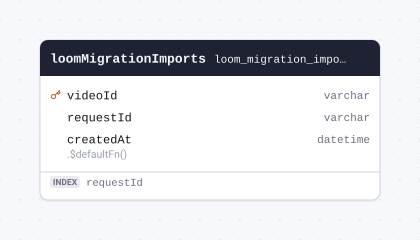

| Column      | Type       | Constraints | Default         | Description |
| ----------- | ---------- | ----------- | --------------- | ----------- |
| `videoId`   | `varchar`  | PK NOT NULL |                 |             |
| `requestId` | `varchar`  | NOT NULL    |                 |             |
| `createdAt` | `datetime` | NOT NULL    | `.$defaultFn()` |             |

#### Definition

```sql
CREATE TABLE `loom_migration_imports` (
	`videoId` varchar(15) PRIMARY KEY,
	`requestId` varchar(15) NOT NULL,
	`createdAt` datetime NOT NULL
);

CREATE INDEX `loom_migration_imports_request_idx` ON `loom_migration_imports` (`requestId`);
```

#### Indexes

- INDEX `requestId`

<details>
<summary>Queries and their SQL</summary>

**Select**: Every row of loomMigrationImports.

```ts
db.select().from(loomMigrationImports);
```

```sql
select `videoId`, `requestId`, `createdAt`
from `loom_migration_imports`
```

**Count**: How many rows loomMigrationImports has.

```ts
db.select({ count: count() }).from(loomMigrationImports);
```

```sql
select count(*)
from `loom_migration_imports`
```

**Find many**: The rows of loomMigrationImports, through the relational query API.

```ts
db.query.loomMigrationImports.findMany();
```

```sql
select `d0`.`videoId` as `videoId`, `d0`.`requestId` as `requestId`, `d0`.`createdAt` as `createdAt`
from `loom_migration_imports` as `d0`
```

**Find by primary key**: One row of loomMigrationImports, through the relational query API.

```ts
db.query.loomMigrationImports.findFirst({ where: { videoId: "videoId" } });
```

```sql
select `d0`.`videoId` as `videoId`, `d0`.`requestId` as `requestId`, `d0`.`createdAt` as `createdAt`
from `loom_migration_imports` as `d0`
where `d0`.`videoId` = ?
limit ?
-- params: ["videoId",1]
```

**Insert**: Adds a row to loomMigrationImports, giving the columns that have no default.

```ts
db.insert(loomMigrationImports).values({ videoId: "videoId", requestId: "requestId" });
```

```sql
insert into `loom_migration_imports` (`videoId`, `requestId`, `createdAt`)
values (?, ?, ?)
-- params: ["videoId","requestId","2026-01-01 00:00:00.000"]
```

**Update**: Changes a row of loomMigrationImports, found by its primary key.

```ts
db.update(loomMigrationImports)
  .set({ requestId: "requestId" })
  .where(eq(loomMigrationImports.videoId, "videoId"));
```

```sql
update `loom_migration_imports`
set `requestId` = ?
where `loom_migration_imports`.`videoId` = ?
-- params: ["requestId","videoId"]
```

**Delete**: Deletes a row of loomMigrationImports, found by its primary key.

```ts
db.delete(loomMigrationImports).where(eq(loomMigrationImports.videoId, "videoId"));
```

```sql
delete from `loom_migration_imports`
where `loom_migration_imports`.`videoId` = ?
-- params: ["videoId"]
```

</details>

<a id="table-developerApps"></a>

### developerApps

Table `developer_apps`.

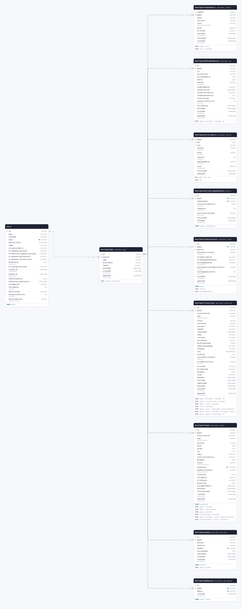

| Column        | Type        | Constraints                         | Default         | Description |
| ------------- | ----------- | ----------------------------------- | --------------- | ----------- |
| `id`          | `varchar`   | PK NOT NULL                         |                 |             |
| `ownerId`     | `varchar`   | NOT NULL → [users.id](#table-users) |                 |             |
| `name`        | `varchar`   | NOT NULL                            |                 |             |
| `environment` | `varchar`   | NOT NULL                            |                 |             |
| `logoUrl`     | `varchar`   | NULL                                |                 |             |
| `deletedAt`   | `timestamp` | NULL                                |                 |             |
| `createdAt`   | `timestamp` | NOT NULL                            | `.defaultNow()` |             |
| `updatedAt`   | `timestamp` | NOT NULL                            | `.defaultNow()` |             |

#### Definition

```sql
CREATE TABLE `developer_apps` (
	`id` varchar(15) PRIMARY KEY,
	`ownerId` varchar(15) NOT NULL,
	`name` varchar(255) NOT NULL,
	`environment` varchar(16) NOT NULL,
	`logoUrl` varchar(1024),
	`deletedAt` timestamp,
	`createdAt` timestamp NOT NULL DEFAULT (now()),
	`updatedAt` timestamp NOT NULL DEFAULT (now()) ON UPDATE CURRENT_TIMESTAMP
);

CREATE INDEX `owner_deleted_idx` ON `developer_apps` (`ownerId`,`deletedAt`);
```

#### Indexes

- INDEX `ownerId`, `deletedAt`

#### References

- `ownerId` → [users.id](#table-users) (many to one, defineRelations, no foreign key)

#### Referenced by

- `id` → [developerAppDomains.appId](#table-developerAppDomains) (one to many)
- `id` → [developerApiKeys.appId](#table-developerApiKeys) (one to many)
- `id` → [developerVideos.appId](#table-developerVideos) (one to many)
- `id` → [developerTranscripts.appId](#table-developerTranscripts) (one to many)
- `id` → [developerCreditAccounts.appId](#table-developerCreditAccounts) (one to one)
- `id` → [developerDailyStorageSnapshots.appId](#table-developerDailyStorageSnapshots) (one to many)
- `id` → [developerDeliveryDaily.appId](#table-developerDeliveryDaily) (one to many)
- `id` → [developerWebhookEndpoints.appId](#table-developerWebhookEndpoints) (one to many)
- `id` → [developerVideoImports.appId](#table-developerVideoImports) (one to many)

<details>
<summary>Queries and their SQL</summary>

**Select**: Every row of developerApps.

```ts
db.select().from(developerApps);
```

```sql
select `id`, `ownerId`, `name`, `environment`, `logoUrl`, `deletedAt`, `createdAt`, `updatedAt`
from `developer_apps`
```

**Count**: How many rows developerApps has.

```ts
db.select({ count: count() }).from(developerApps);
```

```sql
select count(*)
from `developer_apps`
```

**Find many**: The rows of developerApps, through the relational query API.

```ts
db.query.developerApps.findMany();
```

```sql
select `d0`.`id` as `id`, `d0`.`ownerId` as `ownerId`, `d0`.`name` as `name`, `d0`.`environment` as `environment`, `d0`.`logoUrl` as `logoUrl`, `d0`.`deletedAt` as `deletedAt`, `d0`.`createdAt` as `createdAt`, `d0`.`updatedAt` as `updatedAt`
from `developer_apps` as `d0`
```

**Find by primary key**: One row of developerApps, through the relational query API.

```ts
db.query.developerApps.findFirst({ where: { id: "id" } });
```

```sql
select `d0`.`id` as `id`, `d0`.`ownerId` as `ownerId`, `d0`.`name` as `name`, `d0`.`environment` as `environment`, `d0`.`logoUrl` as `logoUrl`, `d0`.`deletedAt` as `deletedAt`, `d0`.`createdAt` as `createdAt`, `d0`.`updatedAt` as `updatedAt`
from `developer_apps` as `d0`
where `d0`.`id` = ?
limit ?
-- params: ["id",1]
```

**Insert**: Adds a row to developerApps, giving the columns that have no default.

```ts
db.insert(developerApps).values({
  id: "id",
  ownerId: "ownerId",
  name: "name",
  environment: "environment",
});
```

```sql
insert into `developer_apps` (`id`, `ownerId`, `name`, `environment`, `logoUrl`, `deletedAt`, `createdAt`, `updatedAt`)
values (?, ?, ?, ?, default, default, default, default)
-- params: ["id","ownerId","name","environment"]
```

**Update**: Changes a row of developerApps, found by its primary key.

```ts
db.update(developerApps).set({ ownerId: "ownerId" }).where(eq(developerApps.id, "id"));
```

```sql
update `developer_apps`
set `ownerId` = ?
where `developer_apps`.`id` = ?
-- params: ["ownerId","id"]
```

**Delete**: Deletes a row of developerApps, found by its primary key.

```ts
db.delete(developerApps).where(eq(developerApps.id, "id"));
```

```sql
delete from `developer_apps`
where `developer_apps`.`id` = ?
-- params: ["id"]
```

</details>

<a id="table-developerAppDomains"></a>

### developerAppDomains

Table `developer_app_domains`.

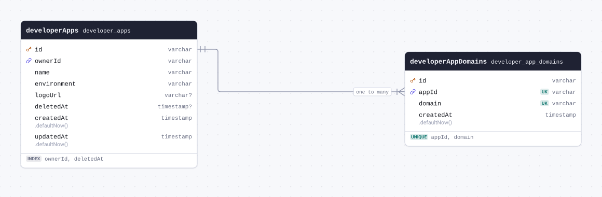

| Column      | Type        | Constraints                                         | Default         | Description |
| ----------- | ----------- | --------------------------------------------------- | --------------- | ----------- |
| `id`        | `varchar`   | PK NOT NULL                                         |                 |             |
| `appId`     | `varchar`   | NOT NULL → [developerApps.id](#table-developerApps) |                 |             |
| `domain`    | `varchar`   | NOT NULL                                            |                 |             |
| `createdAt` | `timestamp` | NOT NULL                                            | `.defaultNow()` |             |

#### Definition

```sql
CREATE TABLE `developer_app_domains` (
	`id` varchar(15) PRIMARY KEY,
	`appId` varchar(15) NOT NULL,
	`domain` varchar(253) NOT NULL,
	`createdAt` timestamp NOT NULL DEFAULT (now()),
	CONSTRAINT `app_domain_unique` UNIQUE INDEX(`appId`,`domain`)
);

ALTER TABLE `developer_app_domains` ADD CONSTRAINT `developer_app_domains_appId_developer_apps_id_fkey` FOREIGN KEY (`appId`) REFERENCES `developer_apps`(`id`);
```

#### Indexes

- UNIQUE `appId`, `domain`

#### References

- `appId` → [developerApps.id](#table-developerApps) (many to one)

<details>
<summary>Queries and their SQL</summary>

**Select**: Every row of developerAppDomains.

```ts
db.select().from(developerAppDomains);
```

```sql
select `id`, `appId`, `domain`, `createdAt`
from `developer_app_domains`
```

**Count**: How many rows developerAppDomains has.

```ts
db.select({ count: count() }).from(developerAppDomains);
```

```sql
select count(*)
from `developer_app_domains`
```

**Find many**: The rows of developerAppDomains, through the relational query API.

```ts
db.query.developerAppDomains.findMany();
```

```sql
select `d0`.`id` as `id`, `d0`.`appId` as `appId`, `d0`.`domain` as `domain`, `d0`.`createdAt` as `createdAt`
from `developer_app_domains` as `d0`
```

**Find by primary key**: One row of developerAppDomains, through the relational query API.

```ts
db.query.developerAppDomains.findFirst({ where: { id: "id" } });
```

```sql
select `d0`.`id` as `id`, `d0`.`appId` as `appId`, `d0`.`domain` as `domain`, `d0`.`createdAt` as `createdAt`
from `developer_app_domains` as `d0`
where `d0`.`id` = ?
limit ?
-- params: ["id",1]
```

**Insert**: Adds a row to developerAppDomains, giving the columns that have no default.

```ts
db.insert(developerAppDomains).values({ id: "id", appId: "appId", domain: "domain" });
```

```sql
insert into `developer_app_domains` (`id`, `appId`, `domain`, `createdAt`)
values (?, ?, ?, default)
-- params: ["id","appId","domain"]
```

**Update**: Changes a row of developerAppDomains, found by its primary key.

```ts
db.update(developerAppDomains).set({ appId: "appId" }).where(eq(developerAppDomains.id, "id"));
```

```sql
update `developer_app_domains`
set `appId` = ?
where `developer_app_domains`.`id` = ?
-- params: ["appId","id"]
```

**Delete**: Deletes a row of developerAppDomains, found by its primary key.

```ts
db.delete(developerAppDomains).where(eq(developerAppDomains.id, "id"));
```

```sql
delete from `developer_app_domains`
where `developer_app_domains`.`id` = ?
-- params: ["id"]
```

</details>

<a id="table-developerApiKeys"></a>

### developerApiKeys

Table `developer_api_keys`.

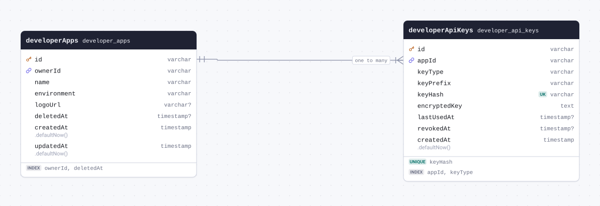

| Column         | Type        | Constraints                                         | Default         | Description |
| -------------- | ----------- | --------------------------------------------------- | --------------- | ----------- |
| `id`           | `varchar`   | PK NOT NULL                                         |                 |             |
| `appId`        | `varchar`   | NOT NULL → [developerApps.id](#table-developerApps) |                 |             |
| `keyType`      | `varchar`   | NOT NULL                                            |                 |             |
| `keyPrefix`    | `varchar`   | NOT NULL                                            |                 |             |
| `keyHash`      | `varchar`   | NOT NULL                                            |                 |             |
| `encryptedKey` | `text`      | NOT NULL                                            |                 |             |
| `lastUsedAt`   | `timestamp` | NULL                                                |                 |             |
| `revokedAt`    | `timestamp` | NULL                                                |                 |             |
| `createdAt`    | `timestamp` | NOT NULL                                            | `.defaultNow()` |             |

#### Definition

```sql
CREATE TABLE `developer_api_keys` (
	`id` varchar(15) PRIMARY KEY,
	`appId` varchar(15) NOT NULL,
	`keyType` varchar(8) NOT NULL,
	`keyPrefix` varchar(12) NOT NULL,
	`keyHash` varchar(64) NOT NULL,
	`encryptedKey` text NOT NULL,
	`lastUsedAt` timestamp,
	`revokedAt` timestamp,
	`createdAt` timestamp NOT NULL DEFAULT (now()),
	CONSTRAINT `key_hash_idx` UNIQUE INDEX(`keyHash`)
);

CREATE INDEX `app_key_type_idx` ON `developer_api_keys` (`appId`,`keyType`);

ALTER TABLE `developer_api_keys` ADD CONSTRAINT `developer_api_keys_appId_developer_apps_id_fkey` FOREIGN KEY (`appId`) REFERENCES `developer_apps`(`id`);
```

#### Indexes

- UNIQUE `keyHash`
- INDEX `appId`, `keyType`

#### References

- `appId` → [developerApps.id](#table-developerApps) (many to one)

<details>
<summary>Queries and their SQL</summary>

**Select**: Every row of developerApiKeys.

```ts
db.select().from(developerApiKeys);
```

```sql
select `id`, `appId`, `keyType`, `keyPrefix`, `keyHash`, `encryptedKey`, `lastUsedAt`, `revokedAt`, `createdAt`
from `developer_api_keys`
```

**Count**: How many rows developerApiKeys has.

```ts
db.select({ count: count() }).from(developerApiKeys);
```

```sql
select count(*)
from `developer_api_keys`
```

**Find many**: The rows of developerApiKeys, through the relational query API.

```ts
db.query.developerApiKeys.findMany();
```

```sql
select `d0`.`id` as `id`, `d0`.`appId` as `appId`, `d0`.`keyType` as `keyType`, `d0`.`keyPrefix` as `keyPrefix`, `d0`.`keyHash` as `keyHash`, `d0`.`encryptedKey` as `encryptedKey`, `d0`.`lastUsedAt` as `lastUsedAt`, `d0`.`revokedAt` as `revokedAt`, `d0`.`createdAt` as `createdAt`
from `developer_api_keys` as `d0`
```

**Find by primary key**: One row of developerApiKeys, through the relational query API.

```ts
db.query.developerApiKeys.findFirst({ where: { id: "id" } });
```

```sql
select `d0`.`id` as `id`, `d0`.`appId` as `appId`, `d0`.`keyType` as `keyType`, `d0`.`keyPrefix` as `keyPrefix`, `d0`.`keyHash` as `keyHash`, `d0`.`encryptedKey` as `encryptedKey`, `d0`.`lastUsedAt` as `lastUsedAt`, `d0`.`revokedAt` as `revokedAt`, `d0`.`createdAt` as `createdAt`
from `developer_api_keys` as `d0`
where `d0`.`id` = ?
limit ?
-- params: ["id",1]
```

**Insert**: Adds a row to developerApiKeys, giving the columns that have no default.

```ts
db.insert(developerApiKeys).values({
  id: "id",
  appId: "appId",
  keyType: "keyType",
  keyPrefix: "keyPrefix",
  keyHash: "keyHash",
  encryptedKey: "encryptedKey",
});
```

```sql
insert into `developer_api_keys` (`id`, `appId`, `keyType`, `keyPrefix`, `keyHash`, `encryptedKey`, `lastUsedAt`, `revokedAt`, `createdAt`)
values (?, ?, ?, ?, ?, ?, default, default, default)
-- params: ["id","appId","keyType","keyPrefix","keyHash","encryptedKey"]
```

**Update**: Changes a row of developerApiKeys, found by its primary key.

```ts
db.update(developerApiKeys).set({ appId: "appId" }).where(eq(developerApiKeys.id, "id"));
```

```sql
update `developer_api_keys`
set `appId` = ?
where `developer_api_keys`.`id` = ?
-- params: ["appId","id"]
```

**Delete**: Deletes a row of developerApiKeys, found by its primary key.

```ts
db.delete(developerApiKeys).where(eq(developerApiKeys.id, "id"));
```

```sql
delete from `developer_api_keys`
where `developer_api_keys`.`id` = ?
-- params: ["id"]
```

</details>

<a id="table-developerVideos"></a>

### developerVideos

Table `developer_videos`.


| Column                | Type        | Constraints                                         | Default                 | Description |
| --------------------- | ----------- | --------------------------------------------------- | ----------------------- | ----------- |
| `id`                  | `varchar`   | PK NOT NULL                                         |                         |             |
| `appId`               | `varchar`   | NOT NULL → [developerApps.id](#table-developerApps) |                         |             |
| `externalUserId`      | `varchar`   | NULL                                                |                         |             |
| `name`                | `varchar`   | NOT NULL                                            | `.default("Untitled")`  |             |
| `duration`            | `float`     | NULL                                                |                         |             |
| `width`               | `int`       | NULL                                                |                         |             |
| `height`              | `int`       | NULL                                                |                         |             |
| `fps`                 | `int`       | NULL                                                |                         |             |
| `s3Key`               | `varchar`   | NULL                                                |                         |             |
| `transcriptionStatus` | `varchar`   | NULL                                                |                         |             |
| `metadata`            | `json`      | NULL                                                |                         |             |
| `status`              | `varchar`   | NOT NULL                                            | `.default("uploading")` |             |
| `playbackId`          | `varchar`   | NULL                                                |                         |             |
| `maxResolutionTier`   | `varchar`   | NOT NULL                                            | `.default("1080p")`     |             |
| `renditions`          | `json`      | NULL                                                |                         |             |
| `storedBytes`         | `bigint`    | NULL                                                |                         |             |
| `errorReason`         | `varchar`   | NULL                                                |                         |             |
| `processing`          | `json`      | NULL                                                |                         |             |
| `storagePaidUntil`    | `timestamp` | NULL                                                |                         |             |
| `deletedAt`           | `timestamp` | NULL                                                |                         |             |
| `filesDeletedAt`      | `timestamp` | NULL                                                |                         |             |
| `createdAt`           | `timestamp` | NOT NULL                                            | `.defaultNow()`         |             |
| `updatedAt`           | `timestamp` | NOT NULL                                            | `.defaultNow()`         |             |

#### Definition

```sql
CREATE TABLE `developer_videos` (
	`id` varchar(15) PRIMARY KEY,
	`appId` varchar(15) NOT NULL,
	`externalUserId` varchar(255),
	`name` varchar(255) NOT NULL DEFAULT 'Untitled',
	`duration` float,
	`width` int,
	`height` int,
	`fps` int,
	`s3Key` varchar(512),
	`transcriptionStatus` varchar(16),
	`metadata` json,
	`status` varchar(16) NOT NULL DEFAULT 'uploading',
	`playbackId` varchar(64),
	`maxResolutionTier` varchar(8) NOT NULL DEFAULT '1080p',
	`renditions` json,
	`storedBytes` bigint unsigned,
	`errorReason` varchar(512),
	`processing` json,
	`storagePaidUntil` timestamp,
	`deletedAt` timestamp,
	`filesDeletedAt` timestamp,
	`createdAt` timestamp NOT NULL DEFAULT (now()),
	`updatedAt` timestamp NOT NULL DEFAULT (now()) ON UPDATE CURRENT_TIMESTAMP,
	CONSTRAINT `playback_id_idx` UNIQUE INDEX(`playbackId`)
);

CREATE INDEX `app_created_idx` ON `developer_videos` (`appId`,`createdAt`);

CREATE INDEX `app_user_idx` ON `developer_videos` (`appId`,`externalUserId`);

CREATE INDEX `app_deleted_idx` ON `developer_videos` (`appId`,`deletedAt`);

CREATE INDEX `files_pending_idx` ON `developer_videos` (`filesDeletedAt`,`deletedAt`);

CREATE INDEX `app_storage_idx` ON `developer_videos` (`appId`,`deletedAt`,`status`,`maxResolutionTier`,`width`,`height`,`storagePaidUntil`,`duration`,`createdAt`);

CREATE INDEX `first_month_due_idx` ON `developer_videos` (`storagePaidUntil`,`status`,`createdAt`);

ALTER TABLE `developer_videos` ADD CONSTRAINT `developer_videos_appId_developer_apps_id_fkey` FOREIGN KEY (`appId`) REFERENCES `developer_apps`(`id`);
```

#### Indexes

- INDEX `appId`, `createdAt`
- INDEX `appId`, `externalUserId`
- INDEX `appId`, `deletedAt`
- UNIQUE `playbackId`
- INDEX `filesDeletedAt`, `deletedAt`
- INDEX `appId`, `deletedAt`, `status`, `maxResolutionTier`, `width`, `height`, `storagePaidUntil`, `duration`, `createdAt`
- INDEX `storagePaidUntil`, `status`, `createdAt`

#### References

- `appId` → [developerApps.id](#table-developerApps) (many to one)

<details>
<summary>Queries and their SQL</summary>

**Select**: Every row of developerVideos.

```ts
db.select().from(developerVideos);
```

```sql
select `id`, `appId`, `externalUserId`, `name`, `duration`, `width`, `height`, `fps`, `s3Key`, `transcriptionStatus`, `metadata`, `status`, `playbackId`, `maxResolutionTier`, `renditions`, `storedBytes`, `errorReason`, `processing`, `storagePaidUntil`, `deletedAt`, `filesDeletedAt`, `createdAt`, `updatedAt`
from `developer_videos`
```

**Count**: How many rows developerVideos has.

```ts
db.select({ count: count() }).from(developerVideos);
```

```sql
select count(*)
from `developer_videos`
```

**Find many**: The rows of developerVideos, through the relational query API.

```ts
db.query.developerVideos.findMany();
```

```sql
select `d0`.`id` as `id`, `d0`.`appId` as `appId`, `d0`.`externalUserId` as `externalUserId`, `d0`.`name` as `name`, `d0`.`duration` as `duration`, `d0`.`width` as `width`, `d0`.`height` as `height`, `d0`.`fps` as `fps`, `d0`.`s3Key` as `s3Key`, `d0`.`transcriptionStatus` as `transcriptionStatus`, `d0`.`metadata` as `metadata`, `d0`.`status` as `status`, `d0`.`playbackId` as `playbackId`, `d0`.`maxResolutionTier` as `maxResolutionTier`, `d0`.`renditions` as `renditions`, `d0`.`storedBytes` as `storedBytes`, `d0`.`errorReason` as `errorReason`, `d0`.`processing` as `processing`, `d0`.`storagePaidUntil` as `storagePaidUntil`, `d0`.`deletedAt` as `deletedAt`, `d0`.`filesDeletedAt` as `filesDeletedAt`, `d0`.`createdAt` as `createdAt`, `d0`.`updatedAt` as `updatedAt`
from `developer_videos` as `d0`
```

**Find by primary key**: One row of developerVideos, through the relational query API.

```ts
db.query.developerVideos.findFirst({ where: { id: "id" } });
```

```sql
select `d0`.`id` as `id`, `d0`.`appId` as `appId`, `d0`.`externalUserId` as `externalUserId`, `d0`.`name` as `name`, `d0`.`duration` as `duration`, `d0`.`width` as `width`, `d0`.`height` as `height`, `d0`.`fps` as `fps`, `d0`.`s3Key` as `s3Key`, `d0`.`transcriptionStatus` as `transcriptionStatus`, `d0`.`metadata` as `metadata`, `d0`.`status` as `status`, `d0`.`playbackId` as `playbackId`, `d0`.`maxResolutionTier` as `maxResolutionTier`, `d0`.`renditions` as `renditions`, `d0`.`storedBytes` as `storedBytes`, `d0`.`errorReason` as `errorReason`, `d0`.`processing` as `processing`, `d0`.`storagePaidUntil` as `storagePaidUntil`, `d0`.`deletedAt` as `deletedAt`, `d0`.`filesDeletedAt` as `filesDeletedAt`, `d0`.`createdAt` as `createdAt`, `d0`.`updatedAt` as `updatedAt`
from `developer_videos` as `d0`
where `d0`.`id` = ?
limit ?
-- params: ["id",1]
```

**Insert**: Adds a row to developerVideos, giving the columns that have no default.

```ts
db.insert(developerVideos).values({ id: "id", appId: "appId" });
```

```sql
insert into `developer_videos` (`id`, `appId`, `externalUserId`, `name`, `duration`, `width`, `height`, `fps`, `s3Key`, `transcriptionStatus`, `metadata`, `status`, `playbackId`, `maxResolutionTier`, `renditions`, `storedBytes`, `errorReason`, `processing`, `storagePaidUntil`, `deletedAt`, `filesDeletedAt`, `createdAt`, `updatedAt`)
values (?, ?, default, default, default, default, default, default, default, default, default, default, default, default, default, default, default, default, default, default, default, default, default)
-- params: ["id","appId"]
```

**Update**: Changes a row of developerVideos, found by its primary key.

```ts
db.update(developerVideos).set({ appId: "appId" }).where(eq(developerVideos.id, "id"));
```

```sql
update `developer_videos`
set `appId` = ?
where `developer_videos`.`id` = ?
-- params: ["appId","id"]
```

**Delete**: Deletes a row of developerVideos, found by its primary key.

```ts
db.delete(developerVideos).where(eq(developerVideos.id, "id"));
```

```sql
delete from `developer_videos`
where `developer_videos`.`id` = ?
-- params: ["id"]
```

</details>

<a id="table-developerTranscripts"></a>

### developerTranscripts

Table `developer_transcripts`.


| Column                 | Type         | Constraints                                         | Default                | Description |
| ---------------------- | ------------ | --------------------------------------------------- | ---------------------- | ----------- |
| `id`                   | `varchar`    | PK NOT NULL                                         |                        |             |
| `appId`                | `varchar`    | NOT NULL → [developerApps.id](#table-developerApps) |                        |             |
| `externalUserId`       | `varchar`    | NULL                                                |                        |             |
| `name`                 | `varchar`    | NOT NULL                                            | `.default("Untitled")` |             |
| `status`               | `varchar`    | NOT NULL                                            |                        |             |
| `sourceType`           | `varchar`    | NOT NULL                                            |                        |             |
| `sourceUrl`            | `varchar`    | NULL                                                |                        |             |
| `videoId`              | `varchar`    | NULL                                                |                        |             |
| `requestedAt`          | `timestamp`  | NULL                                                |                        |             |
| `s3Key`                | `varchar`    | NULL                                                |                        |             |
| `resultKey`            | `varchar`    | NULL                                                |                        |             |
| `sourceBytes`          | `bigint`     | NULL                                                |                        |             |
| `durationSeconds`      | `float`      | NULL                                                |                        |             |
| `requestedLanguage`    | `varchar`    | NULL                                                |                        |             |
| `language`             | `varchar`    | NULL                                                |                        |             |
| `text`                 | `mediumtext` | NULL                                                |                        |             |
| `wordCount`            | `int`        | NULL                                                |                        |             |
| `reservedMicroCredits` | `bigint`     | NOT NULL                                            | `.default(0)`          |             |
| `billedMicroCredits`   | `bigint`     | NOT NULL                                            | `.default(0)`          |             |
| `errorCode`            | `varchar`    | NULL                                                |                        |             |
| `errorMessage`         | `varchar`    | NULL                                                |                        |             |
| `metadata`             | `json`       | NULL                                                |                        |             |
| `runId`                | `varchar`    | NULL                                                |                        |             |
| `queuedAt`             | `timestamp`  | NULL                                                |                        |             |
| `startedAt`            | `timestamp`  | NULL                                                |                        |             |
| `completedAt`          | `timestamp`  | NULL                                                |                        |             |
| `deletedAt`            | `timestamp`  | NULL                                                |                        |             |
| `createdAt`            | `timestamp`  | NOT NULL                                            | `.defaultNow()`        |             |
| `updatedAt`            | `timestamp`  | NOT NULL                                            | `.defaultNow()`        |             |

#### Definition

```sql
CREATE TABLE `developer_transcripts` (
	`id` varchar(15) PRIMARY KEY,
	`appId` varchar(15) NOT NULL,
	`externalUserId` varchar(255),
	`name` varchar(255) NOT NULL DEFAULT 'Untitled',
	`status` varchar(16) NOT NULL,
	`sourceType` varchar(8) NOT NULL,
	`sourceUrl` varchar(2048),
	`videoId` varchar(15),
	`requestedAt` timestamp(3),
	`s3Key` varchar(512),
	`resultKey` varchar(512),
	`sourceBytes` bigint unsigned,
	`durationSeconds` float,
	`requestedLanguage` varchar(16),
	`language` varchar(16),
	`text` mediumtext,
	`wordCount` int,
	`reservedMicroCredits` bigint unsigned NOT NULL DEFAULT 0,
	`billedMicroCredits` bigint unsigned NOT NULL DEFAULT 0,
	`errorCode` varchar(64),
	`errorMessage` varchar(512),
	`metadata` json,
	`runId` varchar(32),
	`queuedAt` timestamp,
	`startedAt` timestamp,
	`completedAt` timestamp,
	`deletedAt` timestamp,
	`createdAt` timestamp NOT NULL DEFAULT (now()),
	`updatedAt` timestamp NOT NULL DEFAULT (now()) ON UPDATE CURRENT_TIMESTAMP
);

CREATE INDEX `dev_transcripts_app_list_idx` ON `developer_transcripts` (`appId`,`deletedAt`,`createdAt`,`id`);

CREATE INDEX `dev_transcripts_app_user_idx` ON `developer_transcripts` (`appId`,`externalUserId`,`createdAt`);

CREATE INDEX `dev_transcripts_app_status_idx` ON `developer_transcripts` (`appId`,`status`,`createdAt`);

CREATE INDEX `dev_transcripts_status_updated_idx` ON `developer_transcripts` (`status`,`updatedAt`);

CREATE INDEX `dev_transcripts_app_completed_idx` ON `developer_transcripts` (`appId`,`status`,`completedAt`,`durationSeconds`,`billedMicroCredits`);

CREATE INDEX `dev_transcripts_app_status_held_idx` ON `developer_transcripts` (`appId`,`status`,`createdAt`,`deletedAt`,`reservedMicroCredits`);

CREATE INDEX `dev_transcripts_app_video_idx` ON `developer_transcripts` (`appId`,`videoId`,`requestedAt`,`id`);

ALTER TABLE `developer_transcripts` ADD CONSTRAINT `developer_transcripts_appId_developer_apps_id_fkey` FOREIGN KEY (`appId`) REFERENCES `developer_apps`(`id`);
```

#### Indexes

- INDEX `appId`, `deletedAt`, `createdAt`, `id`
- INDEX `appId`, `externalUserId`, `createdAt`
- INDEX `appId`, `status`, `createdAt`
- INDEX `status`, `updatedAt`
- INDEX `appId`, `status`, `completedAt`, `durationSeconds`, `billedMicroCredits`
- INDEX `appId`, `status`, `createdAt`, `deletedAt`, `reservedMicroCredits`
- INDEX `appId`, `videoId`, `requestedAt`, `id`

#### References

- `appId` → [developerApps.id](#table-developerApps) (many to one)

<details>
<summary>Queries and their SQL</summary>

**Select**: Every row of developerTranscripts.

```ts
db.select().from(developerTranscripts);
```

```sql
select `id`, `appId`, `externalUserId`, `name`, `status`, `sourceType`, `sourceUrl`, `videoId`, `requestedAt`, `s3Key`, `resultKey`, `sourceBytes`, `durationSeconds`, `requestedLanguage`, `language`, `text`, `wordCount`, `reservedMicroCredits`, `billedMicroCredits`, `errorCode`, `errorMessage`, `metadata`, `runId`, `queuedAt`, `startedAt`, `completedAt`, `deletedAt`, `createdAt`, `updatedAt`
from `developer_transcripts`
```

**Count**: How many rows developerTranscripts has.

```ts
db.select({ count: count() }).from(developerTranscripts);
```

```sql
select count(*)
from `developer_transcripts`
```

**Find many**: The rows of developerTranscripts, through the relational query API.

```ts
db.query.developerTranscripts.findMany();
```

```sql
select `d0`.`id` as `id`, `d0`.`appId` as `appId`, `d0`.`externalUserId` as `externalUserId`, `d0`.`name` as `name`, `d0`.`status` as `status`, `d0`.`sourceType` as `sourceType`, `d0`.`sourceUrl` as `sourceUrl`, `d0`.`videoId` as `videoId`, `d0`.`requestedAt` as `requestedAt`, `d0`.`s3Key` as `s3Key`, `d0`.`resultKey` as `resultKey`, `d0`.`sourceBytes` as `sourceBytes`, `d0`.`durationSeconds` as `durationSeconds`, `d0`.`requestedLanguage` as `requestedLanguage`, `d0`.`language` as `language`, `d0`.`text` as `text`, `d0`.`wordCount` as `wordCount`, `d0`.`reservedMicroCredits` as `reservedMicroCredits`, `d0`.`billedMicroCredits` as `billedMicroCredits`, `d0`.`errorCode` as `errorCode`, `d0`.`errorMessage` as `errorMessage`, `d0`.`metadata` as `metadata`, `d0`.`runId` as `runId`, `d0`.`queuedAt` as `queuedAt`, `d0`.`startedAt` as `startedAt`, `d0`.`completedAt` as `completedAt`, `d0`.`deletedAt` as `deletedAt`, `d0`.`createdAt` as `createdAt`, `d0`.`updatedAt` as `updatedAt`
from `developer_transcripts` as `d0`
```

**Find by primary key**: One row of developerTranscripts, through the relational query API.

```ts
db.query.developerTranscripts.findFirst({ where: { id: "id" } });
```

```sql
select `d0`.`id` as `id`, `d0`.`appId` as `appId`, `d0`.`externalUserId` as `externalUserId`, `d0`.`name` as `name`, `d0`.`status` as `status`, `d0`.`sourceType` as `sourceType`, `d0`.`sourceUrl` as `sourceUrl`, `d0`.`videoId` as `videoId`, `d0`.`requestedAt` as `requestedAt`, `d0`.`s3Key` as `s3Key`, `d0`.`resultKey` as `resultKey`, `d0`.`sourceBytes` as `sourceBytes`, `d0`.`durationSeconds` as `durationSeconds`, `d0`.`requestedLanguage` as `requestedLanguage`, `d0`.`language` as `language`, `d0`.`text` as `text`, `d0`.`wordCount` as `wordCount`, `d0`.`reservedMicroCredits` as `reservedMicroCredits`, `d0`.`billedMicroCredits` as `billedMicroCredits`, `d0`.`errorCode` as `errorCode`, `d0`.`errorMessage` as `errorMessage`, `d0`.`metadata` as `metadata`, `d0`.`runId` as `runId`, `d0`.`queuedAt` as `queuedAt`, `d0`.`startedAt` as `startedAt`, `d0`.`completedAt` as `completedAt`, `d0`.`deletedAt` as `deletedAt`, `d0`.`createdAt` as `createdAt`, `d0`.`updatedAt` as `updatedAt`
from `developer_transcripts` as `d0`
where `d0`.`id` = ?
limit ?
-- params: ["id",1]
```

**Insert**: Adds a row to developerTranscripts, giving the columns that have no default.

```ts
db.insert(developerTranscripts).values({
  id: "id",
  appId: "appId",
  status: "status",
  sourceType: "sourceType",
});
```

```sql
insert into `developer_transcripts` (`id`, `appId`, `externalUserId`, `name`, `status`, `sourceType`, `sourceUrl`, `videoId`, `requestedAt`, `s3Key`, `resultKey`, `sourceBytes`, `durationSeconds`, `requestedLanguage`, `language`, `text`, `wordCount`, `reservedMicroCredits`, `billedMicroCredits`, `errorCode`, `errorMessage`, `metadata`, `runId`, `queuedAt`, `startedAt`, `completedAt`, `deletedAt`, `createdAt`, `updatedAt`)
values (?, ?, default, default, ?, ?, default, default, default, default, default, default, default, default, default, default, default, default, default, default, default, default, default, default, default, default, default, default, default)
-- params: ["id","appId","status","sourceType"]
```

**Update**: Changes a row of developerTranscripts, found by its primary key.

```ts
db.update(developerTranscripts).set({ appId: "appId" }).where(eq(developerTranscripts.id, "id"));
```

```sql
update `developer_transcripts`
set `appId` = ?
where `developer_transcripts`.`id` = ?
-- params: ["appId","id"]
```

**Delete**: Deletes a row of developerTranscripts, found by its primary key.

```ts
db.delete(developerTranscripts).where(eq(developerTranscripts.id, "id"));
```

```sql
delete from `developer_transcripts`
where `developer_transcripts`.`id` = ?
-- params: ["id"]
```

</details>

<a id="table-developerCreditAccounts"></a>

### developerCreditAccounts

Table `developer_credit_accounts`.


| Column                           | Type        | Constraints                                         | Default           | Description |
| -------------------------------- | ----------- | --------------------------------------------------- | ----------------- | ----------- |
| `id`                             | `varchar`   | PK NOT NULL                                         |                   |             |
| `appId`                          | `varchar`   | NOT NULL → [developerApps.id](#table-developerApps) |                   |             |
| `ownerId`                        | `varchar`   | NOT NULL → [users.id](#table-users)                 |                   |             |
| `balanceMicroCredits`            | `bigint`    | NOT NULL                                            | `.default(0)`     |             |
| `stripeCustomerId`               | `varchar`   | NULL                                                |                   |             |
| `stripePaymentMethodId`          | `varchar`   | NULL                                                |                   |             |
| `autoTopUpEnabled`               | `boolean`   | NOT NULL                                            | `.default(false)` |             |
| `autoTopUpThresholdMicroCredits` | `bigint`    | NOT NULL                                            | `.default(0)`     |             |
| `autoTopUpAmountCents`           | `int`       | NOT NULL                                            | `.default(0)`     |             |
| `createdAt`                      | `timestamp` | NOT NULL                                            | `.defaultNow()`   |             |
| `updatedAt`                      | `timestamp` | NOT NULL                                            | `.defaultNow()`   |             |

#### Definition

```sql
CREATE TABLE `developer_credit_accounts` (
	`id` varchar(15) PRIMARY KEY,
	`appId` varchar(15) NOT NULL,
	`ownerId` varchar(15) NOT NULL,
	`balanceMicroCredits` bigint unsigned NOT NULL DEFAULT 0,
	`stripeCustomerId` varchar(255),
	`stripePaymentMethodId` varchar(255),
	`autoTopUpEnabled` boolean NOT NULL DEFAULT false,
	`autoTopUpThresholdMicroCredits` bigint unsigned NOT NULL DEFAULT 0,
	`autoTopUpAmountCents` int NOT NULL DEFAULT 0,
	`createdAt` timestamp NOT NULL DEFAULT (now()),
	`updatedAt` timestamp NOT NULL DEFAULT (now()) ON UPDATE CURRENT_TIMESTAMP,
	CONSTRAINT `app_id_unique` UNIQUE INDEX(`appId`)
);

CREATE INDEX `owner_idx` ON `developer_credit_accounts` (`ownerId`);

CREATE INDEX `auto_top_up_idx` ON `developer_credit_accounts` (`autoTopUpEnabled`);

ALTER TABLE `developer_credit_accounts` ADD CONSTRAINT `developer_credit_accounts_appId_developer_apps_id_fkey` FOREIGN KEY (`appId`) REFERENCES `developer_apps`(`id`);
```

#### Indexes

- UNIQUE `appId`
- INDEX `ownerId`
- INDEX `autoTopUpEnabled`

#### References

- `appId` → [developerApps.id](#table-developerApps) (one to one)
- `ownerId` → [users.id](#table-users) (many to one, defineRelations, no foreign key)

#### Referenced by

- `id` → [developerCreditTransactions.accountId](#table-developerCreditTransactions) (one to many)

<details>
<summary>Queries and their SQL</summary>

**Select**: Every row of developerCreditAccounts.

```ts
db.select().from(developerCreditAccounts);
```

```sql
select `id`, `appId`, `ownerId`, `balanceMicroCredits`, `stripeCustomerId`, `stripePaymentMethodId`, `autoTopUpEnabled`, `autoTopUpThresholdMicroCredits`, `autoTopUpAmountCents`, `createdAt`, `updatedAt`
from `developer_credit_accounts`
```

**Count**: How many rows developerCreditAccounts has.

```ts
db.select({ count: count() }).from(developerCreditAccounts);
```

```sql
select count(*)
from `developer_credit_accounts`
```

**Find many**: The rows of developerCreditAccounts, through the relational query API.

```ts
db.query.developerCreditAccounts.findMany();
```

```sql
select `d0`.`id` as `id`, `d0`.`appId` as `appId`, `d0`.`ownerId` as `ownerId`, `d0`.`balanceMicroCredits` as `balanceMicroCredits`, `d0`.`stripeCustomerId` as `stripeCustomerId`, `d0`.`stripePaymentMethodId` as `stripePaymentMethodId`, `d0`.`autoTopUpEnabled` as `autoTopUpEnabled`, `d0`.`autoTopUpThresholdMicroCredits` as `autoTopUpThresholdMicroCredits`, `d0`.`autoTopUpAmountCents` as `autoTopUpAmountCents`, `d0`.`createdAt` as `createdAt`, `d0`.`updatedAt` as `updatedAt`
from `developer_credit_accounts` as `d0`
```

**Find by primary key**: One row of developerCreditAccounts, through the relational query API.

```ts
db.query.developerCreditAccounts.findFirst({ where: { id: "id" } });
```

```sql
select `d0`.`id` as `id`, `d0`.`appId` as `appId`, `d0`.`ownerId` as `ownerId`, `d0`.`balanceMicroCredits` as `balanceMicroCredits`, `d0`.`stripeCustomerId` as `stripeCustomerId`, `d0`.`stripePaymentMethodId` as `stripePaymentMethodId`, `d0`.`autoTopUpEnabled` as `autoTopUpEnabled`, `d0`.`autoTopUpThresholdMicroCredits` as `autoTopUpThresholdMicroCredits`, `d0`.`autoTopUpAmountCents` as `autoTopUpAmountCents`, `d0`.`createdAt` as `createdAt`, `d0`.`updatedAt` as `updatedAt`
from `developer_credit_accounts` as `d0`
where `d0`.`id` = ?
limit ?
-- params: ["id",1]
```

**Insert**: Adds a row to developerCreditAccounts, giving the columns that have no default.

```ts
db.insert(developerCreditAccounts).values({ id: "id", appId: "appId", ownerId: "ownerId" });
```

```sql
insert into `developer_credit_accounts` (`id`, `appId`, `ownerId`, `balanceMicroCredits`, `stripeCustomerId`, `stripePaymentMethodId`, `autoTopUpEnabled`, `autoTopUpThresholdMicroCredits`, `autoTopUpAmountCents`, `createdAt`, `updatedAt`)
values (?, ?, ?, default, default, default, default, default, default, default, default)
-- params: ["id","appId","ownerId"]
```

**Update**: Changes a row of developerCreditAccounts, found by its primary key.

```ts
db.update(developerCreditAccounts)
  .set({ appId: "appId" })
  .where(eq(developerCreditAccounts.id, "id"));
```

```sql
update `developer_credit_accounts`
set `appId` = ?
where `developer_credit_accounts`.`id` = ?
-- params: ["appId","id"]
```

**Delete**: Deletes a row of developerCreditAccounts, found by its primary key.

```ts
db.delete(developerCreditAccounts).where(eq(developerCreditAccounts.id, "id"));
```

```sql
delete from `developer_credit_accounts`
where `developer_credit_accounts`.`id` = ?
-- params: ["id"]
```

</details>

<a id="table-developerCreditTransactions"></a>

### developerCreditTransactions

Table `developer_credit_transactions`.


| Column                     | Type        | Constraints                                                             | Default         | Description |
| -------------------------- | ----------- | ----------------------------------------------------------------------- | --------------- | ----------- |
| `id`                       | `varchar`   | PK NOT NULL                                                             |                 |             |
| `accountId`                | `varchar`   | NOT NULL → [developerCreditAccounts.id](#table-developerCreditAccounts) |                 |             |
| `type`                     | `varchar`   | NOT NULL                                                                |                 |             |
| `amountMicroCredits`       | `bigint`    | NOT NULL                                                                |                 |             |
| `balanceAfterMicroCredits` | `bigint`    | NOT NULL                                                                |                 |             |
| `referenceId`              | `varchar`   | NULL                                                                    |                 |             |
| `referenceType`            | `varchar`   | NULL                                                                    |                 |             |
| `metadata`                 | `json`      | NULL                                                                    |                 |             |
| `createdAt`                | `timestamp` | NOT NULL                                                                | `.defaultNow()` |             |

#### Definition

```sql
CREATE TABLE `developer_credit_transactions` (
	`id` varchar(15) PRIMARY KEY,
	`accountId` varchar(15) NOT NULL,
	`type` varchar(16) NOT NULL,
	`amountMicroCredits` bigint NOT NULL,
	`balanceAfterMicroCredits` bigint unsigned NOT NULL,
	`referenceId` varchar(255),
	`referenceType` varchar(32),
	`metadata` json,
	`createdAt` timestamp NOT NULL DEFAULT (now())
);

CREATE INDEX `account_type_created_idx` ON `developer_credit_transactions` (`accountId`,`type`,`createdAt`);

CREATE INDEX `account_created_idx` ON `developer_credit_transactions` (`accountId`,`createdAt`);

CREATE INDEX `account_ref_dedup_idx` ON `developer_credit_transactions` (`accountId`,`referenceId`,`referenceType`);

CREATE INDEX `reference_type_id_idx` ON `developer_credit_transactions` (`referenceType`,`referenceId`);

ALTER TABLE `developer_credit_transactions` ADD CONSTRAINT `dev_credit_txn_account_fk` FOREIGN KEY (`accountId`) REFERENCES `developer_credit_accounts`(`id`);
```

#### Indexes

- INDEX `accountId`, `type`, `createdAt`
- INDEX `accountId`, `createdAt`
- INDEX `accountId`, `referenceId`, `referenceType`
- INDEX `referenceType`, `referenceId`

#### References

- `accountId` → [developerCreditAccounts.id](#table-developerCreditAccounts) (many to one)

<details>
<summary>Queries and their SQL</summary>

**Select**: Every row of developerCreditTransactions.

```ts
db.select().from(developerCreditTransactions);
```

```sql
select `id`, `accountId`, `type`, `amountMicroCredits`, `balanceAfterMicroCredits`, `referenceId`, `referenceType`, `metadata`, `createdAt`
from `developer_credit_transactions`
```

**Count**: How many rows developerCreditTransactions has.

```ts
db.select({ count: count() }).from(developerCreditTransactions);
```

```sql
select count(*)
from `developer_credit_transactions`
```

**Find many**: The rows of developerCreditTransactions, through the relational query API.

```ts
db.query.developerCreditTransactions.findMany();
```

```sql
select `d0`.`id` as `id`, `d0`.`accountId` as `accountId`, `d0`.`type` as `type`, `d0`.`amountMicroCredits` as `amountMicroCredits`, `d0`.`balanceAfterMicroCredits` as `balanceAfterMicroCredits`, `d0`.`referenceId` as `referenceId`, `d0`.`referenceType` as `referenceType`, `d0`.`metadata` as `metadata`, `d0`.`createdAt` as `createdAt`
from `developer_credit_transactions` as `d0`
```

**Find by primary key**: One row of developerCreditTransactions, through the relational query API.

```ts
db.query.developerCreditTransactions.findFirst({ where: { id: "id" } });
```

```sql
select `d0`.`id` as `id`, `d0`.`accountId` as `accountId`, `d0`.`type` as `type`, `d0`.`amountMicroCredits` as `amountMicroCredits`, `d0`.`balanceAfterMicroCredits` as `balanceAfterMicroCredits`, `d0`.`referenceId` as `referenceId`, `d0`.`referenceType` as `referenceType`, `d0`.`metadata` as `metadata`, `d0`.`createdAt` as `createdAt`
from `developer_credit_transactions` as `d0`
where `d0`.`id` = ?
limit ?
-- params: ["id",1]
```

**Insert**: Adds a row to developerCreditTransactions, giving the columns that have no default.

```ts
db.insert(developerCreditTransactions).values({
  id: "id",
  accountId: "accountId",
  type: "type",
  amountMicroCredits: 1,
  balanceAfterMicroCredits: 1,
});
```

```sql
insert into `developer_credit_transactions` (`id`, `accountId`, `type`, `amountMicroCredits`, `balanceAfterMicroCredits`, `referenceId`, `referenceType`, `metadata`, `createdAt`)
values (?, ?, ?, ?, ?, default, default, default, default)
-- params: ["id","accountId","type",1,1]
```

**Update**: Changes a row of developerCreditTransactions, found by its primary key.

```ts
db.update(developerCreditTransactions)
  .set({ accountId: "accountId" })
  .where(eq(developerCreditTransactions.id, "id"));
```

```sql
update `developer_credit_transactions`
set `accountId` = ?
where `developer_credit_transactions`.`id` = ?
-- params: ["accountId","id"]
```

**Delete**: Deletes a row of developerCreditTransactions, found by its primary key.

```ts
db.delete(developerCreditTransactions).where(eq(developerCreditTransactions.id, "id"));
```

```sql
delete from `developer_credit_transactions`
where `developer_credit_transactions`.`id` = ?
-- params: ["id"]
```

</details>

<a id="table-developerDailyStorageSnapshots"></a>

### developerDailyStorageSnapshots

Table `developer_daily_storage_snapshots`.


| Column                 | Type        | Constraints                                         | Default         | Description |
| ---------------------- | ----------- | --------------------------------------------------- | --------------- | ----------- |
| `id`                   | `varchar`   | PK NOT NULL                                         |                 |             |
| `appId`                | `varchar`   | NOT NULL → [developerApps.id](#table-developerApps) |                 |             |
| `snapshotDate`         | `varchar`   | NOT NULL                                            |                 |             |
| `totalDurationMinutes` | `float`     | NOT NULL                                            | `.default(0)`   |             |
| `videoCount`           | `int`       | NOT NULL                                            | `.default(0)`   |             |
| `microCreditsCharged`  | `bigint`    | NOT NULL                                            | `.default(0)`   |             |
| `processedAt`          | `timestamp` | NULL                                                |                 |             |
| `createdAt`            | `timestamp` | NOT NULL                                            | `.defaultNow()` |             |

#### Definition

```sql
CREATE TABLE `developer_daily_storage_snapshots` (
	`id` varchar(15) PRIMARY KEY,
	`appId` varchar(15) NOT NULL,
	`snapshotDate` varchar(10) NOT NULL,
	`totalDurationMinutes` float NOT NULL DEFAULT 0,
	`videoCount` int NOT NULL DEFAULT 0,
	`microCreditsCharged` bigint unsigned NOT NULL DEFAULT 0,
	`processedAt` timestamp,
	`createdAt` timestamp NOT NULL DEFAULT (now()),
	CONSTRAINT `app_date_unique` UNIQUE INDEX(`appId`,`snapshotDate`)
);

ALTER TABLE `developer_daily_storage_snapshots` ADD CONSTRAINT `developer_daily_storage_snapshots_appId_developer_apps_id_fkey` FOREIGN KEY (`appId`) REFERENCES `developer_apps`(`id`);
```

#### Indexes

- UNIQUE `appId`, `snapshotDate`

#### References

- `appId` → [developerApps.id](#table-developerApps) (many to one)

<details>
<summary>Queries and their SQL</summary>

**Select**: Every row of developerDailyStorageSnapshots.

```ts
db.select().from(developerDailyStorageSnapshots);
```

```sql
select `id`, `appId`, `snapshotDate`, `totalDurationMinutes`, `videoCount`, `microCreditsCharged`, `processedAt`, `createdAt`
from `developer_daily_storage_snapshots`
```

**Count**: How many rows developerDailyStorageSnapshots has.

```ts
db.select({ count: count() }).from(developerDailyStorageSnapshots);
```

```sql
select count(*)
from `developer_daily_storage_snapshots`
```

**Find many**: The rows of developerDailyStorageSnapshots, through the relational query API.

```ts
db.query.developerDailyStorageSnapshots.findMany();
```

```sql
select `d0`.`id` as `id`, `d0`.`appId` as `appId`, `d0`.`snapshotDate` as `snapshotDate`, `d0`.`totalDurationMinutes` as `totalDurationMinutes`, `d0`.`videoCount` as `videoCount`, `d0`.`microCreditsCharged` as `microCreditsCharged`, `d0`.`processedAt` as `processedAt`, `d0`.`createdAt` as `createdAt`
from `developer_daily_storage_snapshots` as `d0`
```

**Find by primary key**: One row of developerDailyStorageSnapshots, through the relational query API.

```ts
db.query.developerDailyStorageSnapshots.findFirst({ where: { id: "id" } });
```

```sql
select `d0`.`id` as `id`, `d0`.`appId` as `appId`, `d0`.`snapshotDate` as `snapshotDate`, `d0`.`totalDurationMinutes` as `totalDurationMinutes`, `d0`.`videoCount` as `videoCount`, `d0`.`microCreditsCharged` as `microCreditsCharged`, `d0`.`processedAt` as `processedAt`, `d0`.`createdAt` as `createdAt`
from `developer_daily_storage_snapshots` as `d0`
where `d0`.`id` = ?
limit ?
-- params: ["id",1]
```

**Insert**: Adds a row to developerDailyStorageSnapshots, giving the columns that have no default.

```ts
db.insert(developerDailyStorageSnapshots).values({
  id: "id",
  appId: "appId",
  snapshotDate: "snapshotDate",
});
```

```sql
insert into `developer_daily_storage_snapshots` (`id`, `appId`, `snapshotDate`, `totalDurationMinutes`, `videoCount`, `microCreditsCharged`, `processedAt`, `createdAt`)
values (?, ?, ?, default, default, default, default, default)
-- params: ["id","appId","snapshotDate"]
```

**Update**: Changes a row of developerDailyStorageSnapshots, found by its primary key.

```ts
db.update(developerDailyStorageSnapshots)
  .set({ appId: "appId" })
  .where(eq(developerDailyStorageSnapshots.id, "id"));
```

```sql
update `developer_daily_storage_snapshots`
set `appId` = ?
where `developer_daily_storage_snapshots`.`id` = ?
-- params: ["appId","id"]
```

**Delete**: Deletes a row of developerDailyStorageSnapshots, found by its primary key.

```ts
db.delete(developerDailyStorageSnapshots).where(eq(developerDailyStorageSnapshots.id, "id"));
```

```sql
delete from `developer_daily_storage_snapshots`
where `developer_daily_storage_snapshots`.`id` = ?
-- params: ["id"]
```

</details>

<a id="table-developerDeliveryDaily"></a>

### developerDeliveryDaily

Table `developer_delivery_daily`.


| Column           | Type        | Constraints                                            | Default           | Description |
| ---------------- | ----------- | ------------------------------------------------------ | ----------------- | ----------- |
| `appId`          | `varchar`   | PK NOT NULL → [developerApps.id](#table-developerApps) |                   |             |
| `day`            | `date`      | PK NOT NULL                                            |                   |             |
| `tier`           | `varchar`   | PK NOT NULL                                            |                   |             |
| `seconds`        | `bigint`    | NOT NULL                                               | `.default(0)`     |             |
| `bytes`          | `bigint`    | NOT NULL                                               | `.default(0)`     |             |
| `requests`       | `int`       | NOT NULL                                               | `.default(0)`     |             |
| `abandonedBytes` | `bigint`    | NOT NULL                                               | `.default(0)`     |             |
| `final`          | `boolean`   | NOT NULL                                               | `.default(false)` |             |
| `finalizedAt`    | `timestamp` | NULL                                                   |                   |             |
| `updatedAt`      | `timestamp` | NOT NULL                                               |                   |             |

#### Definition

```sql
CREATE TABLE `developer_delivery_daily` (
	`appId` varchar(15) NOT NULL,
	`day` date NOT NULL,
	`tier` varchar(8) NOT NULL,
	`seconds` bigint NOT NULL DEFAULT 0,
	`bytes` bigint NOT NULL DEFAULT 0,
	`requests` int NOT NULL DEFAULT 0,
	`abandonedBytes` bigint NOT NULL DEFAULT 0,
	`final` boolean NOT NULL DEFAULT false,
	`finalizedAt` timestamp,
	`updatedAt` timestamp NOT NULL,
	CONSTRAINT PRIMARY KEY(`appId`,`day`,`tier`)
);

CREATE INDEX `day_idx` ON `developer_delivery_daily` (`day`);

ALTER TABLE `developer_delivery_daily` ADD CONSTRAINT `developer_delivery_daily_appId_developer_apps_id_fkey` FOREIGN KEY (`appId`) REFERENCES `developer_apps`(`id`);
```

#### Indexes

- PRIMARY KEY `appId`, `day`, `tier`
- INDEX `day`

#### References

- `appId` → [developerApps.id](#table-developerApps) (many to one)

<details>
<summary>Queries and their SQL</summary>

**Select**: Every row of developerDeliveryDaily.

```ts
db.select().from(developerDeliveryDaily);
```

```sql
select `appId`, `day`, `tier`, `seconds`, `bytes`, `requests`, `abandonedBytes`, `final`, `finalizedAt`, `updatedAt`
from `developer_delivery_daily`
```

**Count**: How many rows developerDeliveryDaily has.

```ts
db.select({ count: count() }).from(developerDeliveryDaily);
```

```sql
select count(*)
from `developer_delivery_daily`
```

**Find many**: The rows of developerDeliveryDaily, through the relational query API.

```ts
db.query.developerDeliveryDaily.findMany();
```

```sql
select `d0`.`appId` as `appId`, `d0`.`day` as `day`, `d0`.`tier` as `tier`, `d0`.`seconds` as `seconds`, `d0`.`bytes` as `bytes`, `d0`.`requests` as `requests`, `d0`.`abandonedBytes` as `abandonedBytes`, `d0`.`final` as `final`, `d0`.`finalizedAt` as `finalizedAt`, `d0`.`updatedAt` as `updatedAt`
from `developer_delivery_daily` as `d0`
```

**Find by primary key**: One row of developerDeliveryDaily, through the relational query API.

```ts
db.query.developerDeliveryDaily.findFirst({
  where: { appId: "appId", day: new Date("2026-01-01T00:00:00.000Z"), tier: "tier" },
});
```

```sql
select `d0`.`appId` as `appId`, `d0`.`day` as `day`, `d0`.`tier` as `tier`, `d0`.`seconds` as `seconds`, `d0`.`bytes` as `bytes`, `d0`.`requests` as `requests`, `d0`.`abandonedBytes` as `abandonedBytes`, `d0`.`final` as `final`, `d0`.`finalizedAt` as `finalizedAt`, `d0`.`updatedAt` as `updatedAt`
from `developer_delivery_daily` as `d0`
where ((`d0`.`appId` = ?) and (`d0`.`tier` = ?))
limit ?
-- params: ["appId","tier",1]
```

**Insert**: Adds a row to developerDeliveryDaily, giving the columns that have no default.

```ts
db.insert(developerDeliveryDaily).values({
  appId: "appId",
  day: new Date("2026-01-01T00:00:00.000Z"),
  tier: "tier",
  updatedAt: new Date("2026-01-01T00:00:00.000Z"),
});
```

```sql
insert into `developer_delivery_daily` (`appId`, `day`, `tier`, `seconds`, `bytes`, `requests`, `abandonedBytes`, `final`, `finalizedAt`, `updatedAt`)
values (?, ?, ?, default, default, default, default, default, default, ?)
-- params: ["appId","2026-01-01T00:00:00.000Z","tier","2026-01-01 00:00:00.000"]
```

**Update**: Changes a row of developerDeliveryDaily, found by its primary key.

```ts
db.update(developerDeliveryDaily)
  .set({ seconds: 1 })
  .where(
    and(
      eq(developerDeliveryDaily.appId, "appId"),
      eq(developerDeliveryDaily.day, new Date("2026-01-01T00:00:00.000Z")),
      eq(developerDeliveryDaily.tier, "tier"),
    ),
  );
```

```sql
update `developer_delivery_daily`
set `seconds` = ?
where ((`developer_delivery_daily`.`appId` = ?) and (`developer_delivery_daily`.`day` = ?) and (`developer_delivery_daily`.`tier` = ?))
-- params: [1,"appId","2026-01-01T00:00:00.000Z","tier"]
```

**Delete**: Deletes a row of developerDeliveryDaily, found by its primary key.

```ts
db.delete(developerDeliveryDaily).where(
  and(
    eq(developerDeliveryDaily.appId, "appId"),
    eq(developerDeliveryDaily.day, new Date("2026-01-01T00:00:00.000Z")),
    eq(developerDeliveryDaily.tier, "tier"),
  ),
);
```

```sql
delete from `developer_delivery_daily`
where ((`developer_delivery_daily`.`appId` = ?) and (`developer_delivery_daily`.`day` = ?) and (`developer_delivery_daily`.`tier` = ?))
-- params: ["appId","2026-01-01T00:00:00.000Z","tier"]
```

</details>

<a id="table-developerDeliveryLogFiles"></a>

### developerDeliveryLogFiles

Table `developer_delivery_log_files`.


| Column        | Type        | Constraints | Default | Description |
| ------------- | ----------- | ----------- | ------- | ----------- |
| `logFile`     | `varchar`   | PK NOT NULL |         |             |
| `etag`        | `varchar`   | NOT NULL    |         |             |
| `logHour`     | `datetime`  | NOT NULL    |         |             |
| `parts`       | `json`      | NOT NULL    |         |             |
| `processedAt` | `timestamp` | NOT NULL    |         |             |

#### Definition

```sql
CREATE TABLE `developer_delivery_log_files` (
	`logFile` varchar(191) PRIMARY KEY,
	`etag` varchar(128) NOT NULL,
	`logHour` datetime NOT NULL,
	`parts` json NOT NULL,
	`processedAt` timestamp NOT NULL
);

CREATE INDEX `log_hour_idx` ON `developer_delivery_log_files` (`logHour`);
```

#### Indexes

- INDEX `logHour`

<details>
<summary>Queries and their SQL</summary>

**Select**: Every row of developerDeliveryLogFiles.

```ts
db.select().from(developerDeliveryLogFiles);
```

```sql
select `logFile`, `etag`, `logHour`, `parts`, `processedAt`
from `developer_delivery_log_files`
```

**Count**: How many rows developerDeliveryLogFiles has.

```ts
db.select({ count: count() }).from(developerDeliveryLogFiles);
```

```sql
select count(*)
from `developer_delivery_log_files`
```

**Find many**: The rows of developerDeliveryLogFiles, through the relational query API.

```ts
db.query.developerDeliveryLogFiles.findMany();
```

```sql
select `d0`.`logFile` as `logFile`, `d0`.`etag` as `etag`, `d0`.`logHour` as `logHour`, `d0`.`parts` as `parts`, `d0`.`processedAt` as `processedAt`
from `developer_delivery_log_files` as `d0`
```

**Find by primary key**: One row of developerDeliveryLogFiles, through the relational query API.

```ts
db.query.developerDeliveryLogFiles.findFirst({ where: { logFile: "logFile" } });
```

```sql
select `d0`.`logFile` as `logFile`, `d0`.`etag` as `etag`, `d0`.`logHour` as `logHour`, `d0`.`parts` as `parts`, `d0`.`processedAt` as `processedAt`
from `developer_delivery_log_files` as `d0`
where `d0`.`logFile` = ?
limit ?
-- params: ["logFile",1]
```

**Insert**: Adds a row to developerDeliveryLogFiles, giving the columns that have no default.

```ts
db.insert(developerDeliveryLogFiles).values({
  logFile: "logFile",
  etag: "etag",
  logHour: new Date("2026-01-01T00:00:00.000Z"),
  parts: {},
  processedAt: new Date("2026-01-01T00:00:00.000Z"),
});
```

```sql
insert into `developer_delivery_log_files` (`logFile`, `etag`, `logHour`, `parts`, `processedAt`)
values (?, ?, ?, ?, ?)
-- params: ["logFile","etag","2026-01-01 00:00:00.000","{}","2026-01-01 00:00:00.000"]
```

**Update**: Changes a row of developerDeliveryLogFiles, found by its primary key.

```ts
db.update(developerDeliveryLogFiles)
  .set({ etag: "etag" })
  .where(eq(developerDeliveryLogFiles.logFile, "logFile"));
```

```sql
update `developer_delivery_log_files`
set `etag` = ?
where `developer_delivery_log_files`.`logFile` = ?
-- params: ["etag","logFile"]
```

**Delete**: Deletes a row of developerDeliveryLogFiles, found by its primary key.

```ts
db.delete(developerDeliveryLogFiles).where(eq(developerDeliveryLogFiles.logFile, "logFile"));
```

```sql
delete from `developer_delivery_log_files`
where `developer_delivery_log_files`.`logFile` = ?
-- params: ["logFile"]
```

</details>

<a id="table-developerWebhookEndpoints"></a>

### developerWebhookEndpoints

Table `developer_webhook_endpoints`.


| Column                | Type        | Constraints                                         | Default          | Description |
| --------------------- | ----------- | --------------------------------------------------- | ---------------- | ----------- |
| `id`                  | `varchar`   | PK NOT NULL                                         |                  |             |
| `appId`               | `varchar`   | NOT NULL → [developerApps.id](#table-developerApps) |                  |             |
| `url`                 | `varchar`   | NOT NULL                                            |                  |             |
| `secretPrefix`        | `varchar`   | NOT NULL                                            |                  |             |
| `encryptedSecret`     | `text`      | NOT NULL                                            |                  |             |
| `events`              | `json`      | NOT NULL                                            |                  |             |
| `enabled`             | `boolean`   | NOT NULL                                            | `.default(true)` |             |
| `disabledReason`      | `varchar`   | NULL                                                |                  |             |
| `lastDeliveryAt`      | `timestamp` | NULL                                                |                  |             |
| `lastDeliveryStatus`  | `varchar`   | NULL                                                |                  |             |
| `lastResponseStatus`  | `int`       | NULL                                                |                  |             |
| `lastErrorCode`       | `varchar`   | NULL                                                |                  |             |
| `consecutiveFailures` | `int`       | NOT NULL                                            | `.default(0)`    |             |
| `failingSince`        | `timestamp` | NULL                                                |                  |             |
| `deletedAt`           | `timestamp` | NULL                                                |                  |             |
| `createdAt`           | `timestamp` | NOT NULL                                            | `.defaultNow()`  |             |
| `updatedAt`           | `timestamp` | NOT NULL                                            | `.defaultNow()`  |             |

#### Definition

```sql
CREATE TABLE `developer_webhook_endpoints` (
	`id` varchar(15) PRIMARY KEY,
	`appId` varchar(15) NOT NULL,
	`url` varchar(2048) NOT NULL,
	`secretPrefix` varchar(12) NOT NULL,
	`encryptedSecret` text NOT NULL,
	`events` json NOT NULL,
	`enabled` boolean NOT NULL DEFAULT true,
	`disabledReason` varchar(32),
	`lastDeliveryAt` timestamp,
	`lastDeliveryStatus` varchar(16),
	`lastResponseStatus` int,
	`lastErrorCode` varchar(32),
	`consecutiveFailures` int NOT NULL DEFAULT 0,
	`failingSince` timestamp,
	`deletedAt` timestamp,
	`createdAt` timestamp NOT NULL DEFAULT (now()),
	`updatedAt` timestamp NOT NULL DEFAULT (now()) ON UPDATE CURRENT_TIMESTAMP
);

CREATE INDEX `dev_webhooks_app_list_idx` ON `developer_webhook_endpoints` (`appId`,`deletedAt`,`createdAt`,`id`);

ALTER TABLE `developer_webhook_endpoints` ADD CONSTRAINT `developer_webhook_endpoints_appId_developer_apps_id_fkey` FOREIGN KEY (`appId`) REFERENCES `developer_apps`(`id`);
```

#### Indexes

- INDEX `appId`, `deletedAt`, `createdAt`, `id`

#### References

- `appId` → [developerApps.id](#table-developerApps) (many to one)

<details>
<summary>Queries and their SQL</summary>

**Select**: Every row of developerWebhookEndpoints.

```ts
db.select().from(developerWebhookEndpoints);
```

```sql
select `id`, `appId`, `url`, `secretPrefix`, `encryptedSecret`, `events`, `enabled`, `disabledReason`, `lastDeliveryAt`, `lastDeliveryStatus`, `lastResponseStatus`, `lastErrorCode`, `consecutiveFailures`, `failingSince`, `deletedAt`, `createdAt`, `updatedAt`
from `developer_webhook_endpoints`
```

**Count**: How many rows developerWebhookEndpoints has.

```ts
db.select({ count: count() }).from(developerWebhookEndpoints);
```

```sql
select count(*)
from `developer_webhook_endpoints`
```

**Find many**: The rows of developerWebhookEndpoints, through the relational query API.

```ts
db.query.developerWebhookEndpoints.findMany();
```

```sql
select `d0`.`id` as `id`, `d0`.`appId` as `appId`, `d0`.`url` as `url`, `d0`.`secretPrefix` as `secretPrefix`, `d0`.`encryptedSecret` as `encryptedSecret`, `d0`.`events` as `events`, `d0`.`enabled` as `enabled`, `d0`.`disabledReason` as `disabledReason`, `d0`.`lastDeliveryAt` as `lastDeliveryAt`, `d0`.`lastDeliveryStatus` as `lastDeliveryStatus`, `d0`.`lastResponseStatus` as `lastResponseStatus`, `d0`.`lastErrorCode` as `lastErrorCode`, `d0`.`consecutiveFailures` as `consecutiveFailures`, `d0`.`failingSince` as `failingSince`, `d0`.`deletedAt` as `deletedAt`, `d0`.`createdAt` as `createdAt`, `d0`.`updatedAt` as `updatedAt`
from `developer_webhook_endpoints` as `d0`
```

**Find by primary key**: One row of developerWebhookEndpoints, through the relational query API.

```ts
db.query.developerWebhookEndpoints.findFirst({ where: { id: "id" } });
```

```sql
select `d0`.`id` as `id`, `d0`.`appId` as `appId`, `d0`.`url` as `url`, `d0`.`secretPrefix` as `secretPrefix`, `d0`.`encryptedSecret` as `encryptedSecret`, `d0`.`events` as `events`, `d0`.`enabled` as `enabled`, `d0`.`disabledReason` as `disabledReason`, `d0`.`lastDeliveryAt` as `lastDeliveryAt`, `d0`.`lastDeliveryStatus` as `lastDeliveryStatus`, `d0`.`lastResponseStatus` as `lastResponseStatus`, `d0`.`lastErrorCode` as `lastErrorCode`, `d0`.`consecutiveFailures` as `consecutiveFailures`, `d0`.`failingSince` as `failingSince`, `d0`.`deletedAt` as `deletedAt`, `d0`.`createdAt` as `createdAt`, `d0`.`updatedAt` as `updatedAt`
from `developer_webhook_endpoints` as `d0`
where `d0`.`id` = ?
limit ?
-- params: ["id",1]
```

**Insert**: Adds a row to developerWebhookEndpoints, giving the columns that have no default.

```ts
db.insert(developerWebhookEndpoints).values({
  id: "id",
  appId: "appId",
  url: "url",
  secretPrefix: "secretPrefix",
  encryptedSecret: "encryptedSecret",
  events: {},
});
```

```sql
insert into `developer_webhook_endpoints` (`id`, `appId`, `url`, `secretPrefix`, `encryptedSecret`, `events`, `enabled`, `disabledReason`, `lastDeliveryAt`, `lastDeliveryStatus`, `lastResponseStatus`, `lastErrorCode`, `consecutiveFailures`, `failingSince`, `deletedAt`, `createdAt`, `updatedAt`)
values (?, ?, ?, ?, ?, ?, default, default, default, default, default, default, default, default, default, default, default)
-- params: ["id","appId","url","secretPrefix","encryptedSecret","{}"]
```

**Update**: Changes a row of developerWebhookEndpoints, found by its primary key.

```ts
db.update(developerWebhookEndpoints)
  .set({ appId: "appId" })
  .where(eq(developerWebhookEndpoints.id, "id"));
```

```sql
update `developer_webhook_endpoints`
set `appId` = ?
where `developer_webhook_endpoints`.`id` = ?
-- params: ["appId","id"]
```

**Delete**: Deletes a row of developerWebhookEndpoints, found by its primary key.

```ts
db.delete(developerWebhookEndpoints).where(eq(developerWebhookEndpoints.id, "id"));
```

```sql
delete from `developer_webhook_endpoints`
where `developer_webhook_endpoints`.`id` = ?
-- params: ["id"]
```

</details>

<a id="table-developerVideoImports"></a>

### developerVideoImports

Table `developer_video_imports`.


| Column       | Type        | Constraints                                         | Default                   | Description |
| ------------ | ----------- | --------------------------------------------------- | ------------------------- | ----------- |
| `videoId`    | `varchar`   | PK NOT NULL                                         |                           |             |
| `appId`      | `varchar`   | NOT NULL → [developerApps.id](#table-developerApps) |                           |             |
| `keyId`      | `varchar`   | NOT NULL                                            |                           |             |
| `sourceUrl`  | `varchar`   | NOT NULL                                            |                           |             |
| `state`      | `varchar`   | NOT NULL                                            | `.default("downloading")` |             |
| `bytes`      | `bigint`    | NULL                                                |                           |             |
| `errorCode`  | `varchar`   | NULL                                                |                           |             |
| `startedAt`  | `timestamp` | NOT NULL                                            | `.defaultNow()`           |             |
| `finishedAt` | `timestamp` | NULL                                                |                           |             |
| `createdAt`  | `timestamp` | NOT NULL                                            | `.defaultNow()`           |             |

#### Definition

```sql
CREATE TABLE `developer_video_imports` (
	`videoId` varchar(15) PRIMARY KEY,
	`appId` varchar(15) NOT NULL,
	`keyId` varchar(15) NOT NULL,
	`sourceUrl` varchar(2048) NOT NULL,
	`state` varchar(16) NOT NULL DEFAULT 'downloading',
	`bytes` bigint unsigned,
	`errorCode` varchar(32),
	`startedAt` timestamp NOT NULL DEFAULT (now()),
	`finishedAt` timestamp,
	`createdAt` timestamp NOT NULL DEFAULT (now())
);

CREATE INDEX `dev_imports_app_state_idx` ON `developer_video_imports` (`appId`,`state`);

CREATE INDEX `dev_imports_key_created_idx` ON `developer_video_imports` (`keyId`,`createdAt`);

ALTER TABLE `developer_video_imports` ADD CONSTRAINT `developer_video_imports_appId_developer_apps_id_fkey` FOREIGN KEY (`appId`) REFERENCES `developer_apps`(`id`);
```

#### Indexes

- INDEX `appId`, `state`
- INDEX `keyId`, `createdAt`

#### References

- `appId` → [developerApps.id](#table-developerApps) (many to one)

<details>
<summary>Queries and their SQL</summary>

**Select**: Every row of developerVideoImports.

```ts
db.select().from(developerVideoImports);
```

```sql
select `videoId`, `appId`, `keyId`, `sourceUrl`, `state`, `bytes`, `errorCode`, `startedAt`, `finishedAt`, `createdAt`
from `developer_video_imports`
```

**Count**: How many rows developerVideoImports has.

```ts
db.select({ count: count() }).from(developerVideoImports);
```

```sql
select count(*)
from `developer_video_imports`
```

**Find many**: The rows of developerVideoImports, through the relational query API.

```ts
db.query.developerVideoImports.findMany();
```

```sql
select `d0`.`videoId` as `videoId`, `d0`.`appId` as `appId`, `d0`.`keyId` as `keyId`, `d0`.`sourceUrl` as `sourceUrl`, `d0`.`state` as `state`, `d0`.`bytes` as `bytes`, `d0`.`errorCode` as `errorCode`, `d0`.`startedAt` as `startedAt`, `d0`.`finishedAt` as `finishedAt`, `d0`.`createdAt` as `createdAt`
from `developer_video_imports` as `d0`
```

**Find by primary key**: One row of developerVideoImports, through the relational query API.

```ts
db.query.developerVideoImports.findFirst({ where: { videoId: "videoId" } });
```

```sql
select `d0`.`videoId` as `videoId`, `d0`.`appId` as `appId`, `d0`.`keyId` as `keyId`, `d0`.`sourceUrl` as `sourceUrl`, `d0`.`state` as `state`, `d0`.`bytes` as `bytes`, `d0`.`errorCode` as `errorCode`, `d0`.`startedAt` as `startedAt`, `d0`.`finishedAt` as `finishedAt`, `d0`.`createdAt` as `createdAt`
from `developer_video_imports` as `d0`
where `d0`.`videoId` = ?
limit ?
-- params: ["videoId",1]
```

**Insert**: Adds a row to developerVideoImports, giving the columns that have no default.

```ts
db.insert(developerVideoImports).values({
  videoId: "videoId",
  appId: "appId",
  keyId: "keyId",
  sourceUrl: "sourceUrl",
});
```

```sql
insert into `developer_video_imports` (`videoId`, `appId`, `keyId`, `sourceUrl`, `state`, `bytes`, `errorCode`, `startedAt`, `finishedAt`, `createdAt`)
values (?, ?, ?, ?, default, default, default, default, default, default)
-- params: ["videoId","appId","keyId","sourceUrl"]
```

**Update**: Changes a row of developerVideoImports, found by its primary key.

```ts
db.update(developerVideoImports)
  .set({ appId: "appId" })
  .where(eq(developerVideoImports.videoId, "videoId"));
```

```sql
update `developer_video_imports`
set `appId` = ?
where `developer_video_imports`.`videoId` = ?
-- params: ["appId","videoId"]
```

**Delete**: Deletes a row of developerVideoImports, found by its primary key.

```ts
db.delete(developerVideoImports).where(eq(developerVideoImports.videoId, "videoId"));
```

```sql
delete from `developer_video_imports`
where `developer_video_imports`.`videoId` = ?
-- params: ["videoId"]
```

</details>
