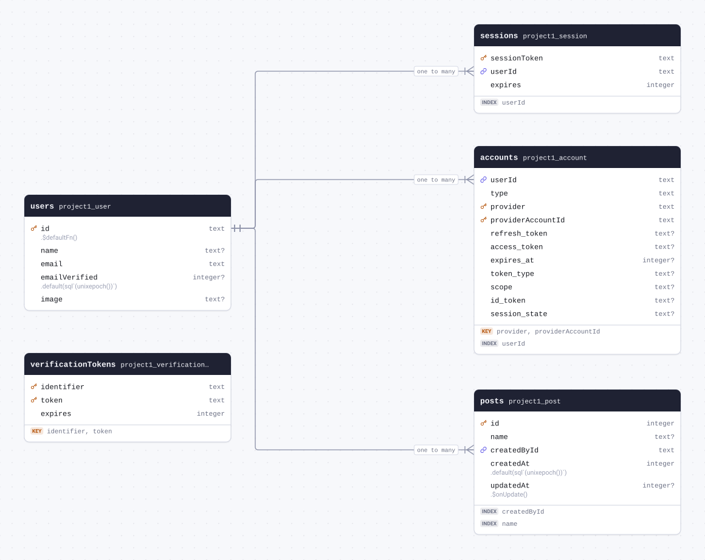
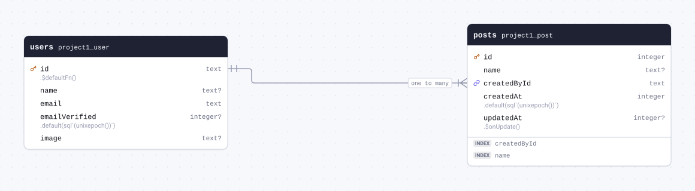
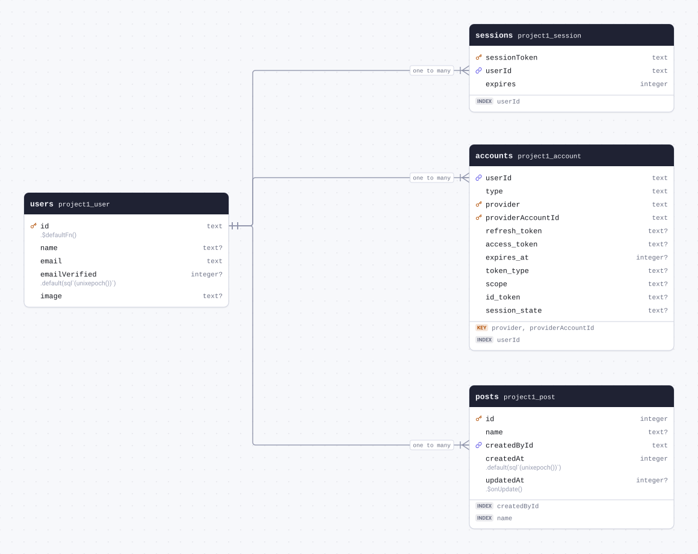
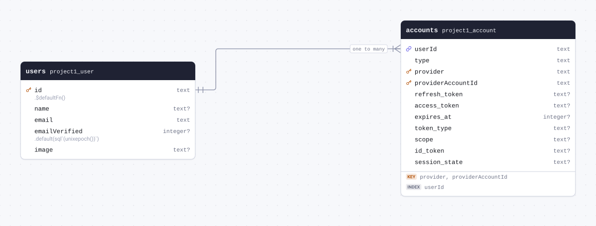
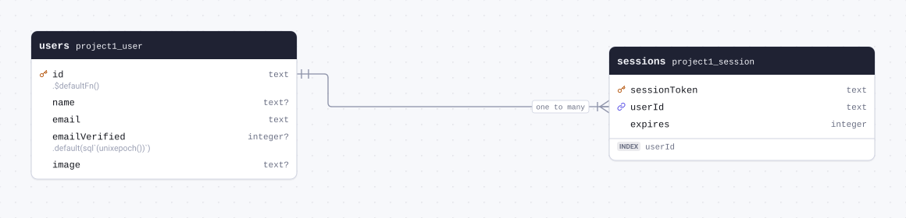
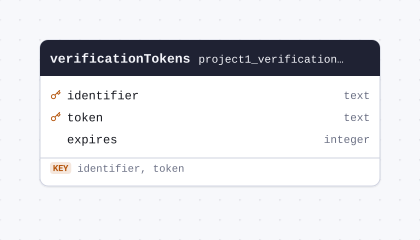

# Schema docs



<details>
<summary>The whole schema as SQL</summary>

```sql
CREATE TABLE `project1_account` (
	`userId` text(255) NOT NULL,
	`type` text(255) NOT NULL,
	`provider` text(255) NOT NULL,
	`providerAccountId` text(255) NOT NULL,
	`refresh_token` text,
	`access_token` text,
	`expires_at` integer,
	`token_type` text(255),
	`scope` text(255),
	`id_token` text,
	`session_state` text(255),
	CONSTRAINT `project1_account_pk` PRIMARY KEY(`provider`, `providerAccountId`),
	CONSTRAINT `fk_project1_account_userId_project1_user_id_fk` FOREIGN KEY (`userId`) REFERENCES `project1_user`(`id`)
);

CREATE TABLE `project1_post` (
	`id` integer PRIMARY KEY AUTOINCREMENT,
	`name` text(256),
	`createdById` text(255) NOT NULL,
	`createdAt` integer DEFAULT (unixepoch()) NOT NULL,
	`updatedAt` integer,
	CONSTRAINT `fk_project1_post_createdById_project1_user_id_fk` FOREIGN KEY (`createdById`) REFERENCES `project1_user`(`id`)
);

CREATE TABLE `project1_session` (
	`sessionToken` text(255) PRIMARY KEY,
	`userId` text(255) NOT NULL,
	`expires` integer NOT NULL,
	CONSTRAINT `fk_project1_session_userId_project1_user_id_fk` FOREIGN KEY (`userId`) REFERENCES `project1_user`(`id`)
);

CREATE TABLE `project1_user` (
	`id` text(255) PRIMARY KEY,
	`name` text(255),
	`email` text(255) NOT NULL,
	`emailVerified` integer DEFAULT (unixepoch()),
	`image` text(255)
);

CREATE TABLE `project1_verification_token` (
	`identifier` text(255) NOT NULL,
	`token` text(255) NOT NULL,
	`expires` integer NOT NULL,
	CONSTRAINT `project1_verification_token_pk` PRIMARY KEY(`identifier`, `token`)
);

CREATE INDEX `account_user_id_idx` ON `project1_account` (`userId`);

CREATE INDEX `created_by_idx` ON `project1_post` (`createdById`);

CREATE INDEX `name_idx` ON `project1_post` (`name`);

CREATE INDEX `session_userId_idx` ON `project1_session` (`userId`);
```

</details>

## Contents

| Table                                           | Name in the database          | Description |
| ----------------------------------------------- | ----------------------------- | ----------- |
| [posts](#table-posts)                           | `project1_post`               |             |
| [users](#table-users)                           | `project1_user`               |             |
| [accounts](#table-accounts)                     | `project1_account`            |             |
| [sessions](#table-sessions)                     | `project1_session`            |             |
| [verificationTokens](#table-verificationTokens) | `project1_verification_token` |             |

## Tables

<a id="table-posts"></a>

### posts

Table `project1_post`.



| Column        | Type      | Constraints                         | Default                          | Description |
| ------------- | --------- | ----------------------------------- | -------------------------------- | ----------- |
| `id`          | `integer` | PK NOT NULL                         |                                  |             |
| `name`        | `text`    | NULL                                |                                  |             |
| `createdById` | `text`    | NOT NULL → [users.id](#table-users) |                                  |             |
| `createdAt`   | `integer` | NOT NULL                            | ``.default(sql`(unixepoch())`)`` |             |
| `updatedAt`   | `integer` | NULL                                | `.$onUpdate()`                   |             |

#### Definition

```sql
CREATE TABLE `project1_post` (
	`id` integer PRIMARY KEY AUTOINCREMENT,
	`name` text(256),
	`createdById` text(255) NOT NULL,
	`createdAt` integer DEFAULT (unixepoch()) NOT NULL,
	`updatedAt` integer,
	CONSTRAINT `fk_project1_post_createdById_project1_user_id_fk` FOREIGN KEY (`createdById`) REFERENCES `project1_user`(`id`)
);

CREATE INDEX `created_by_idx` ON `project1_post` (`createdById`);

CREATE INDEX `name_idx` ON `project1_post` (`name`);
```

#### Indexes

- INDEX `createdById`
- INDEX `name`

#### References

- `createdById` → [users.id](#table-users) (many to one)

<details>
<summary>Queries and their SQL</summary>

**Select**: Every row of posts.

```ts
db.select().from(posts);
```

```sql
select "id", "name", "createdById", "createdAt", "updatedAt"
from "project1_post"
```

**Count**: How many rows posts has.

```ts
db.select({ count: count() }).from(posts);
```

```sql
select count(*)
from "project1_post"
```

**Find many**: The rows of posts, through the relational query API.

```ts
db.query.posts.findMany();
```

```sql
select "d0"."id" as "id", "d0"."name" as "name", "d0"."createdById" as "createdById", "d0"."createdAt" as "createdAt", "d0"."updatedAt" as "updatedAt"
from "project1_post" as "d0"
```

**Find by primary key**: One row of posts, through the relational query API.

```ts
db.query.posts.findFirst({ where: { id: 1 } });
```

```sql
select "d0"."id" as "id", "d0"."name" as "name", "d0"."createdById" as "createdById", "d0"."createdAt" as "createdAt", "d0"."updatedAt" as "updatedAt"
from "project1_post" as "d0"
where "d0"."id" = ?
limit ?
-- params: [1,1]
```

**Insert**: Adds a row to posts, giving the columns that have no default.

```ts
db.insert(posts).values({ id: 1, createdById: "createdById" });
```

```sql
insert into "project1_post" ("id", "name", "createdById", "createdAt", "updatedAt")
values (?, null, ?, (unixepoch()), ?)
-- params: [1,"createdById",1767225600]
```

**Update**: Changes a row of posts, found by its primary key.

```ts
db.update(posts).set({ name: "name" }).where(eq(posts.id, 1));
```

```sql
update "project1_post"
set "name" = ?, "updatedAt" = ?
where "project1_post"."id" = ?
-- params: ["name",1767225600,1]
```

**Delete**: Deletes a row of posts, found by its primary key.

```ts
db.delete(posts).where(eq(posts.id, 1));
```

```sql
delete from "project1_post"
where "project1_post"."id" = ?
-- params: [1]
```

</details>

<a id="table-users"></a>

### users

Table `project1_user`.



| Column          | Type      | Constraints | Default                          | Description |
| --------------- | --------- | ----------- | -------------------------------- | ----------- |
| `id`            | `text`    | PK NOT NULL | `.$defaultFn()`                  |             |
| `name`          | `text`    | NULL        |                                  |             |
| `email`         | `text`    | NOT NULL    |                                  |             |
| `emailVerified` | `integer` | NULL        | ``.default(sql`(unixepoch())`)`` |             |
| `image`         | `text`    | NULL        |                                  |             |

#### Definition

```sql
CREATE TABLE `project1_user` (
	`id` text(255) PRIMARY KEY,
	`name` text(255),
	`email` text(255) NOT NULL,
	`emailVerified` integer DEFAULT (unixepoch()),
	`image` text(255)
);
```

#### Referenced by

- `id` → [posts.createdById](#table-posts) (one to many)
- `id` → [accounts.userId](#table-accounts) (one to many)
- `id` → [sessions.userId](#table-sessions) (one to many)

<details>
<summary>Queries and their SQL</summary>

**Select**: Every row of users.

```ts
db.select().from(users);
```

```sql
select "id", "name", "email", "emailVerified", "image"
from "project1_user"
```

**Count**: How many rows users has.

```ts
db.select({ count: count() }).from(users);
```

```sql
select count(*)
from "project1_user"
```

**Find many**: The rows of users, through the relational query API.

```ts
db.query.users.findMany();
```

```sql
select "d0"."id" as "id", "d0"."name" as "name", "d0"."email" as "email", "d0"."emailVerified" as "emailVerified", "d0"."image" as "image"
from "project1_user" as "d0"
```

**Find by primary key**: One row of users, through the relational query API.

```ts
db.query.users.findFirst({ where: { id: "id" } });
```

```sql
select "d0"."id" as "id", "d0"."name" as "name", "d0"."email" as "email", "d0"."emailVerified" as "emailVerified", "d0"."image" as "image"
from "project1_user" as "d0"
where "d0"."id" = ?
limit ?
-- params: ["id",1]
```

**Insert**: Adds a row to users, giving the columns that have no default.

```ts
db.insert(users).values({ email: "email" });
```

```sql
insert into "project1_user" ("id", "name", "email", "emailVerified", "image")
values (?, null, ?, (unixepoch()), null)
-- params: ["00000000-0000-4000-8000-000000000000","email"]
```

**Update**: Changes a row of users, found by its primary key.

```ts
db.update(users).set({ name: "name" }).where(eq(users.id, "id"));
```

```sql
update "project1_user"
set "name" = ?
where "project1_user"."id" = ?
-- params: ["name","id"]
```

**Delete**: Deletes a row of users, found by its primary key.

```ts
db.delete(users).where(eq(users.id, "id"));
```

```sql
delete from "project1_user"
where "project1_user"."id" = ?
-- params: ["id"]
```

</details>

<a id="table-accounts"></a>

### accounts

Table `project1_account`.



| Column              | Type      | Constraints                         | Default | Description |
| ------------------- | --------- | ----------------------------------- | ------- | ----------- |
| `userId`            | `text`    | NOT NULL → [users.id](#table-users) |         |             |
| `type`              | `text`    | NOT NULL                            |         |             |
| `provider`          | `text`    | PK NOT NULL                         |         |             |
| `providerAccountId` | `text`    | PK NOT NULL                         |         |             |
| `refresh_token`     | `text`    | NULL                                |         |             |
| `access_token`      | `text`    | NULL                                |         |             |
| `expires_at`        | `integer` | NULL                                |         |             |
| `token_type`        | `text`    | NULL                                |         |             |
| `scope`             | `text`    | NULL                                |         |             |
| `id_token`          | `text`    | NULL                                |         |             |
| `session_state`     | `text`    | NULL                                |         |             |

#### Definition

```sql
CREATE TABLE `project1_account` (
	`userId` text(255) NOT NULL,
	`type` text(255) NOT NULL,
	`provider` text(255) NOT NULL,
	`providerAccountId` text(255) NOT NULL,
	`refresh_token` text,
	`access_token` text,
	`expires_at` integer,
	`token_type` text(255),
	`scope` text(255),
	`id_token` text,
	`session_state` text(255),
	CONSTRAINT `project1_account_pk` PRIMARY KEY(`provider`, `providerAccountId`),
	CONSTRAINT `fk_project1_account_userId_project1_user_id_fk` FOREIGN KEY (`userId`) REFERENCES `project1_user`(`id`)
);

CREATE INDEX `account_user_id_idx` ON `project1_account` (`userId`);
```

#### Indexes

- PRIMARY KEY `provider`, `providerAccountId`
- INDEX `userId`

#### References

- `userId` → [users.id](#table-users) (many to one)

<details>
<summary>Queries and their SQL</summary>

**Select**: Every row of accounts.

```ts
db.select().from(accounts);
```

```sql
select "userId", "type", "provider", "providerAccountId", "refresh_token", "access_token", "expires_at", "token_type", "scope", "id_token", "session_state"
from "project1_account"
```

**Count**: How many rows accounts has.

```ts
db.select({ count: count() }).from(accounts);
```

```sql
select count(*)
from "project1_account"
```

**Find many**: The rows of accounts, through the relational query API.

```ts
db.query.accounts.findMany();
```

```sql
select "d0"."userId" as "userId", "d0"."type" as "type", "d0"."provider" as "provider", "d0"."providerAccountId" as "providerAccountId", "d0"."refresh_token" as "refresh_token", "d0"."access_token" as "access_token", "d0"."expires_at" as "expires_at", "d0"."token_type" as "token_type", "d0"."scope" as "scope", "d0"."id_token" as "id_token", "d0"."session_state" as "session_state"
from "project1_account" as "d0"
```

**Find by primary key**: One row of accounts, through the relational query API.

```ts
db.query.accounts.findFirst({
  where: { provider: "provider", providerAccountId: "providerAccountId" },
});
```

```sql
select "d0"."userId" as "userId", "d0"."type" as "type", "d0"."provider" as "provider", "d0"."providerAccountId" as "providerAccountId", "d0"."refresh_token" as "refresh_token", "d0"."access_token" as "access_token", "d0"."expires_at" as "expires_at", "d0"."token_type" as "token_type", "d0"."scope" as "scope", "d0"."id_token" as "id_token", "d0"."session_state" as "session_state"
from "project1_account" as "d0"
where (("d0"."provider" = ?) and ("d0"."providerAccountId" = ?))
limit ?
-- params: ["provider","providerAccountId",1]
```

**Insert**: Adds a row to accounts, giving the columns that have no default.

```ts
db.insert(accounts).values({
  userId: "userId",
  type: "type",
  provider: "provider",
  providerAccountId: "providerAccountId",
});
```

```sql
insert into "project1_account" ("userId", "type", "provider", "providerAccountId", "refresh_token", "access_token", "expires_at", "token_type", "scope", "id_token", "session_state")
values (?, ?, ?, ?, null, null, null, null, null, null, null)
-- params: ["userId","type","provider","providerAccountId"]
```

**Update**: Changes a row of accounts, found by its primary key.

```ts
db.update(accounts)
  .set({ userId: "userId" })
  .where(
    and(eq(accounts.provider, "provider"), eq(accounts.providerAccountId, "providerAccountId")),
  );
```

```sql
update "project1_account"
set "userId" = ?
where (("project1_account"."provider" = ?) and ("project1_account"."providerAccountId" = ?))
-- params: ["userId","provider","providerAccountId"]
```

**Delete**: Deletes a row of accounts, found by its primary key.

```ts
db.delete(accounts).where(
  and(eq(accounts.provider, "provider"), eq(accounts.providerAccountId, "providerAccountId")),
);
```

```sql
delete from "project1_account"
where (("project1_account"."provider" = ?) and ("project1_account"."providerAccountId" = ?))
-- params: ["provider","providerAccountId"]
```

</details>

<a id="table-sessions"></a>

### sessions

Table `project1_session`.



| Column         | Type      | Constraints                         | Default | Description |
| -------------- | --------- | ----------------------------------- | ------- | ----------- |
| `sessionToken` | `text`    | PK NOT NULL                         |         |             |
| `userId`       | `text`    | NOT NULL → [users.id](#table-users) |         |             |
| `expires`      | `integer` | NOT NULL                            |         |             |

#### Definition

```sql
CREATE TABLE `project1_session` (
	`sessionToken` text(255) PRIMARY KEY,
	`userId` text(255) NOT NULL,
	`expires` integer NOT NULL,
	CONSTRAINT `fk_project1_session_userId_project1_user_id_fk` FOREIGN KEY (`userId`) REFERENCES `project1_user`(`id`)
);

CREATE INDEX `session_userId_idx` ON `project1_session` (`userId`);
```

#### Indexes

- INDEX `userId`

#### References

- `userId` → [users.id](#table-users) (many to one)

<details>
<summary>Queries and their SQL</summary>

**Select**: Every row of sessions.

```ts
db.select().from(sessions);
```

```sql
select "sessionToken", "userId", "expires"
from "project1_session"
```

**Count**: How many rows sessions has.

```ts
db.select({ count: count() }).from(sessions);
```

```sql
select count(*)
from "project1_session"
```

**Find many**: The rows of sessions, through the relational query API.

```ts
db.query.sessions.findMany();
```

```sql
select "d0"."sessionToken" as "sessionToken", "d0"."userId" as "userId", "d0"."expires" as "expires"
from "project1_session" as "d0"
```

**Find by primary key**: One row of sessions, through the relational query API.

```ts
db.query.sessions.findFirst({ where: { sessionToken: "sessionToken" } });
```

```sql
select "d0"."sessionToken" as "sessionToken", "d0"."userId" as "userId", "d0"."expires" as "expires"
from "project1_session" as "d0"
where "d0"."sessionToken" = ?
limit ?
-- params: ["sessionToken",1]
```

**Insert**: Adds a row to sessions, giving the columns that have no default.

```ts
db.insert(sessions).values({ sessionToken: "sessionToken", userId: "userId", expires: 1 });
```

```sql
insert into "project1_session" ("sessionToken", "userId", "expires")
values (?, ?, ?)
-- params: ["sessionToken","userId",1]
```

**Update**: Changes a row of sessions, found by its primary key.

```ts
db.update(sessions).set({ userId: "userId" }).where(eq(sessions.sessionToken, "sessionToken"));
```

```sql
update "project1_session"
set "userId" = ?
where "project1_session"."sessionToken" = ?
-- params: ["userId","sessionToken"]
```

**Delete**: Deletes a row of sessions, found by its primary key.

```ts
db.delete(sessions).where(eq(sessions.sessionToken, "sessionToken"));
```

```sql
delete from "project1_session"
where "project1_session"."sessionToken" = ?
-- params: ["sessionToken"]
```

</details>

<a id="table-verificationTokens"></a>

### verificationTokens

Table `project1_verification_token`.



| Column       | Type      | Constraints | Default | Description |
| ------------ | --------- | ----------- | ------- | ----------- |
| `identifier` | `text`    | PK NOT NULL |         |             |
| `token`      | `text`    | PK NOT NULL |         |             |
| `expires`    | `integer` | NOT NULL    |         |             |

#### Definition

```sql
CREATE TABLE `project1_verification_token` (
	`identifier` text(255) NOT NULL,
	`token` text(255) NOT NULL,
	`expires` integer NOT NULL,
	CONSTRAINT `project1_verification_token_pk` PRIMARY KEY(`identifier`, `token`)
);
```

#### Indexes

- PRIMARY KEY `identifier`, `token`

<details>
<summary>Queries and their SQL</summary>

**Select**: Every row of verificationTokens.

```ts
db.select().from(verificationTokens);
```

```sql
select "identifier", "token", "expires"
from "project1_verification_token"
```

**Count**: How many rows verificationTokens has.

```ts
db.select({ count: count() }).from(verificationTokens);
```

```sql
select count(*)
from "project1_verification_token"
```

**Find many**: The rows of verificationTokens, through the relational query API.

```ts
db.query.verificationTokens.findMany();
```

```sql
select "d0"."identifier" as "identifier", "d0"."token" as "token", "d0"."expires" as "expires"
from "project1_verification_token" as "d0"
```

**Find by primary key**: One row of verificationTokens, through the relational query API.

```ts
db.query.verificationTokens.findFirst({ where: { identifier: "identifier", token: "token" } });
```

```sql
select "d0"."identifier" as "identifier", "d0"."token" as "token", "d0"."expires" as "expires"
from "project1_verification_token" as "d0"
where (("d0"."identifier" = ?) and ("d0"."token" = ?))
limit ?
-- params: ["identifier","token",1]
```

**Insert**: Adds a row to verificationTokens, giving the columns that have no default.

```ts
db.insert(verificationTokens).values({ identifier: "identifier", token: "token", expires: 1 });
```

```sql
insert into "project1_verification_token" ("identifier", "token", "expires")
values (?, ?, ?)
-- params: ["identifier","token",1]
```

**Update**: Changes a row of verificationTokens, found by its primary key.

```ts
db.update(verificationTokens)
  .set({ expires: 1 })
  .where(
    and(eq(verificationTokens.identifier, "identifier"), eq(verificationTokens.token, "token")),
  );
```

```sql
update "project1_verification_token"
set "expires" = ?
where (("project1_verification_token"."identifier" = ?) and ("project1_verification_token"."token" = ?))
-- params: [1,"identifier","token"]
```

**Delete**: Deletes a row of verificationTokens, found by its primary key.

```ts
db.delete(verificationTokens).where(
  and(eq(verificationTokens.identifier, "identifier"), eq(verificationTokens.token, "token")),
);
```

```sql
delete from "project1_verification_token"
where (("project1_verification_token"."identifier" = ?) and ("project1_verification_token"."token" = ?))
-- params: ["identifier","token"]
```

</details>
