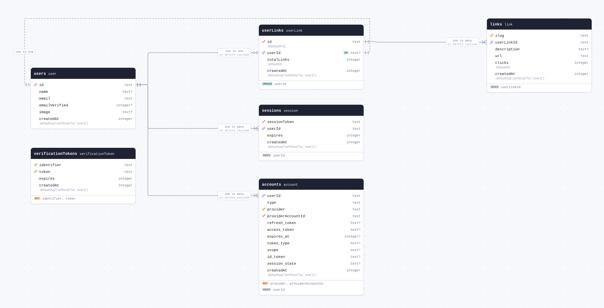
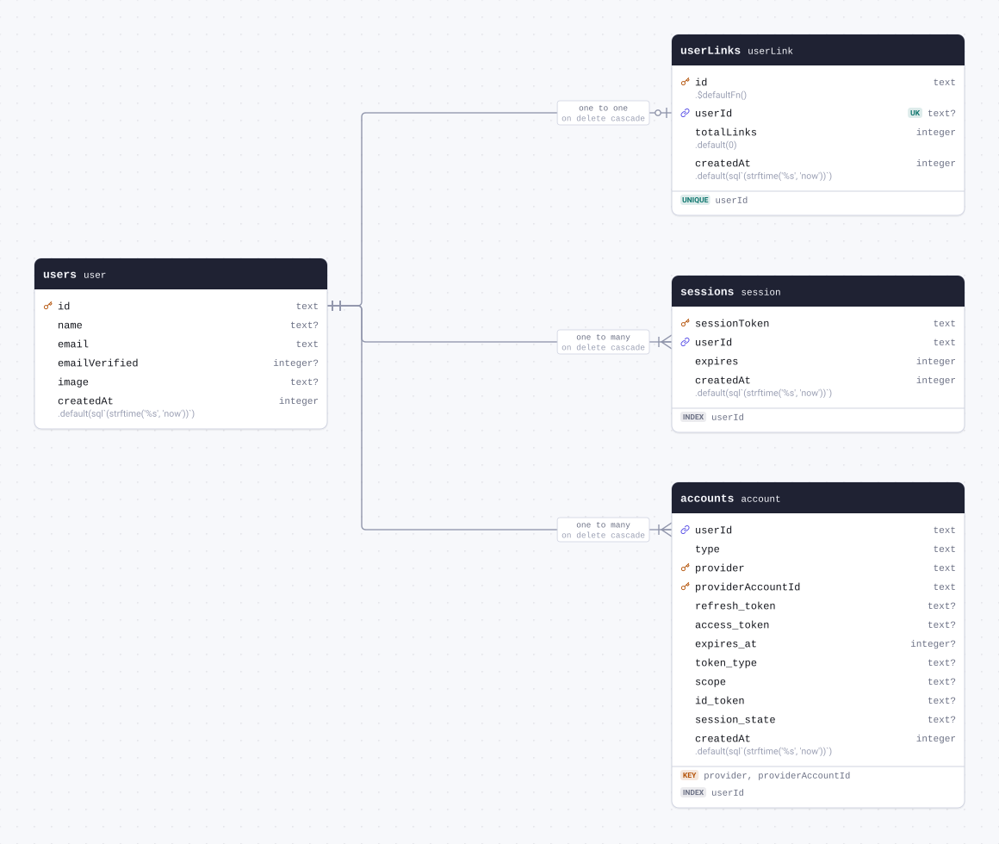
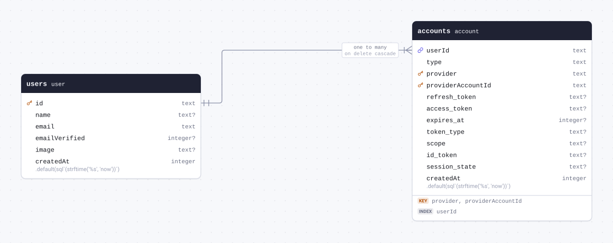
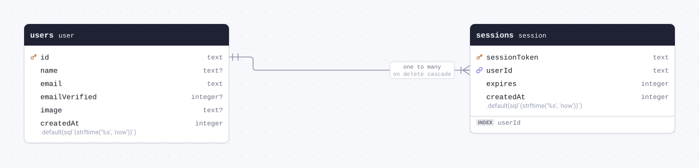
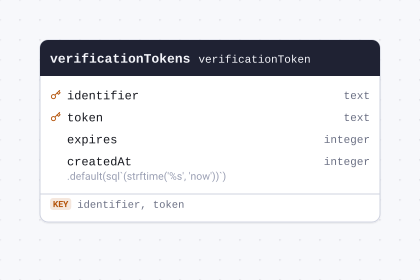
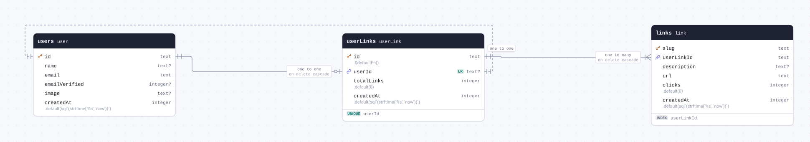
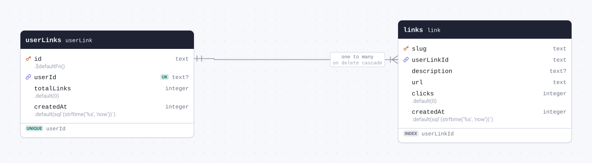

# Schema docs



<details>
<summary>The whole schema as SQL</summary>

```sql
CREATE TABLE `account` (
	`userId` text NOT NULL,
	`type` text NOT NULL,
	`provider` text NOT NULL,
	`providerAccountId` text NOT NULL,
	`refresh_token` text,
	`access_token` text,
	`expires_at` integer,
	`token_type` text,
	`scope` text,
	`id_token` text,
	`session_state` text,
	`created_at` integer DEFAULT (strftime('%s', 'now')) NOT NULL,
	CONSTRAINT `account_pk` PRIMARY KEY(`provider`, `providerAccountId`),
	CONSTRAINT `fk_account_userId_user_id_fk` FOREIGN KEY (`userId`) REFERENCES `user`(`id`) ON DELETE CASCADE
);

CREATE TABLE `link` (
	`slug` text(30) PRIMARY KEY,
	`userLinkId` text NOT NULL,
	`description` text(255),
	`url` text NOT NULL,
	`clicks` integer DEFAULT 0 NOT NULL,
	`created_at` integer DEFAULT (strftime('%s', 'now')) NOT NULL,
	CONSTRAINT `fk_link_userLinkId_userLink_id_fk` FOREIGN KEY (`userLinkId`) REFERENCES `userLink`(`id`) ON DELETE CASCADE
);

CREATE TABLE `session` (
	`sessionToken` text PRIMARY KEY,
	`userId` text NOT NULL,
	`expires` integer NOT NULL,
	`created_at` integer DEFAULT (strftime('%s', 'now')) NOT NULL,
	CONSTRAINT `fk_session_userId_user_id_fk` FOREIGN KEY (`userId`) REFERENCES `user`(`id`) ON DELETE CASCADE
);

CREATE TABLE `userLink` (
	`id` text PRIMARY KEY,
	`userId` text,
	`total_links` integer DEFAULT 0 NOT NULL,
	`created_at` integer DEFAULT (strftime('%s', 'now')) NOT NULL,
	CONSTRAINT `fk_userLink_userId_user_id_fk` FOREIGN KEY (`userId`) REFERENCES `user`(`id`) ON DELETE CASCADE
);

CREATE TABLE `user` (
	`id` text PRIMARY KEY,
	`name` text,
	`email` text NOT NULL,
	`emailVerified` integer,
	`image` text,
	`created_at` integer DEFAULT (strftime('%s', 'now')) NOT NULL
);

CREATE TABLE `verificationToken` (
	`identifier` text NOT NULL,
	`token` text NOT NULL,
	`expires` integer NOT NULL,
	`created_at` integer DEFAULT (strftime('%s', 'now')) NOT NULL,
	CONSTRAINT `verificationToken_pk` PRIMARY KEY(`identifier`, `token`)
);

CREATE INDEX `accounts_userId_idx` ON `account` (`userId`);

CREATE INDEX `userLinkId_idx` ON `link` (`userLinkId`);

CREATE INDEX `sessions_userId_idx` ON `session` (`userId`);

CREATE UNIQUE INDEX `userLinks_userId_idx` ON `userLink` (`userId`);
```

</details>

## Contents

| Table                                           | Name in the database | Description |
| ----------------------------------------------- | -------------------- | ----------- |
| [users](#table-users)                           | `user`               |             |
| [accounts](#table-accounts)                     | `account`            |             |
| [sessions](#table-sessions)                     | `session`            |             |
| [verificationTokens](#table-verificationTokens) | `verificationToken`  |             |
| [userLinks](#table-userLinks)                   | `userLink`           |             |
| [links](#table-links)                           | `link`               |             |

## Tables

<a id="table-users"></a>

### users

Table `user`.



| Column                     | Type      | Constraints | Default                                    | Description |
| -------------------------- | --------- | ----------- | ------------------------------------------ | ----------- |
| `id`                       | `text`    | PK NOT NULL |                                            |             |
| `name`                     | `text`    | NULL        |                                            |             |
| `email`                    | `text`    | NOT NULL    |                                            |             |
| `emailVerified`            | `integer` | NULL        |                                            |             |
| `image`                    | `text`    | NULL        |                                            |             |
| `createdAt` (`created_at`) | `integer` | NOT NULL    | ``.default(sql`(strftime('%s', 'now'))`)`` |             |

#### Definition

```sql
CREATE TABLE `user` (
	`id` text PRIMARY KEY,
	`name` text,
	`email` text NOT NULL,
	`emailVerified` integer,
	`image` text,
	`created_at` integer DEFAULT (strftime('%s', 'now')) NOT NULL
);
```

#### Referenced by

- `id` → [accounts.userId](#table-accounts) (one to many, on delete cascade)
- `id` → [sessions.userId](#table-sessions) (one to many, on delete cascade)
- `id` → [userLinks.userId](#table-userLinks) (one to one, on delete cascade)

<details>
<summary>Queries and their SQL</summary>

**Select**: Every row of users.

```ts
db.select().from(users);
```

```sql
select "id", "name", "email", "emailVerified", "image", "created_at"
from "user"
```

**Count**: How many rows users has.

```ts
db.select({ count: count() }).from(users);
```

```sql
select count(*)
from "user"
```

**Find many**: The rows of users, through the relational query API.

```ts
db.query.users.findMany();
```

```sql
select "d0"."id" as "id", "d0"."name" as "name", "d0"."email" as "email", "d0"."emailVerified" as "emailVerified", "d0"."image" as "image", "d0"."created_at" as "createdAt"
from "user" as "d0"
```

**Find by primary key**: One row of users, through the relational query API.

```ts
db.query.users.findFirst({ where: { id: "id" } });
```

```sql
select "d0"."id" as "id", "d0"."name" as "name", "d0"."email" as "email", "d0"."emailVerified" as "emailVerified", "d0"."image" as "image", "d0"."created_at" as "createdAt"
from "user" as "d0"
where "d0"."id" = ?
limit ?
-- params: ["id",1]
```

**Insert**: Adds a row to users, giving the columns that have no default.

```ts
db.insert(users).values({ id: "id", email: "email" });
```

```sql
insert into "user" ("id", "name", "email", "emailVerified", "image", "created_at")
values (?, null, ?, null, null, (strftime('%s', 'now')))
-- params: ["id","email"]
```

**Update**: Changes a row of users, found by its primary key.

```ts
db.update(users).set({ name: "name" }).where(eq(users.id, "id"));
```

```sql
update "user"
set "name" = ?
where "user"."id" = ?
-- params: ["name","id"]
```

**Delete**: Deletes a row of users, found by its primary key.

```ts
db.delete(users).where(eq(users.id, "id"));
```

```sql
delete from "user"
where "user"."id" = ?
-- params: ["id"]
```

</details>

<a id="table-accounts"></a>

### accounts

Table `account`.



| Column                     | Type      | Constraints                         | Default                                    | Description |
| -------------------------- | --------- | ----------------------------------- | ------------------------------------------ | ----------- |
| `userId`                   | `text`    | NOT NULL → [users.id](#table-users) |                                            |             |
| `type`                     | `text`    | NOT NULL                            |                                            |             |
| `provider`                 | `text`    | PK NOT NULL                         |                                            |             |
| `providerAccountId`        | `text`    | PK NOT NULL                         |                                            |             |
| `refresh_token`            | `text`    | NULL                                |                                            |             |
| `access_token`             | `text`    | NULL                                |                                            |             |
| `expires_at`               | `integer` | NULL                                |                                            |             |
| `token_type`               | `text`    | NULL                                |                                            |             |
| `scope`                    | `text`    | NULL                                |                                            |             |
| `id_token`                 | `text`    | NULL                                |                                            |             |
| `session_state`            | `text`    | NULL                                |                                            |             |
| `createdAt` (`created_at`) | `integer` | NOT NULL                            | ``.default(sql`(strftime('%s', 'now'))`)`` |             |

#### Definition

```sql
CREATE TABLE `account` (
	`userId` text NOT NULL,
	`type` text NOT NULL,
	`provider` text NOT NULL,
	`providerAccountId` text NOT NULL,
	`refresh_token` text,
	`access_token` text,
	`expires_at` integer,
	`token_type` text,
	`scope` text,
	`id_token` text,
	`session_state` text,
	`created_at` integer DEFAULT (strftime('%s', 'now')) NOT NULL,
	CONSTRAINT `account_pk` PRIMARY KEY(`provider`, `providerAccountId`),
	CONSTRAINT `fk_account_userId_user_id_fk` FOREIGN KEY (`userId`) REFERENCES `user`(`id`) ON DELETE CASCADE
);

CREATE INDEX `accounts_userId_idx` ON `account` (`userId`);
```

#### Indexes

- PRIMARY KEY `provider`, `providerAccountId`
- INDEX `userId`

#### References

- `userId` → [users.id](#table-users) (many to one, on delete cascade)

<details>
<summary>Queries and their SQL</summary>

**Select**: Every row of accounts.

```ts
db.select().from(accounts);
```

```sql
select "userId", "type", "provider", "providerAccountId", "refresh_token", "access_token", "expires_at", "token_type", "scope", "id_token", "session_state", "created_at"
from "account"
```

**Count**: How many rows accounts has.

```ts
db.select({ count: count() }).from(accounts);
```

```sql
select count(*)
from "account"
```

**Find many**: The rows of accounts, through the relational query API.

```ts
db.query.accounts.findMany();
```

```sql
select "d0"."userId" as "userId", "d0"."type" as "type", "d0"."provider" as "provider", "d0"."providerAccountId" as "providerAccountId", "d0"."refresh_token" as "refresh_token", "d0"."access_token" as "access_token", "d0"."expires_at" as "expires_at", "d0"."token_type" as "token_type", "d0"."scope" as "scope", "d0"."id_token" as "id_token", "d0"."session_state" as "session_state", "d0"."created_at" as "createdAt"
from "account" as "d0"
```

**Find by primary key**: One row of accounts, through the relational query API.

```ts
db.query.accounts.findFirst({
  where: { provider: "provider", providerAccountId: "providerAccountId" },
});
```

```sql
select "d0"."userId" as "userId", "d0"."type" as "type", "d0"."provider" as "provider", "d0"."providerAccountId" as "providerAccountId", "d0"."refresh_token" as "refresh_token", "d0"."access_token" as "access_token", "d0"."expires_at" as "expires_at", "d0"."token_type" as "token_type", "d0"."scope" as "scope", "d0"."id_token" as "id_token", "d0"."session_state" as "session_state", "d0"."created_at" as "createdAt"
from "account" as "d0"
where (("d0"."provider" = ?) and ("d0"."providerAccountId" = ?))
limit ?
-- params: ["provider","providerAccountId",1]
```

**Insert**: Adds a row to accounts, giving the columns that have no default.

```ts
db.insert(accounts).values({
  userId: "userId",
  type: "type",
  provider: "provider",
  providerAccountId: "providerAccountId",
});
```

```sql
insert into "account" ("userId", "type", "provider", "providerAccountId", "refresh_token", "access_token", "expires_at", "token_type", "scope", "id_token", "session_state", "created_at")
values (?, ?, ?, ?, null, null, null, null, null, null, null, (strftime('%s', 'now')))
-- params: ["userId","type","provider","providerAccountId"]
```

**Update**: Changes a row of accounts, found by its primary key.

```ts
db.update(accounts)
  .set({ userId: "userId" })
  .where(
    and(eq(accounts.provider, "provider"), eq(accounts.providerAccountId, "providerAccountId")),
  );
```

```sql
update "account"
set "userId" = ?
where (("account"."provider" = ?) and ("account"."providerAccountId" = ?))
-- params: ["userId","provider","providerAccountId"]
```

**Delete**: Deletes a row of accounts, found by its primary key.

```ts
db.delete(accounts).where(
  and(eq(accounts.provider, "provider"), eq(accounts.providerAccountId, "providerAccountId")),
);
```

```sql
delete from "account"
where (("account"."provider" = ?) and ("account"."providerAccountId" = ?))
-- params: ["provider","providerAccountId"]
```

</details>

<a id="table-sessions"></a>

### sessions

Table `session`.



| Column                     | Type      | Constraints                         | Default                                    | Description |
| -------------------------- | --------- | ----------------------------------- | ------------------------------------------ | ----------- |
| `sessionToken`             | `text`    | PK NOT NULL                         |                                            |             |
| `userId`                   | `text`    | NOT NULL → [users.id](#table-users) |                                            |             |
| `expires`                  | `integer` | NOT NULL                            |                                            |             |
| `createdAt` (`created_at`) | `integer` | NOT NULL                            | ``.default(sql`(strftime('%s', 'now'))`)`` |             |

#### Definition

```sql
CREATE TABLE `session` (
	`sessionToken` text PRIMARY KEY,
	`userId` text NOT NULL,
	`expires` integer NOT NULL,
	`created_at` integer DEFAULT (strftime('%s', 'now')) NOT NULL,
	CONSTRAINT `fk_session_userId_user_id_fk` FOREIGN KEY (`userId`) REFERENCES `user`(`id`) ON DELETE CASCADE
);

CREATE INDEX `sessions_userId_idx` ON `session` (`userId`);
```

#### Indexes

- INDEX `userId`

#### References

- `userId` → [users.id](#table-users) (many to one, on delete cascade)

<details>
<summary>Queries and their SQL</summary>

**Select**: Every row of sessions.

```ts
db.select().from(sessions);
```

```sql
select "sessionToken", "userId", "expires", "created_at"
from "session"
```

**Count**: How many rows sessions has.

```ts
db.select({ count: count() }).from(sessions);
```

```sql
select count(*)
from "session"
```

**Find many**: The rows of sessions, through the relational query API.

```ts
db.query.sessions.findMany();
```

```sql
select "d0"."sessionToken" as "sessionToken", "d0"."userId" as "userId", "d0"."expires" as "expires", "d0"."created_at" as "createdAt"
from "session" as "d0"
```

**Find by primary key**: One row of sessions, through the relational query API.

```ts
db.query.sessions.findFirst({ where: { sessionToken: "sessionToken" } });
```

```sql
select "d0"."sessionToken" as "sessionToken", "d0"."userId" as "userId", "d0"."expires" as "expires", "d0"."created_at" as "createdAt"
from "session" as "d0"
where "d0"."sessionToken" = ?
limit ?
-- params: ["sessionToken",1]
```

**Insert**: Adds a row to sessions, giving the columns that have no default.

```ts
db.insert(sessions).values({ sessionToken: "sessionToken", userId: "userId", expires: 1 });
```

```sql
insert into "session" ("sessionToken", "userId", "expires", "created_at")
values (?, ?, ?, (strftime('%s', 'now')))
-- params: ["sessionToken","userId",1]
```

**Update**: Changes a row of sessions, found by its primary key.

```ts
db.update(sessions).set({ userId: "userId" }).where(eq(sessions.sessionToken, "sessionToken"));
```

```sql
update "session"
set "userId" = ?
where "session"."sessionToken" = ?
-- params: ["userId","sessionToken"]
```

**Delete**: Deletes a row of sessions, found by its primary key.

```ts
db.delete(sessions).where(eq(sessions.sessionToken, "sessionToken"));
```

```sql
delete from "session"
where "session"."sessionToken" = ?
-- params: ["sessionToken"]
```

</details>

<a id="table-verificationTokens"></a>

### verificationTokens

Table `verificationToken`.



| Column                     | Type      | Constraints | Default                                    | Description |
| -------------------------- | --------- | ----------- | ------------------------------------------ | ----------- |
| `identifier`               | `text`    | PK NOT NULL |                                            |             |
| `token`                    | `text`    | PK NOT NULL |                                            |             |
| `expires`                  | `integer` | NOT NULL    |                                            |             |
| `createdAt` (`created_at`) | `integer` | NOT NULL    | ``.default(sql`(strftime('%s', 'now'))`)`` |             |

#### Definition

```sql
CREATE TABLE `verificationToken` (
	`identifier` text NOT NULL,
	`token` text NOT NULL,
	`expires` integer NOT NULL,
	`created_at` integer DEFAULT (strftime('%s', 'now')) NOT NULL,
	CONSTRAINT `verificationToken_pk` PRIMARY KEY(`identifier`, `token`)
);
```

#### Indexes

- PRIMARY KEY `identifier`, `token`

<details>
<summary>Queries and their SQL</summary>

**Select**: Every row of verificationTokens.

```ts
db.select().from(verificationTokens);
```

```sql
select "identifier", "token", "expires", "created_at"
from "verificationToken"
```

**Count**: How many rows verificationTokens has.

```ts
db.select({ count: count() }).from(verificationTokens);
```

```sql
select count(*)
from "verificationToken"
```

**Find many**: The rows of verificationTokens, through the relational query API.

```ts
db.query.verificationTokens.findMany();
```

```sql
select "d0"."identifier" as "identifier", "d0"."token" as "token", "d0"."expires" as "expires", "d0"."created_at" as "createdAt"
from "verificationToken" as "d0"
```

**Find by primary key**: One row of verificationTokens, through the relational query API.

```ts
db.query.verificationTokens.findFirst({ where: { identifier: "identifier", token: "token" } });
```

```sql
select "d0"."identifier" as "identifier", "d0"."token" as "token", "d0"."expires" as "expires", "d0"."created_at" as "createdAt"
from "verificationToken" as "d0"
where (("d0"."identifier" = ?) and ("d0"."token" = ?))
limit ?
-- params: ["identifier","token",1]
```

**Insert**: Adds a row to verificationTokens, giving the columns that have no default.

```ts
db.insert(verificationTokens).values({ identifier: "identifier", token: "token", expires: 1 });
```

```sql
insert into "verificationToken" ("identifier", "token", "expires", "created_at")
values (?, ?, ?, (strftime('%s', 'now')))
-- params: ["identifier","token",1]
```

**Update**: Changes a row of verificationTokens, found by its primary key.

```ts
db.update(verificationTokens)
  .set({ expires: 1 })
  .where(
    and(eq(verificationTokens.identifier, "identifier"), eq(verificationTokens.token, "token")),
  );
```

```sql
update "verificationToken"
set "expires" = ?
where (("verificationToken"."identifier" = ?) and ("verificationToken"."token" = ?))
-- params: [1,"identifier","token"]
```

**Delete**: Deletes a row of verificationTokens, found by its primary key.

```ts
db.delete(verificationTokens).where(
  and(eq(verificationTokens.identifier, "identifier"), eq(verificationTokens.token, "token")),
);
```

```sql
delete from "verificationToken"
where (("verificationToken"."identifier" = ?) and ("verificationToken"."token" = ?))
-- params: ["identifier","token"]
```

</details>

<a id="table-userLinks"></a>

### userLinks

Table `userLink`.



| Column                       | Type      | Constraints                     | Default                                    | Description |
| ---------------------------- | --------- | ------------------------------- | ------------------------------------------ | ----------- |
| `id`                         | `text`    | PK NOT NULL                     | `.$defaultFn()`                            |             |
| `userId`                     | `text`    | NULL → [users.id](#table-users) |                                            |             |
| `totalLinks` (`total_links`) | `integer` | NOT NULL                        | `.default(0)`                              |             |
| `createdAt` (`created_at`)   | `integer` | NOT NULL                        | ``.default(sql`(strftime('%s', 'now'))`)`` |             |

#### Definition

```sql
CREATE TABLE `userLink` (
	`id` text PRIMARY KEY,
	`userId` text,
	`total_links` integer DEFAULT 0 NOT NULL,
	`created_at` integer DEFAULT (strftime('%s', 'now')) NOT NULL,
	CONSTRAINT `fk_userLink_userId_user_id_fk` FOREIGN KEY (`userId`) REFERENCES `user`(`id`) ON DELETE CASCADE
);

CREATE UNIQUE INDEX `userLinks_userId_idx` ON `userLink` (`userId`);
```

#### Indexes

- UNIQUE `userId`

#### References

- `userId` → [users.id](#table-users) (one to one, on delete cascade)

#### Referenced by

- `id` → [links.userLinkId](#table-links) (one to many, on delete cascade)

<details>
<summary>Queries and their SQL</summary>

**Select**: Every row of userLinks.

```ts
db.select().from(userLinks);
```

```sql
select "id", "userId", "total_links", "created_at"
from "userLink"
```

**Count**: How many rows userLinks has.

```ts
db.select({ count: count() }).from(userLinks);
```

```sql
select count(*)
from "userLink"
```

**Find many**: The rows of userLinks, through the relational query API.

```ts
db.query.userLinks.findMany();
```

```sql
select "d0"."id" as "id", "d0"."userId" as "userId", "d0"."total_links" as "totalLinks", "d0"."created_at" as "createdAt"
from "userLink" as "d0"
```

**Find by primary key**: One row of userLinks, through the relational query API.

```ts
db.query.userLinks.findFirst({ where: { id: "id" } });
```

```sql
select "d0"."id" as "id", "d0"."userId" as "userId", "d0"."total_links" as "totalLinks", "d0"."created_at" as "createdAt"
from "userLink" as "d0"
where "d0"."id" = ?
limit ?
-- params: ["id",1]
```

**Insert**: Adds a row to userLinks, giving the columns that have no default.

```ts
db.insert(userLinks).values({});
```

```sql
insert into "userLink" ("id", "userId", "total_links", "created_at")
values (?, null, ?, (strftime('%s', 'now')))
-- params: ["njp6z9meub2mh3bue1aynkim",0]
```

**Update**: Changes a row of userLinks, found by its primary key.

```ts
db.update(userLinks).set({ userId: "userId" }).where(eq(userLinks.id, "id"));
```

```sql
update "userLink"
set "userId" = ?
where "userLink"."id" = ?
-- params: ["userId","id"]
```

**Delete**: Deletes a row of userLinks, found by its primary key.

```ts
db.delete(userLinks).where(eq(userLinks.id, "id"));
```

```sql
delete from "userLink"
where "userLink"."id" = ?
-- params: ["id"]
```

</details>

<a id="table-links"></a>

### links

Table `link`.



| Column                     | Type      | Constraints                                 | Default                                    | Description |
| -------------------------- | --------- | ------------------------------------------- | ------------------------------------------ | ----------- |
| `slug`                     | `text`    | PK NOT NULL                                 |                                            |             |
| `userLinkId`               | `text`    | NOT NULL → [userLinks.id](#table-userLinks) |                                            |             |
| `description`              | `text`    | NULL                                        |                                            |             |
| `url`                      | `text`    | NOT NULL                                    |                                            |             |
| `clicks`                   | `integer` | NOT NULL                                    | `.default(0)`                              |             |
| `createdAt` (`created_at`) | `integer` | NOT NULL                                    | ``.default(sql`(strftime('%s', 'now'))`)`` |             |

#### Definition

```sql
CREATE TABLE `link` (
	`slug` text(30) PRIMARY KEY,
	`userLinkId` text NOT NULL,
	`description` text(255),
	`url` text NOT NULL,
	`clicks` integer DEFAULT 0 NOT NULL,
	`created_at` integer DEFAULT (strftime('%s', 'now')) NOT NULL,
	CONSTRAINT `fk_link_userLinkId_userLink_id_fk` FOREIGN KEY (`userLinkId`) REFERENCES `userLink`(`id`) ON DELETE CASCADE
);

CREATE INDEX `userLinkId_idx` ON `link` (`userLinkId`);
```

#### Indexes

- INDEX `userLinkId`

#### References

- `userLinkId` → [userLinks.id](#table-userLinks) (many to one, on delete cascade)

<details>
<summary>Queries and their SQL</summary>

**Select**: Every row of links.

```ts
db.select().from(links);
```

```sql
select "slug", "userLinkId", "description", "url", "clicks", "created_at"
from "link"
```

**Count**: How many rows links has.

```ts
db.select({ count: count() }).from(links);
```

```sql
select count(*)
from "link"
```

**Find many**: The rows of links, through the relational query API.

```ts
db.query.links.findMany();
```

```sql
select "d0"."slug" as "slug", "d0"."userLinkId" as "userLinkId", "d0"."description" as "description", "d0"."url" as "url", "d0"."clicks" as "clicks", "d0"."created_at" as "createdAt"
from "link" as "d0"
```

**Find by primary key**: One row of links, through the relational query API.

```ts
db.query.links.findFirst({ where: { slug: "slug" } });
```

```sql
select "d0"."slug" as "slug", "d0"."userLinkId" as "userLinkId", "d0"."description" as "description", "d0"."url" as "url", "d0"."clicks" as "clicks", "d0"."created_at" as "createdAt"
from "link" as "d0"
where "d0"."slug" = ?
limit ?
-- params: ["slug",1]
```

**Insert**: Adds a row to links, giving the columns that have no default.

```ts
db.insert(links).values({ slug: "slug", userLinkId: "userLinkId", url: "url" });
```

```sql
insert into "link" ("slug", "userLinkId", "description", "url", "clicks", "created_at")
values (?, ?, null, ?, ?, (strftime('%s', 'now')))
-- params: ["slug","userLinkId","url",0]
```

**Update**: Changes a row of links, found by its primary key.

```ts
db.update(links).set({ userLinkId: "userLinkId" }).where(eq(links.slug, "slug"));
```

```sql
update "link"
set "userLinkId" = ?
where "link"."slug" = ?
-- params: ["userLinkId","slug"]
```

**Delete**: Deletes a row of links, found by its primary key.

```ts
db.delete(links).where(eq(links.slug, "slug"));
```

```sql
delete from "link"
where "link"."slug" = ?
-- params: ["slug"]
```

</details>
