# Schema docs


<details>
<summary>The whole schema as SQL</summary>

```sql
CREATE TYPE "agent_employee_role" AS ENUM('superintendent', 'project_manager', 'engineering_lead', 'executive_assistant', 'custom', 'product_designer', 'qa_engineer', 'customer_success', 'community_manager', 'cfo');

CREATE TYPE "approval_status" AS ENUM('pending', 'approved', 'rejected', 'expired');

CREATE TYPE "approval_tier" AS ENUM('auto', 'quick', 'full');

CREATE TYPE "attachment_processing_status" AS ENUM('pending', 'ready', 'blocked', 'failed');

CREATE TYPE "clip_context_type" AS ENUM('space', 'task', 'thread', 'project');

CREATE TYPE "clip_mode" AS ENUM('async', 'live');

CREATE TYPE "clip_status" AS ENUM('uploading', 'transcribing', 'summarizing', 'ready', 'failed');

CREATE TYPE "entity_tag_type" AS ENUM('message', 'task', 'clip', 'daily_note', 'note');

CREATE TYPE "event_source" AS ENUM('native', 'google_calendar', 'github', 'slack', 'gmail', 'linear', 'ics');

CREATE TYPE "mcp_transport" AS ENUM('stdio', 'sse', 'streamable-http');

CREATE TYPE "message_observation_status" AS ENUM('queued', 'processing', 'ignored', 'no_capture', 'captured', 'retrying', 'failed');

CREATE TYPE "notification_type" AS ENUM('task', 'task_assigned', 'task_updated', 'agent_suggestion', 'mention', 'message', 'reminder', 'huddle_started', 'system', 'blocked', 'cross_reference', 'workload_imbalance', 'wiki_update', 'skill_update_available');

CREATE TYPE "org_role" AS ENUM('owner', 'admin', 'member', 'guest');

CREATE TYPE "plan_status" AS ENUM('draft', 'approved', 'executing', 'paused', 'completed', 'failed');

CREATE TYPE "plan_step_status" AS ENUM('pending', 'running', 'completed', 'failed', 'skipped', 'waiting_approval');

CREATE TYPE "space_type" AS ENUM('public', 'private', 'dm', 'group_dm', 'agent_conversation');

CREATE TYPE "task_priority" AS ENUM('p0', 'p1', 'p2', 'p3');

CREATE TYPE "task_relationship_type" AS ENUM('blocks', 'blocked_by', 'relates_to', 'duplicates');

CREATE TYPE "task_status" AS ENUM('backlog', 'todo', 'in_progress', 'in_review', 'done', 'cancelled');

CREATE TYPE "team_resource_type" AS ENUM('space', 'project', 'wiki_page', 'note', 'calendar_feed', 'task_template', 'agent_employee');

CREATE TYPE "team_role" AS ENUM('lead', 'member', 'viewer');

CREATE TYPE "team_visibility" AS ENUM('private', 'org');

CREATE TYPE "trust_level" AS ENUM('conservative', 'standard', 'autonomous');

CREATE TYPE "user_kind" AS ENUM('human', 'agent', 'system');

CREATE TYPE "wiki_page_scope" AS ENUM('org', 'space', 'user');

CREATE TYPE "wiki_page_type" AS ENUM('concept', 'entity', 'decision', 'resource', 'procedure', 'preference', 'fact');

CREATE TYPE "work_intent_kind" AS ENUM('task_candidate', 'blocker_candidate', 'decision_candidate', 'resource_candidate', 'note_candidate', 'question_candidate');

CREATE TYPE "work_intent_status" AS ENUM('proposed', 'converted', 'dismissed', 'expired', 'failed');

CREATE TABLE "action_receipts" (
	"id" text PRIMARY KEY,
	"org_id" text NOT NULL,
	"action_id" text NOT NULL,
	"employee_id" text,
	"proposer" text NOT NULL,
	"proposer_id" text,
	"approver_id" text,
	"decision" text NOT NULL,
	"decision_reason" text,
	"action_name" text NOT NULL,
	"action_params_json" jsonb NOT NULL,
	"result_json" jsonb,
	"signature_hmac" text NOT NULL,
	"signed_at" timestamp DEFAULT now() NOT NULL,
	"created_at" timestamp DEFAULT now() NOT NULL,
	"updated_at" timestamp DEFAULT now() NOT NULL
);

CREATE TABLE "agent_action_approvers" (
	"id" text PRIMARY KEY,
	"org_id" text NOT NULL,
	"action_id" text NOT NULL,
	"user_id" text NOT NULL,
	"decision" text DEFAULT 'pending' NOT NULL,
	"decided_at" timestamp,
	"created_at" timestamp DEFAULT now() NOT NULL,
	"updated_at" timestamp DEFAULT now() NOT NULL
);

CREATE TABLE "agent_actions" (
	"id" text PRIMARY KEY,
	"org_id" text NOT NULL,
	"user_id" text NOT NULL,
	"conversation_id" text,
	"message_id" text,
	"agent_employee_id" text,
	"tool_use_id" text,
	"source" text DEFAULT 'native',
	"app_run_id" text,
	"mcp_connection_id" text,
	"plan_id" text,
	"plan_step_id" text,
	"channel_event_id" text,
	"runtime_request_key" text,
	"action" text NOT NULL,
	"params" jsonb NOT NULL,
	"result" jsonb,
	"approval_tier" "approval_tier" NOT NULL,
	"approval_status" "approval_status" DEFAULT 'pending'::"approval_status" NOT NULL,
	"approved_at" timestamp,
	"approved_by_user_id" text,
	"executed_at" timestamp,
	"error" text,
	"before_state" jsonb,
	"after_state" jsonb,
	"undone_at" timestamp,
	"created_at" timestamp DEFAULT now() NOT NULL,
	"updated_at" timestamp DEFAULT now() NOT NULL,
	CONSTRAINT "agent_actions_app_run_shape_check" CHECK (
    ("app_run_id" IS NULL AND "action" <> 'app_run_invoke')
    OR (
      "app_run_id" IS NOT NULL
      AND "action" = 'app_run_invoke'
      AND jsonb_typeof("params") = 'object'
      AND "params" ? 'run_id'
      AND jsonb_typeof("params"->'run_id') = 'string'
      AND "params"->>'run_id' = "app_run_id"
      AND ("params" - ARRAY['run_id', 'capability_label', 'provider_label', 'resource_ids', 'safe_preview']::text[]) = '{}'::jsonb
      AND octet_length("params"::text) <= 32768
    )
  )
);

CREATE TABLE "agent_certification_challenges" (
	"id" text PRIMARY KEY,
	"org_id" text NOT NULL,
	"employee_id" text NOT NULL,
	"nonce" text NOT NULL,
	"required_tools" text[] NOT NULL,
	"status" text DEFAULT 'pending' NOT NULL,
	"failure_reason" text,
	"started_at" timestamp DEFAULT now() NOT NULL,
	"completed_at" timestamp,
	"created_at" timestamp DEFAULT now() NOT NULL,
	"updated_at" timestamp DEFAULT now() NOT NULL
);

CREATE TABLE "agent_channel_connections" (
	"id" text PRIMARY KEY,
	"org_id" text NOT NULL,
	"agent_employee_id" text NOT NULL,
	"runtime_kind" text DEFAULT 'custom_mcp' NOT NULL,
	"status" text DEFAULT 'disconnected' NOT NULL,
	"protocol_version" text DEFAULT 'deft.agent_channel.v2' NOT NULL,
	"last_seen_at" timestamp,
	"last_event_id" text,
	"last_error" text,
	"paused_at" timestamp,
	"metadata" jsonb DEFAULT '{}' NOT NULL,
	"created_at" timestamp DEFAULT now() NOT NULL,
	"updated_at" timestamp DEFAULT now() NOT NULL
);

CREATE TABLE "agent_channel_cursors" (
	"id" text PRIMARY KEY,
	"org_id" text NOT NULL,
	"agent_employee_id" text NOT NULL,
	"connection_id" text,
	"last_delivered_event_id" text,
	"last_acked_event_id" text,
	"created_at" timestamp DEFAULT now() NOT NULL,
	"updated_at" timestamp DEFAULT now() NOT NULL
);

CREATE TABLE "agent_channel_delivery_attempts" (
	"id" text PRIMARY KEY,
	"org_id" text NOT NULL,
	"agent_employee_id" text NOT NULL,
	"event_id" text,
	"direction" text NOT NULL,
	"idempotency_key" text,
	"status" text NOT NULL,
	"request_json" jsonb,
	"response_json" jsonb,
	"error" text,
	"created_at" timestamp DEFAULT now() NOT NULL,
	"updated_at" timestamp DEFAULT now() NOT NULL
);

CREATE TABLE "agent_channel_events" (
	"id" text PRIMARY KEY,
	"org_id" text NOT NULL,
	"agent_employee_id" text NOT NULL,
	"kind" text NOT NULL,
	"source_kind" text,
	"source_id" text,
	"space_id" text,
	"thread_id" text,
	"actor_user_id" text,
	"payload" jsonb DEFAULT '{}' NOT NULL,
	"idempotency_key" text NOT NULL,
	"status" text DEFAULT 'pending' NOT NULL,
	"delivery_count" integer DEFAULT 0 NOT NULL,
	"claim_owner" text,
	"claim_token" text,
	"claimed_at" timestamp,
	"lease_expires_at" timestamp,
	"delivered_at" timestamp,
	"acked_at" timestamp,
	"completed_at" timestamp,
	"failed_at" timestamp,
	"work_outcome" text,
	"outcome_detail" text,
	"outcome_at" timestamp,
	"runtime_session_key" text,
	"error" text,
	"created_at" timestamp DEFAULT now() NOT NULL,
	"updated_at" timestamp DEFAULT now() NOT NULL,
	CONSTRAINT "agent_channel_event_claim_shape_check" CHECK (
    ("claim_token" IS NULL AND "claim_owner" IS NULL AND "claimed_at" IS NULL AND "lease_expires_at" IS NULL)
    OR
    ("claim_token" IS NOT NULL AND "claim_owner" IS NOT NULL AND "claimed_at" IS NOT NULL)
  ),
	CONSTRAINT "agent_channel_event_work_outcome_check" CHECK (
    "work_outcome" IS NULL
    OR "work_outcome" IN (
      'completed',
      'needs_human',
      'blocked',
      'failed',
      'cancelled',
      'work_completed_handoff_uncertain'
    )
  )
);

CREATE TABLE "agent_channel_sessions" (
	"id" text PRIMARY KEY,
	"org_id" text NOT NULL,
	"agent_employee_id" text NOT NULL,
	"deft_scope" text NOT NULL,
	"deft_scope_id" text NOT NULL,
	"runtime_session_key" text NOT NULL,
	"busy_mode" text DEFAULT 'queue' NOT NULL,
	"last_active_at" timestamp,
	"metadata" jsonb DEFAULT '{}' NOT NULL,
	"created_at" timestamp DEFAULT now() NOT NULL,
	"updated_at" timestamp DEFAULT now() NOT NULL
);

CREATE TABLE "agent_channel_tokens" (
	"id" text PRIMARY KEY,
	"org_id" text NOT NULL,
	"agent_employee_id" text NOT NULL,
	"name" text NOT NULL,
	"token_hash" text NOT NULL,
	"token_prefix" text NOT NULL,
	"scopes" jsonb DEFAULT '["channel:read","channel:write"]' NOT NULL,
	"is_active" boolean DEFAULT true NOT NULL,
	"last_used_at" timestamp,
	"revoked_at" timestamp,
	"created_by" text,
	"created_at" timestamp DEFAULT now() NOT NULL,
	"updated_at" timestamp DEFAULT now() NOT NULL
);

CREATE TABLE "agent_cooperative_log" (
	"id" text PRIMARY KEY,
	"org_id" text NOT NULL,
	"employee_id" text NOT NULL,
	"kind" text NOT NULL,
	"summary" text NOT NULL,
	"metadata" jsonb,
	"session_turn_id" text,
	"created_at" timestamp DEFAULT now() NOT NULL,
	"updated_at" timestamp DEFAULT now() NOT NULL
);

CREATE TABLE "agent_employee_skills" (
	"agent_employee_id" text,
	"skill_id" text,
	"installed_at" timestamp DEFAULT now() NOT NULL,
	"installed_version" text NOT NULL,
	CONSTRAINT "agent_employee_skills_pkey" PRIMARY KEY("agent_employee_id","skill_id")
);

CREATE TABLE "agent_employee_templates" (
	"id" text PRIMARY KEY,
	"org_id" text,
	"slug" text NOT NULL,
	"name" text NOT NULL,
	"version" text NOT NULL,
	"role" "agent_employee_role" NOT NULL,
	"description" text NOT NULL,
	"soul_md" text NOT NULL,
	"agents_md" text NOT NULL,
	"user_md_template" text NOT NULL,
	"tools_md" text NOT NULL,
	"default_tools" text[] NOT NULL,
	"default_capability_packs" text[],
	"default_trust_level" "trust_level" DEFAULT 'standard'::"trust_level" NOT NULL,
	"default_trigger_subscriptions" text[],
	"model_recommendation" text NOT NULL,
	"fallback_models" text[],
	"source" text DEFAULT 'first-party' NOT NULL,
	"source_attribution" text,
	"download_count" integer DEFAULT 0 NOT NULL,
	"is_public" boolean DEFAULT true NOT NULL,
	"created_by" text,
	"created_at" timestamp DEFAULT now() NOT NULL,
	"updated_at" timestamp DEFAULT now() NOT NULL,
	CONSTRAINT "agent_employee_templates_version_semver" CHECK ("version" ~ '^(0|[1-9][0-9]*)\.(0|[1-9][0-9]*)\.(0|[1-9][0-9]*)(-[0-9A-Za-z.-]+)?(\+[0-9A-Za-z.-]+)?$')
);

CREATE TABLE "agent_employees" (
	"id" text PRIMARY KEY,
	"org_id" text NOT NULL,
	"user_id" text NOT NULL,
	"name" text NOT NULL,
	"slug" text NOT NULL,
	"role" "agent_employee_role" NOT NULL,
	"avatar_url" text,
	"system_prompt" text NOT NULL,
	"expertise_description" text,
	"starter_prompts" text[],
	"mcp_connection_ids" text[],
	"disabled_tools" text[],
	"space_ids" text[],
	"project_ids" text[],
	"trust_level" "trust_level" DEFAULT 'conservative'::"trust_level" NOT NULL,
	"max_daily_actions" integer DEFAULT 50 NOT NULL,
	"daily_action_count" integer DEFAULT 0 NOT NULL,
	"daily_action_reset_at" timestamp,
	"heartbeat_enabled" boolean DEFAULT false NOT NULL,
	"heartbeat_interval_min" integer DEFAULT 30 NOT NULL,
	"heartbeat_config" jsonb,
	"heartbeat_overrides" jsonb,
	"daily_budget_cents" integer DEFAULT 10000 NOT NULL,
	"daily_cost_cents" integer DEFAULT 0 NOT NULL,
	"unhealthy" boolean DEFAULT false NOT NULL,
	"unhealthy_reason" text,
	"last_heartbeat_at" timestamp,
	"is_active" boolean DEFAULT true NOT NULL,
	"is_deleted" boolean DEFAULT false NOT NULL,
	"deleted_at" timestamp,
	"is_byoa" boolean DEFAULT false NOT NULL,
	"byoa_model_info" text,
	"mcp_token_hash" text,
	"runtime_kind" text DEFAULT 'custom_mcp' NOT NULL,
	"job_title" text,
	"wake_mode" text DEFAULT 'manual' NOT NULL,
	"certification_status" text DEFAULT 'token_issued' NOT NULL,
	"last_verified_at" timestamp,
	"last_mcp_call_at" timestamp,
	"last_work_outcome_at" timestamp,
	"connection_notes" text,
	"trigger_subscriptions" text[],
	"app_run_authorization_version" integer DEFAULT 1 NOT NULL,
	"created_by" text NOT NULL,
	"created_at" timestamp DEFAULT now() NOT NULL,
	"updated_at" timestamp DEFAULT now() NOT NULL
);

CREATE TABLE "agent_heartbeat_turns" (
	"id" text PRIMARY KEY,
	"org_id" text NOT NULL,
	"agent_employee_id" text NOT NULL,
	"fired_at" timestamp DEFAULT now() NOT NULL,
	"cadence_minutes" integer NOT NULL,
	"prompt_sha" text NOT NULL,
	"action_count" integer DEFAULT 0 NOT NULL,
	"tokens_in" integer,
	"tokens_out" integer,
	"cost_cents" integer,
	"outcome" text NOT NULL,
	"outcome_reason" text,
	"summary" text,
	"raw_response" jsonb
);

CREATE TABLE "agent_mcp_call_audit" (
	"id" text PRIMARY KEY,
	"org_id" text NOT NULL,
	"employee_id" text NOT NULL,
	"tool_name" text NOT NULL,
	"success" boolean DEFAULT false NOT NULL,
	"error" text,
	"metadata" jsonb,
	"created_at" timestamp DEFAULT now() NOT NULL,
	"updated_at" timestamp DEFAULT now() NOT NULL
);

CREATE TABLE "agent_memory" (
	"id" text PRIMARY KEY,
	"org_id" text NOT NULL,
	"user_id" text NOT NULL,
	"conversation_id" text,
	"scope" text NOT NULL,
	"key" text NOT NULL,
	"value" text NOT NULL,
	"created_at" timestamp DEFAULT now() NOT NULL,
	"updated_at" timestamp DEFAULT now() NOT NULL
);

CREATE TABLE "agent_nudges" (
	"id" text PRIMARY KEY,
	"org_id" text NOT NULL,
	"user_id" text NOT NULL,
	"task_id" text NOT NULL,
	"nudge_type" text NOT NULL,
	"message" text NOT NULL,
	"is_dismissed" boolean DEFAULT false NOT NULL,
	"created_at" timestamp DEFAULT now() NOT NULL,
	"updated_at" timestamp DEFAULT now() NOT NULL
);

CREATE TABLE "agent_plans" (
	"id" text PRIMARY KEY,
	"org_id" text NOT NULL,
	"user_id" text NOT NULL,
	"agent_employee_id" text,
	"conversation_id" text,
	"title" text NOT NULL,
	"description" text,
	"steps" jsonb NOT NULL,
	"status" "plan_status" DEFAULT 'draft'::"plan_status" NOT NULL,
	"current_step" integer DEFAULT 0 NOT NULL,
	"context" jsonb,
	"error" text,
	"fail_fast" boolean DEFAULT false NOT NULL,
	"rollback_on_fail" boolean DEFAULT false NOT NULL,
	"created_at" timestamp DEFAULT now() NOT NULL,
	"updated_at" timestamp DEFAULT now() NOT NULL
);

CREATE TABLE "agent_session_turns" (
	"id" text PRIMARY KEY,
	"org_id" text NOT NULL,
	"employee_id" text NOT NULL,
	"trigger_kind" text NOT NULL,
	"triggering_message_id" text,
	"space_id" text,
	"input_messages_json" jsonb NOT NULL,
	"raw_reply_text" text,
	"tool_calls_json" jsonb,
	"latency_ms" integer NOT NULL,
	"model_name" text,
	"tokens_in" integer,
	"tokens_out" integer,
	"result" text NOT NULL,
	"error" text,
	"created_at" timestamp DEFAULT now() NOT NULL,
	"updated_at" timestamp DEFAULT now() NOT NULL
);

CREATE TABLE "agent_webhooks" (
	"id" text PRIMARY KEY,
	"org_id" text NOT NULL,
	"agent_employee_id" text NOT NULL,
	"slug" text NOT NULL UNIQUE,
	"secret_hash" text NOT NULL,
	"hmac_key_encrypted" text,
	"label" text,
	"enabled" boolean DEFAULT true NOT NULL,
	"last_fired_at" timestamp,
	"fire_count" integer DEFAULT 0 NOT NULL,
	"created_by" text,
	"created_at" timestamp DEFAULT now() NOT NULL,
	"updated_at" timestamp DEFAULT now() NOT NULL
);

CREATE TABLE "api_keys" (
	"id" text PRIMARY KEY,
	"org_id" text NOT NULL,
	"agent_employee_id" text,
	"name" text NOT NULL,
	"key_hash" text NOT NULL,
	"key_prefix" text NOT NULL,
	"permissions" text[] NOT NULL,
	"rate_limit_per_minute" integer DEFAULT 60 NOT NULL,
	"rate_limit_per_day" integer DEFAULT 10000 NOT NULL,
	"last_used_at" timestamp,
	"request_count" integer DEFAULT 0 NOT NULL,
	"is_active" boolean DEFAULT true NOT NULL,
	"expires_at" timestamp,
	"created_by" text NOT NULL,
	"created_at" timestamp DEFAULT now() NOT NULL,
	"updated_at" timestamp DEFAULT now() NOT NULL
);

CREATE TABLE "app_action_batch_items" (
	"org_id" text,
	"batch_id" text,
	"item_key" text,
	"label" text NOT NULL,
	"ordinal" integer NOT NULL,
	"run_id" text NOT NULL,
	"input_digest" text NOT NULL,
	CONSTRAINT "app_action_batch_items_pkey" PRIMARY KEY("org_id","batch_id","item_key"),
	CONSTRAINT "app_action_batch_items_org_id_batch_id_ordinal_unique" UNIQUE("org_id","batch_id","ordinal"),
	CONSTRAINT "app_action_batch_items_org_id_run_id_unique" UNIQUE("org_id","run_id"),
	CONSTRAINT "app_action_batch_items_label_check" CHECK (length("label")<=200),
	CONSTRAINT "app_action_batch_items_ordinal_check" CHECK ("ordinal">=0 AND "ordinal"<10)
);

CREATE TABLE "app_action_batches" (
	"id" text PRIMARY KEY,
	"org_id" text NOT NULL,
	"owner_user_id" text NOT NULL,
	"runtime_binding_id" text NOT NULL,
	"source" text NOT NULL,
	"employee_id" text,
	"token_id" text,
	"token_kind" text,
	"token_version" integer,
	"idempotency_digest" text NOT NULL,
	"content_digest" text NOT NULL,
	"title" text NOT NULL,
	"consent_grant_id" text NOT NULL,
	"consent_epoch" integer NOT NULL,
	"policy_revision" integer DEFAULT -1 NOT NULL,
	"state" text DEFAULT 'pending_approval' NOT NULL,
	"created_at" timestamp with time zone DEFAULT now() NOT NULL,
	"approved_at" timestamp with time zone,
	"cancelled_at" timestamp with time zone,
	CONSTRAINT "app_action_batches_org_id_id_key" UNIQUE("org_id","id"),
	CONSTRAINT "app_action_batches_org_id_owner_user_id_source_idempotency_digest_key" UNIQUE("org_id","owner_user_id","source","idempotency_digest"),
	CONSTRAINT "app_action_batches_source_check" CHECK ("source" IN ('defty','personal_mcp','employee_mcp')),
	CONSTRAINT "app_action_batches_policy_revision_check" CHECK ("policy_revision">=-1),
	CONSTRAINT "app_action_batches_state_check" CHECK ("state" IN ('pending_approval','approved','cancelled')),
	CONSTRAINT "app_action_batches_title_check" CHECK (length("title")<=200),
	CONSTRAINT "app_action_batches_check" CHECK (("source"='defty' AND "token_id" IS NULL AND "token_kind" IS NULL) OR ("source"<>'defty' AND "token_id" IS NOT NULL AND "token_kind" IN ('mcp','oauth')))
);

CREATE TABLE "app_action_bindings" (
	"id" text PRIMARY KEY,
	"org_id" text NOT NULL,
	"app_installation_id" text NOT NULL,
	"app_version_id" text NOT NULL,
	"grant_snapshot_id" text NOT NULL,
	"grant_snapshot_kind" text DEFAULT 'effective' NOT NULL,
	"action_key" text NOT NULL,
	"capability_requirement_key" text NOT NULL,
	"connector_requirement_key" text NOT NULL,
	"interface_identity" text NOT NULL,
	"provider_kind" text NOT NULL,
	"mcp_connection_id" text NOT NULL,
	"provider_snapshot_id" text NOT NULL,
	"operation_name" text NOT NULL,
	"operation_schema_digest" text NOT NULL,
	"connector_authorization_version" integer NOT NULL,
	"risk_class" text NOT NULL,
	"review_requirement" text NOT NULL,
	"review_scope" text NOT NULL,
	"egress_class" text NOT NULL,
	"retry_class" text NOT NULL,
	"retention_class" text NOT NULL,
	"automation_eligibility" text NOT NULL,
	"provider_idempotency_key_required" boolean NOT NULL,
	"canonical_binding" jsonb NOT NULL,
	"binding_digest" text NOT NULL,
	"created_at" timestamp DEFAULT now() NOT NULL,
	CONSTRAINT "app_action_bindings_grant_action_unique" UNIQUE("org_id","grant_snapshot_id","action_key"),
	CONSTRAINT "app_action_bindings_automation_identity_unique" UNIQUE("org_id","app_installation_id","app_version_id","grant_snapshot_id","action_key","id"),
	CONSTRAINT "app_action_bindings_run_identity_unique" UNIQUE("org_id","app_installation_id","app_version_id","grant_snapshot_id","action_key","provider_kind","mcp_connection_id","operation_name","provider_snapshot_id"),
	CONSTRAINT "app_action_bindings_key_check" CHECK (
    "action_key" ~ '^[a-z][a-z0-9_]{0,47}$'
    AND "capability_requirement_key" ~ '^[a-z][a-z0-9_]{0,47}$'
    AND "connector_requirement_key" ~ '^[a-z][a-z0-9_]{0,47}$'
    AND "action_key" !~ '^(deft|core|system)(_|$)'
    AND "capability_requirement_key" !~ '^(deft|core|system)(_|$)'
    AND "connector_requirement_key" !~ '^(deft|core|system)(_|$)'
  ),
	CONSTRAINT "app_action_bindings_interface_check" CHECK (
    "interface_identity" =
      'deft.private.v1:' || lower("org_id") || ':' || lower("app_installation_id") ||
      ':sandbox_email_send:v1'
  ),
	CONSTRAINT "app_action_bindings_provider_check" CHECK ("provider_kind" = 'mcp'),
	CONSTRAINT "app_action_bindings_grant_kind_check" CHECK ("grant_snapshot_kind" = 'effective'),
	CONSTRAINT "app_action_bindings_policy_check" CHECK (
    "risk_class" = 'external_write'
    AND "review_requirement" = 'always'
    AND "review_scope" = 'per_invocation'
    AND "egress_class" = 'email'
    AND "retry_class" = 'idempotent_with_key'
    AND "retention_class" = 'standard'
    AND "automation_eligibility" = 'forbidden'
    AND "provider_idempotency_key_required" = true
    AND "connector_authorization_version" >= 1
  ),
	CONSTRAINT "app_action_bindings_operation_check" CHECK (
    octet_length("operation_name") BETWEEN 1 AND 512
    AND "operation_name" !~ '[[:cntrl:]]'
  ),
	CONSTRAINT "app_action_bindings_digest_check" CHECK (
    "operation_schema_digest" ~ '^sha256:[a-f0-9]{64}$'
    AND "binding_digest" ~ '^sha256:[a-f0-9]{64}$'
  ),
	CONSTRAINT "app_action_bindings_json_check" CHECK (
    jsonb_typeof("canonical_binding") = 'object'
    AND octet_length("canonical_binding"::text) <= 65536
  )
);

CREATE TABLE "app_action_payload_files" (
	"org_id" text,
	"owner_user_id" text NOT NULL,
	"snapshot_id" text,
	"file_id" text,
	"position" integer NOT NULL,
	CONSTRAINT "app_action_payload_files_pkey" PRIMARY KEY("org_id","snapshot_id","file_id"),
	CONSTRAINT "app_action_payload_files_position_unique" UNIQUE("org_id","snapshot_id","position"),
	CONSTRAINT "app_action_payload_files_position_check" CHECK ("position" BETWEEN 0 AND 7)
);

CREATE TABLE "app_action_payloads" (
	"id" text PRIMARY KEY,
	"org_id" text NOT NULL,
	"owner_user_id" text NOT NULL,
	"installation_id" text NOT NULL,
	"app_version_id" text NOT NULL,
	"grant_snapshot_id" text NOT NULL,
	"resource_target_key" text NOT NULL,
	"state_key" text NOT NULL,
	"draft_id" text NOT NULL,
	"draft_revision" integer NOT NULL,
	"artifact_digest" text NOT NULL,
	"declaration_digest" text NOT NULL,
	"runtime_binding_id" text NOT NULL,
	"action_key" text NOT NULL,
	"action_contract_digest" text NOT NULL,
	"input_digest" text NOT NULL,
	"snapshot_digest" text NOT NULL,
	"bytes_digest" text NOT NULL,
	"byte_length" integer NOT NULL,
	"metadata_envelope" jsonb,
	"ciphertext" bytea,
	"key_version" text,
	"nonce_b64" text,
	"auth_tag_b64" text,
	"created_at" timestamp with time zone DEFAULT now() NOT NULL,
	"updated_at" timestamp with time zone DEFAULT now() NOT NULL,
	"expires_at" timestamp with time zone NOT NULL,
	"purged_at" timestamp with time zone,
	CONSTRAINT "app_action_payloads_org_owner_id_unique" UNIQUE("org_id","owner_user_id","id"),
	CONSTRAINT "app_action_payloads_exact_reference_unique" UNIQUE("org_id","owner_user_id","id","snapshot_digest"),
	CONSTRAINT "app_action_payloads_equivalent_unique" UNIQUE("org_id","owner_user_id","installation_id","snapshot_digest"),
	CONSTRAINT "app_action_payloads_identity_check" CHECK ("resource_target_key" ~ '^[a-z][a-z0-9_]{0,47}$' AND "state_key" ~ '^[a-z][a-z0-9_]{0,47}$'
    AND "action_key" ~ '^[a-z][a-z0-9_]{0,47}$' AND "draft_revision" BETWEEN 1 AND 2147483646
    AND "artifact_digest" ~ '^sha256:[a-f0-9]{64}$' AND "declaration_digest" ~ '^sha256:[a-f0-9]{64}$'
    AND "action_contract_digest" ~ '^sha256:[a-f0-9]{64}$' AND "input_digest" ~ '^sha256:[a-f0-9]{64}$'
    AND "snapshot_digest" ~ '^[a-f0-9]{64}$' AND "bytes_digest" ~ '^[a-f0-9]{64}$' AND "byte_length" BETWEEN 1 AND 8388608),
	CONSTRAINT "app_action_payloads_body_check" CHECK (("purged_at" IS NULL AND "ciphertext" IS NOT NULL AND octet_length("ciphertext")="byte_length"
    AND "key_version" IS NOT NULL AND "nonce_b64" IS NOT NULL AND "auth_tag_b64" IS NOT NULL AND "nonce_b64" ~ '^[A-Za-z0-9+/]{16}$' AND "auth_tag_b64" ~ '^[A-Za-z0-9+/]{22}==$'
    AND "metadata_envelope" IS NOT NULL AND jsonb_typeof("metadata_envelope")='object' AND octet_length("metadata_envelope"::text)<=98304)
    OR ("purged_at" IS NOT NULL AND "ciphertext" IS NULL AND "key_version" IS NULL AND "nonce_b64" IS NULL AND "auth_tag_b64" IS NULL AND "metadata_envelope" IS NULL)),
	CONSTRAINT "app_action_payloads_expiry_check" CHECK ("expires_at">"created_at" AND "expires_at"<="created_at"+interval '30 days')
);

CREATE TABLE "app_attachment_stages" (
	"id" text PRIMARY KEY,
	"org_id" text NOT NULL,
	"resource_binding_id" text NOT NULL,
	"checkpoint_id" text NOT NULL,
	"generation" integer NOT NULL,
	"run_id" text NOT NULL,
	"attempt_id" text NOT NULL,
	"claim_token" text NOT NULL,
	"reservation_sequence" integer NOT NULL,
	"fingerprint_key_version" text NOT NULL,
	"parent_locator_hmac" text NOT NULL,
	"parent_revision_hmac" text NOT NULL,
	"attachment_key_hmac" text NOT NULL,
	"content_hmac" text,
	"declared_size_bytes" integer NOT NULL,
	"metadata_envelope" jsonb,
	"binary_key_version" text,
	"binary_nonce_b64" text,
	"binary_auth_tag_b64" text,
	"object_id" text,
	"state" text DEFAULT 'uploading' NOT NULL,
	"stage_expires_at" timestamp NOT NULL,
	"linked_expires_at" timestamp,
	"projection_id" text,
	"parent_body_hmac" text,
	"accepted_at" timestamp,
	"retired_at" timestamp,
	"purged_at" timestamp,
	"created_at" timestamp DEFAULT now() NOT NULL,
	"updated_at" timestamp DEFAULT now() NOT NULL,
	CONSTRAINT "app_attachment_stages_org_id_id_unique" UNIQUE("org_id","id"),
	CONSTRAINT "app_attachment_stages_retry_unique" UNIQUE("org_id","run_id","attempt_id","checkpoint_id","generation","fingerprint_key_version","parent_locator_hmac","parent_revision_hmac","attachment_key_hmac"),
	CONSTRAINT "app_attachment_stages_identity_check" CHECK ("generation" >= 1 AND "reservation_sequence" >= 1
    AND "fingerprint_key_version" ~ '^[A-Za-z0-9][A-Za-z0-9._-]{0,63}$'
    AND "parent_locator_hmac" ~ '^[a-f0-9]{64}$' AND "parent_revision_hmac" ~ '^[a-f0-9]{64}$'
    AND "attachment_key_hmac" ~ '^[a-f0-9]{64}$'
    AND ("content_hmac" IS NULL OR "content_hmac" ~ '^[a-f0-9]{64}$')
    AND ("parent_body_hmac" IS NULL OR "parent_body_hmac" ~ '^[a-f0-9]{64}$')
    AND "declared_size_bytes" BETWEEN 0 AND 2097152
    AND "stage_expires_at" > "created_at" AND "stage_expires_at" <= "created_at" + interval '1 hour'),
	CONSTRAINT "app_attachment_stages_metadata_check" CHECK (("state" = 'purged' AND "metadata_envelope" IS NULL)
    OR ("state" <> 'purged' AND "metadata_envelope" IS NOT NULL AND jsonb_typeof("metadata_envelope") = 'object'
    AND octet_length("metadata_envelope"::text) <= 16384)),
	CONSTRAINT "app_attachment_stages_state_check" CHECK ("state" IN ('uploading','ready','blocked','linked','linked_blocked','retired','purged')
    AND (("state" IN ('linked','linked_blocked') AND "projection_id" IS NOT NULL AND "parent_body_hmac" IS NOT NULL
      AND "accepted_at" IS NOT NULL AND "linked_expires_at" IS NOT NULL AND "linked_expires_at" > "accepted_at"
      AND "linked_expires_at" <= "accepted_at" + interval '30 days') OR "state" NOT IN ('linked','linked_blocked'))
    AND ("state" NOT IN ('ready','blocked','linked','linked_blocked') OR "content_hmac" IS NOT NULL)
    AND ("state" NOT IN ('blocked','linked_blocked','purged') OR ("object_id" IS NULL AND "binary_key_version" IS NULL
      AND "binary_nonce_b64" IS NULL AND "binary_auth_tag_b64" IS NULL))
    AND ("state" NOT IN ('ready','linked') OR ("object_id" IS NOT NULL AND "binary_key_version" IS NOT NULL
      AND "binary_nonce_b64" IS NOT NULL AND "binary_auth_tag_b64" IS NOT NULL
      AND "binary_key_version" ~ '^[A-Za-z0-9][A-Za-z0-9._-]{0,63}$'
      AND "binary_nonce_b64" ~ '^[A-Za-z0-9+/]{16}$' AND "binary_auth_tag_b64" ~ '^[A-Za-z0-9+/]{22}==$'))
    AND ("state" <> 'retired' OR "retired_at" IS NOT NULL)
    AND ("state" <> 'purged' OR ("retired_at" IS NOT NULL AND "purged_at" IS NOT NULL)))
);

CREATE TABLE "app_automation_definitions" (
	"id" text PRIMARY KEY,
	"org_id" text NOT NULL,
	"app_installation_id" text NOT NULL,
	"app_version_id" text NOT NULL,
	"app_manifest_digest" text NOT NULL,
	"app_package_digest" text NOT NULL,
	"grant_snapshot_id" text NOT NULL,
	"grant_snapshot_kind" text DEFAULT 'effective' NOT NULL,
	"grant_snapshot_digest" text NOT NULL,
	"action_binding_id" text NOT NULL,
	"action_key" text NOT NULL,
	"interface_identity" text NOT NULL,
	"automation_request_key" text NOT NULL,
	"automation_request_digest" text NOT NULL,
	"installation_lifecycle_epoch" integer NOT NULL,
	"installation_grant_epoch" integer NOT NULL,
	"provider_kind" text NOT NULL,
	"mcp_connection_id" text NOT NULL,
	"provider_snapshot_id" text NOT NULL,
	"provider_snapshot_digest" text NOT NULL,
	"operation_name" text NOT NULL,
	"operation_schema_digest" text NOT NULL,
	"binding_digest" text NOT NULL,
	"connector_authorization_version" integer NOT NULL,
	"placement_resource_ref" jsonb NOT NULL,
	"placement_resource_revision" text NOT NULL,
	"placement_content_digest" text NOT NULL,
	"selected_resource_ref" jsonb NOT NULL,
	"selected_resource_revision" text NOT NULL,
	"selected_content_digest" text NOT NULL,
	"selected_relation_input_key" text NOT NULL,
	"selected_relation_key" text NOT NULL,
	"selected_relation_revision" integer NOT NULL,
	"schedule_kind" text NOT NULL,
	"local_time" text NOT NULL,
	"timezone" text NOT NULL,
	"misfire_policy" text NOT NULL,
	"catch_up_window_minutes" integer DEFAULT 15 NOT NULL,
	"max_actions_per_fire" integer DEFAULT 1 NOT NULL,
	"max_org_runs_per_utc_day" integer DEFAULT 100 NOT NULL,
	"max_pending_org_fires" integer DEFAULT 25 NOT NULL,
	"valid_from" timestamp NOT NULL,
	"valid_until" timestamp NOT NULL,
	"policy_version" text NOT NULL,
	"policy_digest" text NOT NULL,
	"authorization_vector" jsonb NOT NULL,
	"authorization_digest" text NOT NULL,
	"canonical_definition" jsonb NOT NULL,
	"definition_digest" text NOT NULL,
	"state" text DEFAULT 'active' NOT NULL,
	"definition_epoch" integer DEFAULT 1 NOT NULL,
	"created_by_user_id" text NOT NULL,
	"approved_by_user_id" text NOT NULL,
	"approver_authorization_version" integer NOT NULL,
	"approved_at" timestamp NOT NULL,
	"state_changed_at" timestamp DEFAULT now() NOT NULL,
	"revoked_at" timestamp,
	"expired_at" timestamp,
	"created_at" timestamp DEFAULT now() NOT NULL,
	"updated_at" timestamp DEFAULT now() NOT NULL,
	CONSTRAINT "app_automation_definitions_org_id_id_unique" UNIQUE("org_id","id"),
	CONSTRAINT "app_automation_definitions_key_check" CHECK (
    "action_key" ~ '^[a-z][a-z0-9_]{0,47}$'
    AND "automation_request_key" ~ '^[a-z][a-z0-9_]{0,47}$'
    AND "selected_relation_input_key" ~ '^[a-z][a-z0-9_]{0,47}$'
    AND "selected_relation_key" ~ '^[a-z][a-z0-9_]{0,47}$'
    AND "action_key" !~ '^(deft|core|system)(_|$)'
    AND "automation_request_key" !~ '^(deft|core|system)(_|$)'
    AND "selected_relation_input_key" !~ '^(deft|core|system)(_|$)'
    AND "selected_relation_key" !~ '^(deft|core|system)(_|$)'
  ),
	CONSTRAINT "app_automation_definitions_provider_check" CHECK ("provider_kind" = 'mcp'),
	CONSTRAINT "app_automation_definitions_grant_kind_check" CHECK ("grant_snapshot_kind" = 'effective'),
	CONSTRAINT "app_automation_definitions_schedule_check" CHECK (
    "schedule_kind" = 'daily_local_time'
    AND "local_time" ~ '^([01][0-9]|2[0-3]):[0-5][0-9]$'
    AND octet_length("timezone") BETWEEN 1 AND 128
    AND "timezone" !~ '[[:cntrl:]]'
    AND "misfire_policy" = 'catch_up_within_15m'
    AND "catch_up_window_minutes" = 15
  ),
	CONSTRAINT "app_automation_definitions_budget_check" CHECK (
    "max_actions_per_fire" = 1
    AND "max_org_runs_per_utc_day" BETWEEN 1 AND 100
    AND "max_pending_org_fires" BETWEEN 1 AND 25
  ),
	CONSTRAINT "app_automation_definitions_validity_check" CHECK (
    "valid_from" = "approved_at"
    AND "valid_until" > "valid_from"
    AND "valid_until" <= "approved_at" + interval '30 days'
  ),
	CONSTRAINT "app_automation_definitions_epoch_check" CHECK ("definition_epoch" >= 1),
	CONSTRAINT "app_automation_definitions_state_check" CHECK (
    "state" IN ('active', 'paused', 'revoked', 'expired')
  ),
	CONSTRAINT "app_automation_definitions_approval_shape_check" CHECK (
    (
      "state" IN ('active', 'paused')
      AND "definition_epoch" >= 1
      AND "revoked_at" IS NULL
      AND "expired_at" IS NULL
    ) OR (
      "state" = 'revoked'
      AND "definition_epoch" >= 2
      AND "revoked_at" IS NOT NULL
      AND "expired_at" IS NULL
    ) OR (
      "state" = 'expired'
      AND "definition_epoch" >= 2
      AND "revoked_at" IS NULL
      AND "expired_at" IS NOT NULL
    )
  ),
	CONSTRAINT "app_automation_definitions_digest_check" CHECK (
    "automation_request_digest" ~ '^sha256:[a-f0-9]{64}$'
    AND "app_manifest_digest" ~ '^sha256:[a-f0-9]{64}$'
    AND "app_package_digest" ~ '^sha256:[a-f0-9]{64}$'
    AND "grant_snapshot_digest" ~ '^sha256:[a-f0-9]{64}$'
    AND "operation_schema_digest" ~ '^sha256:[a-f0-9]{64}$'
    AND "binding_digest" ~ '^sha256:[a-f0-9]{64}$'
    AND "provider_snapshot_digest" ~ '^sha256:[a-f0-9]{64}$'
    AND "placement_content_digest" ~ '^sha256:[a-f0-9]{64}$'
    AND "selected_content_digest" ~ '^sha256:[a-f0-9]{64}$'
    AND "policy_digest" ~ '^sha256:[a-f0-9]{64}$'
    AND "authorization_digest" ~ '^sha256:[a-f0-9]{64}$'
    AND "definition_digest" ~ '^sha256:[a-f0-9]{64}$'
  ),
	CONSTRAINT "app_automation_definitions_resource_revision_check" CHECK (
    octet_length("placement_resource_revision") BETWEEN 1 AND 128
    AND "placement_resource_revision" !~ '[[:cntrl:]]'
    AND octet_length("selected_resource_revision") BETWEEN 1 AND 128
    AND "selected_resource_revision" !~ '[[:cntrl:]]'
  ),
	CONSTRAINT "app_automation_definitions_policy_check" CHECK (
    "policy_version" = '1'
    AND "connector_authorization_version" >= 1
    AND "approver_authorization_version" >= 1
    AND "installation_lifecycle_epoch" >= 0
    AND "installation_grant_epoch" >= 1
    AND "selected_relation_revision" >= 0
  ),
	CONSTRAINT "app_automation_definitions_json_check" CHECK (
    jsonb_typeof("placement_resource_ref") = 'object'
    AND jsonb_typeof("selected_resource_ref") = 'object'
    AND jsonb_typeof("authorization_vector") = 'object'
    AND jsonb_typeof("canonical_definition") = 'object'
    AND "placement_resource_ref"->>'schema_version' = 'deft.resource_ref.v1'
    AND "placement_resource_ref"#>>'{provider,kind}' = 'module'
    AND "selected_resource_ref"->>'schema_version' = 'deft.resource_ref.v1'
    AND "selected_resource_ref"#>>'{provider,kind}' = 'module'
  ),
	CONSTRAINT "app_automation_definitions_json_size_check" CHECK (
    octet_length("placement_resource_ref"::text) <= 4096
    AND octet_length("selected_resource_ref"::text) <= 4096
    AND octet_length("authorization_vector"::text) <= 65536
    AND octet_length("canonical_definition"::text) <= 131072
  )
);

CREATE TABLE "app_automation_fires" (
	"id" text PRIMARY KEY,
	"org_id" text NOT NULL,
	"definition_id" text NOT NULL,
	"definition_epoch" integer NOT NULL,
	"logical_local_date" text NOT NULL,
	"local_time" text NOT NULL,
	"timezone" text NOT NULL,
	"resolved_at_utc" timestamp,
	"fire_identity" text NOT NULL,
	"state" text DEFAULT 'pending' NOT NULL,
	"attempt_count" integer DEFAULT 0 NOT NULL,
	"claim_owner" text,
	"claim_token" text,
	"claimed_at" timestamp,
	"lease_expires_at" timestamp,
	"app_run_id" text,
	"terminal_reason" text,
	"terminal_at" timestamp,
	"created_at" timestamp DEFAULT now() NOT NULL,
	"updated_at" timestamp DEFAULT now() NOT NULL,
	CONSTRAINT "app_automation_fires_org_definition_id_unique" UNIQUE("org_id","definition_id","id"),
	CONSTRAINT "app_automation_fires_epoch_check" CHECK ("definition_epoch" >= 1),
	CONSTRAINT "app_automation_fires_occurrence_check" CHECK (
    "logical_local_date" ~ '^[0-9]{4}-(0[1-9]|1[0-2])-([0-2][0-9]|3[01])$'
    AND "local_time" ~ '^([01][0-9]|2[0-3]):[0-5][0-9]$'
    AND octet_length("timezone") BETWEEN 1 AND 128
    AND "timezone" !~ '[[:cntrl:]]'
  ),
	CONSTRAINT "app_automation_fires_identity_check" CHECK ("fire_identity" ~ '^sha256:[a-f0-9]{64}$'),
	CONSTRAINT "app_automation_fires_resolution_check" CHECK (
    (
      "state" = 'skipped'
      AND "terminal_reason" = 'dst_gap'
      AND "resolved_at_utc" IS NULL
    ) OR (
      ("state" <> 'skipped' OR "terminal_reason" IS DISTINCT FROM 'dst_gap')
      AND "resolved_at_utc" IS NOT NULL
    )
  ),
	CONSTRAINT "app_automation_fires_attempt_check" CHECK ("attempt_count" BETWEEN 0 AND 3),
	CONSTRAINT "app_automation_fires_state_check" CHECK (
    "state" IN ('pending', 'claimed', 'run_created', 'skipped', 'dead_letter')
  ),
	CONSTRAINT "app_automation_fires_claim_shape_check" CHECK (
    (
      "state" = 'pending'
      AND "claim_owner" IS NULL
      AND "claim_token" IS NULL
      AND "claimed_at" IS NULL
      AND "lease_expires_at" IS NULL
      AND "app_run_id" IS NULL
      AND "terminal_reason" IS NULL
      AND "terminal_at" IS NULL
    ) OR (
      "state" = 'claimed'
      AND "attempt_count" BETWEEN 1 AND 3
      AND "claim_owner" IS NOT NULL
      AND "claim_token" IS NOT NULL
      AND "claimed_at" IS NOT NULL
      AND "lease_expires_at" > "claimed_at"
      AND "app_run_id" IS NULL
      AND "terminal_reason" IS NULL
      AND "terminal_at" IS NULL
    ) OR (
      "state" = 'run_created'
      AND "attempt_count" BETWEEN 1 AND 3
      AND "app_run_id" IS NOT NULL
      AND "terminal_reason" = 'run_created'
      AND "terminal_at" IS NOT NULL
    ) OR (
      "state" = 'skipped'
      AND "app_run_id" IS NULL
      AND "terminal_reason" IN ('dst_gap', 'misfire_skipped', 'definition_ineligible')
      AND "terminal_at" IS NOT NULL
    ) OR (
      "state" = 'dead_letter'
      AND "attempt_count" = 3
      AND "app_run_id" IS NULL
      AND "terminal_reason" = 'attempts_exhausted'
      AND "terminal_at" IS NOT NULL
    )
  ),
	CONSTRAINT "app_automation_fires_claim_text_check" CHECK (
    ("claim_owner" IS NULL OR (octet_length("claim_owner") BETWEEN 1 AND 128 AND "claim_owner" !~ '[[:cntrl:]]'))
    AND ("claim_token" IS NULL OR (octet_length("claim_token") BETWEEN 1 AND 128 AND "claim_token" !~ '[[:cntrl:]]'))
  )
);

CREATE TABLE "app_canonical_claims" (
	"id" text PRIMARY KEY,
	"org_id" text NOT NULL,
	"endpoint_id" text NOT NULL,
	"ingress_id" text NOT NULL,
	"provider_kind" text NOT NULL,
	"provider_instance_id" text NOT NULL,
	"resource_type" text NOT NULL,
	"resource_id" text NOT NULL,
	"claim_kind" text NOT NULL,
	"claimed_resource_revision" integer,
	"released_at" timestamp,
	"budget_reserved_at" timestamp,
	"control_digest" text,
	"control_expires_at" timestamp,
	"created_at" timestamp DEFAULT now() NOT NULL,
	CONSTRAINT "app_canonical_claims_org_id_unique" UNIQUE("org_id","id"),
	CONSTRAINT "app_canonical_claims_endpoint_id_unique" UNIQUE("org_id","endpoint_id","id"),
	CONSTRAINT "app_canonical_claims_revision_check" CHECK ("claimed_resource_revision" IS NULL OR "claimed_resource_revision" >= 1),
	CONSTRAINT "app_canonical_claims_provider_check" CHECK ("provider_kind" = 'module'),
	CONSTRAINT "app_canonical_claims_resource_type_check" CHECK ("resource_type" ~ '^[a-z][a-z0-9_]{0,63}$'),
	CONSTRAINT "app_canonical_claims_kind_check" CHECK ("claim_kind" = 'exclusive'),
	CONSTRAINT "app_canonical_claims_release_check" CHECK ("released_at" IS NULL OR "released_at" >= "created_at"),
	CONSTRAINT "app_canonical_claims_control_check" CHECK (("control_digest" IS NULL AND "control_expires_at" IS NULL)
    OR COALESCE(("control_digest" ~ '^sha256:[a-f0-9]{64}$' AND "control_expires_at" IS NOT NULL
      AND "budget_reserved_at" IS NOT NULL AND "control_expires_at" > "budget_reserved_at"
      AND "control_expires_at" <= "budget_reserved_at" + interval '7 days'),false))
);

CREATE TABLE "app_connection_consent_continuations" (
	"org_id" text,
	"owner_user_id" text,
	"session_id" text,
	"source_session_id" text NOT NULL,
	"resource_binding_id" text NOT NULL,
	"web_session_id" text NOT NULL,
	"access_expires_at" timestamp with time zone NOT NULL,
	"authority_operation" text NOT NULL,
	"authority_expires_at" timestamp with time zone NOT NULL,
	"revision" integer NOT NULL,
	"record" jsonb NOT NULL,
	"created_at" timestamp with time zone NOT NULL,
	"updated_at" timestamp with time zone NOT NULL,
	CONSTRAINT "app_connection_consent_continuations_pkey" PRIMARY KEY("org_id","owner_user_id","session_id"),
	CONSTRAINT "app_connection_consent_continuations_record_bound" CHECK (octet_length("record"::text)<=32768),
	CONSTRAINT "app_connection_consent_continuations_revision_check" CHECK ("revision">=0)
);

CREATE TABLE "app_connection_forms" (
	"org_id" text,
	"owner_user_id" text,
	"session_id" text,
	"web_session_id" text NOT NULL,
	"access_expires_at" timestamp with time zone NOT NULL,
	"revision" integer NOT NULL,
	"record" jsonb NOT NULL,
	"created_at" timestamp with time zone NOT NULL,
	"updated_at" timestamp with time zone NOT NULL,
	CONSTRAINT "app_connection_forms_pkey" PRIMARY KEY("org_id","owner_user_id","session_id")
);

CREATE TABLE "app_connection_sessions" (
	"org_id" text,
	"owner_user_id" text,
	"session_id" text,
	"web_session_id" text NOT NULL,
	"access_expires_at" timestamp with time zone NOT NULL,
	"revision" integer NOT NULL,
	"record" jsonb NOT NULL,
	"created_at" timestamp with time zone NOT NULL,
	"updated_at" timestamp with time zone NOT NULL,
	CONSTRAINT "app_connection_sessions_pkey" PRIMARY KEY("org_id","owner_user_id","session_id"),
	CONSTRAINT "app_connection_sessions_record_bound" CHECK (octet_length("record"::text) <= 16384),
	CONSTRAINT "app_connection_sessions_revision_check" CHECK ("revision" >= 0)
);

CREATE TABLE "app_data_consents" (
	"org_id" text,
	"owner_user_id" text,
	"consent_id" text,
	"connection_session_id" text NOT NULL,
	"store_key" text NOT NULL,
	"state" text NOT NULL,
	"consent_digest" text NOT NULL,
	"snapshot" jsonb NOT NULL,
	"expires_at" timestamp with time zone,
	"created_at" timestamp with time zone NOT NULL,
	"updated_at" timestamp with time zone NOT NULL,
	CONSTRAINT "app_data_consents_pkey" PRIMARY KEY("org_id","owner_user_id","consent_id"),
	CONSTRAINT "app_data_consents_state_check" CHECK ("state" IN ('proposed','active','revoked')),
	CONSTRAINT "app_data_consents_snapshot_bound" CHECK (octet_length("snapshot"::text)<=16384)
);

CREATE TABLE "app_data_invocations" (
	"org_id" text,
	"owner_user_id" text,
	"request_id" text,
	"connection_session_id" text NOT NULL,
	"operation" text NOT NULL,
	"input_digest" text NOT NULL,
	"state" text NOT NULL,
	"revision" integer NOT NULL,
	"web_session_id" text NOT NULL,
	"access_expires_at" timestamp with time zone NOT NULL,
	"expires_at" timestamp with time zone NOT NULL,
	"context" jsonb NOT NULL,
	"result" jsonb,
	"created_at" timestamp with time zone NOT NULL,
	"updated_at" timestamp with time zone NOT NULL,
	CONSTRAINT "app_data_invocations_pkey" PRIMARY KEY("org_id","owner_user_id","request_id"),
	CONSTRAINT "app_data_invocations_state_check" CHECK ("state" IN ('inflight','completed','indeterminate')),
	CONSTRAINT "app_data_invocations_revision_check" CHECK ("revision">=0),
	CONSTRAINT "app_data_invocations_context_bound" CHECK (octet_length("context"::text)<=16384 AND ("result" IS NULL OR octet_length("result"::text)<=16384))
);

CREATE TABLE "app_dependency_locks" (
	"id" text PRIMARY KEY,
	"org_id" text NOT NULL,
	"app_installation_id" text NOT NULL,
	"app_version_id" text NOT NULL,
	"grant_snapshot_id" text NOT NULL,
	"grant_snapshot_kind" text DEFAULT 'effective' NOT NULL,
	"dependency_key" text NOT NULL,
	"required_app_id" text NOT NULL,
	"required_version" text NOT NULL,
	"dependency_installation_id" text NOT NULL,
	"dependency_version_id" text NOT NULL,
	"dependency_manifest_digest" text NOT NULL,
	"dependency_package_digest" text NOT NULL,
	"dependency_lifecycle_epoch" integer NOT NULL,
	"ownership" text NOT NULL,
	"canonical_lock" jsonb NOT NULL,
	"lock_digest" text NOT NULL,
	"created_at" timestamp DEFAULT now() NOT NULL,
	CONSTRAINT "app_dependency_locks_key_check" CHECK (
    "dependency_key" ~ '^[a-z][a-z0-9_]{0,47}$'
    AND "dependency_key" !~ '^(deft|core|system)(_|$)'
  ),
	CONSTRAINT "app_dependency_locks_app_id_check" CHECK (
    "required_app_id" ~ '^[a-z][a-z0-9]*(-[a-z0-9]+)*(\.[a-z][a-z0-9]*(-[a-z0-9]+)*)+$'
  ),
	CONSTRAINT "app_dependency_locks_self_check" CHECK ("dependency_installation_id" <> "app_installation_id"),
	CONSTRAINT "app_dependency_locks_epoch_check" CHECK ("dependency_lifecycle_epoch" >= 0),
	CONSTRAINT "app_dependency_locks_ownership_check" CHECK (
    "ownership" = 'preexisting'
  ),
	CONSTRAINT "app_dependency_locks_grant_kind_check" CHECK ("grant_snapshot_kind" = 'effective'),
	CONSTRAINT "app_dependency_locks_digest_check" CHECK (
    "dependency_manifest_digest" ~ '^sha256:[a-f0-9]{64}$'
    AND "dependency_package_digest" ~ '^sha256:[a-f0-9]{64}$'
    AND "lock_digest" ~ '^sha256:[a-f0-9]{64}$'
  ),
	CONSTRAINT "app_dependency_locks_json_check" CHECK (
    jsonb_typeof("canonical_lock") = 'object'
    AND octet_length("canonical_lock"::text) <= 65536
  )
);

CREATE TABLE "app_developer_pairings" (
	"id" text PRIMARY KEY,
	"org_id" text NOT NULL,
	"code_hash" text NOT NULL,
	"created_by_user_id" text NOT NULL,
	"expires_at" timestamp NOT NULL,
	"consumed_at" timestamp,
	"revoked_at" timestamp,
	"session_token_hash" text,
	"session_expires_at" timestamp,
	"install_used_at" timestamp,
	"created_at" timestamp DEFAULT now() NOT NULL,
	"updated_at" timestamp DEFAULT now() NOT NULL,
	CONSTRAINT "app_developer_pairings_code_hash_check" CHECK ("code_hash" ~ '^sha256:[a-f0-9]{64}$'),
	CONSTRAINT "app_developer_pairings_session_hash_check" CHECK ("session_token_hash" IS NULL OR "session_token_hash" ~ '^sha256:[a-f0-9]{64}$'),
	CONSTRAINT "app_developer_pairings_exchange_state_check" CHECK (("consumed_at" IS NULL AND "session_token_hash" IS NULL AND "session_expires_at" IS NULL)
      OR ("consumed_at" IS NOT NULL AND "session_token_hash" IS NOT NULL AND "session_expires_at" IS NOT NULL))
);

CREATE TABLE "app_experience_consent_grants" (
	"id" text PRIMARY KEY,
	"org_id" text NOT NULL,
	"owner_user_id" text NOT NULL,
	"app_installation_id" text NOT NULL,
	"app_version_id" text NOT NULL,
	"experience_key" text NOT NULL,
	"scope_digest" text NOT NULL,
	"snapshot" jsonb NOT NULL,
	"epoch" integer DEFAULT 0 NOT NULL,
	"created_at" timestamp with time zone DEFAULT now() NOT NULL,
	"revoked_at" timestamp with time zone,
	CONSTRAINT "app_experience_consent_grants_org_identity" UNIQUE("org_id","id","owner_user_id"),
	CONSTRAINT "app_experience_consent_grants_digest_check" CHECK ("scope_digest" ~ '^sha256:[a-f0-9]{64}$'),
	CONSTRAINT "app_experience_consent_grants_epoch_check" CHECK ("epoch" >= 0)
);

CREATE TABLE "app_experience_resource_exposure_audit" (
	"id" text PRIMARY KEY,
	"org_id" text NOT NULL,
	"exposure_id" text NOT NULL,
	"experience_session_id" text NOT NULL,
	"owner_user_id" text NOT NULL,
	"review_digest" text NOT NULL,
	"event" text NOT NULL,
	"safe_snapshot" jsonb NOT NULL,
	"created_at" timestamp with time zone DEFAULT now() NOT NULL,
	CONSTRAINT "app_experience_resource_exposure_audit_event_unique" UNIQUE("org_id","exposure_id","event"),
	CONSTRAINT "app_experience_resource_exposure_audit_event_check" CHECK ("event" IN ('accepted', 'revoked'))
);

CREATE TABLE "app_experience_resource_exposure_resources" (
	"org_id" text,
	"exposure_id" text,
	"resource_key" text,
	"resource_binding_id" text NOT NULL,
	"runtime_registration_id" text NOT NULL,
	"runtime_epoch" integer NOT NULL,
	"descriptor_digest" text NOT NULL,
	"resource_type" text NOT NULL,
	"allowed_operations" jsonb NOT NULL,
	"allowed_fields" jsonb NOT NULL,
	CONSTRAINT "app_experience_resource_exposure_resources_pkey" PRIMARY KEY("org_id","exposure_id","resource_key"),
	CONSTRAINT "app_experience_resource_exposure_resources_epoch_check" CHECK ("runtime_epoch" > 0),
	CONSTRAINT "app_experience_resource_exposure_resources_key_check" CHECK ("resource_key" ~ '^[a-z][a-z0-9_]{0,47}$')
);

CREATE TABLE "app_experience_resource_exposures" (
	"id" text PRIMARY KEY,
	"org_id" text NOT NULL,
	"experience_session_id" text NOT NULL,
	"owner_user_id" text NOT NULL,
	"web_session_id" text NOT NULL,
	"review_digest" text NOT NULL,
	"snapshot" jsonb NOT NULL,
	"payload_policy_version" text NOT NULL,
	"exposure_epoch" integer DEFAULT 0 NOT NULL,
	"created_at" timestamp with time zone DEFAULT now() NOT NULL,
	"expires_at" timestamp with time zone NOT NULL,
	"revoked_at" timestamp with time zone,
	CONSTRAINT "app_experience_resource_exposures_org_id_unique" UNIQUE("org_id","id"),
	CONSTRAINT "app_experience_resource_exposures_owner_identity" UNIQUE("org_id","id","owner_user_id"),
	CONSTRAINT "app_experience_resource_exposures_review_unique" UNIQUE("org_id","experience_session_id","review_digest"),
	CONSTRAINT "app_experience_resource_exposures_digest_check" CHECK ("review_digest" ~ '^sha256:[a-f0-9]{64}$'),
	CONSTRAINT "app_experience_resource_exposures_policy_check" CHECK ("payload_policy_version" = 'deft.experience_resource_payload.v1'),
	CONSTRAINT "app_experience_resource_exposures_epoch_check" CHECK ("exposure_epoch" >= 0),
	CONSTRAINT "app_experience_resource_exposures_expiry_check" CHECK ("expires_at" > "created_at")
);

CREATE TABLE "app_experience_sessions" (
	"id" text PRIMARY KEY,
	"org_id" text NOT NULL,
	"user_id" text NOT NULL,
	"web_session_id" text NOT NULL,
	"consent_grant_id" text,
	"app_installation_id" text NOT NULL,
	"app_version_id" text NOT NULL,
	"grant_snapshot_id" text NOT NULL,
	"grant_snapshot_kind" text DEFAULT 'effective' NOT NULL,
	"experience_key" text NOT NULL,
	"resource_target_key" text DEFAULT 'primary' NOT NULL,
	"artifact_digest" text NOT NULL,
	"lifecycle_epoch" integer NOT NULL,
	"grant_epoch" integer NOT NULL,
	"created_at" timestamp with time zone DEFAULT now() NOT NULL,
	"expires_at" timestamp with time zone NOT NULL,
	"revoked_at" timestamp with time zone,
	CONSTRAINT "app_experience_sessions_org_identity_unique" UNIQUE("org_id","id","user_id","web_session_id"),
	CONSTRAINT "app_experience_sessions_key_check" CHECK ("experience_key" ~ '^[a-z][a-z0-9_]{0,47}$'),
	CONSTRAINT "app_experience_sessions_target_key_check" CHECK ("resource_target_key" ~ '^[a-z][a-z0-9_]{0,47}$'),
	CONSTRAINT "app_experience_sessions_digest_check" CHECK ("artifact_digest" ~ '^sha256:[a-f0-9]{64}$'),
	CONSTRAINT "app_experience_sessions_epoch_check" CHECK ("lifecycle_epoch" >= 0 AND "grant_epoch" >= 0),
	CONSTRAINT "app_experience_sessions_kind_check" CHECK ("grant_snapshot_kind" = 'effective'),
	CONSTRAINT "app_experience_sessions_expiry_check" CHECK ("expires_at" > "created_at")
);

CREATE TABLE "app_grant_snapshots" (
	"id" text PRIMARY KEY,
	"org_id" text NOT NULL,
	"app_installation_id" text NOT NULL,
	"app_version_id" text NOT NULL,
	"app_id" text NOT NULL,
	"app_version" text NOT NULL,
	"manifest_digest" text NOT NULL,
	"package_digest" text NOT NULL,
	"snapshot_kind" text NOT NULL,
	"snapshot_version" text NOT NULL,
	"requested_snapshot_id" text,
	"supersedes_snapshot_id" text,
	"resource_rights" jsonb NOT NULL,
	"classification" jsonb NOT NULL,
	"canonical_snapshot" jsonb NOT NULL,
	"snapshot_digest" text NOT NULL,
	"reviewed_by_actor_type" text,
	"reviewed_by_actor_id" text,
	"reviewed_at" timestamp,
	"created_at" timestamp DEFAULT now() NOT NULL,
	CONSTRAINT "app_grant_snapshots_org_installation_id_unique" UNIQUE("org_id","app_installation_id","id"),
	CONSTRAINT "app_grant_snapshots_org_version_id_unique" UNIQUE("org_id","app_installation_id","app_version_id","id"),
	CONSTRAINT "app_grant_snapshots_org_version_kind_id_unique" UNIQUE("org_id","app_installation_id","app_version_id","id","snapshot_kind"),
	CONSTRAINT "app_grant_snapshots_kind_check" CHECK ("snapshot_kind" IN ('requested', 'effective')),
	CONSTRAINT "app_grant_snapshots_version_check" CHECK ("snapshot_version" = 'deft.app_grant_snapshot.v1'),
	CONSTRAINT "app_grant_snapshots_app_id_check" CHECK (
    "app_id" ~ '^[a-z][a-z0-9]*(-[a-z0-9]+)*(\.[a-z][a-z0-9]*(-[a-z0-9]+)*)+$'
  ),
	CONSTRAINT "app_grant_snapshots_digest_check" CHECK (
    "manifest_digest" ~ '^sha256:[a-f0-9]{64}$'
    AND "package_digest" ~ '^sha256:[a-f0-9]{64}$'
    AND "snapshot_digest" ~ '^sha256:[a-f0-9]{64}$'
  ),
	CONSTRAINT "app_grant_snapshots_json_check" CHECK (
    jsonb_typeof("resource_rights") = 'array'
    AND jsonb_typeof("classification") = 'object'
    AND jsonb_typeof("canonical_snapshot") = 'object'
  ),
	CONSTRAINT "app_grant_snapshots_json_size_check" CHECK (
    octet_length("resource_rights"::text) <= 65536
    AND octet_length("classification"::text) <= 32768
    AND octet_length("canonical_snapshot"::text) <= 262144
  ),
	CONSTRAINT "app_grant_snapshots_review_shape_check" CHECK (
    (
      "snapshot_kind" = 'requested'
      AND "requested_snapshot_id" IS NULL
      AND "supersedes_snapshot_id" IS NULL
      AND "reviewed_by_actor_type" IS NULL
      AND "reviewed_by_actor_id" IS NULL
      AND "reviewed_at" IS NULL
    ) OR (
      "snapshot_kind" = 'effective'
      AND "requested_snapshot_id" IS NOT NULL
      AND "reviewed_by_actor_type" = 'human'
      AND "reviewed_by_actor_id" IS NOT NULL
      AND "reviewed_at" IS NOT NULL
    )
  ),
	CONSTRAINT "app_grant_snapshots_supersedes_self_check" CHECK (
    "supersedes_snapshot_id" IS NULL OR "supersedes_snapshot_id" <> "id"
  )
);

CREATE TABLE "app_installations" (
	"id" text PRIMARY KEY,
	"org_id" text NOT NULL,
	"app_id" text NOT NULL,
	"lineage_key" text NOT NULL,
	"lineage_authority_type" text NOT NULL,
	"lineage_authority_id" text NOT NULL,
	"source" text DEFAULT 'local' NOT NULL,
	"state" text DEFAULT 'staged' NOT NULL,
	"active_version_id" text,
	"active_grant_snapshot_id" text,
	"active_grant_snapshot_kind" text,
	"lifecycle_epoch" integer DEFAULT 0 NOT NULL,
	"grant_epoch" integer DEFAULT 0 NOT NULL,
	"installed_by_user_id" text,
	"installed_by_actor_type" text NOT NULL,
	"installed_by_actor_id" text NOT NULL,
	"updated_by_actor_type" text NOT NULL,
	"updated_by_actor_id" text NOT NULL,
	"disabled_at" timestamp,
	"created_at" timestamp DEFAULT now() NOT NULL,
	"updated_at" timestamp DEFAULT now() NOT NULL,
	CONSTRAINT "app_installations_org_id_id_unique" UNIQUE("org_id","id"),
	CONSTRAINT "app_installations_org_id_app_id_unique" UNIQUE("org_id","id","app_id"),
	CONSTRAINT "app_installations_source_check" CHECK ("source" = 'local'),
	CONSTRAINT "app_installations_lineage_authority_check" CHECK ("lineage_authority_type" = 'local_user'),
	CONSTRAINT "app_installations_state_check" CHECK ("state" IN ('staged', 'active', 'disabled', 'failed')),
	CONSTRAINT "app_installations_epoch_nonnegative_check" CHECK ("lifecycle_epoch" >= 0),
	CONSTRAINT "app_installations_grant_epoch_nonnegative_check" CHECK ("grant_epoch" >= 0),
	CONSTRAINT "app_installations_grant_pointer_shape_check" CHECK (
    ("active_grant_snapshot_id" IS NULL AND "active_grant_snapshot_kind" IS NULL)
    OR ("active_grant_snapshot_id" IS NOT NULL AND "active_grant_snapshot_kind" = 'effective')
  ),
	CONSTRAINT "app_installations_active_pointer_check" CHECK (("state" = 'staged' AND "active_version_id" IS NULL AND "disabled_at" IS NULL)
      OR ("state" = 'active' AND "active_version_id" IS NOT NULL AND "disabled_at" IS NULL)
      OR ("state" = 'disabled' AND "active_version_id" IS NOT NULL AND "disabled_at" IS NOT NULL)
      OR ("state" = 'failed' AND "active_version_id" IS NULL))
);

CREATE TABLE "app_integration_capture_claims" (
	"id" text PRIMARY KEY,
	"org_id" text NOT NULL,
	"owner_user_id" text NOT NULL,
	"installation_id" text NOT NULL,
	"account_ref" text NOT NULL,
	"store_key" text NOT NULL,
	"policy_id" text NOT NULL,
	"policy_revision" integer NOT NULL,
	"thread_key" text NOT NULL,
	"body_digest" text NOT NULL,
	"target" jsonb NOT NULL,
	"state" text DEFAULT 'processing' NOT NULL,
	"page_id" text,
	"error_code" text,
	"created_at" timestamp with time zone DEFAULT now() NOT NULL,
	"updated_at" timestamp with time zone DEFAULT now() NOT NULL,
	CONSTRAINT "app_integration_capture_claim_identity" UNIQUE("org_id","owner_user_id","installation_id","account_ref","store_key","policy_revision","thread_key","body_digest"),
	CONSTRAINT "app_integration_capture_claim_org_id" UNIQUE("org_id","id"),
	CONSTRAINT "app_integration_capture_claim_valid" CHECK ("policy_revision">0 AND "body_digest" ~ '^sha256:[a-f0-9]{64}$' AND "thread_key" ~ '^sha256:[a-f0-9]{64}$'),
	CONSTRAINT "app_integration_capture_claim_state" CHECK ("state" IN ('processing','captured','updated','skipped','protected','failed'))
);

CREATE TABLE "app_integration_capture_policies" (
	"id" text PRIMARY KEY,
	"org_id" text NOT NULL,
	"owner_user_id" text NOT NULL,
	"installation_id" text NOT NULL,
	"account_ref" text NOT NULL,
	"store_key" text NOT NULL,
	"revision" integer NOT NULL,
	"enabled" boolean DEFAULT false NOT NULL,
	"input" jsonb NOT NULL,
	"history_since" timestamp with time zone NOT NULL,
	"scan_checkpoint_id" text,
	"scan_after_projection_id" text,
	"retired_at" timestamp with time zone,
	"retired_reason" text,
	"last_error" text,
	"created_at" timestamp with time zone DEFAULT now() NOT NULL,
	"updated_at" timestamp with time zone DEFAULT now() NOT NULL,
	CONSTRAINT "app_integration_capture_policy_scope" UNIQUE("org_id","owner_user_id","installation_id","account_ref","store_key"),
	CONSTRAINT "app_integration_capture_policy_org_id" UNIQUE("org_id","id"),
	CONSTRAINT "app_integration_capture_policy_revision" CHECK ("revision">0)
);

CREATE TABLE "app_integration_capture_sources" (
	"id" text PRIMARY KEY,
	"org_id" text NOT NULL,
	"owner_user_id" text NOT NULL,
	"installation_id" text NOT NULL,
	"account_ref" text NOT NULL,
	"store_key" text NOT NULL,
	"claim_id" text NOT NULL,
	"page_id" text NOT NULL,
	"target" jsonb NOT NULL,
	"publication" jsonb NOT NULL,
	"thread_key" text NOT NULL,
	"body_digest" text NOT NULL,
	"observed_at" timestamp with time zone NOT NULL,
	"partial" boolean DEFAULT true NOT NULL,
	"created_at" timestamp with time zone DEFAULT now() NOT NULL,
	"updated_at" timestamp with time zone DEFAULT now() NOT NULL,
	CONSTRAINT "app_integration_capture_source_claim" UNIQUE("org_id","claim_id"),
	CONSTRAINT "app_integration_capture_partial" CHECK ("partial"=true)
);

CREATE TABLE "app_integration_capture_threads" (
	"id" text PRIMARY KEY,
	"org_id" text NOT NULL,
	"owner_user_id" text NOT NULL,
	"installation_id" text NOT NULL,
	"account_ref" text NOT NULL,
	"store_key" text NOT NULL,
	"thread_key" text NOT NULL,
	"destination_key" text NOT NULL,
	"page_id" text NOT NULL,
	"page_version" integer NOT NULL,
	"last_observed_at" timestamp with time zone NOT NULL,
	"created_at" timestamp with time zone DEFAULT now() NOT NULL,
	"updated_at" timestamp with time zone DEFAULT now() NOT NULL,
	CONSTRAINT "app_integration_capture_thread_identity" UNIQUE("org_id","owner_user_id","installation_id","account_ref","store_key","thread_key","destination_key"),
	CONSTRAINT "app_integration_capture_thread_version" CHECK ("page_version">0)
);

CREATE TABLE "app_integration_destination_receipts" (
	"org_id" text,
	"owner_user_id" text,
	"request_id" text,
	"request_digest" text NOT NULL,
	"review_digest" text NOT NULL,
	"destination" jsonb NOT NULL,
	"source" jsonb NOT NULL,
	"result" jsonb,
	"created_at" timestamp with time zone DEFAULT now() NOT NULL,
	"updated_at" timestamp with time zone DEFAULT now() NOT NULL,
	CONSTRAINT "app_integration_destination_receipts_pkey" PRIMARY KEY("org_id","owner_user_id","request_id"),
	CONSTRAINT "app_integration_destination_request_digest" CHECK ("request_digest" ~ '^sha256:[a-f0-9]{64}$'),
	CONSTRAINT "app_integration_destination_review_digest" CHECK ("review_digest" ~ '^sha256:[a-f0-9]{64}$'),
	CONSTRAINT "app_integration_destination_destination_shape" CHECK (jsonb_typeof("destination")='object'),
	CONSTRAINT "app_integration_destination_source_shape" CHECK (jsonb_typeof("source")='object'),
	CONSTRAINT "app_integration_destination_result_shape" CHECK ("result" IS NULL OR jsonb_typeof("result")='object')
);

CREATE TABLE "app_integration_notification_policies" (
	"id" text NOT NULL UNIQUE,
	"org_id" text,
	"owner_user_id" text,
	"installation_id" text,
	"account_ref" text,
	"store_key" text,
	"enabled" boolean DEFAULT false NOT NULL,
	"revision" integer DEFAULT 1 NOT NULL,
	"created_at" timestamp with time zone DEFAULT now() NOT NULL,
	"updated_at" timestamp with time zone DEFAULT now() NOT NULL,
	CONSTRAINT "app_integration_notification_policies_pkey" PRIMARY KEY("org_id","owner_user_id","installation_id","account_ref","store_key"),
	CONSTRAINT "app_integration_notification_revision" CHECK ("revision" BETWEEN 1 AND 2147483647)
);

CREATE TABLE "app_module_bindings" (
	"id" text PRIMARY KEY,
	"org_id" text NOT NULL,
	"app_installation_id" text NOT NULL,
	"app_version_id" text NOT NULL,
	"module_installation_id" text NOT NULL,
	"module_version_id" text NOT NULL,
	"module_id" text NOT NULL,
	"ownership" text DEFAULT 'app' NOT NULL,
	"created_at" timestamp DEFAULT now() NOT NULL,
	CONSTRAINT "app_module_bindings_ownership_check" CHECK ("ownership" = 'app')
);

CREATE TABLE "app_native_bindings" (
	"id" text PRIMARY KEY,
	"org_id" text NOT NULL,
	"app_installation_id" text NOT NULL,
	"app_version_id" text NOT NULL,
	"grant_snapshot_id" text NOT NULL,
	"grant_snapshot_kind" text DEFAULT 'effective' NOT NULL,
	"action_key" text NOT NULL,
	"operation_name" text NOT NULL,
	"provider_kind" text DEFAULT 'native' NOT NULL,
	"provider_instance_id" text NOT NULL,
	"provider_snapshot_id" text NOT NULL,
	"owner_user_id" text NOT NULL,
	"stage_manager_user_id" text NOT NULL,
	"stage_manager_authorization_version" integer NOT NULL,
	"owner_authorization_version" integer NOT NULL,
	"installation_lifecycle_epoch" integer NOT NULL,
	"installation_grant_epoch" integer NOT NULL,
	"package_digest" text NOT NULL,
	"grant_snapshot_digest" text NOT NULL,
	"target" jsonb NOT NULL,
	"historical_create_policy" jsonb,
	"proposal_digest" text NOT NULL,
	"consent_digest" text,
	"reviewed_contract_digest" text NOT NULL,
	"risk_class" text DEFAULT 'internal_write' NOT NULL,
	"review_requirement" text DEFAULT 'always' NOT NULL,
	"review_scope" text DEFAULT 'per_invocation' NOT NULL,
	"retry_class" text DEFAULT 'idempotent_with_key' NOT NULL,
	"retention_class" text DEFAULT 'standard' NOT NULL,
	"state" text DEFAULT 'staged' NOT NULL,
	"reviewed_at" timestamp,
	"created_at" timestamp DEFAULT now() NOT NULL,
	"updated_at" timestamp DEFAULT now() NOT NULL,
	CONSTRAINT "app_native_bindings_org_id_id_unique" UNIQUE("org_id","id"),
	CONSTRAINT "app_native_bindings_owner_identity_unique" UNIQUE("org_id","app_installation_id","app_version_id","grant_snapshot_id","id","owner_user_id"),
	CONSTRAINT "app_native_bindings_run_identity_unique" UNIQUE("org_id","app_installation_id","app_version_id","grant_snapshot_id","id","provider_kind","provider_instance_id","operation_name","provider_snapshot_id","owner_user_id","risk_class","review_requirement","review_scope","retry_class","retention_class"),
	CONSTRAINT "app_native_bindings_public_cancel_owner_unique" UNIQUE("org_id","app_installation_id","id","owner_user_id"),
	CONSTRAINT "app_native_bindings_identity_check" CHECK ("provider_kind" = 'native' AND "grant_snapshot_kind" = 'effective'
    AND "provider_instance_id" = 'calendar:' || "owner_user_id"
    AND "operation_name" IN ('calendar.events.create.v1', 'calendar.events.cancel.v1')
    AND "action_key" ~ '^[a-z][a-z0-9_]{0,47}$' AND "action_key" !~ '^(deft|core|system)(_|$)'),
	CONSTRAINT "app_native_bindings_policy_check" CHECK ("risk_class" = 'internal_write' AND "review_requirement" = 'always'
    AND "review_scope" = 'per_invocation' AND "retry_class" = 'idempotent_with_key' AND "retention_class" = 'standard'),
	CONSTRAINT "app_native_bindings_epoch_check" CHECK ("installation_lifecycle_epoch" >= 0 AND "installation_grant_epoch" >= 1
    AND "stage_manager_authorization_version" >= 1 AND "owner_authorization_version" >= 1),
	CONSTRAINT "app_native_bindings_digest_check" CHECK ("proposal_digest" ~ '^sha256:[a-f0-9]{64}$'
    AND "reviewed_contract_digest" ~ '^sha256:[a-f0-9]{64}$' AND "package_digest" ~ '^sha256:[a-f0-9]{64}$'
    AND "grant_snapshot_digest" ~ '^sha256:[a-f0-9]{64}$'),
	CONSTRAINT "app_native_bindings_state_check" CHECK ("state" IN ('staged', 'active', 'revoked')
    AND (("consent_digest" IS NULL AND "reviewed_at" IS NULL AND "state" <> 'active')
      OR ("consent_digest" IS NOT NULL AND "consent_digest" ~ '^sha256:[a-f0-9]{64}$' AND "reviewed_at" IS NOT NULL AND "state" <> 'staged'))),
	CONSTRAINT "app_native_bindings_target_check" CHECK (jsonb_typeof("target") = 'object' AND octet_length("target"::text) <= 1024)
);

CREATE TABLE "app_owner_connection_admissions" (
	"id" text PRIMARY KEY,
	"org_id" text NOT NULL,
	"app_installation_id" text NOT NULL,
	"app_version_id" text NOT NULL,
	"grant_snapshot_id" text NOT NULL,
	"operator_user_id" text NOT NULL,
	"policy_key" text NOT NULL,
	"review_digest" text NOT NULL,
	"snapshot" jsonb NOT NULL,
	"reviewed_by_user_id" text NOT NULL,
	"reviewed_at" timestamp with time zone NOT NULL,
	"state" text DEFAULT 'active' NOT NULL,
	"revoked_at" timestamp with time zone,
	"created_at" timestamp DEFAULT now() NOT NULL,
	"updated_at" timestamp DEFAULT now() NOT NULL,
	CONSTRAINT "app_owner_connection_admissions_exact_unique" UNIQUE("org_id","app_installation_id","app_version_id","grant_snapshot_id","operator_user_id","id","review_digest"),
	CONSTRAINT "app_owner_connection_admissions_identity_check" CHECK ("policy_key" ~ '^[a-z][a-z0-9_]{0,47}$' AND "review_digest" ~ '^sha256:[a-f0-9]{64}$'),
	CONSTRAINT "app_owner_connection_admissions_snapshot_check" CHECK (jsonb_typeof("snapshot") = 'object' AND octet_length("snapshot"::text) <= 32768),
	CONSTRAINT "app_owner_connection_admissions_state_check" CHECK (("state" = 'active' AND "revoked_at" IS NULL) OR ("state" = 'revoked' AND "revoked_at" IS NOT NULL))
);

CREATE TABLE "app_private_defty_grants" (
	"id" text PRIMARY KEY,
	"org_id" text NOT NULL,
	"seal_id" text NOT NULL,
	"owner_user_id" text NOT NULL,
	"resource_binding_id" text NOT NULL,
	"checkpoint_id" text NOT NULL,
	"projection_id" text NOT NULL,
	"review_digest" text NOT NULL,
	"snapshot" jsonb NOT NULL,
	"accepted_at" timestamp with time zone NOT NULL,
	"expires_at" timestamp with time zone NOT NULL,
	"revoked_at" timestamp with time zone,
	"active_request_id" text,
	"active_prompt_digest" text,
	CONSTRAINT "app_private_defty_grants_seal_unique" UNIQUE("org_id","seal_id"),
	CONSTRAINT "app_private_defty_grants_identity_unique" UNIQUE("org_id","id"),
	CONSTRAINT "app_private_defty_grants_digest_check" CHECK ("review_digest" ~ '^sha256:[a-f0-9]{64}$'),
	CONSTRAINT "app_private_defty_grants_reservation_check" CHECK (("active_request_id" IS NULL AND "active_prompt_digest" IS NULL) OR ("active_request_id" ~ '^[a-f0-9]{8}-[a-f0-9]{4}-[a-f0-9]{4}-[a-f0-9]{4}-[a-f0-9]{12}$' AND "active_prompt_digest" ~ '^hmac-sha256:[a-f0-9]{64}$')),
	CONSTRAINT "app_private_defty_grants_expiry_check" CHECK ("expires_at">"accepted_at" AND "expires_at"<="accepted_at"+interval '15 minutes'),
	CONSTRAINT "app_private_defty_grants_snapshot_check" CHECK (COALESCE(jsonb_typeof("snapshot")='object' AND octet_length("snapshot"::text)<=16384 AND "snapshot"->>'schema_version'='deft.app_private_defty_snapshot.v1' AND "snapshot"->>'purpose'='defty_private_context' AND "snapshot"->>'org_id'="org_id" AND "snapshot"->>'seal_id'="seal_id" AND "snapshot"->>'owner_user_id'="owner_user_id" AND "snapshot"->>'resource_binding_id'="resource_binding_id" AND "snapshot"->>'checkpoint_id'="checkpoint_id" AND "snapshot"#>>'{ref,resource_id}'="projection_id",false))
);

CREATE TABLE "app_private_defty_seals" (
	"id" text PRIMARY KEY,
	"org_id" text NOT NULL,
	"space_id" text NOT NULL,
	"owner_user_id" text NOT NULL,
	"defty_user_id" text NOT NULL,
	"created_at" timestamp with time zone DEFAULT clock_timestamp() NOT NULL,
	CONSTRAINT "app_private_defty_seals_space_unique" UNIQUE("org_id","space_id"),
	CONSTRAINT "app_private_defty_seals_identity_unique" UNIQUE("org_id","id"),
	CONSTRAINT "app_private_defty_seals_actor_check" CHECK ("owner_user_id"<>"defty_user_id")
);

CREATE TABLE "app_private_files" (
	"id" text PRIMARY KEY,
	"org_id" text NOT NULL,
	"owner_user_id" text NOT NULL,
	"installation_id" text NOT NULL,
	"resource_target_key" text NOT NULL,
	"state_key" text NOT NULL,
	"record_id" text NOT NULL,
	"artifact_digest" text NOT NULL,
	"declaration_digest" text NOT NULL,
	"upload_operation_id" text NOT NULL,
	"upload_revision" integer NOT NULL,
	"content_digest" text NOT NULL,
	"byte_length" integer NOT NULL,
	"metadata_envelope" jsonb,
	"ciphertext" bytea,
	"key_version" text,
	"nonce_b64" text,
	"auth_tag_b64" text,
	"created_at" timestamp with time zone DEFAULT now() NOT NULL,
	"updated_at" timestamp with time zone DEFAULT now() NOT NULL,
	"expires_at" timestamp with time zone NOT NULL,
	"detached_at" timestamp with time zone,
	"purged_at" timestamp with time zone,
	CONSTRAINT "app_private_files_org_owner_id_unique" UNIQUE("org_id","owner_user_id","id"),
	CONSTRAINT "app_private_files_operation_unique" UNIQUE("org_id","owner_user_id","installation_id","upload_operation_id"),
	CONSTRAINT "app_private_files_identity_check" CHECK ("resource_target_key" ~ '^[a-z][a-z0-9_]{0,47}$' AND "state_key" ~ '^[a-z][a-z0-9_]{0,47}$'
    AND "artifact_digest" ~ '^sha256:[a-f0-9]{64}$' AND "declaration_digest" ~ '^sha256:[a-f0-9]{64}$'
    AND "content_digest" ~ '^[a-f0-9]{64}$' AND "upload_revision" BETWEEN 1 AND 2147483646 AND "byte_length" BETWEEN 1 AND 2097152),
	CONSTRAINT "app_private_files_body_check" CHECK (("purged_at" IS NULL AND "ciphertext" IS NOT NULL AND octet_length("ciphertext")="byte_length"
    AND "key_version" IS NOT NULL AND "nonce_b64" IS NOT NULL AND "auth_tag_b64" IS NOT NULL AND "nonce_b64" ~ '^[A-Za-z0-9+/]{16}$' AND "auth_tag_b64" ~ '^[A-Za-z0-9+/]{22}==$'
    AND "metadata_envelope" IS NOT NULL AND jsonb_typeof("metadata_envelope")='object' AND octet_length("metadata_envelope"::text)<=24576)
    OR ("purged_at" IS NOT NULL AND "ciphertext" IS NULL AND "key_version" IS NULL AND "nonce_b64" IS NULL AND "auth_tag_b64" IS NULL AND "metadata_envelope" IS NULL)),
	CONSTRAINT "app_private_files_expiry_check" CHECK ("expires_at">"created_at" AND "expires_at"<="created_at"+interval '30 days')
);

CREATE TABLE "app_private_mcp_grants" (
	"id" text PRIMARY KEY,
	"org_id" text NOT NULL,
	"owner_user_id" text NOT NULL,
	"subject_user_id" text NOT NULL,
	"mcp_token_id" text NOT NULL,
	"app_installation_id" text NOT NULL,
	"resource_binding_id" text NOT NULL,
	"checkpoint_id" text NOT NULL,
	"projection_id" text NOT NULL,
	"review_digest" text NOT NULL,
	"snapshot" jsonb NOT NULL,
	"accepted_sequence" bigserial,
	"accepted_at" timestamp with time zone NOT NULL,
	"expires_at" timestamp with time zone NOT NULL,
	"revoked_at" timestamp with time zone,
	"revoked_by_user_id" text,
	CONSTRAINT "app_private_mcp_grants_review_unique" UNIQUE("org_id","owner_user_id","review_digest"),
	CONSTRAINT "app_private_mcp_grants_digest_check" CHECK ("review_digest" ~ '^sha256:[a-f0-9]{64}$'),
	CONSTRAINT "app_private_mcp_grants_expiry_check" CHECK ("expires_at" > "accepted_at" AND "expires_at" <= "accepted_at" + interval '15 minutes'),
	CONSTRAINT "app_private_mcp_grants_revocation_check" CHECK (("revoked_at" IS NULL AND "revoked_by_user_id" IS NULL) OR ("revoked_at" IS NOT NULL AND "revoked_by_user_id" = "owner_user_id")),
	CONSTRAINT "app_private_mcp_grants_snapshot_check" CHECK (COALESCE(jsonb_typeof(snapshot)='object' AND octet_length(snapshot::text)<=8192 AND snapshot ?& ARRAY['schema_version','purpose','org_id','owner_user_id','app_installation_id','app_version_id','grant_snapshot_id','lifecycle_epoch','grant_epoch','registration_id','operator_user_id','runtime_epoch','resource_binding_id','descriptor_digest','checkpoint_id','generation','ref','revision_digest','content_digest','operations','field_keys','app_label','expires_at','review_expires_at','destination','subject_user_id','employee_id','token_authorization_version','token_hash_digest','scope_digest','subject_membership_authorization_version','employee_authorization_version','token_label','subject_label'] AND (snapshot-ARRAY['schema_version','purpose','org_id','owner_user_id','app_installation_id','app_version_id','grant_snapshot_id','lifecycle_epoch','grant_epoch','registration_id','operator_user_id','runtime_epoch','resource_binding_id','descriptor_digest','checkpoint_id','generation','ref','revision_digest','content_digest','operations','field_keys','app_label','expires_at','review_expires_at','destination','subject_user_id','employee_id','token_authorization_version','token_hash_digest','scope_digest','subject_membership_authorization_version','employee_authorization_version','token_label','subject_label'])='{}'::jsonb AND snapshot->>'schema_version'='deft.app_private_mcp_snapshot.v1' AND snapshot->>'purpose'='mcp_private_context' AND snapshot->>'org_id'=org_id AND snapshot->>'owner_user_id'=owner_user_id AND snapshot->>'subject_user_id'=subject_user_id AND snapshot->>'app_installation_id'=app_installation_id AND snapshot->>'resource_binding_id'=resource_binding_id AND snapshot->>'checkpoint_id'=checkpoint_id AND jsonb_typeof(snapshot->'destination')='object' AND ((snapshot->'destination')-ARRAY['kind','token_id'])='{}'::jsonb AND (snapshot->'destination') ?& ARRAY['kind','token_id'] AND snapshot#>>'{destination,token_id}'=mcp_token_id AND snapshot#>>'{destination,kind}' IN ('personal_mcp','employee_mcp') AND jsonb_typeof(snapshot->'ref')='object' AND ((snapshot->'ref')-ARRAY['schema_version','provider','resource_type','resource_id'])='{}'::jsonb AND (snapshot->'ref') ?& ARRAY['schema_version','provider','resource_type','resource_id'] AND snapshot#>>'{ref,schema_version}'='deft.resource_ref.v2' AND snapshot#>>'{ref,resource_id}'=projection_id AND jsonb_typeof(snapshot#>'{ref,provider}')='object' AND ((snapshot#>'{ref,provider}')-ARRAY['kind','provider_instance_id'])='{}'::jsonb AND (snapshot#>'{ref,provider}') ?& ARRAY['kind','provider_instance_id'] AND snapshot#>>'{ref,provider,kind}'='app_runtime' AND snapshot#>>'{ref,provider,provider_instance_id}'=snapshot->>'registration_id' AND jsonb_typeof(snapshot->'field_keys')='array' AND jsonb_array_length(snapshot->'field_keys') BETWEEN 1 AND 32 AND snapshot->'operations' IN ('["cite"]'::jsonb,'["read"]'::jsonb,'["search"]'::jsonb,'["cite","read"]'::jsonb,'["cite","search"]'::jsonb,'["read","search"]'::jsonb,'["cite","read","search"]'::jsonb) AND jsonb_typeof(snapshot->'app_version_id')='string' AND jsonb_typeof(snapshot->'grant_snapshot_id')='string' AND jsonb_typeof(snapshot->'registration_id')='string' AND jsonb_typeof(snapshot->'operator_user_id')='string' AND jsonb_typeof(snapshot->'descriptor_digest')='string' AND jsonb_typeof(snapshot->'revision_digest')='string' AND jsonb_typeof(snapshot->'content_digest')='string' AND jsonb_typeof(snapshot->'expires_at')='string' AND jsonb_typeof(snapshot->'review_expires_at')='string' AND jsonb_typeof(snapshot->'app_label')='string' AND jsonb_typeof(snapshot->'token_hash_digest')='string' AND jsonb_typeof(snapshot->'scope_digest')='string' AND jsonb_typeof(snapshot->'token_label')='string' AND jsonb_typeof(snapshot->'subject_label')='string' AND jsonb_typeof(snapshot->'lifecycle_epoch')='number' AND jsonb_typeof(snapshot->'grant_epoch')='number' AND jsonb_typeof(snapshot->'runtime_epoch')='number' AND jsonb_typeof(snapshot->'generation')='number' AND jsonb_typeof(snapshot->'token_authorization_version')='number' AND jsonb_typeof(snapshot->'subject_membership_authorization_version')='number' AND length(snapshot->>'app_label')<=200 AND length(snapshot->>'token_label')<=200 AND length(snapshot->>'subject_label')<=200 AND ((snapshot#>>'{destination,kind}'='personal_mcp' AND snapshot->'employee_id'='null'::jsonb AND snapshot->'employee_authorization_version'='null'::jsonb) OR (snapshot#>>'{destination,kind}'='employee_mcp' AND jsonb_typeof(snapshot->'employee_id')='string' AND jsonb_typeof(snapshot->'employee_authorization_version')='number')),false))
);

CREATE TABLE "app_private_state_records" (
	"org_id" text,
	"owner_user_id" text,
	"installation_id" text,
	"state_key" text,
	"record_id" text,
	"resource_target_key" text DEFAULT 'primary' NOT NULL,
	"artifact_digest" text NOT NULL,
	"declaration_digest" text NOT NULL,
	"revision" integer NOT NULL,
	"body" jsonb,
	"key_version" text,
	"byte_length" integer NOT NULL,
	"created_at" timestamp with time zone DEFAULT now() NOT NULL,
	"updated_at" timestamp with time zone DEFAULT now() NOT NULL,
	"expires_at" timestamp with time zone NOT NULL,
	"deleted_at" timestamp with time zone,
	CONSTRAINT "app_private_state_records_pkey" PRIMARY KEY("org_id","owner_user_id","installation_id","state_key","record_id"),
	CONSTRAINT "app_private_state_records_key_check" CHECK ("state_key" ~ '^[a-z][a-z0-9_]{0,47}$'),
	CONSTRAINT "app_private_state_records_target_key_check" CHECK ("resource_target_key" ~ '^[a-z][a-z0-9_]{0,47}$'),
	CONSTRAINT "app_private_state_records_digest_check" CHECK ("artifact_digest" ~ '^sha256:[a-f0-9]{64}$' AND "declaration_digest" ~ '^sha256:[a-f0-9]{64}$'),
	CONSTRAINT "app_private_state_records_revision_check" CHECK ("revision" BETWEEN 1 AND 2147483647),
	CONSTRAINT "app_private_state_records_body_check" CHECK (("deleted_at" IS NULL AND "body" IS NOT NULL AND "key_version" IS NOT NULL AND "byte_length" BETWEEN 1 AND 16384 AND octet_length("body"::text)<=24576) OR ("deleted_at" IS NOT NULL AND "body" IS NULL AND "key_version" IS NULL AND "byte_length"=0)),
	CONSTRAINT "app_private_state_records_expiry_check" CHECK ("expires_at">"created_at" AND "expires_at"<="created_at"+interval '30 days')
);

CREATE TABLE "app_public_cancellation_selections" (
	"id" text PRIMARY KEY,
	"org_id" text NOT NULL,
	"cancellation_id" text NOT NULL,
	"app_installation_id" text NOT NULL,
	"original_run_id" text NOT NULL,
	"owner_user_id" text NOT NULL,
	"native_binding_id" text NOT NULL,
	"consent_digest" text NOT NULL,
	"selection_digest" text NOT NULL,
	"historical_create_pin" jsonb NOT NULL,
	"input_digest" text NOT NULL,
	"original_output_digest" text NOT NULL,
	"cancel_run_id" text,
	"created_at" timestamp NOT NULL,
	CONSTRAINT "app_public_cancellation_selections_request_unique" UNIQUE("org_id","cancellation_id"),
	CONSTRAINT "app_public_cancellation_selections_run_unique" UNIQUE("org_id","cancel_run_id"),
	CONSTRAINT "app_public_cancellation_selections_digests_check" CHECK ("consent_digest" ~ '^sha256:[a-f0-9]{64}$'
    AND "selection_digest" ~ '^sha256:[a-f0-9]{64}$' AND "input_digest" ~ '^sha256:[a-f0-9]{64}$'
    AND "original_output_digest" ~ '^sha256:[a-f0-9]{64}$')
);

CREATE TABLE "app_public_cancellations" (
	"id" text PRIMARY KEY,
	"org_id" text NOT NULL,
	"app_installation_id" text NOT NULL,
	"endpoint_id" text NOT NULL,
	"claim_id" text NOT NULL,
	"original_run_id" text,
	"request_key_digest" text NOT NULL,
	"state" text NOT NULL,
	"accepted_at" timestamp NOT NULL,
	"settled_at" timestamp,
	CONSTRAINT "app_public_cancellations_claim_unique" UNIQUE("org_id","claim_id"),
	CONSTRAINT "app_public_cancellations_selection_identity_unique" UNIQUE("org_id","app_installation_id","id","original_run_id"),
	CONSTRAINT "app_public_cancellations_key_check" CHECK ("request_key_digest" ~ '^sha256:[a-f0-9]{64}$'),
	CONSTRAINT "app_public_cancellations_state_check" CHECK ("state" IN ('released_before_effect','withdrawal_requested','cancellation_unavailable',
    'cancel_run_pending','cancelled','cancel_failed','unknown_outcome')
    AND (("state" IN ('withdrawal_requested','cancel_run_pending','unknown_outcome') AND "settled_at" IS NULL)
      OR ("state" NOT IN ('withdrawal_requested','cancel_run_pending','unknown_outcome')
        AND "settled_at" IS NOT NULL AND "settled_at" >= "accepted_at")))
);

CREATE TABLE "app_public_endpoints" (
	"id" text PRIMARY KEY,
	"org_id" text NOT NULL,
	"slug_digest" text NOT NULL,
	"app_installation_id" text NOT NULL,
	"app_version_id" text NOT NULL,
	"grant_snapshot_id" text NOT NULL,
	"installation_lifecycle_epoch" integer NOT NULL,
	"installation_grant_epoch" integer NOT NULL,
	"module_installation_id" text NOT NULL,
	"collection_key" text NOT NULL,
	"public_action_key" text,
	"runtime_binding_id" text,
	"native_binding_id" text,
	"native_input_mapping" jsonb,
	"approver_user_id" text,
	"input_mapping" jsonb,
	"mapping_digest" text,
	"availability_policy" jsonb,
	"budget_policy" jsonb,
	"cancellation_policy" jsonb,
	"cancel_native_binding_id" text GENERATED ALWAYS AS (cancellation_policy->>'cancel_native_binding_id') STORED,
	"authentication_policy" jsonb,
	"hmac_key_id" text,
	"state" text DEFAULT 'disabled' NOT NULL,
	"endpoint_epoch" integer DEFAULT 1 NOT NULL,
	"review_digest" text NOT NULL,
	"reviewed_by_user_id" text NOT NULL,
	"reviewed_at" timestamp NOT NULL,
	"public_label" text NOT NULL,
	"max_body_bytes" integer DEFAULT 1024 NOT NULL,
	"created_at" timestamp DEFAULT now() NOT NULL,
	"updated_at" timestamp DEFAULT now() NOT NULL,
	CONSTRAINT "app_public_endpoints_org_id_unique" UNIQUE("org_id","id"),
	CONSTRAINT "app_public_endpoints_app_id_unique" UNIQUE("org_id","app_installation_id","id"),
	CONSTRAINT "app_public_endpoints_slug_digest_check" CHECK ("slug_digest" ~ '^sha256:[a-f0-9]{64}$'),
	CONSTRAINT "app_public_endpoints_review_digest_check" CHECK ("review_digest" ~ '^sha256:[a-f0-9]{64}$'),
	CONSTRAINT "app_public_endpoints_state_check" CHECK ("state" IN ('disabled', 'enabled')),
	CONSTRAINT "app_public_endpoints_epoch_check" CHECK ("endpoint_epoch" >= 1
    AND "installation_lifecycle_epoch" >= 0 AND "installation_grant_epoch" >= 1),
	CONSTRAINT "app_public_endpoints_collection_check" CHECK ("collection_key" ~ '^[a-z][a-z0-9_]{0,63}$'),
	CONSTRAINT "app_public_endpoints_label_check" CHECK (octet_length("public_label") BETWEEN 1 AND 200),
	CONSTRAINT "app_public_endpoints_body_limit_check" CHECK ("max_body_bytes" BETWEEN 128 AND 8192),
	CONSTRAINT "app_public_endpoints_action_shape_check" CHECK (
    ("native_binding_id" IS NULL AND "native_input_mapping" IS NULL AND (
    ("public_action_key" IS NULL AND "runtime_binding_id" IS NULL
      AND "approver_user_id" IS NULL AND "input_mapping" IS NULL AND "mapping_digest" IS NULL)
    OR ("public_action_key" IS NOT NULL AND "public_action_key" ~ '^[a-z][a-z0-9_]{0,47}$'
      AND "runtime_binding_id" IS NOT NULL AND "approver_user_id" IS NOT NULL
      AND "input_mapping" IS NOT NULL AND jsonb_typeof("input_mapping") = 'object'
      AND octet_length("input_mapping"::text) <= 4096
      AND "mapping_digest" IS NOT NULL AND "mapping_digest" IS NOT NULL AND "mapping_digest" ~ '^sha256:[a-f0-9]{64}$')
    )) OR ("native_binding_id" IS NOT NULL AND "runtime_binding_id" IS NULL
      AND "input_mapping" IS NULL AND "native_input_mapping" IS NOT NULL
      AND jsonb_typeof("native_input_mapping") = 'object' AND octet_length("native_input_mapping"::text) <= 4096
      AND "public_action_key" IS NOT NULL AND "public_action_key" ~ '^[a-z][a-z0-9_]{0,47}$'
      AND "approver_user_id" IS NOT NULL AND "mapping_digest" IS NOT NULL AND "mapping_digest" ~ '^sha256:[a-f0-9]{64}$')
  )
);

CREATE TABLE "app_public_hmac_keys" (
	"id" text PRIMARY KEY,
	"org_id" text NOT NULL,
	"endpoint_id" text NOT NULL,
	"sealed_secret" text NOT NULL,
	"created_at" timestamp DEFAULT now() NOT NULL,
	CONSTRAINT "app_public_hmac_keys_identity_unique" UNIQUE("org_id","endpoint_id","id")
);

CREATE TABLE "app_public_hmac_nonces" (
	"id" text PRIMARY KEY,
	"org_id" text NOT NULL,
	"endpoint_id" text NOT NULL,
	"key_id" text NOT NULL,
	"nonce_digest" text NOT NULL,
	"signed_at" timestamp NOT NULL,
	"accepted_at" timestamp NOT NULL,
	"expires_at" timestamp NOT NULL,
	CONSTRAINT "app_public_hmac_nonces_replay_unique" UNIQUE("org_id","endpoint_id","key_id","nonce_digest")
);

CREATE TABLE "app_public_ingress" (
	"id" text PRIMARY KEY,
	"org_id" text NOT NULL,
	"endpoint_id" text NOT NULL,
	"endpoint_epoch" integer NOT NULL,
	"request_key_digest" text NOT NULL,
	"input_digest" text NOT NULL,
	"state" text NOT NULL,
	"follow_up_state" text DEFAULT 'pending' NOT NULL,
	"follow_up_code" text,
	"handled_at" timestamp,
	"created_at" timestamp DEFAULT now() NOT NULL,
	CONSTRAINT "app_public_ingress_org_endpoint_id_unique" UNIQUE("org_id","endpoint_id","id"),
	CONSTRAINT "app_public_ingress_epoch_check" CHECK ("endpoint_epoch" >= 1),
	CONSTRAINT "app_public_ingress_key_digest_check" CHECK ("request_key_digest" ~ '^sha256:[a-f0-9]{64}$'),
	CONSTRAINT "app_public_ingress_input_digest_check" CHECK ("input_digest" ~ '^sha256:[a-f0-9]{64}$'),
	CONSTRAINT "app_public_ingress_state_check" CHECK ("state" IN ('processing', 'confirmed', 'conflict')),
	CONSTRAINT "app_public_ingress_follow_up_check" CHECK (("follow_up_state" = 'pending' AND "follow_up_code" IS NULL AND "handled_at" IS NULL)
    OR ("follow_up_state" = 'unsupported' AND "follow_up_code" IS NOT NULL
      AND "follow_up_code" IN ('APP_HANDLER_UNAVAILABLE', 'ENDPOINT_REVOKED', 'PUBLIC_WITHDRAWN') AND "handled_at" IS NOT NULL)
    OR ("follow_up_state" = 'run_created' AND "follow_up_code" IS NULL
      AND "handled_at" IS NOT NULL))
);

CREATE TABLE "app_resource_access_grants" (
	"id" text PRIMARY KEY,
	"org_id" text NOT NULL,
	"owner_user_id" text NOT NULL,
	"recipient_user_id" text NOT NULL,
	"app_installation_id" text NOT NULL,
	"resource_binding_id" text NOT NULL,
	"checkpoint_id" text NOT NULL,
	"projection_id" text NOT NULL,
	"review_digest" text NOT NULL,
	"snapshot" jsonb NOT NULL,
	"accepted_sequence" bigserial,
	"accepted_at" timestamp with time zone NOT NULL,
	"expires_at" timestamp with time zone NOT NULL,
	"revoked_at" timestamp with time zone,
	"revoked_by_user_id" text,
	CONSTRAINT "app_resource_access_grants_review_unique" UNIQUE("org_id","owner_user_id","review_digest"),
	CONSTRAINT "app_resource_access_grants_digest_check" CHECK ("review_digest" ~ '^sha256:[a-f0-9]{64}$'),
	CONSTRAINT "app_resource_access_grants_expiry_check" CHECK ("expires_at" > "accepted_at" AND "expires_at" <= "accepted_at" + interval '24 hours'),
	CONSTRAINT "app_resource_access_grants_revocation_check" CHECK (("revoked_at" IS NULL AND "revoked_by_user_id" IS NULL) OR ("revoked_at" IS NOT NULL AND "revoked_by_user_id" = "owner_user_id")),
	CONSTRAINT "app_resource_access_grants_snapshot_check" CHECK (COALESCE(jsonb_typeof("snapshot")='object' AND octet_length("snapshot"::text)<=8192 AND "snapshot" ?& ARRAY['schema_version','purpose','org_id','owner_user_id','recipient_user_id','app_installation_id','app_version_id','grant_snapshot_id','lifecycle_epoch','grant_epoch','registration_id','operator_user_id','runtime_epoch','resource_binding_id','descriptor_digest','checkpoint_id','generation','ref','revision_digest','content_digest','field_keys','operations','app_label','recipient_label','expires_at','review_expires_at'] AND ("snapshot" - ARRAY['schema_version','purpose','org_id','owner_user_id','recipient_user_id','app_installation_id','app_version_id','grant_snapshot_id','lifecycle_epoch','grant_epoch','registration_id','operator_user_id','runtime_epoch','resource_binding_id','descriptor_digest','checkpoint_id','generation','ref','revision_digest','content_digest','field_keys','operations','app_label','recipient_label','expires_at','review_expires_at'])='{}'::jsonb AND "snapshot"->>'schema_version'='deft.app_resource_access_snapshot.v1' AND "snapshot"->>'purpose'='human_view' AND "snapshot"->>'org_id'="org_id" AND "snapshot"->>'owner_user_id'="owner_user_id" AND "snapshot"->>'recipient_user_id'="recipient_user_id" AND "snapshot"->>'app_installation_id'="app_installation_id" AND "snapshot"->>'resource_binding_id'="resource_binding_id" AND "snapshot"->>'checkpoint_id'="checkpoint_id" AND jsonb_typeof("snapshot"->'ref')='object' AND jsonb_typeof("snapshot"->'field_keys')='array' AND jsonb_array_length("snapshot"->'field_keys') BETWEEN 1 AND 32 AND jsonb_typeof("snapshot"->'operations')='array' AND jsonb_array_length("snapshot"->'operations') BETWEEN 1 AND 3 AND ("snapshot"->'operations') <@ '["cite","read","search"]'::jsonb AND "snapshot"->'operations' IN ('["cite"]'::jsonb,'["read"]'::jsonb,'["search"]'::jsonb,'["cite","read"]'::jsonb,'["cite","search"]'::jsonb,'["read","search"]'::jsonb,'["cite","read","search"]'::jsonb) AND "snapshot"#>>'{ref,schema_version}'='deft.resource_ref.v2' AND "snapshot"#>>'{ref,provider,kind}'='app_runtime' AND "snapshot"#>>'{ref,resource_id}'="projection_id" AND "snapshot"#>>'{ref,provider,provider_instance_id}'="snapshot"->>'registration_id' AND jsonb_typeof("snapshot"->'app_version_id')='string' AND jsonb_typeof("snapshot"->'grant_snapshot_id')='string' AND jsonb_typeof("snapshot"->'registration_id')='string' AND jsonb_typeof("snapshot"->'operator_user_id')='string' AND jsonb_typeof("snapshot"->'descriptor_digest')='string' AND jsonb_typeof("snapshot"->'revision_digest')='string' AND jsonb_typeof("snapshot"->'content_digest')='string' AND jsonb_typeof("snapshot"->'expires_at')='string' AND jsonb_typeof("snapshot"->'review_expires_at')='string' AND jsonb_typeof("snapshot"->'app_label')='string' AND length("snapshot"->>'app_label')<=200 AND jsonb_typeof("snapshot"->'recipient_label')='string' AND length("snapshot"->>'recipient_label')<=200 AND jsonb_typeof("snapshot"->'lifecycle_epoch')='number' AND jsonb_typeof("snapshot"->'grant_epoch')='number' AND jsonb_typeof("snapshot"->'runtime_epoch')='number' AND jsonb_typeof("snapshot"->'generation')='number',false))
);

CREATE TABLE "app_resource_bindings" (
	"id" text PRIMARY KEY,
	"org_id" text NOT NULL,
	"app_installation_id" text NOT NULL,
	"app_version_id" text NOT NULL,
	"grant_snapshot_id" text NOT NULL,
	"grant_snapshot_kind" text DEFAULT 'effective' NOT NULL,
	"runtime_registration_id" text NOT NULL,
	"registration_contract_version" text DEFAULT 'deft.app_runtime_channel.v2' NOT NULL,
	"provider_kind" text DEFAULT 'app_runtime' NOT NULL,
	"provider_instance_id" text NOT NULL,
	"provider_snapshot_id" text NOT NULL,
	"resource_key" text NOT NULL,
	"target_key" text DEFAULT 'primary' NOT NULL,
	"resource_family" text NOT NULL,
	"operation_name" text NOT NULL,
	"interface_identity" text NOT NULL,
	"reviewed_descriptor" jsonb NOT NULL,
	"descriptor_digest" text NOT NULL,
	"attachment_policy" jsonb,
	"attachment_consent_digest" text,
	"owner_user_id" text NOT NULL,
	"owner_scope" text DEFAULT 'private_user' NOT NULL,
	"risk_class" text DEFAULT 'internal_write' NOT NULL,
	"review_requirement" text DEFAULT 'policy' NOT NULL,
	"review_scope" text DEFAULT 'reviewed_resource_sync' NOT NULL,
	"retry_class" text DEFAULT 'unsafe_or_unknown' NOT NULL,
	"retention_class" text DEFAULT 'standard' NOT NULL,
	"max_records_per_page" integer NOT NULL,
	"max_page_bytes" integer NOT NULL,
	"max_retained_records" integer NOT NULL,
	"max_retained_bytes" integer NOT NULL,
	"min_interval_seconds" integer NOT NULL,
	"consent_expires_at" timestamp,
	"consent_lifetime" text,
	"state" text DEFAULT 'disabled' NOT NULL,
	"reviewed_by_user_id" text,
	"reviewed_at" timestamp,
	"created_at" timestamp DEFAULT now() NOT NULL,
	"updated_at" timestamp DEFAULT now() NOT NULL,
	CONSTRAINT "app_resource_bindings_org_id_id_unique" UNIQUE("org_id","id"),
	CONSTRAINT "app_resource_bindings_registration_identity_unique" UNIQUE("org_id","runtime_registration_id","id"),
	CONSTRAINT "app_resource_bindings_owner_identity_unique" UNIQUE("org_id","id","owner_user_id"),
	CONSTRAINT "app_resource_bindings_descriptor_identity_unique" UNIQUE("org_id","id","owner_user_id","descriptor_digest"),
	CONSTRAINT "app_resource_bindings_run_identity_unique" UNIQUE("org_id","app_installation_id","app_version_id","grant_snapshot_id","id","provider_kind","provider_instance_id","operation_name","provider_snapshot_id","risk_class","review_requirement","review_scope","retry_class","retention_class"),
	CONSTRAINT "app_resource_bindings_identity_check" CHECK (
    "grant_snapshot_kind" = 'effective'
    AND "registration_contract_version" IN ('deft.app_runtime_channel.v2', 'deft.app_runtime_channel.v3')
    AND "provider_kind" = 'app_runtime'
    AND "provider_instance_id" = "runtime_registration_id"
    AND "owner_scope" = 'private_user'
    AND "resource_key" ~ '^[a-z][a-z0-9_]{0,47}$'
    AND "target_key" ~ '^[a-z][a-z0-9_]{0,47}$'
    AND "resource_family" ~ '^[a-z][a-z0-9]*(?:_[a-z0-9]+)*$'
    AND octet_length("resource_family") <= 64
    AND "operation_name" = 'sync_' || "resource_key"
    AND (("registration_contract_version" = 'deft.app_runtime_channel.v2'
      AND "interface_identity" = 'deft.resource_sync.v2:' || lower("org_id") || ':' || lower("app_installation_id") || ':' || "resource_key")
      OR ("registration_contract_version" = 'deft.app_runtime_channel.v3'
      AND "interface_identity" = 'deft.resource_sync.v3:' || lower("org_id") || ':' || lower("app_installation_id") || ':' || "resource_key"))
    AND "descriptor_digest" ~ '^sha256:[a-f0-9]{64}$'
  ),
	CONSTRAINT "app_resource_bindings_descriptor_check" CHECK (
    jsonb_typeof("reviewed_descriptor") = 'object'
    AND coalesce(jsonb_typeof("reviewed_descriptor"->'schema_version'), '') = 'string'
    AND (("registration_contract_version" = 'deft.app_runtime_channel.v2'
      AND coalesce("reviewed_descriptor"->>'schema_version', '') = 'deft.app_sync_descriptor.v1')
      OR ("registration_contract_version" = 'deft.app_runtime_channel.v3'
      AND coalesce("reviewed_descriptor"->>'schema_version', '') = 'deft.app_sync_descriptor.v2'
      AND jsonb_typeof("reviewed_descriptor"->'attachments') = 'object'))
    AND octet_length("reviewed_descriptor"::text) <= 65536
  ),
	CONSTRAINT "app_resource_bindings_attachment_policy_check" CHECK (
    ("registration_contract_version" = 'deft.app_runtime_channel.v2'
      AND "attachment_policy" IS NULL AND "attachment_consent_digest" IS NULL)
    OR ("registration_contract_version" = 'deft.app_runtime_channel.v3'
      AND "attachment_policy" IS NOT NULL AND "attachment_consent_digest" IS NOT NULL
      AND "attachment_consent_digest" ~ '^sha256:[a-f0-9]{64}$'
      AND coalesce((jsonb_typeof("attachment_policy") = 'object'
      AND "attachment_policy" ?& ARRAY['max_attachment_bytes','max_attachments_per_record','max_attachments_per_run','max_attachment_bytes_per_run','retention_days','allowed_media_types']
      AND "attachment_policy" - ARRAY['max_attachment_bytes','max_attachments_per_record','max_attachments_per_run','max_attachment_bytes_per_run','retention_days','allowed_media_types'] = '{}'::jsonb
      AND jsonb_typeof("attachment_policy"->'max_attachment_bytes') = 'number'
      AND ("attachment_policy"->>'max_attachment_bytes')::numeric BETWEEN 1 AND 2097152
      AND ("attachment_policy"->>'max_attachment_bytes')::numeric = trunc(("attachment_policy"->>'max_attachment_bytes')::numeric)
      AND ("attachment_policy"->>'max_attachment_bytes')::numeric <= (("reviewed_descriptor"->'attachments')->>'max_attachment_bytes')::numeric
      AND jsonb_typeof("attachment_policy"->'max_attachments_per_record') = 'number'
      AND ("attachment_policy"->>'max_attachments_per_record')::numeric BETWEEN 1 AND 8
      AND ("attachment_policy"->>'max_attachments_per_record')::numeric = trunc(("attachment_policy"->>'max_attachments_per_record')::numeric)
      AND ("attachment_policy"->>'max_attachments_per_record')::numeric <= (("reviewed_descriptor"->'attachments')->>'max_attachments_per_record')::numeric
      AND jsonb_typeof("attachment_policy"->'max_attachments_per_run') = 'number'
      AND ("attachment_policy"->>'max_attachments_per_run')::numeric BETWEEN 1 AND 32
      AND ("attachment_policy"->>'max_attachments_per_run')::numeric = trunc(("attachment_policy"->>'max_attachments_per_run')::numeric)
      AND ("attachment_policy"->>'max_attachments_per_run')::numeric <= (("reviewed_descriptor"->'attachments')->>'max_attachments_per_run')::numeric
      AND jsonb_typeof("attachment_policy"->'max_attachment_bytes_per_run') = 'number'
      AND ("attachment_policy"->>'max_attachment_bytes_per_run')::numeric BETWEEN 1 AND 8388608
      AND ("attachment_policy"->>'max_attachment_bytes_per_run')::numeric = trunc(("attachment_policy"->>'max_attachment_bytes_per_run')::numeric)
      AND ("attachment_policy"->>'max_attachment_bytes_per_run')::numeric <= (("reviewed_descriptor"->'attachments')->>'max_attachment_bytes_per_run')::numeric
      AND jsonb_typeof("attachment_policy"->'retention_days') = 'number'
      AND ("attachment_policy"->>'retention_days')::numeric BETWEEN 1 AND 30
      AND ("attachment_policy"->>'retention_days')::numeric = trunc(("attachment_policy"->>'retention_days')::numeric)
      AND ("attachment_policy"->>'retention_days')::numeric <= (("reviewed_descriptor"->'attachments')->>'retention_days')::numeric
      AND jsonb_typeof(("attachment_policy"->'allowed_media_types')) = 'array'
      AND jsonb_array_length(("attachment_policy"->'allowed_media_types')) BETWEEN 1 AND 8
      AND ("attachment_policy"->'allowed_media_types') <@ '["text/plain","text/csv","application/json","image/png","image/jpeg","image/gif","image/webp","application/pdf"]'::jsonb
      AND ("attachment_policy"->'allowed_media_types') <@ (("reviewed_descriptor"->'attachments')->'allowed_media_types')
      AND jsonb_array_length(("attachment_policy"->'allowed_media_types')) = ((("attachment_policy"->'allowed_media_types') @> '["text/plain"]'::jsonb)::integer + (("attachment_policy"->'allowed_media_types') @> '["text/csv"]'::jsonb)::integer + (("attachment_policy"->'allowed_media_types') @> '["application/json"]'::jsonb)::integer + (("attachment_policy"->'allowed_media_types') @> '["image/png"]'::jsonb)::integer + (("attachment_policy"->'allowed_media_types') @> '["image/jpeg"]'::jsonb)::integer + (("attachment_policy"->'allowed_media_types') @> '["image/gif"]'::jsonb)::integer + (("attachment_policy"->'allowed_media_types') @> '["image/webp"]'::jsonb)::integer + (("attachment_policy"->'allowed_media_types') @> '["application/pdf"]'::jsonb)::integer)), false))
  ),
	CONSTRAINT "app_resource_bindings_policy_check" CHECK (
    "risk_class" = 'internal_write' AND "review_requirement" = 'policy'
    AND "review_scope" = 'reviewed_resource_sync'
    AND "retry_class" = 'unsafe_or_unknown' AND "retention_class" = 'standard'
  ),
	CONSTRAINT "app_resource_bindings_limits_check" CHECK (
    "max_records_per_page" BETWEEN 1 AND 100
    AND "max_page_bytes" BETWEEN 1 AND 524288
    AND "max_retained_records" BETWEEN 1 AND 100000
    AND "max_retained_bytes" BETWEEN 1 AND 1073741824
    AND "min_interval_seconds" BETWEEN 60 AND 86400
  ),
	CONSTRAINT "app_resource_bindings_review_check" CHECK (
    COALESCE((("state" = 'disabled' AND "reviewed_by_user_id" IS NULL
      AND "reviewed_at" IS NULL AND "consent_expires_at" IS NULL AND "consent_lifetime" IS NULL)
    OR ("state" IN ('active','revoked') AND "reviewed_by_user_id" IS NOT NULL
      AND "reviewed_by_user_id" = "owner_user_id"
      AND "reviewed_at" IS NOT NULL AND (("consent_lifetime" IS NULL AND "consent_expires_at" IS NOT NULL
      AND "consent_expires_at" > "reviewed_at"
      AND "consent_expires_at" <= "reviewed_at" + interval '90 days')
      OR ("consent_lifetime"='until_revoked' AND "consent_expires_at" IS NULL)))
),false)
  )
);

CREATE TABLE "app_resource_observation_consents" (
	"org_id" text,
	"owner_user_id" text NOT NULL,
	"consent_id" text,
	"resource_binding_id" text NOT NULL,
	"connection_session_id" text NOT NULL,
	"state" text NOT NULL,
	"consent_digest" text NOT NULL,
	"snapshot" jsonb NOT NULL,
	"expires_at" timestamp with time zone,
	"created_at" timestamp with time zone NOT NULL,
	"updated_at" timestamp with time zone NOT NULL,
	CONSTRAINT "app_resource_observation_consents_pkey" PRIMARY KEY("org_id","consent_id"),
	CONSTRAINT "app_resource_observation_state" CHECK ("state" IN ('proposed','active','revoked')),
	CONSTRAINT "app_resource_observation_digest" CHECK ("consent_digest" ~ '^sha256:[a-f0-9]{64}$'),
	CONSTRAINT "app_resource_observation_bound" CHECK (octet_length("snapshot"::text)<=16384)
);

CREATE TABLE "app_resource_observation_runs" (
	"org_id" text,
	"run_id" text,
	"consent_id" text NOT NULL,
	"consent_digest" text NOT NULL,
	"created_at" timestamp with time zone NOT NULL,
	"updated_at" timestamp with time zone NOT NULL,
	CONSTRAINT "app_resource_observation_runs_pkey" PRIMARY KEY("org_id","run_id"),
	CONSTRAINT "app_resource_observation_run_digest" CHECK ("consent_digest" ~ '^sha256:[a-f0-9]{64}$'),
	CONSTRAINT "app_resource_observation_run_dates" CHECK (isfinite("created_at") AND isfinite("updated_at") AND "updated_at">="created_at")
);

CREATE TABLE "app_resource_projections" (
	"id" text PRIMARY KEY,
	"org_id" text NOT NULL,
	"resource_binding_id" text NOT NULL,
	"checkpoint_id" text NOT NULL,
	"generation" integer NOT NULL,
	"resource_id_hmac_key_version" text NOT NULL,
	"resource_id_hmac" text NOT NULL,
	"provider_id_envelope_version" text NOT NULL,
	"provider_id_algorithm" text NOT NULL,
	"provider_id_key_version" text NOT NULL,
	"provider_id_nonce_b64" text NOT NULL,
	"provider_id_ciphertext_b64" text NOT NULL,
	"provider_id_auth_tag_b64" text NOT NULL,
	"provider_id_bytes" integer NOT NULL,
	"body_envelope_version" text,
	"body_algorithm" text,
	"body_key_version" text,
	"body_nonce_b64" text,
	"body_ciphertext_b64" text,
	"body_auth_tag_b64" text,
	"body_bytes" integer DEFAULT 0 NOT NULL,
	"state" text NOT NULL,
	"applied_sequence" integer NOT NULL,
	"first_seen_at" timestamp NOT NULL,
	"last_seen_at" timestamp NOT NULL,
	"source_updated_at" timestamp,
	"fresh_until" timestamp,
	"tombstoned_at" timestamp,
	"created_at" timestamp DEFAULT now() NOT NULL,
	"updated_at" timestamp DEFAULT now() NOT NULL,
	CONSTRAINT "app_resource_projections_org_id_id_unique" UNIQUE("org_id","id"),
	CONSTRAINT "app_resource_projections_attachment_identity_unique" UNIQUE("org_id","id","checkpoint_id","resource_binding_id"),
	CONSTRAINT "app_resource_projections_locator_unique" UNIQUE("org_id","checkpoint_id","resource_id_hmac_key_version","resource_id_hmac"),
	CONSTRAINT "app_resource_projections_lineage_check" CHECK (
    "generation" >= 1 AND "applied_sequence" >= 1
    AND "first_seen_at" <= "last_seen_at"
    AND "resource_id_hmac_key_version" ~ '^[A-Za-z0-9][A-Za-z0-9._-]{0,63}$'
    AND "resource_id_hmac" ~ '^hmac-sha256:[a-f0-9]{64}$'
  ),
	CONSTRAINT "app_resource_projections_provider_envelope_check" CHECK (
    "provider_id_envelope_version" = 'deft.secret.v1'
    AND "provider_id_algorithm" = 'aes-256-gcm'
    AND "provider_id_key_version" ~ '^[A-Za-z0-9][A-Za-z0-9._-]{0,63}$'
    AND "provider_id_nonce_b64" ~ '^[A-Za-z0-9+/]{16}$'
    AND "provider_id_auth_tag_b64" ~ '^[A-Za-z0-9+/]{22}==$'
    AND "provider_id_ciphertext_b64" ~ '^(?:[A-Za-z0-9+/]{4})*(?:[A-Za-z0-9+/]{2}==|[A-Za-z0-9+/]{3}=)?$'
    AND "provider_id_bytes" BETWEEN 1 AND 512
    AND octet_length(decode("provider_id_ciphertext_b64", 'base64')) = "provider_id_bytes"
  ),
	CONSTRAINT "app_resource_projections_body_check" CHECK (
    ("state" = 'tombstone' AND "tombstoned_at" IS NOT NULL
      AND "body_bytes" = 0 AND "body_envelope_version" IS NULL
      AND "body_algorithm" IS NULL AND "body_key_version" IS NULL
      AND "body_nonce_b64" IS NULL AND "body_ciphertext_b64" IS NULL
      AND "body_auth_tag_b64" IS NULL)
    OR ("state" = 'live' AND "tombstoned_at" IS NULL
      AND "body_envelope_version" IS NOT NULL AND "body_algorithm" IS NOT NULL
      AND "body_key_version" IS NOT NULL AND "body_nonce_b64" IS NOT NULL
      AND "body_ciphertext_b64" IS NOT NULL AND "body_auth_tag_b64" IS NOT NULL
      AND "body_envelope_version" = 'deft.secret.v1'
      AND "body_algorithm" = 'aes-256-gcm'
      AND "body_key_version" = "provider_id_key_version"
      AND "body_key_version" ~ '^[A-Za-z0-9][A-Za-z0-9._-]{0,63}$'
      AND "body_nonce_b64" ~ '^[A-Za-z0-9+/]{16}$'
      AND "body_auth_tag_b64" ~ '^[A-Za-z0-9+/]{22}==$'
      AND "body_ciphertext_b64" ~ '^(?:[A-Za-z0-9+/]{4})*(?:[A-Za-z0-9+/]{2}==|[A-Za-z0-9+/]{3}=)?$'
      AND "body_bytes" BETWEEN 1 AND 524288
      AND octet_length(decode("body_ciphertext_b64", 'base64')) = "body_bytes")
  )
);

CREATE TABLE "app_restore_access_reviews" (
	"id" text PRIMARY KEY,
	"org_id" text NOT NULL,
	"owner_user_id" text NOT NULL,
	"installation_id" text NOT NULL,
	"target_key" text NOT NULL,
	"session_id" text NOT NULL,
	"account_ref" text NOT NULL,
	"offered_grants" jsonb NOT NULL,
	"review_digest" text NOT NULL,
	"issued_at" timestamp with time zone NOT NULL,
	"expires_at" timestamp with time zone NOT NULL,
	"consumed_at" timestamp with time zone,
	"created_at" timestamp with time zone DEFAULT now() NOT NULL,
	"updated_at" timestamp with time zone DEFAULT now() NOT NULL,
	CONSTRAINT "app_restore_access_reviews_digest_check" CHECK ("review_digest" ~ '^sha256:[a-f0-9]{64}$'),
	CONSTRAINT "app_restore_access_reviews_target_check" CHECK ("target_key" ~ '^[a-z][a-z0-9_]{0,47}$'),
	CONSTRAINT "app_restore_access_reviews_expiry_check" CHECK ("expires_at">"issued_at" AND "expires_at"<="issued_at"+interval '15 minutes')
);

CREATE TABLE "app_run_attempts" (
	"id" text PRIMARY KEY,
	"org_id" text NOT NULL,
	"run_id" text NOT NULL,
	"attempt_number" integer NOT NULL,
	"retry_of_attempt_id" text,
	"state" text DEFAULT 'pending' NOT NULL,
	"claim_owner" text,
	"claim_token" text,
	"claimed_at" timestamp,
	"lease_expires_at" timestamp,
	"provider_call_started_at" timestamp,
	"provider_call_finished_at" timestamp,
	"provider_idempotency_key_version" text,
	"provider_idempotency_fingerprint" text,
	"runtime_binding_id" text,
	"resource_binding_id" text,
	"runtime_session_id" text,
	"runtime_session_epoch" integer,
	"runtime_epoch" integer,
	"runtime_sequence" integer,
	"runtime_result_hmac" text,
	"safe_outcome" jsonb,
	"error_code" text,
	"created_at" timestamp DEFAULT now() NOT NULL,
	"updated_at" timestamp DEFAULT now() NOT NULL,
	CONSTRAINT "app_run_attempts_org_run_id_unique" UNIQUE("org_id","run_id","id"),
	CONSTRAINT "app_run_attempts_number_check" CHECK ("attempt_number" >= 1),
	CONSTRAINT "app_run_attempts_retry_shape_check" CHECK (
    ("attempt_number" = 1 AND "retry_of_attempt_id" IS NULL)
    OR ("attempt_number" > 1 AND "retry_of_attempt_id" IS NOT NULL)
  ),
	CONSTRAINT "app_run_attempts_state_check" CHECK ("state" IN ('pending', 'claimed', 'provider_call_started', 'succeeded', 'failed', 'cancelled', 'unknown_outcome')),
	CONSTRAINT "app_run_attempts_claim_shape_check" CHECK (
    ("claim_owner" IS NULL AND "claim_token" IS NULL AND "claimed_at" IS NULL AND "lease_expires_at" IS NULL)
    OR ("claim_owner" IS NOT NULL AND "claim_token" IS NOT NULL AND "claimed_at" IS NOT NULL AND "lease_expires_at" IS NOT NULL)
  ),
	CONSTRAINT "app_run_attempts_provider_call_time_check" CHECK (
    "provider_call_finished_at" IS NULL
    OR ("provider_call_started_at" IS NOT NULL AND "provider_call_finished_at" >= "provider_call_started_at")
  ),
	CONSTRAINT "app_run_attempts_idempotency_shape_check" CHECK (
    ("provider_idempotency_key_version" IS NULL AND "provider_idempotency_fingerprint" IS NULL)
    OR (
      "provider_idempotency_key_version" ~ '^[A-Za-z0-9][A-Za-z0-9._-]{0,63}$'
      AND "provider_idempotency_fingerprint" ~ '^hmac-sha256:[a-f0-9]{64}$'
    )
  ),
	CONSTRAINT "app_run_attempts_safe_outcome_check" CHECK (
    "safe_outcome" IS NULL
    OR (jsonb_typeof("safe_outcome") = 'object' AND octet_length("safe_outcome"::text) <= 32768)
  ),
	CONSTRAINT "app_run_attempts_runtime_shape_check" CHECK (
    ("runtime_binding_id" IS NULL AND "resource_binding_id" IS NULL
      AND "runtime_session_id" IS NULL
      AND "runtime_session_epoch" IS NULL AND "runtime_epoch" IS NULL
      AND "runtime_sequence" IS NULL AND "runtime_result_hmac" IS NULL)
    OR ("runtime_binding_id" IS NOT NULL AND "resource_binding_id" IS NULL
      AND "runtime_session_id" IS NOT NULL
      AND "runtime_session_epoch" IS NOT NULL AND "runtime_session_epoch" >= 0
      AND "runtime_epoch" IS NOT NULL AND "runtime_epoch" >= 0
      AND "runtime_sequence" IS NOT NULL AND "runtime_sequence" >= 1)
    OR ("runtime_binding_id" IS NULL AND "resource_binding_id" IS NOT NULL
      AND "runtime_session_id" IS NOT NULL
      AND "runtime_session_epoch" IS NOT NULL AND "runtime_session_epoch" >= 0
      AND "runtime_epoch" IS NOT NULL AND "runtime_epoch" >= 0
      AND "runtime_sequence" IS NOT NULL AND "runtime_sequence" >= 1)
  )
);

CREATE TABLE "app_run_events" (
	"id" text PRIMARY KEY,
	"org_id" text NOT NULL,
	"run_id" text NOT NULL,
	"event_version" text DEFAULT 'deft.app_run_event.v1' NOT NULL,
	"sequence" integer NOT NULL,
	"event_type" text NOT NULL,
	"actor_type" text,
	"actor_id" text,
	"payload" jsonb DEFAULT '{}' NOT NULL,
	"created_at" timestamp DEFAULT now() NOT NULL,
	CONSTRAINT "app_run_events_sequence_check" CHECK ("sequence" >= 1),
	CONSTRAINT "app_run_events_version_check" CHECK ("event_version" = 'deft.app_run_event.v1'),
	CONSTRAINT "app_run_events_type_check" CHECK ("event_type" IN (
    'run_created', 'approval_requested', 'approval_resolved', 'attempt_created',
    'attempt_claimed', 'provider_call_started', 'cancellation_requested', 'attempt_terminal', 'run_transitioned',
    'secrets_purged', 'reconciliation_recorded', 'repair_gap'
  )),
	CONSTRAINT "app_run_events_actor_shape_check" CHECK (
    ("actor_type" IS NULL AND "actor_id" IS NULL)
    OR ("actor_type" IN ('human', 'agent_employee', 'system', 'automation', 'app_public') AND "actor_id" IS NOT NULL)
  ),
	CONSTRAINT "app_run_events_payload_check" CHECK (jsonb_typeof("payload") = 'object' AND octet_length("payload"::text) <= 32768)
);

CREATE TABLE "app_run_human_authorizations" (
	"org_id" text,
	"run_id" text,
	"owner_user_id" text NOT NULL,
	"consent_grant_id" text,
	"consent_epoch" integer,
	"exposure_id" text,
	"exposure_epoch" integer,
	"snapshot_id" text,
	"snapshot_digest" text,
	"created_at" timestamp with time zone DEFAULT now() NOT NULL,
	CONSTRAINT "app_run_human_authorizations_pkey" PRIMARY KEY("org_id","run_id"),
	CONSTRAINT "app_run_human_authorizations_payload_check" CHECK (("snapshot_id" IS NULL AND "snapshot_digest" IS NULL) OR ("snapshot_id" IS NOT NULL AND "snapshot_digest" IS NOT NULL AND "snapshot_digest" ~ '^[a-f0-9]{64}$')),
	CONSTRAINT "app_run_human_authorizations_identity_check" CHECK (("consent_grant_id" IS NOT NULL AND "consent_epoch" IS NOT NULL AND "consent_epoch" >= 0 AND "exposure_id" IS NULL AND "exposure_epoch" IS NULL) OR ("consent_grant_id" IS NULL AND "consent_epoch" IS NULL AND "exposure_id" IS NOT NULL AND "exposure_epoch" IS NOT NULL AND "exposure_epoch" >= 0))
);

CREATE TABLE "app_run_receipts" (
	"id" text PRIMARY KEY,
	"org_id" text NOT NULL,
	"run_id" text NOT NULL,
	"attempt_id" text,
	"receipt_version" text DEFAULT 'deft.app_run_receipt.v1' NOT NULL,
	"receipt_key" text NOT NULL,
	"receipt_kind" text NOT NULL,
	"envelope" jsonb NOT NULL,
	"envelope_digest" text NOT NULL,
	"signing_key_version" text NOT NULL,
	"signature_hmac" text NOT NULL,
	"signed_at" timestamp DEFAULT now() NOT NULL,
	"created_at" timestamp DEFAULT now() NOT NULL,
	CONSTRAINT "app_run_receipts_kind_check" CHECK ("receipt_kind" IN ('approval', 'attempt_terminal', 'reconciliation', 'repair')),
	CONSTRAINT "app_run_receipts_version_check" CHECK ("receipt_version" = 'deft.app_run_receipt.v1'),
	CONSTRAINT "app_run_receipts_envelope_check" CHECK (jsonb_typeof("envelope") = 'object' AND octet_length("envelope"::text) <= 32768),
	CONSTRAINT "app_run_receipts_digest_check" CHECK ("envelope_digest" ~ '^sha256:[a-f0-9]{64}$'),
	CONSTRAINT "app_run_receipts_signature_check" CHECK ("signature_hmac" ~ '^hmac-sha256:[a-f0-9]{64}$'),
	CONSTRAINT "app_run_receipts_key_version_check" CHECK ("signing_key_version" ~ '^[A-Za-z0-9][A-Za-z0-9._-]{0,63}$')
);

CREATE TABLE "app_run_secret_payloads" (
	"id" text PRIMARY KEY,
	"org_id" text NOT NULL,
	"run_id" text NOT NULL,
	"attempt_id" text,
	"payload_kind" text NOT NULL,
	"envelope_version" text NOT NULL,
	"algorithm" text NOT NULL,
	"key_version" text NOT NULL,
	"nonce_b64" text NOT NULL,
	"ciphertext_b64" text NOT NULL,
	"auth_tag_b64" text NOT NULL,
	"payload_bytes" integer NOT NULL,
	"expires_at" timestamp NOT NULL,
	"created_at" timestamp DEFAULT now() NOT NULL,
	CONSTRAINT "app_run_secret_payloads_kind_shape_check" CHECK (
    ("payload_kind" = 'input' AND "attempt_id" IS NULL AND "payload_bytes" BETWEEN 1 AND 262144)
    OR ("payload_kind" = 'output' AND "attempt_id" IS NOT NULL AND "payload_bytes" BETWEEN 1 AND 1048576)
    OR ("payload_kind" = 'action_resources' AND "attempt_id" IS NULL AND "payload_bytes" BETWEEN 1 AND 196608)
  ),
	CONSTRAINT "app_run_secret_payloads_envelope_check" CHECK (
    "envelope_version" = 'deft.secret.v1'
    AND "algorithm" = 'aes-256-gcm'
    AND "key_version" ~ '^[A-Za-z0-9][A-Za-z0-9._-]{0,63}$'
    AND "nonce_b64" ~ '^[A-Za-z0-9+/]{16}$'
    AND "auth_tag_b64" ~ '^[A-Za-z0-9+/]{22}==$'
    AND "ciphertext_b64" ~ '^(?:[A-Za-z0-9+/]{4})*(?:[A-Za-z0-9+/]{2}==|[A-Za-z0-9+/]{3}=)?$'
  ),
	CONSTRAINT "app_run_secret_payloads_size_check" CHECK (
    octet_length(decode("ciphertext_b64", 'base64')) = "payload_bytes"
  )
);

CREATE TABLE "app_runs" (
	"id" text PRIMARY KEY,
	"org_id" text NOT NULL,
	"contract_version" text NOT NULL,
	"origin_kind" text NOT NULL,
	"initiating_actor_type" text NOT NULL,
	"initiating_actor_id" text NOT NULL,
	"execution_actor_type" text NOT NULL,
	"execution_actor_id" text NOT NULL,
	"provider_kind" text NOT NULL,
	"provider_instance_id" text NOT NULL,
	"operation_name" text NOT NULL,
	"provider_snapshot_id" text NOT NULL,
	"origin_app_installation_id" text,
	"origin_app_version_id" text,
	"origin_app_binding_key" text,
	"origin_runtime_binding_id" text,
	"origin_resource_binding_id" text,
	"origin_native_binding_id" text,
	"origin_public_endpoint_id" text,
	"origin_public_ingress_id" text,
	"origin_app_grant_snapshot_id" text,
	"origin_app_automation_definition_id" text,
	"origin_app_automation_fire_id" text,
	"state" text DEFAULT 'pending' NOT NULL,
	"risk_class" text NOT NULL,
	"review_requirement" text NOT NULL,
	"review_scope" text NOT NULL,
	"retry_class" text NOT NULL,
	"retention_class" text NOT NULL,
	"idempotency_key_version" text NOT NULL,
	"idempotency_fingerprint" text NOT NULL,
	"input_fingerprint_key_version" text NOT NULL,
	"input_fingerprint" text NOT NULL,
	"authorization_snapshot" jsonb NOT NULL,
	"safe_preview" jsonb NOT NULL,
	"safe_outcome" jsonb,
	"root_run_id" text NOT NULL,
	"parent_run_id" text,
	"depth" integer DEFAULT 0 NOT NULL,
	"input_expires_at" timestamp NOT NULL,
	"result_expires_at" timestamp NOT NULL,
	"idempotency_expires_at" timestamp NOT NULL,
	"attempt_limit" integer NOT NULL,
	"execution_release_kind" text,
	"execution_released_at" timestamp,
	"budget_reserved_at" timestamp,
	"budget_reserved_count" integer,
	"budget_limit_at_reservation" integer,
	"input_purged_at" timestamp,
	"result_purged_at" timestamp,
	"started_at" timestamp,
	"terminal_at" timestamp,
	"unknown_outcome_at" timestamp,
	"reconciled_at" timestamp,
	"cancelled_at" timestamp,
	"cancel_requested_at" timestamp,
	"created_at" timestamp DEFAULT now() NOT NULL,
	"updated_at" timestamp DEFAULT now() NOT NULL,
	CONSTRAINT "app_runs_org_id_id_unique" UNIQUE("org_id","id"),
	CONSTRAINT "app_runs_resource_attempt_identity_unique" UNIQUE("org_id","id","origin_resource_binding_id"),
	CONSTRAINT "app_runs_sync_intent_identity_unique" UNIQUE("org_id","id","origin_app_installation_id","origin_app_version_id","origin_app_grant_snapshot_id","origin_resource_binding_id","provider_snapshot_id"),
	CONSTRAINT "app_runs_automation_lineage_unique" UNIQUE("org_id","origin_app_automation_definition_id","origin_app_automation_fire_id","id"),
	CONSTRAINT "app_runs_origin_check" CHECK ("origin_kind" IN ('core', 'legacy_connector', 'app')),
	CONSTRAINT "app_runs_contract_version_check" CHECK ("contract_version" = 'deft.app_run.v1'),
	CONSTRAINT "app_runs_app_origin_coherence_check" CHECK (
    ("origin_native_binding_id" IS NULL AND (
    (
      "origin_kind" = 'app'
      AND "origin_app_installation_id" IS NOT NULL
      AND "origin_app_version_id" IS NOT NULL
      AND "provider_kind" = 'mcp'
      AND "origin_app_binding_key" IS NOT NULL
      AND "origin_runtime_binding_id" IS NULL
      AND "origin_resource_binding_id" IS NULL
      AND "origin_public_endpoint_id" IS NULL
      AND "origin_public_ingress_id" IS NULL
      AND "origin_app_grant_snapshot_id" IS NOT NULL
      AND "risk_class" = 'external_write'
      AND "review_requirement" = 'always'
      AND "retry_class" = 'idempotent_with_key'
      AND "retention_class" = 'standard'
      AND (
        (
          "review_scope" = 'per_invocation'
          AND "origin_app_automation_definition_id" IS NULL
          AND "origin_app_automation_fire_id" IS NULL
          AND "initiating_actor_type" <> 'automation'
          AND "initiating_actor_type" <> 'app_public'
          AND "execution_actor_type" <> 'automation'
        ) OR (
          "review_scope" = 'approved_automation_definition'
          AND "origin_app_automation_definition_id" IS NOT NULL
          AND "origin_app_automation_fire_id" IS NOT NULL
          AND "initiating_actor_type" = 'human'
          AND "execution_actor_type" = 'automation'
          AND "execution_actor_id" = "origin_app_automation_definition_id"
        )
      )
    ) OR (
      "origin_kind" = 'app'
      AND "provider_kind" = 'app_runtime'
      AND "origin_app_installation_id" IS NOT NULL
      AND "origin_app_version_id" IS NOT NULL
      AND "origin_app_grant_snapshot_id" IS NOT NULL
      AND "origin_app_binding_key" IS NULL
      AND "origin_runtime_binding_id" IS NOT NULL
      AND "origin_resource_binding_id" IS NULL
      AND "origin_app_automation_definition_id" IS NULL
      AND "origin_app_automation_fire_id" IS NULL
      AND (
        ("initiating_actor_type" = 'app_public'
          AND "execution_actor_type" = 'human'
          AND "initiating_actor_id" = "origin_public_ingress_id"
          AND "origin_public_endpoint_id" IS NOT NULL
          AND "origin_public_ingress_id" IS NOT NULL)
        OR ("initiating_actor_type" <> 'automation'
          AND "initiating_actor_type" <> 'app_public'
          AND "execution_actor_type" <> 'automation'
          AND "origin_public_endpoint_id" IS NULL
          AND "origin_public_ingress_id" IS NULL)
      )
      AND "review_scope" = 'per_invocation'
    ) OR (
      "origin_kind" = 'app'
      AND "provider_kind" = 'app_runtime'
      AND "origin_app_installation_id" IS NOT NULL
      AND "origin_app_version_id" IS NOT NULL
      AND "origin_app_grant_snapshot_id" IS NOT NULL
      AND "origin_resource_binding_id" IS NOT NULL
      AND "origin_runtime_binding_id" IS NULL
      AND "origin_app_binding_key" IS NULL
      AND "origin_public_endpoint_id" IS NULL
      AND "origin_public_ingress_id" IS NULL
      AND "origin_app_automation_definition_id" IS NULL
      AND "origin_app_automation_fire_id" IS NULL
      AND "initiating_actor_type" = 'system'
      AND "execution_actor_type" = 'system'
      AND "initiating_actor_id" = "origin_resource_binding_id"
      AND "execution_actor_id" = "origin_resource_binding_id"
      AND "risk_class" = 'internal_write'
      AND "review_requirement" = 'policy'
      AND "review_scope" = 'reviewed_resource_sync'
      AND "retry_class" = 'unsafe_or_unknown'
      AND "retention_class" = 'standard'
    ) OR (
      "origin_kind" <> 'app'
      AND "provider_kind" = 'mcp'
      AND "origin_app_installation_id" IS NULL
      AND "origin_app_version_id" IS NULL
      AND "origin_app_binding_key" IS NULL
      AND "origin_runtime_binding_id" IS NULL
      AND "origin_resource_binding_id" IS NULL
      AND "origin_app_grant_snapshot_id" IS NULL
      AND "origin_app_automation_definition_id" IS NULL
      AND "origin_app_automation_fire_id" IS NULL
      AND "origin_public_endpoint_id" IS NULL
      AND "origin_public_ingress_id" IS NULL
      AND "initiating_actor_type" <> 'automation'
      AND "initiating_actor_type" <> 'app_public'
      AND "execution_actor_type" <> 'automation'
    ))) OR (
      "origin_kind" = 'app' AND "provider_kind" = 'native'
      AND "origin_app_installation_id" IS NOT NULL AND "origin_app_version_id" IS NOT NULL
      AND "origin_app_grant_snapshot_id" IS NOT NULL AND "origin_native_binding_id" IS NOT NULL
      AND "origin_app_binding_key" IS NULL AND "origin_runtime_binding_id" IS NULL AND "origin_resource_binding_id" IS NULL
      AND "origin_app_automation_definition_id" IS NULL AND "origin_app_automation_fire_id" IS NULL
      AND "execution_actor_type" = 'human' AND "review_scope" = 'per_invocation'
      AND "risk_class" = 'internal_write' AND "review_requirement" = 'always'
      AND "retry_class" = 'idempotent_with_key' AND "retention_class" = 'standard'
      AND (("initiating_actor_type" = 'human' AND "initiating_actor_id" = "execution_actor_id"
        AND "origin_public_endpoint_id" IS NULL AND "origin_public_ingress_id" IS NULL)
        OR ("initiating_actor_type" = 'app_public' AND "initiating_actor_id" = "origin_public_ingress_id"
          AND "origin_public_endpoint_id" IS NOT NULL AND "origin_public_ingress_id" IS NOT NULL))
    )
  ),
	CONSTRAINT "app_runs_app_binding_key_check" CHECK (
    "origin_app_binding_key" IS NULL OR (
      "origin_app_binding_key" ~ '^[a-z][a-z0-9_]{0,47}$'
      AND "origin_app_binding_key" !~ '^(deft|core|system)(_|$)'
    )
  ),
	CONSTRAINT "app_runs_actor_type_check" CHECK (
    "initiating_actor_type" IN ('human', 'agent_employee', 'system', 'automation', 'app_public')
    AND "execution_actor_type" IN ('human', 'agent_employee', 'system', 'automation')
  ),
	CONSTRAINT "app_runs_provider_kind_check" CHECK ("provider_kind" IN ('mcp', 'app_runtime', 'native')),
	CONSTRAINT "app_runs_state_check" CHECK ("state" IN (
    'pending', 'pending_approval', 'running', 'waiting_external', 'succeeded',
    'failed', 'cancelled', 'expired', 'unknown_outcome'
  )),
	CONSTRAINT "app_runs_risk_check" CHECK ("risk_class" IN ('read', 'internal_write', 'external_write', 'destructive', 'privileged')),
	CONSTRAINT "app_runs_review_requirement_check" CHECK ("review_requirement" IN ('policy', 'always')),
	CONSTRAINT "app_runs_review_scope_check" CHECK ("review_scope" IN ('per_invocation', 'immutable_batch', 'approved_automation_definition', 'forbidden_in_automation', 'reviewed_resource_sync')),
	CONSTRAINT "app_runs_retry_class_check" CHECK ("retry_class" IN ('safe', 'idempotent_with_key', 'unsafe_or_unknown')),
	CONSTRAINT "app_runs_retention_class_check" CHECK ("retention_class" IN ('ephemeral', 'standard', 'extended')),
	CONSTRAINT "app_runs_fingerprint_check" CHECK (
    "idempotency_fingerprint" ~ '^hmac-sha256:[a-f0-9]{64}$'
    AND "input_fingerprint" ~ '^hmac-sha256:[a-f0-9]{64}$'
  ),
	CONSTRAINT "app_runs_key_version_check" CHECK (
    "idempotency_key_version" ~ '^[A-Za-z0-9][A-Za-z0-9._-]{0,63}$'
    AND "input_fingerprint_key_version" ~ '^[A-Za-z0-9][A-Za-z0-9._-]{0,63}$'
  ),
	CONSTRAINT "app_runs_json_check" CHECK (
    jsonb_typeof("authorization_snapshot") = 'object'
    AND jsonb_typeof("safe_preview") = 'object'
    AND ("safe_outcome" IS NULL OR jsonb_typeof("safe_outcome") = 'object')
  ),
	CONSTRAINT "app_runs_json_size_check" CHECK (
    octet_length("authorization_snapshot"::text) <= 65536
    AND octet_length("safe_preview"::text) <= 16384
    AND ("safe_outcome" IS NULL OR octet_length("safe_outcome"::text) <= 32768)
  ),
	CONSTRAINT "app_runs_ancestry_check" CHECK (
    "depth" >= 0 AND "depth" <= 8
    AND (
      ("depth" = 0 AND "parent_run_id" IS NULL AND "root_run_id" = "id")
      OR ("depth" > 0 AND "parent_run_id" IS NOT NULL)
    )
  ),
	CONSTRAINT "app_runs_expiry_check" CHECK ("result_expires_at" >= "input_expires_at"),
	CONSTRAINT "app_runs_idempotency_expiry_check" CHECK ("idempotency_expires_at" >= "result_expires_at"),
	CONSTRAINT "app_runs_attempt_limit_check" CHECK ("attempt_limit" BETWEEN 1 AND 10),
	CONSTRAINT "app_runs_execution_release_shape_check" CHECK (
    ("execution_release_kind" IS NULL AND "execution_released_at" IS NULL)
    OR (
      "execution_release_kind" IS NOT NULL
      AND "execution_released_at" IS NOT NULL
      AND (
        (
          "review_requirement" = 'always'
          AND "review_scope" = 'per_invocation'
          AND "execution_release_kind" IN ('approved', 'record_mirror')
        )
        OR (
          "review_requirement" = 'always'
          AND "review_scope" = 'approved_automation_definition'
          AND "execution_release_kind" = 'approved_automation_definition'
        )
        OR ("review_requirement" = 'policy' AND "execution_release_kind" IN ('policy_satisfied', 'approved'))
      )
    )
  ),
	CONSTRAINT "app_runs_budget_reservation_shape_check" CHECK (
    ("budget_reserved_at" IS NULL AND "budget_reserved_count" IS NULL AND "budget_limit_at_reservation" IS NULL)
    OR (
      "budget_reserved_at" IS NOT NULL
      AND "budget_reserved_count" BETWEEN 1 AND 1000000
      AND "budget_limit_at_reservation" >= "budget_reserved_count"
    )
  ),
	CONSTRAINT "app_runs_cancel_request_check" CHECK ("cancel_requested_at" IS NULL OR "started_at" IS NOT NULL)
);

CREATE TABLE "app_runtime_agent_policies" (
	"org_id" text,
	"owner_user_id" text,
	"runtime_binding_id" text,
	"mode" text DEFAULT 'deny' NOT NULL,
	"revision" integer DEFAULT 1 NOT NULL,
	"created_at" timestamp with time zone DEFAULT now() NOT NULL,
	"updated_at" timestamp with time zone DEFAULT now() NOT NULL,
	CONSTRAINT "app_runtime_agent_policies_pkey" PRIMARY KEY("org_id","owner_user_id","runtime_binding_id"),
	CONSTRAINT "app_runtime_agent_policies_mode_check" CHECK ("mode" IN ('deny','require_approval')),
	CONSTRAINT "app_runtime_agent_policies_revision_check" CHECK ("revision" > 0)
);

CREATE TABLE "app_runtime_bindings" (
	"id" text PRIMARY KEY,
	"org_id" text NOT NULL,
	"app_installation_id" text NOT NULL,
	"app_version_id" text NOT NULL,
	"grant_snapshot_id" text NOT NULL,
	"runtime_registration_id" text NOT NULL,
	"registration_contract_version" text DEFAULT 'deft.app_runtime_channel.v1' NOT NULL,
	"action_key" text NOT NULL,
	"owner_resource_binding_id" text,
	"interface_identity" text NOT NULL,
	"provider_kind" text DEFAULT 'app_runtime' NOT NULL,
	"provider_instance_id" text NOT NULL,
	"provider_snapshot_id" text NOT NULL,
	"operation_name" text NOT NULL,
	"risk_class" text NOT NULL,
	"review_requirement" text NOT NULL,
	"retry_class" text NOT NULL,
	"retention_class" text NOT NULL,
	"state" text DEFAULT 'disabled' NOT NULL,
	"reviewed_by_user_id" text,
	"reviewed_at" timestamp,
	"created_at" timestamp DEFAULT now() NOT NULL,
	"updated_at" timestamp DEFAULT now() NOT NULL,
	CONSTRAINT "app_runtime_bindings_org_id_id_unique" UNIQUE("org_id","id"),
	CONSTRAINT "app_runtime_bindings_run_identity_unique" UNIQUE("org_id","app_installation_id","app_version_id","grant_snapshot_id","id","provider_kind","provider_instance_id","operation_name","provider_snapshot_id","risk_class","review_requirement","retry_class","retention_class"),
	CONSTRAINT "app_runtime_bindings_registration_identity_unique" UNIQUE("org_id","runtime_registration_id","id"),
	CONSTRAINT "app_runtime_bindings_kind_check" CHECK ("provider_kind" = 'app_runtime'),
	CONSTRAINT "app_runtime_bindings_registration_contract_check" CHECK ("registration_contract_version" = 'deft.app_runtime_channel.v1'),
	CONSTRAINT "app_runtime_bindings_identity_check" CHECK (
    "provider_instance_id" = "runtime_registration_id"
    AND "action_key" ~ '^[a-z][a-z0-9_]{0,47}$'
    AND "action_key" !~ '^(deft|core|system)(_|$)'
    AND "interface_identity" = 'deft.runtime.v1:' || lower("org_id") || ':' ||
      lower("app_installation_id") || ':' || "action_key"
  ),
	CONSTRAINT "app_runtime_bindings_state_check" CHECK ("state" IN ('disabled','active','revoked')),
	CONSTRAINT "app_runtime_bindings_review_check" CHECK (
    ("state" = 'disabled' AND "reviewed_at" IS NULL AND "reviewed_by_user_id" IS NULL)
    OR ("state" <> 'disabled' AND "reviewed_at" IS NOT NULL AND "reviewed_by_user_id" IS NOT NULL)
  )
);

CREATE TABLE "app_runtime_registrations" (
	"id" text PRIMARY KEY,
	"org_id" text NOT NULL,
	"app_installation_id" text NOT NULL,
	"app_version_id" text NOT NULL,
	"grant_snapshot_id" text NOT NULL,
	"grant_snapshot_kind" text DEFAULT 'effective' NOT NULL,
	"operator_user_id" text NOT NULL,
	"owner_connection_admission_id" text,
	"owner_connection_admission_digest" text,
	"contract_version" text NOT NULL,
	"state" text DEFAULT 'disabled' NOT NULL,
	"runtime_epoch" integer DEFAULT 0 NOT NULL,
	"reviewed_by_user_id" text,
	"reviewed_at" timestamp,
	"created_at" timestamp DEFAULT now() NOT NULL,
	"updated_at" timestamp DEFAULT now() NOT NULL,
	CONSTRAINT "app_runtime_registrations_org_id_id_unique" UNIQUE("org_id","id"),
	CONSTRAINT "app_runtime_registrations_ancestry_unique" UNIQUE("org_id","app_installation_id","app_version_id","grant_snapshot_id","id"),
	CONSTRAINT "app_runtime_registrations_contract_ancestry_unique" UNIQUE("org_id","app_installation_id","app_version_id","grant_snapshot_id","id","contract_version"),
	CONSTRAINT "app_runtime_registrations_owner_admission_check" CHECK (("owner_connection_admission_id" IS NULL AND "owner_connection_admission_digest" IS NULL)
    OR ("owner_connection_admission_id" IS NOT NULL AND "owner_connection_admission_digest" IS NOT NULL AND "owner_connection_admission_digest" ~ '^sha256:[a-f0-9]{64}$')),
	CONSTRAINT "app_runtime_registrations_state_check" CHECK ("state" IN ('disabled','active','revoked')),
	CONSTRAINT "app_runtime_registrations_kind_check" CHECK ("grant_snapshot_kind" = 'effective'),
	CONSTRAINT "app_runtime_registrations_contract_check" CHECK ("contract_version" IN ('deft.app_runtime_channel.v1', 'deft.app_runtime_channel.v2', 'deft.app_runtime_channel.v3')),
	CONSTRAINT "app_runtime_registrations_epoch_check" CHECK ("runtime_epoch" >= 0),
	CONSTRAINT "app_runtime_registrations_review_check" CHECK (
    ("state" = 'disabled' AND "reviewed_at" IS NULL AND "reviewed_by_user_id" IS NULL)
    OR ("state" <> 'disabled' AND "reviewed_at" IS NOT NULL AND "reviewed_by_user_id" IS NOT NULL)
  )
);

CREATE TABLE "app_runtime_sessions" (
	"id" text PRIMARY KEY,
	"org_id" text NOT NULL,
	"runtime_registration_id" text NOT NULL,
	"runtime_binding_id" text,
	"resource_binding_id" text,
	"operator_user_id" text NOT NULL,
	"token_hash" text NOT NULL CONSTRAINT "app_runtime_sessions_token_hash_unique" UNIQUE,
	"audience" text DEFAULT 'app_runtime' NOT NULL,
	"session_epoch" integer DEFAULT 0 NOT NULL,
	"runtime_epoch" integer NOT NULL,
	"lifecycle_epoch" integer NOT NULL,
	"grant_epoch" integer NOT NULL,
	"next_sequence" integer DEFAULT 1 NOT NULL,
	"expires_at" timestamp NOT NULL,
	"renewable_until" timestamp with time zone,
	"renewal_lifetime" text,
	"renewal_web_session_id" text,
	"renewal_operator_role" text,
	"revoked_at" timestamp,
	"created_at" timestamp DEFAULT now() NOT NULL,
	"updated_at" timestamp DEFAULT now() NOT NULL,
	CONSTRAINT "app_runtime_sessions_attempt_identity_unique" UNIQUE("org_id","runtime_binding_id","id","session_epoch","runtime_epoch"),
	CONSTRAINT "app_runtime_sessions_resource_attempt_identity_unique" UNIQUE("org_id","resource_binding_id","id","session_epoch","runtime_epoch"),
	CONSTRAINT "app_runtime_sessions_audience_check" CHECK (
    ("audience" = 'app_runtime' AND "runtime_binding_id" IS NOT NULL
      AND "resource_binding_id" IS NULL)
    OR ("audience" = 'app_resource_sync' AND "runtime_binding_id" IS NULL
      AND "resource_binding_id" IS NOT NULL)
  ),
	CONSTRAINT "app_runtime_sessions_epoch_check" CHECK ("session_epoch" >= 0 AND "runtime_epoch" >= 0 AND "lifecycle_epoch" >= 0 AND "grant_epoch" >= 0 AND "next_sequence" >= 1),
	CONSTRAINT "app_runtime_sessions_token_check" CHECK ("token_hash" ~ '^sha256:[a-f0-9]{64}$'),
	CONSTRAINT "app_runtime_sessions_renewal_check" CHECK (((("renewal_lifetime" IS NULL AND "renewable_until" IS NULL AND "renewal_web_session_id" IS NULL AND "renewal_operator_role" IS NULL) OR ("renewal_web_session_id" IS NOT NULL AND length("renewal_web_session_id") > 0 AND "renewal_operator_role" IS NOT NULL AND "renewal_operator_role" IN ('owner','admin','member') AND (("renewal_lifetime" IS NULL AND "audience"='app_runtime' AND "renewable_until" IS NOT NULL AND ("expires_at" AT TIME ZONE 'UTC') <= "renewable_until" AND "renewable_until" > ("created_at" AT TIME ZONE 'UTC')) OR ("renewal_lifetime"='until_revoked' AND "audience" IN ('app_runtime','app_resource_sync') AND "renewable_until" IS NULL AND isfinite("expires_at") AND isfinite("created_at") AND "expires_at">"created_at")))) IS TRUE))
);

CREATE TABLE "app_sync_checkpoints" (
	"id" text PRIMARY KEY,
	"org_id" text NOT NULL,
	"resource_binding_id" text NOT NULL,
	"generation" integer DEFAULT 1 NOT NULL,
	"state" text DEFAULT 'active' NOT NULL,
	"cursor_sequence" integer DEFAULT 0 NOT NULL,
	"cursor_hmac_key_version" text NOT NULL,
	"cursor_hmac" text NOT NULL,
	"cursor_state" text DEFAULT 'empty' NOT NULL,
	"cursor_envelope_version" text,
	"cursor_algorithm" text,
	"cursor_key_version" text,
	"cursor_nonce_b64" text,
	"cursor_ciphertext_b64" text,
	"cursor_auth_tag_b64" text,
	"cursor_bytes" integer DEFAULT 0 NOT NULL,
	"retained_record_count" integer DEFAULT 0 NOT NULL,
	"retained_bytes" integer DEFAULT 0 NOT NULL,
	"last_applied_run_id" text,
	"last_applied_page_digest" text,
	"last_applied_at" timestamp,
	"last_checked_at" timestamp,
	"fresh_until" timestamp,
	"created_at" timestamp DEFAULT now() NOT NULL,
	"updated_at" timestamp DEFAULT now() NOT NULL,
	CONSTRAINT "app_sync_checkpoints_org_id_id_unique" UNIQUE("org_id","id"),
	CONSTRAINT "app_sync_checkpoints_binding_unique" UNIQUE("org_id","resource_binding_id"),
	CONSTRAINT "app_sync_checkpoints_intent_identity_unique" UNIQUE("org_id","id","resource_binding_id"),
	CONSTRAINT "app_sync_checkpoints_state_check" CHECK ("state" IN ('active','paused')),
	CONSTRAINT "app_sync_checkpoints_counters_check" CHECK (
    "generation" >= 1 AND "cursor_sequence" >= 0
    AND "retained_record_count" BETWEEN 0 AND 100000
    AND "retained_bytes" BETWEEN 0 AND 1073741824
    AND "cursor_bytes" BETWEEN 0 AND 16384
  ),
	CONSTRAINT "app_sync_checkpoints_hmac_check" CHECK (
    "cursor_hmac_key_version" ~ '^[A-Za-z0-9][A-Za-z0-9._-]{0,63}$'
    AND "cursor_hmac" ~ '^hmac-sha256:[a-f0-9]{64}$'
  ),
	CONSTRAINT "app_sync_checkpoints_cursor_envelope_check" CHECK (
    ("cursor_state" = 'empty' AND "cursor_bytes" = 0
      AND "cursor_envelope_version" IS NULL AND "cursor_algorithm" IS NULL
      AND "cursor_key_version" IS NULL AND "cursor_nonce_b64" IS NULL
      AND "cursor_ciphertext_b64" IS NULL AND "cursor_auth_tag_b64" IS NULL)
    OR ("cursor_state" = 'value' AND "cursor_bytes" BETWEEN 1 AND 16384
      AND "cursor_envelope_version" IS NOT NULL AND "cursor_algorithm" IS NOT NULL
      AND "cursor_key_version" IS NOT NULL AND "cursor_nonce_b64" IS NOT NULL
      AND "cursor_ciphertext_b64" IS NOT NULL AND "cursor_auth_tag_b64" IS NOT NULL
      AND "cursor_envelope_version" = 'deft.secret.v1'
      AND "cursor_algorithm" = 'aes-256-gcm'
      AND "cursor_key_version" ~ '^[A-Za-z0-9][A-Za-z0-9._-]{0,63}$'
      AND "cursor_nonce_b64" ~ '^[A-Za-z0-9+/]{16}$'
      AND "cursor_auth_tag_b64" ~ '^[A-Za-z0-9+/]{22}==$'
      AND "cursor_ciphertext_b64" ~ '^(?:[A-Za-z0-9+/]{4})*(?:[A-Za-z0-9+/]{2}==|[A-Za-z0-9+/]{3}=)?$'
      AND octet_length(decode("cursor_ciphertext_b64", 'base64')) = "cursor_bytes")
  ),
	CONSTRAINT "app_sync_checkpoints_application_check" CHECK (
    ("cursor_sequence" = 0 AND "last_applied_run_id" IS NULL
      AND "last_applied_page_digest" IS NULL AND "last_applied_at" IS NULL)
    OR ("cursor_sequence" > 0 AND "last_applied_run_id" IS NOT NULL
      AND "last_applied_page_digest" IS NOT NULL
      AND "last_applied_page_digest" ~ '^sha256:[a-f0-9]{64}$'
      AND "last_applied_at" IS NOT NULL)
  )
);

CREATE TABLE "app_sync_intents" (
	"id" text PRIMARY KEY,
	"org_id" text NOT NULL,
	"run_id" text NOT NULL,
	"resource_binding_id" text NOT NULL,
	"checkpoint_id" text NOT NULL,
	"app_installation_id" text NOT NULL,
	"app_version_id" text NOT NULL,
	"grant_snapshot_id" text NOT NULL,
	"provider_snapshot_id" text NOT NULL,
	"owner_user_id" text NOT NULL,
	"descriptor_digest" text NOT NULL,
	"generation" integer NOT NULL,
	"expected_cursor_sequence" integer NOT NULL,
	"expected_cursor_hmac_key_version" text NOT NULL,
	"expected_cursor_hmac" text NOT NULL,
	"created_at" timestamp DEFAULT now() NOT NULL,
	CONSTRAINT "app_sync_intents_org_run_unique" UNIQUE("org_id","run_id"),
	CONSTRAINT "app_sync_intents_checkpoint_run_unique" UNIQUE("org_id","run_id","resource_binding_id","checkpoint_id"),
	CONSTRAINT "app_sync_intents_start_check" CHECK (
    "generation" >= 1 AND "expected_cursor_sequence" >= 0
    AND "expected_cursor_hmac_key_version" ~ '^[A-Za-z0-9][A-Za-z0-9._-]{0,63}$'
    AND "expected_cursor_hmac" ~ '^hmac-sha256:[a-f0-9]{64}$'
    AND "descriptor_digest" ~ '^sha256:[a-f0-9]{64}$'
  )
);

CREATE TABLE "app_versions" (
	"id" text PRIMARY KEY,
	"org_id" text NOT NULL,
	"installation_id" text NOT NULL,
	"version" text NOT NULL,
	"protocol_version" text NOT NULL,
	"manifest" jsonb NOT NULL,
	"manifest_digest" text NOT NULL,
	"package_digest" text NOT NULL,
	"package" jsonb NOT NULL,
	"requested_grant_snapshot_id" text,
	"provenance" jsonb,
	"state" text DEFAULT 'staged' NOT NULL,
	"staged_at" timestamp DEFAULT now() NOT NULL,
	"activated_at" timestamp,
	"failed_at" timestamp,
	"superseded_at" timestamp,
	"created_by_actor_type" text NOT NULL,
	"created_by_actor_id" text NOT NULL,
	"created_at" timestamp DEFAULT now() NOT NULL,
	"updated_at" timestamp DEFAULT now() NOT NULL,
	CONSTRAINT "app_versions_org_installation_id_unique" UNIQUE("org_id","installation_id","id"),
	CONSTRAINT "app_versions_org_installation_identity_unique" UNIQUE("org_id","installation_id","id","version","manifest_digest","package_digest"),
	CONSTRAINT "app_versions_protocol_supported_check" CHECK ("protocol_version" IN ('0', '1', '2', '3', '4', '5', '6', '7')),
	CONSTRAINT "app_versions_connected_request_check" CHECK (
    "protocol_version" = '0' OR "requested_grant_snapshot_id" IS NOT NULL
  ),
	CONSTRAINT "app_versions_state_check" CHECK ("state" IN ('staged', 'active', 'superseded', 'failed')),
	CONSTRAINT "app_versions_manifest_object_check" CHECK (jsonb_typeof("manifest") = 'object'),
	CONSTRAINT "app_versions_package_object_check" CHECK (jsonb_typeof("package") = 'object'),
	CONSTRAINT "app_versions_manifest_digest_check" CHECK ("manifest_digest" ~ '^sha256:[a-f0-9]{64}$'),
	CONSTRAINT "app_versions_package_digest_check" CHECK ("package_digest" ~ '^sha256:[a-f0-9]{64}$'),
	CONSTRAINT "app_versions_lifecycle_check" CHECK (("state" = 'staged' AND "activated_at" IS NULL AND "failed_at" IS NULL AND "superseded_at" IS NULL)
      OR ("state" = 'active' AND "activated_at" IS NOT NULL AND "failed_at" IS NULL AND "superseded_at" IS NULL)
      OR ("state" = 'superseded' AND "activated_at" IS NOT NULL AND "failed_at" IS NULL AND "superseded_at" IS NOT NULL)
      OR ("state" = 'failed' AND "activated_at" IS NULL AND "failed_at" IS NOT NULL AND "superseded_at" IS NULL))
);

CREATE TABLE "attachment_derivatives" (
	"org_id" text NOT NULL,
	"file_id" text,
	"kind" text,
	"mime_type" text NOT NULL,
	"content" text NOT NULL,
	"size_bytes" integer NOT NULL,
	"metadata" jsonb,
	"created_at" timestamp DEFAULT now() NOT NULL,
	"updated_at" timestamp DEFAULT now() NOT NULL,
	CONSTRAINT "attachment_derivatives_pkey" PRIMARY KEY("file_id","kind"),
	CONSTRAINT "attachment_derivatives_size_check" CHECK ("size_bytes" >= 0)
);

CREATE TABLE "attention_deliveries" (
	"id" text PRIMARY KEY,
	"org_id" text NOT NULL,
	"attention_item_id" text NOT NULL,
	"user_id" text NOT NULL,
	"channel" text NOT NULL,
	"status" text DEFAULT 'queued' NOT NULL,
	"delivery_version" integer DEFAULT 1 NOT NULL,
	"attempt_count" integer DEFAULT 0 NOT NULL,
	"provider_message_id" text,
	"last_error" text,
	"next_attempt_at" timestamp,
	"sent_at" timestamp,
	"delivered_at" timestamp,
	"created_at" timestamp DEFAULT now() NOT NULL,
	"updated_at" timestamp DEFAULT now() NOT NULL
);

CREATE TABLE "attention_events" (
	"id" text PRIMARY KEY,
	"org_id" text NOT NULL,
	"attention_item_id" text NOT NULL,
	"user_id" text NOT NULL,
	"event_type" text NOT NULL,
	"source_event_id" text NOT NULL,
	"actor_user_id" text,
	"payload" jsonb DEFAULT '{}' NOT NULL,
	"created_at" timestamp DEFAULT now() NOT NULL
);

CREATE TABLE "attention_items" (
	"id" text PRIMARY KEY,
	"org_id" text NOT NULL,
	"user_id" text NOT NULL,
	"kind" text NOT NULL,
	"lane" text NOT NULL,
	"priority" text DEFAULT 'normal' NOT NULL,
	"state" text DEFAULT 'open_unseen' NOT NULL,
	"dedupe_key" text NOT NULL,
	"source_type" text NOT NULL,
	"source_id" text NOT NULL,
	"source_event_id" text,
	"title" text NOT NULL,
	"body" text,
	"link" text,
	"metadata" jsonb DEFAULT '{}' NOT NULL,
	"due_at" timestamp,
	"urgent_at" timestamp,
	"last_event_at" timestamp DEFAULT now() NOT NULL,
	"event_count" integer DEFAULT 1 NOT NULL,
	"version" integer DEFAULT 1 NOT NULL,
	"seen_at" timestamp,
	"acknowledged_at" timestamp,
	"snoozed_until" timestamp,
	"resolved_at" timestamp,
	"resolution" text,
	"created_at" timestamp DEFAULT now() NOT NULL,
	"updated_at" timestamp DEFAULT now() NOT NULL
);

CREATE TABLE "audit_log" (
	"id" text PRIMARY KEY,
	"org_id" text NOT NULL,
	"actor_type" text NOT NULL,
	"actor_id" text NOT NULL,
	"action" text NOT NULL,
	"entity_type" text NOT NULL,
	"entity_id" text NOT NULL,
	"before_state" jsonb,
	"after_state" jsonb,
	"metadata" jsonb,
	"created_at" timestamp DEFAULT now() NOT NULL
);

CREATE TABLE "automation_runs" (
	"id" text PRIMARY KEY,
	"org_id" text NOT NULL,
	"kind" text NOT NULL,
	"subject_id" text,
	"user_id" text,
	"agent_employee_id" text,
	"idempotency_key" text NOT NULL,
	"scheduled_for" timestamp NOT NULL,
	"status" text DEFAULT 'scheduled' NOT NULL,
	"generator" text DEFAULT 'native' NOT NULL,
	"context" jsonb DEFAULT '{}' NOT NULL,
	"output" jsonb,
	"result_entity_id" text,
	"error" text,
	"started_at" timestamp,
	"completed_at" timestamp,
	"created_at" timestamp DEFAULT now() NOT NULL,
	"updated_at" timestamp DEFAULT now() NOT NULL
);

CREATE TABLE "burnout_alerts" (
	"id" text PRIMARY KEY,
	"org_id" text NOT NULL,
	"user_id" text NOT NULL,
	"alerted_to" text NOT NULL,
	"signals" jsonb,
	"confidence" real,
	"status" text DEFAULT 'active' NOT NULL,
	"created_at" timestamp DEFAULT now() NOT NULL,
	"acknowledged_at" timestamp
);

CREATE TABLE "canvases" (
	"id" text PRIMARY KEY,
	"org_id" text NOT NULL,
	"space_id" text NOT NULL UNIQUE,
	"title" text DEFAULT 'Canvas' NOT NULL,
	"content" jsonb,
	"last_edited_by" text,
	"last_edited_at" timestamp,
	"created_at" timestamp DEFAULT now() NOT NULL,
	"updated_at" timestamp DEFAULT now() NOT NULL
);

CREATE TABLE "capability_provider_snapshots" (
	"id" text PRIMARY KEY,
	"org_id" text NOT NULL,
	"provider_kind" text NOT NULL,
	"provider_instance_id" text NOT NULL,
	"adapter_contract_version" text NOT NULL,
	"snapshot_digest" text NOT NULL,
	"safe_snapshot" jsonb NOT NULL,
	"captured_at" timestamp NOT NULL,
	"created_at" timestamp DEFAULT now() NOT NULL,
	CONSTRAINT "capability_provider_snapshots_org_id_id_unique" UNIQUE("org_id","id"),
	CONSTRAINT "capability_provider_snapshots_org_provider_id_unique" UNIQUE("org_id","provider_kind","provider_instance_id","id"),
	CONSTRAINT "capability_provider_snapshots_kind_check" CHECK ("provider_kind" IN ('mcp', 'app_runtime', 'native')),
	CONSTRAINT "capability_provider_snapshots_digest_check" CHECK ("snapshot_digest" ~ '^sha256:[a-f0-9]{64}$'),
	CONSTRAINT "capability_provider_snapshots_json_check" CHECK (jsonb_typeof("safe_snapshot") = 'object'),
	CONSTRAINT "capability_provider_snapshots_size_check" CHECK (octet_length("safe_snapshot"::text) <= 1048576)
);

CREATE TABLE "clips" (
	"id" text PRIMARY KEY,
	"org_id" text NOT NULL,
	"space_id" text,
	"message_id" text,
	"context_type" "clip_context_type" NOT NULL,
	"context_id" text NOT NULL,
	"mode" "clip_mode" DEFAULT 'async'::"clip_mode" NOT NULL,
	"created_by" text NOT NULL,
	"duration_s" integer,
	"file_key" text NOT NULL,
	"file_size" integer,
	"mime_type" text DEFAULT 'audio/webm' NOT NULL,
	"status" "clip_status" DEFAULT 'uploading'::"clip_status" NOT NULL,
	"transcript" text,
	"segments" jsonb,
	"summary" jsonb,
	"participants" jsonb,
	"whisper_model" text,
	"error" text,
	"is_deleted" boolean DEFAULT false NOT NULL,
	"created_at" timestamp DEFAULT now() NOT NULL,
	"updated_at" timestamp DEFAULT now() NOT NULL
);

CREATE TABLE "connected_accounts" (
	"id" text PRIMARY KEY,
	"org_id" text NOT NULL,
	"user_id" text NOT NULL,
	"provider" text NOT NULL,
	"provider_account_id" text,
	"access_token_encrypted" text NOT NULL,
	"refresh_token_encrypted" text,
	"token_expires_at" timestamp,
	"scopes" text,
	"metadata" jsonb,
	"last_sync_at" timestamp,
	"sync_error" text,
	"created_at" timestamp DEFAULT now() NOT NULL,
	"updated_at" timestamp DEFAULT now() NOT NULL
);

CREATE TABLE "cross_references" (
	"id" text PRIMARY KEY,
	"org_id" text NOT NULL,
	"source_type" text NOT NULL,
	"source_id" text NOT NULL,
	"target_type" text NOT NULL,
	"target_id" text NOT NULL,
	"context" text,
	"created_by" text NOT NULL,
	"created_at" timestamp DEFAULT now() NOT NULL,
	"updated_at" timestamp DEFAULT now() NOT NULL
);

CREATE TABLE "custom_emoji" (
	"id" text PRIMARY KEY,
	"org_id" text NOT NULL,
	"name" text NOT NULL,
	"image_url" text NOT NULL,
	"uploaded_by" text NOT NULL,
	"created_at" timestamp DEFAULT now() NOT NULL,
	"updated_at" timestamp DEFAULT now() NOT NULL
);

CREATE TABLE "duplicate_flags" (
	"id" text PRIMARY KEY,
	"org_id" text NOT NULL,
	"task_a_id" text NOT NULL,
	"task_b_id" text NOT NULL,
	"similarity" numeric,
	"created_at" timestamp DEFAULT now() NOT NULL,
	CONSTRAINT "duplicate_flags_order_check" CHECK ("task_a_id" < "task_b_id")
);

CREATE TABLE "email_account_consents" (
	"org_id" text,
	"owner_user_id" text,
	"account_id" text,
	"provider" text NOT NULL,
	"principal_digest" text NOT NULL,
	"revision" integer NOT NULL,
	"native_revision" integer NOT NULL,
	"credential_revision" integer NOT NULL,
	"state" text NOT NULL,
	"capabilities" jsonb NOT NULL,
	"bridge_digest" text NOT NULL,
	"bridge_envelope" jsonb NOT NULL,
	"consented_at" timestamp with time zone NOT NULL,
	"updated_at" timestamp with time zone NOT NULL,
	"revoked_at" timestamp with time zone,
	CONSTRAINT "email_account_consents_pkey" PRIMARY KEY("org_id","owner_user_id","account_id"),
	CONSTRAINT "email_account_consents_provider_check" CHECK ("provider" IN ('gmail','microsoft','imap_smtp')),
	CONSTRAINT "email_account_consents_identity_check" CHECK ("principal_digest" ~ '^[a-f0-9]{64}$' AND "bridge_digest" ~ '^[a-f0-9]{64}$'),
	CONSTRAINT "email_account_consents_revision_check" CHECK ("revision">0 AND "native_revision">0 AND "credential_revision">0),
	CONSTRAINT "email_account_consents_bridge_bound_check" CHECK (octet_length("bridge_envelope"::text)<=8192),
	CONSTRAINT "email_account_consents_state_check" CHECK ("state" IN ('active','paused','disconnected','revoked') AND (("state"='revoked')=("revoked_at" IS NOT NULL))),
	CONSTRAINT "email_account_consents_capabilities_check" CHECK ("capabilities" IN ('["read"]'::jsonb,'["modify","read"]'::jsonb,'["read","send"]'::jsonb,'["modify","read","send"]'::jsonb))
);

CREATE TABLE "email_accounts" (
	"org_id" text,
	"owner_user_id" text,
	"account_id" text,
	"provider" text NOT NULL,
	"provider_draft_sync_enabled" boolean DEFAULT false NOT NULL,
	"credential_source" text DEFAULT 'retained_registry_v1' NOT NULL,
	"resource_binding_id" text NOT NULL,
	"retained_resource_binding_id" text GENERATED ALWAYS AS (CASE WHEN credential_source='retained_registry_v1' THEN resource_binding_id ELSE NULL END) STORED,
	"principal_digest" text,
	"state" text DEFAULT 'paused' NOT NULL,
	"authority_revision" integer DEFAULT 1 NOT NULL,
	"consented_at" timestamp with time zone,
	"revoked_at" timestamp with time zone,
	"created_at" timestamp with time zone DEFAULT now() NOT NULL,
	"updated_at" timestamp with time zone DEFAULT now() NOT NULL,
	CONSTRAINT "email_accounts_pkey" PRIMARY KEY("org_id","owner_user_id","account_id"),
	CONSTRAINT "email_accounts_provider_check" CHECK ("provider" IN ('gmail','microsoft','imap_smtp')),
	CONSTRAINT "email_accounts_source_check" CHECK ("credential_source" IN ('retained_registry_v1','native_owner_provider_v1') AND ("credential_source"<>'native_owner_provider_v1' OR "provider" IN ('gmail','microsoft'))),
	CONSTRAINT "email_accounts_state_check" CHECK ("state" IN ('active','paused','disconnected','revoked')),
	CONSTRAINT "email_accounts_revision_check" CHECK ("authority_revision" > 0),
	CONSTRAINT "email_accounts_consent_check" CHECK ("state" <> 'active' OR ("consented_at" IS NOT NULL AND "revoked_at" IS NULL)),
	CONSTRAINT "email_accounts_principal_check" CHECK (("principal_digest" IS NULL OR "principal_digest" ~ '^[a-f0-9]{64}$') AND ("state" <> 'active' OR "principal_digest" IS NOT NULL))
);

CREATE TABLE "email_agent_grants" (
	"id" text PRIMARY KEY,
	"org_id" text NOT NULL,
	"owner_user_id" text NOT NULL,
	"account_id" text NOT NULL,
	"principal_kind" text NOT NULL,
	"principal_id" text NOT NULL,
	"operations" jsonb NOT NULL,
	"revision" integer NOT NULL,
	"revoked_at" timestamp with time zone,
	"created_at" timestamp with time zone DEFAULT now() NOT NULL,
	"updated_at" timestamp with time zone DEFAULT now() NOT NULL,
	CONSTRAINT "email_agent_grants_principal_unique" UNIQUE("org_id","owner_user_id","account_id","principal_kind","principal_id")
);

CREATE TABLE "email_attachments" (
	"org_id" text,
	"owner_user_id" text,
	"account_id" text,
	"draft_id" text,
	"file_id" text,
	"upload_revision" integer NOT NULL,
	"size_bytes" integer NOT NULL,
	"metadata_envelope" jsonb NOT NULL,
	"ciphertext" bytea NOT NULL,
	"key_version" text NOT NULL,
	"nonce_b64" text NOT NULL,
	"auth_tag_b64" text NOT NULL,
	"created_at" timestamp with time zone DEFAULT now() NOT NULL,
	"detached_at" timestamp with time zone,
	CONSTRAINT "email_attachments_pkey" PRIMARY KEY("org_id","owner_user_id","account_id","draft_id","file_id"),
	CONSTRAINT "email_attachments_identity_check" CHECK ("file_id" ~ '^[a-f0-9]{8}-[a-f0-9]{4}-4[a-f0-9]{3}-[89ab][a-f0-9]{3}-[a-f0-9]{12}$' AND "upload_revision">0),
	CONSTRAINT "email_attachments_bytes_check" CHECK ("size_bytes" BETWEEN 0 AND 26214400 AND octet_length("ciphertext")="size_bytes"),
	CONSTRAINT "email_attachments_cipher_check" CHECK (char_length("key_version") BETWEEN 1 AND 64 AND char_length("nonce_b64")=16 AND char_length("auth_tag_b64")=24)
);

CREATE TABLE "email_calendar_invitation_actions" (
	"org_id" text,
	"owner_user_id" text,
	"account_id" text,
	"request_id" uuid,
	"invitation_id" text NOT NULL,
	"payload_digest" text NOT NULL,
	"invitation_revision" integer NOT NULL,
	"receipt_envelope" jsonb NOT NULL,
	"outbox_id" text,
	"created_at" timestamp with time zone DEFAULT now() NOT NULL,
	CONSTRAINT "email_calendar_invitation_actions_pkey" PRIMARY KEY("org_id","owner_user_id","account_id","request_id"),
	CONSTRAINT "email_calendar_invitation_actions_digest_check" CHECK ("payload_digest" ~ '^[a-f0-9]{64}$' AND "invitation_revision">0)
);

CREATE TABLE "email_calendar_invitations" (
	"org_id" text,
	"owner_user_id" text,
	"account_id" text,
	"invitation_id" text,
	"revision" integer DEFAULT 1 NOT NULL,
	"sequence" integer NOT NULL,
	"dtstamp" timestamp with time zone NOT NULL,
	"content_digest" text NOT NULL,
	"logical_message_id" text NOT NULL,
	"source_digest" text NOT NULL,
	"model_envelope" jsonb NOT NULL,
	"event_id" text,
	"event_fingerprint" text,
	"created_at" timestamp with time zone DEFAULT now() NOT NULL,
	"updated_at" timestamp with time zone DEFAULT now() NOT NULL,
	CONSTRAINT "email_calendar_invitations_pkey" PRIMARY KEY("org_id","owner_user_id","account_id","invitation_id"),
	CONSTRAINT "email_calendar_invitations_identity_check" CHECK ("invitation_id" ~ '^[a-f0-9]{64}$' AND "content_digest" ~ '^[a-f0-9]{64}$' AND "source_digest" ~ '^[a-f0-9]{64}$' AND "logical_message_id" ~ '^mail_[a-f0-9]{64}$' AND "revision">0 AND "sequence">=0 AND ("event_fingerprint" IS NULL OR "event_fingerprint" ~ '^[a-f0-9]{64}$'))
);

CREATE TABLE "email_checkpoints" (
	"org_id" text,
	"owner_user_id" text,
	"account_id" text,
	"revision" integer DEFAULT 0 NOT NULL,
	"cursor_envelope" jsonb,
	"observed_at" timestamp with time zone,
	"fresh_until" timestamp with time zone,
	"coverage" text DEFAULT 'partial' NOT NULL,
	"has_more" boolean DEFAULT false NOT NULL,
	"sync_state" text DEFAULT 'idle' NOT NULL,
	"created_at" timestamp with time zone DEFAULT now() NOT NULL,
	"updated_at" timestamp with time zone DEFAULT now() NOT NULL,
	CONSTRAINT "email_checkpoints_pkey" PRIMARY KEY("org_id","owner_user_id","account_id"),
	CONSTRAINT "email_checkpoints_revision_check" CHECK ("revision" >= 0),
	CONSTRAINT "email_checkpoints_coverage_check" CHECK ("coverage" IN ('partial','complete')),
	CONSTRAINT "email_checkpoints_state_check" CHECK ("sync_state" IN ('idle','queued','syncing','failed','paused'))
);

CREATE TABLE "email_context_transfers" (
	"org_id" text,
	"owner_user_id" text,
	"request_id" text,
	"request_digest" text NOT NULL,
	"account_id" text NOT NULL,
	"logical_message_id" text NOT NULL,
	"source_digest" text NOT NULL,
	"mode" text NOT NULL,
	"review_digest" text NOT NULL,
	"destination_kind" text NOT NULL,
	"destination_id" text NOT NULL,
	"destination_url" text NOT NULL,
	"created_at" timestamp with time zone DEFAULT now() NOT NULL,
	"updated_at" timestamp with time zone DEFAULT now() NOT NULL,
	CONSTRAINT "email_context_transfers_pkey" PRIMARY KEY("org_id","owner_user_id","request_id"),
	CONSTRAINT "email_context_transfer_digest_check" CHECK ("request_digest" ~ '^[a-f0-9]{64}$'),
	CONSTRAINT "email_context_transfer_source_digest_check" CHECK ("source_digest" ~ '^[a-f0-9]{64}$'),
	CONSTRAINT "email_context_transfer_review_digest_check" CHECK ("review_digest" ~ '^[a-f0-9]{64}$'),
	CONSTRAINT "email_context_transfer_logical_check" CHECK ("logical_message_id" ~ '^mail_[a-f0-9]{64}$'),
	CONSTRAINT "email_context_transfer_mode_check" CHECK ("mode" IN ('source_link','excerpt')),
	CONSTRAINT "email_context_transfer_kind_check" CHECK ("destination_kind" IN ('note','knowledge','chat'))
);

CREATE TABLE "email_drafts" (
	"org_id" text,
	"owner_user_id" text,
	"account_id" text,
	"draft_id" text,
	"revision" integer NOT NULL,
	"content_revision" integer NOT NULL,
	"origin" text NOT NULL,
	"created_by_user_id" text NOT NULL,
	"origin_run_id" text,
	"last_edited_by_user_id" text NOT NULL,
	"status" text DEFAULT 'draft' NOT NULL,
	"content_envelope" jsonb NOT NULL,
	"submitted_at" timestamp with time zone,
	"archived_at" timestamp with time zone,
	"created_at" timestamp with time zone DEFAULT now() NOT NULL,
	"updated_at" timestamp with time zone DEFAULT now() NOT NULL,
	CONSTRAINT "email_drafts_pkey" PRIMARY KEY("org_id","owner_user_id","account_id","draft_id"),
	CONSTRAINT "email_drafts_id_check" CHECK ("draft_id" ~ '^[a-f0-9]{8}-[a-f0-9]{4}-4[a-f0-9]{3}-[89ab][a-f0-9]{3}-[a-f0-9]{12}$'),
	CONSTRAINT "email_drafts_revision_check" CHECK ("revision">0 AND "content_revision">0 AND "content_revision"<="revision"),
	CONSTRAINT "email_drafts_origin_check" CHECK ("origin" IN ('human','agent') AND char_length("created_by_user_id") BETWEEN 1 AND 256 AND char_length("last_edited_by_user_id") BETWEEN 1 AND 256),
	CONSTRAINT "email_drafts_status_check" CHECK ("status" IN ('draft','submitted','archived') AND ("status"<>'submitted' OR "submitted_at" IS NOT NULL) AND ("status"<>'archived' OR "archived_at" IS NOT NULL))
);

CREATE TABLE "email_imap_aliases" (
	"org_id" text,
	"owner_user_id" text,
	"account_id" text,
	"logical_message_id" text NOT NULL,
	"locator_key" text,
	"revision" integer NOT NULL,
	"evidence_envelope" jsonb NOT NULL,
	"updated_at" timestamp with time zone DEFAULT now() NOT NULL,
	CONSTRAINT "email_imap_aliases_pkey" PRIMARY KEY("org_id","owner_user_id","account_id","locator_key"),
	CONSTRAINT "email_imap_aliases_identity_check" CHECK ("locator_key" ~ '^[a-f0-9]{64}$' AND "revision">0)
);

CREATE TABLE "email_imap_credentials" (
	"org_id" text,
	"owner_user_id" text,
	"account_id" text,
	"principal_digest" text NOT NULL,
	"connection_revision" integer NOT NULL,
	"envelope" jsonb NOT NULL,
	"created_at" timestamp with time zone DEFAULT now() NOT NULL,
	"updated_at" timestamp with time zone DEFAULT now() NOT NULL,
	CONSTRAINT "email_imap_credentials_pkey" PRIMARY KEY("org_id","owner_user_id","account_id"),
	CONSTRAINT "email_imap_credentials_identity_check" CHECK ("principal_digest" ~ '^[a-f0-9]{64}$' AND "connection_revision">0)
);

CREATE TABLE "email_imap_move_reservations" (
	"org_id" text,
	"owner_user_id" text,
	"account_id" text,
	"logical_message_id" text,
	"operation_id" text NOT NULL,
	"source_digest" text NOT NULL,
	"reservation_envelope" jsonb NOT NULL,
	"created_at" timestamp with time zone DEFAULT now() NOT NULL,
	CONSTRAINT "email_imap_move_reservations_pkey" PRIMARY KEY("org_id","owner_user_id","account_id","logical_message_id"),
	CONSTRAINT "email_imap_move_reservations_identity_check" CHECK ("source_digest" ~ '^[a-f0-9]{64}$' AND "operation_id" ~ '^[a-f0-9]{8}-[a-f0-9]{4}-[1-5][a-f0-9]{3}-[89ab][a-f0-9]{3}-[a-f0-9]{12}$')
);

CREATE TABLE "email_knowledge_budgets" (
	"org_id" text,
	"day" text,
	"budget_key" text,
	"reserved_tokens" integer DEFAULT 0 NOT NULL,
	"created_at" timestamp with time zone DEFAULT now() NOT NULL,
	"updated_at" timestamp with time zone DEFAULT now() NOT NULL,
	CONSTRAINT "email_knowledge_budgets_pkey" PRIMARY KEY("org_id","day","budget_key"),
	CONSTRAINT "email_knowledge_budget_valid" CHECK ("reserved_tokens">=0)
);

CREATE TABLE "email_knowledge_observations" (
	"org_id" text,
	"owner_user_id" text,
	"account_id" text,
	"logical_message_id" text,
	"storage_revision" integer DEFAULT 0 NOT NULL,
	"policy_revision" integer DEFAULT 0 NOT NULL,
	"content_digest" text,
	"thread_key" text,
	"state" text DEFAULT 'retry' NOT NULL,
	"suppressed" boolean DEFAULT false NOT NULL,
	"last_error_code" text,
	"retry_at" timestamp with time zone,
	"attempts" integer DEFAULT 0 NOT NULL,
	"created_at" timestamp with time zone DEFAULT now() NOT NULL,
	"updated_at" timestamp with time zone DEFAULT now() NOT NULL,
	CONSTRAINT "email_knowledge_observations_pkey" PRIMARY KEY("org_id","owner_user_id","account_id","logical_message_id")
);

CREATE TABLE "email_knowledge_policies" (
	"org_id" text,
	"owner_user_id" text,
	"account_id" text,
	"enabled" boolean DEFAULT false NOT NULL,
	"revision" integer DEFAULT 1 NOT NULL,
	"destination" jsonb NOT NULL,
	"history_days" integer DEFAULT 30 NOT NULL,
	"include_bulk" boolean DEFAULT false NOT NULL,
	"excluded_senders" jsonb DEFAULT '[]' NOT NULL,
	"excluded_folders" jsonb DEFAULT '[]' NOT NULL,
	"history_since" timestamp with time zone NOT NULL,
	"created_at" timestamp with time zone DEFAULT now() NOT NULL,
	"updated_at" timestamp with time zone DEFAULT now() NOT NULL,
	CONSTRAINT "email_knowledge_policies_pkey" PRIMARY KEY("org_id","owner_user_id","account_id"),
	CONSTRAINT "email_knowledge_policy_valid" CHECK ("revision">0 AND "history_days" BETWEEN 1 AND 365)
);

CREATE TABLE "email_knowledge_sources" (
	"id" text PRIMARY KEY,
	"org_id" text NOT NULL,
	"owner_user_id" text NOT NULL,
	"account_id" text NOT NULL,
	"logical_message_id" text NOT NULL,
	"message_revision" text NOT NULL,
	"thread_key" text NOT NULL,
	"content_digest" text NOT NULL,
	"policy_revision" integer NOT NULL,
	"provider" text NOT NULL,
	"source_digest" text NOT NULL,
	"sender" text NOT NULL,
	"received_at" timestamp with time zone,
	"partial" boolean DEFAULT true NOT NULL,
	"created_at" timestamp with time zone DEFAULT now() NOT NULL,
	"updated_at" timestamp with time zone DEFAULT now() NOT NULL,
	CONSTRAINT "email_knowledge_sources_identity" UNIQUE("org_id","owner_user_id","account_id","logical_message_id","content_digest","policy_revision")
);

CREATE TABLE "email_knowledge_threads" (
	"org_id" text,
	"owner_user_id" text,
	"account_id" text,
	"thread_key" text,
	"destination_key" text,
	"page_id" text NOT NULL,
	"page_version" integer NOT NULL,
	"last_source_order" text NOT NULL,
	"created_at" timestamp with time zone DEFAULT now() NOT NULL,
	"updated_at" timestamp with time zone DEFAULT now() NOT NULL,
	CONSTRAINT "email_knowledge_threads_pkey" PRIMARY KEY("org_id","owner_user_id","account_id","thread_key","destination_key")
);

CREATE TABLE "email_memberships" (
	"org_id" text,
	"owner_user_id" text,
	"account_id" text,
	"logical_message_id" text,
	"folder" text,
	"inventory_generation" text,
	"created_at" timestamp with time zone DEFAULT now() NOT NULL,
	"updated_at" timestamp with time zone DEFAULT now() NOT NULL,
	CONSTRAINT "email_memberships_pkey" PRIMARY KEY("org_id","owner_user_id","account_id","logical_message_id","folder")
);

CREATE TABLE "email_messages" (
	"org_id" text,
	"owner_user_id" text,
	"account_id" text,
	"logical_message_id" text,
	"revision" text NOT NULL,
	"storage_revision" integer NOT NULL,
	"received_at" timestamp with time zone,
	"sort_at" timestamp with time zone NOT NULL,
	"seen" boolean DEFAULT false NOT NULL,
	"flagged" boolean DEFAULT false NOT NULL,
	"answered" boolean DEFAULT false NOT NULL,
	"summary_envelope" jsonb,
	"source_envelope" jsonb,
	"inventory_generation" text,
	"deleted_at" timestamp with time zone,
	"created_at" timestamp with time zone DEFAULT now() NOT NULL,
	"updated_at" timestamp with time zone DEFAULT now() NOT NULL,
	CONSTRAINT "email_messages_pkey" PRIMARY KEY("org_id","owner_user_id","account_id","logical_message_id"),
	CONSTRAINT "email_messages_identity_check" CHECK ("logical_message_id" ~ '^mail_[a-f0-9]{64}$' AND "storage_revision" > 0),
	CONSTRAINT "email_messages_content_check" CHECK (("deleted_at" IS NULL AND "summary_envelope" IS NOT NULL AND "source_envelope" IS NOT NULL) OR ("deleted_at" IS NOT NULL AND "summary_envelope" IS NULL AND "source_envelope" IS NULL))
);

CREATE TABLE "email_native_account_connections" (
	"org_id" text,
	"owner_user_id" text,
	"account_id" text,
	"provider" text NOT NULL,
	"principal_digest" text NOT NULL,
	"bridge_digest" text NOT NULL,
	"revision" integer DEFAULT 1 NOT NULL,
	"descriptor_envelope" jsonb NOT NULL,
	"created_at" timestamp with time zone DEFAULT now() NOT NULL,
	"updated_at" timestamp with time zone DEFAULT now() NOT NULL,
	CONSTRAINT "email_native_account_connections_pkey" PRIMARY KEY("org_id","owner_user_id","account_id"),
	CONSTRAINT "email_native_account_connections_identity_check" CHECK ("provider" IN ('gmail','microsoft') AND "principal_digest" ~ '^[a-f0-9]{64}$' AND "bridge_digest" ~ '^[a-f0-9]{64}$' AND "revision"=1),
	CONSTRAINT "email_native_account_connections_envelope_check" CHECK (jsonb_typeof("descriptor_envelope")='object' AND octet_length("descriptor_envelope"::text)<=8192)
);

CREATE TABLE "email_native_connection_owners" (
	"org_id" text,
	"owner_user_id" text,
	"request_count" integer DEFAULT 0 NOT NULL,
	"active_count" integer DEFAULT 0 NOT NULL,
	"created_at" timestamp with time zone DEFAULT now() NOT NULL,
	"updated_at" timestamp with time zone DEFAULT now() NOT NULL,
	CONSTRAINT "email_native_connection_owners_pkey" PRIMARY KEY("org_id","owner_user_id"),
	CONSTRAINT "email_native_connection_owners_budget_check" CHECK ("request_count" BETWEEN 0 AND 512 AND "active_count" BETWEEN 0 AND 8 AND "active_count"<="request_count")
);

CREATE TABLE "email_native_connection_requests" (
	"org_id" text,
	"owner_user_id" text,
	"request_id" text,
	"account_id" text NOT NULL,
	"provider" text NOT NULL,
	"request_digest" text NOT NULL,
	"binding_digest" text NOT NULL,
	"session_digest" text NOT NULL,
	"state" text NOT NULL,
	"revision" integer NOT NULL,
	"state_digest" text,
	"envelope" jsonb NOT NULL,
	"expires_at" timestamp with time zone NOT NULL,
	"created_at" timestamp with time zone DEFAULT now() NOT NULL,
	"updated_at" timestamp with time zone DEFAULT now() NOT NULL,
	CONSTRAINT "email_native_connection_requests_pkey" PRIMARY KEY("org_id","owner_user_id","request_id"),
	CONSTRAINT "email_native_connection_requests_identity_check" CHECK ("request_id" ~ '^[a-f0-9]{8}-[a-f0-9]{4}-[a-f0-9]{4}-[a-f0-9]{4}-[a-f0-9]{12}$' AND length("account_id") BETWEEN 1 AND 256 AND "provider" IN ('gmail','microsoft') AND "request_digest" ~ '^[a-f0-9]{64}$' AND "binding_digest" ~ '^[a-f0-9]{64}$' AND "session_digest" ~ '^[a-f0-9]{64}$'),
	CONSTRAINT "email_native_connection_requests_state_check" CHECK ("state" IN ('preparing','pending','exchanging','connected','failed','unknown','expired') AND "revision" BETWEEN 1 AND 2147483646 AND ("state_digest" IS NULL OR "state_digest" ~ '^[a-f0-9]{64}$') AND ("state" NOT IN ('pending','exchanging') OR "state_digest" IS NOT NULL)),
	CONSTRAINT "email_native_connection_requests_envelope_check" CHECK (jsonb_typeof("envelope")='object' AND octet_length("envelope"::text)<=49152),
	CONSTRAINT "email_native_connection_requests_expiry_check" CHECK ("expires_at">"created_at" AND "expires_at"<="created_at"+interval '10 minutes')
);

CREATE TABLE "email_notification_events" (
	"org_id" text,
	"owner_user_id" text,
	"account_id" text,
	"notification_id" uuid,
	"logical_message_id" text NOT NULL,
	"revision" integer DEFAULT 1 NOT NULL,
	"authority_revision" integer NOT NULL,
	"state" text DEFAULT 'pending' NOT NULL,
	"created_at" timestamp with time zone DEFAULT now() NOT NULL,
	"projected_at" timestamp with time zone,
	CONSTRAINT "email_notification_events_pkey" PRIMARY KEY("org_id","owner_user_id","account_id","notification_id"),
	CONSTRAINT "email_notification_events_message_unique" UNIQUE("org_id","owner_user_id","account_id","logical_message_id"),
	CONSTRAINT "email_notification_events_identity_check" CHECK ("logical_message_id" ~ '^mail_[a-f0-9]{64}$' AND "revision" > 0 AND "authority_revision" > 0),
	CONSTRAINT "email_notification_events_state_check" CHECK ("state" IN ('pending','projected','suppressed'))
);

CREATE TABLE "email_notification_states" (
	"org_id" text,
	"owner_user_id" text,
	"account_id" text,
	"initial_inventory_complete" boolean DEFAULT false NOT NULL,
	"created_at" timestamp with time zone DEFAULT now() NOT NULL,
	"updated_at" timestamp with time zone DEFAULT now() NOT NULL,
	CONSTRAINT "email_notification_states_pkey" PRIMARY KEY("org_id","owner_user_id","account_id")
);

CREATE TABLE "email_operations" (
	"org_id" text,
	"owner_user_id" text,
	"account_id" text,
	"operation_id" text,
	"kind" text NOT NULL,
	"revision" integer DEFAULT 0 NOT NULL,
	"content_envelope" jsonb,
	"lease_token" text,
	"lease_until" timestamp with time zone,
	"created_at" timestamp with time zone DEFAULT now() NOT NULL,
	"updated_at" timestamp with time zone DEFAULT now() NOT NULL,
	CONSTRAINT "email_operations_pkey" PRIMARY KEY("org_id","owner_user_id","account_id","operation_id"),
	CONSTRAINT "email_operations_kind_check" CHECK ("kind" IN ('triage','draft_sync','send_upload','sent_copy','folder_manage')),
	CONSTRAINT "email_operations_revision_check" CHECK ("revision">=0 AND (("revision"=0 AND "content_envelope" IS NULL) OR ("revision">0 AND "content_envelope" IS NOT NULL))),
	CONSTRAINT "email_operations_lease_check" CHECK (("lease_token" IS NULL)=("lease_until" IS NULL))
);

CREATE TABLE "email_outbox" (
	"org_id" text,
	"owner_user_id" text,
	"account_id" text,
	"outbox_id" text,
	"request_id" text NOT NULL,
	"operation_id" text NOT NULL,
	"draft_id" text NOT NULL,
	"draft_revision" integer NOT NULL,
	"revision" integer DEFAULT 1 NOT NULL,
	"state" text NOT NULL,
	"job_id" text NOT NULL,
	"earliest_dispatch_at" timestamp with time zone NOT NULL,
	"snapshot_envelope" jsonb NOT NULL,
	"state_envelope" jsonb NOT NULL,
	"mime_digest" text NOT NULL,
	"byte_length" integer NOT NULL,
	"ciphertext" bytea NOT NULL,
	"key_version" text NOT NULL,
	"nonce_b64" text NOT NULL,
	"auth_tag_b64" text NOT NULL,
	"attempt_id" text,
	"attempt_lock_hash" text,
	"started_at" timestamp with time zone,
	"created_at" timestamp with time zone DEFAULT now() NOT NULL,
	"updated_at" timestamp with time zone DEFAULT now() NOT NULL,
	CONSTRAINT "email_outbox_pkey" PRIMARY KEY("org_id","owner_user_id","account_id","outbox_id"),
	CONSTRAINT "email_outbox_request_unique" UNIQUE("org_id","owner_user_id","account_id","request_id"),
	CONSTRAINT "email_outbox_operation_unique" UNIQUE("org_id","owner_user_id","account_id","operation_id"),
	CONSTRAINT "email_outbox_draft_revision_unique" UNIQUE("org_id","owner_user_id","account_id","draft_id","draft_revision"),
	CONSTRAINT "email_outbox_identity_check" CHECK ("outbox_id" ~ '^[a-f0-9-]{36}$' AND "request_id" ~ '^[a-f0-9-]{36}$' AND "operation_id" ~ '^[a-f0-9-]{36}$' AND "job_id" ~ '^[a-f0-9-]{36}$' AND "draft_revision">0 AND "revision" BETWEEN 1 AND 128 AND "mime_digest" ~ '^[a-f0-9]{64}$'),
	CONSTRAINT "email_outbox_state_check" CHECK ("state" IN ('queued','paused','submitting','accepted','uncertain','cancelled') AND (("state" IN ('queued','paused','cancelled') AND "attempt_id" IS NULL AND "attempt_lock_hash" IS NULL AND "started_at" IS NULL) OR ("state" IN ('submitting','accepted','uncertain') AND "attempt_id" IS NOT NULL AND "attempt_lock_hash" IS NOT NULL AND "attempt_id" ~ '^[a-f0-9-]{36}$' AND "attempt_lock_hash" ~ '^[a-f0-9]{64}$' AND "started_at" IS NOT NULL))),
	CONSTRAINT "email_outbox_bytes_check" CHECK ("byte_length" BETWEEN 1 AND 36700160 AND octet_length("ciphertext")="byte_length" AND char_length("key_version") BETWEEN 1 AND 64 AND char_length("nonce_b64")=16 AND char_length("auth_tag_b64")=24)
);

CREATE TABLE "email_outbox_events" (
	"org_id" text,
	"owner_user_id" text,
	"account_id" text,
	"outbox_id" text,
	"revision" integer,
	"envelope" jsonb NOT NULL,
	"created_at" timestamp with time zone DEFAULT now() NOT NULL,
	CONSTRAINT "email_outbox_events_pkey" PRIMARY KEY("org_id","owner_user_id","account_id","outbox_id","revision"),
	CONSTRAINT "email_outbox_events_revision_check" CHECK ("revision" BETWEEN 1 AND 128)
);

CREATE TABLE "email_presentation_cache" (
	"org_id" text,
	"owner_user_id" text,
	"account_id" text,
	"cache_key" text,
	"revision" integer DEFAULT 1 NOT NULL,
	"content_envelope" jsonb NOT NULL,
	"byte_length" integer NOT NULL,
	"expires_at" timestamp with time zone NOT NULL,
	"created_at" timestamp with time zone DEFAULT now() NOT NULL,
	"updated_at" timestamp with time zone DEFAULT now() NOT NULL,
	CONSTRAINT "email_presentation_cache_pkey" PRIMARY KEY("org_id","owner_user_id","account_id","cache_key"),
	CONSTRAINT "email_presentation_cache_value_check" CHECK ("cache_key" ~ '^[a-f0-9]{64}$' AND "revision"=1 AND "byte_length" BETWEEN 1 AND 491520 AND "expires_at">"created_at")
);

CREATE TABLE "email_provider_draft_mirrors" (
	"org_id" text,
	"owner_user_id" text,
	"account_id" text,
	"draft_id" text,
	"desired_revision" integer NOT NULL,
	"synced_revision" integer,
	"generation" integer DEFAULT 1 NOT NULL,
	"envelope_revision" integer DEFAULT 0 NOT NULL,
	"claim_token_hash" text,
	"claim_generation" integer,
	"claim_revision" integer,
	"claim_operation_id" text,
	"state" text DEFAULT 'queued' NOT NULL,
	"provider_envelope" jsonb,
	"last_error_code" text,
	"created_at" timestamp with time zone DEFAULT now() NOT NULL,
	"updated_at" timestamp with time zone DEFAULT now() NOT NULL,
	CONSTRAINT "email_provider_draft_mirrors_pkey" PRIMARY KEY("org_id","owner_user_id","account_id","draft_id"),
	CONSTRAINT "email_provider_draft_mirrors_revision_check" CHECK ("desired_revision">0 AND ("synced_revision" IS NULL OR "synced_revision">0) AND "generation">0 AND "envelope_revision">=0),
	CONSTRAINT "email_provider_draft_mirrors_state_check" CHECK ("state" IN ('queued','syncing','synced','conflict','unknown','unsupported','delete_pending','deleted','paused')),
	CONSTRAINT "email_provider_draft_mirrors_claim_check" CHECK ("claim_token_hash" IS NULL OR "claim_token_hash" ~ '^[a-f0-9]{64}$'),
	CONSTRAINT "email_provider_draft_mirrors_lease_state_check" CHECK (("state"='syncing') = ("claim_token_hash" IS NOT NULL AND "claim_generation" IS NOT NULL AND "claim_revision" IS NOT NULL AND "claim_operation_id" IS NOT NULL) AND ("state"='syncing' OR ("claim_generation" IS NULL AND "claim_revision" IS NULL AND "claim_operation_id" IS NULL))),
	CONSTRAINT "email_provider_draft_mirrors_operation_check" CHECK ("claim_operation_id" IS NULL OR "claim_operation_id" ~ '^[a-f0-9]{8}-[a-f0-9]{4}-4[a-f0-9]{3}-[89ab][a-f0-9]{3}-[a-f0-9]{12}$'),
	CONSTRAINT "email_provider_draft_mirrors_synced_envelope_check" CHECK ("state"<>'synced' OR "provider_envelope" IS NOT NULL),
	CONSTRAINT "email_provider_draft_mirrors_error_check" CHECK ("last_error_code" IS NULL OR "last_error_code" ~ '^[A-Z0-9_]{1,64}$')
);

CREATE TABLE "email_provider_states" (
	"org_id" text,
	"owner_user_id" text,
	"account_id" text,
	"state_key" text,
	"storage_revision" integer NOT NULL,
	"generation" text NOT NULL,
	"state_envelope" jsonb NOT NULL,
	"created_at" timestamp with time zone DEFAULT now() NOT NULL,
	"updated_at" timestamp with time zone DEFAULT now() NOT NULL,
	CONSTRAINT "email_provider_states_pkey" PRIMARY KEY("org_id","owner_user_id","account_id","state_key"),
	CONSTRAINT "email_provider_states_identity_check" CHECK ("storage_revision">0 AND "state_key" ~ '^[a-f0-9]{64}$' AND char_length("generation") BETWEEN 1 AND 128)
);

CREATE TABLE "email_reading_preferences" (
	"org_id" text,
	"owner_user_id" text,
	"account_id" text,
	"external_images" text DEFAULT 'ask' NOT NULL,
	"revision" integer DEFAULT 1 NOT NULL,
	"created_at" timestamp with time zone DEFAULT now() NOT NULL,
	"updated_at" timestamp with time zone DEFAULT now() NOT NULL,
	CONSTRAINT "email_reading_preferences_pkey" PRIMARY KEY("org_id","owner_user_id","account_id"),
	CONSTRAINT "email_reading_preferences_policy_check" CHECK ("external_images" IN ('ask','always') AND "revision">0)
);

CREATE TABLE "email_rule_receipts" (
	"org_id" text,
	"owner_user_id" text,
	"account_id" text,
	"rule_id" text,
	"rule_revision" integer,
	"target_digest" text,
	"action_index" integer,
	"operation_id" text NOT NULL,
	"storage_revision" integer NOT NULL,
	"state" text NOT NULL,
	"receipt_envelope" jsonb NOT NULL,
	"created_at" timestamp with time zone DEFAULT now() NOT NULL,
	"updated_at" timestamp with time zone DEFAULT now() NOT NULL,
	CONSTRAINT "email_rule_receipts_pkey" PRIMARY KEY("org_id","owner_user_id","account_id","rule_id","rule_revision","target_digest","action_index"),
	CONSTRAINT "email_rule_receipts_revision_check" CHECK ("rule_revision" > 0 AND "storage_revision" > 0),
	CONSTRAINT "email_rule_receipts_target_check" CHECK ("target_digest" ~ '^[a-f0-9]{64}$' AND "action_index" BETWEEN 0 AND 5),
	CONSTRAINT "email_rule_receipts_operation_check" CHECK ("operation_id" ~ '^[0-9a-fA-F-]{36}$'),
	CONSTRAINT "email_rule_receipts_state_check" CHECK ("state" IN ('planned','reserved','applied','failed','unknown','conflict')),
	CONSTRAINT "email_rule_receipts_envelope_check" CHECK (jsonb_typeof("receipt_envelope")='object' AND octet_length("receipt_envelope"::text)<=65536)
);

CREATE TABLE "email_rules" (
	"org_id" text,
	"owner_user_id" text,
	"account_id" text,
	"rule_id" text,
	"revision" integer NOT NULL,
	"state" text NOT NULL,
	"order_index" integer NOT NULL,
	"content_envelope" jsonb NOT NULL,
	"created_at" timestamp with time zone DEFAULT now() NOT NULL,
	"updated_at" timestamp with time zone DEFAULT now() NOT NULL,
	CONSTRAINT "email_rules_pkey" PRIMARY KEY("org_id","owner_user_id","account_id","rule_id"),
	CONSTRAINT "email_rules_id_check" CHECK ("rule_id" ~ '^[a-f0-9]{8}-[a-f0-9]{4}-4[a-f0-9]{3}-[89ab][a-f0-9]{3}-[a-f0-9]{12}$'),
	CONSTRAINT "email_rules_revision_check" CHECK ("revision" BETWEEN 1 AND 2147483647),
	CONSTRAINT "email_rules_state_check" CHECK ("state" IN ('active','paused','archived')),
	CONSTRAINT "email_rules_order_check" CHECK ("order_index" BETWEEN 0 AND 2147483647),
	CONSTRAINT "email_rules_envelope_check" CHECK (jsonb_typeof("content_envelope")='object' AND octet_length("content_envelope"::text)<=49152)
);

CREATE TABLE "email_send_operations" (
	"org_id" text,
	"owner_user_id" text,
	"account_id" text,
	"operation_id" text,
	"draft_id" text NOT NULL,
	"draft_revision" integer NOT NULL,
	"operation_digest" text NOT NULL,
	"state" text NOT NULL,
	"receipt_envelope" jsonb NOT NULL,
	"initiated_by_user_id" text NOT NULL,
	"created_at" timestamp with time zone DEFAULT now() NOT NULL,
	"updated_at" timestamp with time zone DEFAULT now() NOT NULL,
	CONSTRAINT "email_send_operations_pkey" PRIMARY KEY("org_id","owner_user_id","account_id","operation_id"),
	CONSTRAINT "email_send_operations_revision_unique" UNIQUE("org_id","owner_user_id","account_id","draft_id","draft_revision"),
	CONSTRAINT "email_send_operations_identity_check" CHECK ("operation_id" ~ '^[a-f0-9]{8}-[a-f0-9]{4}-4[a-f0-9]{3}-[89ab][a-f0-9]{3}-[a-f0-9]{12}$' AND "draft_revision">0 AND "operation_digest" ~ '^[a-f0-9]{64}$' AND char_length("initiated_by_user_id") BETWEEN 1 AND 256),
	CONSTRAINT "email_send_operations_state_check" CHECK ("state" IN ('reserved','accepted','unknown'))
);

CREATE TABLE "email_signatures" (
	"org_id" text,
	"owner_user_id" text,
	"account_id" text,
	"revision" integer NOT NULL,
	"preferences_envelope" jsonb NOT NULL,
	"created_at" timestamp with time zone DEFAULT now() NOT NULL,
	"updated_at" timestamp with time zone DEFAULT now() NOT NULL,
	CONSTRAINT "email_signatures_pkey" PRIMARY KEY("org_id","owner_user_id","account_id"),
	CONSTRAINT "email_signatures_revision_check" CHECK ("revision" BETWEEN 1 AND 2147483647)
);

CREATE TABLE "email_sync_receipts" (
	"org_id" text,
	"owner_user_id" text,
	"account_id" text,
	"page_id" text,
	"request_digest" text NOT NULL,
	"page_digest" text NOT NULL,
	"checkpoint_revision" integer NOT NULL,
	"observed_at" timestamp with time zone NOT NULL,
	"complete" boolean NOT NULL,
	"has_more" boolean DEFAULT false NOT NULL,
	"created_at" timestamp with time zone DEFAULT now() NOT NULL,
	"updated_at" timestamp with time zone DEFAULT now() NOT NULL,
	CONSTRAINT "email_sync_receipts_pkey" PRIMARY KEY("org_id","owner_user_id","account_id","page_id"),
	CONSTRAINT "email_sync_receipts_digest_check" CHECK ("request_digest" ~ '^[a-f0-9]{64}$' AND "page_digest" ~ '^[a-f0-9]{64}$' AND "checkpoint_revision" > 0)
);

CREATE TABLE "email_templates" (
	"org_id" text,
	"owner_user_id" text,
	"account_id" text,
	"template_id" text,
	"revision" integer NOT NULL,
	"status" text DEFAULT 'active' NOT NULL,
	"content_envelope" jsonb NOT NULL,
	"created_at" timestamp with time zone DEFAULT now() NOT NULL,
	"updated_at" timestamp with time zone DEFAULT now() NOT NULL,
	CONSTRAINT "email_templates_pkey" PRIMARY KEY("org_id","owner_user_id","account_id","template_id"),
	CONSTRAINT "email_templates_id_check" CHECK ("template_id" ~ '^[a-f0-9]{8}-[a-f0-9]{4}-4[a-f0-9]{3}-[89ab][a-f0-9]{3}-[a-f0-9]{12}$'),
	CONSTRAINT "email_templates_revision_check" CHECK ("revision" BETWEEN 1 AND 2147483647),
	CONSTRAINT "email_templates_status_check" CHECK ("status" IN ('active','archived'))
);

CREATE TABLE "email_timers" (
	"org_id" text,
	"owner_user_id" text,
	"account_id" text,
	"timer_id" text,
	"logical_message_digest" text NOT NULL,
	"kind" text NOT NULL,
	"revision" integer NOT NULL,
	"state" text NOT NULL,
	"scheduled_at" timestamp with time zone NOT NULL,
	"display_timezone" text NOT NULL,
	"timer_envelope" jsonb NOT NULL,
	"firing_job_id" text,
	"firing_lock_token" text,
	"firing_lease_expires_at" timestamp with time zone,
	"completed_at" timestamp with time zone,
	"created_at" timestamp with time zone DEFAULT now() NOT NULL,
	"updated_at" timestamp with time zone DEFAULT now() NOT NULL,
	CONSTRAINT "email_timers_pkey" PRIMARY KEY("org_id","owner_user_id","account_id","timer_id"),
	CONSTRAINT "email_timers_id_check" CHECK ("timer_id" ~ '^[a-f0-9]{8}-[a-f0-9]{4}-4[a-f0-9]{3}-[89ab][a-f0-9]{3}-[a-f0-9]{12}$'),
	CONSTRAINT "email_timers_target_digest_check" CHECK ("logical_message_digest" ~ '^[a-f0-9]{64}$'),
	CONSTRAINT "email_timers_kind_check" CHECK ("kind" IN ('snooze','follow_up')),
	CONSTRAINT "email_timers_revision_check" CHECK ("revision" BETWEEN 1 AND 2147483647),
	CONSTRAINT "email_timers_state_check" CHECK ("state" IN ('scheduled','firing','completed','cancelled','blocked')),
	CONSTRAINT "email_timers_timezone_check" CHECK (length("display_timezone") BETWEEN 1 AND 128),
	CONSTRAINT "email_timers_envelope_check" CHECK (jsonb_typeof("timer_envelope")='object' AND octet_length("timer_envelope"::text)<=32768),
	CONSTRAINT "email_timers_firing_lease_check" CHECK (("state"='firing' AND "firing_job_id" IS NOT NULL AND "firing_lock_token" IS NOT NULL AND "firing_lease_expires_at" IS NOT NULL) OR ("state"<>'firing' AND "firing_job_id" IS NULL AND "firing_lock_token" IS NULL AND "firing_lease_expires_at" IS NULL)),
	CONSTRAINT "email_timers_completed_check" CHECK (("state"='completed' AND "completed_at" IS NOT NULL) OR ("state"<>'completed' AND "completed_at" IS NULL))
);

CREATE TABLE "entity_tags" (
	"id" text PRIMARY KEY,
	"org_id" text NOT NULL,
	"tag_id" text NOT NULL,
	"entity_type" "entity_tag_type" NOT NULL,
	"entity_id" text NOT NULL,
	"created_at" timestamp DEFAULT now() NOT NULL,
	"updated_at" timestamp DEFAULT now() NOT NULL
);

CREATE TABLE "events" (
	"id" text PRIMARY KEY,
	"org_id" text NOT NULL,
	"source" "event_source" NOT NULL,
	"event_type" text NOT NULL,
	"external_id" text,
	"title" text,
	"body" text,
	"url" text,
	"actor" text,
	"timestamp" timestamp NOT NULL,
	"metadata" jsonb NOT NULL,
	"user_id" text,
	"connected_account_id" text,
	"created_at" timestamp DEFAULT now() NOT NULL,
	"updated_at" timestamp DEFAULT now() NOT NULL
);

CREATE TABLE "favorites" (
	"id" text PRIMARY KEY,
	"user_id" text NOT NULL,
	"entity_type" text NOT NULL,
	"entity_id" text NOT NULL,
	"sort_order" real DEFAULT 0 NOT NULL,
	"created_at" timestamp DEFAULT now() NOT NULL,
	"updated_at" timestamp DEFAULT now() NOT NULL
);

CREATE TABLE "files" (
	"id" text PRIMARY KEY,
	"org_id" text NOT NULL,
	"uploaded_by" text NOT NULL,
	"filename" text NOT NULL,
	"mime_type" text NOT NULL,
	"size_bytes" integer NOT NULL,
	"storage_key" text NOT NULL,
	"thumbnail_key" text,
	"detected_mime_type" text,
	"attachment_kind" text DEFAULT 'binary' NOT NULL,
	"content_sha256" text,
	"processing_status" "attachment_processing_status" DEFAULT 'pending'::"attachment_processing_status" NOT NULL,
	"processing_error" text,
	"processed_at" timestamp,
	"staged_expires_at" timestamp,
	"message_id" text,
	"task_id" text,
	"created_at" timestamp DEFAULT now() NOT NULL,
	"updated_at" timestamp DEFAULT now() NOT NULL,
	CONSTRAINT "files_org_id_id_unique" UNIQUE("org_id","id"),
	CONSTRAINT "files_attachment_kind_check" CHECK ("attachment_kind" IN ('text', 'image', 'spreadsheet', 'pdf', 'document', 'archive', 'binary')),
	CONSTRAINT "files_content_sha256_check" CHECK ("content_sha256" IS NULL OR "content_sha256" ~ '^sha256:[a-f0-9]{64}$')
);

CREATE TABLE "ics_subscriptions" (
	"id" text PRIMARY KEY,
	"org_id" text NOT NULL,
	"user_id" text NOT NULL,
	"ics_url" text NOT NULL,
	"label" text,
	"sync_interval_min" integer DEFAULT 15 NOT NULL,
	"is_active" boolean DEFAULT true NOT NULL,
	"last_synced_at" timestamp,
	"last_error" text,
	"last_event_count" integer,
	"created_at" timestamp DEFAULT now() NOT NULL,
	"updated_at" timestamp DEFAULT now() NOT NULL
);

CREATE TABLE "integrations" (
	"id" text PRIMARY KEY,
	"org_id" text NOT NULL,
	"provider" text NOT NULL,
	"account_label" text,
	"access_token_encrypted" text NOT NULL,
	"refresh_token_encrypted" text,
	"access_token_expires_at" timestamp,
	"scopes" text[],
	"external_workspace_id" text,
	"external_workspace_name" text,
	"external_default_project_id" text,
	"status" text DEFAULT 'connected' NOT NULL,
	"connected_by" text,
	"last_used_at" timestamp,
	"created_at" timestamp DEFAULT now() NOT NULL,
	"updated_at" timestamp DEFAULT now() NOT NULL
);

CREATE TABLE "invites" (
	"id" text PRIMARY KEY,
	"org_id" text NOT NULL,
	"email" text,
	"token" text NOT NULL UNIQUE,
	"type" text DEFAULT 'email' NOT NULL,
	"invited_by" text NOT NULL,
	"accepted_by" text,
	"accepted_at" timestamp,
	"expires_at" timestamp,
	"created_at" timestamp DEFAULT now() NOT NULL,
	"updated_at" timestamp DEFAULT now() NOT NULL
);

CREATE TABLE "job_queue" (
	"id" text PRIMARY KEY,
	"org_id" text,
	"queue" text NOT NULL,
	"name" text NOT NULL,
	"data" jsonb NOT NULL,
	"status" text DEFAULT 'pending' NOT NULL,
	"attempts" integer DEFAULT 0 NOT NULL,
	"max_attempts" integer DEFAULT 3 NOT NULL,
	"run_at" timestamp DEFAULT now() NOT NULL,
	"started_at" timestamp,
	"completed_at" timestamp,
	"error" text,
	"cron_key" text,
	"dedupe_key" text,
	"locked_by" text,
	"lock_token" text,
	"lock_expires_at" timestamp,
	"created_at" timestamp DEFAULT now() NOT NULL
);

CREATE TABLE "labels" (
	"id" text PRIMARY KEY,
	"org_id" text NOT NULL,
	"name" text NOT NULL,
	"color" text NOT NULL,
	"created_at" timestamp DEFAULT now() NOT NULL,
	"updated_at" timestamp DEFAULT now() NOT NULL
);

CREATE TABLE "manager_settings" (
	"id" text PRIMARY KEY,
	"user_id" text NOT NULL,
	"org_id" text NOT NULL,
	"team_pulse_frequency" text DEFAULT 'daily' NOT NULL,
	"oneone_prep_enabled" boolean DEFAULT true NOT NULL,
	"burnout_alerts_enabled" boolean DEFAULT true NOT NULL,
	"overload_threshold" integer DEFAULT 6 NOT NULL,
	"blocked_threshold_hours" integer DEFAULT 24 NOT NULL,
	"weekly_digest_enabled" boolean DEFAULT true NOT NULL,
	"created_at" timestamp DEFAULT now() NOT NULL,
	"updated_at" timestamp DEFAULT now() NOT NULL
);

CREATE TABLE "mcp_connections" (
	"id" text PRIMARY KEY,
	"org_id" text NOT NULL,
	"name" text NOT NULL,
	"slug" text NOT NULL,
	"server_url" text,
	"transport" "mcp_transport" NOT NULL,
	"stdio_command" text,
	"stdio_args" jsonb,
	"auth_type" text DEFAULT 'none' NOT NULL,
	"auth_config_encrypted" jsonb,
	"is_active" boolean DEFAULT true NOT NULL,
	"last_connected_at" timestamp,
	"connection_error" text,
	"tools_cache" jsonb,
	"tools_cached_at" timestamp,
	"default_trust_tier" "approval_tier" DEFAULT 'full'::"approval_tier" NOT NULL,
	"enabled_tools" text[],
	"app_run_authorization_version" integer DEFAULT 1 NOT NULL,
	"created_by" text NOT NULL,
	"created_at" timestamp DEFAULT now() NOT NULL,
	"updated_at" timestamp DEFAULT now() NOT NULL,
	CONSTRAINT "mcp_connections_org_id_id_unique" UNIQUE("org_id","id")
);

CREATE TABLE "mcp_tokens" (
	"id" text PRIMARY KEY,
	"org_id" text NOT NULL,
	"user_id" text,
	"agent_employee_id" text,
	"principal_kind" text NOT NULL,
	"name" text NOT NULL,
	"token_hash" text NOT NULL,
	"token_prefix" text NOT NULL,
	"scopes" text[] NOT NULL,
	"last_used_at" timestamp,
	"revoked_at" timestamp,
	"app_run_authorization_version" integer DEFAULT 1 NOT NULL,
	"created_by" text,
	"created_at" timestamp DEFAULT now() NOT NULL,
	"updated_at" timestamp DEFAULT now() NOT NULL,
	CONSTRAINT "mcp_tokens_org_identity_unique" UNIQUE("org_id","id")
);

CREATE TABLE "mcp_tool_overrides" (
	"id" text PRIMARY KEY,
	"org_id" text NOT NULL,
	"mcp_connection_id" text NOT NULL,
	"tool_name" text NOT NULL,
	"trust_tier_override" "approval_tier",
	"is_disabled" boolean DEFAULT false NOT NULL,
	"app_run_authorization_version" integer DEFAULT 1 NOT NULL,
	"created_at" timestamp DEFAULT now() NOT NULL,
	"updated_at" timestamp DEFAULT now() NOT NULL
);

CREATE TABLE "meeting_briefs" (
	"id" text PRIMARY KEY,
	"org_id" text NOT NULL,
	"user_id" text NOT NULL,
	"event_id" text NOT NULL,
	"brief_text" text NOT NULL,
	"created_at" timestamp DEFAULT now() NOT NULL,
	"updated_at" timestamp DEFAULT now() NOT NULL
);

CREATE TABLE "message_attachments" (
	"org_id" text NOT NULL,
	"message_id" text,
	"file_id" text,
	"position" integer DEFAULT 0 NOT NULL,
	"created_at" timestamp DEFAULT now() NOT NULL,
	CONSTRAINT "message_attachments_pkey" PRIMARY KEY("message_id","file_id"),
	CONSTRAINT "message_attachments_position_check" CHECK ("position" >= 0)
);

CREATE TABLE "message_bookmarks" (
	"id" text PRIMARY KEY,
	"org_id" text NOT NULL,
	"user_id" text NOT NULL,
	"message_id" text NOT NULL,
	"space_id" text NOT NULL,
	"created_at" timestamp DEFAULT now() NOT NULL,
	"updated_at" timestamp DEFAULT now() NOT NULL
);

CREATE TABLE "message_classifications" (
	"id" text PRIMARY KEY,
	"org_id" text NOT NULL,
	"message_id" text NOT NULL,
	"intent" text NOT NULL,
	"confidence" real NOT NULL,
	"agent_mentioned" boolean DEFAULT false NOT NULL,
	"blocked" boolean DEFAULT false NOT NULL,
	"task_references" text[] DEFAULT ARRAY[]::text[],
	"entities" jsonb,
	"memorable_facts" text[] DEFAULT ARRAY[]::text[],
	"decision" text,
	"created_at" timestamp DEFAULT now() NOT NULL
);

CREATE TABLE "message_observations" (
	"id" text PRIMARY KEY,
	"org_id" text NOT NULL,
	"message_id" text NOT NULL,
	"space_id" text,
	"user_id" text,
	"observation_version" integer DEFAULT 1 NOT NULL,
	"status" "message_observation_status" DEFAULT 'queued'::"message_observation_status" NOT NULL,
	"ignored_reason" text,
	"classifier_result" jsonb,
	"downstream_jobs" jsonb DEFAULT '[]' NOT NULL,
	"capture_count" integer DEFAULT 0 NOT NULL,
	"last_error" text,
	"started_at" timestamp,
	"completed_at" timestamp,
	"created_at" timestamp DEFAULT now() NOT NULL,
	"updated_at" timestamp DEFAULT now() NOT NULL
);

CREATE TABLE "message_versions" (
	"id" text PRIMARY KEY,
	"message_id" text NOT NULL,
	"content" text NOT NULL,
	"edited_at" timestamp DEFAULT now() NOT NULL
);

CREATE TABLE "messages" (
	"id" text PRIMARY KEY,
	"org_id" text NOT NULL,
	"space_id" text NOT NULL,
	"user_id" text NOT NULL,
	"content" text NOT NULL,
	"parent_id" text,
	"is_pinned" boolean DEFAULT false NOT NULL,
	"is_deleted" boolean DEFAULT false NOT NULL,
	"edited_at" timestamp,
	"metadata" jsonb,
	"created_at" timestamp DEFAULT now() NOT NULL,
	"updated_at" timestamp DEFAULT now() NOT NULL,
	CONSTRAINT "messages_org_id_id_unique" UNIQUE("org_id","id")
);

CREATE TABLE "module_installations" (
	"id" text PRIMARY KEY,
	"org_id" text NOT NULL,
	"module_id" text NOT NULL,
	"slug" text NOT NULL,
	"source" text NOT NULL,
	"is_enabled" boolean DEFAULT true NOT NULL,
	"disabled_at" timestamp,
	"agent_access" text DEFAULT 'none' NOT NULL,
	"installed_by_user_id" text,
	"installed_by_actor_type" text NOT NULL,
	"installed_by_actor_id" text NOT NULL,
	"updated_by_actor_type" text NOT NULL,
	"updated_by_actor_id" text NOT NULL,
	"is_deleted" boolean DEFAULT false NOT NULL,
	"deleted_at" timestamp,
	"deleted_by_actor_type" text,
	"deleted_by_actor_id" text,
	"created_at" timestamp DEFAULT now() NOT NULL,
	"updated_at" timestamp DEFAULT now() NOT NULL,
	CONSTRAINT "module_installations_org_id_id_unique" UNIQUE("org_id","id"),
	CONSTRAINT "module_installations_module_id_not_empty" CHECK (length(btrim("module_id")) > 0),
	CONSTRAINT "module_installations_slug_not_empty" CHECK (length(btrim("slug")) > 0),
	CONSTRAINT "module_installations_source_check" CHECK ("source" IN ('bundled', 'sideloaded', 'registry')),
	CONSTRAINT "module_installations_agent_access_check" CHECK ("agent_access" IN ('none', 'read', 'write')),
	CONSTRAINT "module_installations_enabled_state_check" CHECK (("is_enabled" AND "disabled_at" IS NULL) OR (NOT "is_enabled" AND "disabled_at" IS NOT NULL)),
	CONSTRAINT "module_installations_deleted_state_check" CHECK ((
      NOT "is_deleted"
      AND "deleted_at" IS NULL
      AND "deleted_by_actor_type" IS NULL
      AND "deleted_by_actor_id" IS NULL
    ) OR (
      "is_deleted"
      AND "deleted_at" IS NOT NULL
      AND "deleted_by_actor_type" IS NOT NULL
      AND "deleted_by_actor_id" IS NOT NULL
    ))
);

CREATE TABLE "module_mutation_receipts" (
	"id" text PRIMARY KEY,
	"org_id" text NOT NULL,
	"installation_id" text NOT NULL,
	"agent_action_id" text,
	"actor_type" text NOT NULL,
	"actor_id" text NOT NULL,
	"operation" text NOT NULL,
	"idempotency_key" text NOT NULL,
	"input_digest" text NOT NULL,
	"record_id" text NOT NULL,
	"result_revision" integer NOT NULL,
	"result_manifest_digest" text NOT NULL,
	"result_archived" boolean NOT NULL,
	"changed_fields" text[] DEFAULT ARRAY[]::text[] NOT NULL,
	"created_at" timestamp DEFAULT now() NOT NULL,
	CONSTRAINT "module_mutation_receipts_actor_type_check" CHECK ("actor_type" IN ('human', 'defty', 'agent_employee', 'system')),
	CONSTRAINT "module_mutation_receipts_actor_id_not_empty" CHECK (length(btrim("actor_id")) > 0),
	CONSTRAINT "module_mutation_receipts_operation_check" CHECK ("operation" IN ('create', 'update', 'archive')),
	CONSTRAINT "module_mutation_receipts_idempotency_key_digest_check" CHECK ("idempotency_key" ~ '^sha256:[a-f0-9]{64}$'),
	CONSTRAINT "module_mutation_receipts_input_digest_check" CHECK ("input_digest" ~ '^sha256:[a-f0-9]{64}$'),
	CONSTRAINT "module_mutation_receipts_result_revision_check" CHECK ("result_revision" >= 1),
	CONSTRAINT "module_mutation_receipts_result_manifest_digest_check" CHECK ("result_manifest_digest" ~ '^sha256:[a-f0-9]{64}$'),
	CONSTRAINT "module_mutation_receipts_result_state_check" CHECK (("operation" = 'archive' AND "result_archived")
      OR ("operation" IN ('create', 'update') AND NOT "result_archived"))
);

CREATE TABLE "module_record_merges" (
	"id" text PRIMARY KEY,
	"org_id" text NOT NULL,
	"installation_id" text NOT NULL,
	"source_record_id" text NOT NULL,
	"target_record_id" text NOT NULL,
	"source_revision" integer NOT NULL,
	"target_revision" integer NOT NULL,
	"source_data" jsonb NOT NULL,
	"target_data" jsonb NOT NULL,
	"link_snapshot" jsonb NOT NULL,
	"choices" jsonb NOT NULL,
	"created_by" text NOT NULL,
	"created_at" timestamp DEFAULT now() NOT NULL,
	CONSTRAINT "module_record_merges_distinct_check" CHECK ("source_record_id" <> "target_record_id"),
	CONSTRAINT "module_record_merges_revision_check" CHECK ("source_revision" > 0 AND "target_revision" > 0),
	CONSTRAINT "module_record_merges_snapshot_check" CHECK (jsonb_typeof("source_data") = 'object' AND jsonb_typeof("target_data") = 'object' AND jsonb_typeof("link_snapshot") = 'object' AND jsonb_typeof("choices") = 'object')
);

CREATE TABLE "module_record_relations" (
	"id" text PRIMARY KEY,
	"org_id" text NOT NULL,
	"installation_id" text NOT NULL,
	"field_key" text NOT NULL,
	"source_record_id" text NOT NULL,
	"target_record_id" text NOT NULL,
	"position" integer DEFAULT 0 NOT NULL,
	"created_by_actor_type" text NOT NULL,
	"created_by_actor_id" text NOT NULL,
	"updated_by_actor_type" text NOT NULL,
	"updated_by_actor_id" text NOT NULL,
	"is_deleted" boolean DEFAULT false NOT NULL,
	"deleted_at" timestamp,
	"deleted_by_actor_type" text,
	"deleted_by_actor_id" text,
	"created_at" timestamp DEFAULT now() NOT NULL,
	"updated_at" timestamp DEFAULT now() NOT NULL,
	CONSTRAINT "module_record_relations_field_key_not_empty" CHECK (length(btrim("field_key")) > 0),
	CONSTRAINT "module_record_relations_position_nonnegative" CHECK ("position" >= 0),
	CONSTRAINT "module_record_relations_deleted_state_check" CHECK ((
      NOT "is_deleted"
      AND "deleted_at" IS NULL
      AND "deleted_by_actor_type" IS NULL
      AND "deleted_by_actor_id" IS NULL
    ) OR (
      "is_deleted"
      AND "deleted_at" IS NOT NULL
      AND "deleted_by_actor_type" IS NOT NULL
      AND "deleted_by_actor_id" IS NOT NULL
    ))
);

CREATE TABLE "module_records" (
	"id" text PRIMARY KEY,
	"org_id" text NOT NULL,
	"installation_id" text NOT NULL,
	"collection_key" text NOT NULL,
	"validated_version_id" text NOT NULL,
	"data" jsonb DEFAULT '{}' NOT NULL,
	"revision" integer DEFAULT 1 NOT NULL,
	"create_idempotency_key" text,
	"search_title" text NOT NULL,
	"search_subtitle" text,
	"search_text" text DEFAULT '' NOT NULL,
	"search_vector" tsvector GENERATED ALWAYS AS (
    setweight(to_tsvector('simple'::regconfig, COALESCE("search_title", '')), 'A') ||
    setweight(to_tsvector('simple'::regconfig, COALESCE("search_subtitle", '')), 'B') ||
    setweight(to_tsvector('simple'::regconfig, COALESCE("search_text", '')), 'C')
  ) STORED,
	"created_by_actor_type" text NOT NULL,
	"created_by_actor_id" text NOT NULL,
	"updated_by_actor_type" text NOT NULL,
	"updated_by_actor_id" text NOT NULL,
	"is_deleted" boolean DEFAULT false NOT NULL,
	"deleted_at" timestamp,
	"deleted_by_actor_type" text,
	"deleted_by_actor_id" text,
	"created_at" timestamp DEFAULT now() NOT NULL,
	"updated_at" timestamp DEFAULT now() NOT NULL,
	CONSTRAINT "module_records_org_installation_id_unique" UNIQUE("org_id","installation_id","id"),
	CONSTRAINT "module_records_collection_key_not_empty" CHECK (length(btrim("collection_key")) > 0),
	CONSTRAINT "module_records_data_object_check" CHECK (jsonb_typeof("data") = 'object'),
	CONSTRAINT "module_records_revision_positive_check" CHECK ("revision" >= 1),
	CONSTRAINT "module_records_create_idempotency_digest_check" CHECK ("create_idempotency_key" IS NULL OR "create_idempotency_key" ~ '^sha256:[a-f0-9]{64}$'),
	CONSTRAINT "module_records_deleted_state_check" CHECK ((
      NOT "is_deleted"
      AND "deleted_at" IS NULL
      AND "deleted_by_actor_type" IS NULL
      AND "deleted_by_actor_id" IS NULL
    ) OR (
      "is_deleted"
      AND "deleted_at" IS NOT NULL
      AND "deleted_by_actor_type" IS NOT NULL
      AND "deleted_by_actor_id" IS NOT NULL
    ))
);

CREATE TABLE "module_saved_views" (
	"id" text PRIMARY KEY,
	"org_id" text NOT NULL,
	"installation_id" text NOT NULL,
	"collection_key" text NOT NULL,
	"owner_user_id" text NOT NULL,
	"name" text NOT NULL,
	"view_type" text NOT NULL,
	"config" jsonb NOT NULL,
	"is_deleted" boolean DEFAULT false NOT NULL,
	"deleted_at" timestamp,
	"created_at" timestamp DEFAULT now() NOT NULL,
	"updated_at" timestamp DEFAULT now() NOT NULL,
	CONSTRAINT "module_saved_views_collection_key_not_empty" CHECK (length(btrim("collection_key")) > 0),
	CONSTRAINT "module_saved_views_name_not_empty" CHECK (length(btrim("name")) > 0),
	CONSTRAINT "module_saved_views_type_check" CHECK ("view_type" IN ('table', 'board', 'timeline')),
	CONSTRAINT "module_saved_views_config_object_check" CHECK (jsonb_typeof("config") = 'object'),
	CONSTRAINT "module_saved_views_config_type_check" CHECK ("config"->>'type' = "view_type"),
	CONSTRAINT "module_saved_views_deleted_state_check" CHECK (("is_deleted" AND "deleted_at" IS NOT NULL)
      OR (NOT "is_deleted" AND "deleted_at" IS NULL))
);

CREATE TABLE "module_versions" (
	"id" text PRIMARY KEY,
	"org_id" text NOT NULL,
	"installation_id" text NOT NULL,
	"version" text NOT NULL,
	"manifest" jsonb NOT NULL,
	"manifest_digest" text NOT NULL,
	"is_active" boolean DEFAULT false NOT NULL,
	"activated_at" timestamp,
	"created_by_actor_type" text NOT NULL,
	"created_by_actor_id" text NOT NULL,
	"created_at" timestamp DEFAULT now() NOT NULL,
	"updated_at" timestamp DEFAULT now() NOT NULL,
	CONSTRAINT "module_versions_org_installation_id_unique" UNIQUE("org_id","installation_id","id"),
	CONSTRAINT "module_versions_version_semver_check" CHECK ("version" ~ '^(0|[1-9][0-9]*)\.(0|[1-9][0-9]*)\.(0|[1-9][0-9]*)(-[0-9A-Za-z.-]+)?(\+[0-9A-Za-z.-]+)?$'),
	CONSTRAINT "module_versions_manifest_object_check" CHECK (jsonb_typeof("manifest") = 'object'),
	CONSTRAINT "module_versions_manifest_digest_sha256_check" CHECK ("manifest_digest" ~ '^sha256:[a-f0-9]{64}$'),
	CONSTRAINT "module_versions_active_state_check" CHECK ((NOT "is_active") OR "activated_at" IS NOT NULL)
);

CREATE TABLE "native_create_requests" (
	"id" text PRIMARY KEY,
	"org_id" text NOT NULL,
	"user_id" text NOT NULL,
	"operation" text NOT NULL,
	"request_hash" text NOT NULL,
	"resource_id" text NOT NULL,
	"created_at" timestamp DEFAULT now() NOT NULL
);

CREATE TABLE "native_email_adoption_destinations" (
	"org_id" text,
	"owner_user_id" text,
	"account_id" text,
	"adoption_id" uuid NOT NULL,
	"session_id" text NOT NULL,
	"admission" jsonb NOT NULL,
	"profile" jsonb NOT NULL,
	"receipt" jsonb,
	"created_at" timestamp with time zone NOT NULL,
	"published_at" timestamp with time zone,
	CONSTRAINT "native_email_adoption_destinations_pkey" PRIMARY KEY("org_id","owner_user_id","account_id"),
	CONSTRAINT "native_email_adoption_destinations_session_key" UNIQUE("org_id","owner_user_id","session_id"),
	CONSTRAINT "native_email_adoption_destinations_admission_check" CHECK (jsonb_typeof("admission")='object' AND octet_length("admission"::text)<=32768),
	CONSTRAINT "native_email_adoption_destinations_profile_check" CHECK (jsonb_typeof("profile")='object' AND octet_length("profile"::text)<=16384),
	CONSTRAINT "native_email_adoption_destinations_receipt_check" CHECK ("receipt" IS NULL OR jsonb_typeof("receipt")='object' AND octet_length("receipt"::text)<=16384),
	CONSTRAINT "native_email_adoption_destinations_check" CHECK (("receipt" IS NULL)=("published_at" IS NULL))
);

CREATE TABLE "native_email_adoptions" (
	"org_id" text,
	"owner_user_id" text,
	"account_id" text,
	"adoption_id" uuid NOT NULL CONSTRAINT "native_email_adoptions_adoption_id_key" UNIQUE,
	"revision" integer NOT NULL,
	"state" text NOT NULL,
	"source_generation" integer NOT NULL,
	"source_authority_revision" integer NOT NULL,
	"source_consent_revision" integer NOT NULL,
	"source_principal_digest" text NOT NULL,
	"source_binding_digest" text NOT NULL,
	"snapshot_digest" text,
	"destination_binding_digest" text,
	"destination_admission_digest" text,
	"runtime_receipt_digest" text,
	"created_at" timestamp with time zone NOT NULL,
	"updated_at" timestamp with time zone NOT NULL,
	CONSTRAINT "native_email_adoptions_pkey" PRIMARY KEY("org_id","owner_user_id","account_id"),
	CONSTRAINT "native_email_adoptions_revision_check" CHECK ("revision" BETWEEN 1 AND 2147483647),
	CONSTRAINT "native_email_adoptions_state_check" CHECK ("state" IN ('native_frozen','runtime_prepared','runtime_active','archive_only')),
	CONSTRAINT "native_email_adoptions_source_generation_check" CHECK ("source_generation">0),
	CONSTRAINT "native_email_adoptions_source_authority_revision_check" CHECK ("source_authority_revision">0),
	CONSTRAINT "native_email_adoptions_source_consent_revision_check" CHECK ("source_consent_revision">0),
	CONSTRAINT "native_email_adoptions_source_principal_digest_check" CHECK ("source_principal_digest" ~ '^[a-f0-9]{64}$'),
	CONSTRAINT "native_email_adoptions_source_binding_digest_check" CHECK ("source_binding_digest" ~ '^[a-f0-9]{64}$'),
	CONSTRAINT "native_email_adoptions_snapshot_digest_check" CHECK ("snapshot_digest" ~ '^[a-f0-9]{64}$'),
	CONSTRAINT "native_email_adoptions_destination_binding_digest_check" CHECK ("destination_binding_digest" ~ '^[a-f0-9]{64}$'),
	CONSTRAINT "native_email_adoptions_destination_admission_digest_check" CHECK ("destination_admission_digest" ~ '^[a-f0-9]{64}$'),
	CONSTRAINT "native_email_adoptions_runtime_receipt_digest_check" CHECK ("runtime_receipt_digest" ~ '^[a-f0-9]{64}$'),
	CONSTRAINT "native_email_adoptions_account_id_check" CHECK (length("account_id") BETWEEN 1 AND 256 AND "account_id" ~ '^[A-Za-z0-9_-]+$'),
	CONSTRAINT "native_email_adoptions_check" CHECK ("updated_at">="created_at"),
	CONSTRAINT "native_email_adoptions_check1" CHECK ("state" NOT IN ('runtime_prepared','runtime_active') OR ("snapshot_digest" IS NOT NULL AND "destination_binding_digest" IS NOT NULL AND "destination_admission_digest" IS NOT NULL)),
	CONSTRAINT "native_email_adoptions_check2" CHECK ("state"<>'runtime_active' OR "runtime_receipt_digest" IS NOT NULL)
);

CREATE TABLE "native_mention_deliveries" (
	"id" text PRIMARY KEY,
	"org_id" text NOT NULL,
	"source_state_id" text NOT NULL,
	"publication_revision" integer NOT NULL,
	"recipient_user_id" text NOT NULL,
	"actor_user_id" text NOT NULL,
	"status" text DEFAULT 'pending' NOT NULL,
	"attention_id" text,
	"reason" text,
	"created_at" timestamp DEFAULT now() NOT NULL,
	"updated_at" timestamp DEFAULT now() NOT NULL
);

CREATE TABLE "native_reference_states" (
	"id" text PRIMARY KEY,
	"org_id" text NOT NULL,
	"source_kind" text NOT NULL,
	"source_id" text NOT NULL,
	"content_hash" text NOT NULL,
	"revision" integer DEFAULT 1 NOT NULL,
	"current_refs" jsonb DEFAULT '[]' NOT NULL,
	"published_person_ids" jsonb DEFAULT '[]' NOT NULL,
	"publication_revision" integer DEFAULT 0 NOT NULL,
	"is_deleted" boolean DEFAULT false NOT NULL,
	"created_at" timestamp DEFAULT now() NOT NULL,
	"updated_at" timestamp DEFAULT now() NOT NULL,
	CONSTRAINT "native_reference_org_id_unique" UNIQUE("org_id","id")
);

CREATE TABLE "note_folders" (
	"id" text PRIMARY KEY,
	"org_id" text NOT NULL,
	"user_id" text NOT NULL,
	"name" text NOT NULL,
	"icon" text,
	"parent_folder_id" text,
	"sort_order" integer DEFAULT 0 NOT NULL,
	"is_deleted" boolean DEFAULT false NOT NULL,
	"created_at" timestamp DEFAULT now() NOT NULL,
	"updated_at" timestamp DEFAULT now() NOT NULL
);

CREATE TABLE "note_shares" (
	"id" text PRIMARY KEY,
	"note_id" text NOT NULL,
	"shared_with_user_id" text NOT NULL,
	"permission" text DEFAULT 'view' NOT NULL,
	"created_at" timestamp DEFAULT now() NOT NULL
);

CREATE TABLE "note_versions" (
	"id" text PRIMARY KEY,
	"note_id" text NOT NULL,
	"version" integer NOT NULL,
	"title" text NOT NULL,
	"content" text,
	"edited_by" text,
	"created_at" timestamp DEFAULT now() NOT NULL
);

CREATE TABLE "notes" (
	"id" text PRIMARY KEY,
	"org_id" text NOT NULL,
	"user_id" text NOT NULL,
	"folder_id" text,
	"title" text DEFAULT '' NOT NULL,
	"content" text,
	"icon" text,
	"is_pinned" boolean DEFAULT false NOT NULL,
	"is_template" boolean DEFAULT false NOT NULL,
	"is_deleted" boolean DEFAULT false NOT NULL,
	"version" integer DEFAULT 1 NOT NULL,
	"visibility" text DEFAULT 'private' NOT NULL,
	"visibility_space_id" text,
	"created_at" timestamp DEFAULT now() NOT NULL,
	"updated_at" timestamp DEFAULT now() NOT NULL
);

CREATE TABLE "notifications" (
	"id" text PRIMARY KEY,
	"org_id" text NOT NULL,
	"user_id" text NOT NULL,
	"type" "notification_type" NOT NULL,
	"title" text NOT NULL,
	"body" text,
	"link" text,
	"is_read" boolean DEFAULT false NOT NULL,
	"metadata" jsonb,
	"created_at" timestamp DEFAULT now() NOT NULL,
	"updated_at" timestamp DEFAULT now() NOT NULL
);

CREATE TABLE "oauth_access_tokens" (
	"id" text PRIMARY KEY,
	"token_hash" text NOT NULL UNIQUE,
	"grant_id" text NOT NULL,
	"org_id" text NOT NULL,
	"user_id" text NOT NULL,
	"client_id" text NOT NULL,
	"resource" text NOT NULL,
	"scopes" text[] NOT NULL,
	"expires_at" timestamp NOT NULL,
	"last_used_at" timestamp,
	"revoked_at" timestamp,
	"app_run_authorization_version" integer DEFAULT 1 NOT NULL,
	"created_at" timestamp DEFAULT now() NOT NULL,
	"updated_at" timestamp DEFAULT now() NOT NULL
);

CREATE TABLE "oauth_audit_events" (
	"id" text PRIMARY KEY,
	"org_id" text,
	"user_id" text,
	"client_id" text,
	"event" text NOT NULL,
	"metadata" jsonb DEFAULT '{}' NOT NULL,
	"created_at" timestamp DEFAULT now() NOT NULL
);

CREATE TABLE "oauth_authorization_codes" (
	"id" text PRIMARY KEY,
	"code_hash" text NOT NULL UNIQUE,
	"org_id" text NOT NULL,
	"user_id" text NOT NULL,
	"client_id" text NOT NULL,
	"redirect_uri" text NOT NULL,
	"code_challenge" text NOT NULL,
	"code_challenge_method" text NOT NULL,
	"resource" text NOT NULL,
	"scopes" text[] NOT NULL,
	"expires_at" timestamp NOT NULL,
	"used_at" timestamp,
	"created_at" timestamp DEFAULT now() NOT NULL,
	"updated_at" timestamp DEFAULT now() NOT NULL
);

CREATE TABLE "oauth_clients" (
	"id" text PRIMARY KEY,
	"client_id" text NOT NULL UNIQUE,
	"client_secret_hash" text,
	"client_name" text NOT NULL,
	"client_uri" text,
	"logo_uri" text,
	"redirect_uris" text[] NOT NULL,
	"grant_types" text[] DEFAULT '{authorization_code,refresh_token}'::text[] NOT NULL,
	"response_types" text[] DEFAULT '{code}'::text[] NOT NULL,
	"token_endpoint_auth_method" text DEFAULT 'none' NOT NULL,
	"metadata" jsonb DEFAULT '{}' NOT NULL,
	"created_at" timestamp DEFAULT now() NOT NULL,
	"updated_at" timestamp DEFAULT now() NOT NULL
);

CREATE TABLE "oauth_grants" (
	"id" text PRIMARY KEY,
	"org_id" text NOT NULL,
	"user_id" text NOT NULL,
	"client_id" text NOT NULL,
	"app_name" text NOT NULL,
	"connector_profile" text DEFAULT 'knowledge' NOT NULL,
	"scopes" text[] NOT NULL,
	"revoked_at" timestamp,
	"created_at" timestamp DEFAULT now() NOT NULL,
	"updated_at" timestamp DEFAULT now() NOT NULL
);

CREATE TABLE "oauth_refresh_tokens" (
	"id" text PRIMARY KEY,
	"token_hash" text NOT NULL UNIQUE,
	"grant_id" text NOT NULL,
	"rotated_from" text,
	"expires_at" timestamp NOT NULL,
	"revoked_at" timestamp,
	"created_at" timestamp DEFAULT now() NOT NULL,
	"updated_at" timestamp DEFAULT now() NOT NULL
);

CREATE TABLE "onboarding_state" (
	"id" text PRIMARY KEY,
	"user_id" text NOT NULL UNIQUE,
	"org_created" boolean DEFAULT false,
	"profile_set" boolean DEFAULT false,
	"first_space_created" boolean DEFAULT false,
	"first_message_sent" boolean DEFAULT false,
	"first_invite_sent" boolean DEFAULT false,
	"first_task_created" boolean DEFAULT false,
	"agent_tried" boolean DEFAULT false,
	"completed" boolean DEFAULT false,
	"created_at" timestamp DEFAULT now() NOT NULL,
	"updated_at" timestamp DEFAULT now() NOT NULL
);

CREATE TABLE "oneone_preps" (
	"id" text PRIMARY KEY,
	"org_id" text NOT NULL,
	"manager_id" text NOT NULL,
	"report_id" text NOT NULL,
	"meeting_date" timestamp,
	"prep_content" jsonb,
	"status" text DEFAULT 'generated' NOT NULL,
	"created_at" timestamp DEFAULT now() NOT NULL,
	"updated_at" timestamp DEFAULT now() NOT NULL
);

CREATE TABLE "org_members" (
	"id" text PRIMARY KEY,
	"org_id" text NOT NULL,
	"user_id" text NOT NULL,
	"role" "org_role" DEFAULT 'member'::"org_role" NOT NULL,
	"is_active" boolean DEFAULT true NOT NULL,
	"app_run_authorization_version" integer DEFAULT 1 NOT NULL,
	"joined_at" timestamp DEFAULT now() NOT NULL,
	"created_at" timestamp DEFAULT now() NOT NULL,
	"updated_at" timestamp DEFAULT now() NOT NULL,
	CONSTRAINT "org_member_unique" UNIQUE("org_id","user_id")
);

CREATE TABLE "orgs" (
	"id" text PRIMARY KEY,
	"name" text NOT NULL,
	"slug" text NOT NULL UNIQUE,
	"logo_url" text,
	"timezone" text DEFAULT 'UTC' NOT NULL,
	"trust_level" "trust_level" DEFAULT 'conservative'::"trust_level" NOT NULL,
	"agent_name" text DEFAULT 'Deft',
	"agent_enabled" boolean DEFAULT true NOT NULL,
	"ai_config" jsonb DEFAULT '{}' NOT NULL,
	"created_at" timestamp DEFAULT now() NOT NULL,
	"updated_at" timestamp DEFAULT now() NOT NULL
);

CREATE TABLE "people_expertise" (
	"id" text PRIMARY KEY,
	"org_id" text NOT NULL,
	"user_id" text NOT NULL,
	"topic" text NOT NULL,
	"message_count" integer DEFAULT 0 NOT NULL,
	"question_answered_count" integer DEFAULT 0 NOT NULL,
	"mentioned_for_help_count" integer DEFAULT 0 NOT NULL,
	"tasks_completed_count" integer DEFAULT 0 NOT NULL,
	"expertise_score" real DEFAULT 0 NOT NULL,
	"first_seen_at" timestamp DEFAULT now() NOT NULL,
	"updated_at" timestamp DEFAULT now() NOT NULL
);

CREATE TABLE "people_influence" (
	"id" text PRIMARY KEY,
	"org_id" text NOT NULL,
	"user_id" text NOT NULL,
	"influence_type" text NOT NULL,
	"context" text,
	"score" real NOT NULL,
	"evidence_count" integer NOT NULL,
	"evidence_samples" jsonb,
	"updated_at" timestamp DEFAULT now() NOT NULL
);

CREATE TABLE "people_interactions" (
	"id" text PRIMARY KEY,
	"org_id" text NOT NULL,
	"user_a_id" text NOT NULL,
	"user_b_id" text NOT NULL,
	"interaction_count" integer DEFAULT 0 NOT NULL,
	"recency_weighted_score" real DEFAULT 0 NOT NULL,
	"dm_count" integer DEFAULT 0 NOT NULL,
	"shared_space_count" integer DEFAULT 0 NOT NULL,
	"mention_count" integer DEFAULT 0 NOT NULL,
	"thread_co_participation" integer DEFAULT 0 NOT NULL,
	"last_interaction_at" timestamp,
	"updated_at" timestamp DEFAULT now() NOT NULL
);

CREATE TABLE "people_patterns" (
	"id" text PRIMARY KEY,
	"org_id" text NOT NULL,
	"user_id" text NOT NULL,
	"pattern_type" text NOT NULL,
	"pattern_data" jsonb,
	"baseline_data" jsonb,
	"confidence" real,
	"updated_at" timestamp DEFAULT now() NOT NULL
);

CREATE TABLE "people_relationships" (
	"id" text PRIMARY KEY,
	"org_id" text NOT NULL,
	"user_a_id" text NOT NULL,
	"user_b_id" text NOT NULL,
	"relationship_type" text NOT NULL,
	"strength" real,
	"direction" text,
	"evidence" jsonb,
	"first_detected_at" timestamp DEFAULT now() NOT NULL,
	"updated_at" timestamp DEFAULT now() NOT NULL
);

CREATE TABLE "pinned_messages" (
	"id" text PRIMARY KEY,
	"message_id" text NOT NULL,
	"space_id" text NOT NULL,
	"pinned_by" text NOT NULL,
	"pinned_at" timestamp DEFAULT now() NOT NULL
);

CREATE TABLE "project_spaces" (
	"id" text PRIMARY KEY,
	"project_id" text NOT NULL,
	"space_id" text NOT NULL
);

CREATE TABLE "projects" (
	"id" text PRIMARY KEY,
	"org_id" text NOT NULL,
	"name" text NOT NULL,
	"description" text,
	"prefix" text NOT NULL,
	"icon" text,
	"color" text,
	"lead_id" text,
	"is_archived" boolean DEFAULT false NOT NULL,
	"is_deleted" boolean DEFAULT false NOT NULL,
	"deleted_at" timestamp,
	"task_counter" integer DEFAULT 0 NOT NULL,
	"created_at" timestamp DEFAULT now() NOT NULL,
	"updated_at" timestamp DEFAULT now() NOT NULL
);

CREATE TABLE "reactions" (
	"id" text PRIMARY KEY,
	"message_id" text NOT NULL,
	"user_id" text NOT NULL,
	"emoji" text NOT NULL,
	"created_at" timestamp DEFAULT now() NOT NULL,
	"updated_at" timestamp DEFAULT now() NOT NULL
);

CREATE TABLE "reminders" (
	"id" text PRIMARY KEY,
	"org_id" text NOT NULL,
	"user_id" text NOT NULL,
	"message" text NOT NULL,
	"remind_at" timestamp NOT NULL,
	"source_message_id" text,
	"is_sent" boolean DEFAULT false NOT NULL,
	"created_at" timestamp DEFAULT now() NOT NULL,
	"updated_at" timestamp DEFAULT now() NOT NULL
);

CREATE TABLE "resource_relation_edges" (
	"id" text PRIMARY KEY,
	"org_id" text NOT NULL,
	"relation_set_id" text NOT NULL,
	"target_provider_kind" text NOT NULL,
	"target_provider_instance_id" text NOT NULL,
	"target_resource_type" text NOT NULL,
	"target_resource_id" text NOT NULL,
	"position" integer NOT NULL,
	"created_by_actor_type" text NOT NULL,
	"created_by_actor_id" text NOT NULL,
	"is_deleted" boolean DEFAULT false NOT NULL,
	"deleted_at" timestamp,
	"created_at" timestamp DEFAULT now() NOT NULL,
	"updated_at" timestamp DEFAULT now() NOT NULL,
	CONSTRAINT "resource_relation_edges_provider_check" CHECK ((
    "target_provider_kind" = 'module'
    OR (
      "target_provider_kind" = 'core'
      AND "target_provider_instance_id" = 'tasks'
      AND "target_resource_type" = 'task'
    )
  )),
	CONSTRAINT "resource_relation_edges_position_check" CHECK ("position" >= 0),
	CONSTRAINT "resource_relation_edges_actor_check" CHECK ("created_by_actor_type" IN ('human', 'defty', 'agent_employee', 'system')),
	CONSTRAINT "resource_relation_edges_deleted_state_check" CHECK ((
    "is_deleted" AND "deleted_at" IS NOT NULL
  ) OR (
    NOT "is_deleted" AND "deleted_at" IS NULL
  ))
);

CREATE TABLE "resource_relation_receipts" (
	"id" text PRIMARY KEY,
	"org_id" text NOT NULL,
	"relation_set_id" text NOT NULL,
	"actor_type" text NOT NULL,
	"actor_id" text NOT NULL,
	"operation" text DEFAULT 'replace' NOT NULL,
	"idempotency_key" text NOT NULL,
	"input_digest" text NOT NULL,
	"result_revision" integer NOT NULL,
	"result_refs" jsonb NOT NULL,
	"created_at" timestamp DEFAULT now() NOT NULL,
	CONSTRAINT "resource_relation_receipts_actor_check" CHECK ("actor_type" IN ('human', 'defty', 'agent_employee', 'system')),
	CONSTRAINT "resource_relation_receipts_operation_check" CHECK ("operation" = 'replace'),
	CONSTRAINT "resource_relation_receipts_idempotency_check" CHECK ("idempotency_key" ~ '^[A-Za-z0-9][A-Za-z0-9._:/-]{0,127}$'),
	CONSTRAINT "resource_relation_receipts_digest_check" CHECK ("input_digest" ~ '^sha256:[a-f0-9]{64}$'),
	CONSTRAINT "resource_relation_receipts_revision_check" CHECK ("result_revision" >= 1),
	CONSTRAINT "resource_relation_receipts_refs_check" CHECK (jsonb_typeof("result_refs") = 'array')
);

CREATE TABLE "resource_relation_sets" (
	"id" text PRIMARY KEY,
	"org_id" text NOT NULL,
	"source_provider_kind" text NOT NULL,
	"source_provider_instance_id" text NOT NULL,
	"source_resource_type" text NOT NULL,
	"source_resource_id" text NOT NULL,
	"relation_key" text NOT NULL,
	"revision" integer DEFAULT 0 NOT NULL,
	"updated_by_actor_type" text NOT NULL,
	"updated_by_actor_id" text NOT NULL,
	"created_at" timestamp DEFAULT now() NOT NULL,
	"updated_at" timestamp DEFAULT now() NOT NULL,
	CONSTRAINT "resource_relation_sets_org_id_id_unique" UNIQUE("org_id","id"),
	CONSTRAINT "resource_relation_sets_provider_check" CHECK ((
    "source_provider_kind" = 'module'
    OR (
      "source_provider_kind" = 'core'
      AND "source_provider_instance_id" = 'tasks'
      AND "source_resource_type" = 'task'
    )
  )),
	CONSTRAINT "resource_relation_sets_revision_check" CHECK ("revision" >= 0),
	CONSTRAINT "resource_relation_sets_relation_key_check" CHECK ("relation_key" ~ '^[a-z][a-z0-9_]{0,47}$'),
	CONSTRAINT "resource_relation_sets_actor_check" CHECK ("updated_by_actor_type" IN ('human', 'defty', 'agent_employee', 'system'))
);

CREATE TABLE "revoked_tokens" (
	"id" text PRIMARY KEY,
	"token_hash" text NOT NULL UNIQUE,
	"user_id" text,
	"org_id" text,
	"revoked_at" timestamp DEFAULT now() NOT NULL
);

CREATE TABLE "saved_views" (
	"id" text PRIMARY KEY,
	"org_id" text NOT NULL,
	"project_id" text,
	"user_id" text NOT NULL,
	"name" text NOT NULL,
	"config" jsonb NOT NULL,
	"is_shared" boolean DEFAULT false NOT NULL,
	"created_at" timestamp DEFAULT now() NOT NULL,
	"updated_at" timestamp DEFAULT now() NOT NULL
);

CREATE TABLE "scheduled_messages" (
	"id" text PRIMARY KEY,
	"org_id" text NOT NULL,
	"user_id" text NOT NULL,
	"space_id" text NOT NULL,
	"content" text NOT NULL,
	"scheduled_for" timestamp NOT NULL,
	"status" text DEFAULT 'pending' NOT NULL,
	"sent_at" timestamp,
	"created_at" timestamp DEFAULT now() NOT NULL,
	"updated_at" timestamp DEFAULT now() NOT NULL
);

CREATE TABLE "skills" (
	"id" text PRIMARY KEY,
	"org_id" text,
	"name" text NOT NULL,
	"description" text,
	"slug" text NOT NULL,
	"system_prompt" text,
	"param_schema" jsonb,
	"source" text DEFAULT 'org' NOT NULL,
	"version" text DEFAULT '1.0.0' NOT NULL,
	"icon" text,
	"agent_config" jsonb DEFAULT '{}' NOT NULL,
	"source_url" text,
	"is_deleted" boolean DEFAULT false NOT NULL,
	"default_agent_employee_id" text,
	"created_by" text,
	"usage_count" integer DEFAULT 0 NOT NULL,
	"created_at" timestamp DEFAULT now() NOT NULL,
	"updated_at" timestamp DEFAULT now() NOT NULL
);

CREATE TABLE "space_members" (
	"id" text PRIMARY KEY,
	"space_id" text NOT NULL,
	"user_id" text NOT NULL,
	"is_muted" boolean DEFAULT false NOT NULL,
	"notification_level" text DEFAULT 'all' NOT NULL,
	"last_read_message_id" text,
	"last_read_at" timestamp,
	"joined_at" timestamp DEFAULT now() NOT NULL
);

CREATE TABLE "space_memory" (
	"id" text PRIMARY KEY,
	"org_id" text NOT NULL,
	"space_id" text NOT NULL,
	"key" text NOT NULL,
	"value" jsonb NOT NULL,
	"updated_by_employee_id" text,
	"created_at" timestamp DEFAULT now() NOT NULL,
	"updated_at" timestamp DEFAULT now() NOT NULL
);

CREATE TABLE "spaces" (
	"id" text PRIMARY KEY,
	"org_id" text NOT NULL,
	"name" text NOT NULL,
	"description" text,
	"topic" text,
	"type" "space_type" DEFAULT 'public'::"space_type" NOT NULL,
	"is_default" boolean DEFAULT false NOT NULL,
	"is_archived" boolean DEFAULT false NOT NULL,
	"agent_enabled" boolean DEFAULT true NOT NULL,
	"created_by" text,
	"created_at" timestamp DEFAULT now() NOT NULL,
	"updated_at" timestamp DEFAULT now() NOT NULL,
	CONSTRAINT "spaces_org_id_id_unique" UNIQUE("org_id","id")
);

CREATE TABLE "standups" (
	"id" text PRIMARY KEY,
	"org_id" text NOT NULL,
	"date" timestamp NOT NULL,
	"generated_by" text NOT NULL,
	"summary" text NOT NULL,
	"raw_data" jsonb,
	"created_at" timestamp DEFAULT now() NOT NULL,
	"updated_at" timestamp DEFAULT now() NOT NULL
);

CREATE TABLE "tags" (
	"id" text PRIMARY KEY,
	"org_id" text NOT NULL,
	"name" text NOT NULL,
	"color" text,
	"created_at" timestamp DEFAULT now() NOT NULL,
	"updated_at" timestamp DEFAULT now() NOT NULL
);

CREATE TABLE "task_activity" (
	"id" text PRIMARY KEY,
	"org_id" text NOT NULL,
	"task_id" text NOT NULL,
	"user_id" text,
	"action" text NOT NULL,
	"field" text,
	"old_value" text,
	"new_value" text,
	"agent_action_id" text,
	"acting_agent_employee_id" text,
	"created_at" timestamp DEFAULT now() NOT NULL,
	"updated_at" timestamp DEFAULT now() NOT NULL
);

CREATE TABLE "task_assignees" (
	"id" text PRIMARY KEY,
	"task_id" text NOT NULL,
	"user_id" text NOT NULL,
	"created_at" timestamp DEFAULT now() NOT NULL
);

CREATE TABLE "task_attachments" (
	"org_id" text NOT NULL,
	"task_id" text,
	"file_id" text,
	"position" integer DEFAULT 0 NOT NULL,
	"created_at" timestamp DEFAULT now() NOT NULL,
	CONSTRAINT "task_attachments_pkey" PRIMARY KEY("task_id","file_id"),
	CONSTRAINT "task_attachments_position_check" CHECK ("position" >= 0)
);

CREATE TABLE "task_comments" (
	"id" text PRIMARY KEY,
	"org_id" text NOT NULL,
	"task_id" text NOT NULL,
	"user_id" text NOT NULL,
	"content" text NOT NULL,
	"is_deleted" boolean DEFAULT false NOT NULL,
	"created_at" timestamp DEFAULT now() NOT NULL,
	"updated_at" timestamp DEFAULT now() NOT NULL
);

CREATE TABLE "task_labels" (
	"task_id" text,
	"label_id" text,
	CONSTRAINT "task_labels_pkey" PRIMARY KEY("task_id","label_id")
);

CREATE TABLE "task_reactions" (
	"id" text PRIMARY KEY,
	"org_id" text NOT NULL,
	"task_id" text NOT NULL,
	"user_id" text NOT NULL,
	"emoji" text NOT NULL,
	"created_at" timestamp DEFAULT now() NOT NULL
);

CREATE TABLE "task_relationships" (
	"id" text PRIMARY KEY,
	"source_task_id" text NOT NULL,
	"target_task_id" text NOT NULL,
	"type" "task_relationship_type" NOT NULL,
	"created_at" timestamp DEFAULT now() NOT NULL,
	"updated_at" timestamp DEFAULT now() NOT NULL
);

CREATE TABLE "task_templates" (
	"id" text PRIMARY KEY,
	"org_id" text,
	"name" text NOT NULL,
	"description" text,
	"icon" text,
	"slug" text NOT NULL,
	"source" text DEFAULT 'org' NOT NULL,
	"version" text DEFAULT '1.0.0' NOT NULL,
	"tasks" jsonb NOT NULL,
	"created_by" text,
	"is_deleted" boolean DEFAULT false NOT NULL,
	"usage_count" integer DEFAULT 0 NOT NULL,
	"created_at" timestamp DEFAULT now() NOT NULL,
	"updated_at" timestamp DEFAULT now() NOT NULL
);

CREATE TABLE "task_watchers" (
	"id" text PRIMARY KEY,
	"task_id" text NOT NULL,
	"user_id" text NOT NULL,
	"created_at" timestamp DEFAULT now() NOT NULL
);

CREATE TABLE "tasks" (
	"id" text PRIMARY KEY,
	"org_id" text NOT NULL,
	"project_id" text NOT NULL,
	"number" integer NOT NULL,
	"title" text NOT NULL,
	"description" text,
	"status" "task_status" DEFAULT 'backlog'::"task_status" NOT NULL,
	"priority" "task_priority" DEFAULT 'p2'::"task_priority" NOT NULL,
	"assignee_id" text,
	"created_by" text NOT NULL,
	"due_date" timestamp,
	"start_date" timestamp,
	"estimation" text,
	"is_template" boolean DEFAULT false NOT NULL,
	"recurrence" text,
	"recurrence_source_id" text,
	"sort_order" real DEFAULT 0 NOT NULL,
	"source_message_id" text,
	"parent_task_id" text,
	"is_deleted" boolean DEFAULT false NOT NULL,
	"embedding" vector(1536),
	"metadata" jsonb,
	"created_at" timestamp DEFAULT now() NOT NULL,
	"updated_at" timestamp DEFAULT now() NOT NULL,
	CONSTRAINT "tasks_org_id_id_unique" UNIQUE("org_id","id")
);

CREATE TABLE "team_dashboard_snapshots" (
	"id" text PRIMARY KEY,
	"org_id" text NOT NULL,
	"team_id" text NOT NULL,
	"snapshot_type" text NOT NULL,
	"payload_json" jsonb NOT NULL,
	"generated_at" timestamp DEFAULT now() NOT NULL,
	"created_at" timestamp DEFAULT now() NOT NULL
);

CREATE TABLE "team_health_snapshots" (
	"id" text PRIMARY KEY,
	"org_id" text NOT NULL,
	"snapshot_date" timestamp NOT NULL,
	"team_data" jsonb,
	"generated_by" text,
	"created_at" timestamp DEFAULT now() NOT NULL
);

CREATE TABLE "team_members" (
	"id" text PRIMARY KEY,
	"org_id" text NOT NULL,
	"team_id" text NOT NULL,
	"user_id" text NOT NULL,
	"role" "team_role" DEFAULT 'member'::"team_role" NOT NULL,
	"joined_at" timestamp DEFAULT now() NOT NULL,
	"created_at" timestamp DEFAULT now() NOT NULL,
	"updated_at" timestamp DEFAULT now() NOT NULL
);

CREATE TABLE "team_resources" (
	"id" text PRIMARY KEY,
	"org_id" text NOT NULL,
	"team_id" text NOT NULL,
	"resource_type" "team_resource_type" NOT NULL,
	"resource_id" text NOT NULL,
	"label" text,
	"created_by" text,
	"created_at" timestamp DEFAULT now() NOT NULL
);

CREATE TABLE "teams" (
	"id" text PRIMARY KEY,
	"org_id" text NOT NULL,
	"name" text NOT NULL,
	"handle" text NOT NULL,
	"description" text,
	"type" text DEFAULT 'functional' NOT NULL,
	"visibility" "team_visibility" DEFAULT 'org'::"team_visibility" NOT NULL,
	"avatar_url" text,
	"color" text,
	"lead_user_id" text,
	"default_space_id" text,
	"is_archived" boolean DEFAULT false NOT NULL,
	"created_by" text,
	"created_at" timestamp DEFAULT now() NOT NULL,
	"updated_at" timestamp DEFAULT now() NOT NULL
);

CREATE TABLE "thread_reads" (
	"id" text PRIMARY KEY,
	"user_id" text NOT NULL,
	"parent_message_id" text NOT NULL,
	"last_read_at" timestamp DEFAULT now() NOT NULL,
	"created_at" timestamp DEFAULT now() NOT NULL,
	"updated_at" timestamp DEFAULT now() NOT NULL
);

CREATE TABLE "tools" (
	"id" text PRIMARY KEY,
	"name" text NOT NULL UNIQUE,
	"description" text NOT NULL,
	"category" text NOT NULL,
	"params_schema" jsonb NOT NULL,
	"approval_tier" "approval_tier" DEFAULT 'quick'::"approval_tier" NOT NULL,
	"is_active" boolean DEFAULT true NOT NULL,
	"created_at" timestamp DEFAULT now() NOT NULL,
	"updated_at" timestamp DEFAULT now() NOT NULL
);

CREATE TABLE "triggers" (
	"id" text PRIMARY KEY,
	"org_id" text NOT NULL,
	"name" text NOT NULL,
	"event_type" text NOT NULL,
	"condition" jsonb,
	"actions" jsonb NOT NULL,
	"is_active" boolean DEFAULT true NOT NULL,
	"schedule" text,
	"agent_employee_id" text,
	"last_fired_at" timestamp,
	"fire_count" integer DEFAULT 0 NOT NULL,
	"created_by" text NOT NULL,
	"created_at" timestamp DEFAULT now() NOT NULL,
	"updated_at" timestamp DEFAULT now() NOT NULL
);

CREATE TABLE "user_group_members" (
	"id" text PRIMARY KEY,
	"group_id" text NOT NULL,
	"user_id" text NOT NULL
);

CREATE TABLE "user_groups" (
	"id" text PRIMARY KEY,
	"org_id" text NOT NULL,
	"name" text NOT NULL,
	"handle" text NOT NULL,
	"description" text,
	"created_by" text NOT NULL,
	"created_at" timestamp DEFAULT now() NOT NULL,
	"updated_at" timestamp DEFAULT now() NOT NULL
);

CREATE TABLE "users" (
	"id" text PRIMARY KEY,
	"email" text UNIQUE,
	"name" text NOT NULL,
	"kind" "user_kind" DEFAULT 'human'::"user_kind" NOT NULL,
	"is_agent" boolean DEFAULT false NOT NULL,
	"agent_employee_id" text,
	"avatar_url" text,
	"title" text,
	"profile_summary" text,
	"expertise_tags" text[],
	"timezone" text DEFAULT 'UTC',
	"status_emoji" text,
	"status_text" text,
	"status_expires_at" timestamp,
	"password_hash" text,
	"password_version" integer DEFAULT 0 NOT NULL,
	"email_verified" boolean DEFAULT false NOT NULL,
	"last_seen_at" timestamp,
	"notification_keywords" text[],
	"notification_preferences" jsonb DEFAULT '{"keywords":[],"channels":{"chat":true,"tasks":true,"approvals":true,"calendar":true,"agents":true},"push":{"enabled":false,"email":false,"chat":true,"tasks":true,"approvals":true,"calendar":true,"agents":true,"quiet_hours":{"enabled":false,"start":"22:00","end":"08:00"}}}' NOT NULL,
	"show_read_receipts" boolean DEFAULT true NOT NULL,
	"ics_publish_token" text,
	"created_at" timestamp DEFAULT now() NOT NULL,
	"updated_at" timestamp DEFAULT now() NOT NULL
);

CREATE TABLE "web_push_subscriptions" (
	"id" text PRIMARY KEY,
	"org_id" text NOT NULL,
	"user_id" text NOT NULL,
	"endpoint" text NOT NULL,
	"endpoint_hash" text NOT NULL,
	"p256dh" text NOT NULL,
	"auth" text NOT NULL,
	"device_name" text,
	"user_agent" text,
	"is_active" boolean DEFAULT true NOT NULL,
	"failure_count" integer DEFAULT 0 NOT NULL,
	"last_used_at" timestamp,
	"created_at" timestamp DEFAULT now() NOT NULL,
	"updated_at" timestamp DEFAULT now() NOT NULL
);

CREATE TABLE "web_sessions" (
	"id" text PRIMARY KEY,
	"user_id" text NOT NULL,
	"org_id" text NOT NULL,
	"refresh_token_hash" text NOT NULL,
	"expires_at" timestamp with time zone NOT NULL,
	"revoked_at" timestamp with time zone,
	"created_at" timestamp with time zone DEFAULT now() NOT NULL
);

CREATE TABLE "wiki_citations" (
	"id" text PRIMARY KEY,
	"org_id" text,
	"page_id" text NOT NULL,
	"source_type" text NOT NULL,
	"source_id" text NOT NULL,
	"source_space_id" text,
	"source_user_id" text,
	"excerpt" text,
	"created_at" timestamp DEFAULT now() NOT NULL
);

CREATE TABLE "wiki_links" (
	"id" text PRIMARY KEY,
	"org_id" text NOT NULL,
	"source_page_id" text NOT NULL,
	"target_page_id" text NOT NULL,
	"context" text,
	"created_at" timestamp DEFAULT now() NOT NULL
);

CREATE TABLE "wiki_memory_syncs" (
	"id" text PRIMARY KEY,
	"org_id" text NOT NULL,
	"agent_employee_id" text NOT NULL,
	"idempotency_key" text NOT NULL,
	"content_digest" text NOT NULL,
	"page_id" text NOT NULL,
	"page_version" integer NOT NULL,
	"runtime_session_id" text,
	"provenance" jsonb,
	"created_at" timestamp DEFAULT now() NOT NULL,
	"updated_at" timestamp DEFAULT now() NOT NULL
);

CREATE TABLE "wiki_ops_log" (
	"id" text PRIMARY KEY,
	"org_id" text NOT NULL,
	"operation" text NOT NULL,
	"page_id" text,
	"details" jsonb,
	"performed_by" text,
	"created_at" timestamp DEFAULT now() NOT NULL
);

CREATE TABLE "wiki_page_versions" (
	"id" text PRIMARY KEY,
	"page_id" text NOT NULL,
	"version" integer NOT NULL,
	"title" text NOT NULL,
	"content" text NOT NULL,
	"summary" text,
	"edited_by" text,
	"created_at" timestamp DEFAULT now() NOT NULL
);

CREATE TABLE "wiki_pages" (
	"id" text PRIMARY KEY,
	"org_id" text NOT NULL,
	"scope" "wiki_page_scope" DEFAULT 'org'::"wiki_page_scope" NOT NULL,
	"space_id" text,
	"origin_space_id" text,
	"origin_message_id" text,
	"origin_user_id" text,
	"created_via" text,
	"user_id" text,
	"agent_employee_id" text,
	"type" "wiki_page_type" NOT NULL,
	"title" text NOT NULL,
	"slug" text NOT NULL,
	"summary" text,
	"content" text NOT NULL,
	"metadata" jsonb,
	"confidence" real DEFAULT 1 NOT NULL,
	"version" integer DEFAULT 1 NOT NULL,
	"previous_content" text,
	"is_deleted" boolean DEFAULT false NOT NULL,
	"embedding" vector(1536),
	"tags" text[] DEFAULT ARRAY[]::text[],
	"referenced_user_ids" text[] DEFAULT ARRAY[]::text[],
	"created_at" timestamp DEFAULT now() NOT NULL,
	"updated_at" timestamp DEFAULT now() NOT NULL
);

CREATE TABLE "work_intents" (
	"id" text PRIMARY KEY,
	"org_id" text NOT NULL,
	"space_id" text,
	"source_message_id" text,
	"source_user_id" text,
	"agent_employee_id" text,
	"kind" "work_intent_kind" NOT NULL,
	"status" "work_intent_status" DEFAULT 'proposed'::"work_intent_status" NOT NULL,
	"title" text NOT NULL,
	"summary" text,
	"confidence" real,
	"proposed_action" text DEFAULT 'task_create' NOT NULL,
	"proposed_params" jsonb DEFAULT '{}' NOT NULL,
	"dedupe_key" text NOT NULL,
	"converted_action_id" text,
	"converted_task_id" text,
	"converted_by" text,
	"converted_at" timestamp,
	"dismissed_by" text,
	"dismissed_at" timestamp,
	"failure_reason" text,
	"metadata" jsonb DEFAULT '{}' NOT NULL,
	"created_at" timestamp DEFAULT now() NOT NULL,
	"updated_at" timestamp DEFAULT now() NOT NULL
);

CREATE TABLE "workflow_rules" (
	"id" text PRIMARY KEY,
	"org_id" text NOT NULL,
	"name" text NOT NULL,
	"trigger_type" text NOT NULL,
	"trigger_config" jsonb NOT NULL,
	"action_type" text NOT NULL,
	"action_config" jsonb NOT NULL,
	"created_by" text NOT NULL,
	"is_active" boolean DEFAULT true NOT NULL,
	"created_at" timestamp DEFAULT now() NOT NULL,
	"updated_at" timestamp DEFAULT now() NOT NULL
);

CREATE TABLE "workflow_runs" (
	"id" text PRIMARY KEY,
	"rule_id" text NOT NULL,
	"triggered_by_message_id" text,
	"triggered_by_user_id" text,
	"result" jsonb,
	"status" text NOT NULL,
	"executed_at" timestamp DEFAULT now() NOT NULL
);

CREATE INDEX "receipt_org_idx" ON "action_receipts" ("org_id","created_at");

CREATE INDEX "receipt_action_idx" ON "action_receipts" ("action_id");

CREATE UNIQUE INDEX "receipt_action_decision_unique" ON "action_receipts" ("action_id","decision");

CREATE UNIQUE INDEX "agent_action_approver_unique" ON "agent_action_approvers" ("action_id","user_id");

CREATE INDEX "agent_action_approver_user_idx" ON "agent_action_approvers" ("org_id","user_id","decision");

CREATE INDEX "agent_action_org_idx" ON "agent_actions" ("org_id");

CREATE INDEX "agent_action_user_idx" ON "agent_actions" ("user_id");

CREATE INDEX "agent_action_runtime_request_idx" ON "agent_actions" ("org_id","agent_employee_id","runtime_request_key");

CREATE UNIQUE INDEX "agent_action_app_run_unique" ON "agent_actions" ("org_id","app_run_id") WHERE "app_run_id" IS NOT NULL;

CREATE INDEX "agent_cert_employee_idx" ON "agent_certification_challenges" ("employee_id","created_at");

CREATE INDEX "agent_cert_org_status_idx" ON "agent_certification_challenges" ("org_id","status","created_at");

CREATE UNIQUE INDEX "agent_channel_connection_employee_unique" ON "agent_channel_connections" ("org_id","agent_employee_id");

CREATE INDEX "agent_channel_connection_org_status_idx" ON "agent_channel_connections" ("org_id","status");

CREATE INDEX "agent_channel_connection_seen_idx" ON "agent_channel_connections" ("agent_employee_id","last_seen_at");

CREATE UNIQUE INDEX "agent_channel_cursor_employee_unique" ON "agent_channel_cursors" ("org_id","agent_employee_id");

CREATE INDEX "agent_channel_cursor_connection_idx" ON "agent_channel_cursors" ("connection_id");

CREATE UNIQUE INDEX "agent_channel_attempt_idempotency_unique" ON "agent_channel_delivery_attempts" ("org_id","agent_employee_id","idempotency_key");

CREATE UNIQUE INDEX "agent_channel_attempt_active_runtime_unique" ON "agent_channel_delivery_attempts" ("org_id","agent_employee_id") WHERE "direction" = 'outbound_runtime' AND "status" = 'started';

CREATE INDEX "agent_channel_attempt_event_idx" ON "agent_channel_delivery_attempts" ("event_id","created_at");

CREATE INDEX "agent_channel_attempt_employee_idx" ON "agent_channel_delivery_attempts" ("agent_employee_id","created_at");

CREATE UNIQUE INDEX "agent_channel_event_idempotency_unique" ON "agent_channel_events" ("org_id","agent_employee_id","idempotency_key");

CREATE INDEX "agent_channel_event_employee_status_idx" ON "agent_channel_events" ("agent_employee_id","status","created_at");

CREATE INDEX "agent_channel_event_lease_idx" ON "agent_channel_events" ("agent_employee_id","status","lease_expires_at");

CREATE INDEX "agent_channel_event_outcome_idx" ON "agent_channel_events" ("agent_employee_id","work_outcome","outcome_at");

CREATE INDEX "agent_channel_event_org_kind_idx" ON "agent_channel_events" ("org_id","kind","created_at");

CREATE INDEX "agent_channel_event_space_idx" ON "agent_channel_events" ("space_id");

CREATE UNIQUE INDEX "agent_channel_session_scope_unique" ON "agent_channel_sessions" ("org_id","agent_employee_id","deft_scope","deft_scope_id");

CREATE INDEX "agent_channel_session_runtime_idx" ON "agent_channel_sessions" ("agent_employee_id","runtime_session_key");

CREATE INDEX "agent_channel_tokens_org_idx" ON "agent_channel_tokens" ("org_id");

CREATE INDEX "agent_channel_tokens_employee_idx" ON "agent_channel_tokens" ("agent_employee_id");

CREATE INDEX "agent_channel_tokens_prefix_idx" ON "agent_channel_tokens" ("token_prefix");

CREATE INDEX "agent_coop_log_employee_idx" ON "agent_cooperative_log" ("employee_id","created_at");

CREATE INDEX "agent_coop_log_org_kind_idx" ON "agent_cooperative_log" ("org_id","kind","created_at");

CREATE INDEX "aes_skill_idx" ON "agent_employee_skills" ("skill_id");

CREATE UNIQUE INDEX "agent_employee_slug_unique" ON "agent_employees" ("org_id","slug");

CREATE INDEX "agent_employee_org_idx" ON "agent_employees" ("org_id");

CREATE INDEX "aht_employee_fired_idx" ON "agent_heartbeat_turns" ("agent_employee_id","fired_at");

CREATE INDEX "aht_org_fired_idx" ON "agent_heartbeat_turns" ("org_id","fired_at");

CREATE INDEX "agent_mcp_audit_employee_idx" ON "agent_mcp_call_audit" ("employee_id","created_at");

CREATE INDEX "agent_mcp_audit_org_tool_idx" ON "agent_mcp_call_audit" ("org_id","tool_name","created_at");

CREATE UNIQUE INDEX "agent_memory_upsert_unique" ON "agent_memory" ("user_id","conversation_id","key");

CREATE INDEX "agent_plan_org_idx" ON "agent_plans" ("org_id");

CREATE INDEX "agent_plan_employee_idx" ON "agent_plans" ("agent_employee_id");

CREATE INDEX "ast_employee_idx" ON "agent_session_turns" ("employee_id","created_at");

CREATE INDEX "ast_org_idx" ON "agent_session_turns" ("org_id","created_at");

CREATE INDEX "agent_webhooks_org_idx" ON "agent_webhooks" ("org_id");

CREATE INDEX "agent_webhooks_employee_idx" ON "agent_webhooks" ("agent_employee_id");

CREATE INDEX "api_key_org_idx" ON "api_keys" ("org_id");

CREATE INDEX "api_key_prefix_idx" ON "api_keys" ("key_prefix");

CREATE INDEX "app_action_bindings_provider_idx" ON "app_action_bindings" ("org_id","mcp_connection_id","provider_snapshot_id");

CREATE INDEX "app_action_payloads_scope_idx" ON "app_action_payloads" ("org_id","owner_user_id","installation_id","state_key");

CREATE INDEX "app_action_payloads_expiry_idx" ON "app_action_payloads" ("expires_at");

CREATE INDEX "app_attachment_stages_cleanup_idx" ON "app_attachment_stages" ("state","stage_expires_at","id");

CREATE INDEX "app_attachment_stages_parent_idx" ON "app_attachment_stages" ("org_id","resource_binding_id","projection_id","state");

CREATE INDEX "app_attachment_stages_active_checkpoint_idx" ON "app_attachment_stages" ("org_id","resource_binding_id","checkpoint_id","state","stage_expires_at","id") WHERE "state" IN ('uploading','ready','blocked','linked','linked_blocked','retired');

CREATE UNIQUE INDEX "app_automation_definitions_digest_unique" ON "app_automation_definitions" ("org_id","definition_digest");

CREATE INDEX "app_automation_definitions_app_request_idx" ON "app_automation_definitions" ("org_id","app_installation_id","app_version_id","automation_request_key");

CREATE INDEX "app_automation_definitions_eligibility_idx" ON "app_automation_definitions" ("org_id","state","valid_until");

CREATE UNIQUE INDEX "app_automation_fires_identity_unique" ON "app_automation_fires" ("org_id","fire_identity");

CREATE UNIQUE INDEX "app_automation_fires_occurrence_unique" ON "app_automation_fires" ("org_id","definition_id","definition_epoch","logical_local_date","local_time","timezone");

CREATE UNIQUE INDEX "app_automation_fires_definition_day_unique" ON "app_automation_fires" ("org_id","definition_id","logical_local_date");

CREATE UNIQUE INDEX "app_automation_fires_one_active_unique" ON "app_automation_fires" ("org_id","definition_id") WHERE "state" IN ('pending', 'claimed');

CREATE INDEX "app_automation_fires_claim_idx" ON "app_automation_fires" ("state","resolved_at_utc","lease_expires_at");

CREATE INDEX "app_automation_fires_org_state_idx" ON "app_automation_fires" ("org_id","state","created_at");

CREATE UNIQUE INDEX "app_canonical_claims_ingress_unique" ON "app_canonical_claims" ("org_id","ingress_id");

CREATE UNIQUE INDEX "app_canonical_claims_active_resource_unique" ON "app_canonical_claims" ("org_id","provider_kind","provider_instance_id","resource_id","claim_kind") WHERE "released_at" IS NULL;

CREATE INDEX "app_canonical_claims_endpoint_created_idx" ON "app_canonical_claims" ("org_id","endpoint_id","created_at");

CREATE INDEX "app_connection_consent_continuations_owner_idx" ON "app_connection_consent_continuations" ("org_id","owner_user_id","updated_at");

CREATE INDEX "app_connection_sessions_owner_idx" ON "app_connection_sessions" ("org_id","owner_user_id","updated_at");

CREATE INDEX "app_data_consents_target_idx" ON "app_data_consents" ("org_id","owner_user_id","connection_session_id","store_key","state");

CREATE INDEX "app_data_invocations_owner_idx" ON "app_data_invocations" ("org_id","owner_user_id","connection_session_id","created_at");

CREATE UNIQUE INDEX "app_dependency_locks_grant_key_unique" ON "app_dependency_locks" ("org_id","grant_snapshot_id","dependency_key");

CREATE UNIQUE INDEX "app_dependency_locks_grant_installation_unique" ON "app_dependency_locks" ("org_id","grant_snapshot_id","dependency_installation_id");

CREATE INDEX "app_dependency_locks_dependency_idx" ON "app_dependency_locks" ("org_id","dependency_installation_id","dependency_version_id");

CREATE UNIQUE INDEX "app_developer_pairings_code_hash_unique" ON "app_developer_pairings" ("code_hash");

CREATE UNIQUE INDEX "app_developer_pairings_session_hash_unique" ON "app_developer_pairings" ("session_token_hash") WHERE "session_token_hash" IS NOT NULL;

CREATE INDEX "app_developer_pairings_org_idx" ON "app_developer_pairings" ("org_id","created_at");

CREATE UNIQUE INDEX "app_experience_consent_grants_current_unique" ON "app_experience_consent_grants" ("org_id","owner_user_id","app_installation_id","experience_key","scope_digest") WHERE "revoked_at" IS NULL;

CREATE UNIQUE INDEX "app_experience_resource_exposures_current_unique" ON "app_experience_resource_exposures" ("org_id","experience_session_id") WHERE "revoked_at" IS NULL;

CREATE INDEX "app_experience_sessions_web_app_idx" ON "app_experience_sessions" ("org_id","web_session_id","app_installation_id","expires_at");

CREATE INDEX "app_experience_sessions_expires_idx" ON "app_experience_sessions" ("expires_at");

CREATE UNIQUE INDEX "app_grant_snapshots_one_requested_unique" ON "app_grant_snapshots" ("org_id","app_version_id") WHERE "snapshot_kind" = 'requested';

CREATE UNIQUE INDEX "app_grant_snapshots_one_successor_unique" ON "app_grant_snapshots" ("org_id","app_installation_id","supersedes_snapshot_id") WHERE "supersedes_snapshot_id" IS NOT NULL;

CREATE UNIQUE INDEX "app_grant_snapshots_one_root_unique" ON "app_grant_snapshots" ("org_id","app_installation_id") WHERE "snapshot_kind" = 'effective' AND "supersedes_snapshot_id" IS NULL;

CREATE INDEX "app_grant_snapshots_app_version_idx" ON "app_grant_snapshots" ("org_id","app_installation_id","app_version_id","created_at");

CREATE UNIQUE INDEX "app_installations_org_app_id_unique" ON "app_installations" ("org_id","app_id");

CREATE UNIQUE INDEX "app_installations_org_lineage_unique" ON "app_installations" ("org_id","lineage_key");

CREATE INDEX "app_installations_org_state_idx" ON "app_installations" ("org_id","state");

CREATE UNIQUE INDEX "app_module_bindings_app_module_unique" ON "app_module_bindings" ("org_id","app_version_id","module_id");

CREATE INDEX "app_module_bindings_owner_idx" ON "app_module_bindings" ("org_id","module_installation_id","app_installation_id");

CREATE UNIQUE INDEX "app_native_bindings_current_action_unique" ON "app_native_bindings" ("org_id","app_installation_id","app_version_id","grant_snapshot_id","action_key") WHERE "state" <> 'revoked';

CREATE UNIQUE INDEX "app_owner_connection_admissions_current_unique" ON "app_owner_connection_admissions" ("org_id","app_installation_id","grant_snapshot_id","policy_key") WHERE "state" = 'active';

CREATE INDEX "app_private_defty_grants_parent_idx" ON "app_private_defty_grants" ("org_id","resource_binding_id");

CREATE INDEX "app_private_defty_grants_owner_app_idx" ON "app_private_defty_grants" ("org_id","owner_user_id",("snapshot"->>'app_installation_id'),"expires_at");

CREATE UNIQUE INDEX "app_private_defty_seals_global_space_unique" ON "app_private_defty_seals" ("space_id");

CREATE INDEX "app_private_defty_seals_owner_idx" ON "app_private_defty_seals" ("org_id","owner_user_id");

CREATE INDEX "app_private_files_scope_idx" ON "app_private_files" ("org_id","owner_user_id","installation_id","state_key","record_id");

CREATE INDEX "app_private_files_expiry_idx" ON "app_private_files" ("expires_at");

CREATE INDEX "app_private_mcp_grants_token_binding_idx" ON "app_private_mcp_grants" ("org_id","mcp_token_id","resource_binding_id","accepted_sequence");

CREATE INDEX "app_private_mcp_grants_owner_idx" ON "app_private_mcp_grants" ("org_id","owner_user_id","app_installation_id");

CREATE INDEX "app_private_mcp_grants_subject_idx" ON "app_private_mcp_grants" ("org_id","subject_user_id","accepted_sequence");

CREATE INDEX "app_private_state_records_expiry_idx" ON "app_private_state_records" ("expires_at");

CREATE INDEX "app_public_cancellations_app_accepted_idx" ON "app_public_cancellations" ("org_id","app_installation_id","accepted_at");

CREATE UNIQUE INDEX "app_public_endpoints_slug_digest_unique" ON "app_public_endpoints" ("slug_digest");

CREATE INDEX "app_public_endpoints_org_installation_idx" ON "app_public_endpoints" ("org_id","app_installation_id","state");

CREATE INDEX "app_public_hmac_nonces_expiry_idx" ON "app_public_hmac_nonces" ("org_id","endpoint_id","expires_at");

CREATE UNIQUE INDEX "app_public_ingress_request_unique" ON "app_public_ingress" ("org_id","endpoint_id","endpoint_epoch","request_key_digest");

CREATE INDEX "app_public_ingress_endpoint_created_idx" ON "app_public_ingress" ("org_id","endpoint_id","created_at");

CREATE INDEX "app_resource_access_grants_owner_idx" ON "app_resource_access_grants" ("org_id","owner_user_id","app_installation_id");

CREATE INDEX "app_resource_access_grants_recipient_idx" ON "app_resource_access_grants" ("org_id","recipient_user_id","accepted_sequence");

CREATE INDEX "app_resource_bindings_owner_idx" ON "app_resource_bindings" ("org_id","owner_user_id","state");

CREATE UNIQUE INDEX "app_resource_bindings_one_current_consent_unique" ON "app_resource_bindings" ("org_id","app_installation_id","grant_snapshot_id","owner_user_id","resource_key","target_key") WHERE "state" <> 'revoked';

CREATE INDEX "app_resource_observation_active_idx" ON "app_resource_observation_consents" ("org_id","resource_binding_id","state");

CREATE UNIQUE INDEX "app_resource_observation_one_active" ON "app_resource_observation_consents" ("org_id","resource_binding_id") WHERE "state"='active';

CREATE INDEX "app_resource_projections_binding_state_idx" ON "app_resource_projections" ("org_id","resource_binding_id","state","fresh_until");

CREATE INDEX "app_restore_access_reviews_owner_idx" ON "app_restore_access_reviews" ("org_id","owner_user_id","installation_id","target_key");

CREATE UNIQUE INDEX "app_run_attempts_number_unique" ON "app_run_attempts" ("org_id","run_id","attempt_number");

CREATE UNIQUE INDEX "app_run_attempts_one_active_unique" ON "app_run_attempts" ("org_id","run_id") WHERE "state" IN ('pending', 'claimed', 'provider_call_started');

CREATE INDEX "app_run_attempts_lease_idx" ON "app_run_attempts" ("state","lease_expires_at");

CREATE UNIQUE INDEX "app_run_events_sequence_unique" ON "app_run_events" ("org_id","run_id","sequence");

CREATE INDEX "app_run_events_run_idx" ON "app_run_events" ("org_id","run_id","created_at");

CREATE UNIQUE INDEX "app_run_receipts_key_unique" ON "app_run_receipts" ("org_id","run_id","receipt_key");

CREATE INDEX "app_run_receipts_run_idx" ON "app_run_receipts" ("org_id","run_id","signed_at");

CREATE UNIQUE INDEX "app_run_secret_payloads_input_unique" ON "app_run_secret_payloads" ("org_id","run_id","payload_kind") WHERE "payload_kind" = 'input';

CREATE UNIQUE INDEX "app_run_secret_payloads_output_unique" ON "app_run_secret_payloads" ("org_id","attempt_id","payload_kind") WHERE "payload_kind" = 'output';

CREATE UNIQUE INDEX "app_run_secret_payloads_action_resources_unique" ON "app_run_secret_payloads" ("org_id","run_id","payload_kind") WHERE "payload_kind" = 'action_resources';

CREATE INDEX "app_run_secret_payloads_expiry_idx" ON "app_run_secret_payloads" ("expires_at");

CREATE UNIQUE INDEX "app_runs_automation_fire_unique" ON "app_runs" ("org_id","origin_app_automation_definition_id","origin_app_automation_fire_id") WHERE "origin_app_automation_fire_id" IS NOT NULL;

CREATE UNIQUE INDEX "app_runs_public_ingress_unique" ON "app_runs" ("org_id","origin_public_endpoint_id","origin_public_ingress_id") WHERE "origin_public_ingress_id" IS NOT NULL;

CREATE INDEX "app_runs_idempotency_lookup_idx" ON "app_runs" ("org_id","initiating_actor_type","initiating_actor_id","provider_kind","provider_instance_id","operation_name","idempotency_key_version","idempotency_fingerprint","idempotency_expires_at");

CREATE INDEX "app_runs_org_state_idx" ON "app_runs" ("org_id","state","created_at");

CREATE INDEX "app_runs_root_idx" ON "app_runs" ("org_id","root_run_id","created_at");

CREATE INDEX "app_runs_parent_idx" ON "app_runs" ("org_id","parent_run_id");

CREATE INDEX "app_runs_automation_lineage_idx" ON "app_runs" ("org_id","origin_app_automation_definition_id","origin_app_automation_fire_id");

CREATE INDEX "app_runs_secret_expiry_idx" ON "app_runs" ("state","input_expires_at","result_expires_at");

CREATE INDEX "app_runs_idempotency_expiry_idx" ON "app_runs" ("idempotency_expires_at");

CREATE INDEX "app_sync_checkpoints_freshness_idx" ON "app_sync_checkpoints" ("org_id","state","fresh_until");

CREATE INDEX "app_sync_intents_binding_idx" ON "app_sync_intents" ("org_id","resource_binding_id","created_at");

CREATE UNIQUE INDEX "app_versions_org_installation_version_unique" ON "app_versions" ("org_id","installation_id","version");

CREATE UNIQUE INDEX "app_versions_package_digest_unique" ON "app_versions" ("org_id","installation_id","package_digest");

CREATE UNIQUE INDEX "app_versions_one_active_unique" ON "app_versions" ("org_id","installation_id") WHERE "state" = 'active';

CREATE INDEX "attachment_derivatives_org_file_idx" ON "attachment_derivatives" ("org_id","file_id");

CREATE UNIQUE INDEX "attention_delivery_version_unique" ON "attention_deliveries" ("attention_item_id","channel","delivery_version");

CREATE INDEX "attention_delivery_queue_idx" ON "attention_deliveries" ("status","next_attempt_at");

CREATE INDEX "attention_delivery_user_idx" ON "attention_deliveries" ("org_id","user_id","created_at");

CREATE INDEX "attention_event_item_idx" ON "attention_events" ("attention_item_id","created_at");

CREATE INDEX "attention_event_user_idx" ON "attention_events" ("org_id","user_id","created_at");

CREATE UNIQUE INDEX "attention_event_source_unique" ON "attention_events" ("org_id","user_id","source_event_id","event_type");

CREATE UNIQUE INDEX "attention_item_user_dedupe_unique" ON "attention_items" ("org_id","user_id","dedupe_key");

CREATE INDEX "attention_item_user_state_idx" ON "attention_items" ("org_id","user_id","state","last_event_at");

CREATE INDEX "attention_item_user_lane_idx" ON "attention_items" ("org_id","user_id","lane","last_event_at");

CREATE INDEX "attention_item_source_idx" ON "attention_items" ("org_id","source_type","source_id");

CREATE INDEX "audit_log_entity_idx" ON "audit_log" ("entity_type","entity_id");

CREATE INDEX "audit_log_actor_idx" ON "audit_log" ("actor_id");

CREATE UNIQUE INDEX "automation_runs_idempotency_unique" ON "automation_runs" ("org_id","idempotency_key");

CREATE INDEX "automation_runs_org_kind_status_idx" ON "automation_runs" ("org_id","kind","status");

CREATE INDEX "automation_runs_scheduled_idx" ON "automation_runs" ("scheduled_for");

CREATE INDEX "burnout_alert_org_idx" ON "burnout_alerts" ("org_id");

CREATE INDEX "burnout_alert_user_idx" ON "burnout_alerts" ("user_id");

CREATE UNIQUE INDEX "capability_provider_snapshots_identity_digest_unique" ON "capability_provider_snapshots" ("org_id","provider_kind","provider_instance_id","snapshot_digest");

CREATE INDEX "capability_provider_snapshots_provider_idx" ON "capability_provider_snapshots" ("org_id","provider_kind","provider_instance_id","captured_at");

CREATE INDEX "clip_org_idx" ON "clips" ("org_id");

CREATE INDEX "clip_space_idx" ON "clips" ("space_id");

CREATE INDEX "clip_context_idx" ON "clips" ("context_type","context_id");

CREATE INDEX "clip_status_idx" ON "clips" ("status");

CREATE INDEX "clip_created_by_idx" ON "clips" ("created_by");

CREATE UNIQUE INDEX "connected_account_unique" ON "connected_accounts" ("user_id","provider");

CREATE INDEX "cross_ref_source_idx" ON "cross_references" ("source_type","source_id");

CREATE INDEX "cross_ref_target_idx" ON "cross_references" ("target_type","target_id");

CREATE UNIQUE INDEX "cross_ref_unique_edge" ON "cross_references" ("source_type","source_id","target_type","target_id");

CREATE UNIQUE INDEX "custom_emoji_name_unique" ON "custom_emoji" ("org_id","name");

CREATE UNIQUE INDEX "duplicate_flags_pair_unique" ON "duplicate_flags" ("task_a_id","task_b_id");

CREATE INDEX "duplicate_flags_org_idx" ON "duplicate_flags" ("org_id");

CREATE INDEX "email_accounts_binding_idx" ON "email_accounts" ("org_id","resource_binding_id");

CREATE INDEX "email_accounts_retained_binding_idx" ON "email_accounts" ("org_id","retained_resource_binding_id");

CREATE INDEX "email_calendar_invitations_updated_idx" ON "email_calendar_invitations" ("org_id","owner_user_id","account_id","updated_at");

CREATE INDEX "email_context_transfer_source_idx" ON "email_context_transfers" ("org_id","owner_user_id","account_id","logical_message_id");

CREATE INDEX "email_drafts_owner_idx" ON "email_drafts" ("org_id","owner_user_id","account_id","status","updated_at");

CREATE INDEX "email_imap_aliases_message_idx" ON "email_imap_aliases" ("org_id","owner_user_id","account_id","logical_message_id");

CREATE INDEX "email_memberships_folder_idx" ON "email_memberships" ("org_id","owner_user_id","account_id","folder","logical_message_id");

CREATE INDEX "email_messages_page_idx" ON "email_messages" ("org_id","owner_user_id","account_id","sort_at","logical_message_id") WHERE "deleted_at" IS NULL;

CREATE INDEX "email_messages_inventory_idx" ON "email_messages" ("org_id","owner_user_id","account_id","inventory_generation","logical_message_id") WHERE "deleted_at" IS NULL;

CREATE INDEX "email_native_connection_requests_state_idx" ON "email_native_connection_requests" ("org_id","owner_user_id","state_digest");

CREATE INDEX "email_notification_events_pending_idx" ON "email_notification_events" ("org_id","owner_user_id","account_id","created_at") WHERE "state" = 'pending';

CREATE INDEX "email_outbox_owner_idx" ON "email_outbox" ("org_id","owner_user_id","account_id","created_at","outbox_id");

CREATE INDEX "email_presentation_cache_expiry_idx" ON "email_presentation_cache" ("org_id","owner_user_id","account_id","expires_at");

CREATE INDEX "email_provider_draft_mirrors_repair_idx" ON "email_provider_draft_mirrors" ("org_id","owner_user_id","account_id","state","updated_at");

CREATE INDEX "email_rule_receipts_rule_idx" ON "email_rule_receipts" ("org_id","owner_user_id","account_id","rule_id","rule_revision","state");

CREATE INDEX "email_rules_order_idx" ON "email_rules" ("org_id","owner_user_id","account_id","state","order_index","rule_id");

CREATE INDEX "email_templates_owner_idx" ON "email_templates" ("org_id","owner_user_id","account_id","status","updated_at","template_id");

CREATE INDEX "email_timers_due_idx" ON "email_timers" ("org_id","owner_user_id","account_id","state","scheduled_at","timer_id");

CREATE INDEX "email_timers_target_idx" ON "email_timers" ("org_id","owner_user_id","account_id","logical_message_digest","kind","state");

CREATE UNIQUE INDEX "email_timers_active_snooze_unique" ON "email_timers" ("org_id","owner_user_id","account_id","logical_message_digest") WHERE "kind"='snooze' AND "state" IN ('scheduled','firing','blocked');

CREATE UNIQUE INDEX "entity_tag_unique" ON "entity_tags" ("tag_id","entity_type","entity_id");

CREATE INDEX "entity_tag_org_idx" ON "entity_tags" ("org_id","tag_id");

CREATE INDEX "entity_tag_entity_idx" ON "entity_tags" ("entity_type","entity_id");

CREATE INDEX "event_org_idx" ON "events" ("org_id");

CREATE INDEX "event_source_idx" ON "events" ("source");

CREATE INDEX "event_timestamp_idx" ON "events" ("timestamp");

CREATE INDEX "event_type_idx" ON "events" ("event_type");

CREATE UNIQUE INDEX "event_external_unique" ON "events" ("source","external_id");

CREATE UNIQUE INDEX "favorite_unique" ON "favorites" ("user_id","entity_type","entity_id");

CREATE INDEX "files_org_idx" ON "files" ("org_id");

CREATE INDEX "files_staged_expiry_idx" ON "files" ("staged_expires_at");

CREATE INDEX "ics_subscriptions_user_idx" ON "ics_subscriptions" ("user_id");

CREATE INDEX "ics_subscriptions_org_idx" ON "ics_subscriptions" ("org_id");

CREATE UNIQUE INDEX "integrations_org_provider_idx" ON "integrations" ("org_id","provider");

CREATE INDEX "job_queue_poll_idx" ON "job_queue" ("status","queue","run_at");

CREATE INDEX "job_queue_org_idx" ON "job_queue" ("org_id");

CREATE INDEX "job_queue_lease_idx" ON "job_queue" ("status","lock_expires_at");

CREATE UNIQUE INDEX "job_queue_dedupe_unique" ON "job_queue" (COALESCE("org_id", ''),"dedupe_key") WHERE "dedupe_key" IS NOT NULL;

CREATE UNIQUE INDEX "job_queue_active_cron_unique" ON "job_queue" ("cron_key") WHERE "cron_key" IS NOT NULL AND "status" IN ('pending', 'running');

CREATE UNIQUE INDEX "manager_settings_unique" ON "manager_settings" ("user_id","org_id");

CREATE INDEX "mcp_conn_org_idx" ON "mcp_connections" ("org_id");

CREATE UNIQUE INDEX "mcp_conn_slug_unique" ON "mcp_connections" ("org_id","slug");

CREATE INDEX "mcp_tokens_org_idx" ON "mcp_tokens" ("org_id");

CREATE INDEX "mcp_tokens_user_idx" ON "mcp_tokens" ("user_id");

CREATE INDEX "mcp_tokens_agent_idx" ON "mcp_tokens" ("agent_employee_id");

CREATE INDEX "mcp_tokens_prefix_idx" ON "mcp_tokens" ("token_prefix");

CREATE UNIQUE INDEX "mcp_tool_override_unique" ON "mcp_tool_overrides" ("mcp_connection_id","tool_name");

CREATE UNIQUE INDEX "meeting_briefs_event_user_unique" ON "meeting_briefs" ("event_id","user_id");

CREATE INDEX "message_attachments_org_message_position_idx" ON "message_attachments" ("org_id","message_id","position");

CREATE INDEX "message_attachments_file_idx" ON "message_attachments" ("file_id");

CREATE UNIQUE INDEX "message_bookmarks_user_message_idx" ON "message_bookmarks" ("user_id","message_id");

CREATE INDEX "mc_org_msg_idx" ON "message_classifications" ("org_id","message_id");

CREATE UNIQUE INDEX "message_observation_message_version_unique" ON "message_observations" ("message_id","observation_version");

CREATE INDEX "message_observation_org_status_idx" ON "message_observations" ("org_id","status","created_at");

CREATE INDEX "message_observation_message_idx" ON "message_observations" ("message_id");

CREATE INDEX "message_observation_space_idx" ON "message_observations" ("space_id");

CREATE INDEX "message_space_idx" ON "messages" ("space_id");

CREATE INDEX "message_org_idx" ON "messages" ("org_id");

CREATE INDEX "message_parent_idx" ON "messages" ("parent_id");

CREATE INDEX "message_created_idx" ON "messages" ("created_at");

CREATE UNIQUE INDEX "app_private_defty_messages_request_unique" ON "messages" ("org_id","space_id",("metadata"->>'request_id'),("metadata"->>'role')) WHERE "metadata"->>'schema_version'='deft.private_defty_message.v1';

CREATE UNIQUE INDEX "module_installations_org_module_id_unique" ON "module_installations" ("org_id","module_id");

CREATE UNIQUE INDEX "module_installations_org_slug_unique" ON "module_installations" ("org_id","slug");

CREATE INDEX "module_installations_org_visibility_idx" ON "module_installations" ("org_id","is_enabled","is_deleted");

CREATE UNIQUE INDEX "module_mutation_receipts_idempotency_unique" ON "module_mutation_receipts" ("org_id","actor_type","actor_id","operation","idempotency_key");

CREATE UNIQUE INDEX "module_mutation_receipts_agent_action_unique" ON "module_mutation_receipts" ("org_id","agent_action_id") WHERE "agent_action_id" IS NOT NULL;

CREATE INDEX "module_mutation_receipts_record_idx" ON "module_mutation_receipts" ("org_id","installation_id","record_id","created_at");

CREATE INDEX "module_record_merges_target_idx" ON "module_record_merges" ("org_id","installation_id","target_record_id","created_at");

CREATE INDEX "module_record_merges_source_idx" ON "module_record_merges" ("org_id","installation_id","source_record_id");

CREATE UNIQUE INDEX "module_record_relations_active_unique" ON "module_record_relations" ("org_id","installation_id","source_record_id","field_key","target_record_id") WHERE "is_deleted" = false;

CREATE INDEX "module_record_relations_source_idx" ON "module_record_relations" ("org_id","installation_id","source_record_id","field_key","is_deleted","position");

CREATE INDEX "module_record_relations_target_idx" ON "module_record_relations" ("org_id","installation_id","target_record_id","is_deleted");

CREATE UNIQUE INDEX "module_records_create_idempotency_unique" ON "module_records" ("org_id","installation_id","created_by_actor_type","created_by_actor_id","create_idempotency_key") WHERE "create_idempotency_key" IS NOT NULL;

CREATE INDEX "module_records_org_collection_idx" ON "module_records" ("org_id","installation_id","collection_key","is_deleted","updated_at");

CREATE INDEX "module_records_validated_version_idx" ON "module_records" ("org_id","installation_id","validated_version_id");

CREATE INDEX "module_records_search_idx" ON "module_records" USING gin ("search_vector");

CREATE UNIQUE INDEX "module_saved_views_active_name_unique" ON "module_saved_views" ("org_id","installation_id","collection_key","owner_user_id","name") WHERE "is_deleted" = false;

CREATE INDEX "module_saved_views_owner_idx" ON "module_saved_views" ("org_id","owner_user_id","installation_id","collection_key","is_deleted","updated_at");

CREATE UNIQUE INDEX "module_versions_org_installation_version_unique" ON "module_versions" ("org_id","installation_id","version");

CREATE UNIQUE INDEX "module_versions_one_active_unique" ON "module_versions" ("org_id","installation_id") WHERE "is_active" = true;

CREATE INDEX "module_versions_installation_digest_idx" ON "module_versions" ("org_id","installation_id","manifest_digest");

CREATE INDEX "native_create_requests_org_idx" ON "native_create_requests" ("org_id");

CREATE UNIQUE INDEX "native_mention_delivery_unique" ON "native_mention_deliveries" ("org_id","source_state_id","publication_revision","recipient_user_id");

CREATE INDEX "native_mention_recipient_idx" ON "native_mention_deliveries" ("org_id","recipient_user_id");

CREATE UNIQUE INDEX "native_reference_source_unique" ON "native_reference_states" ("org_id","source_kind","source_id");

CREATE INDEX "native_reference_org_idx" ON "native_reference_states" ("org_id");

CREATE INDEX "note_folder_user_idx" ON "note_folders" ("user_id");

CREATE UNIQUE INDEX "note_shares_unique" ON "note_shares" ("note_id","shared_with_user_id");

CREATE INDEX "note_shares_user_idx" ON "note_shares" ("shared_with_user_id");

CREATE INDEX "note_versions_note_idx" ON "note_versions" ("note_id");

CREATE UNIQUE INDEX "note_versions_unique" ON "note_versions" ("note_id","version");

CREATE INDEX "note_org_idx" ON "notes" ("org_id");

CREATE INDEX "note_user_idx" ON "notes" ("user_id");

CREATE INDEX "note_updated_idx" ON "notes" ("updated_at");

CREATE INDEX "note_folder_idx" ON "notes" ("folder_id");

CREATE INDEX "note_visibility_idx" ON "notes" ("visibility");

CREATE INDEX "notification_user_idx" ON "notifications" ("user_id");

CREATE UNIQUE INDEX "notification_reminder_unique" ON "notifications" ("org_id",("metadata"->>'reminder_id')) WHERE "type" = 'reminder' AND "metadata" ? 'reminder_id';

CREATE INDEX "oauth_access_tokens_hash_idx" ON "oauth_access_tokens" ("token_hash");

CREATE INDEX "oauth_access_tokens_grant_idx" ON "oauth_access_tokens" ("grant_id");

CREATE INDEX "oauth_access_tokens_user_idx" ON "oauth_access_tokens" ("user_id");

CREATE INDEX "oauth_audit_org_idx" ON "oauth_audit_events" ("org_id","created_at");

CREATE INDEX "oauth_audit_client_idx" ON "oauth_audit_events" ("client_id","created_at");

CREATE INDEX "oauth_codes_hash_idx" ON "oauth_authorization_codes" ("code_hash");

CREATE INDEX "oauth_codes_client_idx" ON "oauth_authorization_codes" ("client_id");

CREATE INDEX "oauth_codes_user_idx" ON "oauth_authorization_codes" ("user_id");

CREATE INDEX "oauth_clients_client_id_idx" ON "oauth_clients" ("client_id");

CREATE INDEX "oauth_grants_org_user_idx" ON "oauth_grants" ("org_id","user_id");

CREATE INDEX "oauth_grants_client_idx" ON "oauth_grants" ("client_id");

CREATE INDEX "oauth_refresh_tokens_hash_idx" ON "oauth_refresh_tokens" ("token_hash");

CREATE INDEX "oauth_refresh_tokens_grant_idx" ON "oauth_refresh_tokens" ("grant_id");

CREATE INDEX "oneone_prep_org_idx" ON "oneone_preps" ("org_id");

CREATE INDEX "oneone_prep_manager_idx" ON "oneone_preps" ("manager_id");

CREATE UNIQUE INDEX "people_expertise_unique" ON "people_expertise" ("org_id","user_id","topic");

CREATE INDEX "people_expertise_org_idx" ON "people_expertise" ("org_id");

CREATE INDEX "people_influence_org_idx" ON "people_influence" ("org_id");

CREATE INDEX "people_influence_user_idx" ON "people_influence" ("user_id");

CREATE UNIQUE INDEX "people_interaction_unique" ON "people_interactions" ("org_id","user_a_id","user_b_id");

CREATE INDEX "people_interaction_org_idx" ON "people_interactions" ("org_id");

CREATE UNIQUE INDEX "people_pattern_unique" ON "people_patterns" ("org_id","user_id","pattern_type");

CREATE INDEX "people_relationship_org_idx" ON "people_relationships" ("org_id");

CREATE UNIQUE INDEX "people_relationships_pair_type_unique" ON "people_relationships" ("user_a_id","user_b_id","relationship_type");

CREATE UNIQUE INDEX "pinned_message_unique" ON "pinned_messages" ("message_id","space_id");

CREATE UNIQUE INDEX "project_space_unique" ON "project_spaces" ("project_id","space_id");

CREATE UNIQUE INDEX "project_prefix_unique" ON "projects" ("org_id","prefix");

CREATE UNIQUE INDEX "reaction_unique" ON "reactions" ("message_id","user_id","emoji");

CREATE UNIQUE INDEX "resource_relation_edges_active_target_unique" ON "resource_relation_edges" ("org_id","relation_set_id","target_provider_kind","target_provider_instance_id","target_resource_type","target_resource_id") WHERE "is_deleted" = false;

CREATE UNIQUE INDEX "resource_relation_edges_active_position_unique" ON "resource_relation_edges" ("org_id","relation_set_id","position") WHERE "is_deleted" = false;

CREATE INDEX "resource_relation_edges_target_idx" ON "resource_relation_edges" ("org_id","target_provider_kind","target_provider_instance_id","target_resource_type","target_resource_id","is_deleted");

CREATE UNIQUE INDEX "resource_relation_receipts_idempotency_unique" ON "resource_relation_receipts" ("org_id","actor_type","actor_id","operation","idempotency_key");

CREATE UNIQUE INDEX "resource_relation_sets_identity_unique" ON "resource_relation_sets" ("org_id","source_provider_kind","source_provider_instance_id","source_resource_type","source_resource_id","relation_key");

CREATE INDEX "resource_relation_sets_source_idx" ON "resource_relation_sets" ("org_id","source_provider_kind","source_provider_instance_id","source_resource_type","source_resource_id");

CREATE INDEX "revoked_tokens_hash_idx" ON "revoked_tokens" ("token_hash");

CREATE UNIQUE INDEX "skills_source_org_slug_idx" ON "skills" ("source","org_id","slug");

CREATE INDEX "skills_source_idx" ON "skills" ("source");

CREATE INDEX "skills_org_idx" ON "skills" ("org_id");

CREATE UNIQUE INDEX "space_member_unique" ON "space_members" ("space_id","user_id");

CREATE UNIQUE INDEX "space_memory_key_unique" ON "space_memory" ("space_id","key");

CREATE INDEX "space_org_idx" ON "spaces" ("org_id");

CREATE UNIQUE INDEX "tag_name_unique" ON "tags" ("org_id","name");

CREATE INDEX "activity_task_idx" ON "task_activity" ("task_id");

CREATE INDEX "task_activity_org_task_idx" ON "task_activity" ("org_id","task_id");

CREATE UNIQUE INDEX "task_assignee_unique" ON "task_assignees" ("task_id","user_id");

CREATE INDEX "task_attachments_org_task_position_idx" ON "task_attachments" ("org_id","task_id","position");

CREATE INDEX "task_attachments_file_idx" ON "task_attachments" ("file_id");

CREATE INDEX "task_comments_org_task_idx" ON "task_comments" ("org_id","task_id");

CREATE UNIQUE INDEX "task_reactions_unique" ON "task_reactions" ("task_id","user_id","emoji");

CREATE INDEX "task_reactions_task_idx" ON "task_reactions" ("task_id");

CREATE INDEX "task_reactions_org_idx" ON "task_reactions" ("org_id");

CREATE UNIQUE INDEX "task_templates_source_org_slug_idx" ON "task_templates" ("source","org_id","slug");

CREATE INDEX "task_templates_org_idx" ON "task_templates" ("org_id");

CREATE INDEX "task_templates_source_idx" ON "task_templates" ("source");

CREATE UNIQUE INDEX "task_watcher_unique" ON "task_watchers" ("task_id","user_id");

CREATE INDEX "task_watcher_task_idx" ON "task_watchers" ("task_id");

CREATE INDEX "task_project_idx" ON "tasks" ("project_id");

CREATE INDEX "task_assignee_idx" ON "tasks" ("assignee_id");

CREATE INDEX "task_org_idx" ON "tasks" ("org_id");

CREATE INDEX "task_parent_idx" ON "tasks" ("parent_task_id");

CREATE UNIQUE INDEX "task_number_unique" ON "tasks" ("project_id","number");

CREATE INDEX "team_snapshots_org_idx" ON "team_dashboard_snapshots" ("org_id");

CREATE INDEX "team_snapshots_team_type_idx" ON "team_dashboard_snapshots" ("team_id","snapshot_type","generated_at");

CREATE INDEX "team_health_org_idx" ON "team_health_snapshots" ("org_id");

CREATE UNIQUE INDEX "team_members_unique" ON "team_members" ("team_id","user_id");

CREATE INDEX "team_members_org_idx" ON "team_members" ("org_id");

CREATE INDEX "team_members_team_idx" ON "team_members" ("team_id");

CREATE INDEX "team_members_user_idx" ON "team_members" ("user_id");

CREATE UNIQUE INDEX "team_resources_unique" ON "team_resources" ("team_id","resource_type","resource_id");

CREATE INDEX "team_resources_org_idx" ON "team_resources" ("org_id");

CREATE INDEX "team_resources_team_idx" ON "team_resources" ("team_id");

CREATE INDEX "team_resources_resource_idx" ON "team_resources" ("resource_type","resource_id");

CREATE UNIQUE INDEX "teams_org_handle_unique" ON "teams" ("org_id","handle");

CREATE INDEX "teams_org_idx" ON "teams" ("org_id");

CREATE INDEX "teams_org_archived_idx" ON "teams" ("org_id","is_archived");

CREATE INDEX "teams_lead_idx" ON "teams" ("lead_user_id");

CREATE UNIQUE INDEX "thread_reads_unique" ON "thread_reads" ("user_id","parent_message_id");

CREATE UNIQUE INDEX "user_group_member_unique" ON "user_group_members" ("group_id","user_id");

CREATE UNIQUE INDEX "user_group_handle_unique" ON "user_groups" ("org_id","handle");

CREATE UNIQUE INDEX "web_push_subscription_endpoint_hash_unique" ON "web_push_subscriptions" ("endpoint_hash");

CREATE INDEX "web_push_subscription_user_idx" ON "web_push_subscriptions" ("org_id","user_id","is_active");

CREATE INDEX "web_sessions_user_org_idx" ON "web_sessions" ("user_id","org_id");

CREATE INDEX "wiki_citations_page" ON "wiki_citations" ("page_id");

CREATE INDEX "wiki_citations_org_source_space" ON "wiki_citations" ("org_id","source_space_id");

CREATE INDEX "wiki_citations_source" ON "wiki_citations" ("source_type","source_id");

CREATE UNIQUE INDEX "wiki_links_unique" ON "wiki_links" ("source_page_id","target_page_id");

CREATE INDEX "wiki_links_source" ON "wiki_links" ("source_page_id");

CREATE INDEX "wiki_links_target" ON "wiki_links" ("target_page_id");

CREATE UNIQUE INDEX "wiki_memory_sync_identity_unique" ON "wiki_memory_syncs" ("org_id","agent_employee_id","idempotency_key");

CREATE INDEX "wiki_memory_sync_page_idx" ON "wiki_memory_syncs" ("page_id");

CREATE INDEX "wiki_memory_sync_employee_updated_idx" ON "wiki_memory_syncs" ("org_id","agent_employee_id","updated_at");

CREATE INDEX "wiki_page_versions_page" ON "wiki_page_versions" ("page_id");

CREATE UNIQUE INDEX "wiki_page_versions_unique" ON "wiki_page_versions" ("page_id","version");

CREATE UNIQUE INDEX "wiki_pages_org_slug" ON "wiki_pages" ("org_id","slug");

CREATE INDEX "wiki_pages_org_type" ON "wiki_pages" ("org_id","type");

CREATE INDEX "wiki_pages_org_scope" ON "wiki_pages" ("org_id","scope");

CREATE INDEX "wiki_pages_org_origin_space" ON "wiki_pages" ("org_id","origin_space_id");

CREATE INDEX "wiki_pages_org_scope_space" ON "wiki_pages" ("org_id","scope","space_id");

CREATE INDEX "wiki_pages_org_created_via" ON "wiki_pages" ("org_id","created_via");

CREATE INDEX "wiki_pages_tags_gin" ON "wiki_pages" ("tags");

CREATE INDEX "wiki_pages_ref_users_gin" ON "wiki_pages" ("referenced_user_ids");

CREATE UNIQUE INDEX "work_intent_dedupe_unique" ON "work_intents" ("org_id","dedupe_key");

CREATE INDEX "work_intent_org_status_idx" ON "work_intents" ("org_id","status","created_at");

CREATE INDEX "work_intent_source_message_idx" ON "work_intents" ("source_message_id");

CREATE INDEX "work_intent_space_idx" ON "work_intents" ("space_id");

CREATE INDEX "work_intent_converted_task_idx" ON "work_intents" ("converted_task_id");

ALTER TABLE "action_receipts" ADD CONSTRAINT "action_receipts_action_id_agent_actions_id_fkey" FOREIGN KEY ("action_id") REFERENCES "agent_actions"("id");

ALTER TABLE "action_receipts" ADD CONSTRAINT "action_receipts_employee_id_agent_employees_id_fkey" FOREIGN KEY ("employee_id") REFERENCES "agent_employees"("id");

ALTER TABLE "action_receipts" ADD CONSTRAINT "action_receipts_approver_id_users_id_fkey" FOREIGN KEY ("approver_id") REFERENCES "users"("id");

ALTER TABLE "agent_action_approvers" ADD CONSTRAINT "agent_action_approvers_action_id_agent_actions_id_fkey" FOREIGN KEY ("action_id") REFERENCES "agent_actions"("id") ON DELETE CASCADE;

ALTER TABLE "agent_action_approvers" ADD CONSTRAINT "agent_action_approvers_user_id_users_id_fkey" FOREIGN KEY ("user_id") REFERENCES "users"("id") ON DELETE CASCADE;

ALTER TABLE "agent_actions" ADD CONSTRAINT "agent_actions_user_id_users_id_fkey" FOREIGN KEY ("user_id") REFERENCES "users"("id");

ALTER TABLE "agent_actions" ADD CONSTRAINT "agent_actions_approved_by_user_id_users_id_fkey" FOREIGN KEY ("approved_by_user_id") REFERENCES "users"("id") ON DELETE SET NULL;

ALTER TABLE "agent_actions" ADD CONSTRAINT "agent_actions_org_app_run_fk" FOREIGN KEY ("org_id","app_run_id") REFERENCES "app_runs"("org_id","id") ON DELETE RESTRICT;

ALTER TABLE "agent_certification_challenges" ADD CONSTRAINT "agent_certification_challenges_1Ix2lBFSWCko_fkey" FOREIGN KEY ("employee_id") REFERENCES "agent_employees"("id") ON DELETE CASCADE;

ALTER TABLE "agent_channel_connections" ADD CONSTRAINT "agent_channel_connections_sGt2auciScyo_fkey" FOREIGN KEY ("agent_employee_id") REFERENCES "agent_employees"("id") ON DELETE CASCADE;

ALTER TABLE "agent_channel_cursors" ADD CONSTRAINT "agent_channel_cursors_agent_employee_id_agent_employees_id_fkey" FOREIGN KEY ("agent_employee_id") REFERENCES "agent_employees"("id") ON DELETE CASCADE;

ALTER TABLE "agent_channel_cursors" ADD CONSTRAINT "agent_channel_cursors_CVDjPRItXi00_fkey" FOREIGN KEY ("connection_id") REFERENCES "agent_channel_connections"("id") ON DELETE SET NULL;

ALTER TABLE "agent_channel_delivery_attempts" ADD CONSTRAINT "agent_channel_delivery_attempts_zTcatdbQgPxg_fkey" FOREIGN KEY ("agent_employee_id") REFERENCES "agent_employees"("id") ON DELETE CASCADE;

ALTER TABLE "agent_channel_delivery_attempts" ADD CONSTRAINT "agent_channel_delivery_attempts_gv3gm4SClcDq_fkey" FOREIGN KEY ("event_id") REFERENCES "agent_channel_events"("id") ON DELETE CASCADE;

ALTER TABLE "agent_channel_events" ADD CONSTRAINT "agent_channel_events_agent_employee_id_agent_employees_id_fkey" FOREIGN KEY ("agent_employee_id") REFERENCES "agent_employees"("id") ON DELETE CASCADE;

ALTER TABLE "agent_channel_events" ADD CONSTRAINT "agent_channel_events_space_id_spaces_id_fkey" FOREIGN KEY ("space_id") REFERENCES "spaces"("id") ON DELETE SET NULL;

ALTER TABLE "agent_channel_events" ADD CONSTRAINT "agent_channel_events_thread_id_messages_id_fkey" FOREIGN KEY ("thread_id") REFERENCES "messages"("id") ON DELETE SET NULL;

ALTER TABLE "agent_channel_events" ADD CONSTRAINT "agent_channel_events_actor_user_id_users_id_fkey" FOREIGN KEY ("actor_user_id") REFERENCES "users"("id") ON DELETE SET NULL;

ALTER TABLE "agent_channel_sessions" ADD CONSTRAINT "agent_channel_sessions_LrwFrjBKbyl2_fkey" FOREIGN KEY ("agent_employee_id") REFERENCES "agent_employees"("id") ON DELETE CASCADE;

ALTER TABLE "agent_channel_tokens" ADD CONSTRAINT "agent_channel_tokens_agent_employee_id_agent_employees_id_fkey" FOREIGN KEY ("agent_employee_id") REFERENCES "agent_employees"("id") ON DELETE CASCADE;

ALTER TABLE "agent_channel_tokens" ADD CONSTRAINT "agent_channel_tokens_created_by_users_id_fkey" FOREIGN KEY ("created_by") REFERENCES "users"("id") ON DELETE SET NULL;

ALTER TABLE "agent_cooperative_log" ADD CONSTRAINT "agent_cooperative_log_employee_id_agent_employees_id_fkey" FOREIGN KEY ("employee_id") REFERENCES "agent_employees"("id") ON DELETE CASCADE;

ALTER TABLE "agent_employee_skills" ADD CONSTRAINT "agent_employee_skills_agent_employee_id_agent_employees_id_fkey" FOREIGN KEY ("agent_employee_id") REFERENCES "agent_employees"("id") ON DELETE CASCADE;

ALTER TABLE "agent_employee_skills" ADD CONSTRAINT "agent_employee_skills_skill_id_skills_id_fkey" FOREIGN KEY ("skill_id") REFERENCES "skills"("id") ON DELETE RESTRICT;

ALTER TABLE "agent_employee_templates" ADD CONSTRAINT "agent_employee_templates_org_id_orgs_id_fkey" FOREIGN KEY ("org_id") REFERENCES "orgs"("id") ON DELETE CASCADE;

ALTER TABLE "agent_employee_templates" ADD CONSTRAINT "agent_employee_templates_created_by_users_id_fkey" FOREIGN KEY ("created_by") REFERENCES "users"("id");

ALTER TABLE "agent_employees" ADD CONSTRAINT "agent_employees_user_id_users_id_fkey" FOREIGN KEY ("user_id") REFERENCES "users"("id");

ALTER TABLE "agent_employees" ADD CONSTRAINT "agent_employees_created_by_users_id_fkey" FOREIGN KEY ("created_by") REFERENCES "users"("id");

ALTER TABLE "agent_heartbeat_turns" ADD CONSTRAINT "agent_heartbeat_turns_agent_employee_id_agent_employees_id_fkey" FOREIGN KEY ("agent_employee_id") REFERENCES "agent_employees"("id") ON DELETE CASCADE;

ALTER TABLE "agent_mcp_call_audit" ADD CONSTRAINT "agent_mcp_call_audit_employee_id_agent_employees_id_fkey" FOREIGN KEY ("employee_id") REFERENCES "agent_employees"("id") ON DELETE CASCADE;

ALTER TABLE "agent_memory" ADD CONSTRAINT "agent_memory_user_id_users_id_fkey" FOREIGN KEY ("user_id") REFERENCES "users"("id");

ALTER TABLE "agent_nudges" ADD CONSTRAINT "agent_nudges_user_id_users_id_fkey" FOREIGN KEY ("user_id") REFERENCES "users"("id");

ALTER TABLE "agent_nudges" ADD CONSTRAINT "agent_nudges_task_id_tasks_id_fkey" FOREIGN KEY ("task_id") REFERENCES "tasks"("id");

ALTER TABLE "agent_plans" ADD CONSTRAINT "agent_plans_user_id_users_id_fkey" FOREIGN KEY ("user_id") REFERENCES "users"("id");

ALTER TABLE "agent_session_turns" ADD CONSTRAINT "agent_session_turns_employee_id_agent_employees_id_fkey" FOREIGN KEY ("employee_id") REFERENCES "agent_employees"("id");

ALTER TABLE "agent_webhooks" ADD CONSTRAINT "agent_webhooks_org_id_orgs_id_fkey" FOREIGN KEY ("org_id") REFERENCES "orgs"("id") ON DELETE CASCADE;

ALTER TABLE "agent_webhooks" ADD CONSTRAINT "agent_webhooks_agent_employee_id_agent_employees_id_fkey" FOREIGN KEY ("agent_employee_id") REFERENCES "agent_employees"("id") ON DELETE CASCADE;

ALTER TABLE "agent_webhooks" ADD CONSTRAINT "agent_webhooks_created_by_users_id_fkey" FOREIGN KEY ("created_by") REFERENCES "users"("id");

ALTER TABLE "api_keys" ADD CONSTRAINT "api_keys_created_by_users_id_fkey" FOREIGN KEY ("created_by") REFERENCES "users"("id");

ALTER TABLE "app_action_batch_items" ADD CONSTRAINT "app_action_batch_items_UyEbBRXPrIOT_fkey" FOREIGN KEY ("org_id","batch_id") REFERENCES "app_action_batches"("org_id","id") ON DELETE RESTRICT;

ALTER TABLE "app_action_batch_items" ADD CONSTRAINT "app_action_batch_items_org_id_run_id_app_runs_org_id_id_fkey" FOREIGN KEY ("org_id","run_id") REFERENCES "app_runs"("org_id","id") ON DELETE RESTRICT;

ALTER TABLE "app_action_batches" ADD CONSTRAINT "app_action_batches_owner_user_id_users_id_fkey" FOREIGN KEY ("owner_user_id") REFERENCES "users"("id");

ALTER TABLE "app_action_batches" ADD CONSTRAINT "app_action_batches_pHDG2msbUYkg_fkey" FOREIGN KEY ("org_id","runtime_binding_id") REFERENCES "app_runtime_bindings"("org_id","id") ON DELETE RESTRICT;

ALTER TABLE "app_action_batches" ADD CONSTRAINT "app_action_batches_jzR5I9rDuWxL_fkey" FOREIGN KEY ("org_id","consent_grant_id","owner_user_id") REFERENCES "app_experience_consent_grants"("org_id","id","owner_user_id") ON DELETE RESTRICT;

ALTER TABLE "app_action_bindings" ADD CONSTRAINT "app_action_bindings_app_version_fk" FOREIGN KEY ("org_id","app_installation_id","app_version_id") REFERENCES "app_versions"("org_id","installation_id","id") ON DELETE RESTRICT;

ALTER TABLE "app_action_bindings" ADD CONSTRAINT "app_action_bindings_grant_snapshot_fk" FOREIGN KEY ("org_id","app_installation_id","app_version_id","grant_snapshot_id","grant_snapshot_kind") REFERENCES "app_grant_snapshots"("org_id","app_installation_id","app_version_id","id","snapshot_kind") ON DELETE RESTRICT;

ALTER TABLE "app_action_bindings" ADD CONSTRAINT "app_action_bindings_mcp_connection_fk" FOREIGN KEY ("org_id","mcp_connection_id") REFERENCES "mcp_connections"("org_id","id") ON DELETE RESTRICT;

ALTER TABLE "app_action_bindings" ADD CONSTRAINT "app_action_bindings_provider_snapshot_fk" FOREIGN KEY ("org_id","provider_kind","mcp_connection_id","provider_snapshot_id") REFERENCES "capability_provider_snapshots"("org_id","provider_kind","provider_instance_id","id") ON DELETE RESTRICT;

ALTER TABLE "app_action_payload_files" ADD CONSTRAINT "app_action_payload_files_payload_fk" FOREIGN KEY ("org_id","owner_user_id","snapshot_id") REFERENCES "app_action_payloads"("org_id","owner_user_id","id") ON DELETE RESTRICT;

ALTER TABLE "app_action_payload_files" ADD CONSTRAINT "app_action_payload_files_file_fk" FOREIGN KEY ("org_id","owner_user_id","file_id") REFERENCES "app_private_files"("org_id","owner_user_id","id") ON DELETE RESTRICT;

ALTER TABLE "app_action_payloads" ADD CONSTRAINT "app_action_payloads_installation_fk" FOREIGN KEY ("org_id","installation_id") REFERENCES "app_installations"("org_id","id") ON DELETE RESTRICT;

ALTER TABLE "app_action_payloads" ADD CONSTRAINT "app_action_payloads_owner_user_id_fkey" FOREIGN KEY ("owner_user_id") REFERENCES "users"("id") ON DELETE RESTRICT;

ALTER TABLE "app_attachment_stages" ADD CONSTRAINT "app_attachment_stages_checkpoint_fk" FOREIGN KEY ("org_id","checkpoint_id","resource_binding_id") REFERENCES "app_sync_checkpoints"("org_id","id","resource_binding_id") ON DELETE RESTRICT;

ALTER TABLE "app_attachment_stages" ADD CONSTRAINT "app_attachment_stages_attempt_fk" FOREIGN KEY ("org_id","run_id","attempt_id") REFERENCES "app_run_attempts"("org_id","run_id","id") ON DELETE RESTRICT;

ALTER TABLE "app_attachment_stages" ADD CONSTRAINT "app_attachment_stages_projection_fk" FOREIGN KEY ("org_id","projection_id","checkpoint_id","resource_binding_id") REFERENCES "app_resource_projections"("org_id","id","checkpoint_id","resource_binding_id") ON DELETE RESTRICT;

ALTER TABLE "app_automation_definitions" ADD CONSTRAINT "app_automation_definitions_app_installation_fk" FOREIGN KEY ("org_id","app_installation_id") REFERENCES "app_installations"("org_id","id") ON DELETE RESTRICT;

ALTER TABLE "app_automation_definitions" ADD CONSTRAINT "app_automation_definitions_app_version_fk" FOREIGN KEY ("org_id","app_installation_id","app_version_id") REFERENCES "app_versions"("org_id","installation_id","id") ON DELETE RESTRICT;

ALTER TABLE "app_automation_definitions" ADD CONSTRAINT "app_automation_definitions_grant_snapshot_fk" FOREIGN KEY ("org_id","app_installation_id","app_version_id","grant_snapshot_id","grant_snapshot_kind") REFERENCES "app_grant_snapshots"("org_id","app_installation_id","app_version_id","id","snapshot_kind") ON DELETE RESTRICT;

ALTER TABLE "app_automation_definitions" ADD CONSTRAINT "app_automation_definitions_action_binding_fk" FOREIGN KEY ("org_id","app_installation_id","app_version_id","grant_snapshot_id","action_key","action_binding_id") REFERENCES "app_action_bindings"("org_id","app_installation_id","app_version_id","grant_snapshot_id","action_key","id") ON DELETE RESTRICT;

ALTER TABLE "app_automation_fires" ADD CONSTRAINT "app_automation_fires_definition_fk" FOREIGN KEY ("org_id","definition_id") REFERENCES "app_automation_definitions"("org_id","id") ON DELETE RESTRICT;

ALTER TABLE "app_canonical_claims" ADD CONSTRAINT "app_canonical_claims_ingress_fk" FOREIGN KEY ("org_id","endpoint_id","ingress_id") REFERENCES "app_public_ingress"("org_id","endpoint_id","id") ON DELETE RESTRICT;

ALTER TABLE "app_canonical_claims" ADD CONSTRAINT "app_canonical_claims_module_record_fk" FOREIGN KEY ("org_id","provider_instance_id","resource_id") REFERENCES "module_records"("org_id","installation_id","id") ON DELETE RESTRICT;

ALTER TABLE "app_dependency_locks" ADD CONSTRAINT "app_dependency_locks_app_version_fk" FOREIGN KEY ("org_id","app_installation_id","app_version_id") REFERENCES "app_versions"("org_id","installation_id","id") ON DELETE RESTRICT;

ALTER TABLE "app_dependency_locks" ADD CONSTRAINT "app_dependency_locks_grant_snapshot_fk" FOREIGN KEY ("org_id","app_installation_id","app_version_id","grant_snapshot_id","grant_snapshot_kind") REFERENCES "app_grant_snapshots"("org_id","app_installation_id","app_version_id","id","snapshot_kind") ON DELETE RESTRICT;

ALTER TABLE "app_dependency_locks" ADD CONSTRAINT "app_dependency_locks_dependency_app_fk" FOREIGN KEY ("org_id","dependency_installation_id","required_app_id") REFERENCES "app_installations"("org_id","id","app_id") ON DELETE RESTRICT;

ALTER TABLE "app_dependency_locks" ADD CONSTRAINT "app_dependency_locks_dependency_version_fk" FOREIGN KEY ("org_id","dependency_installation_id","dependency_version_id","required_version","dependency_manifest_digest","dependency_package_digest") REFERENCES "app_versions"("org_id","installation_id","id","version","manifest_digest","package_digest") ON DELETE RESTRICT;

ALTER TABLE "app_developer_pairings" ADD CONSTRAINT "app_developer_pairings_creator_member_fk" FOREIGN KEY ("org_id","created_by_user_id") REFERENCES "org_members"("org_id","user_id") ON DELETE RESTRICT;

ALTER TABLE "app_experience_consent_grants" ADD CONSTRAINT "app_experience_consent_grants_owner_fk" FOREIGN KEY ("org_id","owner_user_id") REFERENCES "org_members"("org_id","user_id") ON DELETE RESTRICT;

ALTER TABLE "app_experience_consent_grants" ADD CONSTRAINT "app_experience_consent_grants_version_fk" FOREIGN KEY ("org_id","app_installation_id","app_version_id") REFERENCES "app_versions"("org_id","installation_id","id") ON DELETE RESTRICT;

ALTER TABLE "app_experience_resource_exposure_resources" ADD CONSTRAINT "app_experience_resource_exposure_resources_parent_fk" FOREIGN KEY ("org_id","exposure_id") REFERENCES "app_experience_resource_exposures"("org_id","id") ON DELETE CASCADE;

ALTER TABLE "app_experience_resource_exposure_resources" ADD CONSTRAINT "app_experience_resource_exposure_resources_binding_fk" FOREIGN KEY ("org_id","runtime_registration_id","resource_binding_id") REFERENCES "app_resource_bindings"("org_id","runtime_registration_id","id") ON DELETE RESTRICT;

ALTER TABLE "app_experience_resource_exposures" ADD CONSTRAINT "app_experience_resource_exposures_session_fk" FOREIGN KEY ("org_id","experience_session_id","owner_user_id","web_session_id") REFERENCES "app_experience_sessions"("org_id","id","user_id","web_session_id") ON DELETE CASCADE;

ALTER TABLE "app_experience_sessions" ADD CONSTRAINT "app_experience_sessions_member_fk" FOREIGN KEY ("org_id","user_id") REFERENCES "org_members"("org_id","user_id") ON DELETE RESTRICT;

ALTER TABLE "app_experience_sessions" ADD CONSTRAINT "app_experience_sessions_web_session_fk" FOREIGN KEY ("web_session_id") REFERENCES "web_sessions"("id") ON DELETE RESTRICT;

ALTER TABLE "app_experience_sessions" ADD CONSTRAINT "app_experience_sessions_consent_fk" FOREIGN KEY ("org_id","consent_grant_id","user_id") REFERENCES "app_experience_consent_grants"("org_id","id","owner_user_id") ON DELETE RESTRICT;

ALTER TABLE "app_experience_sessions" ADD CONSTRAINT "app_experience_sessions_version_fk" FOREIGN KEY ("org_id","app_installation_id","app_version_id") REFERENCES "app_versions"("org_id","installation_id","id") ON DELETE RESTRICT;

ALTER TABLE "app_experience_sessions" ADD CONSTRAINT "app_experience_sessions_grant_fk" FOREIGN KEY ("org_id","app_installation_id","app_version_id","grant_snapshot_id","grant_snapshot_kind") REFERENCES "app_grant_snapshots"("org_id","app_installation_id","app_version_id","id","snapshot_kind") ON DELETE RESTRICT;

ALTER TABLE "app_grant_snapshots" ADD CONSTRAINT "app_grant_snapshots_app_installation_fk" FOREIGN KEY ("org_id","app_installation_id","app_id") REFERENCES "app_installations"("org_id","id","app_id") ON DELETE RESTRICT;

ALTER TABLE "app_grant_snapshots" ADD CONSTRAINT "app_grant_snapshots_app_version_fk" FOREIGN KEY ("org_id","app_installation_id","app_version_id","app_version","manifest_digest","package_digest") REFERENCES "app_versions"("org_id","installation_id","id","version","manifest_digest","package_digest") ON DELETE RESTRICT;

ALTER TABLE "app_grant_snapshots" ADD CONSTRAINT "app_grant_snapshots_requested_snapshot_fk" FOREIGN KEY ("org_id","app_installation_id","app_version_id","requested_snapshot_id") REFERENCES "app_grant_snapshots"("org_id","app_installation_id","app_version_id","id") ON DELETE RESTRICT;

ALTER TABLE "app_grant_snapshots" ADD CONSTRAINT "app_grant_snapshots_supersedes_snapshot_fk" FOREIGN KEY ("org_id","app_installation_id","supersedes_snapshot_id") REFERENCES "app_grant_snapshots"("org_id","app_installation_id","id") ON DELETE RESTRICT;

ALTER TABLE "app_installations" ADD CONSTRAINT "app_installations_org_id_orgs_id_fkey" FOREIGN KEY ("org_id") REFERENCES "orgs"("id") ON DELETE CASCADE;

ALTER TABLE "app_installations" ADD CONSTRAINT "app_installations_installed_by_user_id_users_id_fkey" FOREIGN KEY ("installed_by_user_id") REFERENCES "users"("id") ON DELETE SET NULL;

ALTER TABLE "app_integration_capture_claims" ADD CONSTRAINT "app_integration_capture_claims_5v2nT9x7wM4T_fkey" FOREIGN KEY ("org_id","policy_id") REFERENCES "app_integration_capture_policies"("org_id","id");

ALTER TABLE "app_integration_capture_policies" ADD CONSTRAINT "app_integration_capture_policies_org_id_orgs_id_fkey" FOREIGN KEY ("org_id") REFERENCES "orgs"("id");

ALTER TABLE "app_integration_capture_policies" ADD CONSTRAINT "app_integration_capture_policies_owner_user_id_users_id_fkey" FOREIGN KEY ("owner_user_id") REFERENCES "users"("id");

ALTER TABLE "app_integration_capture_policies" ADD CONSTRAINT "app_integration_capture_policies_MjAhMcpr3ED9_fkey" FOREIGN KEY ("org_id","installation_id") REFERENCES "app_installations"("org_id","id");

ALTER TABLE "app_integration_capture_sources" ADD CONSTRAINT "app_integration_capture_sources_ZjD4U9u95kFH_fkey" FOREIGN KEY ("org_id","claim_id") REFERENCES "app_integration_capture_claims"("org_id","id");

ALTER TABLE "app_integration_capture_sources" ADD CONSTRAINT "app_integration_capture_sources_page_id_wiki_pages_id_fkey" FOREIGN KEY ("page_id") REFERENCES "wiki_pages"("id");

ALTER TABLE "app_integration_capture_threads" ADD CONSTRAINT "app_integration_capture_threads_page_id_wiki_pages_id_fkey" FOREIGN KEY ("page_id") REFERENCES "wiki_pages"("id");

ALTER TABLE "app_integration_destination_receipts" ADD CONSTRAINT "app_integration_destination_receipts_org_id_orgs_id_fkey" FOREIGN KEY ("org_id") REFERENCES "orgs"("id") ON DELETE CASCADE;

ALTER TABLE "app_integration_destination_receipts" ADD CONSTRAINT "app_integration_destination_receipts_fapZrpxOQmEu_fkey" FOREIGN KEY ("owner_user_id") REFERENCES "users"("id") ON DELETE CASCADE;

ALTER TABLE "app_integration_notification_policies" ADD CONSTRAINT "app_integration_notification_policies_org_id_orgs_id_fkey" FOREIGN KEY ("org_id") REFERENCES "orgs"("id") ON DELETE CASCADE;

ALTER TABLE "app_integration_notification_policies" ADD CONSTRAINT "app_integration_notification_policies_eKuLLZuxifsw_fkey" FOREIGN KEY ("owner_user_id") REFERENCES "users"("id") ON DELETE CASCADE;

ALTER TABLE "app_module_bindings" ADD CONSTRAINT "app_module_bindings_app_installation_fk" FOREIGN KEY ("org_id","app_installation_id") REFERENCES "app_installations"("org_id","id") ON DELETE RESTRICT;

ALTER TABLE "app_module_bindings" ADD CONSTRAINT "app_module_bindings_app_version_fk" FOREIGN KEY ("org_id","app_installation_id","app_version_id") REFERENCES "app_versions"("org_id","installation_id","id") ON DELETE RESTRICT;

ALTER TABLE "app_module_bindings" ADD CONSTRAINT "app_module_bindings_module_installation_fk" FOREIGN KEY ("org_id","module_installation_id") REFERENCES "module_installations"("org_id","id") ON DELETE RESTRICT;

ALTER TABLE "app_module_bindings" ADD CONSTRAINT "app_module_bindings_module_version_fk" FOREIGN KEY ("org_id","module_installation_id","module_version_id") REFERENCES "module_versions"("org_id","installation_id","id") ON DELETE RESTRICT;

ALTER TABLE "app_native_bindings" ADD CONSTRAINT "app_native_bindings_grant_fk" FOREIGN KEY ("org_id","app_installation_id","app_version_id","grant_snapshot_id","grant_snapshot_kind") REFERENCES "app_grant_snapshots"("org_id","app_installation_id","app_version_id","id","snapshot_kind") ON DELETE RESTRICT;

ALTER TABLE "app_native_bindings" ADD CONSTRAINT "app_native_bindings_provider_fk" FOREIGN KEY ("org_id","provider_kind","provider_instance_id","provider_snapshot_id") REFERENCES "capability_provider_snapshots"("org_id","provider_kind","provider_instance_id","id") ON DELETE RESTRICT;

ALTER TABLE "app_native_bindings" ADD CONSTRAINT "app_native_bindings_owner_fk" FOREIGN KEY ("org_id","owner_user_id") REFERENCES "org_members"("org_id","user_id") ON DELETE RESTRICT;

ALTER TABLE "app_native_bindings" ADD CONSTRAINT "app_native_bindings_manager_fk" FOREIGN KEY ("org_id","stage_manager_user_id") REFERENCES "org_members"("org_id","user_id") ON DELETE RESTRICT;

ALTER TABLE "app_owner_connection_admissions" ADD CONSTRAINT "app_owner_connection_admissions_version_fk" FOREIGN KEY ("org_id","app_installation_id","app_version_id") REFERENCES "app_versions"("org_id","installation_id","id") ON DELETE RESTRICT;

ALTER TABLE "app_owner_connection_admissions" ADD CONSTRAINT "app_owner_connection_admissions_operator_fk" FOREIGN KEY ("org_id","operator_user_id") REFERENCES "org_members"("org_id","user_id") ON DELETE RESTRICT;

ALTER TABLE "app_owner_connection_admissions" ADD CONSTRAINT "app_owner_connection_admissions_grant_fk" FOREIGN KEY ("org_id","app_installation_id","app_version_id","grant_snapshot_id") REFERENCES "app_grant_snapshots"("org_id","app_installation_id","app_version_id","id") ON DELETE RESTRICT;

ALTER TABLE "app_owner_connection_admissions" ADD CONSTRAINT "app_owner_connection_admissions_reviewer_fk" FOREIGN KEY ("org_id","reviewed_by_user_id") REFERENCES "org_members"("org_id","user_id") ON DELETE RESTRICT;

ALTER TABLE "app_private_defty_grants" ADD CONSTRAINT "app_private_defty_grants_seal_fk" FOREIGN KEY ("org_id","seal_id") REFERENCES "app_private_defty_seals"("org_id","id") ON DELETE RESTRICT;

ALTER TABLE "app_private_defty_grants" ADD CONSTRAINT "app_private_defty_grants_owner_fk" FOREIGN KEY ("org_id","resource_binding_id","owner_user_id") REFERENCES "app_resource_bindings"("org_id","id","owner_user_id") ON DELETE RESTRICT;

ALTER TABLE "app_private_defty_grants" ADD CONSTRAINT "app_private_defty_grants_checkpoint_fk" FOREIGN KEY ("org_id","checkpoint_id","resource_binding_id") REFERENCES "app_sync_checkpoints"("org_id","id","resource_binding_id") ON DELETE CASCADE;

ALTER TABLE "app_private_defty_grants" ADD CONSTRAINT "app_private_defty_grants_projection_fk" FOREIGN KEY ("org_id","projection_id") REFERENCES "app_resource_projections"("org_id","id") ON DELETE CASCADE;

ALTER TABLE "app_private_defty_seals" ADD CONSTRAINT "app_private_defty_seals_space_fk" FOREIGN KEY ("org_id","space_id") REFERENCES "spaces"("org_id","id") ON DELETE RESTRICT;

ALTER TABLE "app_private_defty_seals" ADD CONSTRAINT "app_private_defty_seals_owner_fk" FOREIGN KEY ("owner_user_id") REFERENCES "users"("id") ON DELETE RESTRICT;

ALTER TABLE "app_private_defty_seals" ADD CONSTRAINT "app_private_defty_seals_agent_fk" FOREIGN KEY ("defty_user_id") REFERENCES "users"("id") ON DELETE RESTRICT;

ALTER TABLE "app_private_files" ADD CONSTRAINT "app_private_files_installation_fk" FOREIGN KEY ("org_id","installation_id") REFERENCES "app_installations"("org_id","id") ON DELETE RESTRICT;

ALTER TABLE "app_private_files" ADD CONSTRAINT "app_private_files_owner_user_id_fkey" FOREIGN KEY ("owner_user_id") REFERENCES "users"("id") ON DELETE RESTRICT;

ALTER TABLE "app_private_mcp_grants" ADD CONSTRAINT "app_private_mcp_grants_owner_fk" FOREIGN KEY ("org_id","resource_binding_id","owner_user_id") REFERENCES "app_resource_bindings"("org_id","id","owner_user_id") ON DELETE RESTRICT;

ALTER TABLE "app_private_mcp_grants" ADD CONSTRAINT "app_private_mcp_grants_checkpoint_fk" FOREIGN KEY ("org_id","checkpoint_id","resource_binding_id") REFERENCES "app_sync_checkpoints"("org_id","id","resource_binding_id") ON DELETE CASCADE;

ALTER TABLE "app_private_mcp_grants" ADD CONSTRAINT "app_private_mcp_grants_projection_fk" FOREIGN KEY ("org_id","projection_id") REFERENCES "app_resource_projections"("org_id","id") ON DELETE CASCADE;

ALTER TABLE "app_private_mcp_grants" ADD CONSTRAINT "app_private_mcp_grants_subject_fk" FOREIGN KEY ("org_id","subject_user_id") REFERENCES "org_members"("org_id","user_id") ON DELETE RESTRICT;

ALTER TABLE "app_private_mcp_grants" ADD CONSTRAINT "app_private_mcp_grants_token_fk" FOREIGN KEY ("org_id","mcp_token_id") REFERENCES "mcp_tokens"("org_id","id") ON DELETE RESTRICT;

ALTER TABLE "app_private_state_records" ADD CONSTRAINT "app_private_state_records_installation_fk" FOREIGN KEY ("org_id","installation_id") REFERENCES "app_installations"("org_id","id") ON DELETE RESTRICT;

ALTER TABLE "app_private_state_records" ADD CONSTRAINT "app_private_state_records_owner_fk" FOREIGN KEY ("owner_user_id") REFERENCES "users"("id") ON DELETE RESTRICT;

ALTER TABLE "app_public_cancellation_selections" ADD CONSTRAINT "app_public_cancellation_selections_request_fk" FOREIGN KEY ("org_id","app_installation_id","cancellation_id","original_run_id") REFERENCES "app_public_cancellations"("org_id","app_installation_id","id","original_run_id") ON DELETE RESTRICT;

ALTER TABLE "app_public_cancellation_selections" ADD CONSTRAINT "app_public_cancellation_selections_binding_fk" FOREIGN KEY ("org_id","app_installation_id","native_binding_id","owner_user_id") REFERENCES "app_native_bindings"("org_id","app_installation_id","id","owner_user_id") ON DELETE RESTRICT;

ALTER TABLE "app_public_cancellation_selections" ADD CONSTRAINT "app_public_cancellation_selections_run_fk" FOREIGN KEY ("org_id","cancel_run_id") REFERENCES "app_runs"("org_id","id") ON DELETE RESTRICT;

ALTER TABLE "app_public_cancellations" ADD CONSTRAINT "app_public_cancellations_claim_fk" FOREIGN KEY ("org_id","endpoint_id","claim_id") REFERENCES "app_canonical_claims"("org_id","endpoint_id","id") ON DELETE RESTRICT;

ALTER TABLE "app_public_cancellations" ADD CONSTRAINT "app_public_cancellations_endpoint_fk" FOREIGN KEY ("org_id","app_installation_id","endpoint_id") REFERENCES "app_public_endpoints"("org_id","app_installation_id","id") ON DELETE RESTRICT;

ALTER TABLE "app_public_cancellations" ADD CONSTRAINT "app_public_cancellations_run_fk" FOREIGN KEY ("org_id","original_run_id") REFERENCES "app_runs"("org_id","id") ON DELETE RESTRICT;

ALTER TABLE "app_public_endpoints" ADD CONSTRAINT "app_public_endpoints_version_fk" FOREIGN KEY ("org_id","app_installation_id","app_version_id") REFERENCES "app_versions"("org_id","installation_id","id") ON DELETE RESTRICT;

ALTER TABLE "app_public_endpoints" ADD CONSTRAINT "app_public_endpoints_grant_fk" FOREIGN KEY ("org_id","app_installation_id","app_version_id","grant_snapshot_id") REFERENCES "app_grant_snapshots"("org_id","app_installation_id","app_version_id","id") ON DELETE RESTRICT;

ALTER TABLE "app_public_endpoints" ADD CONSTRAINT "app_public_endpoints_module_fk" FOREIGN KEY ("org_id","module_installation_id") REFERENCES "module_installations"("org_id","id") ON DELETE RESTRICT;

ALTER TABLE "app_public_endpoints" ADD CONSTRAINT "app_public_endpoints_runtime_binding_fk" FOREIGN KEY ("org_id","runtime_binding_id") REFERENCES "app_runtime_bindings"("org_id","id") ON DELETE RESTRICT;

ALTER TABLE "app_public_endpoints" ADD CONSTRAINT "app_public_endpoints_native_binding_fk" FOREIGN KEY ("org_id","app_installation_id","app_version_id","grant_snapshot_id","native_binding_id","approver_user_id") REFERENCES "app_native_bindings"("org_id","app_installation_id","app_version_id","grant_snapshot_id","id","owner_user_id") ON DELETE RESTRICT;

ALTER TABLE "app_public_endpoints" ADD CONSTRAINT "app_public_endpoints_cancel_binding_fk" FOREIGN KEY ("org_id","app_installation_id","app_version_id","grant_snapshot_id","cancel_native_binding_id","approver_user_id") REFERENCES "app_native_bindings"("org_id","app_installation_id","app_version_id","grant_snapshot_id","id","owner_user_id") ON DELETE RESTRICT;

ALTER TABLE "app_public_endpoints" ADD CONSTRAINT "app_public_endpoints_approver_fk" FOREIGN KEY ("org_id","approver_user_id") REFERENCES "org_members"("org_id","user_id") ON DELETE RESTRICT;

ALTER TABLE "app_public_hmac_keys" ADD CONSTRAINT "app_public_hmac_keys_endpoint_fk" FOREIGN KEY ("org_id","endpoint_id") REFERENCES "app_public_endpoints"("org_id","id") ON DELETE RESTRICT;

ALTER TABLE "app_public_hmac_nonces" ADD CONSTRAINT "app_public_hmac_nonces_key_fk" FOREIGN KEY ("org_id","endpoint_id","key_id") REFERENCES "app_public_hmac_keys"("org_id","endpoint_id","id") ON DELETE RESTRICT;

ALTER TABLE "app_public_ingress" ADD CONSTRAINT "app_public_ingress_endpoint_fk" FOREIGN KEY ("org_id","endpoint_id") REFERENCES "app_public_endpoints"("org_id","id") ON DELETE RESTRICT;

ALTER TABLE "app_resource_access_grants" ADD CONSTRAINT "app_resource_access_grants_owner_fk" FOREIGN KEY ("org_id","resource_binding_id","owner_user_id") REFERENCES "app_resource_bindings"("org_id","id","owner_user_id") ON DELETE RESTRICT;

ALTER TABLE "app_resource_access_grants" ADD CONSTRAINT "app_resource_access_grants_checkpoint_fk" FOREIGN KEY ("org_id","checkpoint_id","resource_binding_id") REFERENCES "app_sync_checkpoints"("org_id","id","resource_binding_id") ON DELETE CASCADE;

ALTER TABLE "app_resource_access_grants" ADD CONSTRAINT "app_resource_access_grants_projection_fk" FOREIGN KEY ("org_id","projection_id") REFERENCES "app_resource_projections"("org_id","id") ON DELETE CASCADE;

ALTER TABLE "app_resource_access_grants" ADD CONSTRAINT "app_resource_access_grants_recipient_fk" FOREIGN KEY ("org_id","recipient_user_id") REFERENCES "org_members"("org_id","user_id") ON DELETE RESTRICT;

ALTER TABLE "app_resource_bindings" ADD CONSTRAINT "app_resource_bindings_grant_fk" FOREIGN KEY ("org_id","app_installation_id","app_version_id","grant_snapshot_id","grant_snapshot_kind") REFERENCES "app_grant_snapshots"("org_id","app_installation_id","app_version_id","id","snapshot_kind") ON DELETE RESTRICT;

ALTER TABLE "app_resource_bindings" ADD CONSTRAINT "app_resource_bindings_registration_fk" FOREIGN KEY ("org_id","app_installation_id","app_version_id","grant_snapshot_id","runtime_registration_id","registration_contract_version") REFERENCES "app_runtime_registrations"("org_id","app_installation_id","app_version_id","grant_snapshot_id","id","contract_version") ON DELETE RESTRICT;

ALTER TABLE "app_resource_bindings" ADD CONSTRAINT "app_resource_bindings_provider_fk" FOREIGN KEY ("org_id","provider_kind","provider_instance_id","provider_snapshot_id") REFERENCES "capability_provider_snapshots"("org_id","provider_kind","provider_instance_id","id") ON DELETE RESTRICT;

ALTER TABLE "app_resource_bindings" ADD CONSTRAINT "app_resource_bindings_owner_fk" FOREIGN KEY ("org_id","owner_user_id") REFERENCES "org_members"("org_id","user_id") ON DELETE RESTRICT;

ALTER TABLE "app_resource_bindings" ADD CONSTRAINT "app_resource_bindings_reviewer_fk" FOREIGN KEY ("org_id","reviewed_by_user_id") REFERENCES "org_members"("org_id","user_id") ON DELETE RESTRICT;

ALTER TABLE "app_resource_projections" ADD CONSTRAINT "app_resource_projections_checkpoint_fk" FOREIGN KEY ("org_id","checkpoint_id","resource_binding_id") REFERENCES "app_sync_checkpoints"("org_id","id","resource_binding_id") ON DELETE RESTRICT;

ALTER TABLE "app_restore_access_reviews" ADD CONSTRAINT "app_restore_access_reviews_org_id_orgs_id_fkey" FOREIGN KEY ("org_id") REFERENCES "orgs"("id");

ALTER TABLE "app_restore_access_reviews" ADD CONSTRAINT "app_restore_access_reviews_owner_user_id_users_id_fkey" FOREIGN KEY ("owner_user_id") REFERENCES "users"("id");

ALTER TABLE "app_run_attempts" ADD CONSTRAINT "app_run_attempts_org_run_fk" FOREIGN KEY ("org_id","run_id") REFERENCES "app_runs"("org_id","id") ON DELETE CASCADE;

ALTER TABLE "app_run_attempts" ADD CONSTRAINT "app_run_attempts_runtime_session_fk" FOREIGN KEY ("org_id","runtime_binding_id","runtime_session_id","runtime_session_epoch","runtime_epoch") REFERENCES "app_runtime_sessions"("org_id","runtime_binding_id","id","session_epoch","runtime_epoch") ON DELETE RESTRICT;

ALTER TABLE "app_run_attempts" ADD CONSTRAINT "app_run_attempts_resource_session_fk" FOREIGN KEY ("org_id","resource_binding_id","runtime_session_id","runtime_session_epoch","runtime_epoch") REFERENCES "app_runtime_sessions"("org_id","resource_binding_id","id","session_epoch","runtime_epoch") ON DELETE RESTRICT;

ALTER TABLE "app_run_attempts" ADD CONSTRAINT "app_run_attempts_resource_run_fk" FOREIGN KEY ("org_id","run_id","resource_binding_id") REFERENCES "app_runs"("org_id","id","origin_resource_binding_id") ON DELETE RESTRICT;

ALTER TABLE "app_run_events" ADD CONSTRAINT "app_run_events_org_run_fk" FOREIGN KEY ("org_id","run_id") REFERENCES "app_runs"("org_id","id") ON DELETE CASCADE;

ALTER TABLE "app_run_human_authorizations" ADD CONSTRAINT "app_run_human_authorizations_payload_fk" FOREIGN KEY ("org_id","owner_user_id","snapshot_id","snapshot_digest") REFERENCES "app_action_payloads"("org_id","owner_user_id","id","snapshot_digest") ON DELETE RESTRICT;

ALTER TABLE "app_run_human_authorizations" ADD CONSTRAINT "app_run_human_authorizations_run_fk" FOREIGN KEY ("org_id","run_id") REFERENCES "app_runs"("org_id","id") ON DELETE RESTRICT;

ALTER TABLE "app_run_human_authorizations" ADD CONSTRAINT "app_run_human_authorizations_consent_fk" FOREIGN KEY ("org_id","consent_grant_id","owner_user_id") REFERENCES "app_experience_consent_grants"("org_id","id","owner_user_id") ON DELETE RESTRICT;

ALTER TABLE "app_run_human_authorizations" ADD CONSTRAINT "app_run_human_authorizations_exposure_fk" FOREIGN KEY ("org_id","exposure_id","owner_user_id") REFERENCES "app_experience_resource_exposures"("org_id","id","owner_user_id") ON DELETE RESTRICT;

ALTER TABLE "app_run_receipts" ADD CONSTRAINT "app_run_receipts_org_run_fk" FOREIGN KEY ("org_id","run_id") REFERENCES "app_runs"("org_id","id") ON DELETE CASCADE;

ALTER TABLE "app_run_receipts" ADD CONSTRAINT "app_run_receipts_org_attempt_fk" FOREIGN KEY ("org_id","run_id","attempt_id") REFERENCES "app_run_attempts"("org_id","run_id","id") ON DELETE CASCADE;

ALTER TABLE "app_run_secret_payloads" ADD CONSTRAINT "app_run_secret_payloads_org_run_fk" FOREIGN KEY ("org_id","run_id") REFERENCES "app_runs"("org_id","id") ON DELETE CASCADE;

ALTER TABLE "app_run_secret_payloads" ADD CONSTRAINT "app_run_secret_payloads_org_attempt_fk" FOREIGN KEY ("org_id","run_id","attempt_id") REFERENCES "app_run_attempts"("org_id","run_id","id") ON DELETE CASCADE;

ALTER TABLE "app_runs" ADD CONSTRAINT "app_runs_org_id_orgs_id_fkey" FOREIGN KEY ("org_id") REFERENCES "orgs"("id") ON DELETE CASCADE;

ALTER TABLE "app_runs" ADD CONSTRAINT "app_runs_org_provider_snapshot_fk" FOREIGN KEY ("org_id","provider_snapshot_id") REFERENCES "capability_provider_snapshots"("org_id","id");

ALTER TABLE "app_runs" ADD CONSTRAINT "app_runs_org_root_run_fk" FOREIGN KEY ("org_id","root_run_id") REFERENCES "app_runs"("org_id","id");

ALTER TABLE "app_runs" ADD CONSTRAINT "app_runs_org_parent_run_fk" FOREIGN KEY ("org_id","parent_run_id") REFERENCES "app_runs"("org_id","id");

ALTER TABLE "app_runs" ADD CONSTRAINT "app_runs_app_installation_fk" FOREIGN KEY ("org_id","origin_app_installation_id") REFERENCES "app_installations"("org_id","id") ON DELETE RESTRICT;

ALTER TABLE "app_runs" ADD CONSTRAINT "app_runs_app_version_fk" FOREIGN KEY ("org_id","origin_app_installation_id","origin_app_version_id") REFERENCES "app_versions"("org_id","installation_id","id") ON DELETE RESTRICT;

ALTER TABLE "app_runs" ADD CONSTRAINT "app_runs_app_grant_snapshot_fk" FOREIGN KEY ("org_id","origin_app_installation_id","origin_app_version_id","origin_app_grant_snapshot_id") REFERENCES "app_grant_snapshots"("org_id","app_installation_id","app_version_id","id") ON DELETE RESTRICT;

ALTER TABLE "app_runs" ADD CONSTRAINT "app_runs_app_action_binding_fk" FOREIGN KEY ("org_id","origin_app_installation_id","origin_app_version_id","origin_app_grant_snapshot_id","origin_app_binding_key","provider_kind","provider_instance_id","operation_name","provider_snapshot_id") REFERENCES "app_action_bindings"("org_id","app_installation_id","app_version_id","grant_snapshot_id","action_key","provider_kind","mcp_connection_id","operation_name","provider_snapshot_id") ON DELETE RESTRICT;

ALTER TABLE "app_runs" ADD CONSTRAINT "app_runs_runtime_binding_fk" FOREIGN KEY ("org_id","origin_app_installation_id","origin_app_version_id","origin_app_grant_snapshot_id","origin_runtime_binding_id","provider_kind","provider_instance_id","operation_name","provider_snapshot_id","risk_class","review_requirement","retry_class","retention_class") REFERENCES "app_runtime_bindings"("org_id","app_installation_id","app_version_id","grant_snapshot_id","id","provider_kind","provider_instance_id","operation_name","provider_snapshot_id","risk_class","review_requirement","retry_class","retention_class") ON DELETE RESTRICT;

ALTER TABLE "app_runs" ADD CONSTRAINT "app_runs_resource_binding_fk" FOREIGN KEY ("org_id","origin_app_installation_id","origin_app_version_id","origin_app_grant_snapshot_id","origin_resource_binding_id","provider_kind","provider_instance_id","operation_name","provider_snapshot_id","risk_class","review_requirement","review_scope","retry_class","retention_class") REFERENCES "app_resource_bindings"("org_id","app_installation_id","app_version_id","grant_snapshot_id","id","provider_kind","provider_instance_id","operation_name","provider_snapshot_id","risk_class","review_requirement","review_scope","retry_class","retention_class") ON DELETE RESTRICT;

ALTER TABLE "app_runs" ADD CONSTRAINT "app_runs_native_binding_fk" FOREIGN KEY ("org_id","origin_app_installation_id","origin_app_version_id","origin_app_grant_snapshot_id","origin_native_binding_id","provider_kind","provider_instance_id","operation_name","provider_snapshot_id","execution_actor_id","risk_class","review_requirement","review_scope","retry_class","retention_class") REFERENCES "app_native_bindings"("org_id","app_installation_id","app_version_id","grant_snapshot_id","id","provider_kind","provider_instance_id","operation_name","provider_snapshot_id","owner_user_id","risk_class","review_requirement","review_scope","retry_class","retention_class") ON DELETE RESTRICT;

ALTER TABLE "app_runs" ADD CONSTRAINT "app_runs_automation_definition_fk" FOREIGN KEY ("org_id","origin_app_automation_definition_id") REFERENCES "app_automation_definitions"("org_id","id") ON DELETE RESTRICT;

ALTER TABLE "app_runs" ADD CONSTRAINT "app_runs_public_ingress_fk" FOREIGN KEY ("org_id","origin_public_endpoint_id","origin_public_ingress_id") REFERENCES "app_public_ingress"("org_id","endpoint_id","id") ON DELETE RESTRICT;

ALTER TABLE "app_runs" ADD CONSTRAINT "app_runs_automation_fire_fk" FOREIGN KEY ("org_id","origin_app_automation_definition_id","origin_app_automation_fire_id") REFERENCES "app_automation_fires"("org_id","definition_id","id") ON DELETE RESTRICT;

ALTER TABLE "app_runtime_agent_policies" ADD CONSTRAINT "app_runtime_agent_policies_owner_fk" FOREIGN KEY ("org_id","owner_user_id") REFERENCES "org_members"("org_id","user_id") ON DELETE RESTRICT;

ALTER TABLE "app_runtime_agent_policies" ADD CONSTRAINT "app_runtime_agent_policies_binding_fk" FOREIGN KEY ("org_id","runtime_binding_id") REFERENCES "app_runtime_bindings"("org_id","id") ON DELETE RESTRICT;

ALTER TABLE "app_runtime_bindings" ADD CONSTRAINT "app_runtime_bindings_registration_fk" FOREIGN KEY ("org_id","app_installation_id","app_version_id","grant_snapshot_id","runtime_registration_id","registration_contract_version") REFERENCES "app_runtime_registrations"("org_id","app_installation_id","app_version_id","grant_snapshot_id","id","contract_version") ON DELETE RESTRICT;

ALTER TABLE "app_runtime_bindings" ADD CONSTRAINT "app_runtime_bindings_provider_fk" FOREIGN KEY ("org_id","provider_kind","provider_instance_id","provider_snapshot_id") REFERENCES "capability_provider_snapshots"("org_id","provider_kind","provider_instance_id","id") ON DELETE RESTRICT;

ALTER TABLE "app_runtime_registrations" ADD CONSTRAINT "app_runtime_registrations_owner_admission_fk" FOREIGN KEY ("org_id","app_installation_id","app_version_id","grant_snapshot_id","operator_user_id","owner_connection_admission_id","owner_connection_admission_digest") REFERENCES "app_owner_connection_admissions"("org_id","app_installation_id","app_version_id","grant_snapshot_id","operator_user_id","id","review_digest") ON DELETE RESTRICT;

ALTER TABLE "app_runtime_registrations" ADD CONSTRAINT "app_runtime_registrations_version_fk" FOREIGN KEY ("org_id","app_installation_id","app_version_id") REFERENCES "app_versions"("org_id","installation_id","id") ON DELETE RESTRICT;

ALTER TABLE "app_runtime_registrations" ADD CONSTRAINT "app_runtime_registrations_grant_fk" FOREIGN KEY ("org_id","app_installation_id","app_version_id","grant_snapshot_id","grant_snapshot_kind") REFERENCES "app_grant_snapshots"("org_id","app_installation_id","app_version_id","id","snapshot_kind") ON DELETE RESTRICT;

ALTER TABLE "app_runtime_registrations" ADD CONSTRAINT "app_runtime_registrations_operator_fk" FOREIGN KEY ("org_id","operator_user_id") REFERENCES "org_members"("org_id","user_id") ON DELETE RESTRICT;

ALTER TABLE "app_runtime_sessions" ADD CONSTRAINT "app_runtime_sessions_binding_fk" FOREIGN KEY ("org_id","runtime_registration_id","runtime_binding_id") REFERENCES "app_runtime_bindings"("org_id","runtime_registration_id","id") ON DELETE RESTRICT;

ALTER TABLE "app_runtime_sessions" ADD CONSTRAINT "app_runtime_sessions_resource_binding_fk" FOREIGN KEY ("org_id","runtime_registration_id","resource_binding_id") REFERENCES "app_resource_bindings"("org_id","runtime_registration_id","id") ON DELETE RESTRICT;

ALTER TABLE "app_runtime_sessions" ADD CONSTRAINT "app_runtime_sessions_operator_fk" FOREIGN KEY ("org_id","operator_user_id") REFERENCES "org_members"("org_id","user_id") ON DELETE RESTRICT;

ALTER TABLE "app_sync_checkpoints" ADD CONSTRAINT "app_sync_checkpoints_binding_fk" FOREIGN KEY ("org_id","resource_binding_id") REFERENCES "app_resource_bindings"("org_id","id") ON DELETE RESTRICT;

ALTER TABLE "app_sync_intents" ADD CONSTRAINT "app_sync_intents_run_fk" FOREIGN KEY ("org_id","run_id","app_installation_id","app_version_id","grant_snapshot_id","resource_binding_id","provider_snapshot_id") REFERENCES "app_runs"("org_id","id","origin_app_installation_id","origin_app_version_id","origin_app_grant_snapshot_id","origin_resource_binding_id","provider_snapshot_id") ON DELETE RESTRICT;

ALTER TABLE "app_sync_intents" ADD CONSTRAINT "app_sync_intents_checkpoint_fk" FOREIGN KEY ("org_id","checkpoint_id","resource_binding_id") REFERENCES "app_sync_checkpoints"("org_id","id","resource_binding_id") ON DELETE RESTRICT;

ALTER TABLE "app_sync_intents" ADD CONSTRAINT "app_sync_intents_owner_fk" FOREIGN KEY ("org_id","resource_binding_id","owner_user_id") REFERENCES "app_resource_bindings"("org_id","id","owner_user_id") ON DELETE RESTRICT;

ALTER TABLE "app_sync_intents" ADD CONSTRAINT "app_sync_intents_descriptor_fk" FOREIGN KEY ("org_id","resource_binding_id","owner_user_id","descriptor_digest") REFERENCES "app_resource_bindings"("org_id","id","owner_user_id","descriptor_digest") ON DELETE RESTRICT;

ALTER TABLE "app_versions" ADD CONSTRAINT "app_versions_org_installation_fk" FOREIGN KEY ("org_id","installation_id") REFERENCES "app_installations"("org_id","id") ON DELETE RESTRICT;

ALTER TABLE "attachment_derivatives" ADD CONSTRAINT "attachment_derivatives_org_file_fk" FOREIGN KEY ("org_id","file_id") REFERENCES "files"("org_id","id") ON DELETE CASCADE;

ALTER TABLE "attention_deliveries" ADD CONSTRAINT "attention_deliveries_attention_item_id_attention_items_id_fkey" FOREIGN KEY ("attention_item_id") REFERENCES "attention_items"("id") ON DELETE CASCADE;

ALTER TABLE "attention_deliveries" ADD CONSTRAINT "attention_deliveries_user_id_users_id_fkey" FOREIGN KEY ("user_id") REFERENCES "users"("id") ON DELETE CASCADE;

ALTER TABLE "attention_events" ADD CONSTRAINT "attention_events_attention_item_id_attention_items_id_fkey" FOREIGN KEY ("attention_item_id") REFERENCES "attention_items"("id") ON DELETE CASCADE;

ALTER TABLE "attention_events" ADD CONSTRAINT "attention_events_user_id_users_id_fkey" FOREIGN KEY ("user_id") REFERENCES "users"("id") ON DELETE CASCADE;

ALTER TABLE "attention_events" ADD CONSTRAINT "attention_events_actor_user_id_users_id_fkey" FOREIGN KEY ("actor_user_id") REFERENCES "users"("id") ON DELETE SET NULL;

ALTER TABLE "attention_items" ADD CONSTRAINT "attention_items_user_id_users_id_fkey" FOREIGN KEY ("user_id") REFERENCES "users"("id") ON DELETE CASCADE;

ALTER TABLE "automation_runs" ADD CONSTRAINT "automation_runs_user_id_users_id_fkey" FOREIGN KEY ("user_id") REFERENCES "users"("id") ON DELETE SET NULL;

ALTER TABLE "burnout_alerts" ADD CONSTRAINT "burnout_alerts_user_id_users_id_fkey" FOREIGN KEY ("user_id") REFERENCES "users"("id");

ALTER TABLE "burnout_alerts" ADD CONSTRAINT "burnout_alerts_alerted_to_users_id_fkey" FOREIGN KEY ("alerted_to") REFERENCES "users"("id");

ALTER TABLE "canvases" ADD CONSTRAINT "canvases_space_id_spaces_id_fkey" FOREIGN KEY ("space_id") REFERENCES "spaces"("id");

ALTER TABLE "canvases" ADD CONSTRAINT "canvases_last_edited_by_users_id_fkey" FOREIGN KEY ("last_edited_by") REFERENCES "users"("id");

ALTER TABLE "capability_provider_snapshots" ADD CONSTRAINT "capability_provider_snapshots_org_id_orgs_id_fkey" FOREIGN KEY ("org_id") REFERENCES "orgs"("id") ON DELETE CASCADE;

ALTER TABLE "clips" ADD CONSTRAINT "clips_space_id_spaces_id_fkey" FOREIGN KEY ("space_id") REFERENCES "spaces"("id");

ALTER TABLE "clips" ADD CONSTRAINT "clips_message_id_messages_id_fkey" FOREIGN KEY ("message_id") REFERENCES "messages"("id");

ALTER TABLE "clips" ADD CONSTRAINT "clips_created_by_users_id_fkey" FOREIGN KEY ("created_by") REFERENCES "users"("id");

ALTER TABLE "connected_accounts" ADD CONSTRAINT "connected_accounts_user_id_users_id_fkey" FOREIGN KEY ("user_id") REFERENCES "users"("id");

ALTER TABLE "cross_references" ADD CONSTRAINT "cross_references_created_by_users_id_fkey" FOREIGN KEY ("created_by") REFERENCES "users"("id");

ALTER TABLE "custom_emoji" ADD CONSTRAINT "custom_emoji_uploaded_by_users_id_fkey" FOREIGN KEY ("uploaded_by") REFERENCES "users"("id");

ALTER TABLE "duplicate_flags" ADD CONSTRAINT "duplicate_flags_org_id_orgs_id_fkey" FOREIGN KEY ("org_id") REFERENCES "orgs"("id");

ALTER TABLE "duplicate_flags" ADD CONSTRAINT "duplicate_flags_task_a_id_tasks_id_fkey" FOREIGN KEY ("task_a_id") REFERENCES "tasks"("id") ON DELETE CASCADE;

ALTER TABLE "duplicate_flags" ADD CONSTRAINT "duplicate_flags_task_b_id_tasks_id_fkey" FOREIGN KEY ("task_b_id") REFERENCES "tasks"("id") ON DELETE CASCADE;

ALTER TABLE "email_account_consents" ADD CONSTRAINT "email_account_consents_account_fk" FOREIGN KEY ("org_id","owner_user_id","account_id") REFERENCES "email_accounts"("org_id","owner_user_id","account_id") ON DELETE RESTRICT;

ALTER TABLE "email_agent_grants" ADD CONSTRAINT "email_agent_grants_FaO3lwqxDqFI_fkey" FOREIGN KEY ("org_id","owner_user_id","account_id") REFERENCES "email_accounts"("org_id","owner_user_id","account_id") ON DELETE RESTRICT;

ALTER TABLE "email_attachments" ADD CONSTRAINT "email_attachments_draft_fk" FOREIGN KEY ("org_id","owner_user_id","account_id","draft_id") REFERENCES "email_drafts"("org_id","owner_user_id","account_id","draft_id") ON DELETE RESTRICT;

ALTER TABLE "email_calendar_invitation_actions" ADD CONSTRAINT "email_calendar_invitation_actions_invitation_fk" FOREIGN KEY ("org_id","owner_user_id","account_id","invitation_id") REFERENCES "email_calendar_invitations"("org_id","owner_user_id","account_id","invitation_id") ON DELETE RESTRICT;

ALTER TABLE "email_calendar_invitation_actions" ADD CONSTRAINT "email_calendar_invitation_actions_outbox_fk" FOREIGN KEY ("org_id","owner_user_id","account_id","outbox_id") REFERENCES "email_outbox"("org_id","owner_user_id","account_id","outbox_id") ON DELETE RESTRICT;

ALTER TABLE "email_calendar_invitations" ADD CONSTRAINT "email_calendar_invitations_account_fk" FOREIGN KEY ("org_id","owner_user_id","account_id") REFERENCES "email_accounts"("org_id","owner_user_id","account_id") ON DELETE RESTRICT;

ALTER TABLE "email_calendar_invitations" ADD CONSTRAINT "email_calendar_invitations_event_fk" FOREIGN KEY ("event_id") REFERENCES "events"("id") ON DELETE SET NULL;

ALTER TABLE "email_checkpoints" ADD CONSTRAINT "email_checkpoints_account_fk" FOREIGN KEY ("org_id","owner_user_id","account_id") REFERENCES "email_accounts"("org_id","owner_user_id","account_id") ON DELETE RESTRICT;

ALTER TABLE "email_context_transfers" ADD CONSTRAINT "email_context_transfers_org_id_orgs_id_fkey" FOREIGN KEY ("org_id") REFERENCES "orgs"("id") ON DELETE CASCADE;

ALTER TABLE "email_context_transfers" ADD CONSTRAINT "email_context_transfers_owner_user_id_users_id_fkey" FOREIGN KEY ("owner_user_id") REFERENCES "users"("id") ON DELETE CASCADE;

ALTER TABLE "email_context_transfers" ADD CONSTRAINT "email_context_transfer_account_fk" FOREIGN KEY ("org_id","owner_user_id","account_id") REFERENCES "email_accounts"("org_id","owner_user_id","account_id") ON DELETE CASCADE;

ALTER TABLE "email_drafts" ADD CONSTRAINT "email_drafts_account_fk" FOREIGN KEY ("org_id","owner_user_id","account_id") REFERENCES "email_accounts"("org_id","owner_user_id","account_id") ON DELETE RESTRICT;

ALTER TABLE "email_imap_aliases" ADD CONSTRAINT "email_imap_aliases_message_fk" FOREIGN KEY ("org_id","owner_user_id","account_id","logical_message_id") REFERENCES "email_messages"("org_id","owner_user_id","account_id","logical_message_id") ON DELETE RESTRICT;

ALTER TABLE "email_imap_credentials" ADD CONSTRAINT "email_imap_credentials_account_fk" FOREIGN KEY ("org_id","owner_user_id","account_id") REFERENCES "email_accounts"("org_id","owner_user_id","account_id") ON DELETE RESTRICT;

ALTER TABLE "email_imap_move_reservations" ADD CONSTRAINT "email_imap_move_reservations_message_fk" FOREIGN KEY ("org_id","owner_user_id","account_id","logical_message_id") REFERENCES "email_messages"("org_id","owner_user_id","account_id","logical_message_id") ON DELETE RESTRICT;

ALTER TABLE "email_imap_move_reservations" ADD CONSTRAINT "email_imap_move_reservations_operation_fk" FOREIGN KEY ("org_id","owner_user_id","account_id","operation_id") REFERENCES "email_operations"("org_id","owner_user_id","account_id","operation_id") ON DELETE RESTRICT;

ALTER TABLE "email_knowledge_observations" ADD CONSTRAINT "email_knowledge_observations_T4W3gSxsjg0j_fkey" FOREIGN KEY ("org_id","owner_user_id","account_id") REFERENCES "email_accounts"("org_id","owner_user_id","account_id");

ALTER TABLE "email_knowledge_policies" ADD CONSTRAINT "email_knowledge_policies_jnEaIahLvaIU_fkey" FOREIGN KEY ("org_id","owner_user_id","account_id") REFERENCES "email_accounts"("org_id","owner_user_id","account_id");

ALTER TABLE "email_knowledge_sources" ADD CONSTRAINT "email_knowledge_sources_zkQZ6SnAb9U8_fkey" FOREIGN KEY ("org_id","owner_user_id","account_id") REFERENCES "email_accounts"("org_id","owner_user_id","account_id");

ALTER TABLE "email_knowledge_threads" ADD CONSTRAINT "email_knowledge_threads_iJ0vNDbPi9bF_fkey" FOREIGN KEY ("org_id","owner_user_id","account_id") REFERENCES "email_accounts"("org_id","owner_user_id","account_id");

ALTER TABLE "email_memberships" ADD CONSTRAINT "email_memberships_message_fk" FOREIGN KEY ("org_id","owner_user_id","account_id","logical_message_id") REFERENCES "email_messages"("org_id","owner_user_id","account_id","logical_message_id") ON DELETE RESTRICT;

ALTER TABLE "email_messages" ADD CONSTRAINT "email_messages_account_fk" FOREIGN KEY ("org_id","owner_user_id","account_id") REFERENCES "email_accounts"("org_id","owner_user_id","account_id") ON DELETE RESTRICT;

ALTER TABLE "email_native_account_connections" ADD CONSTRAINT "email_native_account_connections_account_fk" FOREIGN KEY ("org_id","owner_user_id","account_id") REFERENCES "email_accounts"("org_id","owner_user_id","account_id") ON DELETE RESTRICT;

ALTER TABLE "email_native_connection_requests" ADD CONSTRAINT "email_native_connection_requests_owner_fk" FOREIGN KEY ("org_id","owner_user_id") REFERENCES "email_native_connection_owners"("org_id","owner_user_id") ON DELETE RESTRICT;

ALTER TABLE "email_notification_events" ADD CONSTRAINT "email_notification_events_account_fk" FOREIGN KEY ("org_id","owner_user_id","account_id") REFERENCES "email_accounts"("org_id","owner_user_id","account_id") ON DELETE RESTRICT;

ALTER TABLE "email_notification_states" ADD CONSTRAINT "email_notification_states_account_fk" FOREIGN KEY ("org_id","owner_user_id","account_id") REFERENCES "email_accounts"("org_id","owner_user_id","account_id") ON DELETE RESTRICT;

ALTER TABLE "email_operations" ADD CONSTRAINT "email_operations_account_fk" FOREIGN KEY ("org_id","owner_user_id","account_id") REFERENCES "email_accounts"("org_id","owner_user_id","account_id") ON DELETE RESTRICT;

ALTER TABLE "email_outbox" ADD CONSTRAINT "email_outbox_draft_fk" FOREIGN KEY ("org_id","owner_user_id","account_id","draft_id") REFERENCES "email_drafts"("org_id","owner_user_id","account_id","draft_id") ON DELETE RESTRICT;

ALTER TABLE "email_outbox_events" ADD CONSTRAINT "email_outbox_events_outbox_fk" FOREIGN KEY ("org_id","owner_user_id","account_id","outbox_id") REFERENCES "email_outbox"("org_id","owner_user_id","account_id","outbox_id") ON DELETE RESTRICT;

ALTER TABLE "email_presentation_cache" ADD CONSTRAINT "email_presentation_cache_account_fk" FOREIGN KEY ("org_id","owner_user_id","account_id") REFERENCES "email_accounts"("org_id","owner_user_id","account_id") ON DELETE RESTRICT;

ALTER TABLE "email_provider_draft_mirrors" ADD CONSTRAINT "email_provider_draft_mirrors_account_fk" FOREIGN KEY ("org_id","owner_user_id","account_id") REFERENCES "email_accounts"("org_id","owner_user_id","account_id") ON DELETE RESTRICT;

ALTER TABLE "email_provider_draft_mirrors" ADD CONSTRAINT "email_provider_draft_mirrors_draft_fk" FOREIGN KEY ("org_id","owner_user_id","account_id","draft_id") REFERENCES "email_drafts"("org_id","owner_user_id","account_id","draft_id") ON DELETE RESTRICT;

ALTER TABLE "email_provider_states" ADD CONSTRAINT "email_provider_states_account_fk" FOREIGN KEY ("org_id","owner_user_id","account_id") REFERENCES "email_accounts"("org_id","owner_user_id","account_id") ON DELETE RESTRICT;

ALTER TABLE "email_reading_preferences" ADD CONSTRAINT "email_reading_preferences_account_fk" FOREIGN KEY ("org_id","owner_user_id","account_id") REFERENCES "email_accounts"("org_id","owner_user_id","account_id") ON DELETE RESTRICT;

ALTER TABLE "email_rule_receipts" ADD CONSTRAINT "email_rule_receipts_account_fk" FOREIGN KEY ("org_id","owner_user_id","account_id") REFERENCES "email_accounts"("org_id","owner_user_id","account_id") ON DELETE RESTRICT;

ALTER TABLE "email_rule_receipts" ADD CONSTRAINT "email_rule_receipts_rule_fk" FOREIGN KEY ("org_id","owner_user_id","account_id","rule_id") REFERENCES "email_rules"("org_id","owner_user_id","account_id","rule_id") ON DELETE RESTRICT;

ALTER TABLE "email_rules" ADD CONSTRAINT "email_rules_account_fk" FOREIGN KEY ("org_id","owner_user_id","account_id") REFERENCES "email_accounts"("org_id","owner_user_id","account_id") ON DELETE RESTRICT;

ALTER TABLE "email_send_operations" ADD CONSTRAINT "email_send_operations_account_fk" FOREIGN KEY ("org_id","owner_user_id","account_id") REFERENCES "email_accounts"("org_id","owner_user_id","account_id") ON DELETE RESTRICT;

ALTER TABLE "email_send_operations" ADD CONSTRAINT "email_send_operations_draft_fk" FOREIGN KEY ("org_id","owner_user_id","account_id","draft_id") REFERENCES "email_drafts"("org_id","owner_user_id","account_id","draft_id") ON DELETE RESTRICT;

ALTER TABLE "email_signatures" ADD CONSTRAINT "email_signatures_account_fk" FOREIGN KEY ("org_id","owner_user_id","account_id") REFERENCES "email_accounts"("org_id","owner_user_id","account_id") ON DELETE RESTRICT;

ALTER TABLE "email_sync_receipts" ADD CONSTRAINT "email_sync_receipts_account_fk" FOREIGN KEY ("org_id","owner_user_id","account_id") REFERENCES "email_accounts"("org_id","owner_user_id","account_id") ON DELETE RESTRICT;

ALTER TABLE "email_templates" ADD CONSTRAINT "email_templates_account_fk" FOREIGN KEY ("org_id","owner_user_id","account_id") REFERENCES "email_accounts"("org_id","owner_user_id","account_id") ON DELETE RESTRICT;

ALTER TABLE "email_timers" ADD CONSTRAINT "email_timers_account_fk" FOREIGN KEY ("org_id","owner_user_id","account_id") REFERENCES "email_accounts"("org_id","owner_user_id","account_id") ON DELETE RESTRICT;

ALTER TABLE "entity_tags" ADD CONSTRAINT "entity_tags_tag_id_tags_id_fkey" FOREIGN KEY ("tag_id") REFERENCES "tags"("id") ON DELETE CASCADE;

ALTER TABLE "events" ADD CONSTRAINT "events_user_id_users_id_fkey" FOREIGN KEY ("user_id") REFERENCES "users"("id");

ALTER TABLE "events" ADD CONSTRAINT "events_connected_account_id_connected_accounts_id_fkey" FOREIGN KEY ("connected_account_id") REFERENCES "connected_accounts"("id");

ALTER TABLE "favorites" ADD CONSTRAINT "favorites_user_id_users_id_fkey" FOREIGN KEY ("user_id") REFERENCES "users"("id");

ALTER TABLE "files" ADD CONSTRAINT "files_uploaded_by_users_id_fkey" FOREIGN KEY ("uploaded_by") REFERENCES "users"("id");

ALTER TABLE "files" ADD CONSTRAINT "files_message_id_messages_id_fkey" FOREIGN KEY ("message_id") REFERENCES "messages"("id");

ALTER TABLE "ics_subscriptions" ADD CONSTRAINT "ics_subscriptions_user_id_users_id_fkey" FOREIGN KEY ("user_id") REFERENCES "users"("id") ON DELETE CASCADE;

ALTER TABLE "integrations" ADD CONSTRAINT "integrations_connected_by_users_id_fkey" FOREIGN KEY ("connected_by") REFERENCES "users"("id");

ALTER TABLE "invites" ADD CONSTRAINT "invites_invited_by_users_id_fkey" FOREIGN KEY ("invited_by") REFERENCES "users"("id");

ALTER TABLE "invites" ADD CONSTRAINT "invites_accepted_by_users_id_fkey" FOREIGN KEY ("accepted_by") REFERENCES "users"("id");

ALTER TABLE "manager_settings" ADD CONSTRAINT "manager_settings_user_id_users_id_fkey" FOREIGN KEY ("user_id") REFERENCES "users"("id");

ALTER TABLE "mcp_connections" ADD CONSTRAINT "mcp_connections_created_by_users_id_fkey" FOREIGN KEY ("created_by") REFERENCES "users"("id");

ALTER TABLE "mcp_tokens" ADD CONSTRAINT "mcp_tokens_user_id_users_id_fkey" FOREIGN KEY ("user_id") REFERENCES "users"("id") ON DELETE CASCADE;

ALTER TABLE "mcp_tokens" ADD CONSTRAINT "mcp_tokens_agent_employee_id_agent_employees_id_fkey" FOREIGN KEY ("agent_employee_id") REFERENCES "agent_employees"("id") ON DELETE CASCADE;

ALTER TABLE "mcp_tokens" ADD CONSTRAINT "mcp_tokens_created_by_users_id_fkey" FOREIGN KEY ("created_by") REFERENCES "users"("id");

ALTER TABLE "mcp_tool_overrides" ADD CONSTRAINT "mcp_tool_overrides_mcp_connection_id_mcp_connections_id_fkey" FOREIGN KEY ("mcp_connection_id") REFERENCES "mcp_connections"("id") ON DELETE CASCADE;

ALTER TABLE "mcp_tool_overrides" ADD CONSTRAINT "mcp_tool_overrides_org_connection_fk" FOREIGN KEY ("org_id","mcp_connection_id") REFERENCES "mcp_connections"("org_id","id") ON DELETE CASCADE;

ALTER TABLE "meeting_briefs" ADD CONSTRAINT "meeting_briefs_user_id_users_id_fkey" FOREIGN KEY ("user_id") REFERENCES "users"("id");

ALTER TABLE "meeting_briefs" ADD CONSTRAINT "meeting_briefs_event_id_events_id_fkey" FOREIGN KEY ("event_id") REFERENCES "events"("id");

ALTER TABLE "message_attachments" ADD CONSTRAINT "message_attachments_org_message_fk" FOREIGN KEY ("org_id","message_id") REFERENCES "messages"("org_id","id") ON DELETE CASCADE;

ALTER TABLE "message_attachments" ADD CONSTRAINT "message_attachments_org_file_fk" FOREIGN KEY ("org_id","file_id") REFERENCES "files"("org_id","id") ON DELETE CASCADE;

ALTER TABLE "message_bookmarks" ADD CONSTRAINT "message_bookmarks_user_id_users_id_fkey" FOREIGN KEY ("user_id") REFERENCES "users"("id");

ALTER TABLE "message_bookmarks" ADD CONSTRAINT "message_bookmarks_message_id_messages_id_fkey" FOREIGN KEY ("message_id") REFERENCES "messages"("id");

ALTER TABLE "message_bookmarks" ADD CONSTRAINT "message_bookmarks_space_id_spaces_id_fkey" FOREIGN KEY ("space_id") REFERENCES "spaces"("id");

ALTER TABLE "message_classifications" ADD CONSTRAINT "message_classifications_message_id_messages_id_fkey" FOREIGN KEY ("message_id") REFERENCES "messages"("id") ON DELETE CASCADE;

ALTER TABLE "message_observations" ADD CONSTRAINT "message_observations_org_id_orgs_id_fkey" FOREIGN KEY ("org_id") REFERENCES "orgs"("id") ON DELETE CASCADE;

ALTER TABLE "message_observations" ADD CONSTRAINT "message_observations_message_id_messages_id_fkey" FOREIGN KEY ("message_id") REFERENCES "messages"("id") ON DELETE CASCADE;

ALTER TABLE "message_observations" ADD CONSTRAINT "message_observations_space_id_spaces_id_fkey" FOREIGN KEY ("space_id") REFERENCES "spaces"("id") ON DELETE SET NULL;

ALTER TABLE "message_observations" ADD CONSTRAINT "message_observations_user_id_users_id_fkey" FOREIGN KEY ("user_id") REFERENCES "users"("id") ON DELETE SET NULL;

ALTER TABLE "message_versions" ADD CONSTRAINT "message_versions_message_id_messages_id_fkey" FOREIGN KEY ("message_id") REFERENCES "messages"("id");

ALTER TABLE "messages" ADD CONSTRAINT "messages_space_id_spaces_id_fkey" FOREIGN KEY ("space_id") REFERENCES "spaces"("id");

ALTER TABLE "messages" ADD CONSTRAINT "messages_user_id_users_id_fkey" FOREIGN KEY ("user_id") REFERENCES "users"("id");

ALTER TABLE "module_installations" ADD CONSTRAINT "module_installations_org_id_orgs_id_fkey" FOREIGN KEY ("org_id") REFERENCES "orgs"("id") ON DELETE CASCADE;

ALTER TABLE "module_installations" ADD CONSTRAINT "module_installations_installed_by_user_id_users_id_fkey" FOREIGN KEY ("installed_by_user_id") REFERENCES "users"("id") ON DELETE SET NULL;

ALTER TABLE "module_mutation_receipts" ADD CONSTRAINT "module_mutation_receipts_agent_action_id_agent_actions_id_fkey" FOREIGN KEY ("agent_action_id") REFERENCES "agent_actions"("id") ON DELETE RESTRICT;

ALTER TABLE "module_mutation_receipts" ADD CONSTRAINT "module_mutation_receipts_org_installation_fk" FOREIGN KEY ("org_id","installation_id") REFERENCES "module_installations"("org_id","id") ON DELETE RESTRICT;

ALTER TABLE "module_mutation_receipts" ADD CONSTRAINT "module_mutation_receipts_record_fk" FOREIGN KEY ("org_id","installation_id","record_id") REFERENCES "module_records"("org_id","installation_id","id") ON DELETE RESTRICT;

ALTER TABLE "module_record_merges" ADD CONSTRAINT "module_record_merges_source_fk" FOREIGN KEY ("org_id","installation_id","source_record_id") REFERENCES "module_records"("org_id","installation_id","id") ON DELETE RESTRICT;

ALTER TABLE "module_record_merges" ADD CONSTRAINT "module_record_merges_target_fk" FOREIGN KEY ("org_id","installation_id","target_record_id") REFERENCES "module_records"("org_id","installation_id","id") ON DELETE RESTRICT;

ALTER TABLE "module_record_relations" ADD CONSTRAINT "module_record_relations_org_installation_fk" FOREIGN KEY ("org_id","installation_id") REFERENCES "module_installations"("org_id","id") ON DELETE RESTRICT;

ALTER TABLE "module_record_relations" ADD CONSTRAINT "module_record_relations_source_record_fk" FOREIGN KEY ("org_id","installation_id","source_record_id") REFERENCES "module_records"("org_id","installation_id","id") ON DELETE RESTRICT;

ALTER TABLE "module_record_relations" ADD CONSTRAINT "module_record_relations_target_record_fk" FOREIGN KEY ("org_id","installation_id","target_record_id") REFERENCES "module_records"("org_id","installation_id","id") ON DELETE RESTRICT;

ALTER TABLE "module_records" ADD CONSTRAINT "module_records_org_installation_fk" FOREIGN KEY ("org_id","installation_id") REFERENCES "module_installations"("org_id","id") ON DELETE RESTRICT;

ALTER TABLE "module_records" ADD CONSTRAINT "module_records_validated_version_fk" FOREIGN KEY ("org_id","installation_id","validated_version_id") REFERENCES "module_versions"("org_id","installation_id","id") ON DELETE RESTRICT;

ALTER TABLE "module_saved_views" ADD CONSTRAINT "module_saved_views_owner_user_id_users_id_fkey" FOREIGN KEY ("owner_user_id") REFERENCES "users"("id") ON DELETE CASCADE;

ALTER TABLE "module_saved_views" ADD CONSTRAINT "module_saved_views_org_installation_fk" FOREIGN KEY ("org_id","installation_id") REFERENCES "module_installations"("org_id","id") ON DELETE RESTRICT;

ALTER TABLE "module_saved_views" ADD CONSTRAINT "module_saved_views_owner_member_fk" FOREIGN KEY ("org_id","owner_user_id") REFERENCES "org_members"("org_id","user_id") ON DELETE CASCADE;

ALTER TABLE "module_versions" ADD CONSTRAINT "module_versions_org_installation_fk" FOREIGN KEY ("org_id","installation_id") REFERENCES "module_installations"("org_id","id") ON DELETE RESTRICT;

ALTER TABLE "native_create_requests" ADD CONSTRAINT "native_create_requests_org_id_orgs_id_fkey" FOREIGN KEY ("org_id") REFERENCES "orgs"("id") ON DELETE CASCADE;

ALTER TABLE "native_create_requests" ADD CONSTRAINT "native_create_requests_user_id_users_id_fkey" FOREIGN KEY ("user_id") REFERENCES "users"("id") ON DELETE CASCADE;

ALTER TABLE "native_email_adoption_destinations" ADD CONSTRAINT "native_email_adoption_destinations_account_fk" FOREIGN KEY ("org_id","owner_user_id","account_id") REFERENCES "native_email_adoptions"("org_id","owner_user_id","account_id") ON DELETE RESTRICT;

ALTER TABLE "native_email_adoptions" ADD CONSTRAINT "native_email_adoptions_account_fk" FOREIGN KEY ("org_id","owner_user_id","account_id") REFERENCES "email_accounts"("org_id","owner_user_id","account_id") ON DELETE RESTRICT;

ALTER TABLE "native_mention_deliveries" ADD CONSTRAINT "native_mention_deliveries_Q18lRKY0V87O_fkey" FOREIGN KEY ("source_state_id") REFERENCES "native_reference_states"("id") ON DELETE CASCADE;

ALTER TABLE "native_mention_deliveries" ADD CONSTRAINT "native_mention_deliveries_recipient_user_id_users_id_fkey" FOREIGN KEY ("recipient_user_id") REFERENCES "users"("id") ON DELETE CASCADE;

ALTER TABLE "native_mention_deliveries" ADD CONSTRAINT "native_mention_deliveries_actor_user_id_users_id_fkey" FOREIGN KEY ("actor_user_id") REFERENCES "users"("id") ON DELETE CASCADE;

ALTER TABLE "native_mention_deliveries" ADD CONSTRAINT "native_mention_source_org_fk" FOREIGN KEY ("org_id","source_state_id") REFERENCES "native_reference_states"("org_id","id") ON DELETE CASCADE;

ALTER TABLE "note_folders" ADD CONSTRAINT "note_folders_user_id_users_id_fkey" FOREIGN KEY ("user_id") REFERENCES "users"("id");

ALTER TABLE "note_shares" ADD CONSTRAINT "note_shares_note_id_notes_id_fkey" FOREIGN KEY ("note_id") REFERENCES "notes"("id") ON DELETE CASCADE;

ALTER TABLE "note_shares" ADD CONSTRAINT "note_shares_shared_with_user_id_users_id_fkey" FOREIGN KEY ("shared_with_user_id") REFERENCES "users"("id");

ALTER TABLE "note_versions" ADD CONSTRAINT "note_versions_note_id_notes_id_fkey" FOREIGN KEY ("note_id") REFERENCES "notes"("id") ON DELETE CASCADE;

ALTER TABLE "notes" ADD CONSTRAINT "notes_user_id_users_id_fkey" FOREIGN KEY ("user_id") REFERENCES "users"("id");

ALTER TABLE "notes" ADD CONSTRAINT "notes_folder_id_note_folders_id_fkey" FOREIGN KEY ("folder_id") REFERENCES "note_folders"("id");

ALTER TABLE "notes" ADD CONSTRAINT "notes_visibility_space_id_spaces_id_fkey" FOREIGN KEY ("visibility_space_id") REFERENCES "spaces"("id") ON DELETE SET NULL;

ALTER TABLE "notifications" ADD CONSTRAINT "notifications_user_id_users_id_fkey" FOREIGN KEY ("user_id") REFERENCES "users"("id");

ALTER TABLE "oauth_access_tokens" ADD CONSTRAINT "oauth_access_tokens_grant_id_oauth_grants_id_fkey" FOREIGN KEY ("grant_id") REFERENCES "oauth_grants"("id") ON DELETE CASCADE;

ALTER TABLE "oauth_access_tokens" ADD CONSTRAINT "oauth_access_tokens_user_id_users_id_fkey" FOREIGN KEY ("user_id") REFERENCES "users"("id") ON DELETE CASCADE;

ALTER TABLE "oauth_audit_events" ADD CONSTRAINT "oauth_audit_events_user_id_users_id_fkey" FOREIGN KEY ("user_id") REFERENCES "users"("id") ON DELETE SET NULL;

ALTER TABLE "oauth_authorization_codes" ADD CONSTRAINT "oauth_authorization_codes_user_id_users_id_fkey" FOREIGN KEY ("user_id") REFERENCES "users"("id") ON DELETE CASCADE;

ALTER TABLE "oauth_grants" ADD CONSTRAINT "oauth_grants_user_id_users_id_fkey" FOREIGN KEY ("user_id") REFERENCES "users"("id") ON DELETE CASCADE;

ALTER TABLE "oauth_refresh_tokens" ADD CONSTRAINT "oauth_refresh_tokens_grant_id_oauth_grants_id_fkey" FOREIGN KEY ("grant_id") REFERENCES "oauth_grants"("id") ON DELETE CASCADE;

ALTER TABLE "onboarding_state" ADD CONSTRAINT "onboarding_state_user_id_users_id_fkey" FOREIGN KEY ("user_id") REFERENCES "users"("id") ON DELETE CASCADE;

ALTER TABLE "oneone_preps" ADD CONSTRAINT "oneone_preps_manager_id_users_id_fkey" FOREIGN KEY ("manager_id") REFERENCES "users"("id");

ALTER TABLE "oneone_preps" ADD CONSTRAINT "oneone_preps_report_id_users_id_fkey" FOREIGN KEY ("report_id") REFERENCES "users"("id");

ALTER TABLE "org_members" ADD CONSTRAINT "org_members_user_id_users_id_fkey" FOREIGN KEY ("user_id") REFERENCES "users"("id") ON DELETE CASCADE;

ALTER TABLE "people_expertise" ADD CONSTRAINT "people_expertise_user_id_users_id_fkey" FOREIGN KEY ("user_id") REFERENCES "users"("id");

ALTER TABLE "people_influence" ADD CONSTRAINT "people_influence_user_id_users_id_fkey" FOREIGN KEY ("user_id") REFERENCES "users"("id");

ALTER TABLE "people_interactions" ADD CONSTRAINT "people_interactions_user_a_id_users_id_fkey" FOREIGN KEY ("user_a_id") REFERENCES "users"("id");

ALTER TABLE "people_interactions" ADD CONSTRAINT "people_interactions_user_b_id_users_id_fkey" FOREIGN KEY ("user_b_id") REFERENCES "users"("id");

ALTER TABLE "people_patterns" ADD CONSTRAINT "people_patterns_user_id_users_id_fkey" FOREIGN KEY ("user_id") REFERENCES "users"("id");

ALTER TABLE "people_relationships" ADD CONSTRAINT "people_relationships_user_a_id_users_id_fkey" FOREIGN KEY ("user_a_id") REFERENCES "users"("id");

ALTER TABLE "people_relationships" ADD CONSTRAINT "people_relationships_user_b_id_users_id_fkey" FOREIGN KEY ("user_b_id") REFERENCES "users"("id");

ALTER TABLE "pinned_messages" ADD CONSTRAINT "pinned_messages_message_id_messages_id_fkey" FOREIGN KEY ("message_id") REFERENCES "messages"("id");

ALTER TABLE "pinned_messages" ADD CONSTRAINT "pinned_messages_space_id_spaces_id_fkey" FOREIGN KEY ("space_id") REFERENCES "spaces"("id");

ALTER TABLE "pinned_messages" ADD CONSTRAINT "pinned_messages_pinned_by_users_id_fkey" FOREIGN KEY ("pinned_by") REFERENCES "users"("id");

ALTER TABLE "project_spaces" ADD CONSTRAINT "project_spaces_project_id_projects_id_fkey" FOREIGN KEY ("project_id") REFERENCES "projects"("id");

ALTER TABLE "project_spaces" ADD CONSTRAINT "project_spaces_space_id_spaces_id_fkey" FOREIGN KEY ("space_id") REFERENCES "spaces"("id");

ALTER TABLE "projects" ADD CONSTRAINT "projects_lead_id_users_id_fkey" FOREIGN KEY ("lead_id") REFERENCES "users"("id");

ALTER TABLE "reactions" ADD CONSTRAINT "reactions_message_id_messages_id_fkey" FOREIGN KEY ("message_id") REFERENCES "messages"("id");

ALTER TABLE "reactions" ADD CONSTRAINT "reactions_user_id_users_id_fkey" FOREIGN KEY ("user_id") REFERENCES "users"("id");

ALTER TABLE "reminders" ADD CONSTRAINT "reminders_user_id_users_id_fkey" FOREIGN KEY ("user_id") REFERENCES "users"("id");

ALTER TABLE "reminders" ADD CONSTRAINT "reminders_source_message_id_messages_id_fkey" FOREIGN KEY ("source_message_id") REFERENCES "messages"("id");

ALTER TABLE "resource_relation_edges" ADD CONSTRAINT "resource_relation_edges_org_set_fk" FOREIGN KEY ("org_id","relation_set_id") REFERENCES "resource_relation_sets"("org_id","id") ON DELETE RESTRICT;

ALTER TABLE "resource_relation_receipts" ADD CONSTRAINT "resource_relation_receipts_org_set_fk" FOREIGN KEY ("org_id","relation_set_id") REFERENCES "resource_relation_sets"("org_id","id") ON DELETE RESTRICT;

ALTER TABLE "resource_relation_sets" ADD CONSTRAINT "resource_relation_sets_org_id_orgs_id_fkey" FOREIGN KEY ("org_id") REFERENCES "orgs"("id") ON DELETE CASCADE;

ALTER TABLE "saved_views" ADD CONSTRAINT "saved_views_project_id_projects_id_fkey" FOREIGN KEY ("project_id") REFERENCES "projects"("id");

ALTER TABLE "saved_views" ADD CONSTRAINT "saved_views_user_id_users_id_fkey" FOREIGN KEY ("user_id") REFERENCES "users"("id");

ALTER TABLE "scheduled_messages" ADD CONSTRAINT "scheduled_messages_user_id_users_id_fkey" FOREIGN KEY ("user_id") REFERENCES "users"("id");

ALTER TABLE "scheduled_messages" ADD CONSTRAINT "scheduled_messages_space_id_spaces_id_fkey" FOREIGN KEY ("space_id") REFERENCES "spaces"("id");

ALTER TABLE "skills" ADD CONSTRAINT "skills_created_by_users_id_fkey" FOREIGN KEY ("created_by") REFERENCES "users"("id");

ALTER TABLE "space_members" ADD CONSTRAINT "space_members_space_id_spaces_id_fkey" FOREIGN KEY ("space_id") REFERENCES "spaces"("id");

ALTER TABLE "space_members" ADD CONSTRAINT "space_members_user_id_users_id_fkey" FOREIGN KEY ("user_id") REFERENCES "users"("id");

ALTER TABLE "space_memory" ADD CONSTRAINT "space_memory_space_id_spaces_id_fkey" FOREIGN KEY ("space_id") REFERENCES "spaces"("id");

ALTER TABLE "space_memory" ADD CONSTRAINT "space_memory_updated_by_employee_id_agent_employees_id_fkey" FOREIGN KEY ("updated_by_employee_id") REFERENCES "agent_employees"("id");

ALTER TABLE "spaces" ADD CONSTRAINT "spaces_created_by_users_id_fkey" FOREIGN KEY ("created_by") REFERENCES "users"("id");

ALTER TABLE "task_activity" ADD CONSTRAINT "task_activity_org_id_orgs_id_fkey" FOREIGN KEY ("org_id") REFERENCES "orgs"("id");

ALTER TABLE "task_activity" ADD CONSTRAINT "task_activity_task_id_tasks_id_fkey" FOREIGN KEY ("task_id") REFERENCES "tasks"("id");

ALTER TABLE "task_activity" ADD CONSTRAINT "task_activity_user_id_users_id_fkey" FOREIGN KEY ("user_id") REFERENCES "users"("id");

ALTER TABLE "task_assignees" ADD CONSTRAINT "task_assignees_task_id_tasks_id_fkey" FOREIGN KEY ("task_id") REFERENCES "tasks"("id") ON DELETE CASCADE;

ALTER TABLE "task_assignees" ADD CONSTRAINT "task_assignees_user_id_users_id_fkey" FOREIGN KEY ("user_id") REFERENCES "users"("id");

ALTER TABLE "task_attachments" ADD CONSTRAINT "task_attachments_org_task_fk" FOREIGN KEY ("org_id","task_id") REFERENCES "tasks"("org_id","id") ON DELETE CASCADE;

ALTER TABLE "task_attachments" ADD CONSTRAINT "task_attachments_org_file_fk" FOREIGN KEY ("org_id","file_id") REFERENCES "files"("org_id","id") ON DELETE CASCADE;

ALTER TABLE "task_comments" ADD CONSTRAINT "task_comments_org_id_orgs_id_fkey" FOREIGN KEY ("org_id") REFERENCES "orgs"("id");

ALTER TABLE "task_comments" ADD CONSTRAINT "task_comments_task_id_tasks_id_fkey" FOREIGN KEY ("task_id") REFERENCES "tasks"("id");

ALTER TABLE "task_comments" ADD CONSTRAINT "task_comments_user_id_users_id_fkey" FOREIGN KEY ("user_id") REFERENCES "users"("id");

ALTER TABLE "task_labels" ADD CONSTRAINT "task_labels_task_id_tasks_id_fkey" FOREIGN KEY ("task_id") REFERENCES "tasks"("id");

ALTER TABLE "task_labels" ADD CONSTRAINT "task_labels_label_id_labels_id_fkey" FOREIGN KEY ("label_id") REFERENCES "labels"("id");

ALTER TABLE "task_reactions" ADD CONSTRAINT "task_reactions_org_id_orgs_id_fkey" FOREIGN KEY ("org_id") REFERENCES "orgs"("id") ON DELETE CASCADE;

ALTER TABLE "task_reactions" ADD CONSTRAINT "task_reactions_task_id_tasks_id_fkey" FOREIGN KEY ("task_id") REFERENCES "tasks"("id") ON DELETE CASCADE;

ALTER TABLE "task_reactions" ADD CONSTRAINT "task_reactions_user_id_users_id_fkey" FOREIGN KEY ("user_id") REFERENCES "users"("id") ON DELETE CASCADE;

ALTER TABLE "task_relationships" ADD CONSTRAINT "task_relationships_source_task_id_tasks_id_fkey" FOREIGN KEY ("source_task_id") REFERENCES "tasks"("id");

ALTER TABLE "task_relationships" ADD CONSTRAINT "task_relationships_target_task_id_tasks_id_fkey" FOREIGN KEY ("target_task_id") REFERENCES "tasks"("id");

ALTER TABLE "task_templates" ADD CONSTRAINT "task_templates_created_by_users_id_fkey" FOREIGN KEY ("created_by") REFERENCES "users"("id");

ALTER TABLE "task_watchers" ADD CONSTRAINT "task_watchers_task_id_tasks_id_fkey" FOREIGN KEY ("task_id") REFERENCES "tasks"("id") ON DELETE CASCADE;

ALTER TABLE "task_watchers" ADD CONSTRAINT "task_watchers_user_id_users_id_fkey" FOREIGN KEY ("user_id") REFERENCES "users"("id");

ALTER TABLE "tasks" ADD CONSTRAINT "tasks_project_id_projects_id_fkey" FOREIGN KEY ("project_id") REFERENCES "projects"("id");

ALTER TABLE "tasks" ADD CONSTRAINT "tasks_assignee_id_users_id_fkey" FOREIGN KEY ("assignee_id") REFERENCES "users"("id");

ALTER TABLE "tasks" ADD CONSTRAINT "tasks_created_by_users_id_fkey" FOREIGN KEY ("created_by") REFERENCES "users"("id");

ALTER TABLE "tasks" ADD CONSTRAINT "tasks_source_message_id_messages_id_fkey" FOREIGN KEY ("source_message_id") REFERENCES "messages"("id");

ALTER TABLE "tasks" ADD CONSTRAINT "tasks_parent_task_id_tasks_id_fkey" FOREIGN KEY ("parent_task_id") REFERENCES "tasks"("id") ON DELETE SET NULL;

ALTER TABLE "team_dashboard_snapshots" ADD CONSTRAINT "team_dashboard_snapshots_team_id_teams_id_fkey" FOREIGN KEY ("team_id") REFERENCES "teams"("id") ON DELETE CASCADE;

ALTER TABLE "team_members" ADD CONSTRAINT "team_members_team_id_teams_id_fkey" FOREIGN KEY ("team_id") REFERENCES "teams"("id") ON DELETE CASCADE;

ALTER TABLE "team_members" ADD CONSTRAINT "team_members_user_id_users_id_fkey" FOREIGN KEY ("user_id") REFERENCES "users"("id") ON DELETE CASCADE;

ALTER TABLE "team_resources" ADD CONSTRAINT "team_resources_team_id_teams_id_fkey" FOREIGN KEY ("team_id") REFERENCES "teams"("id") ON DELETE CASCADE;

ALTER TABLE "team_resources" ADD CONSTRAINT "team_resources_created_by_users_id_fkey" FOREIGN KEY ("created_by") REFERENCES "users"("id") ON DELETE SET NULL;

ALTER TABLE "teams" ADD CONSTRAINT "teams_lead_user_id_users_id_fkey" FOREIGN KEY ("lead_user_id") REFERENCES "users"("id") ON DELETE SET NULL;

ALTER TABLE "teams" ADD CONSTRAINT "teams_default_space_id_spaces_id_fkey" FOREIGN KEY ("default_space_id") REFERENCES "spaces"("id") ON DELETE SET NULL;

ALTER TABLE "teams" ADD CONSTRAINT "teams_created_by_users_id_fkey" FOREIGN KEY ("created_by") REFERENCES "users"("id") ON DELETE SET NULL;

ALTER TABLE "thread_reads" ADD CONSTRAINT "thread_reads_user_id_users_id_fkey" FOREIGN KEY ("user_id") REFERENCES "users"("id");

ALTER TABLE "thread_reads" ADD CONSTRAINT "thread_reads_parent_message_id_messages_id_fkey" FOREIGN KEY ("parent_message_id") REFERENCES "messages"("id");

ALTER TABLE "triggers" ADD CONSTRAINT "triggers_created_by_users_id_fkey" FOREIGN KEY ("created_by") REFERENCES "users"("id");

ALTER TABLE "user_group_members" ADD CONSTRAINT "user_group_members_group_id_user_groups_id_fkey" FOREIGN KEY ("group_id") REFERENCES "user_groups"("id");

ALTER TABLE "user_group_members" ADD CONSTRAINT "user_group_members_user_id_users_id_fkey" FOREIGN KEY ("user_id") REFERENCES "users"("id");

ALTER TABLE "user_groups" ADD CONSTRAINT "user_groups_created_by_users_id_fkey" FOREIGN KEY ("created_by") REFERENCES "users"("id");

ALTER TABLE "web_push_subscriptions" ADD CONSTRAINT "web_push_subscriptions_user_id_users_id_fkey" FOREIGN KEY ("user_id") REFERENCES "users"("id") ON DELETE CASCADE;

ALTER TABLE "web_sessions" ADD CONSTRAINT "web_sessions_user_id_users_id_fkey" FOREIGN KEY ("user_id") REFERENCES "users"("id") ON DELETE CASCADE;

ALTER TABLE "web_sessions" ADD CONSTRAINT "web_sessions_org_id_orgs_id_fkey" FOREIGN KEY ("org_id") REFERENCES "orgs"("id") ON DELETE CASCADE;

ALTER TABLE "wiki_citations" ADD CONSTRAINT "wiki_citations_org_id_orgs_id_fkey" FOREIGN KEY ("org_id") REFERENCES "orgs"("id") ON DELETE CASCADE;

ALTER TABLE "wiki_citations" ADD CONSTRAINT "wiki_citations_page_id_wiki_pages_id_fkey" FOREIGN KEY ("page_id") REFERENCES "wiki_pages"("id") ON DELETE CASCADE;

ALTER TABLE "wiki_citations" ADD CONSTRAINT "wiki_citations_source_space_id_spaces_id_fkey" FOREIGN KEY ("source_space_id") REFERENCES "spaces"("id") ON DELETE SET NULL;

ALTER TABLE "wiki_citations" ADD CONSTRAINT "wiki_citations_source_user_id_users_id_fkey" FOREIGN KEY ("source_user_id") REFERENCES "users"("id") ON DELETE SET NULL;

ALTER TABLE "wiki_links" ADD CONSTRAINT "wiki_links_source_page_id_wiki_pages_id_fkey" FOREIGN KEY ("source_page_id") REFERENCES "wiki_pages"("id") ON DELETE CASCADE;

ALTER TABLE "wiki_links" ADD CONSTRAINT "wiki_links_target_page_id_wiki_pages_id_fkey" FOREIGN KEY ("target_page_id") REFERENCES "wiki_pages"("id") ON DELETE CASCADE;

ALTER TABLE "wiki_memory_syncs" ADD CONSTRAINT "wiki_memory_syncs_agent_employee_id_agent_employees_id_fkey" FOREIGN KEY ("agent_employee_id") REFERENCES "agent_employees"("id") ON DELETE CASCADE;

ALTER TABLE "wiki_memory_syncs" ADD CONSTRAINT "wiki_memory_syncs_page_id_wiki_pages_id_fkey" FOREIGN KEY ("page_id") REFERENCES "wiki_pages"("id") ON DELETE CASCADE;

ALTER TABLE "wiki_ops_log" ADD CONSTRAINT "wiki_ops_log_page_id_wiki_pages_id_fkey" FOREIGN KEY ("page_id") REFERENCES "wiki_pages"("id");

ALTER TABLE "wiki_page_versions" ADD CONSTRAINT "wiki_page_versions_page_id_wiki_pages_id_fkey" FOREIGN KEY ("page_id") REFERENCES "wiki_pages"("id") ON DELETE CASCADE;

ALTER TABLE "wiki_pages" ADD CONSTRAINT "wiki_pages_space_id_spaces_id_fkey" FOREIGN KEY ("space_id") REFERENCES "spaces"("id");

ALTER TABLE "wiki_pages" ADD CONSTRAINT "wiki_pages_origin_space_id_spaces_id_fkey" FOREIGN KEY ("origin_space_id") REFERENCES "spaces"("id") ON DELETE SET NULL;

ALTER TABLE "wiki_pages" ADD CONSTRAINT "wiki_pages_origin_message_id_messages_id_fkey" FOREIGN KEY ("origin_message_id") REFERENCES "messages"("id") ON DELETE SET NULL;

ALTER TABLE "wiki_pages" ADD CONSTRAINT "wiki_pages_origin_user_id_users_id_fkey" FOREIGN KEY ("origin_user_id") REFERENCES "users"("id") ON DELETE SET NULL;

ALTER TABLE "wiki_pages" ADD CONSTRAINT "wiki_pages_user_id_users_id_fkey" FOREIGN KEY ("user_id") REFERENCES "users"("id");

ALTER TABLE "work_intents" ADD CONSTRAINT "work_intents_org_id_orgs_id_fkey" FOREIGN KEY ("org_id") REFERENCES "orgs"("id") ON DELETE CASCADE;

ALTER TABLE "work_intents" ADD CONSTRAINT "work_intents_space_id_spaces_id_fkey" FOREIGN KEY ("space_id") REFERENCES "spaces"("id") ON DELETE SET NULL;

ALTER TABLE "work_intents" ADD CONSTRAINT "work_intents_source_message_id_messages_id_fkey" FOREIGN KEY ("source_message_id") REFERENCES "messages"("id") ON DELETE SET NULL;

ALTER TABLE "work_intents" ADD CONSTRAINT "work_intents_source_user_id_users_id_fkey" FOREIGN KEY ("source_user_id") REFERENCES "users"("id") ON DELETE SET NULL;

ALTER TABLE "work_intents" ADD CONSTRAINT "work_intents_agent_employee_id_agent_employees_id_fkey" FOREIGN KEY ("agent_employee_id") REFERENCES "agent_employees"("id") ON DELETE SET NULL;

ALTER TABLE "work_intents" ADD CONSTRAINT "work_intents_converted_task_id_tasks_id_fkey" FOREIGN KEY ("converted_task_id") REFERENCES "tasks"("id") ON DELETE SET NULL;

ALTER TABLE "work_intents" ADD CONSTRAINT "work_intents_converted_by_users_id_fkey" FOREIGN KEY ("converted_by") REFERENCES "users"("id") ON DELETE SET NULL;

ALTER TABLE "work_intents" ADD CONSTRAINT "work_intents_dismissed_by_users_id_fkey" FOREIGN KEY ("dismissed_by") REFERENCES "users"("id") ON DELETE SET NULL;

ALTER TABLE "workflow_rules" ADD CONSTRAINT "workflow_rules_created_by_users_id_fkey" FOREIGN KEY ("created_by") REFERENCES "users"("id");

ALTER TABLE "workflow_runs" ADD CONSTRAINT "workflow_runs_rule_id_workflow_rules_id_fkey" FOREIGN KEY ("rule_id") REFERENCES "workflow_rules"("id");

ALTER TABLE "workflow_runs" ADD CONSTRAINT "workflow_runs_triggered_by_message_id_messages_id_fkey" FOREIGN KEY ("triggered_by_message_id") REFERENCES "messages"("id");

ALTER TABLE "workflow_runs" ADD CONSTRAINT "workflow_runs_triggered_by_user_id_users_id_fkey" FOREIGN KEY ("triggered_by_user_id") REFERENCES "users"("id");
```

</details>

## Contents

| Table                                                                                   | Name in the database                         | Description                                                                                                                                                                                                                                                                                                                                                                                                                                                                                                                                                                                                                                                                                                             |
| --------------------------------------------------------------------------------------- | -------------------------------------------- | ----------------------------------------------------------------------------------------------------------------------------------------------------------------------------------------------------------------------------------------------------------------------------------------------------------------------------------------------------------------------------------------------------------------------------------------------------------------------------------------------------------------------------------------------------------------------------------------------------------------------------------------------------------------------------------------------------------------------- |
| [orgs](#table-orgs)                                                                     | `orgs`                                       | ═══ ORGS ═══                                                                                                                                                                                                                                                                                                                                                                                                                                                                                                                                                                                                                                                                                                            |
| [users](#table-users)                                                                   | `users`                                      | ═══ USERS ═══                                                                                                                                                                                                                                                                                                                                                                                                                                                                                                                                                                                                                                                                                                           |
| [nativeReferenceStates](#table-nativeReferenceStates)                                   | `native_reference_states`                    | Durable native-create identities; retain tombstones when a resource is deleted.                                                                                                                                                                                                                                                                                                                                                                                                                                                                                                                                                                                                                                         |
| [nativeMentionDeliveries](#table-nativeMentionDeliveries)                               | `native_mention_deliveries`                  |                                                                                                                                                                                                                                                                                                                                                                                                                                                                                                                                                                                                                                                                                                                         |
| [nativeCreateRequests](#table-nativeCreateRequests)                                     | `native_create_requests`                     |                                                                                                                                                                                                                                                                                                                                                                                                                                                                                                                                                                                                                                                                                                                         |
| [orgMembers](#table-orgMembers)                                                         | `org_members`                                | ═══ ORG MEMBERS ═══                                                                                                                                                                                                                                                                                                                                                                                                                                                                                                                                                                                                                                                                                                     |
| [invites](#table-invites)                                                               | `invites`                                    | ═══ INVITES ═══                                                                                                                                                                                                                                                                                                                                                                                                                                                                                                                                                                                                                                                                                                         |
| [spaces](#table-spaces)                                                                 | `spaces`                                     | ═══ SPACES (CHANNELS) ═══                                                                                                                                                                                                                                                                                                                                                                                                                                                                                                                                                                                                                                                                                               |
| [spaceMembers](#table-spaceMembers)                                                     | `space_members`                              | ═══ SPACE MEMBERS ═══                                                                                                                                                                                                                                                                                                                                                                                                                                                                                                                                                                                                                                                                                                   |
| [messages](#table-messages)                                                             | `messages`                                   | ═══ MESSAGES ═══                                                                                                                                                                                                                                                                                                                                                                                                                                                                                                                                                                                                                                                                                                        |
| [appPrivateDeftySeals](#table-appPrivateDeftySeals)                                     | `app_private_defty_seals`                    | ═══ REACTIONS ═══ Permanent private Defty audience authority; bodies remain in canonical messages.                                                                                                                                                                                                                                                                                                                                                                                                                                                                                                                                                                                                                      |
| [appPrivateDeftyGrants](#table-appPrivateDeftyGrants)                                   | `app_private_defty_grants`                   |                                                                                                                                                                                                                                                                                                                                                                                                                                                                                                                                                                                                                                                                                                                         |
| [reactions](#table-reactions)                                                           | `reactions`                                  |                                                                                                                                                                                                                                                                                                                                                                                                                                                                                                                                                                                                                                                                                                                         |
| [files](#table-files)                                                                   | `files`                                      | ═══ FILES ═══                                                                                                                                                                                                                                                                                                                                                                                                                                                                                                                                                                                                                                                                                                           |
| [attachmentDerivatives](#table-attachmentDerivatives)                                   | `attachment_derivatives`                     | Bounded, permission-inheriting derivatives. The original bytes stay in the FileStore; this table contains only safe-to-read text representations.                                                                                                                                                                                                                                                                                                                                                                                                                                                                                                                                                                       |
| [projects](#table-projects)                                                             | `projects`                                   | ═══ PROJECTS ═══                                                                                                                                                                                                                                                                                                                                                                                                                                                                                                                                                                                                                                                                                                        |
| [projectSpaces](#table-projectSpaces)                                                   | `project_spaces`                             | ═══ PROJECT ↔ SPACE LINKS ═══                                                                                                                                                                                                                                                                                                                                                                                                                                                                                                                                                                                                                                                                                           |
| [tasks](#table-tasks)                                                                   | `tasks`                                      | ═══ TASKS ═══                                                                                                                                                                                                                                                                                                                                                                                                                                                                                                                                                                                                                                                                                                           |
| [messageAttachments](#table-messageAttachments)                                         | `message_attachments`                        | ═══ TYPED ATTACHMENT LINKS ═══ Legacy files.message_id/task_id stay in place during the expand-and-contract window. New writes are mirrored here so every target link carries an explicit tenant boundary and deterministic ordering.                                                                                                                                                                                                                                                                                                                                                                                                                                                                                   |
| [taskAttachments](#table-taskAttachments)                                               | `task_attachments`                           |                                                                                                                                                                                                                                                                                                                                                                                                                                                                                                                                                                                                                                                                                                                         |
| [labels](#table-labels)                                                                 | `labels`                                     | ═══ LABELS ═══                                                                                                                                                                                                                                                                                                                                                                                                                                                                                                                                                                                                                                                                                                          |
| [taskLabels](#table-taskLabels)                                                         | `task_labels`                                |                                                                                                                                                                                                                                                                                                                                                                                                                                                                                                                                                                                                                                                                                                                         |
| [taskComments](#table-taskComments)                                                     | `task_comments`                              | ═══ TASK COMMENTS ═══                                                                                                                                                                                                                                                                                                                                                                                                                                                                                                                                                                                                                                                                                                   |
| [taskReactions](#table-taskReactions)                                                   | `task_reactions`                             | ═══ TASK REACTIONS ═══ Task 6.3 — emoji reactions on tasks. A (task, user, emoji) tuple is unique; duplicate POST toggles off, DELETE removes explicitly.                                                                                                                                                                                                                                                                                                                                                                                                                                                                                                                                                               |
| [taskActivity](#table-taskActivity)                                                     | `task_activity`                              | ═══ TASK ACTIVITY LOG ═══                                                                                                                                                                                                                                                                                                                                                                                                                                                                                                                                                                                                                                                                                               |
| [taskRelationships](#table-taskRelationships)                                           | `task_relationships`                         | ═══ TASK RELATIONSHIPS ═══                                                                                                                                                                                                                                                                                                                                                                                                                                                                                                                                                                                                                                                                                              |
| [taskWatchers](#table-taskWatchers)                                                     | `task_watchers`                              | ═══ TASK WATCHERS ═══                                                                                                                                                                                                                                                                                                                                                                                                                                                                                                                                                                                                                                                                                                   |
| [taskAssignees](#table-taskAssignees)                                                   | `task_assignees`                             | ═══ TASK ASSIGNEES ═══ Additional (non-primary) assignees — shown as secondary avatars on the task card. The task's single primary assignee lives on tasks.assignee_id and MUST NOT be duplicated here. Route handlers enforce this invariant.                                                                                                                                                                                                                                                                                                                                                                                                                                                                          |
| [notifications](#table-notifications)                                                   | `notifications`                              | ═══ NOTIFICATIONS ═══                                                                                                                                                                                                                                                                                                                                                                                                                                                                                                                                                                                                                                                                                                   |
| [savedViews](#table-savedViews)                                                         | `saved_views`                                | ═══ SAVED VIEWS ═══                                                                                                                                                                                                                                                                                                                                                                                                                                                                                                                                                                                                                                                                                                     |
| [favorites](#table-favorites)                                                           | `favorites`                                  | ═══ USER FAVORITES ═══                                                                                                                                                                                                                                                                                                                                                                                                                                                                                                                                                                                                                                                                                                  |
| [capabilityProviderSnapshots](#table-capabilityProviderSnapshots)                       | `capability_provider_snapshots`              | ═══ GOVERNED APP RUNS (DORMANT PHASE 3 FOUNDATION) ═══ These tables are additive and have no execution consumer until a later, separately certified phase. Secret payload ciphertext is intentionally split from safe Run metadata so ordinary app_runs selections cannot expose it.                                                                                                                                                                                                                                                                                                                                                                                                                                    |
| [appRuns](#table-appRuns)                                                               | `app_runs`                                   |                                                                                                                                                                                                                                                                                                                                                                                                                                                                                                                                                                                                                                                                                                                         |
| [appRunAttempts](#table-appRunAttempts)                                                 | `app_run_attempts`                           |                                                                                                                                                                                                                                                                                                                                                                                                                                                                                                                                                                                                                                                                                                                         |
| [appRunSecretPayloads](#table-appRunSecretPayloads)                                     | `app_run_secret_payloads`                    |                                                                                                                                                                                                                                                                                                                                                                                                                                                                                                                                                                                                                                                                                                                         |
| [appRunEvents](#table-appRunEvents)                                                     | `app_run_events`                             |                                                                                                                                                                                                                                                                                                                                                                                                                                                                                                                                                                                                                                                                                                                         |
| [appRunReceipts](#table-appRunReceipts)                                                 | `app_run_receipts`                           |                                                                                                                                                                                                                                                                                                                                                                                                                                                                                                                                                                                                                                                                                                                         |
| [agentActions](#table-agentActions)                                                     | `agent_actions`                              | ═══ AGENT: ACTIONS LOG ═══ Note: agent_conversations and agent_messages were dropped in migration 0065 (Phase 2 agent-chat unification). Conversation IDs are now space IDs in the spaces table; messages live in the unified messages table.                                                                                                                                                                                                                                                                                                                                                                                                                                                                           |
| [attentionItems](#table-attentionItems)                                                 | `attention_items`                            | ═══ ATTENTION + DELIVERY ═══ Durable user-facing attention is separate from legacy notifications. A single item may absorb many source events while retaining a complete event ledger and independent delivery attempts.                                                                                                                                                                                                                                                                                                                                                                                                                                                                                                |
| [attentionEvents](#table-attentionEvents)                                               | `attention_events`                           |                                                                                                                                                                                                                                                                                                                                                                                                                                                                                                                                                                                                                                                                                                                         |
| [attentionDeliveries](#table-attentionDeliveries)                                       | `attention_deliveries`                       |                                                                                                                                                                                                                                                                                                                                                                                                                                                                                                                                                                                                                                                                                                                         |
| [webPushSubscriptions](#table-webPushSubscriptions)                                     | `web_push_subscriptions`                     |                                                                                                                                                                                                                                                                                                                                                                                                                                                                                                                                                                                                                                                                                                                         |
| [agentActionApprovers](#table-agentActionApprovers)                                     | `agent_action_approvers`                     |                                                                                                                                                                                                                                                                                                                                                                                                                                                                                                                                                                                                                                                                                                                         |
| [workIntents](#table-workIntents)                                                       | `work_intents`                               | ═══ WORK INTENTS ═══ Canonical ledger for "Defty noticed possible work" events. Existing agent_actions rows remain the approval/execution surface; work_intents carry the source evidence and lifecycle so chat classification does not silently become task creation.                                                                                                                                                                                                                                                                                                                                                                                                                                                  |
| [messageObservations](#table-messageObservations)                                       | `message_observations`                       | Durable ledger for Defty's chat observation pipeline. A row here means a chat message was seen by the observation system even when it is ignored.                                                                                                                                                                                                                                                                                                                                                                                                                                                                                                                                                                       |
| [skills](#table-skills)                                                                 | `skills`                                     | ═══ AGENT: SKILLS ═══ Phase 4 — Unified skill primitive. A skill is a named bundle that can be attached to an agent (tools, capability packs, trigger subs, prompt adds) and/or a project (status vocab, priority vocab, board view, templates). `source` distinguishes bundled (first-party, org_id NULL), marketplace (third-party, org_id NULL), and org (custom per-tenant). See `apps/api/src/lib/skill-config.ts` for the jsonb shapes.                                                                                                                                                                                                                                                                           |
| [taskTemplates](#table-taskTemplates)                                                   | `task_templates`                             | ═══ TASK TEMPLATES ═══ First-class catalog. Not nested in skills. Bundled rows live cross-tenant (org_id NULL); org rows have a real org_id. Instantiated into a project via POST /api/projects/:id/apply-template.                                                                                                                                                                                                                                                                                                                                                                                                                                                                                                     |
| [moduleInstallations](#table-moduleInstallations)                                       | `module_installations`                       | ═══ MODULES ═══ Declarative workspace modules are intentionally separate from agent skills. An installation is the stable tenant-local identity, versions are immutable manifest artifacts underneath it, and records retain the version that last validated their data. Composite foreign keys make cross-tenant and cross-installation references impossible even when callers pass valid IDs.                                                                                                                                                                                                                                                                                                                        |
| [moduleVersions](#table-moduleVersions)                                                 | `module_versions`                            |                                                                                                                                                                                                                                                                                                                                                                                                                                                                                                                                                                                                                                                                                                                         |
| [appInstallations](#table-appInstallations)                                             | `app_installations`                          | ═══ APPS (DECLARATIVE AND CONNECTED APP PROTOCOLS) ═══ Apps are tenant-local lifecycle owners for exact immutable Module versions. Protocol v1 may persist requested authority, but effective grants, execution, secrets, public ingress, automation, sync, and entitlement state remain gated.                                                                                                                                                                                                                                                                                                                                                                                                                         |
| [appVersions](#table-appVersions)                                                       | `app_versions`                               |                                                                                                                                                                                                                                                                                                                                                                                                                                                                                                                                                                                                                                                                                                                         |
| [appModuleBindings](#table-appModuleBindings)                                           | `app_module_bindings`                        |                                                                                                                                                                                                                                                                                                                                                                                                                                                                                                                                                                                                                                                                                                                         |
| [appGrantSnapshots](#table-appGrantSnapshots)                                           | `app_grant_snapshots`                        | Immutable requested/effective authority snapshots. Staging writes only a requested row. Effective rows, dependency locks, provider bindings, and the active pointer remain absent until explicit review in the next lifecycle loop.                                                                                                                                                                                                                                                                                                                                                                                                                                                                                     |
| [appDependencyLocks](#table-appDependencyLocks)                                         | `app_dependency_locks`                       |                                                                                                                                                                                                                                                                                                                                                                                                                                                                                                                                                                                                                                                                                                                         |
| [appActionBindings](#table-appActionBindings)                                           | `app_action_bindings`                        |                                                                                                                                                                                                                                                                                                                                                                                                                                                                                                                                                                                                                                                                                                                         |
| [appOwnerConnectionAdmissions](#table-appOwnerConnectionAdmissions)                     | `app_owner_connection_admissions`            | Reviewed runtime ownership is separate from released App Kit v0-v2 actions. Registrations and bindings are dormant until a host-reviewed contract is explicitly activated. These rows are not another Run or scheduling ledger.                                                                                                                                                                                                                                                                                                                                                                                                                                                                                         |
| [appRuntimeRegistrations](#table-appRuntimeRegistrations)                               | `app_runtime_registrations`                  |                                                                                                                                                                                                                                                                                                                                                                                                                                                                                                                                                                                                                                                                                                                         |
| [appRuntimeBindings](#table-appRuntimeBindings)                                         | `app_runtime_bindings`                       |                                                                                                                                                                                                                                                                                                                                                                                                                                                                                                                                                                                                                                                                                                                         |
| [appNativeBindings](#table-appNativeBindings)                                           | `app_native_bindings`                        | Host-reviewed resource sync authority is distinct from v1 action bindings. Cursor state and provider records live in separate tables below.                                                                                                                                                                                                                                                                                                                                                                                                                                                                                                                                                                             |
| [appResourceBindings](#table-appResourceBindings)                                       | `app_resource_bindings`                      |                                                                                                                                                                                                                                                                                                                                                                                                                                                                                                                                                                                                                                                                                                                         |
| [appRuntimeSessions](#table-appRuntimeSessions)                                         | `app_runtime_sessions`                       |                                                                                                                                                                                                                                                                                                                                                                                                                                                                                                                                                                                                                                                                                                                         |
| [appSyncCheckpoints](#table-appSyncCheckpoints)                                         | `app_sync_checkpoints`                       | ═══ APP AUTOMATION FOUNDATION (DORMANT TRACK A) ═══ Definitions are host-authored review records, not executable schedules. Only their lifecycle state and epoch may change after creation. Fires are a durable identity/claim ledger for the later scheduler cutover; this package does not enqueue or execute them.                                                                                                                                                                                                                                                                                                                                                                                                   |
| [appSyncIntents](#table-appSyncIntents)                                                 | `app_sync_intents`                           |                                                                                                                                                                                                                                                                                                                                                                                                                                                                                                                                                                                                                                                                                                                         |
| [appResourceProjections](#table-appResourceProjections)                                 | `app_resource_projections`                   |                                                                                                                                                                                                                                                                                                                                                                                                                                                                                                                                                                                                                                                                                                                         |
| [appAttachmentStages](#table-appAttachmentStages)                                       | `app_attachment_stages`                      | Quarantine custody only. A stage ID never grants parent or binary access.                                                                                                                                                                                                                                                                                                                                                                                                                                                                                                                                                                                                                                               |
| [appAutomationDefinitions](#table-appAutomationDefinitions)                             | `app_automation_definitions`                 |                                                                                                                                                                                                                                                                                                                                                                                                                                                                                                                                                                                                                                                                                                                         |
| [appAutomationFires](#table-appAutomationFires)                                         | `app_automation_fires`                       |                                                                                                                                                                                                                                                                                                                                                                                                                                                                                                                                                                                                                                                                                                                         |
| [appDeveloperPairings](#table-appDeveloperPairings)                                     | `app_developer_pairings`                     |                                                                                                                                                                                                                                                                                                                                                                                                                                                                                                                                                                                                                                                                                                                         |
| [moduleRecords](#table-moduleRecords)                                                   | `module_records`                             |                                                                                                                                                                                                                                                                                                                                                                                                                                                                                                                                                                                                                                                                                                                         |
| [moduleRecordRelations](#table-moduleRecordRelations)                                   | `module_record_relations`                    | Relation values are normalized rather than embedded in record JSON. Both ends carry the same org + installation composite key, so cross-tenant and cross-module edges are rejected by PostgreSQL even if a caller supplies otherwise-valid record IDs.                                                                                                                                                                                                                                                                                                                                                                                                                                                                  |
| [moduleRecordMerges](#table-moduleRecordMerges)                                         | `module_record_merges`                       | Immutable merge provenance; values inherit Module access, never general audit visibility.                                                                                                                                                                                                                                                                                                                                                                                                                                                                                                                                                                                                                               |
| [moduleSavedViews](#table-moduleSavedViews)                                             | `module_saved_views`                         | Saved views are personal in v1. The owner is mandatory and the service only exposes a row back to that user. The config is declarative query metadata; it cannot contain executable code or URLs because the shared schema is strict and revalidated on every read/write.                                                                                                                                                                                                                                                                                                                                                                                                                                               |
| [moduleMutationReceipts](#table-moduleMutationReceipts)                                 | `module_mutation_receipts`                   | PII-free replay ledger for module writes. A completed mutation can be replayed after a lost MCP response without retaining record values or raw request/result JSON. The input digest proves whether a reused key represents the same request; changed_fields contains names only.                                                                                                                                                                                                                                                                                                                                                                                                                                      |
| [resourceRelationSets](#table-resourceRelationSets)                                     | `resource_relation_sets`                     | Generic, host-owned resource relations. Resource tuples are opaque addresses, never authority: every read/write must re-resolve endpoints via the owning service. Sets retain a revision even when empty so replace/unlink has a durable optimistic-concurrency boundary.                                                                                                                                                                                                                                                                                                                                                                                                                                               |
| [resourceRelationEdges](#table-resourceRelationEdges)                                   | `resource_relation_edges`                    |                                                                                                                                                                                                                                                                                                                                                                                                                                                                                                                                                                                                                                                                                                                         |
| [resourceRelationReceipts](#table-resourceRelationReceipts)                             | `resource_relation_receipts`                 |                                                                                                                                                                                                                                                                                                                                                                                                                                                                                                                                                                                                                                                                                                                         |
| [agentWebhooks](#table-agentWebhooks)                                                   | `agent_webhooks`                             | Block 3.3 — per-agent webhook URLs. An agent-employee can expose an HMAC-signed URL that accepts POST payloads from external systems. The dispatcher enqueues an employee-trigger with trigger_kind='webhook' so the agent runs its playbook over the incoming payload.                                                                                                                                                                                                                                                                                                                                                                                                                                                 |
| [tools](#table-tools)                                                                   | `tools`                                      | ═══ AGENT: TOOL REGISTRY ═══                                                                                                                                                                                                                                                                                                                                                                                                                                                                                                                                                                                                                                                                                            |
| [triggers](#table-triggers)                                                             | `triggers`                                   | ═══ AGENT: TRIGGERS ═══                                                                                                                                                                                                                                                                                                                                                                                                                                                                                                                                                                                                                                                                                                 |
| [connectedAccounts](#table-connectedAccounts)                                           | `connected_accounts`                         | ═══ CONNECTED ACCOUNTS (OAUTH) ═══                                                                                                                                                                                                                                                                                                                                                                                                                                                                                                                                                                                                                                                                                      |
| [events](#table-events)                                                                 | `events`                                     | ═══ UNIFIED EVENTS TABLE (CONNECTED TOOL DATA) ═══                                                                                                                                                                                                                                                                                                                                                                                                                                                                                                                                                                                                                                                                      |
| [icsSubscriptions](#table-icsSubscriptions)                                             | `ics_subscriptions`                          | ═══ ICS CALENDAR SUBSCRIPTIONS ═══ Inbound: a user pastes their secret ICS feed URL (Google "Secret address", iCloud public URL, Outlook ICS) and the worker polls every sync_interval_min, upserting events with source='ics'. See migration 0062.                                                                                                                                                                                                                                                                                                                                                                                                                                                                     |
| [reminders](#table-reminders)                                                           | `reminders`                                  | ═══ REMINDERS ═══                                                                                                                                                                                                                                                                                                                                                                                                                                                                                                                                                                                                                                                                                                       |
| [pinnedMessages](#table-pinnedMessages)                                                 | `pinned_messages`                            | ═══ PINNED MESSAGES ═══                                                                                                                                                                                                                                                                                                                                                                                                                                                                                                                                                                                                                                                                                                 |
| [scheduledMessages](#table-scheduledMessages)                                           | `scheduled_messages`                         | ═══ SCHEDULED MESSAGES ═══                                                                                                                                                                                                                                                                                                                                                                                                                                                                                                                                                                                                                                                                                              |
| [canvases](#table-canvases)                                                             | `canvases`                                   | ═══ CANVASES ═══                                                                                                                                                                                                                                                                                                                                                                                                                                                                                                                                                                                                                                                                                                        |
| [messageBookmarks](#table-messageBookmarks)                                             | `message_bookmarks`                          | ═══ MESSAGE BOOKMARKS (Saved Messages) ═══                                                                                                                                                                                                                                                                                                                                                                                                                                                                                                                                                                                                                                                                              |
| [userGroups](#table-userGroups)                                                         | `user_groups`                                | ═══ USER GROUPS ═══                                                                                                                                                                                                                                                                                                                                                                                                                                                                                                                                                                                                                                                                                                     |
| [userGroupMembers](#table-userGroupMembers)                                             | `user_group_members`                         |                                                                                                                                                                                                                                                                                                                                                                                                                                                                                                                                                                                                                                                                                                                         |
| [teams](#table-teams)                                                                   | `teams`                                      | Teams are first-class work units. They intentionally do not replace user_groups, which remain lightweight @mention/access lists.                                                                                                                                                                                                                                                                                                                                                                                                                                                                                                                                                                                        |
| [teamMembers](#table-teamMembers)                                                       | `team_members`                               |                                                                                                                                                                                                                                                                                                                                                                                                                                                                                                                                                                                                                                                                                                                         |
| [teamResources](#table-teamResources)                                                   | `team_resources`                             |                                                                                                                                                                                                                                                                                                                                                                                                                                                                                                                                                                                                                                                                                                                         |
| [teamDashboardSnapshots](#table-teamDashboardSnapshots)                                 | `team_dashboard_snapshots`                   |                                                                                                                                                                                                                                                                                                                                                                                                                                                                                                                                                                                                                                                                                                                         |
| [customEmoji](#table-customEmoji)                                                       | `custom_emoji`                               | ═══ CUSTOM EMOJI ═══                                                                                                                                                                                                                                                                                                                                                                                                                                                                                                                                                                                                                                                                                                    |
| [workflowRules](#table-workflowRules)                                                   | `workflow_rules`                             | ═══ WORKFLOW RULES ═══                                                                                                                                                                                                                                                                                                                                                                                                                                                                                                                                                                                                                                                                                                  |
| [workflowRuns](#table-workflowRuns)                                                     | `workflow_runs`                              |                                                                                                                                                                                                                                                                                                                                                                                                                                                                                                                                                                                                                                                                                                                         |
| [automationRuns](#table-automationRuns)                                                 | `automation_runs`                            | Durable orchestration ledger for scheduled product automations. Code owns scheduling, permissions, retries, and delivery; agents may own synthesis.                                                                                                                                                                                                                                                                                                                                                                                                                                                                                                                                                                     |
| [onboardingState](#table-onboardingState)                                               | `onboarding_state`                           | ═══ ONBOARDING STATE ═══                                                                                                                                                                                                                                                                                                                                                                                                                                                                                                                                                                                                                                                                                                |
| [standups](#table-standups)                                                             | `standups`                                   | ═══ STANDUPS ═══                                                                                                                                                                                                                                                                                                                                                                                                                                                                                                                                                                                                                                                                                                        |
| [agentMemory](#table-agentMemory)                                                       | `agent_memory`                               | ═══ AGENT: MEMORY ═══ Writes stopped in Phase 2 (Tasks 2.2 and 2.3). Reads migrated. Safe to drop after 30 days (2026-05-16) if the deprecation-warning cron continues to report zero new rows. Conversation-scoped agentMemory rows from the native `remember` tool still use this table legitimately.                                                                                                                                                                                                                                                                                                                                                                                                                 |
| [crossReferences](#table-crossReferences)                                               | `cross_references`                           | ═══ CROSS REFERENCES ═══                                                                                                                                                                                                                                                                                                                                                                                                                                                                                                                                                                                                                                                                                                |
| [duplicateFlags](#table-duplicateFlags)                                                 | `duplicate_flags`                            | ═══ DUPLICATE FLAGS ═══ Dedup table for duplicate-detect worker. The pair (task_a_id, task_b_id) is stored in lexicographic order (task_a_id < task_b_id) so a single unique constraint covers both orderings. Insert with onConflictDoNothing to atomically claim a flag — the "no row returned" signal tells the worker the pair was already flagged and to skip the notification.                                                                                                                                                                                                                                                                                                                                    |
| [auditLog](#table-auditLog)                                                             | `audit_log`                                  | ═══ AUDIT LOG ═══                                                                                                                                                                                                                                                                                                                                                                                                                                                                                                                                                                                                                                                                                                       |
| [agentNudges](#table-agentNudges)                                                       | `agent_nudges`                               | ═══ AGENT: NUDGES ═══                                                                                                                                                                                                                                                                                                                                                                                                                                                                                                                                                                                                                                                                                                   |
| [jobQueue](#table-jobQueue)                                                             | `job_queue`                                  | ═══ JOB QUEUE (Postgres-based background jobs) ═══                                                                                                                                                                                                                                                                                                                                                                                                                                                                                                                                                                                                                                                                      |
| [meetingBriefs](#table-meetingBriefs)                                                   | `meeting_briefs`                             | ═══ MEETING BRIEFS ═══                                                                                                                                                                                                                                                                                                                                                                                                                                                                                                                                                                                                                                                                                                  |
| [peopleInteractions](#table-peopleInteractions)                                         | `people_interactions`                        | ═══ PEOPLE GRAPH: INTERACTIONS ═══                                                                                                                                                                                                                                                                                                                                                                                                                                                                                                                                                                                                                                                                                      |
| [peopleExpertise](#table-peopleExpertise)                                               | `people_expertise`                           | ═══ PEOPLE GRAPH: EXPERTISE ═══                                                                                                                                                                                                                                                                                                                                                                                                                                                                                                                                                                                                                                                                                         |
| [peopleInfluence](#table-peopleInfluence)                                               | `people_influence`                           | ═══ PEOPLE GRAPH: INFLUENCE ═══                                                                                                                                                                                                                                                                                                                                                                                                                                                                                                                                                                                                                                                                                         |
| [peoplePatterns](#table-peoplePatterns)                                                 | `people_patterns`                            | ═══ PEOPLE GRAPH: PATTERNS ═══                                                                                                                                                                                                                                                                                                                                                                                                                                                                                                                                                                                                                                                                                          |
| [peopleRelationships](#table-peopleRelationships)                                       | `people_relationships`                       | ═══ PEOPLE GRAPH: RELATIONSHIPS ═══                                                                                                                                                                                                                                                                                                                                                                                                                                                                                                                                                                                                                                                                                     |
| [teamHealthSnapshots](#table-teamHealthSnapshots)                                       | `team_health_snapshots`                      | ═══ PEOPLE GRAPH: TEAM HEALTH SNAPSHOTS ═══                                                                                                                                                                                                                                                                                                                                                                                                                                                                                                                                                                                                                                                                             |
| [oneonePreps](#table-oneonePreps)                                                       | `oneone_preps`                               | ═══ PEOPLE GRAPH: 1:1 PREPS ═══                                                                                                                                                                                                                                                                                                                                                                                                                                                                                                                                                                                                                                                                                         |
| [burnoutAlerts](#table-burnoutAlerts)                                                   | `burnout_alerts`                             | ═══ PEOPLE GRAPH: BURNOUT ALERTS ═══ PRIVACY: This data is sensitive. Never expose in API responses except to the manager in alerted_to and the user in user_id.                                                                                                                                                                                                                                                                                                                                                                                                                                                                                                                                                        |
| [noteFolders](#table-noteFolders)                                                       | `note_folders`                               | ═══ NOTE FOLDERS ═══                                                                                                                                                                                                                                                                                                                                                                                                                                                                                                                                                                                                                                                                                                    |
| [notes](#table-notes)                                                                   | `notes`                                      | ═══ NOTES ═══                                                                                                                                                                                                                                                                                                                                                                                                                                                                                                                                                                                                                                                                                                           |
| [noteVersions](#table-noteVersions)                                                     | `note_versions`                              | ═══ NOTE VERSIONS ═══                                                                                                                                                                                                                                                                                                                                                                                                                                                                                                                                                                                                                                                                                                   |
| [noteShares](#table-noteShares)                                                         | `note_shares`                                | ═══ NOTE SHARES ═══                                                                                                                                                                                                                                                                                                                                                                                                                                                                                                                                                                                                                                                                                                     |
| [tags](#table-tags)                                                                     | `tags`                                       | ═══ TAGS ═══                                                                                                                                                                                                                                                                                                                                                                                                                                                                                                                                                                                                                                                                                                            |
| [entityTags](#table-entityTags)                                                         | `entity_tags`                                |                                                                                                                                                                                                                                                                                                                                                                                                                                                                                                                                                                                                                                                                                                                         |
| [clips](#table-clips)                                                                   | `clips`                                      |                                                                                                                                                                                                                                                                                                                                                                                                                                                                                                                                                                                                                                                                                                                         |
| [managerSettings](#table-managerSettings)                                               | `manager_settings`                           | ═══ PEOPLE GRAPH: MANAGER SETTINGS ═══                                                                                                                                                                                                                                                                                                                                                                                                                                                                                                                                                                                                                                                                                  |
| [threadReads](#table-threadReads)                                                       | `thread_reads`                               | ═══ THREAD READS (track per-user thread read state) ═══                                                                                                                                                                                                                                                                                                                                                                                                                                                                                                                                                                                                                                                                 |
| [messageVersions](#table-messageVersions)                                               | `message_versions`                           | ═══ MESSAGE VERSIONS (edit history) ═══                                                                                                                                                                                                                                                                                                                                                                                                                                                                                                                                                                                                                                                                                 |
| [wikiPages](#table-wikiPages)                                                           | `wiki_pages`                                 | ═══ WIKI PAGES (LLM Wiki — structured knowledge) ═══                                                                                                                                                                                                                                                                                                                                                                                                                                                                                                                                                                                                                                                                    |
| [wikiLinks](#table-wikiLinks)                                                           | `wiki_links`                                 |                                                                                                                                                                                                                                                                                                                                                                                                                                                                                                                                                                                                                                                                                                                         |
| [wikiCitations](#table-wikiCitations)                                                   | `wiki_citations`                             |                                                                                                                                                                                                                                                                                                                                                                                                                                                                                                                                                                                                                                                                                                                         |
| [wikiMemorySyncs](#table-wikiMemorySyncs)                                               | `wiki_memory_syncs`                          |                                                                                                                                                                                                                                                                                                                                                                                                                                                                                                                                                                                                                                                                                                                         |
| [wikiOpsLog](#table-wikiOpsLog)                                                         | `wiki_ops_log`                               |                                                                                                                                                                                                                                                                                                                                                                                                                                                                                                                                                                                                                                                                                                                         |
| [wikiPageVersions](#table-wikiPageVersions)                                             | `wiki_page_versions`                         | ═══ WIKI PAGE VERSIONS (full history) ═══                                                                                                                                                                                                                                                                                                                                                                                                                                                                                                                                                                                                                                                                               |
| [mcpConnections](#table-mcpConnections)                                                 | `mcp_connections`                            | ═══ MCP CONNECTIONS ═══                                                                                                                                                                                                                                                                                                                                                                                                                                                                                                                                                                                                                                                                                                 |
| [mcpToolOverrides](#table-mcpToolOverrides)                                             | `mcp_tool_overrides`                         | ═══ MCP TOOL OVERRIDES ═══                                                                                                                                                                                                                                                                                                                                                                                                                                                                                                                                                                                                                                                                                              |
| [agentEmployees](#table-agentEmployees)                                                 | `agent_employees`                            | ═══ AGENT EMPLOYEES ═══                                                                                                                                                                                                                                                                                                                                                                                                                                                                                                                                                                                                                                                                                                 |
| [agentCertificationChallenges](#table-agentCertificationChallenges)                     | `agent_certification_challenges`             | agent_employee_skills: "installed" skills grant the employee tools, capability packs, triggers, and prompt additions (per skills.agent_config). Agent certification challenges prove an external BYOA runtime can actually call Deft tools. They prevent "the agent said it is connected" from becoming an operational status without DB evidence.                                                                                                                                                                                                                                                                                                                                                                      |
| [agentMcpCallAudit](#table-agentMcpCallAudit)                                           | `agent_mcp_call_audit`                       | Append-only audit of MCP tool calls made by BYOA employees.                                                                                                                                                                                                                                                                                                                                                                                                                                                                                                                                                                                                                                                             |
| [mcpTokens](#table-mcpTokens)                                                           | `mcp_tokens`                                 | Personal and agent MCP access tokens. Agent employee tokens are still stored on agent_employees for backwards compatibility; this table is the first-class home for human-owned AI client tokens and future tokenized MCP principals.                                                                                                                                                                                                                                                                                                                                                                                                                                                                                   |
| [agentChannelConnections](#table-agentChannelConnections)                               | `agent_channel_connections`                  | ═══ AGENT CHANNELS ══════════════════════════════════════════════════════════ Durable delivery plane for always-on BYOA runtimes such as Hermes/OpenClaw. MCP remains the tool/action plane; these tables track live workspace events that should wake a runtime, plus the runtime's delivery cursor and replies.                                                                                                                                                                                                                                                                                                                                                                                                       |
| [agentChannelTokens](#table-agentChannelTokens)                                         | `agent_channel_tokens`                       |                                                                                                                                                                                                                                                                                                                                                                                                                                                                                                                                                                                                                                                                                                                         |
| [agentChannelEvents](#table-agentChannelEvents)                                         | `agent_channel_events`                       |                                                                                                                                                                                                                                                                                                                                                                                                                                                                                                                                                                                                                                                                                                                         |
| [agentChannelCursors](#table-agentChannelCursors)                                       | `agent_channel_cursors`                      |                                                                                                                                                                                                                                                                                                                                                                                                                                                                                                                                                                                                                                                                                                                         |
| [agentChannelSessions](#table-agentChannelSessions)                                     | `agent_channel_sessions`                     |                                                                                                                                                                                                                                                                                                                                                                                                                                                                                                                                                                                                                                                                                                                         |
| [agentChannelDeliveryAttempts](#table-agentChannelDeliveryAttempts)                     | `agent_channel_delivery_attempts`            |                                                                                                                                                                                                                                                                                                                                                                                                                                                                                                                                                                                                                                                                                                                         |
| [oauthClients](#table-oauthClients)                                                     | `oauth_clients`                              |                                                                                                                                                                                                                                                                                                                                                                                                                                                                                                                                                                                                                                                                                                                         |
| [oauthAuthorizationCodes](#table-oauthAuthorizationCodes)                               | `oauth_authorization_codes`                  |                                                                                                                                                                                                                                                                                                                                                                                                                                                                                                                                                                                                                                                                                                                         |
| [oauthGrants](#table-oauthGrants)                                                       | `oauth_grants`                               |                                                                                                                                                                                                                                                                                                                                                                                                                                                                                                                                                                                                                                                                                                                         |
| [oauthAccessTokens](#table-oauthAccessTokens)                                           | `oauth_access_tokens`                        |                                                                                                                                                                                                                                                                                                                                                                                                                                                                                                                                                                                                                                                                                                                         |
| [oauthRefreshTokens](#table-oauthRefreshTokens)                                         | `oauth_refresh_tokens`                       |                                                                                                                                                                                                                                                                                                                                                                                                                                                                                                                                                                                                                                                                                                                         |
| [oauthAuditEvents](#table-oauthAuditEvents)                                             | `oauth_audit_events`                         |                                                                                                                                                                                                                                                                                                                                                                                                                                                                                                                                                                                                                                                                                                                         |
| [agentEmployeeSkills](#table-agentEmployeeSkills)                                       | `agent_employee_skills`                      |                                                                                                                                                                                                                                                                                                                                                                                                                                                                                                                                                                                                                                                                                                                         |
| [agentPlans](#table-agentPlans)                                                         | `agent_plans`                                | ═══ AGENT PLANS ═══                                                                                                                                                                                                                                                                                                                                                                                                                                                                                                                                                                                                                                                                                                     |
| [apiKeys](#table-apiKeys)                                                               | `api_keys`                                   | ═══ API KEYS ═══                                                                                                                                                                                                                                                                                                                                                                                                                                                                                                                                                                                                                                                                                                        |
| [agentEmployeeTemplates](#table-agentEmployeeTemplates)                                 | `agent_employee_templates`                   | ═══ AGENT EMPLOYEE TEMPLATES (Phase 2) ═══ Template marketplace — SOUL.md / AGENTS.md / USER.md / TOOLS.md bootstrap files. Version is semver-validated at app layer via `assertSemver` AND at DB layer via the `agent_employee_templates_version_semver` CHECK constraint applied in migration 0009.                                                                                                                                                                                                                                                                                                                                                                                                                   |
| [agentCooperativeLog](#table-agentCooperativeLog)                                       | `agent_cooperative_log`                      | ═══ AGENT SESSION TURNS (Phase 2) ═══ Session inspector feed — one row per agent turn. Cost is computed on read from {model_name, tokens_in, tokens_out} against a model_pricing lookup table. ═══ AGENT COOPERATIVE LOG (self-hosted v1) ═══ Append-only stream of cooperative-knowledge records volunteered by BYOA agents via the MCP `record_*` tools. Aspirational surface: tools accept the write and stash it here without any trust gating, so an agent can self-report its reasoning, decisions, outcomes, action attempts, or ambient conversation turns even when Deft isn't watching the turn itself. A future session inspector / Defty roll-up will render this; the table is deliberately minimal today. |
| [agentSessionTurns](#table-agentSessionTurns)                                           | `agent_session_turns`                        |                                                                                                                                                                                                                                                                                                                                                                                                                                                                                                                                                                                                                                                                                                                         |
| [agentHeartbeatTurns](#table-agentHeartbeatTurns)                                       | `agent_heartbeat_turns`                      | ═══ AGENT HEARTBEAT TURNS (Phase 8 Task 8.4) ═══ One row per heartbeat tick — whether it dispatched, was skipped for budget/idempotency, or errored. The session inspector uses this feed to surface the "Heartbeats" tab on the agent-employee detail page. `prompt_sha` is the normalized-prompt digest from `heartbeat-prompt.ts` used by Task 8.6 idempotency.                                                                                                                                                                                                                                                                                                                                                      |
| [actionReceipts](#table-actionReceipts)                                                 | `action_receipts`                            | ═══ ACTION RECEIPTS (Phase 2) ═══ HMAC-signed receipts for every elevated action. action_id is a real FK to agent_actions.id (verified in Phase 0).                                                                                                                                                                                                                                                                                                                                                                                                                                                                                                                                                                     |
| [spaceMemory](#table-spaceMemory)                                                       | `space_memory`                               | ═══ SPACE MEMORY (Phase 2) ═══ Per-channel KV bag used by agents to remember space-scoped facts.                                                                                                                                                                                                                                                                                                                                                                                                                                                                                                                                                                                                                        |
| [integrations](#table-integrations)                                                     | `integrations`                               | ═══ INTEGRATIONS (Phase 8) ═══ Third-party OAuth integrations Deft uses to orchestrate managed employee deployments (Railway today; Fly/DO later). Tokens encrypted via env.ENCRYPTION_KEY.                                                                                                                                                                                                                                                                                                                                                                                                                                                                                                                             |
| [messageClassifications](#table-messageClassifications)                                 | `message_classifications`                    | ═══ MESSAGE CLASSIFICATIONS (Task 5.6) ═══ Persisted output from the Haiku classifier that runs on every chat message. Written by the fire-and-forget IIFE in routes/messages.ts immediately after classifyMessage() returns, before any downstream job enqueues.                                                                                                                                                                                                                                                                                                                                                                                                                                                       |
| [webSessions](#table-webSessions)                                                       | `web_sessions`                               | Browser session families: refresh rotation and access revocation share one row.                                                                                                                                                                                                                                                                                                                                                                                                                                                                                                                                                                                                                                         |
| [appExperienceConsentGrants](#table-appExperienceConsentGrants)                         | `app_experience_consent_grants`              | A host-issued, short-lived proof that a human may render one reviewed App experience. The token itself is never stored here.                                                                                                                                                                                                                                                                                                                                                                                                                                                                                                                                                                                            |
| [appRuntimeAgentPolicies](#table-appRuntimeAgentPolicies)                               | `app_runtime_agent_policies`                 |                                                                                                                                                                                                                                                                                                                                                                                                                                                                                                                                                                                                                                                                                                                         |
| [appExperienceSessions](#table-appExperienceSessions)                                   | `app_experience_sessions`                    |                                                                                                                                                                                                                                                                                                                                                                                                                                                                                                                                                                                                                                                                                                                         |
| [appExperienceResourceExposures](#table-appExperienceResourceExposures)                 | `app_experience_resource_exposures`          | Separate explicit disclosure consent. App/sync grants and old sessions never populate these rows. Session pruning cascades operational rows, not the audit.                                                                                                                                                                                                                                                                                                                                                                                                                                                                                                                                                             |
| [appActionBatches](#table-appActionBatches)                                             | `app_action_batches`                         |                                                                                                                                                                                                                                                                                                                                                                                                                                                                                                                                                                                                                                                                                                                         |
| [appActionBatchItems](#table-appActionBatchItems)                                       | `app_action_batch_items`                     |                                                                                                                                                                                                                                                                                                                                                                                                                                                                                                                                                                                                                                                                                                                         |
| [appPrivateFiles](#table-appPrivateFiles)                                               | `app_private_files`                          | Generic owner-private custody. Binary ciphertext never enters scalar state or projections.                                                                                                                                                                                                                                                                                                                                                                                                                                                                                                                                                                                                                              |
| [appActionPayloads](#table-appActionPayloads)                                           | `app_action_payloads`                        |                                                                                                                                                                                                                                                                                                                                                                                                                                                                                                                                                                                                                                                                                                                         |
| [appActionPayloadFiles](#table-appActionPayloadFiles)                                   | `app_action_payload_files`                   |                                                                                                                                                                                                                                                                                                                                                                                                                                                                                                                                                                                                                                                                                                                         |
| [appRunHumanAuthorizations](#table-appRunHumanAuthorizations)                           | `app_run_human_authorizations`               |                                                                                                                                                                                                                                                                                                                                                                                                                                                                                                                                                                                                                                                                                                                         |
| [appExperienceResourceExposureResources](#table-appExperienceResourceExposureResources) | `app_experience_resource_exposure_resources` |                                                                                                                                                                                                                                                                                                                                                                                                                                                                                                                                                                                                                                                                                                                         |
| [appExperienceResourceExposureAudit](#table-appExperienceResourceExposureAudit)         | `app_experience_resource_exposure_audit`     |                                                                                                                                                                                                                                                                                                                                                                                                                                                                                                                                                                                                                                                                                                                         |
| [revokedTokens](#table-revokedTokens)                                                   | `revoked_tokens`                             | ═══ REVOKED TOKENS ═══ Server-side refresh token revocation (Option B — stateless JWTs, hash-based blacklist). Logout inserts the sha256 hash; /refresh rejects any token whose hash is present.                                                                                                                                                                                                                                                                                                                                                                                                                                                                                                                        |
| [appPublicEndpoints](#table-appPublicEndpoints)                                         | `app_public_endpoints`                       | Gate G public ingress is host-owned. The first claim provider is a canonical Module record; App packages cannot create endpoints active or provide SQL.                                                                                                                                                                                                                                                                                                                                                                                                                                                                                                                                                                 |
| [appPublicIngress](#table-appPublicIngress)                                             | `app_public_ingress`                         | A receipt is retained even for a losing claim. No raw request body, cookie, public key or private Module projection is copied into this table.                                                                                                                                                                                                                                                                                                                                                                                                                                                                                                                                                                          |
| [appPublicHmacKeys](#table-appPublicHmacKeys)                                           | `app_public_hmac_keys`                       | Signing key versions are immutable and remain available for audit/restore.                                                                                                                                                                                                                                                                                                                                                                                                                                                                                                                                                                                                                                              |
| [appPublicHmacNonces](#table-appPublicHmacNonces)                                       | `app_public_hmac_nonces`                     |                                                                                                                                                                                                                                                                                                                                                                                                                                                                                                                                                                                                                                                                                                                         |
| [appCanonicalClaims](#table-appCanonicalClaims)                                         | `app_canonical_claims`                       | The uniqueness key omits endpoint identity: two public endpoints cannot claim the same canonical resource at once. Released rows remain for audit.                                                                                                                                                                                                                                                                                                                                                                                                                                                                                                                                                                      |
| [appPublicCancellations](#table-appPublicCancellations)                                 | `app_public_cancellations`                   |                                                                                                                                                                                                                                                                                                                                                                                                                                                                                                                                                                                                                                                                                                                         |
| [appPublicCancellationSelections](#table-appPublicCancellationSelections)               | `app_public_cancellation_selections`         |                                                                                                                                                                                                                                                                                                                                                                                                                                                                                                                                                                                                                                                                                                                         |
| [appResourceAccessGrants](#table-appResourceAccessGrants)                               | `app_resource_access_grants`                 | Explicit human-only exact-content App resource disclosure; no body copies.                                                                                                                                                                                                                                                                                                                                                                                                                                                                                                                                                                                                                                              |
| [appPrivateMcpGrants](#table-appPrivateMcpGrants)                                       | `app_private_mcp_grants`                     | Independent MCP-purpose grants; no human or Worker authority inheritance.                                                                                                                                                                                                                                                                                                                                                                                                                                                                                                                                                                                                                                               |
| [appPrivateStateRecords](#table-appPrivateStateRecords)                                 | `app_private_state_records`                  | Ciphertext only; never projected into module/search/context data.                                                                                                                                                                                                                                                                                                                                                                                                                                                                                                                                                                                                                                                       |
| [emailAccounts](#table-emailAccounts)                                                   | `email_accounts`                             |                                                                                                                                                                                                                                                                                                                                                                                                                                                                                                                                                                                                                                                                                                                         |
| [emailCheckpoints](#table-emailCheckpoints)                                             | `email_checkpoints`                          |                                                                                                                                                                                                                                                                                                                                                                                                                                                                                                                                                                                                                                                                                                                         |
| [emailMessages](#table-emailMessages)                                                   | `email_messages`                             |                                                                                                                                                                                                                                                                                                                                                                                                                                                                                                                                                                                                                                                                                                                         |
| [emailMemberships](#table-emailMemberships)                                             | `email_memberships`                          |                                                                                                                                                                                                                                                                                                                                                                                                                                                                                                                                                                                                                                                                                                                         |
| [emailSyncReceipts](#table-emailSyncReceipts)                                           | `email_sync_receipts`                        |                                                                                                                                                                                                                                                                                                                                                                                                                                                                                                                                                                                                                                                                                                                         |
| [emailProviderStates](#table-emailProviderStates)                                       | `email_provider_states`                      |                                                                                                                                                                                                                                                                                                                                                                                                                                                                                                                                                                                                                                                                                                                         |
| [emailReadingPreferences](#table-emailReadingPreferences)                               | `email_reading_preferences`                  | Human reading preferences do not grant an agent or third-party App access.                                                                                                                                                                                                                                                                                                                                                                                                                                                                                                                                                                                                                                              |
| [emailImapCredentials](#table-emailImapCredentials)                                     | `email_imap_credentials`                     | IMAP secrets use the host keyring; endpoint and login are inside the envelope.                                                                                                                                                                                                                                                                                                                                                                                                                                                                                                                                                                                                                                          |
| [emailDrafts](#table-emailDrafts)                                                       | `email_drafts`                               | Durable owner/account-scoped native compose drafts. Payload and attachment nominations remain encrypted; the Experience lease is not their lifetime.                                                                                                                                                                                                                                                                                                                                                                                                                                                                                                                                                                    |
| [emailSendOperations](#table-emailSendOperations)                                       | `email_send_operations`                      | One immutable send reservation per draft content revision. The receipt is encrypted; a reserved row is conservatively treated as unknown after loss.                                                                                                                                                                                                                                                                                                                                                                                                                                                                                                                                                                    |
| [emailProviderDraftMirrors](#table-emailProviderDraftMirrors)                           | `email_provider_draft_mirrors`               | Opt-in mirror ledger. Provider locators and comparison baselines are kept only in the encrypted envelope; rows contain no message content.                                                                                                                                                                                                                                                                                                                                                                                                                                                                                                                                                                              |
| [emailAccountConsents](#table-emailAccountConsents)                                     | `email_account_consents`                     |                                                                                                                                                                                                                                                                                                                                                                                                                                                                                                                                                                                                                                                                                                                         |
| [emailNativeConnectionOwners](#table-emailNativeConnectionOwners)                       | `email_native_connection_owners`             | Bounded setup receipts exist before a mailbox account is activated. The member FK is installed by migration85/apply-extras, avoiding schema cycles.                                                                                                                                                                                                                                                                                                                                                                                                                                                                                                                                                                     |
| [emailNativeConnectionRequests](#table-emailNativeConnectionRequests)                   | `email_native_connection_requests`           |                                                                                                                                                                                                                                                                                                                                                                                                                                                                                                                                                                                                                                                                                                                         |
| [emailNativeAccountConnections](#table-emailNativeAccountConnections)                   | `email_native_account_connections`           | Immutable native profile/custody descriptor; secrets remain in the existing OAuth encrypted custody format. No App installation/binding rows are needed.                                                                                                                                                                                                                                                                                                                                                                                                                                                                                                                                                                |
| [emailOperations](#table-emailOperations)                                               | `email_operations`                           | Durable operation reservations survive process loss. Expiring a lease never resets an encrypted started item or authorizes repeating a provider write.                                                                                                                                                                                                                                                                                                                                                                                                                                                                                                                                                                  |
| [emailAttachments](#table-emailAttachments)                                             | `email_attachments`                          |                                                                                                                                                                                                                                                                                                                                                                                                                                                                                                                                                                                                                                                                                                                         |
| [emailOutbox](#table-emailOutbox)                                                       | `email_outbox`                               |                                                                                                                                                                                                                                                                                                                                                                                                                                                                                                                                                                                                                                                                                                                         |
| [emailOutboxEvents](#table-emailOutboxEvents)                                           | `email_outbox_events`                        |                                                                                                                                                                                                                                                                                                                                                                                                                                                                                                                                                                                                                                                                                                                         |
| [emailTemplates](#table-emailTemplates)                                                 | `email_templates`                            | Account-owned reusable compose documents. User content including the title stays encrypted; only scope, revision, lifecycle and timestamps are indexed.                                                                                                                                                                                                                                                                                                                                                                                                                                                                                                                                                                 |
| [emailSignatures](#table-emailSignatures)                                               | `email_signatures`                           | Per-account sender-identity preferences. Addresses and signature bodies are encrypted together; the row exposes only account scope and CAS metadata.                                                                                                                                                                                                                                                                                                                                                                                                                                                                                                                                                                    |
| [emailImapAliases](#table-emailImapAliases)                                             | `email_imap_aliases`                         |                                                                                                                                                                                                                                                                                                                                                                                                                                                                                                                                                                                                                                                                                                                         |
| [emailImapMoveReservations](#table-emailImapMoveReservations)                           | `email_imap_move_reservations`               | One unresolved reservation per message. Unknown effects retain this fence; another MOVE cannot consume unbounded slots or guess the new server UID.                                                                                                                                                                                                                                                                                                                                                                                                                                                                                                                                                                     |
| [emailTimers](#table-emailTimers)                                                       | `email_timers`                               | Local snooze/follow-up state. Message identity and reminder text remain in the encrypted envelope; the digest only supports scoped lookup/exclusion.                                                                                                                                                                                                                                                                                                                                                                                                                                                                                                                                                                    |
| [emailPresentationCache](#table-emailPresentationCache)                                 | `email_presentation_cache`                   | Rebuildable encrypted reader copies; eviction never removes source mail.                                                                                                                                                                                                                                                                                                                                                                                                                                                                                                                                                                                                                                                |
| [emailNotificationEvents](#table-emailNotificationEvents)                               | `email_notification_events`                  | Metadata-only durable event outbox. No subject, sender, snippet, locator or body.                                                                                                                                                                                                                                                                                                                                                                                                                                                                                                                                                                                                                                       |
| [emailNotificationStates](#table-emailNotificationStates)                               | `email_notification_states`                  | One-way baseline gate: the initial inventory never creates a notification flood.                                                                                                                                                                                                                                                                                                                                                                                                                                                                                                                                                                                                                                        |
| [emailCalendarInvitations](#table-emailCalendarInvitations)                             | `email_calendar_invitations`                 | Bridge identity/version/receipts only. Existing events remain the Calendar content source. UID/organizer/description/recurrence model stay encrypted.                                                                                                                                                                                                                                                                                                                                                                                                                                                                                                                                                                   |
| [emailCalendarInvitationActions](#table-emailCalendarInvitationActions)                 | `email_calendar_invitation_actions`          |                                                                                                                                                                                                                                                                                                                                                                                                                                                                                                                                                                                                                                                                                                                         |
| [emailContextTransfers](#table-emailContextTransfers)                                   | `email_context_transfers`                    | A create receipt contains no copied content, email headers or provider locators. Its digest binds the entire reviewed request; the destination keeps its ordinary retention and permissions.                                                                                                                                                                                                                                                                                                                                                                                                                                                                                                                            |
| [emailRules](#table-emailRules)                                                         | `email_rules`                                | Rule titles and predicates stay encrypted; order/state are the only indexed controls.                                                                                                                                                                                                                                                                                                                                                                                                                                                                                                                                                                                                                                   |
| [emailRuleReceipts](#table-emailRuleReceipts)                                           | `email_rule_receipts`                        | Per-target idempotency records. Target identities/action details stay encrypted.                                                                                                                                                                                                                                                                                                                                                                                                                                                                                                                                                                                                                                        |
| [emailAgentGrants](#table-emailAgentGrants)                                             | `email_agent_grants`                         |                                                                                                                                                                                                                                                                                                                                                                                                                                                                                                                                                                                                                                                                                                                         |
| [emailKnowledgePolicies](#table-emailKnowledgePolicies)                                 | `email_knowledge_policies`                   |                                                                                                                                                                                                                                                                                                                                                                                                                                                                                                                                                                                                                                                                                                                         |
| [emailKnowledgeObservations](#table-emailKnowledgeObservations)                         | `email_knowledge_observations`               |                                                                                                                                                                                                                                                                                                                                                                                                                                                                                                                                                                                                                                                                                                                         |
| [emailKnowledgeSources](#table-emailKnowledgeSources)                                   | `email_knowledge_sources`                    |                                                                                                                                                                                                                                                                                                                                                                                                                                                                                                                                                                                                                                                                                                                         |
| [emailKnowledgeThreads](#table-emailKnowledgeThreads)                                   | `email_knowledge_threads`                    |                                                                                                                                                                                                                                                                                                                                                                                                                                                                                                                                                                                                                                                                                                                         |
| [emailKnowledgeBudgets](#table-emailKnowledgeBudgets)                                   | `email_knowledge_budgets`                    |                                                                                                                                                                                                                                                                                                                                                                                                                                                                                                                                                                                                                                                                                                                         |
| [appConnectionSessions](#table-appConnectionSessions)                                   | `app_connection_sessions`                    |                                                                                                                                                                                                                                                                                                                                                                                                                                                                                                                                                                                                                                                                                                                         |
| [appDataConsents](#table-appDataConsents)                                               | `app_data_consents`                          |                                                                                                                                                                                                                                                                                                                                                                                                                                                                                                                                                                                                                                                                                                                         |
| [appDataInvocations](#table-appDataInvocations)                                         | `app_data_invocations`                       |                                                                                                                                                                                                                                                                                                                                                                                                                                                                                                                                                                                                                                                                                                                         |
| [appResourceObservationConsents](#table-appResourceObservationConsents)                 | `app_resource_observation_consents`          |                                                                                                                                                                                                                                                                                                                                                                                                                                                                                                                                                                                                                                                                                                                         |
| [appResourceObservationRuns](#table-appResourceObservationRuns)                         | `app_resource_observation_runs`              |                                                                                                                                                                                                                                                                                                                                                                                                                                                                                                                                                                                                                                                                                                                         |
| [appConnectionForms](#table-appConnectionForms)                                         | `app_connection_forms`                       | SQL101 installs the deferred common-carrier identity and immutability guards. This declaration is not a replacement for the fresh-push extras script.                                                                                                                                                                                                                                                                                                                                                                                                                                                                                                                                                                   |
| [appIntegrationCapturePolicies](#table-appIntegrationCapturePolicies)                   | `app_integration_capture_policies`           |                                                                                                                                                                                                                                                                                                                                                                                                                                                                                                                                                                                                                                                                                                                         |
| [appIntegrationCaptureClaims](#table-appIntegrationCaptureClaims)                       | `app_integration_capture_claims`             |                                                                                                                                                                                                                                                                                                                                                                                                                                                                                                                                                                                                                                                                                                                         |
| [appIntegrationCaptureThreads](#table-appIntegrationCaptureThreads)                     | `app_integration_capture_threads`            |                                                                                                                                                                                                                                                                                                                                                                                                                                                                                                                                                                                                                                                                                                                         |
| [appIntegrationCaptureSources](#table-appIntegrationCaptureSources)                     | `app_integration_capture_sources`            |                                                                                                                                                                                                                                                                                                                                                                                                                                                                                                                                                                                                                                                                                                                         |
| [appIntegrationDestinationReceipts](#table-appIntegrationDestinationReceipts)           | `app_integration_destination_receipts`       | A transaction reservation/result, not a generic source registry. App UUIDs cannot use the native Email account FK or mail_ source constraint.                                                                                                                                                                                                                                                                                                                                                                                                                                                                                                                                                                           |
| [appIntegrationNotificationPolicies](#table-appIntegrationNotificationPolicies)         | `app_integration_notification_policies`      | Per-owned account opt-in; absent row is disabled. No new source registry.                                                                                                                                                                                                                                                                                                                                                                                                                                                                                                                                                                                                                                               |
| [appConnectionConsentContinuations](#table-appConnectionConsentContinuations)           | `app_connection_consent_continuations`       |                                                                                                                                                                                                                                                                                                                                                                                                                                                                                                                                                                                                                                                                                                                         |
| [appRestoreAccessReviews](#table-appRestoreAccessReviews)                               | `app_restore_access_reviews`                 | Server-stored restore-access reviews (§5.3). Each issued review is an opaque, single-use record binding the exact offered grant set, owner, reconnected session and expiry so activation can never be revived by recomputing a caller-visible digest after its window has passed.                                                                                                                                                                                                                                                                                                                                                                                                                                       |
| [nativeEmailAdoptions](#table-nativeEmailAdoptions)                                     | `native_email_adoptions`                     |                                                                                                                                                                                                                                                                                                                                                                                                                                                                                                                                                                                                                                                                                                                         |
| [nativeEmailAdoptionDestinations](#table-nativeEmailAdoptionDestinations)               | `native_email_adoption_destinations`         |                                                                                                                                                                                                                                                                                                                                                                                                                                                                                                                                                                                                                                                                                                                         |

| Enum                                                                   | Name in the database           | Description                                                      |
| ---------------------------------------------------------------------- | ------------------------------ | ---------------------------------------------------------------- |
| [orgRoleEnum](#enum-orgRoleEnum)                                       | `org_role`                     | ═══ ENUMS ═══                                                    |
| [userKindEnum](#enum-userKindEnum)                                     | `user_kind`                    |                                                                  |
| [teamRoleEnum](#enum-teamRoleEnum)                                     | `team_role`                    |                                                                  |
| [teamVisibilityEnum](#enum-teamVisibilityEnum)                         | `team_visibility`              |                                                                  |
| [teamResourceTypeEnum](#enum-teamResourceTypeEnum)                     | `team_resource_type`           |                                                                  |
| [spaceTypeEnum](#enum-spaceTypeEnum)                                   | `space_type`                   |                                                                  |
| [taskPriorityEnum](#enum-taskPriorityEnum)                             | `task_priority`                |                                                                  |
| [taskStatusEnum](#enum-taskStatusEnum)                                 | `task_status`                  |                                                                  |
| [trustLevelEnum](#enum-trustLevelEnum)                                 | `trust_level`                  |                                                                  |
| [approvalTierEnum](#enum-approvalTierEnum)                             | `approval_tier`                |                                                                  |
| [approvalStatusEnum](#enum-approvalStatusEnum)                         | `approval_status`              |                                                                  |
| [workIntentKindEnum](#enum-workIntentKindEnum)                         | `work_intent_kind`             |                                                                  |
| [workIntentStatusEnum](#enum-workIntentStatusEnum)                     | `work_intent_status`           |                                                                  |
| [messageObservationStatusEnum](#enum-messageObservationStatusEnum)     | `message_observation_status`   |                                                                  |
| [attachmentProcessingStatusEnum](#enum-attachmentProcessingStatusEnum) | `attachment_processing_status` |                                                                  |
| [eventSourceEnum](#enum-eventSourceEnum)                               | `event_source`                 |                                                                  |
| [wikiPageTypeEnum](#enum-wikiPageTypeEnum)                             | `wiki_page_type`               |                                                                  |
| [wikiPageScopeEnum](#enum-wikiPageScopeEnum)                           | `wiki_page_scope`              |                                                                  |
| [mcpTransportEnum](#enum-mcpTransportEnum)                             | `mcp_transport`                |                                                                  |
| [agentEmployeeRoleEnum](#enum-agentEmployeeRoleEnum)                   | `agent_employee_role`          |                                                                  |
| [planStatusEnum](#enum-planStatusEnum)                                 | `plan_status`                  |                                                                  |
| [planStepStatusEnum](#enum-planStepStatusEnum)                         | `plan_step_status`             |                                                                  |
| [taskRelationshipTypeEnum](#enum-taskRelationshipTypeEnum)             | `task_relationship_type`       |                                                                  |
| [notificationTypeEnum](#enum-notificationTypeEnum)                     | `notification_type`            |                                                                  |
| [entityTagTypeEnum](#enum-entityTagTypeEnum)                           | `entity_tag_type`              | ═══ ENTITY TAGS (junction table) ═══                             |
| [clipStatusEnum](#enum-clipStatusEnum)                                 | `clip_status`                  | ═══ CLIPS (Async voice/video clips + Live huddle recordings) ═══ |
| [clipModeEnum](#enum-clipModeEnum)                                     | `clip_mode`                    |                                                                  |
| [clipContextTypeEnum](#enum-clipContextTypeEnum)                       | `clip_context_type`            |                                                                  |

## Tables

<a id="table-orgs"></a>

### orgs

═══ ORGS ═══

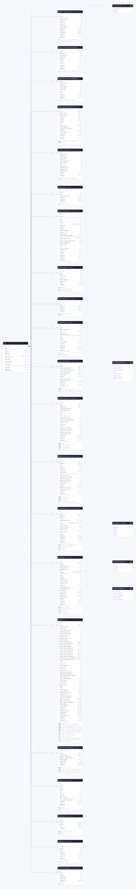

| Column          | Type                                     | Constraints     | Default                        | Description                                                                                                                                     |
| --------------- | ---------------------------------------- | --------------- | ------------------------------ | ----------------------------------------------------------------------------------------------------------------------------------------------- |
| `id`            | `text`                                   | PK NOT NULL     | `.$defaultFn()`                |                                                                                                                                                 |
| `name`          | `text`                                   | NOT NULL        |                                |                                                                                                                                                 |
| `slug`          | `text`                                   | UNIQUE NOT NULL |                                |                                                                                                                                                 |
| `logo_url`      | `text`                                   | NULL            |                                |                                                                                                                                                 |
| `timezone`      | `text`                                   | NOT NULL        | `.default('UTC')`              |                                                                                                                                                 |
| `trust_level`   | [`trustLevelEnum`](#enum-trustLevelEnum) | NOT NULL        | `.default('conservative')`     |                                                                                                                                                 |
| `agent_name`    | `text`                                   | NULL            | `.default('Deft')`             |                                                                                                                                                 |
| `agent_enabled` | `boolean`                                | NOT NULL        | `.default(true)`               |                                                                                                                                                 |
| `ai_config`     | `jsonb`                                  | NOT NULL        | `.default({})`                 | Per-org AI provider config (BYOK). Read via apps/api/src/lib/org-ai-config.ts. Schema documented in packages/db/drizzle/0061_org_ai_config.sql. |
| `created_at`    | `timestamp`                              | NOT NULL        | `.defaultNow()`                |                                                                                                                                                 |
| `updated_at`    | `timestamp`                              | NOT NULL        | `.defaultNow()` `.$onUpdate()` |                                                                                                                                                 |

#### Definition

```sql
CREATE TABLE "orgs" (
	"id" text PRIMARY KEY,
	"name" text NOT NULL,
	"slug" text NOT NULL UNIQUE,
	"logo_url" text,
	"timezone" text DEFAULT 'UTC' NOT NULL,
	"trust_level" "trust_level" DEFAULT 'conservative'::"trust_level" NOT NULL,
	"agent_name" text DEFAULT 'Deft',
	"agent_enabled" boolean DEFAULT true NOT NULL,
	"ai_config" jsonb DEFAULT '{}' NOT NULL,
	"created_at" timestamp DEFAULT now() NOT NULL,
	"updated_at" timestamp DEFAULT now() NOT NULL
);
```

#### Referenced by

- `id` → [nativeCreateRequests.org_id](#table-nativeCreateRequests) (one to many, on delete cascade)
- `id` → [taskComments.org_id](#table-taskComments) (one to many)
- `id` → [taskReactions.org_id](#table-taskReactions) (one to many, on delete cascade)
- `id` → [taskActivity.org_id](#table-taskActivity) (one to many)
- `id` → [capabilityProviderSnapshots.org_id](#table-capabilityProviderSnapshots) (one to many, on delete cascade)
- `id` → [appRuns.org_id](#table-appRuns) (one to many, on delete cascade)
- `id` → [workIntents.org_id](#table-workIntents) (one to many, on delete cascade)
- `id` → [messageObservations.org_id](#table-messageObservations) (one to many, on delete cascade)
- `id` → [moduleInstallations.org_id](#table-moduleInstallations) (one to many, on delete cascade)
- `id` → [appInstallations.org_id](#table-appInstallations) (one to many, on delete cascade)
- `id` → [resourceRelationSets.org_id](#table-resourceRelationSets) (one to many, on delete cascade)
- `id` → [agentWebhooks.org_id](#table-agentWebhooks) (one to many, on delete cascade)
- `id` → [duplicateFlags.org_id](#table-duplicateFlags) (one to many)
- `id` → [wikiCitations.org_id](#table-wikiCitations) (one to many, on delete cascade)
- `id` → [agentEmployeeTemplates.org_id](#table-agentEmployeeTemplates) (one to many, on delete cascade)
- `id` → [webSessions.org_id](#table-webSessions) (one to many, on delete cascade)
- `id` → [emailContextTransfers.org_id](#table-emailContextTransfers) (one to many, on delete cascade)
- `id` → [appIntegrationCapturePolicies.org_id](#table-appIntegrationCapturePolicies) (one to many)
- `id` → [appIntegrationDestinationReceipts.org_id](#table-appIntegrationDestinationReceipts) (one to many, on delete cascade)
- `id` → [appIntegrationNotificationPolicies.org_id](#table-appIntegrationNotificationPolicies) (one to many, on delete cascade)
- `id` → [appRestoreAccessReviews.org_id](#table-appRestoreAccessReviews) (one to many)

<details>
<summary>Queries and their SQL</summary>

**Select**: Every row of orgs.

```ts
db.select().from(orgs);
```

```sql
select "id", "name", "slug", "logo_url", "timezone", "trust_level", "agent_name", "agent_enabled", "ai_config", "created_at", "updated_at"
from "orgs"
```

**Count**: How many rows orgs has.

```ts
db.select({ count: count() }).from(orgs);
```

```sql
select count(*)
from "orgs"
```

**Find many**: The rows of orgs, through the relational query API.

```ts
db.query.orgs.findMany();
```

```sql
select "d0"."id" as "id", "d0"."name" as "name", "d0"."slug" as "slug", "d0"."logo_url" as "logo_url", "d0"."timezone" as "timezone", "d0"."trust_level" as "trust_level", "d0"."agent_name" as "agent_name", "d0"."agent_enabled" as "agent_enabled", "d0"."ai_config" as "ai_config", "d0"."created_at" as "created_at", "d0"."updated_at" as "updated_at"
from "orgs" as "d0"
```

**Find by primary key**: One row of orgs, through the relational query API.

```ts
db.query.orgs.findFirst({ where: { id: "id" } });
```

```sql
select "d0"."id" as "id", "d0"."name" as "name", "d0"."slug" as "slug", "d0"."logo_url" as "logo_url", "d0"."timezone" as "timezone", "d0"."trust_level" as "trust_level", "d0"."agent_name" as "agent_name", "d0"."agent_enabled" as "agent_enabled", "d0"."ai_config" as "ai_config", "d0"."created_at" as "created_at", "d0"."updated_at" as "updated_at"
from "orgs" as "d0"
where "d0"."id" = $1
limit $2
-- params: ["id",1]
```

**Insert**: Adds a row to orgs, giving the columns that have no default.

```ts
db.insert(orgs).values({ name: "name", slug: "slug" });
```

```sql
insert into "orgs" ("id", "name", "slug", "logo_url", "timezone", "trust_level", "agent_name", "agent_enabled", "ai_config", "created_at", "updated_at")
values ($1, $2, $3, default, default, default, default, default, default, default, default)
-- params: ["00000000-0000-4000-8000-000000000000","name","slug"]
```

**Update**: Changes a row of orgs, found by its primary key.

```ts
db.update(orgs).set({ name: "name" }).where(eq(orgs.id, "id"));
```

```sql
update "orgs"
set "name" = $1, "updated_at" = $2
where "orgs"."id" = $3
-- params: ["name","2026-01-01T00:00:00.000Z","id"]
```

**Delete**: Deletes a row of orgs, found by its primary key.

```ts
db.delete(orgs).where(eq(orgs.id, "id"));
```

```sql
delete from "orgs"
where "orgs"."id" = $1
-- params: ["id"]
```

</details>

<a id="table-users"></a>

### users

═══ USERS ═══


| Column                     | Type                                 | Constraints | Default                                      | Description                                                                                                                          |
| -------------------------- | ------------------------------------ | ----------- | -------------------------------------------- | ------------------------------------------------------------------------------------------------------------------------------------ |
| `id`                       | `text`                               | PK NOT NULL | `.$defaultFn()`                              |                                                                                                                                      |
| `email`                    | `text`                               | UNIQUE NULL |                                              |                                                                                                                                      |
| `name`                     | `text`                               | NOT NULL    |                                              |                                                                                                                                      |
| `kind`                     | [`userKindEnum`](#enum-userKindEnum) | NOT NULL    | `.default('human')`                          |                                                                                                                                      |
| `is_agent`                 | `boolean`                            | NOT NULL    | `.default(false)`                            |                                                                                                                                      |
| `agent_employee_id`        | `text`                               | NULL        |                                              |                                                                                                                                      |
| `avatar_url`               | `text`                               | NULL        |                                              |                                                                                                                                      |
| `title`                    | `text`                               | NULL        |                                              |                                                                                                                                      |
| `profile_summary`          | `text`                               | NULL        |                                              |                                                                                                                                      |
| `expertise_tags`           | `text[]`                             | NULL        |                                              |                                                                                                                                      |
| `timezone`                 | `text`                               | NULL        | `.default('UTC')`                            |                                                                                                                                      |
| `status_emoji`             | `text`                               | NULL        |                                              |                                                                                                                                      |
| `status_text`              | `text`                               | NULL        |                                              |                                                                                                                                      |
| `status_expires_at`        | `timestamp`                          | NULL        |                                              |                                                                                                                                      |
| `password_hash`            | `text`                               | NULL        |                                              |                                                                                                                                      |
| `password_version`         | `integer`                            | NOT NULL    | `.default(0)`                                |                                                                                                                                      |
| `email_verified`           | `boolean`                            | NOT NULL    | `.default(false)`                            |                                                                                                                                      |
| `last_seen_at`             | `timestamp`                          | NULL        |                                              |                                                                                                                                      |
| `notification_keywords`    | `text[]`                             | NULL        |                                              |                                                                                                                                      |
| `notification_preferences` | `jsonb`                              | NOT NULL    | `.default(DEFAULT_NOTIFICATION_PREFERENCES)` |                                                                                                                                      |
| `show_read_receipts`       | `boolean`                            | NOT NULL    | `.default(true)`                             |                                                                                                                                      |
| `ics_publish_token`        | `text`                               | NULL        |                                              | Per-user secret token for the outbound ICS feed. Lazily generated when the user first opens Settings → Calendar. See migration 0062. |
| `created_at`               | `timestamp`                          | NOT NULL    | `.defaultNow()`                              |                                                                                                                                      |
| `updated_at`               | `timestamp`                          | NOT NULL    | `.defaultNow()` `.$onUpdate()`               |                                                                                                                                      |

#### Definition

```sql
CREATE TABLE "users" (
	"id" text PRIMARY KEY,
	"email" text UNIQUE,
	"name" text NOT NULL,
	"kind" "user_kind" DEFAULT 'human'::"user_kind" NOT NULL,
	"is_agent" boolean DEFAULT false NOT NULL,
	"agent_employee_id" text,
	"avatar_url" text,
	"title" text,
	"profile_summary" text,
	"expertise_tags" text[],
	"timezone" text DEFAULT 'UTC',
	"status_emoji" text,
	"status_text" text,
	"status_expires_at" timestamp,
	"password_hash" text,
	"password_version" integer DEFAULT 0 NOT NULL,
	"email_verified" boolean DEFAULT false NOT NULL,
	"last_seen_at" timestamp,
	"notification_keywords" text[],
	"notification_preferences" jsonb DEFAULT '{"keywords":[],"channels":{"chat":true,"tasks":true,"approvals":true,"calendar":true,"agents":true},"push":{"enabled":false,"email":false,"chat":true,"tasks":true,"approvals":true,"calendar":true,"agents":true,"quiet_hours":{"enabled":false,"start":"22:00","end":"08:00"}}}' NOT NULL,
	"show_read_receipts" boolean DEFAULT true NOT NULL,
	"ics_publish_token" text,
	"created_at" timestamp DEFAULT now() NOT NULL,
	"updated_at" timestamp DEFAULT now() NOT NULL
);
```

#### Referenced by

- `id` → [nativeMentionDeliveries.recipient_user_id](#table-nativeMentionDeliveries) (one to many, on delete cascade)
- `id` → [nativeMentionDeliveries.actor_user_id](#table-nativeMentionDeliveries) (one to many, on delete cascade)
- `id` → [nativeCreateRequests.user_id](#table-nativeCreateRequests) (one to many, on delete cascade)
- `id` → [orgMembers.user_id](#table-orgMembers) (one to many, on delete cascade)
- `id` → [invites.invited_by](#table-invites) (one to many)
- `id` → [invites.accepted_by](#table-invites) (one to many)
- `id` → [spaces.created_by](#table-spaces) (one to many)
- `id` → [spaceMembers.user_id](#table-spaceMembers) (one to many)
- `id` → [messages.user_id](#table-messages) (one to many)
- `id` → [appPrivateDeftySeals.owner_user_id](#table-appPrivateDeftySeals) (one to many, on delete restrict)
- `id` → [appPrivateDeftySeals.defty_user_id](#table-appPrivateDeftySeals) (one to many, on delete restrict)
- `id` → [reactions.user_id](#table-reactions) (one to many)
- `id` → [files.uploaded_by](#table-files) (one to many)
- `id` → [projects.lead_id](#table-projects) (one to many)
- `id` → [tasks.assignee_id](#table-tasks) (one to many)
- `id` → [tasks.created_by](#table-tasks) (one to many)
- `id` → [taskComments.user_id](#table-taskComments) (one to many)
- `id` → [taskReactions.user_id](#table-taskReactions) (one to many, on delete cascade)
- `id` → [taskActivity.user_id](#table-taskActivity) (one to many)
- `id` → [taskWatchers.user_id](#table-taskWatchers) (one to many)
- `id` → [taskAssignees.user_id](#table-taskAssignees) (one to many)
- `id` → [notifications.user_id](#table-notifications) (one to many)
- `id` → [savedViews.user_id](#table-savedViews) (one to many)
- `id` → [favorites.user_id](#table-favorites) (one to many)
- `id` → [agentActions.user_id](#table-agentActions) (one to many)
- `id` → [agentActions.approved_by_user_id](#table-agentActions) (one to many, on delete set null)
- `id` → [attentionItems.user_id](#table-attentionItems) (one to many, on delete cascade)
- `id` → [attentionEvents.user_id](#table-attentionEvents) (one to many, on delete cascade)
- `id` → [attentionEvents.actor_user_id](#table-attentionEvents) (one to many, on delete set null)
- `id` → [attentionDeliveries.user_id](#table-attentionDeliveries) (one to many, on delete cascade)
- `id` → [webPushSubscriptions.user_id](#table-webPushSubscriptions) (one to many, on delete cascade)
- `id` → [agentActionApprovers.user_id](#table-agentActionApprovers) (one to many, on delete cascade)
- `id` → [workIntents.source_user_id](#table-workIntents) (one to many, on delete set null)
- `id` → [workIntents.converted_by](#table-workIntents) (one to many, on delete set null)
- `id` → [workIntents.dismissed_by](#table-workIntents) (one to many, on delete set null)
- `id` → [messageObservations.user_id](#table-messageObservations) (one to many, on delete set null)
- `id` → [skills.created_by](#table-skills) (one to many)
- `id` → [taskTemplates.created_by](#table-taskTemplates) (one to many)
- `id` → [moduleInstallations.installed_by_user_id](#table-moduleInstallations) (one to many, on delete set null)
- `id` → [appInstallations.installed_by_user_id](#table-appInstallations) (one to many, on delete set null)
- `id` → [moduleSavedViews.owner_user_id](#table-moduleSavedViews) (one to many, on delete cascade)
- `id` → [agentWebhooks.created_by](#table-agentWebhooks) (one to many)
- `id` → [triggers.created_by](#table-triggers) (one to many)
- `id` → [connectedAccounts.user_id](#table-connectedAccounts) (one to many)
- `id` → [events.user_id](#table-events) (one to many)
- `id` → [icsSubscriptions.user_id](#table-icsSubscriptions) (one to many, on delete cascade)
- `id` → [reminders.user_id](#table-reminders) (one to many)
- `id` → [pinnedMessages.pinned_by](#table-pinnedMessages) (one to many)
- `id` → [scheduledMessages.user_id](#table-scheduledMessages) (one to many)
- `id` → [canvases.last_edited_by](#table-canvases) (one to many)
- `id` → [messageBookmarks.user_id](#table-messageBookmarks) (one to many)
- `id` → [userGroups.created_by](#table-userGroups) (one to many)
- `id` → [userGroupMembers.user_id](#table-userGroupMembers) (one to many)
- `id` → [teams.lead_user_id](#table-teams) (one to many, on delete set null)
- `id` → [teams.created_by](#table-teams) (one to many, on delete set null)
- `id` → [teamMembers.user_id](#table-teamMembers) (one to many, on delete cascade)
- `id` → [teamResources.created_by](#table-teamResources) (one to many, on delete set null)
- `id` → [customEmoji.uploaded_by](#table-customEmoji) (one to many)
- `id` → [workflowRules.created_by](#table-workflowRules) (one to many)
- `id` → [workflowRuns.triggered_by_user_id](#table-workflowRuns) (one to many)
- `id` → [automationRuns.user_id](#table-automationRuns) (one to many, on delete set null)
- `id` → [onboardingState.user_id](#table-onboardingState) (one to one, on delete cascade)
- `id` → [agentMemory.user_id](#table-agentMemory) (one to many)
- `id` → [crossReferences.created_by](#table-crossReferences) (one to many)
- `id` → [agentNudges.user_id](#table-agentNudges) (one to many)
- `id` → [meetingBriefs.user_id](#table-meetingBriefs) (one to many)
- `id` → [peopleInteractions.user_a_id](#table-peopleInteractions) (one to many)
- `id` → [peopleInteractions.user_b_id](#table-peopleInteractions) (one to many)
- `id` → [peopleExpertise.user_id](#table-peopleExpertise) (one to many)
- `id` → [peopleInfluence.user_id](#table-peopleInfluence) (one to many)
- `id` → [peoplePatterns.user_id](#table-peoplePatterns) (one to many)
- `id` → [peopleRelationships.user_a_id](#table-peopleRelationships) (one to many)
- `id` → [peopleRelationships.user_b_id](#table-peopleRelationships) (one to many)
- `id` → [oneonePreps.manager_id](#table-oneonePreps) (one to many)
- `id` → [oneonePreps.report_id](#table-oneonePreps) (one to many)
- `id` → [burnoutAlerts.user_id](#table-burnoutAlerts) (one to many)
- `id` → [burnoutAlerts.alerted_to](#table-burnoutAlerts) (one to many)
- `id` → [noteFolders.user_id](#table-noteFolders) (one to many)
- `id` → [notes.user_id](#table-notes) (one to many)
- `id` → [noteShares.shared_with_user_id](#table-noteShares) (one to many)
- `id` → [clips.created_by](#table-clips) (one to many)
- `id` → [managerSettings.user_id](#table-managerSettings) (one to many)
- `id` → [threadReads.user_id](#table-threadReads) (one to many)
- `id` → [wikiPages.origin_user_id](#table-wikiPages) (one to many, on delete set null)
- `id` → [wikiPages.user_id](#table-wikiPages) (one to many)
- `id` → [wikiCitations.source_user_id](#table-wikiCitations) (one to many, on delete set null)
- `id` → [mcpConnections.created_by](#table-mcpConnections) (one to many)
- `id` → [agentEmployees.user_id](#table-agentEmployees) (one to many)
- `id` → [agentEmployees.created_by](#table-agentEmployees) (one to many)
- `id` → [mcpTokens.user_id](#table-mcpTokens) (one to many, on delete cascade)
- `id` → [mcpTokens.created_by](#table-mcpTokens) (one to many)
- `id` → [agentChannelTokens.created_by](#table-agentChannelTokens) (one to many, on delete set null)
- `id` → [agentChannelEvents.actor_user_id](#table-agentChannelEvents) (one to many, on delete set null)
- `id` → [oauthAuthorizationCodes.user_id](#table-oauthAuthorizationCodes) (one to many, on delete cascade)
- `id` → [oauthGrants.user_id](#table-oauthGrants) (one to many, on delete cascade)
- `id` → [oauthAccessTokens.user_id](#table-oauthAccessTokens) (one to many, on delete cascade)
- `id` → [oauthAuditEvents.user_id](#table-oauthAuditEvents) (one to many, on delete set null)
- `id` → [agentPlans.user_id](#table-agentPlans) (one to many)
- `id` → [apiKeys.created_by](#table-apiKeys) (one to many)
- `id` → [agentEmployeeTemplates.created_by](#table-agentEmployeeTemplates) (one to many)
- `id` → [actionReceipts.approver_id](#table-actionReceipts) (one to many)
- `id` → [integrations.connected_by](#table-integrations) (one to many)
- `id` → [webSessions.user_id](#table-webSessions) (one to many, on delete cascade)
- `id` → [appActionBatches.owner_user_id](#table-appActionBatches) (one to many)
- `id` → [appPrivateFiles.owner_user_id](#table-appPrivateFiles) (one to many, on delete restrict)
- `id` → [appActionPayloads.owner_user_id](#table-appActionPayloads) (one to many, on delete restrict)
- `id` → [appPrivateStateRecords.owner_user_id](#table-appPrivateStateRecords) (one to many, on delete restrict)
- `id` → [emailContextTransfers.owner_user_id](#table-emailContextTransfers) (one to many, on delete cascade)
- `id` → [appIntegrationCapturePolicies.owner_user_id](#table-appIntegrationCapturePolicies) (one to many)
- `id` → [appIntegrationDestinationReceipts.owner_user_id](#table-appIntegrationDestinationReceipts) (one to many, on delete cascade)
- `id` → [appIntegrationNotificationPolicies.owner_user_id](#table-appIntegrationNotificationPolicies) (one to many, on delete cascade)
- `id` → [appRestoreAccessReviews.owner_user_id](#table-appRestoreAccessReviews) (one to many)

<details>
<summary>Queries and their SQL</summary>

**Select**: Every row of users.

```ts
db.select().from(users);
```

```sql
select "id", "email", "name", "kind", "is_agent", "agent_employee_id", "avatar_url", "title", "profile_summary", "expertise_tags", "timezone", "status_emoji", "status_text", "status_expires_at", "password_hash", "password_version", "email_verified", "last_seen_at", "notification_keywords", "notification_preferences", "show_read_receipts", "ics_publish_token", "created_at", "updated_at"
from "users"
```

**Count**: How many rows users has.

```ts
db.select({ count: count() }).from(users);
```

```sql
select count(*)
from "users"
```

**Find many**: The rows of users, through the relational query API.

```ts
db.query.users.findMany();
```

```sql
select "d0"."id" as "id", "d0"."email" as "email", "d0"."name" as "name", "d0"."kind" as "kind", "d0"."is_agent" as "is_agent", "d0"."agent_employee_id" as "agent_employee_id", "d0"."avatar_url" as "avatar_url", "d0"."title" as "title", "d0"."profile_summary" as "profile_summary", "d0"."expertise_tags" as "expertise_tags", "d0"."timezone" as "timezone", "d0"."status_emoji" as "status_emoji", "d0"."status_text" as "status_text", "d0"."status_expires_at" as "status_expires_at", "d0"."password_hash" as "password_hash", "d0"."password_version" as "password_version", "d0"."email_verified" as "email_verified", "d0"."last_seen_at" as "last_seen_at", "d0"."notification_keywords" as "notification_keywords", "d0"."notification_preferences" as "notification_preferences", "d0"."show_read_receipts" as "show_read_receipts", "d0"."ics_publish_token" as "ics_publish_token", "d0"."created_at" as "created_at", "d0"."updated_at" as "updated_at"
from "users" as "d0"
```

**Find by primary key**: One row of users, through the relational query API.

```ts
db.query.users.findFirst({ where: { id: "id" } });
```

```sql
select "d0"."id" as "id", "d0"."email" as "email", "d0"."name" as "name", "d0"."kind" as "kind", "d0"."is_agent" as "is_agent", "d0"."agent_employee_id" as "agent_employee_id", "d0"."avatar_url" as "avatar_url", "d0"."title" as "title", "d0"."profile_summary" as "profile_summary", "d0"."expertise_tags" as "expertise_tags", "d0"."timezone" as "timezone", "d0"."status_emoji" as "status_emoji", "d0"."status_text" as "status_text", "d0"."status_expires_at" as "status_expires_at", "d0"."password_hash" as "password_hash", "d0"."password_version" as "password_version", "d0"."email_verified" as "email_verified", "d0"."last_seen_at" as "last_seen_at", "d0"."notification_keywords" as "notification_keywords", "d0"."notification_preferences" as "notification_preferences", "d0"."show_read_receipts" as "show_read_receipts", "d0"."ics_publish_token" as "ics_publish_token", "d0"."created_at" as "created_at", "d0"."updated_at" as "updated_at"
from "users" as "d0"
where "d0"."id" = $1
limit $2
-- params: ["id",1]
```

**Insert**: Adds a row to users, giving the columns that have no default.

```ts
db.insert(users).values({ name: "name" });
```

```sql
insert into "users" ("id", "email", "name", "kind", "is_agent", "agent_employee_id", "avatar_url", "title", "profile_summary", "expertise_tags", "timezone", "status_emoji", "status_text", "status_expires_at", "password_hash", "password_version", "email_verified", "last_seen_at", "notification_keywords", "notification_preferences", "show_read_receipts", "ics_publish_token", "created_at", "updated_at")
values ($1, default, $2, default, default, default, default, default, default, default, default, default, default, default, default, default, default, default, default, default, default, default, default, default)
-- params: ["00000000-0000-4000-8000-000000000000","name"]
```

**Update**: Changes a row of users, found by its primary key.

```ts
db.update(users).set({ email: "email" }).where(eq(users.id, "id"));
```

```sql
update "users"
set "email" = $1, "updated_at" = $2
where "users"."id" = $3
-- params: ["email","2026-01-01T00:00:00.000Z","id"]
```

**Delete**: Deletes a row of users, found by its primary key.

```ts
db.delete(users).where(eq(users.id, "id"));
```

```sql
delete from "users"
where "users"."id" = $1
-- params: ["id"]
```

</details>

<a id="table-nativeReferenceStates"></a>

### nativeReferenceStates

Table `native_reference_states`. Durable native-create identities; retain tombstones when a resource is deleted.

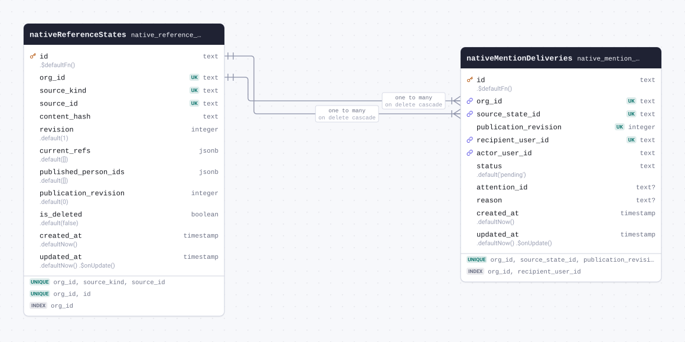

| Column                 | Type        | Constraints | Default                        | Description |
| ---------------------- | ----------- | ----------- | ------------------------------ | ----------- |
| `id`                   | `text`      | PK NOT NULL | `.$defaultFn()`                |             |
| `org_id`               | `text`      | NOT NULL    |                                |             |
| `source_kind`          | `text`      | NOT NULL    |                                |             |
| `source_id`            | `text`      | NOT NULL    |                                |             |
| `content_hash`         | `text`      | NOT NULL    |                                |             |
| `revision`             | `integer`   | NOT NULL    | `.default(1)`                  |             |
| `current_refs`         | `jsonb`     | NOT NULL    | `.default([])`                 |             |
| `published_person_ids` | `jsonb`     | NOT NULL    | `.default([])`                 |             |
| `publication_revision` | `integer`   | NOT NULL    | `.default(0)`                  |             |
| `is_deleted`           | `boolean`   | NOT NULL    | `.default(false)`              |             |
| `created_at`           | `timestamp` | NOT NULL    | `.defaultNow()`                |             |
| `updated_at`           | `timestamp` | NOT NULL    | `.defaultNow()` `.$onUpdate()` |             |

#### Definition

```sql
CREATE TABLE "native_reference_states" (
	"id" text PRIMARY KEY,
	"org_id" text NOT NULL,
	"source_kind" text NOT NULL,
	"source_id" text NOT NULL,
	"content_hash" text NOT NULL,
	"revision" integer DEFAULT 1 NOT NULL,
	"current_refs" jsonb DEFAULT '[]' NOT NULL,
	"published_person_ids" jsonb DEFAULT '[]' NOT NULL,
	"publication_revision" integer DEFAULT 0 NOT NULL,
	"is_deleted" boolean DEFAULT false NOT NULL,
	"created_at" timestamp DEFAULT now() NOT NULL,
	"updated_at" timestamp DEFAULT now() NOT NULL,
	CONSTRAINT "native_reference_org_id_unique" UNIQUE("org_id","id")
);

CREATE UNIQUE INDEX "native_reference_source_unique" ON "native_reference_states" ("org_id","source_kind","source_id");

CREATE INDEX "native_reference_org_idx" ON "native_reference_states" ("org_id");
```

#### Indexes

- UNIQUE `org_id`, `source_kind`, `source_id`
- UNIQUE `org_id`, `id`
- INDEX `org_id`

#### Referenced by

- `id` → [nativeMentionDeliveries.source_state_id](#table-nativeMentionDeliveries) (one to many, on delete cascade)
- `org_id` → [nativeMentionDeliveries.org_id](#table-nativeMentionDeliveries) (one to many, on delete cascade)

<details>
<summary>Queries and their SQL</summary>

**Select**: Every row of nativeReferenceStates.

```ts
db.select().from(nativeReferenceStates);
```

```sql
select "id", "org_id", "source_kind", "source_id", "content_hash", "revision", "current_refs", "published_person_ids", "publication_revision", "is_deleted", "created_at", "updated_at"
from "native_reference_states"
```

**Count**: How many rows nativeReferenceStates has.

```ts
db.select({ count: count() }).from(nativeReferenceStates);
```

```sql
select count(*)
from "native_reference_states"
```

**Find many**: The rows of nativeReferenceStates, through the relational query API.

```ts
db.query.nativeReferenceStates.findMany();
```

```sql
select "d0"."id" as "id", "d0"."org_id" as "org_id", "d0"."source_kind" as "source_kind", "d0"."source_id" as "source_id", "d0"."content_hash" as "content_hash", "d0"."revision" as "revision", "d0"."current_refs" as "current_refs", "d0"."published_person_ids" as "published_person_ids", "d0"."publication_revision" as "publication_revision", "d0"."is_deleted" as "is_deleted", "d0"."created_at" as "created_at", "d0"."updated_at" as "updated_at"
from "native_reference_states" as "d0"
```

**Find by primary key**: One row of nativeReferenceStates, through the relational query API.

```ts
db.query.nativeReferenceStates.findFirst({ where: { id: "id" } });
```

```sql
select "d0"."id" as "id", "d0"."org_id" as "org_id", "d0"."source_kind" as "source_kind", "d0"."source_id" as "source_id", "d0"."content_hash" as "content_hash", "d0"."revision" as "revision", "d0"."current_refs" as "current_refs", "d0"."published_person_ids" as "published_person_ids", "d0"."publication_revision" as "publication_revision", "d0"."is_deleted" as "is_deleted", "d0"."created_at" as "created_at", "d0"."updated_at" as "updated_at"
from "native_reference_states" as "d0"
where "d0"."id" = $1
limit $2
-- params: ["id",1]
```

**Insert**: Adds a row to nativeReferenceStates, giving the columns that have no default.

```ts
db.insert(nativeReferenceStates).values({
  org_id: "org_id",
  source_kind: "source_kind",
  source_id: "source_id",
  content_hash: "content_hash",
});
```

```sql
insert into "native_reference_states" ("id", "org_id", "source_kind", "source_id", "content_hash", "revision", "current_refs", "published_person_ids", "publication_revision", "is_deleted", "created_at", "updated_at")
values ($1, $2, $3, $4, $5, default, default, default, default, default, default, default)
-- params: ["00000000-0000-4000-8000-000000000000","org_id","source_kind","source_id","content_hash"]
```

**Update**: Changes a row of nativeReferenceStates, found by its primary key.

```ts
db.update(nativeReferenceStates)
  .set({ org_id: "org_id" })
  .where(eq(nativeReferenceStates.id, "id"));
```

```sql
update "native_reference_states"
set "org_id" = $1, "updated_at" = $2
where "native_reference_states"."id" = $3
-- params: ["org_id","2026-01-01T00:00:00.000Z","id"]
```

**Delete**: Deletes a row of nativeReferenceStates, found by its primary key.

```ts
db.delete(nativeReferenceStates).where(eq(nativeReferenceStates.id, "id"));
```

```sql
delete from "native_reference_states"
where "native_reference_states"."id" = $1
-- params: ["id"]
```

</details>

<a id="table-nativeMentionDeliveries"></a>

### nativeMentionDeliveries

Table `native_mention_deliveries`.

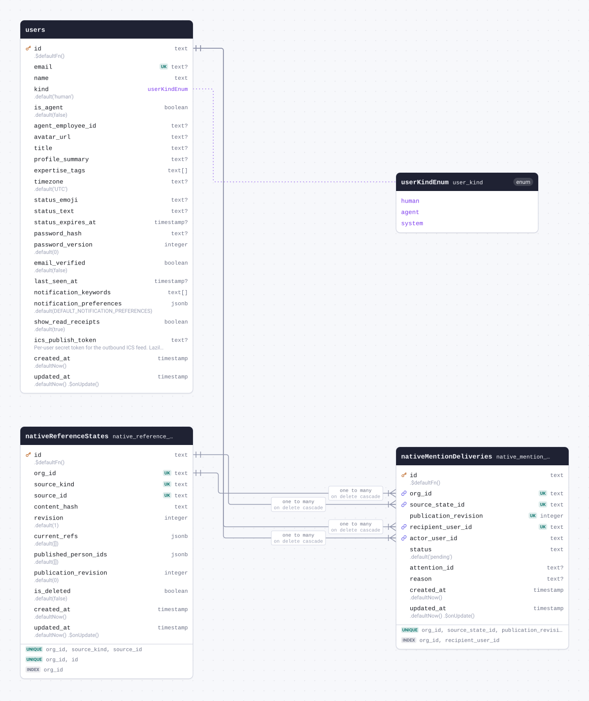

| Column                 | Type        | Constraints                                                             | Default                        | Description |
| ---------------------- | ----------- | ----------------------------------------------------------------------- | ------------------------------ | ----------- |
| `id`                   | `text`      | PK NOT NULL                                                             | `.$defaultFn()`                |             |
| `org_id`               | `text`      | NOT NULL → [nativeReferenceStates.org_id](#table-nativeReferenceStates) |                                |             |
| `source_state_id`      | `text`      | NOT NULL → [nativeReferenceStates.id](#table-nativeReferenceStates)     |                                |             |
| `publication_revision` | `integer`   | NOT NULL                                                                |                                |             |
| `recipient_user_id`    | `text`      | NOT NULL → [users.id](#table-users)                                     |                                |             |
| `actor_user_id`        | `text`      | NOT NULL → [users.id](#table-users)                                     |                                |             |
| `status`               | `text`      | NOT NULL                                                                | `.default('pending')`          |             |
| `attention_id`         | `text`      | NULL                                                                    |                                |             |
| `reason`               | `text`      | NULL                                                                    |                                |             |
| `created_at`           | `timestamp` | NOT NULL                                                                | `.defaultNow()`                |             |
| `updated_at`           | `timestamp` | NOT NULL                                                                | `.defaultNow()` `.$onUpdate()` |             |

#### Definition

```sql
CREATE TABLE "native_mention_deliveries" (
	"id" text PRIMARY KEY,
	"org_id" text NOT NULL,
	"source_state_id" text NOT NULL,
	"publication_revision" integer NOT NULL,
	"recipient_user_id" text NOT NULL,
	"actor_user_id" text NOT NULL,
	"status" text DEFAULT 'pending' NOT NULL,
	"attention_id" text,
	"reason" text,
	"created_at" timestamp DEFAULT now() NOT NULL,
	"updated_at" timestamp DEFAULT now() NOT NULL
);

CREATE UNIQUE INDEX "native_mention_delivery_unique" ON "native_mention_deliveries" ("org_id","source_state_id","publication_revision","recipient_user_id");

CREATE INDEX "native_mention_recipient_idx" ON "native_mention_deliveries" ("org_id","recipient_user_id");

ALTER TABLE "native_mention_deliveries" ADD CONSTRAINT "native_mention_deliveries_Q18lRKY0V87O_fkey" FOREIGN KEY ("source_state_id") REFERENCES "native_reference_states"("id") ON DELETE CASCADE;

ALTER TABLE "native_mention_deliveries" ADD CONSTRAINT "native_mention_deliveries_recipient_user_id_users_id_fkey" FOREIGN KEY ("recipient_user_id") REFERENCES "users"("id") ON DELETE CASCADE;

ALTER TABLE "native_mention_deliveries" ADD CONSTRAINT "native_mention_deliveries_actor_user_id_users_id_fkey" FOREIGN KEY ("actor_user_id") REFERENCES "users"("id") ON DELETE CASCADE;

ALTER TABLE "native_mention_deliveries" ADD CONSTRAINT "native_mention_source_org_fk" FOREIGN KEY ("org_id","source_state_id") REFERENCES "native_reference_states"("org_id","id") ON DELETE CASCADE;
```

#### Indexes

- UNIQUE `org_id`, `source_state_id`, `publication_revision`, `recipient_user_id`
- INDEX `org_id`, `recipient_user_id`

#### References

- `source_state_id` → [nativeReferenceStates.id](#table-nativeReferenceStates) (many to one, on delete cascade)
- `recipient_user_id` → [users.id](#table-users) (many to one, on delete cascade)
- `actor_user_id` → [users.id](#table-users) (many to one, on delete cascade)
- `org_id` → [nativeReferenceStates.org_id](#table-nativeReferenceStates) (many to one, on delete cascade)

<details>
<summary>Queries and their SQL</summary>

**Select**: Every row of nativeMentionDeliveries.

```ts
db.select().from(nativeMentionDeliveries);
```

```sql
select "id", "org_id", "source_state_id", "publication_revision", "recipient_user_id", "actor_user_id", "status", "attention_id", "reason", "created_at", "updated_at"
from "native_mention_deliveries"
```

**Count**: How many rows nativeMentionDeliveries has.

```ts
db.select({ count: count() }).from(nativeMentionDeliveries);
```

```sql
select count(*)
from "native_mention_deliveries"
```

**Find many**: The rows of nativeMentionDeliveries, through the relational query API.

```ts
db.query.nativeMentionDeliveries.findMany();
```

```sql
select "d0"."id" as "id", "d0"."org_id" as "org_id", "d0"."source_state_id" as "source_state_id", "d0"."publication_revision" as "publication_revision", "d0"."recipient_user_id" as "recipient_user_id", "d0"."actor_user_id" as "actor_user_id", "d0"."status" as "status", "d0"."attention_id" as "attention_id", "d0"."reason" as "reason", "d0"."created_at" as "created_at", "d0"."updated_at" as "updated_at"
from "native_mention_deliveries" as "d0"
```

**Find by primary key**: One row of nativeMentionDeliveries, through the relational query API.

```ts
db.query.nativeMentionDeliveries.findFirst({ where: { id: "id" } });
```

```sql
select "d0"."id" as "id", "d0"."org_id" as "org_id", "d0"."source_state_id" as "source_state_id", "d0"."publication_revision" as "publication_revision", "d0"."recipient_user_id" as "recipient_user_id", "d0"."actor_user_id" as "actor_user_id", "d0"."status" as "status", "d0"."attention_id" as "attention_id", "d0"."reason" as "reason", "d0"."created_at" as "created_at", "d0"."updated_at" as "updated_at"
from "native_mention_deliveries" as "d0"
where "d0"."id" = $1
limit $2
-- params: ["id",1]
```

**Insert**: Adds a row to nativeMentionDeliveries, giving the columns that have no default.

```ts
db.insert(nativeMentionDeliveries).values({
  org_id: "org_id",
  source_state_id: "source_state_id",
  publication_revision: 1,
  recipient_user_id: "recipient_user_id",
  actor_user_id: "actor_user_id",
});
```

```sql
insert into "native_mention_deliveries" ("id", "org_id", "source_state_id", "publication_revision", "recipient_user_id", "actor_user_id", "status", "attention_id", "reason", "created_at", "updated_at")
values ($1, $2, $3, $4, $5, $6, default, default, default, default, default)
-- params: ["00000000-0000-4000-8000-000000000000","org_id","source_state_id",1,"recipient_user_id","actor_user_id"]
```

**Update**: Changes a row of nativeMentionDeliveries, found by its primary key.

```ts
db.update(nativeMentionDeliveries)
  .set({ org_id: "org_id" })
  .where(eq(nativeMentionDeliveries.id, "id"));
```

```sql
update "native_mention_deliveries"
set "org_id" = $1, "updated_at" = $2
where "native_mention_deliveries"."id" = $3
-- params: ["org_id","2026-01-01T00:00:00.000Z","id"]
```

**Delete**: Deletes a row of nativeMentionDeliveries, found by its primary key.

```ts
db.delete(nativeMentionDeliveries).where(eq(nativeMentionDeliveries.id, "id"));
```

```sql
delete from "native_mention_deliveries"
where "native_mention_deliveries"."id" = $1
-- params: ["id"]
```

</details>

<a id="table-nativeCreateRequests"></a>

### nativeCreateRequests

Table `native_create_requests`.

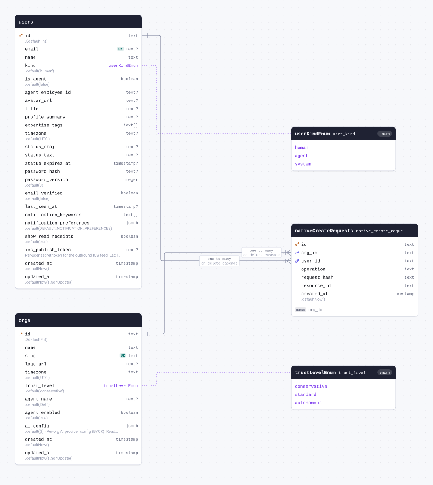

| Column         | Type        | Constraints                         | Default         | Description |
| -------------- | ----------- | ----------------------------------- | --------------- | ----------- |
| `id`           | `text`      | PK NOT NULL                         |                 |             |
| `org_id`       | `text`      | NOT NULL → [orgs.id](#table-orgs)   |                 |             |
| `user_id`      | `text`      | NOT NULL → [users.id](#table-users) |                 |             |
| `operation`    | `text`      | NOT NULL                            |                 |             |
| `request_hash` | `text`      | NOT NULL                            |                 |             |
| `resource_id`  | `text`      | NOT NULL                            |                 |             |
| `created_at`   | `timestamp` | NOT NULL                            | `.defaultNow()` |             |

#### Definition

```sql
CREATE TABLE "native_create_requests" (
	"id" text PRIMARY KEY,
	"org_id" text NOT NULL,
	"user_id" text NOT NULL,
	"operation" text NOT NULL,
	"request_hash" text NOT NULL,
	"resource_id" text NOT NULL,
	"created_at" timestamp DEFAULT now() NOT NULL
);

CREATE INDEX "native_create_requests_org_idx" ON "native_create_requests" ("org_id");

ALTER TABLE "native_create_requests" ADD CONSTRAINT "native_create_requests_org_id_orgs_id_fkey" FOREIGN KEY ("org_id") REFERENCES "orgs"("id") ON DELETE CASCADE;

ALTER TABLE "native_create_requests" ADD CONSTRAINT "native_create_requests_user_id_users_id_fkey" FOREIGN KEY ("user_id") REFERENCES "users"("id") ON DELETE CASCADE;
```

#### Indexes

- INDEX `org_id`

#### References

- `org_id` → [orgs.id](#table-orgs) (many to one, on delete cascade)
- `user_id` → [users.id](#table-users) (many to one, on delete cascade)

<details>
<summary>Queries and their SQL</summary>

**Select**: Every row of nativeCreateRequests.

```ts
db.select().from(nativeCreateRequests);
```

```sql
select "id", "org_id", "user_id", "operation", "request_hash", "resource_id", "created_at"
from "native_create_requests"
```

**Count**: How many rows nativeCreateRequests has.

```ts
db.select({ count: count() }).from(nativeCreateRequests);
```

```sql
select count(*)
from "native_create_requests"
```

**Find many**: The rows of nativeCreateRequests, through the relational query API.

```ts
db.query.nativeCreateRequests.findMany();
```

```sql
select "d0"."id" as "id", "d0"."org_id" as "org_id", "d0"."user_id" as "user_id", "d0"."operation" as "operation", "d0"."request_hash" as "request_hash", "d0"."resource_id" as "resource_id", "d0"."created_at" as "created_at"
from "native_create_requests" as "d0"
```

**Find by primary key**: One row of nativeCreateRequests, through the relational query API.

```ts
db.query.nativeCreateRequests.findFirst({ where: { id: "id" } });
```

```sql
select "d0"."id" as "id", "d0"."org_id" as "org_id", "d0"."user_id" as "user_id", "d0"."operation" as "operation", "d0"."request_hash" as "request_hash", "d0"."resource_id" as "resource_id", "d0"."created_at" as "created_at"
from "native_create_requests" as "d0"
where "d0"."id" = $1
limit $2
-- params: ["id",1]
```

**Insert**: Adds a row to nativeCreateRequests, giving the columns that have no default.

```ts
db.insert(nativeCreateRequests).values({
  id: "id",
  org_id: "org_id",
  user_id: "user_id",
  operation: "operation",
  request_hash: "request_hash",
  resource_id: "resource_id",
});
```

```sql
insert into "native_create_requests" ("id", "org_id", "user_id", "operation", "request_hash", "resource_id", "created_at")
values ($1, $2, $3, $4, $5, $6, default)
-- params: ["id","org_id","user_id","operation","request_hash","resource_id"]
```

**Update**: Changes a row of nativeCreateRequests, found by its primary key.

```ts
db.update(nativeCreateRequests).set({ org_id: "org_id" }).where(eq(nativeCreateRequests.id, "id"));
```

```sql
update "native_create_requests"
set "org_id" = $1
where "native_create_requests"."id" = $2
-- params: ["org_id","id"]
```

**Delete**: Deletes a row of nativeCreateRequests, found by its primary key.

```ts
db.delete(nativeCreateRequests).where(eq(nativeCreateRequests.id, "id"));
```

```sql
delete from "native_create_requests"
where "native_create_requests"."id" = $1
-- params: ["id"]
```

</details>

<a id="table-orgMembers"></a>

### orgMembers

Table `org_members`. ═══ ORG MEMBERS ═══

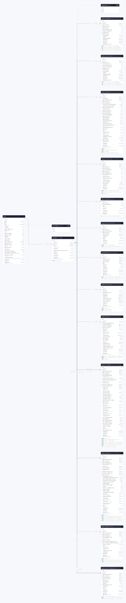

| Column                          | Type                               | Constraints                         | Default                        | Description |
| ------------------------------- | ---------------------------------- | ----------------------------------- | ------------------------------ | ----------- |
| `id`                            | `text`                             | PK NOT NULL                         | `.$defaultFn()`                |             |
| `org_id`                        | `text`                             | NOT NULL                            |                                |             |
| `user_id`                       | `text`                             | NOT NULL → [users.id](#table-users) |                                |             |
| `role`                          | [`orgRoleEnum`](#enum-orgRoleEnum) | NOT NULL                            | `.default('member')`           |             |
| `is_active`                     | `boolean`                          | NOT NULL                            | `.default(true)`               |             |
| `app_run_authorization_version` | `integer`                          | NOT NULL                            | `.default(1)`                  |             |
| `joined_at`                     | `timestamp`                        | NOT NULL                            | `.defaultNow()`                |             |
| `created_at`                    | `timestamp`                        | NOT NULL                            | `.defaultNow()`                |             |
| `updated_at`                    | `timestamp`                        | NOT NULL                            | `.defaultNow()` `.$onUpdate()` |             |

#### Definition

```sql
CREATE TABLE "org_members" (
	"id" text PRIMARY KEY,
	"org_id" text NOT NULL,
	"user_id" text NOT NULL,
	"role" "org_role" DEFAULT 'member'::"org_role" NOT NULL,
	"is_active" boolean DEFAULT true NOT NULL,
	"app_run_authorization_version" integer DEFAULT 1 NOT NULL,
	"joined_at" timestamp DEFAULT now() NOT NULL,
	"created_at" timestamp DEFAULT now() NOT NULL,
	"updated_at" timestamp DEFAULT now() NOT NULL,
	CONSTRAINT "org_member_unique" UNIQUE("org_id","user_id")
);

ALTER TABLE "org_members" ADD CONSTRAINT "org_members_user_id_users_id_fkey" FOREIGN KEY ("user_id") REFERENCES "users"("id") ON DELETE CASCADE;
```

#### Indexes

- UNIQUE `org_id`, `user_id`

#### References

- `user_id` → [users.id](#table-users) (many to one, on delete cascade)

#### Referenced by

- `org_id` → [appOwnerConnectionAdmissions.org_id](#table-appOwnerConnectionAdmissions) (one to many, on delete restrict)
- `org_id` → [appOwnerConnectionAdmissions.org_id](#table-appOwnerConnectionAdmissions) (one to many, on delete restrict)
- `org_id` → [appRuntimeRegistrations.org_id](#table-appRuntimeRegistrations) (one to many, on delete restrict)
- `org_id` → [appNativeBindings.org_id](#table-appNativeBindings) (one to many, on delete restrict)
- `org_id` → [appNativeBindings.org_id](#table-appNativeBindings) (one to many, on delete restrict)
- `org_id` → [appResourceBindings.org_id](#table-appResourceBindings) (one to many, on delete restrict)
- `org_id` → [appResourceBindings.org_id](#table-appResourceBindings) (one to many, on delete restrict)
- `org_id` → [appRuntimeSessions.org_id](#table-appRuntimeSessions) (one to many, on delete restrict)
- `org_id` → [appDeveloperPairings.org_id](#table-appDeveloperPairings) (one to many, on delete restrict)
- `org_id` → [moduleSavedViews.org_id](#table-moduleSavedViews) (one to many, on delete cascade)
- `org_id` → [appExperienceConsentGrants.org_id](#table-appExperienceConsentGrants) (one to many, on delete restrict)
- `org_id` → [appRuntimeAgentPolicies.org_id](#table-appRuntimeAgentPolicies) (one to many, on delete restrict)
- `org_id` → [appExperienceSessions.org_id](#table-appExperienceSessions) (one to many, on delete restrict)
- `org_id` → [appPublicEndpoints.org_id](#table-appPublicEndpoints) (one to many, on delete restrict)
- `org_id` → [appResourceAccessGrants.org_id](#table-appResourceAccessGrants) (one to many, on delete restrict)
- `org_id` → [appPrivateMcpGrants.org_id](#table-appPrivateMcpGrants) (one to many, on delete restrict)

<details>
<summary>Queries and their SQL</summary>

**Select**: Every row of orgMembers.

```ts
db.select().from(orgMembers);
```

```sql
select "id", "org_id", "user_id", "role", "is_active", "app_run_authorization_version", "joined_at", "created_at", "updated_at"
from "org_members"
```

**Count**: How many rows orgMembers has.

```ts
db.select({ count: count() }).from(orgMembers);
```

```sql
select count(*)
from "org_members"
```

**Find many**: The rows of orgMembers, through the relational query API.

```ts
db.query.orgMembers.findMany();
```

```sql
select "d0"."id" as "id", "d0"."org_id" as "org_id", "d0"."user_id" as "user_id", "d0"."role" as "role", "d0"."is_active" as "is_active", "d0"."app_run_authorization_version" as "app_run_authorization_version", "d0"."joined_at" as "joined_at", "d0"."created_at" as "created_at", "d0"."updated_at" as "updated_at"
from "org_members" as "d0"
```

**Find by primary key**: One row of orgMembers, through the relational query API.

```ts
db.query.orgMembers.findFirst({ where: { id: "id" } });
```

```sql
select "d0"."id" as "id", "d0"."org_id" as "org_id", "d0"."user_id" as "user_id", "d0"."role" as "role", "d0"."is_active" as "is_active", "d0"."app_run_authorization_version" as "app_run_authorization_version", "d0"."joined_at" as "joined_at", "d0"."created_at" as "created_at", "d0"."updated_at" as "updated_at"
from "org_members" as "d0"
where "d0"."id" = $1
limit $2
-- params: ["id",1]
```

**Insert**: Adds a row to orgMembers, giving the columns that have no default.

```ts
db.insert(orgMembers).values({ org_id: "org_id", user_id: "user_id" });
```

```sql
insert into "org_members" ("id", "org_id", "user_id", "role", "is_active", "app_run_authorization_version", "joined_at", "created_at", "updated_at")
values ($1, $2, $3, default, default, default, default, default, default)
-- params: ["00000000-0000-4000-8000-000000000000","org_id","user_id"]
```

**Update**: Changes a row of orgMembers, found by its primary key.

```ts
db.update(orgMembers).set({ org_id: "org_id" }).where(eq(orgMembers.id, "id"));
```

```sql
update "org_members"
set "org_id" = $1, "updated_at" = $2
where "org_members"."id" = $3
-- params: ["org_id","2026-01-01T00:00:00.000Z","id"]
```

**Delete**: Deletes a row of orgMembers, found by its primary key.

```ts
db.delete(orgMembers).where(eq(orgMembers.id, "id"));
```

```sql
delete from "org_members"
where "org_members"."id" = $1
-- params: ["id"]
```

</details>

<a id="table-invites"></a>

### invites

═══ INVITES ═══


| Column        | Type        | Constraints                         | Default                        | Description |
| ------------- | ----------- | ----------------------------------- | ------------------------------ | ----------- |
| `id`          | `text`      | PK NOT NULL                         | `.$defaultFn()`                |             |
| `org_id`      | `text`      | NOT NULL                            |                                |             |
| `email`       | `text`      | NULL                                |                                |             |
| `token`       | `text`      | UNIQUE NOT NULL                     |                                |             |
| `type`        | `text`      | NOT NULL                            | `.default('email')`            |             |
| `invited_by`  | `text`      | NOT NULL → [users.id](#table-users) |                                |             |
| `accepted_by` | `text`      | NULL → [users.id](#table-users)     |                                |             |
| `accepted_at` | `timestamp` | NULL                                |                                |             |
| `expires_at`  | `timestamp` | NULL                                |                                |             |
| `created_at`  | `timestamp` | NOT NULL                            | `.defaultNow()`                |             |
| `updated_at`  | `timestamp` | NOT NULL                            | `.defaultNow()` `.$onUpdate()` |             |

#### Definition

```sql
CREATE TABLE "invites" (
	"id" text PRIMARY KEY,
	"org_id" text NOT NULL,
	"email" text,
	"token" text NOT NULL UNIQUE,
	"type" text DEFAULT 'email' NOT NULL,
	"invited_by" text NOT NULL,
	"accepted_by" text,
	"accepted_at" timestamp,
	"expires_at" timestamp,
	"created_at" timestamp DEFAULT now() NOT NULL,
	"updated_at" timestamp DEFAULT now() NOT NULL
);

ALTER TABLE "invites" ADD CONSTRAINT "invites_invited_by_users_id_fkey" FOREIGN KEY ("invited_by") REFERENCES "users"("id");

ALTER TABLE "invites" ADD CONSTRAINT "invites_accepted_by_users_id_fkey" FOREIGN KEY ("accepted_by") REFERENCES "users"("id");
```

#### References

- `invited_by` → [users.id](#table-users) (many to one)
- `accepted_by` → [users.id](#table-users) (many to one)

<details>
<summary>Queries and their SQL</summary>

**Select**: Every row of invites.

```ts
db.select().from(invites);
```

```sql
select "id", "org_id", "email", "token", "type", "invited_by", "accepted_by", "accepted_at", "expires_at", "created_at", "updated_at"
from "invites"
```

**Count**: How many rows invites has.

```ts
db.select({ count: count() }).from(invites);
```

```sql
select count(*)
from "invites"
```

**Find many**: The rows of invites, through the relational query API.

```ts
db.query.invites.findMany();
```

```sql
select "d0"."id" as "id", "d0"."org_id" as "org_id", "d0"."email" as "email", "d0"."token" as "token", "d0"."type" as "type", "d0"."invited_by" as "invited_by", "d0"."accepted_by" as "accepted_by", "d0"."accepted_at" as "accepted_at", "d0"."expires_at" as "expires_at", "d0"."created_at" as "created_at", "d0"."updated_at" as "updated_at"
from "invites" as "d0"
```

**Find by primary key**: One row of invites, through the relational query API.

```ts
db.query.invites.findFirst({ where: { id: "id" } });
```

```sql
select "d0"."id" as "id", "d0"."org_id" as "org_id", "d0"."email" as "email", "d0"."token" as "token", "d0"."type" as "type", "d0"."invited_by" as "invited_by", "d0"."accepted_by" as "accepted_by", "d0"."accepted_at" as "accepted_at", "d0"."expires_at" as "expires_at", "d0"."created_at" as "created_at", "d0"."updated_at" as "updated_at"
from "invites" as "d0"
where "d0"."id" = $1
limit $2
-- params: ["id",1]
```

**Insert**: Adds a row to invites, giving the columns that have no default.

```ts
db.insert(invites).values({ org_id: "org_id", token: "token", invited_by: "invited_by" });
```

```sql
insert into "invites" ("id", "org_id", "email", "token", "type", "invited_by", "accepted_by", "accepted_at", "expires_at", "created_at", "updated_at")
values ($1, $2, default, $3, default, $4, default, default, default, default, default)
-- params: ["00000000-0000-4000-8000-000000000000","org_id","token","invited_by"]
```

**Update**: Changes a row of invites, found by its primary key.

```ts
db.update(invites).set({ org_id: "org_id" }).where(eq(invites.id, "id"));
```

```sql
update "invites"
set "org_id" = $1, "updated_at" = $2
where "invites"."id" = $3
-- params: ["org_id","2026-01-01T00:00:00.000Z","id"]
```

**Delete**: Deletes a row of invites, found by its primary key.

```ts
db.delete(invites).where(eq(invites.id, "id"));
```

```sql
delete from "invites"
where "invites"."id" = $1
-- params: ["id"]
```

</details>

<a id="table-spaces"></a>

### spaces

═══ SPACES (CHANNELS) ═══

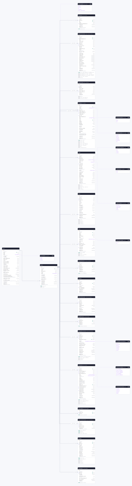

| Column          | Type                                   | Constraints                     | Default                        | Description |
| --------------- | -------------------------------------- | ------------------------------- | ------------------------------ | ----------- |
| `id`            | `text`                                 | PK NOT NULL                     | `.$defaultFn()`                |             |
| `org_id`        | `text`                                 | NOT NULL                        |                                |             |
| `name`          | `text`                                 | NOT NULL                        |                                |             |
| `description`   | `text`                                 | NULL                            |                                |             |
| `topic`         | `text`                                 | NULL                            |                                |             |
| `type`          | [`spaceTypeEnum`](#enum-spaceTypeEnum) | NOT NULL                        | `.default('public')`           |             |
| `is_default`    | `boolean`                              | NOT NULL                        | `.default(false)`              |             |
| `is_archived`   | `boolean`                              | NOT NULL                        | `.default(false)`              |             |
| `agent_enabled` | `boolean`                              | NOT NULL                        | `.default(true)`               |             |
| `created_by`    | `text`                                 | NULL → [users.id](#table-users) |                                |             |
| `created_at`    | `timestamp`                            | NOT NULL                        | `.defaultNow()`                |             |
| `updated_at`    | `timestamp`                            | NOT NULL                        | `.defaultNow()` `.$onUpdate()` |             |

#### Definition

```sql
CREATE TABLE "spaces" (
	"id" text PRIMARY KEY,
	"org_id" text NOT NULL,
	"name" text NOT NULL,
	"description" text,
	"topic" text,
	"type" "space_type" DEFAULT 'public'::"space_type" NOT NULL,
	"is_default" boolean DEFAULT false NOT NULL,
	"is_archived" boolean DEFAULT false NOT NULL,
	"agent_enabled" boolean DEFAULT true NOT NULL,
	"created_by" text,
	"created_at" timestamp DEFAULT now() NOT NULL,
	"updated_at" timestamp DEFAULT now() NOT NULL,
	CONSTRAINT "spaces_org_id_id_unique" UNIQUE("org_id","id")
);

CREATE INDEX "space_org_idx" ON "spaces" ("org_id");

ALTER TABLE "spaces" ADD CONSTRAINT "spaces_created_by_users_id_fkey" FOREIGN KEY ("created_by") REFERENCES "users"("id");
```

#### Indexes

- INDEX `org_id`
- UNIQUE `org_id`, `id`

#### References

- `created_by` → [users.id](#table-users) (many to one)

#### Referenced by

- `id` → [spaceMembers.space_id](#table-spaceMembers) (one to many)
- `id` → [messages.space_id](#table-messages) (one to many)
- `org_id` → [appPrivateDeftySeals.org_id](#table-appPrivateDeftySeals) (one to one, on delete restrict)
- `id` → [projectSpaces.space_id](#table-projectSpaces) (one to many)
- `id` → [workIntents.space_id](#table-workIntents) (one to many, on delete set null)
- `id` → [messageObservations.space_id](#table-messageObservations) (one to many, on delete set null)
- `id` → [pinnedMessages.space_id](#table-pinnedMessages) (one to many)
- `id` → [scheduledMessages.space_id](#table-scheduledMessages) (one to many)
- `id` → [canvases.space_id](#table-canvases) (one to one)
- `id` → [messageBookmarks.space_id](#table-messageBookmarks) (one to many)
- `id` → [teams.default_space_id](#table-teams) (one to many, on delete set null)
- `id` → [notes.visibility_space_id](#table-notes) (one to many, on delete set null)
- `id` → [clips.space_id](#table-clips) (one to many)
- `id` → [wikiPages.space_id](#table-wikiPages) (one to many)
- `id` → [wikiPages.origin_space_id](#table-wikiPages) (one to many, on delete set null)
- `id` → [wikiCitations.source_space_id](#table-wikiCitations) (one to many, on delete set null)
- `id` → [agentChannelEvents.space_id](#table-agentChannelEvents) (one to many, on delete set null)
- `id` → [spaceMemory.space_id](#table-spaceMemory) (one to many)

<details>
<summary>Queries and their SQL</summary>

**Select**: Every row of spaces.

```ts
db.select().from(spaces);
```

```sql
select "id", "org_id", "name", "description", "topic", "type", "is_default", "is_archived", "agent_enabled", "created_by", "created_at", "updated_at"
from "spaces"
```

**Count**: How many rows spaces has.

```ts
db.select({ count: count() }).from(spaces);
```

```sql
select count(*)
from "spaces"
```

**Find many**: The rows of spaces, through the relational query API.

```ts
db.query.spaces.findMany();
```

```sql
select "d0"."id" as "id", "d0"."org_id" as "org_id", "d0"."name" as "name", "d0"."description" as "description", "d0"."topic" as "topic", "d0"."type" as "type", "d0"."is_default" as "is_default", "d0"."is_archived" as "is_archived", "d0"."agent_enabled" as "agent_enabled", "d0"."created_by" as "created_by", "d0"."created_at" as "created_at", "d0"."updated_at" as "updated_at"
from "spaces" as "d0"
```

**Find by primary key**: One row of spaces, through the relational query API.

```ts
db.query.spaces.findFirst({ where: { id: "id" } });
```

```sql
select "d0"."id" as "id", "d0"."org_id" as "org_id", "d0"."name" as "name", "d0"."description" as "description", "d0"."topic" as "topic", "d0"."type" as "type", "d0"."is_default" as "is_default", "d0"."is_archived" as "is_archived", "d0"."agent_enabled" as "agent_enabled", "d0"."created_by" as "created_by", "d0"."created_at" as "created_at", "d0"."updated_at" as "updated_at"
from "spaces" as "d0"
where "d0"."id" = $1
limit $2
-- params: ["id",1]
```

**Insert**: Adds a row to spaces, giving the columns that have no default.

```ts
db.insert(spaces).values({ org_id: "org_id", name: "name" });
```

```sql
insert into "spaces" ("id", "org_id", "name", "description", "topic", "type", "is_default", "is_archived", "agent_enabled", "created_by", "created_at", "updated_at")
values ($1, $2, $3, default, default, default, default, default, default, default, default, default)
-- params: ["00000000-0000-4000-8000-000000000000","org_id","name"]
```

**Update**: Changes a row of spaces, found by its primary key.

```ts
db.update(spaces).set({ org_id: "org_id" }).where(eq(spaces.id, "id"));
```

```sql
update "spaces"
set "org_id" = $1, "updated_at" = $2
where "spaces"."id" = $3
-- params: ["org_id","2026-01-01T00:00:00.000Z","id"]
```

**Delete**: Deletes a row of spaces, found by its primary key.

```ts
db.delete(spaces).where(eq(spaces.id, "id"));
```

```sql
delete from "spaces"
where "spaces"."id" = $1
-- params: ["id"]
```

</details>

<a id="table-spaceMembers"></a>

### spaceMembers

Table `space_members`. ═══ SPACE MEMBERS ═══


| Column                 | Type        | Constraints                           | Default           | Description |
| ---------------------- | ----------- | ------------------------------------- | ----------------- | ----------- |
| `id`                   | `text`      | PK NOT NULL                           | `.$defaultFn()`   |             |
| `space_id`             | `text`      | NOT NULL → [spaces.id](#table-spaces) |                   |             |
| `user_id`              | `text`      | NOT NULL → [users.id](#table-users)   |                   |             |
| `is_muted`             | `boolean`   | NOT NULL                              | `.default(false)` |             |
| `notification_level`   | `text`      | NOT NULL                              | `.default('all')` |             |
| `last_read_message_id` | `text`      | NULL                                  |                   |             |
| `last_read_at`         | `timestamp` | NULL                                  |                   |             |
| `joined_at`            | `timestamp` | NOT NULL                              | `.defaultNow()`   |             |

#### Definition

```sql
CREATE TABLE "space_members" (
	"id" text PRIMARY KEY,
	"space_id" text NOT NULL,
	"user_id" text NOT NULL,
	"is_muted" boolean DEFAULT false NOT NULL,
	"notification_level" text DEFAULT 'all' NOT NULL,
	"last_read_message_id" text,
	"last_read_at" timestamp,
	"joined_at" timestamp DEFAULT now() NOT NULL
);

CREATE UNIQUE INDEX "space_member_unique" ON "space_members" ("space_id","user_id");

ALTER TABLE "space_members" ADD CONSTRAINT "space_members_space_id_spaces_id_fkey" FOREIGN KEY ("space_id") REFERENCES "spaces"("id");

ALTER TABLE "space_members" ADD CONSTRAINT "space_members_user_id_users_id_fkey" FOREIGN KEY ("user_id") REFERENCES "users"("id");
```

#### Indexes

- UNIQUE `space_id`, `user_id`

#### References

- `space_id` → [spaces.id](#table-spaces) (many to one)
- `user_id` → [users.id](#table-users) (many to one)

<details>
<summary>Queries and their SQL</summary>

**Select**: Every row of spaceMembers.

```ts
db.select().from(spaceMembers);
```

```sql
select "id", "space_id", "user_id", "is_muted", "notification_level", "last_read_message_id", "last_read_at", "joined_at"
from "space_members"
```

**Count**: How many rows spaceMembers has.

```ts
db.select({ count: count() }).from(spaceMembers);
```

```sql
select count(*)
from "space_members"
```

**Find many**: The rows of spaceMembers, through the relational query API.

```ts
db.query.spaceMembers.findMany();
```

```sql
select "d0"."id" as "id", "d0"."space_id" as "space_id", "d0"."user_id" as "user_id", "d0"."is_muted" as "is_muted", "d0"."notification_level" as "notification_level", "d0"."last_read_message_id" as "last_read_message_id", "d0"."last_read_at" as "last_read_at", "d0"."joined_at" as "joined_at"
from "space_members" as "d0"
```

**Find by primary key**: One row of spaceMembers, through the relational query API.

```ts
db.query.spaceMembers.findFirst({ where: { id: "id" } });
```

```sql
select "d0"."id" as "id", "d0"."space_id" as "space_id", "d0"."user_id" as "user_id", "d0"."is_muted" as "is_muted", "d0"."notification_level" as "notification_level", "d0"."last_read_message_id" as "last_read_message_id", "d0"."last_read_at" as "last_read_at", "d0"."joined_at" as "joined_at"
from "space_members" as "d0"
where "d0"."id" = $1
limit $2
-- params: ["id",1]
```

**Insert**: Adds a row to spaceMembers, giving the columns that have no default.

```ts
db.insert(spaceMembers).values({ space_id: "space_id", user_id: "user_id" });
```

```sql
insert into "space_members" ("id", "space_id", "user_id", "is_muted", "notification_level", "last_read_message_id", "last_read_at", "joined_at")
values ($1, $2, $3, default, default, default, default, default)
-- params: ["00000000-0000-4000-8000-000000000000","space_id","user_id"]
```

**Update**: Changes a row of spaceMembers, found by its primary key.

```ts
db.update(spaceMembers).set({ space_id: "space_id" }).where(eq(spaceMembers.id, "id"));
```

```sql
update "space_members"
set "space_id" = $1
where "space_members"."id" = $2
-- params: ["space_id","id"]
```

**Delete**: Deletes a row of spaceMembers, found by its primary key.

```ts
db.delete(spaceMembers).where(eq(spaceMembers.id, "id"));
```

```sql
delete from "space_members"
where "space_members"."id" = $1
-- params: ["id"]
```

</details>

<a id="table-messages"></a>

### messages

═══ MESSAGES ═══

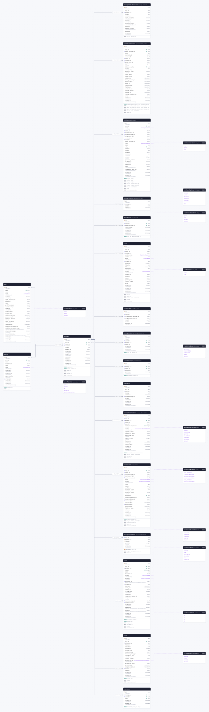

| Column       | Type        | Constraints                           | Default                        | Description |
| ------------ | ----------- | ------------------------------------- | ------------------------------ | ----------- |
| `id`         | `text`      | PK NOT NULL                           | `.$defaultFn()`                |             |
| `org_id`     | `text`      | NOT NULL                              |                                |             |
| `space_id`   | `text`      | NOT NULL → [spaces.id](#table-spaces) |                                |             |
| `user_id`    | `text`      | NOT NULL → [users.id](#table-users)   |                                |             |
| `content`    | `text`      | NOT NULL                              |                                |             |
| `parent_id`  | `text`      | NULL                                  |                                |             |
| `is_pinned`  | `boolean`   | NOT NULL                              | `.default(false)`              |             |
| `is_deleted` | `boolean`   | NOT NULL                              | `.default(false)`              |             |
| `edited_at`  | `timestamp` | NULL                                  |                                |             |
| `metadata`   | `jsonb`     | NULL                                  |                                |             |
| `created_at` | `timestamp` | NOT NULL                              | `.defaultNow()`                |             |
| `updated_at` | `timestamp` | NOT NULL                              | `.defaultNow()` `.$onUpdate()` |             |

#### Definition

```sql
CREATE TABLE "messages" (
	"id" text PRIMARY KEY,
	"org_id" text NOT NULL,
	"space_id" text NOT NULL,
	"user_id" text NOT NULL,
	"content" text NOT NULL,
	"parent_id" text,
	"is_pinned" boolean DEFAULT false NOT NULL,
	"is_deleted" boolean DEFAULT false NOT NULL,
	"edited_at" timestamp,
	"metadata" jsonb,
	"created_at" timestamp DEFAULT now() NOT NULL,
	"updated_at" timestamp DEFAULT now() NOT NULL,
	CONSTRAINT "messages_org_id_id_unique" UNIQUE("org_id","id")
);

CREATE INDEX "message_space_idx" ON "messages" ("space_id");

CREATE INDEX "message_org_idx" ON "messages" ("org_id");

CREATE INDEX "message_parent_idx" ON "messages" ("parent_id");

CREATE INDEX "message_created_idx" ON "messages" ("created_at");

CREATE UNIQUE INDEX "app_private_defty_messages_request_unique" ON "messages" ("org_id","space_id",("metadata"->>'request_id'),("metadata"->>'role')) WHERE "metadata"->>'schema_version'='deft.private_defty_message.v1';

ALTER TABLE "messages" ADD CONSTRAINT "messages_space_id_spaces_id_fkey" FOREIGN KEY ("space_id") REFERENCES "spaces"("id");

ALTER TABLE "messages" ADD CONSTRAINT "messages_user_id_users_id_fkey" FOREIGN KEY ("user_id") REFERENCES "users"("id");
```

#### Indexes

- INDEX `space_id`
- INDEX `org_id`
- INDEX `parent_id`
- INDEX `created_at`
- UNIQUE `org_id`, `id`
- UNIQUE `org_id`, `space_id`

#### References

- `space_id` → [spaces.id](#table-spaces) (many to one)
- `user_id` → [users.id](#table-users) (many to one)

#### Referenced by

- `id` → [reactions.message_id](#table-reactions) (one to many)
- `id` → [files.message_id](#table-files) (one to many)
- `id` → [tasks.source_message_id](#table-tasks) (one to many)
- `org_id` → [messageAttachments.org_id](#table-messageAttachments) (one to many, on delete cascade)
- `id` → [workIntents.source_message_id](#table-workIntents) (one to many, on delete set null)
- `id` → [messageObservations.message_id](#table-messageObservations) (one to many, on delete cascade)
- `id` → [reminders.source_message_id](#table-reminders) (one to many)
- `id` → [pinnedMessages.message_id](#table-pinnedMessages) (one to many)
- `id` → [messageBookmarks.message_id](#table-messageBookmarks) (one to many)
- `id` → [workflowRuns.triggered_by_message_id](#table-workflowRuns) (one to many)
- `id` → [clips.message_id](#table-clips) (one to many)
- `id` → [threadReads.parent_message_id](#table-threadReads) (one to many)
- `id` → [messageVersions.message_id](#table-messageVersions) (one to many)
- `id` → [wikiPages.origin_message_id](#table-wikiPages) (one to many, on delete set null)
- `id` → [agentChannelEvents.thread_id](#table-agentChannelEvents) (one to many, on delete set null)
- `id` → [messageClassifications.message_id](#table-messageClassifications) (one to many, on delete cascade)

<details>
<summary>Queries and their SQL</summary>

**Select**: Every row of messages.

```ts
db.select().from(messages);
```

```sql
select "id", "org_id", "space_id", "user_id", "content", "parent_id", "is_pinned", "is_deleted", "edited_at", "metadata", "created_at", "updated_at"
from "messages"
```

**Count**: How many rows messages has.

```ts
db.select({ count: count() }).from(messages);
```

```sql
select count(*)
from "messages"
```

**Find many**: The rows of messages, through the relational query API.

```ts
db.query.messages.findMany();
```

```sql
select "d0"."id" as "id", "d0"."org_id" as "org_id", "d0"."space_id" as "space_id", "d0"."user_id" as "user_id", "d0"."content" as "content", "d0"."parent_id" as "parent_id", "d0"."is_pinned" as "is_pinned", "d0"."is_deleted" as "is_deleted", "d0"."edited_at" as "edited_at", "d0"."metadata" as "metadata", "d0"."created_at" as "created_at", "d0"."updated_at" as "updated_at"
from "messages" as "d0"
```

**Find by primary key**: One row of messages, through the relational query API.

```ts
db.query.messages.findFirst({ where: { id: "id" } });
```

```sql
select "d0"."id" as "id", "d0"."org_id" as "org_id", "d0"."space_id" as "space_id", "d0"."user_id" as "user_id", "d0"."content" as "content", "d0"."parent_id" as "parent_id", "d0"."is_pinned" as "is_pinned", "d0"."is_deleted" as "is_deleted", "d0"."edited_at" as "edited_at", "d0"."metadata" as "metadata", "d0"."created_at" as "created_at", "d0"."updated_at" as "updated_at"
from "messages" as "d0"
where "d0"."id" = $1
limit $2
-- params: ["id",1]
```

**Insert**: Adds a row to messages, giving the columns that have no default.

```ts
db.insert(messages).values({
  org_id: "org_id",
  space_id: "space_id",
  user_id: "user_id",
  content: "content",
});
```

```sql
insert into "messages" ("id", "org_id", "space_id", "user_id", "content", "parent_id", "is_pinned", "is_deleted", "edited_at", "metadata", "created_at", "updated_at")
values ($1, $2, $3, $4, $5, default, default, default, default, default, default, default)
-- params: ["00000000-0000-4000-8000-000000000000","org_id","space_id","user_id","content"]
```

**Update**: Changes a row of messages, found by its primary key.

```ts
db.update(messages).set({ org_id: "org_id" }).where(eq(messages.id, "id"));
```

```sql
update "messages"
set "org_id" = $1, "updated_at" = $2
where "messages"."id" = $3
-- params: ["org_id","2026-01-01T00:00:00.000Z","id"]
```

**Delete**: Deletes a row of messages, found by its primary key.

```ts
db.delete(messages).where(eq(messages.id, "id"));
```

```sql
delete from "messages"
where "messages"."id" = $1
-- params: ["id"]
```

</details>

<a id="table-appPrivateDeftySeals"></a>

### appPrivateDeftySeals

Table `app_private_defty_seals`. ═══ REACTIONS ═══ Permanent private Defty audience authority; bodies remain in canonical messages.

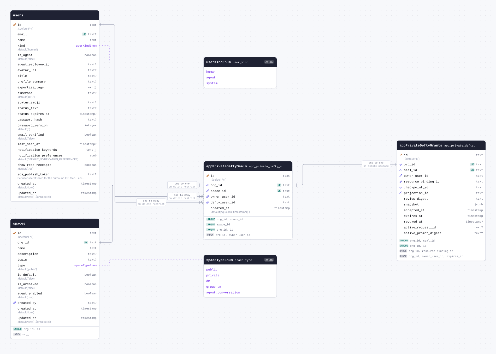

| Column          | Type        | Constraints                               | Default                              | Description |
| --------------- | ----------- | ----------------------------------------- | ------------------------------------ | ----------- |
| `id`            | `text`      | PK NOT NULL                               | `.$defaultFn()`                      |             |
| `org_id`        | `text`      | NOT NULL → [spaces.org_id](#table-spaces) |                                      |             |
| `space_id`      | `text`      | NOT NULL                                  |                                      |             |
| `owner_user_id` | `text`      | NOT NULL → [users.id](#table-users)       |                                      |             |
| `defty_user_id` | `text`      | NOT NULL → [users.id](#table-users)       |                                      |             |
| `created_at`    | `timestamp` | NOT NULL                                  | ``.default(sql`clock_timestamp()`)`` |             |

#### Definition

```sql
CREATE TABLE "app_private_defty_seals" (
	"id" text PRIMARY KEY,
	"org_id" text NOT NULL,
	"space_id" text NOT NULL,
	"owner_user_id" text NOT NULL,
	"defty_user_id" text NOT NULL,
	"created_at" timestamp with time zone DEFAULT clock_timestamp() NOT NULL,
	CONSTRAINT "app_private_defty_seals_space_unique" UNIQUE("org_id","space_id"),
	CONSTRAINT "app_private_defty_seals_identity_unique" UNIQUE("org_id","id"),
	CONSTRAINT "app_private_defty_seals_actor_check" CHECK ("owner_user_id"<>"defty_user_id")
);

CREATE UNIQUE INDEX "app_private_defty_seals_global_space_unique" ON "app_private_defty_seals" ("space_id");

CREATE INDEX "app_private_defty_seals_owner_idx" ON "app_private_defty_seals" ("org_id","owner_user_id");

ALTER TABLE "app_private_defty_seals" ADD CONSTRAINT "app_private_defty_seals_space_fk" FOREIGN KEY ("org_id","space_id") REFERENCES "spaces"("org_id","id") ON DELETE RESTRICT;

ALTER TABLE "app_private_defty_seals" ADD CONSTRAINT "app_private_defty_seals_owner_fk" FOREIGN KEY ("owner_user_id") REFERENCES "users"("id") ON DELETE RESTRICT;

ALTER TABLE "app_private_defty_seals" ADD CONSTRAINT "app_private_defty_seals_agent_fk" FOREIGN KEY ("defty_user_id") REFERENCES "users"("id") ON DELETE RESTRICT;
```

#### Indexes

- UNIQUE `org_id`, `space_id`
- UNIQUE `space_id`
- UNIQUE `org_id`, `id`
- INDEX `org_id`, `owner_user_id`

#### References

- `org_id` → [spaces.org_id](#table-spaces) (one to one, on delete restrict)
- `owner_user_id` → [users.id](#table-users) (many to one, on delete restrict)
- `defty_user_id` → [users.id](#table-users) (many to one, on delete restrict)

#### Referenced by

- `org_id` → [appPrivateDeftyGrants.org_id](#table-appPrivateDeftyGrants) (one to one, on delete cascade)

<details>
<summary>Queries and their SQL</summary>

**Select**: Every row of appPrivateDeftySeals.

```ts
db.select().from(appPrivateDeftySeals);
```

```sql
select "id", "org_id", "space_id", "owner_user_id", "defty_user_id", "created_at"
from "app_private_defty_seals"
```

**Count**: How many rows appPrivateDeftySeals has.

```ts
db.select({ count: count() }).from(appPrivateDeftySeals);
```

```sql
select count(*)
from "app_private_defty_seals"
```

**Find many**: The rows of appPrivateDeftySeals, through the relational query API.

```ts
db.query.appPrivateDeftySeals.findMany();
```

```sql
select "d0"."id" as "id", "d0"."org_id" as "org_id", "d0"."space_id" as "space_id", "d0"."owner_user_id" as "owner_user_id", "d0"."defty_user_id" as "defty_user_id", "d0"."created_at" as "created_at"
from "app_private_defty_seals" as "d0"
```

**Find by primary key**: One row of appPrivateDeftySeals, through the relational query API.

```ts
db.query.appPrivateDeftySeals.findFirst({ where: { id: "id" } });
```

```sql
select "d0"."id" as "id", "d0"."org_id" as "org_id", "d0"."space_id" as "space_id", "d0"."owner_user_id" as "owner_user_id", "d0"."defty_user_id" as "defty_user_id", "d0"."created_at" as "created_at"
from "app_private_defty_seals" as "d0"
where "d0"."id" = $1
limit $2
-- params: ["id",1]
```

**Insert**: Adds a row to appPrivateDeftySeals, giving the columns that have no default.

```ts
db.insert(appPrivateDeftySeals).values({
  org_id: "org_id",
  space_id: "space_id",
  owner_user_id: "owner_user_id",
  defty_user_id: "defty_user_id",
});
```

```sql
insert into "app_private_defty_seals" ("id", "org_id", "space_id", "owner_user_id", "defty_user_id", "created_at")
values ($1, $2, $3, $4, $5, default)
-- params: ["00000000-0000-4000-8000-000000000000","org_id","space_id","owner_user_id","defty_user_id"]
```

**Update**: Changes a row of appPrivateDeftySeals, found by its primary key.

```ts
db.update(appPrivateDeftySeals).set({ org_id: "org_id" }).where(eq(appPrivateDeftySeals.id, "id"));
```

```sql
update "app_private_defty_seals"
set "org_id" = $1
where "app_private_defty_seals"."id" = $2
-- params: ["org_id","id"]
```

**Delete**: Deletes a row of appPrivateDeftySeals, found by its primary key.

```ts
db.delete(appPrivateDeftySeals).where(eq(appPrivateDeftySeals.id, "id"));
```

```sql
delete from "app_private_defty_seals"
where "app_private_defty_seals"."id" = $1
-- params: ["id"]
```

</details>

<a id="table-appPrivateDeftyGrants"></a>

### appPrivateDeftyGrants

Table `app_private_defty_grants`.

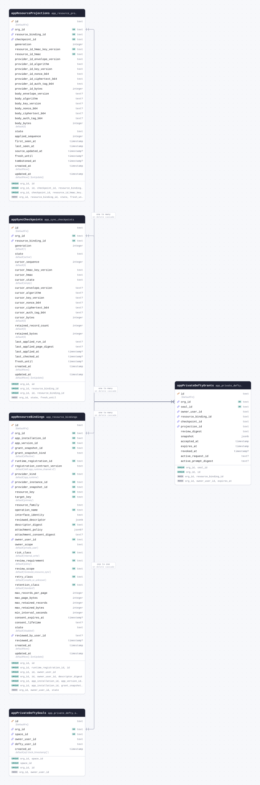

| Column                 | Type        | Constraints                                                           | Default         | Description |
| ---------------------- | ----------- | --------------------------------------------------------------------- | --------------- | ----------- |
| `id`                   | `text`      | PK NOT NULL                                                           | `.$defaultFn()` |             |
| `org_id`               | `text`      | NOT NULL → [appPrivateDeftySeals.org_id](#table-appPrivateDeftySeals) |                 |             |
| `seal_id`              | `text`      | NOT NULL                                                              |                 |             |
| `owner_user_id`        | `text`      | NOT NULL                                                              |                 |             |
| `resource_binding_id`  | `text`      | NOT NULL                                                              |                 |             |
| `checkpoint_id`        | `text`      | NOT NULL                                                              |                 |             |
| `projection_id`        | `text`      | NOT NULL                                                              |                 |             |
| `review_digest`        | `text`      | NOT NULL                                                              |                 |             |
| `snapshot`             | `jsonb`     | NOT NULL                                                              |                 |             |
| `accepted_at`          | `timestamp` | NOT NULL                                                              |                 |             |
| `expires_at`           | `timestamp` | NOT NULL                                                              |                 |             |
| `revoked_at`           | `timestamp` | NULL                                                                  |                 |             |
| `active_request_id`    | `text`      | NULL                                                                  |                 |             |
| `active_prompt_digest` | `text`      | NULL                                                                  |                 |             |

#### Definition

```sql
CREATE TABLE "app_private_defty_grants" (
	"id" text PRIMARY KEY,
	"org_id" text NOT NULL,
	"seal_id" text NOT NULL,
	"owner_user_id" text NOT NULL,
	"resource_binding_id" text NOT NULL,
	"checkpoint_id" text NOT NULL,
	"projection_id" text NOT NULL,
	"review_digest" text NOT NULL,
	"snapshot" jsonb NOT NULL,
	"accepted_at" timestamp with time zone NOT NULL,
	"expires_at" timestamp with time zone NOT NULL,
	"revoked_at" timestamp with time zone,
	"active_request_id" text,
	"active_prompt_digest" text,
	CONSTRAINT "app_private_defty_grants_seal_unique" UNIQUE("org_id","seal_id"),
	CONSTRAINT "app_private_defty_grants_identity_unique" UNIQUE("org_id","id"),
	CONSTRAINT "app_private_defty_grants_digest_check" CHECK ("review_digest" ~ '^sha256:[a-f0-9]{64}$'),
	CONSTRAINT "app_private_defty_grants_reservation_check" CHECK (("active_request_id" IS NULL AND "active_prompt_digest" IS NULL) OR ("active_request_id" ~ '^[a-f0-9]{8}-[a-f0-9]{4}-[a-f0-9]{4}-[a-f0-9]{4}-[a-f0-9]{12}$' AND "active_prompt_digest" ~ '^hmac-sha256:[a-f0-9]{64}$')),
	CONSTRAINT "app_private_defty_grants_expiry_check" CHECK ("expires_at">"accepted_at" AND "expires_at"<="accepted_at"+interval '15 minutes'),
	CONSTRAINT "app_private_defty_grants_snapshot_check" CHECK (COALESCE(jsonb_typeof("snapshot")='object' AND octet_length("snapshot"::text)<=16384 AND "snapshot"->>'schema_version'='deft.app_private_defty_snapshot.v1' AND "snapshot"->>'purpose'='defty_private_context' AND "snapshot"->>'org_id'="org_id" AND "snapshot"->>'seal_id'="seal_id" AND "snapshot"->>'owner_user_id'="owner_user_id" AND "snapshot"->>'resource_binding_id'="resource_binding_id" AND "snapshot"->>'checkpoint_id'="checkpoint_id" AND "snapshot"#>>'{ref,resource_id}'="projection_id",false))
);

CREATE INDEX "app_private_defty_grants_parent_idx" ON "app_private_defty_grants" ("org_id","resource_binding_id");

CREATE INDEX "app_private_defty_grants_owner_app_idx" ON "app_private_defty_grants" ("org_id","owner_user_id",("snapshot"->>'app_installation_id'),"expires_at");

ALTER TABLE "app_private_defty_grants" ADD CONSTRAINT "app_private_defty_grants_seal_fk" FOREIGN KEY ("org_id","seal_id") REFERENCES "app_private_defty_seals"("org_id","id") ON DELETE RESTRICT;

ALTER TABLE "app_private_defty_grants" ADD CONSTRAINT "app_private_defty_grants_owner_fk" FOREIGN KEY ("org_id","resource_binding_id","owner_user_id") REFERENCES "app_resource_bindings"("org_id","id","owner_user_id") ON DELETE RESTRICT;

ALTER TABLE "app_private_defty_grants" ADD CONSTRAINT "app_private_defty_grants_checkpoint_fk" FOREIGN KEY ("org_id","checkpoint_id","resource_binding_id") REFERENCES "app_sync_checkpoints"("org_id","id","resource_binding_id") ON DELETE CASCADE;

ALTER TABLE "app_private_defty_grants" ADD CONSTRAINT "app_private_defty_grants_projection_fk" FOREIGN KEY ("org_id","projection_id") REFERENCES "app_resource_projections"("org_id","id") ON DELETE CASCADE;
```

#### Indexes

- UNIQUE `org_id`, `seal_id`
- UNIQUE `org_id`, `id`
- INDEX `org_id`, `resource_binding_id`
- INDEX `org_id`, `owner_user_id`, `expires_at`

#### References

- `org_id` → [appPrivateDeftySeals.org_id](#table-appPrivateDeftySeals) (one to one, on delete cascade)
- `org_id` → [appResourceBindings.org_id](#table-appResourceBindings) (many to one, on delete cascade)
- `org_id` → [appSyncCheckpoints.org_id](#table-appSyncCheckpoints) (many to one, on delete cascade)
- `org_id` → [appResourceProjections.org_id](#table-appResourceProjections) (many to one, on delete cascade)

<details>
<summary>Queries and their SQL</summary>

**Select**: Every row of appPrivateDeftyGrants.

```ts
db.select().from(appPrivateDeftyGrants);
```

```sql
select "id", "org_id", "seal_id", "owner_user_id", "resource_binding_id", "checkpoint_id", "projection_id", "review_digest", "snapshot", "accepted_at", "expires_at", "revoked_at", "active_request_id", "active_prompt_digest"
from "app_private_defty_grants"
```

**Count**: How many rows appPrivateDeftyGrants has.

```ts
db.select({ count: count() }).from(appPrivateDeftyGrants);
```

```sql
select count(*)
from "app_private_defty_grants"
```

**Find many**: The rows of appPrivateDeftyGrants, through the relational query API.

```ts
db.query.appPrivateDeftyGrants.findMany();
```

```sql
select "d0"."id" as "id", "d0"."org_id" as "org_id", "d0"."seal_id" as "seal_id", "d0"."owner_user_id" as "owner_user_id", "d0"."resource_binding_id" as "resource_binding_id", "d0"."checkpoint_id" as "checkpoint_id", "d0"."projection_id" as "projection_id", "d0"."review_digest" as "review_digest", "d0"."snapshot" as "snapshot", "d0"."accepted_at" as "accepted_at", "d0"."expires_at" as "expires_at", "d0"."revoked_at" as "revoked_at", "d0"."active_request_id" as "active_request_id", "d0"."active_prompt_digest" as "active_prompt_digest"
from "app_private_defty_grants" as "d0"
```

**Find by primary key**: One row of appPrivateDeftyGrants, through the relational query API.

```ts
db.query.appPrivateDeftyGrants.findFirst({ where: { id: "id" } });
```

```sql
select "d0"."id" as "id", "d0"."org_id" as "org_id", "d0"."seal_id" as "seal_id", "d0"."owner_user_id" as "owner_user_id", "d0"."resource_binding_id" as "resource_binding_id", "d0"."checkpoint_id" as "checkpoint_id", "d0"."projection_id" as "projection_id", "d0"."review_digest" as "review_digest", "d0"."snapshot" as "snapshot", "d0"."accepted_at" as "accepted_at", "d0"."expires_at" as "expires_at", "d0"."revoked_at" as "revoked_at", "d0"."active_request_id" as "active_request_id", "d0"."active_prompt_digest" as "active_prompt_digest"
from "app_private_defty_grants" as "d0"
where "d0"."id" = $1
limit $2
-- params: ["id",1]
```

**Insert**: Adds a row to appPrivateDeftyGrants, giving the columns that have no default.

```ts
db.insert(appPrivateDeftyGrants).values({
  org_id: "org_id",
  seal_id: "seal_id",
  owner_user_id: "owner_user_id",
  resource_binding_id: "resource_binding_id",
  checkpoint_id: "checkpoint_id",
  projection_id: "projection_id",
  review_digest: "review_digest",
  snapshot: {},
  accepted_at: new Date("2026-01-01T00:00:00.000Z"),
  expires_at: new Date("2026-01-01T00:00:00.000Z"),
});
```

```sql
insert into "app_private_defty_grants" ("id", "org_id", "seal_id", "owner_user_id", "resource_binding_id", "checkpoint_id", "projection_id", "review_digest", "snapshot", "accepted_at", "expires_at", "revoked_at", "active_request_id", "active_prompt_digest")
values ($1, $2, $3, $4, $5, $6, $7, $8, $9, $10, $11, default, default, default)
-- params: ["00000000-0000-4000-8000-000000000000","org_id","seal_id","owner_user_id","resource_binding_id","checkpoint_id","projection_id","review_digest",{},"2026-01-01T00:00:00.000Z","2026-01-01T00:00:00.000Z"]
```

**Update**: Changes a row of appPrivateDeftyGrants, found by its primary key.

```ts
db.update(appPrivateDeftyGrants)
  .set({ org_id: "org_id" })
  .where(eq(appPrivateDeftyGrants.id, "id"));
```

```sql
update "app_private_defty_grants"
set "org_id" = $1
where "app_private_defty_grants"."id" = $2
-- params: ["org_id","id"]
```

**Delete**: Deletes a row of appPrivateDeftyGrants, found by its primary key.

```ts
db.delete(appPrivateDeftyGrants).where(eq(appPrivateDeftyGrants.id, "id"));
```

```sql
delete from "app_private_defty_grants"
where "app_private_defty_grants"."id" = $1
-- params: ["id"]
```

</details>

<a id="table-reactions"></a>

### reactions

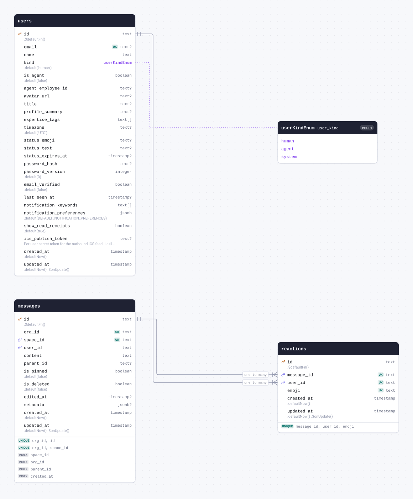

| Column       | Type        | Constraints                               | Default                        | Description |
| ------------ | ----------- | ----------------------------------------- | ------------------------------ | ----------- |
| `id`         | `text`      | PK NOT NULL                               | `.$defaultFn()`                |             |
| `message_id` | `text`      | NOT NULL → [messages.id](#table-messages) |                                |             |
| `user_id`    | `text`      | NOT NULL → [users.id](#table-users)       |                                |             |
| `emoji`      | `text`      | NOT NULL                                  |                                |             |
| `created_at` | `timestamp` | NOT NULL                                  | `.defaultNow()`                |             |
| `updated_at` | `timestamp` | NOT NULL                                  | `.defaultNow()` `.$onUpdate()` |             |

#### Definition

```sql
CREATE TABLE "reactions" (
	"id" text PRIMARY KEY,
	"message_id" text NOT NULL,
	"user_id" text NOT NULL,
	"emoji" text NOT NULL,
	"created_at" timestamp DEFAULT now() NOT NULL,
	"updated_at" timestamp DEFAULT now() NOT NULL
);

CREATE UNIQUE INDEX "reaction_unique" ON "reactions" ("message_id","user_id","emoji");

ALTER TABLE "reactions" ADD CONSTRAINT "reactions_message_id_messages_id_fkey" FOREIGN KEY ("message_id") REFERENCES "messages"("id");

ALTER TABLE "reactions" ADD CONSTRAINT "reactions_user_id_users_id_fkey" FOREIGN KEY ("user_id") REFERENCES "users"("id");
```

#### Indexes

- UNIQUE `message_id`, `user_id`, `emoji`

#### References

- `message_id` → [messages.id](#table-messages) (many to one)
- `user_id` → [users.id](#table-users) (many to one)

<details>
<summary>Queries and their SQL</summary>

**Select**: Every row of reactions.

```ts
db.select().from(reactions);
```

```sql
select "id", "message_id", "user_id", "emoji", "created_at", "updated_at"
from "reactions"
```

**Count**: How many rows reactions has.

```ts
db.select({ count: count() }).from(reactions);
```

```sql
select count(*)
from "reactions"
```

**Find many**: The rows of reactions, through the relational query API.

```ts
db.query.reactions.findMany();
```

```sql
select "d0"."id" as "id", "d0"."message_id" as "message_id", "d0"."user_id" as "user_id", "d0"."emoji" as "emoji", "d0"."created_at" as "created_at", "d0"."updated_at" as "updated_at"
from "reactions" as "d0"
```

**Find by primary key**: One row of reactions, through the relational query API.

```ts
db.query.reactions.findFirst({ where: { id: "id" } });
```

```sql
select "d0"."id" as "id", "d0"."message_id" as "message_id", "d0"."user_id" as "user_id", "d0"."emoji" as "emoji", "d0"."created_at" as "created_at", "d0"."updated_at" as "updated_at"
from "reactions" as "d0"
where "d0"."id" = $1
limit $2
-- params: ["id",1]
```

**Insert**: Adds a row to reactions, giving the columns that have no default.

```ts
db.insert(reactions).values({ message_id: "message_id", user_id: "user_id", emoji: "emoji" });
```

```sql
insert into "reactions" ("id", "message_id", "user_id", "emoji", "created_at", "updated_at")
values ($1, $2, $3, $4, default, default)
-- params: ["00000000-0000-4000-8000-000000000000","message_id","user_id","emoji"]
```

**Update**: Changes a row of reactions, found by its primary key.

```ts
db.update(reactions).set({ message_id: "message_id" }).where(eq(reactions.id, "id"));
```

```sql
update "reactions"
set "message_id" = $1, "updated_at" = $2
where "reactions"."id" = $3
-- params: ["message_id","2026-01-01T00:00:00.000Z","id"]
```

**Delete**: Deletes a row of reactions, found by its primary key.

```ts
db.delete(reactions).where(eq(reactions.id, "id"));
```

```sql
delete from "reactions"
where "reactions"."id" = $1
-- params: ["id"]
```

</details>

<a id="table-files"></a>

### files

═══ FILES ═══

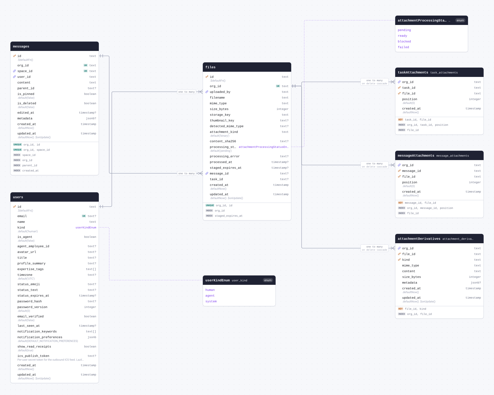

| Column               | Type                                                                     | Constraints                           | Default                        | Description |
| -------------------- | ------------------------------------------------------------------------ | ------------------------------------- | ------------------------------ | ----------- |
| `id`                 | `text`                                                                   | PK NOT NULL                           | `.$defaultFn()`                |             |
| `org_id`             | `text`                                                                   | NOT NULL                              |                                |             |
| `uploaded_by`        | `text`                                                                   | NOT NULL → [users.id](#table-users)   |                                |             |
| `filename`           | `text`                                                                   | NOT NULL                              |                                |             |
| `mime_type`          | `text`                                                                   | NOT NULL                              |                                |             |
| `size_bytes`         | `integer`                                                                | NOT NULL                              |                                |             |
| `storage_key`        | `text`                                                                   | NOT NULL                              |                                |             |
| `thumbnail_key`      | `text`                                                                   | NULL                                  |                                |             |
| `detected_mime_type` | `text`                                                                   | NULL                                  |                                |             |
| `attachment_kind`    | `text`                                                                   | NOT NULL                              | `.default('binary')`           |             |
| `content_sha256`     | `text`                                                                   | NULL                                  |                                |             |
| `processing_status`  | [`attachmentProcessingStatusEnum`](#enum-attachmentProcessingStatusEnum) | NOT NULL                              | `.default('pending')`          |             |
| `processing_error`   | `text`                                                                   | NULL                                  |                                |             |
| `processed_at`       | `timestamp`                                                              | NULL                                  |                                |             |
| `staged_expires_at`  | `timestamp`                                                              | NULL                                  |                                |             |
| `message_id`         | `text`                                                                   | NULL → [messages.id](#table-messages) |                                |             |
| `task_id`            | `text`                                                                   | NULL                                  |                                |             |
| `created_at`         | `timestamp`                                                              | NOT NULL                              | `.defaultNow()`                |             |
| `updated_at`         | `timestamp`                                                              | NOT NULL                              | `.defaultNow()` `.$onUpdate()` |             |

#### Definition

```sql
CREATE TABLE "files" (
	"id" text PRIMARY KEY,
	"org_id" text NOT NULL,
	"uploaded_by" text NOT NULL,
	"filename" text NOT NULL,
	"mime_type" text NOT NULL,
	"size_bytes" integer NOT NULL,
	"storage_key" text NOT NULL,
	"thumbnail_key" text,
	"detected_mime_type" text,
	"attachment_kind" text DEFAULT 'binary' NOT NULL,
	"content_sha256" text,
	"processing_status" "attachment_processing_status" DEFAULT 'pending'::"attachment_processing_status" NOT NULL,
	"processing_error" text,
	"processed_at" timestamp,
	"staged_expires_at" timestamp,
	"message_id" text,
	"task_id" text,
	"created_at" timestamp DEFAULT now() NOT NULL,
	"updated_at" timestamp DEFAULT now() NOT NULL,
	CONSTRAINT "files_org_id_id_unique" UNIQUE("org_id","id"),
	CONSTRAINT "files_attachment_kind_check" CHECK ("attachment_kind" IN ('text', 'image', 'spreadsheet', 'pdf', 'document', 'archive', 'binary')),
	CONSTRAINT "files_content_sha256_check" CHECK ("content_sha256" IS NULL OR "content_sha256" ~ '^sha256:[a-f0-9]{64}$')
);

CREATE INDEX "files_org_idx" ON "files" ("org_id");

CREATE INDEX "files_staged_expiry_idx" ON "files" ("staged_expires_at");

ALTER TABLE "files" ADD CONSTRAINT "files_uploaded_by_users_id_fkey" FOREIGN KEY ("uploaded_by") REFERENCES "users"("id");

ALTER TABLE "files" ADD CONSTRAINT "files_message_id_messages_id_fkey" FOREIGN KEY ("message_id") REFERENCES "messages"("id");
```

#### Indexes

- INDEX `org_id`
- INDEX `staged_expires_at`
- UNIQUE `org_id`, `id`

#### References

- `uploaded_by` → [users.id](#table-users) (many to one)
- `message_id` → [messages.id](#table-messages) (many to one)

#### Referenced by

- `org_id` → [attachmentDerivatives.org_id](#table-attachmentDerivatives) (one to many, on delete cascade)
- `org_id` → [messageAttachments.org_id](#table-messageAttachments) (one to many, on delete cascade)
- `org_id` → [taskAttachments.org_id](#table-taskAttachments) (one to many, on delete cascade)

<details>
<summary>Queries and their SQL</summary>

**Select**: Every row of files.

```ts
db.select().from(files);
```

```sql
select "id", "org_id", "uploaded_by", "filename", "mime_type", "size_bytes", "storage_key", "thumbnail_key", "detected_mime_type", "attachment_kind", "content_sha256", "processing_status", "processing_error", "processed_at", "staged_expires_at", "message_id", "task_id", "created_at", "updated_at"
from "files"
```

**Count**: How many rows files has.

```ts
db.select({ count: count() }).from(files);
```

```sql
select count(*)
from "files"
```

**Find many**: The rows of files, through the relational query API.

```ts
db.query.files.findMany();
```

```sql
select "d0"."id" as "id", "d0"."org_id" as "org_id", "d0"."uploaded_by" as "uploaded_by", "d0"."filename" as "filename", "d0"."mime_type" as "mime_type", "d0"."size_bytes" as "size_bytes", "d0"."storage_key" as "storage_key", "d0"."thumbnail_key" as "thumbnail_key", "d0"."detected_mime_type" as "detected_mime_type", "d0"."attachment_kind" as "attachment_kind", "d0"."content_sha256" as "content_sha256", "d0"."processing_status" as "processing_status", "d0"."processing_error" as "processing_error", "d0"."processed_at" as "processed_at", "d0"."staged_expires_at" as "staged_expires_at", "d0"."message_id" as "message_id", "d0"."task_id" as "task_id", "d0"."created_at" as "created_at", "d0"."updated_at" as "updated_at"
from "files" as "d0"
```

**Find by primary key**: One row of files, through the relational query API.

```ts
db.query.files.findFirst({ where: { id: "id" } });
```

```sql
select "d0"."id" as "id", "d0"."org_id" as "org_id", "d0"."uploaded_by" as "uploaded_by", "d0"."filename" as "filename", "d0"."mime_type" as "mime_type", "d0"."size_bytes" as "size_bytes", "d0"."storage_key" as "storage_key", "d0"."thumbnail_key" as "thumbnail_key", "d0"."detected_mime_type" as "detected_mime_type", "d0"."attachment_kind" as "attachment_kind", "d0"."content_sha256" as "content_sha256", "d0"."processing_status" as "processing_status", "d0"."processing_error" as "processing_error", "d0"."processed_at" as "processed_at", "d0"."staged_expires_at" as "staged_expires_at", "d0"."message_id" as "message_id", "d0"."task_id" as "task_id", "d0"."created_at" as "created_at", "d0"."updated_at" as "updated_at"
from "files" as "d0"
where "d0"."id" = $1
limit $2
-- params: ["id",1]
```

**Insert**: Adds a row to files, giving the columns that have no default.

```ts
db.insert(files).values({
  org_id: "org_id",
  uploaded_by: "uploaded_by",
  filename: "filename",
  mime_type: "mime_type",
  size_bytes: 1,
  storage_key: "storage_key",
});
```

```sql
insert into "files" ("id", "org_id", "uploaded_by", "filename", "mime_type", "size_bytes", "storage_key", "thumbnail_key", "detected_mime_type", "attachment_kind", "content_sha256", "processing_status", "processing_error", "processed_at", "staged_expires_at", "message_id", "task_id", "created_at", "updated_at")
values ($1, $2, $3, $4, $5, $6, $7, default, default, default, default, default, default, default, default, default, default, default, default)
-- params: ["00000000-0000-4000-8000-000000000000","org_id","uploaded_by","filename","mime_type",1,"storage_key"]
```

**Update**: Changes a row of files, found by its primary key.

```ts
db.update(files).set({ org_id: "org_id" }).where(eq(files.id, "id"));
```

```sql
update "files"
set "org_id" = $1, "updated_at" = $2
where "files"."id" = $3
-- params: ["org_id","2026-01-01T00:00:00.000Z","id"]
```

**Delete**: Deletes a row of files, found by its primary key.

```ts
db.delete(files).where(eq(files.id, "id"));
```

```sql
delete from "files"
where "files"."id" = $1
-- params: ["id"]
```

</details>

<a id="table-attachmentDerivatives"></a>

### attachmentDerivatives

Table `attachment_derivatives`. Bounded, permission-inheriting derivatives. The original bytes stay in the FileStore; this table contains only safe-to-read text representations.

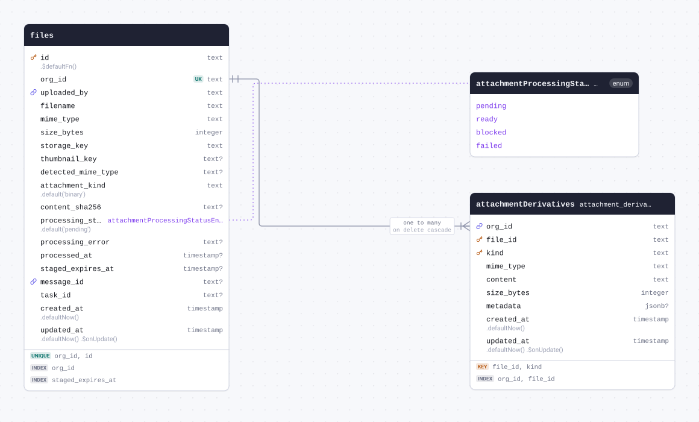

| Column       | Type        | Constraints                             | Default                        | Description |
| ------------ | ----------- | --------------------------------------- | ------------------------------ | ----------- |
| `org_id`     | `text`      | NOT NULL → [files.org_id](#table-files) |                                |             |
| `file_id`    | `text`      | PK NOT NULL                             |                                |             |
| `kind`       | `text`      | PK NOT NULL                             |                                |             |
| `mime_type`  | `text`      | NOT NULL                                |                                |             |
| `content`    | `text`      | NOT NULL                                |                                |             |
| `size_bytes` | `integer`   | NOT NULL                                |                                |             |
| `metadata`   | `jsonb`     | NULL                                    |                                |             |
| `created_at` | `timestamp` | NOT NULL                                | `.defaultNow()`                |             |
| `updated_at` | `timestamp` | NOT NULL                                | `.defaultNow()` `.$onUpdate()` |             |

#### Definition

```sql
CREATE TABLE "attachment_derivatives" (
	"org_id" text NOT NULL,
	"file_id" text,
	"kind" text,
	"mime_type" text NOT NULL,
	"content" text NOT NULL,
	"size_bytes" integer NOT NULL,
	"metadata" jsonb,
	"created_at" timestamp DEFAULT now() NOT NULL,
	"updated_at" timestamp DEFAULT now() NOT NULL,
	CONSTRAINT "attachment_derivatives_pkey" PRIMARY KEY("file_id","kind"),
	CONSTRAINT "attachment_derivatives_size_check" CHECK ("size_bytes" >= 0)
);

CREATE INDEX "attachment_derivatives_org_file_idx" ON "attachment_derivatives" ("org_id","file_id");

ALTER TABLE "attachment_derivatives" ADD CONSTRAINT "attachment_derivatives_org_file_fk" FOREIGN KEY ("org_id","file_id") REFERENCES "files"("org_id","id") ON DELETE CASCADE;
```

#### Indexes

- PRIMARY KEY `file_id`, `kind`
- INDEX `org_id`, `file_id`

#### References

- `org_id` → [files.org_id](#table-files) (many to one, on delete cascade)

<details>
<summary>Queries and their SQL</summary>

**Select**: Every row of attachmentDerivatives.

```ts
db.select().from(attachmentDerivatives);
```

```sql
select "org_id", "file_id", "kind", "mime_type", "content", "size_bytes", "metadata", "created_at", "updated_at"
from "attachment_derivatives"
```

**Count**: How many rows attachmentDerivatives has.

```ts
db.select({ count: count() }).from(attachmentDerivatives);
```

```sql
select count(*)
from "attachment_derivatives"
```

**Find many**: The rows of attachmentDerivatives, through the relational query API.

```ts
db.query.attachmentDerivatives.findMany();
```

```sql
select "d0"."org_id" as "org_id", "d0"."file_id" as "file_id", "d0"."kind" as "kind", "d0"."mime_type" as "mime_type", "d0"."content" as "content", "d0"."size_bytes" as "size_bytes", "d0"."metadata" as "metadata", "d0"."created_at" as "created_at", "d0"."updated_at" as "updated_at"
from "attachment_derivatives" as "d0"
```

**Find by primary key**: One row of attachmentDerivatives, through the relational query API.

```ts
db.query.attachmentDerivatives.findFirst({ where: { file_id: "file_id", kind: "kind" } });
```

```sql
select "d0"."org_id" as "org_id", "d0"."file_id" as "file_id", "d0"."kind" as "kind", "d0"."mime_type" as "mime_type", "d0"."content" as "content", "d0"."size_bytes" as "size_bytes", "d0"."metadata" as "metadata", "d0"."created_at" as "created_at", "d0"."updated_at" as "updated_at"
from "attachment_derivatives" as "d0"
where (("d0"."file_id" = $1) and ("d0"."kind" = $2))
limit $3
-- params: ["file_id","kind",1]
```

**Insert**: Adds a row to attachmentDerivatives, giving the columns that have no default.

```ts
db.insert(attachmentDerivatives).values({
  org_id: "org_id",
  file_id: "file_id",
  kind: "kind",
  mime_type: "mime_type",
  content: "content",
  size_bytes: 1,
});
```

```sql
insert into "attachment_derivatives" ("org_id", "file_id", "kind", "mime_type", "content", "size_bytes", "metadata", "created_at", "updated_at")
values ($1, $2, $3, $4, $5, $6, default, default, default)
-- params: ["org_id","file_id","kind","mime_type","content",1]
```

**Update**: Changes a row of attachmentDerivatives, found by its primary key.

```ts
db.update(attachmentDerivatives)
  .set({ org_id: "org_id" })
  .where(and(eq(attachmentDerivatives.file_id, "file_id"), eq(attachmentDerivatives.kind, "kind")));
```

```sql
update "attachment_derivatives"
set "org_id" = $1, "updated_at" = $2
where (("attachment_derivatives"."file_id" = $3) and ("attachment_derivatives"."kind" = $4))
-- params: ["org_id","2026-01-01T00:00:00.000Z","file_id","kind"]
```

**Delete**: Deletes a row of attachmentDerivatives, found by its primary key.

```ts
db.delete(attachmentDerivatives).where(
  and(eq(attachmentDerivatives.file_id, "file_id"), eq(attachmentDerivatives.kind, "kind")),
);
```

```sql
delete from "attachment_derivatives"
where (("attachment_derivatives"."file_id" = $1) and ("attachment_derivatives"."kind" = $2))
-- params: ["file_id","kind"]
```

</details>

<a id="table-projects"></a>

### projects

═══ PROJECTS ═══

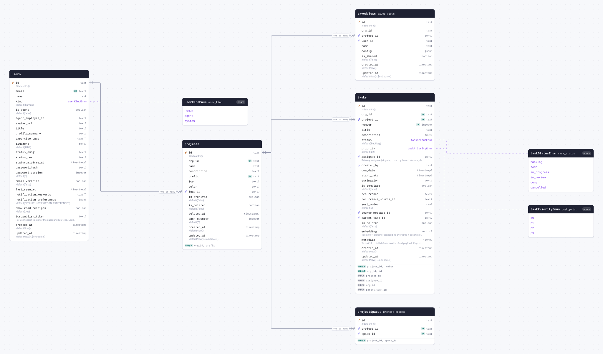

| Column         | Type        | Constraints                     | Default                        | Description |
| -------------- | ----------- | ------------------------------- | ------------------------------ | ----------- |
| `id`           | `text`      | PK NOT NULL                     | `.$defaultFn()`                |             |
| `org_id`       | `text`      | NOT NULL                        |                                |             |
| `name`         | `text`      | NOT NULL                        |                                |             |
| `description`  | `text`      | NULL                            |                                |             |
| `prefix`       | `text`      | NOT NULL                        |                                |             |
| `icon`         | `text`      | NULL                            |                                |             |
| `color`        | `text`      | NULL                            |                                |             |
| `lead_id`      | `text`      | NULL → [users.id](#table-users) |                                |             |
| `is_archived`  | `boolean`   | NOT NULL                        | `.default(false)`              |             |
| `is_deleted`   | `boolean`   | NOT NULL                        | `.default(false)`              |             |
| `deleted_at`   | `timestamp` | NULL                            |                                |             |
| `task_counter` | `integer`   | NOT NULL                        | `.default(0)`                  |             |
| `created_at`   | `timestamp` | NOT NULL                        | `.defaultNow()`                |             |
| `updated_at`   | `timestamp` | NOT NULL                        | `.defaultNow()` `.$onUpdate()` |             |

#### Definition

```sql
CREATE TABLE "projects" (
	"id" text PRIMARY KEY,
	"org_id" text NOT NULL,
	"name" text NOT NULL,
	"description" text,
	"prefix" text NOT NULL,
	"icon" text,
	"color" text,
	"lead_id" text,
	"is_archived" boolean DEFAULT false NOT NULL,
	"is_deleted" boolean DEFAULT false NOT NULL,
	"deleted_at" timestamp,
	"task_counter" integer DEFAULT 0 NOT NULL,
	"created_at" timestamp DEFAULT now() NOT NULL,
	"updated_at" timestamp DEFAULT now() NOT NULL
);

CREATE UNIQUE INDEX "project_prefix_unique" ON "projects" ("org_id","prefix");

ALTER TABLE "projects" ADD CONSTRAINT "projects_lead_id_users_id_fkey" FOREIGN KEY ("lead_id") REFERENCES "users"("id");
```

#### Indexes

- UNIQUE `org_id`, `prefix`

#### References

- `lead_id` → [users.id](#table-users) (many to one)

#### Referenced by

- `id` → [projectSpaces.project_id](#table-projectSpaces) (one to many)
- `id` → [tasks.project_id](#table-tasks) (one to many)
- `id` → [savedViews.project_id](#table-savedViews) (one to many)

<details>
<summary>Queries and their SQL</summary>

**Select**: Every row of projects.

```ts
db.select().from(projects);
```

```sql
select "id", "org_id", "name", "description", "prefix", "icon", "color", "lead_id", "is_archived", "is_deleted", "deleted_at", "task_counter", "created_at", "updated_at"
from "projects"
```

**Count**: How many rows projects has.

```ts
db.select({ count: count() }).from(projects);
```

```sql
select count(*)
from "projects"
```

**Find many**: The rows of projects, through the relational query API.

```ts
db.query.projects.findMany();
```

```sql
select "d0"."id" as "id", "d0"."org_id" as "org_id", "d0"."name" as "name", "d0"."description" as "description", "d0"."prefix" as "prefix", "d0"."icon" as "icon", "d0"."color" as "color", "d0"."lead_id" as "lead_id", "d0"."is_archived" as "is_archived", "d0"."is_deleted" as "is_deleted", "d0"."deleted_at" as "deleted_at", "d0"."task_counter" as "task_counter", "d0"."created_at" as "created_at", "d0"."updated_at" as "updated_at"
from "projects" as "d0"
```

**Find by primary key**: One row of projects, through the relational query API.

```ts
db.query.projects.findFirst({ where: { id: "id" } });
```

```sql
select "d0"."id" as "id", "d0"."org_id" as "org_id", "d0"."name" as "name", "d0"."description" as "description", "d0"."prefix" as "prefix", "d0"."icon" as "icon", "d0"."color" as "color", "d0"."lead_id" as "lead_id", "d0"."is_archived" as "is_archived", "d0"."is_deleted" as "is_deleted", "d0"."deleted_at" as "deleted_at", "d0"."task_counter" as "task_counter", "d0"."created_at" as "created_at", "d0"."updated_at" as "updated_at"
from "projects" as "d0"
where "d0"."id" = $1
limit $2
-- params: ["id",1]
```

**Insert**: Adds a row to projects, giving the columns that have no default.

```ts
db.insert(projects).values({ org_id: "org_id", name: "name", prefix: "prefix" });
```

```sql
insert into "projects" ("id", "org_id", "name", "description", "prefix", "icon", "color", "lead_id", "is_archived", "is_deleted", "deleted_at", "task_counter", "created_at", "updated_at")
values ($1, $2, $3, default, $4, default, default, default, default, default, default, default, default, default)
-- params: ["00000000-0000-4000-8000-000000000000","org_id","name","prefix"]
```

**Update**: Changes a row of projects, found by its primary key.

```ts
db.update(projects).set({ org_id: "org_id" }).where(eq(projects.id, "id"));
```

```sql
update "projects"
set "org_id" = $1, "updated_at" = $2
where "projects"."id" = $3
-- params: ["org_id","2026-01-01T00:00:00.000Z","id"]
```

**Delete**: Deletes a row of projects, found by its primary key.

```ts
db.delete(projects).where(eq(projects.id, "id"));
```

```sql
delete from "projects"
where "projects"."id" = $1
-- params: ["id"]
```

</details>

<a id="table-projectSpaces"></a>

### projectSpaces

Table `project_spaces`. ═══ PROJECT ↔ SPACE LINKS ═══

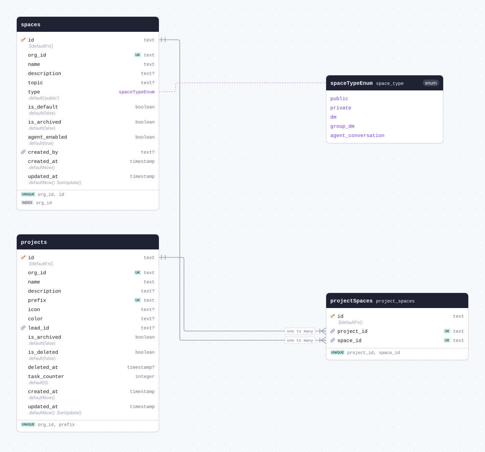

| Column       | Type   | Constraints                               | Default         | Description |
| ------------ | ------ | ----------------------------------------- | --------------- | ----------- |
| `id`         | `text` | PK NOT NULL                               | `.$defaultFn()` |             |
| `project_id` | `text` | NOT NULL → [projects.id](#table-projects) |                 |             |
| `space_id`   | `text` | NOT NULL → [spaces.id](#table-spaces)     |                 |             |

#### Definition

```sql
CREATE TABLE "project_spaces" (
	"id" text PRIMARY KEY,
	"project_id" text NOT NULL,
	"space_id" text NOT NULL
);

CREATE UNIQUE INDEX "project_space_unique" ON "project_spaces" ("project_id","space_id");

ALTER TABLE "project_spaces" ADD CONSTRAINT "project_spaces_project_id_projects_id_fkey" FOREIGN KEY ("project_id") REFERENCES "projects"("id");

ALTER TABLE "project_spaces" ADD CONSTRAINT "project_spaces_space_id_spaces_id_fkey" FOREIGN KEY ("space_id") REFERENCES "spaces"("id");
```

#### Indexes

- UNIQUE `project_id`, `space_id`

#### References

- `project_id` → [projects.id](#table-projects) (many to one)
- `space_id` → [spaces.id](#table-spaces) (many to one)

<details>
<summary>Queries and their SQL</summary>

**Select**: Every row of projectSpaces.

```ts
db.select().from(projectSpaces);
```

```sql
select "id", "project_id", "space_id"
from "project_spaces"
```

**Count**: How many rows projectSpaces has.

```ts
db.select({ count: count() }).from(projectSpaces);
```

```sql
select count(*)
from "project_spaces"
```

**Find many**: The rows of projectSpaces, through the relational query API.

```ts
db.query.projectSpaces.findMany();
```

```sql
select "d0"."id" as "id", "d0"."project_id" as "project_id", "d0"."space_id" as "space_id"
from "project_spaces" as "d0"
```

**Find by primary key**: One row of projectSpaces, through the relational query API.

```ts
db.query.projectSpaces.findFirst({ where: { id: "id" } });
```

```sql
select "d0"."id" as "id", "d0"."project_id" as "project_id", "d0"."space_id" as "space_id"
from "project_spaces" as "d0"
where "d0"."id" = $1
limit $2
-- params: ["id",1]
```

**Insert**: Adds a row to projectSpaces, giving the columns that have no default.

```ts
db.insert(projectSpaces).values({ project_id: "project_id", space_id: "space_id" });
```

```sql
insert into "project_spaces" ("id", "project_id", "space_id")
values ($1, $2, $3)
-- params: ["00000000-0000-4000-8000-000000000000","project_id","space_id"]
```

**Update**: Changes a row of projectSpaces, found by its primary key.

```ts
db.update(projectSpaces).set({ project_id: "project_id" }).where(eq(projectSpaces.id, "id"));
```

```sql
update "project_spaces"
set "project_id" = $1
where "project_spaces"."id" = $2
-- params: ["project_id","id"]
```

**Delete**: Deletes a row of projectSpaces, found by its primary key.

```ts
db.delete(projectSpaces).where(eq(projectSpaces.id, "id"));
```

```sql
delete from "project_spaces"
where "project_spaces"."id" = $1
-- params: ["id"]
```

</details>

<a id="table-tasks"></a>

### tasks

═══ TASKS ═══

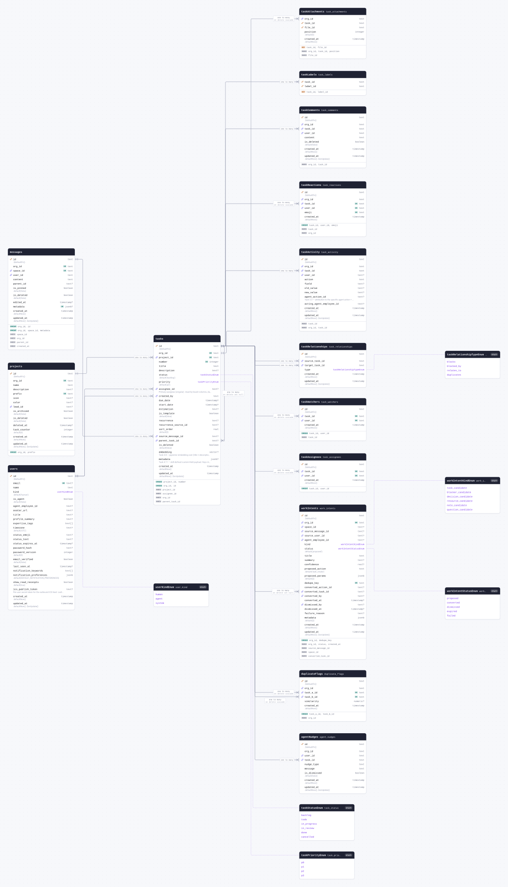

| Column                 | Type                                         | Constraints                               | Default                        | Description                                                                                                                                                                                                                                                                                                    |
| ---------------------- | -------------------------------------------- | ----------------------------------------- | ------------------------------ | -------------------------------------------------------------------------------------------------------------------------------------------------------------------------------------------------------------------------------------------------------------------------------------------------------------- |
| `id`                   | `text`                                       | PK NOT NULL                               | `.$defaultFn()`                |                                                                                                                                                                                                                                                                                                                |
| `org_id`               | `text`                                       | NOT NULL                                  |                                |                                                                                                                                                                                                                                                                                                                |
| `project_id`           | `text`                                       | NOT NULL → [projects.id](#table-projects) |                                |                                                                                                                                                                                                                                                                                                                |
| `number`               | `integer`                                    | NOT NULL                                  |                                |                                                                                                                                                                                                                                                                                                                |
| `title`                | `text`                                       | NOT NULL                                  |                                |                                                                                                                                                                                                                                                                                                                |
| `description`          | `text`                                       | NULL                                      |                                |                                                                                                                                                                                                                                                                                                                |
| `status`               | [`taskStatusEnum`](#enum-taskStatusEnum)     | NOT NULL                                  | `.default('backlog')`          |                                                                                                                                                                                                                                                                                                                |
| `priority`             | [`taskPriorityEnum`](#enum-taskPriorityEnum) | NOT NULL                                  | `.default('p2')`               |                                                                                                                                                                                                                                                                                                                |
| `assignee_id`          | `text`                                       | NULL → [users.id](#table-users)           |                                | Primary assignee (singular). Used by board columns, dashboard "My Tasks", nudge targeting, and status-change notifications. Every task has exactly one primary assignee or null.                                                                                                                               |
| `created_by`           | `text`                                       | NOT NULL → [users.id](#table-users)       |                                |                                                                                                                                                                                                                                                                                                                |
| `due_date`             | `timestamp`                                  | NULL                                      |                                |                                                                                                                                                                                                                                                                                                                |
| `start_date`           | `timestamp`                                  | NULL                                      |                                |                                                                                                                                                                                                                                                                                                                |
| `estimation`           | `text`                                       | NULL                                      |                                |                                                                                                                                                                                                                                                                                                                |
| `is_template`          | `boolean`                                    | NOT NULL                                  | `.default(false)`              |                                                                                                                                                                                                                                                                                                                |
| `recurrence`           | `text`                                       | NULL                                      |                                |                                                                                                                                                                                                                                                                                                                |
| `recurrence_source_id` | `text`                                       | NULL                                      |                                |                                                                                                                                                                                                                                                                                                                |
| `sort_order`           | `real`                                       | NOT NULL                                  | `.default(0)`                  |                                                                                                                                                                                                                                                                                                                |
| `source_message_id`    | `text`                                       | NULL → [messages.id](#table-messages)     |                                |                                                                                                                                                                                                                                                                                                                |
| `parent_task_id`       | `text`                                       | NULL → [tasks.id](#table-tasks)           |                                |                                                                                                                                                                                                                                                                                                                |
| `is_deleted`           | `boolean`                                    | NOT NULL                                  | `.default(false)`              |                                                                                                                                                                                                                                                                                                                |
| `embedding`            | `vector`                                     | NULL                                      |                                | Task 3.8 — pgvector embedding over (title + description) for semantic search via retrieveContext({ types: ['tasks'] }). Populated by the embed-content worker (source_type: 'task') and backfilled via backfill-task-embeddings.ts.                                                                            |
| `metadata`             | `jsonb`                                      | NULL                                      |                                | Task 4.11 — skill-defined custom-field payload. Keys match the `id`s in the resolved skill config's `custom_fields[]` (e.g. Sales skill stores `deal_value`, `contact_name`). Null for tasks in projects with no custom fields. Not covered by tasks.search_vector (FTS still scans title + description only). |
| `created_at`           | `timestamp`                                  | NOT NULL                                  | `.defaultNow()`                |                                                                                                                                                                                                                                                                                                                |
| `updated_at`           | `timestamp`                                  | NOT NULL                                  | `.defaultNow()` `.$onUpdate()` |                                                                                                                                                                                                                                                                                                                |

#### Definition

```sql
CREATE TABLE "tasks" (
	"id" text PRIMARY KEY,
	"org_id" text NOT NULL,
	"project_id" text NOT NULL,
	"number" integer NOT NULL,
	"title" text NOT NULL,
	"description" text,
	"status" "task_status" DEFAULT 'backlog'::"task_status" NOT NULL,
	"priority" "task_priority" DEFAULT 'p2'::"task_priority" NOT NULL,
	"assignee_id" text,
	"created_by" text NOT NULL,
	"due_date" timestamp,
	"start_date" timestamp,
	"estimation" text,
	"is_template" boolean DEFAULT false NOT NULL,
	"recurrence" text,
	"recurrence_source_id" text,
	"sort_order" real DEFAULT 0 NOT NULL,
	"source_message_id" text,
	"parent_task_id" text,
	"is_deleted" boolean DEFAULT false NOT NULL,
	"embedding" vector(1536),
	"metadata" jsonb,
	"created_at" timestamp DEFAULT now() NOT NULL,
	"updated_at" timestamp DEFAULT now() NOT NULL,
	CONSTRAINT "tasks_org_id_id_unique" UNIQUE("org_id","id")
);

CREATE INDEX "task_project_idx" ON "tasks" ("project_id");

CREATE INDEX "task_assignee_idx" ON "tasks" ("assignee_id");

CREATE INDEX "task_org_idx" ON "tasks" ("org_id");

CREATE INDEX "task_parent_idx" ON "tasks" ("parent_task_id");

CREATE UNIQUE INDEX "task_number_unique" ON "tasks" ("project_id","number");

ALTER TABLE "tasks" ADD CONSTRAINT "tasks_project_id_projects_id_fkey" FOREIGN KEY ("project_id") REFERENCES "projects"("id");

ALTER TABLE "tasks" ADD CONSTRAINT "tasks_assignee_id_users_id_fkey" FOREIGN KEY ("assignee_id") REFERENCES "users"("id");

ALTER TABLE "tasks" ADD CONSTRAINT "tasks_created_by_users_id_fkey" FOREIGN KEY ("created_by") REFERENCES "users"("id");

ALTER TABLE "tasks" ADD CONSTRAINT "tasks_source_message_id_messages_id_fkey" FOREIGN KEY ("source_message_id") REFERENCES "messages"("id");

ALTER TABLE "tasks" ADD CONSTRAINT "tasks_parent_task_id_tasks_id_fkey" FOREIGN KEY ("parent_task_id") REFERENCES "tasks"("id") ON DELETE SET NULL;
```

#### Indexes

- INDEX `project_id`
- INDEX `assignee_id`
- INDEX `org_id`
- INDEX `parent_task_id`
- UNIQUE `project_id`, `number`
- UNIQUE `org_id`, `id`

#### References

- `project_id` → [projects.id](#table-projects) (many to one)
- `assignee_id` → [users.id](#table-users) (many to one)
- `created_by` → [users.id](#table-users) (many to one)
- `source_message_id` → [messages.id](#table-messages) (many to one)
- `parent_task_id` → [tasks.id](#table-tasks) (many to one, on delete set null)

#### Referenced by

- `id` → [tasks.parent_task_id](#table-tasks) (one to many, on delete set null)
- `org_id` → [taskAttachments.org_id](#table-taskAttachments) (one to many, on delete cascade)
- `id` → [taskLabels.task_id](#table-taskLabels) (one to many)
- `id` → [taskComments.task_id](#table-taskComments) (one to many)
- `id` → [taskReactions.task_id](#table-taskReactions) (one to many, on delete cascade)
- `id` → [taskActivity.task_id](#table-taskActivity) (one to many)
- `id` → [taskRelationships.source_task_id](#table-taskRelationships) (one to many)
- `id` → [taskRelationships.target_task_id](#table-taskRelationships) (one to many)
- `id` → [taskWatchers.task_id](#table-taskWatchers) (one to many, on delete cascade)
- `id` → [taskAssignees.task_id](#table-taskAssignees) (one to many, on delete cascade)
- `id` → [workIntents.converted_task_id](#table-workIntents) (one to many, on delete set null)
- `id` → [duplicateFlags.task_a_id](#table-duplicateFlags) (one to many, on delete cascade)
- `id` → [duplicateFlags.task_b_id](#table-duplicateFlags) (one to many, on delete cascade)
- `id` → [agentNudges.task_id](#table-agentNudges) (one to many)

<details>
<summary>Queries and their SQL</summary>

**Select**: Every row of tasks.

```ts
db.select().from(tasks);
```

```sql
select "id", "org_id", "project_id", "number", "title", "description", "status", "priority", "assignee_id", "created_by", "due_date", "start_date", "estimation", "is_template", "recurrence", "recurrence_source_id", "sort_order", "source_message_id", "parent_task_id", "is_deleted", "embedding", "metadata", "created_at", "updated_at"
from "tasks"
```

**Count**: How many rows tasks has.

```ts
db.select({ count: count() }).from(tasks);
```

```sql
select count(*)
from "tasks"
```

**Find many**: The rows of tasks, through the relational query API.

```ts
db.query.tasks.findMany();
```

```sql
select "d0"."id" as "id", "d0"."org_id" as "org_id", "d0"."project_id" as "project_id", "d0"."number" as "number", "d0"."title" as "title", "d0"."description" as "description", "d0"."status" as "status", "d0"."priority" as "priority", "d0"."assignee_id" as "assignee_id", "d0"."created_by" as "created_by", "d0"."due_date" as "due_date", "d0"."start_date" as "start_date", "d0"."estimation" as "estimation", "d0"."is_template" as "is_template", "d0"."recurrence" as "recurrence", "d0"."recurrence_source_id" as "recurrence_source_id", "d0"."sort_order" as "sort_order", "d0"."source_message_id" as "source_message_id", "d0"."parent_task_id" as "parent_task_id", "d0"."is_deleted" as "is_deleted", "d0"."embedding" as "embedding", "d0"."metadata" as "metadata", "d0"."created_at" as "created_at", "d0"."updated_at" as "updated_at"
from "tasks" as "d0"
```

**Find by primary key**: One row of tasks, through the relational query API.

```ts
db.query.tasks.findFirst({ where: { id: "id" } });
```

```sql
select "d0"."id" as "id", "d0"."org_id" as "org_id", "d0"."project_id" as "project_id", "d0"."number" as "number", "d0"."title" as "title", "d0"."description" as "description", "d0"."status" as "status", "d0"."priority" as "priority", "d0"."assignee_id" as "assignee_id", "d0"."created_by" as "created_by", "d0"."due_date" as "due_date", "d0"."start_date" as "start_date", "d0"."estimation" as "estimation", "d0"."is_template" as "is_template", "d0"."recurrence" as "recurrence", "d0"."recurrence_source_id" as "recurrence_source_id", "d0"."sort_order" as "sort_order", "d0"."source_message_id" as "source_message_id", "d0"."parent_task_id" as "parent_task_id", "d0"."is_deleted" as "is_deleted", "d0"."embedding" as "embedding", "d0"."metadata" as "metadata", "d0"."created_at" as "created_at", "d0"."updated_at" as "updated_at"
from "tasks" as "d0"
where "d0"."id" = $1
limit $2
-- params: ["id",1]
```

**Insert**: Adds a row to tasks, giving the columns that have no default.

```ts
db.insert(tasks).values({
  org_id: "org_id",
  project_id: "project_id",
  number: 1,
  title: "title",
  created_by: "created_by",
});
```

```sql
insert into "tasks" ("id", "org_id", "project_id", "number", "title", "description", "status", "priority", "assignee_id", "created_by", "due_date", "start_date", "estimation", "is_template", "recurrence", "recurrence_source_id", "sort_order", "source_message_id", "parent_task_id", "is_deleted", "embedding", "metadata", "created_at", "updated_at")
values ($1, $2, $3, $4, $5, default, default, default, default, $6, default, default, default, default, default, default, default, default, default, default, default, default, default, default)
-- params: ["00000000-0000-4000-8000-000000000000","org_id","project_id",1,"title","created_by"]
```

**Update**: Changes a row of tasks, found by its primary key.

```ts
db.update(tasks).set({ org_id: "org_id" }).where(eq(tasks.id, "id"));
```

```sql
update "tasks"
set "org_id" = $1, "updated_at" = $2
where "tasks"."id" = $3
-- params: ["org_id","2026-01-01T00:00:00.000Z","id"]
```

**Delete**: Deletes a row of tasks, found by its primary key.

```ts
db.delete(tasks).where(eq(tasks.id, "id"));
```

```sql
delete from "tasks"
where "tasks"."id" = $1
-- params: ["id"]
```

</details>

<a id="table-messageAttachments"></a>

### messageAttachments

Table `message_attachments`. ═══ TYPED ATTACHMENT LINKS ═══ Legacy files.message_id/task_id stay in place during the expand-and-contract window. New writes are mirrored here so every target link carries an explicit tenant boundary and deterministic ordering.

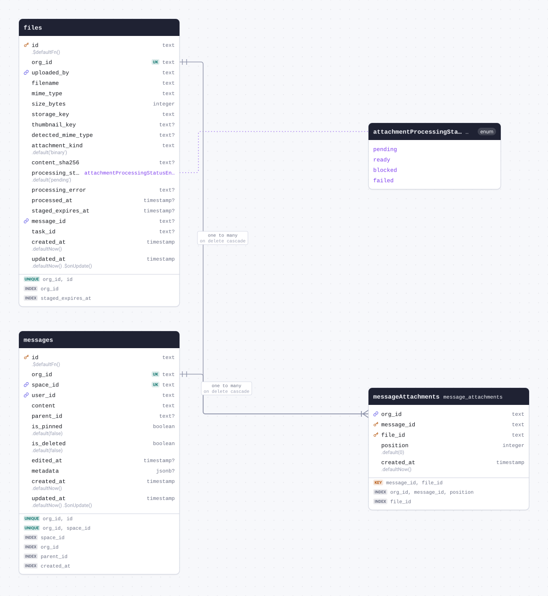

| Column       | Type        | Constraints                                   | Default         | Description |
| ------------ | ----------- | --------------------------------------------- | --------------- | ----------- |
| `org_id`     | `text`      | NOT NULL → [messages.org_id](#table-messages) |                 |             |
| `message_id` | `text`      | PK NOT NULL                                   |                 |             |
| `file_id`    | `text`      | PK NOT NULL                                   |                 |             |
| `position`   | `integer`   | NOT NULL                                      | `.default(0)`   |             |
| `created_at` | `timestamp` | NOT NULL                                      | `.defaultNow()` |             |

#### Definition

```sql
CREATE TABLE "message_attachments" (
	"org_id" text NOT NULL,
	"message_id" text,
	"file_id" text,
	"position" integer DEFAULT 0 NOT NULL,
	"created_at" timestamp DEFAULT now() NOT NULL,
	CONSTRAINT "message_attachments_pkey" PRIMARY KEY("message_id","file_id"),
	CONSTRAINT "message_attachments_position_check" CHECK ("position" >= 0)
);

CREATE INDEX "message_attachments_org_message_position_idx" ON "message_attachments" ("org_id","message_id","position");

CREATE INDEX "message_attachments_file_idx" ON "message_attachments" ("file_id");

ALTER TABLE "message_attachments" ADD CONSTRAINT "message_attachments_org_message_fk" FOREIGN KEY ("org_id","message_id") REFERENCES "messages"("org_id","id") ON DELETE CASCADE;

ALTER TABLE "message_attachments" ADD CONSTRAINT "message_attachments_org_file_fk" FOREIGN KEY ("org_id","file_id") REFERENCES "files"("org_id","id") ON DELETE CASCADE;
```

#### Indexes

- PRIMARY KEY `message_id`, `file_id`
- INDEX `org_id`, `message_id`, `position`
- INDEX `file_id`

#### References

- `org_id` → [messages.org_id](#table-messages) (many to one, on delete cascade)
- `org_id` → [files.org_id](#table-files) (many to one, on delete cascade)

<details>
<summary>Queries and their SQL</summary>

**Select**: Every row of messageAttachments.

```ts
db.select().from(messageAttachments);
```

```sql
select "org_id", "message_id", "file_id", "position", "created_at"
from "message_attachments"
```

**Count**: How many rows messageAttachments has.

```ts
db.select({ count: count() }).from(messageAttachments);
```

```sql
select count(*)
from "message_attachments"
```

**Find many**: The rows of messageAttachments, through the relational query API.

```ts
db.query.messageAttachments.findMany();
```

```sql
select "d0"."org_id" as "org_id", "d0"."message_id" as "message_id", "d0"."file_id" as "file_id", "d0"."position" as "position", "d0"."created_at" as "created_at"
from "message_attachments" as "d0"
```

**Find by primary key**: One row of messageAttachments, through the relational query API.

```ts
db.query.messageAttachments.findFirst({ where: { message_id: "message_id", file_id: "file_id" } });
```

```sql
select "d0"."org_id" as "org_id", "d0"."message_id" as "message_id", "d0"."file_id" as "file_id", "d0"."position" as "position", "d0"."created_at" as "created_at"
from "message_attachments" as "d0"
where (("d0"."message_id" = $1) and ("d0"."file_id" = $2))
limit $3
-- params: ["message_id","file_id",1]
```

**Insert**: Adds a row to messageAttachments, giving the columns that have no default.

```ts
db.insert(messageAttachments).values({
  org_id: "org_id",
  message_id: "message_id",
  file_id: "file_id",
});
```

```sql
insert into "message_attachments" ("org_id", "message_id", "file_id", "position", "created_at")
values ($1, $2, $3, default, default)
-- params: ["org_id","message_id","file_id"]
```

**Update**: Changes a row of messageAttachments, found by its primary key.

```ts
db.update(messageAttachments)
  .set({ org_id: "org_id" })
  .where(
    and(eq(messageAttachments.message_id, "message_id"), eq(messageAttachments.file_id, "file_id")),
  );
```

```sql
update "message_attachments"
set "org_id" = $1
where (("message_attachments"."message_id" = $2) and ("message_attachments"."file_id" = $3))
-- params: ["org_id","message_id","file_id"]
```

**Delete**: Deletes a row of messageAttachments, found by its primary key.

```ts
db.delete(messageAttachments).where(
  and(eq(messageAttachments.message_id, "message_id"), eq(messageAttachments.file_id, "file_id")),
);
```

```sql
delete from "message_attachments"
where (("message_attachments"."message_id" = $1) and ("message_attachments"."file_id" = $2))
-- params: ["message_id","file_id"]
```

</details>

<a id="table-taskAttachments"></a>

### taskAttachments

Table `task_attachments`.

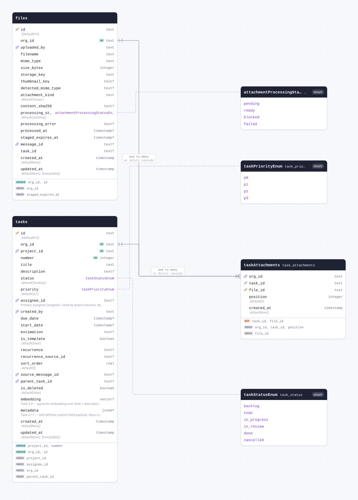

| Column       | Type        | Constraints                             | Default         | Description |
| ------------ | ----------- | --------------------------------------- | --------------- | ----------- |
| `org_id`     | `text`      | NOT NULL → [tasks.org_id](#table-tasks) |                 |             |
| `task_id`    | `text`      | PK NOT NULL                             |                 |             |
| `file_id`    | `text`      | PK NOT NULL                             |                 |             |
| `position`   | `integer`   | NOT NULL                                | `.default(0)`   |             |
| `created_at` | `timestamp` | NOT NULL                                | `.defaultNow()` |             |

#### Definition

```sql
CREATE TABLE "task_attachments" (
	"org_id" text NOT NULL,
	"task_id" text,
	"file_id" text,
	"position" integer DEFAULT 0 NOT NULL,
	"created_at" timestamp DEFAULT now() NOT NULL,
	CONSTRAINT "task_attachments_pkey" PRIMARY KEY("task_id","file_id"),
	CONSTRAINT "task_attachments_position_check" CHECK ("position" >= 0)
);

CREATE INDEX "task_attachments_org_task_position_idx" ON "task_attachments" ("org_id","task_id","position");

CREATE INDEX "task_attachments_file_idx" ON "task_attachments" ("file_id");

ALTER TABLE "task_attachments" ADD CONSTRAINT "task_attachments_org_task_fk" FOREIGN KEY ("org_id","task_id") REFERENCES "tasks"("org_id","id") ON DELETE CASCADE;

ALTER TABLE "task_attachments" ADD CONSTRAINT "task_attachments_org_file_fk" FOREIGN KEY ("org_id","file_id") REFERENCES "files"("org_id","id") ON DELETE CASCADE;
```

#### Indexes

- PRIMARY KEY `task_id`, `file_id`
- INDEX `org_id`, `task_id`, `position`
- INDEX `file_id`

#### References

- `org_id` → [tasks.org_id](#table-tasks) (many to one, on delete cascade)
- `org_id` → [files.org_id](#table-files) (many to one, on delete cascade)

<details>
<summary>Queries and their SQL</summary>

**Select**: Every row of taskAttachments.

```ts
db.select().from(taskAttachments);
```

```sql
select "org_id", "task_id", "file_id", "position", "created_at"
from "task_attachments"
```

**Count**: How many rows taskAttachments has.

```ts
db.select({ count: count() }).from(taskAttachments);
```

```sql
select count(*)
from "task_attachments"
```

**Find many**: The rows of taskAttachments, through the relational query API.

```ts
db.query.taskAttachments.findMany();
```

```sql
select "d0"."org_id" as "org_id", "d0"."task_id" as "task_id", "d0"."file_id" as "file_id", "d0"."position" as "position", "d0"."created_at" as "created_at"
from "task_attachments" as "d0"
```

**Find by primary key**: One row of taskAttachments, through the relational query API.

```ts
db.query.taskAttachments.findFirst({ where: { task_id: "task_id", file_id: "file_id" } });
```

```sql
select "d0"."org_id" as "org_id", "d0"."task_id" as "task_id", "d0"."file_id" as "file_id", "d0"."position" as "position", "d0"."created_at" as "created_at"
from "task_attachments" as "d0"
where (("d0"."task_id" = $1) and ("d0"."file_id" = $2))
limit $3
-- params: ["task_id","file_id",1]
```

**Insert**: Adds a row to taskAttachments, giving the columns that have no default.

```ts
db.insert(taskAttachments).values({ org_id: "org_id", task_id: "task_id", file_id: "file_id" });
```

```sql
insert into "task_attachments" ("org_id", "task_id", "file_id", "position", "created_at")
values ($1, $2, $3, default, default)
-- params: ["org_id","task_id","file_id"]
```

**Update**: Changes a row of taskAttachments, found by its primary key.

```ts
db.update(taskAttachments)
  .set({ org_id: "org_id" })
  .where(and(eq(taskAttachments.task_id, "task_id"), eq(taskAttachments.file_id, "file_id")));
```

```sql
update "task_attachments"
set "org_id" = $1
where (("task_attachments"."task_id" = $2) and ("task_attachments"."file_id" = $3))
-- params: ["org_id","task_id","file_id"]
```

**Delete**: Deletes a row of taskAttachments, found by its primary key.

```ts
db.delete(taskAttachments).where(
  and(eq(taskAttachments.task_id, "task_id"), eq(taskAttachments.file_id, "file_id")),
);
```

```sql
delete from "task_attachments"
where (("task_attachments"."task_id" = $1) and ("task_attachments"."file_id" = $2))
-- params: ["task_id","file_id"]
```

</details>

<a id="table-labels"></a>

### labels

═══ LABELS ═══

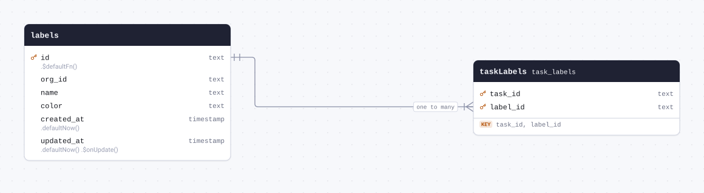

| Column       | Type        | Constraints | Default                        | Description |
| ------------ | ----------- | ----------- | ------------------------------ | ----------- |
| `id`         | `text`      | PK NOT NULL | `.$defaultFn()`                |             |
| `org_id`     | `text`      | NOT NULL    |                                |             |
| `name`       | `text`      | NOT NULL    |                                |             |
| `color`      | `text`      | NOT NULL    |                                |             |
| `created_at` | `timestamp` | NOT NULL    | `.defaultNow()`                |             |
| `updated_at` | `timestamp` | NOT NULL    | `.defaultNow()` `.$onUpdate()` |             |

#### Definition

```sql
CREATE TABLE "labels" (
	"id" text PRIMARY KEY,
	"org_id" text NOT NULL,
	"name" text NOT NULL,
	"color" text NOT NULL,
	"created_at" timestamp DEFAULT now() NOT NULL,
	"updated_at" timestamp DEFAULT now() NOT NULL
);
```

#### Referenced by

- `id` → [taskLabels.label_id](#table-taskLabels) (one to many)

<details>
<summary>Queries and their SQL</summary>

**Select**: Every row of labels.

```ts
db.select().from(labels);
```

```sql
select "id", "org_id", "name", "color", "created_at", "updated_at"
from "labels"
```

**Count**: How many rows labels has.

```ts
db.select({ count: count() }).from(labels);
```

```sql
select count(*)
from "labels"
```

**Find many**: The rows of labels, through the relational query API.

```ts
db.query.labels.findMany();
```

```sql
select "d0"."id" as "id", "d0"."org_id" as "org_id", "d0"."name" as "name", "d0"."color" as "color", "d0"."created_at" as "created_at", "d0"."updated_at" as "updated_at"
from "labels" as "d0"
```

**Find by primary key**: One row of labels, through the relational query API.

```ts
db.query.labels.findFirst({ where: { id: "id" } });
```

```sql
select "d0"."id" as "id", "d0"."org_id" as "org_id", "d0"."name" as "name", "d0"."color" as "color", "d0"."created_at" as "created_at", "d0"."updated_at" as "updated_at"
from "labels" as "d0"
where "d0"."id" = $1
limit $2
-- params: ["id",1]
```

**Insert**: Adds a row to labels, giving the columns that have no default.

```ts
db.insert(labels).values({ org_id: "org_id", name: "name", color: "color" });
```

```sql
insert into "labels" ("id", "org_id", "name", "color", "created_at", "updated_at")
values ($1, $2, $3, $4, default, default)
-- params: ["00000000-0000-4000-8000-000000000000","org_id","name","color"]
```

**Update**: Changes a row of labels, found by its primary key.

```ts
db.update(labels).set({ org_id: "org_id" }).where(eq(labels.id, "id"));
```

```sql
update "labels"
set "org_id" = $1, "updated_at" = $2
where "labels"."id" = $3
-- params: ["org_id","2026-01-01T00:00:00.000Z","id"]
```

**Delete**: Deletes a row of labels, found by its primary key.

```ts
db.delete(labels).where(eq(labels.id, "id"));
```

```sql
delete from "labels"
where "labels"."id" = $1
-- params: ["id"]
```

</details>

<a id="table-taskLabels"></a>

### taskLabels

Table `task_labels`.

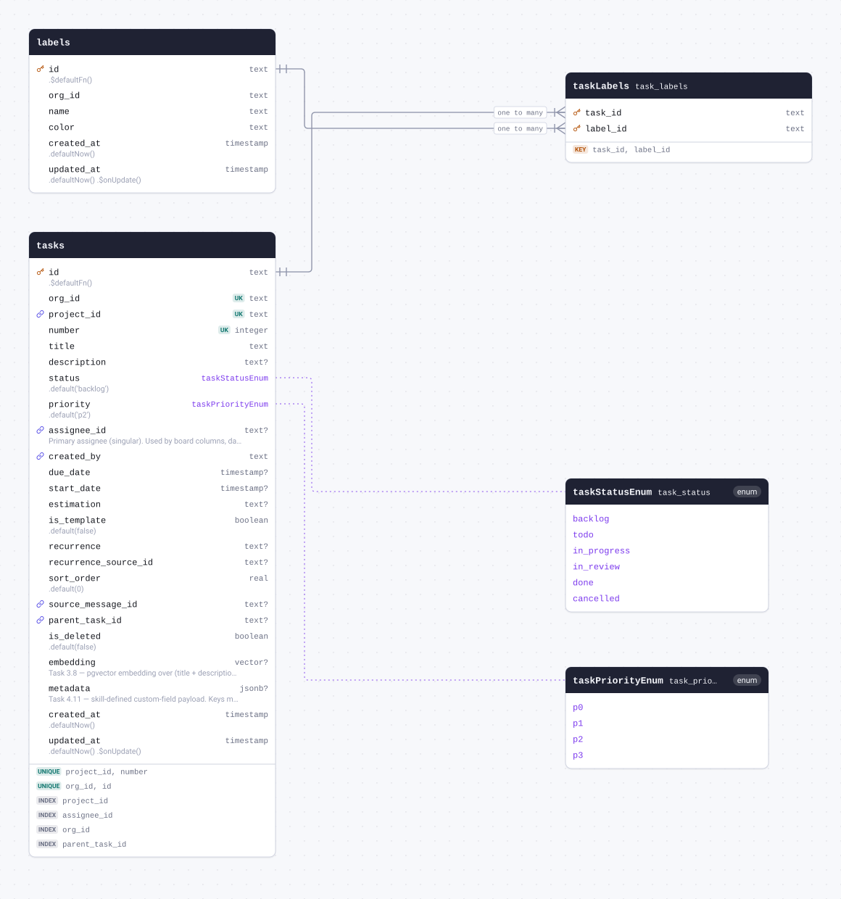

| Column     | Type   | Constraints                              | Default | Description |
| ---------- | ------ | ---------------------------------------- | ------- | ----------- |
| `task_id`  | `text` | PK NOT NULL → [tasks.id](#table-tasks)   |         |             |
| `label_id` | `text` | PK NOT NULL → [labels.id](#table-labels) |         |             |

#### Definition

```sql
CREATE TABLE "task_labels" (
	"task_id" text,
	"label_id" text,
	CONSTRAINT "task_labels_pkey" PRIMARY KEY("task_id","label_id")
);

ALTER TABLE "task_labels" ADD CONSTRAINT "task_labels_task_id_tasks_id_fkey" FOREIGN KEY ("task_id") REFERENCES "tasks"("id");

ALTER TABLE "task_labels" ADD CONSTRAINT "task_labels_label_id_labels_id_fkey" FOREIGN KEY ("label_id") REFERENCES "labels"("id");
```

#### Indexes

- PRIMARY KEY `task_id`, `label_id`

#### References

- `task_id` → [tasks.id](#table-tasks) (many to one)
- `label_id` → [labels.id](#table-labels) (many to one)

<details>
<summary>Queries and their SQL</summary>

**Select**: Every row of taskLabels.

```ts
db.select().from(taskLabels);
```

```sql
select "task_id", "label_id"
from "task_labels"
```

**Count**: How many rows taskLabels has.

```ts
db.select({ count: count() }).from(taskLabels);
```

```sql
select count(*)
from "task_labels"
```

**Find many**: The rows of taskLabels, through the relational query API.

```ts
db.query.taskLabels.findMany();
```

```sql
select "d0"."task_id" as "task_id", "d0"."label_id" as "label_id"
from "task_labels" as "d0"
```

**Find by primary key**: One row of taskLabels, through the relational query API.

```ts
db.query.taskLabels.findFirst({ where: { task_id: "task_id", label_id: "label_id" } });
```

```sql
select "d0"."task_id" as "task_id", "d0"."label_id" as "label_id"
from "task_labels" as "d0"
where (("d0"."task_id" = $1) and ("d0"."label_id" = $2))
limit $3
-- params: ["task_id","label_id",1]
```

**Insert**: Adds a row to taskLabels, giving the columns that have no default.

```ts
db.insert(taskLabels).values({ task_id: "task_id", label_id: "label_id" });
```

```sql
insert into "task_labels" ("task_id", "label_id")
values ($1, $2)
-- params: ["task_id","label_id"]
```

**Delete**: Deletes a row of taskLabels, found by its primary key.

```ts
db.delete(taskLabels).where(
  and(eq(taskLabels.task_id, "task_id"), eq(taskLabels.label_id, "label_id")),
);
```

```sql
delete from "task_labels"
where (("task_labels"."task_id" = $1) and ("task_labels"."label_id" = $2))
-- params: ["task_id","label_id"]
```

</details>

<a id="table-taskComments"></a>

### taskComments

Table `task_comments`. ═══ TASK COMMENTS ═══

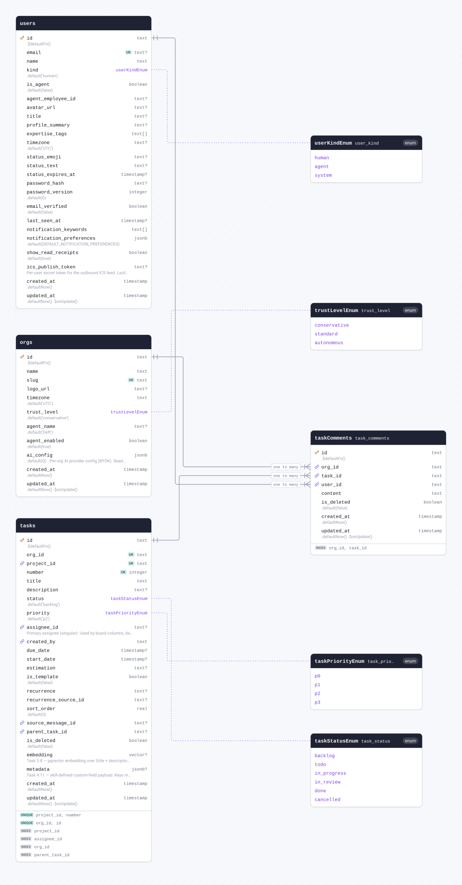

| Column       | Type        | Constraints                         | Default                        | Description |
| ------------ | ----------- | ----------------------------------- | ------------------------------ | ----------- |
| `id`         | `text`      | PK NOT NULL                         | `.$defaultFn()`                |             |
| `org_id`     | `text`      | NOT NULL → [orgs.id](#table-orgs)   |                                |             |
| `task_id`    | `text`      | NOT NULL → [tasks.id](#table-tasks) |                                |             |
| `user_id`    | `text`      | NOT NULL → [users.id](#table-users) |                                |             |
| `content`    | `text`      | NOT NULL                            |                                |             |
| `is_deleted` | `boolean`   | NOT NULL                            | `.default(false)`              |             |
| `created_at` | `timestamp` | NOT NULL                            | `.defaultNow()`                |             |
| `updated_at` | `timestamp` | NOT NULL                            | `.defaultNow()` `.$onUpdate()` |             |

#### Definition

```sql
CREATE TABLE "task_comments" (
	"id" text PRIMARY KEY,
	"org_id" text NOT NULL,
	"task_id" text NOT NULL,
	"user_id" text NOT NULL,
	"content" text NOT NULL,
	"is_deleted" boolean DEFAULT false NOT NULL,
	"created_at" timestamp DEFAULT now() NOT NULL,
	"updated_at" timestamp DEFAULT now() NOT NULL
);

CREATE INDEX "task_comments_org_task_idx" ON "task_comments" ("org_id","task_id");

ALTER TABLE "task_comments" ADD CONSTRAINT "task_comments_org_id_orgs_id_fkey" FOREIGN KEY ("org_id") REFERENCES "orgs"("id");

ALTER TABLE "task_comments" ADD CONSTRAINT "task_comments_task_id_tasks_id_fkey" FOREIGN KEY ("task_id") REFERENCES "tasks"("id");

ALTER TABLE "task_comments" ADD CONSTRAINT "task_comments_user_id_users_id_fkey" FOREIGN KEY ("user_id") REFERENCES "users"("id");
```

#### Indexes

- INDEX `org_id`, `task_id`

#### References

- `org_id` → [orgs.id](#table-orgs) (many to one)
- `task_id` → [tasks.id](#table-tasks) (many to one)
- `user_id` → [users.id](#table-users) (many to one)

<details>
<summary>Queries and their SQL</summary>

**Select**: Every row of taskComments.

```ts
db.select().from(taskComments);
```

```sql
select "id", "org_id", "task_id", "user_id", "content", "is_deleted", "created_at", "updated_at"
from "task_comments"
```

**Count**: How many rows taskComments has.

```ts
db.select({ count: count() }).from(taskComments);
```

```sql
select count(*)
from "task_comments"
```

**Find many**: The rows of taskComments, through the relational query API.

```ts
db.query.taskComments.findMany();
```

```sql
select "d0"."id" as "id", "d0"."org_id" as "org_id", "d0"."task_id" as "task_id", "d0"."user_id" as "user_id", "d0"."content" as "content", "d0"."is_deleted" as "is_deleted", "d0"."created_at" as "created_at", "d0"."updated_at" as "updated_at"
from "task_comments" as "d0"
```

**Find by primary key**: One row of taskComments, through the relational query API.

```ts
db.query.taskComments.findFirst({ where: { id: "id" } });
```

```sql
select "d0"."id" as "id", "d0"."org_id" as "org_id", "d0"."task_id" as "task_id", "d0"."user_id" as "user_id", "d0"."content" as "content", "d0"."is_deleted" as "is_deleted", "d0"."created_at" as "created_at", "d0"."updated_at" as "updated_at"
from "task_comments" as "d0"
where "d0"."id" = $1
limit $2
-- params: ["id",1]
```

**Insert**: Adds a row to taskComments, giving the columns that have no default.

```ts
db.insert(taskComments).values({
  org_id: "org_id",
  task_id: "task_id",
  user_id: "user_id",
  content: "content",
});
```

```sql
insert into "task_comments" ("id", "org_id", "task_id", "user_id", "content", "is_deleted", "created_at", "updated_at")
values ($1, $2, $3, $4, $5, default, default, default)
-- params: ["00000000-0000-4000-8000-000000000000","org_id","task_id","user_id","content"]
```

**Update**: Changes a row of taskComments, found by its primary key.

```ts
db.update(taskComments).set({ org_id: "org_id" }).where(eq(taskComments.id, "id"));
```

```sql
update "task_comments"
set "org_id" = $1, "updated_at" = $2
where "task_comments"."id" = $3
-- params: ["org_id","2026-01-01T00:00:00.000Z","id"]
```

**Delete**: Deletes a row of taskComments, found by its primary key.

```ts
db.delete(taskComments).where(eq(taskComments.id, "id"));
```

```sql
delete from "task_comments"
where "task_comments"."id" = $1
-- params: ["id"]
```

</details>

<a id="table-taskReactions"></a>

### taskReactions

Table `task_reactions`. ═══ TASK REACTIONS ═══ Task 6.3 — emoji reactions on tasks. A (task, user, emoji) tuple is unique; duplicate POST toggles off, DELETE removes explicitly.

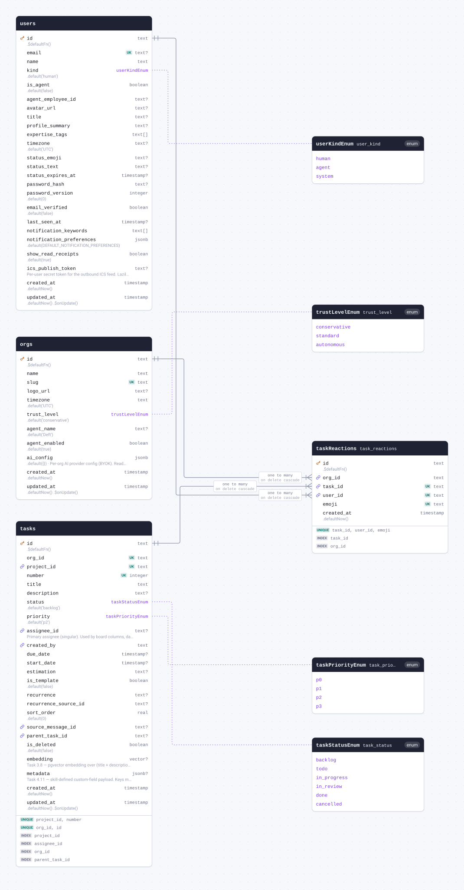

| Column       | Type        | Constraints                         | Default         | Description |
| ------------ | ----------- | ----------------------------------- | --------------- | ----------- |
| `id`         | `text`      | PK NOT NULL                         | `.$defaultFn()` |             |
| `org_id`     | `text`      | NOT NULL → [orgs.id](#table-orgs)   |                 |             |
| `task_id`    | `text`      | NOT NULL → [tasks.id](#table-tasks) |                 |             |
| `user_id`    | `text`      | NOT NULL → [users.id](#table-users) |                 |             |
| `emoji`      | `text`      | NOT NULL                            |                 |             |
| `created_at` | `timestamp` | NOT NULL                            | `.defaultNow()` |             |

#### Definition

```sql
CREATE TABLE "task_reactions" (
	"id" text PRIMARY KEY,
	"org_id" text NOT NULL,
	"task_id" text NOT NULL,
	"user_id" text NOT NULL,
	"emoji" text NOT NULL,
	"created_at" timestamp DEFAULT now() NOT NULL
);

CREATE UNIQUE INDEX "task_reactions_unique" ON "task_reactions" ("task_id","user_id","emoji");

CREATE INDEX "task_reactions_task_idx" ON "task_reactions" ("task_id");

CREATE INDEX "task_reactions_org_idx" ON "task_reactions" ("org_id");

ALTER TABLE "task_reactions" ADD CONSTRAINT "task_reactions_org_id_orgs_id_fkey" FOREIGN KEY ("org_id") REFERENCES "orgs"("id") ON DELETE CASCADE;

ALTER TABLE "task_reactions" ADD CONSTRAINT "task_reactions_task_id_tasks_id_fkey" FOREIGN KEY ("task_id") REFERENCES "tasks"("id") ON DELETE CASCADE;

ALTER TABLE "task_reactions" ADD CONSTRAINT "task_reactions_user_id_users_id_fkey" FOREIGN KEY ("user_id") REFERENCES "users"("id") ON DELETE CASCADE;
```

#### Indexes

- UNIQUE `task_id`, `user_id`, `emoji`
- INDEX `task_id`
- INDEX `org_id`

#### References

- `org_id` → [orgs.id](#table-orgs) (many to one, on delete cascade)
- `task_id` → [tasks.id](#table-tasks) (many to one, on delete cascade)
- `user_id` → [users.id](#table-users) (many to one, on delete cascade)

<details>
<summary>Queries and their SQL</summary>

**Select**: Every row of taskReactions.

```ts
db.select().from(taskReactions);
```

```sql
select "id", "org_id", "task_id", "user_id", "emoji", "created_at"
from "task_reactions"
```

**Count**: How many rows taskReactions has.

```ts
db.select({ count: count() }).from(taskReactions);
```

```sql
select count(*)
from "task_reactions"
```

**Find many**: The rows of taskReactions, through the relational query API.

```ts
db.query.taskReactions.findMany();
```

```sql
select "d0"."id" as "id", "d0"."org_id" as "org_id", "d0"."task_id" as "task_id", "d0"."user_id" as "user_id", "d0"."emoji" as "emoji", "d0"."created_at" as "created_at"
from "task_reactions" as "d0"
```

**Find by primary key**: One row of taskReactions, through the relational query API.

```ts
db.query.taskReactions.findFirst({ where: { id: "id" } });
```

```sql
select "d0"."id" as "id", "d0"."org_id" as "org_id", "d0"."task_id" as "task_id", "d0"."user_id" as "user_id", "d0"."emoji" as "emoji", "d0"."created_at" as "created_at"
from "task_reactions" as "d0"
where "d0"."id" = $1
limit $2
-- params: ["id",1]
```

**Insert**: Adds a row to taskReactions, giving the columns that have no default.

```ts
db.insert(taskReactions).values({
  org_id: "org_id",
  task_id: "task_id",
  user_id: "user_id",
  emoji: "emoji",
});
```

```sql
insert into "task_reactions" ("id", "org_id", "task_id", "user_id", "emoji", "created_at")
values ($1, $2, $3, $4, $5, default)
-- params: ["00000000-0000-4000-8000-000000000000","org_id","task_id","user_id","emoji"]
```

**Update**: Changes a row of taskReactions, found by its primary key.

```ts
db.update(taskReactions).set({ org_id: "org_id" }).where(eq(taskReactions.id, "id"));
```

```sql
update "task_reactions"
set "org_id" = $1
where "task_reactions"."id" = $2
-- params: ["org_id","id"]
```

**Delete**: Deletes a row of taskReactions, found by its primary key.

```ts
db.delete(taskReactions).where(eq(taskReactions.id, "id"));
```

```sql
delete from "task_reactions"
where "task_reactions"."id" = $1
-- params: ["id"]
```

</details>

<a id="table-taskActivity"></a>

### taskActivity

Table `task_activity`. ═══ TASK ACTIVITY LOG ═══

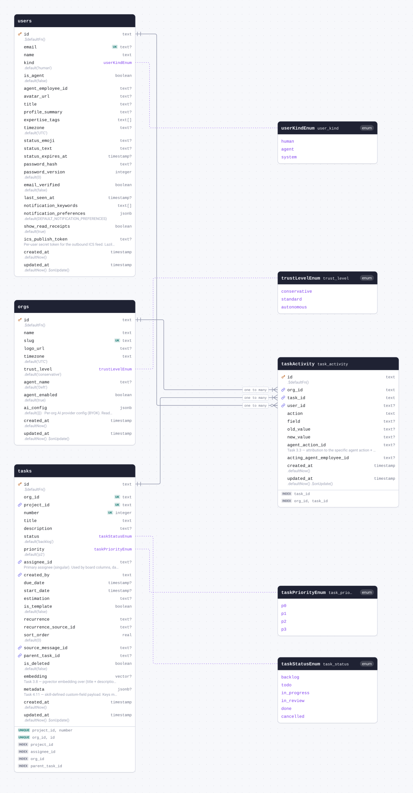

| Column                     | Type        | Constraints                         | Default                        | Description                                                                                                                                                                                                                                                   |
| -------------------------- | ----------- | ----------------------------------- | ------------------------------ | ------------------------------------------------------------------------------------------------------------------------------------------------------------------------------------------------------------------------------------------------------------- |
| `id`                       | `text`      | PK NOT NULL                         | `.$defaultFn()`                |                                                                                                                                                                                                                                                               |
| `org_id`                   | `text`      | NOT NULL → [orgs.id](#table-orgs)   |                                |                                                                                                                                                                                                                                                               |
| `task_id`                  | `text`      | NOT NULL → [tasks.id](#table-tasks) |                                |                                                                                                                                                                                                                                                               |
| `user_id`                  | `text`      | NULL → [users.id](#table-users)     |                                |                                                                                                                                                                                                                                                               |
| `action`                   | `text`      | NOT NULL                            |                                |                                                                                                                                                                                                                                                               |
| `field`                    | `text`      | NULL                                |                                |                                                                                                                                                                                                                                                               |
| `old_value`                | `text`      | NULL                                |                                |                                                                                                                                                                                                                                                               |
| `new_value`                | `text`      | NULL                                |                                |                                                                                                                                                                                                                                                               |
| `agent_action_id`          | `text`      | NULL                                |                                | Task 3.3 — attribution to the specific agent action + employee that produced this activity row. Both nullable; when set they link the activity log entry to an agentActions row and/or an agentEmployees row so the UI can show "done by agent X via plan Y". |
| `acting_agent_employee_id` | `text`      | NULL                                |                                |                                                                                                                                                                                                                                                               |
| `created_at`               | `timestamp` | NOT NULL                            | `.defaultNow()`                |                                                                                                                                                                                                                                                               |
| `updated_at`               | `timestamp` | NOT NULL                            | `.defaultNow()` `.$onUpdate()` |                                                                                                                                                                                                                                                               |

#### Definition

```sql
CREATE TABLE "task_activity" (
	"id" text PRIMARY KEY,
	"org_id" text NOT NULL,
	"task_id" text NOT NULL,
	"user_id" text,
	"action" text NOT NULL,
	"field" text,
	"old_value" text,
	"new_value" text,
	"agent_action_id" text,
	"acting_agent_employee_id" text,
	"created_at" timestamp DEFAULT now() NOT NULL,
	"updated_at" timestamp DEFAULT now() NOT NULL
);

CREATE INDEX "activity_task_idx" ON "task_activity" ("task_id");

CREATE INDEX "task_activity_org_task_idx" ON "task_activity" ("org_id","task_id");

ALTER TABLE "task_activity" ADD CONSTRAINT "task_activity_org_id_orgs_id_fkey" FOREIGN KEY ("org_id") REFERENCES "orgs"("id");

ALTER TABLE "task_activity" ADD CONSTRAINT "task_activity_task_id_tasks_id_fkey" FOREIGN KEY ("task_id") REFERENCES "tasks"("id");

ALTER TABLE "task_activity" ADD CONSTRAINT "task_activity_user_id_users_id_fkey" FOREIGN KEY ("user_id") REFERENCES "users"("id");
```

#### Indexes

- INDEX `task_id`
- INDEX `org_id`, `task_id`

#### References

- `org_id` → [orgs.id](#table-orgs) (many to one)
- `task_id` → [tasks.id](#table-tasks) (many to one)
- `user_id` → [users.id](#table-users) (many to one)

<details>
<summary>Queries and their SQL</summary>

**Select**: Every row of taskActivity.

```ts
db.select().from(taskActivity);
```

```sql
select "id", "org_id", "task_id", "user_id", "action", "field", "old_value", "new_value", "agent_action_id", "acting_agent_employee_id", "created_at", "updated_at"
from "task_activity"
```

**Count**: How many rows taskActivity has.

```ts
db.select({ count: count() }).from(taskActivity);
```

```sql
select count(*)
from "task_activity"
```

**Find many**: The rows of taskActivity, through the relational query API.

```ts
db.query.taskActivity.findMany();
```

```sql
select "d0"."id" as "id", "d0"."org_id" as "org_id", "d0"."task_id" as "task_id", "d0"."user_id" as "user_id", "d0"."action" as "action", "d0"."field" as "field", "d0"."old_value" as "old_value", "d0"."new_value" as "new_value", "d0"."agent_action_id" as "agent_action_id", "d0"."acting_agent_employee_id" as "acting_agent_employee_id", "d0"."created_at" as "created_at", "d0"."updated_at" as "updated_at"
from "task_activity" as "d0"
```

**Find by primary key**: One row of taskActivity, through the relational query API.

```ts
db.query.taskActivity.findFirst({ where: { id: "id" } });
```

```sql
select "d0"."id" as "id", "d0"."org_id" as "org_id", "d0"."task_id" as "task_id", "d0"."user_id" as "user_id", "d0"."action" as "action", "d0"."field" as "field", "d0"."old_value" as "old_value", "d0"."new_value" as "new_value", "d0"."agent_action_id" as "agent_action_id", "d0"."acting_agent_employee_id" as "acting_agent_employee_id", "d0"."created_at" as "created_at", "d0"."updated_at" as "updated_at"
from "task_activity" as "d0"
where "d0"."id" = $1
limit $2
-- params: ["id",1]
```

**Insert**: Adds a row to taskActivity, giving the columns that have no default.

```ts
db.insert(taskActivity).values({ org_id: "org_id", task_id: "task_id", action: "action" });
```

```sql
insert into "task_activity" ("id", "org_id", "task_id", "user_id", "action", "field", "old_value", "new_value", "agent_action_id", "acting_agent_employee_id", "created_at", "updated_at")
values ($1, $2, $3, default, $4, default, default, default, default, default, default, default)
-- params: ["00000000-0000-4000-8000-000000000000","org_id","task_id","action"]
```

**Update**: Changes a row of taskActivity, found by its primary key.

```ts
db.update(taskActivity).set({ org_id: "org_id" }).where(eq(taskActivity.id, "id"));
```

```sql
update "task_activity"
set "org_id" = $1, "updated_at" = $2
where "task_activity"."id" = $3
-- params: ["org_id","2026-01-01T00:00:00.000Z","id"]
```

**Delete**: Deletes a row of taskActivity, found by its primary key.

```ts
db.delete(taskActivity).where(eq(taskActivity.id, "id"));
```

```sql
delete from "task_activity"
where "task_activity"."id" = $1
-- params: ["id"]
```

</details>

<a id="table-taskRelationships"></a>

### taskRelationships

Table `task_relationships`. ═══ TASK RELATIONSHIPS ═══

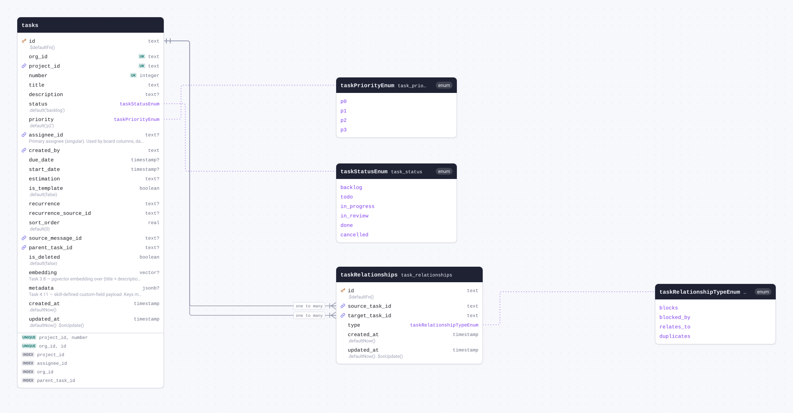

| Column           | Type                                                         | Constraints                         | Default                        | Description |
| ---------------- | ------------------------------------------------------------ | ----------------------------------- | ------------------------------ | ----------- |
| `id`             | `text`                                                       | PK NOT NULL                         | `.$defaultFn()`                |             |
| `source_task_id` | `text`                                                       | NOT NULL → [tasks.id](#table-tasks) |                                |             |
| `target_task_id` | `text`                                                       | NOT NULL → [tasks.id](#table-tasks) |                                |             |
| `type`           | [`taskRelationshipTypeEnum`](#enum-taskRelationshipTypeEnum) | NOT NULL                            |                                |             |
| `created_at`     | `timestamp`                                                  | NOT NULL                            | `.defaultNow()`                |             |
| `updated_at`     | `timestamp`                                                  | NOT NULL                            | `.defaultNow()` `.$onUpdate()` |             |

#### Definition

```sql
CREATE TABLE "task_relationships" (
	"id" text PRIMARY KEY,
	"source_task_id" text NOT NULL,
	"target_task_id" text NOT NULL,
	"type" "task_relationship_type" NOT NULL,
	"created_at" timestamp DEFAULT now() NOT NULL,
	"updated_at" timestamp DEFAULT now() NOT NULL
);

ALTER TABLE "task_relationships" ADD CONSTRAINT "task_relationships_source_task_id_tasks_id_fkey" FOREIGN KEY ("source_task_id") REFERENCES "tasks"("id");

ALTER TABLE "task_relationships" ADD CONSTRAINT "task_relationships_target_task_id_tasks_id_fkey" FOREIGN KEY ("target_task_id") REFERENCES "tasks"("id");
```

#### References

- `source_task_id` → [tasks.id](#table-tasks) (many to one)
- `target_task_id` → [tasks.id](#table-tasks) (many to one)

<details>
<summary>Queries and their SQL</summary>

**Select**: Every row of taskRelationships.

```ts
db.select().from(taskRelationships);
```

```sql
select "id", "source_task_id", "target_task_id", "type", "created_at", "updated_at"
from "task_relationships"
```

**Count**: How many rows taskRelationships has.

```ts
db.select({ count: count() }).from(taskRelationships);
```

```sql
select count(*)
from "task_relationships"
```

**Find many**: The rows of taskRelationships, through the relational query API.

```ts
db.query.taskRelationships.findMany();
```

```sql
select "d0"."id" as "id", "d0"."source_task_id" as "source_task_id", "d0"."target_task_id" as "target_task_id", "d0"."type" as "type", "d0"."created_at" as "created_at", "d0"."updated_at" as "updated_at"
from "task_relationships" as "d0"
```

**Find by primary key**: One row of taskRelationships, through the relational query API.

```ts
db.query.taskRelationships.findFirst({ where: { id: "id" } });
```

```sql
select "d0"."id" as "id", "d0"."source_task_id" as "source_task_id", "d0"."target_task_id" as "target_task_id", "d0"."type" as "type", "d0"."created_at" as "created_at", "d0"."updated_at" as "updated_at"
from "task_relationships" as "d0"
where "d0"."id" = $1
limit $2
-- params: ["id",1]
```

**Insert**: Adds a row to taskRelationships, giving the columns that have no default.

```ts
db.insert(taskRelationships).values({
  source_task_id: "source_task_id",
  target_task_id: "target_task_id",
  type: "blocks",
});
```

```sql
insert into "task_relationships" ("id", "source_task_id", "target_task_id", "type", "created_at", "updated_at")
values ($1, $2, $3, $4, default, default)
-- params: ["00000000-0000-4000-8000-000000000000","source_task_id","target_task_id","blocks"]
```

**Update**: Changes a row of taskRelationships, found by its primary key.

```ts
db.update(taskRelationships)
  .set({ source_task_id: "source_task_id" })
  .where(eq(taskRelationships.id, "id"));
```

```sql
update "task_relationships"
set "source_task_id" = $1, "updated_at" = $2
where "task_relationships"."id" = $3
-- params: ["source_task_id","2026-01-01T00:00:00.000Z","id"]
```

**Delete**: Deletes a row of taskRelationships, found by its primary key.

```ts
db.delete(taskRelationships).where(eq(taskRelationships.id, "id"));
```

```sql
delete from "task_relationships"
where "task_relationships"."id" = $1
-- params: ["id"]
```

</details>

<a id="table-taskWatchers"></a>

### taskWatchers

Table `task_watchers`. ═══ TASK WATCHERS ═══

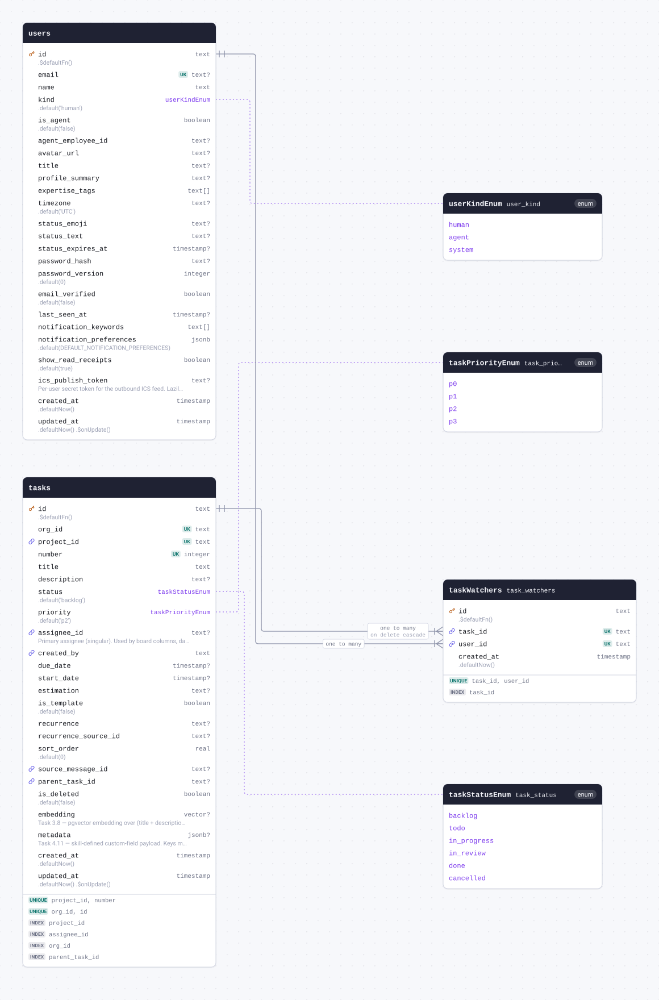

| Column       | Type        | Constraints                         | Default         | Description |
| ------------ | ----------- | ----------------------------------- | --------------- | ----------- |
| `id`         | `text`      | PK NOT NULL                         | `.$defaultFn()` |             |
| `task_id`    | `text`      | NOT NULL → [tasks.id](#table-tasks) |                 |             |
| `user_id`    | `text`      | NOT NULL → [users.id](#table-users) |                 |             |
| `created_at` | `timestamp` | NOT NULL                            | `.defaultNow()` |             |

#### Definition

```sql
CREATE TABLE "task_watchers" (
	"id" text PRIMARY KEY,
	"task_id" text NOT NULL,
	"user_id" text NOT NULL,
	"created_at" timestamp DEFAULT now() NOT NULL
);

CREATE UNIQUE INDEX "task_watcher_unique" ON "task_watchers" ("task_id","user_id");

CREATE INDEX "task_watcher_task_idx" ON "task_watchers" ("task_id");

ALTER TABLE "task_watchers" ADD CONSTRAINT "task_watchers_task_id_tasks_id_fkey" FOREIGN KEY ("task_id") REFERENCES "tasks"("id") ON DELETE CASCADE;

ALTER TABLE "task_watchers" ADD CONSTRAINT "task_watchers_user_id_users_id_fkey" FOREIGN KEY ("user_id") REFERENCES "users"("id");
```

#### Indexes

- UNIQUE `task_id`, `user_id`
- INDEX `task_id`

#### References

- `task_id` → [tasks.id](#table-tasks) (many to one, on delete cascade)
- `user_id` → [users.id](#table-users) (many to one)

<details>
<summary>Queries and their SQL</summary>

**Select**: Every row of taskWatchers.

```ts
db.select().from(taskWatchers);
```

```sql
select "id", "task_id", "user_id", "created_at"
from "task_watchers"
```

**Count**: How many rows taskWatchers has.

```ts
db.select({ count: count() }).from(taskWatchers);
```

```sql
select count(*)
from "task_watchers"
```

**Find many**: The rows of taskWatchers, through the relational query API.

```ts
db.query.taskWatchers.findMany();
```

```sql
select "d0"."id" as "id", "d0"."task_id" as "task_id", "d0"."user_id" as "user_id", "d0"."created_at" as "created_at"
from "task_watchers" as "d0"
```

**Find by primary key**: One row of taskWatchers, through the relational query API.

```ts
db.query.taskWatchers.findFirst({ where: { id: "id" } });
```

```sql
select "d0"."id" as "id", "d0"."task_id" as "task_id", "d0"."user_id" as "user_id", "d0"."created_at" as "created_at"
from "task_watchers" as "d0"
where "d0"."id" = $1
limit $2
-- params: ["id",1]
```

**Insert**: Adds a row to taskWatchers, giving the columns that have no default.

```ts
db.insert(taskWatchers).values({ task_id: "task_id", user_id: "user_id" });
```

```sql
insert into "task_watchers" ("id", "task_id", "user_id", "created_at")
values ($1, $2, $3, default)
-- params: ["00000000-0000-4000-8000-000000000000","task_id","user_id"]
```

**Update**: Changes a row of taskWatchers, found by its primary key.

```ts
db.update(taskWatchers).set({ task_id: "task_id" }).where(eq(taskWatchers.id, "id"));
```

```sql
update "task_watchers"
set "task_id" = $1
where "task_watchers"."id" = $2
-- params: ["task_id","id"]
```

**Delete**: Deletes a row of taskWatchers, found by its primary key.

```ts
db.delete(taskWatchers).where(eq(taskWatchers.id, "id"));
```

```sql
delete from "task_watchers"
where "task_watchers"."id" = $1
-- params: ["id"]
```

</details>

<a id="table-taskAssignees"></a>

### taskAssignees

Table `task_assignees`. ═══ TASK ASSIGNEES ═══ Additional (non-primary) assignees — shown as secondary avatars on the task card. The task's single primary assignee lives on tasks.assignee_id and MUST NOT be duplicated here. Route handlers enforce this invariant.

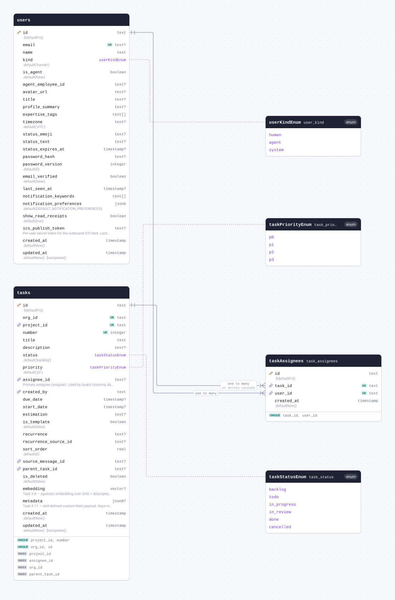

| Column       | Type        | Constraints                         | Default         | Description |
| ------------ | ----------- | ----------------------------------- | --------------- | ----------- |
| `id`         | `text`      | PK NOT NULL                         | `.$defaultFn()` |             |
| `task_id`    | `text`      | NOT NULL → [tasks.id](#table-tasks) |                 |             |
| `user_id`    | `text`      | NOT NULL → [users.id](#table-users) |                 |             |
| `created_at` | `timestamp` | NOT NULL                            | `.defaultNow()` |             |

#### Definition

```sql
CREATE TABLE "task_assignees" (
	"id" text PRIMARY KEY,
	"task_id" text NOT NULL,
	"user_id" text NOT NULL,
	"created_at" timestamp DEFAULT now() NOT NULL
);

CREATE UNIQUE INDEX "task_assignee_unique" ON "task_assignees" ("task_id","user_id");

ALTER TABLE "task_assignees" ADD CONSTRAINT "task_assignees_task_id_tasks_id_fkey" FOREIGN KEY ("task_id") REFERENCES "tasks"("id") ON DELETE CASCADE;

ALTER TABLE "task_assignees" ADD CONSTRAINT "task_assignees_user_id_users_id_fkey" FOREIGN KEY ("user_id") REFERENCES "users"("id");
```

#### Indexes

- UNIQUE `task_id`, `user_id`

#### References

- `task_id` → [tasks.id](#table-tasks) (many to one, on delete cascade)
- `user_id` → [users.id](#table-users) (many to one)

<details>
<summary>Queries and their SQL</summary>

**Select**: Every row of taskAssignees.

```ts
db.select().from(taskAssignees);
```

```sql
select "id", "task_id", "user_id", "created_at"
from "task_assignees"
```

**Count**: How many rows taskAssignees has.

```ts
db.select({ count: count() }).from(taskAssignees);
```

```sql
select count(*)
from "task_assignees"
```

**Find many**: The rows of taskAssignees, through the relational query API.

```ts
db.query.taskAssignees.findMany();
```

```sql
select "d0"."id" as "id", "d0"."task_id" as "task_id", "d0"."user_id" as "user_id", "d0"."created_at" as "created_at"
from "task_assignees" as "d0"
```

**Find by primary key**: One row of taskAssignees, through the relational query API.

```ts
db.query.taskAssignees.findFirst({ where: { id: "id" } });
```

```sql
select "d0"."id" as "id", "d0"."task_id" as "task_id", "d0"."user_id" as "user_id", "d0"."created_at" as "created_at"
from "task_assignees" as "d0"
where "d0"."id" = $1
limit $2
-- params: ["id",1]
```

**Insert**: Adds a row to taskAssignees, giving the columns that have no default.

```ts
db.insert(taskAssignees).values({ task_id: "task_id", user_id: "user_id" });
```

```sql
insert into "task_assignees" ("id", "task_id", "user_id", "created_at")
values ($1, $2, $3, default)
-- params: ["00000000-0000-4000-8000-000000000000","task_id","user_id"]
```

**Update**: Changes a row of taskAssignees, found by its primary key.

```ts
db.update(taskAssignees).set({ task_id: "task_id" }).where(eq(taskAssignees.id, "id"));
```

```sql
update "task_assignees"
set "task_id" = $1
where "task_assignees"."id" = $2
-- params: ["task_id","id"]
```

**Delete**: Deletes a row of taskAssignees, found by its primary key.

```ts
db.delete(taskAssignees).where(eq(taskAssignees.id, "id"));
```

```sql
delete from "task_assignees"
where "task_assignees"."id" = $1
-- params: ["id"]
```

</details>

<a id="table-notifications"></a>

### notifications

═══ NOTIFICATIONS ═══

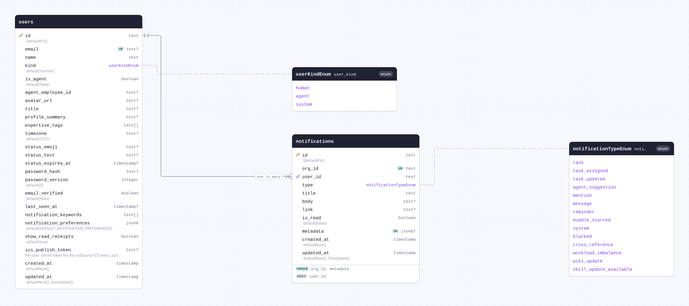

| Column       | Type                                                 | Constraints                         | Default                        | Description |
| ------------ | ---------------------------------------------------- | ----------------------------------- | ------------------------------ | ----------- |
| `id`         | `text`                                               | PK NOT NULL                         | `.$defaultFn()`                |             |
| `org_id`     | `text`                                               | NOT NULL                            |                                |             |
| `user_id`    | `text`                                               | NOT NULL → [users.id](#table-users) |                                |             |
| `type`       | [`notificationTypeEnum`](#enum-notificationTypeEnum) | NOT NULL                            |                                |             |
| `title`      | `text`                                               | NOT NULL                            |                                |             |
| `body`       | `text`                                               | NULL                                |                                |             |
| `link`       | `text`                                               | NULL                                |                                |             |
| `is_read`    | `boolean`                                            | NOT NULL                            | `.default(false)`              |             |
| `metadata`   | `jsonb`                                              | NULL                                |                                |             |
| `created_at` | `timestamp`                                          | NOT NULL                            | `.defaultNow()`                |             |
| `updated_at` | `timestamp`                                          | NOT NULL                            | `.defaultNow()` `.$onUpdate()` |             |

#### Definition

```sql
CREATE TABLE "notifications" (
	"id" text PRIMARY KEY,
	"org_id" text NOT NULL,
	"user_id" text NOT NULL,
	"type" "notification_type" NOT NULL,
	"title" text NOT NULL,
	"body" text,
	"link" text,
	"is_read" boolean DEFAULT false NOT NULL,
	"metadata" jsonb,
	"created_at" timestamp DEFAULT now() NOT NULL,
	"updated_at" timestamp DEFAULT now() NOT NULL
);

CREATE INDEX "notification_user_idx" ON "notifications" ("user_id");

CREATE UNIQUE INDEX "notification_reminder_unique" ON "notifications" ("org_id",("metadata"->>'reminder_id')) WHERE "type" = 'reminder' AND "metadata" ? 'reminder_id';

ALTER TABLE "notifications" ADD CONSTRAINT "notifications_user_id_users_id_fkey" FOREIGN KEY ("user_id") REFERENCES "users"("id");
```

#### Indexes

- INDEX `user_id`
- UNIQUE `org_id`

#### References

- `user_id` → [users.id](#table-users) (many to one)

<details>
<summary>Queries and their SQL</summary>

**Select**: Every row of notifications.

```ts
db.select().from(notifications);
```

```sql
select "id", "org_id", "user_id", "type", "title", "body", "link", "is_read", "metadata", "created_at", "updated_at"
from "notifications"
```

**Count**: How many rows notifications has.

```ts
db.select({ count: count() }).from(notifications);
```

```sql
select count(*)
from "notifications"
```

**Find many**: The rows of notifications, through the relational query API.

```ts
db.query.notifications.findMany();
```

```sql
select "d0"."id" as "id", "d0"."org_id" as "org_id", "d0"."user_id" as "user_id", "d0"."type" as "type", "d0"."title" as "title", "d0"."body" as "body", "d0"."link" as "link", "d0"."is_read" as "is_read", "d0"."metadata" as "metadata", "d0"."created_at" as "created_at", "d0"."updated_at" as "updated_at"
from "notifications" as "d0"
```

**Find by primary key**: One row of notifications, through the relational query API.

```ts
db.query.notifications.findFirst({ where: { id: "id" } });
```

```sql
select "d0"."id" as "id", "d0"."org_id" as "org_id", "d0"."user_id" as "user_id", "d0"."type" as "type", "d0"."title" as "title", "d0"."body" as "body", "d0"."link" as "link", "d0"."is_read" as "is_read", "d0"."metadata" as "metadata", "d0"."created_at" as "created_at", "d0"."updated_at" as "updated_at"
from "notifications" as "d0"
where "d0"."id" = $1
limit $2
-- params: ["id",1]
```

**Insert**: Adds a row to notifications, giving the columns that have no default.

```ts
db.insert(notifications).values({
  org_id: "org_id",
  user_id: "user_id",
  type: "task",
  title: "title",
});
```

```sql
insert into "notifications" ("id", "org_id", "user_id", "type", "title", "body", "link", "is_read", "metadata", "created_at", "updated_at")
values ($1, $2, $3, $4, $5, default, default, default, default, default, default)
-- params: ["00000000-0000-4000-8000-000000000000","org_id","user_id","task","title"]
```

**Update**: Changes a row of notifications, found by its primary key.

```ts
db.update(notifications).set({ org_id: "org_id" }).where(eq(notifications.id, "id"));
```

```sql
update "notifications"
set "org_id" = $1, "updated_at" = $2
where "notifications"."id" = $3
-- params: ["org_id","2026-01-01T00:00:00.000Z","id"]
```

**Delete**: Deletes a row of notifications, found by its primary key.

```ts
db.delete(notifications).where(eq(notifications.id, "id"));
```

```sql
delete from "notifications"
where "notifications"."id" = $1
-- params: ["id"]
```

</details>

<a id="table-savedViews"></a>

### savedViews

Table `saved_views`. ═══ SAVED VIEWS ═══

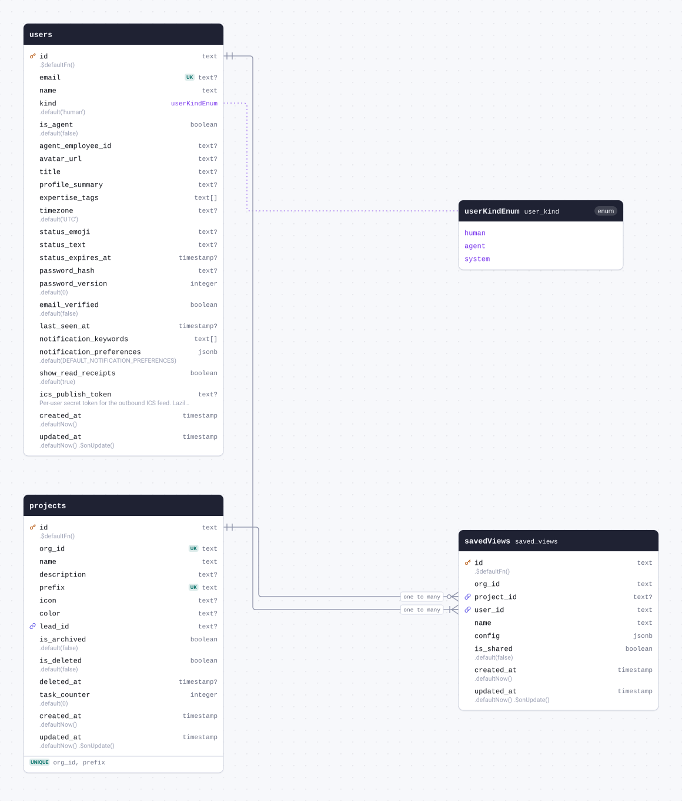

| Column       | Type        | Constraints                           | Default                        | Description |
| ------------ | ----------- | ------------------------------------- | ------------------------------ | ----------- |
| `id`         | `text`      | PK NOT NULL                           | `.$defaultFn()`                |             |
| `org_id`     | `text`      | NOT NULL                              |                                |             |
| `project_id` | `text`      | NULL → [projects.id](#table-projects) |                                |             |
| `user_id`    | `text`      | NOT NULL → [users.id](#table-users)   |                                |             |
| `name`       | `text`      | NOT NULL                              |                                |             |
| `config`     | `jsonb`     | NOT NULL                              |                                |             |
| `is_shared`  | `boolean`   | NOT NULL                              | `.default(false)`              |             |
| `created_at` | `timestamp` | NOT NULL                              | `.defaultNow()`                |             |
| `updated_at` | `timestamp` | NOT NULL                              | `.defaultNow()` `.$onUpdate()` |             |

#### Definition

```sql
CREATE TABLE "saved_views" (
	"id" text PRIMARY KEY,
	"org_id" text NOT NULL,
	"project_id" text,
	"user_id" text NOT NULL,
	"name" text NOT NULL,
	"config" jsonb NOT NULL,
	"is_shared" boolean DEFAULT false NOT NULL,
	"created_at" timestamp DEFAULT now() NOT NULL,
	"updated_at" timestamp DEFAULT now() NOT NULL
);

ALTER TABLE "saved_views" ADD CONSTRAINT "saved_views_project_id_projects_id_fkey" FOREIGN KEY ("project_id") REFERENCES "projects"("id");

ALTER TABLE "saved_views" ADD CONSTRAINT "saved_views_user_id_users_id_fkey" FOREIGN KEY ("user_id") REFERENCES "users"("id");
```

#### References

- `project_id` → [projects.id](#table-projects) (many to one)
- `user_id` → [users.id](#table-users) (many to one)

<details>
<summary>Queries and their SQL</summary>

**Select**: Every row of savedViews.

```ts
db.select().from(savedViews);
```

```sql
select "id", "org_id", "project_id", "user_id", "name", "config", "is_shared", "created_at", "updated_at"
from "saved_views"
```

**Count**: How many rows savedViews has.

```ts
db.select({ count: count() }).from(savedViews);
```

```sql
select count(*)
from "saved_views"
```

**Find many**: The rows of savedViews, through the relational query API.

```ts
db.query.savedViews.findMany();
```

```sql
select "d0"."id" as "id", "d0"."org_id" as "org_id", "d0"."project_id" as "project_id", "d0"."user_id" as "user_id", "d0"."name" as "name", "d0"."config" as "config", "d0"."is_shared" as "is_shared", "d0"."created_at" as "created_at", "d0"."updated_at" as "updated_at"
from "saved_views" as "d0"
```

**Find by primary key**: One row of savedViews, through the relational query API.

```ts
db.query.savedViews.findFirst({ where: { id: "id" } });
```

```sql
select "d0"."id" as "id", "d0"."org_id" as "org_id", "d0"."project_id" as "project_id", "d0"."user_id" as "user_id", "d0"."name" as "name", "d0"."config" as "config", "d0"."is_shared" as "is_shared", "d0"."created_at" as "created_at", "d0"."updated_at" as "updated_at"
from "saved_views" as "d0"
where "d0"."id" = $1
limit $2
-- params: ["id",1]
```

**Insert**: Adds a row to savedViews, giving the columns that have no default.

```ts
db.insert(savedViews).values({ org_id: "org_id", user_id: "user_id", name: "name", config: {} });
```

```sql
insert into "saved_views" ("id", "org_id", "project_id", "user_id", "name", "config", "is_shared", "created_at", "updated_at")
values ($1, $2, default, $3, $4, $5, default, default, default)
-- params: ["00000000-0000-4000-8000-000000000000","org_id","user_id","name",{}]
```

**Update**: Changes a row of savedViews, found by its primary key.

```ts
db.update(savedViews).set({ org_id: "org_id" }).where(eq(savedViews.id, "id"));
```

```sql
update "saved_views"
set "org_id" = $1, "updated_at" = $2
where "saved_views"."id" = $3
-- params: ["org_id","2026-01-01T00:00:00.000Z","id"]
```

**Delete**: Deletes a row of savedViews, found by its primary key.

```ts
db.delete(savedViews).where(eq(savedViews.id, "id"));
```

```sql
delete from "saved_views"
where "saved_views"."id" = $1
-- params: ["id"]
```

</details>

<a id="table-favorites"></a>

### favorites

═══ USER FAVORITES ═══

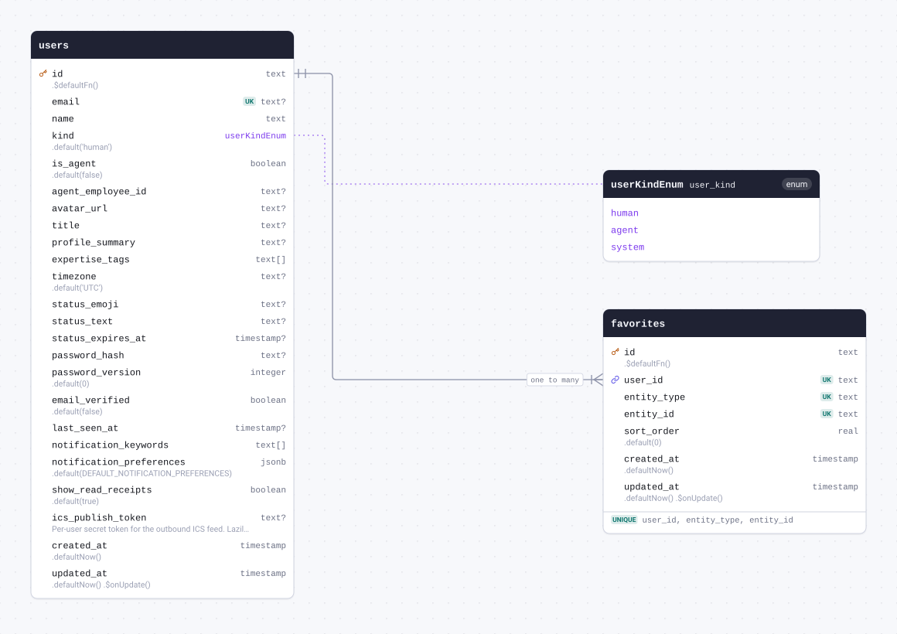

| Column        | Type        | Constraints                         | Default                        | Description |
| ------------- | ----------- | ----------------------------------- | ------------------------------ | ----------- |
| `id`          | `text`      | PK NOT NULL                         | `.$defaultFn()`                |             |
| `user_id`     | `text`      | NOT NULL → [users.id](#table-users) |                                |             |
| `entity_type` | `text`      | NOT NULL                            |                                |             |
| `entity_id`   | `text`      | NOT NULL                            |                                |             |
| `sort_order`  | `real`      | NOT NULL                            | `.default(0)`                  |             |
| `created_at`  | `timestamp` | NOT NULL                            | `.defaultNow()`                |             |
| `updated_at`  | `timestamp` | NOT NULL                            | `.defaultNow()` `.$onUpdate()` |             |

#### Definition

```sql
CREATE TABLE "favorites" (
	"id" text PRIMARY KEY,
	"user_id" text NOT NULL,
	"entity_type" text NOT NULL,
	"entity_id" text NOT NULL,
	"sort_order" real DEFAULT 0 NOT NULL,
	"created_at" timestamp DEFAULT now() NOT NULL,
	"updated_at" timestamp DEFAULT now() NOT NULL
);

CREATE UNIQUE INDEX "favorite_unique" ON "favorites" ("user_id","entity_type","entity_id");

ALTER TABLE "favorites" ADD CONSTRAINT "favorites_user_id_users_id_fkey" FOREIGN KEY ("user_id") REFERENCES "users"("id");
```

#### Indexes

- UNIQUE `user_id`, `entity_type`, `entity_id`

#### References

- `user_id` → [users.id](#table-users) (many to one)

<details>
<summary>Queries and their SQL</summary>

**Select**: Every row of favorites.

```ts
db.select().from(favorites);
```

```sql
select "id", "user_id", "entity_type", "entity_id", "sort_order", "created_at", "updated_at"
from "favorites"
```

**Count**: How many rows favorites has.

```ts
db.select({ count: count() }).from(favorites);
```

```sql
select count(*)
from "favorites"
```

**Find many**: The rows of favorites, through the relational query API.

```ts
db.query.favorites.findMany();
```

```sql
select "d0"."id" as "id", "d0"."user_id" as "user_id", "d0"."entity_type" as "entity_type", "d0"."entity_id" as "entity_id", "d0"."sort_order" as "sort_order", "d0"."created_at" as "created_at", "d0"."updated_at" as "updated_at"
from "favorites" as "d0"
```

**Find by primary key**: One row of favorites, through the relational query API.

```ts
db.query.favorites.findFirst({ where: { id: "id" } });
```

```sql
select "d0"."id" as "id", "d0"."user_id" as "user_id", "d0"."entity_type" as "entity_type", "d0"."entity_id" as "entity_id", "d0"."sort_order" as "sort_order", "d0"."created_at" as "created_at", "d0"."updated_at" as "updated_at"
from "favorites" as "d0"
where "d0"."id" = $1
limit $2
-- params: ["id",1]
```

**Insert**: Adds a row to favorites, giving the columns that have no default.

```ts
db.insert(favorites).values({
  user_id: "user_id",
  entity_type: "entity_type",
  entity_id: "entity_id",
});
```

```sql
insert into "favorites" ("id", "user_id", "entity_type", "entity_id", "sort_order", "created_at", "updated_at")
values ($1, $2, $3, $4, default, default, default)
-- params: ["00000000-0000-4000-8000-000000000000","user_id","entity_type","entity_id"]
```

**Update**: Changes a row of favorites, found by its primary key.

```ts
db.update(favorites).set({ user_id: "user_id" }).where(eq(favorites.id, "id"));
```

```sql
update "favorites"
set "user_id" = $1, "updated_at" = $2
where "favorites"."id" = $3
-- params: ["user_id","2026-01-01T00:00:00.000Z","id"]
```

**Delete**: Deletes a row of favorites, found by its primary key.

```ts
db.delete(favorites).where(eq(favorites.id, "id"));
```

```sql
delete from "favorites"
where "favorites"."id" = $1
-- params: ["id"]
```

</details>

<a id="table-capabilityProviderSnapshots"></a>

### capabilityProviderSnapshots

Table `capability_provider_snapshots`. ═══ GOVERNED APP RUNS (DORMANT PHASE 3 FOUNDATION) ═══ These tables are additive and have no execution consumer until a later, separately certified phase. Secret payload ciphertext is intentionally split from safe Run metadata so ordinary app_runs selections cannot expose it.

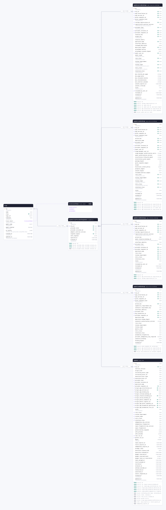

| Column                     | Type        | Constraints                       | Default         | Description |
| -------------------------- | ----------- | --------------------------------- | --------------- | ----------- |
| `id`                       | `text`      | PK NOT NULL                       | `.$defaultFn()` |             |
| `org_id`                   | `text`      | NOT NULL → [orgs.id](#table-orgs) |                 |             |
| `provider_kind`            | `text`      | NOT NULL                          |                 |             |
| `provider_instance_id`     | `text`      | NOT NULL                          |                 |             |
| `adapter_contract_version` | `text`      | NOT NULL                          |                 |             |
| `snapshot_digest`          | `text`      | NOT NULL                          |                 |             |
| `safe_snapshot`            | `jsonb`     | NOT NULL                          |                 |             |
| `captured_at`              | `timestamp` | NOT NULL                          |                 |             |
| `created_at`               | `timestamp` | NOT NULL                          | `.defaultNow()` |             |

#### Definition

```sql
CREATE TABLE "capability_provider_snapshots" (
	"id" text PRIMARY KEY,
	"org_id" text NOT NULL,
	"provider_kind" text NOT NULL,
	"provider_instance_id" text NOT NULL,
	"adapter_contract_version" text NOT NULL,
	"snapshot_digest" text NOT NULL,
	"safe_snapshot" jsonb NOT NULL,
	"captured_at" timestamp NOT NULL,
	"created_at" timestamp DEFAULT now() NOT NULL,
	CONSTRAINT "capability_provider_snapshots_org_id_id_unique" UNIQUE("org_id","id"),
	CONSTRAINT "capability_provider_snapshots_org_provider_id_unique" UNIQUE("org_id","provider_kind","provider_instance_id","id"),
	CONSTRAINT "capability_provider_snapshots_kind_check" CHECK ("provider_kind" IN ('mcp', 'app_runtime', 'native')),
	CONSTRAINT "capability_provider_snapshots_digest_check" CHECK ("snapshot_digest" ~ '^sha256:[a-f0-9]{64}$'),
	CONSTRAINT "capability_provider_snapshots_json_check" CHECK (jsonb_typeof("safe_snapshot") = 'object'),
	CONSTRAINT "capability_provider_snapshots_size_check" CHECK (octet_length("safe_snapshot"::text) <= 1048576)
);

CREATE UNIQUE INDEX "capability_provider_snapshots_identity_digest_unique" ON "capability_provider_snapshots" ("org_id","provider_kind","provider_instance_id","snapshot_digest");

CREATE INDEX "capability_provider_snapshots_provider_idx" ON "capability_provider_snapshots" ("org_id","provider_kind","provider_instance_id","captured_at");

ALTER TABLE "capability_provider_snapshots" ADD CONSTRAINT "capability_provider_snapshots_org_id_orgs_id_fkey" FOREIGN KEY ("org_id") REFERENCES "orgs"("id") ON DELETE CASCADE;
```

#### Indexes

- UNIQUE `org_id`, `id`
- UNIQUE `org_id`, `provider_kind`, `provider_instance_id`, `id`
- UNIQUE `org_id`, `provider_kind`, `provider_instance_id`, `snapshot_digest`
- INDEX `org_id`, `provider_kind`, `provider_instance_id`, `captured_at`

#### References

- `org_id` → [orgs.id](#table-orgs) (many to one, on delete cascade)

#### Referenced by

- `org_id` → [appRuns.org_id](#table-appRuns) (one to many, on delete cascade)
- `org_id` → [appActionBindings.org_id](#table-appActionBindings) (one to many, on delete restrict)
- `org_id` → [appRuntimeBindings.org_id](#table-appRuntimeBindings) (one to many, on delete restrict)
- `org_id` → [appNativeBindings.org_id](#table-appNativeBindings) (one to many, on delete restrict)
- `org_id` → [appResourceBindings.org_id](#table-appResourceBindings) (one to many, on delete restrict)

<details>
<summary>Queries and their SQL</summary>

**Select**: Every row of capabilityProviderSnapshots.

```ts
db.select().from(capabilityProviderSnapshots);
```

```sql
select "id", "org_id", "provider_kind", "provider_instance_id", "adapter_contract_version", "snapshot_digest", "safe_snapshot", "captured_at", "created_at"
from "capability_provider_snapshots"
```

**Count**: How many rows capabilityProviderSnapshots has.

```ts
db.select({ count: count() }).from(capabilityProviderSnapshots);
```

```sql
select count(*)
from "capability_provider_snapshots"
```

**Find many**: The rows of capabilityProviderSnapshots, through the relational query API.

```ts
db.query.capabilityProviderSnapshots.findMany();
```

```sql
select "d0"."id" as "id", "d0"."org_id" as "org_id", "d0"."provider_kind" as "provider_kind", "d0"."provider_instance_id" as "provider_instance_id", "d0"."adapter_contract_version" as "adapter_contract_version", "d0"."snapshot_digest" as "snapshot_digest", "d0"."safe_snapshot" as "safe_snapshot", "d0"."captured_at" as "captured_at", "d0"."created_at" as "created_at"
from "capability_provider_snapshots" as "d0"
```

**Find by primary key**: One row of capabilityProviderSnapshots, through the relational query API.

```ts
db.query.capabilityProviderSnapshots.findFirst({ where: { id: "id" } });
```

```sql
select "d0"."id" as "id", "d0"."org_id" as "org_id", "d0"."provider_kind" as "provider_kind", "d0"."provider_instance_id" as "provider_instance_id", "d0"."adapter_contract_version" as "adapter_contract_version", "d0"."snapshot_digest" as "snapshot_digest", "d0"."safe_snapshot" as "safe_snapshot", "d0"."captured_at" as "captured_at", "d0"."created_at" as "created_at"
from "capability_provider_snapshots" as "d0"
where "d0"."id" = $1
limit $2
-- params: ["id",1]
```

**Insert**: Adds a row to capabilityProviderSnapshots, giving the columns that have no default.

```ts
db.insert(capabilityProviderSnapshots).values({
  org_id: "org_id",
  provider_kind: "provider_kind",
  provider_instance_id: "provider_instance_id",
  adapter_contract_version: "adapter_contract_version",
  snapshot_digest: "snapshot_digest",
  safe_snapshot: {},
  captured_at: new Date("2026-01-01T00:00:00.000Z"),
});
```

```sql
insert into "capability_provider_snapshots" ("id", "org_id", "provider_kind", "provider_instance_id", "adapter_contract_version", "snapshot_digest", "safe_snapshot", "captured_at", "created_at")
values ($1, $2, $3, $4, $5, $6, $7, $8, default)
-- params: ["00000000-0000-4000-8000-000000000000","org_id","provider_kind","provider_instance_id","adapter_contract_version","snapshot_digest",{},"2026-01-01T00:00:00.000Z"]
```

**Update**: Changes a row of capabilityProviderSnapshots, found by its primary key.

```ts
db.update(capabilityProviderSnapshots)
  .set({ org_id: "org_id" })
  .where(eq(capabilityProviderSnapshots.id, "id"));
```

```sql
update "capability_provider_snapshots"
set "org_id" = $1
where "capability_provider_snapshots"."id" = $2
-- params: ["org_id","id"]
```

**Delete**: Deletes a row of capabilityProviderSnapshots, found by its primary key.

```ts
db.delete(capabilityProviderSnapshots).where(eq(capabilityProviderSnapshots.id, "id"));
```

```sql
delete from "capability_provider_snapshots"
where "capability_provider_snapshots"."id" = $1
-- params: ["id"]
```

</details>

<a id="table-appRuns"></a>

### appRuns

Table `app_runs`.

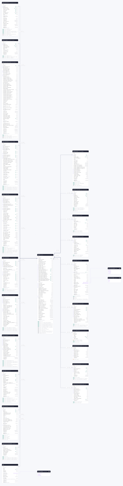

| Column                                | Type        | Constraints                       | Default                        | Description |
| ------------------------------------- | ----------- | --------------------------------- | ------------------------------ | ----------- |
| `id`                                  | `text`      | PK NOT NULL                       | `.$defaultFn()`                |             |
| `org_id`                              | `text`      | NOT NULL → [orgs.id](#table-orgs) |                                |             |
| `contract_version`                    | `text`      | NOT NULL                          |                                |             |
| `origin_kind`                         | `text`      | NOT NULL                          |                                |             |
| `initiating_actor_type`               | `text`      | NOT NULL                          |                                |             |
| `initiating_actor_id`                 | `text`      | NOT NULL                          |                                |             |
| `execution_actor_type`                | `text`      | NOT NULL                          |                                |             |
| `execution_actor_id`                  | `text`      | NOT NULL                          |                                |             |
| `provider_kind`                       | `text`      | NOT NULL                          |                                |             |
| `provider_instance_id`                | `text`      | NOT NULL                          |                                |             |
| `operation_name`                      | `text`      | NOT NULL                          |                                |             |
| `provider_snapshot_id`                | `text`      | NOT NULL                          |                                |             |
| `origin_app_installation_id`          | `text`      | NULL                              |                                |             |
| `origin_app_version_id`               | `text`      | NULL                              |                                |             |
| `origin_app_binding_key`              | `text`      | NULL                              |                                |             |
| `origin_runtime_binding_id`           | `text`      | NULL                              |                                |             |
| `origin_resource_binding_id`          | `text`      | NULL                              |                                |             |
| `origin_native_binding_id`            | `text`      | NULL                              |                                |             |
| `origin_public_endpoint_id`           | `text`      | NULL                              |                                |             |
| `origin_public_ingress_id`            | `text`      | NULL                              |                                |             |
| `origin_app_grant_snapshot_id`        | `text`      | NULL                              |                                |             |
| `origin_app_automation_definition_id` | `text`      | NULL                              |                                |             |
| `origin_app_automation_fire_id`       | `text`      | NULL                              |                                |             |
| `state`                               | `text`      | NOT NULL                          | `.default('pending')`          |             |
| `risk_class`                          | `text`      | NOT NULL                          |                                |             |
| `review_requirement`                  | `text`      | NOT NULL                          |                                |             |
| `review_scope`                        | `text`      | NOT NULL                          |                                |             |
| `retry_class`                         | `text`      | NOT NULL                          |                                |             |
| `retention_class`                     | `text`      | NOT NULL                          |                                |             |
| `idempotency_key_version`             | `text`      | NOT NULL                          |                                |             |
| `idempotency_fingerprint`             | `text`      | NOT NULL                          |                                |             |
| `input_fingerprint_key_version`       | `text`      | NOT NULL                          |                                |             |
| `input_fingerprint`                   | `text`      | NOT NULL                          |                                |             |
| `authorization_snapshot`              | `jsonb`     | NOT NULL                          |                                |             |
| `safe_preview`                        | `jsonb`     | NOT NULL                          |                                |             |
| `safe_outcome`                        | `jsonb`     | NULL                              |                                |             |
| `root_run_id`                         | `text`      | NOT NULL                          |                                |             |
| `parent_run_id`                       | `text`      | NULL                              |                                |             |
| `depth`                               | `integer`   | NOT NULL                          | `.default(0)`                  |             |
| `input_expires_at`                    | `timestamp` | NOT NULL                          |                                |             |
| `result_expires_at`                   | `timestamp` | NOT NULL                          |                                |             |
| `idempotency_expires_at`              | `timestamp` | NOT NULL                          |                                |             |
| `attempt_limit`                       | `integer`   | NOT NULL                          |                                |             |
| `execution_release_kind`              | `text`      | NULL                              |                                |             |
| `execution_released_at`               | `timestamp` | NULL                              |                                |             |
| `budget_reserved_at`                  | `timestamp` | NULL                              |                                |             |
| `budget_reserved_count`               | `integer`   | NULL                              |                                |             |
| `budget_limit_at_reservation`         | `integer`   | NULL                              |                                |             |
| `input_purged_at`                     | `timestamp` | NULL                              |                                |             |
| `result_purged_at`                    | `timestamp` | NULL                              |                                |             |
| `started_at`                          | `timestamp` | NULL                              |                                |             |
| `terminal_at`                         | `timestamp` | NULL                              |                                |             |
| `unknown_outcome_at`                  | `timestamp` | NULL                              |                                |             |
| `reconciled_at`                       | `timestamp` | NULL                              |                                |             |
| `cancelled_at`                        | `timestamp` | NULL                              |                                |             |
| `cancel_requested_at`                 | `timestamp` | NULL                              |                                |             |
| `created_at`                          | `timestamp` | NOT NULL                          | `.defaultNow()`                |             |
| `updated_at`                          | `timestamp` | NOT NULL                          | `.defaultNow()` `.$onUpdate()` |             |

#### Definition

```sql
CREATE TABLE "app_runs" (
	"id" text PRIMARY KEY,
	"org_id" text NOT NULL,
	"contract_version" text NOT NULL,
	"origin_kind" text NOT NULL,
	"initiating_actor_type" text NOT NULL,
	"initiating_actor_id" text NOT NULL,
	"execution_actor_type" text NOT NULL,
	"execution_actor_id" text NOT NULL,
	"provider_kind" text NOT NULL,
	"provider_instance_id" text NOT NULL,
	"operation_name" text NOT NULL,
	"provider_snapshot_id" text NOT NULL,
	"origin_app_installation_id" text,
	"origin_app_version_id" text,
	"origin_app_binding_key" text,
	"origin_runtime_binding_id" text,
	"origin_resource_binding_id" text,
	"origin_native_binding_id" text,
	"origin_public_endpoint_id" text,
	"origin_public_ingress_id" text,
	"origin_app_grant_snapshot_id" text,
	"origin_app_automation_definition_id" text,
	"origin_app_automation_fire_id" text,
	"state" text DEFAULT 'pending' NOT NULL,
	"risk_class" text NOT NULL,
	"review_requirement" text NOT NULL,
	"review_scope" text NOT NULL,
	"retry_class" text NOT NULL,
	"retention_class" text NOT NULL,
	"idempotency_key_version" text NOT NULL,
	"idempotency_fingerprint" text NOT NULL,
	"input_fingerprint_key_version" text NOT NULL,
	"input_fingerprint" text NOT NULL,
	"authorization_snapshot" jsonb NOT NULL,
	"safe_preview" jsonb NOT NULL,
	"safe_outcome" jsonb,
	"root_run_id" text NOT NULL,
	"parent_run_id" text,
	"depth" integer DEFAULT 0 NOT NULL,
	"input_expires_at" timestamp NOT NULL,
	"result_expires_at" timestamp NOT NULL,
	"idempotency_expires_at" timestamp NOT NULL,
	"attempt_limit" integer NOT NULL,
	"execution_release_kind" text,
	"execution_released_at" timestamp,
	"budget_reserved_at" timestamp,
	"budget_reserved_count" integer,
	"budget_limit_at_reservation" integer,
	"input_purged_at" timestamp,
	"result_purged_at" timestamp,
	"started_at" timestamp,
	"terminal_at" timestamp,
	"unknown_outcome_at" timestamp,
	"reconciled_at" timestamp,
	"cancelled_at" timestamp,
	"cancel_requested_at" timestamp,
	"created_at" timestamp DEFAULT now() NOT NULL,
	"updated_at" timestamp DEFAULT now() NOT NULL,
	CONSTRAINT "app_runs_org_id_id_unique" UNIQUE("org_id","id"),
	CONSTRAINT "app_runs_resource_attempt_identity_unique" UNIQUE("org_id","id","origin_resource_binding_id"),
	CONSTRAINT "app_runs_sync_intent_identity_unique" UNIQUE("org_id","id","origin_app_installation_id","origin_app_version_id","origin_app_grant_snapshot_id","origin_resource_binding_id","provider_snapshot_id"),
	CONSTRAINT "app_runs_automation_lineage_unique" UNIQUE("org_id","origin_app_automation_definition_id","origin_app_automation_fire_id","id"),
	CONSTRAINT "app_runs_origin_check" CHECK ("origin_kind" IN ('core', 'legacy_connector', 'app')),
	CONSTRAINT "app_runs_contract_version_check" CHECK ("contract_version" = 'deft.app_run.v1'),
	CONSTRAINT "app_runs_app_origin_coherence_check" CHECK (
    ("origin_native_binding_id" IS NULL AND (
    (
      "origin_kind" = 'app'
      AND "origin_app_installation_id" IS NOT NULL
      AND "origin_app_version_id" IS NOT NULL
      AND "provider_kind" = 'mcp'
      AND "origin_app_binding_key" IS NOT NULL
      AND "origin_runtime_binding_id" IS NULL
      AND "origin_resource_binding_id" IS NULL
      AND "origin_public_endpoint_id" IS NULL
      AND "origin_public_ingress_id" IS NULL
      AND "origin_app_grant_snapshot_id" IS NOT NULL
      AND "risk_class" = 'external_write'
      AND "review_requirement" = 'always'
      AND "retry_class" = 'idempotent_with_key'
      AND "retention_class" = 'standard'
      AND (
        (
          "review_scope" = 'per_invocation'
          AND "origin_app_automation_definition_id" IS NULL
          AND "origin_app_automation_fire_id" IS NULL
          AND "initiating_actor_type" <> 'automation'
          AND "initiating_actor_type" <> 'app_public'
          AND "execution_actor_type" <> 'automation'
        ) OR (
          "review_scope" = 'approved_automation_definition'
          AND "origin_app_automation_definition_id" IS NOT NULL
          AND "origin_app_automation_fire_id" IS NOT NULL
          AND "initiating_actor_type" = 'human'
          AND "execution_actor_type" = 'automation'
          AND "execution_actor_id" = "origin_app_automation_definition_id"
        )
      )
    ) OR (
      "origin_kind" = 'app'
      AND "provider_kind" = 'app_runtime'
      AND "origin_app_installation_id" IS NOT NULL
      AND "origin_app_version_id" IS NOT NULL
      AND "origin_app_grant_snapshot_id" IS NOT NULL
      AND "origin_app_binding_key" IS NULL
      AND "origin_runtime_binding_id" IS NOT NULL
      AND "origin_resource_binding_id" IS NULL
      AND "origin_app_automation_definition_id" IS NULL
      AND "origin_app_automation_fire_id" IS NULL
      AND (
        ("initiating_actor_type" = 'app_public'
          AND "execution_actor_type" = 'human'
          AND "initiating_actor_id" = "origin_public_ingress_id"
          AND "origin_public_endpoint_id" IS NOT NULL
          AND "origin_public_ingress_id" IS NOT NULL)
        OR ("initiating_actor_type" <> 'automation'
          AND "initiating_actor_type" <> 'app_public'
          AND "execution_actor_type" <> 'automation'
          AND "origin_public_endpoint_id" IS NULL
          AND "origin_public_ingress_id" IS NULL)
      )
      AND "review_scope" = 'per_invocation'
    ) OR (
      "origin_kind" = 'app'
      AND "provider_kind" = 'app_runtime'
      AND "origin_app_installation_id" IS NOT NULL
      AND "origin_app_version_id" IS NOT NULL
      AND "origin_app_grant_snapshot_id" IS NOT NULL
      AND "origin_resource_binding_id" IS NOT NULL
      AND "origin_runtime_binding_id" IS NULL
      AND "origin_app_binding_key" IS NULL
      AND "origin_public_endpoint_id" IS NULL
      AND "origin_public_ingress_id" IS NULL
      AND "origin_app_automation_definition_id" IS NULL
      AND "origin_app_automation_fire_id" IS NULL
      AND "initiating_actor_type" = 'system'
      AND "execution_actor_type" = 'system'
      AND "initiating_actor_id" = "origin_resource_binding_id"
      AND "execution_actor_id" = "origin_resource_binding_id"
      AND "risk_class" = 'internal_write'
      AND "review_requirement" = 'policy'
      AND "review_scope" = 'reviewed_resource_sync'
      AND "retry_class" = 'unsafe_or_unknown'
      AND "retention_class" = 'standard'
    ) OR (
      "origin_kind" <> 'app'
      AND "provider_kind" = 'mcp'
      AND "origin_app_installation_id" IS NULL
      AND "origin_app_version_id" IS NULL
      AND "origin_app_binding_key" IS NULL
      AND "origin_runtime_binding_id" IS NULL
      AND "origin_resource_binding_id" IS NULL
      AND "origin_app_grant_snapshot_id" IS NULL
      AND "origin_app_automation_definition_id" IS NULL
      AND "origin_app_automation_fire_id" IS NULL
      AND "origin_public_endpoint_id" IS NULL
      AND "origin_public_ingress_id" IS NULL
      AND "initiating_actor_type" <> 'automation'
      AND "initiating_actor_type" <> 'app_public'
      AND "execution_actor_type" <> 'automation'
    ))) OR (
      "origin_kind" = 'app' AND "provider_kind" = 'native'
      AND "origin_app_installation_id" IS NOT NULL AND "origin_app_version_id" IS NOT NULL
      AND "origin_app_grant_snapshot_id" IS NOT NULL AND "origin_native_binding_id" IS NOT NULL
      AND "origin_app_binding_key" IS NULL AND "origin_runtime_binding_id" IS NULL AND "origin_resource_binding_id" IS NULL
      AND "origin_app_automation_definition_id" IS NULL AND "origin_app_automation_fire_id" IS NULL
      AND "execution_actor_type" = 'human' AND "review_scope" = 'per_invocation'
      AND "risk_class" = 'internal_write' AND "review_requirement" = 'always'
      AND "retry_class" = 'idempotent_with_key' AND "retention_class" = 'standard'
      AND (("initiating_actor_type" = 'human' AND "initiating_actor_id" = "execution_actor_id"
        AND "origin_public_endpoint_id" IS NULL AND "origin_public_ingress_id" IS NULL)
        OR ("initiating_actor_type" = 'app_public' AND "initiating_actor_id" = "origin_public_ingress_id"
          AND "origin_public_endpoint_id" IS NOT NULL AND "origin_public_ingress_id" IS NOT NULL))
    )
  ),
	CONSTRAINT "app_runs_app_binding_key_check" CHECK (
    "origin_app_binding_key" IS NULL OR (
      "origin_app_binding_key" ~ '^[a-z][a-z0-9_]{0,47}$'
      AND "origin_app_binding_key" !~ '^(deft|core|system)(_|$)'
    )
  ),
	CONSTRAINT "app_runs_actor_type_check" CHECK (
    "initiating_actor_type" IN ('human', 'agent_employee', 'system', 'automation', 'app_public')
    AND "execution_actor_type" IN ('human', 'agent_employee', 'system', 'automation')
  ),
	CONSTRAINT "app_runs_provider_kind_check" CHECK ("provider_kind" IN ('mcp', 'app_runtime', 'native')),
	CONSTRAINT "app_runs_state_check" CHECK ("state" IN (
    'pending', 'pending_approval', 'running', 'waiting_external', 'succeeded',
    'failed', 'cancelled', 'expired', 'unknown_outcome'
  )),
	CONSTRAINT "app_runs_risk_check" CHECK ("risk_class" IN ('read', 'internal_write', 'external_write', 'destructive', 'privileged')),
	CONSTRAINT "app_runs_review_requirement_check" CHECK ("review_requirement" IN ('policy', 'always')),
	CONSTRAINT "app_runs_review_scope_check" CHECK ("review_scope" IN ('per_invocation', 'immutable_batch', 'approved_automation_definition', 'forbidden_in_automation', 'reviewed_resource_sync')),
	CONSTRAINT "app_runs_retry_class_check" CHECK ("retry_class" IN ('safe', 'idempotent_with_key', 'unsafe_or_unknown')),
	CONSTRAINT "app_runs_retention_class_check" CHECK ("retention_class" IN ('ephemeral', 'standard', 'extended')),
	CONSTRAINT "app_runs_fingerprint_check" CHECK (
    "idempotency_fingerprint" ~ '^hmac-sha256:[a-f0-9]{64}$'
    AND "input_fingerprint" ~ '^hmac-sha256:[a-f0-9]{64}$'
  ),
	CONSTRAINT "app_runs_key_version_check" CHECK (
    "idempotency_key_version" ~ '^[A-Za-z0-9][A-Za-z0-9._-]{0,63}$'
    AND "input_fingerprint_key_version" ~ '^[A-Za-z0-9][A-Za-z0-9._-]{0,63}$'
  ),
	CONSTRAINT "app_runs_json_check" CHECK (
    jsonb_typeof("authorization_snapshot") = 'object'
    AND jsonb_typeof("safe_preview") = 'object'
    AND ("safe_outcome" IS NULL OR jsonb_typeof("safe_outcome") = 'object')
  ),
	CONSTRAINT "app_runs_json_size_check" CHECK (
    octet_length("authorization_snapshot"::text) <= 65536
    AND octet_length("safe_preview"::text) <= 16384
    AND ("safe_outcome" IS NULL OR octet_length("safe_outcome"::text) <= 32768)
  ),
	CONSTRAINT "app_runs_ancestry_check" CHECK (
    "depth" >= 0 AND "depth" <= 8
    AND (
      ("depth" = 0 AND "parent_run_id" IS NULL AND "root_run_id" = "id")
      OR ("depth" > 0 AND "parent_run_id" IS NOT NULL)
    )
  ),
	CONSTRAINT "app_runs_expiry_check" CHECK ("result_expires_at" >= "input_expires_at"),
	CONSTRAINT "app_runs_idempotency_expiry_check" CHECK ("idempotency_expires_at" >= "result_expires_at"),
	CONSTRAINT "app_runs_attempt_limit_check" CHECK ("attempt_limit" BETWEEN 1 AND 10),
	CONSTRAINT "app_runs_execution_release_shape_check" CHECK (
    ("execution_release_kind" IS NULL AND "execution_released_at" IS NULL)
    OR (
      "execution_release_kind" IS NOT NULL
      AND "execution_released_at" IS NOT NULL
      AND (
        (
          "review_requirement" = 'always'
          AND "review_scope" = 'per_invocation'
          AND "execution_release_kind" IN ('approved', 'record_mirror')
        )
        OR (
          "review_requirement" = 'always'
          AND "review_scope" = 'approved_automation_definition'
          AND "execution_release_kind" = 'approved_automation_definition'
        )
        OR ("review_requirement" = 'policy' AND "execution_release_kind" IN ('policy_satisfied', 'approved'))
      )
    )
  ),
	CONSTRAINT "app_runs_budget_reservation_shape_check" CHECK (
    ("budget_reserved_at" IS NULL AND "budget_reserved_count" IS NULL AND "budget_limit_at_reservation" IS NULL)
    OR (
      "budget_reserved_at" IS NOT NULL
      AND "budget_reserved_count" BETWEEN 1 AND 1000000
      AND "budget_limit_at_reservation" >= "budget_reserved_count"
    )
  ),
	CONSTRAINT "app_runs_cancel_request_check" CHECK ("cancel_requested_at" IS NULL OR "started_at" IS NOT NULL)
);

CREATE UNIQUE INDEX "app_runs_automation_fire_unique" ON "app_runs" ("org_id","origin_app_automation_definition_id","origin_app_automation_fire_id") WHERE "origin_app_automation_fire_id" IS NOT NULL;

CREATE UNIQUE INDEX "app_runs_public_ingress_unique" ON "app_runs" ("org_id","origin_public_endpoint_id","origin_public_ingress_id") WHERE "origin_public_ingress_id" IS NOT NULL;

CREATE INDEX "app_runs_idempotency_lookup_idx" ON "app_runs" ("org_id","initiating_actor_type","initiating_actor_id","provider_kind","provider_instance_id","operation_name","idempotency_key_version","idempotency_fingerprint","idempotency_expires_at");

CREATE INDEX "app_runs_org_state_idx" ON "app_runs" ("org_id","state","created_at");

CREATE INDEX "app_runs_root_idx" ON "app_runs" ("org_id","root_run_id","created_at");

CREATE INDEX "app_runs_parent_idx" ON "app_runs" ("org_id","parent_run_id");

CREATE INDEX "app_runs_automation_lineage_idx" ON "app_runs" ("org_id","origin_app_automation_definition_id","origin_app_automation_fire_id");

CREATE INDEX "app_runs_secret_expiry_idx" ON "app_runs" ("state","input_expires_at","result_expires_at");

CREATE INDEX "app_runs_idempotency_expiry_idx" ON "app_runs" ("idempotency_expires_at");

ALTER TABLE "app_runs" ADD CONSTRAINT "app_runs_org_id_orgs_id_fkey" FOREIGN KEY ("org_id") REFERENCES "orgs"("id") ON DELETE CASCADE;

ALTER TABLE "app_runs" ADD CONSTRAINT "app_runs_org_provider_snapshot_fk" FOREIGN KEY ("org_id","provider_snapshot_id") REFERENCES "capability_provider_snapshots"("org_id","id");

ALTER TABLE "app_runs" ADD CONSTRAINT "app_runs_org_root_run_fk" FOREIGN KEY ("org_id","root_run_id") REFERENCES "app_runs"("org_id","id");

ALTER TABLE "app_runs" ADD CONSTRAINT "app_runs_org_parent_run_fk" FOREIGN KEY ("org_id","parent_run_id") REFERENCES "app_runs"("org_id","id");

ALTER TABLE "app_runs" ADD CONSTRAINT "app_runs_app_installation_fk" FOREIGN KEY ("org_id","origin_app_installation_id") REFERENCES "app_installations"("org_id","id") ON DELETE RESTRICT;

ALTER TABLE "app_runs" ADD CONSTRAINT "app_runs_app_version_fk" FOREIGN KEY ("org_id","origin_app_installation_id","origin_app_version_id") REFERENCES "app_versions"("org_id","installation_id","id") ON DELETE RESTRICT;

ALTER TABLE "app_runs" ADD CONSTRAINT "app_runs_app_grant_snapshot_fk" FOREIGN KEY ("org_id","origin_app_installation_id","origin_app_version_id","origin_app_grant_snapshot_id") REFERENCES "app_grant_snapshots"("org_id","app_installation_id","app_version_id","id") ON DELETE RESTRICT;

ALTER TABLE "app_runs" ADD CONSTRAINT "app_runs_app_action_binding_fk" FOREIGN KEY ("org_id","origin_app_installation_id","origin_app_version_id","origin_app_grant_snapshot_id","origin_app_binding_key","provider_kind","provider_instance_id","operation_name","provider_snapshot_id") REFERENCES "app_action_bindings"("org_id","app_installation_id","app_version_id","grant_snapshot_id","action_key","provider_kind","mcp_connection_id","operation_name","provider_snapshot_id") ON DELETE RESTRICT;

ALTER TABLE "app_runs" ADD CONSTRAINT "app_runs_runtime_binding_fk" FOREIGN KEY ("org_id","origin_app_installation_id","origin_app_version_id","origin_app_grant_snapshot_id","origin_runtime_binding_id","provider_kind","provider_instance_id","operation_name","provider_snapshot_id","risk_class","review_requirement","retry_class","retention_class") REFERENCES "app_runtime_bindings"("org_id","app_installation_id","app_version_id","grant_snapshot_id","id","provider_kind","provider_instance_id","operation_name","provider_snapshot_id","risk_class","review_requirement","retry_class","retention_class") ON DELETE RESTRICT;

ALTER TABLE "app_runs" ADD CONSTRAINT "app_runs_resource_binding_fk" FOREIGN KEY ("org_id","origin_app_installation_id","origin_app_version_id","origin_app_grant_snapshot_id","origin_resource_binding_id","provider_kind","provider_instance_id","operation_name","provider_snapshot_id","risk_class","review_requirement","review_scope","retry_class","retention_class") REFERENCES "app_resource_bindings"("org_id","app_installation_id","app_version_id","grant_snapshot_id","id","provider_kind","provider_instance_id","operation_name","provider_snapshot_id","risk_class","review_requirement","review_scope","retry_class","retention_class") ON DELETE RESTRICT;

ALTER TABLE "app_runs" ADD CONSTRAINT "app_runs_native_binding_fk" FOREIGN KEY ("org_id","origin_app_installation_id","origin_app_version_id","origin_app_grant_snapshot_id","origin_native_binding_id","provider_kind","provider_instance_id","operation_name","provider_snapshot_id","execution_actor_id","risk_class","review_requirement","review_scope","retry_class","retention_class") REFERENCES "app_native_bindings"("org_id","app_installation_id","app_version_id","grant_snapshot_id","id","provider_kind","provider_instance_id","operation_name","provider_snapshot_id","owner_user_id","risk_class","review_requirement","review_scope","retry_class","retention_class") ON DELETE RESTRICT;

ALTER TABLE "app_runs" ADD CONSTRAINT "app_runs_automation_definition_fk" FOREIGN KEY ("org_id","origin_app_automation_definition_id") REFERENCES "app_automation_definitions"("org_id","id") ON DELETE RESTRICT;

ALTER TABLE "app_runs" ADD CONSTRAINT "app_runs_public_ingress_fk" FOREIGN KEY ("org_id","origin_public_endpoint_id","origin_public_ingress_id") REFERENCES "app_public_ingress"("org_id","endpoint_id","id") ON DELETE RESTRICT;

ALTER TABLE "app_runs" ADD CONSTRAINT "app_runs_automation_fire_fk" FOREIGN KEY ("org_id","origin_app_automation_definition_id","origin_app_automation_fire_id") REFERENCES "app_automation_fires"("org_id","definition_id","id") ON DELETE RESTRICT;
```

#### Indexes

- UNIQUE `org_id`, `id`
- UNIQUE `org_id`, `id`, `origin_resource_binding_id`
- UNIQUE `org_id`, `id`, `origin_app_installation_id`, `origin_app_version_id`, `origin_app_grant_snapshot_id`, `origin_resource_binding_id`, `provider_snapshot_id`
- UNIQUE `org_id`, `origin_app_automation_definition_id`, `origin_app_automation_fire_id`, `id`
- UNIQUE `org_id`, `origin_app_automation_definition_id`, `origin_app_automation_fire_id`
- UNIQUE `org_id`, `origin_public_endpoint_id`, `origin_public_ingress_id`
- INDEX `org_id`, `initiating_actor_type`, `initiating_actor_id`, `provider_kind`, `provider_instance_id`, `operation_name`, `idempotency_key_version`, `idempotency_fingerprint`, `idempotency_expires_at`
- INDEX `org_id`, `state`, `created_at`
- INDEX `org_id`, `root_run_id`, `created_at`
- INDEX `org_id`, `parent_run_id`
- INDEX `org_id`, `origin_app_automation_definition_id`, `origin_app_automation_fire_id`
- INDEX `state`, `input_expires_at`, `result_expires_at`
- INDEX `idempotency_expires_at`

#### References

- `org_id` → [orgs.id](#table-orgs) (many to one, on delete cascade)
- `org_id` → [capabilityProviderSnapshots.org_id](#table-capabilityProviderSnapshots) (many to one, on delete cascade)
- `org_id` → [appRuns.org_id](#table-appRuns) (many to one, on delete cascade)
- `org_id` → [appRuns.org_id](#table-appRuns) (many to one, on delete cascade)
- `org_id` → [appInstallations.org_id](#table-appInstallations) (many to one, on delete cascade)
- `org_id` → [appVersions.org_id](#table-appVersions) (many to one, on delete cascade)
- `org_id` → [appGrantSnapshots.org_id](#table-appGrantSnapshots) (many to one, on delete cascade)
- `org_id` → [appActionBindings.org_id](#table-appActionBindings) (many to one, on delete cascade)
- `org_id` → [appRuntimeBindings.org_id](#table-appRuntimeBindings) (many to one, on delete cascade)
- `org_id` → [appResourceBindings.org_id](#table-appResourceBindings) (many to one, on delete cascade)
- `org_id` → [appNativeBindings.org_id](#table-appNativeBindings) (many to one, on delete cascade)
- `org_id` → [appAutomationDefinitions.org_id](#table-appAutomationDefinitions) (many to one, on delete cascade)
- `org_id` → [appPublicIngress.org_id](#table-appPublicIngress) (one to one, on delete cascade)
- `org_id` → [appAutomationFires.org_id](#table-appAutomationFires) (one to one, on delete cascade)

#### Referenced by

- `org_id` → [appRuns.org_id](#table-appRuns) (one to many, on delete cascade)
- `org_id` → [appRuns.org_id](#table-appRuns) (one to many, on delete cascade)
- `org_id` → [appRunAttempts.org_id](#table-appRunAttempts) (one to one, on delete restrict)
- `org_id` → [appRunAttempts.org_id](#table-appRunAttempts) (one to many, on delete restrict)
- `org_id` → [appRunSecretPayloads.org_id](#table-appRunSecretPayloads) (one to many, on delete cascade)
- `org_id` → [appRunEvents.org_id](#table-appRunEvents) (one to many, on delete cascade)
- `org_id` → [appRunReceipts.org_id](#table-appRunReceipts) (one to many, on delete cascade)
- `org_id` → [agentActions.org_id](#table-agentActions) (one to one, on delete restrict)
- `org_id` → [appSyncIntents.org_id](#table-appSyncIntents) (one to many, on delete restrict)
- `org_id` → [appActionBatchItems.org_id](#table-appActionBatchItems) (one to one, on delete restrict)
- `org_id` → [appRunHumanAuthorizations.org_id](#table-appRunHumanAuthorizations) (one to one, on delete restrict)
- `org_id` → [appPublicCancellations.org_id](#table-appPublicCancellations) (one to many, on delete restrict)
- `org_id` → [appPublicCancellationSelections.org_id](#table-appPublicCancellationSelections) (one to one, on delete restrict)

<details>
<summary>Queries and their SQL</summary>

**Select**: Every row of appRuns.

```ts
db.select().from(appRuns);
```

```sql
select "id", "org_id", "contract_version", "origin_kind", "initiating_actor_type", "initiating_actor_id", "execution_actor_type", "execution_actor_id", "provider_kind", "provider_instance_id", "operation_name", "provider_snapshot_id", "origin_app_installation_id", "origin_app_version_id", "origin_app_binding_key", "origin_runtime_binding_id", "origin_resource_binding_id", "origin_native_binding_id", "origin_public_endpoint_id", "origin_public_ingress_id", "origin_app_grant_snapshot_id", "origin_app_automation_definition_id", "origin_app_automation_fire_id", "state", "risk_class", "review_requirement", "review_scope", "retry_class", "retention_class", "idempotency_key_version", "idempotency_fingerprint", "input_fingerprint_key_version", "input_fingerprint", "authorization_snapshot", "safe_preview", "safe_outcome", "root_run_id", "parent_run_id", "depth", "input_expires_at", "result_expires_at", "idempotency_expires_at", "attempt_limit", "execution_release_kind", "execution_released_at", "budget_reserved_at", "budget_reserved_count", "budget_limit_at_reservation", "input_purged_at", "result_purged_at", "started_at", "terminal_at", "unknown_outcome_at", "reconciled_at", "cancelled_at", "cancel_requested_at", "created_at", "updated_at"
from "app_runs"
```

**Count**: How many rows appRuns has.

```ts
db.select({ count: count() }).from(appRuns);
```

```sql
select count(*)
from "app_runs"
```

**Find many**: The rows of appRuns, through the relational query API.

```ts
db.query.appRuns.findMany();
```

```sql
select "d0"."id" as "id", "d0"."org_id" as "org_id", "d0"."contract_version" as "contract_version", "d0"."origin_kind" as "origin_kind", "d0"."initiating_actor_type" as "initiating_actor_type", "d0"."initiating_actor_id" as "initiating_actor_id", "d0"."execution_actor_type" as "execution_actor_type", "d0"."execution_actor_id" as "execution_actor_id", "d0"."provider_kind" as "provider_kind", "d0"."provider_instance_id" as "provider_instance_id", "d0"."operation_name" as "operation_name", "d0"."provider_snapshot_id" as "provider_snapshot_id", "d0"."origin_app_installation_id" as "origin_app_installation_id", "d0"."origin_app_version_id" as "origin_app_version_id", "d0"."origin_app_binding_key" as "origin_app_binding_key", "d0"."origin_runtime_binding_id" as "origin_runtime_binding_id", "d0"."origin_resource_binding_id" as "origin_resource_binding_id", "d0"."origin_native_binding_id" as "origin_native_binding_id", "d0"."origin_public_endpoint_id" as "origin_public_endpoint_id", "d0"."origin_public_ingress_id" as "origin_public_ingress_id", "d0"."origin_app_grant_snapshot_id" as "origin_app_grant_snapshot_id", "d0"."origin_app_automation_definition_id" as "origin_app_automation_definition_id", "d0"."origin_app_automation_fire_id" as "origin_app_automation_fire_id", "d0"."state" as "state", "d0"."risk_class" as "risk_class", "d0"."review_requirement" as "review_requirement", "d0"."review_scope" as "review_scope", "d0"."retry_class" as "retry_class", "d0"."retention_class" as "retention_class", "d0"."idempotency_key_version" as "idempotency_key_version", "d0"."idempotency_fingerprint" as "idempotency_fingerprint", "d0"."input_fingerprint_key_version" as "input_fingerprint_key_version", "d0"."input_fingerprint" as "input_fingerprint", "d0"."authorization_snapshot" as "authorization_snapshot", "d0"."safe_preview" as "safe_preview", "d0"."safe_outcome" as "safe_outcome", "d0"."root_run_id" as "root_run_id", "d0"."parent_run_id" as "parent_run_id", "d0"."depth" as "depth", "d0"."input_expires_at" as "input_expires_at", "d0"."result_expires_at" as "result_expires_at", "d0"."idempotency_expires_at" as "idempotency_expires_at", "d0"."attempt_limit" as "attempt_limit", "d0"."execution_release_kind" as "execution_release_kind", "d0"."execution_released_at" as "execution_released_at", "d0"."budget_reserved_at" as "budget_reserved_at", "d0"."budget_reserved_count" as "budget_reserved_count", "d0"."budget_limit_at_reservation" as "budget_limit_at_reservation", "d0"."input_purged_at" as "input_purged_at", "d0"."result_purged_at" as "result_purged_at", "d0"."started_at" as "started_at", "d0"."terminal_at" as "terminal_at", "d0"."unknown_outcome_at" as "unknown_outcome_at", "d0"."reconciled_at" as "reconciled_at", "d0"."cancelled_at" as "cancelled_at", "d0"."cancel_requested_at" as "cancel_requested_at", "d0"."created_at" as "created_at", "d0"."updated_at" as "updated_at"
from "app_runs" as "d0"
```

**Find by primary key**: One row of appRuns, through the relational query API.

```ts
db.query.appRuns.findFirst({ where: { id: "id" } });
```

```sql
select "d0"."id" as "id", "d0"."org_id" as "org_id", "d0"."contract_version" as "contract_version", "d0"."origin_kind" as "origin_kind", "d0"."initiating_actor_type" as "initiating_actor_type", "d0"."initiating_actor_id" as "initiating_actor_id", "d0"."execution_actor_type" as "execution_actor_type", "d0"."execution_actor_id" as "execution_actor_id", "d0"."provider_kind" as "provider_kind", "d0"."provider_instance_id" as "provider_instance_id", "d0"."operation_name" as "operation_name", "d0"."provider_snapshot_id" as "provider_snapshot_id", "d0"."origin_app_installation_id" as "origin_app_installation_id", "d0"."origin_app_version_id" as "origin_app_version_id", "d0"."origin_app_binding_key" as "origin_app_binding_key", "d0"."origin_runtime_binding_id" as "origin_runtime_binding_id", "d0"."origin_resource_binding_id" as "origin_resource_binding_id", "d0"."origin_native_binding_id" as "origin_native_binding_id", "d0"."origin_public_endpoint_id" as "origin_public_endpoint_id", "d0"."origin_public_ingress_id" as "origin_public_ingress_id", "d0"."origin_app_grant_snapshot_id" as "origin_app_grant_snapshot_id", "d0"."origin_app_automation_definition_id" as "origin_app_automation_definition_id", "d0"."origin_app_automation_fire_id" as "origin_app_automation_fire_id", "d0"."state" as "state", "d0"."risk_class" as "risk_class", "d0"."review_requirement" as "review_requirement", "d0"."review_scope" as "review_scope", "d0"."retry_class" as "retry_class", "d0"."retention_class" as "retention_class", "d0"."idempotency_key_version" as "idempotency_key_version", "d0"."idempotency_fingerprint" as "idempotency_fingerprint", "d0"."input_fingerprint_key_version" as "input_fingerprint_key_version", "d0"."input_fingerprint" as "input_fingerprint", "d0"."authorization_snapshot" as "authorization_snapshot", "d0"."safe_preview" as "safe_preview", "d0"."safe_outcome" as "safe_outcome", "d0"."root_run_id" as "root_run_id", "d0"."parent_run_id" as "parent_run_id", "d0"."depth" as "depth", "d0"."input_expires_at" as "input_expires_at", "d0"."result_expires_at" as "result_expires_at", "d0"."idempotency_expires_at" as "idempotency_expires_at", "d0"."attempt_limit" as "attempt_limit", "d0"."execution_release_kind" as "execution_release_kind", "d0"."execution_released_at" as "execution_released_at", "d0"."budget_reserved_at" as "budget_reserved_at", "d0"."budget_reserved_count" as "budget_reserved_count", "d0"."budget_limit_at_reservation" as "budget_limit_at_reservation", "d0"."input_purged_at" as "input_purged_at", "d0"."result_purged_at" as "result_purged_at", "d0"."started_at" as "started_at", "d0"."terminal_at" as "terminal_at", "d0"."unknown_outcome_at" as "unknown_outcome_at", "d0"."reconciled_at" as "reconciled_at", "d0"."cancelled_at" as "cancelled_at", "d0"."cancel_requested_at" as "cancel_requested_at", "d0"."created_at" as "created_at", "d0"."updated_at" as "updated_at"
from "app_runs" as "d0"
where "d0"."id" = $1
limit $2
-- params: ["id",1]
```

**Insert**: Adds a row to appRuns, giving the columns that have no default.

```ts
db.insert(appRuns).values({
  org_id: "org_id",
  contract_version: "contract_version",
  origin_kind: "origin_kind",
  initiating_actor_type: "initiating_actor_type",
  initiating_actor_id: "initiating_actor_id",
  execution_actor_type: "execution_actor_type",
  execution_actor_id: "execution_actor_id",
  provider_kind: "provider_kind",
  provider_instance_id: "provider_instance_id",
  operation_name: "operation_name",
  provider_snapshot_id: "provider_snapshot_id",
  risk_class: "risk_class",
  review_requirement: "review_requirement",
  review_scope: "review_scope",
  retry_class: "retry_class",
  retention_class: "retention_class",
  idempotency_key_version: "idempotency_key_version",
  idempotency_fingerprint: "idempotency_fingerprint",
  input_fingerprint_key_version: "input_fingerprint_key_version",
  input_fingerprint: "input_fingerprint",
  authorization_snapshot: {},
  safe_preview: {},
  root_run_id: "root_run_id",
  input_expires_at: new Date("2026-01-01T00:00:00.000Z"),
  result_expires_at: new Date("2026-01-01T00:00:00.000Z"),
  idempotency_expires_at: new Date("2026-01-01T00:00:00.000Z"),
  attempt_limit: 1,
});
```

```sql
insert into "app_runs" ("id", "org_id", "contract_version", "origin_kind", "initiating_actor_type", "initiating_actor_id", "execution_actor_type", "execution_actor_id", "provider_kind", "provider_instance_id", "operation_name", "provider_snapshot_id", "origin_app_installation_id", "origin_app_version_id", "origin_app_binding_key", "origin_runtime_binding_id", "origin_resource_binding_id", "origin_native_binding_id", "origin_public_endpoint_id", "origin_public_ingress_id", "origin_app_grant_snapshot_id", "origin_app_automation_definition_id", "origin_app_automation_fire_id", "state", "risk_class", "review_requirement", "review_scope", "retry_class", "retention_class", "idempotency_key_version", "idempotency_fingerprint", "input_fingerprint_key_version", "input_fingerprint", "authorization_snapshot", "safe_preview", "safe_outcome", "root_run_id", "parent_run_id", "depth", "input_expires_at", "result_expires_at", "idempotency_expires_at", "attempt_limit", "execution_release_kind", "execution_released_at", "budget_reserved_at", "budget_reserved_count", "budget_limit_at_reservation", "input_purged_at", "result_purged_at", "started_at", "terminal_at", "unknown_outcome_at", "reconciled_at", "cancelled_at", "cancel_requested_at", "created_at", "updated_at")
values ($1, $2, $3, $4, $5, $6, $7, $8, $9, $10, $11, $12, default, default, default, default, default, default, default, default, default, default, default, default, $13, $14, $15, $16, $17, $18, $19, $20, $21, $22, $23, default, $24, default, default, $25, $26, $27, $28, default, default, default, default, default, default, default, default, default, default, default, default, default, default, default)
-- params: ["00000000-0000-4000-8000-000000000000","org_id","contract_version","origin_kind","initiating_actor_type","initiating_actor_id","execution_actor_type","execution_actor_id","provider_kind","provider_instance_id","operation_name","provider_snapshot_id","risk_class","review_requirement","review_scope","retry_class","retention_class","idempotency_key_version","idempotency_fingerprint","input_fingerprint_key_version","input_fingerprint",{},{},"root_run_id","2026-01-01T00:00:00.000Z","2026-01-01T00:00:00.000Z","2026-01-01T00:00:00.000Z",1]
```

**Update**: Changes a row of appRuns, found by its primary key.

```ts
db.update(appRuns).set({ org_id: "org_id" }).where(eq(appRuns.id, "id"));
```

```sql
update "app_runs"
set "org_id" = $1, "updated_at" = $2
where "app_runs"."id" = $3
-- params: ["org_id","2026-01-01T00:00:00.000Z","id"]
```

**Delete**: Deletes a row of appRuns, found by its primary key.

```ts
db.delete(appRuns).where(eq(appRuns.id, "id"));
```

```sql
delete from "app_runs"
where "app_runs"."id" = $1
-- params: ["id"]
```

</details>

<a id="table-appRunAttempts"></a>

### appRunAttempts

Table `app_run_attempts`.

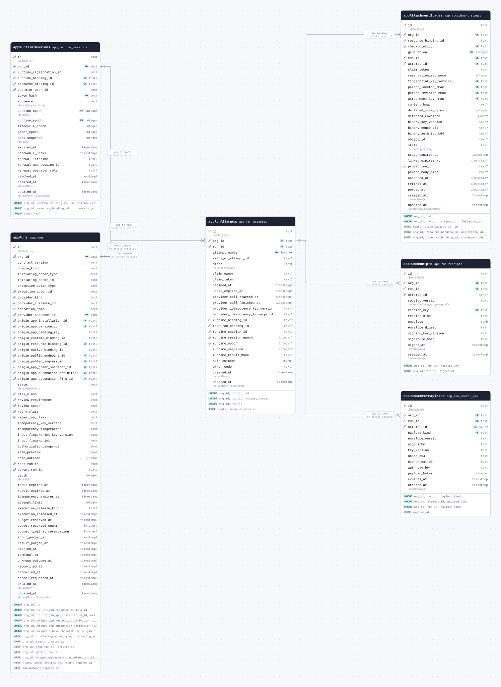

| Column                             | Type        | Constraints                                 | Default                        | Description |
| ---------------------------------- | ----------- | ------------------------------------------- | ------------------------------ | ----------- |
| `id`                               | `text`      | PK NOT NULL                                 | `.$defaultFn()`                |             |
| `org_id`                           | `text`      | NOT NULL → [appRuns.org_id](#table-appRuns) |                                |             |
| `run_id`                           | `text`      | NOT NULL                                    |                                |             |
| `attempt_number`                   | `integer`   | NOT NULL                                    |                                |             |
| `retry_of_attempt_id`              | `text`      | NULL                                        |                                |             |
| `state`                            | `text`      | NOT NULL                                    | `.default('pending')`          |             |
| `claim_owner`                      | `text`      | NULL                                        |                                |             |
| `claim_token`                      | `text`      | NULL                                        |                                |             |
| `claimed_at`                       | `timestamp` | NULL                                        |                                |             |
| `lease_expires_at`                 | `timestamp` | NULL                                        |                                |             |
| `provider_call_started_at`         | `timestamp` | NULL                                        |                                |             |
| `provider_call_finished_at`        | `timestamp` | NULL                                        |                                |             |
| `provider_idempotency_key_version` | `text`      | NULL                                        |                                |             |
| `provider_idempotency_fingerprint` | `text`      | NULL                                        |                                |             |
| `runtime_binding_id`               | `text`      | NULL                                        |                                |             |
| `resource_binding_id`              | `text`      | NULL                                        |                                |             |
| `runtime_session_id`               | `text`      | NULL                                        |                                |             |
| `runtime_session_epoch`            | `integer`   | NULL                                        |                                |             |
| `runtime_epoch`                    | `integer`   | NULL                                        |                                |             |
| `runtime_sequence`                 | `integer`   | NULL                                        |                                |             |
| `runtime_result_hmac`              | `text`      | NULL                                        |                                |             |
| `safe_outcome`                     | `jsonb`     | NULL                                        |                                |             |
| `error_code`                       | `text`      | NULL                                        |                                |             |
| `created_at`                       | `timestamp` | NOT NULL                                    | `.defaultNow()`                |             |
| `updated_at`                       | `timestamp` | NOT NULL                                    | `.defaultNow()` `.$onUpdate()` |             |

#### Definition

```sql
CREATE TABLE "app_run_attempts" (
	"id" text PRIMARY KEY,
	"org_id" text NOT NULL,
	"run_id" text NOT NULL,
	"attempt_number" integer NOT NULL,
	"retry_of_attempt_id" text,
	"state" text DEFAULT 'pending' NOT NULL,
	"claim_owner" text,
	"claim_token" text,
	"claimed_at" timestamp,
	"lease_expires_at" timestamp,
	"provider_call_started_at" timestamp,
	"provider_call_finished_at" timestamp,
	"provider_idempotency_key_version" text,
	"provider_idempotency_fingerprint" text,
	"runtime_binding_id" text,
	"resource_binding_id" text,
	"runtime_session_id" text,
	"runtime_session_epoch" integer,
	"runtime_epoch" integer,
	"runtime_sequence" integer,
	"runtime_result_hmac" text,
	"safe_outcome" jsonb,
	"error_code" text,
	"created_at" timestamp DEFAULT now() NOT NULL,
	"updated_at" timestamp DEFAULT now() NOT NULL,
	CONSTRAINT "app_run_attempts_org_run_id_unique" UNIQUE("org_id","run_id","id"),
	CONSTRAINT "app_run_attempts_number_check" CHECK ("attempt_number" >= 1),
	CONSTRAINT "app_run_attempts_retry_shape_check" CHECK (
    ("attempt_number" = 1 AND "retry_of_attempt_id" IS NULL)
    OR ("attempt_number" > 1 AND "retry_of_attempt_id" IS NOT NULL)
  ),
	CONSTRAINT "app_run_attempts_state_check" CHECK ("state" IN ('pending', 'claimed', 'provider_call_started', 'succeeded', 'failed', 'cancelled', 'unknown_outcome')),
	CONSTRAINT "app_run_attempts_claim_shape_check" CHECK (
    ("claim_owner" IS NULL AND "claim_token" IS NULL AND "claimed_at" IS NULL AND "lease_expires_at" IS NULL)
    OR ("claim_owner" IS NOT NULL AND "claim_token" IS NOT NULL AND "claimed_at" IS NOT NULL AND "lease_expires_at" IS NOT NULL)
  ),
	CONSTRAINT "app_run_attempts_provider_call_time_check" CHECK (
    "provider_call_finished_at" IS NULL
    OR ("provider_call_started_at" IS NOT NULL AND "provider_call_finished_at" >= "provider_call_started_at")
  ),
	CONSTRAINT "app_run_attempts_idempotency_shape_check" CHECK (
    ("provider_idempotency_key_version" IS NULL AND "provider_idempotency_fingerprint" IS NULL)
    OR (
      "provider_idempotency_key_version" ~ '^[A-Za-z0-9][A-Za-z0-9._-]{0,63}$'
      AND "provider_idempotency_fingerprint" ~ '^hmac-sha256:[a-f0-9]{64}$'
    )
  ),
	CONSTRAINT "app_run_attempts_safe_outcome_check" CHECK (
    "safe_outcome" IS NULL
    OR (jsonb_typeof("safe_outcome") = 'object' AND octet_length("safe_outcome"::text) <= 32768)
  ),
	CONSTRAINT "app_run_attempts_runtime_shape_check" CHECK (
    ("runtime_binding_id" IS NULL AND "resource_binding_id" IS NULL
      AND "runtime_session_id" IS NULL
      AND "runtime_session_epoch" IS NULL AND "runtime_epoch" IS NULL
      AND "runtime_sequence" IS NULL AND "runtime_result_hmac" IS NULL)
    OR ("runtime_binding_id" IS NOT NULL AND "resource_binding_id" IS NULL
      AND "runtime_session_id" IS NOT NULL
      AND "runtime_session_epoch" IS NOT NULL AND "runtime_session_epoch" >= 0
      AND "runtime_epoch" IS NOT NULL AND "runtime_epoch" >= 0
      AND "runtime_sequence" IS NOT NULL AND "runtime_sequence" >= 1)
    OR ("runtime_binding_id" IS NULL AND "resource_binding_id" IS NOT NULL
      AND "runtime_session_id" IS NOT NULL
      AND "runtime_session_epoch" IS NOT NULL AND "runtime_session_epoch" >= 0
      AND "runtime_epoch" IS NOT NULL AND "runtime_epoch" >= 0
      AND "runtime_sequence" IS NOT NULL AND "runtime_sequence" >= 1)
  )
);

CREATE UNIQUE INDEX "app_run_attempts_number_unique" ON "app_run_attempts" ("org_id","run_id","attempt_number");

CREATE UNIQUE INDEX "app_run_attempts_one_active_unique" ON "app_run_attempts" ("org_id","run_id") WHERE "state" IN ('pending', 'claimed', 'provider_call_started');

CREATE INDEX "app_run_attempts_lease_idx" ON "app_run_attempts" ("state","lease_expires_at");

ALTER TABLE "app_run_attempts" ADD CONSTRAINT "app_run_attempts_org_run_fk" FOREIGN KEY ("org_id","run_id") REFERENCES "app_runs"("org_id","id") ON DELETE CASCADE;

ALTER TABLE "app_run_attempts" ADD CONSTRAINT "app_run_attempts_runtime_session_fk" FOREIGN KEY ("org_id","runtime_binding_id","runtime_session_id","runtime_session_epoch","runtime_epoch") REFERENCES "app_runtime_sessions"("org_id","runtime_binding_id","id","session_epoch","runtime_epoch") ON DELETE RESTRICT;

ALTER TABLE "app_run_attempts" ADD CONSTRAINT "app_run_attempts_resource_session_fk" FOREIGN KEY ("org_id","resource_binding_id","runtime_session_id","runtime_session_epoch","runtime_epoch") REFERENCES "app_runtime_sessions"("org_id","resource_binding_id","id","session_epoch","runtime_epoch") ON DELETE RESTRICT;

ALTER TABLE "app_run_attempts" ADD CONSTRAINT "app_run_attempts_resource_run_fk" FOREIGN KEY ("org_id","run_id","resource_binding_id") REFERENCES "app_runs"("org_id","id","origin_resource_binding_id") ON DELETE RESTRICT;
```

#### Indexes

- UNIQUE `org_id`, `run_id`, `id`
- UNIQUE `org_id`, `run_id`, `attempt_number`
- UNIQUE `org_id`, `run_id`
- INDEX `state`, `lease_expires_at`

#### References

- `org_id` → [appRuns.org_id](#table-appRuns) (one to one, on delete restrict)
- `org_id` → [appRuntimeSessions.org_id](#table-appRuntimeSessions) (many to one, on delete restrict)
- `org_id` → [appRuntimeSessions.org_id](#table-appRuntimeSessions) (many to one, on delete restrict)
- `org_id` → [appRuns.org_id](#table-appRuns) (many to one, on delete restrict)

#### Referenced by

- `org_id` → [appRunSecretPayloads.org_id](#table-appRunSecretPayloads) (one to many, on delete cascade)
- `org_id` → [appRunReceipts.org_id](#table-appRunReceipts) (one to many, on delete cascade)
- `org_id` → [appAttachmentStages.org_id](#table-appAttachmentStages) (one to many, on delete restrict)

<details>
<summary>Queries and their SQL</summary>

**Select**: Every row of appRunAttempts.

```ts
db.select().from(appRunAttempts);
```

```sql
select "id", "org_id", "run_id", "attempt_number", "retry_of_attempt_id", "state", "claim_owner", "claim_token", "claimed_at", "lease_expires_at", "provider_call_started_at", "provider_call_finished_at", "provider_idempotency_key_version", "provider_idempotency_fingerprint", "runtime_binding_id", "resource_binding_id", "runtime_session_id", "runtime_session_epoch", "runtime_epoch", "runtime_sequence", "runtime_result_hmac", "safe_outcome", "error_code", "created_at", "updated_at"
from "app_run_attempts"
```

**Count**: How many rows appRunAttempts has.

```ts
db.select({ count: count() }).from(appRunAttempts);
```

```sql
select count(*)
from "app_run_attempts"
```

**Find many**: The rows of appRunAttempts, through the relational query API.

```ts
db.query.appRunAttempts.findMany();
```

```sql
select "d0"."id" as "id", "d0"."org_id" as "org_id", "d0"."run_id" as "run_id", "d0"."attempt_number" as "attempt_number", "d0"."retry_of_attempt_id" as "retry_of_attempt_id", "d0"."state" as "state", "d0"."claim_owner" as "claim_owner", "d0"."claim_token" as "claim_token", "d0"."claimed_at" as "claimed_at", "d0"."lease_expires_at" as "lease_expires_at", "d0"."provider_call_started_at" as "provider_call_started_at", "d0"."provider_call_finished_at" as "provider_call_finished_at", "d0"."provider_idempotency_key_version" as "provider_idempotency_key_version", "d0"."provider_idempotency_fingerprint" as "provider_idempotency_fingerprint", "d0"."runtime_binding_id" as "runtime_binding_id", "d0"."resource_binding_id" as "resource_binding_id", "d0"."runtime_session_id" as "runtime_session_id", "d0"."runtime_session_epoch" as "runtime_session_epoch", "d0"."runtime_epoch" as "runtime_epoch", "d0"."runtime_sequence" as "runtime_sequence", "d0"."runtime_result_hmac" as "runtime_result_hmac", "d0"."safe_outcome" as "safe_outcome", "d0"."error_code" as "error_code", "d0"."created_at" as "created_at", "d0"."updated_at" as "updated_at"
from "app_run_attempts" as "d0"
```

**Find by primary key**: One row of appRunAttempts, through the relational query API.

```ts
db.query.appRunAttempts.findFirst({ where: { id: "id" } });
```

```sql
select "d0"."id" as "id", "d0"."org_id" as "org_id", "d0"."run_id" as "run_id", "d0"."attempt_number" as "attempt_number", "d0"."retry_of_attempt_id" as "retry_of_attempt_id", "d0"."state" as "state", "d0"."claim_owner" as "claim_owner", "d0"."claim_token" as "claim_token", "d0"."claimed_at" as "claimed_at", "d0"."lease_expires_at" as "lease_expires_at", "d0"."provider_call_started_at" as "provider_call_started_at", "d0"."provider_call_finished_at" as "provider_call_finished_at", "d0"."provider_idempotency_key_version" as "provider_idempotency_key_version", "d0"."provider_idempotency_fingerprint" as "provider_idempotency_fingerprint", "d0"."runtime_binding_id" as "runtime_binding_id", "d0"."resource_binding_id" as "resource_binding_id", "d0"."runtime_session_id" as "runtime_session_id", "d0"."runtime_session_epoch" as "runtime_session_epoch", "d0"."runtime_epoch" as "runtime_epoch", "d0"."runtime_sequence" as "runtime_sequence", "d0"."runtime_result_hmac" as "runtime_result_hmac", "d0"."safe_outcome" as "safe_outcome", "d0"."error_code" as "error_code", "d0"."created_at" as "created_at", "d0"."updated_at" as "updated_at"
from "app_run_attempts" as "d0"
where "d0"."id" = $1
limit $2
-- params: ["id",1]
```

**Insert**: Adds a row to appRunAttempts, giving the columns that have no default.

```ts
db.insert(appRunAttempts).values({ org_id: "org_id", run_id: "run_id", attempt_number: 1 });
```

```sql
insert into "app_run_attempts" ("id", "org_id", "run_id", "attempt_number", "retry_of_attempt_id", "state", "claim_owner", "claim_token", "claimed_at", "lease_expires_at", "provider_call_started_at", "provider_call_finished_at", "provider_idempotency_key_version", "provider_idempotency_fingerprint", "runtime_binding_id", "resource_binding_id", "runtime_session_id", "runtime_session_epoch", "runtime_epoch", "runtime_sequence", "runtime_result_hmac", "safe_outcome", "error_code", "created_at", "updated_at")
values ($1, $2, $3, $4, default, default, default, default, default, default, default, default, default, default, default, default, default, default, default, default, default, default, default, default, default)
-- params: ["00000000-0000-4000-8000-000000000000","org_id","run_id",1]
```

**Update**: Changes a row of appRunAttempts, found by its primary key.

```ts
db.update(appRunAttempts).set({ org_id: "org_id" }).where(eq(appRunAttempts.id, "id"));
```

```sql
update "app_run_attempts"
set "org_id" = $1, "updated_at" = $2
where "app_run_attempts"."id" = $3
-- params: ["org_id","2026-01-01T00:00:00.000Z","id"]
```

**Delete**: Deletes a row of appRunAttempts, found by its primary key.

```ts
db.delete(appRunAttempts).where(eq(appRunAttempts.id, "id"));
```

```sql
delete from "app_run_attempts"
where "app_run_attempts"."id" = $1
-- params: ["id"]
```

</details>

<a id="table-appRunSecretPayloads"></a>

### appRunSecretPayloads

Table `app_run_secret_payloads`.

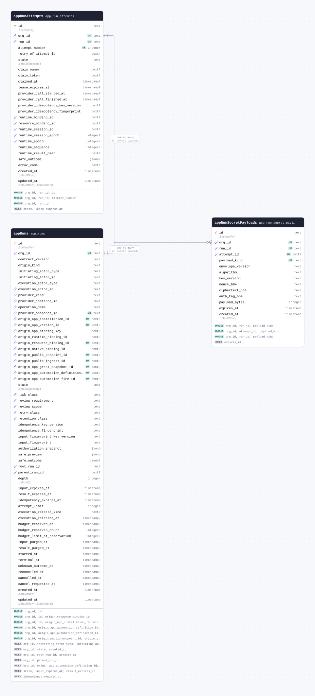

| Column             | Type        | Constraints                                 | Default         | Description |
| ------------------ | ----------- | ------------------------------------------- | --------------- | ----------- |
| `id`               | `text`      | PK NOT NULL                                 | `.$defaultFn()` |             |
| `org_id`           | `text`      | NOT NULL → [appRuns.org_id](#table-appRuns) |                 |             |
| `run_id`           | `text`      | NOT NULL                                    |                 |             |
| `attempt_id`       | `text`      | NULL                                        |                 |             |
| `payload_kind`     | `text`      | NOT NULL                                    |                 |             |
| `envelope_version` | `text`      | NOT NULL                                    |                 |             |
| `algorithm`        | `text`      | NOT NULL                                    |                 |             |
| `key_version`      | `text`      | NOT NULL                                    |                 |             |
| `nonce_b64`        | `text`      | NOT NULL                                    |                 |             |
| `ciphertext_b64`   | `text`      | NOT NULL                                    |                 |             |
| `auth_tag_b64`     | `text`      | NOT NULL                                    |                 |             |
| `payload_bytes`    | `integer`   | NOT NULL                                    |                 |             |
| `expires_at`       | `timestamp` | NOT NULL                                    |                 |             |
| `created_at`       | `timestamp` | NOT NULL                                    | `.defaultNow()` |             |

#### Definition

```sql
CREATE TABLE "app_run_secret_payloads" (
	"id" text PRIMARY KEY,
	"org_id" text NOT NULL,
	"run_id" text NOT NULL,
	"attempt_id" text,
	"payload_kind" text NOT NULL,
	"envelope_version" text NOT NULL,
	"algorithm" text NOT NULL,
	"key_version" text NOT NULL,
	"nonce_b64" text NOT NULL,
	"ciphertext_b64" text NOT NULL,
	"auth_tag_b64" text NOT NULL,
	"payload_bytes" integer NOT NULL,
	"expires_at" timestamp NOT NULL,
	"created_at" timestamp DEFAULT now() NOT NULL,
	CONSTRAINT "app_run_secret_payloads_kind_shape_check" CHECK (
    ("payload_kind" = 'input' AND "attempt_id" IS NULL AND "payload_bytes" BETWEEN 1 AND 262144)
    OR ("payload_kind" = 'output' AND "attempt_id" IS NOT NULL AND "payload_bytes" BETWEEN 1 AND 1048576)
    OR ("payload_kind" = 'action_resources' AND "attempt_id" IS NULL AND "payload_bytes" BETWEEN 1 AND 196608)
  ),
	CONSTRAINT "app_run_secret_payloads_envelope_check" CHECK (
    "envelope_version" = 'deft.secret.v1'
    AND "algorithm" = 'aes-256-gcm'
    AND "key_version" ~ '^[A-Za-z0-9][A-Za-z0-9._-]{0,63}$'
    AND "nonce_b64" ~ '^[A-Za-z0-9+/]{16}$'
    AND "auth_tag_b64" ~ '^[A-Za-z0-9+/]{22}==$'
    AND "ciphertext_b64" ~ '^(?:[A-Za-z0-9+/]{4})*(?:[A-Za-z0-9+/]{2}==|[A-Za-z0-9+/]{3}=)?$'
  ),
	CONSTRAINT "app_run_secret_payloads_size_check" CHECK (
    octet_length(decode("ciphertext_b64", 'base64')) = "payload_bytes"
  )
);

CREATE UNIQUE INDEX "app_run_secret_payloads_input_unique" ON "app_run_secret_payloads" ("org_id","run_id","payload_kind") WHERE "payload_kind" = 'input';

CREATE UNIQUE INDEX "app_run_secret_payloads_output_unique" ON "app_run_secret_payloads" ("org_id","attempt_id","payload_kind") WHERE "payload_kind" = 'output';

CREATE UNIQUE INDEX "app_run_secret_payloads_action_resources_unique" ON "app_run_secret_payloads" ("org_id","run_id","payload_kind") WHERE "payload_kind" = 'action_resources';

CREATE INDEX "app_run_secret_payloads_expiry_idx" ON "app_run_secret_payloads" ("expires_at");

ALTER TABLE "app_run_secret_payloads" ADD CONSTRAINT "app_run_secret_payloads_org_run_fk" FOREIGN KEY ("org_id","run_id") REFERENCES "app_runs"("org_id","id") ON DELETE CASCADE;

ALTER TABLE "app_run_secret_payloads" ADD CONSTRAINT "app_run_secret_payloads_org_attempt_fk" FOREIGN KEY ("org_id","run_id","attempt_id") REFERENCES "app_run_attempts"("org_id","run_id","id") ON DELETE CASCADE;
```

#### Indexes

- UNIQUE `org_id`, `run_id`, `payload_kind`
- UNIQUE `org_id`, `attempt_id`, `payload_kind`
- UNIQUE `org_id`, `run_id`, `payload_kind`
- INDEX `expires_at`

#### References

- `org_id` → [appRuns.org_id](#table-appRuns) (many to one, on delete cascade)
- `org_id` → [appRunAttempts.org_id](#table-appRunAttempts) (many to one, on delete cascade)

<details>
<summary>Queries and their SQL</summary>

**Select**: Every row of appRunSecretPayloads.

```ts
db.select().from(appRunSecretPayloads);
```

```sql
select "id", "org_id", "run_id", "attempt_id", "payload_kind", "envelope_version", "algorithm", "key_version", "nonce_b64", "ciphertext_b64", "auth_tag_b64", "payload_bytes", "expires_at", "created_at"
from "app_run_secret_payloads"
```

**Count**: How many rows appRunSecretPayloads has.

```ts
db.select({ count: count() }).from(appRunSecretPayloads);
```

```sql
select count(*)
from "app_run_secret_payloads"
```

**Find many**: The rows of appRunSecretPayloads, through the relational query API.

```ts
db.query.appRunSecretPayloads.findMany();
```

```sql
select "d0"."id" as "id", "d0"."org_id" as "org_id", "d0"."run_id" as "run_id", "d0"."attempt_id" as "attempt_id", "d0"."payload_kind" as "payload_kind", "d0"."envelope_version" as "envelope_version", "d0"."algorithm" as "algorithm", "d0"."key_version" as "key_version", "d0"."nonce_b64" as "nonce_b64", "d0"."ciphertext_b64" as "ciphertext_b64", "d0"."auth_tag_b64" as "auth_tag_b64", "d0"."payload_bytes" as "payload_bytes", "d0"."expires_at" as "expires_at", "d0"."created_at" as "created_at"
from "app_run_secret_payloads" as "d0"
```

**Find by primary key**: One row of appRunSecretPayloads, through the relational query API.

```ts
db.query.appRunSecretPayloads.findFirst({ where: { id: "id" } });
```

```sql
select "d0"."id" as "id", "d0"."org_id" as "org_id", "d0"."run_id" as "run_id", "d0"."attempt_id" as "attempt_id", "d0"."payload_kind" as "payload_kind", "d0"."envelope_version" as "envelope_version", "d0"."algorithm" as "algorithm", "d0"."key_version" as "key_version", "d0"."nonce_b64" as "nonce_b64", "d0"."ciphertext_b64" as "ciphertext_b64", "d0"."auth_tag_b64" as "auth_tag_b64", "d0"."payload_bytes" as "payload_bytes", "d0"."expires_at" as "expires_at", "d0"."created_at" as "created_at"
from "app_run_secret_payloads" as "d0"
where "d0"."id" = $1
limit $2
-- params: ["id",1]
```

**Insert**: Adds a row to appRunSecretPayloads, giving the columns that have no default.

```ts
db.insert(appRunSecretPayloads).values({
  org_id: "org_id",
  run_id: "run_id",
  payload_kind: "payload_kind",
  envelope_version: "envelope_version",
  algorithm: "algorithm",
  key_version: "key_version",
  nonce_b64: "nonce_b64",
  ciphertext_b64: "ciphertext_b64",
  auth_tag_b64: "auth_tag_b64",
  payload_bytes: 1,
  expires_at: new Date("2026-01-01T00:00:00.000Z"),
});
```

```sql
insert into "app_run_secret_payloads" ("id", "org_id", "run_id", "attempt_id", "payload_kind", "envelope_version", "algorithm", "key_version", "nonce_b64", "ciphertext_b64", "auth_tag_b64", "payload_bytes", "expires_at", "created_at")
values ($1, $2, $3, default, $4, $5, $6, $7, $8, $9, $10, $11, $12, default)
-- params: ["00000000-0000-4000-8000-000000000000","org_id","run_id","payload_kind","envelope_version","algorithm","key_version","nonce_b64","ciphertext_b64","auth_tag_b64",1,"2026-01-01T00:00:00.000Z"]
```

**Update**: Changes a row of appRunSecretPayloads, found by its primary key.

```ts
db.update(appRunSecretPayloads).set({ org_id: "org_id" }).where(eq(appRunSecretPayloads.id, "id"));
```

```sql
update "app_run_secret_payloads"
set "org_id" = $1
where "app_run_secret_payloads"."id" = $2
-- params: ["org_id","id"]
```

**Delete**: Deletes a row of appRunSecretPayloads, found by its primary key.

```ts
db.delete(appRunSecretPayloads).where(eq(appRunSecretPayloads.id, "id"));
```

```sql
delete from "app_run_secret_payloads"
where "app_run_secret_payloads"."id" = $1
-- params: ["id"]
```

</details>

<a id="table-appRunEvents"></a>

### appRunEvents

Table `app_run_events`.

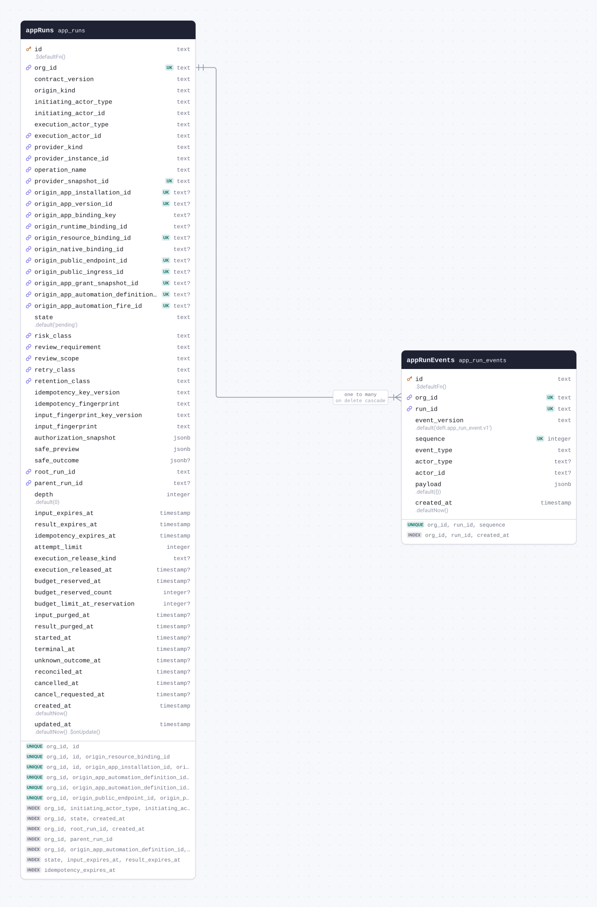

| Column          | Type        | Constraints                                 | Default                             | Description |
| --------------- | ----------- | ------------------------------------------- | ----------------------------------- | ----------- |
| `id`            | `text`      | PK NOT NULL                                 | `.$defaultFn()`                     |             |
| `org_id`        | `text`      | NOT NULL → [appRuns.org_id](#table-appRuns) |                                     |             |
| `run_id`        | `text`      | NOT NULL                                    |                                     |             |
| `event_version` | `text`      | NOT NULL                                    | `.default('deft.app_run_event.v1')` |             |
| `sequence`      | `integer`   | NOT NULL                                    |                                     |             |
| `event_type`    | `text`      | NOT NULL                                    |                                     |             |
| `actor_type`    | `text`      | NULL                                        |                                     |             |
| `actor_id`      | `text`      | NULL                                        |                                     |             |
| `payload`       | `jsonb`     | NOT NULL                                    | `.default({})`                      |             |
| `created_at`    | `timestamp` | NOT NULL                                    | `.defaultNow()`                     |             |

#### Definition

```sql
CREATE TABLE "app_run_events" (
	"id" text PRIMARY KEY,
	"org_id" text NOT NULL,
	"run_id" text NOT NULL,
	"event_version" text DEFAULT 'deft.app_run_event.v1' NOT NULL,
	"sequence" integer NOT NULL,
	"event_type" text NOT NULL,
	"actor_type" text,
	"actor_id" text,
	"payload" jsonb DEFAULT '{}' NOT NULL,
	"created_at" timestamp DEFAULT now() NOT NULL,
	CONSTRAINT "app_run_events_sequence_check" CHECK ("sequence" >= 1),
	CONSTRAINT "app_run_events_version_check" CHECK ("event_version" = 'deft.app_run_event.v1'),
	CONSTRAINT "app_run_events_type_check" CHECK ("event_type" IN (
    'run_created', 'approval_requested', 'approval_resolved', 'attempt_created',
    'attempt_claimed', 'provider_call_started', 'cancellation_requested', 'attempt_terminal', 'run_transitioned',
    'secrets_purged', 'reconciliation_recorded', 'repair_gap'
  )),
	CONSTRAINT "app_run_events_actor_shape_check" CHECK (
    ("actor_type" IS NULL AND "actor_id" IS NULL)
    OR ("actor_type" IN ('human', 'agent_employee', 'system', 'automation', 'app_public') AND "actor_id" IS NOT NULL)
  ),
	CONSTRAINT "app_run_events_payload_check" CHECK (jsonb_typeof("payload") = 'object' AND octet_length("payload"::text) <= 32768)
);

CREATE UNIQUE INDEX "app_run_events_sequence_unique" ON "app_run_events" ("org_id","run_id","sequence");

CREATE INDEX "app_run_events_run_idx" ON "app_run_events" ("org_id","run_id","created_at");

ALTER TABLE "app_run_events" ADD CONSTRAINT "app_run_events_org_run_fk" FOREIGN KEY ("org_id","run_id") REFERENCES "app_runs"("org_id","id") ON DELETE CASCADE;
```

#### Indexes

- UNIQUE `org_id`, `run_id`, `sequence`
- INDEX `org_id`, `run_id`, `created_at`

#### References

- `org_id` → [appRuns.org_id](#table-appRuns) (many to one, on delete cascade)

<details>
<summary>Queries and their SQL</summary>

**Select**: Every row of appRunEvents.

```ts
db.select().from(appRunEvents);
```

```sql
select "id", "org_id", "run_id", "event_version", "sequence", "event_type", "actor_type", "actor_id", "payload", "created_at"
from "app_run_events"
```

**Count**: How many rows appRunEvents has.

```ts
db.select({ count: count() }).from(appRunEvents);
```

```sql
select count(*)
from "app_run_events"
```

**Find many**: The rows of appRunEvents, through the relational query API.

```ts
db.query.appRunEvents.findMany();
```

```sql
select "d0"."id" as "id", "d0"."org_id" as "org_id", "d0"."run_id" as "run_id", "d0"."event_version" as "event_version", "d0"."sequence" as "sequence", "d0"."event_type" as "event_type", "d0"."actor_type" as "actor_type", "d0"."actor_id" as "actor_id", "d0"."payload" as "payload", "d0"."created_at" as "created_at"
from "app_run_events" as "d0"
```

**Find by primary key**: One row of appRunEvents, through the relational query API.

```ts
db.query.appRunEvents.findFirst({ where: { id: "id" } });
```

```sql
select "d0"."id" as "id", "d0"."org_id" as "org_id", "d0"."run_id" as "run_id", "d0"."event_version" as "event_version", "d0"."sequence" as "sequence", "d0"."event_type" as "event_type", "d0"."actor_type" as "actor_type", "d0"."actor_id" as "actor_id", "d0"."payload" as "payload", "d0"."created_at" as "created_at"
from "app_run_events" as "d0"
where "d0"."id" = $1
limit $2
-- params: ["id",1]
```

**Insert**: Adds a row to appRunEvents, giving the columns that have no default.

```ts
db.insert(appRunEvents).values({
  org_id: "org_id",
  run_id: "run_id",
  sequence: 1,
  event_type: "event_type",
});
```

```sql
insert into "app_run_events" ("id", "org_id", "run_id", "event_version", "sequence", "event_type", "actor_type", "actor_id", "payload", "created_at")
values ($1, $2, $3, default, $4, $5, default, default, default, default)
-- params: ["00000000-0000-4000-8000-000000000000","org_id","run_id",1,"event_type"]
```

**Update**: Changes a row of appRunEvents, found by its primary key.

```ts
db.update(appRunEvents).set({ org_id: "org_id" }).where(eq(appRunEvents.id, "id"));
```

```sql
update "app_run_events"
set "org_id" = $1
where "app_run_events"."id" = $2
-- params: ["org_id","id"]
```

**Delete**: Deletes a row of appRunEvents, found by its primary key.

```ts
db.delete(appRunEvents).where(eq(appRunEvents.id, "id"));
```

```sql
delete from "app_run_events"
where "app_run_events"."id" = $1
-- params: ["id"]
```

</details>

<a id="table-appRunReceipts"></a>

### appRunReceipts

Table `app_run_receipts`.


| Column                | Type        | Constraints                                 | Default                               | Description |
| --------------------- | ----------- | ------------------------------------------- | ------------------------------------- | ----------- |
| `id`                  | `text`      | PK NOT NULL                                 | `.$defaultFn()`                       |             |
| `org_id`              | `text`      | NOT NULL → [appRuns.org_id](#table-appRuns) |                                       |             |
| `run_id`              | `text`      | NOT NULL                                    |                                       |             |
| `attempt_id`          | `text`      | NULL                                        |                                       |             |
| `receipt_version`     | `text`      | NOT NULL                                    | `.default('deft.app_run_receipt.v1')` |             |
| `receipt_key`         | `text`      | NOT NULL                                    |                                       |             |
| `receipt_kind`        | `text`      | NOT NULL                                    |                                       |             |
| `envelope`            | `jsonb`     | NOT NULL                                    |                                       |             |
| `envelope_digest`     | `text`      | NOT NULL                                    |                                       |             |
| `signing_key_version` | `text`      | NOT NULL                                    |                                       |             |
| `signature_hmac`      | `text`      | NOT NULL                                    |                                       |             |
| `signed_at`           | `timestamp` | NOT NULL                                    | `.defaultNow()`                       |             |
| `created_at`          | `timestamp` | NOT NULL                                    | `.defaultNow()`                       |             |

#### Definition

```sql
CREATE TABLE "app_run_receipts" (
	"id" text PRIMARY KEY,
	"org_id" text NOT NULL,
	"run_id" text NOT NULL,
	"attempt_id" text,
	"receipt_version" text DEFAULT 'deft.app_run_receipt.v1' NOT NULL,
	"receipt_key" text NOT NULL,
	"receipt_kind" text NOT NULL,
	"envelope" jsonb NOT NULL,
	"envelope_digest" text NOT NULL,
	"signing_key_version" text NOT NULL,
	"signature_hmac" text NOT NULL,
	"signed_at" timestamp DEFAULT now() NOT NULL,
	"created_at" timestamp DEFAULT now() NOT NULL,
	CONSTRAINT "app_run_receipts_kind_check" CHECK ("receipt_kind" IN ('approval', 'attempt_terminal', 'reconciliation', 'repair')),
	CONSTRAINT "app_run_receipts_version_check" CHECK ("receipt_version" = 'deft.app_run_receipt.v1'),
	CONSTRAINT "app_run_receipts_envelope_check" CHECK (jsonb_typeof("envelope") = 'object' AND octet_length("envelope"::text) <= 32768),
	CONSTRAINT "app_run_receipts_digest_check" CHECK ("envelope_digest" ~ '^sha256:[a-f0-9]{64}$'),
	CONSTRAINT "app_run_receipts_signature_check" CHECK ("signature_hmac" ~ '^hmac-sha256:[a-f0-9]{64}$'),
	CONSTRAINT "app_run_receipts_key_version_check" CHECK ("signing_key_version" ~ '^[A-Za-z0-9][A-Za-z0-9._-]{0,63}$')
);

CREATE UNIQUE INDEX "app_run_receipts_key_unique" ON "app_run_receipts" ("org_id","run_id","receipt_key");

CREATE INDEX "app_run_receipts_run_idx" ON "app_run_receipts" ("org_id","run_id","signed_at");

ALTER TABLE "app_run_receipts" ADD CONSTRAINT "app_run_receipts_org_run_fk" FOREIGN KEY ("org_id","run_id") REFERENCES "app_runs"("org_id","id") ON DELETE CASCADE;

ALTER TABLE "app_run_receipts" ADD CONSTRAINT "app_run_receipts_org_attempt_fk" FOREIGN KEY ("org_id","run_id","attempt_id") REFERENCES "app_run_attempts"("org_id","run_id","id") ON DELETE CASCADE;
```

#### Indexes

- UNIQUE `org_id`, `run_id`, `receipt_key`
- INDEX `org_id`, `run_id`, `signed_at`

#### References

- `org_id` → [appRuns.org_id](#table-appRuns) (many to one, on delete cascade)
- `org_id` → [appRunAttempts.org_id](#table-appRunAttempts) (many to one, on delete cascade)

<details>
<summary>Queries and their SQL</summary>

**Select**: Every row of appRunReceipts.

```ts
db.select().from(appRunReceipts);
```

```sql
select "id", "org_id", "run_id", "attempt_id", "receipt_version", "receipt_key", "receipt_kind", "envelope", "envelope_digest", "signing_key_version", "signature_hmac", "signed_at", "created_at"
from "app_run_receipts"
```

**Count**: How many rows appRunReceipts has.

```ts
db.select({ count: count() }).from(appRunReceipts);
```

```sql
select count(*)
from "app_run_receipts"
```

**Find many**: The rows of appRunReceipts, through the relational query API.

```ts
db.query.appRunReceipts.findMany();
```

```sql
select "d0"."id" as "id", "d0"."org_id" as "org_id", "d0"."run_id" as "run_id", "d0"."attempt_id" as "attempt_id", "d0"."receipt_version" as "receipt_version", "d0"."receipt_key" as "receipt_key", "d0"."receipt_kind" as "receipt_kind", "d0"."envelope" as "envelope", "d0"."envelope_digest" as "envelope_digest", "d0"."signing_key_version" as "signing_key_version", "d0"."signature_hmac" as "signature_hmac", "d0"."signed_at" as "signed_at", "d0"."created_at" as "created_at"
from "app_run_receipts" as "d0"
```

**Find by primary key**: One row of appRunReceipts, through the relational query API.

```ts
db.query.appRunReceipts.findFirst({ where: { id: "id" } });
```

```sql
select "d0"."id" as "id", "d0"."org_id" as "org_id", "d0"."run_id" as "run_id", "d0"."attempt_id" as "attempt_id", "d0"."receipt_version" as "receipt_version", "d0"."receipt_key" as "receipt_key", "d0"."receipt_kind" as "receipt_kind", "d0"."envelope" as "envelope", "d0"."envelope_digest" as "envelope_digest", "d0"."signing_key_version" as "signing_key_version", "d0"."signature_hmac" as "signature_hmac", "d0"."signed_at" as "signed_at", "d0"."created_at" as "created_at"
from "app_run_receipts" as "d0"
where "d0"."id" = $1
limit $2
-- params: ["id",1]
```

**Insert**: Adds a row to appRunReceipts, giving the columns that have no default.

```ts
db.insert(appRunReceipts).values({
  org_id: "org_id",
  run_id: "run_id",
  receipt_key: "receipt_key",
  receipt_kind: "receipt_kind",
  envelope: {},
  envelope_digest: "envelope_digest",
  signing_key_version: "signing_key_version",
  signature_hmac: "signature_hmac",
});
```

```sql
insert into "app_run_receipts" ("id", "org_id", "run_id", "attempt_id", "receipt_version", "receipt_key", "receipt_kind", "envelope", "envelope_digest", "signing_key_version", "signature_hmac", "signed_at", "created_at")
values ($1, $2, $3, default, default, $4, $5, $6, $7, $8, $9, default, default)
-- params: ["00000000-0000-4000-8000-000000000000","org_id","run_id","receipt_key","receipt_kind",{},"envelope_digest","signing_key_version","signature_hmac"]
```

**Update**: Changes a row of appRunReceipts, found by its primary key.

```ts
db.update(appRunReceipts).set({ org_id: "org_id" }).where(eq(appRunReceipts.id, "id"));
```

```sql
update "app_run_receipts"
set "org_id" = $1
where "app_run_receipts"."id" = $2
-- params: ["org_id","id"]
```

**Delete**: Deletes a row of appRunReceipts, found by its primary key.

```ts
db.delete(appRunReceipts).where(eq(appRunReceipts.id, "id"));
```

```sql
delete from "app_run_receipts"
where "app_run_receipts"."id" = $1
-- params: ["id"]
```

</details>

<a id="table-agentActions"></a>

### agentActions

Table `agent_actions`. ═══ AGENT: ACTIONS LOG ═══ Note: agent_conversations and agent_messages were dropped in migration 0065 (Phase 2 agent-chat unification). Conversation IDs are now space IDs in the spaces table; messages live in the unified messages table.

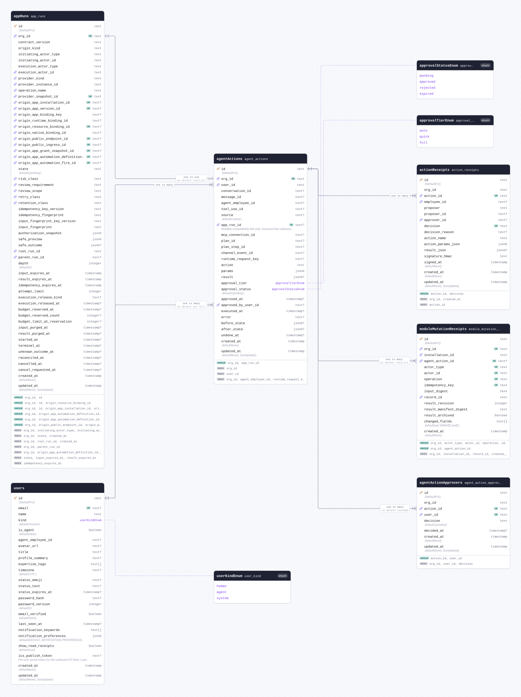

| Column                | Type                                             | Constraints                                 | Default                        | Description                                                                                                                                   |
| --------------------- | ------------------------------------------------ | ------------------------------------------- | ------------------------------ | --------------------------------------------------------------------------------------------------------------------------------------------- |
| `id`                  | `text`                                           | PK NOT NULL                                 | `.$defaultFn()`                |                                                                                                                                               |
| `org_id`              | `text`                                           | NOT NULL → [appRuns.org_id](#table-appRuns) |                                |                                                                                                                                               |
| `user_id`             | `text`                                           | NOT NULL → [users.id](#table-users)         |                                |                                                                                                                                               |
| `conversation_id`     | `text`                                           | NULL                                        |                                |                                                                                                                                               |
| `message_id`          | `text`                                           | NULL                                        |                                |                                                                                                                                               |
| `agent_employee_id`   | `text`                                           | NULL                                        |                                |                                                                                                                                               |
| `tool_use_id`         | `text`                                           | NULL                                        |                                |                                                                                                                                               |
| `source`              | `text`                                           | NULL                                        | `.default('native')`           |                                                                                                                                               |
| `app_run_id`          | `text`                                           | NULL                                        |                                | Nullable compatibility link only. Governed Run submission owns the one app_run_invoke row; the action is never the execution source of truth. |
| `mcp_connection_id`   | `text`                                           | NULL                                        |                                |                                                                                                                                               |
| `plan_id`             | `text`                                           | NULL                                        |                                |                                                                                                                                               |
| `plan_step_id`        | `text`                                           | NULL                                        |                                |                                                                                                                                               |
| `channel_event_id`    | `text`                                           | NULL                                        |                                |                                                                                                                                               |
| `runtime_request_key` | `text`                                           | NULL                                        |                                |                                                                                                                                               |
| `action`              | `text`                                           | NOT NULL                                    |                                |                                                                                                                                               |
| `params`              | `jsonb`                                          | NOT NULL                                    |                                |                                                                                                                                               |
| `result`              | `jsonb`                                          | NULL                                        |                                |                                                                                                                                               |
| `approval_tier`       | [`approvalTierEnum`](#enum-approvalTierEnum)     | NOT NULL                                    |                                |                                                                                                                                               |
| `approval_status`     | [`approvalStatusEnum`](#enum-approvalStatusEnum) | NOT NULL                                    | `.default('pending')`          |                                                                                                                                               |
| `approved_at`         | `timestamp`                                      | NULL                                        |                                |                                                                                                                                               |
| `approved_by_user_id` | `text`                                           | NULL → [users.id](#table-users)             |                                |                                                                                                                                               |
| `executed_at`         | `timestamp`                                      | NULL                                        |                                |                                                                                                                                               |
| `error`               | `text`                                           | NULL                                        |                                |                                                                                                                                               |
| `before_state`        | `jsonb`                                          | NULL                                        |                                |                                                                                                                                               |
| `after_state`         | `jsonb`                                          | NULL                                        |                                |                                                                                                                                               |
| `undone_at`           | `timestamp`                                      | NULL                                        |                                |                                                                                                                                               |
| `created_at`          | `timestamp`                                      | NOT NULL                                    | `.defaultNow()`                |                                                                                                                                               |
| `updated_at`          | `timestamp`                                      | NOT NULL                                    | `.defaultNow()` `.$onUpdate()` |                                                                                                                                               |

#### Definition

```sql
CREATE TABLE "agent_actions" (
	"id" text PRIMARY KEY,
	"org_id" text NOT NULL,
	"user_id" text NOT NULL,
	"conversation_id" text,
	"message_id" text,
	"agent_employee_id" text,
	"tool_use_id" text,
	"source" text DEFAULT 'native',
	"app_run_id" text,
	"mcp_connection_id" text,
	"plan_id" text,
	"plan_step_id" text,
	"channel_event_id" text,
	"runtime_request_key" text,
	"action" text NOT NULL,
	"params" jsonb NOT NULL,
	"result" jsonb,
	"approval_tier" "approval_tier" NOT NULL,
	"approval_status" "approval_status" DEFAULT 'pending'::"approval_status" NOT NULL,
	"approved_at" timestamp,
	"approved_by_user_id" text,
	"executed_at" timestamp,
	"error" text,
	"before_state" jsonb,
	"after_state" jsonb,
	"undone_at" timestamp,
	"created_at" timestamp DEFAULT now() NOT NULL,
	"updated_at" timestamp DEFAULT now() NOT NULL,
	CONSTRAINT "agent_actions_app_run_shape_check" CHECK (
    ("app_run_id" IS NULL AND "action" <> 'app_run_invoke')
    OR (
      "app_run_id" IS NOT NULL
      AND "action" = 'app_run_invoke'
      AND jsonb_typeof("params") = 'object'
      AND "params" ? 'run_id'
      AND jsonb_typeof("params"->'run_id') = 'string'
      AND "params"->>'run_id' = "app_run_id"
      AND ("params" - ARRAY['run_id', 'capability_label', 'provider_label', 'resource_ids', 'safe_preview']::text[]) = '{}'::jsonb
      AND octet_length("params"::text) <= 32768
    )
  )
);

CREATE INDEX "agent_action_org_idx" ON "agent_actions" ("org_id");

CREATE INDEX "agent_action_user_idx" ON "agent_actions" ("user_id");

CREATE INDEX "agent_action_runtime_request_idx" ON "agent_actions" ("org_id","agent_employee_id","runtime_request_key");

CREATE UNIQUE INDEX "agent_action_app_run_unique" ON "agent_actions" ("org_id","app_run_id") WHERE "app_run_id" IS NOT NULL;

ALTER TABLE "agent_actions" ADD CONSTRAINT "agent_actions_user_id_users_id_fkey" FOREIGN KEY ("user_id") REFERENCES "users"("id");

ALTER TABLE "agent_actions" ADD CONSTRAINT "agent_actions_approved_by_user_id_users_id_fkey" FOREIGN KEY ("approved_by_user_id") REFERENCES "users"("id") ON DELETE SET NULL;

ALTER TABLE "agent_actions" ADD CONSTRAINT "agent_actions_org_app_run_fk" FOREIGN KEY ("org_id","app_run_id") REFERENCES "app_runs"("org_id","id") ON DELETE RESTRICT;
```

#### Indexes

- INDEX `org_id`
- INDEX `user_id`
- INDEX `org_id`, `agent_employee_id`, `runtime_request_key`
- UNIQUE `org_id`, `app_run_id`

#### References

- `user_id` → [users.id](#table-users) (many to one)
- `approved_by_user_id` → [users.id](#table-users) (many to one, on delete set null)
- `org_id` → [appRuns.org_id](#table-appRuns) (one to one, on delete restrict)

#### Referenced by

- `id` → [agentActionApprovers.action_id](#table-agentActionApprovers) (one to many, on delete cascade)
- `id` → [moduleMutationReceipts.agent_action_id](#table-moduleMutationReceipts) (one to many, on delete restrict)
- `id` → [actionReceipts.action_id](#table-actionReceipts) (one to many)

<details>
<summary>Queries and their SQL</summary>

**Select**: Every row of agentActions.

```ts
db.select().from(agentActions);
```

```sql
select "id", "org_id", "user_id", "conversation_id", "message_id", "agent_employee_id", "tool_use_id", "source", "app_run_id", "mcp_connection_id", "plan_id", "plan_step_id", "channel_event_id", "runtime_request_key", "action", "params", "result", "approval_tier", "approval_status", "approved_at", "approved_by_user_id", "executed_at", "error", "before_state", "after_state", "undone_at", "created_at", "updated_at"
from "agent_actions"
```

**Count**: How many rows agentActions has.

```ts
db.select({ count: count() }).from(agentActions);
```

```sql
select count(*)
from "agent_actions"
```

**Find many**: The rows of agentActions, through the relational query API.

```ts
db.query.agentActions.findMany();
```

```sql
select "d0"."id" as "id", "d0"."org_id" as "org_id", "d0"."user_id" as "user_id", "d0"."conversation_id" as "conversation_id", "d0"."message_id" as "message_id", "d0"."agent_employee_id" as "agent_employee_id", "d0"."tool_use_id" as "tool_use_id", "d0"."source" as "source", "d0"."app_run_id" as "app_run_id", "d0"."mcp_connection_id" as "mcp_connection_id", "d0"."plan_id" as "plan_id", "d0"."plan_step_id" as "plan_step_id", "d0"."channel_event_id" as "channel_event_id", "d0"."runtime_request_key" as "runtime_request_key", "d0"."action" as "action", "d0"."params" as "params", "d0"."result" as "result", "d0"."approval_tier" as "approval_tier", "d0"."approval_status" as "approval_status", "d0"."approved_at" as "approved_at", "d0"."approved_by_user_id" as "approved_by_user_id", "d0"."executed_at" as "executed_at", "d0"."error" as "error", "d0"."before_state" as "before_state", "d0"."after_state" as "after_state", "d0"."undone_at" as "undone_at", "d0"."created_at" as "created_at", "d0"."updated_at" as "updated_at"
from "agent_actions" as "d0"
```

**Find by primary key**: One row of agentActions, through the relational query API.

```ts
db.query.agentActions.findFirst({ where: { id: "id" } });
```

```sql
select "d0"."id" as "id", "d0"."org_id" as "org_id", "d0"."user_id" as "user_id", "d0"."conversation_id" as "conversation_id", "d0"."message_id" as "message_id", "d0"."agent_employee_id" as "agent_employee_id", "d0"."tool_use_id" as "tool_use_id", "d0"."source" as "source", "d0"."app_run_id" as "app_run_id", "d0"."mcp_connection_id" as "mcp_connection_id", "d0"."plan_id" as "plan_id", "d0"."plan_step_id" as "plan_step_id", "d0"."channel_event_id" as "channel_event_id", "d0"."runtime_request_key" as "runtime_request_key", "d0"."action" as "action", "d0"."params" as "params", "d0"."result" as "result", "d0"."approval_tier" as "approval_tier", "d0"."approval_status" as "approval_status", "d0"."approved_at" as "approved_at", "d0"."approved_by_user_id" as "approved_by_user_id", "d0"."executed_at" as "executed_at", "d0"."error" as "error", "d0"."before_state" as "before_state", "d0"."after_state" as "after_state", "d0"."undone_at" as "undone_at", "d0"."created_at" as "created_at", "d0"."updated_at" as "updated_at"
from "agent_actions" as "d0"
where "d0"."id" = $1
limit $2
-- params: ["id",1]
```

**Insert**: Adds a row to agentActions, giving the columns that have no default.

```ts
db.insert(agentActions).values({
  org_id: "org_id",
  user_id: "user_id",
  action: "action",
  params: {},
  approval_tier: "auto",
});
```

```sql
insert into "agent_actions" ("id", "org_id", "user_id", "conversation_id", "message_id", "agent_employee_id", "tool_use_id", "source", "app_run_id", "mcp_connection_id", "plan_id", "plan_step_id", "channel_event_id", "runtime_request_key", "action", "params", "result", "approval_tier", "approval_status", "approved_at", "approved_by_user_id", "executed_at", "error", "before_state", "after_state", "undone_at", "created_at", "updated_at")
values ($1, $2, $3, default, default, default, default, default, default, default, default, default, default, default, $4, $5, default, $6, default, default, default, default, default, default, default, default, default, default)
-- params: ["00000000-0000-4000-8000-000000000000","org_id","user_id","action",{},"auto"]
```

**Update**: Changes a row of agentActions, found by its primary key.

```ts
db.update(agentActions).set({ org_id: "org_id" }).where(eq(agentActions.id, "id"));
```

```sql
update "agent_actions"
set "org_id" = $1, "updated_at" = $2
where "agent_actions"."id" = $3
-- params: ["org_id","2026-01-01T00:00:00.000Z","id"]
```

**Delete**: Deletes a row of agentActions, found by its primary key.

```ts
db.delete(agentActions).where(eq(agentActions.id, "id"));
```

```sql
delete from "agent_actions"
where "agent_actions"."id" = $1
-- params: ["id"]
```

</details>

<a id="table-attentionItems"></a>

### attentionItems

Table `attention_items`. ═══ ATTENTION + DELIVERY ═══ Durable user-facing attention is separate from legacy notifications. A single item may absorb many source events while retaining a complete event ledger and independent delivery attempts.

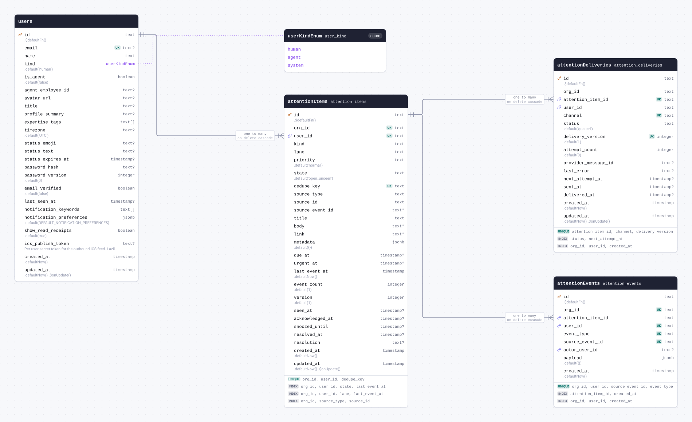

| Column            | Type        | Constraints                         | Default                        | Description |
| ----------------- | ----------- | ----------------------------------- | ------------------------------ | ----------- |
| `id`              | `text`      | PK NOT NULL                         | `.$defaultFn()`                |             |
| `org_id`          | `text`      | NOT NULL                            |                                |             |
| `user_id`         | `text`      | NOT NULL → [users.id](#table-users) |                                |             |
| `kind`            | `text`      | NOT NULL                            |                                |             |
| `lane`            | `text`      | NOT NULL                            |                                |             |
| `priority`        | `text`      | NOT NULL                            | `.default('normal')`           |             |
| `state`           | `text`      | NOT NULL                            | `.default('open_unseen')`      |             |
| `dedupe_key`      | `text`      | NOT NULL                            |                                |             |
| `source_type`     | `text`      | NOT NULL                            |                                |             |
| `source_id`       | `text`      | NOT NULL                            |                                |             |
| `source_event_id` | `text`      | NULL                                |                                |             |
| `title`           | `text`      | NOT NULL                            |                                |             |
| `body`            | `text`      | NULL                                |                                |             |
| `link`            | `text`      | NULL                                |                                |             |
| `metadata`        | `jsonb`     | NOT NULL                            | `.default({})`                 |             |
| `due_at`          | `timestamp` | NULL                                |                                |             |
| `urgent_at`       | `timestamp` | NULL                                |                                |             |
| `last_event_at`   | `timestamp` | NOT NULL                            | `.defaultNow()`                |             |
| `event_count`     | `integer`   | NOT NULL                            | `.default(1)`                  |             |
| `version`         | `integer`   | NOT NULL                            | `.default(1)`                  |             |
| `seen_at`         | `timestamp` | NULL                                |                                |             |
| `acknowledged_at` | `timestamp` | NULL                                |                                |             |
| `snoozed_until`   | `timestamp` | NULL                                |                                |             |
| `resolved_at`     | `timestamp` | NULL                                |                                |             |
| `resolution`      | `text`      | NULL                                |                                |             |
| `created_at`      | `timestamp` | NOT NULL                            | `.defaultNow()`                |             |
| `updated_at`      | `timestamp` | NOT NULL                            | `.defaultNow()` `.$onUpdate()` |             |

#### Definition

```sql
CREATE TABLE "attention_items" (
	"id" text PRIMARY KEY,
	"org_id" text NOT NULL,
	"user_id" text NOT NULL,
	"kind" text NOT NULL,
	"lane" text NOT NULL,
	"priority" text DEFAULT 'normal' NOT NULL,
	"state" text DEFAULT 'open_unseen' NOT NULL,
	"dedupe_key" text NOT NULL,
	"source_type" text NOT NULL,
	"source_id" text NOT NULL,
	"source_event_id" text,
	"title" text NOT NULL,
	"body" text,
	"link" text,
	"metadata" jsonb DEFAULT '{}' NOT NULL,
	"due_at" timestamp,
	"urgent_at" timestamp,
	"last_event_at" timestamp DEFAULT now() NOT NULL,
	"event_count" integer DEFAULT 1 NOT NULL,
	"version" integer DEFAULT 1 NOT NULL,
	"seen_at" timestamp,
	"acknowledged_at" timestamp,
	"snoozed_until" timestamp,
	"resolved_at" timestamp,
	"resolution" text,
	"created_at" timestamp DEFAULT now() NOT NULL,
	"updated_at" timestamp DEFAULT now() NOT NULL
);

CREATE UNIQUE INDEX "attention_item_user_dedupe_unique" ON "attention_items" ("org_id","user_id","dedupe_key");

CREATE INDEX "attention_item_user_state_idx" ON "attention_items" ("org_id","user_id","state","last_event_at");

CREATE INDEX "attention_item_user_lane_idx" ON "attention_items" ("org_id","user_id","lane","last_event_at");

CREATE INDEX "attention_item_source_idx" ON "attention_items" ("org_id","source_type","source_id");

ALTER TABLE "attention_items" ADD CONSTRAINT "attention_items_user_id_users_id_fkey" FOREIGN KEY ("user_id") REFERENCES "users"("id") ON DELETE CASCADE;
```

#### Indexes

- UNIQUE `org_id`, `user_id`, `dedupe_key`
- INDEX `org_id`, `user_id`, `state`, `last_event_at`
- INDEX `org_id`, `user_id`, `lane`, `last_event_at`
- INDEX `org_id`, `source_type`, `source_id`

#### References

- `user_id` → [users.id](#table-users) (many to one, on delete cascade)

#### Referenced by

- `id` → [attentionEvents.attention_item_id](#table-attentionEvents) (one to many, on delete cascade)
- `id` → [attentionDeliveries.attention_item_id](#table-attentionDeliveries) (one to many, on delete cascade)

<details>
<summary>Queries and their SQL</summary>

**Select**: Every row of attentionItems.

```ts
db.select().from(attentionItems);
```

```sql
select "id", "org_id", "user_id", "kind", "lane", "priority", "state", "dedupe_key", "source_type", "source_id", "source_event_id", "title", "body", "link", "metadata", "due_at", "urgent_at", "last_event_at", "event_count", "version", "seen_at", "acknowledged_at", "snoozed_until", "resolved_at", "resolution", "created_at", "updated_at"
from "attention_items"
```

**Count**: How many rows attentionItems has.

```ts
db.select({ count: count() }).from(attentionItems);
```

```sql
select count(*)
from "attention_items"
```

**Find many**: The rows of attentionItems, through the relational query API.

```ts
db.query.attentionItems.findMany();
```

```sql
select "d0"."id" as "id", "d0"."org_id" as "org_id", "d0"."user_id" as "user_id", "d0"."kind" as "kind", "d0"."lane" as "lane", "d0"."priority" as "priority", "d0"."state" as "state", "d0"."dedupe_key" as "dedupe_key", "d0"."source_type" as "source_type", "d0"."source_id" as "source_id", "d0"."source_event_id" as "source_event_id", "d0"."title" as "title", "d0"."body" as "body", "d0"."link" as "link", "d0"."metadata" as "metadata", "d0"."due_at" as "due_at", "d0"."urgent_at" as "urgent_at", "d0"."last_event_at" as "last_event_at", "d0"."event_count" as "event_count", "d0"."version" as "version", "d0"."seen_at" as "seen_at", "d0"."acknowledged_at" as "acknowledged_at", "d0"."snoozed_until" as "snoozed_until", "d0"."resolved_at" as "resolved_at", "d0"."resolution" as "resolution", "d0"."created_at" as "created_at", "d0"."updated_at" as "updated_at"
from "attention_items" as "d0"
```

**Find by primary key**: One row of attentionItems, through the relational query API.

```ts
db.query.attentionItems.findFirst({ where: { id: "id" } });
```

```sql
select "d0"."id" as "id", "d0"."org_id" as "org_id", "d0"."user_id" as "user_id", "d0"."kind" as "kind", "d0"."lane" as "lane", "d0"."priority" as "priority", "d0"."state" as "state", "d0"."dedupe_key" as "dedupe_key", "d0"."source_type" as "source_type", "d0"."source_id" as "source_id", "d0"."source_event_id" as "source_event_id", "d0"."title" as "title", "d0"."body" as "body", "d0"."link" as "link", "d0"."metadata" as "metadata", "d0"."due_at" as "due_at", "d0"."urgent_at" as "urgent_at", "d0"."last_event_at" as "last_event_at", "d0"."event_count" as "event_count", "d0"."version" as "version", "d0"."seen_at" as "seen_at", "d0"."acknowledged_at" as "acknowledged_at", "d0"."snoozed_until" as "snoozed_until", "d0"."resolved_at" as "resolved_at", "d0"."resolution" as "resolution", "d0"."created_at" as "created_at", "d0"."updated_at" as "updated_at"
from "attention_items" as "d0"
where "d0"."id" = $1
limit $2
-- params: ["id",1]
```

**Insert**: Adds a row to attentionItems, giving the columns that have no default.

```ts
db.insert(attentionItems).values({
  org_id: "org_id",
  user_id: "user_id",
  kind: "kind",
  lane: "lane",
  dedupe_key: "dedupe_key",
  source_type: "source_type",
  source_id: "source_id",
  title: "title",
});
```

```sql
insert into "attention_items" ("id", "org_id", "user_id", "kind", "lane", "priority", "state", "dedupe_key", "source_type", "source_id", "source_event_id", "title", "body", "link", "metadata", "due_at", "urgent_at", "last_event_at", "event_count", "version", "seen_at", "acknowledged_at", "snoozed_until", "resolved_at", "resolution", "created_at", "updated_at")
values ($1, $2, $3, $4, $5, default, default, $6, $7, $8, default, $9, default, default, default, default, default, default, default, default, default, default, default, default, default, default, default)
-- params: ["00000000-0000-4000-8000-000000000000","org_id","user_id","kind","lane","dedupe_key","source_type","source_id","title"]
```

**Update**: Changes a row of attentionItems, found by its primary key.

```ts
db.update(attentionItems).set({ org_id: "org_id" }).where(eq(attentionItems.id, "id"));
```

```sql
update "attention_items"
set "org_id" = $1, "updated_at" = $2
where "attention_items"."id" = $3
-- params: ["org_id","2026-01-01T00:00:00.000Z","id"]
```

**Delete**: Deletes a row of attentionItems, found by its primary key.

```ts
db.delete(attentionItems).where(eq(attentionItems.id, "id"));
```

```sql
delete from "attention_items"
where "attention_items"."id" = $1
-- params: ["id"]
```

</details>

<a id="table-attentionEvents"></a>

### attentionEvents

Table `attention_events`.

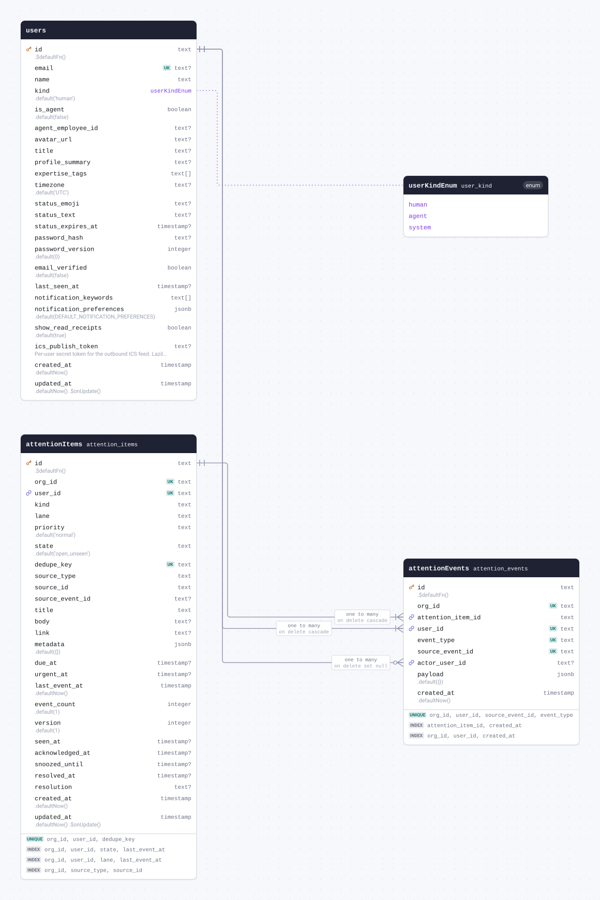

| Column              | Type        | Constraints                                           | Default         | Description |
| ------------------- | ----------- | ----------------------------------------------------- | --------------- | ----------- |
| `id`                | `text`      | PK NOT NULL                                           | `.$defaultFn()` |             |
| `org_id`            | `text`      | NOT NULL                                              |                 |             |
| `attention_item_id` | `text`      | NOT NULL → [attentionItems.id](#table-attentionItems) |                 |             |
| `user_id`           | `text`      | NOT NULL → [users.id](#table-users)                   |                 |             |
| `event_type`        | `text`      | NOT NULL                                              |                 |             |
| `source_event_id`   | `text`      | NOT NULL                                              |                 |             |
| `actor_user_id`     | `text`      | NULL → [users.id](#table-users)                       |                 |             |
| `payload`           | `jsonb`     | NOT NULL                                              | `.default({})`  |             |
| `created_at`        | `timestamp` | NOT NULL                                              | `.defaultNow()` |             |

#### Definition

```sql
CREATE TABLE "attention_events" (
	"id" text PRIMARY KEY,
	"org_id" text NOT NULL,
	"attention_item_id" text NOT NULL,
	"user_id" text NOT NULL,
	"event_type" text NOT NULL,
	"source_event_id" text NOT NULL,
	"actor_user_id" text,
	"payload" jsonb DEFAULT '{}' NOT NULL,
	"created_at" timestamp DEFAULT now() NOT NULL
);

CREATE INDEX "attention_event_item_idx" ON "attention_events" ("attention_item_id","created_at");

CREATE INDEX "attention_event_user_idx" ON "attention_events" ("org_id","user_id","created_at");

CREATE UNIQUE INDEX "attention_event_source_unique" ON "attention_events" ("org_id","user_id","source_event_id","event_type");

ALTER TABLE "attention_events" ADD CONSTRAINT "attention_events_attention_item_id_attention_items_id_fkey" FOREIGN KEY ("attention_item_id") REFERENCES "attention_items"("id") ON DELETE CASCADE;

ALTER TABLE "attention_events" ADD CONSTRAINT "attention_events_user_id_users_id_fkey" FOREIGN KEY ("user_id") REFERENCES "users"("id") ON DELETE CASCADE;

ALTER TABLE "attention_events" ADD CONSTRAINT "attention_events_actor_user_id_users_id_fkey" FOREIGN KEY ("actor_user_id") REFERENCES "users"("id") ON DELETE SET NULL;
```

#### Indexes

- INDEX `attention_item_id`, `created_at`
- INDEX `org_id`, `user_id`, `created_at`
- UNIQUE `org_id`, `user_id`, `source_event_id`, `event_type`

#### References

- `attention_item_id` → [attentionItems.id](#table-attentionItems) (many to one, on delete cascade)
- `user_id` → [users.id](#table-users) (many to one, on delete cascade)
- `actor_user_id` → [users.id](#table-users) (many to one, on delete set null)

<details>
<summary>Queries and their SQL</summary>

**Select**: Every row of attentionEvents.

```ts
db.select().from(attentionEvents);
```

```sql
select "id", "org_id", "attention_item_id", "user_id", "event_type", "source_event_id", "actor_user_id", "payload", "created_at"
from "attention_events"
```

**Count**: How many rows attentionEvents has.

```ts
db.select({ count: count() }).from(attentionEvents);
```

```sql
select count(*)
from "attention_events"
```

**Find many**: The rows of attentionEvents, through the relational query API.

```ts
db.query.attentionEvents.findMany();
```

```sql
select "d0"."id" as "id", "d0"."org_id" as "org_id", "d0"."attention_item_id" as "attention_item_id", "d0"."user_id" as "user_id", "d0"."event_type" as "event_type", "d0"."source_event_id" as "source_event_id", "d0"."actor_user_id" as "actor_user_id", "d0"."payload" as "payload", "d0"."created_at" as "created_at"
from "attention_events" as "d0"
```

**Find by primary key**: One row of attentionEvents, through the relational query API.

```ts
db.query.attentionEvents.findFirst({ where: { id: "id" } });
```

```sql
select "d0"."id" as "id", "d0"."org_id" as "org_id", "d0"."attention_item_id" as "attention_item_id", "d0"."user_id" as "user_id", "d0"."event_type" as "event_type", "d0"."source_event_id" as "source_event_id", "d0"."actor_user_id" as "actor_user_id", "d0"."payload" as "payload", "d0"."created_at" as "created_at"
from "attention_events" as "d0"
where "d0"."id" = $1
limit $2
-- params: ["id",1]
```

**Insert**: Adds a row to attentionEvents, giving the columns that have no default.

```ts
db.insert(attentionEvents).values({
  org_id: "org_id",
  attention_item_id: "attention_item_id",
  user_id: "user_id",
  event_type: "event_type",
  source_event_id: "source_event_id",
});
```

```sql
insert into "attention_events" ("id", "org_id", "attention_item_id", "user_id", "event_type", "source_event_id", "actor_user_id", "payload", "created_at")
values ($1, $2, $3, $4, $5, $6, default, default, default)
-- params: ["00000000-0000-4000-8000-000000000000","org_id","attention_item_id","user_id","event_type","source_event_id"]
```

**Update**: Changes a row of attentionEvents, found by its primary key.

```ts
db.update(attentionEvents).set({ org_id: "org_id" }).where(eq(attentionEvents.id, "id"));
```

```sql
update "attention_events"
set "org_id" = $1
where "attention_events"."id" = $2
-- params: ["org_id","id"]
```

**Delete**: Deletes a row of attentionEvents, found by its primary key.

```ts
db.delete(attentionEvents).where(eq(attentionEvents.id, "id"));
```

```sql
delete from "attention_events"
where "attention_events"."id" = $1
-- params: ["id"]
```

</details>

<a id="table-attentionDeliveries"></a>

### attentionDeliveries

Table `attention_deliveries`.

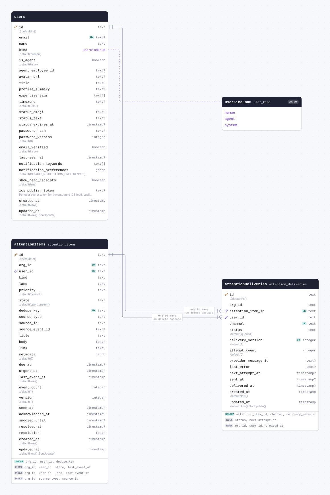

| Column                | Type        | Constraints                                           | Default                        | Description |
| --------------------- | ----------- | ----------------------------------------------------- | ------------------------------ | ----------- |
| `id`                  | `text`      | PK NOT NULL                                           | `.$defaultFn()`                |             |
| `org_id`              | `text`      | NOT NULL                                              |                                |             |
| `attention_item_id`   | `text`      | NOT NULL → [attentionItems.id](#table-attentionItems) |                                |             |
| `user_id`             | `text`      | NOT NULL → [users.id](#table-users)                   |                                |             |
| `channel`             | `text`      | NOT NULL                                              |                                |             |
| `status`              | `text`      | NOT NULL                                              | `.default('queued')`           |             |
| `delivery_version`    | `integer`   | NOT NULL                                              | `.default(1)`                  |             |
| `attempt_count`       | `integer`   | NOT NULL                                              | `.default(0)`                  |             |
| `provider_message_id` | `text`      | NULL                                                  |                                |             |
| `last_error`          | `text`      | NULL                                                  |                                |             |
| `next_attempt_at`     | `timestamp` | NULL                                                  |                                |             |
| `sent_at`             | `timestamp` | NULL                                                  |                                |             |
| `delivered_at`        | `timestamp` | NULL                                                  |                                |             |
| `created_at`          | `timestamp` | NOT NULL                                              | `.defaultNow()`                |             |
| `updated_at`          | `timestamp` | NOT NULL                                              | `.defaultNow()` `.$onUpdate()` |             |

#### Definition

```sql
CREATE TABLE "attention_deliveries" (
	"id" text PRIMARY KEY,
	"org_id" text NOT NULL,
	"attention_item_id" text NOT NULL,
	"user_id" text NOT NULL,
	"channel" text NOT NULL,
	"status" text DEFAULT 'queued' NOT NULL,
	"delivery_version" integer DEFAULT 1 NOT NULL,
	"attempt_count" integer DEFAULT 0 NOT NULL,
	"provider_message_id" text,
	"last_error" text,
	"next_attempt_at" timestamp,
	"sent_at" timestamp,
	"delivered_at" timestamp,
	"created_at" timestamp DEFAULT now() NOT NULL,
	"updated_at" timestamp DEFAULT now() NOT NULL
);

CREATE UNIQUE INDEX "attention_delivery_version_unique" ON "attention_deliveries" ("attention_item_id","channel","delivery_version");

CREATE INDEX "attention_delivery_queue_idx" ON "attention_deliveries" ("status","next_attempt_at");

CREATE INDEX "attention_delivery_user_idx" ON "attention_deliveries" ("org_id","user_id","created_at");

ALTER TABLE "attention_deliveries" ADD CONSTRAINT "attention_deliveries_attention_item_id_attention_items_id_fkey" FOREIGN KEY ("attention_item_id") REFERENCES "attention_items"("id") ON DELETE CASCADE;

ALTER TABLE "attention_deliveries" ADD CONSTRAINT "attention_deliveries_user_id_users_id_fkey" FOREIGN KEY ("user_id") REFERENCES "users"("id") ON DELETE CASCADE;
```

#### Indexes

- UNIQUE `attention_item_id`, `channel`, `delivery_version`
- INDEX `status`, `next_attempt_at`
- INDEX `org_id`, `user_id`, `created_at`

#### References

- `attention_item_id` → [attentionItems.id](#table-attentionItems) (many to one, on delete cascade)
- `user_id` → [users.id](#table-users) (many to one, on delete cascade)

<details>
<summary>Queries and their SQL</summary>

**Select**: Every row of attentionDeliveries.

```ts
db.select().from(attentionDeliveries);
```

```sql
select "id", "org_id", "attention_item_id", "user_id", "channel", "status", "delivery_version", "attempt_count", "provider_message_id", "last_error", "next_attempt_at", "sent_at", "delivered_at", "created_at", "updated_at"
from "attention_deliveries"
```

**Count**: How many rows attentionDeliveries has.

```ts
db.select({ count: count() }).from(attentionDeliveries);
```

```sql
select count(*)
from "attention_deliveries"
```

**Find many**: The rows of attentionDeliveries, through the relational query API.

```ts
db.query.attentionDeliveries.findMany();
```

```sql
select "d0"."id" as "id", "d0"."org_id" as "org_id", "d0"."attention_item_id" as "attention_item_id", "d0"."user_id" as "user_id", "d0"."channel" as "channel", "d0"."status" as "status", "d0"."delivery_version" as "delivery_version", "d0"."attempt_count" as "attempt_count", "d0"."provider_message_id" as "provider_message_id", "d0"."last_error" as "last_error", "d0"."next_attempt_at" as "next_attempt_at", "d0"."sent_at" as "sent_at", "d0"."delivered_at" as "delivered_at", "d0"."created_at" as "created_at", "d0"."updated_at" as "updated_at"
from "attention_deliveries" as "d0"
```

**Find by primary key**: One row of attentionDeliveries, through the relational query API.

```ts
db.query.attentionDeliveries.findFirst({ where: { id: "id" } });
```

```sql
select "d0"."id" as "id", "d0"."org_id" as "org_id", "d0"."attention_item_id" as "attention_item_id", "d0"."user_id" as "user_id", "d0"."channel" as "channel", "d0"."status" as "status", "d0"."delivery_version" as "delivery_version", "d0"."attempt_count" as "attempt_count", "d0"."provider_message_id" as "provider_message_id", "d0"."last_error" as "last_error", "d0"."next_attempt_at" as "next_attempt_at", "d0"."sent_at" as "sent_at", "d0"."delivered_at" as "delivered_at", "d0"."created_at" as "created_at", "d0"."updated_at" as "updated_at"
from "attention_deliveries" as "d0"
where "d0"."id" = $1
limit $2
-- params: ["id",1]
```

**Insert**: Adds a row to attentionDeliveries, giving the columns that have no default.

```ts
db.insert(attentionDeliveries).values({
  org_id: "org_id",
  attention_item_id: "attention_item_id",
  user_id: "user_id",
  channel: "channel",
});
```

```sql
insert into "attention_deliveries" ("id", "org_id", "attention_item_id", "user_id", "channel", "status", "delivery_version", "attempt_count", "provider_message_id", "last_error", "next_attempt_at", "sent_at", "delivered_at", "created_at", "updated_at")
values ($1, $2, $3, $4, $5, default, default, default, default, default, default, default, default, default, default)
-- params: ["00000000-0000-4000-8000-000000000000","org_id","attention_item_id","user_id","channel"]
```

**Update**: Changes a row of attentionDeliveries, found by its primary key.

```ts
db.update(attentionDeliveries).set({ org_id: "org_id" }).where(eq(attentionDeliveries.id, "id"));
```

```sql
update "attention_deliveries"
set "org_id" = $1, "updated_at" = $2
where "attention_deliveries"."id" = $3
-- params: ["org_id","2026-01-01T00:00:00.000Z","id"]
```

**Delete**: Deletes a row of attentionDeliveries, found by its primary key.

```ts
db.delete(attentionDeliveries).where(eq(attentionDeliveries.id, "id"));
```

```sql
delete from "attention_deliveries"
where "attention_deliveries"."id" = $1
-- params: ["id"]
```

</details>

<a id="table-webPushSubscriptions"></a>

### webPushSubscriptions

Table `web_push_subscriptions`.

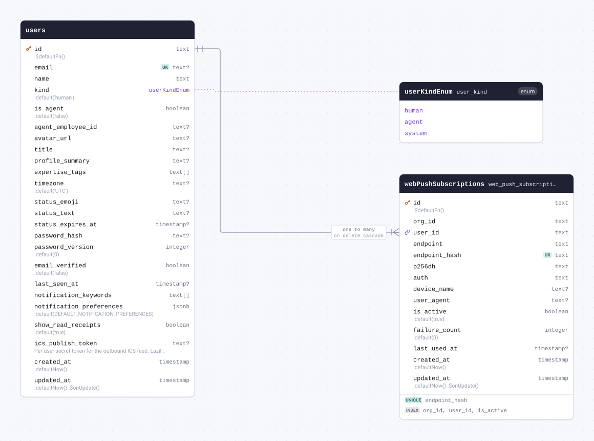

| Column          | Type        | Constraints                         | Default                        | Description |
| --------------- | ----------- | ----------------------------------- | ------------------------------ | ----------- |
| `id`            | `text`      | PK NOT NULL                         | `.$defaultFn()`                |             |
| `org_id`        | `text`      | NOT NULL                            |                                |             |
| `user_id`       | `text`      | NOT NULL → [users.id](#table-users) |                                |             |
| `endpoint`      | `text`      | NOT NULL                            |                                |             |
| `endpoint_hash` | `text`      | NOT NULL                            |                                |             |
| `p256dh`        | `text`      | NOT NULL                            |                                |             |
| `auth`          | `text`      | NOT NULL                            |                                |             |
| `device_name`   | `text`      | NULL                                |                                |             |
| `user_agent`    | `text`      | NULL                                |                                |             |
| `is_active`     | `boolean`   | NOT NULL                            | `.default(true)`               |             |
| `failure_count` | `integer`   | NOT NULL                            | `.default(0)`                  |             |
| `last_used_at`  | `timestamp` | NULL                                |                                |             |
| `created_at`    | `timestamp` | NOT NULL                            | `.defaultNow()`                |             |
| `updated_at`    | `timestamp` | NOT NULL                            | `.defaultNow()` `.$onUpdate()` |             |

#### Definition

```sql
CREATE TABLE "web_push_subscriptions" (
	"id" text PRIMARY KEY,
	"org_id" text NOT NULL,
	"user_id" text NOT NULL,
	"endpoint" text NOT NULL,
	"endpoint_hash" text NOT NULL,
	"p256dh" text NOT NULL,
	"auth" text NOT NULL,
	"device_name" text,
	"user_agent" text,
	"is_active" boolean DEFAULT true NOT NULL,
	"failure_count" integer DEFAULT 0 NOT NULL,
	"last_used_at" timestamp,
	"created_at" timestamp DEFAULT now() NOT NULL,
	"updated_at" timestamp DEFAULT now() NOT NULL
);

CREATE UNIQUE INDEX "web_push_subscription_endpoint_hash_unique" ON "web_push_subscriptions" ("endpoint_hash");

CREATE INDEX "web_push_subscription_user_idx" ON "web_push_subscriptions" ("org_id","user_id","is_active");

ALTER TABLE "web_push_subscriptions" ADD CONSTRAINT "web_push_subscriptions_user_id_users_id_fkey" FOREIGN KEY ("user_id") REFERENCES "users"("id") ON DELETE CASCADE;
```

#### Indexes

- UNIQUE `endpoint_hash`
- INDEX `org_id`, `user_id`, `is_active`

#### References

- `user_id` → [users.id](#table-users) (many to one, on delete cascade)

<details>
<summary>Queries and their SQL</summary>

**Select**: Every row of webPushSubscriptions.

```ts
db.select().from(webPushSubscriptions);
```

```sql
select "id", "org_id", "user_id", "endpoint", "endpoint_hash", "p256dh", "auth", "device_name", "user_agent", "is_active", "failure_count", "last_used_at", "created_at", "updated_at"
from "web_push_subscriptions"
```

**Count**: How many rows webPushSubscriptions has.

```ts
db.select({ count: count() }).from(webPushSubscriptions);
```

```sql
select count(*)
from "web_push_subscriptions"
```

**Find many**: The rows of webPushSubscriptions, through the relational query API.

```ts
db.query.webPushSubscriptions.findMany();
```

```sql
select "d0"."id" as "id", "d0"."org_id" as "org_id", "d0"."user_id" as "user_id", "d0"."endpoint" as "endpoint", "d0"."endpoint_hash" as "endpoint_hash", "d0"."p256dh" as "p256dh", "d0"."auth" as "auth", "d0"."device_name" as "device_name", "d0"."user_agent" as "user_agent", "d0"."is_active" as "is_active", "d0"."failure_count" as "failure_count", "d0"."last_used_at" as "last_used_at", "d0"."created_at" as "created_at", "d0"."updated_at" as "updated_at"
from "web_push_subscriptions" as "d0"
```

**Find by primary key**: One row of webPushSubscriptions, through the relational query API.

```ts
db.query.webPushSubscriptions.findFirst({ where: { id: "id" } });
```

```sql
select "d0"."id" as "id", "d0"."org_id" as "org_id", "d0"."user_id" as "user_id", "d0"."endpoint" as "endpoint", "d0"."endpoint_hash" as "endpoint_hash", "d0"."p256dh" as "p256dh", "d0"."auth" as "auth", "d0"."device_name" as "device_name", "d0"."user_agent" as "user_agent", "d0"."is_active" as "is_active", "d0"."failure_count" as "failure_count", "d0"."last_used_at" as "last_used_at", "d0"."created_at" as "created_at", "d0"."updated_at" as "updated_at"
from "web_push_subscriptions" as "d0"
where "d0"."id" = $1
limit $2
-- params: ["id",1]
```

**Insert**: Adds a row to webPushSubscriptions, giving the columns that have no default.

```ts
db.insert(webPushSubscriptions).values({
  org_id: "org_id",
  user_id: "user_id",
  endpoint: "endpoint",
  endpoint_hash: "endpoint_hash",
  p256dh: "p256dh",
  auth: "auth",
});
```

```sql
insert into "web_push_subscriptions" ("id", "org_id", "user_id", "endpoint", "endpoint_hash", "p256dh", "auth", "device_name", "user_agent", "is_active", "failure_count", "last_used_at", "created_at", "updated_at")
values ($1, $2, $3, $4, $5, $6, $7, default, default, default, default, default, default, default)
-- params: ["00000000-0000-4000-8000-000000000000","org_id","user_id","endpoint","endpoint_hash","p256dh","auth"]
```

**Update**: Changes a row of webPushSubscriptions, found by its primary key.

```ts
db.update(webPushSubscriptions).set({ org_id: "org_id" }).where(eq(webPushSubscriptions.id, "id"));
```

```sql
update "web_push_subscriptions"
set "org_id" = $1, "updated_at" = $2
where "web_push_subscriptions"."id" = $3
-- params: ["org_id","2026-01-01T00:00:00.000Z","id"]
```

**Delete**: Deletes a row of webPushSubscriptions, found by its primary key.

```ts
db.delete(webPushSubscriptions).where(eq(webPushSubscriptions.id, "id"));
```

```sql
delete from "web_push_subscriptions"
where "web_push_subscriptions"."id" = $1
-- params: ["id"]
```

</details>

<a id="table-agentActionApprovers"></a>

### agentActionApprovers

Table `agent_action_approvers`.

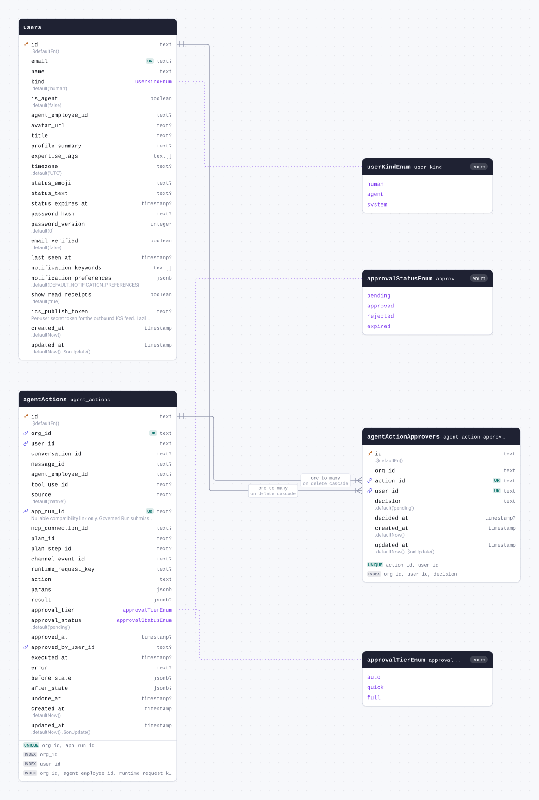

| Column       | Type        | Constraints                                       | Default                        | Description |
| ------------ | ----------- | ------------------------------------------------- | ------------------------------ | ----------- |
| `id`         | `text`      | PK NOT NULL                                       | `.$defaultFn()`                |             |
| `org_id`     | `text`      | NOT NULL                                          |                                |             |
| `action_id`  | `text`      | NOT NULL → [agentActions.id](#table-agentActions) |                                |             |
| `user_id`    | `text`      | NOT NULL → [users.id](#table-users)               |                                |             |
| `decision`   | `text`      | NOT NULL                                          | `.default('pending')`          |             |
| `decided_at` | `timestamp` | NULL                                              |                                |             |
| `created_at` | `timestamp` | NOT NULL                                          | `.defaultNow()`                |             |
| `updated_at` | `timestamp` | NOT NULL                                          | `.defaultNow()` `.$onUpdate()` |             |

#### Definition

```sql
CREATE TABLE "agent_action_approvers" (
	"id" text PRIMARY KEY,
	"org_id" text NOT NULL,
	"action_id" text NOT NULL,
	"user_id" text NOT NULL,
	"decision" text DEFAULT 'pending' NOT NULL,
	"decided_at" timestamp,
	"created_at" timestamp DEFAULT now() NOT NULL,
	"updated_at" timestamp DEFAULT now() NOT NULL
);

CREATE UNIQUE INDEX "agent_action_approver_unique" ON "agent_action_approvers" ("action_id","user_id");

CREATE INDEX "agent_action_approver_user_idx" ON "agent_action_approvers" ("org_id","user_id","decision");

ALTER TABLE "agent_action_approvers" ADD CONSTRAINT "agent_action_approvers_action_id_agent_actions_id_fkey" FOREIGN KEY ("action_id") REFERENCES "agent_actions"("id") ON DELETE CASCADE;

ALTER TABLE "agent_action_approvers" ADD CONSTRAINT "agent_action_approvers_user_id_users_id_fkey" FOREIGN KEY ("user_id") REFERENCES "users"("id") ON DELETE CASCADE;
```

#### Indexes

- UNIQUE `action_id`, `user_id`
- INDEX `org_id`, `user_id`, `decision`

#### References

- `action_id` → [agentActions.id](#table-agentActions) (many to one, on delete cascade)
- `user_id` → [users.id](#table-users) (many to one, on delete cascade)

<details>
<summary>Queries and their SQL</summary>

**Select**: Every row of agentActionApprovers.

```ts
db.select().from(agentActionApprovers);
```

```sql
select "id", "org_id", "action_id", "user_id", "decision", "decided_at", "created_at", "updated_at"
from "agent_action_approvers"
```

**Count**: How many rows agentActionApprovers has.

```ts
db.select({ count: count() }).from(agentActionApprovers);
```

```sql
select count(*)
from "agent_action_approvers"
```

**Find many**: The rows of agentActionApprovers, through the relational query API.

```ts
db.query.agentActionApprovers.findMany();
```

```sql
select "d0"."id" as "id", "d0"."org_id" as "org_id", "d0"."action_id" as "action_id", "d0"."user_id" as "user_id", "d0"."decision" as "decision", "d0"."decided_at" as "decided_at", "d0"."created_at" as "created_at", "d0"."updated_at" as "updated_at"
from "agent_action_approvers" as "d0"
```

**Find by primary key**: One row of agentActionApprovers, through the relational query API.

```ts
db.query.agentActionApprovers.findFirst({ where: { id: "id" } });
```

```sql
select "d0"."id" as "id", "d0"."org_id" as "org_id", "d0"."action_id" as "action_id", "d0"."user_id" as "user_id", "d0"."decision" as "decision", "d0"."decided_at" as "decided_at", "d0"."created_at" as "created_at", "d0"."updated_at" as "updated_at"
from "agent_action_approvers" as "d0"
where "d0"."id" = $1
limit $2
-- params: ["id",1]
```

**Insert**: Adds a row to agentActionApprovers, giving the columns that have no default.

```ts
db.insert(agentActionApprovers).values({
  org_id: "org_id",
  action_id: "action_id",
  user_id: "user_id",
});
```

```sql
insert into "agent_action_approvers" ("id", "org_id", "action_id", "user_id", "decision", "decided_at", "created_at", "updated_at")
values ($1, $2, $3, $4, default, default, default, default)
-- params: ["00000000-0000-4000-8000-000000000000","org_id","action_id","user_id"]
```

**Update**: Changes a row of agentActionApprovers, found by its primary key.

```ts
db.update(agentActionApprovers).set({ org_id: "org_id" }).where(eq(agentActionApprovers.id, "id"));
```

```sql
update "agent_action_approvers"
set "org_id" = $1, "updated_at" = $2
where "agent_action_approvers"."id" = $3
-- params: ["org_id","2026-01-01T00:00:00.000Z","id"]
```

**Delete**: Deletes a row of agentActionApprovers, found by its primary key.

```ts
db.delete(agentActionApprovers).where(eq(agentActionApprovers.id, "id"));
```

```sql
delete from "agent_action_approvers"
where "agent_action_approvers"."id" = $1
-- params: ["id"]
```

</details>

<a id="table-workIntents"></a>

### workIntents

Table `work_intents`. ═══ WORK INTENTS ═══ Canonical ledger for "Defty noticed possible work" events. Existing agent_actions rows remain the approval/execution surface; work_intents carry the source evidence and lifecycle so chat classification does not silently become task creation.

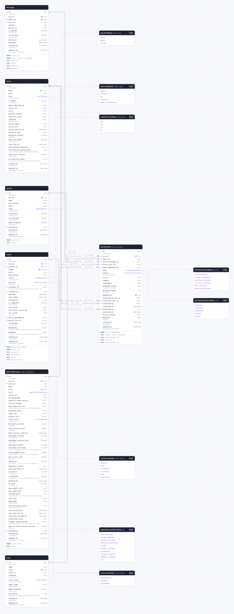

| Column                | Type                                                 | Constraints                                       | Default                        | Description |
| --------------------- | ---------------------------------------------------- | ------------------------------------------------- | ------------------------------ | ----------- |
| `id`                  | `text`                                               | PK NOT NULL                                       | `.$defaultFn()`                |             |
| `org_id`              | `text`                                               | NOT NULL → [orgs.id](#table-orgs)                 |                                |             |
| `space_id`            | `text`                                               | NULL → [spaces.id](#table-spaces)                 |                                |             |
| `source_message_id`   | `text`                                               | NULL → [messages.id](#table-messages)             |                                |             |
| `source_user_id`      | `text`                                               | NULL → [users.id](#table-users)                   |                                |             |
| `agent_employee_id`   | `text`                                               | NULL → [agentEmployees.id](#table-agentEmployees) |                                |             |
| `kind`                | [`workIntentKindEnum`](#enum-workIntentKindEnum)     | NOT NULL                                          |                                |             |
| `status`              | [`workIntentStatusEnum`](#enum-workIntentStatusEnum) | NOT NULL                                          | `.default('proposed')`         |             |
| `title`               | `text`                                               | NOT NULL                                          |                                |             |
| `summary`             | `text`                                               | NULL                                              |                                |             |
| `confidence`          | `real`                                               | NULL                                              |                                |             |
| `proposed_action`     | `text`                                               | NOT NULL                                          | `.default('task_create')`      |             |
| `proposed_params`     | `jsonb`                                              | NOT NULL                                          | `.default({})`                 |             |
| `dedupe_key`          | `text`                                               | NOT NULL                                          |                                |             |
| `converted_action_id` | `text`                                               | NULL                                              |                                |             |
| `converted_task_id`   | `text`                                               | NULL → [tasks.id](#table-tasks)                   |                                |             |
| `converted_by`        | `text`                                               | NULL → [users.id](#table-users)                   |                                |             |
| `converted_at`        | `timestamp`                                          | NULL                                              |                                |             |
| `dismissed_by`        | `text`                                               | NULL → [users.id](#table-users)                   |                                |             |
| `dismissed_at`        | `timestamp`                                          | NULL                                              |                                |             |
| `failure_reason`      | `text`                                               | NULL                                              |                                |             |
| `metadata`            | `jsonb`                                              | NOT NULL                                          | `.default({})`                 |             |
| `created_at`          | `timestamp`                                          | NOT NULL                                          | `.defaultNow()`                |             |
| `updated_at`          | `timestamp`                                          | NOT NULL                                          | `.defaultNow()` `.$onUpdate()` |             |

#### Definition

```sql
CREATE TABLE "work_intents" (
	"id" text PRIMARY KEY,
	"org_id" text NOT NULL,
	"space_id" text,
	"source_message_id" text,
	"source_user_id" text,
	"agent_employee_id" text,
	"kind" "work_intent_kind" NOT NULL,
	"status" "work_intent_status" DEFAULT 'proposed'::"work_intent_status" NOT NULL,
	"title" text NOT NULL,
	"summary" text,
	"confidence" real,
	"proposed_action" text DEFAULT 'task_create' NOT NULL,
	"proposed_params" jsonb DEFAULT '{}' NOT NULL,
	"dedupe_key" text NOT NULL,
	"converted_action_id" text,
	"converted_task_id" text,
	"converted_by" text,
	"converted_at" timestamp,
	"dismissed_by" text,
	"dismissed_at" timestamp,
	"failure_reason" text,
	"metadata" jsonb DEFAULT '{}' NOT NULL,
	"created_at" timestamp DEFAULT now() NOT NULL,
	"updated_at" timestamp DEFAULT now() NOT NULL
);

CREATE UNIQUE INDEX "work_intent_dedupe_unique" ON "work_intents" ("org_id","dedupe_key");

CREATE INDEX "work_intent_org_status_idx" ON "work_intents" ("org_id","status","created_at");

CREATE INDEX "work_intent_source_message_idx" ON "work_intents" ("source_message_id");

CREATE INDEX "work_intent_space_idx" ON "work_intents" ("space_id");

CREATE INDEX "work_intent_converted_task_idx" ON "work_intents" ("converted_task_id");

ALTER TABLE "work_intents" ADD CONSTRAINT "work_intents_org_id_orgs_id_fkey" FOREIGN KEY ("org_id") REFERENCES "orgs"("id") ON DELETE CASCADE;

ALTER TABLE "work_intents" ADD CONSTRAINT "work_intents_space_id_spaces_id_fkey" FOREIGN KEY ("space_id") REFERENCES "spaces"("id") ON DELETE SET NULL;

ALTER TABLE "work_intents" ADD CONSTRAINT "work_intents_source_message_id_messages_id_fkey" FOREIGN KEY ("source_message_id") REFERENCES "messages"("id") ON DELETE SET NULL;

ALTER TABLE "work_intents" ADD CONSTRAINT "work_intents_source_user_id_users_id_fkey" FOREIGN KEY ("source_user_id") REFERENCES "users"("id") ON DELETE SET NULL;

ALTER TABLE "work_intents" ADD CONSTRAINT "work_intents_agent_employee_id_agent_employees_id_fkey" FOREIGN KEY ("agent_employee_id") REFERENCES "agent_employees"("id") ON DELETE SET NULL;

ALTER TABLE "work_intents" ADD CONSTRAINT "work_intents_converted_task_id_tasks_id_fkey" FOREIGN KEY ("converted_task_id") REFERENCES "tasks"("id") ON DELETE SET NULL;

ALTER TABLE "work_intents" ADD CONSTRAINT "work_intents_converted_by_users_id_fkey" FOREIGN KEY ("converted_by") REFERENCES "users"("id") ON DELETE SET NULL;

ALTER TABLE "work_intents" ADD CONSTRAINT "work_intents_dismissed_by_users_id_fkey" FOREIGN KEY ("dismissed_by") REFERENCES "users"("id") ON DELETE SET NULL;
```

#### Indexes

- UNIQUE `org_id`, `dedupe_key`
- INDEX `org_id`, `status`, `created_at`
- INDEX `source_message_id`
- INDEX `space_id`
- INDEX `converted_task_id`

#### References

- `org_id` → [orgs.id](#table-orgs) (many to one, on delete cascade)
- `space_id` → [spaces.id](#table-spaces) (many to one, on delete set null)
- `source_message_id` → [messages.id](#table-messages) (many to one, on delete set null)
- `source_user_id` → [users.id](#table-users) (many to one, on delete set null)
- `agent_employee_id` → [agentEmployees.id](#table-agentEmployees) (many to one, on delete set null)
- `converted_task_id` → [tasks.id](#table-tasks) (many to one, on delete set null)
- `converted_by` → [users.id](#table-users) (many to one, on delete set null)
- `dismissed_by` → [users.id](#table-users) (many to one, on delete set null)

<details>
<summary>Queries and their SQL</summary>

**Select**: Every row of workIntents.

```ts
db.select().from(workIntents);
```

```sql
select "id", "org_id", "space_id", "source_message_id", "source_user_id", "agent_employee_id", "kind", "status", "title", "summary", "confidence", "proposed_action", "proposed_params", "dedupe_key", "converted_action_id", "converted_task_id", "converted_by", "converted_at", "dismissed_by", "dismissed_at", "failure_reason", "metadata", "created_at", "updated_at"
from "work_intents"
```

**Count**: How many rows workIntents has.

```ts
db.select({ count: count() }).from(workIntents);
```

```sql
select count(*)
from "work_intents"
```

**Find many**: The rows of workIntents, through the relational query API.

```ts
db.query.workIntents.findMany();
```

```sql
select "d0"."id" as "id", "d0"."org_id" as "org_id", "d0"."space_id" as "space_id", "d0"."source_message_id" as "source_message_id", "d0"."source_user_id" as "source_user_id", "d0"."agent_employee_id" as "agent_employee_id", "d0"."kind" as "kind", "d0"."status" as "status", "d0"."title" as "title", "d0"."summary" as "summary", "d0"."confidence" as "confidence", "d0"."proposed_action" as "proposed_action", "d0"."proposed_params" as "proposed_params", "d0"."dedupe_key" as "dedupe_key", "d0"."converted_action_id" as "converted_action_id", "d0"."converted_task_id" as "converted_task_id", "d0"."converted_by" as "converted_by", "d0"."converted_at" as "converted_at", "d0"."dismissed_by" as "dismissed_by", "d0"."dismissed_at" as "dismissed_at", "d0"."failure_reason" as "failure_reason", "d0"."metadata" as "metadata", "d0"."created_at" as "created_at", "d0"."updated_at" as "updated_at"
from "work_intents" as "d0"
```

**Find by primary key**: One row of workIntents, through the relational query API.

```ts
db.query.workIntents.findFirst({ where: { id: "id" } });
```

```sql
select "d0"."id" as "id", "d0"."org_id" as "org_id", "d0"."space_id" as "space_id", "d0"."source_message_id" as "source_message_id", "d0"."source_user_id" as "source_user_id", "d0"."agent_employee_id" as "agent_employee_id", "d0"."kind" as "kind", "d0"."status" as "status", "d0"."title" as "title", "d0"."summary" as "summary", "d0"."confidence" as "confidence", "d0"."proposed_action" as "proposed_action", "d0"."proposed_params" as "proposed_params", "d0"."dedupe_key" as "dedupe_key", "d0"."converted_action_id" as "converted_action_id", "d0"."converted_task_id" as "converted_task_id", "d0"."converted_by" as "converted_by", "d0"."converted_at" as "converted_at", "d0"."dismissed_by" as "dismissed_by", "d0"."dismissed_at" as "dismissed_at", "d0"."failure_reason" as "failure_reason", "d0"."metadata" as "metadata", "d0"."created_at" as "created_at", "d0"."updated_at" as "updated_at"
from "work_intents" as "d0"
where "d0"."id" = $1
limit $2
-- params: ["id",1]
```

**Insert**: Adds a row to workIntents, giving the columns that have no default.

```ts
db.insert(workIntents).values({
  org_id: "org_id",
  kind: "task_candidate",
  title: "title",
  dedupe_key: "dedupe_key",
});
```

```sql
insert into "work_intents" ("id", "org_id", "space_id", "source_message_id", "source_user_id", "agent_employee_id", "kind", "status", "title", "summary", "confidence", "proposed_action", "proposed_params", "dedupe_key", "converted_action_id", "converted_task_id", "converted_by", "converted_at", "dismissed_by", "dismissed_at", "failure_reason", "metadata", "created_at", "updated_at")
values ($1, $2, default, default, default, default, $3, default, $4, default, default, default, default, $5, default, default, default, default, default, default, default, default, default, default)
-- params: ["00000000-0000-4000-8000-000000000000","org_id","task_candidate","title","dedupe_key"]
```

**Update**: Changes a row of workIntents, found by its primary key.

```ts
db.update(workIntents).set({ org_id: "org_id" }).where(eq(workIntents.id, "id"));
```

```sql
update "work_intents"
set "org_id" = $1, "updated_at" = $2
where "work_intents"."id" = $3
-- params: ["org_id","2026-01-01T00:00:00.000Z","id"]
```

**Delete**: Deletes a row of workIntents, found by its primary key.

```ts
db.delete(workIntents).where(eq(workIntents.id, "id"));
```

```sql
delete from "work_intents"
where "work_intents"."id" = $1
-- params: ["id"]
```

</details>

<a id="table-messageObservations"></a>

### messageObservations

Table `message_observations`. Durable ledger for Defty's chat observation pipeline. A row here means a chat message was seen by the observation system even when it is ignored.

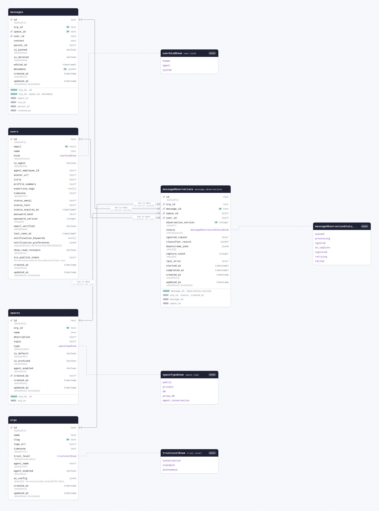

| Column                | Type                                                                 | Constraints                               | Default                        | Description |
| --------------------- | -------------------------------------------------------------------- | ----------------------------------------- | ------------------------------ | ----------- |
| `id`                  | `text`                                                               | PK NOT NULL                               | `.$defaultFn()`                |             |
| `org_id`              | `text`                                                               | NOT NULL → [orgs.id](#table-orgs)         |                                |             |
| `message_id`          | `text`                                                               | NOT NULL → [messages.id](#table-messages) |                                |             |
| `space_id`            | `text`                                                               | NULL → [spaces.id](#table-spaces)         |                                |             |
| `user_id`             | `text`                                                               | NULL → [users.id](#table-users)           |                                |             |
| `observation_version` | `integer`                                                            | NOT NULL                                  | `.default(1)`                  |             |
| `status`              | [`messageObservationStatusEnum`](#enum-messageObservationStatusEnum) | NOT NULL                                  | `.default('queued')`           |             |
| `ignored_reason`      | `text`                                                               | NULL                                      |                                |             |
| `classifier_result`   | `jsonb`                                                              | NULL                                      |                                |             |
| `downstream_jobs`     | `jsonb`                                                              | NOT NULL                                  | `.default([])`                 |             |
| `capture_count`       | `integer`                                                            | NOT NULL                                  | `.default(0)`                  |             |
| `last_error`          | `text`                                                               | NULL                                      |                                |             |
| `started_at`          | `timestamp`                                                          | NULL                                      |                                |             |
| `completed_at`        | `timestamp`                                                          | NULL                                      |                                |             |
| `created_at`          | `timestamp`                                                          | NOT NULL                                  | `.defaultNow()`                |             |
| `updated_at`          | `timestamp`                                                          | NOT NULL                                  | `.defaultNow()` `.$onUpdate()` |             |

#### Definition

```sql
CREATE TABLE "message_observations" (
	"id" text PRIMARY KEY,
	"org_id" text NOT NULL,
	"message_id" text NOT NULL,
	"space_id" text,
	"user_id" text,
	"observation_version" integer DEFAULT 1 NOT NULL,
	"status" "message_observation_status" DEFAULT 'queued'::"message_observation_status" NOT NULL,
	"ignored_reason" text,
	"classifier_result" jsonb,
	"downstream_jobs" jsonb DEFAULT '[]' NOT NULL,
	"capture_count" integer DEFAULT 0 NOT NULL,
	"last_error" text,
	"started_at" timestamp,
	"completed_at" timestamp,
	"created_at" timestamp DEFAULT now() NOT NULL,
	"updated_at" timestamp DEFAULT now() NOT NULL
);

CREATE UNIQUE INDEX "message_observation_message_version_unique" ON "message_observations" ("message_id","observation_version");

CREATE INDEX "message_observation_org_status_idx" ON "message_observations" ("org_id","status","created_at");

CREATE INDEX "message_observation_message_idx" ON "message_observations" ("message_id");

CREATE INDEX "message_observation_space_idx" ON "message_observations" ("space_id");

ALTER TABLE "message_observations" ADD CONSTRAINT "message_observations_org_id_orgs_id_fkey" FOREIGN KEY ("org_id") REFERENCES "orgs"("id") ON DELETE CASCADE;

ALTER TABLE "message_observations" ADD CONSTRAINT "message_observations_message_id_messages_id_fkey" FOREIGN KEY ("message_id") REFERENCES "messages"("id") ON DELETE CASCADE;

ALTER TABLE "message_observations" ADD CONSTRAINT "message_observations_space_id_spaces_id_fkey" FOREIGN KEY ("space_id") REFERENCES "spaces"("id") ON DELETE SET NULL;

ALTER TABLE "message_observations" ADD CONSTRAINT "message_observations_user_id_users_id_fkey" FOREIGN KEY ("user_id") REFERENCES "users"("id") ON DELETE SET NULL;
```

#### Indexes

- UNIQUE `message_id`, `observation_version`
- INDEX `org_id`, `status`, `created_at`
- INDEX `message_id`
- INDEX `space_id`

#### References

- `org_id` → [orgs.id](#table-orgs) (many to one, on delete cascade)
- `message_id` → [messages.id](#table-messages) (many to one, on delete cascade)
- `space_id` → [spaces.id](#table-spaces) (many to one, on delete set null)
- `user_id` → [users.id](#table-users) (many to one, on delete set null)

<details>
<summary>Queries and their SQL</summary>

**Select**: Every row of messageObservations.

```ts
db.select().from(messageObservations);
```

```sql
select "id", "org_id", "message_id", "space_id", "user_id", "observation_version", "status", "ignored_reason", "classifier_result", "downstream_jobs", "capture_count", "last_error", "started_at", "completed_at", "created_at", "updated_at"
from "message_observations"
```

**Count**: How many rows messageObservations has.

```ts
db.select({ count: count() }).from(messageObservations);
```

```sql
select count(*)
from "message_observations"
```

**Find many**: The rows of messageObservations, through the relational query API.

```ts
db.query.messageObservations.findMany();
```

```sql
select "d0"."id" as "id", "d0"."org_id" as "org_id", "d0"."message_id" as "message_id", "d0"."space_id" as "space_id", "d0"."user_id" as "user_id", "d0"."observation_version" as "observation_version", "d0"."status" as "status", "d0"."ignored_reason" as "ignored_reason", "d0"."classifier_result" as "classifier_result", "d0"."downstream_jobs" as "downstream_jobs", "d0"."capture_count" as "capture_count", "d0"."last_error" as "last_error", "d0"."started_at" as "started_at", "d0"."completed_at" as "completed_at", "d0"."created_at" as "created_at", "d0"."updated_at" as "updated_at"
from "message_observations" as "d0"
```

**Find by primary key**: One row of messageObservations, through the relational query API.

```ts
db.query.messageObservations.findFirst({ where: { id: "id" } });
```

```sql
select "d0"."id" as "id", "d0"."org_id" as "org_id", "d0"."message_id" as "message_id", "d0"."space_id" as "space_id", "d0"."user_id" as "user_id", "d0"."observation_version" as "observation_version", "d0"."status" as "status", "d0"."ignored_reason" as "ignored_reason", "d0"."classifier_result" as "classifier_result", "d0"."downstream_jobs" as "downstream_jobs", "d0"."capture_count" as "capture_count", "d0"."last_error" as "last_error", "d0"."started_at" as "started_at", "d0"."completed_at" as "completed_at", "d0"."created_at" as "created_at", "d0"."updated_at" as "updated_at"
from "message_observations" as "d0"
where "d0"."id" = $1
limit $2
-- params: ["id",1]
```

**Insert**: Adds a row to messageObservations, giving the columns that have no default.

```ts
db.insert(messageObservations).values({ org_id: "org_id", message_id: "message_id" });
```

```sql
insert into "message_observations" ("id", "org_id", "message_id", "space_id", "user_id", "observation_version", "status", "ignored_reason", "classifier_result", "downstream_jobs", "capture_count", "last_error", "started_at", "completed_at", "created_at", "updated_at")
values ($1, $2, $3, default, default, default, default, default, default, default, default, default, default, default, default, default)
-- params: ["00000000-0000-4000-8000-000000000000","org_id","message_id"]
```

**Update**: Changes a row of messageObservations, found by its primary key.

```ts
db.update(messageObservations).set({ org_id: "org_id" }).where(eq(messageObservations.id, "id"));
```

```sql
update "message_observations"
set "org_id" = $1, "updated_at" = $2
where "message_observations"."id" = $3
-- params: ["org_id","2026-01-01T00:00:00.000Z","id"]
```

**Delete**: Deletes a row of messageObservations, found by its primary key.

```ts
db.delete(messageObservations).where(eq(messageObservations.id, "id"));
```

```sql
delete from "message_observations"
where "message_observations"."id" = $1
-- params: ["id"]
```

</details>

<a id="table-skills"></a>

### skills

═══ AGENT: SKILLS ═══ Phase 4 — Unified skill primitive. A skill is a named bundle that can be attached to an agent (tools, capability packs, trigger subs, prompt adds) and/or a project (status vocab, priority vocab, board view, templates). `source` distinguishes bundled (first-party, org_id NULL), marketplace (third-party, org_id NULL), and org (custom per-tenant). See `apps/api/src/lib/skill-config.ts` for the jsonb shapes.

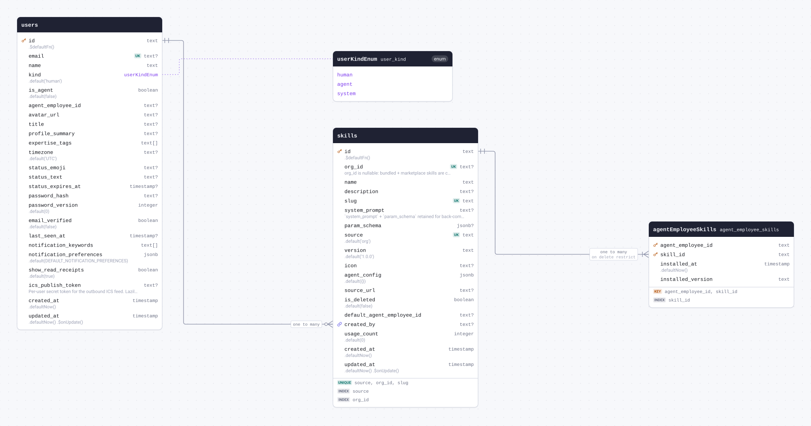

| Column                      | Type        | Constraints                     | Default                        | Description                                                                                                                                           |
| --------------------------- | ----------- | ------------------------------- | ------------------------------ | ----------------------------------------------------------------------------------------------------------------------------------------------------- |
| `id`                        | `text`      | PK NOT NULL                     | `.$defaultFn()`                |                                                                                                                                                       |
| `org_id`                    | `text`      | NULL                            |                                | org_id is nullable: bundled + marketplace skills are cross-tenant.                                                                                    |
| `name`                      | `text`      | NOT NULL                        |                                |                                                                                                                                                       |
| `description`               | `text`      | NULL                            |                                |                                                                                                                                                       |
| `slug`                      | `text`      | NOT NULL                        |                                |                                                                                                                                                       |
| `system_prompt`             | `text`      | NULL                            |                                | `system_prompt` + `param_schema` retained for back-compat with pre-Phase-4 rows. Canonical home for both is now `agent_config` (see skill-config.ts). |
| `param_schema`              | `jsonb`     | NULL                            |                                |                                                                                                                                                       |
| `source`                    | `text`      | NOT NULL                        | `.default('org')`              |                                                                                                                                                       |
| `version`                   | `text`      | NOT NULL                        | `.default('1.0.0')`            |                                                                                                                                                       |
| `icon`                      | `text`      | NULL                            |                                |                                                                                                                                                       |
| `agent_config`              | `jsonb`     | NOT NULL                        | `.default({})`                 |                                                                                                                                                       |
| `source_url`                | `text`      | NULL                            |                                |                                                                                                                                                       |
| `is_deleted`                | `boolean`   | NOT NULL                        | `.default(false)`              |                                                                                                                                                       |
| `default_agent_employee_id` | `text`      | NULL                            |                                |                                                                                                                                                       |
| `created_by`                | `text`      | NULL → [users.id](#table-users) |                                |                                                                                                                                                       |
| `usage_count`               | `integer`   | NOT NULL                        | `.default(0)`                  |                                                                                                                                                       |
| `created_at`                | `timestamp` | NOT NULL                        | `.defaultNow()`                |                                                                                                                                                       |
| `updated_at`                | `timestamp` | NOT NULL                        | `.defaultNow()` `.$onUpdate()` |                                                                                                                                                       |

#### Definition

```sql
CREATE TABLE "skills" (
	"id" text PRIMARY KEY,
	"org_id" text,
	"name" text NOT NULL,
	"description" text,
	"slug" text NOT NULL,
	"system_prompt" text,
	"param_schema" jsonb,
	"source" text DEFAULT 'org' NOT NULL,
	"version" text DEFAULT '1.0.0' NOT NULL,
	"icon" text,
	"agent_config" jsonb DEFAULT '{}' NOT NULL,
	"source_url" text,
	"is_deleted" boolean DEFAULT false NOT NULL,
	"default_agent_employee_id" text,
	"created_by" text,
	"usage_count" integer DEFAULT 0 NOT NULL,
	"created_at" timestamp DEFAULT now() NOT NULL,
	"updated_at" timestamp DEFAULT now() NOT NULL
);

CREATE UNIQUE INDEX "skills_source_org_slug_idx" ON "skills" ("source","org_id","slug");

CREATE INDEX "skills_source_idx" ON "skills" ("source");

CREATE INDEX "skills_org_idx" ON "skills" ("org_id");

ALTER TABLE "skills" ADD CONSTRAINT "skills_created_by_users_id_fkey" FOREIGN KEY ("created_by") REFERENCES "users"("id");
```

#### Indexes

- UNIQUE `source`, `org_id`, `slug`
- INDEX `source`
- INDEX `org_id`

#### References

- `created_by` → [users.id](#table-users) (many to one)

#### Referenced by

- `id` → [agentEmployeeSkills.skill_id](#table-agentEmployeeSkills) (one to many, on delete restrict)

<details>
<summary>Queries and their SQL</summary>

**Select**: Every row of skills.

```ts
db.select().from(skills);
```

```sql
select "id", "org_id", "name", "description", "slug", "system_prompt", "param_schema", "source", "version", "icon", "agent_config", "source_url", "is_deleted", "default_agent_employee_id", "created_by", "usage_count", "created_at", "updated_at"
from "skills"
```

**Count**: How many rows skills has.

```ts
db.select({ count: count() }).from(skills);
```

```sql
select count(*)
from "skills"
```

**Find many**: The rows of skills, through the relational query API.

```ts
db.query.skills.findMany();
```

```sql
select "d0"."id" as "id", "d0"."org_id" as "org_id", "d0"."name" as "name", "d0"."description" as "description", "d0"."slug" as "slug", "d0"."system_prompt" as "system_prompt", "d0"."param_schema" as "param_schema", "d0"."source" as "source", "d0"."version" as "version", "d0"."icon" as "icon", "d0"."agent_config" as "agent_config", "d0"."source_url" as "source_url", "d0"."is_deleted" as "is_deleted", "d0"."default_agent_employee_id" as "default_agent_employee_id", "d0"."created_by" as "created_by", "d0"."usage_count" as "usage_count", "d0"."created_at" as "created_at", "d0"."updated_at" as "updated_at"
from "skills" as "d0"
```

**Find by primary key**: One row of skills, through the relational query API.

```ts
db.query.skills.findFirst({ where: { id: "id" } });
```

```sql
select "d0"."id" as "id", "d0"."org_id" as "org_id", "d0"."name" as "name", "d0"."description" as "description", "d0"."slug" as "slug", "d0"."system_prompt" as "system_prompt", "d0"."param_schema" as "param_schema", "d0"."source" as "source", "d0"."version" as "version", "d0"."icon" as "icon", "d0"."agent_config" as "agent_config", "d0"."source_url" as "source_url", "d0"."is_deleted" as "is_deleted", "d0"."default_agent_employee_id" as "default_agent_employee_id", "d0"."created_by" as "created_by", "d0"."usage_count" as "usage_count", "d0"."created_at" as "created_at", "d0"."updated_at" as "updated_at"
from "skills" as "d0"
where "d0"."id" = $1
limit $2
-- params: ["id",1]
```

**Insert**: Adds a row to skills, giving the columns that have no default.

```ts
db.insert(skills).values({ name: "name", slug: "slug" });
```

```sql
insert into "skills" ("id", "org_id", "name", "description", "slug", "system_prompt", "param_schema", "source", "version", "icon", "agent_config", "source_url", "is_deleted", "default_agent_employee_id", "created_by", "usage_count", "created_at", "updated_at")
values ($1, default, $2, default, $3, default, default, default, default, default, default, default, default, default, default, default, default, default)
-- params: ["00000000-0000-4000-8000-000000000000","name","slug"]
```

**Update**: Changes a row of skills, found by its primary key.

```ts
db.update(skills).set({ org_id: "org_id" }).where(eq(skills.id, "id"));
```

```sql
update "skills"
set "org_id" = $1, "updated_at" = $2
where "skills"."id" = $3
-- params: ["org_id","2026-01-01T00:00:00.000Z","id"]
```

**Delete**: Deletes a row of skills, found by its primary key.

```ts
db.delete(skills).where(eq(skills.id, "id"));
```

```sql
delete from "skills"
where "skills"."id" = $1
-- params: ["id"]
```

</details>

<a id="table-taskTemplates"></a>

### taskTemplates

Table `task_templates`. ═══ TASK TEMPLATES ═══ First-class catalog. Not nested in skills. Bundled rows live cross-tenant (org_id NULL); org rows have a real org_id. Instantiated into a project via POST /api/projects/:id/apply-template.

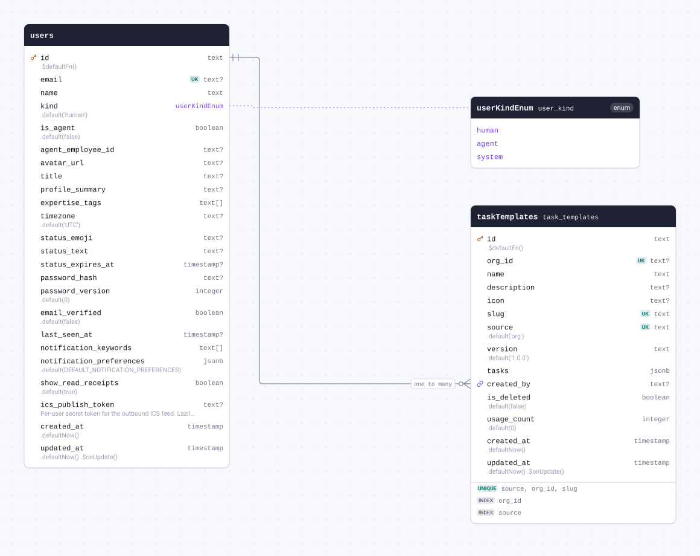

| Column        | Type        | Constraints                     | Default                        | Description |
| ------------- | ----------- | ------------------------------- | ------------------------------ | ----------- |
| `id`          | `text`      | PK NOT NULL                     | `.$defaultFn()`                |             |
| `org_id`      | `text`      | NULL                            |                                |             |
| `name`        | `text`      | NOT NULL                        |                                |             |
| `description` | `text`      | NULL                            |                                |             |
| `icon`        | `text`      | NULL                            |                                |             |
| `slug`        | `text`      | NOT NULL                        |                                |             |
| `source`      | `text`      | NOT NULL                        | `.default('org')`              |             |
| `version`     | `text`      | NOT NULL                        | `.default('1.0.0')`            |             |
| `tasks`       | `jsonb`     | NOT NULL                        |                                |             |
| `created_by`  | `text`      | NULL → [users.id](#table-users) |                                |             |
| `is_deleted`  | `boolean`   | NOT NULL                        | `.default(false)`              |             |
| `usage_count` | `integer`   | NOT NULL                        | `.default(0)`                  |             |
| `created_at`  | `timestamp` | NOT NULL                        | `.defaultNow()`                |             |
| `updated_at`  | `timestamp` | NOT NULL                        | `.defaultNow()` `.$onUpdate()` |             |

#### Definition

```sql
CREATE TABLE "task_templates" (
	"id" text PRIMARY KEY,
	"org_id" text,
	"name" text NOT NULL,
	"description" text,
	"icon" text,
	"slug" text NOT NULL,
	"source" text DEFAULT 'org' NOT NULL,
	"version" text DEFAULT '1.0.0' NOT NULL,
	"tasks" jsonb NOT NULL,
	"created_by" text,
	"is_deleted" boolean DEFAULT false NOT NULL,
	"usage_count" integer DEFAULT 0 NOT NULL,
	"created_at" timestamp DEFAULT now() NOT NULL,
	"updated_at" timestamp DEFAULT now() NOT NULL
);

CREATE UNIQUE INDEX "task_templates_source_org_slug_idx" ON "task_templates" ("source","org_id","slug");

CREATE INDEX "task_templates_org_idx" ON "task_templates" ("org_id");

CREATE INDEX "task_templates_source_idx" ON "task_templates" ("source");

ALTER TABLE "task_templates" ADD CONSTRAINT "task_templates_created_by_users_id_fkey" FOREIGN KEY ("created_by") REFERENCES "users"("id");
```

#### Indexes

- UNIQUE `source`, `org_id`, `slug`
- INDEX `org_id`
- INDEX `source`

#### References

- `created_by` → [users.id](#table-users) (many to one)

<details>
<summary>Queries and their SQL</summary>

**Select**: Every row of taskTemplates.

```ts
db.select().from(taskTemplates);
```

```sql
select "id", "org_id", "name", "description", "icon", "slug", "source", "version", "tasks", "created_by", "is_deleted", "usage_count", "created_at", "updated_at"
from "task_templates"
```

**Count**: How many rows taskTemplates has.

```ts
db.select({ count: count() }).from(taskTemplates);
```

```sql
select count(*)
from "task_templates"
```

**Find many**: The rows of taskTemplates, through the relational query API.

```ts
db.query.taskTemplates.findMany();
```

```sql
select "d0"."id" as "id", "d0"."org_id" as "org_id", "d0"."name" as "name", "d0"."description" as "description", "d0"."icon" as "icon", "d0"."slug" as "slug", "d0"."source" as "source", "d0"."version" as "version", "d0"."tasks" as "tasks", "d0"."created_by" as "created_by", "d0"."is_deleted" as "is_deleted", "d0"."usage_count" as "usage_count", "d0"."created_at" as "created_at", "d0"."updated_at" as "updated_at"
from "task_templates" as "d0"
```

**Find by primary key**: One row of taskTemplates, through the relational query API.

```ts
db.query.taskTemplates.findFirst({ where: { id: "id" } });
```

```sql
select "d0"."id" as "id", "d0"."org_id" as "org_id", "d0"."name" as "name", "d0"."description" as "description", "d0"."icon" as "icon", "d0"."slug" as "slug", "d0"."source" as "source", "d0"."version" as "version", "d0"."tasks" as "tasks", "d0"."created_by" as "created_by", "d0"."is_deleted" as "is_deleted", "d0"."usage_count" as "usage_count", "d0"."created_at" as "created_at", "d0"."updated_at" as "updated_at"
from "task_templates" as "d0"
where "d0"."id" = $1
limit $2
-- params: ["id",1]
```

**Insert**: Adds a row to taskTemplates, giving the columns that have no default.

```ts
db.insert(taskTemplates).values({ name: "name", slug: "slug", tasks: {} });
```

```sql
insert into "task_templates" ("id", "org_id", "name", "description", "icon", "slug", "source", "version", "tasks", "created_by", "is_deleted", "usage_count", "created_at", "updated_at")
values ($1, default, $2, default, default, $3, default, default, $4, default, default, default, default, default)
-- params: ["00000000-0000-4000-8000-000000000000","name","slug",{}]
```

**Update**: Changes a row of taskTemplates, found by its primary key.

```ts
db.update(taskTemplates).set({ org_id: "org_id" }).where(eq(taskTemplates.id, "id"));
```

```sql
update "task_templates"
set "org_id" = $1, "updated_at" = $2
where "task_templates"."id" = $3
-- params: ["org_id","2026-01-01T00:00:00.000Z","id"]
```

**Delete**: Deletes a row of taskTemplates, found by its primary key.

```ts
db.delete(taskTemplates).where(eq(taskTemplates.id, "id"));
```

```sql
delete from "task_templates"
where "task_templates"."id" = $1
-- params: ["id"]
```

</details>

<a id="table-moduleInstallations"></a>

### moduleInstallations

Table `module_installations`. ═══ MODULES ═══ Declarative workspace modules are intentionally separate from agent skills. An installation is the stable tenant-local identity, versions are immutable manifest artifacts underneath it, and records retain the version that last validated their data. Composite foreign keys make cross-tenant and cross-installation references impossible even when callers pass valid IDs.

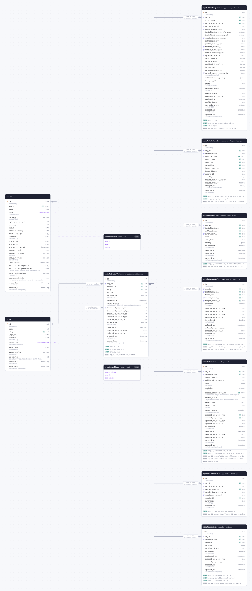

| Column                    | Type        | Constraints                       | Default                        | Description                                                                                                                                          |
| ------------------------- | ----------- | --------------------------------- | ------------------------------ | ---------------------------------------------------------------------------------------------------------------------------------------------------- |
| `id`                      | `text`      | PK NOT NULL                       | `.$defaultFn()`                |                                                                                                                                                      |
| `org_id`                  | `text`      | NOT NULL → [orgs.id](#table-orgs) |                                |                                                                                                                                                      |
| `module_id`               | `text`      | NOT NULL                          |                                |                                                                                                                                                      |
| `slug`                    | `text`      | NOT NULL                          |                                |                                                                                                                                                      |
| `source`                  | `text`      | NOT NULL                          |                                |                                                                                                                                                      |
| `is_enabled`              | `boolean`   | NOT NULL                          | `.default(true)`               |                                                                                                                                                      |
| `disabled_at`             | `timestamp` | NULL                              |                                |                                                                                                                                                      |
| `agent_access`            | `text`      | NOT NULL                          | `.default('none')`             | Manifests never grant agent access. An org admin chooses this installation policy independently; the service still applies principal trust/approval. |
| `installed_by_user_id`    | `text`      | NULL → [users.id](#table-users)   |                                |                                                                                                                                                      |
| `installed_by_actor_type` | `text`      | NOT NULL                          |                                |                                                                                                                                                      |
| `installed_by_actor_id`   | `text`      | NOT NULL                          |                                |                                                                                                                                                      |
| `updated_by_actor_type`   | `text`      | NOT NULL                          |                                |                                                                                                                                                      |
| `updated_by_actor_id`     | `text`      | NOT NULL                          |                                |                                                                                                                                                      |
| `is_deleted`              | `boolean`   | NOT NULL                          | `.default(false)`              |                                                                                                                                                      |
| `deleted_at`              | `timestamp` | NULL                              |                                |                                                                                                                                                      |
| `deleted_by_actor_type`   | `text`      | NULL                              |                                |                                                                                                                                                      |
| `deleted_by_actor_id`     | `text`      | NULL                              |                                |                                                                                                                                                      |
| `created_at`              | `timestamp` | NOT NULL                          | `.defaultNow()`                |                                                                                                                                                      |
| `updated_at`              | `timestamp` | NOT NULL                          | `.defaultNow()` `.$onUpdate()` |                                                                                                                                                      |

#### Definition

```sql
CREATE TABLE "module_installations" (
	"id" text PRIMARY KEY,
	"org_id" text NOT NULL,
	"module_id" text NOT NULL,
	"slug" text NOT NULL,
	"source" text NOT NULL,
	"is_enabled" boolean DEFAULT true NOT NULL,
	"disabled_at" timestamp,
	"agent_access" text DEFAULT 'none' NOT NULL,
	"installed_by_user_id" text,
	"installed_by_actor_type" text NOT NULL,
	"installed_by_actor_id" text NOT NULL,
	"updated_by_actor_type" text NOT NULL,
	"updated_by_actor_id" text NOT NULL,
	"is_deleted" boolean DEFAULT false NOT NULL,
	"deleted_at" timestamp,
	"deleted_by_actor_type" text,
	"deleted_by_actor_id" text,
	"created_at" timestamp DEFAULT now() NOT NULL,
	"updated_at" timestamp DEFAULT now() NOT NULL,
	CONSTRAINT "module_installations_org_id_id_unique" UNIQUE("org_id","id"),
	CONSTRAINT "module_installations_module_id_not_empty" CHECK (length(btrim("module_id")) > 0),
	CONSTRAINT "module_installations_slug_not_empty" CHECK (length(btrim("slug")) > 0),
	CONSTRAINT "module_installations_source_check" CHECK ("source" IN ('bundled', 'sideloaded', 'registry')),
	CONSTRAINT "module_installations_agent_access_check" CHECK ("agent_access" IN ('none', 'read', 'write')),
	CONSTRAINT "module_installations_enabled_state_check" CHECK (("is_enabled" AND "disabled_at" IS NULL) OR (NOT "is_enabled" AND "disabled_at" IS NOT NULL)),
	CONSTRAINT "module_installations_deleted_state_check" CHECK ((
      NOT "is_deleted"
      AND "deleted_at" IS NULL
      AND "deleted_by_actor_type" IS NULL
      AND "deleted_by_actor_id" IS NULL
    ) OR (
      "is_deleted"
      AND "deleted_at" IS NOT NULL
      AND "deleted_by_actor_type" IS NOT NULL
      AND "deleted_by_actor_id" IS NOT NULL
    ))
);

CREATE UNIQUE INDEX "module_installations_org_module_id_unique" ON "module_installations" ("org_id","module_id");

CREATE UNIQUE INDEX "module_installations_org_slug_unique" ON "module_installations" ("org_id","slug");

CREATE INDEX "module_installations_org_visibility_idx" ON "module_installations" ("org_id","is_enabled","is_deleted");

ALTER TABLE "module_installations" ADD CONSTRAINT "module_installations_org_id_orgs_id_fkey" FOREIGN KEY ("org_id") REFERENCES "orgs"("id") ON DELETE CASCADE;

ALTER TABLE "module_installations" ADD CONSTRAINT "module_installations_installed_by_user_id_users_id_fkey" FOREIGN KEY ("installed_by_user_id") REFERENCES "users"("id") ON DELETE SET NULL;
```

#### Indexes

- UNIQUE `org_id`, `id`
- UNIQUE `org_id`, `module_id`
- UNIQUE `org_id`, `slug`
- INDEX `org_id`, `is_enabled`, `is_deleted`

#### References

- `org_id` → [orgs.id](#table-orgs) (many to one, on delete cascade)
- `installed_by_user_id` → [users.id](#table-users) (many to one, on delete set null)

#### Referenced by

- `org_id` → [moduleVersions.org_id](#table-moduleVersions) (one to one, on delete restrict)
- `org_id` → [appModuleBindings.org_id](#table-appModuleBindings) (one to many, on delete restrict)
- `org_id` → [moduleRecords.org_id](#table-moduleRecords) (one to many, on delete restrict)
- `org_id` → [moduleRecordRelations.org_id](#table-moduleRecordRelations) (one to many, on delete restrict)
- `org_id` → [moduleSavedViews.org_id](#table-moduleSavedViews) (one to many, on delete cascade)
- `org_id` → [moduleMutationReceipts.org_id](#table-moduleMutationReceipts) (one to many, on delete restrict)
- `org_id` → [appPublicEndpoints.org_id](#table-appPublicEndpoints) (one to many, on delete restrict)

<details>
<summary>Queries and their SQL</summary>

**Select**: Every row of moduleInstallations.

```ts
db.select().from(moduleInstallations);
```

```sql
select "id", "org_id", "module_id", "slug", "source", "is_enabled", "disabled_at", "agent_access", "installed_by_user_id", "installed_by_actor_type", "installed_by_actor_id", "updated_by_actor_type", "updated_by_actor_id", "is_deleted", "deleted_at", "deleted_by_actor_type", "deleted_by_actor_id", "created_at", "updated_at"
from "module_installations"
```

**Count**: How many rows moduleInstallations has.

```ts
db.select({ count: count() }).from(moduleInstallations);
```

```sql
select count(*)
from "module_installations"
```

**Find many**: The rows of moduleInstallations, through the relational query API.

```ts
db.query.moduleInstallations.findMany();
```

```sql
select "d0"."id" as "id", "d0"."org_id" as "org_id", "d0"."module_id" as "module_id", "d0"."slug" as "slug", "d0"."source" as "source", "d0"."is_enabled" as "is_enabled", "d0"."disabled_at" as "disabled_at", "d0"."agent_access" as "agent_access", "d0"."installed_by_user_id" as "installed_by_user_id", "d0"."installed_by_actor_type" as "installed_by_actor_type", "d0"."installed_by_actor_id" as "installed_by_actor_id", "d0"."updated_by_actor_type" as "updated_by_actor_type", "d0"."updated_by_actor_id" as "updated_by_actor_id", "d0"."is_deleted" as "is_deleted", "d0"."deleted_at" as "deleted_at", "d0"."deleted_by_actor_type" as "deleted_by_actor_type", "d0"."deleted_by_actor_id" as "deleted_by_actor_id", "d0"."created_at" as "created_at", "d0"."updated_at" as "updated_at"
from "module_installations" as "d0"
```

**Find by primary key**: One row of moduleInstallations, through the relational query API.

```ts
db.query.moduleInstallations.findFirst({ where: { id: "id" } });
```

```sql
select "d0"."id" as "id", "d0"."org_id" as "org_id", "d0"."module_id" as "module_id", "d0"."slug" as "slug", "d0"."source" as "source", "d0"."is_enabled" as "is_enabled", "d0"."disabled_at" as "disabled_at", "d0"."agent_access" as "agent_access", "d0"."installed_by_user_id" as "installed_by_user_id", "d0"."installed_by_actor_type" as "installed_by_actor_type", "d0"."installed_by_actor_id" as "installed_by_actor_id", "d0"."updated_by_actor_type" as "updated_by_actor_type", "d0"."updated_by_actor_id" as "updated_by_actor_id", "d0"."is_deleted" as "is_deleted", "d0"."deleted_at" as "deleted_at", "d0"."deleted_by_actor_type" as "deleted_by_actor_type", "d0"."deleted_by_actor_id" as "deleted_by_actor_id", "d0"."created_at" as "created_at", "d0"."updated_at" as "updated_at"
from "module_installations" as "d0"
where "d0"."id" = $1
limit $2
-- params: ["id",1]
```

**Insert**: Adds a row to moduleInstallations, giving the columns that have no default.

```ts
db.insert(moduleInstallations).values({
  org_id: "org_id",
  module_id: "module_id",
  slug: "slug",
  source: "source",
  installed_by_actor_type: "installed_by_actor_type",
  installed_by_actor_id: "installed_by_actor_id",
  updated_by_actor_type: "updated_by_actor_type",
  updated_by_actor_id: "updated_by_actor_id",
});
```

```sql
insert into "module_installations" ("id", "org_id", "module_id", "slug", "source", "is_enabled", "disabled_at", "agent_access", "installed_by_user_id", "installed_by_actor_type", "installed_by_actor_id", "updated_by_actor_type", "updated_by_actor_id", "is_deleted", "deleted_at", "deleted_by_actor_type", "deleted_by_actor_id", "created_at", "updated_at")
values ($1, $2, $3, $4, $5, default, default, default, default, $6, $7, $8, $9, default, default, default, default, default, default)
-- params: ["00000000-0000-4000-8000-000000000000","org_id","module_id","slug","source","installed_by_actor_type","installed_by_actor_id","updated_by_actor_type","updated_by_actor_id"]
```

**Update**: Changes a row of moduleInstallations, found by its primary key.

```ts
db.update(moduleInstallations).set({ org_id: "org_id" }).where(eq(moduleInstallations.id, "id"));
```

```sql
update "module_installations"
set "org_id" = $1, "updated_at" = $2
where "module_installations"."id" = $3
-- params: ["org_id","2026-01-01T00:00:00.000Z","id"]
```

**Delete**: Deletes a row of moduleInstallations, found by its primary key.

```ts
db.delete(moduleInstallations).where(eq(moduleInstallations.id, "id"));
```

```sql
delete from "module_installations"
where "module_installations"."id" = $1
-- params: ["id"]
```

</details>

<a id="table-moduleVersions"></a>

### moduleVersions

Table `module_versions`.

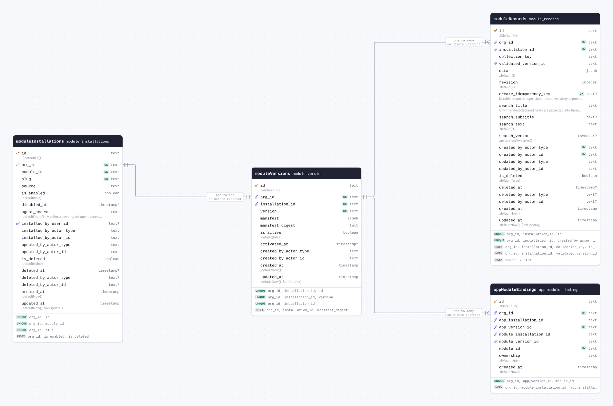

| Column                  | Type        | Constraints                                                         | Default                        | Description |
| ----------------------- | ----------- | ------------------------------------------------------------------- | ------------------------------ | ----------- |
| `id`                    | `text`      | PK NOT NULL                                                         | `.$defaultFn()`                |             |
| `org_id`                | `text`      | NOT NULL → [moduleInstallations.org_id](#table-moduleInstallations) |                                |             |
| `installation_id`       | `text`      | NOT NULL                                                            |                                |             |
| `version`               | `text`      | NOT NULL                                                            |                                |             |
| `manifest`              | `jsonb`     | NOT NULL                                                            |                                |             |
| `manifest_digest`       | `text`      | NOT NULL                                                            |                                |             |
| `is_active`             | `boolean`   | NOT NULL                                                            | `.default(false)`              |             |
| `activated_at`          | `timestamp` | NULL                                                                |                                |             |
| `created_by_actor_type` | `text`      | NOT NULL                                                            |                                |             |
| `created_by_actor_id`   | `text`      | NOT NULL                                                            |                                |             |
| `created_at`            | `timestamp` | NOT NULL                                                            | `.defaultNow()`                |             |
| `updated_at`            | `timestamp` | NOT NULL                                                            | `.defaultNow()` `.$onUpdate()` |             |

#### Definition

```sql
CREATE TABLE "module_versions" (
	"id" text PRIMARY KEY,
	"org_id" text NOT NULL,
	"installation_id" text NOT NULL,
	"version" text NOT NULL,
	"manifest" jsonb NOT NULL,
	"manifest_digest" text NOT NULL,
	"is_active" boolean DEFAULT false NOT NULL,
	"activated_at" timestamp,
	"created_by_actor_type" text NOT NULL,
	"created_by_actor_id" text NOT NULL,
	"created_at" timestamp DEFAULT now() NOT NULL,
	"updated_at" timestamp DEFAULT now() NOT NULL,
	CONSTRAINT "module_versions_org_installation_id_unique" UNIQUE("org_id","installation_id","id"),
	CONSTRAINT "module_versions_version_semver_check" CHECK ("version" ~ '^(0|[1-9][0-9]*)\.(0|[1-9][0-9]*)\.(0|[1-9][0-9]*)(-[0-9A-Za-z.-]+)?(\+[0-9A-Za-z.-]+)?$'),
	CONSTRAINT "module_versions_manifest_object_check" CHECK (jsonb_typeof("manifest") = 'object'),
	CONSTRAINT "module_versions_manifest_digest_sha256_check" CHECK ("manifest_digest" ~ '^sha256:[a-f0-9]{64}$'),
	CONSTRAINT "module_versions_active_state_check" CHECK ((NOT "is_active") OR "activated_at" IS NOT NULL)
);

CREATE UNIQUE INDEX "module_versions_org_installation_version_unique" ON "module_versions" ("org_id","installation_id","version");

CREATE UNIQUE INDEX "module_versions_one_active_unique" ON "module_versions" ("org_id","installation_id") WHERE "is_active" = true;

CREATE INDEX "module_versions_installation_digest_idx" ON "module_versions" ("org_id","installation_id","manifest_digest");

ALTER TABLE "module_versions" ADD CONSTRAINT "module_versions_org_installation_fk" FOREIGN KEY ("org_id","installation_id") REFERENCES "module_installations"("org_id","id") ON DELETE RESTRICT;
```

#### Indexes

- UNIQUE `org_id`, `installation_id`, `id`
- UNIQUE `org_id`, `installation_id`, `version`
- UNIQUE `org_id`, `installation_id`
- INDEX `org_id`, `installation_id`, `manifest_digest`

#### References

- `org_id` → [moduleInstallations.org_id](#table-moduleInstallations) (one to one, on delete restrict)

#### Referenced by

- `org_id` → [appModuleBindings.org_id](#table-appModuleBindings) (one to many, on delete restrict)
- `org_id` → [moduleRecords.org_id](#table-moduleRecords) (one to many, on delete restrict)

<details>
<summary>Queries and their SQL</summary>

**Select**: Every row of moduleVersions.

```ts
db.select().from(moduleVersions);
```

```sql
select "id", "org_id", "installation_id", "version", "manifest", "manifest_digest", "is_active", "activated_at", "created_by_actor_type", "created_by_actor_id", "created_at", "updated_at"
from "module_versions"
```

**Count**: How many rows moduleVersions has.

```ts
db.select({ count: count() }).from(moduleVersions);
```

```sql
select count(*)
from "module_versions"
```

**Find many**: The rows of moduleVersions, through the relational query API.

```ts
db.query.moduleVersions.findMany();
```

```sql
select "d0"."id" as "id", "d0"."org_id" as "org_id", "d0"."installation_id" as "installation_id", "d0"."version" as "version", "d0"."manifest" as "manifest", "d0"."manifest_digest" as "manifest_digest", "d0"."is_active" as "is_active", "d0"."activated_at" as "activated_at", "d0"."created_by_actor_type" as "created_by_actor_type", "d0"."created_by_actor_id" as "created_by_actor_id", "d0"."created_at" as "created_at", "d0"."updated_at" as "updated_at"
from "module_versions" as "d0"
```

**Find by primary key**: One row of moduleVersions, through the relational query API.

```ts
db.query.moduleVersions.findFirst({ where: { id: "id" } });
```

```sql
select "d0"."id" as "id", "d0"."org_id" as "org_id", "d0"."installation_id" as "installation_id", "d0"."version" as "version", "d0"."manifest" as "manifest", "d0"."manifest_digest" as "manifest_digest", "d0"."is_active" as "is_active", "d0"."activated_at" as "activated_at", "d0"."created_by_actor_type" as "created_by_actor_type", "d0"."created_by_actor_id" as "created_by_actor_id", "d0"."created_at" as "created_at", "d0"."updated_at" as "updated_at"
from "module_versions" as "d0"
where "d0"."id" = $1
limit $2
-- params: ["id",1]
```

**Insert**: Adds a row to moduleVersions, giving the columns that have no default.

```ts
db.insert(moduleVersions).values({
  org_id: "org_id",
  installation_id: "installation_id",
  version: "version",
  manifest: {},
  manifest_digest: "manifest_digest",
  created_by_actor_type: "created_by_actor_type",
  created_by_actor_id: "created_by_actor_id",
});
```

```sql
insert into "module_versions" ("id", "org_id", "installation_id", "version", "manifest", "manifest_digest", "is_active", "activated_at", "created_by_actor_type", "created_by_actor_id", "created_at", "updated_at")
values ($1, $2, $3, $4, $5, $6, default, default, $7, $8, default, default)
-- params: ["00000000-0000-4000-8000-000000000000","org_id","installation_id","version",{},"manifest_digest","created_by_actor_type","created_by_actor_id"]
```

**Update**: Changes a row of moduleVersions, found by its primary key.

```ts
db.update(moduleVersions).set({ org_id: "org_id" }).where(eq(moduleVersions.id, "id"));
```

```sql
update "module_versions"
set "org_id" = $1, "updated_at" = $2
where "module_versions"."id" = $3
-- params: ["org_id","2026-01-01T00:00:00.000Z","id"]
```

**Delete**: Deletes a row of moduleVersions, found by its primary key.

```ts
db.delete(moduleVersions).where(eq(moduleVersions.id, "id"));
```

```sql
delete from "module_versions"
where "module_versions"."id" = $1
-- params: ["id"]
```

</details>

<a id="table-appInstallations"></a>

### appInstallations

Table `app_installations`. ═══ APPS (DECLARATIVE AND CONNECTED APP PROTOCOLS) ═══ Apps are tenant-local lifecycle owners for exact immutable Module versions. Protocol v1 may persist requested authority, but effective grants, execution, secrets, public ingress, automation, sync, and entitlement state remain gated.

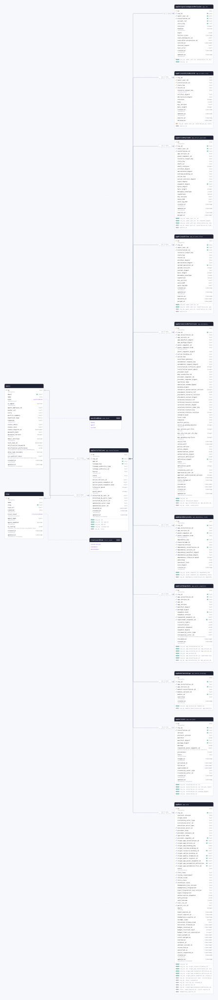

| Column                       | Type        | Constraints                       | Default                        | Description |
| ---------------------------- | ----------- | --------------------------------- | ------------------------------ | ----------- |
| `id`                         | `text`      | PK NOT NULL                       | `.$defaultFn()`                |             |
| `org_id`                     | `text`      | NOT NULL → [orgs.id](#table-orgs) |                                |             |
| `app_id`                     | `text`      | NOT NULL                          |                                |             |
| `lineage_key`                | `text`      | NOT NULL                          |                                |             |
| `lineage_authority_type`     | `text`      | NOT NULL                          |                                |             |
| `lineage_authority_id`       | `text`      | NOT NULL                          |                                |             |
| `source`                     | `text`      | NOT NULL                          | `.default('local')`            |             |
| `state`                      | `text`      | NOT NULL                          | `.default('staged')`           |             |
| `active_version_id`          | `text`      | NULL                              |                                |             |
| `active_grant_snapshot_id`   | `text`      | NULL                              |                                |             |
| `active_grant_snapshot_kind` | `text`      | NULL                              |                                |             |
| `lifecycle_epoch`            | `integer`   | NOT NULL                          | `.default(0)`                  |             |
| `grant_epoch`                | `integer`   | NOT NULL                          | `.default(0)`                  |             |
| `installed_by_user_id`       | `text`      | NULL → [users.id](#table-users)   |                                |             |
| `installed_by_actor_type`    | `text`      | NOT NULL                          |                                |             |
| `installed_by_actor_id`      | `text`      | NOT NULL                          |                                |             |
| `updated_by_actor_type`      | `text`      | NOT NULL                          |                                |             |
| `updated_by_actor_id`        | `text`      | NOT NULL                          |                                |             |
| `disabled_at`                | `timestamp` | NULL                              |                                |             |
| `created_at`                 | `timestamp` | NOT NULL                          | `.defaultNow()`                |             |
| `updated_at`                 | `timestamp` | NOT NULL                          | `.defaultNow()` `.$onUpdate()` |             |

#### Definition

```sql
CREATE TABLE "app_installations" (
	"id" text PRIMARY KEY,
	"org_id" text NOT NULL,
	"app_id" text NOT NULL,
	"lineage_key" text NOT NULL,
	"lineage_authority_type" text NOT NULL,
	"lineage_authority_id" text NOT NULL,
	"source" text DEFAULT 'local' NOT NULL,
	"state" text DEFAULT 'staged' NOT NULL,
	"active_version_id" text,
	"active_grant_snapshot_id" text,
	"active_grant_snapshot_kind" text,
	"lifecycle_epoch" integer DEFAULT 0 NOT NULL,
	"grant_epoch" integer DEFAULT 0 NOT NULL,
	"installed_by_user_id" text,
	"installed_by_actor_type" text NOT NULL,
	"installed_by_actor_id" text NOT NULL,
	"updated_by_actor_type" text NOT NULL,
	"updated_by_actor_id" text NOT NULL,
	"disabled_at" timestamp,
	"created_at" timestamp DEFAULT now() NOT NULL,
	"updated_at" timestamp DEFAULT now() NOT NULL,
	CONSTRAINT "app_installations_org_id_id_unique" UNIQUE("org_id","id"),
	CONSTRAINT "app_installations_org_id_app_id_unique" UNIQUE("org_id","id","app_id"),
	CONSTRAINT "app_installations_source_check" CHECK ("source" = 'local'),
	CONSTRAINT "app_installations_lineage_authority_check" CHECK ("lineage_authority_type" = 'local_user'),
	CONSTRAINT "app_installations_state_check" CHECK ("state" IN ('staged', 'active', 'disabled', 'failed')),
	CONSTRAINT "app_installations_epoch_nonnegative_check" CHECK ("lifecycle_epoch" >= 0),
	CONSTRAINT "app_installations_grant_epoch_nonnegative_check" CHECK ("grant_epoch" >= 0),
	CONSTRAINT "app_installations_grant_pointer_shape_check" CHECK (
    ("active_grant_snapshot_id" IS NULL AND "active_grant_snapshot_kind" IS NULL)
    OR ("active_grant_snapshot_id" IS NOT NULL AND "active_grant_snapshot_kind" = 'effective')
  ),
	CONSTRAINT "app_installations_active_pointer_check" CHECK (("state" = 'staged' AND "active_version_id" IS NULL AND "disabled_at" IS NULL)
      OR ("state" = 'active' AND "active_version_id" IS NOT NULL AND "disabled_at" IS NULL)
      OR ("state" = 'disabled' AND "active_version_id" IS NOT NULL AND "disabled_at" IS NOT NULL)
      OR ("state" = 'failed' AND "active_version_id" IS NULL))
);

CREATE UNIQUE INDEX "app_installations_org_app_id_unique" ON "app_installations" ("org_id","app_id");

CREATE UNIQUE INDEX "app_installations_org_lineage_unique" ON "app_installations" ("org_id","lineage_key");

CREATE INDEX "app_installations_org_state_idx" ON "app_installations" ("org_id","state");

ALTER TABLE "app_installations" ADD CONSTRAINT "app_installations_org_id_orgs_id_fkey" FOREIGN KEY ("org_id") REFERENCES "orgs"("id") ON DELETE CASCADE;

ALTER TABLE "app_installations" ADD CONSTRAINT "app_installations_installed_by_user_id_users_id_fkey" FOREIGN KEY ("installed_by_user_id") REFERENCES "users"("id") ON DELETE SET NULL;
```

#### Indexes

- UNIQUE `org_id`, `id`
- UNIQUE `org_id`, `id`, `app_id`
- UNIQUE `org_id`, `app_id`
- UNIQUE `org_id`, `lineage_key`
- INDEX `org_id`, `state`

#### References

- `org_id` → [orgs.id](#table-orgs) (many to one, on delete cascade)
- `installed_by_user_id` → [users.id](#table-users) (many to one, on delete set null)

#### Referenced by

- `org_id` → [appRuns.org_id](#table-appRuns) (one to many, on delete cascade)
- `org_id` → [appVersions.org_id](#table-appVersions) (one to one, on delete restrict)
- `org_id` → [appModuleBindings.org_id](#table-appModuleBindings) (one to many, on delete restrict)
- `org_id` → [appGrantSnapshots.org_id](#table-appGrantSnapshots) (one to many, on delete restrict)
- `org_id` → [appDependencyLocks.org_id](#table-appDependencyLocks) (one to many, on delete restrict)
- `org_id` → [appAutomationDefinitions.org_id](#table-appAutomationDefinitions) (one to many, on delete restrict)
- `org_id` → [appPrivateFiles.org_id](#table-appPrivateFiles) (one to many, on delete restrict)
- `org_id` → [appActionPayloads.org_id](#table-appActionPayloads) (one to many, on delete restrict)
- `org_id` → [appPrivateStateRecords.org_id](#table-appPrivateStateRecords) (one to many, on delete restrict)
- `org_id` → [appIntegrationCapturePolicies.org_id](#table-appIntegrationCapturePolicies) (one to many)

<details>
<summary>Queries and their SQL</summary>

**Select**: Every row of appInstallations.

```ts
db.select().from(appInstallations);
```

```sql
select "id", "org_id", "app_id", "lineage_key", "lineage_authority_type", "lineage_authority_id", "source", "state", "active_version_id", "active_grant_snapshot_id", "active_grant_snapshot_kind", "lifecycle_epoch", "grant_epoch", "installed_by_user_id", "installed_by_actor_type", "installed_by_actor_id", "updated_by_actor_type", "updated_by_actor_id", "disabled_at", "created_at", "updated_at"
from "app_installations"
```

**Count**: How many rows appInstallations has.

```ts
db.select({ count: count() }).from(appInstallations);
```

```sql
select count(*)
from "app_installations"
```

**Find many**: The rows of appInstallations, through the relational query API.

```ts
db.query.appInstallations.findMany();
```

```sql
select "d0"."id" as "id", "d0"."org_id" as "org_id", "d0"."app_id" as "app_id", "d0"."lineage_key" as "lineage_key", "d0"."lineage_authority_type" as "lineage_authority_type", "d0"."lineage_authority_id" as "lineage_authority_id", "d0"."source" as "source", "d0"."state" as "state", "d0"."active_version_id" as "active_version_id", "d0"."active_grant_snapshot_id" as "active_grant_snapshot_id", "d0"."active_grant_snapshot_kind" as "active_grant_snapshot_kind", "d0"."lifecycle_epoch" as "lifecycle_epoch", "d0"."grant_epoch" as "grant_epoch", "d0"."installed_by_user_id" as "installed_by_user_id", "d0"."installed_by_actor_type" as "installed_by_actor_type", "d0"."installed_by_actor_id" as "installed_by_actor_id", "d0"."updated_by_actor_type" as "updated_by_actor_type", "d0"."updated_by_actor_id" as "updated_by_actor_id", "d0"."disabled_at" as "disabled_at", "d0"."created_at" as "created_at", "d0"."updated_at" as "updated_at"
from "app_installations" as "d0"
```

**Find by primary key**: One row of appInstallations, through the relational query API.

```ts
db.query.appInstallations.findFirst({ where: { id: "id" } });
```

```sql
select "d0"."id" as "id", "d0"."org_id" as "org_id", "d0"."app_id" as "app_id", "d0"."lineage_key" as "lineage_key", "d0"."lineage_authority_type" as "lineage_authority_type", "d0"."lineage_authority_id" as "lineage_authority_id", "d0"."source" as "source", "d0"."state" as "state", "d0"."active_version_id" as "active_version_id", "d0"."active_grant_snapshot_id" as "active_grant_snapshot_id", "d0"."active_grant_snapshot_kind" as "active_grant_snapshot_kind", "d0"."lifecycle_epoch" as "lifecycle_epoch", "d0"."grant_epoch" as "grant_epoch", "d0"."installed_by_user_id" as "installed_by_user_id", "d0"."installed_by_actor_type" as "installed_by_actor_type", "d0"."installed_by_actor_id" as "installed_by_actor_id", "d0"."updated_by_actor_type" as "updated_by_actor_type", "d0"."updated_by_actor_id" as "updated_by_actor_id", "d0"."disabled_at" as "disabled_at", "d0"."created_at" as "created_at", "d0"."updated_at" as "updated_at"
from "app_installations" as "d0"
where "d0"."id" = $1
limit $2
-- params: ["id",1]
```

**Insert**: Adds a row to appInstallations, giving the columns that have no default.

```ts
db.insert(appInstallations).values({
  org_id: "org_id",
  app_id: "app_id",
  lineage_key: "lineage_key",
  lineage_authority_type: "lineage_authority_type",
  lineage_authority_id: "lineage_authority_id",
  installed_by_actor_type: "installed_by_actor_type",
  installed_by_actor_id: "installed_by_actor_id",
  updated_by_actor_type: "updated_by_actor_type",
  updated_by_actor_id: "updated_by_actor_id",
});
```

```sql
insert into "app_installations" ("id", "org_id", "app_id", "lineage_key", "lineage_authority_type", "lineage_authority_id", "source", "state", "active_version_id", "active_grant_snapshot_id", "active_grant_snapshot_kind", "lifecycle_epoch", "grant_epoch", "installed_by_user_id", "installed_by_actor_type", "installed_by_actor_id", "updated_by_actor_type", "updated_by_actor_id", "disabled_at", "created_at", "updated_at")
values ($1, $2, $3, $4, $5, $6, default, default, default, default, default, default, default, default, $7, $8, $9, $10, default, default, default)
-- params: ["00000000-0000-4000-8000-000000000000","org_id","app_id","lineage_key","lineage_authority_type","lineage_authority_id","installed_by_actor_type","installed_by_actor_id","updated_by_actor_type","updated_by_actor_id"]
```

**Update**: Changes a row of appInstallations, found by its primary key.

```ts
db.update(appInstallations).set({ org_id: "org_id" }).where(eq(appInstallations.id, "id"));
```

```sql
update "app_installations"
set "org_id" = $1, "updated_at" = $2
where "app_installations"."id" = $3
-- params: ["org_id","2026-01-01T00:00:00.000Z","id"]
```

**Delete**: Deletes a row of appInstallations, found by its primary key.

```ts
db.delete(appInstallations).where(eq(appInstallations.id, "id"));
```

```sql
delete from "app_installations"
where "app_installations"."id" = $1
-- params: ["id"]
```

</details>

<a id="table-appVersions"></a>

### appVersions

Table `app_versions`.

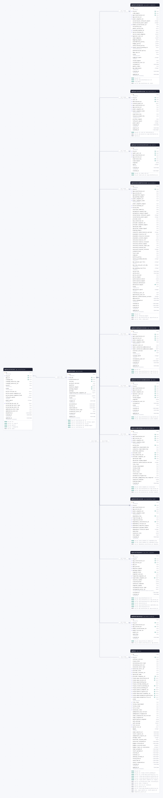

| Column                        | Type        | Constraints                                                   | Default                        | Description                                                                                                                                                      |
| ----------------------------- | ----------- | ------------------------------------------------------------- | ------------------------------ | ---------------------------------------------------------------------------------------------------------------------------------------------------------------- |
| `id`                          | `text`      | PK NOT NULL                                                   | `.$defaultFn()`                |                                                                                                                                                                  |
| `org_id`                      | `text`      | NOT NULL → [appInstallations.org_id](#table-appInstallations) |                                |                                                                                                                                                                  |
| `installation_id`             | `text`      | NOT NULL                                                      |                                |                                                                                                                                                                  |
| `version`                     | `text`      | NOT NULL                                                      |                                |                                                                                                                                                                  |
| `protocol_version`            | `text`      | NOT NULL                                                      |                                |                                                                                                                                                                  |
| `manifest`                    | `jsonb`     | NOT NULL                                                      |                                |                                                                                                                                                                  |
| `manifest_digest`             | `text`      | NOT NULL                                                      |                                |                                                                                                                                                                  |
| `package_digest`              | `text`      | NOT NULL                                                      |                                |                                                                                                                                                                  |
| `package`                     | `jsonb`     | NOT NULL                                                      |                                |                                                                                                                                                                  |
| `requested_grant_snapshot_id` | `text`      | NULL                                                          |                                | Nullable preserves pre-.23 Protocol v0 rows. New v0/v1/v2 staging writes an immutable compatibility/request projection; connected protocols require the pointer. |
| `provenance`                  | `jsonb`     | NULL                                                          |                                |                                                                                                                                                                  |
| `state`                       | `text`      | NOT NULL                                                      | `.default('staged')`           |                                                                                                                                                                  |
| `staged_at`                   | `timestamp` | NOT NULL                                                      | `.defaultNow()`                |                                                                                                                                                                  |
| `activated_at`                | `timestamp` | NULL                                                          |                                |                                                                                                                                                                  |
| `failed_at`                   | `timestamp` | NULL                                                          |                                |                                                                                                                                                                  |
| `superseded_at`               | `timestamp` | NULL                                                          |                                |                                                                                                                                                                  |
| `created_by_actor_type`       | `text`      | NOT NULL                                                      |                                |                                                                                                                                                                  |
| `created_by_actor_id`         | `text`      | NOT NULL                                                      |                                |                                                                                                                                                                  |
| `created_at`                  | `timestamp` | NOT NULL                                                      | `.defaultNow()`                |                                                                                                                                                                  |
| `updated_at`                  | `timestamp` | NOT NULL                                                      | `.defaultNow()` `.$onUpdate()` |                                                                                                                                                                  |

#### Definition

```sql
CREATE TABLE "app_versions" (
	"id" text PRIMARY KEY,
	"org_id" text NOT NULL,
	"installation_id" text NOT NULL,
	"version" text NOT NULL,
	"protocol_version" text NOT NULL,
	"manifest" jsonb NOT NULL,
	"manifest_digest" text NOT NULL,
	"package_digest" text NOT NULL,
	"package" jsonb NOT NULL,
	"requested_grant_snapshot_id" text,
	"provenance" jsonb,
	"state" text DEFAULT 'staged' NOT NULL,
	"staged_at" timestamp DEFAULT now() NOT NULL,
	"activated_at" timestamp,
	"failed_at" timestamp,
	"superseded_at" timestamp,
	"created_by_actor_type" text NOT NULL,
	"created_by_actor_id" text NOT NULL,
	"created_at" timestamp DEFAULT now() NOT NULL,
	"updated_at" timestamp DEFAULT now() NOT NULL,
	CONSTRAINT "app_versions_org_installation_id_unique" UNIQUE("org_id","installation_id","id"),
	CONSTRAINT "app_versions_org_installation_identity_unique" UNIQUE("org_id","installation_id","id","version","manifest_digest","package_digest"),
	CONSTRAINT "app_versions_protocol_supported_check" CHECK ("protocol_version" IN ('0', '1', '2', '3', '4', '5', '6', '7')),
	CONSTRAINT "app_versions_connected_request_check" CHECK (
    "protocol_version" = '0' OR "requested_grant_snapshot_id" IS NOT NULL
  ),
	CONSTRAINT "app_versions_state_check" CHECK ("state" IN ('staged', 'active', 'superseded', 'failed')),
	CONSTRAINT "app_versions_manifest_object_check" CHECK (jsonb_typeof("manifest") = 'object'),
	CONSTRAINT "app_versions_package_object_check" CHECK (jsonb_typeof("package") = 'object'),
	CONSTRAINT "app_versions_manifest_digest_check" CHECK ("manifest_digest" ~ '^sha256:[a-f0-9]{64}$'),
	CONSTRAINT "app_versions_package_digest_check" CHECK ("package_digest" ~ '^sha256:[a-f0-9]{64}$'),
	CONSTRAINT "app_versions_lifecycle_check" CHECK (("state" = 'staged' AND "activated_at" IS NULL AND "failed_at" IS NULL AND "superseded_at" IS NULL)
      OR ("state" = 'active' AND "activated_at" IS NOT NULL AND "failed_at" IS NULL AND "superseded_at" IS NULL)
      OR ("state" = 'superseded' AND "activated_at" IS NOT NULL AND "failed_at" IS NULL AND "superseded_at" IS NOT NULL)
      OR ("state" = 'failed' AND "activated_at" IS NULL AND "failed_at" IS NOT NULL AND "superseded_at" IS NULL))
);

CREATE UNIQUE INDEX "app_versions_org_installation_version_unique" ON "app_versions" ("org_id","installation_id","version");

CREATE UNIQUE INDEX "app_versions_package_digest_unique" ON "app_versions" ("org_id","installation_id","package_digest");

CREATE UNIQUE INDEX "app_versions_one_active_unique" ON "app_versions" ("org_id","installation_id") WHERE "state" = 'active';

ALTER TABLE "app_versions" ADD CONSTRAINT "app_versions_org_installation_fk" FOREIGN KEY ("org_id","installation_id") REFERENCES "app_installations"("org_id","id") ON DELETE RESTRICT;
```

#### Indexes

- UNIQUE `org_id`, `installation_id`, `id`
- UNIQUE `org_id`, `installation_id`, `id`, `version`, `manifest_digest`, `package_digest`
- UNIQUE `org_id`, `installation_id`, `version`
- UNIQUE `org_id`, `installation_id`, `package_digest`
- UNIQUE `org_id`, `installation_id`

#### References

- `org_id` → [appInstallations.org_id](#table-appInstallations) (one to one, on delete restrict)

#### Referenced by

- `org_id` → [appRuns.org_id](#table-appRuns) (one to many, on delete cascade)
- `org_id` → [appModuleBindings.org_id](#table-appModuleBindings) (one to many, on delete restrict)
- `org_id` → [appGrantSnapshots.org_id](#table-appGrantSnapshots) (one to many, on delete restrict)
- `org_id` → [appDependencyLocks.org_id](#table-appDependencyLocks) (one to many, on delete restrict)
- `org_id` → [appDependencyLocks.org_id](#table-appDependencyLocks) (one to many, on delete restrict)
- `org_id` → [appActionBindings.org_id](#table-appActionBindings) (one to many, on delete restrict)
- `org_id` → [appOwnerConnectionAdmissions.org_id](#table-appOwnerConnectionAdmissions) (one to many, on delete restrict)
- `org_id` → [appRuntimeRegistrations.org_id](#table-appRuntimeRegistrations) (one to many, on delete restrict)
- `org_id` → [appAutomationDefinitions.org_id](#table-appAutomationDefinitions) (one to many, on delete restrict)
- `org_id` → [appExperienceConsentGrants.org_id](#table-appExperienceConsentGrants) (one to many, on delete restrict)
- `org_id` → [appExperienceSessions.org_id](#table-appExperienceSessions) (one to many, on delete restrict)
- `org_id` → [appPublicEndpoints.org_id](#table-appPublicEndpoints) (one to many, on delete restrict)

<details>
<summary>Queries and their SQL</summary>

**Select**: Every row of appVersions.

```ts
db.select().from(appVersions);
```

```sql
select "id", "org_id", "installation_id", "version", "protocol_version", "manifest", "manifest_digest", "package_digest", "package", "requested_grant_snapshot_id", "provenance", "state", "staged_at", "activated_at", "failed_at", "superseded_at", "created_by_actor_type", "created_by_actor_id", "created_at", "updated_at"
from "app_versions"
```

**Count**: How many rows appVersions has.

```ts
db.select({ count: count() }).from(appVersions);
```

```sql
select count(*)
from "app_versions"
```

**Find many**: The rows of appVersions, through the relational query API.

```ts
db.query.appVersions.findMany();
```

```sql
select "d0"."id" as "id", "d0"."org_id" as "org_id", "d0"."installation_id" as "installation_id", "d0"."version" as "version", "d0"."protocol_version" as "protocol_version", "d0"."manifest" as "manifest", "d0"."manifest_digest" as "manifest_digest", "d0"."package_digest" as "package_digest", "d0"."package" as "package", "d0"."requested_grant_snapshot_id" as "requested_grant_snapshot_id", "d0"."provenance" as "provenance", "d0"."state" as "state", "d0"."staged_at" as "staged_at", "d0"."activated_at" as "activated_at", "d0"."failed_at" as "failed_at", "d0"."superseded_at" as "superseded_at", "d0"."created_by_actor_type" as "created_by_actor_type", "d0"."created_by_actor_id" as "created_by_actor_id", "d0"."created_at" as "created_at", "d0"."updated_at" as "updated_at"
from "app_versions" as "d0"
```

**Find by primary key**: One row of appVersions, through the relational query API.

```ts
db.query.appVersions.findFirst({ where: { id: "id" } });
```

```sql
select "d0"."id" as "id", "d0"."org_id" as "org_id", "d0"."installation_id" as "installation_id", "d0"."version" as "version", "d0"."protocol_version" as "protocol_version", "d0"."manifest" as "manifest", "d0"."manifest_digest" as "manifest_digest", "d0"."package_digest" as "package_digest", "d0"."package" as "package", "d0"."requested_grant_snapshot_id" as "requested_grant_snapshot_id", "d0"."provenance" as "provenance", "d0"."state" as "state", "d0"."staged_at" as "staged_at", "d0"."activated_at" as "activated_at", "d0"."failed_at" as "failed_at", "d0"."superseded_at" as "superseded_at", "d0"."created_by_actor_type" as "created_by_actor_type", "d0"."created_by_actor_id" as "created_by_actor_id", "d0"."created_at" as "created_at", "d0"."updated_at" as "updated_at"
from "app_versions" as "d0"
where "d0"."id" = $1
limit $2
-- params: ["id",1]
```

**Insert**: Adds a row to appVersions, giving the columns that have no default.

```ts
db.insert(appVersions).values({
  org_id: "org_id",
  installation_id: "installation_id",
  version: "version",
  protocol_version: "protocol_version",
  manifest: {},
  manifest_digest: "manifest_digest",
  package_digest: "package_digest",
  package: {},
  created_by_actor_type: "created_by_actor_type",
  created_by_actor_id: "created_by_actor_id",
});
```

```sql
insert into "app_versions" ("id", "org_id", "installation_id", "version", "protocol_version", "manifest", "manifest_digest", "package_digest", "package", "requested_grant_snapshot_id", "provenance", "state", "staged_at", "activated_at", "failed_at", "superseded_at", "created_by_actor_type", "created_by_actor_id", "created_at", "updated_at")
values ($1, $2, $3, $4, $5, $6, $7, $8, $9, default, default, default, default, default, default, default, $10, $11, default, default)
-- params: ["00000000-0000-4000-8000-000000000000","org_id","installation_id","version","protocol_version",{},"manifest_digest","package_digest",{},"created_by_actor_type","created_by_actor_id"]
```

**Update**: Changes a row of appVersions, found by its primary key.

```ts
db.update(appVersions).set({ org_id: "org_id" }).where(eq(appVersions.id, "id"));
```

```sql
update "app_versions"
set "org_id" = $1, "updated_at" = $2
where "app_versions"."id" = $3
-- params: ["org_id","2026-01-01T00:00:00.000Z","id"]
```

**Delete**: Deletes a row of appVersions, found by its primary key.

```ts
db.delete(appVersions).where(eq(appVersions.id, "id"));
```

```sql
delete from "app_versions"
where "app_versions"."id" = $1
-- params: ["id"]
```

</details>

<a id="table-appModuleBindings"></a>

### appModuleBindings

Table `app_module_bindings`.

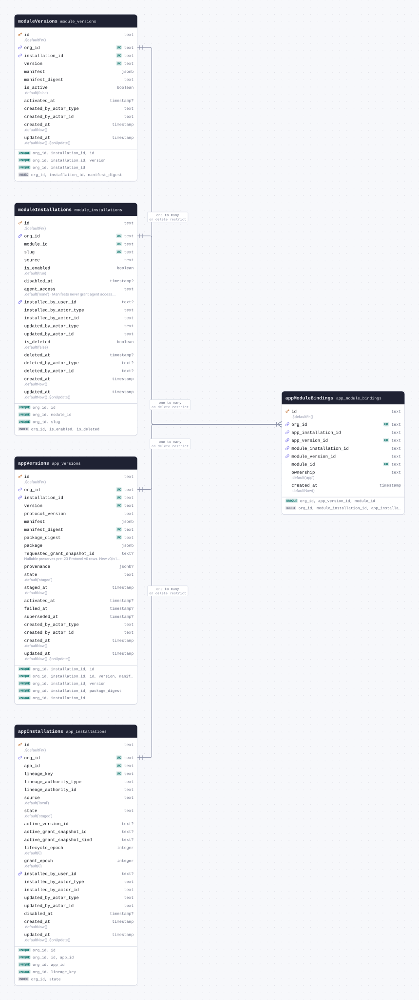

| Column                   | Type        | Constraints                                                   | Default           | Description |
| ------------------------ | ----------- | ------------------------------------------------------------- | ----------------- | ----------- |
| `id`                     | `text`      | PK NOT NULL                                                   | `.$defaultFn()`   |             |
| `org_id`                 | `text`      | NOT NULL → [appInstallations.org_id](#table-appInstallations) |                   |             |
| `app_installation_id`    | `text`      | NOT NULL                                                      |                   |             |
| `app_version_id`         | `text`      | NOT NULL                                                      |                   |             |
| `module_installation_id` | `text`      | NOT NULL                                                      |                   |             |
| `module_version_id`      | `text`      | NOT NULL                                                      |                   |             |
| `module_id`              | `text`      | NOT NULL                                                      |                   |             |
| `ownership`              | `text`      | NOT NULL                                                      | `.default('app')` |             |
| `created_at`             | `timestamp` | NOT NULL                                                      | `.defaultNow()`   |             |

#### Definition

```sql
CREATE TABLE "app_module_bindings" (
	"id" text PRIMARY KEY,
	"org_id" text NOT NULL,
	"app_installation_id" text NOT NULL,
	"app_version_id" text NOT NULL,
	"module_installation_id" text NOT NULL,
	"module_version_id" text NOT NULL,
	"module_id" text NOT NULL,
	"ownership" text DEFAULT 'app' NOT NULL,
	"created_at" timestamp DEFAULT now() NOT NULL,
	CONSTRAINT "app_module_bindings_ownership_check" CHECK ("ownership" = 'app')
);

CREATE UNIQUE INDEX "app_module_bindings_app_module_unique" ON "app_module_bindings" ("org_id","app_version_id","module_id");

CREATE INDEX "app_module_bindings_owner_idx" ON "app_module_bindings" ("org_id","module_installation_id","app_installation_id");

ALTER TABLE "app_module_bindings" ADD CONSTRAINT "app_module_bindings_app_installation_fk" FOREIGN KEY ("org_id","app_installation_id") REFERENCES "app_installations"("org_id","id") ON DELETE RESTRICT;

ALTER TABLE "app_module_bindings" ADD CONSTRAINT "app_module_bindings_app_version_fk" FOREIGN KEY ("org_id","app_installation_id","app_version_id") REFERENCES "app_versions"("org_id","installation_id","id") ON DELETE RESTRICT;

ALTER TABLE "app_module_bindings" ADD CONSTRAINT "app_module_bindings_module_installation_fk" FOREIGN KEY ("org_id","module_installation_id") REFERENCES "module_installations"("org_id","id") ON DELETE RESTRICT;

ALTER TABLE "app_module_bindings" ADD CONSTRAINT "app_module_bindings_module_version_fk" FOREIGN KEY ("org_id","module_installation_id","module_version_id") REFERENCES "module_versions"("org_id","installation_id","id") ON DELETE RESTRICT;
```

#### Indexes

- UNIQUE `org_id`, `app_version_id`, `module_id`
- INDEX `org_id`, `module_installation_id`, `app_installation_id`

#### References

- `org_id` → [appInstallations.org_id](#table-appInstallations) (many to one, on delete restrict)
- `org_id` → [appVersions.org_id](#table-appVersions) (many to one, on delete restrict)
- `org_id` → [moduleInstallations.org_id](#table-moduleInstallations) (many to one, on delete restrict)
- `org_id` → [moduleVersions.org_id](#table-moduleVersions) (many to one, on delete restrict)

<details>
<summary>Queries and their SQL</summary>

**Select**: Every row of appModuleBindings.

```ts
db.select().from(appModuleBindings);
```

```sql
select "id", "org_id", "app_installation_id", "app_version_id", "module_installation_id", "module_version_id", "module_id", "ownership", "created_at"
from "app_module_bindings"
```

**Count**: How many rows appModuleBindings has.

```ts
db.select({ count: count() }).from(appModuleBindings);
```

```sql
select count(*)
from "app_module_bindings"
```

**Find many**: The rows of appModuleBindings, through the relational query API.

```ts
db.query.appModuleBindings.findMany();
```

```sql
select "d0"."id" as "id", "d0"."org_id" as "org_id", "d0"."app_installation_id" as "app_installation_id", "d0"."app_version_id" as "app_version_id", "d0"."module_installation_id" as "module_installation_id", "d0"."module_version_id" as "module_version_id", "d0"."module_id" as "module_id", "d0"."ownership" as "ownership", "d0"."created_at" as "created_at"
from "app_module_bindings" as "d0"
```

**Find by primary key**: One row of appModuleBindings, through the relational query API.

```ts
db.query.appModuleBindings.findFirst({ where: { id: "id" } });
```

```sql
select "d0"."id" as "id", "d0"."org_id" as "org_id", "d0"."app_installation_id" as "app_installation_id", "d0"."app_version_id" as "app_version_id", "d0"."module_installation_id" as "module_installation_id", "d0"."module_version_id" as "module_version_id", "d0"."module_id" as "module_id", "d0"."ownership" as "ownership", "d0"."created_at" as "created_at"
from "app_module_bindings" as "d0"
where "d0"."id" = $1
limit $2
-- params: ["id",1]
```

**Insert**: Adds a row to appModuleBindings, giving the columns that have no default.

```ts
db.insert(appModuleBindings).values({
  org_id: "org_id",
  app_installation_id: "app_installation_id",
  app_version_id: "app_version_id",
  module_installation_id: "module_installation_id",
  module_version_id: "module_version_id",
  module_id: "module_id",
});
```

```sql
insert into "app_module_bindings" ("id", "org_id", "app_installation_id", "app_version_id", "module_installation_id", "module_version_id", "module_id", "ownership", "created_at")
values ($1, $2, $3, $4, $5, $6, $7, default, default)
-- params: ["00000000-0000-4000-8000-000000000000","org_id","app_installation_id","app_version_id","module_installation_id","module_version_id","module_id"]
```

**Update**: Changes a row of appModuleBindings, found by its primary key.

```ts
db.update(appModuleBindings).set({ org_id: "org_id" }).where(eq(appModuleBindings.id, "id"));
```

```sql
update "app_module_bindings"
set "org_id" = $1
where "app_module_bindings"."id" = $2
-- params: ["org_id","id"]
```

**Delete**: Deletes a row of appModuleBindings, found by its primary key.

```ts
db.delete(appModuleBindings).where(eq(appModuleBindings.id, "id"));
```

```sql
delete from "app_module_bindings"
where "app_module_bindings"."id" = $1
-- params: ["id"]
```

</details>

<a id="table-appGrantSnapshots"></a>

### appGrantSnapshots

Table `app_grant_snapshots`. Immutable requested/effective authority snapshots. Staging writes only a requested row. Effective rows, dependency locks, provider bindings, and the active pointer remain absent until explicit review in the next lifecycle loop.

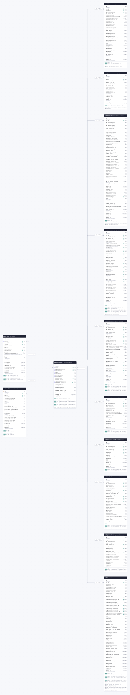

| Column                   | Type        | Constraints                                                   | Default         | Description                                                                                                                                                                                                                     |
| ------------------------ | ----------- | ------------------------------------------------------------- | --------------- | ------------------------------------------------------------------------------------------------------------------------------------------------------------------------------------------------------------------------------- |
| `id`                     | `text`      | PK NOT NULL                                                   | `.$defaultFn()` |                                                                                                                                                                                                                                 |
| `org_id`                 | `text`      | NOT NULL → [appInstallations.org_id](#table-appInstallations) |                 |                                                                                                                                                                                                                                 |
| `app_installation_id`    | `text`      | NOT NULL                                                      |                 |                                                                                                                                                                                                                                 |
| `app_version_id`         | `text`      | NOT NULL                                                      |                 |                                                                                                                                                                                                                                 |
| `app_id`                 | `text`      | NOT NULL                                                      |                 |                                                                                                                                                                                                                                 |
| `app_version`            | `text`      | NOT NULL                                                      |                 |                                                                                                                                                                                                                                 |
| `manifest_digest`        | `text`      | NOT NULL                                                      |                 |                                                                                                                                                                                                                                 |
| `package_digest`         | `text`      | NOT NULL                                                      |                 |                                                                                                                                                                                                                                 |
| `snapshot_kind`          | `text`      | NOT NULL                                                      |                 |                                                                                                                                                                                                                                 |
| `snapshot_version`       | `text`      | NOT NULL                                                      |                 |                                                                                                                                                                                                                                 |
| `requested_snapshot_id`  | `text`      | NULL                                                          |                 |                                                                                                                                                                                                                                 |
| `supersedes_snapshot_id` | `text`      | NULL                                                          |                 |                                                                                                                                                                                                                                 |
| `resource_rights`        | `jsonb`     | NOT NULL                                                      |                 |                                                                                                                                                                                                                                 |
| `classification`         | `jsonb`     | NOT NULL                                                      |                 |                                                                                                                                                                                                                                 |
| `canonical_snapshot`     | `jsonb`     | NOT NULL                                                      |                 |                                                                                                                                                                                                                                 |
| `snapshot_digest`        | `text`      | NOT NULL                                                      |                 |                                                                                                                                                                                                                                 |
| `reviewed_by_actor_type` | `text`      | NULL                                                          |                 |                                                                                                                                                                                                                                 |
| `reviewed_by_actor_id`   | `text`      | NULL                                                          |                 | The upgrade trigger verifies this human is an active owner/admin in org_id at insert time. It remains an immutable historical actor snapshot rather than an FK that would prevent a former reviewer from leaving the workspace. |
| `reviewed_at`            | `timestamp` | NULL                                                          |                 |                                                                                                                                                                                                                                 |
| `created_at`             | `timestamp` | NOT NULL                                                      | `.defaultNow()` |                                                                                                                                                                                                                                 |

#### Definition

```sql
CREATE TABLE "app_grant_snapshots" (
	"id" text PRIMARY KEY,
	"org_id" text NOT NULL,
	"app_installation_id" text NOT NULL,
	"app_version_id" text NOT NULL,
	"app_id" text NOT NULL,
	"app_version" text NOT NULL,
	"manifest_digest" text NOT NULL,
	"package_digest" text NOT NULL,
	"snapshot_kind" text NOT NULL,
	"snapshot_version" text NOT NULL,
	"requested_snapshot_id" text,
	"supersedes_snapshot_id" text,
	"resource_rights" jsonb NOT NULL,
	"classification" jsonb NOT NULL,
	"canonical_snapshot" jsonb NOT NULL,
	"snapshot_digest" text NOT NULL,
	"reviewed_by_actor_type" text,
	"reviewed_by_actor_id" text,
	"reviewed_at" timestamp,
	"created_at" timestamp DEFAULT now() NOT NULL,
	CONSTRAINT "app_grant_snapshots_org_installation_id_unique" UNIQUE("org_id","app_installation_id","id"),
	CONSTRAINT "app_grant_snapshots_org_version_id_unique" UNIQUE("org_id","app_installation_id","app_version_id","id"),
	CONSTRAINT "app_grant_snapshots_org_version_kind_id_unique" UNIQUE("org_id","app_installation_id","app_version_id","id","snapshot_kind"),
	CONSTRAINT "app_grant_snapshots_kind_check" CHECK ("snapshot_kind" IN ('requested', 'effective')),
	CONSTRAINT "app_grant_snapshots_version_check" CHECK ("snapshot_version" = 'deft.app_grant_snapshot.v1'),
	CONSTRAINT "app_grant_snapshots_app_id_check" CHECK (
    "app_id" ~ '^[a-z][a-z0-9]*(-[a-z0-9]+)*(\.[a-z][a-z0-9]*(-[a-z0-9]+)*)+$'
  ),
	CONSTRAINT "app_grant_snapshots_digest_check" CHECK (
    "manifest_digest" ~ '^sha256:[a-f0-9]{64}$'
    AND "package_digest" ~ '^sha256:[a-f0-9]{64}$'
    AND "snapshot_digest" ~ '^sha256:[a-f0-9]{64}$'
  ),
	CONSTRAINT "app_grant_snapshots_json_check" CHECK (
    jsonb_typeof("resource_rights") = 'array'
    AND jsonb_typeof("classification") = 'object'
    AND jsonb_typeof("canonical_snapshot") = 'object'
  ),
	CONSTRAINT "app_grant_snapshots_json_size_check" CHECK (
    octet_length("resource_rights"::text) <= 65536
    AND octet_length("classification"::text) <= 32768
    AND octet_length("canonical_snapshot"::text) <= 262144
  ),
	CONSTRAINT "app_grant_snapshots_review_shape_check" CHECK (
    (
      "snapshot_kind" = 'requested'
      AND "requested_snapshot_id" IS NULL
      AND "supersedes_snapshot_id" IS NULL
      AND "reviewed_by_actor_type" IS NULL
      AND "reviewed_by_actor_id" IS NULL
      AND "reviewed_at" IS NULL
    ) OR (
      "snapshot_kind" = 'effective'
      AND "requested_snapshot_id" IS NOT NULL
      AND "reviewed_by_actor_type" = 'human'
      AND "reviewed_by_actor_id" IS NOT NULL
      AND "reviewed_at" IS NOT NULL
    )
  ),
	CONSTRAINT "app_grant_snapshots_supersedes_self_check" CHECK (
    "supersedes_snapshot_id" IS NULL OR "supersedes_snapshot_id" <> "id"
  )
);

CREATE UNIQUE INDEX "app_grant_snapshots_one_requested_unique" ON "app_grant_snapshots" ("org_id","app_version_id") WHERE "snapshot_kind" = 'requested';

CREATE UNIQUE INDEX "app_grant_snapshots_one_successor_unique" ON "app_grant_snapshots" ("org_id","app_installation_id","supersedes_snapshot_id") WHERE "supersedes_snapshot_id" IS NOT NULL;

CREATE UNIQUE INDEX "app_grant_snapshots_one_root_unique" ON "app_grant_snapshots" ("org_id","app_installation_id") WHERE "snapshot_kind" = 'effective' AND "supersedes_snapshot_id" IS NULL;

CREATE INDEX "app_grant_snapshots_app_version_idx" ON "app_grant_snapshots" ("org_id","app_installation_id","app_version_id","created_at");

ALTER TABLE "app_grant_snapshots" ADD CONSTRAINT "app_grant_snapshots_app_installation_fk" FOREIGN KEY ("org_id","app_installation_id","app_id") REFERENCES "app_installations"("org_id","id","app_id") ON DELETE RESTRICT;

ALTER TABLE "app_grant_snapshots" ADD CONSTRAINT "app_grant_snapshots_app_version_fk" FOREIGN KEY ("org_id","app_installation_id","app_version_id","app_version","manifest_digest","package_digest") REFERENCES "app_versions"("org_id","installation_id","id","version","manifest_digest","package_digest") ON DELETE RESTRICT;

ALTER TABLE "app_grant_snapshots" ADD CONSTRAINT "app_grant_snapshots_requested_snapshot_fk" FOREIGN KEY ("org_id","app_installation_id","app_version_id","requested_snapshot_id") REFERENCES "app_grant_snapshots"("org_id","app_installation_id","app_version_id","id") ON DELETE RESTRICT;

ALTER TABLE "app_grant_snapshots" ADD CONSTRAINT "app_grant_snapshots_supersedes_snapshot_fk" FOREIGN KEY ("org_id","app_installation_id","supersedes_snapshot_id") REFERENCES "app_grant_snapshots"("org_id","app_installation_id","id") ON DELETE RESTRICT;
```

#### Indexes

- UNIQUE `org_id`, `app_installation_id`, `id`
- UNIQUE `org_id`, `app_installation_id`, `app_version_id`, `id`
- UNIQUE `org_id`, `app_installation_id`, `app_version_id`, `id`, `snapshot_kind`
- UNIQUE `org_id`, `app_version_id`
- UNIQUE `org_id`, `app_installation_id`, `supersedes_snapshot_id`
- UNIQUE `org_id`, `app_installation_id`
- INDEX `org_id`, `app_installation_id`, `app_version_id`, `created_at`

#### References

- `org_id` → [appInstallations.org_id](#table-appInstallations) (many to one, on delete restrict)
- `org_id` → [appVersions.org_id](#table-appVersions) (many to one, on delete restrict)
- `org_id` → [appGrantSnapshots.org_id](#table-appGrantSnapshots) (many to one, on delete restrict)
- `org_id` → [appGrantSnapshots.org_id](#table-appGrantSnapshots) (one to one, on delete restrict)

#### Referenced by

- `org_id` → [appRuns.org_id](#table-appRuns) (one to many, on delete cascade)
- `org_id` → [appGrantSnapshots.org_id](#table-appGrantSnapshots) (one to many, on delete restrict)
- `org_id` → [appGrantSnapshots.org_id](#table-appGrantSnapshots) (one to one, on delete restrict)
- `org_id` → [appDependencyLocks.org_id](#table-appDependencyLocks) (one to many, on delete restrict)
- `org_id` → [appActionBindings.org_id](#table-appActionBindings) (one to many, on delete restrict)
- `org_id` → [appOwnerConnectionAdmissions.org_id](#table-appOwnerConnectionAdmissions) (one to many, on delete restrict)
- `org_id` → [appRuntimeRegistrations.org_id](#table-appRuntimeRegistrations) (one to many, on delete restrict)
- `org_id` → [appNativeBindings.org_id](#table-appNativeBindings) (one to many, on delete restrict)
- `org_id` → [appResourceBindings.org_id](#table-appResourceBindings) (one to many, on delete restrict)
- `org_id` → [appAutomationDefinitions.org_id](#table-appAutomationDefinitions) (one to many, on delete restrict)
- `org_id` → [appExperienceSessions.org_id](#table-appExperienceSessions) (one to many, on delete restrict)
- `org_id` → [appPublicEndpoints.org_id](#table-appPublicEndpoints) (one to many, on delete restrict)

<details>
<summary>Queries and their SQL</summary>

**Select**: Every row of appGrantSnapshots.

```ts
db.select().from(appGrantSnapshots);
```

```sql
select "id", "org_id", "app_installation_id", "app_version_id", "app_id", "app_version", "manifest_digest", "package_digest", "snapshot_kind", "snapshot_version", "requested_snapshot_id", "supersedes_snapshot_id", "resource_rights", "classification", "canonical_snapshot", "snapshot_digest", "reviewed_by_actor_type", "reviewed_by_actor_id", "reviewed_at", "created_at"
from "app_grant_snapshots"
```

**Count**: How many rows appGrantSnapshots has.

```ts
db.select({ count: count() }).from(appGrantSnapshots);
```

```sql
select count(*)
from "app_grant_snapshots"
```

**Find many**: The rows of appGrantSnapshots, through the relational query API.

```ts
db.query.appGrantSnapshots.findMany();
```

```sql
select "d0"."id" as "id", "d0"."org_id" as "org_id", "d0"."app_installation_id" as "app_installation_id", "d0"."app_version_id" as "app_version_id", "d0"."app_id" as "app_id", "d0"."app_version" as "app_version", "d0"."manifest_digest" as "manifest_digest", "d0"."package_digest" as "package_digest", "d0"."snapshot_kind" as "snapshot_kind", "d0"."snapshot_version" as "snapshot_version", "d0"."requested_snapshot_id" as "requested_snapshot_id", "d0"."supersedes_snapshot_id" as "supersedes_snapshot_id", "d0"."resource_rights" as "resource_rights", "d0"."classification" as "classification", "d0"."canonical_snapshot" as "canonical_snapshot", "d0"."snapshot_digest" as "snapshot_digest", "d0"."reviewed_by_actor_type" as "reviewed_by_actor_type", "d0"."reviewed_by_actor_id" as "reviewed_by_actor_id", "d0"."reviewed_at" as "reviewed_at", "d0"."created_at" as "created_at"
from "app_grant_snapshots" as "d0"
```

**Find by primary key**: One row of appGrantSnapshots, through the relational query API.

```ts
db.query.appGrantSnapshots.findFirst({ where: { id: "id" } });
```

```sql
select "d0"."id" as "id", "d0"."org_id" as "org_id", "d0"."app_installation_id" as "app_installation_id", "d0"."app_version_id" as "app_version_id", "d0"."app_id" as "app_id", "d0"."app_version" as "app_version", "d0"."manifest_digest" as "manifest_digest", "d0"."package_digest" as "package_digest", "d0"."snapshot_kind" as "snapshot_kind", "d0"."snapshot_version" as "snapshot_version", "d0"."requested_snapshot_id" as "requested_snapshot_id", "d0"."supersedes_snapshot_id" as "supersedes_snapshot_id", "d0"."resource_rights" as "resource_rights", "d0"."classification" as "classification", "d0"."canonical_snapshot" as "canonical_snapshot", "d0"."snapshot_digest" as "snapshot_digest", "d0"."reviewed_by_actor_type" as "reviewed_by_actor_type", "d0"."reviewed_by_actor_id" as "reviewed_by_actor_id", "d0"."reviewed_at" as "reviewed_at", "d0"."created_at" as "created_at"
from "app_grant_snapshots" as "d0"
where "d0"."id" = $1
limit $2
-- params: ["id",1]
```

**Insert**: Adds a row to appGrantSnapshots, giving the columns that have no default.

```ts
db.insert(appGrantSnapshots).values({
  org_id: "org_id",
  app_installation_id: "app_installation_id",
  app_version_id: "app_version_id",
  app_id: "app_id",
  app_version: "app_version",
  manifest_digest: "manifest_digest",
  package_digest: "package_digest",
  snapshot_kind: "snapshot_kind",
  snapshot_version: "snapshot_version",
  resource_rights: {},
  classification: {},
  canonical_snapshot: {},
  snapshot_digest: "snapshot_digest",
});
```

```sql
insert into "app_grant_snapshots" ("id", "org_id", "app_installation_id", "app_version_id", "app_id", "app_version", "manifest_digest", "package_digest", "snapshot_kind", "snapshot_version", "requested_snapshot_id", "supersedes_snapshot_id", "resource_rights", "classification", "canonical_snapshot", "snapshot_digest", "reviewed_by_actor_type", "reviewed_by_actor_id", "reviewed_at", "created_at")
values ($1, $2, $3, $4, $5, $6, $7, $8, $9, $10, default, default, $11, $12, $13, $14, default, default, default, default)
-- params: ["00000000-0000-4000-8000-000000000000","org_id","app_installation_id","app_version_id","app_id","app_version","manifest_digest","package_digest","snapshot_kind","snapshot_version",{},{},{},"snapshot_digest"]
```

**Update**: Changes a row of appGrantSnapshots, found by its primary key.

```ts
db.update(appGrantSnapshots).set({ org_id: "org_id" }).where(eq(appGrantSnapshots.id, "id"));
```

```sql
update "app_grant_snapshots"
set "org_id" = $1
where "app_grant_snapshots"."id" = $2
-- params: ["org_id","id"]
```

**Delete**: Deletes a row of appGrantSnapshots, found by its primary key.

```ts
db.delete(appGrantSnapshots).where(eq(appGrantSnapshots.id, "id"));
```

```sql
delete from "app_grant_snapshots"
where "app_grant_snapshots"."id" = $1
-- params: ["id"]
```

</details>

<a id="table-appDependencyLocks"></a>

### appDependencyLocks

Table `app_dependency_locks`.

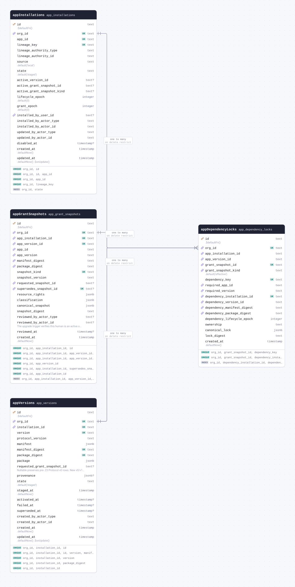

| Column                       | Type        | Constraints                                         | Default                 | Description |
| ---------------------------- | ----------- | --------------------------------------------------- | ----------------------- | ----------- |
| `id`                         | `text`      | PK NOT NULL                                         | `.$defaultFn()`         |             |
| `org_id`                     | `text`      | NOT NULL → [appVersions.org_id](#table-appVersions) |                         |             |
| `app_installation_id`        | `text`      | NOT NULL                                            |                         |             |
| `app_version_id`             | `text`      | NOT NULL                                            |                         |             |
| `grant_snapshot_id`          | `text`      | NOT NULL                                            |                         |             |
| `grant_snapshot_kind`        | `text`      | NOT NULL                                            | `.default('effective')` |             |
| `dependency_key`             | `text`      | NOT NULL                                            |                         |             |
| `required_app_id`            | `text`      | NOT NULL                                            |                         |             |
| `required_version`           | `text`      | NOT NULL                                            |                         |             |
| `dependency_installation_id` | `text`      | NOT NULL                                            |                         |             |
| `dependency_version_id`      | `text`      | NOT NULL                                            |                         |             |
| `dependency_manifest_digest` | `text`      | NOT NULL                                            |                         |             |
| `dependency_package_digest`  | `text`      | NOT NULL                                            |                         |             |
| `dependency_lifecycle_epoch` | `integer`   | NOT NULL                                            |                         |             |
| `ownership`                  | `text`      | NOT NULL                                            |                         |             |
| `canonical_lock`             | `jsonb`     | NOT NULL                                            |                         |             |
| `lock_digest`                | `text`      | NOT NULL                                            |                         |             |
| `created_at`                 | `timestamp` | NOT NULL                                            | `.defaultNow()`         |             |

#### Definition

```sql
CREATE TABLE "app_dependency_locks" (
	"id" text PRIMARY KEY,
	"org_id" text NOT NULL,
	"app_installation_id" text NOT NULL,
	"app_version_id" text NOT NULL,
	"grant_snapshot_id" text NOT NULL,
	"grant_snapshot_kind" text DEFAULT 'effective' NOT NULL,
	"dependency_key" text NOT NULL,
	"required_app_id" text NOT NULL,
	"required_version" text NOT NULL,
	"dependency_installation_id" text NOT NULL,
	"dependency_version_id" text NOT NULL,
	"dependency_manifest_digest" text NOT NULL,
	"dependency_package_digest" text NOT NULL,
	"dependency_lifecycle_epoch" integer NOT NULL,
	"ownership" text NOT NULL,
	"canonical_lock" jsonb NOT NULL,
	"lock_digest" text NOT NULL,
	"created_at" timestamp DEFAULT now() NOT NULL,
	CONSTRAINT "app_dependency_locks_key_check" CHECK (
    "dependency_key" ~ '^[a-z][a-z0-9_]{0,47}$'
    AND "dependency_key" !~ '^(deft|core|system)(_|$)'
  ),
	CONSTRAINT "app_dependency_locks_app_id_check" CHECK (
    "required_app_id" ~ '^[a-z][a-z0-9]*(-[a-z0-9]+)*(\.[a-z][a-z0-9]*(-[a-z0-9]+)*)+$'
  ),
	CONSTRAINT "app_dependency_locks_self_check" CHECK ("dependency_installation_id" <> "app_installation_id"),
	CONSTRAINT "app_dependency_locks_epoch_check" CHECK ("dependency_lifecycle_epoch" >= 0),
	CONSTRAINT "app_dependency_locks_ownership_check" CHECK (
    "ownership" = 'preexisting'
  ),
	CONSTRAINT "app_dependency_locks_grant_kind_check" CHECK ("grant_snapshot_kind" = 'effective'),
	CONSTRAINT "app_dependency_locks_digest_check" CHECK (
    "dependency_manifest_digest" ~ '^sha256:[a-f0-9]{64}$'
    AND "dependency_package_digest" ~ '^sha256:[a-f0-9]{64}$'
    AND "lock_digest" ~ '^sha256:[a-f0-9]{64}$'
  ),
	CONSTRAINT "app_dependency_locks_json_check" CHECK (
    jsonb_typeof("canonical_lock") = 'object'
    AND octet_length("canonical_lock"::text) <= 65536
  )
);

CREATE UNIQUE INDEX "app_dependency_locks_grant_key_unique" ON "app_dependency_locks" ("org_id","grant_snapshot_id","dependency_key");

CREATE UNIQUE INDEX "app_dependency_locks_grant_installation_unique" ON "app_dependency_locks" ("org_id","grant_snapshot_id","dependency_installation_id");

CREATE INDEX "app_dependency_locks_dependency_idx" ON "app_dependency_locks" ("org_id","dependency_installation_id","dependency_version_id");

ALTER TABLE "app_dependency_locks" ADD CONSTRAINT "app_dependency_locks_app_version_fk" FOREIGN KEY ("org_id","app_installation_id","app_version_id") REFERENCES "app_versions"("org_id","installation_id","id") ON DELETE RESTRICT;

ALTER TABLE "app_dependency_locks" ADD CONSTRAINT "app_dependency_locks_grant_snapshot_fk" FOREIGN KEY ("org_id","app_installation_id","app_version_id","grant_snapshot_id","grant_snapshot_kind") REFERENCES "app_grant_snapshots"("org_id","app_installation_id","app_version_id","id","snapshot_kind") ON DELETE RESTRICT;

ALTER TABLE "app_dependency_locks" ADD CONSTRAINT "app_dependency_locks_dependency_app_fk" FOREIGN KEY ("org_id","dependency_installation_id","required_app_id") REFERENCES "app_installations"("org_id","id","app_id") ON DELETE RESTRICT;

ALTER TABLE "app_dependency_locks" ADD CONSTRAINT "app_dependency_locks_dependency_version_fk" FOREIGN KEY ("org_id","dependency_installation_id","dependency_version_id","required_version","dependency_manifest_digest","dependency_package_digest") REFERENCES "app_versions"("org_id","installation_id","id","version","manifest_digest","package_digest") ON DELETE RESTRICT;
```

#### Indexes

- UNIQUE `org_id`, `grant_snapshot_id`, `dependency_key`
- UNIQUE `org_id`, `grant_snapshot_id`, `dependency_installation_id`
- INDEX `org_id`, `dependency_installation_id`, `dependency_version_id`

#### References

- `org_id` → [appVersions.org_id](#table-appVersions) (many to one, on delete restrict)
- `org_id` → [appGrantSnapshots.org_id](#table-appGrantSnapshots) (many to one, on delete restrict)
- `org_id` → [appInstallations.org_id](#table-appInstallations) (many to one, on delete restrict)
- `org_id` → [appVersions.org_id](#table-appVersions) (many to one, on delete restrict)

<details>
<summary>Queries and their SQL</summary>

**Select**: Every row of appDependencyLocks.

```ts
db.select().from(appDependencyLocks);
```

```sql
select "id", "org_id", "app_installation_id", "app_version_id", "grant_snapshot_id", "grant_snapshot_kind", "dependency_key", "required_app_id", "required_version", "dependency_installation_id", "dependency_version_id", "dependency_manifest_digest", "dependency_package_digest", "dependency_lifecycle_epoch", "ownership", "canonical_lock", "lock_digest", "created_at"
from "app_dependency_locks"
```

**Count**: How many rows appDependencyLocks has.

```ts
db.select({ count: count() }).from(appDependencyLocks);
```

```sql
select count(*)
from "app_dependency_locks"
```

**Find many**: The rows of appDependencyLocks, through the relational query API.

```ts
db.query.appDependencyLocks.findMany();
```

```sql
select "d0"."id" as "id", "d0"."org_id" as "org_id", "d0"."app_installation_id" as "app_installation_id", "d0"."app_version_id" as "app_version_id", "d0"."grant_snapshot_id" as "grant_snapshot_id", "d0"."grant_snapshot_kind" as "grant_snapshot_kind", "d0"."dependency_key" as "dependency_key", "d0"."required_app_id" as "required_app_id", "d0"."required_version" as "required_version", "d0"."dependency_installation_id" as "dependency_installation_id", "d0"."dependency_version_id" as "dependency_version_id", "d0"."dependency_manifest_digest" as "dependency_manifest_digest", "d0"."dependency_package_digest" as "dependency_package_digest", "d0"."dependency_lifecycle_epoch" as "dependency_lifecycle_epoch", "d0"."ownership" as "ownership", "d0"."canonical_lock" as "canonical_lock", "d0"."lock_digest" as "lock_digest", "d0"."created_at" as "created_at"
from "app_dependency_locks" as "d0"
```

**Find by primary key**: One row of appDependencyLocks, through the relational query API.

```ts
db.query.appDependencyLocks.findFirst({ where: { id: "id" } });
```

```sql
select "d0"."id" as "id", "d0"."org_id" as "org_id", "d0"."app_installation_id" as "app_installation_id", "d0"."app_version_id" as "app_version_id", "d0"."grant_snapshot_id" as "grant_snapshot_id", "d0"."grant_snapshot_kind" as "grant_snapshot_kind", "d0"."dependency_key" as "dependency_key", "d0"."required_app_id" as "required_app_id", "d0"."required_version" as "required_version", "d0"."dependency_installation_id" as "dependency_installation_id", "d0"."dependency_version_id" as "dependency_version_id", "d0"."dependency_manifest_digest" as "dependency_manifest_digest", "d0"."dependency_package_digest" as "dependency_package_digest", "d0"."dependency_lifecycle_epoch" as "dependency_lifecycle_epoch", "d0"."ownership" as "ownership", "d0"."canonical_lock" as "canonical_lock", "d0"."lock_digest" as "lock_digest", "d0"."created_at" as "created_at"
from "app_dependency_locks" as "d0"
where "d0"."id" = $1
limit $2
-- params: ["id",1]
```

**Insert**: Adds a row to appDependencyLocks, giving the columns that have no default.

```ts
db.insert(appDependencyLocks).values({
  org_id: "org_id",
  app_installation_id: "app_installation_id",
  app_version_id: "app_version_id",
  grant_snapshot_id: "grant_snapshot_id",
  dependency_key: "dependency_key",
  required_app_id: "required_app_id",
  required_version: "required_version",
  dependency_installation_id: "dependency_installation_id",
  dependency_version_id: "dependency_version_id",
  dependency_manifest_digest: "dependency_manifest_digest",
  dependency_package_digest: "dependency_package_digest",
  dependency_lifecycle_epoch: 1,
  ownership: "ownership",
  canonical_lock: {},
  lock_digest: "lock_digest",
});
```

```sql
insert into "app_dependency_locks" ("id", "org_id", "app_installation_id", "app_version_id", "grant_snapshot_id", "grant_snapshot_kind", "dependency_key", "required_app_id", "required_version", "dependency_installation_id", "dependency_version_id", "dependency_manifest_digest", "dependency_package_digest", "dependency_lifecycle_epoch", "ownership", "canonical_lock", "lock_digest", "created_at")
values ($1, $2, $3, $4, $5, default, $6, $7, $8, $9, $10, $11, $12, $13, $14, $15, $16, default)
-- params: ["00000000-0000-4000-8000-000000000000","org_id","app_installation_id","app_version_id","grant_snapshot_id","dependency_key","required_app_id","required_version","dependency_installation_id","dependency_version_id","dependency_manifest_digest","dependency_package_digest",1,"ownership",{},"lock_digest"]
```

**Update**: Changes a row of appDependencyLocks, found by its primary key.

```ts
db.update(appDependencyLocks).set({ org_id: "org_id" }).where(eq(appDependencyLocks.id, "id"));
```

```sql
update "app_dependency_locks"
set "org_id" = $1
where "app_dependency_locks"."id" = $2
-- params: ["org_id","id"]
```

**Delete**: Deletes a row of appDependencyLocks, found by its primary key.

```ts
db.delete(appDependencyLocks).where(eq(appDependencyLocks.id, "id"));
```

```sql
delete from "app_dependency_locks"
where "app_dependency_locks"."id" = $1
-- params: ["id"]
```

</details>

<a id="table-appActionBindings"></a>

### appActionBindings

Table `app_action_bindings`.


| Column                              | Type        | Constraints                                         | Default                 | Description |
| ----------------------------------- | ----------- | --------------------------------------------------- | ----------------------- | ----------- |
| `id`                                | `text`      | PK NOT NULL                                         | `.$defaultFn()`         |             |
| `org_id`                            | `text`      | NOT NULL → [appVersions.org_id](#table-appVersions) |                         |             |
| `app_installation_id`               | `text`      | NOT NULL                                            |                         |             |
| `app_version_id`                    | `text`      | NOT NULL                                            |                         |             |
| `grant_snapshot_id`                 | `text`      | NOT NULL                                            |                         |             |
| `grant_snapshot_kind`               | `text`      | NOT NULL                                            | `.default('effective')` |             |
| `action_key`                        | `text`      | NOT NULL                                            |                         |             |
| `capability_requirement_key`        | `text`      | NOT NULL                                            |                         |             |
| `connector_requirement_key`         | `text`      | NOT NULL                                            |                         |             |
| `interface_identity`                | `text`      | NOT NULL                                            |                         |             |
| `provider_kind`                     | `text`      | NOT NULL                                            |                         |             |
| `mcp_connection_id`                 | `text`      | NOT NULL                                            |                         |             |
| `provider_snapshot_id`              | `text`      | NOT NULL                                            |                         |             |
| `operation_name`                    | `text`      | NOT NULL                                            |                         |             |
| `operation_schema_digest`           | `text`      | NOT NULL                                            |                         |             |
| `connector_authorization_version`   | `integer`   | NOT NULL                                            |                         |             |
| `risk_class`                        | `text`      | NOT NULL                                            |                         |             |
| `review_requirement`                | `text`      | NOT NULL                                            |                         |             |
| `review_scope`                      | `text`      | NOT NULL                                            |                         |             |
| `egress_class`                      | `text`      | NOT NULL                                            |                         |             |
| `retry_class`                       | `text`      | NOT NULL                                            |                         |             |
| `retention_class`                   | `text`      | NOT NULL                                            |                         |             |
| `automation_eligibility`            | `text`      | NOT NULL                                            |                         |             |
| `provider_idempotency_key_required` | `boolean`   | NOT NULL                                            |                         |             |
| `canonical_binding`                 | `jsonb`     | NOT NULL                                            |                         |             |
| `binding_digest`                    | `text`      | NOT NULL                                            |                         |             |
| `created_at`                        | `timestamp` | NOT NULL                                            | `.defaultNow()`         |             |

#### Definition

```sql
CREATE TABLE "app_action_bindings" (
	"id" text PRIMARY KEY,
	"org_id" text NOT NULL,
	"app_installation_id" text NOT NULL,
	"app_version_id" text NOT NULL,
	"grant_snapshot_id" text NOT NULL,
	"grant_snapshot_kind" text DEFAULT 'effective' NOT NULL,
	"action_key" text NOT NULL,
	"capability_requirement_key" text NOT NULL,
	"connector_requirement_key" text NOT NULL,
	"interface_identity" text NOT NULL,
	"provider_kind" text NOT NULL,
	"mcp_connection_id" text NOT NULL,
	"provider_snapshot_id" text NOT NULL,
	"operation_name" text NOT NULL,
	"operation_schema_digest" text NOT NULL,
	"connector_authorization_version" integer NOT NULL,
	"risk_class" text NOT NULL,
	"review_requirement" text NOT NULL,
	"review_scope" text NOT NULL,
	"egress_class" text NOT NULL,
	"retry_class" text NOT NULL,
	"retention_class" text NOT NULL,
	"automation_eligibility" text NOT NULL,
	"provider_idempotency_key_required" boolean NOT NULL,
	"canonical_binding" jsonb NOT NULL,
	"binding_digest" text NOT NULL,
	"created_at" timestamp DEFAULT now() NOT NULL,
	CONSTRAINT "app_action_bindings_grant_action_unique" UNIQUE("org_id","grant_snapshot_id","action_key"),
	CONSTRAINT "app_action_bindings_automation_identity_unique" UNIQUE("org_id","app_installation_id","app_version_id","grant_snapshot_id","action_key","id"),
	CONSTRAINT "app_action_bindings_run_identity_unique" UNIQUE("org_id","app_installation_id","app_version_id","grant_snapshot_id","action_key","provider_kind","mcp_connection_id","operation_name","provider_snapshot_id"),
	CONSTRAINT "app_action_bindings_key_check" CHECK (
    "action_key" ~ '^[a-z][a-z0-9_]{0,47}$'
    AND "capability_requirement_key" ~ '^[a-z][a-z0-9_]{0,47}$'
    AND "connector_requirement_key" ~ '^[a-z][a-z0-9_]{0,47}$'
    AND "action_key" !~ '^(deft|core|system)(_|$)'
    AND "capability_requirement_key" !~ '^(deft|core|system)(_|$)'
    AND "connector_requirement_key" !~ '^(deft|core|system)(_|$)'
  ),
	CONSTRAINT "app_action_bindings_interface_check" CHECK (
    "interface_identity" =
      'deft.private.v1:' || lower("org_id") || ':' || lower("app_installation_id") ||
      ':sandbox_email_send:v1'
  ),
	CONSTRAINT "app_action_bindings_provider_check" CHECK ("provider_kind" = 'mcp'),
	CONSTRAINT "app_action_bindings_grant_kind_check" CHECK ("grant_snapshot_kind" = 'effective'),
	CONSTRAINT "app_action_bindings_policy_check" CHECK (
    "risk_class" = 'external_write'
    AND "review_requirement" = 'always'
    AND "review_scope" = 'per_invocation'
    AND "egress_class" = 'email'
    AND "retry_class" = 'idempotent_with_key'
    AND "retention_class" = 'standard'
    AND "automation_eligibility" = 'forbidden'
    AND "provider_idempotency_key_required" = true
    AND "connector_authorization_version" >= 1
  ),
	CONSTRAINT "app_action_bindings_operation_check" CHECK (
    octet_length("operation_name") BETWEEN 1 AND 512
    AND "operation_name" !~ '[[:cntrl:]]'
  ),
	CONSTRAINT "app_action_bindings_digest_check" CHECK (
    "operation_schema_digest" ~ '^sha256:[a-f0-9]{64}$'
    AND "binding_digest" ~ '^sha256:[a-f0-9]{64}$'
  ),
	CONSTRAINT "app_action_bindings_json_check" CHECK (
    jsonb_typeof("canonical_binding") = 'object'
    AND octet_length("canonical_binding"::text) <= 65536
  )
);

CREATE INDEX "app_action_bindings_provider_idx" ON "app_action_bindings" ("org_id","mcp_connection_id","provider_snapshot_id");

ALTER TABLE "app_action_bindings" ADD CONSTRAINT "app_action_bindings_app_version_fk" FOREIGN KEY ("org_id","app_installation_id","app_version_id") REFERENCES "app_versions"("org_id","installation_id","id") ON DELETE RESTRICT;

ALTER TABLE "app_action_bindings" ADD CONSTRAINT "app_action_bindings_grant_snapshot_fk" FOREIGN KEY ("org_id","app_installation_id","app_version_id","grant_snapshot_id","grant_snapshot_kind") REFERENCES "app_grant_snapshots"("org_id","app_installation_id","app_version_id","id","snapshot_kind") ON DELETE RESTRICT;

ALTER TABLE "app_action_bindings" ADD CONSTRAINT "app_action_bindings_mcp_connection_fk" FOREIGN KEY ("org_id","mcp_connection_id") REFERENCES "mcp_connections"("org_id","id") ON DELETE RESTRICT;

ALTER TABLE "app_action_bindings" ADD CONSTRAINT "app_action_bindings_provider_snapshot_fk" FOREIGN KEY ("org_id","provider_kind","mcp_connection_id","provider_snapshot_id") REFERENCES "capability_provider_snapshots"("org_id","provider_kind","provider_instance_id","id") ON DELETE RESTRICT;
```

#### Indexes

- UNIQUE `org_id`, `grant_snapshot_id`, `action_key`
- UNIQUE `org_id`, `app_installation_id`, `app_version_id`, `grant_snapshot_id`, `action_key`, `id`
- UNIQUE `org_id`, `app_installation_id`, `app_version_id`, `grant_snapshot_id`, `action_key`, `provider_kind`, `mcp_connection_id`, `operation_name`, `provider_snapshot_id`
- INDEX `org_id`, `mcp_connection_id`, `provider_snapshot_id`

#### References

- `org_id` → [appVersions.org_id](#table-appVersions) (many to one, on delete restrict)
- `org_id` → [appGrantSnapshots.org_id](#table-appGrantSnapshots) (many to one, on delete restrict)
- `org_id` → [mcpConnections.org_id](#table-mcpConnections) (many to one, on delete restrict)
- `org_id` → [capabilityProviderSnapshots.org_id](#table-capabilityProviderSnapshots) (many to one, on delete restrict)

#### Referenced by

- `org_id` → [appRuns.org_id](#table-appRuns) (one to many, on delete cascade)
- `org_id` → [appAutomationDefinitions.org_id](#table-appAutomationDefinitions) (one to many, on delete restrict)

<details>
<summary>Queries and their SQL</summary>

**Select**: Every row of appActionBindings.

```ts
db.select().from(appActionBindings);
```

```sql
select "id", "org_id", "app_installation_id", "app_version_id", "grant_snapshot_id", "grant_snapshot_kind", "action_key", "capability_requirement_key", "connector_requirement_key", "interface_identity", "provider_kind", "mcp_connection_id", "provider_snapshot_id", "operation_name", "operation_schema_digest", "connector_authorization_version", "risk_class", "review_requirement", "review_scope", "egress_class", "retry_class", "retention_class", "automation_eligibility", "provider_idempotency_key_required", "canonical_binding", "binding_digest", "created_at"
from "app_action_bindings"
```

**Count**: How many rows appActionBindings has.

```ts
db.select({ count: count() }).from(appActionBindings);
```

```sql
select count(*)
from "app_action_bindings"
```

**Find many**: The rows of appActionBindings, through the relational query API.

```ts
db.query.appActionBindings.findMany();
```

```sql
select "d0"."id" as "id", "d0"."org_id" as "org_id", "d0"."app_installation_id" as "app_installation_id", "d0"."app_version_id" as "app_version_id", "d0"."grant_snapshot_id" as "grant_snapshot_id", "d0"."grant_snapshot_kind" as "grant_snapshot_kind", "d0"."action_key" as "action_key", "d0"."capability_requirement_key" as "capability_requirement_key", "d0"."connector_requirement_key" as "connector_requirement_key", "d0"."interface_identity" as "interface_identity", "d0"."provider_kind" as "provider_kind", "d0"."mcp_connection_id" as "mcp_connection_id", "d0"."provider_snapshot_id" as "provider_snapshot_id", "d0"."operation_name" as "operation_name", "d0"."operation_schema_digest" as "operation_schema_digest", "d0"."connector_authorization_version" as "connector_authorization_version", "d0"."risk_class" as "risk_class", "d0"."review_requirement" as "review_requirement", "d0"."review_scope" as "review_scope", "d0"."egress_class" as "egress_class", "d0"."retry_class" as "retry_class", "d0"."retention_class" as "retention_class", "d0"."automation_eligibility" as "automation_eligibility", "d0"."provider_idempotency_key_required" as "provider_idempotency_key_required", "d0"."canonical_binding" as "canonical_binding", "d0"."binding_digest" as "binding_digest", "d0"."created_at" as "created_at"
from "app_action_bindings" as "d0"
```

**Find by primary key**: One row of appActionBindings, through the relational query API.

```ts
db.query.appActionBindings.findFirst({ where: { id: "id" } });
```

```sql
select "d0"."id" as "id", "d0"."org_id" as "org_id", "d0"."app_installation_id" as "app_installation_id", "d0"."app_version_id" as "app_version_id", "d0"."grant_snapshot_id" as "grant_snapshot_id", "d0"."grant_snapshot_kind" as "grant_snapshot_kind", "d0"."action_key" as "action_key", "d0"."capability_requirement_key" as "capability_requirement_key", "d0"."connector_requirement_key" as "connector_requirement_key", "d0"."interface_identity" as "interface_identity", "d0"."provider_kind" as "provider_kind", "d0"."mcp_connection_id" as "mcp_connection_id", "d0"."provider_snapshot_id" as "provider_snapshot_id", "d0"."operation_name" as "operation_name", "d0"."operation_schema_digest" as "operation_schema_digest", "d0"."connector_authorization_version" as "connector_authorization_version", "d0"."risk_class" as "risk_class", "d0"."review_requirement" as "review_requirement", "d0"."review_scope" as "review_scope", "d0"."egress_class" as "egress_class", "d0"."retry_class" as "retry_class", "d0"."retention_class" as "retention_class", "d0"."automation_eligibility" as "automation_eligibility", "d0"."provider_idempotency_key_required" as "provider_idempotency_key_required", "d0"."canonical_binding" as "canonical_binding", "d0"."binding_digest" as "binding_digest", "d0"."created_at" as "created_at"
from "app_action_bindings" as "d0"
where "d0"."id" = $1
limit $2
-- params: ["id",1]
```

**Insert**: Adds a row to appActionBindings, giving the columns that have no default.

```ts
db.insert(appActionBindings).values({
  org_id: "org_id",
  app_installation_id: "app_installation_id",
  app_version_id: "app_version_id",
  grant_snapshot_id: "grant_snapshot_id",
  action_key: "action_key",
  capability_requirement_key: "capability_requirement_key",
  connector_requirement_key: "connector_requirement_key",
  interface_identity: "interface_identity",
  provider_kind: "provider_kind",
  mcp_connection_id: "mcp_connection_id",
  provider_snapshot_id: "provider_snapshot_id",
  operation_name: "operation_name",
  operation_schema_digest: "operation_schema_digest",
  connector_authorization_version: 1,
  risk_class: "risk_class",
  review_requirement: "review_requirement",
  review_scope: "review_scope",
  egress_class: "egress_class",
  retry_class: "retry_class",
  retention_class: "retention_class",
  automation_eligibility: "automation_eligibility",
  provider_idempotency_key_required: true,
  canonical_binding: {},
  binding_digest: "binding_digest",
});
```

```sql
insert into "app_action_bindings" ("id", "org_id", "app_installation_id", "app_version_id", "grant_snapshot_id", "grant_snapshot_kind", "action_key", "capability_requirement_key", "connector_requirement_key", "interface_identity", "provider_kind", "mcp_connection_id", "provider_snapshot_id", "operation_name", "operation_schema_digest", "connector_authorization_version", "risk_class", "review_requirement", "review_scope", "egress_class", "retry_class", "retention_class", "automation_eligibility", "provider_idempotency_key_required", "canonical_binding", "binding_digest", "created_at")
values ($1, $2, $3, $4, $5, default, $6, $7, $8, $9, $10, $11, $12, $13, $14, $15, $16, $17, $18, $19, $20, $21, $22, $23, $24, $25, default)
-- params: ["00000000-0000-4000-8000-000000000000","org_id","app_installation_id","app_version_id","grant_snapshot_id","action_key","capability_requirement_key","connector_requirement_key","interface_identity","provider_kind","mcp_connection_id","provider_snapshot_id","operation_name","operation_schema_digest",1,"risk_class","review_requirement","review_scope","egress_class","retry_class","retention_class","automation_eligibility",true,{},"binding_digest"]
```

**Update**: Changes a row of appActionBindings, found by its primary key.

```ts
db.update(appActionBindings).set({ org_id: "org_id" }).where(eq(appActionBindings.id, "id"));
```

```sql
update "app_action_bindings"
set "org_id" = $1
where "app_action_bindings"."id" = $2
-- params: ["org_id","id"]
```

**Delete**: Deletes a row of appActionBindings, found by its primary key.

```ts
db.delete(appActionBindings).where(eq(appActionBindings.id, "id"));
```

```sql
delete from "app_action_bindings"
where "app_action_bindings"."id" = $1
-- params: ["id"]
```

</details>

<a id="table-appOwnerConnectionAdmissions"></a>

### appOwnerConnectionAdmissions

Table `app_owner_connection_admissions`. Reviewed runtime ownership is separate from released App Kit v0-v2 actions. Registrations and bindings are dormant until a host-reviewed contract is explicitly activated. These rows are not another Run or scheduling ledger.


| Column                | Type        | Constraints                                         | Default                        | Description |
| --------------------- | ----------- | --------------------------------------------------- | ------------------------------ | ----------- |
| `id`                  | `text`      | PK NOT NULL                                         | `.$defaultFn()`                |             |
| `org_id`              | `text`      | NOT NULL → [appVersions.org_id](#table-appVersions) |                                |             |
| `app_installation_id` | `text`      | NOT NULL                                            |                                |             |
| `app_version_id`      | `text`      | NOT NULL                                            |                                |             |
| `grant_snapshot_id`   | `text`      | NOT NULL                                            |                                |             |
| `operator_user_id`    | `text`      | NOT NULL                                            |                                |             |
| `policy_key`          | `text`      | NOT NULL                                            |                                |             |
| `review_digest`       | `text`      | NOT NULL                                            |                                |             |
| `snapshot`            | `jsonb`     | NOT NULL                                            |                                |             |
| `reviewed_by_user_id` | `text`      | NOT NULL                                            |                                |             |
| `reviewed_at`         | `timestamp` | NOT NULL                                            |                                |             |
| `state`               | `text`      | NOT NULL                                            | `.default('active')`           |             |
| `revoked_at`          | `timestamp` | NULL                                                |                                |             |
| `created_at`          | `timestamp` | NOT NULL                                            | `.defaultNow()`                |             |
| `updated_at`          | `timestamp` | NOT NULL                                            | `.defaultNow()` `.$onUpdate()` |             |

#### Definition

```sql
CREATE TABLE "app_owner_connection_admissions" (
	"id" text PRIMARY KEY,
	"org_id" text NOT NULL,
	"app_installation_id" text NOT NULL,
	"app_version_id" text NOT NULL,
	"grant_snapshot_id" text NOT NULL,
	"operator_user_id" text NOT NULL,
	"policy_key" text NOT NULL,
	"review_digest" text NOT NULL,
	"snapshot" jsonb NOT NULL,
	"reviewed_by_user_id" text NOT NULL,
	"reviewed_at" timestamp with time zone NOT NULL,
	"state" text DEFAULT 'active' NOT NULL,
	"revoked_at" timestamp with time zone,
	"created_at" timestamp DEFAULT now() NOT NULL,
	"updated_at" timestamp DEFAULT now() NOT NULL,
	CONSTRAINT "app_owner_connection_admissions_exact_unique" UNIQUE("org_id","app_installation_id","app_version_id","grant_snapshot_id","operator_user_id","id","review_digest"),
	CONSTRAINT "app_owner_connection_admissions_identity_check" CHECK ("policy_key" ~ '^[a-z][a-z0-9_]{0,47}$' AND "review_digest" ~ '^sha256:[a-f0-9]{64}$'),
	CONSTRAINT "app_owner_connection_admissions_snapshot_check" CHECK (jsonb_typeof("snapshot") = 'object' AND octet_length("snapshot"::text) <= 32768),
	CONSTRAINT "app_owner_connection_admissions_state_check" CHECK (("state" = 'active' AND "revoked_at" IS NULL) OR ("state" = 'revoked' AND "revoked_at" IS NOT NULL))
);

CREATE UNIQUE INDEX "app_owner_connection_admissions_current_unique" ON "app_owner_connection_admissions" ("org_id","app_installation_id","grant_snapshot_id","policy_key") WHERE "state" = 'active';

ALTER TABLE "app_owner_connection_admissions" ADD CONSTRAINT "app_owner_connection_admissions_version_fk" FOREIGN KEY ("org_id","app_installation_id","app_version_id") REFERENCES "app_versions"("org_id","installation_id","id") ON DELETE RESTRICT;

ALTER TABLE "app_owner_connection_admissions" ADD CONSTRAINT "app_owner_connection_admissions_operator_fk" FOREIGN KEY ("org_id","operator_user_id") REFERENCES "org_members"("org_id","user_id") ON DELETE RESTRICT;

ALTER TABLE "app_owner_connection_admissions" ADD CONSTRAINT "app_owner_connection_admissions_grant_fk" FOREIGN KEY ("org_id","app_installation_id","app_version_id","grant_snapshot_id") REFERENCES "app_grant_snapshots"("org_id","app_installation_id","app_version_id","id") ON DELETE RESTRICT;

ALTER TABLE "app_owner_connection_admissions" ADD CONSTRAINT "app_owner_connection_admissions_reviewer_fk" FOREIGN KEY ("org_id","reviewed_by_user_id") REFERENCES "org_members"("org_id","user_id") ON DELETE RESTRICT;
```

#### Indexes

- UNIQUE `org_id`, `app_installation_id`, `app_version_id`, `grant_snapshot_id`, `operator_user_id`, `id`, `review_digest`
- UNIQUE `org_id`, `app_installation_id`, `grant_snapshot_id`, `policy_key`

#### References

- `org_id` → [appVersions.org_id](#table-appVersions) (many to one, on delete restrict)
- `org_id` → [orgMembers.org_id](#table-orgMembers) (many to one, on delete restrict)
- `org_id` → [appGrantSnapshots.org_id](#table-appGrantSnapshots) (many to one, on delete restrict)
- `org_id` → [orgMembers.org_id](#table-orgMembers) (many to one, on delete restrict)

#### Referenced by

- `org_id` → [appRuntimeRegistrations.org_id](#table-appRuntimeRegistrations) (one to many, on delete restrict)

<details>
<summary>Queries and their SQL</summary>

**Select**: Every row of appOwnerConnectionAdmissions.

```ts
db.select().from(appOwnerConnectionAdmissions);
```

```sql
select "id", "org_id", "app_installation_id", "app_version_id", "grant_snapshot_id", "operator_user_id", "policy_key", "review_digest", "snapshot", "reviewed_by_user_id", "reviewed_at", "state", "revoked_at", "created_at", "updated_at"
from "app_owner_connection_admissions"
```

**Count**: How many rows appOwnerConnectionAdmissions has.

```ts
db.select({ count: count() }).from(appOwnerConnectionAdmissions);
```

```sql
select count(*)
from "app_owner_connection_admissions"
```

**Find many**: The rows of appOwnerConnectionAdmissions, through the relational query API.

```ts
db.query.appOwnerConnectionAdmissions.findMany();
```

```sql
select "d0"."id" as "id", "d0"."org_id" as "org_id", "d0"."app_installation_id" as "app_installation_id", "d0"."app_version_id" as "app_version_id", "d0"."grant_snapshot_id" as "grant_snapshot_id", "d0"."operator_user_id" as "operator_user_id", "d0"."policy_key" as "policy_key", "d0"."review_digest" as "review_digest", "d0"."snapshot" as "snapshot", "d0"."reviewed_by_user_id" as "reviewed_by_user_id", "d0"."reviewed_at" as "reviewed_at", "d0"."state" as "state", "d0"."revoked_at" as "revoked_at", "d0"."created_at" as "created_at", "d0"."updated_at" as "updated_at"
from "app_owner_connection_admissions" as "d0"
```

**Find by primary key**: One row of appOwnerConnectionAdmissions, through the relational query API.

```ts
db.query.appOwnerConnectionAdmissions.findFirst({ where: { id: "id" } });
```

```sql
select "d0"."id" as "id", "d0"."org_id" as "org_id", "d0"."app_installation_id" as "app_installation_id", "d0"."app_version_id" as "app_version_id", "d0"."grant_snapshot_id" as "grant_snapshot_id", "d0"."operator_user_id" as "operator_user_id", "d0"."policy_key" as "policy_key", "d0"."review_digest" as "review_digest", "d0"."snapshot" as "snapshot", "d0"."reviewed_by_user_id" as "reviewed_by_user_id", "d0"."reviewed_at" as "reviewed_at", "d0"."state" as "state", "d0"."revoked_at" as "revoked_at", "d0"."created_at" as "created_at", "d0"."updated_at" as "updated_at"
from "app_owner_connection_admissions" as "d0"
where "d0"."id" = $1
limit $2
-- params: ["id",1]
```

**Insert**: Adds a row to appOwnerConnectionAdmissions, giving the columns that have no default.

```ts
db.insert(appOwnerConnectionAdmissions).values({
  org_id: "org_id",
  app_installation_id: "app_installation_id",
  app_version_id: "app_version_id",
  grant_snapshot_id: "grant_snapshot_id",
  operator_user_id: "operator_user_id",
  policy_key: "policy_key",
  review_digest: "review_digest",
  snapshot: {},
  reviewed_by_user_id: "reviewed_by_user_id",
  reviewed_at: new Date("2026-01-01T00:00:00.000Z"),
});
```

```sql
insert into "app_owner_connection_admissions" ("id", "org_id", "app_installation_id", "app_version_id", "grant_snapshot_id", "operator_user_id", "policy_key", "review_digest", "snapshot", "reviewed_by_user_id", "reviewed_at", "state", "revoked_at", "created_at", "updated_at")
values ($1, $2, $3, $4, $5, $6, $7, $8, $9, $10, $11, default, default, default, default)
-- params: ["00000000-0000-4000-8000-000000000000","org_id","app_installation_id","app_version_id","grant_snapshot_id","operator_user_id","policy_key","review_digest",{},"reviewed_by_user_id","2026-01-01T00:00:00.000Z"]
```

**Update**: Changes a row of appOwnerConnectionAdmissions, found by its primary key.

```ts
db.update(appOwnerConnectionAdmissions)
  .set({ org_id: "org_id" })
  .where(eq(appOwnerConnectionAdmissions.id, "id"));
```

```sql
update "app_owner_connection_admissions"
set "org_id" = $1, "updated_at" = $2
where "app_owner_connection_admissions"."id" = $3
-- params: ["org_id","2026-01-01T00:00:00.000Z","id"]
```

**Delete**: Deletes a row of appOwnerConnectionAdmissions, found by its primary key.

```ts
db.delete(appOwnerConnectionAdmissions).where(eq(appOwnerConnectionAdmissions.id, "id"));
```

```sql
delete from "app_owner_connection_admissions"
where "app_owner_connection_admissions"."id" = $1
-- params: ["id"]
```

</details>

<a id="table-appRuntimeRegistrations"></a>

### appRuntimeRegistrations

Table `app_runtime_registrations`.


| Column                              | Type        | Constraints                                                                           | Default                        | Description |
| ----------------------------------- | ----------- | ------------------------------------------------------------------------------------- | ------------------------------ | ----------- |
| `id`                                | `text`      | PK NOT NULL                                                                           | `.$defaultFn()`                |             |
| `org_id`                            | `text`      | NOT NULL → [appOwnerConnectionAdmissions.org_id](#table-appOwnerConnectionAdmissions) |                                |             |
| `app_installation_id`               | `text`      | NOT NULL                                                                              |                                |             |
| `app_version_id`                    | `text`      | NOT NULL                                                                              |                                |             |
| `grant_snapshot_id`                 | `text`      | NOT NULL                                                                              |                                |             |
| `grant_snapshot_kind`               | `text`      | NOT NULL                                                                              | `.default('effective')`        |             |
| `operator_user_id`                  | `text`      | NOT NULL                                                                              |                                |             |
| `owner_connection_admission_id`     | `text`      | NULL                                                                                  |                                |             |
| `owner_connection_admission_digest` | `text`      | NULL                                                                                  |                                |             |
| `contract_version`                  | `text`      | NOT NULL                                                                              |                                |             |
| `state`                             | `text`      | NOT NULL                                                                              | `.default('disabled')`         |             |
| `runtime_epoch`                     | `integer`   | NOT NULL                                                                              | `.default(0)`                  |             |
| `reviewed_by_user_id`               | `text`      | NULL                                                                                  |                                |             |
| `reviewed_at`                       | `timestamp` | NULL                                                                                  |                                |             |
| `created_at`                        | `timestamp` | NOT NULL                                                                              | `.defaultNow()`                |             |
| `updated_at`                        | `timestamp` | NOT NULL                                                                              | `.defaultNow()` `.$onUpdate()` |             |

#### Definition

```sql
CREATE TABLE "app_runtime_registrations" (
	"id" text PRIMARY KEY,
	"org_id" text NOT NULL,
	"app_installation_id" text NOT NULL,
	"app_version_id" text NOT NULL,
	"grant_snapshot_id" text NOT NULL,
	"grant_snapshot_kind" text DEFAULT 'effective' NOT NULL,
	"operator_user_id" text NOT NULL,
	"owner_connection_admission_id" text,
	"owner_connection_admission_digest" text,
	"contract_version" text NOT NULL,
	"state" text DEFAULT 'disabled' NOT NULL,
	"runtime_epoch" integer DEFAULT 0 NOT NULL,
	"reviewed_by_user_id" text,
	"reviewed_at" timestamp,
	"created_at" timestamp DEFAULT now() NOT NULL,
	"updated_at" timestamp DEFAULT now() NOT NULL,
	CONSTRAINT "app_runtime_registrations_org_id_id_unique" UNIQUE("org_id","id"),
	CONSTRAINT "app_runtime_registrations_ancestry_unique" UNIQUE("org_id","app_installation_id","app_version_id","grant_snapshot_id","id"),
	CONSTRAINT "app_runtime_registrations_contract_ancestry_unique" UNIQUE("org_id","app_installation_id","app_version_id","grant_snapshot_id","id","contract_version"),
	CONSTRAINT "app_runtime_registrations_owner_admission_check" CHECK (("owner_connection_admission_id" IS NULL AND "owner_connection_admission_digest" IS NULL)
    OR ("owner_connection_admission_id" IS NOT NULL AND "owner_connection_admission_digest" IS NOT NULL AND "owner_connection_admission_digest" ~ '^sha256:[a-f0-9]{64}$')),
	CONSTRAINT "app_runtime_registrations_state_check" CHECK ("state" IN ('disabled','active','revoked')),
	CONSTRAINT "app_runtime_registrations_kind_check" CHECK ("grant_snapshot_kind" = 'effective'),
	CONSTRAINT "app_runtime_registrations_contract_check" CHECK ("contract_version" IN ('deft.app_runtime_channel.v1', 'deft.app_runtime_channel.v2', 'deft.app_runtime_channel.v3')),
	CONSTRAINT "app_runtime_registrations_epoch_check" CHECK ("runtime_epoch" >= 0),
	CONSTRAINT "app_runtime_registrations_review_check" CHECK (
    ("state" = 'disabled' AND "reviewed_at" IS NULL AND "reviewed_by_user_id" IS NULL)
    OR ("state" <> 'disabled' AND "reviewed_at" IS NOT NULL AND "reviewed_by_user_id" IS NOT NULL)
  )
);

ALTER TABLE "app_runtime_registrations" ADD CONSTRAINT "app_runtime_registrations_owner_admission_fk" FOREIGN KEY ("org_id","app_installation_id","app_version_id","grant_snapshot_id","operator_user_id","owner_connection_admission_id","owner_connection_admission_digest") REFERENCES "app_owner_connection_admissions"("org_id","app_installation_id","app_version_id","grant_snapshot_id","operator_user_id","id","review_digest") ON DELETE RESTRICT;

ALTER TABLE "app_runtime_registrations" ADD CONSTRAINT "app_runtime_registrations_version_fk" FOREIGN KEY ("org_id","app_installation_id","app_version_id") REFERENCES "app_versions"("org_id","installation_id","id") ON DELETE RESTRICT;

ALTER TABLE "app_runtime_registrations" ADD CONSTRAINT "app_runtime_registrations_grant_fk" FOREIGN KEY ("org_id","app_installation_id","app_version_id","grant_snapshot_id","grant_snapshot_kind") REFERENCES "app_grant_snapshots"("org_id","app_installation_id","app_version_id","id","snapshot_kind") ON DELETE RESTRICT;

ALTER TABLE "app_runtime_registrations" ADD CONSTRAINT "app_runtime_registrations_operator_fk" FOREIGN KEY ("org_id","operator_user_id") REFERENCES "org_members"("org_id","user_id") ON DELETE RESTRICT;
```

#### Indexes

- UNIQUE `org_id`, `id`
- UNIQUE `org_id`, `app_installation_id`, `app_version_id`, `grant_snapshot_id`, `id`
- UNIQUE `org_id`, `app_installation_id`, `app_version_id`, `grant_snapshot_id`, `id`, `contract_version`

#### References

- `org_id` → [appOwnerConnectionAdmissions.org_id](#table-appOwnerConnectionAdmissions) (many to one, on delete restrict)
- `org_id` → [appVersions.org_id](#table-appVersions) (many to one, on delete restrict)
- `org_id` → [appGrantSnapshots.org_id](#table-appGrantSnapshots) (many to one, on delete restrict)
- `org_id` → [orgMembers.org_id](#table-orgMembers) (many to one, on delete restrict)

#### Referenced by

- `org_id` → [appRuntimeBindings.org_id](#table-appRuntimeBindings) (one to many, on delete restrict)
- `org_id` → [appResourceBindings.org_id](#table-appResourceBindings) (one to many, on delete restrict)

<details>
<summary>Queries and their SQL</summary>

**Select**: Every row of appRuntimeRegistrations.

```ts
db.select().from(appRuntimeRegistrations);
```

```sql
select "id", "org_id", "app_installation_id", "app_version_id", "grant_snapshot_id", "grant_snapshot_kind", "operator_user_id", "owner_connection_admission_id", "owner_connection_admission_digest", "contract_version", "state", "runtime_epoch", "reviewed_by_user_id", "reviewed_at", "created_at", "updated_at"
from "app_runtime_registrations"
```

**Count**: How many rows appRuntimeRegistrations has.

```ts
db.select({ count: count() }).from(appRuntimeRegistrations);
```

```sql
select count(*)
from "app_runtime_registrations"
```

**Find many**: The rows of appRuntimeRegistrations, through the relational query API.

```ts
db.query.appRuntimeRegistrations.findMany();
```

```sql
select "d0"."id" as "id", "d0"."org_id" as "org_id", "d0"."app_installation_id" as "app_installation_id", "d0"."app_version_id" as "app_version_id", "d0"."grant_snapshot_id" as "grant_snapshot_id", "d0"."grant_snapshot_kind" as "grant_snapshot_kind", "d0"."operator_user_id" as "operator_user_id", "d0"."owner_connection_admission_id" as "owner_connection_admission_id", "d0"."owner_connection_admission_digest" as "owner_connection_admission_digest", "d0"."contract_version" as "contract_version", "d0"."state" as "state", "d0"."runtime_epoch" as "runtime_epoch", "d0"."reviewed_by_user_id" as "reviewed_by_user_id", "d0"."reviewed_at" as "reviewed_at", "d0"."created_at" as "created_at", "d0"."updated_at" as "updated_at"
from "app_runtime_registrations" as "d0"
```

**Find by primary key**: One row of appRuntimeRegistrations, through the relational query API.

```ts
db.query.appRuntimeRegistrations.findFirst({ where: { id: "id" } });
```

```sql
select "d0"."id" as "id", "d0"."org_id" as "org_id", "d0"."app_installation_id" as "app_installation_id", "d0"."app_version_id" as "app_version_id", "d0"."grant_snapshot_id" as "grant_snapshot_id", "d0"."grant_snapshot_kind" as "grant_snapshot_kind", "d0"."operator_user_id" as "operator_user_id", "d0"."owner_connection_admission_id" as "owner_connection_admission_id", "d0"."owner_connection_admission_digest" as "owner_connection_admission_digest", "d0"."contract_version" as "contract_version", "d0"."state" as "state", "d0"."runtime_epoch" as "runtime_epoch", "d0"."reviewed_by_user_id" as "reviewed_by_user_id", "d0"."reviewed_at" as "reviewed_at", "d0"."created_at" as "created_at", "d0"."updated_at" as "updated_at"
from "app_runtime_registrations" as "d0"
where "d0"."id" = $1
limit $2
-- params: ["id",1]
```

**Insert**: Adds a row to appRuntimeRegistrations, giving the columns that have no default.

```ts
db.insert(appRuntimeRegistrations).values({
  org_id: "org_id",
  app_installation_id: "app_installation_id",
  app_version_id: "app_version_id",
  grant_snapshot_id: "grant_snapshot_id",
  operator_user_id: "operator_user_id",
  contract_version: "contract_version",
});
```

```sql
insert into "app_runtime_registrations" ("id", "org_id", "app_installation_id", "app_version_id", "grant_snapshot_id", "grant_snapshot_kind", "operator_user_id", "owner_connection_admission_id", "owner_connection_admission_digest", "contract_version", "state", "runtime_epoch", "reviewed_by_user_id", "reviewed_at", "created_at", "updated_at")
values ($1, $2, $3, $4, $5, default, $6, default, default, $7, default, default, default, default, default, default)
-- params: ["00000000-0000-4000-8000-000000000000","org_id","app_installation_id","app_version_id","grant_snapshot_id","operator_user_id","contract_version"]
```

**Update**: Changes a row of appRuntimeRegistrations, found by its primary key.

```ts
db.update(appRuntimeRegistrations)
  .set({ org_id: "org_id" })
  .where(eq(appRuntimeRegistrations.id, "id"));
```

```sql
update "app_runtime_registrations"
set "org_id" = $1, "updated_at" = $2
where "app_runtime_registrations"."id" = $3
-- params: ["org_id","2026-01-01T00:00:00.000Z","id"]
```

**Delete**: Deletes a row of appRuntimeRegistrations, found by its primary key.

```ts
db.delete(appRuntimeRegistrations).where(eq(appRuntimeRegistrations.id, "id"));
```

```sql
delete from "app_runtime_registrations"
where "app_runtime_registrations"."id" = $1
-- params: ["id"]
```

</details>

<a id="table-appRuntimeBindings"></a>

### appRuntimeBindings

Table `app_runtime_bindings`.


| Column                          | Type        | Constraints                                                                 | Default                                   | Description                                                            |
| ------------------------------- | ----------- | --------------------------------------------------------------------------- | ----------------------------------------- | ---------------------------------------------------------------------- |
| `id`                            | `text`      | PK NOT NULL                                                                 | `.$defaultFn()`                           |                                                                        |
| `org_id`                        | `text`      | NOT NULL → [appRuntimeRegistrations.org_id](#table-appRuntimeRegistrations) |                                           |                                                                        |
| `app_installation_id`           | `text`      | NOT NULL                                                                    |                                           |                                                                        |
| `app_version_id`                | `text`      | NOT NULL                                                                    |                                           |                                                                        |
| `grant_snapshot_id`             | `text`      | NOT NULL                                                                    |                                           |                                                                        |
| `runtime_registration_id`       | `text`      | NOT NULL                                                                    |                                           |                                                                        |
| `registration_contract_version` | `text`      | NOT NULL                                                                    | `.default('deft.app_runtime_channel.v1')` |                                                                        |
| `action_key`                    | `text`      | NOT NULL                                                                    |                                           |                                                                        |
| `owner_resource_binding_id`     | `text`      | NULL                                                                        |                                           | Forward composite resource FK is installed by apply-extras/preview.57. |
| `interface_identity`            | `text`      | NOT NULL                                                                    |                                           |                                                                        |
| `provider_kind`                 | `text`      | NOT NULL                                                                    | `.default('app_runtime')`                 |                                                                        |
| `provider_instance_id`          | `text`      | NOT NULL                                                                    |                                           |                                                                        |
| `provider_snapshot_id`          | `text`      | NOT NULL                                                                    |                                           |                                                                        |
| `operation_name`                | `text`      | NOT NULL                                                                    |                                           |                                                                        |
| `risk_class`                    | `text`      | NOT NULL                                                                    |                                           |                                                                        |
| `review_requirement`            | `text`      | NOT NULL                                                                    |                                           |                                                                        |
| `retry_class`                   | `text`      | NOT NULL                                                                    |                                           |                                                                        |
| `retention_class`               | `text`      | NOT NULL                                                                    |                                           |                                                                        |
| `state`                         | `text`      | NOT NULL                                                                    | `.default('disabled')`                    |                                                                        |
| `reviewed_by_user_id`           | `text`      | NULL                                                                        |                                           |                                                                        |
| `reviewed_at`                   | `timestamp` | NULL                                                                        |                                           |                                                                        |
| `created_at`                    | `timestamp` | NOT NULL                                                                    | `.defaultNow()`                           |                                                                        |
| `updated_at`                    | `timestamp` | NOT NULL                                                                    | `.defaultNow()` `.$onUpdate()`            |                                                                        |

#### Definition

```sql
CREATE TABLE "app_runtime_bindings" (
	"id" text PRIMARY KEY,
	"org_id" text NOT NULL,
	"app_installation_id" text NOT NULL,
	"app_version_id" text NOT NULL,
	"grant_snapshot_id" text NOT NULL,
	"runtime_registration_id" text NOT NULL,
	"registration_contract_version" text DEFAULT 'deft.app_runtime_channel.v1' NOT NULL,
	"action_key" text NOT NULL,
	"owner_resource_binding_id" text,
	"interface_identity" text NOT NULL,
	"provider_kind" text DEFAULT 'app_runtime' NOT NULL,
	"provider_instance_id" text NOT NULL,
	"provider_snapshot_id" text NOT NULL,
	"operation_name" text NOT NULL,
	"risk_class" text NOT NULL,
	"review_requirement" text NOT NULL,
	"retry_class" text NOT NULL,
	"retention_class" text NOT NULL,
	"state" text DEFAULT 'disabled' NOT NULL,
	"reviewed_by_user_id" text,
	"reviewed_at" timestamp,
	"created_at" timestamp DEFAULT now() NOT NULL,
	"updated_at" timestamp DEFAULT now() NOT NULL,
	CONSTRAINT "app_runtime_bindings_org_id_id_unique" UNIQUE("org_id","id"),
	CONSTRAINT "app_runtime_bindings_run_identity_unique" UNIQUE("org_id","app_installation_id","app_version_id","grant_snapshot_id","id","provider_kind","provider_instance_id","operation_name","provider_snapshot_id","risk_class","review_requirement","retry_class","retention_class"),
	CONSTRAINT "app_runtime_bindings_registration_identity_unique" UNIQUE("org_id","runtime_registration_id","id"),
	CONSTRAINT "app_runtime_bindings_kind_check" CHECK ("provider_kind" = 'app_runtime'),
	CONSTRAINT "app_runtime_bindings_registration_contract_check" CHECK ("registration_contract_version" = 'deft.app_runtime_channel.v1'),
	CONSTRAINT "app_runtime_bindings_identity_check" CHECK (
    "provider_instance_id" = "runtime_registration_id"
    AND "action_key" ~ '^[a-z][a-z0-9_]{0,47}$'
    AND "action_key" !~ '^(deft|core|system)(_|$)'
    AND "interface_identity" = 'deft.runtime.v1:' || lower("org_id") || ':' ||
      lower("app_installation_id") || ':' || "action_key"
  ),
	CONSTRAINT "app_runtime_bindings_state_check" CHECK ("state" IN ('disabled','active','revoked')),
	CONSTRAINT "app_runtime_bindings_review_check" CHECK (
    ("state" = 'disabled' AND "reviewed_at" IS NULL AND "reviewed_by_user_id" IS NULL)
    OR ("state" <> 'disabled' AND "reviewed_at" IS NOT NULL AND "reviewed_by_user_id" IS NOT NULL)
  )
);

ALTER TABLE "app_runtime_bindings" ADD CONSTRAINT "app_runtime_bindings_registration_fk" FOREIGN KEY ("org_id","app_installation_id","app_version_id","grant_snapshot_id","runtime_registration_id","registration_contract_version") REFERENCES "app_runtime_registrations"("org_id","app_installation_id","app_version_id","grant_snapshot_id","id","contract_version") ON DELETE RESTRICT;

ALTER TABLE "app_runtime_bindings" ADD CONSTRAINT "app_runtime_bindings_provider_fk" FOREIGN KEY ("org_id","provider_kind","provider_instance_id","provider_snapshot_id") REFERENCES "capability_provider_snapshots"("org_id","provider_kind","provider_instance_id","id") ON DELETE RESTRICT;
```

#### Indexes

- UNIQUE `org_id`, `id`
- UNIQUE `org_id`, `app_installation_id`, `app_version_id`, `grant_snapshot_id`, `id`, `provider_kind`, `provider_instance_id`, `operation_name`, `provider_snapshot_id`, `risk_class`, `review_requirement`, `retry_class`, `retention_class`
- UNIQUE `org_id`, `runtime_registration_id`, `id`

#### References

- `org_id` → [appRuntimeRegistrations.org_id](#table-appRuntimeRegistrations) (many to one, on delete restrict)
- `org_id` → [capabilityProviderSnapshots.org_id](#table-capabilityProviderSnapshots) (many to one, on delete restrict)

#### Referenced by

- `org_id` → [appRuns.org_id](#table-appRuns) (one to many, on delete cascade)
- `org_id` → [appRuntimeSessions.org_id](#table-appRuntimeSessions) (one to many, on delete restrict)
- `org_id` → [appRuntimeAgentPolicies.org_id](#table-appRuntimeAgentPolicies) (one to many, on delete restrict)
- `org_id` → [appActionBatches.org_id](#table-appActionBatches) (one to many, on delete restrict)
- `org_id` → [appPublicEndpoints.org_id](#table-appPublicEndpoints) (one to many, on delete restrict)

<details>
<summary>Queries and their SQL</summary>

**Select**: Every row of appRuntimeBindings.

```ts
db.select().from(appRuntimeBindings);
```

```sql
select "id", "org_id", "app_installation_id", "app_version_id", "grant_snapshot_id", "runtime_registration_id", "registration_contract_version", "action_key", "owner_resource_binding_id", "interface_identity", "provider_kind", "provider_instance_id", "provider_snapshot_id", "operation_name", "risk_class", "review_requirement", "retry_class", "retention_class", "state", "reviewed_by_user_id", "reviewed_at", "created_at", "updated_at"
from "app_runtime_bindings"
```

**Count**: How many rows appRuntimeBindings has.

```ts
db.select({ count: count() }).from(appRuntimeBindings);
```

```sql
select count(*)
from "app_runtime_bindings"
```

**Find many**: The rows of appRuntimeBindings, through the relational query API.

```ts
db.query.appRuntimeBindings.findMany();
```

```sql
select "d0"."id" as "id", "d0"."org_id" as "org_id", "d0"."app_installation_id" as "app_installation_id", "d0"."app_version_id" as "app_version_id", "d0"."grant_snapshot_id" as "grant_snapshot_id", "d0"."runtime_registration_id" as "runtime_registration_id", "d0"."registration_contract_version" as "registration_contract_version", "d0"."action_key" as "action_key", "d0"."owner_resource_binding_id" as "owner_resource_binding_id", "d0"."interface_identity" as "interface_identity", "d0"."provider_kind" as "provider_kind", "d0"."provider_instance_id" as "provider_instance_id", "d0"."provider_snapshot_id" as "provider_snapshot_id", "d0"."operation_name" as "operation_name", "d0"."risk_class" as "risk_class", "d0"."review_requirement" as "review_requirement", "d0"."retry_class" as "retry_class", "d0"."retention_class" as "retention_class", "d0"."state" as "state", "d0"."reviewed_by_user_id" as "reviewed_by_user_id", "d0"."reviewed_at" as "reviewed_at", "d0"."created_at" as "created_at", "d0"."updated_at" as "updated_at"
from "app_runtime_bindings" as "d0"
```

**Find by primary key**: One row of appRuntimeBindings, through the relational query API.

```ts
db.query.appRuntimeBindings.findFirst({ where: { id: "id" } });
```

```sql
select "d0"."id" as "id", "d0"."org_id" as "org_id", "d0"."app_installation_id" as "app_installation_id", "d0"."app_version_id" as "app_version_id", "d0"."grant_snapshot_id" as "grant_snapshot_id", "d0"."runtime_registration_id" as "runtime_registration_id", "d0"."registration_contract_version" as "registration_contract_version", "d0"."action_key" as "action_key", "d0"."owner_resource_binding_id" as "owner_resource_binding_id", "d0"."interface_identity" as "interface_identity", "d0"."provider_kind" as "provider_kind", "d0"."provider_instance_id" as "provider_instance_id", "d0"."provider_snapshot_id" as "provider_snapshot_id", "d0"."operation_name" as "operation_name", "d0"."risk_class" as "risk_class", "d0"."review_requirement" as "review_requirement", "d0"."retry_class" as "retry_class", "d0"."retention_class" as "retention_class", "d0"."state" as "state", "d0"."reviewed_by_user_id" as "reviewed_by_user_id", "d0"."reviewed_at" as "reviewed_at", "d0"."created_at" as "created_at", "d0"."updated_at" as "updated_at"
from "app_runtime_bindings" as "d0"
where "d0"."id" = $1
limit $2
-- params: ["id",1]
```

**Insert**: Adds a row to appRuntimeBindings, giving the columns that have no default.

```ts
db.insert(appRuntimeBindings).values({
  org_id: "org_id",
  app_installation_id: "app_installation_id",
  app_version_id: "app_version_id",
  grant_snapshot_id: "grant_snapshot_id",
  runtime_registration_id: "runtime_registration_id",
  action_key: "action_key",
  interface_identity: "interface_identity",
  provider_instance_id: "provider_instance_id",
  provider_snapshot_id: "provider_snapshot_id",
  operation_name: "operation_name",
  risk_class: "risk_class",
  review_requirement: "review_requirement",
  retry_class: "retry_class",
  retention_class: "retention_class",
});
```

```sql
insert into "app_runtime_bindings" ("id", "org_id", "app_installation_id", "app_version_id", "grant_snapshot_id", "runtime_registration_id", "registration_contract_version", "action_key", "owner_resource_binding_id", "interface_identity", "provider_kind", "provider_instance_id", "provider_snapshot_id", "operation_name", "risk_class", "review_requirement", "retry_class", "retention_class", "state", "reviewed_by_user_id", "reviewed_at", "created_at", "updated_at")
values ($1, $2, $3, $4, $5, $6, default, $7, default, $8, default, $9, $10, $11, $12, $13, $14, $15, default, default, default, default, default)
-- params: ["00000000-0000-4000-8000-000000000000","org_id","app_installation_id","app_version_id","grant_snapshot_id","runtime_registration_id","action_key","interface_identity","provider_instance_id","provider_snapshot_id","operation_name","risk_class","review_requirement","retry_class","retention_class"]
```

**Update**: Changes a row of appRuntimeBindings, found by its primary key.

```ts
db.update(appRuntimeBindings).set({ org_id: "org_id" }).where(eq(appRuntimeBindings.id, "id"));
```

```sql
update "app_runtime_bindings"
set "org_id" = $1, "updated_at" = $2
where "app_runtime_bindings"."id" = $3
-- params: ["org_id","2026-01-01T00:00:00.000Z","id"]
```

**Delete**: Deletes a row of appRuntimeBindings, found by its primary key.

```ts
db.delete(appRuntimeBindings).where(eq(appRuntimeBindings.id, "id"));
```

```sql
delete from "app_runtime_bindings"
where "app_runtime_bindings"."id" = $1
-- params: ["id"]
```

</details>

<a id="table-appNativeBindings"></a>

### appNativeBindings

Table `app_native_bindings`. Host-reviewed resource sync authority is distinct from v1 action bindings. Cursor state and provider records live in separate tables below.


| Column                                | Type        | Constraints                                                     | Default                           | Description |
| ------------------------------------- | ----------- | --------------------------------------------------------------- | --------------------------------- | ----------- |
| `id`                                  | `text`      | PK NOT NULL                                                     | `.$defaultFn()`                   |             |
| `org_id`                              | `text`      | NOT NULL → [appGrantSnapshots.org_id](#table-appGrantSnapshots) |                                   |             |
| `app_installation_id`                 | `text`      | NOT NULL                                                        |                                   |             |
| `app_version_id`                      | `text`      | NOT NULL                                                        |                                   |             |
| `grant_snapshot_id`                   | `text`      | NOT NULL                                                        |                                   |             |
| `grant_snapshot_kind`                 | `text`      | NOT NULL                                                        | `.default('effective')`           |             |
| `action_key`                          | `text`      | NOT NULL                                                        |                                   |             |
| `operation_name`                      | `text`      | NOT NULL                                                        |                                   |             |
| `provider_kind`                       | `text`      | NOT NULL                                                        | `.default('native')`              |             |
| `provider_instance_id`                | `text`      | NOT NULL                                                        |                                   |             |
| `provider_snapshot_id`                | `text`      | NOT NULL                                                        |                                   |             |
| `owner_user_id`                       | `text`      | NOT NULL                                                        |                                   |             |
| `stage_manager_user_id`               | `text`      | NOT NULL                                                        |                                   |             |
| `stage_manager_authorization_version` | `integer`   | NOT NULL                                                        |                                   |             |
| `owner_authorization_version`         | `integer`   | NOT NULL                                                        |                                   |             |
| `installation_lifecycle_epoch`        | `integer`   | NOT NULL                                                        |                                   |             |
| `installation_grant_epoch`            | `integer`   | NOT NULL                                                        |                                   |             |
| `package_digest`                      | `text`      | NOT NULL                                                        |                                   |             |
| `grant_snapshot_digest`               | `text`      | NOT NULL                                                        |                                   |             |
| `target`                              | `jsonb`     | NOT NULL                                                        |                                   |             |
| `historical_create_policy`            | `jsonb`     | NULL                                                            |                                   |             |
| `proposal_digest`                     | `text`      | NOT NULL                                                        |                                   |             |
| `consent_digest`                      | `text`      | NULL                                                            |                                   |             |
| `reviewed_contract_digest`            | `text`      | NOT NULL                                                        |                                   |             |
| `risk_class`                          | `text`      | NOT NULL                                                        | `.default('internal_write')`      |             |
| `review_requirement`                  | `text`      | NOT NULL                                                        | `.default('always')`              |             |
| `review_scope`                        | `text`      | NOT NULL                                                        | `.default('per_invocation')`      |             |
| `retry_class`                         | `text`      | NOT NULL                                                        | `.default('idempotent_with_key')` |             |
| `retention_class`                     | `text`      | NOT NULL                                                        | `.default('standard')`            |             |
| `state`                               | `text`      | NOT NULL                                                        | `.default('staged')`              |             |
| `reviewed_at`                         | `timestamp` | NULL                                                            |                                   |             |
| `created_at`                          | `timestamp` | NOT NULL                                                        | `.defaultNow()`                   |             |
| `updated_at`                          | `timestamp` | NOT NULL                                                        | `.defaultNow()` `.$onUpdate()`    |             |

#### Definition

```sql
CREATE TABLE "app_native_bindings" (
	"id" text PRIMARY KEY,
	"org_id" text NOT NULL,
	"app_installation_id" text NOT NULL,
	"app_version_id" text NOT NULL,
	"grant_snapshot_id" text NOT NULL,
	"grant_snapshot_kind" text DEFAULT 'effective' NOT NULL,
	"action_key" text NOT NULL,
	"operation_name" text NOT NULL,
	"provider_kind" text DEFAULT 'native' NOT NULL,
	"provider_instance_id" text NOT NULL,
	"provider_snapshot_id" text NOT NULL,
	"owner_user_id" text NOT NULL,
	"stage_manager_user_id" text NOT NULL,
	"stage_manager_authorization_version" integer NOT NULL,
	"owner_authorization_version" integer NOT NULL,
	"installation_lifecycle_epoch" integer NOT NULL,
	"installation_grant_epoch" integer NOT NULL,
	"package_digest" text NOT NULL,
	"grant_snapshot_digest" text NOT NULL,
	"target" jsonb NOT NULL,
	"historical_create_policy" jsonb,
	"proposal_digest" text NOT NULL,
	"consent_digest" text,
	"reviewed_contract_digest" text NOT NULL,
	"risk_class" text DEFAULT 'internal_write' NOT NULL,
	"review_requirement" text DEFAULT 'always' NOT NULL,
	"review_scope" text DEFAULT 'per_invocation' NOT NULL,
	"retry_class" text DEFAULT 'idempotent_with_key' NOT NULL,
	"retention_class" text DEFAULT 'standard' NOT NULL,
	"state" text DEFAULT 'staged' NOT NULL,
	"reviewed_at" timestamp,
	"created_at" timestamp DEFAULT now() NOT NULL,
	"updated_at" timestamp DEFAULT now() NOT NULL,
	CONSTRAINT "app_native_bindings_org_id_id_unique" UNIQUE("org_id","id"),
	CONSTRAINT "app_native_bindings_owner_identity_unique" UNIQUE("org_id","app_installation_id","app_version_id","grant_snapshot_id","id","owner_user_id"),
	CONSTRAINT "app_native_bindings_run_identity_unique" UNIQUE("org_id","app_installation_id","app_version_id","grant_snapshot_id","id","provider_kind","provider_instance_id","operation_name","provider_snapshot_id","owner_user_id","risk_class","review_requirement","review_scope","retry_class","retention_class"),
	CONSTRAINT "app_native_bindings_public_cancel_owner_unique" UNIQUE("org_id","app_installation_id","id","owner_user_id"),
	CONSTRAINT "app_native_bindings_identity_check" CHECK ("provider_kind" = 'native' AND "grant_snapshot_kind" = 'effective'
    AND "provider_instance_id" = 'calendar:' || "owner_user_id"
    AND "operation_name" IN ('calendar.events.create.v1', 'calendar.events.cancel.v1')
    AND "action_key" ~ '^[a-z][a-z0-9_]{0,47}$' AND "action_key" !~ '^(deft|core|system)(_|$)'),
	CONSTRAINT "app_native_bindings_policy_check" CHECK ("risk_class" = 'internal_write' AND "review_requirement" = 'always'
    AND "review_scope" = 'per_invocation' AND "retry_class" = 'idempotent_with_key' AND "retention_class" = 'standard'),
	CONSTRAINT "app_native_bindings_epoch_check" CHECK ("installation_lifecycle_epoch" >= 0 AND "installation_grant_epoch" >= 1
    AND "stage_manager_authorization_version" >= 1 AND "owner_authorization_version" >= 1),
	CONSTRAINT "app_native_bindings_digest_check" CHECK ("proposal_digest" ~ '^sha256:[a-f0-9]{64}$'
    AND "reviewed_contract_digest" ~ '^sha256:[a-f0-9]{64}$' AND "package_digest" ~ '^sha256:[a-f0-9]{64}$'
    AND "grant_snapshot_digest" ~ '^sha256:[a-f0-9]{64}$'),
	CONSTRAINT "app_native_bindings_state_check" CHECK ("state" IN ('staged', 'active', 'revoked')
    AND (("consent_digest" IS NULL AND "reviewed_at" IS NULL AND "state" <> 'active')
      OR ("consent_digest" IS NOT NULL AND "consent_digest" ~ '^sha256:[a-f0-9]{64}$' AND "reviewed_at" IS NOT NULL AND "state" <> 'staged'))),
	CONSTRAINT "app_native_bindings_target_check" CHECK (jsonb_typeof("target") = 'object' AND octet_length("target"::text) <= 1024)
);

CREATE UNIQUE INDEX "app_native_bindings_current_action_unique" ON "app_native_bindings" ("org_id","app_installation_id","app_version_id","grant_snapshot_id","action_key") WHERE "state" <> 'revoked';

ALTER TABLE "app_native_bindings" ADD CONSTRAINT "app_native_bindings_grant_fk" FOREIGN KEY ("org_id","app_installation_id","app_version_id","grant_snapshot_id","grant_snapshot_kind") REFERENCES "app_grant_snapshots"("org_id","app_installation_id","app_version_id","id","snapshot_kind") ON DELETE RESTRICT;

ALTER TABLE "app_native_bindings" ADD CONSTRAINT "app_native_bindings_provider_fk" FOREIGN KEY ("org_id","provider_kind","provider_instance_id","provider_snapshot_id") REFERENCES "capability_provider_snapshots"("org_id","provider_kind","provider_instance_id","id") ON DELETE RESTRICT;

ALTER TABLE "app_native_bindings" ADD CONSTRAINT "app_native_bindings_owner_fk" FOREIGN KEY ("org_id","owner_user_id") REFERENCES "org_members"("org_id","user_id") ON DELETE RESTRICT;

ALTER TABLE "app_native_bindings" ADD CONSTRAINT "app_native_bindings_manager_fk" FOREIGN KEY ("org_id","stage_manager_user_id") REFERENCES "org_members"("org_id","user_id") ON DELETE RESTRICT;
```

#### Indexes

- UNIQUE `org_id`, `id`
- UNIQUE `org_id`, `app_installation_id`, `app_version_id`, `grant_snapshot_id`, `id`, `owner_user_id`
- UNIQUE `org_id`, `app_installation_id`, `app_version_id`, `grant_snapshot_id`, `id`, `provider_kind`, `provider_instance_id`, `operation_name`, `provider_snapshot_id`, `owner_user_id`, `risk_class`, `review_requirement`, `review_scope`, `retry_class`, `retention_class`
- UNIQUE `org_id`, `app_installation_id`, `id`, `owner_user_id`
- UNIQUE `org_id`, `app_installation_id`, `app_version_id`, `grant_snapshot_id`, `action_key`

#### References

- `org_id` → [appGrantSnapshots.org_id](#table-appGrantSnapshots) (many to one, on delete restrict)
- `org_id` → [capabilityProviderSnapshots.org_id](#table-capabilityProviderSnapshots) (many to one, on delete restrict)
- `org_id` → [orgMembers.org_id](#table-orgMembers) (many to one, on delete restrict)
- `org_id` → [orgMembers.org_id](#table-orgMembers) (many to one, on delete restrict)

#### Referenced by

- `org_id` → [appRuns.org_id](#table-appRuns) (one to many, on delete cascade)
- `org_id` → [appPublicEndpoints.org_id](#table-appPublicEndpoints) (one to many, on delete restrict)
- `org_id` → [appPublicEndpoints.org_id](#table-appPublicEndpoints) (one to many, on delete restrict)
- `org_id` → [appPublicCancellationSelections.org_id](#table-appPublicCancellationSelections) (one to many, on delete restrict)

<details>
<summary>Queries and their SQL</summary>

**Select**: Every row of appNativeBindings.

```ts
db.select().from(appNativeBindings);
```

```sql
select "id", "org_id", "app_installation_id", "app_version_id", "grant_snapshot_id", "grant_snapshot_kind", "action_key", "operation_name", "provider_kind", "provider_instance_id", "provider_snapshot_id", "owner_user_id", "stage_manager_user_id", "stage_manager_authorization_version", "owner_authorization_version", "installation_lifecycle_epoch", "installation_grant_epoch", "package_digest", "grant_snapshot_digest", "target", "historical_create_policy", "proposal_digest", "consent_digest", "reviewed_contract_digest", "risk_class", "review_requirement", "review_scope", "retry_class", "retention_class", "state", "reviewed_at", "created_at", "updated_at"
from "app_native_bindings"
```

**Count**: How many rows appNativeBindings has.

```ts
db.select({ count: count() }).from(appNativeBindings);
```

```sql
select count(*)
from "app_native_bindings"
```

**Find many**: The rows of appNativeBindings, through the relational query API.

```ts
db.query.appNativeBindings.findMany();
```

```sql
select "d0"."id" as "id", "d0"."org_id" as "org_id", "d0"."app_installation_id" as "app_installation_id", "d0"."app_version_id" as "app_version_id", "d0"."grant_snapshot_id" as "grant_snapshot_id", "d0"."grant_snapshot_kind" as "grant_snapshot_kind", "d0"."action_key" as "action_key", "d0"."operation_name" as "operation_name", "d0"."provider_kind" as "provider_kind", "d0"."provider_instance_id" as "provider_instance_id", "d0"."provider_snapshot_id" as "provider_snapshot_id", "d0"."owner_user_id" as "owner_user_id", "d0"."stage_manager_user_id" as "stage_manager_user_id", "d0"."stage_manager_authorization_version" as "stage_manager_authorization_version", "d0"."owner_authorization_version" as "owner_authorization_version", "d0"."installation_lifecycle_epoch" as "installation_lifecycle_epoch", "d0"."installation_grant_epoch" as "installation_grant_epoch", "d0"."package_digest" as "package_digest", "d0"."grant_snapshot_digest" as "grant_snapshot_digest", "d0"."target" as "target", "d0"."historical_create_policy" as "historical_create_policy", "d0"."proposal_digest" as "proposal_digest", "d0"."consent_digest" as "consent_digest", "d0"."reviewed_contract_digest" as "reviewed_contract_digest", "d0"."risk_class" as "risk_class", "d0"."review_requirement" as "review_requirement", "d0"."review_scope" as "review_scope", "d0"."retry_class" as "retry_class", "d0"."retention_class" as "retention_class", "d0"."state" as "state", "d0"."reviewed_at" as "reviewed_at", "d0"."created_at" as "created_at", "d0"."updated_at" as "updated_at"
from "app_native_bindings" as "d0"
```

**Find by primary key**: One row of appNativeBindings, through the relational query API.

```ts
db.query.appNativeBindings.findFirst({ where: { id: "id" } });
```

```sql
select "d0"."id" as "id", "d0"."org_id" as "org_id", "d0"."app_installation_id" as "app_installation_id", "d0"."app_version_id" as "app_version_id", "d0"."grant_snapshot_id" as "grant_snapshot_id", "d0"."grant_snapshot_kind" as "grant_snapshot_kind", "d0"."action_key" as "action_key", "d0"."operation_name" as "operation_name", "d0"."provider_kind" as "provider_kind", "d0"."provider_instance_id" as "provider_instance_id", "d0"."provider_snapshot_id" as "provider_snapshot_id", "d0"."owner_user_id" as "owner_user_id", "d0"."stage_manager_user_id" as "stage_manager_user_id", "d0"."stage_manager_authorization_version" as "stage_manager_authorization_version", "d0"."owner_authorization_version" as "owner_authorization_version", "d0"."installation_lifecycle_epoch" as "installation_lifecycle_epoch", "d0"."installation_grant_epoch" as "installation_grant_epoch", "d0"."package_digest" as "package_digest", "d0"."grant_snapshot_digest" as "grant_snapshot_digest", "d0"."target" as "target", "d0"."historical_create_policy" as "historical_create_policy", "d0"."proposal_digest" as "proposal_digest", "d0"."consent_digest" as "consent_digest", "d0"."reviewed_contract_digest" as "reviewed_contract_digest", "d0"."risk_class" as "risk_class", "d0"."review_requirement" as "review_requirement", "d0"."review_scope" as "review_scope", "d0"."retry_class" as "retry_class", "d0"."retention_class" as "retention_class", "d0"."state" as "state", "d0"."reviewed_at" as "reviewed_at", "d0"."created_at" as "created_at", "d0"."updated_at" as "updated_at"
from "app_native_bindings" as "d0"
where "d0"."id" = $1
limit $2
-- params: ["id",1]
```

**Insert**: Adds a row to appNativeBindings, giving the columns that have no default.

```ts
db.insert(appNativeBindings).values({
  org_id: "org_id",
  app_installation_id: "app_installation_id",
  app_version_id: "app_version_id",
  grant_snapshot_id: "grant_snapshot_id",
  action_key: "action_key",
  operation_name: "operation_name",
  provider_instance_id: "provider_instance_id",
  provider_snapshot_id: "provider_snapshot_id",
  owner_user_id: "owner_user_id",
  stage_manager_user_id: "stage_manager_user_id",
  stage_manager_authorization_version: 1,
  owner_authorization_version: 1,
  installation_lifecycle_epoch: 1,
  installation_grant_epoch: 1,
  package_digest: "package_digest",
  grant_snapshot_digest: "grant_snapshot_digest",
  target: {},
  proposal_digest: "proposal_digest",
  reviewed_contract_digest: "reviewed_contract_digest",
});
```

```sql
insert into "app_native_bindings" ("id", "org_id", "app_installation_id", "app_version_id", "grant_snapshot_id", "grant_snapshot_kind", "action_key", "operation_name", "provider_kind", "provider_instance_id", "provider_snapshot_id", "owner_user_id", "stage_manager_user_id", "stage_manager_authorization_version", "owner_authorization_version", "installation_lifecycle_epoch", "installation_grant_epoch", "package_digest", "grant_snapshot_digest", "target", "historical_create_policy", "proposal_digest", "consent_digest", "reviewed_contract_digest", "risk_class", "review_requirement", "review_scope", "retry_class", "retention_class", "state", "reviewed_at", "created_at", "updated_at")
values ($1, $2, $3, $4, $5, default, $6, $7, default, $8, $9, $10, $11, $12, $13, $14, $15, $16, $17, $18, default, $19, default, $20, default, default, default, default, default, default, default, default, default)
-- params: ["00000000-0000-4000-8000-000000000000","org_id","app_installation_id","app_version_id","grant_snapshot_id","action_key","operation_name","provider_instance_id","provider_snapshot_id","owner_user_id","stage_manager_user_id",1,1,1,1,"package_digest","grant_snapshot_digest",{},"proposal_digest","reviewed_contract_digest"]
```

**Update**: Changes a row of appNativeBindings, found by its primary key.

```ts
db.update(appNativeBindings).set({ org_id: "org_id" }).where(eq(appNativeBindings.id, "id"));
```

```sql
update "app_native_bindings"
set "org_id" = $1, "updated_at" = $2
where "app_native_bindings"."id" = $3
-- params: ["org_id","2026-01-01T00:00:00.000Z","id"]
```

**Delete**: Deletes a row of appNativeBindings, found by its primary key.

```ts
db.delete(appNativeBindings).where(eq(appNativeBindings.id, "id"));
```

```sql
delete from "app_native_bindings"
where "app_native_bindings"."id" = $1
-- params: ["id"]
```

</details>

<a id="table-appResourceBindings"></a>

### appResourceBindings

Table `app_resource_bindings`.


| Column                          | Type        | Constraints                                                     | Default                                   | Description |
| ------------------------------- | ----------- | --------------------------------------------------------------- | ----------------------------------------- | ----------- |
| `id`                            | `text`      | PK NOT NULL                                                     | `.$defaultFn()`                           |             |
| `org_id`                        | `text`      | NOT NULL → [appGrantSnapshots.org_id](#table-appGrantSnapshots) |                                           |             |
| `app_installation_id`           | `text`      | NOT NULL                                                        |                                           |             |
| `app_version_id`                | `text`      | NOT NULL                                                        |                                           |             |
| `grant_snapshot_id`             | `text`      | NOT NULL                                                        |                                           |             |
| `grant_snapshot_kind`           | `text`      | NOT NULL                                                        | `.default('effective')`                   |             |
| `runtime_registration_id`       | `text`      | NOT NULL                                                        |                                           |             |
| `registration_contract_version` | `text`      | NOT NULL                                                        | `.default('deft.app_runtime_channel.v2')` |             |
| `provider_kind`                 | `text`      | NOT NULL                                                        | `.default('app_runtime')`                 |             |
| `provider_instance_id`          | `text`      | NOT NULL                                                        |                                           |             |
| `provider_snapshot_id`          | `text`      | NOT NULL                                                        |                                           |             |
| `resource_key`                  | `text`      | NOT NULL                                                        |                                           |             |
| `target_key`                    | `text`      | NOT NULL                                                        | `.default('primary')`                     |             |
| `resource_family`               | `text`      | NOT NULL                                                        |                                           |             |
| `operation_name`                | `text`      | NOT NULL                                                        |                                           |             |
| `interface_identity`            | `text`      | NOT NULL                                                        |                                           |             |
| `reviewed_descriptor`           | `jsonb`     | NOT NULL                                                        |                                           |             |
| `descriptor_digest`             | `text`      | NOT NULL                                                        |                                           |             |
| `attachment_policy`             | `jsonb`     | NULL                                                            |                                           |             |
| `attachment_consent_digest`     | `text`      | NULL                                                            |                                           |             |
| `owner_user_id`                 | `text`      | NOT NULL                                                        |                                           |             |
| `owner_scope`                   | `text`      | NOT NULL                                                        | `.default('private_user')`                |             |
| `risk_class`                    | `text`      | NOT NULL                                                        | `.default('internal_write')`              |             |
| `review_requirement`            | `text`      | NOT NULL                                                        | `.default('policy')`                      |             |
| `review_scope`                  | `text`      | NOT NULL                                                        | `.default('reviewed_resource_sync')`      |             |
| `retry_class`                   | `text`      | NOT NULL                                                        | `.default('unsafe_or_unknown')`           |             |
| `retention_class`               | `text`      | NOT NULL                                                        | `.default('standard')`                    |             |
| `max_records_per_page`          | `integer`   | NOT NULL                                                        |                                           |             |
| `max_page_bytes`                | `integer`   | NOT NULL                                                        |                                           |             |
| `max_retained_records`          | `integer`   | NOT NULL                                                        |                                           |             |
| `max_retained_bytes`            | `integer`   | NOT NULL                                                        |                                           |             |
| `min_interval_seconds`          | `integer`   | NOT NULL                                                        |                                           |             |
| `consent_expires_at`            | `timestamp` | NULL                                                            |                                           |             |
| `consent_lifetime`              | `text`      | NULL                                                            |                                           |             |
| `state`                         | `text`      | NOT NULL                                                        | `.default('disabled')`                    |             |
| `reviewed_by_user_id`           | `text`      | NULL                                                            |                                           |             |
| `reviewed_at`                   | `timestamp` | NULL                                                            |                                           |             |
| `created_at`                    | `timestamp` | NOT NULL                                                        | `.defaultNow()`                           |             |
| `updated_at`                    | `timestamp` | NOT NULL                                                        | `.defaultNow()` `.$onUpdate()`            |             |

#### Definition

```sql
CREATE TABLE "app_resource_bindings" (
	"id" text PRIMARY KEY,
	"org_id" text NOT NULL,
	"app_installation_id" text NOT NULL,
	"app_version_id" text NOT NULL,
	"grant_snapshot_id" text NOT NULL,
	"grant_snapshot_kind" text DEFAULT 'effective' NOT NULL,
	"runtime_registration_id" text NOT NULL,
	"registration_contract_version" text DEFAULT 'deft.app_runtime_channel.v2' NOT NULL,
	"provider_kind" text DEFAULT 'app_runtime' NOT NULL,
	"provider_instance_id" text NOT NULL,
	"provider_snapshot_id" text NOT NULL,
	"resource_key" text NOT NULL,
	"target_key" text DEFAULT 'primary' NOT NULL,
	"resource_family" text NOT NULL,
	"operation_name" text NOT NULL,
	"interface_identity" text NOT NULL,
	"reviewed_descriptor" jsonb NOT NULL,
	"descriptor_digest" text NOT NULL,
	"attachment_policy" jsonb,
	"attachment_consent_digest" text,
	"owner_user_id" text NOT NULL,
	"owner_scope" text DEFAULT 'private_user' NOT NULL,
	"risk_class" text DEFAULT 'internal_write' NOT NULL,
	"review_requirement" text DEFAULT 'policy' NOT NULL,
	"review_scope" text DEFAULT 'reviewed_resource_sync' NOT NULL,
	"retry_class" text DEFAULT 'unsafe_or_unknown' NOT NULL,
	"retention_class" text DEFAULT 'standard' NOT NULL,
	"max_records_per_page" integer NOT NULL,
	"max_page_bytes" integer NOT NULL,
	"max_retained_records" integer NOT NULL,
	"max_retained_bytes" integer NOT NULL,
	"min_interval_seconds" integer NOT NULL,
	"consent_expires_at" timestamp,
	"consent_lifetime" text,
	"state" text DEFAULT 'disabled' NOT NULL,
	"reviewed_by_user_id" text,
	"reviewed_at" timestamp,
	"created_at" timestamp DEFAULT now() NOT NULL,
	"updated_at" timestamp DEFAULT now() NOT NULL,
	CONSTRAINT "app_resource_bindings_org_id_id_unique" UNIQUE("org_id","id"),
	CONSTRAINT "app_resource_bindings_registration_identity_unique" UNIQUE("org_id","runtime_registration_id","id"),
	CONSTRAINT "app_resource_bindings_owner_identity_unique" UNIQUE("org_id","id","owner_user_id"),
	CONSTRAINT "app_resource_bindings_descriptor_identity_unique" UNIQUE("org_id","id","owner_user_id","descriptor_digest"),
	CONSTRAINT "app_resource_bindings_run_identity_unique" UNIQUE("org_id","app_installation_id","app_version_id","grant_snapshot_id","id","provider_kind","provider_instance_id","operation_name","provider_snapshot_id","risk_class","review_requirement","review_scope","retry_class","retention_class"),
	CONSTRAINT "app_resource_bindings_identity_check" CHECK (
    "grant_snapshot_kind" = 'effective'
    AND "registration_contract_version" IN ('deft.app_runtime_channel.v2', 'deft.app_runtime_channel.v3')
    AND "provider_kind" = 'app_runtime'
    AND "provider_instance_id" = "runtime_registration_id"
    AND "owner_scope" = 'private_user'
    AND "resource_key" ~ '^[a-z][a-z0-9_]{0,47}$'
    AND "target_key" ~ '^[a-z][a-z0-9_]{0,47}$'
    AND "resource_family" ~ '^[a-z][a-z0-9]*(?:_[a-z0-9]+)*$'
    AND octet_length("resource_family") <= 64
    AND "operation_name" = 'sync_' || "resource_key"
    AND (("registration_contract_version" = 'deft.app_runtime_channel.v2'
      AND "interface_identity" = 'deft.resource_sync.v2:' || lower("org_id") || ':' || lower("app_installation_id") || ':' || "resource_key")
      OR ("registration_contract_version" = 'deft.app_runtime_channel.v3'
      AND "interface_identity" = 'deft.resource_sync.v3:' || lower("org_id") || ':' || lower("app_installation_id") || ':' || "resource_key"))
    AND "descriptor_digest" ~ '^sha256:[a-f0-9]{64}$'
  ),
	CONSTRAINT "app_resource_bindings_descriptor_check" CHECK (
    jsonb_typeof("reviewed_descriptor") = 'object'
    AND coalesce(jsonb_typeof("reviewed_descriptor"->'schema_version'), '') = 'string'
    AND (("registration_contract_version" = 'deft.app_runtime_channel.v2'
      AND coalesce("reviewed_descriptor"->>'schema_version', '') = 'deft.app_sync_descriptor.v1')
      OR ("registration_contract_version" = 'deft.app_runtime_channel.v3'
      AND coalesce("reviewed_descriptor"->>'schema_version', '') = 'deft.app_sync_descriptor.v2'
      AND jsonb_typeof("reviewed_descriptor"->'attachments') = 'object'))
    AND octet_length("reviewed_descriptor"::text) <= 65536
  ),
	CONSTRAINT "app_resource_bindings_attachment_policy_check" CHECK (
    ("registration_contract_version" = 'deft.app_runtime_channel.v2'
      AND "attachment_policy" IS NULL AND "attachment_consent_digest" IS NULL)
    OR ("registration_contract_version" = 'deft.app_runtime_channel.v3'
      AND "attachment_policy" IS NOT NULL AND "attachment_consent_digest" IS NOT NULL
      AND "attachment_consent_digest" ~ '^sha256:[a-f0-9]{64}$'
      AND coalesce((jsonb_typeof("attachment_policy") = 'object'
      AND "attachment_policy" ?& ARRAY['max_attachment_bytes','max_attachments_per_record','max_attachments_per_run','max_attachment_bytes_per_run','retention_days','allowed_media_types']
      AND "attachment_policy" - ARRAY['max_attachment_bytes','max_attachments_per_record','max_attachments_per_run','max_attachment_bytes_per_run','retention_days','allowed_media_types'] = '{}'::jsonb
      AND jsonb_typeof("attachment_policy"->'max_attachment_bytes') = 'number'
      AND ("attachment_policy"->>'max_attachment_bytes')::numeric BETWEEN 1 AND 2097152
      AND ("attachment_policy"->>'max_attachment_bytes')::numeric = trunc(("attachment_policy"->>'max_attachment_bytes')::numeric)
      AND ("attachment_policy"->>'max_attachment_bytes')::numeric <= (("reviewed_descriptor"->'attachments')->>'max_attachment_bytes')::numeric
      AND jsonb_typeof("attachment_policy"->'max_attachments_per_record') = 'number'
      AND ("attachment_policy"->>'max_attachments_per_record')::numeric BETWEEN 1 AND 8
      AND ("attachment_policy"->>'max_attachments_per_record')::numeric = trunc(("attachment_policy"->>'max_attachments_per_record')::numeric)
      AND ("attachment_policy"->>'max_attachments_per_record')::numeric <= (("reviewed_descriptor"->'attachments')->>'max_attachments_per_record')::numeric
      AND jsonb_typeof("attachment_policy"->'max_attachments_per_run') = 'number'
      AND ("attachment_policy"->>'max_attachments_per_run')::numeric BETWEEN 1 AND 32
      AND ("attachment_policy"->>'max_attachments_per_run')::numeric = trunc(("attachment_policy"->>'max_attachments_per_run')::numeric)
      AND ("attachment_policy"->>'max_attachments_per_run')::numeric <= (("reviewed_descriptor"->'attachments')->>'max_attachments_per_run')::numeric
      AND jsonb_typeof("attachment_policy"->'max_attachment_bytes_per_run') = 'number'
      AND ("attachment_policy"->>'max_attachment_bytes_per_run')::numeric BETWEEN 1 AND 8388608
      AND ("attachment_policy"->>'max_attachment_bytes_per_run')::numeric = trunc(("attachment_policy"->>'max_attachment_bytes_per_run')::numeric)
      AND ("attachment_policy"->>'max_attachment_bytes_per_run')::numeric <= (("reviewed_descriptor"->'attachments')->>'max_attachment_bytes_per_run')::numeric
      AND jsonb_typeof("attachment_policy"->'retention_days') = 'number'
      AND ("attachment_policy"->>'retention_days')::numeric BETWEEN 1 AND 30
      AND ("attachment_policy"->>'retention_days')::numeric = trunc(("attachment_policy"->>'retention_days')::numeric)
      AND ("attachment_policy"->>'retention_days')::numeric <= (("reviewed_descriptor"->'attachments')->>'retention_days')::numeric
      AND jsonb_typeof(("attachment_policy"->'allowed_media_types')) = 'array'
      AND jsonb_array_length(("attachment_policy"->'allowed_media_types')) BETWEEN 1 AND 8
      AND ("attachment_policy"->'allowed_media_types') <@ '["text/plain","text/csv","application/json","image/png","image/jpeg","image/gif","image/webp","application/pdf"]'::jsonb
      AND ("attachment_policy"->'allowed_media_types') <@ (("reviewed_descriptor"->'attachments')->'allowed_media_types')
      AND jsonb_array_length(("attachment_policy"->'allowed_media_types')) = ((("attachment_policy"->'allowed_media_types') @> '["text/plain"]'::jsonb)::integer + (("attachment_policy"->'allowed_media_types') @> '["text/csv"]'::jsonb)::integer + (("attachment_policy"->'allowed_media_types') @> '["application/json"]'::jsonb)::integer + (("attachment_policy"->'allowed_media_types') @> '["image/png"]'::jsonb)::integer + (("attachment_policy"->'allowed_media_types') @> '["image/jpeg"]'::jsonb)::integer + (("attachment_policy"->'allowed_media_types') @> '["image/gif"]'::jsonb)::integer + (("attachment_policy"->'allowed_media_types') @> '["image/webp"]'::jsonb)::integer + (("attachment_policy"->'allowed_media_types') @> '["application/pdf"]'::jsonb)::integer)), false))
  ),
	CONSTRAINT "app_resource_bindings_policy_check" CHECK (
    "risk_class" = 'internal_write' AND "review_requirement" = 'policy'
    AND "review_scope" = 'reviewed_resource_sync'
    AND "retry_class" = 'unsafe_or_unknown' AND "retention_class" = 'standard'
  ),
	CONSTRAINT "app_resource_bindings_limits_check" CHECK (
    "max_records_per_page" BETWEEN 1 AND 100
    AND "max_page_bytes" BETWEEN 1 AND 524288
    AND "max_retained_records" BETWEEN 1 AND 100000
    AND "max_retained_bytes" BETWEEN 1 AND 1073741824
    AND "min_interval_seconds" BETWEEN 60 AND 86400
  ),
	CONSTRAINT "app_resource_bindings_review_check" CHECK (
    COALESCE((("state" = 'disabled' AND "reviewed_by_user_id" IS NULL
      AND "reviewed_at" IS NULL AND "consent_expires_at" IS NULL AND "consent_lifetime" IS NULL)
    OR ("state" IN ('active','revoked') AND "reviewed_by_user_id" IS NOT NULL
      AND "reviewed_by_user_id" = "owner_user_id"
      AND "reviewed_at" IS NOT NULL AND (("consent_lifetime" IS NULL AND "consent_expires_at" IS NOT NULL
      AND "consent_expires_at" > "reviewed_at"
      AND "consent_expires_at" <= "reviewed_at" + interval '90 days')
      OR ("consent_lifetime"='until_revoked' AND "consent_expires_at" IS NULL)))
),false)
  )
);

CREATE INDEX "app_resource_bindings_owner_idx" ON "app_resource_bindings" ("org_id","owner_user_id","state");

CREATE UNIQUE INDEX "app_resource_bindings_one_current_consent_unique" ON "app_resource_bindings" ("org_id","app_installation_id","grant_snapshot_id","owner_user_id","resource_key","target_key") WHERE "state" <> 'revoked';

ALTER TABLE "app_resource_bindings" ADD CONSTRAINT "app_resource_bindings_grant_fk" FOREIGN KEY ("org_id","app_installation_id","app_version_id","grant_snapshot_id","grant_snapshot_kind") REFERENCES "app_grant_snapshots"("org_id","app_installation_id","app_version_id","id","snapshot_kind") ON DELETE RESTRICT;

ALTER TABLE "app_resource_bindings" ADD CONSTRAINT "app_resource_bindings_registration_fk" FOREIGN KEY ("org_id","app_installation_id","app_version_id","grant_snapshot_id","runtime_registration_id","registration_contract_version") REFERENCES "app_runtime_registrations"("org_id","app_installation_id","app_version_id","grant_snapshot_id","id","contract_version") ON DELETE RESTRICT;

ALTER TABLE "app_resource_bindings" ADD CONSTRAINT "app_resource_bindings_provider_fk" FOREIGN KEY ("org_id","provider_kind","provider_instance_id","provider_snapshot_id") REFERENCES "capability_provider_snapshots"("org_id","provider_kind","provider_instance_id","id") ON DELETE RESTRICT;

ALTER TABLE "app_resource_bindings" ADD CONSTRAINT "app_resource_bindings_owner_fk" FOREIGN KEY ("org_id","owner_user_id") REFERENCES "org_members"("org_id","user_id") ON DELETE RESTRICT;

ALTER TABLE "app_resource_bindings" ADD CONSTRAINT "app_resource_bindings_reviewer_fk" FOREIGN KEY ("org_id","reviewed_by_user_id") REFERENCES "org_members"("org_id","user_id") ON DELETE RESTRICT;
```

#### Indexes

- UNIQUE `org_id`, `id`
- UNIQUE `org_id`, `runtime_registration_id`, `id`
- UNIQUE `org_id`, `id`, `owner_user_id`
- UNIQUE `org_id`, `id`, `owner_user_id`, `descriptor_digest`
- UNIQUE `org_id`, `app_installation_id`, `app_version_id`, `grant_snapshot_id`, `id`, `provider_kind`, `provider_instance_id`, `operation_name`, `provider_snapshot_id`, `risk_class`, `review_requirement`, `review_scope`, `retry_class`, `retention_class`
- INDEX `org_id`, `owner_user_id`, `state`
- UNIQUE `org_id`, `app_installation_id`, `grant_snapshot_id`, `owner_user_id`, `resource_key`, `target_key`

#### References

- `org_id` → [appGrantSnapshots.org_id](#table-appGrantSnapshots) (many to one, on delete restrict)
- `org_id` → [appRuntimeRegistrations.org_id](#table-appRuntimeRegistrations) (many to one, on delete restrict)
- `org_id` → [capabilityProviderSnapshots.org_id](#table-capabilityProviderSnapshots) (many to one, on delete restrict)
- `org_id` → [orgMembers.org_id](#table-orgMembers) (many to one, on delete restrict)
- `org_id` → [orgMembers.org_id](#table-orgMembers) (many to one, on delete restrict)

#### Referenced by

- `org_id` → [appPrivateDeftyGrants.org_id](#table-appPrivateDeftyGrants) (one to many, on delete cascade)
- `org_id` → [appRuns.org_id](#table-appRuns) (one to many, on delete cascade)
- `org_id` → [appRuntimeSessions.org_id](#table-appRuntimeSessions) (one to many, on delete restrict)
- `org_id` → [appSyncCheckpoints.org_id](#table-appSyncCheckpoints) (one to one, on delete restrict)
- `org_id` → [appSyncIntents.org_id](#table-appSyncIntents) (one to many, on delete restrict)
- `org_id` → [appSyncIntents.org_id](#table-appSyncIntents) (one to many, on delete restrict)
- `org_id` → [appExperienceResourceExposureResources.org_id](#table-appExperienceResourceExposureResources) (one to many, on delete restrict)
- `org_id` → [appResourceAccessGrants.org_id](#table-appResourceAccessGrants) (one to many, on delete restrict)
- `org_id` → [appPrivateMcpGrants.org_id](#table-appPrivateMcpGrants) (one to many, on delete restrict)

<details>
<summary>Queries and their SQL</summary>

**Select**: Every row of appResourceBindings.

```ts
db.select().from(appResourceBindings);
```

```sql
select "id", "org_id", "app_installation_id", "app_version_id", "grant_snapshot_id", "grant_snapshot_kind", "runtime_registration_id", "registration_contract_version", "provider_kind", "provider_instance_id", "provider_snapshot_id", "resource_key", "target_key", "resource_family", "operation_name", "interface_identity", "reviewed_descriptor", "descriptor_digest", "attachment_policy", "attachment_consent_digest", "owner_user_id", "owner_scope", "risk_class", "review_requirement", "review_scope", "retry_class", "retention_class", "max_records_per_page", "max_page_bytes", "max_retained_records", "max_retained_bytes", "min_interval_seconds", "consent_expires_at", "consent_lifetime", "state", "reviewed_by_user_id", "reviewed_at", "created_at", "updated_at"
from "app_resource_bindings"
```

**Count**: How many rows appResourceBindings has.

```ts
db.select({ count: count() }).from(appResourceBindings);
```

```sql
select count(*)
from "app_resource_bindings"
```

**Find many**: The rows of appResourceBindings, through the relational query API.

```ts
db.query.appResourceBindings.findMany();
```

```sql
select "d0"."id" as "id", "d0"."org_id" as "org_id", "d0"."app_installation_id" as "app_installation_id", "d0"."app_version_id" as "app_version_id", "d0"."grant_snapshot_id" as "grant_snapshot_id", "d0"."grant_snapshot_kind" as "grant_snapshot_kind", "d0"."runtime_registration_id" as "runtime_registration_id", "d0"."registration_contract_version" as "registration_contract_version", "d0"."provider_kind" as "provider_kind", "d0"."provider_instance_id" as "provider_instance_id", "d0"."provider_snapshot_id" as "provider_snapshot_id", "d0"."resource_key" as "resource_key", "d0"."target_key" as "target_key", "d0"."resource_family" as "resource_family", "d0"."operation_name" as "operation_name", "d0"."interface_identity" as "interface_identity", "d0"."reviewed_descriptor" as "reviewed_descriptor", "d0"."descriptor_digest" as "descriptor_digest", "d0"."attachment_policy" as "attachment_policy", "d0"."attachment_consent_digest" as "attachment_consent_digest", "d0"."owner_user_id" as "owner_user_id", "d0"."owner_scope" as "owner_scope", "d0"."risk_class" as "risk_class", "d0"."review_requirement" as "review_requirement", "d0"."review_scope" as "review_scope", "d0"."retry_class" as "retry_class", "d0"."retention_class" as "retention_class", "d0"."max_records_per_page" as "max_records_per_page", "d0"."max_page_bytes" as "max_page_bytes", "d0"."max_retained_records" as "max_retained_records", "d0"."max_retained_bytes" as "max_retained_bytes", "d0"."min_interval_seconds" as "min_interval_seconds", "d0"."consent_expires_at" as "consent_expires_at", "d0"."consent_lifetime" as "consent_lifetime", "d0"."state" as "state", "d0"."reviewed_by_user_id" as "reviewed_by_user_id", "d0"."reviewed_at" as "reviewed_at", "d0"."created_at" as "created_at", "d0"."updated_at" as "updated_at"
from "app_resource_bindings" as "d0"
```

**Find by primary key**: One row of appResourceBindings, through the relational query API.

```ts
db.query.appResourceBindings.findFirst({ where: { id: "id" } });
```

```sql
select "d0"."id" as "id", "d0"."org_id" as "org_id", "d0"."app_installation_id" as "app_installation_id", "d0"."app_version_id" as "app_version_id", "d0"."grant_snapshot_id" as "grant_snapshot_id", "d0"."grant_snapshot_kind" as "grant_snapshot_kind", "d0"."runtime_registration_id" as "runtime_registration_id", "d0"."registration_contract_version" as "registration_contract_version", "d0"."provider_kind" as "provider_kind", "d0"."provider_instance_id" as "provider_instance_id", "d0"."provider_snapshot_id" as "provider_snapshot_id", "d0"."resource_key" as "resource_key", "d0"."target_key" as "target_key", "d0"."resource_family" as "resource_family", "d0"."operation_name" as "operation_name", "d0"."interface_identity" as "interface_identity", "d0"."reviewed_descriptor" as "reviewed_descriptor", "d0"."descriptor_digest" as "descriptor_digest", "d0"."attachment_policy" as "attachment_policy", "d0"."attachment_consent_digest" as "attachment_consent_digest", "d0"."owner_user_id" as "owner_user_id", "d0"."owner_scope" as "owner_scope", "d0"."risk_class" as "risk_class", "d0"."review_requirement" as "review_requirement", "d0"."review_scope" as "review_scope", "d0"."retry_class" as "retry_class", "d0"."retention_class" as "retention_class", "d0"."max_records_per_page" as "max_records_per_page", "d0"."max_page_bytes" as "max_page_bytes", "d0"."max_retained_records" as "max_retained_records", "d0"."max_retained_bytes" as "max_retained_bytes", "d0"."min_interval_seconds" as "min_interval_seconds", "d0"."consent_expires_at" as "consent_expires_at", "d0"."consent_lifetime" as "consent_lifetime", "d0"."state" as "state", "d0"."reviewed_by_user_id" as "reviewed_by_user_id", "d0"."reviewed_at" as "reviewed_at", "d0"."created_at" as "created_at", "d0"."updated_at" as "updated_at"
from "app_resource_bindings" as "d0"
where "d0"."id" = $1
limit $2
-- params: ["id",1]
```

**Insert**: Adds a row to appResourceBindings, giving the columns that have no default.

```ts
db.insert(appResourceBindings).values({
  org_id: "org_id",
  app_installation_id: "app_installation_id",
  app_version_id: "app_version_id",
  grant_snapshot_id: "grant_snapshot_id",
  runtime_registration_id: "runtime_registration_id",
  provider_instance_id: "provider_instance_id",
  provider_snapshot_id: "provider_snapshot_id",
  resource_key: "resource_key",
  resource_family: "resource_family",
  operation_name: "operation_name",
  interface_identity: "interface_identity",
  reviewed_descriptor: {},
  descriptor_digest: "descriptor_digest",
  owner_user_id: "owner_user_id",
  max_records_per_page: 1,
  max_page_bytes: 1,
  max_retained_records: 1,
  max_retained_bytes: 1,
  min_interval_seconds: 1,
});
```

```sql
insert into "app_resource_bindings" ("id", "org_id", "app_installation_id", "app_version_id", "grant_snapshot_id", "grant_snapshot_kind", "runtime_registration_id", "registration_contract_version", "provider_kind", "provider_instance_id", "provider_snapshot_id", "resource_key", "target_key", "resource_family", "operation_name", "interface_identity", "reviewed_descriptor", "descriptor_digest", "attachment_policy", "attachment_consent_digest", "owner_user_id", "owner_scope", "risk_class", "review_requirement", "review_scope", "retry_class", "retention_class", "max_records_per_page", "max_page_bytes", "max_retained_records", "max_retained_bytes", "min_interval_seconds", "consent_expires_at", "consent_lifetime", "state", "reviewed_by_user_id", "reviewed_at", "created_at", "updated_at")
values ($1, $2, $3, $4, $5, default, $6, default, default, $7, $8, $9, default, $10, $11, $12, $13, $14, default, default, $15, default, default, default, default, default, default, $16, $17, $18, $19, $20, default, default, default, default, default, default, default)
-- params: ["00000000-0000-4000-8000-000000000000","org_id","app_installation_id","app_version_id","grant_snapshot_id","runtime_registration_id","provider_instance_id","provider_snapshot_id","resource_key","resource_family","operation_name","interface_identity",{},"descriptor_digest","owner_user_id",1,1,1,1,1]
```

**Update**: Changes a row of appResourceBindings, found by its primary key.

```ts
db.update(appResourceBindings).set({ org_id: "org_id" }).where(eq(appResourceBindings.id, "id"));
```

```sql
update "app_resource_bindings"
set "org_id" = $1, "updated_at" = $2
where "app_resource_bindings"."id" = $3
-- params: ["org_id","2026-01-01T00:00:00.000Z","id"]
```

**Delete**: Deletes a row of appResourceBindings, found by its primary key.

```ts
db.delete(appResourceBindings).where(eq(appResourceBindings.id, "id"));
```

```sql
delete from "app_resource_bindings"
where "app_resource_bindings"."id" = $1
-- params: ["id"]
```

</details>

<a id="table-appRuntimeSessions"></a>

### appRuntimeSessions

Table `app_runtime_sessions`.


| Column                    | Type        | Constraints                                                       | Default                        | Description |
| ------------------------- | ----------- | ----------------------------------------------------------------- | ------------------------------ | ----------- |
| `id`                      | `text`      | PK NOT NULL                                                       | `.$defaultFn()`                |             |
| `org_id`                  | `text`      | NOT NULL → [appRuntimeBindings.org_id](#table-appRuntimeBindings) |                                |             |
| `runtime_registration_id` | `text`      | NOT NULL                                                          |                                |             |
| `runtime_binding_id`      | `text`      | NULL                                                              |                                |             |
| `resource_binding_id`     | `text`      | NULL                                                              |                                |             |
| `operator_user_id`        | `text`      | NOT NULL                                                          |                                |             |
| `token_hash`              | `text`      | NOT NULL                                                          |                                |             |
| `audience`                | `text`      | NOT NULL                                                          | `.default('app_runtime')`      |             |
| `session_epoch`           | `integer`   | NOT NULL                                                          | `.default(0)`                  |             |
| `runtime_epoch`           | `integer`   | NOT NULL                                                          |                                |             |
| `lifecycle_epoch`         | `integer`   | NOT NULL                                                          |                                |             |
| `grant_epoch`             | `integer`   | NOT NULL                                                          |                                |             |
| `next_sequence`           | `integer`   | NOT NULL                                                          | `.default(1)`                  |             |
| `expires_at`              | `timestamp` | NOT NULL                                                          |                                |             |
| `renewable_until`         | `timestamp` | NULL                                                              |                                |             |
| `renewal_lifetime`        | `text`      | NULL                                                              |                                |             |
| `renewal_web_session_id`  | `text`      | NULL                                                              |                                |             |
| `renewal_operator_role`   | `text`      | NULL                                                              |                                |             |
| `revoked_at`              | `timestamp` | NULL                                                              |                                |             |
| `created_at`              | `timestamp` | NOT NULL                                                          | `.defaultNow()`                |             |
| `updated_at`              | `timestamp` | NOT NULL                                                          | `.defaultNow()` `.$onUpdate()` |             |

#### Definition

```sql
CREATE TABLE "app_runtime_sessions" (
	"id" text PRIMARY KEY,
	"org_id" text NOT NULL,
	"runtime_registration_id" text NOT NULL,
	"runtime_binding_id" text,
	"resource_binding_id" text,
	"operator_user_id" text NOT NULL,
	"token_hash" text NOT NULL CONSTRAINT "app_runtime_sessions_token_hash_unique" UNIQUE,
	"audience" text DEFAULT 'app_runtime' NOT NULL,
	"session_epoch" integer DEFAULT 0 NOT NULL,
	"runtime_epoch" integer NOT NULL,
	"lifecycle_epoch" integer NOT NULL,
	"grant_epoch" integer NOT NULL,
	"next_sequence" integer DEFAULT 1 NOT NULL,
	"expires_at" timestamp NOT NULL,
	"renewable_until" timestamp with time zone,
	"renewal_lifetime" text,
	"renewal_web_session_id" text,
	"renewal_operator_role" text,
	"revoked_at" timestamp,
	"created_at" timestamp DEFAULT now() NOT NULL,
	"updated_at" timestamp DEFAULT now() NOT NULL,
	CONSTRAINT "app_runtime_sessions_attempt_identity_unique" UNIQUE("org_id","runtime_binding_id","id","session_epoch","runtime_epoch"),
	CONSTRAINT "app_runtime_sessions_resource_attempt_identity_unique" UNIQUE("org_id","resource_binding_id","id","session_epoch","runtime_epoch"),
	CONSTRAINT "app_runtime_sessions_audience_check" CHECK (
    ("audience" = 'app_runtime' AND "runtime_binding_id" IS NOT NULL
      AND "resource_binding_id" IS NULL)
    OR ("audience" = 'app_resource_sync' AND "runtime_binding_id" IS NULL
      AND "resource_binding_id" IS NOT NULL)
  ),
	CONSTRAINT "app_runtime_sessions_epoch_check" CHECK ("session_epoch" >= 0 AND "runtime_epoch" >= 0 AND "lifecycle_epoch" >= 0 AND "grant_epoch" >= 0 AND "next_sequence" >= 1),
	CONSTRAINT "app_runtime_sessions_token_check" CHECK ("token_hash" ~ '^sha256:[a-f0-9]{64}$'),
	CONSTRAINT "app_runtime_sessions_renewal_check" CHECK (((("renewal_lifetime" IS NULL AND "renewable_until" IS NULL AND "renewal_web_session_id" IS NULL AND "renewal_operator_role" IS NULL) OR ("renewal_web_session_id" IS NOT NULL AND length("renewal_web_session_id") > 0 AND "renewal_operator_role" IS NOT NULL AND "renewal_operator_role" IN ('owner','admin','member') AND (("renewal_lifetime" IS NULL AND "audience"='app_runtime' AND "renewable_until" IS NOT NULL AND ("expires_at" AT TIME ZONE 'UTC') <= "renewable_until" AND "renewable_until" > ("created_at" AT TIME ZONE 'UTC')) OR ("renewal_lifetime"='until_revoked' AND "audience" IN ('app_runtime','app_resource_sync') AND "renewable_until" IS NULL AND isfinite("expires_at") AND isfinite("created_at") AND "expires_at">"created_at")))) IS TRUE))
);

ALTER TABLE "app_runtime_sessions" ADD CONSTRAINT "app_runtime_sessions_binding_fk" FOREIGN KEY ("org_id","runtime_registration_id","runtime_binding_id") REFERENCES "app_runtime_bindings"("org_id","runtime_registration_id","id") ON DELETE RESTRICT;

ALTER TABLE "app_runtime_sessions" ADD CONSTRAINT "app_runtime_sessions_resource_binding_fk" FOREIGN KEY ("org_id","runtime_registration_id","resource_binding_id") REFERENCES "app_resource_bindings"("org_id","runtime_registration_id","id") ON DELETE RESTRICT;

ALTER TABLE "app_runtime_sessions" ADD CONSTRAINT "app_runtime_sessions_operator_fk" FOREIGN KEY ("org_id","operator_user_id") REFERENCES "org_members"("org_id","user_id") ON DELETE RESTRICT;
```

#### Indexes

- UNIQUE `org_id`, `runtime_binding_id`, `id`, `session_epoch`, `runtime_epoch`
- UNIQUE `org_id`, `resource_binding_id`, `id`, `session_epoch`, `runtime_epoch`
- UNIQUE `token_hash`

#### References

- `org_id` → [appRuntimeBindings.org_id](#table-appRuntimeBindings) (many to one, on delete restrict)
- `org_id` → [appResourceBindings.org_id](#table-appResourceBindings) (many to one, on delete restrict)
- `org_id` → [orgMembers.org_id](#table-orgMembers) (many to one, on delete restrict)

#### Referenced by

- `org_id` → [appRunAttempts.org_id](#table-appRunAttempts) (one to many, on delete restrict)
- `org_id` → [appRunAttempts.org_id](#table-appRunAttempts) (one to many, on delete restrict)

<details>
<summary>Queries and their SQL</summary>

**Select**: Every row of appRuntimeSessions.

```ts
db.select().from(appRuntimeSessions);
```

```sql
select "id", "org_id", "runtime_registration_id", "runtime_binding_id", "resource_binding_id", "operator_user_id", "token_hash", "audience", "session_epoch", "runtime_epoch", "lifecycle_epoch", "grant_epoch", "next_sequence", "expires_at", "renewable_until", "renewal_lifetime", "renewal_web_session_id", "renewal_operator_role", "revoked_at", "created_at", "updated_at"
from "app_runtime_sessions"
```

**Count**: How many rows appRuntimeSessions has.

```ts
db.select({ count: count() }).from(appRuntimeSessions);
```

```sql
select count(*)
from "app_runtime_sessions"
```

**Find many**: The rows of appRuntimeSessions, through the relational query API.

```ts
db.query.appRuntimeSessions.findMany();
```

```sql
select "d0"."id" as "id", "d0"."org_id" as "org_id", "d0"."runtime_registration_id" as "runtime_registration_id", "d0"."runtime_binding_id" as "runtime_binding_id", "d0"."resource_binding_id" as "resource_binding_id", "d0"."operator_user_id" as "operator_user_id", "d0"."token_hash" as "token_hash", "d0"."audience" as "audience", "d0"."session_epoch" as "session_epoch", "d0"."runtime_epoch" as "runtime_epoch", "d0"."lifecycle_epoch" as "lifecycle_epoch", "d0"."grant_epoch" as "grant_epoch", "d0"."next_sequence" as "next_sequence", "d0"."expires_at" as "expires_at", "d0"."renewable_until" as "renewable_until", "d0"."renewal_lifetime" as "renewal_lifetime", "d0"."renewal_web_session_id" as "renewal_web_session_id", "d0"."renewal_operator_role" as "renewal_operator_role", "d0"."revoked_at" as "revoked_at", "d0"."created_at" as "created_at", "d0"."updated_at" as "updated_at"
from "app_runtime_sessions" as "d0"
```

**Find by primary key**: One row of appRuntimeSessions, through the relational query API.

```ts
db.query.appRuntimeSessions.findFirst({ where: { id: "id" } });
```

```sql
select "d0"."id" as "id", "d0"."org_id" as "org_id", "d0"."runtime_registration_id" as "runtime_registration_id", "d0"."runtime_binding_id" as "runtime_binding_id", "d0"."resource_binding_id" as "resource_binding_id", "d0"."operator_user_id" as "operator_user_id", "d0"."token_hash" as "token_hash", "d0"."audience" as "audience", "d0"."session_epoch" as "session_epoch", "d0"."runtime_epoch" as "runtime_epoch", "d0"."lifecycle_epoch" as "lifecycle_epoch", "d0"."grant_epoch" as "grant_epoch", "d0"."next_sequence" as "next_sequence", "d0"."expires_at" as "expires_at", "d0"."renewable_until" as "renewable_until", "d0"."renewal_lifetime" as "renewal_lifetime", "d0"."renewal_web_session_id" as "renewal_web_session_id", "d0"."renewal_operator_role" as "renewal_operator_role", "d0"."revoked_at" as "revoked_at", "d0"."created_at" as "created_at", "d0"."updated_at" as "updated_at"
from "app_runtime_sessions" as "d0"
where "d0"."id" = $1
limit $2
-- params: ["id",1]
```

**Insert**: Adds a row to appRuntimeSessions, giving the columns that have no default.

```ts
db.insert(appRuntimeSessions).values({
  org_id: "org_id",
  runtime_registration_id: "runtime_registration_id",
  operator_user_id: "operator_user_id",
  token_hash: "token_hash",
  runtime_epoch: 1,
  lifecycle_epoch: 1,
  grant_epoch: 1,
  expires_at: new Date("2026-01-01T00:00:00.000Z"),
});
```

```sql
insert into "app_runtime_sessions" ("id", "org_id", "runtime_registration_id", "runtime_binding_id", "resource_binding_id", "operator_user_id", "token_hash", "audience", "session_epoch", "runtime_epoch", "lifecycle_epoch", "grant_epoch", "next_sequence", "expires_at", "renewable_until", "renewal_lifetime", "renewal_web_session_id", "renewal_operator_role", "revoked_at", "created_at", "updated_at")
values ($1, $2, $3, default, default, $4, $5, default, default, $6, $7, $8, default, $9, default, default, default, default, default, default, default)
-- params: ["00000000-0000-4000-8000-000000000000","org_id","runtime_registration_id","operator_user_id","token_hash",1,1,1,"2026-01-01T00:00:00.000Z"]
```

**Update**: Changes a row of appRuntimeSessions, found by its primary key.

```ts
db.update(appRuntimeSessions).set({ org_id: "org_id" }).where(eq(appRuntimeSessions.id, "id"));
```

```sql
update "app_runtime_sessions"
set "org_id" = $1, "updated_at" = $2
where "app_runtime_sessions"."id" = $3
-- params: ["org_id","2026-01-01T00:00:00.000Z","id"]
```

**Delete**: Deletes a row of appRuntimeSessions, found by its primary key.

```ts
db.delete(appRuntimeSessions).where(eq(appRuntimeSessions.id, "id"));
```

```sql
delete from "app_runtime_sessions"
where "app_runtime_sessions"."id" = $1
-- params: ["id"]
```

</details>

<a id="table-appSyncCheckpoints"></a>

### appSyncCheckpoints

Table `app_sync_checkpoints`. ═══ APP AUTOMATION FOUNDATION (DORMANT TRACK A) ═══ Definitions are host-authored review records, not executable schedules. Only their lifecycle state and epoch may change after creation. Fires are a durable identity/claim ledger for the later scheduler cutover; this package does not enqueue or execute them.


| Column                     | Type        | Constraints                                                         | Default                        | Description |
| -------------------------- | ----------- | ------------------------------------------------------------------- | ------------------------------ | ----------- |
| `id`                       | `text`      | PK NOT NULL                                                         | `.$defaultFn()`                |             |
| `org_id`                   | `text`      | NOT NULL → [appResourceBindings.org_id](#table-appResourceBindings) |                                |             |
| `resource_binding_id`      | `text`      | NOT NULL                                                            |                                |             |
| `generation`               | `integer`   | NOT NULL                                                            | `.default(1)`                  |             |
| `state`                    | `text`      | NOT NULL                                                            | `.default('active')`           |             |
| `cursor_sequence`          | `integer`   | NOT NULL                                                            | `.default(0)`                  |             |
| `cursor_hmac_key_version`  | `text`      | NOT NULL                                                            |                                |             |
| `cursor_hmac`              | `text`      | NOT NULL                                                            |                                |             |
| `cursor_state`             | `text`      | NOT NULL                                                            | `.default('empty')`            |             |
| `cursor_envelope_version`  | `text`      | NULL                                                                |                                |             |
| `cursor_algorithm`         | `text`      | NULL                                                                |                                |             |
| `cursor_key_version`       | `text`      | NULL                                                                |                                |             |
| `cursor_nonce_b64`         | `text`      | NULL                                                                |                                |             |
| `cursor_ciphertext_b64`    | `text`      | NULL                                                                |                                |             |
| `cursor_auth_tag_b64`      | `text`      | NULL                                                                |                                |             |
| `cursor_bytes`             | `integer`   | NOT NULL                                                            | `.default(0)`                  |             |
| `retained_record_count`    | `integer`   | NOT NULL                                                            | `.default(0)`                  |             |
| `retained_bytes`           | `integer`   | NOT NULL                                                            | `.default(0)`                  |             |
| `last_applied_run_id`      | `text`      | NULL                                                                |                                |             |
| `last_applied_page_digest` | `text`      | NULL                                                                |                                |             |
| `last_applied_at`          | `timestamp` | NULL                                                                |                                |             |
| `last_checked_at`          | `timestamp` | NULL                                                                |                                |             |
| `fresh_until`              | `timestamp` | NULL                                                                |                                |             |
| `created_at`               | `timestamp` | NOT NULL                                                            | `.defaultNow()`                |             |
| `updated_at`               | `timestamp` | NOT NULL                                                            | `.defaultNow()` `.$onUpdate()` |             |

#### Definition

```sql
CREATE TABLE "app_sync_checkpoints" (
	"id" text PRIMARY KEY,
	"org_id" text NOT NULL,
	"resource_binding_id" text NOT NULL,
	"generation" integer DEFAULT 1 NOT NULL,
	"state" text DEFAULT 'active' NOT NULL,
	"cursor_sequence" integer DEFAULT 0 NOT NULL,
	"cursor_hmac_key_version" text NOT NULL,
	"cursor_hmac" text NOT NULL,
	"cursor_state" text DEFAULT 'empty' NOT NULL,
	"cursor_envelope_version" text,
	"cursor_algorithm" text,
	"cursor_key_version" text,
	"cursor_nonce_b64" text,
	"cursor_ciphertext_b64" text,
	"cursor_auth_tag_b64" text,
	"cursor_bytes" integer DEFAULT 0 NOT NULL,
	"retained_record_count" integer DEFAULT 0 NOT NULL,
	"retained_bytes" integer DEFAULT 0 NOT NULL,
	"last_applied_run_id" text,
	"last_applied_page_digest" text,
	"last_applied_at" timestamp,
	"last_checked_at" timestamp,
	"fresh_until" timestamp,
	"created_at" timestamp DEFAULT now() NOT NULL,
	"updated_at" timestamp DEFAULT now() NOT NULL,
	CONSTRAINT "app_sync_checkpoints_org_id_id_unique" UNIQUE("org_id","id"),
	CONSTRAINT "app_sync_checkpoints_binding_unique" UNIQUE("org_id","resource_binding_id"),
	CONSTRAINT "app_sync_checkpoints_intent_identity_unique" UNIQUE("org_id","id","resource_binding_id"),
	CONSTRAINT "app_sync_checkpoints_state_check" CHECK ("state" IN ('active','paused')),
	CONSTRAINT "app_sync_checkpoints_counters_check" CHECK (
    "generation" >= 1 AND "cursor_sequence" >= 0
    AND "retained_record_count" BETWEEN 0 AND 100000
    AND "retained_bytes" BETWEEN 0 AND 1073741824
    AND "cursor_bytes" BETWEEN 0 AND 16384
  ),
	CONSTRAINT "app_sync_checkpoints_hmac_check" CHECK (
    "cursor_hmac_key_version" ~ '^[A-Za-z0-9][A-Za-z0-9._-]{0,63}$'
    AND "cursor_hmac" ~ '^hmac-sha256:[a-f0-9]{64}$'
  ),
	CONSTRAINT "app_sync_checkpoints_cursor_envelope_check" CHECK (
    ("cursor_state" = 'empty' AND "cursor_bytes" = 0
      AND "cursor_envelope_version" IS NULL AND "cursor_algorithm" IS NULL
      AND "cursor_key_version" IS NULL AND "cursor_nonce_b64" IS NULL
      AND "cursor_ciphertext_b64" IS NULL AND "cursor_auth_tag_b64" IS NULL)
    OR ("cursor_state" = 'value' AND "cursor_bytes" BETWEEN 1 AND 16384
      AND "cursor_envelope_version" IS NOT NULL AND "cursor_algorithm" IS NOT NULL
      AND "cursor_key_version" IS NOT NULL AND "cursor_nonce_b64" IS NOT NULL
      AND "cursor_ciphertext_b64" IS NOT NULL AND "cursor_auth_tag_b64" IS NOT NULL
      AND "cursor_envelope_version" = 'deft.secret.v1'
      AND "cursor_algorithm" = 'aes-256-gcm'
      AND "cursor_key_version" ~ '^[A-Za-z0-9][A-Za-z0-9._-]{0,63}$'
      AND "cursor_nonce_b64" ~ '^[A-Za-z0-9+/]{16}$'
      AND "cursor_auth_tag_b64" ~ '^[A-Za-z0-9+/]{22}==$'
      AND "cursor_ciphertext_b64" ~ '^(?:[A-Za-z0-9+/]{4})*(?:[A-Za-z0-9+/]{2}==|[A-Za-z0-9+/]{3}=)?$'
      AND octet_length(decode("cursor_ciphertext_b64", 'base64')) = "cursor_bytes")
  ),
	CONSTRAINT "app_sync_checkpoints_application_check" CHECK (
    ("cursor_sequence" = 0 AND "last_applied_run_id" IS NULL
      AND "last_applied_page_digest" IS NULL AND "last_applied_at" IS NULL)
    OR ("cursor_sequence" > 0 AND "last_applied_run_id" IS NOT NULL
      AND "last_applied_page_digest" IS NOT NULL
      AND "last_applied_page_digest" ~ '^sha256:[a-f0-9]{64}$'
      AND "last_applied_at" IS NOT NULL)
  )
);

CREATE INDEX "app_sync_checkpoints_freshness_idx" ON "app_sync_checkpoints" ("org_id","state","fresh_until");

ALTER TABLE "app_sync_checkpoints" ADD CONSTRAINT "app_sync_checkpoints_binding_fk" FOREIGN KEY ("org_id","resource_binding_id") REFERENCES "app_resource_bindings"("org_id","id") ON DELETE RESTRICT;
```

#### Indexes

- UNIQUE `org_id`, `id`
- UNIQUE `org_id`, `resource_binding_id`
- UNIQUE `org_id`, `id`, `resource_binding_id`
- INDEX `org_id`, `state`, `fresh_until`

#### References

- `org_id` → [appResourceBindings.org_id](#table-appResourceBindings) (one to one, on delete restrict)

#### Referenced by

- `org_id` → [appPrivateDeftyGrants.org_id](#table-appPrivateDeftyGrants) (one to many, on delete cascade)
- `org_id` → [appSyncIntents.org_id](#table-appSyncIntents) (one to many, on delete restrict)
- `org_id` → [appResourceProjections.org_id](#table-appResourceProjections) (one to many, on delete restrict)
- `org_id` → [appAttachmentStages.org_id](#table-appAttachmentStages) (one to many, on delete restrict)
- `org_id` → [appResourceAccessGrants.org_id](#table-appResourceAccessGrants) (one to many, on delete restrict)
- `org_id` → [appPrivateMcpGrants.org_id](#table-appPrivateMcpGrants) (one to many, on delete restrict)

<details>
<summary>Queries and their SQL</summary>

**Select**: Every row of appSyncCheckpoints.

```ts
db.select().from(appSyncCheckpoints);
```

```sql
select "id", "org_id", "resource_binding_id", "generation", "state", "cursor_sequence", "cursor_hmac_key_version", "cursor_hmac", "cursor_state", "cursor_envelope_version", "cursor_algorithm", "cursor_key_version", "cursor_nonce_b64", "cursor_ciphertext_b64", "cursor_auth_tag_b64", "cursor_bytes", "retained_record_count", "retained_bytes", "last_applied_run_id", "last_applied_page_digest", "last_applied_at", "last_checked_at", "fresh_until", "created_at", "updated_at"
from "app_sync_checkpoints"
```

**Count**: How many rows appSyncCheckpoints has.

```ts
db.select({ count: count() }).from(appSyncCheckpoints);
```

```sql
select count(*)
from "app_sync_checkpoints"
```

**Find many**: The rows of appSyncCheckpoints, through the relational query API.

```ts
db.query.appSyncCheckpoints.findMany();
```

```sql
select "d0"."id" as "id", "d0"."org_id" as "org_id", "d0"."resource_binding_id" as "resource_binding_id", "d0"."generation" as "generation", "d0"."state" as "state", "d0"."cursor_sequence" as "cursor_sequence", "d0"."cursor_hmac_key_version" as "cursor_hmac_key_version", "d0"."cursor_hmac" as "cursor_hmac", "d0"."cursor_state" as "cursor_state", "d0"."cursor_envelope_version" as "cursor_envelope_version", "d0"."cursor_algorithm" as "cursor_algorithm", "d0"."cursor_key_version" as "cursor_key_version", "d0"."cursor_nonce_b64" as "cursor_nonce_b64", "d0"."cursor_ciphertext_b64" as "cursor_ciphertext_b64", "d0"."cursor_auth_tag_b64" as "cursor_auth_tag_b64", "d0"."cursor_bytes" as "cursor_bytes", "d0"."retained_record_count" as "retained_record_count", "d0"."retained_bytes" as "retained_bytes", "d0"."last_applied_run_id" as "last_applied_run_id", "d0"."last_applied_page_digest" as "last_applied_page_digest", "d0"."last_applied_at" as "last_applied_at", "d0"."last_checked_at" as "last_checked_at", "d0"."fresh_until" as "fresh_until", "d0"."created_at" as "created_at", "d0"."updated_at" as "updated_at"
from "app_sync_checkpoints" as "d0"
```

**Find by primary key**: One row of appSyncCheckpoints, through the relational query API.

```ts
db.query.appSyncCheckpoints.findFirst({ where: { id: "id" } });
```

```sql
select "d0"."id" as "id", "d0"."org_id" as "org_id", "d0"."resource_binding_id" as "resource_binding_id", "d0"."generation" as "generation", "d0"."state" as "state", "d0"."cursor_sequence" as "cursor_sequence", "d0"."cursor_hmac_key_version" as "cursor_hmac_key_version", "d0"."cursor_hmac" as "cursor_hmac", "d0"."cursor_state" as "cursor_state", "d0"."cursor_envelope_version" as "cursor_envelope_version", "d0"."cursor_algorithm" as "cursor_algorithm", "d0"."cursor_key_version" as "cursor_key_version", "d0"."cursor_nonce_b64" as "cursor_nonce_b64", "d0"."cursor_ciphertext_b64" as "cursor_ciphertext_b64", "d0"."cursor_auth_tag_b64" as "cursor_auth_tag_b64", "d0"."cursor_bytes" as "cursor_bytes", "d0"."retained_record_count" as "retained_record_count", "d0"."retained_bytes" as "retained_bytes", "d0"."last_applied_run_id" as "last_applied_run_id", "d0"."last_applied_page_digest" as "last_applied_page_digest", "d0"."last_applied_at" as "last_applied_at", "d0"."last_checked_at" as "last_checked_at", "d0"."fresh_until" as "fresh_until", "d0"."created_at" as "created_at", "d0"."updated_at" as "updated_at"
from "app_sync_checkpoints" as "d0"
where "d0"."id" = $1
limit $2
-- params: ["id",1]
```

**Insert**: Adds a row to appSyncCheckpoints, giving the columns that have no default.

```ts
db.insert(appSyncCheckpoints).values({
  org_id: "org_id",
  resource_binding_id: "resource_binding_id",
  cursor_hmac_key_version: "cursor_hmac_key_version",
  cursor_hmac: "cursor_hmac",
});
```

```sql
insert into "app_sync_checkpoints" ("id", "org_id", "resource_binding_id", "generation", "state", "cursor_sequence", "cursor_hmac_key_version", "cursor_hmac", "cursor_state", "cursor_envelope_version", "cursor_algorithm", "cursor_key_version", "cursor_nonce_b64", "cursor_ciphertext_b64", "cursor_auth_tag_b64", "cursor_bytes", "retained_record_count", "retained_bytes", "last_applied_run_id", "last_applied_page_digest", "last_applied_at", "last_checked_at", "fresh_until", "created_at", "updated_at")
values ($1, $2, $3, default, default, default, $4, $5, default, default, default, default, default, default, default, default, default, default, default, default, default, default, default, default, default)
-- params: ["00000000-0000-4000-8000-000000000000","org_id","resource_binding_id","cursor_hmac_key_version","cursor_hmac"]
```

**Update**: Changes a row of appSyncCheckpoints, found by its primary key.

```ts
db.update(appSyncCheckpoints).set({ org_id: "org_id" }).where(eq(appSyncCheckpoints.id, "id"));
```

```sql
update "app_sync_checkpoints"
set "org_id" = $1, "updated_at" = $2
where "app_sync_checkpoints"."id" = $3
-- params: ["org_id","2026-01-01T00:00:00.000Z","id"]
```

**Delete**: Deletes a row of appSyncCheckpoints, found by its primary key.

```ts
db.delete(appSyncCheckpoints).where(eq(appSyncCheckpoints.id, "id"));
```

```sql
delete from "app_sync_checkpoints"
where "app_sync_checkpoints"."id" = $1
-- params: ["id"]
```

</details>

<a id="table-appSyncIntents"></a>

### appSyncIntents

Table `app_sync_intents`.


| Column                             | Type        | Constraints                                 | Default         | Description |
| ---------------------------------- | ----------- | ------------------------------------------- | --------------- | ----------- |
| `id`                               | `text`      | PK NOT NULL                                 | `.$defaultFn()` |             |
| `org_id`                           | `text`      | NOT NULL → [appRuns.org_id](#table-appRuns) |                 |             |
| `run_id`                           | `text`      | NOT NULL                                    |                 |             |
| `resource_binding_id`              | `text`      | NOT NULL                                    |                 |             |
| `checkpoint_id`                    | `text`      | NOT NULL                                    |                 |             |
| `app_installation_id`              | `text`      | NOT NULL                                    |                 |             |
| `app_version_id`                   | `text`      | NOT NULL                                    |                 |             |
| `grant_snapshot_id`                | `text`      | NOT NULL                                    |                 |             |
| `provider_snapshot_id`             | `text`      | NOT NULL                                    |                 |             |
| `owner_user_id`                    | `text`      | NOT NULL                                    |                 |             |
| `descriptor_digest`                | `text`      | NOT NULL                                    |                 |             |
| `generation`                       | `integer`   | NOT NULL                                    |                 |             |
| `expected_cursor_sequence`         | `integer`   | NOT NULL                                    |                 |             |
| `expected_cursor_hmac_key_version` | `text`      | NOT NULL                                    |                 |             |
| `expected_cursor_hmac`             | `text`      | NOT NULL                                    |                 |             |
| `created_at`                       | `timestamp` | NOT NULL                                    | `.defaultNow()` |             |

#### Definition

```sql
CREATE TABLE "app_sync_intents" (
	"id" text PRIMARY KEY,
	"org_id" text NOT NULL,
	"run_id" text NOT NULL,
	"resource_binding_id" text NOT NULL,
	"checkpoint_id" text NOT NULL,
	"app_installation_id" text NOT NULL,
	"app_version_id" text NOT NULL,
	"grant_snapshot_id" text NOT NULL,
	"provider_snapshot_id" text NOT NULL,
	"owner_user_id" text NOT NULL,
	"descriptor_digest" text NOT NULL,
	"generation" integer NOT NULL,
	"expected_cursor_sequence" integer NOT NULL,
	"expected_cursor_hmac_key_version" text NOT NULL,
	"expected_cursor_hmac" text NOT NULL,
	"created_at" timestamp DEFAULT now() NOT NULL,
	CONSTRAINT "app_sync_intents_org_run_unique" UNIQUE("org_id","run_id"),
	CONSTRAINT "app_sync_intents_checkpoint_run_unique" UNIQUE("org_id","run_id","resource_binding_id","checkpoint_id"),
	CONSTRAINT "app_sync_intents_start_check" CHECK (
    "generation" >= 1 AND "expected_cursor_sequence" >= 0
    AND "expected_cursor_hmac_key_version" ~ '^[A-Za-z0-9][A-Za-z0-9._-]{0,63}$'
    AND "expected_cursor_hmac" ~ '^hmac-sha256:[a-f0-9]{64}$'
    AND "descriptor_digest" ~ '^sha256:[a-f0-9]{64}$'
  )
);

CREATE INDEX "app_sync_intents_binding_idx" ON "app_sync_intents" ("org_id","resource_binding_id","created_at");

ALTER TABLE "app_sync_intents" ADD CONSTRAINT "app_sync_intents_run_fk" FOREIGN KEY ("org_id","run_id","app_installation_id","app_version_id","grant_snapshot_id","resource_binding_id","provider_snapshot_id") REFERENCES "app_runs"("org_id","id","origin_app_installation_id","origin_app_version_id","origin_app_grant_snapshot_id","origin_resource_binding_id","provider_snapshot_id") ON DELETE RESTRICT;

ALTER TABLE "app_sync_intents" ADD CONSTRAINT "app_sync_intents_checkpoint_fk" FOREIGN KEY ("org_id","checkpoint_id","resource_binding_id") REFERENCES "app_sync_checkpoints"("org_id","id","resource_binding_id") ON DELETE RESTRICT;

ALTER TABLE "app_sync_intents" ADD CONSTRAINT "app_sync_intents_owner_fk" FOREIGN KEY ("org_id","resource_binding_id","owner_user_id") REFERENCES "app_resource_bindings"("org_id","id","owner_user_id") ON DELETE RESTRICT;

ALTER TABLE "app_sync_intents" ADD CONSTRAINT "app_sync_intents_descriptor_fk" FOREIGN KEY ("org_id","resource_binding_id","owner_user_id","descriptor_digest") REFERENCES "app_resource_bindings"("org_id","id","owner_user_id","descriptor_digest") ON DELETE RESTRICT;
```

#### Indexes

- UNIQUE `org_id`, `run_id`
- UNIQUE `org_id`, `run_id`, `resource_binding_id`, `checkpoint_id`
- INDEX `org_id`, `resource_binding_id`, `created_at`

#### References

- `org_id` → [appRuns.org_id](#table-appRuns) (many to one, on delete restrict)
- `org_id` → [appSyncCheckpoints.org_id](#table-appSyncCheckpoints) (many to one, on delete restrict)
- `org_id` → [appResourceBindings.org_id](#table-appResourceBindings) (many to one, on delete restrict)
- `org_id` → [appResourceBindings.org_id](#table-appResourceBindings) (many to one, on delete restrict)

<details>
<summary>Queries and their SQL</summary>

**Select**: Every row of appSyncIntents.

```ts
db.select().from(appSyncIntents);
```

```sql
select "id", "org_id", "run_id", "resource_binding_id", "checkpoint_id", "app_installation_id", "app_version_id", "grant_snapshot_id", "provider_snapshot_id", "owner_user_id", "descriptor_digest", "generation", "expected_cursor_sequence", "expected_cursor_hmac_key_version", "expected_cursor_hmac", "created_at"
from "app_sync_intents"
```

**Count**: How many rows appSyncIntents has.

```ts
db.select({ count: count() }).from(appSyncIntents);
```

```sql
select count(*)
from "app_sync_intents"
```

**Find many**: The rows of appSyncIntents, through the relational query API.

```ts
db.query.appSyncIntents.findMany();
```

```sql
select "d0"."id" as "id", "d0"."org_id" as "org_id", "d0"."run_id" as "run_id", "d0"."resource_binding_id" as "resource_binding_id", "d0"."checkpoint_id" as "checkpoint_id", "d0"."app_installation_id" as "app_installation_id", "d0"."app_version_id" as "app_version_id", "d0"."grant_snapshot_id" as "grant_snapshot_id", "d0"."provider_snapshot_id" as "provider_snapshot_id", "d0"."owner_user_id" as "owner_user_id", "d0"."descriptor_digest" as "descriptor_digest", "d0"."generation" as "generation", "d0"."expected_cursor_sequence" as "expected_cursor_sequence", "d0"."expected_cursor_hmac_key_version" as "expected_cursor_hmac_key_version", "d0"."expected_cursor_hmac" as "expected_cursor_hmac", "d0"."created_at" as "created_at"
from "app_sync_intents" as "d0"
```

**Find by primary key**: One row of appSyncIntents, through the relational query API.

```ts
db.query.appSyncIntents.findFirst({ where: { id: "id" } });
```

```sql
select "d0"."id" as "id", "d0"."org_id" as "org_id", "d0"."run_id" as "run_id", "d0"."resource_binding_id" as "resource_binding_id", "d0"."checkpoint_id" as "checkpoint_id", "d0"."app_installation_id" as "app_installation_id", "d0"."app_version_id" as "app_version_id", "d0"."grant_snapshot_id" as "grant_snapshot_id", "d0"."provider_snapshot_id" as "provider_snapshot_id", "d0"."owner_user_id" as "owner_user_id", "d0"."descriptor_digest" as "descriptor_digest", "d0"."generation" as "generation", "d0"."expected_cursor_sequence" as "expected_cursor_sequence", "d0"."expected_cursor_hmac_key_version" as "expected_cursor_hmac_key_version", "d0"."expected_cursor_hmac" as "expected_cursor_hmac", "d0"."created_at" as "created_at"
from "app_sync_intents" as "d0"
where "d0"."id" = $1
limit $2
-- params: ["id",1]
```

**Insert**: Adds a row to appSyncIntents, giving the columns that have no default.

```ts
db.insert(appSyncIntents).values({
  org_id: "org_id",
  run_id: "run_id",
  resource_binding_id: "resource_binding_id",
  checkpoint_id: "checkpoint_id",
  app_installation_id: "app_installation_id",
  app_version_id: "app_version_id",
  grant_snapshot_id: "grant_snapshot_id",
  provider_snapshot_id: "provider_snapshot_id",
  owner_user_id: "owner_user_id",
  descriptor_digest: "descriptor_digest",
  generation: 1,
  expected_cursor_sequence: 1,
  expected_cursor_hmac_key_version: "expected_cursor_hmac_key_version",
  expected_cursor_hmac: "expected_cursor_hmac",
});
```

```sql
insert into "app_sync_intents" ("id", "org_id", "run_id", "resource_binding_id", "checkpoint_id", "app_installation_id", "app_version_id", "grant_snapshot_id", "provider_snapshot_id", "owner_user_id", "descriptor_digest", "generation", "expected_cursor_sequence", "expected_cursor_hmac_key_version", "expected_cursor_hmac", "created_at")
values ($1, $2, $3, $4, $5, $6, $7, $8, $9, $10, $11, $12, $13, $14, $15, default)
-- params: ["00000000-0000-4000-8000-000000000000","org_id","run_id","resource_binding_id","checkpoint_id","app_installation_id","app_version_id","grant_snapshot_id","provider_snapshot_id","owner_user_id","descriptor_digest",1,1,"expected_cursor_hmac_key_version","expected_cursor_hmac"]
```

**Update**: Changes a row of appSyncIntents, found by its primary key.

```ts
db.update(appSyncIntents).set({ org_id: "org_id" }).where(eq(appSyncIntents.id, "id"));
```

```sql
update "app_sync_intents"
set "org_id" = $1
where "app_sync_intents"."id" = $2
-- params: ["org_id","id"]
```

**Delete**: Deletes a row of appSyncIntents, found by its primary key.

```ts
db.delete(appSyncIntents).where(eq(appSyncIntents.id, "id"));
```

```sql
delete from "app_sync_intents"
where "app_sync_intents"."id" = $1
-- params: ["id"]
```

</details>

<a id="table-appResourceProjections"></a>

### appResourceProjections

Table `app_resource_projections`.


| Column                         | Type        | Constraints                                                       | Default                        | Description |
| ------------------------------ | ----------- | ----------------------------------------------------------------- | ------------------------------ | ----------- |
| `id`                           | `text`      | PK NOT NULL                                                       | `.$defaultFn()`                |             |
| `org_id`                       | `text`      | NOT NULL → [appSyncCheckpoints.org_id](#table-appSyncCheckpoints) |                                |             |
| `resource_binding_id`          | `text`      | NOT NULL                                                          |                                |             |
| `checkpoint_id`                | `text`      | NOT NULL                                                          |                                |             |
| `generation`                   | `integer`   | NOT NULL                                                          |                                |             |
| `resource_id_hmac_key_version` | `text`      | NOT NULL                                                          |                                |             |
| `resource_id_hmac`             | `text`      | NOT NULL                                                          |                                |             |
| `provider_id_envelope_version` | `text`      | NOT NULL                                                          |                                |             |
| `provider_id_algorithm`        | `text`      | NOT NULL                                                          |                                |             |
| `provider_id_key_version`      | `text`      | NOT NULL                                                          |                                |             |
| `provider_id_nonce_b64`        | `text`      | NOT NULL                                                          |                                |             |
| `provider_id_ciphertext_b64`   | `text`      | NOT NULL                                                          |                                |             |
| `provider_id_auth_tag_b64`     | `text`      | NOT NULL                                                          |                                |             |
| `provider_id_bytes`            | `integer`   | NOT NULL                                                          |                                |             |
| `body_envelope_version`        | `text`      | NULL                                                              |                                |             |
| `body_algorithm`               | `text`      | NULL                                                              |                                |             |
| `body_key_version`             | `text`      | NULL                                                              |                                |             |
| `body_nonce_b64`               | `text`      | NULL                                                              |                                |             |
| `body_ciphertext_b64`          | `text`      | NULL                                                              |                                |             |
| `body_auth_tag_b64`            | `text`      | NULL                                                              |                                |             |
| `body_bytes`                   | `integer`   | NOT NULL                                                          | `.default(0)`                  |             |
| `state`                        | `text`      | NOT NULL                                                          |                                |             |
| `applied_sequence`             | `integer`   | NOT NULL                                                          |                                |             |
| `first_seen_at`                | `timestamp` | NOT NULL                                                          |                                |             |
| `last_seen_at`                 | `timestamp` | NOT NULL                                                          |                                |             |
| `source_updated_at`            | `timestamp` | NULL                                                              |                                |             |
| `fresh_until`                  | `timestamp` | NULL                                                              |                                |             |
| `tombstoned_at`                | `timestamp` | NULL                                                              |                                |             |
| `created_at`                   | `timestamp` | NOT NULL                                                          | `.defaultNow()`                |             |
| `updated_at`                   | `timestamp` | NOT NULL                                                          | `.defaultNow()` `.$onUpdate()` |             |

#### Definition

```sql
CREATE TABLE "app_resource_projections" (
	"id" text PRIMARY KEY,
	"org_id" text NOT NULL,
	"resource_binding_id" text NOT NULL,
	"checkpoint_id" text NOT NULL,
	"generation" integer NOT NULL,
	"resource_id_hmac_key_version" text NOT NULL,
	"resource_id_hmac" text NOT NULL,
	"provider_id_envelope_version" text NOT NULL,
	"provider_id_algorithm" text NOT NULL,
	"provider_id_key_version" text NOT NULL,
	"provider_id_nonce_b64" text NOT NULL,
	"provider_id_ciphertext_b64" text NOT NULL,
	"provider_id_auth_tag_b64" text NOT NULL,
	"provider_id_bytes" integer NOT NULL,
	"body_envelope_version" text,
	"body_algorithm" text,
	"body_key_version" text,
	"body_nonce_b64" text,
	"body_ciphertext_b64" text,
	"body_auth_tag_b64" text,
	"body_bytes" integer DEFAULT 0 NOT NULL,
	"state" text NOT NULL,
	"applied_sequence" integer NOT NULL,
	"first_seen_at" timestamp NOT NULL,
	"last_seen_at" timestamp NOT NULL,
	"source_updated_at" timestamp,
	"fresh_until" timestamp,
	"tombstoned_at" timestamp,
	"created_at" timestamp DEFAULT now() NOT NULL,
	"updated_at" timestamp DEFAULT now() NOT NULL,
	CONSTRAINT "app_resource_projections_org_id_id_unique" UNIQUE("org_id","id"),
	CONSTRAINT "app_resource_projections_attachment_identity_unique" UNIQUE("org_id","id","checkpoint_id","resource_binding_id"),
	CONSTRAINT "app_resource_projections_locator_unique" UNIQUE("org_id","checkpoint_id","resource_id_hmac_key_version","resource_id_hmac"),
	CONSTRAINT "app_resource_projections_lineage_check" CHECK (
    "generation" >= 1 AND "applied_sequence" >= 1
    AND "first_seen_at" <= "last_seen_at"
    AND "resource_id_hmac_key_version" ~ '^[A-Za-z0-9][A-Za-z0-9._-]{0,63}$'
    AND "resource_id_hmac" ~ '^hmac-sha256:[a-f0-9]{64}$'
  ),
	CONSTRAINT "app_resource_projections_provider_envelope_check" CHECK (
    "provider_id_envelope_version" = 'deft.secret.v1'
    AND "provider_id_algorithm" = 'aes-256-gcm'
    AND "provider_id_key_version" ~ '^[A-Za-z0-9][A-Za-z0-9._-]{0,63}$'
    AND "provider_id_nonce_b64" ~ '^[A-Za-z0-9+/]{16}$'
    AND "provider_id_auth_tag_b64" ~ '^[A-Za-z0-9+/]{22}==$'
    AND "provider_id_ciphertext_b64" ~ '^(?:[A-Za-z0-9+/]{4})*(?:[A-Za-z0-9+/]{2}==|[A-Za-z0-9+/]{3}=)?$'
    AND "provider_id_bytes" BETWEEN 1 AND 512
    AND octet_length(decode("provider_id_ciphertext_b64", 'base64')) = "provider_id_bytes"
  ),
	CONSTRAINT "app_resource_projections_body_check" CHECK (
    ("state" = 'tombstone' AND "tombstoned_at" IS NOT NULL
      AND "body_bytes" = 0 AND "body_envelope_version" IS NULL
      AND "body_algorithm" IS NULL AND "body_key_version" IS NULL
      AND "body_nonce_b64" IS NULL AND "body_ciphertext_b64" IS NULL
      AND "body_auth_tag_b64" IS NULL)
    OR ("state" = 'live' AND "tombstoned_at" IS NULL
      AND "body_envelope_version" IS NOT NULL AND "body_algorithm" IS NOT NULL
      AND "body_key_version" IS NOT NULL AND "body_nonce_b64" IS NOT NULL
      AND "body_ciphertext_b64" IS NOT NULL AND "body_auth_tag_b64" IS NOT NULL
      AND "body_envelope_version" = 'deft.secret.v1'
      AND "body_algorithm" = 'aes-256-gcm'
      AND "body_key_version" = "provider_id_key_version"
      AND "body_key_version" ~ '^[A-Za-z0-9][A-Za-z0-9._-]{0,63}$'
      AND "body_nonce_b64" ~ '^[A-Za-z0-9+/]{16}$'
      AND "body_auth_tag_b64" ~ '^[A-Za-z0-9+/]{22}==$'
      AND "body_ciphertext_b64" ~ '^(?:[A-Za-z0-9+/]{4})*(?:[A-Za-z0-9+/]{2}==|[A-Za-z0-9+/]{3}=)?$'
      AND "body_bytes" BETWEEN 1 AND 524288
      AND octet_length(decode("body_ciphertext_b64", 'base64')) = "body_bytes")
  )
);

CREATE INDEX "app_resource_projections_binding_state_idx" ON "app_resource_projections" ("org_id","resource_binding_id","state","fresh_until");

ALTER TABLE "app_resource_projections" ADD CONSTRAINT "app_resource_projections_checkpoint_fk" FOREIGN KEY ("org_id","checkpoint_id","resource_binding_id") REFERENCES "app_sync_checkpoints"("org_id","id","resource_binding_id") ON DELETE RESTRICT;
```

#### Indexes

- UNIQUE `org_id`, `id`
- UNIQUE `org_id`, `id`, `checkpoint_id`, `resource_binding_id`
- UNIQUE `org_id`, `checkpoint_id`, `resource_id_hmac_key_version`, `resource_id_hmac`
- INDEX `org_id`, `resource_binding_id`, `state`, `fresh_until`

#### References

- `org_id` → [appSyncCheckpoints.org_id](#table-appSyncCheckpoints) (many to one, on delete restrict)

#### Referenced by

- `org_id` → [appPrivateDeftyGrants.org_id](#table-appPrivateDeftyGrants) (one to many, on delete cascade)
- `org_id` → [appAttachmentStages.org_id](#table-appAttachmentStages) (one to many, on delete restrict)
- `org_id` → [appResourceAccessGrants.org_id](#table-appResourceAccessGrants) (one to many, on delete restrict)
- `org_id` → [appPrivateMcpGrants.org_id](#table-appPrivateMcpGrants) (one to many, on delete restrict)

<details>
<summary>Queries and their SQL</summary>

**Select**: Every row of appResourceProjections.

```ts
db.select().from(appResourceProjections);
```

```sql
select "id", "org_id", "resource_binding_id", "checkpoint_id", "generation", "resource_id_hmac_key_version", "resource_id_hmac", "provider_id_envelope_version", "provider_id_algorithm", "provider_id_key_version", "provider_id_nonce_b64", "provider_id_ciphertext_b64", "provider_id_auth_tag_b64", "provider_id_bytes", "body_envelope_version", "body_algorithm", "body_key_version", "body_nonce_b64", "body_ciphertext_b64", "body_auth_tag_b64", "body_bytes", "state", "applied_sequence", "first_seen_at", "last_seen_at", "source_updated_at", "fresh_until", "tombstoned_at", "created_at", "updated_at"
from "app_resource_projections"
```

**Count**: How many rows appResourceProjections has.

```ts
db.select({ count: count() }).from(appResourceProjections);
```

```sql
select count(*)
from "app_resource_projections"
```

**Find many**: The rows of appResourceProjections, through the relational query API.

```ts
db.query.appResourceProjections.findMany();
```

```sql
select "d0"."id" as "id", "d0"."org_id" as "org_id", "d0"."resource_binding_id" as "resource_binding_id", "d0"."checkpoint_id" as "checkpoint_id", "d0"."generation" as "generation", "d0"."resource_id_hmac_key_version" as "resource_id_hmac_key_version", "d0"."resource_id_hmac" as "resource_id_hmac", "d0"."provider_id_envelope_version" as "provider_id_envelope_version", "d0"."provider_id_algorithm" as "provider_id_algorithm", "d0"."provider_id_key_version" as "provider_id_key_version", "d0"."provider_id_nonce_b64" as "provider_id_nonce_b64", "d0"."provider_id_ciphertext_b64" as "provider_id_ciphertext_b64", "d0"."provider_id_auth_tag_b64" as "provider_id_auth_tag_b64", "d0"."provider_id_bytes" as "provider_id_bytes", "d0"."body_envelope_version" as "body_envelope_version", "d0"."body_algorithm" as "body_algorithm", "d0"."body_key_version" as "body_key_version", "d0"."body_nonce_b64" as "body_nonce_b64", "d0"."body_ciphertext_b64" as "body_ciphertext_b64", "d0"."body_auth_tag_b64" as "body_auth_tag_b64", "d0"."body_bytes" as "body_bytes", "d0"."state" as "state", "d0"."applied_sequence" as "applied_sequence", "d0"."first_seen_at" as "first_seen_at", "d0"."last_seen_at" as "last_seen_at", "d0"."source_updated_at" as "source_updated_at", "d0"."fresh_until" as "fresh_until", "d0"."tombstoned_at" as "tombstoned_at", "d0"."created_at" as "created_at", "d0"."updated_at" as "updated_at"
from "app_resource_projections" as "d0"
```

**Find by primary key**: One row of appResourceProjections, through the relational query API.

```ts
db.query.appResourceProjections.findFirst({ where: { id: "id" } });
```

```sql
select "d0"."id" as "id", "d0"."org_id" as "org_id", "d0"."resource_binding_id" as "resource_binding_id", "d0"."checkpoint_id" as "checkpoint_id", "d0"."generation" as "generation", "d0"."resource_id_hmac_key_version" as "resource_id_hmac_key_version", "d0"."resource_id_hmac" as "resource_id_hmac", "d0"."provider_id_envelope_version" as "provider_id_envelope_version", "d0"."provider_id_algorithm" as "provider_id_algorithm", "d0"."provider_id_key_version" as "provider_id_key_version", "d0"."provider_id_nonce_b64" as "provider_id_nonce_b64", "d0"."provider_id_ciphertext_b64" as "provider_id_ciphertext_b64", "d0"."provider_id_auth_tag_b64" as "provider_id_auth_tag_b64", "d0"."provider_id_bytes" as "provider_id_bytes", "d0"."body_envelope_version" as "body_envelope_version", "d0"."body_algorithm" as "body_algorithm", "d0"."body_key_version" as "body_key_version", "d0"."body_nonce_b64" as "body_nonce_b64", "d0"."body_ciphertext_b64" as "body_ciphertext_b64", "d0"."body_auth_tag_b64" as "body_auth_tag_b64", "d0"."body_bytes" as "body_bytes", "d0"."state" as "state", "d0"."applied_sequence" as "applied_sequence", "d0"."first_seen_at" as "first_seen_at", "d0"."last_seen_at" as "last_seen_at", "d0"."source_updated_at" as "source_updated_at", "d0"."fresh_until" as "fresh_until", "d0"."tombstoned_at" as "tombstoned_at", "d0"."created_at" as "created_at", "d0"."updated_at" as "updated_at"
from "app_resource_projections" as "d0"
where "d0"."id" = $1
limit $2
-- params: ["id",1]
```

**Insert**: Adds a row to appResourceProjections, giving the columns that have no default.

```ts
db.insert(appResourceProjections).values({
  org_id: "org_id",
  resource_binding_id: "resource_binding_id",
  checkpoint_id: "checkpoint_id",
  generation: 1,
  resource_id_hmac_key_version: "resource_id_hmac_key_version",
  resource_id_hmac: "resource_id_hmac",
  provider_id_envelope_version: "provider_id_envelope_version",
  provider_id_algorithm: "provider_id_algorithm",
  provider_id_key_version: "provider_id_key_version",
  provider_id_nonce_b64: "provider_id_nonce_b64",
  provider_id_ciphertext_b64: "provider_id_ciphertext_b64",
  provider_id_auth_tag_b64: "provider_id_auth_tag_b64",
  provider_id_bytes: 1,
  state: "state",
  applied_sequence: 1,
  first_seen_at: new Date("2026-01-01T00:00:00.000Z"),
  last_seen_at: new Date("2026-01-01T00:00:00.000Z"),
});
```

```sql
insert into "app_resource_projections" ("id", "org_id", "resource_binding_id", "checkpoint_id", "generation", "resource_id_hmac_key_version", "resource_id_hmac", "provider_id_envelope_version", "provider_id_algorithm", "provider_id_key_version", "provider_id_nonce_b64", "provider_id_ciphertext_b64", "provider_id_auth_tag_b64", "provider_id_bytes", "body_envelope_version", "body_algorithm", "body_key_version", "body_nonce_b64", "body_ciphertext_b64", "body_auth_tag_b64", "body_bytes", "state", "applied_sequence", "first_seen_at", "last_seen_at", "source_updated_at", "fresh_until", "tombstoned_at", "created_at", "updated_at")
values ($1, $2, $3, $4, $5, $6, $7, $8, $9, $10, $11, $12, $13, $14, default, default, default, default, default, default, default, $15, $16, $17, $18, default, default, default, default, default)
-- params: ["00000000-0000-4000-8000-000000000000","org_id","resource_binding_id","checkpoint_id",1,"resource_id_hmac_key_version","resource_id_hmac","provider_id_envelope_version","provider_id_algorithm","provider_id_key_version","provider_id_nonce_b64","provider_id_ciphertext_b64","provider_id_auth_tag_b64",1,"state",1,"2026-01-01T00:00:00.000Z","2026-01-01T00:00:00.000Z"]
```

**Update**: Changes a row of appResourceProjections, found by its primary key.

```ts
db.update(appResourceProjections)
  .set({ org_id: "org_id" })
  .where(eq(appResourceProjections.id, "id"));
```

```sql
update "app_resource_projections"
set "org_id" = $1, "updated_at" = $2
where "app_resource_projections"."id" = $3
-- params: ["org_id","2026-01-01T00:00:00.000Z","id"]
```

**Delete**: Deletes a row of appResourceProjections, found by its primary key.

```ts
db.delete(appResourceProjections).where(eq(appResourceProjections.id, "id"));
```

```sql
delete from "app_resource_projections"
where "app_resource_projections"."id" = $1
-- params: ["id"]
```

</details>

<a id="table-appAttachmentStages"></a>

### appAttachmentStages

Table `app_attachment_stages`. Quarantine custody only. A stage ID never grants parent or binary access.


| Column                    | Type        | Constraints                                                       | Default                        | Description |
| ------------------------- | ----------- | ----------------------------------------------------------------- | ------------------------------ | ----------- |
| `id`                      | `text`      | PK NOT NULL                                                       | `.$defaultFn()`                |             |
| `org_id`                  | `text`      | NOT NULL → [appSyncCheckpoints.org_id](#table-appSyncCheckpoints) |                                |             |
| `resource_binding_id`     | `text`      | NOT NULL                                                          |                                |             |
| `checkpoint_id`           | `text`      | NOT NULL                                                          |                                |             |
| `generation`              | `integer`   | NOT NULL                                                          |                                |             |
| `run_id`                  | `text`      | NOT NULL                                                          |                                |             |
| `attempt_id`              | `text`      | NOT NULL                                                          |                                |             |
| `claim_token`             | `text`      | NOT NULL                                                          |                                |             |
| `reservation_sequence`    | `integer`   | NOT NULL                                                          |                                |             |
| `fingerprint_key_version` | `text`      | NOT NULL                                                          |                                |             |
| `parent_locator_hmac`     | `text`      | NOT NULL                                                          |                                |             |
| `parent_revision_hmac`    | `text`      | NOT NULL                                                          |                                |             |
| `attachment_key_hmac`     | `text`      | NOT NULL                                                          |                                |             |
| `content_hmac`            | `text`      | NULL                                                              |                                |             |
| `declared_size_bytes`     | `integer`   | NOT NULL                                                          |                                |             |
| `metadata_envelope`       | `jsonb`     | NULL                                                              |                                |             |
| `binary_key_version`      | `text`      | NULL                                                              |                                |             |
| `binary_nonce_b64`        | `text`      | NULL                                                              |                                |             |
| `binary_auth_tag_b64`     | `text`      | NULL                                                              |                                |             |
| `object_id`               | `text`      | NULL                                                              |                                |             |
| `state`                   | `text`      | NOT NULL                                                          | `.default('uploading')`        |             |
| `stage_expires_at`        | `timestamp` | NOT NULL                                                          |                                |             |
| `linked_expires_at`       | `timestamp` | NULL                                                              |                                |             |
| `projection_id`           | `text`      | NULL                                                              |                                |             |
| `parent_body_hmac`        | `text`      | NULL                                                              |                                |             |
| `accepted_at`             | `timestamp` | NULL                                                              |                                |             |
| `retired_at`              | `timestamp` | NULL                                                              |                                |             |
| `purged_at`               | `timestamp` | NULL                                                              |                                |             |
| `created_at`              | `timestamp` | NOT NULL                                                          | `.defaultNow()`                |             |
| `updated_at`              | `timestamp` | NOT NULL                                                          | `.defaultNow()` `.$onUpdate()` |             |

#### Definition

```sql
CREATE TABLE "app_attachment_stages" (
	"id" text PRIMARY KEY,
	"org_id" text NOT NULL,
	"resource_binding_id" text NOT NULL,
	"checkpoint_id" text NOT NULL,
	"generation" integer NOT NULL,
	"run_id" text NOT NULL,
	"attempt_id" text NOT NULL,
	"claim_token" text NOT NULL,
	"reservation_sequence" integer NOT NULL,
	"fingerprint_key_version" text NOT NULL,
	"parent_locator_hmac" text NOT NULL,
	"parent_revision_hmac" text NOT NULL,
	"attachment_key_hmac" text NOT NULL,
	"content_hmac" text,
	"declared_size_bytes" integer NOT NULL,
	"metadata_envelope" jsonb,
	"binary_key_version" text,
	"binary_nonce_b64" text,
	"binary_auth_tag_b64" text,
	"object_id" text,
	"state" text DEFAULT 'uploading' NOT NULL,
	"stage_expires_at" timestamp NOT NULL,
	"linked_expires_at" timestamp,
	"projection_id" text,
	"parent_body_hmac" text,
	"accepted_at" timestamp,
	"retired_at" timestamp,
	"purged_at" timestamp,
	"created_at" timestamp DEFAULT now() NOT NULL,
	"updated_at" timestamp DEFAULT now() NOT NULL,
	CONSTRAINT "app_attachment_stages_org_id_id_unique" UNIQUE("org_id","id"),
	CONSTRAINT "app_attachment_stages_retry_unique" UNIQUE("org_id","run_id","attempt_id","checkpoint_id","generation","fingerprint_key_version","parent_locator_hmac","parent_revision_hmac","attachment_key_hmac"),
	CONSTRAINT "app_attachment_stages_identity_check" CHECK ("generation" >= 1 AND "reservation_sequence" >= 1
    AND "fingerprint_key_version" ~ '^[A-Za-z0-9][A-Za-z0-9._-]{0,63}$'
    AND "parent_locator_hmac" ~ '^[a-f0-9]{64}$' AND "parent_revision_hmac" ~ '^[a-f0-9]{64}$'
    AND "attachment_key_hmac" ~ '^[a-f0-9]{64}$'
    AND ("content_hmac" IS NULL OR "content_hmac" ~ '^[a-f0-9]{64}$')
    AND ("parent_body_hmac" IS NULL OR "parent_body_hmac" ~ '^[a-f0-9]{64}$')
    AND "declared_size_bytes" BETWEEN 0 AND 2097152
    AND "stage_expires_at" > "created_at" AND "stage_expires_at" <= "created_at" + interval '1 hour'),
	CONSTRAINT "app_attachment_stages_metadata_check" CHECK (("state" = 'purged' AND "metadata_envelope" IS NULL)
    OR ("state" <> 'purged' AND "metadata_envelope" IS NOT NULL AND jsonb_typeof("metadata_envelope") = 'object'
    AND octet_length("metadata_envelope"::text) <= 16384)),
	CONSTRAINT "app_attachment_stages_state_check" CHECK ("state" IN ('uploading','ready','blocked','linked','linked_blocked','retired','purged')
    AND (("state" IN ('linked','linked_blocked') AND "projection_id" IS NOT NULL AND "parent_body_hmac" IS NOT NULL
      AND "accepted_at" IS NOT NULL AND "linked_expires_at" IS NOT NULL AND "linked_expires_at" > "accepted_at"
      AND "linked_expires_at" <= "accepted_at" + interval '30 days') OR "state" NOT IN ('linked','linked_blocked'))
    AND ("state" NOT IN ('ready','blocked','linked','linked_blocked') OR "content_hmac" IS NOT NULL)
    AND ("state" NOT IN ('blocked','linked_blocked','purged') OR ("object_id" IS NULL AND "binary_key_version" IS NULL
      AND "binary_nonce_b64" IS NULL AND "binary_auth_tag_b64" IS NULL))
    AND ("state" NOT IN ('ready','linked') OR ("object_id" IS NOT NULL AND "binary_key_version" IS NOT NULL
      AND "binary_nonce_b64" IS NOT NULL AND "binary_auth_tag_b64" IS NOT NULL
      AND "binary_key_version" ~ '^[A-Za-z0-9][A-Za-z0-9._-]{0,63}$'
      AND "binary_nonce_b64" ~ '^[A-Za-z0-9+/]{16}$' AND "binary_auth_tag_b64" ~ '^[A-Za-z0-9+/]{22}==$'))
    AND ("state" <> 'retired' OR "retired_at" IS NOT NULL)
    AND ("state" <> 'purged' OR ("retired_at" IS NOT NULL AND "purged_at" IS NOT NULL)))
);

CREATE INDEX "app_attachment_stages_cleanup_idx" ON "app_attachment_stages" ("state","stage_expires_at","id");

CREATE INDEX "app_attachment_stages_parent_idx" ON "app_attachment_stages" ("org_id","resource_binding_id","projection_id","state");

CREATE INDEX "app_attachment_stages_active_checkpoint_idx" ON "app_attachment_stages" ("org_id","resource_binding_id","checkpoint_id","state","stage_expires_at","id") WHERE "state" IN ('uploading','ready','blocked','linked','linked_blocked','retired');

ALTER TABLE "app_attachment_stages" ADD CONSTRAINT "app_attachment_stages_checkpoint_fk" FOREIGN KEY ("org_id","checkpoint_id","resource_binding_id") REFERENCES "app_sync_checkpoints"("org_id","id","resource_binding_id") ON DELETE RESTRICT;

ALTER TABLE "app_attachment_stages" ADD CONSTRAINT "app_attachment_stages_attempt_fk" FOREIGN KEY ("org_id","run_id","attempt_id") REFERENCES "app_run_attempts"("org_id","run_id","id") ON DELETE RESTRICT;

ALTER TABLE "app_attachment_stages" ADD CONSTRAINT "app_attachment_stages_projection_fk" FOREIGN KEY ("org_id","projection_id","checkpoint_id","resource_binding_id") REFERENCES "app_resource_projections"("org_id","id","checkpoint_id","resource_binding_id") ON DELETE RESTRICT;
```

#### Indexes

- UNIQUE `org_id`, `id`
- UNIQUE `org_id`, `run_id`, `attempt_id`, `checkpoint_id`, `generation`, `fingerprint_key_version`, `parent_locator_hmac`, `parent_revision_hmac`, `attachment_key_hmac`
- INDEX `state`, `stage_expires_at`, `id`
- INDEX `org_id`, `resource_binding_id`, `projection_id`, `state`
- INDEX `org_id`, `resource_binding_id`, `checkpoint_id`, `state`, `stage_expires_at`, `id`

#### References

- `org_id` → [appSyncCheckpoints.org_id](#table-appSyncCheckpoints) (many to one, on delete restrict)
- `org_id` → [appRunAttempts.org_id](#table-appRunAttempts) (many to one, on delete restrict)
- `org_id` → [appResourceProjections.org_id](#table-appResourceProjections) (many to one, on delete restrict)

<details>
<summary>Queries and their SQL</summary>

**Select**: Every row of appAttachmentStages.

```ts
db.select().from(appAttachmentStages);
```

```sql
select "id", "org_id", "resource_binding_id", "checkpoint_id", "generation", "run_id", "attempt_id", "claim_token", "reservation_sequence", "fingerprint_key_version", "parent_locator_hmac", "parent_revision_hmac", "attachment_key_hmac", "content_hmac", "declared_size_bytes", "metadata_envelope", "binary_key_version", "binary_nonce_b64", "binary_auth_tag_b64", "object_id", "state", "stage_expires_at", "linked_expires_at", "projection_id", "parent_body_hmac", "accepted_at", "retired_at", "purged_at", "created_at", "updated_at"
from "app_attachment_stages"
```

**Count**: How many rows appAttachmentStages has.

```ts
db.select({ count: count() }).from(appAttachmentStages);
```

```sql
select count(*)
from "app_attachment_stages"
```

**Find many**: The rows of appAttachmentStages, through the relational query API.

```ts
db.query.appAttachmentStages.findMany();
```

```sql
select "d0"."id" as "id", "d0"."org_id" as "org_id", "d0"."resource_binding_id" as "resource_binding_id", "d0"."checkpoint_id" as "checkpoint_id", "d0"."generation" as "generation", "d0"."run_id" as "run_id", "d0"."attempt_id" as "attempt_id", "d0"."claim_token" as "claim_token", "d0"."reservation_sequence" as "reservation_sequence", "d0"."fingerprint_key_version" as "fingerprint_key_version", "d0"."parent_locator_hmac" as "parent_locator_hmac", "d0"."parent_revision_hmac" as "parent_revision_hmac", "d0"."attachment_key_hmac" as "attachment_key_hmac", "d0"."content_hmac" as "content_hmac", "d0"."declared_size_bytes" as "declared_size_bytes", "d0"."metadata_envelope" as "metadata_envelope", "d0"."binary_key_version" as "binary_key_version", "d0"."binary_nonce_b64" as "binary_nonce_b64", "d0"."binary_auth_tag_b64" as "binary_auth_tag_b64", "d0"."object_id" as "object_id", "d0"."state" as "state", "d0"."stage_expires_at" as "stage_expires_at", "d0"."linked_expires_at" as "linked_expires_at", "d0"."projection_id" as "projection_id", "d0"."parent_body_hmac" as "parent_body_hmac", "d0"."accepted_at" as "accepted_at", "d0"."retired_at" as "retired_at", "d0"."purged_at" as "purged_at", "d0"."created_at" as "created_at", "d0"."updated_at" as "updated_at"
from "app_attachment_stages" as "d0"
```

**Find by primary key**: One row of appAttachmentStages, through the relational query API.

```ts
db.query.appAttachmentStages.findFirst({ where: { id: "id" } });
```

```sql
select "d0"."id" as "id", "d0"."org_id" as "org_id", "d0"."resource_binding_id" as "resource_binding_id", "d0"."checkpoint_id" as "checkpoint_id", "d0"."generation" as "generation", "d0"."run_id" as "run_id", "d0"."attempt_id" as "attempt_id", "d0"."claim_token" as "claim_token", "d0"."reservation_sequence" as "reservation_sequence", "d0"."fingerprint_key_version" as "fingerprint_key_version", "d0"."parent_locator_hmac" as "parent_locator_hmac", "d0"."parent_revision_hmac" as "parent_revision_hmac", "d0"."attachment_key_hmac" as "attachment_key_hmac", "d0"."content_hmac" as "content_hmac", "d0"."declared_size_bytes" as "declared_size_bytes", "d0"."metadata_envelope" as "metadata_envelope", "d0"."binary_key_version" as "binary_key_version", "d0"."binary_nonce_b64" as "binary_nonce_b64", "d0"."binary_auth_tag_b64" as "binary_auth_tag_b64", "d0"."object_id" as "object_id", "d0"."state" as "state", "d0"."stage_expires_at" as "stage_expires_at", "d0"."linked_expires_at" as "linked_expires_at", "d0"."projection_id" as "projection_id", "d0"."parent_body_hmac" as "parent_body_hmac", "d0"."accepted_at" as "accepted_at", "d0"."retired_at" as "retired_at", "d0"."purged_at" as "purged_at", "d0"."created_at" as "created_at", "d0"."updated_at" as "updated_at"
from "app_attachment_stages" as "d0"
where "d0"."id" = $1
limit $2
-- params: ["id",1]
```

**Insert**: Adds a row to appAttachmentStages, giving the columns that have no default.

```ts
db.insert(appAttachmentStages).values({
  org_id: "org_id",
  resource_binding_id: "resource_binding_id",
  checkpoint_id: "checkpoint_id",
  generation: 1,
  run_id: "run_id",
  attempt_id: "attempt_id",
  claim_token: "claim_token",
  reservation_sequence: 1,
  fingerprint_key_version: "fingerprint_key_version",
  parent_locator_hmac: "parent_locator_hmac",
  parent_revision_hmac: "parent_revision_hmac",
  attachment_key_hmac: "attachment_key_hmac",
  declared_size_bytes: 1,
  stage_expires_at: new Date("2026-01-01T00:00:00.000Z"),
});
```

```sql
insert into "app_attachment_stages" ("id", "org_id", "resource_binding_id", "checkpoint_id", "generation", "run_id", "attempt_id", "claim_token", "reservation_sequence", "fingerprint_key_version", "parent_locator_hmac", "parent_revision_hmac", "attachment_key_hmac", "content_hmac", "declared_size_bytes", "metadata_envelope", "binary_key_version", "binary_nonce_b64", "binary_auth_tag_b64", "object_id", "state", "stage_expires_at", "linked_expires_at", "projection_id", "parent_body_hmac", "accepted_at", "retired_at", "purged_at", "created_at", "updated_at")
values ($1, $2, $3, $4, $5, $6, $7, $8, $9, $10, $11, $12, $13, default, $14, default, default, default, default, default, default, $15, default, default, default, default, default, default, default, default)
-- params: ["00000000-0000-4000-8000-000000000000","org_id","resource_binding_id","checkpoint_id",1,"run_id","attempt_id","claim_token",1,"fingerprint_key_version","parent_locator_hmac","parent_revision_hmac","attachment_key_hmac",1,"2026-01-01T00:00:00.000Z"]
```

**Update**: Changes a row of appAttachmentStages, found by its primary key.

```ts
db.update(appAttachmentStages).set({ org_id: "org_id" }).where(eq(appAttachmentStages.id, "id"));
```

```sql
update "app_attachment_stages"
set "org_id" = $1, "updated_at" = $2
where "app_attachment_stages"."id" = $3
-- params: ["org_id","2026-01-01T00:00:00.000Z","id"]
```

**Delete**: Deletes a row of appAttachmentStages, found by its primary key.

```ts
db.delete(appAttachmentStages).where(eq(appAttachmentStages.id, "id"));
```

```sql
delete from "app_attachment_stages"
where "app_attachment_stages"."id" = $1
-- params: ["id"]
```

</details>

<a id="table-appAutomationDefinitions"></a>

### appAutomationDefinitions

Table `app_automation_definitions`.


| Column                            | Type        | Constraints                                                   | Default                        | Description |
| --------------------------------- | ----------- | ------------------------------------------------------------- | ------------------------------ | ----------- |
| `id`                              | `text`      | PK NOT NULL                                                   | `.$defaultFn()`                |             |
| `org_id`                          | `text`      | NOT NULL → [appInstallations.org_id](#table-appInstallations) |                                |             |
| `app_installation_id`             | `text`      | NOT NULL                                                      |                                |             |
| `app_version_id`                  | `text`      | NOT NULL                                                      |                                |             |
| `app_manifest_digest`             | `text`      | NOT NULL                                                      |                                |             |
| `app_package_digest`              | `text`      | NOT NULL                                                      |                                |             |
| `grant_snapshot_id`               | `text`      | NOT NULL                                                      |                                |             |
| `grant_snapshot_kind`             | `text`      | NOT NULL                                                      | `.default('effective')`        |             |
| `grant_snapshot_digest`           | `text`      | NOT NULL                                                      |                                |             |
| `action_binding_id`               | `text`      | NOT NULL                                                      |                                |             |
| `action_key`                      | `text`      | NOT NULL                                                      |                                |             |
| `interface_identity`              | `text`      | NOT NULL                                                      |                                |             |
| `automation_request_key`          | `text`      | NOT NULL                                                      |                                |             |
| `automation_request_digest`       | `text`      | NOT NULL                                                      |                                |             |
| `installation_lifecycle_epoch`    | `integer`   | NOT NULL                                                      |                                |             |
| `installation_grant_epoch`        | `integer`   | NOT NULL                                                      |                                |             |
| `provider_kind`                   | `text`      | NOT NULL                                                      |                                |             |
| `mcp_connection_id`               | `text`      | NOT NULL                                                      |                                |             |
| `provider_snapshot_id`            | `text`      | NOT NULL                                                      |                                |             |
| `provider_snapshot_digest`        | `text`      | NOT NULL                                                      |                                |             |
| `operation_name`                  | `text`      | NOT NULL                                                      |                                |             |
| `operation_schema_digest`         | `text`      | NOT NULL                                                      |                                |             |
| `binding_digest`                  | `text`      | NOT NULL                                                      |                                |             |
| `connector_authorization_version` | `integer`   | NOT NULL                                                      |                                |             |
| `placement_resource_ref`          | `jsonb`     | NOT NULL                                                      |                                |             |
| `placement_resource_revision`     | `text`      | NOT NULL                                                      |                                |             |
| `placement_content_digest`        | `text`      | NOT NULL                                                      |                                |             |
| `selected_resource_ref`           | `jsonb`     | NOT NULL                                                      |                                |             |
| `selected_resource_revision`      | `text`      | NOT NULL                                                      |                                |             |
| `selected_content_digest`         | `text`      | NOT NULL                                                      |                                |             |
| `selected_relation_input_key`     | `text`      | NOT NULL                                                      |                                |             |
| `selected_relation_key`           | `text`      | NOT NULL                                                      |                                |             |
| `selected_relation_revision`      | `integer`   | NOT NULL                                                      |                                |             |
| `schedule_kind`                   | `text`      | NOT NULL                                                      |                                |             |
| `local_time`                      | `text`      | NOT NULL                                                      |                                |             |
| `timezone`                        | `text`      | NOT NULL                                                      |                                |             |
| `misfire_policy`                  | `text`      | NOT NULL                                                      |                                |             |
| `catch_up_window_minutes`         | `integer`   | NOT NULL                                                      | `.default(15)`                 |             |
| `max_actions_per_fire`            | `integer`   | NOT NULL                                                      | `.default(1)`                  |             |
| `max_org_runs_per_utc_day`        | `integer`   | NOT NULL                                                      | `.default(100)`                |             |
| `max_pending_org_fires`           | `integer`   | NOT NULL                                                      | `.default(25)`                 |             |
| `valid_from`                      | `timestamp` | NOT NULL                                                      |                                |             |
| `valid_until`                     | `timestamp` | NOT NULL                                                      |                                |             |
| `policy_version`                  | `text`      | NOT NULL                                                      |                                |             |
| `policy_digest`                   | `text`      | NOT NULL                                                      |                                |             |
| `authorization_vector`            | `jsonb`     | NOT NULL                                                      |                                |             |
| `authorization_digest`            | `text`      | NOT NULL                                                      |                                |             |
| `canonical_definition`            | `jsonb`     | NOT NULL                                                      |                                |             |
| `definition_digest`               | `text`      | NOT NULL                                                      |                                |             |
| `state`                           | `text`      | NOT NULL                                                      | `.default('active')`           |             |
| `definition_epoch`                | `integer`   | NOT NULL                                                      | `.default(1)`                  |             |
| `created_by_user_id`              | `text`      | NOT NULL                                                      |                                |             |
| `approved_by_user_id`             | `text`      | NOT NULL                                                      |                                |             |
| `approver_authorization_version`  | `integer`   | NOT NULL                                                      |                                |             |
| `approved_at`                     | `timestamp` | NOT NULL                                                      |                                |             |
| `state_changed_at`                | `timestamp` | NOT NULL                                                      | `.defaultNow()`                |             |
| `revoked_at`                      | `timestamp` | NULL                                                          |                                |             |
| `expired_at`                      | `timestamp` | NULL                                                          |                                |             |
| `created_at`                      | `timestamp` | NOT NULL                                                      | `.defaultNow()`                |             |
| `updated_at`                      | `timestamp` | NOT NULL                                                      | `.defaultNow()` `.$onUpdate()` |             |

#### Definition

```sql
CREATE TABLE "app_automation_definitions" (
	"id" text PRIMARY KEY,
	"org_id" text NOT NULL,
	"app_installation_id" text NOT NULL,
	"app_version_id" text NOT NULL,
	"app_manifest_digest" text NOT NULL,
	"app_package_digest" text NOT NULL,
	"grant_snapshot_id" text NOT NULL,
	"grant_snapshot_kind" text DEFAULT 'effective' NOT NULL,
	"grant_snapshot_digest" text NOT NULL,
	"action_binding_id" text NOT NULL,
	"action_key" text NOT NULL,
	"interface_identity" text NOT NULL,
	"automation_request_key" text NOT NULL,
	"automation_request_digest" text NOT NULL,
	"installation_lifecycle_epoch" integer NOT NULL,
	"installation_grant_epoch" integer NOT NULL,
	"provider_kind" text NOT NULL,
	"mcp_connection_id" text NOT NULL,
	"provider_snapshot_id" text NOT NULL,
	"provider_snapshot_digest" text NOT NULL,
	"operation_name" text NOT NULL,
	"operation_schema_digest" text NOT NULL,
	"binding_digest" text NOT NULL,
	"connector_authorization_version" integer NOT NULL,
	"placement_resource_ref" jsonb NOT NULL,
	"placement_resource_revision" text NOT NULL,
	"placement_content_digest" text NOT NULL,
	"selected_resource_ref" jsonb NOT NULL,
	"selected_resource_revision" text NOT NULL,
	"selected_content_digest" text NOT NULL,
	"selected_relation_input_key" text NOT NULL,
	"selected_relation_key" text NOT NULL,
	"selected_relation_revision" integer NOT NULL,
	"schedule_kind" text NOT NULL,
	"local_time" text NOT NULL,
	"timezone" text NOT NULL,
	"misfire_policy" text NOT NULL,
	"catch_up_window_minutes" integer DEFAULT 15 NOT NULL,
	"max_actions_per_fire" integer DEFAULT 1 NOT NULL,
	"max_org_runs_per_utc_day" integer DEFAULT 100 NOT NULL,
	"max_pending_org_fires" integer DEFAULT 25 NOT NULL,
	"valid_from" timestamp NOT NULL,
	"valid_until" timestamp NOT NULL,
	"policy_version" text NOT NULL,
	"policy_digest" text NOT NULL,
	"authorization_vector" jsonb NOT NULL,
	"authorization_digest" text NOT NULL,
	"canonical_definition" jsonb NOT NULL,
	"definition_digest" text NOT NULL,
	"state" text DEFAULT 'active' NOT NULL,
	"definition_epoch" integer DEFAULT 1 NOT NULL,
	"created_by_user_id" text NOT NULL,
	"approved_by_user_id" text NOT NULL,
	"approver_authorization_version" integer NOT NULL,
	"approved_at" timestamp NOT NULL,
	"state_changed_at" timestamp DEFAULT now() NOT NULL,
	"revoked_at" timestamp,
	"expired_at" timestamp,
	"created_at" timestamp DEFAULT now() NOT NULL,
	"updated_at" timestamp DEFAULT now() NOT NULL,
	CONSTRAINT "app_automation_definitions_org_id_id_unique" UNIQUE("org_id","id"),
	CONSTRAINT "app_automation_definitions_key_check" CHECK (
    "action_key" ~ '^[a-z][a-z0-9_]{0,47}$'
    AND "automation_request_key" ~ '^[a-z][a-z0-9_]{0,47}$'
    AND "selected_relation_input_key" ~ '^[a-z][a-z0-9_]{0,47}$'
    AND "selected_relation_key" ~ '^[a-z][a-z0-9_]{0,47}$'
    AND "action_key" !~ '^(deft|core|system)(_|$)'
    AND "automation_request_key" !~ '^(deft|core|system)(_|$)'
    AND "selected_relation_input_key" !~ '^(deft|core|system)(_|$)'
    AND "selected_relation_key" !~ '^(deft|core|system)(_|$)'
  ),
	CONSTRAINT "app_automation_definitions_provider_check" CHECK ("provider_kind" = 'mcp'),
	CONSTRAINT "app_automation_definitions_grant_kind_check" CHECK ("grant_snapshot_kind" = 'effective'),
	CONSTRAINT "app_automation_definitions_schedule_check" CHECK (
    "schedule_kind" = 'daily_local_time'
    AND "local_time" ~ '^([01][0-9]|2[0-3]):[0-5][0-9]$'
    AND octet_length("timezone") BETWEEN 1 AND 128
    AND "timezone" !~ '[[:cntrl:]]'
    AND "misfire_policy" = 'catch_up_within_15m'
    AND "catch_up_window_minutes" = 15
  ),
	CONSTRAINT "app_automation_definitions_budget_check" CHECK (
    "max_actions_per_fire" = 1
    AND "max_org_runs_per_utc_day" BETWEEN 1 AND 100
    AND "max_pending_org_fires" BETWEEN 1 AND 25
  ),
	CONSTRAINT "app_automation_definitions_validity_check" CHECK (
    "valid_from" = "approved_at"
    AND "valid_until" > "valid_from"
    AND "valid_until" <= "approved_at" + interval '30 days'
  ),
	CONSTRAINT "app_automation_definitions_epoch_check" CHECK ("definition_epoch" >= 1),
	CONSTRAINT "app_automation_definitions_state_check" CHECK (
    "state" IN ('active', 'paused', 'revoked', 'expired')
  ),
	CONSTRAINT "app_automation_definitions_approval_shape_check" CHECK (
    (
      "state" IN ('active', 'paused')
      AND "definition_epoch" >= 1
      AND "revoked_at" IS NULL
      AND "expired_at" IS NULL
    ) OR (
      "state" = 'revoked'
      AND "definition_epoch" >= 2
      AND "revoked_at" IS NOT NULL
      AND "expired_at" IS NULL
    ) OR (
      "state" = 'expired'
      AND "definition_epoch" >= 2
      AND "revoked_at" IS NULL
      AND "expired_at" IS NOT NULL
    )
  ),
	CONSTRAINT "app_automation_definitions_digest_check" CHECK (
    "automation_request_digest" ~ '^sha256:[a-f0-9]{64}$'
    AND "app_manifest_digest" ~ '^sha256:[a-f0-9]{64}$'
    AND "app_package_digest" ~ '^sha256:[a-f0-9]{64}$'
    AND "grant_snapshot_digest" ~ '^sha256:[a-f0-9]{64}$'
    AND "operation_schema_digest" ~ '^sha256:[a-f0-9]{64}$'
    AND "binding_digest" ~ '^sha256:[a-f0-9]{64}$'
    AND "provider_snapshot_digest" ~ '^sha256:[a-f0-9]{64}$'
    AND "placement_content_digest" ~ '^sha256:[a-f0-9]{64}$'
    AND "selected_content_digest" ~ '^sha256:[a-f0-9]{64}$'
    AND "policy_digest" ~ '^sha256:[a-f0-9]{64}$'
    AND "authorization_digest" ~ '^sha256:[a-f0-9]{64}$'
    AND "definition_digest" ~ '^sha256:[a-f0-9]{64}$'
  ),
	CONSTRAINT "app_automation_definitions_resource_revision_check" CHECK (
    octet_length("placement_resource_revision") BETWEEN 1 AND 128
    AND "placement_resource_revision" !~ '[[:cntrl:]]'
    AND octet_length("selected_resource_revision") BETWEEN 1 AND 128
    AND "selected_resource_revision" !~ '[[:cntrl:]]'
  ),
	CONSTRAINT "app_automation_definitions_policy_check" CHECK (
    "policy_version" = '1'
    AND "connector_authorization_version" >= 1
    AND "approver_authorization_version" >= 1
    AND "installation_lifecycle_epoch" >= 0
    AND "installation_grant_epoch" >= 1
    AND "selected_relation_revision" >= 0
  ),
	CONSTRAINT "app_automation_definitions_json_check" CHECK (
    jsonb_typeof("placement_resource_ref") = 'object'
    AND jsonb_typeof("selected_resource_ref") = 'object'
    AND jsonb_typeof("authorization_vector") = 'object'
    AND jsonb_typeof("canonical_definition") = 'object'
    AND "placement_resource_ref"->>'schema_version' = 'deft.resource_ref.v1'
    AND "placement_resource_ref"#>>'{provider,kind}' = 'module'
    AND "selected_resource_ref"->>'schema_version' = 'deft.resource_ref.v1'
    AND "selected_resource_ref"#>>'{provider,kind}' = 'module'
  ),
	CONSTRAINT "app_automation_definitions_json_size_check" CHECK (
    octet_length("placement_resource_ref"::text) <= 4096
    AND octet_length("selected_resource_ref"::text) <= 4096
    AND octet_length("authorization_vector"::text) <= 65536
    AND octet_length("canonical_definition"::text) <= 131072
  )
);

CREATE UNIQUE INDEX "app_automation_definitions_digest_unique" ON "app_automation_definitions" ("org_id","definition_digest");

CREATE INDEX "app_automation_definitions_app_request_idx" ON "app_automation_definitions" ("org_id","app_installation_id","app_version_id","automation_request_key");

CREATE INDEX "app_automation_definitions_eligibility_idx" ON "app_automation_definitions" ("org_id","state","valid_until");

ALTER TABLE "app_automation_definitions" ADD CONSTRAINT "app_automation_definitions_app_installation_fk" FOREIGN KEY ("org_id","app_installation_id") REFERENCES "app_installations"("org_id","id") ON DELETE RESTRICT;

ALTER TABLE "app_automation_definitions" ADD CONSTRAINT "app_automation_definitions_app_version_fk" FOREIGN KEY ("org_id","app_installation_id","app_version_id") REFERENCES "app_versions"("org_id","installation_id","id") ON DELETE RESTRICT;

ALTER TABLE "app_automation_definitions" ADD CONSTRAINT "app_automation_definitions_grant_snapshot_fk" FOREIGN KEY ("org_id","app_installation_id","app_version_id","grant_snapshot_id","grant_snapshot_kind") REFERENCES "app_grant_snapshots"("org_id","app_installation_id","app_version_id","id","snapshot_kind") ON DELETE RESTRICT;

ALTER TABLE "app_automation_definitions" ADD CONSTRAINT "app_automation_definitions_action_binding_fk" FOREIGN KEY ("org_id","app_installation_id","app_version_id","grant_snapshot_id","action_key","action_binding_id") REFERENCES "app_action_bindings"("org_id","app_installation_id","app_version_id","grant_snapshot_id","action_key","id") ON DELETE RESTRICT;
```

#### Indexes

- UNIQUE `org_id`, `id`
- UNIQUE `org_id`, `definition_digest`
- INDEX `org_id`, `app_installation_id`, `app_version_id`, `automation_request_key`
- INDEX `org_id`, `state`, `valid_until`

#### References

- `org_id` → [appInstallations.org_id](#table-appInstallations) (many to one, on delete restrict)
- `org_id` → [appVersions.org_id](#table-appVersions) (many to one, on delete restrict)
- `org_id` → [appGrantSnapshots.org_id](#table-appGrantSnapshots) (many to one, on delete restrict)
- `org_id` → [appActionBindings.org_id](#table-appActionBindings) (many to one, on delete restrict)

#### Referenced by

- `org_id` → [appRuns.org_id](#table-appRuns) (one to many, on delete cascade)
- `org_id` → [appAutomationFires.org_id](#table-appAutomationFires) (one to one, on delete restrict)

<details>
<summary>Queries and their SQL</summary>

**Select**: Every row of appAutomationDefinitions.

```ts
db.select().from(appAutomationDefinitions);
```

```sql
select "id", "org_id", "app_installation_id", "app_version_id", "app_manifest_digest", "app_package_digest", "grant_snapshot_id", "grant_snapshot_kind", "grant_snapshot_digest", "action_binding_id", "action_key", "interface_identity", "automation_request_key", "automation_request_digest", "installation_lifecycle_epoch", "installation_grant_epoch", "provider_kind", "mcp_connection_id", "provider_snapshot_id", "provider_snapshot_digest", "operation_name", "operation_schema_digest", "binding_digest", "connector_authorization_version", "placement_resource_ref", "placement_resource_revision", "placement_content_digest", "selected_resource_ref", "selected_resource_revision", "selected_content_digest", "selected_relation_input_key", "selected_relation_key", "selected_relation_revision", "schedule_kind", "local_time", "timezone", "misfire_policy", "catch_up_window_minutes", "max_actions_per_fire", "max_org_runs_per_utc_day", "max_pending_org_fires", "valid_from", "valid_until", "policy_version", "policy_digest", "authorization_vector", "authorization_digest", "canonical_definition", "definition_digest", "state", "definition_epoch", "created_by_user_id", "approved_by_user_id", "approver_authorization_version", "approved_at", "state_changed_at", "revoked_at", "expired_at", "created_at", "updated_at"
from "app_automation_definitions"
```

**Count**: How many rows appAutomationDefinitions has.

```ts
db.select({ count: count() }).from(appAutomationDefinitions);
```

```sql
select count(*)
from "app_automation_definitions"
```

**Find many**: The rows of appAutomationDefinitions, through the relational query API.

```ts
db.query.appAutomationDefinitions.findMany();
```

```sql
select "d0"."id" as "id", "d0"."org_id" as "org_id", "d0"."app_installation_id" as "app_installation_id", "d0"."app_version_id" as "app_version_id", "d0"."app_manifest_digest" as "app_manifest_digest", "d0"."app_package_digest" as "app_package_digest", "d0"."grant_snapshot_id" as "grant_snapshot_id", "d0"."grant_snapshot_kind" as "grant_snapshot_kind", "d0"."grant_snapshot_digest" as "grant_snapshot_digest", "d0"."action_binding_id" as "action_binding_id", "d0"."action_key" as "action_key", "d0"."interface_identity" as "interface_identity", "d0"."automation_request_key" as "automation_request_key", "d0"."automation_request_digest" as "automation_request_digest", "d0"."installation_lifecycle_epoch" as "installation_lifecycle_epoch", "d0"."installation_grant_epoch" as "installation_grant_epoch", "d0"."provider_kind" as "provider_kind", "d0"."mcp_connection_id" as "mcp_connection_id", "d0"."provider_snapshot_id" as "provider_snapshot_id", "d0"."provider_snapshot_digest" as "provider_snapshot_digest", "d0"."operation_name" as "operation_name", "d0"."operation_schema_digest" as "operation_schema_digest", "d0"."binding_digest" as "binding_digest", "d0"."connector_authorization_version" as "connector_authorization_version", "d0"."placement_resource_ref" as "placement_resource_ref", "d0"."placement_resource_revision" as "placement_resource_revision", "d0"."placement_content_digest" as "placement_content_digest", "d0"."selected_resource_ref" as "selected_resource_ref", "d0"."selected_resource_revision" as "selected_resource_revision", "d0"."selected_content_digest" as "selected_content_digest", "d0"."selected_relation_input_key" as "selected_relation_input_key", "d0"."selected_relation_key" as "selected_relation_key", "d0"."selected_relation_revision" as "selected_relation_revision", "d0"."schedule_kind" as "schedule_kind", "d0"."local_time" as "local_time", "d0"."timezone" as "timezone", "d0"."misfire_policy" as "misfire_policy", "d0"."catch_up_window_minutes" as "catch_up_window_minutes", "d0"."max_actions_per_fire" as "max_actions_per_fire", "d0"."max_org_runs_per_utc_day" as "max_org_runs_per_utc_day", "d0"."max_pending_org_fires" as "max_pending_org_fires", "d0"."valid_from" as "valid_from", "d0"."valid_until" as "valid_until", "d0"."policy_version" as "policy_version", "d0"."policy_digest" as "policy_digest", "d0"."authorization_vector" as "authorization_vector", "d0"."authorization_digest" as "authorization_digest", "d0"."canonical_definition" as "canonical_definition", "d0"."definition_digest" as "definition_digest", "d0"."state" as "state", "d0"."definition_epoch" as "definition_epoch", "d0"."created_by_user_id" as "created_by_user_id", "d0"."approved_by_user_id" as "approved_by_user_id", "d0"."approver_authorization_version" as "approver_authorization_version", "d0"."approved_at" as "approved_at", "d0"."state_changed_at" as "state_changed_at", "d0"."revoked_at" as "revoked_at", "d0"."expired_at" as "expired_at", "d0"."created_at" as "created_at", "d0"."updated_at" as "updated_at"
from "app_automation_definitions" as "d0"
```

**Find by primary key**: One row of appAutomationDefinitions, through the relational query API.

```ts
db.query.appAutomationDefinitions.findFirst({ where: { id: "id" } });
```

```sql
select "d0"."id" as "id", "d0"."org_id" as "org_id", "d0"."app_installation_id" as "app_installation_id", "d0"."app_version_id" as "app_version_id", "d0"."app_manifest_digest" as "app_manifest_digest", "d0"."app_package_digest" as "app_package_digest", "d0"."grant_snapshot_id" as "grant_snapshot_id", "d0"."grant_snapshot_kind" as "grant_snapshot_kind", "d0"."grant_snapshot_digest" as "grant_snapshot_digest", "d0"."action_binding_id" as "action_binding_id", "d0"."action_key" as "action_key", "d0"."interface_identity" as "interface_identity", "d0"."automation_request_key" as "automation_request_key", "d0"."automation_request_digest" as "automation_request_digest", "d0"."installation_lifecycle_epoch" as "installation_lifecycle_epoch", "d0"."installation_grant_epoch" as "installation_grant_epoch", "d0"."provider_kind" as "provider_kind", "d0"."mcp_connection_id" as "mcp_connection_id", "d0"."provider_snapshot_id" as "provider_snapshot_id", "d0"."provider_snapshot_digest" as "provider_snapshot_digest", "d0"."operation_name" as "operation_name", "d0"."operation_schema_digest" as "operation_schema_digest", "d0"."binding_digest" as "binding_digest", "d0"."connector_authorization_version" as "connector_authorization_version", "d0"."placement_resource_ref" as "placement_resource_ref", "d0"."placement_resource_revision" as "placement_resource_revision", "d0"."placement_content_digest" as "placement_content_digest", "d0"."selected_resource_ref" as "selected_resource_ref", "d0"."selected_resource_revision" as "selected_resource_revision", "d0"."selected_content_digest" as "selected_content_digest", "d0"."selected_relation_input_key" as "selected_relation_input_key", "d0"."selected_relation_key" as "selected_relation_key", "d0"."selected_relation_revision" as "selected_relation_revision", "d0"."schedule_kind" as "schedule_kind", "d0"."local_time" as "local_time", "d0"."timezone" as "timezone", "d0"."misfire_policy" as "misfire_policy", "d0"."catch_up_window_minutes" as "catch_up_window_minutes", "d0"."max_actions_per_fire" as "max_actions_per_fire", "d0"."max_org_runs_per_utc_day" as "max_org_runs_per_utc_day", "d0"."max_pending_org_fires" as "max_pending_org_fires", "d0"."valid_from" as "valid_from", "d0"."valid_until" as "valid_until", "d0"."policy_version" as "policy_version", "d0"."policy_digest" as "policy_digest", "d0"."authorization_vector" as "authorization_vector", "d0"."authorization_digest" as "authorization_digest", "d0"."canonical_definition" as "canonical_definition", "d0"."definition_digest" as "definition_digest", "d0"."state" as "state", "d0"."definition_epoch" as "definition_epoch", "d0"."created_by_user_id" as "created_by_user_id", "d0"."approved_by_user_id" as "approved_by_user_id", "d0"."approver_authorization_version" as "approver_authorization_version", "d0"."approved_at" as "approved_at", "d0"."state_changed_at" as "state_changed_at", "d0"."revoked_at" as "revoked_at", "d0"."expired_at" as "expired_at", "d0"."created_at" as "created_at", "d0"."updated_at" as "updated_at"
from "app_automation_definitions" as "d0"
where "d0"."id" = $1
limit $2
-- params: ["id",1]
```

**Insert**: Adds a row to appAutomationDefinitions, giving the columns that have no default.

```ts
db.insert(appAutomationDefinitions).values({
  org_id: "org_id",
  app_installation_id: "app_installation_id",
  app_version_id: "app_version_id",
  app_manifest_digest: "app_manifest_digest",
  app_package_digest: "app_package_digest",
  grant_snapshot_id: "grant_snapshot_id",
  grant_snapshot_digest: "grant_snapshot_digest",
  action_binding_id: "action_binding_id",
  action_key: "action_key",
  interface_identity: "interface_identity",
  automation_request_key: "automation_request_key",
  automation_request_digest: "automation_request_digest",
  installation_lifecycle_epoch: 1,
  installation_grant_epoch: 1,
  provider_kind: "provider_kind",
  mcp_connection_id: "mcp_connection_id",
  provider_snapshot_id: "provider_snapshot_id",
  provider_snapshot_digest: "provider_snapshot_digest",
  operation_name: "operation_name",
  operation_schema_digest: "operation_schema_digest",
  binding_digest: "binding_digest",
  connector_authorization_version: 1,
  placement_resource_ref: {},
  placement_resource_revision: "placement_resource_revision",
  placement_content_digest: "placement_content_digest",
  selected_resource_ref: {},
  selected_resource_revision: "selected_resource_revision",
  selected_content_digest: "selected_content_digest",
  selected_relation_input_key: "selected_relation_input_key",
  selected_relation_key: "selected_relation_key",
  selected_relation_revision: 1,
  schedule_kind: "schedule_kind",
  local_time: "local_time",
  timezone: "timezone",
  misfire_policy: "misfire_policy",
  valid_from: new Date("2026-01-01T00:00:00.000Z"),
  valid_until: new Date("2026-01-01T00:00:00.000Z"),
  policy_version: "policy_version",
  policy_digest: "policy_digest",
  authorization_vector: {},
  authorization_digest: "authorization_digest",
  canonical_definition: {},
  definition_digest: "definition_digest",
  created_by_user_id: "created_by_user_id",
  approved_by_user_id: "approved_by_user_id",
  approver_authorization_version: 1,
  approved_at: new Date("2026-01-01T00:00:00.000Z"),
});
```

```sql
insert into "app_automation_definitions" ("id", "org_id", "app_installation_id", "app_version_id", "app_manifest_digest", "app_package_digest", "grant_snapshot_id", "grant_snapshot_kind", "grant_snapshot_digest", "action_binding_id", "action_key", "interface_identity", "automation_request_key", "automation_request_digest", "installation_lifecycle_epoch", "installation_grant_epoch", "provider_kind", "mcp_connection_id", "provider_snapshot_id", "provider_snapshot_digest", "operation_name", "operation_schema_digest", "binding_digest", "connector_authorization_version", "placement_resource_ref", "placement_resource_revision", "placement_content_digest", "selected_resource_ref", "selected_resource_revision", "selected_content_digest", "selected_relation_input_key", "selected_relation_key", "selected_relation_revision", "schedule_kind", "local_time", "timezone", "misfire_policy", "catch_up_window_minutes", "max_actions_per_fire", "max_org_runs_per_utc_day", "max_pending_org_fires", "valid_from", "valid_until", "policy_version", "policy_digest", "authorization_vector", "authorization_digest", "canonical_definition", "definition_digest", "state", "definition_epoch", "created_by_user_id", "approved_by_user_id", "approver_authorization_version", "approved_at", "state_changed_at", "revoked_at", "expired_at", "created_at", "updated_at")
values ($1, $2, $3, $4, $5, $6, $7, default, $8, $9, $10, $11, $12, $13, $14, $15, $16, $17, $18, $19, $20, $21, $22, $23, $24, $25, $26, $27, $28, $29, $30, $31, $32, $33, $34, $35, $36, default, default, default, default, $37, $38, $39, $40, $41, $42, $43, $44, default, default, $45, $46, $47, $48, default, default, default, default, default)
-- params: ["00000000-0000-4000-8000-000000000000","org_id","app_installation_id","app_version_id","app_manifest_digest","app_package_digest","grant_snapshot_id","grant_snapshot_digest","action_binding_id","action_key","interface_identity","automation_request_key","automation_request_digest",1,1,"provider_kind","mcp_connection_id","provider_snapshot_id","provider_snapshot_digest","operation_name","operation_schema_digest","binding_digest",1,{},"placement_resource_revision","placement_content_digest",{},"selected_resource_revision","selected_content_digest","selected_relation_input_key","selected_relation_key",1,"schedule_kind","local_time","timezone","misfire_policy","2026-01-01T00:00:00.000Z","2026-01-01T00:00:00.000Z","policy_version","policy_digest",{},"authorization_digest",{},"definition_digest","created_by_user_id","approved_by_user_id",1,"2026-01-01T00:00:00.000Z"]
```

**Update**: Changes a row of appAutomationDefinitions, found by its primary key.

```ts
db.update(appAutomationDefinitions)
  .set({ org_id: "org_id" })
  .where(eq(appAutomationDefinitions.id, "id"));
```

```sql
update "app_automation_definitions"
set "org_id" = $1, "updated_at" = $2
where "app_automation_definitions"."id" = $3
-- params: ["org_id","2026-01-01T00:00:00.000Z","id"]
```

**Delete**: Deletes a row of appAutomationDefinitions, found by its primary key.

```ts
db.delete(appAutomationDefinitions).where(eq(appAutomationDefinitions.id, "id"));
```

```sql
delete from "app_automation_definitions"
where "app_automation_definitions"."id" = $1
-- params: ["id"]
```

</details>

<a id="table-appAutomationFires"></a>

### appAutomationFires

Table `app_automation_fires`.


| Column               | Type        | Constraints                                                                   | Default                        | Description |
| -------------------- | ----------- | ----------------------------------------------------------------------------- | ------------------------------ | ----------- |
| `id`                 | `text`      | PK NOT NULL                                                                   | `.$defaultFn()`                |             |
| `org_id`             | `text`      | NOT NULL → [appAutomationDefinitions.org_id](#table-appAutomationDefinitions) |                                |             |
| `definition_id`      | `text`      | NOT NULL                                                                      |                                |             |
| `definition_epoch`   | `integer`   | NOT NULL                                                                      |                                |             |
| `logical_local_date` | `text`      | NOT NULL                                                                      |                                |             |
| `local_time`         | `text`      | NOT NULL                                                                      |                                |             |
| `timezone`           | `text`      | NOT NULL                                                                      |                                |             |
| `resolved_at_utc`    | `timestamp` | NULL                                                                          |                                |             |
| `fire_identity`      | `text`      | NOT NULL                                                                      |                                |             |
| `state`              | `text`      | NOT NULL                                                                      | `.default('pending')`          |             |
| `attempt_count`      | `integer`   | NOT NULL                                                                      | `.default(0)`                  |             |
| `claim_owner`        | `text`      | NULL                                                                          |                                |             |
| `claim_token`        | `text`      | NULL                                                                          |                                |             |
| `claimed_at`         | `timestamp` | NULL                                                                          |                                |             |
| `lease_expires_at`   | `timestamp` | NULL                                                                          |                                |             |
| `app_run_id`         | `text`      | NULL                                                                          |                                |             |
| `terminal_reason`    | `text`      | NULL                                                                          |                                |             |
| `terminal_at`        | `timestamp` | NULL                                                                          |                                |             |
| `created_at`         | `timestamp` | NOT NULL                                                                      | `.defaultNow()`                |             |
| `updated_at`         | `timestamp` | NOT NULL                                                                      | `.defaultNow()` `.$onUpdate()` |             |

#### Definition

```sql
CREATE TABLE "app_automation_fires" (
	"id" text PRIMARY KEY,
	"org_id" text NOT NULL,
	"definition_id" text NOT NULL,
	"definition_epoch" integer NOT NULL,
	"logical_local_date" text NOT NULL,
	"local_time" text NOT NULL,
	"timezone" text NOT NULL,
	"resolved_at_utc" timestamp,
	"fire_identity" text NOT NULL,
	"state" text DEFAULT 'pending' NOT NULL,
	"attempt_count" integer DEFAULT 0 NOT NULL,
	"claim_owner" text,
	"claim_token" text,
	"claimed_at" timestamp,
	"lease_expires_at" timestamp,
	"app_run_id" text,
	"terminal_reason" text,
	"terminal_at" timestamp,
	"created_at" timestamp DEFAULT now() NOT NULL,
	"updated_at" timestamp DEFAULT now() NOT NULL,
	CONSTRAINT "app_automation_fires_org_definition_id_unique" UNIQUE("org_id","definition_id","id"),
	CONSTRAINT "app_automation_fires_epoch_check" CHECK ("definition_epoch" >= 1),
	CONSTRAINT "app_automation_fires_occurrence_check" CHECK (
    "logical_local_date" ~ '^[0-9]{4}-(0[1-9]|1[0-2])-([0-2][0-9]|3[01])$'
    AND "local_time" ~ '^([01][0-9]|2[0-3]):[0-5][0-9]$'
    AND octet_length("timezone") BETWEEN 1 AND 128
    AND "timezone" !~ '[[:cntrl:]]'
  ),
	CONSTRAINT "app_automation_fires_identity_check" CHECK ("fire_identity" ~ '^sha256:[a-f0-9]{64}$'),
	CONSTRAINT "app_automation_fires_resolution_check" CHECK (
    (
      "state" = 'skipped'
      AND "terminal_reason" = 'dst_gap'
      AND "resolved_at_utc" IS NULL
    ) OR (
      ("state" <> 'skipped' OR "terminal_reason" IS DISTINCT FROM 'dst_gap')
      AND "resolved_at_utc" IS NOT NULL
    )
  ),
	CONSTRAINT "app_automation_fires_attempt_check" CHECK ("attempt_count" BETWEEN 0 AND 3),
	CONSTRAINT "app_automation_fires_state_check" CHECK (
    "state" IN ('pending', 'claimed', 'run_created', 'skipped', 'dead_letter')
  ),
	CONSTRAINT "app_automation_fires_claim_shape_check" CHECK (
    (
      "state" = 'pending'
      AND "claim_owner" IS NULL
      AND "claim_token" IS NULL
      AND "claimed_at" IS NULL
      AND "lease_expires_at" IS NULL
      AND "app_run_id" IS NULL
      AND "terminal_reason" IS NULL
      AND "terminal_at" IS NULL
    ) OR (
      "state" = 'claimed'
      AND "attempt_count" BETWEEN 1 AND 3
      AND "claim_owner" IS NOT NULL
      AND "claim_token" IS NOT NULL
      AND "claimed_at" IS NOT NULL
      AND "lease_expires_at" > "claimed_at"
      AND "app_run_id" IS NULL
      AND "terminal_reason" IS NULL
      AND "terminal_at" IS NULL
    ) OR (
      "state" = 'run_created'
      AND "attempt_count" BETWEEN 1 AND 3
      AND "app_run_id" IS NOT NULL
      AND "terminal_reason" = 'run_created'
      AND "terminal_at" IS NOT NULL
    ) OR (
      "state" = 'skipped'
      AND "app_run_id" IS NULL
      AND "terminal_reason" IN ('dst_gap', 'misfire_skipped', 'definition_ineligible')
      AND "terminal_at" IS NOT NULL
    ) OR (
      "state" = 'dead_letter'
      AND "attempt_count" = 3
      AND "app_run_id" IS NULL
      AND "terminal_reason" = 'attempts_exhausted'
      AND "terminal_at" IS NOT NULL
    )
  ),
	CONSTRAINT "app_automation_fires_claim_text_check" CHECK (
    ("claim_owner" IS NULL OR (octet_length("claim_owner") BETWEEN 1 AND 128 AND "claim_owner" !~ '[[:cntrl:]]'))
    AND ("claim_token" IS NULL OR (octet_length("claim_token") BETWEEN 1 AND 128 AND "claim_token" !~ '[[:cntrl:]]'))
  )
);

CREATE UNIQUE INDEX "app_automation_fires_identity_unique" ON "app_automation_fires" ("org_id","fire_identity");

CREATE UNIQUE INDEX "app_automation_fires_occurrence_unique" ON "app_automation_fires" ("org_id","definition_id","definition_epoch","logical_local_date","local_time","timezone");

CREATE UNIQUE INDEX "app_automation_fires_definition_day_unique" ON "app_automation_fires" ("org_id","definition_id","logical_local_date");

CREATE UNIQUE INDEX "app_automation_fires_one_active_unique" ON "app_automation_fires" ("org_id","definition_id") WHERE "state" IN ('pending', 'claimed');

CREATE INDEX "app_automation_fires_claim_idx" ON "app_automation_fires" ("state","resolved_at_utc","lease_expires_at");

CREATE INDEX "app_automation_fires_org_state_idx" ON "app_automation_fires" ("org_id","state","created_at");

ALTER TABLE "app_automation_fires" ADD CONSTRAINT "app_automation_fires_definition_fk" FOREIGN KEY ("org_id","definition_id") REFERENCES "app_automation_definitions"("org_id","id") ON DELETE RESTRICT;
```

#### Indexes

- UNIQUE `org_id`, `definition_id`, `id`
- UNIQUE `org_id`, `fire_identity`
- UNIQUE `org_id`, `definition_id`, `definition_epoch`, `logical_local_date`, `local_time`, `timezone`
- UNIQUE `org_id`, `definition_id`, `logical_local_date`
- UNIQUE `org_id`, `definition_id`
- INDEX `state`, `resolved_at_utc`, `lease_expires_at`
- INDEX `org_id`, `state`, `created_at`

#### References

- `org_id` → [appAutomationDefinitions.org_id](#table-appAutomationDefinitions) (one to one, on delete restrict)

#### Referenced by

- `org_id` → [appRuns.org_id](#table-appRuns) (one to one, on delete cascade)

<details>
<summary>Queries and their SQL</summary>

**Select**: Every row of appAutomationFires.

```ts
db.select().from(appAutomationFires);
```

```sql
select "id", "org_id", "definition_id", "definition_epoch", "logical_local_date", "local_time", "timezone", "resolved_at_utc", "fire_identity", "state", "attempt_count", "claim_owner", "claim_token", "claimed_at", "lease_expires_at", "app_run_id", "terminal_reason", "terminal_at", "created_at", "updated_at"
from "app_automation_fires"
```

**Count**: How many rows appAutomationFires has.

```ts
db.select({ count: count() }).from(appAutomationFires);
```

```sql
select count(*)
from "app_automation_fires"
```

**Find many**: The rows of appAutomationFires, through the relational query API.

```ts
db.query.appAutomationFires.findMany();
```

```sql
select "d0"."id" as "id", "d0"."org_id" as "org_id", "d0"."definition_id" as "definition_id", "d0"."definition_epoch" as "definition_epoch", "d0"."logical_local_date" as "logical_local_date", "d0"."local_time" as "local_time", "d0"."timezone" as "timezone", "d0"."resolved_at_utc" as "resolved_at_utc", "d0"."fire_identity" as "fire_identity", "d0"."state" as "state", "d0"."attempt_count" as "attempt_count", "d0"."claim_owner" as "claim_owner", "d0"."claim_token" as "claim_token", "d0"."claimed_at" as "claimed_at", "d0"."lease_expires_at" as "lease_expires_at", "d0"."app_run_id" as "app_run_id", "d0"."terminal_reason" as "terminal_reason", "d0"."terminal_at" as "terminal_at", "d0"."created_at" as "created_at", "d0"."updated_at" as "updated_at"
from "app_automation_fires" as "d0"
```

**Find by primary key**: One row of appAutomationFires, through the relational query API.

```ts
db.query.appAutomationFires.findFirst({ where: { id: "id" } });
```

```sql
select "d0"."id" as "id", "d0"."org_id" as "org_id", "d0"."definition_id" as "definition_id", "d0"."definition_epoch" as "definition_epoch", "d0"."logical_local_date" as "logical_local_date", "d0"."local_time" as "local_time", "d0"."timezone" as "timezone", "d0"."resolved_at_utc" as "resolved_at_utc", "d0"."fire_identity" as "fire_identity", "d0"."state" as "state", "d0"."attempt_count" as "attempt_count", "d0"."claim_owner" as "claim_owner", "d0"."claim_token" as "claim_token", "d0"."claimed_at" as "claimed_at", "d0"."lease_expires_at" as "lease_expires_at", "d0"."app_run_id" as "app_run_id", "d0"."terminal_reason" as "terminal_reason", "d0"."terminal_at" as "terminal_at", "d0"."created_at" as "created_at", "d0"."updated_at" as "updated_at"
from "app_automation_fires" as "d0"
where "d0"."id" = $1
limit $2
-- params: ["id",1]
```

**Insert**: Adds a row to appAutomationFires, giving the columns that have no default.

```ts
db.insert(appAutomationFires).values({
  org_id: "org_id",
  definition_id: "definition_id",
  definition_epoch: 1,
  logical_local_date: "logical_local_date",
  local_time: "local_time",
  timezone: "timezone",
  fire_identity: "fire_identity",
});
```

```sql
insert into "app_automation_fires" ("id", "org_id", "definition_id", "definition_epoch", "logical_local_date", "local_time", "timezone", "resolved_at_utc", "fire_identity", "state", "attempt_count", "claim_owner", "claim_token", "claimed_at", "lease_expires_at", "app_run_id", "terminal_reason", "terminal_at", "created_at", "updated_at")
values ($1, $2, $3, $4, $5, $6, $7, default, $8, default, default, default, default, default, default, default, default, default, default, default)
-- params: ["00000000-0000-4000-8000-000000000000","org_id","definition_id",1,"logical_local_date","local_time","timezone","fire_identity"]
```

**Update**: Changes a row of appAutomationFires, found by its primary key.

```ts
db.update(appAutomationFires).set({ org_id: "org_id" }).where(eq(appAutomationFires.id, "id"));
```

```sql
update "app_automation_fires"
set "org_id" = $1, "updated_at" = $2
where "app_automation_fires"."id" = $3
-- params: ["org_id","2026-01-01T00:00:00.000Z","id"]
```

**Delete**: Deletes a row of appAutomationFires, found by its primary key.

```ts
db.delete(appAutomationFires).where(eq(appAutomationFires.id, "id"));
```

```sql
delete from "app_automation_fires"
where "app_automation_fires"."id" = $1
-- params: ["id"]
```

</details>

<a id="table-appDeveloperPairings"></a>

### appDeveloperPairings

Table `app_developer_pairings`.


| Column               | Type        | Constraints                                       | Default                        | Description |
| -------------------- | ----------- | ------------------------------------------------- | ------------------------------ | ----------- |
| `id`                 | `text`      | PK NOT NULL                                       | `.$defaultFn()`                |             |
| `org_id`             | `text`      | NOT NULL → [orgMembers.org_id](#table-orgMembers) |                                |             |
| `code_hash`          | `text`      | NOT NULL                                          |                                |             |
| `created_by_user_id` | `text`      | NOT NULL                                          |                                |             |
| `expires_at`         | `timestamp` | NOT NULL                                          |                                |             |
| `consumed_at`        | `timestamp` | NULL                                              |                                |             |
| `revoked_at`         | `timestamp` | NULL                                              |                                |             |
| `session_token_hash` | `text`      | NULL                                              |                                |             |
| `session_expires_at` | `timestamp` | NULL                                              |                                |             |
| `install_used_at`    | `timestamp` | NULL                                              |                                |             |
| `created_at`         | `timestamp` | NOT NULL                                          | `.defaultNow()`                |             |
| `updated_at`         | `timestamp` | NOT NULL                                          | `.defaultNow()` `.$onUpdate()` |             |

#### Definition

```sql
CREATE TABLE "app_developer_pairings" (
	"id" text PRIMARY KEY,
	"org_id" text NOT NULL,
	"code_hash" text NOT NULL,
	"created_by_user_id" text NOT NULL,
	"expires_at" timestamp NOT NULL,
	"consumed_at" timestamp,
	"revoked_at" timestamp,
	"session_token_hash" text,
	"session_expires_at" timestamp,
	"install_used_at" timestamp,
	"created_at" timestamp DEFAULT now() NOT NULL,
	"updated_at" timestamp DEFAULT now() NOT NULL,
	CONSTRAINT "app_developer_pairings_code_hash_check" CHECK ("code_hash" ~ '^sha256:[a-f0-9]{64}$'),
	CONSTRAINT "app_developer_pairings_session_hash_check" CHECK ("session_token_hash" IS NULL OR "session_token_hash" ~ '^sha256:[a-f0-9]{64}$'),
	CONSTRAINT "app_developer_pairings_exchange_state_check" CHECK (("consumed_at" IS NULL AND "session_token_hash" IS NULL AND "session_expires_at" IS NULL)
      OR ("consumed_at" IS NOT NULL AND "session_token_hash" IS NOT NULL AND "session_expires_at" IS NOT NULL))
);

CREATE UNIQUE INDEX "app_developer_pairings_code_hash_unique" ON "app_developer_pairings" ("code_hash");

CREATE UNIQUE INDEX "app_developer_pairings_session_hash_unique" ON "app_developer_pairings" ("session_token_hash") WHERE "session_token_hash" IS NOT NULL;

CREATE INDEX "app_developer_pairings_org_idx" ON "app_developer_pairings" ("org_id","created_at");

ALTER TABLE "app_developer_pairings" ADD CONSTRAINT "app_developer_pairings_creator_member_fk" FOREIGN KEY ("org_id","created_by_user_id") REFERENCES "org_members"("org_id","user_id") ON DELETE RESTRICT;
```

#### Indexes

- UNIQUE `code_hash`
- UNIQUE `session_token_hash`
- INDEX `org_id`, `created_at`

#### References

- `org_id` → [orgMembers.org_id](#table-orgMembers) (many to one, on delete restrict)

<details>
<summary>Queries and their SQL</summary>

**Select**: Every row of appDeveloperPairings.

```ts
db.select().from(appDeveloperPairings);
```

```sql
select "id", "org_id", "code_hash", "created_by_user_id", "expires_at", "consumed_at", "revoked_at", "session_token_hash", "session_expires_at", "install_used_at", "created_at", "updated_at"
from "app_developer_pairings"
```

**Count**: How many rows appDeveloperPairings has.

```ts
db.select({ count: count() }).from(appDeveloperPairings);
```

```sql
select count(*)
from "app_developer_pairings"
```

**Find many**: The rows of appDeveloperPairings, through the relational query API.

```ts
db.query.appDeveloperPairings.findMany();
```

```sql
select "d0"."id" as "id", "d0"."org_id" as "org_id", "d0"."code_hash" as "code_hash", "d0"."created_by_user_id" as "created_by_user_id", "d0"."expires_at" as "expires_at", "d0"."consumed_at" as "consumed_at", "d0"."revoked_at" as "revoked_at", "d0"."session_token_hash" as "session_token_hash", "d0"."session_expires_at" as "session_expires_at", "d0"."install_used_at" as "install_used_at", "d0"."created_at" as "created_at", "d0"."updated_at" as "updated_at"
from "app_developer_pairings" as "d0"
```

**Find by primary key**: One row of appDeveloperPairings, through the relational query API.

```ts
db.query.appDeveloperPairings.findFirst({ where: { id: "id" } });
```

```sql
select "d0"."id" as "id", "d0"."org_id" as "org_id", "d0"."code_hash" as "code_hash", "d0"."created_by_user_id" as "created_by_user_id", "d0"."expires_at" as "expires_at", "d0"."consumed_at" as "consumed_at", "d0"."revoked_at" as "revoked_at", "d0"."session_token_hash" as "session_token_hash", "d0"."session_expires_at" as "session_expires_at", "d0"."install_used_at" as "install_used_at", "d0"."created_at" as "created_at", "d0"."updated_at" as "updated_at"
from "app_developer_pairings" as "d0"
where "d0"."id" = $1
limit $2
-- params: ["id",1]
```

**Insert**: Adds a row to appDeveloperPairings, giving the columns that have no default.

```ts
db.insert(appDeveloperPairings).values({
  org_id: "org_id",
  code_hash: "code_hash",
  created_by_user_id: "created_by_user_id",
  expires_at: new Date("2026-01-01T00:00:00.000Z"),
});
```

```sql
insert into "app_developer_pairings" ("id", "org_id", "code_hash", "created_by_user_id", "expires_at", "consumed_at", "revoked_at", "session_token_hash", "session_expires_at", "install_used_at", "created_at", "updated_at")
values ($1, $2, $3, $4, $5, default, default, default, default, default, default, default)
-- params: ["00000000-0000-4000-8000-000000000000","org_id","code_hash","created_by_user_id","2026-01-01T00:00:00.000Z"]
```

**Update**: Changes a row of appDeveloperPairings, found by its primary key.

```ts
db.update(appDeveloperPairings).set({ org_id: "org_id" }).where(eq(appDeveloperPairings.id, "id"));
```

```sql
update "app_developer_pairings"
set "org_id" = $1, "updated_at" = $2
where "app_developer_pairings"."id" = $3
-- params: ["org_id","2026-01-01T00:00:00.000Z","id"]
```

**Delete**: Deletes a row of appDeveloperPairings, found by its primary key.

```ts
db.delete(appDeveloperPairings).where(eq(appDeveloperPairings.id, "id"));
```

```sql
delete from "app_developer_pairings"
where "app_developer_pairings"."id" = $1
-- params: ["id"]
```

</details>

<a id="table-moduleRecords"></a>

### moduleRecords

Table `module_records`.


| Column                   | Type        | Constraints                                                         | Default                        | Description                                                                                                                                        |
| ------------------------ | ----------- | ------------------------------------------------------------------- | ------------------------------ | -------------------------------------------------------------------------------------------------------------------------------------------------- |
| `id`                     | `text`      | PK NOT NULL                                                         | `.$defaultFn()`                |                                                                                                                                                    |
| `org_id`                 | `text`      | NOT NULL → [moduleInstallations.org_id](#table-moduleInstallations) |                                |                                                                                                                                                    |
| `installation_id`        | `text`      | NOT NULL                                                            |                                |                                                                                                                                                    |
| `collection_key`         | `text`      | NOT NULL                                                            |                                |                                                                                                                                                    |
| `validated_version_id`   | `text`      | NOT NULL                                                            |                                |                                                                                                                                                    |
| `data`                   | `jsonb`     | NOT NULL                                                            | `.default({})`                 |                                                                                                                                                    |
| `revision`               | `integer`   | NOT NULL                                                            | `.default(1)`                  |                                                                                                                                                    |
| `create_idempotency_key` | `text`      | NULL                                                                |                                | Durable create dedupe. Update/archive safety is provided by revision CAS; storing only a mutable "last request" key would make old retries unsafe. |
| `search_title`           | `text`      | NOT NULL                                                            |                                | Only manifest-declared fields are projected into these columns by the module service. Source JSON remains untouched and is never blanket-indexed.  |
| `search_subtitle`        | `text`      | NULL                                                                |                                |                                                                                                                                                    |
| `search_text`            | `text`      | NOT NULL                                                            | `.default('')`                 |                                                                                                                                                    |
| `search_vector`          | `tsvector`  | NULL                                                                | `.generatedAlwaysAs()`         |                                                                                                                                                    |
| `created_by_actor_type`  | `text`      | NOT NULL                                                            |                                |                                                                                                                                                    |
| `created_by_actor_id`    | `text`      | NOT NULL                                                            |                                |                                                                                                                                                    |
| `updated_by_actor_type`  | `text`      | NOT NULL                                                            |                                |                                                                                                                                                    |
| `updated_by_actor_id`    | `text`      | NOT NULL                                                            |                                |                                                                                                                                                    |
| `is_deleted`             | `boolean`   | NOT NULL                                                            | `.default(false)`              |                                                                                                                                                    |
| `deleted_at`             | `timestamp` | NULL                                                                |                                |                                                                                                                                                    |
| `deleted_by_actor_type`  | `text`      | NULL                                                                |                                |                                                                                                                                                    |
| `deleted_by_actor_id`    | `text`      | NULL                                                                |                                |                                                                                                                                                    |
| `created_at`             | `timestamp` | NOT NULL                                                            | `.defaultNow()`                |                                                                                                                                                    |
| `updated_at`             | `timestamp` | NOT NULL                                                            | `.defaultNow()` `.$onUpdate()` |                                                                                                                                                    |

#### Definition

```sql
CREATE TABLE "module_records" (
	"id" text PRIMARY KEY,
	"org_id" text NOT NULL,
	"installation_id" text NOT NULL,
	"collection_key" text NOT NULL,
	"validated_version_id" text NOT NULL,
	"data" jsonb DEFAULT '{}' NOT NULL,
	"revision" integer DEFAULT 1 NOT NULL,
	"create_idempotency_key" text,
	"search_title" text NOT NULL,
	"search_subtitle" text,
	"search_text" text DEFAULT '' NOT NULL,
	"search_vector" tsvector GENERATED ALWAYS AS (
    setweight(to_tsvector('simple'::regconfig, COALESCE("search_title", '')), 'A') ||
    setweight(to_tsvector('simple'::regconfig, COALESCE("search_subtitle", '')), 'B') ||
    setweight(to_tsvector('simple'::regconfig, COALESCE("search_text", '')), 'C')
  ) STORED,
	"created_by_actor_type" text NOT NULL,
	"created_by_actor_id" text NOT NULL,
	"updated_by_actor_type" text NOT NULL,
	"updated_by_actor_id" text NOT NULL,
	"is_deleted" boolean DEFAULT false NOT NULL,
	"deleted_at" timestamp,
	"deleted_by_actor_type" text,
	"deleted_by_actor_id" text,
	"created_at" timestamp DEFAULT now() NOT NULL,
	"updated_at" timestamp DEFAULT now() NOT NULL,
	CONSTRAINT "module_records_org_installation_id_unique" UNIQUE("org_id","installation_id","id"),
	CONSTRAINT "module_records_collection_key_not_empty" CHECK (length(btrim("collection_key")) > 0),
	CONSTRAINT "module_records_data_object_check" CHECK (jsonb_typeof("data") = 'object'),
	CONSTRAINT "module_records_revision_positive_check" CHECK ("revision" >= 1),
	CONSTRAINT "module_records_create_idempotency_digest_check" CHECK ("create_idempotency_key" IS NULL OR "create_idempotency_key" ~ '^sha256:[a-f0-9]{64}$'),
	CONSTRAINT "module_records_deleted_state_check" CHECK ((
      NOT "is_deleted"
      AND "deleted_at" IS NULL
      AND "deleted_by_actor_type" IS NULL
      AND "deleted_by_actor_id" IS NULL
    ) OR (
      "is_deleted"
      AND "deleted_at" IS NOT NULL
      AND "deleted_by_actor_type" IS NOT NULL
      AND "deleted_by_actor_id" IS NOT NULL
    ))
);

CREATE UNIQUE INDEX "module_records_create_idempotency_unique" ON "module_records" ("org_id","installation_id","created_by_actor_type","created_by_actor_id","create_idempotency_key") WHERE "create_idempotency_key" IS NOT NULL;

CREATE INDEX "module_records_org_collection_idx" ON "module_records" ("org_id","installation_id","collection_key","is_deleted","updated_at");

CREATE INDEX "module_records_validated_version_idx" ON "module_records" ("org_id","installation_id","validated_version_id");

CREATE INDEX "module_records_search_idx" ON "module_records" USING gin ("search_vector");

ALTER TABLE "module_records" ADD CONSTRAINT "module_records_org_installation_fk" FOREIGN KEY ("org_id","installation_id") REFERENCES "module_installations"("org_id","id") ON DELETE RESTRICT;

ALTER TABLE "module_records" ADD CONSTRAINT "module_records_validated_version_fk" FOREIGN KEY ("org_id","installation_id","validated_version_id") REFERENCES "module_versions"("org_id","installation_id","id") ON DELETE RESTRICT;
```

#### Indexes

- UNIQUE `org_id`, `installation_id`, `id`
- UNIQUE `org_id`, `installation_id`, `created_by_actor_type`, `created_by_actor_id`, `create_idempotency_key`
- INDEX `org_id`, `installation_id`, `collection_key`, `is_deleted`, `updated_at`
- INDEX `org_id`, `installation_id`, `validated_version_id`
- INDEX `search_vector`

#### References

- `org_id` → [moduleInstallations.org_id](#table-moduleInstallations) (many to one, on delete restrict)
- `org_id` → [moduleVersions.org_id](#table-moduleVersions) (many to one, on delete restrict)

#### Referenced by

- `org_id` → [moduleRecordRelations.org_id](#table-moduleRecordRelations) (one to many, on delete restrict)
- `org_id` → [moduleRecordRelations.org_id](#table-moduleRecordRelations) (one to many, on delete restrict)
- `org_id` → [moduleRecordMerges.org_id](#table-moduleRecordMerges) (one to many, on delete restrict)
- `org_id` → [moduleRecordMerges.org_id](#table-moduleRecordMerges) (one to many, on delete restrict)
- `org_id` → [moduleMutationReceipts.org_id](#table-moduleMutationReceipts) (one to many, on delete restrict)
- `org_id` → [appCanonicalClaims.org_id](#table-appCanonicalClaims) (one to many, on delete restrict)

<details>
<summary>Queries and their SQL</summary>

**Select**: Every row of moduleRecords.

```ts
db.select().from(moduleRecords);
```

```sql
select "id", "org_id", "installation_id", "collection_key", "validated_version_id", "data", "revision", "create_idempotency_key", "search_title", "search_subtitle", "search_text", "search_vector", "created_by_actor_type", "created_by_actor_id", "updated_by_actor_type", "updated_by_actor_id", "is_deleted", "deleted_at", "deleted_by_actor_type", "deleted_by_actor_id", "created_at", "updated_at"
from "module_records"
```

**Count**: How many rows moduleRecords has.

```ts
db.select({ count: count() }).from(moduleRecords);
```

```sql
select count(*)
from "module_records"
```

**Find many**: The rows of moduleRecords, through the relational query API.

```ts
db.query.moduleRecords.findMany();
```

```sql
select "d0"."id" as "id", "d0"."org_id" as "org_id", "d0"."installation_id" as "installation_id", "d0"."collection_key" as "collection_key", "d0"."validated_version_id" as "validated_version_id", "d0"."data" as "data", "d0"."revision" as "revision", "d0"."create_idempotency_key" as "create_idempotency_key", "d0"."search_title" as "search_title", "d0"."search_subtitle" as "search_subtitle", "d0"."search_text" as "search_text", "d0"."search_vector" as "search_vector", "d0"."created_by_actor_type" as "created_by_actor_type", "d0"."created_by_actor_id" as "created_by_actor_id", "d0"."updated_by_actor_type" as "updated_by_actor_type", "d0"."updated_by_actor_id" as "updated_by_actor_id", "d0"."is_deleted" as "is_deleted", "d0"."deleted_at" as "deleted_at", "d0"."deleted_by_actor_type" as "deleted_by_actor_type", "d0"."deleted_by_actor_id" as "deleted_by_actor_id", "d0"."created_at" as "created_at", "d0"."updated_at" as "updated_at"
from "module_records" as "d0"
```

**Find by primary key**: One row of moduleRecords, through the relational query API.

```ts
db.query.moduleRecords.findFirst({ where: { id: "id" } });
```

```sql
select "d0"."id" as "id", "d0"."org_id" as "org_id", "d0"."installation_id" as "installation_id", "d0"."collection_key" as "collection_key", "d0"."validated_version_id" as "validated_version_id", "d0"."data" as "data", "d0"."revision" as "revision", "d0"."create_idempotency_key" as "create_idempotency_key", "d0"."search_title" as "search_title", "d0"."search_subtitle" as "search_subtitle", "d0"."search_text" as "search_text", "d0"."search_vector" as "search_vector", "d0"."created_by_actor_type" as "created_by_actor_type", "d0"."created_by_actor_id" as "created_by_actor_id", "d0"."updated_by_actor_type" as "updated_by_actor_type", "d0"."updated_by_actor_id" as "updated_by_actor_id", "d0"."is_deleted" as "is_deleted", "d0"."deleted_at" as "deleted_at", "d0"."deleted_by_actor_type" as "deleted_by_actor_type", "d0"."deleted_by_actor_id" as "deleted_by_actor_id", "d0"."created_at" as "created_at", "d0"."updated_at" as "updated_at"
from "module_records" as "d0"
where "d0"."id" = $1
limit $2
-- params: ["id",1]
```

**Insert**: Adds a row to moduleRecords, giving the columns that have no default.

```ts
db.insert(moduleRecords).values({
  org_id: "org_id",
  installation_id: "installation_id",
  collection_key: "collection_key",
  validated_version_id: "validated_version_id",
  search_title: "search_title",
  created_by_actor_type: "created_by_actor_type",
  created_by_actor_id: "created_by_actor_id",
  updated_by_actor_type: "updated_by_actor_type",
  updated_by_actor_id: "updated_by_actor_id",
});
```

```sql
insert into "module_records" ("id", "org_id", "installation_id", "collection_key", "validated_version_id", "data", "revision", "create_idempotency_key", "search_title", "search_subtitle", "search_text", "created_by_actor_type", "created_by_actor_id", "updated_by_actor_type", "updated_by_actor_id", "is_deleted", "deleted_at", "deleted_by_actor_type", "deleted_by_actor_id", "created_at", "updated_at")
values ($1, $2, $3, $4, $5, default, default, default, $6, default, default, $7, $8, $9, $10, default, default, default, default, default, default)
-- params: ["00000000-0000-4000-8000-000000000000","org_id","installation_id","collection_key","validated_version_id","search_title","created_by_actor_type","created_by_actor_id","updated_by_actor_type","updated_by_actor_id"]
```

**Update**: Changes a row of moduleRecords, found by its primary key.

```ts
db.update(moduleRecords).set({ org_id: "org_id" }).where(eq(moduleRecords.id, "id"));
```

```sql
update "module_records"
set "org_id" = $1, "updated_at" = $2
where "module_records"."id" = $3
-- params: ["org_id","2026-01-01T00:00:00.000Z","id"]
```

**Delete**: Deletes a row of moduleRecords, found by its primary key.

```ts
db.delete(moduleRecords).where(eq(moduleRecords.id, "id"));
```

```sql
delete from "module_records"
where "module_records"."id" = $1
-- params: ["id"]
```

</details>

<a id="table-moduleRecordRelations"></a>

### moduleRecordRelations

Table `module_record_relations`. Relation values are normalized rather than embedded in record JSON. Both ends carry the same org + installation composite key, so cross-tenant and cross-module edges are rejected by PostgreSQL even if a caller supplies otherwise-valid record IDs.


| Column                  | Type        | Constraints                                                         | Default                        | Description |
| ----------------------- | ----------- | ------------------------------------------------------------------- | ------------------------------ | ----------- |
| `id`                    | `text`      | PK NOT NULL                                                         | `.$defaultFn()`                |             |
| `org_id`                | `text`      | NOT NULL → [moduleInstallations.org_id](#table-moduleInstallations) |                                |             |
| `installation_id`       | `text`      | NOT NULL                                                            |                                |             |
| `field_key`             | `text`      | NOT NULL                                                            |                                |             |
| `source_record_id`      | `text`      | NOT NULL                                                            |                                |             |
| `target_record_id`      | `text`      | NOT NULL                                                            |                                |             |
| `position`              | `integer`   | NOT NULL                                                            | `.default(0)`                  |             |
| `created_by_actor_type` | `text`      | NOT NULL                                                            |                                |             |
| `created_by_actor_id`   | `text`      | NOT NULL                                                            |                                |             |
| `updated_by_actor_type` | `text`      | NOT NULL                                                            |                                |             |
| `updated_by_actor_id`   | `text`      | NOT NULL                                                            |                                |             |
| `is_deleted`            | `boolean`   | NOT NULL                                                            | `.default(false)`              |             |
| `deleted_at`            | `timestamp` | NULL                                                                |                                |             |
| `deleted_by_actor_type` | `text`      | NULL                                                                |                                |             |
| `deleted_by_actor_id`   | `text`      | NULL                                                                |                                |             |
| `created_at`            | `timestamp` | NOT NULL                                                            | `.defaultNow()`                |             |
| `updated_at`            | `timestamp` | NOT NULL                                                            | `.defaultNow()` `.$onUpdate()` |             |

#### Definition

```sql
CREATE TABLE "module_record_relations" (
	"id" text PRIMARY KEY,
	"org_id" text NOT NULL,
	"installation_id" text NOT NULL,
	"field_key" text NOT NULL,
	"source_record_id" text NOT NULL,
	"target_record_id" text NOT NULL,
	"position" integer DEFAULT 0 NOT NULL,
	"created_by_actor_type" text NOT NULL,
	"created_by_actor_id" text NOT NULL,
	"updated_by_actor_type" text NOT NULL,
	"updated_by_actor_id" text NOT NULL,
	"is_deleted" boolean DEFAULT false NOT NULL,
	"deleted_at" timestamp,
	"deleted_by_actor_type" text,
	"deleted_by_actor_id" text,
	"created_at" timestamp DEFAULT now() NOT NULL,
	"updated_at" timestamp DEFAULT now() NOT NULL,
	CONSTRAINT "module_record_relations_field_key_not_empty" CHECK (length(btrim("field_key")) > 0),
	CONSTRAINT "module_record_relations_position_nonnegative" CHECK ("position" >= 0),
	CONSTRAINT "module_record_relations_deleted_state_check" CHECK ((
      NOT "is_deleted"
      AND "deleted_at" IS NULL
      AND "deleted_by_actor_type" IS NULL
      AND "deleted_by_actor_id" IS NULL
    ) OR (
      "is_deleted"
      AND "deleted_at" IS NOT NULL
      AND "deleted_by_actor_type" IS NOT NULL
      AND "deleted_by_actor_id" IS NOT NULL
    ))
);

CREATE UNIQUE INDEX "module_record_relations_active_unique" ON "module_record_relations" ("org_id","installation_id","source_record_id","field_key","target_record_id") WHERE "is_deleted" = false;

CREATE INDEX "module_record_relations_source_idx" ON "module_record_relations" ("org_id","installation_id","source_record_id","field_key","is_deleted","position");

CREATE INDEX "module_record_relations_target_idx" ON "module_record_relations" ("org_id","installation_id","target_record_id","is_deleted");

ALTER TABLE "module_record_relations" ADD CONSTRAINT "module_record_relations_org_installation_fk" FOREIGN KEY ("org_id","installation_id") REFERENCES "module_installations"("org_id","id") ON DELETE RESTRICT;

ALTER TABLE "module_record_relations" ADD CONSTRAINT "module_record_relations_source_record_fk" FOREIGN KEY ("org_id","installation_id","source_record_id") REFERENCES "module_records"("org_id","installation_id","id") ON DELETE RESTRICT;

ALTER TABLE "module_record_relations" ADD CONSTRAINT "module_record_relations_target_record_fk" FOREIGN KEY ("org_id","installation_id","target_record_id") REFERENCES "module_records"("org_id","installation_id","id") ON DELETE RESTRICT;
```

#### Indexes

- UNIQUE `org_id`, `installation_id`, `source_record_id`, `field_key`, `target_record_id`
- INDEX `org_id`, `installation_id`, `source_record_id`, `field_key`, `is_deleted`, `position`
- INDEX `org_id`, `installation_id`, `target_record_id`, `is_deleted`

#### References

- `org_id` → [moduleInstallations.org_id](#table-moduleInstallations) (many to one, on delete restrict)
- `org_id` → [moduleRecords.org_id](#table-moduleRecords) (many to one, on delete restrict)
- `org_id` → [moduleRecords.org_id](#table-moduleRecords) (many to one, on delete restrict)

<details>
<summary>Queries and their SQL</summary>

**Select**: Every row of moduleRecordRelations.

```ts
db.select().from(moduleRecordRelations);
```

```sql
select "id", "org_id", "installation_id", "field_key", "source_record_id", "target_record_id", "position", "created_by_actor_type", "created_by_actor_id", "updated_by_actor_type", "updated_by_actor_id", "is_deleted", "deleted_at", "deleted_by_actor_type", "deleted_by_actor_id", "created_at", "updated_at"
from "module_record_relations"
```

**Count**: How many rows moduleRecordRelations has.

```ts
db.select({ count: count() }).from(moduleRecordRelations);
```

```sql
select count(*)
from "module_record_relations"
```

**Find many**: The rows of moduleRecordRelations, through the relational query API.

```ts
db.query.moduleRecordRelations.findMany();
```

```sql
select "d0"."id" as "id", "d0"."org_id" as "org_id", "d0"."installation_id" as "installation_id", "d0"."field_key" as "field_key", "d0"."source_record_id" as "source_record_id", "d0"."target_record_id" as "target_record_id", "d0"."position" as "position", "d0"."created_by_actor_type" as "created_by_actor_type", "d0"."created_by_actor_id" as "created_by_actor_id", "d0"."updated_by_actor_type" as "updated_by_actor_type", "d0"."updated_by_actor_id" as "updated_by_actor_id", "d0"."is_deleted" as "is_deleted", "d0"."deleted_at" as "deleted_at", "d0"."deleted_by_actor_type" as "deleted_by_actor_type", "d0"."deleted_by_actor_id" as "deleted_by_actor_id", "d0"."created_at" as "created_at", "d0"."updated_at" as "updated_at"
from "module_record_relations" as "d0"
```

**Find by primary key**: One row of moduleRecordRelations, through the relational query API.

```ts
db.query.moduleRecordRelations.findFirst({ where: { id: "id" } });
```

```sql
select "d0"."id" as "id", "d0"."org_id" as "org_id", "d0"."installation_id" as "installation_id", "d0"."field_key" as "field_key", "d0"."source_record_id" as "source_record_id", "d0"."target_record_id" as "target_record_id", "d0"."position" as "position", "d0"."created_by_actor_type" as "created_by_actor_type", "d0"."created_by_actor_id" as "created_by_actor_id", "d0"."updated_by_actor_type" as "updated_by_actor_type", "d0"."updated_by_actor_id" as "updated_by_actor_id", "d0"."is_deleted" as "is_deleted", "d0"."deleted_at" as "deleted_at", "d0"."deleted_by_actor_type" as "deleted_by_actor_type", "d0"."deleted_by_actor_id" as "deleted_by_actor_id", "d0"."created_at" as "created_at", "d0"."updated_at" as "updated_at"
from "module_record_relations" as "d0"
where "d0"."id" = $1
limit $2
-- params: ["id",1]
```

**Insert**: Adds a row to moduleRecordRelations, giving the columns that have no default.

```ts
db.insert(moduleRecordRelations).values({
  org_id: "org_id",
  installation_id: "installation_id",
  field_key: "field_key",
  source_record_id: "source_record_id",
  target_record_id: "target_record_id",
  created_by_actor_type: "created_by_actor_type",
  created_by_actor_id: "created_by_actor_id",
  updated_by_actor_type: "updated_by_actor_type",
  updated_by_actor_id: "updated_by_actor_id",
});
```

```sql
insert into "module_record_relations" ("id", "org_id", "installation_id", "field_key", "source_record_id", "target_record_id", "position", "created_by_actor_type", "created_by_actor_id", "updated_by_actor_type", "updated_by_actor_id", "is_deleted", "deleted_at", "deleted_by_actor_type", "deleted_by_actor_id", "created_at", "updated_at")
values ($1, $2, $3, $4, $5, $6, default, $7, $8, $9, $10, default, default, default, default, default, default)
-- params: ["00000000-0000-4000-8000-000000000000","org_id","installation_id","field_key","source_record_id","target_record_id","created_by_actor_type","created_by_actor_id","updated_by_actor_type","updated_by_actor_id"]
```

**Update**: Changes a row of moduleRecordRelations, found by its primary key.

```ts
db.update(moduleRecordRelations)
  .set({ org_id: "org_id" })
  .where(eq(moduleRecordRelations.id, "id"));
```

```sql
update "module_record_relations"
set "org_id" = $1, "updated_at" = $2
where "module_record_relations"."id" = $3
-- params: ["org_id","2026-01-01T00:00:00.000Z","id"]
```

**Delete**: Deletes a row of moduleRecordRelations, found by its primary key.

```ts
db.delete(moduleRecordRelations).where(eq(moduleRecordRelations.id, "id"));
```

```sql
delete from "module_record_relations"
where "module_record_relations"."id" = $1
-- params: ["id"]
```

</details>

<a id="table-moduleRecordMerges"></a>

### moduleRecordMerges

Table `module_record_merges`. Immutable merge provenance; values inherit Module access, never general audit visibility.


| Column             | Type        | Constraints                                             | Default         | Description |
| ------------------ | ----------- | ------------------------------------------------------- | --------------- | ----------- |
| `id`               | `text`      | PK NOT NULL                                             | `.$defaultFn()` |             |
| `org_id`           | `text`      | NOT NULL → [moduleRecords.org_id](#table-moduleRecords) |                 |             |
| `installation_id`  | `text`      | NOT NULL                                                |                 |             |
| `source_record_id` | `text`      | NOT NULL                                                |                 |             |
| `target_record_id` | `text`      | NOT NULL                                                |                 |             |
| `source_revision`  | `integer`   | NOT NULL                                                |                 |             |
| `target_revision`  | `integer`   | NOT NULL                                                |                 |             |
| `source_data`      | `jsonb`     | NOT NULL                                                |                 |             |
| `target_data`      | `jsonb`     | NOT NULL                                                |                 |             |
| `link_snapshot`    | `jsonb`     | NOT NULL                                                |                 |             |
| `choices`          | `jsonb`     | NOT NULL                                                |                 |             |
| `created_by`       | `text`      | NOT NULL                                                |                 |             |
| `created_at`       | `timestamp` | NOT NULL                                                | `.defaultNow()` |             |

#### Definition

```sql
CREATE TABLE "module_record_merges" (
	"id" text PRIMARY KEY,
	"org_id" text NOT NULL,
	"installation_id" text NOT NULL,
	"source_record_id" text NOT NULL,
	"target_record_id" text NOT NULL,
	"source_revision" integer NOT NULL,
	"target_revision" integer NOT NULL,
	"source_data" jsonb NOT NULL,
	"target_data" jsonb NOT NULL,
	"link_snapshot" jsonb NOT NULL,
	"choices" jsonb NOT NULL,
	"created_by" text NOT NULL,
	"created_at" timestamp DEFAULT now() NOT NULL,
	CONSTRAINT "module_record_merges_distinct_check" CHECK ("source_record_id" <> "target_record_id"),
	CONSTRAINT "module_record_merges_revision_check" CHECK ("source_revision" > 0 AND "target_revision" > 0),
	CONSTRAINT "module_record_merges_snapshot_check" CHECK (jsonb_typeof("source_data") = 'object' AND jsonb_typeof("target_data") = 'object' AND jsonb_typeof("link_snapshot") = 'object' AND jsonb_typeof("choices") = 'object')
);

CREATE INDEX "module_record_merges_target_idx" ON "module_record_merges" ("org_id","installation_id","target_record_id","created_at");

CREATE INDEX "module_record_merges_source_idx" ON "module_record_merges" ("org_id","installation_id","source_record_id");

ALTER TABLE "module_record_merges" ADD CONSTRAINT "module_record_merges_source_fk" FOREIGN KEY ("org_id","installation_id","source_record_id") REFERENCES "module_records"("org_id","installation_id","id") ON DELETE RESTRICT;

ALTER TABLE "module_record_merges" ADD CONSTRAINT "module_record_merges_target_fk" FOREIGN KEY ("org_id","installation_id","target_record_id") REFERENCES "module_records"("org_id","installation_id","id") ON DELETE RESTRICT;
```

#### Indexes

- INDEX `org_id`, `installation_id`, `target_record_id`, `created_at`
- INDEX `org_id`, `installation_id`, `source_record_id`

#### References

- `org_id` → [moduleRecords.org_id](#table-moduleRecords) (many to one, on delete restrict)
- `org_id` → [moduleRecords.org_id](#table-moduleRecords) (many to one, on delete restrict)

<details>
<summary>Queries and their SQL</summary>

**Select**: Every row of moduleRecordMerges.

```ts
db.select().from(moduleRecordMerges);
```

```sql
select "id", "org_id", "installation_id", "source_record_id", "target_record_id", "source_revision", "target_revision", "source_data", "target_data", "link_snapshot", "choices", "created_by", "created_at"
from "module_record_merges"
```

**Count**: How many rows moduleRecordMerges has.

```ts
db.select({ count: count() }).from(moduleRecordMerges);
```

```sql
select count(*)
from "module_record_merges"
```

**Find many**: The rows of moduleRecordMerges, through the relational query API.

```ts
db.query.moduleRecordMerges.findMany();
```

```sql
select "d0"."id" as "id", "d0"."org_id" as "org_id", "d0"."installation_id" as "installation_id", "d0"."source_record_id" as "source_record_id", "d0"."target_record_id" as "target_record_id", "d0"."source_revision" as "source_revision", "d0"."target_revision" as "target_revision", "d0"."source_data" as "source_data", "d0"."target_data" as "target_data", "d0"."link_snapshot" as "link_snapshot", "d0"."choices" as "choices", "d0"."created_by" as "created_by", "d0"."created_at" as "created_at"
from "module_record_merges" as "d0"
```

**Find by primary key**: One row of moduleRecordMerges, through the relational query API.

```ts
db.query.moduleRecordMerges.findFirst({ where: { id: "id" } });
```

```sql
select "d0"."id" as "id", "d0"."org_id" as "org_id", "d0"."installation_id" as "installation_id", "d0"."source_record_id" as "source_record_id", "d0"."target_record_id" as "target_record_id", "d0"."source_revision" as "source_revision", "d0"."target_revision" as "target_revision", "d0"."source_data" as "source_data", "d0"."target_data" as "target_data", "d0"."link_snapshot" as "link_snapshot", "d0"."choices" as "choices", "d0"."created_by" as "created_by", "d0"."created_at" as "created_at"
from "module_record_merges" as "d0"
where "d0"."id" = $1
limit $2
-- params: ["id",1]
```

**Insert**: Adds a row to moduleRecordMerges, giving the columns that have no default.

```ts
db.insert(moduleRecordMerges).values({
  org_id: "org_id",
  installation_id: "installation_id",
  source_record_id: "source_record_id",
  target_record_id: "target_record_id",
  source_revision: 1,
  target_revision: 1,
  source_data: {},
  target_data: {},
  link_snapshot: {},
  choices: {},
  created_by: "created_by",
});
```

```sql
insert into "module_record_merges" ("id", "org_id", "installation_id", "source_record_id", "target_record_id", "source_revision", "target_revision", "source_data", "target_data", "link_snapshot", "choices", "created_by", "created_at")
values ($1, $2, $3, $4, $5, $6, $7, $8, $9, $10, $11, $12, default)
-- params: ["00000000-0000-4000-8000-000000000000","org_id","installation_id","source_record_id","target_record_id",1,1,{},{},{},{},"created_by"]
```

**Update**: Changes a row of moduleRecordMerges, found by its primary key.

```ts
db.update(moduleRecordMerges).set({ org_id: "org_id" }).where(eq(moduleRecordMerges.id, "id"));
```

```sql
update "module_record_merges"
set "org_id" = $1
where "module_record_merges"."id" = $2
-- params: ["org_id","id"]
```

**Delete**: Deletes a row of moduleRecordMerges, found by its primary key.

```ts
db.delete(moduleRecordMerges).where(eq(moduleRecordMerges.id, "id"));
```

```sql
delete from "module_record_merges"
where "module_record_merges"."id" = $1
-- params: ["id"]
```

</details>

<a id="table-moduleSavedViews"></a>

### moduleSavedViews

Table `module_saved_views`. Saved views are personal in v1. The owner is mandatory and the service only exposes a row back to that user. The config is declarative query metadata; it cannot contain executable code or URLs because the shared schema is strict and revalidated on every read/write.


| Column            | Type        | Constraints                                                         | Default                        | Description |
| ----------------- | ----------- | ------------------------------------------------------------------- | ------------------------------ | ----------- |
| `id`              | `text`      | PK NOT NULL                                                         | `.$defaultFn()`                |             |
| `org_id`          | `text`      | NOT NULL → [moduleInstallations.org_id](#table-moduleInstallations) |                                |             |
| `installation_id` | `text`      | NOT NULL                                                            |                                |             |
| `collection_key`  | `text`      | NOT NULL                                                            |                                |             |
| `owner_user_id`   | `text`      | NOT NULL → [users.id](#table-users)                                 |                                |             |
| `name`            | `text`      | NOT NULL                                                            |                                |             |
| `view_type`       | `text`      | NOT NULL                                                            |                                |             |
| `config`          | `jsonb`     | NOT NULL                                                            |                                |             |
| `is_deleted`      | `boolean`   | NOT NULL                                                            | `.default(false)`              |             |
| `deleted_at`      | `timestamp` | NULL                                                                |                                |             |
| `created_at`      | `timestamp` | NOT NULL                                                            | `.defaultNow()`                |             |
| `updated_at`      | `timestamp` | NOT NULL                                                            | `.defaultNow()` `.$onUpdate()` |             |

#### Definition

```sql
CREATE TABLE "module_saved_views" (
	"id" text PRIMARY KEY,
	"org_id" text NOT NULL,
	"installation_id" text NOT NULL,
	"collection_key" text NOT NULL,
	"owner_user_id" text NOT NULL,
	"name" text NOT NULL,
	"view_type" text NOT NULL,
	"config" jsonb NOT NULL,
	"is_deleted" boolean DEFAULT false NOT NULL,
	"deleted_at" timestamp,
	"created_at" timestamp DEFAULT now() NOT NULL,
	"updated_at" timestamp DEFAULT now() NOT NULL,
	CONSTRAINT "module_saved_views_collection_key_not_empty" CHECK (length(btrim("collection_key")) > 0),
	CONSTRAINT "module_saved_views_name_not_empty" CHECK (length(btrim("name")) > 0),
	CONSTRAINT "module_saved_views_type_check" CHECK ("view_type" IN ('table', 'board', 'timeline')),
	CONSTRAINT "module_saved_views_config_object_check" CHECK (jsonb_typeof("config") = 'object'),
	CONSTRAINT "module_saved_views_config_type_check" CHECK ("config"->>'type' = "view_type"),
	CONSTRAINT "module_saved_views_deleted_state_check" CHECK (("is_deleted" AND "deleted_at" IS NOT NULL)
      OR (NOT "is_deleted" AND "deleted_at" IS NULL))
);

CREATE UNIQUE INDEX "module_saved_views_active_name_unique" ON "module_saved_views" ("org_id","installation_id","collection_key","owner_user_id","name") WHERE "is_deleted" = false;

CREATE INDEX "module_saved_views_owner_idx" ON "module_saved_views" ("org_id","owner_user_id","installation_id","collection_key","is_deleted","updated_at");

ALTER TABLE "module_saved_views" ADD CONSTRAINT "module_saved_views_owner_user_id_users_id_fkey" FOREIGN KEY ("owner_user_id") REFERENCES "users"("id") ON DELETE CASCADE;

ALTER TABLE "module_saved_views" ADD CONSTRAINT "module_saved_views_org_installation_fk" FOREIGN KEY ("org_id","installation_id") REFERENCES "module_installations"("org_id","id") ON DELETE RESTRICT;

ALTER TABLE "module_saved_views" ADD CONSTRAINT "module_saved_views_owner_member_fk" FOREIGN KEY ("org_id","owner_user_id") REFERENCES "org_members"("org_id","user_id") ON DELETE CASCADE;
```

#### Indexes

- UNIQUE `org_id`, `installation_id`, `collection_key`, `owner_user_id`, `name`
- INDEX `org_id`, `owner_user_id`, `installation_id`, `collection_key`, `is_deleted`, `updated_at`

#### References

- `owner_user_id` → [users.id](#table-users) (many to one, on delete cascade)
- `org_id` → [moduleInstallations.org_id](#table-moduleInstallations) (many to one, on delete cascade)
- `org_id` → [orgMembers.org_id](#table-orgMembers) (many to one, on delete cascade)

<details>
<summary>Queries and their SQL</summary>

**Select**: Every row of moduleSavedViews.

```ts
db.select().from(moduleSavedViews);
```

```sql
select "id", "org_id", "installation_id", "collection_key", "owner_user_id", "name", "view_type", "config", "is_deleted", "deleted_at", "created_at", "updated_at"
from "module_saved_views"
```

**Count**: How many rows moduleSavedViews has.

```ts
db.select({ count: count() }).from(moduleSavedViews);
```

```sql
select count(*)
from "module_saved_views"
```

**Find many**: The rows of moduleSavedViews, through the relational query API.

```ts
db.query.moduleSavedViews.findMany();
```

```sql
select "d0"."id" as "id", "d0"."org_id" as "org_id", "d0"."installation_id" as "installation_id", "d0"."collection_key" as "collection_key", "d0"."owner_user_id" as "owner_user_id", "d0"."name" as "name", "d0"."view_type" as "view_type", "d0"."config" as "config", "d0"."is_deleted" as "is_deleted", "d0"."deleted_at" as "deleted_at", "d0"."created_at" as "created_at", "d0"."updated_at" as "updated_at"
from "module_saved_views" as "d0"
```

**Find by primary key**: One row of moduleSavedViews, through the relational query API.

```ts
db.query.moduleSavedViews.findFirst({ where: { id: "id" } });
```

```sql
select "d0"."id" as "id", "d0"."org_id" as "org_id", "d0"."installation_id" as "installation_id", "d0"."collection_key" as "collection_key", "d0"."owner_user_id" as "owner_user_id", "d0"."name" as "name", "d0"."view_type" as "view_type", "d0"."config" as "config", "d0"."is_deleted" as "is_deleted", "d0"."deleted_at" as "deleted_at", "d0"."created_at" as "created_at", "d0"."updated_at" as "updated_at"
from "module_saved_views" as "d0"
where "d0"."id" = $1
limit $2
-- params: ["id",1]
```

**Insert**: Adds a row to moduleSavedViews, giving the columns that have no default.

```ts
db.insert(moduleSavedViews).values({
  org_id: "org_id",
  installation_id: "installation_id",
  collection_key: "collection_key",
  owner_user_id: "owner_user_id",
  name: "name",
  view_type: "view_type",
  config: {},
});
```

```sql
insert into "module_saved_views" ("id", "org_id", "installation_id", "collection_key", "owner_user_id", "name", "view_type", "config", "is_deleted", "deleted_at", "created_at", "updated_at")
values ($1, $2, $3, $4, $5, $6, $7, $8, default, default, default, default)
-- params: ["00000000-0000-4000-8000-000000000000","org_id","installation_id","collection_key","owner_user_id","name","view_type",{}]
```

**Update**: Changes a row of moduleSavedViews, found by its primary key.

```ts
db.update(moduleSavedViews).set({ org_id: "org_id" }).where(eq(moduleSavedViews.id, "id"));
```

```sql
update "module_saved_views"
set "org_id" = $1, "updated_at" = $2
where "module_saved_views"."id" = $3
-- params: ["org_id","2026-01-01T00:00:00.000Z","id"]
```

**Delete**: Deletes a row of moduleSavedViews, found by its primary key.

```ts
db.delete(moduleSavedViews).where(eq(moduleSavedViews.id, "id"));
```

```sql
delete from "module_saved_views"
where "module_saved_views"."id" = $1
-- params: ["id"]
```

</details>

<a id="table-moduleMutationReceipts"></a>

### moduleMutationReceipts

Table `module_mutation_receipts`. PII-free replay ledger for module writes. A completed mutation can be replayed after a lost MCP response without retaining record values or raw request/result JSON. The input digest proves whether a reused key represents the same request; changed_fields contains names only.


| Column                   | Type        | Constraints                                                         | Default                            | Description |
| ------------------------ | ----------- | ------------------------------------------------------------------- | ---------------------------------- | ----------- |
| `id`                     | `text`      | PK NOT NULL                                                         | `.$defaultFn()`                    |             |
| `org_id`                 | `text`      | NOT NULL → [moduleInstallations.org_id](#table-moduleInstallations) |                                    |             |
| `installation_id`        | `text`      | NOT NULL                                                            |                                    |             |
| `agent_action_id`        | `text`      | NULL → [agentActions.id](#table-agentActions)                       |                                    |             |
| `actor_type`             | `text`      | NOT NULL                                                            |                                    |             |
| `actor_id`               | `text`      | NOT NULL                                                            |                                    |             |
| `operation`              | `text`      | NOT NULL                                                            |                                    |             |
| `idempotency_key`        | `text`      | NOT NULL                                                            |                                    |             |
| `input_digest`           | `text`      | NOT NULL                                                            |                                    |             |
| `record_id`              | `text`      | NOT NULL                                                            |                                    |             |
| `result_revision`        | `integer`   | NOT NULL                                                            |                                    |             |
| `result_manifest_digest` | `text`      | NOT NULL                                                            |                                    |             |
| `result_archived`        | `boolean`   | NOT NULL                                                            |                                    |             |
| `changed_fields`         | `text[]`    | NOT NULL                                                            | ``.default(sql`ARRAY[]::text[]`)`` |             |
| `created_at`             | `timestamp` | NOT NULL                                                            | `.defaultNow()`                    |             |

#### Definition

```sql
CREATE TABLE "module_mutation_receipts" (
	"id" text PRIMARY KEY,
	"org_id" text NOT NULL,
	"installation_id" text NOT NULL,
	"agent_action_id" text,
	"actor_type" text NOT NULL,
	"actor_id" text NOT NULL,
	"operation" text NOT NULL,
	"idempotency_key" text NOT NULL,
	"input_digest" text NOT NULL,
	"record_id" text NOT NULL,
	"result_revision" integer NOT NULL,
	"result_manifest_digest" text NOT NULL,
	"result_archived" boolean NOT NULL,
	"changed_fields" text[] DEFAULT ARRAY[]::text[] NOT NULL,
	"created_at" timestamp DEFAULT now() NOT NULL,
	CONSTRAINT "module_mutation_receipts_actor_type_check" CHECK ("actor_type" IN ('human', 'defty', 'agent_employee', 'system')),
	CONSTRAINT "module_mutation_receipts_actor_id_not_empty" CHECK (length(btrim("actor_id")) > 0),
	CONSTRAINT "module_mutation_receipts_operation_check" CHECK ("operation" IN ('create', 'update', 'archive')),
	CONSTRAINT "module_mutation_receipts_idempotency_key_digest_check" CHECK ("idempotency_key" ~ '^sha256:[a-f0-9]{64}$'),
	CONSTRAINT "module_mutation_receipts_input_digest_check" CHECK ("input_digest" ~ '^sha256:[a-f0-9]{64}$'),
	CONSTRAINT "module_mutation_receipts_result_revision_check" CHECK ("result_revision" >= 1),
	CONSTRAINT "module_mutation_receipts_result_manifest_digest_check" CHECK ("result_manifest_digest" ~ '^sha256:[a-f0-9]{64}$'),
	CONSTRAINT "module_mutation_receipts_result_state_check" CHECK (("operation" = 'archive' AND "result_archived")
      OR ("operation" IN ('create', 'update') AND NOT "result_archived"))
);

CREATE UNIQUE INDEX "module_mutation_receipts_idempotency_unique" ON "module_mutation_receipts" ("org_id","actor_type","actor_id","operation","idempotency_key");

CREATE UNIQUE INDEX "module_mutation_receipts_agent_action_unique" ON "module_mutation_receipts" ("org_id","agent_action_id") WHERE "agent_action_id" IS NOT NULL;

CREATE INDEX "module_mutation_receipts_record_idx" ON "module_mutation_receipts" ("org_id","installation_id","record_id","created_at");

ALTER TABLE "module_mutation_receipts" ADD CONSTRAINT "module_mutation_receipts_agent_action_id_agent_actions_id_fkey" FOREIGN KEY ("agent_action_id") REFERENCES "agent_actions"("id") ON DELETE RESTRICT;

ALTER TABLE "module_mutation_receipts" ADD CONSTRAINT "module_mutation_receipts_org_installation_fk" FOREIGN KEY ("org_id","installation_id") REFERENCES "module_installations"("org_id","id") ON DELETE RESTRICT;

ALTER TABLE "module_mutation_receipts" ADD CONSTRAINT "module_mutation_receipts_record_fk" FOREIGN KEY ("org_id","installation_id","record_id") REFERENCES "module_records"("org_id","installation_id","id") ON DELETE RESTRICT;
```

#### Indexes

- UNIQUE `org_id`, `actor_type`, `actor_id`, `operation`, `idempotency_key`
- UNIQUE `org_id`, `agent_action_id`
- INDEX `org_id`, `installation_id`, `record_id`, `created_at`

#### References

- `agent_action_id` → [agentActions.id](#table-agentActions) (many to one, on delete restrict)
- `org_id` → [moduleInstallations.org_id](#table-moduleInstallations) (many to one, on delete restrict)
- `org_id` → [moduleRecords.org_id](#table-moduleRecords) (many to one, on delete restrict)

<details>
<summary>Queries and their SQL</summary>

**Select**: Every row of moduleMutationReceipts.

```ts
db.select().from(moduleMutationReceipts);
```

```sql
select "id", "org_id", "installation_id", "agent_action_id", "actor_type", "actor_id", "operation", "idempotency_key", "input_digest", "record_id", "result_revision", "result_manifest_digest", "result_archived", "changed_fields", "created_at"
from "module_mutation_receipts"
```

**Count**: How many rows moduleMutationReceipts has.

```ts
db.select({ count: count() }).from(moduleMutationReceipts);
```

```sql
select count(*)
from "module_mutation_receipts"
```

**Find many**: The rows of moduleMutationReceipts, through the relational query API.

```ts
db.query.moduleMutationReceipts.findMany();
```

```sql
select "d0"."id" as "id", "d0"."org_id" as "org_id", "d0"."installation_id" as "installation_id", "d0"."agent_action_id" as "agent_action_id", "d0"."actor_type" as "actor_type", "d0"."actor_id" as "actor_id", "d0"."operation" as "operation", "d0"."idempotency_key" as "idempotency_key", "d0"."input_digest" as "input_digest", "d0"."record_id" as "record_id", "d0"."result_revision" as "result_revision", "d0"."result_manifest_digest" as "result_manifest_digest", "d0"."result_archived" as "result_archived", "d0"."changed_fields" as "changed_fields", "d0"."created_at" as "created_at"
from "module_mutation_receipts" as "d0"
```

**Find by primary key**: One row of moduleMutationReceipts, through the relational query API.

```ts
db.query.moduleMutationReceipts.findFirst({ where: { id: "id" } });
```

```sql
select "d0"."id" as "id", "d0"."org_id" as "org_id", "d0"."installation_id" as "installation_id", "d0"."agent_action_id" as "agent_action_id", "d0"."actor_type" as "actor_type", "d0"."actor_id" as "actor_id", "d0"."operation" as "operation", "d0"."idempotency_key" as "idempotency_key", "d0"."input_digest" as "input_digest", "d0"."record_id" as "record_id", "d0"."result_revision" as "result_revision", "d0"."result_manifest_digest" as "result_manifest_digest", "d0"."result_archived" as "result_archived", "d0"."changed_fields" as "changed_fields", "d0"."created_at" as "created_at"
from "module_mutation_receipts" as "d0"
where "d0"."id" = $1
limit $2
-- params: ["id",1]
```

**Insert**: Adds a row to moduleMutationReceipts, giving the columns that have no default.

```ts
db.insert(moduleMutationReceipts).values({
  org_id: "org_id",
  installation_id: "installation_id",
  actor_type: "actor_type",
  actor_id: "actor_id",
  operation: "operation",
  idempotency_key: "idempotency_key",
  input_digest: "input_digest",
  record_id: "record_id",
  result_revision: 1,
  result_manifest_digest: "result_manifest_digest",
  result_archived: true,
});
```

```sql
insert into "module_mutation_receipts" ("id", "org_id", "installation_id", "agent_action_id", "actor_type", "actor_id", "operation", "idempotency_key", "input_digest", "record_id", "result_revision", "result_manifest_digest", "result_archived", "changed_fields", "created_at")
values ($1, $2, $3, default, $4, $5, $6, $7, $8, $9, $10, $11, $12, default, default)
-- params: ["00000000-0000-4000-8000-000000000000","org_id","installation_id","actor_type","actor_id","operation","idempotency_key","input_digest","record_id",1,"result_manifest_digest",true]
```

**Update**: Changes a row of moduleMutationReceipts, found by its primary key.

```ts
db.update(moduleMutationReceipts)
  .set({ org_id: "org_id" })
  .where(eq(moduleMutationReceipts.id, "id"));
```

```sql
update "module_mutation_receipts"
set "org_id" = $1
where "module_mutation_receipts"."id" = $2
-- params: ["org_id","id"]
```

**Delete**: Deletes a row of moduleMutationReceipts, found by its primary key.

```ts
db.delete(moduleMutationReceipts).where(eq(moduleMutationReceipts.id, "id"));
```

```sql
delete from "module_mutation_receipts"
where "module_mutation_receipts"."id" = $1
-- params: ["id"]
```

</details>

<a id="table-resourceRelationSets"></a>

### resourceRelationSets

Table `resource_relation_sets`. Generic, host-owned resource relations. Resource tuples are opaque addresses, never authority: every read/write must re-resolve endpoints via the owning service. Sets retain a revision even when empty so replace/unlink has a durable optimistic-concurrency boundary.


| Column                        | Type        | Constraints                       | Default                        | Description |
| ----------------------------- | ----------- | --------------------------------- | ------------------------------ | ----------- |
| `id`                          | `text`      | PK NOT NULL                       | `.$defaultFn()`                |             |
| `org_id`                      | `text`      | NOT NULL → [orgs.id](#table-orgs) |                                |             |
| `source_provider_kind`        | `text`      | NOT NULL                          |                                |             |
| `source_provider_instance_id` | `text`      | NOT NULL                          |                                |             |
| `source_resource_type`        | `text`      | NOT NULL                          |                                |             |
| `source_resource_id`          | `text`      | NOT NULL                          |                                |             |
| `relation_key`                | `text`      | NOT NULL                          |                                |             |
| `revision`                    | `integer`   | NOT NULL                          | `.default(0)`                  |             |
| `updated_by_actor_type`       | `text`      | NOT NULL                          |                                |             |
| `updated_by_actor_id`         | `text`      | NOT NULL                          |                                |             |
| `created_at`                  | `timestamp` | NOT NULL                          | `.defaultNow()`                |             |
| `updated_at`                  | `timestamp` | NOT NULL                          | `.defaultNow()` `.$onUpdate()` |             |

#### Definition

```sql
CREATE TABLE "resource_relation_sets" (
	"id" text PRIMARY KEY,
	"org_id" text NOT NULL,
	"source_provider_kind" text NOT NULL,
	"source_provider_instance_id" text NOT NULL,
	"source_resource_type" text NOT NULL,
	"source_resource_id" text NOT NULL,
	"relation_key" text NOT NULL,
	"revision" integer DEFAULT 0 NOT NULL,
	"updated_by_actor_type" text NOT NULL,
	"updated_by_actor_id" text NOT NULL,
	"created_at" timestamp DEFAULT now() NOT NULL,
	"updated_at" timestamp DEFAULT now() NOT NULL,
	CONSTRAINT "resource_relation_sets_org_id_id_unique" UNIQUE("org_id","id"),
	CONSTRAINT "resource_relation_sets_provider_check" CHECK ((
    "source_provider_kind" = 'module'
    OR (
      "source_provider_kind" = 'core'
      AND "source_provider_instance_id" = 'tasks'
      AND "source_resource_type" = 'task'
    )
  )),
	CONSTRAINT "resource_relation_sets_revision_check" CHECK ("revision" >= 0),
	CONSTRAINT "resource_relation_sets_relation_key_check" CHECK ("relation_key" ~ '^[a-z][a-z0-9_]{0,47}$'),
	CONSTRAINT "resource_relation_sets_actor_check" CHECK ("updated_by_actor_type" IN ('human', 'defty', 'agent_employee', 'system'))
);

CREATE UNIQUE INDEX "resource_relation_sets_identity_unique" ON "resource_relation_sets" ("org_id","source_provider_kind","source_provider_instance_id","source_resource_type","source_resource_id","relation_key");

CREATE INDEX "resource_relation_sets_source_idx" ON "resource_relation_sets" ("org_id","source_provider_kind","source_provider_instance_id","source_resource_type","source_resource_id");

ALTER TABLE "resource_relation_sets" ADD CONSTRAINT "resource_relation_sets_org_id_orgs_id_fkey" FOREIGN KEY ("org_id") REFERENCES "orgs"("id") ON DELETE CASCADE;
```

#### Indexes

- UNIQUE `org_id`, `id`
- UNIQUE `org_id`, `source_provider_kind`, `source_provider_instance_id`, `source_resource_type`, `source_resource_id`, `relation_key`
- INDEX `org_id`, `source_provider_kind`, `source_provider_instance_id`, `source_resource_type`, `source_resource_id`

#### References

- `org_id` → [orgs.id](#table-orgs) (many to one, on delete cascade)

#### Referenced by

- `org_id` → [resourceRelationEdges.org_id](#table-resourceRelationEdges) (one to many, on delete restrict)
- `org_id` → [resourceRelationReceipts.org_id](#table-resourceRelationReceipts) (one to many, on delete restrict)

<details>
<summary>Queries and their SQL</summary>

**Select**: Every row of resourceRelationSets.

```ts
db.select().from(resourceRelationSets);
```

```sql
select "id", "org_id", "source_provider_kind", "source_provider_instance_id", "source_resource_type", "source_resource_id", "relation_key", "revision", "updated_by_actor_type", "updated_by_actor_id", "created_at", "updated_at"
from "resource_relation_sets"
```

**Count**: How many rows resourceRelationSets has.

```ts
db.select({ count: count() }).from(resourceRelationSets);
```

```sql
select count(*)
from "resource_relation_sets"
```

**Find many**: The rows of resourceRelationSets, through the relational query API.

```ts
db.query.resourceRelationSets.findMany();
```

```sql
select "d0"."id" as "id", "d0"."org_id" as "org_id", "d0"."source_provider_kind" as "source_provider_kind", "d0"."source_provider_instance_id" as "source_provider_instance_id", "d0"."source_resource_type" as "source_resource_type", "d0"."source_resource_id" as "source_resource_id", "d0"."relation_key" as "relation_key", "d0"."revision" as "revision", "d0"."updated_by_actor_type" as "updated_by_actor_type", "d0"."updated_by_actor_id" as "updated_by_actor_id", "d0"."created_at" as "created_at", "d0"."updated_at" as "updated_at"
from "resource_relation_sets" as "d0"
```

**Find by primary key**: One row of resourceRelationSets, through the relational query API.

```ts
db.query.resourceRelationSets.findFirst({ where: { id: "id" } });
```

```sql
select "d0"."id" as "id", "d0"."org_id" as "org_id", "d0"."source_provider_kind" as "source_provider_kind", "d0"."source_provider_instance_id" as "source_provider_instance_id", "d0"."source_resource_type" as "source_resource_type", "d0"."source_resource_id" as "source_resource_id", "d0"."relation_key" as "relation_key", "d0"."revision" as "revision", "d0"."updated_by_actor_type" as "updated_by_actor_type", "d0"."updated_by_actor_id" as "updated_by_actor_id", "d0"."created_at" as "created_at", "d0"."updated_at" as "updated_at"
from "resource_relation_sets" as "d0"
where "d0"."id" = $1
limit $2
-- params: ["id",1]
```

**Insert**: Adds a row to resourceRelationSets, giving the columns that have no default.

```ts
db.insert(resourceRelationSets).values({
  org_id: "org_id",
  source_provider_kind: "source_provider_kind",
  source_provider_instance_id: "source_provider_instance_id",
  source_resource_type: "source_resource_type",
  source_resource_id: "source_resource_id",
  relation_key: "relation_key",
  updated_by_actor_type: "updated_by_actor_type",
  updated_by_actor_id: "updated_by_actor_id",
});
```

```sql
insert into "resource_relation_sets" ("id", "org_id", "source_provider_kind", "source_provider_instance_id", "source_resource_type", "source_resource_id", "relation_key", "revision", "updated_by_actor_type", "updated_by_actor_id", "created_at", "updated_at")
values ($1, $2, $3, $4, $5, $6, $7, default, $8, $9, default, default)
-- params: ["00000000-0000-4000-8000-000000000000","org_id","source_provider_kind","source_provider_instance_id","source_resource_type","source_resource_id","relation_key","updated_by_actor_type","updated_by_actor_id"]
```

**Update**: Changes a row of resourceRelationSets, found by its primary key.

```ts
db.update(resourceRelationSets).set({ org_id: "org_id" }).where(eq(resourceRelationSets.id, "id"));
```

```sql
update "resource_relation_sets"
set "org_id" = $1, "updated_at" = $2
where "resource_relation_sets"."id" = $3
-- params: ["org_id","2026-01-01T00:00:00.000Z","id"]
```

**Delete**: Deletes a row of resourceRelationSets, found by its primary key.

```ts
db.delete(resourceRelationSets).where(eq(resourceRelationSets.id, "id"));
```

```sql
delete from "resource_relation_sets"
where "resource_relation_sets"."id" = $1
-- params: ["id"]
```

</details>

<a id="table-resourceRelationEdges"></a>

### resourceRelationEdges

Table `resource_relation_edges`.


| Column                        | Type        | Constraints                                                           | Default                        | Description |
| ----------------------------- | ----------- | --------------------------------------------------------------------- | ------------------------------ | ----------- |
| `id`                          | `text`      | PK NOT NULL                                                           | `.$defaultFn()`                |             |
| `org_id`                      | `text`      | NOT NULL → [resourceRelationSets.org_id](#table-resourceRelationSets) |                                |             |
| `relation_set_id`             | `text`      | NOT NULL                                                              |                                |             |
| `target_provider_kind`        | `text`      | NOT NULL                                                              |                                |             |
| `target_provider_instance_id` | `text`      | NOT NULL                                                              |                                |             |
| `target_resource_type`        | `text`      | NOT NULL                                                              |                                |             |
| `target_resource_id`          | `text`      | NOT NULL                                                              |                                |             |
| `position`                    | `integer`   | NOT NULL                                                              |                                |             |
| `created_by_actor_type`       | `text`      | NOT NULL                                                              |                                |             |
| `created_by_actor_id`         | `text`      | NOT NULL                                                              |                                |             |
| `is_deleted`                  | `boolean`   | NOT NULL                                                              | `.default(false)`              |             |
| `deleted_at`                  | `timestamp` | NULL                                                                  |                                |             |
| `created_at`                  | `timestamp` | NOT NULL                                                              | `.defaultNow()`                |             |
| `updated_at`                  | `timestamp` | NOT NULL                                                              | `.defaultNow()` `.$onUpdate()` |             |

#### Definition

```sql
CREATE TABLE "resource_relation_edges" (
	"id" text PRIMARY KEY,
	"org_id" text NOT NULL,
	"relation_set_id" text NOT NULL,
	"target_provider_kind" text NOT NULL,
	"target_provider_instance_id" text NOT NULL,
	"target_resource_type" text NOT NULL,
	"target_resource_id" text NOT NULL,
	"position" integer NOT NULL,
	"created_by_actor_type" text NOT NULL,
	"created_by_actor_id" text NOT NULL,
	"is_deleted" boolean DEFAULT false NOT NULL,
	"deleted_at" timestamp,
	"created_at" timestamp DEFAULT now() NOT NULL,
	"updated_at" timestamp DEFAULT now() NOT NULL,
	CONSTRAINT "resource_relation_edges_provider_check" CHECK ((
    "target_provider_kind" = 'module'
    OR (
      "target_provider_kind" = 'core'
      AND "target_provider_instance_id" = 'tasks'
      AND "target_resource_type" = 'task'
    )
  )),
	CONSTRAINT "resource_relation_edges_position_check" CHECK ("position" >= 0),
	CONSTRAINT "resource_relation_edges_actor_check" CHECK ("created_by_actor_type" IN ('human', 'defty', 'agent_employee', 'system')),
	CONSTRAINT "resource_relation_edges_deleted_state_check" CHECK ((
    "is_deleted" AND "deleted_at" IS NOT NULL
  ) OR (
    NOT "is_deleted" AND "deleted_at" IS NULL
  ))
);

CREATE UNIQUE INDEX "resource_relation_edges_active_target_unique" ON "resource_relation_edges" ("org_id","relation_set_id","target_provider_kind","target_provider_instance_id","target_resource_type","target_resource_id") WHERE "is_deleted" = false;

CREATE UNIQUE INDEX "resource_relation_edges_active_position_unique" ON "resource_relation_edges" ("org_id","relation_set_id","position") WHERE "is_deleted" = false;

CREATE INDEX "resource_relation_edges_target_idx" ON "resource_relation_edges" ("org_id","target_provider_kind","target_provider_instance_id","target_resource_type","target_resource_id","is_deleted");

ALTER TABLE "resource_relation_edges" ADD CONSTRAINT "resource_relation_edges_org_set_fk" FOREIGN KEY ("org_id","relation_set_id") REFERENCES "resource_relation_sets"("org_id","id") ON DELETE RESTRICT;
```

#### Indexes

- UNIQUE `org_id`, `relation_set_id`, `target_provider_kind`, `target_provider_instance_id`, `target_resource_type`, `target_resource_id`
- UNIQUE `org_id`, `relation_set_id`, `position`
- INDEX `org_id`, `target_provider_kind`, `target_provider_instance_id`, `target_resource_type`, `target_resource_id`, `is_deleted`

#### References

- `org_id` → [resourceRelationSets.org_id](#table-resourceRelationSets) (many to one, on delete restrict)

<details>
<summary>Queries and their SQL</summary>

**Select**: Every row of resourceRelationEdges.

```ts
db.select().from(resourceRelationEdges);
```

```sql
select "id", "org_id", "relation_set_id", "target_provider_kind", "target_provider_instance_id", "target_resource_type", "target_resource_id", "position", "created_by_actor_type", "created_by_actor_id", "is_deleted", "deleted_at", "created_at", "updated_at"
from "resource_relation_edges"
```

**Count**: How many rows resourceRelationEdges has.

```ts
db.select({ count: count() }).from(resourceRelationEdges);
```

```sql
select count(*)
from "resource_relation_edges"
```

**Find many**: The rows of resourceRelationEdges, through the relational query API.

```ts
db.query.resourceRelationEdges.findMany();
```

```sql
select "d0"."id" as "id", "d0"."org_id" as "org_id", "d0"."relation_set_id" as "relation_set_id", "d0"."target_provider_kind" as "target_provider_kind", "d0"."target_provider_instance_id" as "target_provider_instance_id", "d0"."target_resource_type" as "target_resource_type", "d0"."target_resource_id" as "target_resource_id", "d0"."position" as "position", "d0"."created_by_actor_type" as "created_by_actor_type", "d0"."created_by_actor_id" as "created_by_actor_id", "d0"."is_deleted" as "is_deleted", "d0"."deleted_at" as "deleted_at", "d0"."created_at" as "created_at", "d0"."updated_at" as "updated_at"
from "resource_relation_edges" as "d0"
```

**Find by primary key**: One row of resourceRelationEdges, through the relational query API.

```ts
db.query.resourceRelationEdges.findFirst({ where: { id: "id" } });
```

```sql
select "d0"."id" as "id", "d0"."org_id" as "org_id", "d0"."relation_set_id" as "relation_set_id", "d0"."target_provider_kind" as "target_provider_kind", "d0"."target_provider_instance_id" as "target_provider_instance_id", "d0"."target_resource_type" as "target_resource_type", "d0"."target_resource_id" as "target_resource_id", "d0"."position" as "position", "d0"."created_by_actor_type" as "created_by_actor_type", "d0"."created_by_actor_id" as "created_by_actor_id", "d0"."is_deleted" as "is_deleted", "d0"."deleted_at" as "deleted_at", "d0"."created_at" as "created_at", "d0"."updated_at" as "updated_at"
from "resource_relation_edges" as "d0"
where "d0"."id" = $1
limit $2
-- params: ["id",1]
```

**Insert**: Adds a row to resourceRelationEdges, giving the columns that have no default.

```ts
db.insert(resourceRelationEdges).values({
  org_id: "org_id",
  relation_set_id: "relation_set_id",
  target_provider_kind: "target_provider_kind",
  target_provider_instance_id: "target_provider_instance_id",
  target_resource_type: "target_resource_type",
  target_resource_id: "target_resource_id",
  position: 1,
  created_by_actor_type: "created_by_actor_type",
  created_by_actor_id: "created_by_actor_id",
});
```

```sql
insert into "resource_relation_edges" ("id", "org_id", "relation_set_id", "target_provider_kind", "target_provider_instance_id", "target_resource_type", "target_resource_id", "position", "created_by_actor_type", "created_by_actor_id", "is_deleted", "deleted_at", "created_at", "updated_at")
values ($1, $2, $3, $4, $5, $6, $7, $8, $9, $10, default, default, default, default)
-- params: ["00000000-0000-4000-8000-000000000000","org_id","relation_set_id","target_provider_kind","target_provider_instance_id","target_resource_type","target_resource_id",1,"created_by_actor_type","created_by_actor_id"]
```

**Update**: Changes a row of resourceRelationEdges, found by its primary key.

```ts
db.update(resourceRelationEdges)
  .set({ org_id: "org_id" })
  .where(eq(resourceRelationEdges.id, "id"));
```

```sql
update "resource_relation_edges"
set "org_id" = $1, "updated_at" = $2
where "resource_relation_edges"."id" = $3
-- params: ["org_id","2026-01-01T00:00:00.000Z","id"]
```

**Delete**: Deletes a row of resourceRelationEdges, found by its primary key.

```ts
db.delete(resourceRelationEdges).where(eq(resourceRelationEdges.id, "id"));
```

```sql
delete from "resource_relation_edges"
where "resource_relation_edges"."id" = $1
-- params: ["id"]
```

</details>

<a id="table-resourceRelationReceipts"></a>

### resourceRelationReceipts

Table `resource_relation_receipts`.


| Column            | Type        | Constraints                                                           | Default               | Description |
| ----------------- | ----------- | --------------------------------------------------------------------- | --------------------- | ----------- |
| `id`              | `text`      | PK NOT NULL                                                           | `.$defaultFn()`       |             |
| `org_id`          | `text`      | NOT NULL → [resourceRelationSets.org_id](#table-resourceRelationSets) |                       |             |
| `relation_set_id` | `text`      | NOT NULL                                                              |                       |             |
| `actor_type`      | `text`      | NOT NULL                                                              |                       |             |
| `actor_id`        | `text`      | NOT NULL                                                              |                       |             |
| `operation`       | `text`      | NOT NULL                                                              | `.default('replace')` |             |
| `idempotency_key` | `text`      | NOT NULL                                                              |                       |             |
| `input_digest`    | `text`      | NOT NULL                                                              |                       |             |
| `result_revision` | `integer`   | NOT NULL                                                              |                       |             |
| `result_refs`     | `jsonb`     | NOT NULL                                                              |                       |             |
| `created_at`      | `timestamp` | NOT NULL                                                              | `.defaultNow()`       |             |

#### Definition

```sql
CREATE TABLE "resource_relation_receipts" (
	"id" text PRIMARY KEY,
	"org_id" text NOT NULL,
	"relation_set_id" text NOT NULL,
	"actor_type" text NOT NULL,
	"actor_id" text NOT NULL,
	"operation" text DEFAULT 'replace' NOT NULL,
	"idempotency_key" text NOT NULL,
	"input_digest" text NOT NULL,
	"result_revision" integer NOT NULL,
	"result_refs" jsonb NOT NULL,
	"created_at" timestamp DEFAULT now() NOT NULL,
	CONSTRAINT "resource_relation_receipts_actor_check" CHECK ("actor_type" IN ('human', 'defty', 'agent_employee', 'system')),
	CONSTRAINT "resource_relation_receipts_operation_check" CHECK ("operation" = 'replace'),
	CONSTRAINT "resource_relation_receipts_idempotency_check" CHECK ("idempotency_key" ~ '^[A-Za-z0-9][A-Za-z0-9._:/-]{0,127}$'),
	CONSTRAINT "resource_relation_receipts_digest_check" CHECK ("input_digest" ~ '^sha256:[a-f0-9]{64}$'),
	CONSTRAINT "resource_relation_receipts_revision_check" CHECK ("result_revision" >= 1),
	CONSTRAINT "resource_relation_receipts_refs_check" CHECK (jsonb_typeof("result_refs") = 'array')
);

CREATE UNIQUE INDEX "resource_relation_receipts_idempotency_unique" ON "resource_relation_receipts" ("org_id","actor_type","actor_id","operation","idempotency_key");

ALTER TABLE "resource_relation_receipts" ADD CONSTRAINT "resource_relation_receipts_org_set_fk" FOREIGN KEY ("org_id","relation_set_id") REFERENCES "resource_relation_sets"("org_id","id") ON DELETE RESTRICT;
```

#### Indexes

- UNIQUE `org_id`, `actor_type`, `actor_id`, `operation`, `idempotency_key`

#### References

- `org_id` → [resourceRelationSets.org_id](#table-resourceRelationSets) (many to one, on delete restrict)

<details>
<summary>Queries and their SQL</summary>

**Select**: Every row of resourceRelationReceipts.

```ts
db.select().from(resourceRelationReceipts);
```

```sql
select "id", "org_id", "relation_set_id", "actor_type", "actor_id", "operation", "idempotency_key", "input_digest", "result_revision", "result_refs", "created_at"
from "resource_relation_receipts"
```

**Count**: How many rows resourceRelationReceipts has.

```ts
db.select({ count: count() }).from(resourceRelationReceipts);
```

```sql
select count(*)
from "resource_relation_receipts"
```

**Find many**: The rows of resourceRelationReceipts, through the relational query API.

```ts
db.query.resourceRelationReceipts.findMany();
```

```sql
select "d0"."id" as "id", "d0"."org_id" as "org_id", "d0"."relation_set_id" as "relation_set_id", "d0"."actor_type" as "actor_type", "d0"."actor_id" as "actor_id", "d0"."operation" as "operation", "d0"."idempotency_key" as "idempotency_key", "d0"."input_digest" as "input_digest", "d0"."result_revision" as "result_revision", "d0"."result_refs" as "result_refs", "d0"."created_at" as "created_at"
from "resource_relation_receipts" as "d0"
```

**Find by primary key**: One row of resourceRelationReceipts, through the relational query API.

```ts
db.query.resourceRelationReceipts.findFirst({ where: { id: "id" } });
```

```sql
select "d0"."id" as "id", "d0"."org_id" as "org_id", "d0"."relation_set_id" as "relation_set_id", "d0"."actor_type" as "actor_type", "d0"."actor_id" as "actor_id", "d0"."operation" as "operation", "d0"."idempotency_key" as "idempotency_key", "d0"."input_digest" as "input_digest", "d0"."result_revision" as "result_revision", "d0"."result_refs" as "result_refs", "d0"."created_at" as "created_at"
from "resource_relation_receipts" as "d0"
where "d0"."id" = $1
limit $2
-- params: ["id",1]
```

**Insert**: Adds a row to resourceRelationReceipts, giving the columns that have no default.

```ts
db.insert(resourceRelationReceipts).values({
  org_id: "org_id",
  relation_set_id: "relation_set_id",
  actor_type: "actor_type",
  actor_id: "actor_id",
  idempotency_key: "idempotency_key",
  input_digest: "input_digest",
  result_revision: 1,
  result_refs: {},
});
```

```sql
insert into "resource_relation_receipts" ("id", "org_id", "relation_set_id", "actor_type", "actor_id", "operation", "idempotency_key", "input_digest", "result_revision", "result_refs", "created_at")
values ($1, $2, $3, $4, $5, default, $6, $7, $8, $9, default)
-- params: ["00000000-0000-4000-8000-000000000000","org_id","relation_set_id","actor_type","actor_id","idempotency_key","input_digest",1,{}]
```

**Update**: Changes a row of resourceRelationReceipts, found by its primary key.

```ts
db.update(resourceRelationReceipts)
  .set({ org_id: "org_id" })
  .where(eq(resourceRelationReceipts.id, "id"));
```

```sql
update "resource_relation_receipts"
set "org_id" = $1
where "resource_relation_receipts"."id" = $2
-- params: ["org_id","id"]
```

**Delete**: Deletes a row of resourceRelationReceipts, found by its primary key.

```ts
db.delete(resourceRelationReceipts).where(eq(resourceRelationReceipts.id, "id"));
```

```sql
delete from "resource_relation_receipts"
where "resource_relation_receipts"."id" = $1
-- params: ["id"]
```

</details>

<a id="table-agentWebhooks"></a>

### agentWebhooks

Table `agent_webhooks`. Block 3.3 — per-agent webhook URLs. An agent-employee can expose an HMAC-signed URL that accepts POST payloads from external systems. The dispatcher enqueues an employee-trigger with trigger_kind='webhook' so the agent runs its playbook over the incoming payload.


| Column               | Type        | Constraints                                           | Default                        | Description                                                                                                                                                                                                                                                                    |
| -------------------- | ----------- | ----------------------------------------------------- | ------------------------------ | ------------------------------------------------------------------------------------------------------------------------------------------------------------------------------------------------------------------------------------------------------------------------------ |
| `id`                 | `text`      | PK NOT NULL                                           | `.$defaultFn()`                |                                                                                                                                                                                                                                                                                |
| `org_id`             | `text`      | NOT NULL → [orgs.id](#table-orgs)                     |                                |                                                                                                                                                                                                                                                                                |
| `agent_employee_id`  | `text`      | NOT NULL → [agentEmployees.id](#table-agentEmployees) |                                |                                                                                                                                                                                                                                                                                |
| `slug`               | `text`      | UNIQUE NOT NULL                                       |                                |                                                                                                                                                                                                                                                                                |
| `secret_hash`        | `text`      | NOT NULL                                              |                                |                                                                                                                                                                                                                                                                                |
| `hmac_key_encrypted` | `text`      | NULL                                                  |                                | Per-webhook AES-encrypted HMAC key (fix #7). New webhooks issue this alongside the legacy scrypt secret so callers can sign with HMAC-SHA256 (`x-deft-webhook-signature: sha256=<hex>`) instead of shipping the raw secret. Pre-existing rows have NULL until they're rotated. |
| `label`              | `text`      | NULL                                                  |                                |                                                                                                                                                                                                                                                                                |
| `enabled`            | `boolean`   | NOT NULL                                              | `.default(true)`               |                                                                                                                                                                                                                                                                                |
| `last_fired_at`      | `timestamp` | NULL                                                  |                                |                                                                                                                                                                                                                                                                                |
| `fire_count`         | `integer`   | NOT NULL                                              | `.default(0)`                  |                                                                                                                                                                                                                                                                                |
| `created_by`         | `text`      | NULL → [users.id](#table-users)                       |                                |                                                                                                                                                                                                                                                                                |
| `created_at`         | `timestamp` | NOT NULL                                              | `.defaultNow()`                |                                                                                                                                                                                                                                                                                |
| `updated_at`         | `timestamp` | NOT NULL                                              | `.defaultNow()` `.$onUpdate()` |                                                                                                                                                                                                                                                                                |

#### Definition

```sql
CREATE TABLE "agent_webhooks" (
	"id" text PRIMARY KEY,
	"org_id" text NOT NULL,
	"agent_employee_id" text NOT NULL,
	"slug" text NOT NULL UNIQUE,
	"secret_hash" text NOT NULL,
	"hmac_key_encrypted" text,
	"label" text,
	"enabled" boolean DEFAULT true NOT NULL,
	"last_fired_at" timestamp,
	"fire_count" integer DEFAULT 0 NOT NULL,
	"created_by" text,
	"created_at" timestamp DEFAULT now() NOT NULL,
	"updated_at" timestamp DEFAULT now() NOT NULL
);

CREATE INDEX "agent_webhooks_org_idx" ON "agent_webhooks" ("org_id");

CREATE INDEX "agent_webhooks_employee_idx" ON "agent_webhooks" ("agent_employee_id");

ALTER TABLE "agent_webhooks" ADD CONSTRAINT "agent_webhooks_org_id_orgs_id_fkey" FOREIGN KEY ("org_id") REFERENCES "orgs"("id") ON DELETE CASCADE;

ALTER TABLE "agent_webhooks" ADD CONSTRAINT "agent_webhooks_agent_employee_id_agent_employees_id_fkey" FOREIGN KEY ("agent_employee_id") REFERENCES "agent_employees"("id") ON DELETE CASCADE;

ALTER TABLE "agent_webhooks" ADD CONSTRAINT "agent_webhooks_created_by_users_id_fkey" FOREIGN KEY ("created_by") REFERENCES "users"("id");
```

#### Indexes

- INDEX `org_id`
- INDEX `agent_employee_id`

#### References

- `org_id` → [orgs.id](#table-orgs) (many to one, on delete cascade)
- `agent_employee_id` → [agentEmployees.id](#table-agentEmployees) (many to one, on delete cascade)
- `created_by` → [users.id](#table-users) (many to one)

<details>
<summary>Queries and their SQL</summary>

**Select**: Every row of agentWebhooks.

```ts
db.select().from(agentWebhooks);
```

```sql
select "id", "org_id", "agent_employee_id", "slug", "secret_hash", "hmac_key_encrypted", "label", "enabled", "last_fired_at", "fire_count", "created_by", "created_at", "updated_at"
from "agent_webhooks"
```

**Count**: How many rows agentWebhooks has.

```ts
db.select({ count: count() }).from(agentWebhooks);
```

```sql
select count(*)
from "agent_webhooks"
```

**Find many**: The rows of agentWebhooks, through the relational query API.

```ts
db.query.agentWebhooks.findMany();
```

```sql
select "d0"."id" as "id", "d0"."org_id" as "org_id", "d0"."agent_employee_id" as "agent_employee_id", "d0"."slug" as "slug", "d0"."secret_hash" as "secret_hash", "d0"."hmac_key_encrypted" as "hmac_key_encrypted", "d0"."label" as "label", "d0"."enabled" as "enabled", "d0"."last_fired_at" as "last_fired_at", "d0"."fire_count" as "fire_count", "d0"."created_by" as "created_by", "d0"."created_at" as "created_at", "d0"."updated_at" as "updated_at"
from "agent_webhooks" as "d0"
```

**Find by primary key**: One row of agentWebhooks, through the relational query API.

```ts
db.query.agentWebhooks.findFirst({ where: { id: "id" } });
```

```sql
select "d0"."id" as "id", "d0"."org_id" as "org_id", "d0"."agent_employee_id" as "agent_employee_id", "d0"."slug" as "slug", "d0"."secret_hash" as "secret_hash", "d0"."hmac_key_encrypted" as "hmac_key_encrypted", "d0"."label" as "label", "d0"."enabled" as "enabled", "d0"."last_fired_at" as "last_fired_at", "d0"."fire_count" as "fire_count", "d0"."created_by" as "created_by", "d0"."created_at" as "created_at", "d0"."updated_at" as "updated_at"
from "agent_webhooks" as "d0"
where "d0"."id" = $1
limit $2
-- params: ["id",1]
```

**Insert**: Adds a row to agentWebhooks, giving the columns that have no default.

```ts
db.insert(agentWebhooks).values({
  org_id: "org_id",
  agent_employee_id: "agent_employee_id",
  slug: "slug",
  secret_hash: "secret_hash",
});
```

```sql
insert into "agent_webhooks" ("id", "org_id", "agent_employee_id", "slug", "secret_hash", "hmac_key_encrypted", "label", "enabled", "last_fired_at", "fire_count", "created_by", "created_at", "updated_at")
values ($1, $2, $3, $4, $5, default, default, default, default, default, default, default, default)
-- params: ["00000000-0000-4000-8000-000000000000","org_id","agent_employee_id","slug","secret_hash"]
```

**Update**: Changes a row of agentWebhooks, found by its primary key.

```ts
db.update(agentWebhooks).set({ org_id: "org_id" }).where(eq(agentWebhooks.id, "id"));
```

```sql
update "agent_webhooks"
set "org_id" = $1, "updated_at" = $2
where "agent_webhooks"."id" = $3
-- params: ["org_id","2026-01-01T00:00:00.000Z","id"]
```

**Delete**: Deletes a row of agentWebhooks, found by its primary key.

```ts
db.delete(agentWebhooks).where(eq(agentWebhooks.id, "id"));
```

```sql
delete from "agent_webhooks"
where "agent_webhooks"."id" = $1
-- params: ["id"]
```

</details>

<a id="table-tools"></a>

### tools

═══ AGENT: TOOL REGISTRY ═══


| Column          | Type                                         | Constraints     | Default                        | Description |
| --------------- | -------------------------------------------- | --------------- | ------------------------------ | ----------- |
| `id`            | `text`                                       | PK NOT NULL     | `.$defaultFn()`                |             |
| `name`          | `text`                                       | UNIQUE NOT NULL |                                |             |
| `description`   | `text`                                       | NOT NULL        |                                |             |
| `category`      | `text`                                       | NOT NULL        |                                |             |
| `params_schema` | `jsonb`                                      | NOT NULL        |                                |             |
| `approval_tier` | [`approvalTierEnum`](#enum-approvalTierEnum) | NOT NULL        | `.default('quick')`            |             |
| `is_active`     | `boolean`                                    | NOT NULL        | `.default(true)`               |             |
| `created_at`    | `timestamp`                                  | NOT NULL        | `.defaultNow()`                |             |
| `updated_at`    | `timestamp`                                  | NOT NULL        | `.defaultNow()` `.$onUpdate()` |             |

#### Definition

```sql
CREATE TABLE "tools" (
	"id" text PRIMARY KEY,
	"name" text NOT NULL UNIQUE,
	"description" text NOT NULL,
	"category" text NOT NULL,
	"params_schema" jsonb NOT NULL,
	"approval_tier" "approval_tier" DEFAULT 'quick'::"approval_tier" NOT NULL,
	"is_active" boolean DEFAULT true NOT NULL,
	"created_at" timestamp DEFAULT now() NOT NULL,
	"updated_at" timestamp DEFAULT now() NOT NULL
);
```

<details>
<summary>Queries and their SQL</summary>

**Select**: Every row of tools.

```ts
db.select().from(tools);
```

```sql
select "id", "name", "description", "category", "params_schema", "approval_tier", "is_active", "created_at", "updated_at"
from "tools"
```

**Count**: How many rows tools has.

```ts
db.select({ count: count() }).from(tools);
```

```sql
select count(*)
from "tools"
```

**Find many**: The rows of tools, through the relational query API.

```ts
db.query.tools.findMany();
```

```sql
select "d0"."id" as "id", "d0"."name" as "name", "d0"."description" as "description", "d0"."category" as "category", "d0"."params_schema" as "params_schema", "d0"."approval_tier" as "approval_tier", "d0"."is_active" as "is_active", "d0"."created_at" as "created_at", "d0"."updated_at" as "updated_at"
from "tools" as "d0"
```

**Find by primary key**: One row of tools, through the relational query API.

```ts
db.query.tools.findFirst({ where: { id: "id" } });
```

```sql
select "d0"."id" as "id", "d0"."name" as "name", "d0"."description" as "description", "d0"."category" as "category", "d0"."params_schema" as "params_schema", "d0"."approval_tier" as "approval_tier", "d0"."is_active" as "is_active", "d0"."created_at" as "created_at", "d0"."updated_at" as "updated_at"
from "tools" as "d0"
where "d0"."id" = $1
limit $2
-- params: ["id",1]
```

**Insert**: Adds a row to tools, giving the columns that have no default.

```ts
db.insert(tools).values({
  name: "name",
  description: "description",
  category: "category",
  params_schema: {},
});
```

```sql
insert into "tools" ("id", "name", "description", "category", "params_schema", "approval_tier", "is_active", "created_at", "updated_at")
values ($1, $2, $3, $4, $5, default, default, default, default)
-- params: ["00000000-0000-4000-8000-000000000000","name","description","category",{}]
```

**Update**: Changes a row of tools, found by its primary key.

```ts
db.update(tools).set({ name: "name" }).where(eq(tools.id, "id"));
```

```sql
update "tools"
set "name" = $1, "updated_at" = $2
where "tools"."id" = $3
-- params: ["name","2026-01-01T00:00:00.000Z","id"]
```

**Delete**: Deletes a row of tools, found by its primary key.

```ts
db.delete(tools).where(eq(tools.id, "id"));
```

```sql
delete from "tools"
where "tools"."id" = $1
-- params: ["id"]
```

</details>

<a id="table-triggers"></a>

### triggers

═══ AGENT: TRIGGERS ═══


| Column              | Type        | Constraints                         | Default                        | Description |
| ------------------- | ----------- | ----------------------------------- | ------------------------------ | ----------- |
| `id`                | `text`      | PK NOT NULL                         | `.$defaultFn()`                |             |
| `org_id`            | `text`      | NOT NULL                            |                                |             |
| `name`              | `text`      | NOT NULL                            |                                |             |
| `event_type`        | `text`      | NOT NULL                            |                                |             |
| `condition`         | `jsonb`     | NULL                                |                                |             |
| `actions`           | `jsonb`     | NOT NULL                            |                                |             |
| `is_active`         | `boolean`   | NOT NULL                            | `.default(true)`               |             |
| `schedule`          | `text`      | NULL                                |                                |             |
| `agent_employee_id` | `text`      | NULL                                |                                |             |
| `last_fired_at`     | `timestamp` | NULL                                |                                |             |
| `fire_count`        | `integer`   | NOT NULL                            | `.default(0)`                  |             |
| `created_by`        | `text`      | NOT NULL → [users.id](#table-users) |                                |             |
| `created_at`        | `timestamp` | NOT NULL                            | `.defaultNow()`                |             |
| `updated_at`        | `timestamp` | NOT NULL                            | `.defaultNow()` `.$onUpdate()` |             |

#### Definition

```sql
CREATE TABLE "triggers" (
	"id" text PRIMARY KEY,
	"org_id" text NOT NULL,
	"name" text NOT NULL,
	"event_type" text NOT NULL,
	"condition" jsonb,
	"actions" jsonb NOT NULL,
	"is_active" boolean DEFAULT true NOT NULL,
	"schedule" text,
	"agent_employee_id" text,
	"last_fired_at" timestamp,
	"fire_count" integer DEFAULT 0 NOT NULL,
	"created_by" text NOT NULL,
	"created_at" timestamp DEFAULT now() NOT NULL,
	"updated_at" timestamp DEFAULT now() NOT NULL
);

ALTER TABLE "triggers" ADD CONSTRAINT "triggers_created_by_users_id_fkey" FOREIGN KEY ("created_by") REFERENCES "users"("id");
```

#### References

- `created_by` → [users.id](#table-users) (many to one)

<details>
<summary>Queries and their SQL</summary>

**Select**: Every row of triggers.

```ts
db.select().from(triggers);
```

```sql
select "id", "org_id", "name", "event_type", "condition", "actions", "is_active", "schedule", "agent_employee_id", "last_fired_at", "fire_count", "created_by", "created_at", "updated_at"
from "triggers"
```

**Count**: How many rows triggers has.

```ts
db.select({ count: count() }).from(triggers);
```

```sql
select count(*)
from "triggers"
```

**Find many**: The rows of triggers, through the relational query API.

```ts
db.query.triggers.findMany();
```

```sql
select "d0"."id" as "id", "d0"."org_id" as "org_id", "d0"."name" as "name", "d0"."event_type" as "event_type", "d0"."condition" as "condition", "d0"."actions" as "actions", "d0"."is_active" as "is_active", "d0"."schedule" as "schedule", "d0"."agent_employee_id" as "agent_employee_id", "d0"."last_fired_at" as "last_fired_at", "d0"."fire_count" as "fire_count", "d0"."created_by" as "created_by", "d0"."created_at" as "created_at", "d0"."updated_at" as "updated_at"
from "triggers" as "d0"
```

**Find by primary key**: One row of triggers, through the relational query API.

```ts
db.query.triggers.findFirst({ where: { id: "id" } });
```

```sql
select "d0"."id" as "id", "d0"."org_id" as "org_id", "d0"."name" as "name", "d0"."event_type" as "event_type", "d0"."condition" as "condition", "d0"."actions" as "actions", "d0"."is_active" as "is_active", "d0"."schedule" as "schedule", "d0"."agent_employee_id" as "agent_employee_id", "d0"."last_fired_at" as "last_fired_at", "d0"."fire_count" as "fire_count", "d0"."created_by" as "created_by", "d0"."created_at" as "created_at", "d0"."updated_at" as "updated_at"
from "triggers" as "d0"
where "d0"."id" = $1
limit $2
-- params: ["id",1]
```

**Insert**: Adds a row to triggers, giving the columns that have no default.

```ts
db.insert(triggers).values({
  org_id: "org_id",
  name: "name",
  event_type: "event_type",
  actions: {},
  created_by: "created_by",
});
```

```sql
insert into "triggers" ("id", "org_id", "name", "event_type", "condition", "actions", "is_active", "schedule", "agent_employee_id", "last_fired_at", "fire_count", "created_by", "created_at", "updated_at")
values ($1, $2, $3, $4, default, $5, default, default, default, default, default, $6, default, default)
-- params: ["00000000-0000-4000-8000-000000000000","org_id","name","event_type",{},"created_by"]
```

**Update**: Changes a row of triggers, found by its primary key.

```ts
db.update(triggers).set({ org_id: "org_id" }).where(eq(triggers.id, "id"));
```

```sql
update "triggers"
set "org_id" = $1, "updated_at" = $2
where "triggers"."id" = $3
-- params: ["org_id","2026-01-01T00:00:00.000Z","id"]
```

**Delete**: Deletes a row of triggers, found by its primary key.

```ts
db.delete(triggers).where(eq(triggers.id, "id"));
```

```sql
delete from "triggers"
where "triggers"."id" = $1
-- params: ["id"]
```

</details>

<a id="table-connectedAccounts"></a>

### connectedAccounts

Table `connected_accounts`. ═══ CONNECTED ACCOUNTS (OAUTH) ═══


| Column                    | Type        | Constraints                         | Default                        | Description |
| ------------------------- | ----------- | ----------------------------------- | ------------------------------ | ----------- |
| `id`                      | `text`      | PK NOT NULL                         | `.$defaultFn()`                |             |
| `org_id`                  | `text`      | NOT NULL                            |                                |             |
| `user_id`                 | `text`      | NOT NULL → [users.id](#table-users) |                                |             |
| `provider`                | `text`      | NOT NULL                            |                                |             |
| `provider_account_id`     | `text`      | NULL                                |                                |             |
| `access_token_encrypted`  | `text`      | NOT NULL                            |                                |             |
| `refresh_token_encrypted` | `text`      | NULL                                |                                |             |
| `token_expires_at`        | `timestamp` | NULL                                |                                |             |
| `scopes`                  | `text`      | NULL                                |                                |             |
| `metadata`                | `jsonb`     | NULL                                |                                |             |
| `last_sync_at`            | `timestamp` | NULL                                |                                |             |
| `sync_error`              | `text`      | NULL                                |                                |             |
| `created_at`              | `timestamp` | NOT NULL                            | `.defaultNow()`                |             |
| `updated_at`              | `timestamp` | NOT NULL                            | `.defaultNow()` `.$onUpdate()` |             |

#### Definition

```sql
CREATE TABLE "connected_accounts" (
	"id" text PRIMARY KEY,
	"org_id" text NOT NULL,
	"user_id" text NOT NULL,
	"provider" text NOT NULL,
	"provider_account_id" text,
	"access_token_encrypted" text NOT NULL,
	"refresh_token_encrypted" text,
	"token_expires_at" timestamp,
	"scopes" text,
	"metadata" jsonb,
	"last_sync_at" timestamp,
	"sync_error" text,
	"created_at" timestamp DEFAULT now() NOT NULL,
	"updated_at" timestamp DEFAULT now() NOT NULL
);

CREATE UNIQUE INDEX "connected_account_unique" ON "connected_accounts" ("user_id","provider");

ALTER TABLE "connected_accounts" ADD CONSTRAINT "connected_accounts_user_id_users_id_fkey" FOREIGN KEY ("user_id") REFERENCES "users"("id");
```

#### Indexes

- UNIQUE `user_id`, `provider`

#### References

- `user_id` → [users.id](#table-users) (many to one)

#### Referenced by

- `id` → [events.connected_account_id](#table-events) (one to many)

<details>
<summary>Queries and their SQL</summary>

**Select**: Every row of connectedAccounts.

```ts
db.select().from(connectedAccounts);
```

```sql
select "id", "org_id", "user_id", "provider", "provider_account_id", "access_token_encrypted", "refresh_token_encrypted", "token_expires_at", "scopes", "metadata", "last_sync_at", "sync_error", "created_at", "updated_at"
from "connected_accounts"
```

**Count**: How many rows connectedAccounts has.

```ts
db.select({ count: count() }).from(connectedAccounts);
```

```sql
select count(*)
from "connected_accounts"
```

**Find many**: The rows of connectedAccounts, through the relational query API.

```ts
db.query.connectedAccounts.findMany();
```

```sql
select "d0"."id" as "id", "d0"."org_id" as "org_id", "d0"."user_id" as "user_id", "d0"."provider" as "provider", "d0"."provider_account_id" as "provider_account_id", "d0"."access_token_encrypted" as "access_token_encrypted", "d0"."refresh_token_encrypted" as "refresh_token_encrypted", "d0"."token_expires_at" as "token_expires_at", "d0"."scopes" as "scopes", "d0"."metadata" as "metadata", "d0"."last_sync_at" as "last_sync_at", "d0"."sync_error" as "sync_error", "d0"."created_at" as "created_at", "d0"."updated_at" as "updated_at"
from "connected_accounts" as "d0"
```

**Find by primary key**: One row of connectedAccounts, through the relational query API.

```ts
db.query.connectedAccounts.findFirst({ where: { id: "id" } });
```

```sql
select "d0"."id" as "id", "d0"."org_id" as "org_id", "d0"."user_id" as "user_id", "d0"."provider" as "provider", "d0"."provider_account_id" as "provider_account_id", "d0"."access_token_encrypted" as "access_token_encrypted", "d0"."refresh_token_encrypted" as "refresh_token_encrypted", "d0"."token_expires_at" as "token_expires_at", "d0"."scopes" as "scopes", "d0"."metadata" as "metadata", "d0"."last_sync_at" as "last_sync_at", "d0"."sync_error" as "sync_error", "d0"."created_at" as "created_at", "d0"."updated_at" as "updated_at"
from "connected_accounts" as "d0"
where "d0"."id" = $1
limit $2
-- params: ["id",1]
```

**Insert**: Adds a row to connectedAccounts, giving the columns that have no default.

```ts
db.insert(connectedAccounts).values({
  org_id: "org_id",
  user_id: "user_id",
  provider: "provider",
  access_token_encrypted: "access_token_encrypted",
});
```

```sql
insert into "connected_accounts" ("id", "org_id", "user_id", "provider", "provider_account_id", "access_token_encrypted", "refresh_token_encrypted", "token_expires_at", "scopes", "metadata", "last_sync_at", "sync_error", "created_at", "updated_at")
values ($1, $2, $3, $4, default, $5, default, default, default, default, default, default, default, default)
-- params: ["00000000-0000-4000-8000-000000000000","org_id","user_id","provider","access_token_encrypted"]
```

**Update**: Changes a row of connectedAccounts, found by its primary key.

```ts
db.update(connectedAccounts).set({ org_id: "org_id" }).where(eq(connectedAccounts.id, "id"));
```

```sql
update "connected_accounts"
set "org_id" = $1, "updated_at" = $2
where "connected_accounts"."id" = $3
-- params: ["org_id","2026-01-01T00:00:00.000Z","id"]
```

**Delete**: Deletes a row of connectedAccounts, found by its primary key.

```ts
db.delete(connectedAccounts).where(eq(connectedAccounts.id, "id"));
```

```sql
delete from "connected_accounts"
where "connected_accounts"."id" = $1
-- params: ["id"]
```

</details>

<a id="table-events"></a>

### events

═══ UNIFIED EVENTS TABLE (CONNECTED TOOL DATA) ═══


| Column                 | Type                                       | Constraints                                             | Default                        | Description |
| ---------------------- | ------------------------------------------ | ------------------------------------------------------- | ------------------------------ | ----------- |
| `id`                   | `text`                                     | PK NOT NULL                                             | `.$defaultFn()`                |             |
| `org_id`               | `text`                                     | NOT NULL                                                |                                |             |
| `source`               | [`eventSourceEnum`](#enum-eventSourceEnum) | NOT NULL                                                |                                |             |
| `event_type`           | `text`                                     | NOT NULL                                                |                                |             |
| `external_id`          | `text`                                     | NULL                                                    |                                |             |
| `title`                | `text`                                     | NULL                                                    |                                |             |
| `body`                 | `text`                                     | NULL                                                    |                                |             |
| `url`                  | `text`                                     | NULL                                                    |                                |             |
| `actor`                | `text`                                     | NULL                                                    |                                |             |
| `timestamp`            | `timestamp`                                | NOT NULL                                                |                                |             |
| `metadata`             | `jsonb`                                    | NOT NULL                                                |                                |             |
| `user_id`              | `text`                                     | NULL → [users.id](#table-users)                         |                                |             |
| `connected_account_id` | `text`                                     | NULL → [connectedAccounts.id](#table-connectedAccounts) |                                |             |
| `created_at`           | `timestamp`                                | NOT NULL                                                | `.defaultNow()`                |             |
| `updated_at`           | `timestamp`                                | NOT NULL                                                | `.defaultNow()` `.$onUpdate()` |             |

#### Definition

```sql
CREATE TABLE "events" (
	"id" text PRIMARY KEY,
	"org_id" text NOT NULL,
	"source" "event_source" NOT NULL,
	"event_type" text NOT NULL,
	"external_id" text,
	"title" text,
	"body" text,
	"url" text,
	"actor" text,
	"timestamp" timestamp NOT NULL,
	"metadata" jsonb NOT NULL,
	"user_id" text,
	"connected_account_id" text,
	"created_at" timestamp DEFAULT now() NOT NULL,
	"updated_at" timestamp DEFAULT now() NOT NULL
);

CREATE INDEX "event_org_idx" ON "events" ("org_id");

CREATE INDEX "event_source_idx" ON "events" ("source");

CREATE INDEX "event_timestamp_idx" ON "events" ("timestamp");

CREATE INDEX "event_type_idx" ON "events" ("event_type");

CREATE UNIQUE INDEX "event_external_unique" ON "events" ("source","external_id");

ALTER TABLE "events" ADD CONSTRAINT "events_user_id_users_id_fkey" FOREIGN KEY ("user_id") REFERENCES "users"("id");

ALTER TABLE "events" ADD CONSTRAINT "events_connected_account_id_connected_accounts_id_fkey" FOREIGN KEY ("connected_account_id") REFERENCES "connected_accounts"("id");
```

#### Indexes

- INDEX `org_id`
- INDEX `source`
- INDEX `timestamp`
- INDEX `event_type`
- UNIQUE `source`, `external_id`

#### References

- `user_id` → [users.id](#table-users) (many to one)
- `connected_account_id` → [connectedAccounts.id](#table-connectedAccounts) (many to one)

#### Referenced by

- `id` → [meetingBriefs.event_id](#table-meetingBriefs) (one to many)
- `id` → [emailCalendarInvitations.event_id](#table-emailCalendarInvitations) (one to many, on delete set null)

<details>
<summary>Queries and their SQL</summary>

**Select**: Every row of events.

```ts
db.select().from(events);
```

```sql
select "id", "org_id", "source", "event_type", "external_id", "title", "body", "url", "actor", "timestamp", "metadata", "user_id", "connected_account_id", "created_at", "updated_at"
from "events"
```

**Count**: How many rows events has.

```ts
db.select({ count: count() }).from(events);
```

```sql
select count(*)
from "events"
```

**Find many**: The rows of events, through the relational query API.

```ts
db.query.events.findMany();
```

```sql
select "d0"."id" as "id", "d0"."org_id" as "org_id", "d0"."source" as "source", "d0"."event_type" as "event_type", "d0"."external_id" as "external_id", "d0"."title" as "title", "d0"."body" as "body", "d0"."url" as "url", "d0"."actor" as "actor", "d0"."timestamp" as "timestamp", "d0"."metadata" as "metadata", "d0"."user_id" as "user_id", "d0"."connected_account_id" as "connected_account_id", "d0"."created_at" as "created_at", "d0"."updated_at" as "updated_at"
from "events" as "d0"
```

**Find by primary key**: One row of events, through the relational query API.

```ts
db.query.events.findFirst({ where: { id: "id" } });
```

```sql
select "d0"."id" as "id", "d0"."org_id" as "org_id", "d0"."source" as "source", "d0"."event_type" as "event_type", "d0"."external_id" as "external_id", "d0"."title" as "title", "d0"."body" as "body", "d0"."url" as "url", "d0"."actor" as "actor", "d0"."timestamp" as "timestamp", "d0"."metadata" as "metadata", "d0"."user_id" as "user_id", "d0"."connected_account_id" as "connected_account_id", "d0"."created_at" as "created_at", "d0"."updated_at" as "updated_at"
from "events" as "d0"
where "d0"."id" = $1
limit $2
-- params: ["id",1]
```

**Insert**: Adds a row to events, giving the columns that have no default.

```ts
db.insert(events).values({
  org_id: "org_id",
  source: "native",
  event_type: "event_type",
  timestamp: new Date("2026-01-01T00:00:00.000Z"),
  metadata: {},
});
```

```sql
insert into "events" ("id", "org_id", "source", "event_type", "external_id", "title", "body", "url", "actor", "timestamp", "metadata", "user_id", "connected_account_id", "created_at", "updated_at")
values ($1, $2, $3, $4, default, default, default, default, default, $5, $6, default, default, default, default)
-- params: ["00000000-0000-4000-8000-000000000000","org_id","native","event_type","2026-01-01T00:00:00.000Z",{}]
```

**Update**: Changes a row of events, found by its primary key.

```ts
db.update(events).set({ org_id: "org_id" }).where(eq(events.id, "id"));
```

```sql
update "events"
set "org_id" = $1, "updated_at" = $2
where "events"."id" = $3
-- params: ["org_id","2026-01-01T00:00:00.000Z","id"]
```

**Delete**: Deletes a row of events, found by its primary key.

```ts
db.delete(events).where(eq(events.id, "id"));
```

```sql
delete from "events"
where "events"."id" = $1
-- params: ["id"]
```

</details>

<a id="table-icsSubscriptions"></a>

### icsSubscriptions

Table `ics_subscriptions`. ═══ ICS CALENDAR SUBSCRIPTIONS ═══ Inbound: a user pastes their secret ICS feed URL (Google "Secret address", iCloud public URL, Outlook ICS) and the worker polls every sync_interval_min, upserting events with source='ics'. See migration 0062.


| Column              | Type        | Constraints                         | Default                        | Description |
| ------------------- | ----------- | ----------------------------------- | ------------------------------ | ----------- |
| `id`                | `text`      | PK NOT NULL                         | `.$defaultFn()`                |             |
| `org_id`            | `text`      | NOT NULL                            |                                |             |
| `user_id`           | `text`      | NOT NULL → [users.id](#table-users) |                                |             |
| `ics_url`           | `text`      | NOT NULL                            |                                |             |
| `label`             | `text`      | NULL                                |                                |             |
| `sync_interval_min` | `integer`   | NOT NULL                            | `.default(15)`                 |             |
| `is_active`         | `boolean`   | NOT NULL                            | `.default(true)`               |             |
| `last_synced_at`    | `timestamp` | NULL                                |                                |             |
| `last_error`        | `text`      | NULL                                |                                |             |
| `last_event_count`  | `integer`   | NULL                                |                                |             |
| `created_at`        | `timestamp` | NOT NULL                            | `.defaultNow()`                |             |
| `updated_at`        | `timestamp` | NOT NULL                            | `.defaultNow()` `.$onUpdate()` |             |

#### Definition

```sql
CREATE TABLE "ics_subscriptions" (
	"id" text PRIMARY KEY,
	"org_id" text NOT NULL,
	"user_id" text NOT NULL,
	"ics_url" text NOT NULL,
	"label" text,
	"sync_interval_min" integer DEFAULT 15 NOT NULL,
	"is_active" boolean DEFAULT true NOT NULL,
	"last_synced_at" timestamp,
	"last_error" text,
	"last_event_count" integer,
	"created_at" timestamp DEFAULT now() NOT NULL,
	"updated_at" timestamp DEFAULT now() NOT NULL
);

CREATE INDEX "ics_subscriptions_user_idx" ON "ics_subscriptions" ("user_id");

CREATE INDEX "ics_subscriptions_org_idx" ON "ics_subscriptions" ("org_id");

ALTER TABLE "ics_subscriptions" ADD CONSTRAINT "ics_subscriptions_user_id_users_id_fkey" FOREIGN KEY ("user_id") REFERENCES "users"("id") ON DELETE CASCADE;
```

#### Indexes

- INDEX `user_id`
- INDEX `org_id`

#### References

- `user_id` → [users.id](#table-users) (many to one, on delete cascade)

<details>
<summary>Queries and their SQL</summary>

**Select**: Every row of icsSubscriptions.

```ts
db.select().from(icsSubscriptions);
```

```sql
select "id", "org_id", "user_id", "ics_url", "label", "sync_interval_min", "is_active", "last_synced_at", "last_error", "last_event_count", "created_at", "updated_at"
from "ics_subscriptions"
```

**Count**: How many rows icsSubscriptions has.

```ts
db.select({ count: count() }).from(icsSubscriptions);
```

```sql
select count(*)
from "ics_subscriptions"
```

**Find many**: The rows of icsSubscriptions, through the relational query API.

```ts
db.query.icsSubscriptions.findMany();
```

```sql
select "d0"."id" as "id", "d0"."org_id" as "org_id", "d0"."user_id" as "user_id", "d0"."ics_url" as "ics_url", "d0"."label" as "label", "d0"."sync_interval_min" as "sync_interval_min", "d0"."is_active" as "is_active", "d0"."last_synced_at" as "last_synced_at", "d0"."last_error" as "last_error", "d0"."last_event_count" as "last_event_count", "d0"."created_at" as "created_at", "d0"."updated_at" as "updated_at"
from "ics_subscriptions" as "d0"
```

**Find by primary key**: One row of icsSubscriptions, through the relational query API.

```ts
db.query.icsSubscriptions.findFirst({ where: { id: "id" } });
```

```sql
select "d0"."id" as "id", "d0"."org_id" as "org_id", "d0"."user_id" as "user_id", "d0"."ics_url" as "ics_url", "d0"."label" as "label", "d0"."sync_interval_min" as "sync_interval_min", "d0"."is_active" as "is_active", "d0"."last_synced_at" as "last_synced_at", "d0"."last_error" as "last_error", "d0"."last_event_count" as "last_event_count", "d0"."created_at" as "created_at", "d0"."updated_at" as "updated_at"
from "ics_subscriptions" as "d0"
where "d0"."id" = $1
limit $2
-- params: ["id",1]
```

**Insert**: Adds a row to icsSubscriptions, giving the columns that have no default.

```ts
db.insert(icsSubscriptions).values({ org_id: "org_id", user_id: "user_id", ics_url: "ics_url" });
```

```sql
insert into "ics_subscriptions" ("id", "org_id", "user_id", "ics_url", "label", "sync_interval_min", "is_active", "last_synced_at", "last_error", "last_event_count", "created_at", "updated_at")
values ($1, $2, $3, $4, default, default, default, default, default, default, default, default)
-- params: ["00000000-0000-4000-8000-000000000000","org_id","user_id","ics_url"]
```

**Update**: Changes a row of icsSubscriptions, found by its primary key.

```ts
db.update(icsSubscriptions).set({ org_id: "org_id" }).where(eq(icsSubscriptions.id, "id"));
```

```sql
update "ics_subscriptions"
set "org_id" = $1, "updated_at" = $2
where "ics_subscriptions"."id" = $3
-- params: ["org_id","2026-01-01T00:00:00.000Z","id"]
```

**Delete**: Deletes a row of icsSubscriptions, found by its primary key.

```ts
db.delete(icsSubscriptions).where(eq(icsSubscriptions.id, "id"));
```

```sql
delete from "ics_subscriptions"
where "ics_subscriptions"."id" = $1
-- params: ["id"]
```

</details>

<a id="table-reminders"></a>

### reminders

═══ REMINDERS ═══


| Column              | Type        | Constraints                           | Default                        | Description |
| ------------------- | ----------- | ------------------------------------- | ------------------------------ | ----------- |
| `id`                | `text`      | PK NOT NULL                           | `.$defaultFn()`                |             |
| `org_id`            | `text`      | NOT NULL                              |                                |             |
| `user_id`           | `text`      | NOT NULL → [users.id](#table-users)   |                                |             |
| `message`           | `text`      | NOT NULL                              |                                |             |
| `remind_at`         | `timestamp` | NOT NULL                              |                                |             |
| `source_message_id` | `text`      | NULL → [messages.id](#table-messages) |                                |             |
| `is_sent`           | `boolean`   | NOT NULL                              | `.default(false)`              |             |
| `created_at`        | `timestamp` | NOT NULL                              | `.defaultNow()`                |             |
| `updated_at`        | `timestamp` | NOT NULL                              | `.defaultNow()` `.$onUpdate()` |             |

#### Definition

```sql
CREATE TABLE "reminders" (
	"id" text PRIMARY KEY,
	"org_id" text NOT NULL,
	"user_id" text NOT NULL,
	"message" text NOT NULL,
	"remind_at" timestamp NOT NULL,
	"source_message_id" text,
	"is_sent" boolean DEFAULT false NOT NULL,
	"created_at" timestamp DEFAULT now() NOT NULL,
	"updated_at" timestamp DEFAULT now() NOT NULL
);

ALTER TABLE "reminders" ADD CONSTRAINT "reminders_user_id_users_id_fkey" FOREIGN KEY ("user_id") REFERENCES "users"("id");

ALTER TABLE "reminders" ADD CONSTRAINT "reminders_source_message_id_messages_id_fkey" FOREIGN KEY ("source_message_id") REFERENCES "messages"("id");
```

#### References

- `user_id` → [users.id](#table-users) (many to one)
- `source_message_id` → [messages.id](#table-messages) (many to one)

<details>
<summary>Queries and their SQL</summary>

**Select**: Every row of reminders.

```ts
db.select().from(reminders);
```

```sql
select "id", "org_id", "user_id", "message", "remind_at", "source_message_id", "is_sent", "created_at", "updated_at"
from "reminders"
```

**Count**: How many rows reminders has.

```ts
db.select({ count: count() }).from(reminders);
```

```sql
select count(*)
from "reminders"
```

**Find many**: The rows of reminders, through the relational query API.

```ts
db.query.reminders.findMany();
```

```sql
select "d0"."id" as "id", "d0"."org_id" as "org_id", "d0"."user_id" as "user_id", "d0"."message" as "message", "d0"."remind_at" as "remind_at", "d0"."source_message_id" as "source_message_id", "d0"."is_sent" as "is_sent", "d0"."created_at" as "created_at", "d0"."updated_at" as "updated_at"
from "reminders" as "d0"
```

**Find by primary key**: One row of reminders, through the relational query API.

```ts
db.query.reminders.findFirst({ where: { id: "id" } });
```

```sql
select "d0"."id" as "id", "d0"."org_id" as "org_id", "d0"."user_id" as "user_id", "d0"."message" as "message", "d0"."remind_at" as "remind_at", "d0"."source_message_id" as "source_message_id", "d0"."is_sent" as "is_sent", "d0"."created_at" as "created_at", "d0"."updated_at" as "updated_at"
from "reminders" as "d0"
where "d0"."id" = $1
limit $2
-- params: ["id",1]
```

**Insert**: Adds a row to reminders, giving the columns that have no default.

```ts
db.insert(reminders).values({
  org_id: "org_id",
  user_id: "user_id",
  message: "message",
  remind_at: new Date("2026-01-01T00:00:00.000Z"),
});
```

```sql
insert into "reminders" ("id", "org_id", "user_id", "message", "remind_at", "source_message_id", "is_sent", "created_at", "updated_at")
values ($1, $2, $3, $4, $5, default, default, default, default)
-- params: ["00000000-0000-4000-8000-000000000000","org_id","user_id","message","2026-01-01T00:00:00.000Z"]
```

**Update**: Changes a row of reminders, found by its primary key.

```ts
db.update(reminders).set({ org_id: "org_id" }).where(eq(reminders.id, "id"));
```

```sql
update "reminders"
set "org_id" = $1, "updated_at" = $2
where "reminders"."id" = $3
-- params: ["org_id","2026-01-01T00:00:00.000Z","id"]
```

**Delete**: Deletes a row of reminders, found by its primary key.

```ts
db.delete(reminders).where(eq(reminders.id, "id"));
```

```sql
delete from "reminders"
where "reminders"."id" = $1
-- params: ["id"]
```

</details>

<a id="table-pinnedMessages"></a>

### pinnedMessages

Table `pinned_messages`. ═══ PINNED MESSAGES ═══


| Column       | Type        | Constraints                               | Default         | Description |
| ------------ | ----------- | ----------------------------------------- | --------------- | ----------- |
| `id`         | `text`      | PK NOT NULL                               | `.$defaultFn()` |             |
| `message_id` | `text`      | NOT NULL → [messages.id](#table-messages) |                 |             |
| `space_id`   | `text`      | NOT NULL → [spaces.id](#table-spaces)     |                 |             |
| `pinned_by`  | `text`      | NOT NULL → [users.id](#table-users)       |                 |             |
| `pinned_at`  | `timestamp` | NOT NULL                                  | `.defaultNow()` |             |

#### Definition

```sql
CREATE TABLE "pinned_messages" (
	"id" text PRIMARY KEY,
	"message_id" text NOT NULL,
	"space_id" text NOT NULL,
	"pinned_by" text NOT NULL,
	"pinned_at" timestamp DEFAULT now() NOT NULL
);

CREATE UNIQUE INDEX "pinned_message_unique" ON "pinned_messages" ("message_id","space_id");

ALTER TABLE "pinned_messages" ADD CONSTRAINT "pinned_messages_message_id_messages_id_fkey" FOREIGN KEY ("message_id") REFERENCES "messages"("id");

ALTER TABLE "pinned_messages" ADD CONSTRAINT "pinned_messages_space_id_spaces_id_fkey" FOREIGN KEY ("space_id") REFERENCES "spaces"("id");

ALTER TABLE "pinned_messages" ADD CONSTRAINT "pinned_messages_pinned_by_users_id_fkey" FOREIGN KEY ("pinned_by") REFERENCES "users"("id");
```

#### Indexes

- UNIQUE `message_id`, `space_id`

#### References

- `message_id` → [messages.id](#table-messages) (many to one)
- `space_id` → [spaces.id](#table-spaces) (many to one)
- `pinned_by` → [users.id](#table-users) (many to one)

<details>
<summary>Queries and their SQL</summary>

**Select**: Every row of pinnedMessages.

```ts
db.select().from(pinnedMessages);
```

```sql
select "id", "message_id", "space_id", "pinned_by", "pinned_at"
from "pinned_messages"
```

**Count**: How many rows pinnedMessages has.

```ts
db.select({ count: count() }).from(pinnedMessages);
```

```sql
select count(*)
from "pinned_messages"
```

**Find many**: The rows of pinnedMessages, through the relational query API.

```ts
db.query.pinnedMessages.findMany();
```

```sql
select "d0"."id" as "id", "d0"."message_id" as "message_id", "d0"."space_id" as "space_id", "d0"."pinned_by" as "pinned_by", "d0"."pinned_at" as "pinned_at"
from "pinned_messages" as "d0"
```

**Find by primary key**: One row of pinnedMessages, through the relational query API.

```ts
db.query.pinnedMessages.findFirst({ where: { id: "id" } });
```

```sql
select "d0"."id" as "id", "d0"."message_id" as "message_id", "d0"."space_id" as "space_id", "d0"."pinned_by" as "pinned_by", "d0"."pinned_at" as "pinned_at"
from "pinned_messages" as "d0"
where "d0"."id" = $1
limit $2
-- params: ["id",1]
```

**Insert**: Adds a row to pinnedMessages, giving the columns that have no default.

```ts
db.insert(pinnedMessages).values({
  message_id: "message_id",
  space_id: "space_id",
  pinned_by: "pinned_by",
});
```

```sql
insert into "pinned_messages" ("id", "message_id", "space_id", "pinned_by", "pinned_at")
values ($1, $2, $3, $4, default)
-- params: ["00000000-0000-4000-8000-000000000000","message_id","space_id","pinned_by"]
```

**Update**: Changes a row of pinnedMessages, found by its primary key.

```ts
db.update(pinnedMessages).set({ message_id: "message_id" }).where(eq(pinnedMessages.id, "id"));
```

```sql
update "pinned_messages"
set "message_id" = $1
where "pinned_messages"."id" = $2
-- params: ["message_id","id"]
```

**Delete**: Deletes a row of pinnedMessages, found by its primary key.

```ts
db.delete(pinnedMessages).where(eq(pinnedMessages.id, "id"));
```

```sql
delete from "pinned_messages"
where "pinned_messages"."id" = $1
-- params: ["id"]
```

</details>

<a id="table-scheduledMessages"></a>

### scheduledMessages

Table `scheduled_messages`. ═══ SCHEDULED MESSAGES ═══


| Column          | Type        | Constraints                           | Default                        | Description |
| --------------- | ----------- | ------------------------------------- | ------------------------------ | ----------- |
| `id`            | `text`      | PK NOT NULL                           | `.$defaultFn()`                |             |
| `org_id`        | `text`      | NOT NULL                              |                                |             |
| `user_id`       | `text`      | NOT NULL → [users.id](#table-users)   |                                |             |
| `space_id`      | `text`      | NOT NULL → [spaces.id](#table-spaces) |                                |             |
| `content`       | `text`      | NOT NULL                              |                                |             |
| `scheduled_for` | `timestamp` | NOT NULL                              |                                |             |
| `status`        | `text`      | NOT NULL                              | `.default('pending')`          |             |
| `sent_at`       | `timestamp` | NULL                                  |                                |             |
| `created_at`    | `timestamp` | NOT NULL                              | `.defaultNow()`                |             |
| `updated_at`    | `timestamp` | NOT NULL                              | `.defaultNow()` `.$onUpdate()` |             |

#### Definition

```sql
CREATE TABLE "scheduled_messages" (
	"id" text PRIMARY KEY,
	"org_id" text NOT NULL,
	"user_id" text NOT NULL,
	"space_id" text NOT NULL,
	"content" text NOT NULL,
	"scheduled_for" timestamp NOT NULL,
	"status" text DEFAULT 'pending' NOT NULL,
	"sent_at" timestamp,
	"created_at" timestamp DEFAULT now() NOT NULL,
	"updated_at" timestamp DEFAULT now() NOT NULL
);

ALTER TABLE "scheduled_messages" ADD CONSTRAINT "scheduled_messages_user_id_users_id_fkey" FOREIGN KEY ("user_id") REFERENCES "users"("id");

ALTER TABLE "scheduled_messages" ADD CONSTRAINT "scheduled_messages_space_id_spaces_id_fkey" FOREIGN KEY ("space_id") REFERENCES "spaces"("id");
```

#### References

- `user_id` → [users.id](#table-users) (many to one)
- `space_id` → [spaces.id](#table-spaces) (many to one)

<details>
<summary>Queries and their SQL</summary>

**Select**: Every row of scheduledMessages.

```ts
db.select().from(scheduledMessages);
```

```sql
select "id", "org_id", "user_id", "space_id", "content", "scheduled_for", "status", "sent_at", "created_at", "updated_at"
from "scheduled_messages"
```

**Count**: How many rows scheduledMessages has.

```ts
db.select({ count: count() }).from(scheduledMessages);
```

```sql
select count(*)
from "scheduled_messages"
```

**Find many**: The rows of scheduledMessages, through the relational query API.

```ts
db.query.scheduledMessages.findMany();
```

```sql
select "d0"."id" as "id", "d0"."org_id" as "org_id", "d0"."user_id" as "user_id", "d0"."space_id" as "space_id", "d0"."content" as "content", "d0"."scheduled_for" as "scheduled_for", "d0"."status" as "status", "d0"."sent_at" as "sent_at", "d0"."created_at" as "created_at", "d0"."updated_at" as "updated_at"
from "scheduled_messages" as "d0"
```

**Find by primary key**: One row of scheduledMessages, through the relational query API.

```ts
db.query.scheduledMessages.findFirst({ where: { id: "id" } });
```

```sql
select "d0"."id" as "id", "d0"."org_id" as "org_id", "d0"."user_id" as "user_id", "d0"."space_id" as "space_id", "d0"."content" as "content", "d0"."scheduled_for" as "scheduled_for", "d0"."status" as "status", "d0"."sent_at" as "sent_at", "d0"."created_at" as "created_at", "d0"."updated_at" as "updated_at"
from "scheduled_messages" as "d0"
where "d0"."id" = $1
limit $2
-- params: ["id",1]
```

**Insert**: Adds a row to scheduledMessages, giving the columns that have no default.

```ts
db.insert(scheduledMessages).values({
  org_id: "org_id",
  user_id: "user_id",
  space_id: "space_id",
  content: "content",
  scheduled_for: new Date("2026-01-01T00:00:00.000Z"),
});
```

```sql
insert into "scheduled_messages" ("id", "org_id", "user_id", "space_id", "content", "scheduled_for", "status", "sent_at", "created_at", "updated_at")
values ($1, $2, $3, $4, $5, $6, default, default, default, default)
-- params: ["00000000-0000-4000-8000-000000000000","org_id","user_id","space_id","content","2026-01-01T00:00:00.000Z"]
```

**Update**: Changes a row of scheduledMessages, found by its primary key.

```ts
db.update(scheduledMessages).set({ org_id: "org_id" }).where(eq(scheduledMessages.id, "id"));
```

```sql
update "scheduled_messages"
set "org_id" = $1, "updated_at" = $2
where "scheduled_messages"."id" = $3
-- params: ["org_id","2026-01-01T00:00:00.000Z","id"]
```

**Delete**: Deletes a row of scheduledMessages, found by its primary key.

```ts
db.delete(scheduledMessages).where(eq(scheduledMessages.id, "id"));
```

```sql
delete from "scheduled_messages"
where "scheduled_messages"."id" = $1
-- params: ["id"]
```

</details>

<a id="table-canvases"></a>

### canvases

═══ CANVASES ═══


| Column           | Type        | Constraints                                  | Default                        | Description |
| ---------------- | ----------- | -------------------------------------------- | ------------------------------ | ----------- |
| `id`             | `text`      | PK NOT NULL                                  | `.$defaultFn()`                |             |
| `org_id`         | `text`      | NOT NULL                                     |                                |             |
| `space_id`       | `text`      | UNIQUE NOT NULL → [spaces.id](#table-spaces) |                                |             |
| `title`          | `text`      | NOT NULL                                     | `.default('Canvas')`           |             |
| `content`        | `jsonb`     | NULL                                         |                                |             |
| `last_edited_by` | `text`      | NULL → [users.id](#table-users)              |                                |             |
| `last_edited_at` | `timestamp` | NULL                                         |                                |             |
| `created_at`     | `timestamp` | NOT NULL                                     | `.defaultNow()`                |             |
| `updated_at`     | `timestamp` | NOT NULL                                     | `.defaultNow()` `.$onUpdate()` |             |

#### Definition

```sql
CREATE TABLE "canvases" (
	"id" text PRIMARY KEY,
	"org_id" text NOT NULL,
	"space_id" text NOT NULL UNIQUE,
	"title" text DEFAULT 'Canvas' NOT NULL,
	"content" jsonb,
	"last_edited_by" text,
	"last_edited_at" timestamp,
	"created_at" timestamp DEFAULT now() NOT NULL,
	"updated_at" timestamp DEFAULT now() NOT NULL
);

ALTER TABLE "canvases" ADD CONSTRAINT "canvases_space_id_spaces_id_fkey" FOREIGN KEY ("space_id") REFERENCES "spaces"("id");

ALTER TABLE "canvases" ADD CONSTRAINT "canvases_last_edited_by_users_id_fkey" FOREIGN KEY ("last_edited_by") REFERENCES "users"("id");
```

#### References

- `space_id` → [spaces.id](#table-spaces) (one to one)
- `last_edited_by` → [users.id](#table-users) (many to one)

<details>
<summary>Queries and their SQL</summary>

**Select**: Every row of canvases.

```ts
db.select().from(canvases);
```

```sql
select "id", "org_id", "space_id", "title", "content", "last_edited_by", "last_edited_at", "created_at", "updated_at"
from "canvases"
```

**Count**: How many rows canvases has.

```ts
db.select({ count: count() }).from(canvases);
```

```sql
select count(*)
from "canvases"
```

**Find many**: The rows of canvases, through the relational query API.

```ts
db.query.canvases.findMany();
```

```sql
select "d0"."id" as "id", "d0"."org_id" as "org_id", "d0"."space_id" as "space_id", "d0"."title" as "title", "d0"."content" as "content", "d0"."last_edited_by" as "last_edited_by", "d0"."last_edited_at" as "last_edited_at", "d0"."created_at" as "created_at", "d0"."updated_at" as "updated_at"
from "canvases" as "d0"
```

**Find by primary key**: One row of canvases, through the relational query API.

```ts
db.query.canvases.findFirst({ where: { id: "id" } });
```

```sql
select "d0"."id" as "id", "d0"."org_id" as "org_id", "d0"."space_id" as "space_id", "d0"."title" as "title", "d0"."content" as "content", "d0"."last_edited_by" as "last_edited_by", "d0"."last_edited_at" as "last_edited_at", "d0"."created_at" as "created_at", "d0"."updated_at" as "updated_at"
from "canvases" as "d0"
where "d0"."id" = $1
limit $2
-- params: ["id",1]
```

**Insert**: Adds a row to canvases, giving the columns that have no default.

```ts
db.insert(canvases).values({ org_id: "org_id", space_id: "space_id" });
```

```sql
insert into "canvases" ("id", "org_id", "space_id", "title", "content", "last_edited_by", "last_edited_at", "created_at", "updated_at")
values ($1, $2, $3, default, default, default, default, default, default)
-- params: ["00000000-0000-4000-8000-000000000000","org_id","space_id"]
```

**Update**: Changes a row of canvases, found by its primary key.

```ts
db.update(canvases).set({ org_id: "org_id" }).where(eq(canvases.id, "id"));
```

```sql
update "canvases"
set "org_id" = $1, "updated_at" = $2
where "canvases"."id" = $3
-- params: ["org_id","2026-01-01T00:00:00.000Z","id"]
```

**Delete**: Deletes a row of canvases, found by its primary key.

```ts
db.delete(canvases).where(eq(canvases.id, "id"));
```

```sql
delete from "canvases"
where "canvases"."id" = $1
-- params: ["id"]
```

</details>

<a id="table-messageBookmarks"></a>

### messageBookmarks

Table `message_bookmarks`. ═══ MESSAGE BOOKMARKS (Saved Messages) ═══


| Column       | Type        | Constraints                               | Default                        | Description |
| ------------ | ----------- | ----------------------------------------- | ------------------------------ | ----------- |
| `id`         | `text`      | PK NOT NULL                               | `.$defaultFn()`                |             |
| `org_id`     | `text`      | NOT NULL                                  |                                |             |
| `user_id`    | `text`      | NOT NULL → [users.id](#table-users)       |                                |             |
| `message_id` | `text`      | NOT NULL → [messages.id](#table-messages) |                                |             |
| `space_id`   | `text`      | NOT NULL → [spaces.id](#table-spaces)     |                                |             |
| `created_at` | `timestamp` | NOT NULL                                  | `.defaultNow()`                |             |
| `updated_at` | `timestamp` | NOT NULL                                  | `.defaultNow()` `.$onUpdate()` |             |

#### Definition

```sql
CREATE TABLE "message_bookmarks" (
	"id" text PRIMARY KEY,
	"org_id" text NOT NULL,
	"user_id" text NOT NULL,
	"message_id" text NOT NULL,
	"space_id" text NOT NULL,
	"created_at" timestamp DEFAULT now() NOT NULL,
	"updated_at" timestamp DEFAULT now() NOT NULL
);

CREATE UNIQUE INDEX "message_bookmarks_user_message_idx" ON "message_bookmarks" ("user_id","message_id");

ALTER TABLE "message_bookmarks" ADD CONSTRAINT "message_bookmarks_user_id_users_id_fkey" FOREIGN KEY ("user_id") REFERENCES "users"("id");

ALTER TABLE "message_bookmarks" ADD CONSTRAINT "message_bookmarks_message_id_messages_id_fkey" FOREIGN KEY ("message_id") REFERENCES "messages"("id");

ALTER TABLE "message_bookmarks" ADD CONSTRAINT "message_bookmarks_space_id_spaces_id_fkey" FOREIGN KEY ("space_id") REFERENCES "spaces"("id");
```

#### Indexes

- UNIQUE `user_id`, `message_id`

#### References

- `user_id` → [users.id](#table-users) (many to one)
- `message_id` → [messages.id](#table-messages) (many to one)
- `space_id` → [spaces.id](#table-spaces) (many to one)

<details>
<summary>Queries and their SQL</summary>

**Select**: Every row of messageBookmarks.

```ts
db.select().from(messageBookmarks);
```

```sql
select "id", "org_id", "user_id", "message_id", "space_id", "created_at", "updated_at"
from "message_bookmarks"
```

**Count**: How many rows messageBookmarks has.

```ts
db.select({ count: count() }).from(messageBookmarks);
```

```sql
select count(*)
from "message_bookmarks"
```

**Find many**: The rows of messageBookmarks, through the relational query API.

```ts
db.query.messageBookmarks.findMany();
```

```sql
select "d0"."id" as "id", "d0"."org_id" as "org_id", "d0"."user_id" as "user_id", "d0"."message_id" as "message_id", "d0"."space_id" as "space_id", "d0"."created_at" as "created_at", "d0"."updated_at" as "updated_at"
from "message_bookmarks" as "d0"
```

**Find by primary key**: One row of messageBookmarks, through the relational query API.

```ts
db.query.messageBookmarks.findFirst({ where: { id: "id" } });
```

```sql
select "d0"."id" as "id", "d0"."org_id" as "org_id", "d0"."user_id" as "user_id", "d0"."message_id" as "message_id", "d0"."space_id" as "space_id", "d0"."created_at" as "created_at", "d0"."updated_at" as "updated_at"
from "message_bookmarks" as "d0"
where "d0"."id" = $1
limit $2
-- params: ["id",1]
```

**Insert**: Adds a row to messageBookmarks, giving the columns that have no default.

```ts
db.insert(messageBookmarks).values({
  org_id: "org_id",
  user_id: "user_id",
  message_id: "message_id",
  space_id: "space_id",
});
```

```sql
insert into "message_bookmarks" ("id", "org_id", "user_id", "message_id", "space_id", "created_at", "updated_at")
values ($1, $2, $3, $4, $5, default, default)
-- params: ["00000000-0000-4000-8000-000000000000","org_id","user_id","message_id","space_id"]
```

**Update**: Changes a row of messageBookmarks, found by its primary key.

```ts
db.update(messageBookmarks).set({ org_id: "org_id" }).where(eq(messageBookmarks.id, "id"));
```

```sql
update "message_bookmarks"
set "org_id" = $1, "updated_at" = $2
where "message_bookmarks"."id" = $3
-- params: ["org_id","2026-01-01T00:00:00.000Z","id"]
```

**Delete**: Deletes a row of messageBookmarks, found by its primary key.

```ts
db.delete(messageBookmarks).where(eq(messageBookmarks.id, "id"));
```

```sql
delete from "message_bookmarks"
where "message_bookmarks"."id" = $1
-- params: ["id"]
```

</details>

<a id="table-userGroups"></a>

### userGroups

Table `user_groups`. ═══ USER GROUPS ═══


| Column        | Type        | Constraints                         | Default                        | Description |
| ------------- | ----------- | ----------------------------------- | ------------------------------ | ----------- |
| `id`          | `text`      | PK NOT NULL                         | `.$defaultFn()`                |             |
| `org_id`      | `text`      | NOT NULL                            |                                |             |
| `name`        | `text`      | NOT NULL                            |                                |             |
| `handle`      | `text`      | NOT NULL                            |                                |             |
| `description` | `text`      | NULL                                |                                |             |
| `created_by`  | `text`      | NOT NULL → [users.id](#table-users) |                                |             |
| `created_at`  | `timestamp` | NOT NULL                            | `.defaultNow()`                |             |
| `updated_at`  | `timestamp` | NOT NULL                            | `.defaultNow()` `.$onUpdate()` |             |

#### Definition

```sql
CREATE TABLE "user_groups" (
	"id" text PRIMARY KEY,
	"org_id" text NOT NULL,
	"name" text NOT NULL,
	"handle" text NOT NULL,
	"description" text,
	"created_by" text NOT NULL,
	"created_at" timestamp DEFAULT now() NOT NULL,
	"updated_at" timestamp DEFAULT now() NOT NULL
);

CREATE UNIQUE INDEX "user_group_handle_unique" ON "user_groups" ("org_id","handle");

ALTER TABLE "user_groups" ADD CONSTRAINT "user_groups_created_by_users_id_fkey" FOREIGN KEY ("created_by") REFERENCES "users"("id");
```

#### Indexes

- UNIQUE `org_id`, `handle`

#### References

- `created_by` → [users.id](#table-users) (many to one)

#### Referenced by

- `id` → [userGroupMembers.group_id](#table-userGroupMembers) (one to many)

<details>
<summary>Queries and their SQL</summary>

**Select**: Every row of userGroups.

```ts
db.select().from(userGroups);
```

```sql
select "id", "org_id", "name", "handle", "description", "created_by", "created_at", "updated_at"
from "user_groups"
```

**Count**: How many rows userGroups has.

```ts
db.select({ count: count() }).from(userGroups);
```

```sql
select count(*)
from "user_groups"
```

**Find many**: The rows of userGroups, through the relational query API.

```ts
db.query.userGroups.findMany();
```

```sql
select "d0"."id" as "id", "d0"."org_id" as "org_id", "d0"."name" as "name", "d0"."handle" as "handle", "d0"."description" as "description", "d0"."created_by" as "created_by", "d0"."created_at" as "created_at", "d0"."updated_at" as "updated_at"
from "user_groups" as "d0"
```

**Find by primary key**: One row of userGroups, through the relational query API.

```ts
db.query.userGroups.findFirst({ where: { id: "id" } });
```

```sql
select "d0"."id" as "id", "d0"."org_id" as "org_id", "d0"."name" as "name", "d0"."handle" as "handle", "d0"."description" as "description", "d0"."created_by" as "created_by", "d0"."created_at" as "created_at", "d0"."updated_at" as "updated_at"
from "user_groups" as "d0"
where "d0"."id" = $1
limit $2
-- params: ["id",1]
```

**Insert**: Adds a row to userGroups, giving the columns that have no default.

```ts
db.insert(userGroups).values({
  org_id: "org_id",
  name: "name",
  handle: "handle",
  created_by: "created_by",
});
```

```sql
insert into "user_groups" ("id", "org_id", "name", "handle", "description", "created_by", "created_at", "updated_at")
values ($1, $2, $3, $4, default, $5, default, default)
-- params: ["00000000-0000-4000-8000-000000000000","org_id","name","handle","created_by"]
```

**Update**: Changes a row of userGroups, found by its primary key.

```ts
db.update(userGroups).set({ org_id: "org_id" }).where(eq(userGroups.id, "id"));
```

```sql
update "user_groups"
set "org_id" = $1, "updated_at" = $2
where "user_groups"."id" = $3
-- params: ["org_id","2026-01-01T00:00:00.000Z","id"]
```

**Delete**: Deletes a row of userGroups, found by its primary key.

```ts
db.delete(userGroups).where(eq(userGroups.id, "id"));
```

```sql
delete from "user_groups"
where "user_groups"."id" = $1
-- params: ["id"]
```

</details>

<a id="table-userGroupMembers"></a>

### userGroupMembers

Table `user_group_members`.


| Column     | Type   | Constraints                                   | Default         | Description |
| ---------- | ------ | --------------------------------------------- | --------------- | ----------- |
| `id`       | `text` | PK NOT NULL                                   | `.$defaultFn()` |             |
| `group_id` | `text` | NOT NULL → [userGroups.id](#table-userGroups) |                 |             |
| `user_id`  | `text` | NOT NULL → [users.id](#table-users)           |                 |             |

#### Definition

```sql
CREATE TABLE "user_group_members" (
	"id" text PRIMARY KEY,
	"group_id" text NOT NULL,
	"user_id" text NOT NULL
);

CREATE UNIQUE INDEX "user_group_member_unique" ON "user_group_members" ("group_id","user_id");

ALTER TABLE "user_group_members" ADD CONSTRAINT "user_group_members_group_id_user_groups_id_fkey" FOREIGN KEY ("group_id") REFERENCES "user_groups"("id");

ALTER TABLE "user_group_members" ADD CONSTRAINT "user_group_members_user_id_users_id_fkey" FOREIGN KEY ("user_id") REFERENCES "users"("id");
```

#### Indexes

- UNIQUE `group_id`, `user_id`

#### References

- `group_id` → [userGroups.id](#table-userGroups) (many to one)
- `user_id` → [users.id](#table-users) (many to one)

<details>
<summary>Queries and their SQL</summary>

**Select**: Every row of userGroupMembers.

```ts
db.select().from(userGroupMembers);
```

```sql
select "id", "group_id", "user_id"
from "user_group_members"
```

**Count**: How many rows userGroupMembers has.

```ts
db.select({ count: count() }).from(userGroupMembers);
```

```sql
select count(*)
from "user_group_members"
```

**Find many**: The rows of userGroupMembers, through the relational query API.

```ts
db.query.userGroupMembers.findMany();
```

```sql
select "d0"."id" as "id", "d0"."group_id" as "group_id", "d0"."user_id" as "user_id"
from "user_group_members" as "d0"
```

**Find by primary key**: One row of userGroupMembers, through the relational query API.

```ts
db.query.userGroupMembers.findFirst({ where: { id: "id" } });
```

```sql
select "d0"."id" as "id", "d0"."group_id" as "group_id", "d0"."user_id" as "user_id"
from "user_group_members" as "d0"
where "d0"."id" = $1
limit $2
-- params: ["id",1]
```

**Insert**: Adds a row to userGroupMembers, giving the columns that have no default.

```ts
db.insert(userGroupMembers).values({ group_id: "group_id", user_id: "user_id" });
```

```sql
insert into "user_group_members" ("id", "group_id", "user_id")
values ($1, $2, $3)
-- params: ["00000000-0000-4000-8000-000000000000","group_id","user_id"]
```

**Update**: Changes a row of userGroupMembers, found by its primary key.

```ts
db.update(userGroupMembers).set({ group_id: "group_id" }).where(eq(userGroupMembers.id, "id"));
```

```sql
update "user_group_members"
set "group_id" = $1
where "user_group_members"."id" = $2
-- params: ["group_id","id"]
```

**Delete**: Deletes a row of userGroupMembers, found by its primary key.

```ts
db.delete(userGroupMembers).where(eq(userGroupMembers.id, "id"));
```

```sql
delete from "user_group_members"
where "user_group_members"."id" = $1
-- params: ["id"]
```

</details>

<a id="table-teams"></a>

### teams

Teams are first-class work units. They intentionally do not replace user_groups, which remain lightweight @mention/access lists.


| Column             | Type                                             | Constraints                       | Default                        | Description |
| ------------------ | ------------------------------------------------ | --------------------------------- | ------------------------------ | ----------- |
| `id`               | `text`                                           | PK NOT NULL                       | `.$defaultFn()`                |             |
| `org_id`           | `text`                                           | NOT NULL                          |                                |             |
| `name`             | `text`                                           | NOT NULL                          |                                |             |
| `handle`           | `text`                                           | NOT NULL                          |                                |             |
| `description`      | `text`                                           | NULL                              |                                |             |
| `type`             | `text`                                           | NOT NULL                          | `.default('functional')`       |             |
| `visibility`       | [`teamVisibilityEnum`](#enum-teamVisibilityEnum) | NOT NULL                          | `.default('org')`              |             |
| `avatar_url`       | `text`                                           | NULL                              |                                |             |
| `color`            | `text`                                           | NULL                              |                                |             |
| `lead_user_id`     | `text`                                           | NULL → [users.id](#table-users)   |                                |             |
| `default_space_id` | `text`                                           | NULL → [spaces.id](#table-spaces) |                                |             |
| `is_archived`      | `boolean`                                        | NOT NULL                          | `.default(false)`              |             |
| `created_by`       | `text`                                           | NULL → [users.id](#table-users)   |                                |             |
| `created_at`       | `timestamp`                                      | NOT NULL                          | `.defaultNow()`                |             |
| `updated_at`       | `timestamp`                                      | NOT NULL                          | `.defaultNow()` `.$onUpdate()` |             |

#### Definition

```sql
CREATE TABLE "teams" (
	"id" text PRIMARY KEY,
	"org_id" text NOT NULL,
	"name" text NOT NULL,
	"handle" text NOT NULL,
	"description" text,
	"type" text DEFAULT 'functional' NOT NULL,
	"visibility" "team_visibility" DEFAULT 'org'::"team_visibility" NOT NULL,
	"avatar_url" text,
	"color" text,
	"lead_user_id" text,
	"default_space_id" text,
	"is_archived" boolean DEFAULT false NOT NULL,
	"created_by" text,
	"created_at" timestamp DEFAULT now() NOT NULL,
	"updated_at" timestamp DEFAULT now() NOT NULL
);

CREATE UNIQUE INDEX "teams_org_handle_unique" ON "teams" ("org_id","handle");

CREATE INDEX "teams_org_idx" ON "teams" ("org_id");

CREATE INDEX "teams_org_archived_idx" ON "teams" ("org_id","is_archived");

CREATE INDEX "teams_lead_idx" ON "teams" ("lead_user_id");

ALTER TABLE "teams" ADD CONSTRAINT "teams_lead_user_id_users_id_fkey" FOREIGN KEY ("lead_user_id") REFERENCES "users"("id") ON DELETE SET NULL;

ALTER TABLE "teams" ADD CONSTRAINT "teams_default_space_id_spaces_id_fkey" FOREIGN KEY ("default_space_id") REFERENCES "spaces"("id") ON DELETE SET NULL;

ALTER TABLE "teams" ADD CONSTRAINT "teams_created_by_users_id_fkey" FOREIGN KEY ("created_by") REFERENCES "users"("id") ON DELETE SET NULL;
```

#### Indexes

- UNIQUE `org_id`, `handle`
- INDEX `org_id`
- INDEX `org_id`, `is_archived`
- INDEX `lead_user_id`

#### References

- `lead_user_id` → [users.id](#table-users) (many to one, on delete set null)
- `default_space_id` → [spaces.id](#table-spaces) (many to one, on delete set null)
- `created_by` → [users.id](#table-users) (many to one, on delete set null)

#### Referenced by

- `id` → [teamMembers.team_id](#table-teamMembers) (one to many, on delete cascade)
- `id` → [teamResources.team_id](#table-teamResources) (one to many, on delete cascade)
- `id` → [teamDashboardSnapshots.team_id](#table-teamDashboardSnapshots) (one to many, on delete cascade)

<details>
<summary>Queries and their SQL</summary>

**Select**: Every row of teams.

```ts
db.select().from(teams);
```

```sql
select "id", "org_id", "name", "handle", "description", "type", "visibility", "avatar_url", "color", "lead_user_id", "default_space_id", "is_archived", "created_by", "created_at", "updated_at"
from "teams"
```

**Count**: How many rows teams has.

```ts
db.select({ count: count() }).from(teams);
```

```sql
select count(*)
from "teams"
```

**Find many**: The rows of teams, through the relational query API.

```ts
db.query.teams.findMany();
```

```sql
select "d0"."id" as "id", "d0"."org_id" as "org_id", "d0"."name" as "name", "d0"."handle" as "handle", "d0"."description" as "description", "d0"."type" as "type", "d0"."visibility" as "visibility", "d0"."avatar_url" as "avatar_url", "d0"."color" as "color", "d0"."lead_user_id" as "lead_user_id", "d0"."default_space_id" as "default_space_id", "d0"."is_archived" as "is_archived", "d0"."created_by" as "created_by", "d0"."created_at" as "created_at", "d0"."updated_at" as "updated_at"
from "teams" as "d0"
```

**Find by primary key**: One row of teams, through the relational query API.

```ts
db.query.teams.findFirst({ where: { id: "id" } });
```

```sql
select "d0"."id" as "id", "d0"."org_id" as "org_id", "d0"."name" as "name", "d0"."handle" as "handle", "d0"."description" as "description", "d0"."type" as "type", "d0"."visibility" as "visibility", "d0"."avatar_url" as "avatar_url", "d0"."color" as "color", "d0"."lead_user_id" as "lead_user_id", "d0"."default_space_id" as "default_space_id", "d0"."is_archived" as "is_archived", "d0"."created_by" as "created_by", "d0"."created_at" as "created_at", "d0"."updated_at" as "updated_at"
from "teams" as "d0"
where "d0"."id" = $1
limit $2
-- params: ["id",1]
```

**Insert**: Adds a row to teams, giving the columns that have no default.

```ts
db.insert(teams).values({ org_id: "org_id", name: "name", handle: "handle" });
```

```sql
insert into "teams" ("id", "org_id", "name", "handle", "description", "type", "visibility", "avatar_url", "color", "lead_user_id", "default_space_id", "is_archived", "created_by", "created_at", "updated_at")
values ($1, $2, $3, $4, default, default, default, default, default, default, default, default, default, default, default)
-- params: ["00000000-0000-4000-8000-000000000000","org_id","name","handle"]
```

**Update**: Changes a row of teams, found by its primary key.

```ts
db.update(teams).set({ org_id: "org_id" }).where(eq(teams.id, "id"));
```

```sql
update "teams"
set "org_id" = $1, "updated_at" = $2
where "teams"."id" = $3
-- params: ["org_id","2026-01-01T00:00:00.000Z","id"]
```

**Delete**: Deletes a row of teams, found by its primary key.

```ts
db.delete(teams).where(eq(teams.id, "id"));
```

```sql
delete from "teams"
where "teams"."id" = $1
-- params: ["id"]
```

</details>

<a id="table-teamMembers"></a>

### teamMembers

Table `team_members`.


| Column       | Type                                 | Constraints                         | Default                        | Description |
| ------------ | ------------------------------------ | ----------------------------------- | ------------------------------ | ----------- |
| `id`         | `text`                               | PK NOT NULL                         | `.$defaultFn()`                |             |
| `org_id`     | `text`                               | NOT NULL                            |                                |             |
| `team_id`    | `text`                               | NOT NULL → [teams.id](#table-teams) |                                |             |
| `user_id`    | `text`                               | NOT NULL → [users.id](#table-users) |                                |             |
| `role`       | [`teamRoleEnum`](#enum-teamRoleEnum) | NOT NULL                            | `.default('member')`           |             |
| `joined_at`  | `timestamp`                          | NOT NULL                            | `.defaultNow()`                |             |
| `created_at` | `timestamp`                          | NOT NULL                            | `.defaultNow()`                |             |
| `updated_at` | `timestamp`                          | NOT NULL                            | `.defaultNow()` `.$onUpdate()` |             |

#### Definition

```sql
CREATE TABLE "team_members" (
	"id" text PRIMARY KEY,
	"org_id" text NOT NULL,
	"team_id" text NOT NULL,
	"user_id" text NOT NULL,
	"role" "team_role" DEFAULT 'member'::"team_role" NOT NULL,
	"joined_at" timestamp DEFAULT now() NOT NULL,
	"created_at" timestamp DEFAULT now() NOT NULL,
	"updated_at" timestamp DEFAULT now() NOT NULL
);

CREATE UNIQUE INDEX "team_members_unique" ON "team_members" ("team_id","user_id");

CREATE INDEX "team_members_org_idx" ON "team_members" ("org_id");

CREATE INDEX "team_members_team_idx" ON "team_members" ("team_id");

CREATE INDEX "team_members_user_idx" ON "team_members" ("user_id");

ALTER TABLE "team_members" ADD CONSTRAINT "team_members_team_id_teams_id_fkey" FOREIGN KEY ("team_id") REFERENCES "teams"("id") ON DELETE CASCADE;

ALTER TABLE "team_members" ADD CONSTRAINT "team_members_user_id_users_id_fkey" FOREIGN KEY ("user_id") REFERENCES "users"("id") ON DELETE CASCADE;
```

#### Indexes

- UNIQUE `team_id`, `user_id`
- INDEX `org_id`
- INDEX `team_id`
- INDEX `user_id`

#### References

- `team_id` → [teams.id](#table-teams) (many to one, on delete cascade)
- `user_id` → [users.id](#table-users) (many to one, on delete cascade)

<details>
<summary>Queries and their SQL</summary>

**Select**: Every row of teamMembers.

```ts
db.select().from(teamMembers);
```

```sql
select "id", "org_id", "team_id", "user_id", "role", "joined_at", "created_at", "updated_at"
from "team_members"
```

**Count**: How many rows teamMembers has.

```ts
db.select({ count: count() }).from(teamMembers);
```

```sql
select count(*)
from "team_members"
```

**Find many**: The rows of teamMembers, through the relational query API.

```ts
db.query.teamMembers.findMany();
```

```sql
select "d0"."id" as "id", "d0"."org_id" as "org_id", "d0"."team_id" as "team_id", "d0"."user_id" as "user_id", "d0"."role" as "role", "d0"."joined_at" as "joined_at", "d0"."created_at" as "created_at", "d0"."updated_at" as "updated_at"
from "team_members" as "d0"
```

**Find by primary key**: One row of teamMembers, through the relational query API.

```ts
db.query.teamMembers.findFirst({ where: { id: "id" } });
```

```sql
select "d0"."id" as "id", "d0"."org_id" as "org_id", "d0"."team_id" as "team_id", "d0"."user_id" as "user_id", "d0"."role" as "role", "d0"."joined_at" as "joined_at", "d0"."created_at" as "created_at", "d0"."updated_at" as "updated_at"
from "team_members" as "d0"
where "d0"."id" = $1
limit $2
-- params: ["id",1]
```

**Insert**: Adds a row to teamMembers, giving the columns that have no default.

```ts
db.insert(teamMembers).values({ org_id: "org_id", team_id: "team_id", user_id: "user_id" });
```

```sql
insert into "team_members" ("id", "org_id", "team_id", "user_id", "role", "joined_at", "created_at", "updated_at")
values ($1, $2, $3, $4, default, default, default, default)
-- params: ["00000000-0000-4000-8000-000000000000","org_id","team_id","user_id"]
```

**Update**: Changes a row of teamMembers, found by its primary key.

```ts
db.update(teamMembers).set({ org_id: "org_id" }).where(eq(teamMembers.id, "id"));
```

```sql
update "team_members"
set "org_id" = $1, "updated_at" = $2
where "team_members"."id" = $3
-- params: ["org_id","2026-01-01T00:00:00.000Z","id"]
```

**Delete**: Deletes a row of teamMembers, found by its primary key.

```ts
db.delete(teamMembers).where(eq(teamMembers.id, "id"));
```

```sql
delete from "team_members"
where "team_members"."id" = $1
-- params: ["id"]
```

</details>

<a id="table-teamResources"></a>

### teamResources

Table `team_resources`.


| Column          | Type                                                 | Constraints                         | Default         | Description |
| --------------- | ---------------------------------------------------- | ----------------------------------- | --------------- | ----------- |
| `id`            | `text`                                               | PK NOT NULL                         | `.$defaultFn()` |             |
| `org_id`        | `text`                                               | NOT NULL                            |                 |             |
| `team_id`       | `text`                                               | NOT NULL → [teams.id](#table-teams) |                 |             |
| `resource_type` | [`teamResourceTypeEnum`](#enum-teamResourceTypeEnum) | NOT NULL                            |                 |             |
| `resource_id`   | `text`                                               | NOT NULL                            |                 |             |
| `label`         | `text`                                               | NULL                                |                 |             |
| `created_by`    | `text`                                               | NULL → [users.id](#table-users)     |                 |             |
| `created_at`    | `timestamp`                                          | NOT NULL                            | `.defaultNow()` |             |

#### Definition

```sql
CREATE TABLE "team_resources" (
	"id" text PRIMARY KEY,
	"org_id" text NOT NULL,
	"team_id" text NOT NULL,
	"resource_type" "team_resource_type" NOT NULL,
	"resource_id" text NOT NULL,
	"label" text,
	"created_by" text,
	"created_at" timestamp DEFAULT now() NOT NULL
);

CREATE UNIQUE INDEX "team_resources_unique" ON "team_resources" ("team_id","resource_type","resource_id");

CREATE INDEX "team_resources_org_idx" ON "team_resources" ("org_id");

CREATE INDEX "team_resources_team_idx" ON "team_resources" ("team_id");

CREATE INDEX "team_resources_resource_idx" ON "team_resources" ("resource_type","resource_id");

ALTER TABLE "team_resources" ADD CONSTRAINT "team_resources_team_id_teams_id_fkey" FOREIGN KEY ("team_id") REFERENCES "teams"("id") ON DELETE CASCADE;

ALTER TABLE "team_resources" ADD CONSTRAINT "team_resources_created_by_users_id_fkey" FOREIGN KEY ("created_by") REFERENCES "users"("id") ON DELETE SET NULL;
```

#### Indexes

- UNIQUE `team_id`, `resource_type`, `resource_id`
- INDEX `org_id`
- INDEX `team_id`
- INDEX `resource_type`, `resource_id`

#### References

- `team_id` → [teams.id](#table-teams) (many to one, on delete cascade)
- `created_by` → [users.id](#table-users) (many to one, on delete set null)

<details>
<summary>Queries and their SQL</summary>

**Select**: Every row of teamResources.

```ts
db.select().from(teamResources);
```

```sql
select "id", "org_id", "team_id", "resource_type", "resource_id", "label", "created_by", "created_at"
from "team_resources"
```

**Count**: How many rows teamResources has.

```ts
db.select({ count: count() }).from(teamResources);
```

```sql
select count(*)
from "team_resources"
```

**Find many**: The rows of teamResources, through the relational query API.

```ts
db.query.teamResources.findMany();
```

```sql
select "d0"."id" as "id", "d0"."org_id" as "org_id", "d0"."team_id" as "team_id", "d0"."resource_type" as "resource_type", "d0"."resource_id" as "resource_id", "d0"."label" as "label", "d0"."created_by" as "created_by", "d0"."created_at" as "created_at"
from "team_resources" as "d0"
```

**Find by primary key**: One row of teamResources, through the relational query API.

```ts
db.query.teamResources.findFirst({ where: { id: "id" } });
```

```sql
select "d0"."id" as "id", "d0"."org_id" as "org_id", "d0"."team_id" as "team_id", "d0"."resource_type" as "resource_type", "d0"."resource_id" as "resource_id", "d0"."label" as "label", "d0"."created_by" as "created_by", "d0"."created_at" as "created_at"
from "team_resources" as "d0"
where "d0"."id" = $1
limit $2
-- params: ["id",1]
```

**Insert**: Adds a row to teamResources, giving the columns that have no default.

```ts
db.insert(teamResources).values({
  org_id: "org_id",
  team_id: "team_id",
  resource_type: "space",
  resource_id: "resource_id",
});
```

```sql
insert into "team_resources" ("id", "org_id", "team_id", "resource_type", "resource_id", "label", "created_by", "created_at")
values ($1, $2, $3, $4, $5, default, default, default)
-- params: ["00000000-0000-4000-8000-000000000000","org_id","team_id","space","resource_id"]
```

**Update**: Changes a row of teamResources, found by its primary key.

```ts
db.update(teamResources).set({ org_id: "org_id" }).where(eq(teamResources.id, "id"));
```

```sql
update "team_resources"
set "org_id" = $1
where "team_resources"."id" = $2
-- params: ["org_id","id"]
```

**Delete**: Deletes a row of teamResources, found by its primary key.

```ts
db.delete(teamResources).where(eq(teamResources.id, "id"));
```

```sql
delete from "team_resources"
where "team_resources"."id" = $1
-- params: ["id"]
```

</details>

<a id="table-teamDashboardSnapshots"></a>

### teamDashboardSnapshots

Table `team_dashboard_snapshots`.


| Column          | Type        | Constraints                         | Default         | Description |
| --------------- | ----------- | ----------------------------------- | --------------- | ----------- |
| `id`            | `text`      | PK NOT NULL                         | `.$defaultFn()` |             |
| `org_id`        | `text`      | NOT NULL                            |                 |             |
| `team_id`       | `text`      | NOT NULL → [teams.id](#table-teams) |                 |             |
| `snapshot_type` | `text`      | NOT NULL                            |                 |             |
| `payload_json`  | `jsonb`     | NOT NULL                            |                 |             |
| `generated_at`  | `timestamp` | NOT NULL                            | `.defaultNow()` |             |
| `created_at`    | `timestamp` | NOT NULL                            | `.defaultNow()` |             |

#### Definition

```sql
CREATE TABLE "team_dashboard_snapshots" (
	"id" text PRIMARY KEY,
	"org_id" text NOT NULL,
	"team_id" text NOT NULL,
	"snapshot_type" text NOT NULL,
	"payload_json" jsonb NOT NULL,
	"generated_at" timestamp DEFAULT now() NOT NULL,
	"created_at" timestamp DEFAULT now() NOT NULL
);

CREATE INDEX "team_snapshots_org_idx" ON "team_dashboard_snapshots" ("org_id");

CREATE INDEX "team_snapshots_team_type_idx" ON "team_dashboard_snapshots" ("team_id","snapshot_type","generated_at");

ALTER TABLE "team_dashboard_snapshots" ADD CONSTRAINT "team_dashboard_snapshots_team_id_teams_id_fkey" FOREIGN KEY ("team_id") REFERENCES "teams"("id") ON DELETE CASCADE;
```

#### Indexes

- INDEX `org_id`
- INDEX `team_id`, `snapshot_type`, `generated_at`

#### References

- `team_id` → [teams.id](#table-teams) (many to one, on delete cascade)

<details>
<summary>Queries and their SQL</summary>

**Select**: Every row of teamDashboardSnapshots.

```ts
db.select().from(teamDashboardSnapshots);
```

```sql
select "id", "org_id", "team_id", "snapshot_type", "payload_json", "generated_at", "created_at"
from "team_dashboard_snapshots"
```

**Count**: How many rows teamDashboardSnapshots has.

```ts
db.select({ count: count() }).from(teamDashboardSnapshots);
```

```sql
select count(*)
from "team_dashboard_snapshots"
```

**Find many**: The rows of teamDashboardSnapshots, through the relational query API.

```ts
db.query.teamDashboardSnapshots.findMany();
```

```sql
select "d0"."id" as "id", "d0"."org_id" as "org_id", "d0"."team_id" as "team_id", "d0"."snapshot_type" as "snapshot_type", "d0"."payload_json" as "payload_json", "d0"."generated_at" as "generated_at", "d0"."created_at" as "created_at"
from "team_dashboard_snapshots" as "d0"
```

**Find by primary key**: One row of teamDashboardSnapshots, through the relational query API.

```ts
db.query.teamDashboardSnapshots.findFirst({ where: { id: "id" } });
```

```sql
select "d0"."id" as "id", "d0"."org_id" as "org_id", "d0"."team_id" as "team_id", "d0"."snapshot_type" as "snapshot_type", "d0"."payload_json" as "payload_json", "d0"."generated_at" as "generated_at", "d0"."created_at" as "created_at"
from "team_dashboard_snapshots" as "d0"
where "d0"."id" = $1
limit $2
-- params: ["id",1]
```

**Insert**: Adds a row to teamDashboardSnapshots, giving the columns that have no default.

```ts
db.insert(teamDashboardSnapshots).values({
  org_id: "org_id",
  team_id: "team_id",
  snapshot_type: "snapshot_type",
  payload_json: {},
});
```

```sql
insert into "team_dashboard_snapshots" ("id", "org_id", "team_id", "snapshot_type", "payload_json", "generated_at", "created_at")
values ($1, $2, $3, $4, $5, default, default)
-- params: ["00000000-0000-4000-8000-000000000000","org_id","team_id","snapshot_type",{}]
```

**Update**: Changes a row of teamDashboardSnapshots, found by its primary key.

```ts
db.update(teamDashboardSnapshots)
  .set({ org_id: "org_id" })
  .where(eq(teamDashboardSnapshots.id, "id"));
```

```sql
update "team_dashboard_snapshots"
set "org_id" = $1
where "team_dashboard_snapshots"."id" = $2
-- params: ["org_id","id"]
```

**Delete**: Deletes a row of teamDashboardSnapshots, found by its primary key.

```ts
db.delete(teamDashboardSnapshots).where(eq(teamDashboardSnapshots.id, "id"));
```

```sql
delete from "team_dashboard_snapshots"
where "team_dashboard_snapshots"."id" = $1
-- params: ["id"]
```

</details>

<a id="table-customEmoji"></a>

### customEmoji

Table `custom_emoji`. ═══ CUSTOM EMOJI ═══


| Column        | Type        | Constraints                         | Default                        | Description |
| ------------- | ----------- | ----------------------------------- | ------------------------------ | ----------- |
| `id`          | `text`      | PK NOT NULL                         | `.$defaultFn()`                |             |
| `org_id`      | `text`      | NOT NULL                            |                                |             |
| `name`        | `text`      | NOT NULL                            |                                |             |
| `image_url`   | `text`      | NOT NULL                            |                                |             |
| `uploaded_by` | `text`      | NOT NULL → [users.id](#table-users) |                                |             |
| `created_at`  | `timestamp` | NOT NULL                            | `.defaultNow()`                |             |
| `updated_at`  | `timestamp` | NOT NULL                            | `.defaultNow()` `.$onUpdate()` |             |

#### Definition

```sql
CREATE TABLE "custom_emoji" (
	"id" text PRIMARY KEY,
	"org_id" text NOT NULL,
	"name" text NOT NULL,
	"image_url" text NOT NULL,
	"uploaded_by" text NOT NULL,
	"created_at" timestamp DEFAULT now() NOT NULL,
	"updated_at" timestamp DEFAULT now() NOT NULL
);

CREATE UNIQUE INDEX "custom_emoji_name_unique" ON "custom_emoji" ("org_id","name");

ALTER TABLE "custom_emoji" ADD CONSTRAINT "custom_emoji_uploaded_by_users_id_fkey" FOREIGN KEY ("uploaded_by") REFERENCES "users"("id");
```

#### Indexes

- UNIQUE `org_id`, `name`

#### References

- `uploaded_by` → [users.id](#table-users) (many to one)

<details>
<summary>Queries and their SQL</summary>

**Select**: Every row of customEmoji.

```ts
db.select().from(customEmoji);
```

```sql
select "id", "org_id", "name", "image_url", "uploaded_by", "created_at", "updated_at"
from "custom_emoji"
```

**Count**: How many rows customEmoji has.

```ts
db.select({ count: count() }).from(customEmoji);
```

```sql
select count(*)
from "custom_emoji"
```

**Find many**: The rows of customEmoji, through the relational query API.

```ts
db.query.customEmoji.findMany();
```

```sql
select "d0"."id" as "id", "d0"."org_id" as "org_id", "d0"."name" as "name", "d0"."image_url" as "image_url", "d0"."uploaded_by" as "uploaded_by", "d0"."created_at" as "created_at", "d0"."updated_at" as "updated_at"
from "custom_emoji" as "d0"
```

**Find by primary key**: One row of customEmoji, through the relational query API.

```ts
db.query.customEmoji.findFirst({ where: { id: "id" } });
```

```sql
select "d0"."id" as "id", "d0"."org_id" as "org_id", "d0"."name" as "name", "d0"."image_url" as "image_url", "d0"."uploaded_by" as "uploaded_by", "d0"."created_at" as "created_at", "d0"."updated_at" as "updated_at"
from "custom_emoji" as "d0"
where "d0"."id" = $1
limit $2
-- params: ["id",1]
```

**Insert**: Adds a row to customEmoji, giving the columns that have no default.

```ts
db.insert(customEmoji).values({
  org_id: "org_id",
  name: "name",
  image_url: "image_url",
  uploaded_by: "uploaded_by",
});
```

```sql
insert into "custom_emoji" ("id", "org_id", "name", "image_url", "uploaded_by", "created_at", "updated_at")
values ($1, $2, $3, $4, $5, default, default)
-- params: ["00000000-0000-4000-8000-000000000000","org_id","name","image_url","uploaded_by"]
```

**Update**: Changes a row of customEmoji, found by its primary key.

```ts
db.update(customEmoji).set({ org_id: "org_id" }).where(eq(customEmoji.id, "id"));
```

```sql
update "custom_emoji"
set "org_id" = $1, "updated_at" = $2
where "custom_emoji"."id" = $3
-- params: ["org_id","2026-01-01T00:00:00.000Z","id"]
```

**Delete**: Deletes a row of customEmoji, found by its primary key.

```ts
db.delete(customEmoji).where(eq(customEmoji.id, "id"));
```

```sql
delete from "custom_emoji"
where "custom_emoji"."id" = $1
-- params: ["id"]
```

</details>

<a id="table-workflowRules"></a>

### workflowRules

Table `workflow_rules`. ═══ WORKFLOW RULES ═══


| Column           | Type        | Constraints                         | Default                        | Description |
| ---------------- | ----------- | ----------------------------------- | ------------------------------ | ----------- |
| `id`             | `text`      | PK NOT NULL                         | `.$defaultFn()`                |             |
| `org_id`         | `text`      | NOT NULL                            |                                |             |
| `name`           | `text`      | NOT NULL                            |                                |             |
| `trigger_type`   | `text`      | NOT NULL                            |                                |             |
| `trigger_config` | `jsonb`     | NOT NULL                            |                                |             |
| `action_type`    | `text`      | NOT NULL                            |                                |             |
| `action_config`  | `jsonb`     | NOT NULL                            |                                |             |
| `created_by`     | `text`      | NOT NULL → [users.id](#table-users) |                                |             |
| `is_active`      | `boolean`   | NOT NULL                            | `.default(true)`               |             |
| `created_at`     | `timestamp` | NOT NULL                            | `.defaultNow()`                |             |
| `updated_at`     | `timestamp` | NOT NULL                            | `.defaultNow()` `.$onUpdate()` |             |

#### Definition

```sql
CREATE TABLE "workflow_rules" (
	"id" text PRIMARY KEY,
	"org_id" text NOT NULL,
	"name" text NOT NULL,
	"trigger_type" text NOT NULL,
	"trigger_config" jsonb NOT NULL,
	"action_type" text NOT NULL,
	"action_config" jsonb NOT NULL,
	"created_by" text NOT NULL,
	"is_active" boolean DEFAULT true NOT NULL,
	"created_at" timestamp DEFAULT now() NOT NULL,
	"updated_at" timestamp DEFAULT now() NOT NULL
);

ALTER TABLE "workflow_rules" ADD CONSTRAINT "workflow_rules_created_by_users_id_fkey" FOREIGN KEY ("created_by") REFERENCES "users"("id");
```

#### References

- `created_by` → [users.id](#table-users) (many to one)

#### Referenced by

- `id` → [workflowRuns.rule_id](#table-workflowRuns) (one to many)

<details>
<summary>Queries and their SQL</summary>

**Select**: Every row of workflowRules.

```ts
db.select().from(workflowRules);
```

```sql
select "id", "org_id", "name", "trigger_type", "trigger_config", "action_type", "action_config", "created_by", "is_active", "created_at", "updated_at"
from "workflow_rules"
```

**Count**: How many rows workflowRules has.

```ts
db.select({ count: count() }).from(workflowRules);
```

```sql
select count(*)
from "workflow_rules"
```

**Find many**: The rows of workflowRules, through the relational query API.

```ts
db.query.workflowRules.findMany();
```

```sql
select "d0"."id" as "id", "d0"."org_id" as "org_id", "d0"."name" as "name", "d0"."trigger_type" as "trigger_type", "d0"."trigger_config" as "trigger_config", "d0"."action_type" as "action_type", "d0"."action_config" as "action_config", "d0"."created_by" as "created_by", "d0"."is_active" as "is_active", "d0"."created_at" as "created_at", "d0"."updated_at" as "updated_at"
from "workflow_rules" as "d0"
```

**Find by primary key**: One row of workflowRules, through the relational query API.

```ts
db.query.workflowRules.findFirst({ where: { id: "id" } });
```

```sql
select "d0"."id" as "id", "d0"."org_id" as "org_id", "d0"."name" as "name", "d0"."trigger_type" as "trigger_type", "d0"."trigger_config" as "trigger_config", "d0"."action_type" as "action_type", "d0"."action_config" as "action_config", "d0"."created_by" as "created_by", "d0"."is_active" as "is_active", "d0"."created_at" as "created_at", "d0"."updated_at" as "updated_at"
from "workflow_rules" as "d0"
where "d0"."id" = $1
limit $2
-- params: ["id",1]
```

**Insert**: Adds a row to workflowRules, giving the columns that have no default.

```ts
db.insert(workflowRules).values({
  org_id: "org_id",
  name: "name",
  trigger_type: "trigger_type",
  trigger_config: {},
  action_type: "action_type",
  action_config: {},
  created_by: "created_by",
});
```

```sql
insert into "workflow_rules" ("id", "org_id", "name", "trigger_type", "trigger_config", "action_type", "action_config", "created_by", "is_active", "created_at", "updated_at")
values ($1, $2, $3, $4, $5, $6, $7, $8, default, default, default)
-- params: ["00000000-0000-4000-8000-000000000000","org_id","name","trigger_type",{},"action_type",{},"created_by"]
```

**Update**: Changes a row of workflowRules, found by its primary key.

```ts
db.update(workflowRules).set({ org_id: "org_id" }).where(eq(workflowRules.id, "id"));
```

```sql
update "workflow_rules"
set "org_id" = $1, "updated_at" = $2
where "workflow_rules"."id" = $3
-- params: ["org_id","2026-01-01T00:00:00.000Z","id"]
```

**Delete**: Deletes a row of workflowRules, found by its primary key.

```ts
db.delete(workflowRules).where(eq(workflowRules.id, "id"));
```

```sql
delete from "workflow_rules"
where "workflow_rules"."id" = $1
-- params: ["id"]
```

</details>

<a id="table-workflowRuns"></a>

### workflowRuns

Table `workflow_runs`.


| Column                    | Type        | Constraints                                         | Default         | Description |
| ------------------------- | ----------- | --------------------------------------------------- | --------------- | ----------- |
| `id`                      | `text`      | PK NOT NULL                                         | `.$defaultFn()` |             |
| `rule_id`                 | `text`      | NOT NULL → [workflowRules.id](#table-workflowRules) |                 |             |
| `triggered_by_message_id` | `text`      | NULL → [messages.id](#table-messages)               |                 |             |
| `triggered_by_user_id`    | `text`      | NULL → [users.id](#table-users)                     |                 |             |
| `result`                  | `jsonb`     | NULL                                                |                 |             |
| `status`                  | `text`      | NOT NULL                                            |                 |             |
| `executed_at`             | `timestamp` | NOT NULL                                            | `.defaultNow()` |             |

#### Definition

```sql
CREATE TABLE "workflow_runs" (
	"id" text PRIMARY KEY,
	"rule_id" text NOT NULL,
	"triggered_by_message_id" text,
	"triggered_by_user_id" text,
	"result" jsonb,
	"status" text NOT NULL,
	"executed_at" timestamp DEFAULT now() NOT NULL
);

ALTER TABLE "workflow_runs" ADD CONSTRAINT "workflow_runs_rule_id_workflow_rules_id_fkey" FOREIGN KEY ("rule_id") REFERENCES "workflow_rules"("id");

ALTER TABLE "workflow_runs" ADD CONSTRAINT "workflow_runs_triggered_by_message_id_messages_id_fkey" FOREIGN KEY ("triggered_by_message_id") REFERENCES "messages"("id");

ALTER TABLE "workflow_runs" ADD CONSTRAINT "workflow_runs_triggered_by_user_id_users_id_fkey" FOREIGN KEY ("triggered_by_user_id") REFERENCES "users"("id");
```

#### References

- `rule_id` → [workflowRules.id](#table-workflowRules) (many to one)
- `triggered_by_message_id` → [messages.id](#table-messages) (many to one)
- `triggered_by_user_id` → [users.id](#table-users) (many to one)

<details>
<summary>Queries and their SQL</summary>

**Select**: Every row of workflowRuns.

```ts
db.select().from(workflowRuns);
```

```sql
select "id", "rule_id", "triggered_by_message_id", "triggered_by_user_id", "result", "status", "executed_at"
from "workflow_runs"
```

**Count**: How many rows workflowRuns has.

```ts
db.select({ count: count() }).from(workflowRuns);
```

```sql
select count(*)
from "workflow_runs"
```

**Find many**: The rows of workflowRuns, through the relational query API.

```ts
db.query.workflowRuns.findMany();
```

```sql
select "d0"."id" as "id", "d0"."rule_id" as "rule_id", "d0"."triggered_by_message_id" as "triggered_by_message_id", "d0"."triggered_by_user_id" as "triggered_by_user_id", "d0"."result" as "result", "d0"."status" as "status", "d0"."executed_at" as "executed_at"
from "workflow_runs" as "d0"
```

**Find by primary key**: One row of workflowRuns, through the relational query API.

```ts
db.query.workflowRuns.findFirst({ where: { id: "id" } });
```

```sql
select "d0"."id" as "id", "d0"."rule_id" as "rule_id", "d0"."triggered_by_message_id" as "triggered_by_message_id", "d0"."triggered_by_user_id" as "triggered_by_user_id", "d0"."result" as "result", "d0"."status" as "status", "d0"."executed_at" as "executed_at"
from "workflow_runs" as "d0"
where "d0"."id" = $1
limit $2
-- params: ["id",1]
```

**Insert**: Adds a row to workflowRuns, giving the columns that have no default.

```ts
db.insert(workflowRuns).values({ rule_id: "rule_id", status: "status" });
```

```sql
insert into "workflow_runs" ("id", "rule_id", "triggered_by_message_id", "triggered_by_user_id", "result", "status", "executed_at")
values ($1, $2, default, default, default, $3, default)
-- params: ["00000000-0000-4000-8000-000000000000","rule_id","status"]
```

**Update**: Changes a row of workflowRuns, found by its primary key.

```ts
db.update(workflowRuns).set({ rule_id: "rule_id" }).where(eq(workflowRuns.id, "id"));
```

```sql
update "workflow_runs"
set "rule_id" = $1
where "workflow_runs"."id" = $2
-- params: ["rule_id","id"]
```

**Delete**: Deletes a row of workflowRuns, found by its primary key.

```ts
db.delete(workflowRuns).where(eq(workflowRuns.id, "id"));
```

```sql
delete from "workflow_runs"
where "workflow_runs"."id" = $1
-- params: ["id"]
```

</details>

<a id="table-automationRuns"></a>

### automationRuns

Table `automation_runs`. Durable orchestration ledger for scheduled product automations. Code owns scheduling, permissions, retries, and delivery; agents may own synthesis.


| Column              | Type        | Constraints                     | Default                        | Description |
| ------------------- | ----------- | ------------------------------- | ------------------------------ | ----------- |
| `id`                | `text`      | PK NOT NULL                     | `.$defaultFn()`                |             |
| `org_id`            | `text`      | NOT NULL                        |                                |             |
| `kind`              | `text`      | NOT NULL                        |                                |             |
| `subject_id`        | `text`      | NULL                            |                                |             |
| `user_id`           | `text`      | NULL → [users.id](#table-users) |                                |             |
| `agent_employee_id` | `text`      | NULL                            |                                |             |
| `idempotency_key`   | `text`      | NOT NULL                        |                                |             |
| `scheduled_for`     | `timestamp` | NOT NULL                        |                                |             |
| `status`            | `text`      | NOT NULL                        | `.default('scheduled')`        |             |
| `generator`         | `text`      | NOT NULL                        | `.default('native')`           |             |
| `context`           | `jsonb`     | NOT NULL                        | `.default({})`                 |             |
| `output`            | `jsonb`     | NULL                            |                                |             |
| `result_entity_id`  | `text`      | NULL                            |                                |             |
| `error`             | `text`      | NULL                            |                                |             |
| `started_at`        | `timestamp` | NULL                            |                                |             |
| `completed_at`      | `timestamp` | NULL                            |                                |             |
| `created_at`        | `timestamp` | NOT NULL                        | `.defaultNow()`                |             |
| `updated_at`        | `timestamp` | NOT NULL                        | `.defaultNow()` `.$onUpdate()` |             |

#### Definition

```sql
CREATE TABLE "automation_runs" (
	"id" text PRIMARY KEY,
	"org_id" text NOT NULL,
	"kind" text NOT NULL,
	"subject_id" text,
	"user_id" text,
	"agent_employee_id" text,
	"idempotency_key" text NOT NULL,
	"scheduled_for" timestamp NOT NULL,
	"status" text DEFAULT 'scheduled' NOT NULL,
	"generator" text DEFAULT 'native' NOT NULL,
	"context" jsonb DEFAULT '{}' NOT NULL,
	"output" jsonb,
	"result_entity_id" text,
	"error" text,
	"started_at" timestamp,
	"completed_at" timestamp,
	"created_at" timestamp DEFAULT now() NOT NULL,
	"updated_at" timestamp DEFAULT now() NOT NULL
);

CREATE UNIQUE INDEX "automation_runs_idempotency_unique" ON "automation_runs" ("org_id","idempotency_key");

CREATE INDEX "automation_runs_org_kind_status_idx" ON "automation_runs" ("org_id","kind","status");

CREATE INDEX "automation_runs_scheduled_idx" ON "automation_runs" ("scheduled_for");

ALTER TABLE "automation_runs" ADD CONSTRAINT "automation_runs_user_id_users_id_fkey" FOREIGN KEY ("user_id") REFERENCES "users"("id") ON DELETE SET NULL;
```

#### Indexes

- UNIQUE `org_id`, `idempotency_key`
- INDEX `org_id`, `kind`, `status`
- INDEX `scheduled_for`

#### References

- `user_id` → [users.id](#table-users) (many to one, on delete set null)

<details>
<summary>Queries and their SQL</summary>

**Select**: Every row of automationRuns.

```ts
db.select().from(automationRuns);
```

```sql
select "id", "org_id", "kind", "subject_id", "user_id", "agent_employee_id", "idempotency_key", "scheduled_for", "status", "generator", "context", "output", "result_entity_id", "error", "started_at", "completed_at", "created_at", "updated_at"
from "automation_runs"
```

**Count**: How many rows automationRuns has.

```ts
db.select({ count: count() }).from(automationRuns);
```

```sql
select count(*)
from "automation_runs"
```

**Find many**: The rows of automationRuns, through the relational query API.

```ts
db.query.automationRuns.findMany();
```

```sql
select "d0"."id" as "id", "d0"."org_id" as "org_id", "d0"."kind" as "kind", "d0"."subject_id" as "subject_id", "d0"."user_id" as "user_id", "d0"."agent_employee_id" as "agent_employee_id", "d0"."idempotency_key" as "idempotency_key", "d0"."scheduled_for" as "scheduled_for", "d0"."status" as "status", "d0"."generator" as "generator", "d0"."context" as "context", "d0"."output" as "output", "d0"."result_entity_id" as "result_entity_id", "d0"."error" as "error", "d0"."started_at" as "started_at", "d0"."completed_at" as "completed_at", "d0"."created_at" as "created_at", "d0"."updated_at" as "updated_at"
from "automation_runs" as "d0"
```

**Find by primary key**: One row of automationRuns, through the relational query API.

```ts
db.query.automationRuns.findFirst({ where: { id: "id" } });
```

```sql
select "d0"."id" as "id", "d0"."org_id" as "org_id", "d0"."kind" as "kind", "d0"."subject_id" as "subject_id", "d0"."user_id" as "user_id", "d0"."agent_employee_id" as "agent_employee_id", "d0"."idempotency_key" as "idempotency_key", "d0"."scheduled_for" as "scheduled_for", "d0"."status" as "status", "d0"."generator" as "generator", "d0"."context" as "context", "d0"."output" as "output", "d0"."result_entity_id" as "result_entity_id", "d0"."error" as "error", "d0"."started_at" as "started_at", "d0"."completed_at" as "completed_at", "d0"."created_at" as "created_at", "d0"."updated_at" as "updated_at"
from "automation_runs" as "d0"
where "d0"."id" = $1
limit $2
-- params: ["id",1]
```

**Insert**: Adds a row to automationRuns, giving the columns that have no default.

```ts
db.insert(automationRuns).values({
  org_id: "org_id",
  kind: "kind",
  idempotency_key: "idempotency_key",
  scheduled_for: new Date("2026-01-01T00:00:00.000Z"),
});
```

```sql
insert into "automation_runs" ("id", "org_id", "kind", "subject_id", "user_id", "agent_employee_id", "idempotency_key", "scheduled_for", "status", "generator", "context", "output", "result_entity_id", "error", "started_at", "completed_at", "created_at", "updated_at")
values ($1, $2, $3, default, default, default, $4, $5, default, default, default, default, default, default, default, default, default, default)
-- params: ["00000000-0000-4000-8000-000000000000","org_id","kind","idempotency_key","2026-01-01T00:00:00.000Z"]
```

**Update**: Changes a row of automationRuns, found by its primary key.

```ts
db.update(automationRuns).set({ org_id: "org_id" }).where(eq(automationRuns.id, "id"));
```

```sql
update "automation_runs"
set "org_id" = $1, "updated_at" = $2
where "automation_runs"."id" = $3
-- params: ["org_id","2026-01-01T00:00:00.000Z","id"]
```

**Delete**: Deletes a row of automationRuns, found by its primary key.

```ts
db.delete(automationRuns).where(eq(automationRuns.id, "id"));
```

```sql
delete from "automation_runs"
where "automation_runs"."id" = $1
-- params: ["id"]
```

</details>

<a id="table-onboardingState"></a>

### onboardingState

Table `onboarding_state`. ═══ ONBOARDING STATE ═══


| Column                | Type        | Constraints                                | Default                        | Description |
| --------------------- | ----------- | ------------------------------------------ | ------------------------------ | ----------- |
| `id`                  | `text`      | PK NOT NULL                                | `.$defaultFn()`                |             |
| `user_id`             | `text`      | UNIQUE NOT NULL → [users.id](#table-users) |                                |             |
| `org_created`         | `boolean`   | NULL                                       | `.default(false)`              |             |
| `profile_set`         | `boolean`   | NULL                                       | `.default(false)`              |             |
| `first_space_created` | `boolean`   | NULL                                       | `.default(false)`              |             |
| `first_message_sent`  | `boolean`   | NULL                                       | `.default(false)`              |             |
| `first_invite_sent`   | `boolean`   | NULL                                       | `.default(false)`              |             |
| `first_task_created`  | `boolean`   | NULL                                       | `.default(false)`              |             |
| `agent_tried`         | `boolean`   | NULL                                       | `.default(false)`              |             |
| `completed`           | `boolean`   | NULL                                       | `.default(false)`              |             |
| `created_at`          | `timestamp` | NOT NULL                                   | `.defaultNow()`                |             |
| `updated_at`          | `timestamp` | NOT NULL                                   | `.defaultNow()` `.$onUpdate()` |             |

#### Definition

```sql
CREATE TABLE "onboarding_state" (
	"id" text PRIMARY KEY,
	"user_id" text NOT NULL UNIQUE,
	"org_created" boolean DEFAULT false,
	"profile_set" boolean DEFAULT false,
	"first_space_created" boolean DEFAULT false,
	"first_message_sent" boolean DEFAULT false,
	"first_invite_sent" boolean DEFAULT false,
	"first_task_created" boolean DEFAULT false,
	"agent_tried" boolean DEFAULT false,
	"completed" boolean DEFAULT false,
	"created_at" timestamp DEFAULT now() NOT NULL,
	"updated_at" timestamp DEFAULT now() NOT NULL
);

ALTER TABLE "onboarding_state" ADD CONSTRAINT "onboarding_state_user_id_users_id_fkey" FOREIGN KEY ("user_id") REFERENCES "users"("id") ON DELETE CASCADE;
```

#### References

- `user_id` → [users.id](#table-users) (one to one, on delete cascade)

<details>
<summary>Queries and their SQL</summary>

**Select**: Every row of onboardingState.

```ts
db.select().from(onboardingState);
```

```sql
select "id", "user_id", "org_created", "profile_set", "first_space_created", "first_message_sent", "first_invite_sent", "first_task_created", "agent_tried", "completed", "created_at", "updated_at"
from "onboarding_state"
```

**Count**: How many rows onboardingState has.

```ts
db.select({ count: count() }).from(onboardingState);
```

```sql
select count(*)
from "onboarding_state"
```

**Find many**: The rows of onboardingState, through the relational query API.

```ts
db.query.onboardingState.findMany();
```

```sql
select "d0"."id" as "id", "d0"."user_id" as "user_id", "d0"."org_created" as "org_created", "d0"."profile_set" as "profile_set", "d0"."first_space_created" as "first_space_created", "d0"."first_message_sent" as "first_message_sent", "d0"."first_invite_sent" as "first_invite_sent", "d0"."first_task_created" as "first_task_created", "d0"."agent_tried" as "agent_tried", "d0"."completed" as "completed", "d0"."created_at" as "created_at", "d0"."updated_at" as "updated_at"
from "onboarding_state" as "d0"
```

**Find by primary key**: One row of onboardingState, through the relational query API.

```ts
db.query.onboardingState.findFirst({ where: { id: "id" } });
```

```sql
select "d0"."id" as "id", "d0"."user_id" as "user_id", "d0"."org_created" as "org_created", "d0"."profile_set" as "profile_set", "d0"."first_space_created" as "first_space_created", "d0"."first_message_sent" as "first_message_sent", "d0"."first_invite_sent" as "first_invite_sent", "d0"."first_task_created" as "first_task_created", "d0"."agent_tried" as "agent_tried", "d0"."completed" as "completed", "d0"."created_at" as "created_at", "d0"."updated_at" as "updated_at"
from "onboarding_state" as "d0"
where "d0"."id" = $1
limit $2
-- params: ["id",1]
```

**Insert**: Adds a row to onboardingState, giving the columns that have no default.

```ts
db.insert(onboardingState).values({ user_id: "user_id" });
```

```sql
insert into "onboarding_state" ("id", "user_id", "org_created", "profile_set", "first_space_created", "first_message_sent", "first_invite_sent", "first_task_created", "agent_tried", "completed", "created_at", "updated_at")
values ($1, $2, default, default, default, default, default, default, default, default, default, default)
-- params: ["00000000-0000-4000-8000-000000000000","user_id"]
```

**Update**: Changes a row of onboardingState, found by its primary key.

```ts
db.update(onboardingState).set({ user_id: "user_id" }).where(eq(onboardingState.id, "id"));
```

```sql
update "onboarding_state"
set "user_id" = $1, "updated_at" = $2
where "onboarding_state"."id" = $3
-- params: ["user_id","2026-01-01T00:00:00.000Z","id"]
```

**Delete**: Deletes a row of onboardingState, found by its primary key.

```ts
db.delete(onboardingState).where(eq(onboardingState.id, "id"));
```

```sql
delete from "onboarding_state"
where "onboarding_state"."id" = $1
-- params: ["id"]
```

</details>

<a id="table-standups"></a>

### standups

═══ STANDUPS ═══


| Column         | Type        | Constraints | Default                        | Description |
| -------------- | ----------- | ----------- | ------------------------------ | ----------- |
| `id`           | `text`      | PK NOT NULL | `.$defaultFn()`                |             |
| `org_id`       | `text`      | NOT NULL    |                                |             |
| `date`         | `timestamp` | NOT NULL    |                                |             |
| `generated_by` | `text`      | NOT NULL    |                                |             |
| `summary`      | `text`      | NOT NULL    |                                |             |
| `raw_data`     | `jsonb`     | NULL        |                                |             |
| `created_at`   | `timestamp` | NOT NULL    | `.defaultNow()`                |             |
| `updated_at`   | `timestamp` | NOT NULL    | `.defaultNow()` `.$onUpdate()` |             |

#### Definition

```sql
CREATE TABLE "standups" (
	"id" text PRIMARY KEY,
	"org_id" text NOT NULL,
	"date" timestamp NOT NULL,
	"generated_by" text NOT NULL,
	"summary" text NOT NULL,
	"raw_data" jsonb,
	"created_at" timestamp DEFAULT now() NOT NULL,
	"updated_at" timestamp DEFAULT now() NOT NULL
);
```

<details>
<summary>Queries and their SQL</summary>

**Select**: Every row of standups.

```ts
db.select().from(standups);
```

```sql
select "id", "org_id", "date", "generated_by", "summary", "raw_data", "created_at", "updated_at"
from "standups"
```

**Count**: How many rows standups has.

```ts
db.select({ count: count() }).from(standups);
```

```sql
select count(*)
from "standups"
```

**Find many**: The rows of standups, through the relational query API.

```ts
db.query.standups.findMany();
```

```sql
select "d0"."id" as "id", "d0"."org_id" as "org_id", "d0"."date" as "date", "d0"."generated_by" as "generated_by", "d0"."summary" as "summary", "d0"."raw_data" as "raw_data", "d0"."created_at" as "created_at", "d0"."updated_at" as "updated_at"
from "standups" as "d0"
```

**Find by primary key**: One row of standups, through the relational query API.

```ts
db.query.standups.findFirst({ where: { id: "id" } });
```

```sql
select "d0"."id" as "id", "d0"."org_id" as "org_id", "d0"."date" as "date", "d0"."generated_by" as "generated_by", "d0"."summary" as "summary", "d0"."raw_data" as "raw_data", "d0"."created_at" as "created_at", "d0"."updated_at" as "updated_at"
from "standups" as "d0"
where "d0"."id" = $1
limit $2
-- params: ["id",1]
```

**Insert**: Adds a row to standups, giving the columns that have no default.

```ts
db.insert(standups).values({
  org_id: "org_id",
  date: new Date("2026-01-01T00:00:00.000Z"),
  generated_by: "generated_by",
  summary: "summary",
});
```

```sql
insert into "standups" ("id", "org_id", "date", "generated_by", "summary", "raw_data", "created_at", "updated_at")
values ($1, $2, $3, $4, $5, default, default, default)
-- params: ["00000000-0000-4000-8000-000000000000","org_id","2026-01-01T00:00:00.000Z","generated_by","summary"]
```

**Update**: Changes a row of standups, found by its primary key.

```ts
db.update(standups).set({ org_id: "org_id" }).where(eq(standups.id, "id"));
```

```sql
update "standups"
set "org_id" = $1, "updated_at" = $2
where "standups"."id" = $3
-- params: ["org_id","2026-01-01T00:00:00.000Z","id"]
```

**Delete**: Deletes a row of standups, found by its primary key.

```ts
db.delete(standups).where(eq(standups.id, "id"));
```

```sql
delete from "standups"
where "standups"."id" = $1
-- params: ["id"]
```

</details>

<a id="table-agentMemory"></a>

### agentMemory

Table `agent_memory`. ═══ AGENT: MEMORY ═══ Writes stopped in Phase 2 (Tasks 2.2 and 2.3). Reads migrated. Safe to drop after 30 days (2026-05-16) if the deprecation-warning cron continues to report zero new rows. Conversation-scoped agentMemory rows from the native `remember` tool still use this table legitimately.


| Column            | Type        | Constraints                         | Default                        | Description |
| ----------------- | ----------- | ----------------------------------- | ------------------------------ | ----------- |
| `id`              | `text`      | PK NOT NULL                         | `.$defaultFn()`                |             |
| `org_id`          | `text`      | NOT NULL                            |                                |             |
| `user_id`         | `text`      | NOT NULL → [users.id](#table-users) |                                |             |
| `conversation_id` | `text`      | NULL                                |                                |             |
| `scope`           | `text`      | NOT NULL                            |                                |             |
| `key`             | `text`      | NOT NULL                            |                                |             |
| `value`           | `text`      | NOT NULL                            |                                |             |
| `created_at`      | `timestamp` | NOT NULL                            | `.defaultNow()`                |             |
| `updated_at`      | `timestamp` | NOT NULL                            | `.defaultNow()` `.$onUpdate()` |             |

#### Definition

```sql
CREATE TABLE "agent_memory" (
	"id" text PRIMARY KEY,
	"org_id" text NOT NULL,
	"user_id" text NOT NULL,
	"conversation_id" text,
	"scope" text NOT NULL,
	"key" text NOT NULL,
	"value" text NOT NULL,
	"created_at" timestamp DEFAULT now() NOT NULL,
	"updated_at" timestamp DEFAULT now() NOT NULL
);

CREATE UNIQUE INDEX "agent_memory_upsert_unique" ON "agent_memory" ("user_id","conversation_id","key");

ALTER TABLE "agent_memory" ADD CONSTRAINT "agent_memory_user_id_users_id_fkey" FOREIGN KEY ("user_id") REFERENCES "users"("id");
```

#### Indexes

- UNIQUE `user_id`, `conversation_id`, `key`

#### References

- `user_id` → [users.id](#table-users) (many to one)

<details>
<summary>Queries and their SQL</summary>

**Select**: Every row of agentMemory.

```ts
db.select().from(agentMemory);
```

```sql
select "id", "org_id", "user_id", "conversation_id", "scope", "key", "value", "created_at", "updated_at"
from "agent_memory"
```

**Count**: How many rows agentMemory has.

```ts
db.select({ count: count() }).from(agentMemory);
```

```sql
select count(*)
from "agent_memory"
```

**Find many**: The rows of agentMemory, through the relational query API.

```ts
db.query.agentMemory.findMany();
```

```sql
select "d0"."id" as "id", "d0"."org_id" as "org_id", "d0"."user_id" as "user_id", "d0"."conversation_id" as "conversation_id", "d0"."scope" as "scope", "d0"."key" as "key", "d0"."value" as "value", "d0"."created_at" as "created_at", "d0"."updated_at" as "updated_at"
from "agent_memory" as "d0"
```

**Find by primary key**: One row of agentMemory, through the relational query API.

```ts
db.query.agentMemory.findFirst({ where: { id: "id" } });
```

```sql
select "d0"."id" as "id", "d0"."org_id" as "org_id", "d0"."user_id" as "user_id", "d0"."conversation_id" as "conversation_id", "d0"."scope" as "scope", "d0"."key" as "key", "d0"."value" as "value", "d0"."created_at" as "created_at", "d0"."updated_at" as "updated_at"
from "agent_memory" as "d0"
where "d0"."id" = $1
limit $2
-- params: ["id",1]
```

**Insert**: Adds a row to agentMemory, giving the columns that have no default.

```ts
db.insert(agentMemory).values({
  org_id: "org_id",
  user_id: "user_id",
  scope: "scope",
  key: "key",
  value: "value",
});
```

```sql
insert into "agent_memory" ("id", "org_id", "user_id", "conversation_id", "scope", "key", "value", "created_at", "updated_at")
values ($1, $2, $3, default, $4, $5, $6, default, default)
-- params: ["00000000-0000-4000-8000-000000000000","org_id","user_id","scope","key","value"]
```

**Update**: Changes a row of agentMemory, found by its primary key.

```ts
db.update(agentMemory).set({ org_id: "org_id" }).where(eq(agentMemory.id, "id"));
```

```sql
update "agent_memory"
set "org_id" = $1, "updated_at" = $2
where "agent_memory"."id" = $3
-- params: ["org_id","2026-01-01T00:00:00.000Z","id"]
```

**Delete**: Deletes a row of agentMemory, found by its primary key.

```ts
db.delete(agentMemory).where(eq(agentMemory.id, "id"));
```

```sql
delete from "agent_memory"
where "agent_memory"."id" = $1
-- params: ["id"]
```

</details>

<a id="table-crossReferences"></a>

### crossReferences

Table `cross_references`. ═══ CROSS REFERENCES ═══


| Column        | Type        | Constraints                         | Default                        | Description |
| ------------- | ----------- | ----------------------------------- | ------------------------------ | ----------- |
| `id`          | `text`      | PK NOT NULL                         | `.$defaultFn()`                |             |
| `org_id`      | `text`      | NOT NULL                            |                                |             |
| `source_type` | `text`      | NOT NULL                            |                                |             |
| `source_id`   | `text`      | NOT NULL                            |                                |             |
| `target_type` | `text`      | NOT NULL                            |                                |             |
| `target_id`   | `text`      | NOT NULL                            |                                |             |
| `context`     | `text`      | NULL                                |                                |             |
| `created_by`  | `text`      | NOT NULL → [users.id](#table-users) |                                |             |
| `created_at`  | `timestamp` | NOT NULL                            | `.defaultNow()`                |             |
| `updated_at`  | `timestamp` | NOT NULL                            | `.defaultNow()` `.$onUpdate()` |             |

#### Definition

```sql
CREATE TABLE "cross_references" (
	"id" text PRIMARY KEY,
	"org_id" text NOT NULL,
	"source_type" text NOT NULL,
	"source_id" text NOT NULL,
	"target_type" text NOT NULL,
	"target_id" text NOT NULL,
	"context" text,
	"created_by" text NOT NULL,
	"created_at" timestamp DEFAULT now() NOT NULL,
	"updated_at" timestamp DEFAULT now() NOT NULL
);

CREATE INDEX "cross_ref_source_idx" ON "cross_references" ("source_type","source_id");

CREATE INDEX "cross_ref_target_idx" ON "cross_references" ("target_type","target_id");

CREATE UNIQUE INDEX "cross_ref_unique_edge" ON "cross_references" ("source_type","source_id","target_type","target_id");

ALTER TABLE "cross_references" ADD CONSTRAINT "cross_references_created_by_users_id_fkey" FOREIGN KEY ("created_by") REFERENCES "users"("id");
```

#### Indexes

- INDEX `source_type`, `source_id`
- INDEX `target_type`, `target_id`
- UNIQUE `source_type`, `source_id`, `target_type`, `target_id`

#### References

- `created_by` → [users.id](#table-users) (many to one)

<details>
<summary>Queries and their SQL</summary>

**Select**: Every row of crossReferences.

```ts
db.select().from(crossReferences);
```

```sql
select "id", "org_id", "source_type", "source_id", "target_type", "target_id", "context", "created_by", "created_at", "updated_at"
from "cross_references"
```

**Count**: How many rows crossReferences has.

```ts
db.select({ count: count() }).from(crossReferences);
```

```sql
select count(*)
from "cross_references"
```

**Find many**: The rows of crossReferences, through the relational query API.

```ts
db.query.crossReferences.findMany();
```

```sql
select "d0"."id" as "id", "d0"."org_id" as "org_id", "d0"."source_type" as "source_type", "d0"."source_id" as "source_id", "d0"."target_type" as "target_type", "d0"."target_id" as "target_id", "d0"."context" as "context", "d0"."created_by" as "created_by", "d0"."created_at" as "created_at", "d0"."updated_at" as "updated_at"
from "cross_references" as "d0"
```

**Find by primary key**: One row of crossReferences, through the relational query API.

```ts
db.query.crossReferences.findFirst({ where: { id: "id" } });
```

```sql
select "d0"."id" as "id", "d0"."org_id" as "org_id", "d0"."source_type" as "source_type", "d0"."source_id" as "source_id", "d0"."target_type" as "target_type", "d0"."target_id" as "target_id", "d0"."context" as "context", "d0"."created_by" as "created_by", "d0"."created_at" as "created_at", "d0"."updated_at" as "updated_at"
from "cross_references" as "d0"
where "d0"."id" = $1
limit $2
-- params: ["id",1]
```

**Insert**: Adds a row to crossReferences, giving the columns that have no default.

```ts
db.insert(crossReferences).values({
  org_id: "org_id",
  source_type: "source_type",
  source_id: "source_id",
  target_type: "target_type",
  target_id: "target_id",
  created_by: "created_by",
});
```

```sql
insert into "cross_references" ("id", "org_id", "source_type", "source_id", "target_type", "target_id", "context", "created_by", "created_at", "updated_at")
values ($1, $2, $3, $4, $5, $6, default, $7, default, default)
-- params: ["00000000-0000-4000-8000-000000000000","org_id","source_type","source_id","target_type","target_id","created_by"]
```

**Update**: Changes a row of crossReferences, found by its primary key.

```ts
db.update(crossReferences).set({ org_id: "org_id" }).where(eq(crossReferences.id, "id"));
```

```sql
update "cross_references"
set "org_id" = $1, "updated_at" = $2
where "cross_references"."id" = $3
-- params: ["org_id","2026-01-01T00:00:00.000Z","id"]
```

**Delete**: Deletes a row of crossReferences, found by its primary key.

```ts
db.delete(crossReferences).where(eq(crossReferences.id, "id"));
```

```sql
delete from "cross_references"
where "cross_references"."id" = $1
-- params: ["id"]
```

</details>

<a id="table-duplicateFlags"></a>

### duplicateFlags

Table `duplicate_flags`. ═══ DUPLICATE FLAGS ═══ Dedup table for duplicate-detect worker. The pair (task_a_id, task_b_id) is stored in lexicographic order (task_a_id < task_b_id) so a single unique constraint covers both orderings. Insert with onConflictDoNothing to atomically claim a flag — the "no row returned" signal tells the worker the pair was already flagged and to skip the notification.


| Column       | Type        | Constraints                         | Default         | Description |
| ------------ | ----------- | ----------------------------------- | --------------- | ----------- |
| `id`         | `text`      | PK NOT NULL                         | `.$defaultFn()` |             |
| `org_id`     | `text`      | NOT NULL → [orgs.id](#table-orgs)   |                 |             |
| `task_a_id`  | `text`      | NOT NULL → [tasks.id](#table-tasks) |                 |             |
| `task_b_id`  | `text`      | NOT NULL → [tasks.id](#table-tasks) |                 |             |
| `similarity` | `numeric`   | NULL                                |                 |             |
| `created_at` | `timestamp` | NOT NULL                            | `.defaultNow()` |             |

#### Definition

```sql
CREATE TABLE "duplicate_flags" (
	"id" text PRIMARY KEY,
	"org_id" text NOT NULL,
	"task_a_id" text NOT NULL,
	"task_b_id" text NOT NULL,
	"similarity" numeric,
	"created_at" timestamp DEFAULT now() NOT NULL,
	CONSTRAINT "duplicate_flags_order_check" CHECK ("task_a_id" < "task_b_id")
);

CREATE UNIQUE INDEX "duplicate_flags_pair_unique" ON "duplicate_flags" ("task_a_id","task_b_id");

CREATE INDEX "duplicate_flags_org_idx" ON "duplicate_flags" ("org_id");

ALTER TABLE "duplicate_flags" ADD CONSTRAINT "duplicate_flags_org_id_orgs_id_fkey" FOREIGN KEY ("org_id") REFERENCES "orgs"("id");

ALTER TABLE "duplicate_flags" ADD CONSTRAINT "duplicate_flags_task_a_id_tasks_id_fkey" FOREIGN KEY ("task_a_id") REFERENCES "tasks"("id") ON DELETE CASCADE;

ALTER TABLE "duplicate_flags" ADD CONSTRAINT "duplicate_flags_task_b_id_tasks_id_fkey" FOREIGN KEY ("task_b_id") REFERENCES "tasks"("id") ON DELETE CASCADE;
```

#### Indexes

- UNIQUE `task_a_id`, `task_b_id`
- INDEX `org_id`

#### References

- `org_id` → [orgs.id](#table-orgs) (many to one)
- `task_a_id` → [tasks.id](#table-tasks) (many to one, on delete cascade)
- `task_b_id` → [tasks.id](#table-tasks) (many to one, on delete cascade)

<details>
<summary>Queries and their SQL</summary>

**Select**: Every row of duplicateFlags.

```ts
db.select().from(duplicateFlags);
```

```sql
select "id", "org_id", "task_a_id", "task_b_id", "similarity", "created_at"
from "duplicate_flags"
```

**Count**: How many rows duplicateFlags has.

```ts
db.select({ count: count() }).from(duplicateFlags);
```

```sql
select count(*)
from "duplicate_flags"
```

**Find many**: The rows of duplicateFlags, through the relational query API.

```ts
db.query.duplicateFlags.findMany();
```

```sql
select "d0"."id" as "id", "d0"."org_id" as "org_id", "d0"."task_a_id" as "task_a_id", "d0"."task_b_id" as "task_b_id", "d0"."similarity" as "similarity", "d0"."created_at" as "created_at"
from "duplicate_flags" as "d0"
```

**Find by primary key**: One row of duplicateFlags, through the relational query API.

```ts
db.query.duplicateFlags.findFirst({ where: { id: "id" } });
```

```sql
select "d0"."id" as "id", "d0"."org_id" as "org_id", "d0"."task_a_id" as "task_a_id", "d0"."task_b_id" as "task_b_id", "d0"."similarity" as "similarity", "d0"."created_at" as "created_at"
from "duplicate_flags" as "d0"
where "d0"."id" = $1
limit $2
-- params: ["id",1]
```

**Insert**: Adds a row to duplicateFlags, giving the columns that have no default.

```ts
db.insert(duplicateFlags).values({
  org_id: "org_id",
  task_a_id: "task_a_id",
  task_b_id: "task_b_id",
});
```

```sql
insert into "duplicate_flags" ("id", "org_id", "task_a_id", "task_b_id", "similarity", "created_at")
values ($1, $2, $3, $4, default, default)
-- params: ["00000000-0000-4000-8000-000000000000","org_id","task_a_id","task_b_id"]
```

**Update**: Changes a row of duplicateFlags, found by its primary key.

```ts
db.update(duplicateFlags).set({ org_id: "org_id" }).where(eq(duplicateFlags.id, "id"));
```

```sql
update "duplicate_flags"
set "org_id" = $1
where "duplicate_flags"."id" = $2
-- params: ["org_id","id"]
```

**Delete**: Deletes a row of duplicateFlags, found by its primary key.

```ts
db.delete(duplicateFlags).where(eq(duplicateFlags.id, "id"));
```

```sql
delete from "duplicate_flags"
where "duplicate_flags"."id" = $1
-- params: ["id"]
```

</details>

<a id="table-auditLog"></a>

### auditLog

Table `audit_log`. ═══ AUDIT LOG ═══


| Column         | Type        | Constraints | Default         | Description |
| -------------- | ----------- | ----------- | --------------- | ----------- |
| `id`           | `text`      | PK NOT NULL | `.$defaultFn()` |             |
| `org_id`       | `text`      | NOT NULL    |                 |             |
| `actor_type`   | `text`      | NOT NULL    |                 |             |
| `actor_id`     | `text`      | NOT NULL    |                 |             |
| `action`       | `text`      | NOT NULL    |                 |             |
| `entity_type`  | `text`      | NOT NULL    |                 |             |
| `entity_id`    | `text`      | NOT NULL    |                 |             |
| `before_state` | `jsonb`     | NULL        |                 |             |
| `after_state`  | `jsonb`     | NULL        |                 |             |
| `metadata`     | `jsonb`     | NULL        |                 |             |
| `created_at`   | `timestamp` | NOT NULL    | `.defaultNow()` |             |

#### Definition

```sql
CREATE TABLE "audit_log" (
	"id" text PRIMARY KEY,
	"org_id" text NOT NULL,
	"actor_type" text NOT NULL,
	"actor_id" text NOT NULL,
	"action" text NOT NULL,
	"entity_type" text NOT NULL,
	"entity_id" text NOT NULL,
	"before_state" jsonb,
	"after_state" jsonb,
	"metadata" jsonb,
	"created_at" timestamp DEFAULT now() NOT NULL
);

CREATE INDEX "audit_log_entity_idx" ON "audit_log" ("entity_type","entity_id");

CREATE INDEX "audit_log_actor_idx" ON "audit_log" ("actor_id");
```

#### Indexes

- INDEX `entity_type`, `entity_id`
- INDEX `actor_id`

<details>
<summary>Queries and their SQL</summary>

**Select**: Every row of auditLog.

```ts
db.select().from(auditLog);
```

```sql
select "id", "org_id", "actor_type", "actor_id", "action", "entity_type", "entity_id", "before_state", "after_state", "metadata", "created_at"
from "audit_log"
```

**Count**: How many rows auditLog has.

```ts
db.select({ count: count() }).from(auditLog);
```

```sql
select count(*)
from "audit_log"
```

**Find many**: The rows of auditLog, through the relational query API.

```ts
db.query.auditLog.findMany();
```

```sql
select "d0"."id" as "id", "d0"."org_id" as "org_id", "d0"."actor_type" as "actor_type", "d0"."actor_id" as "actor_id", "d0"."action" as "action", "d0"."entity_type" as "entity_type", "d0"."entity_id" as "entity_id", "d0"."before_state" as "before_state", "d0"."after_state" as "after_state", "d0"."metadata" as "metadata", "d0"."created_at" as "created_at"
from "audit_log" as "d0"
```

**Find by primary key**: One row of auditLog, through the relational query API.

```ts
db.query.auditLog.findFirst({ where: { id: "id" } });
```

```sql
select "d0"."id" as "id", "d0"."org_id" as "org_id", "d0"."actor_type" as "actor_type", "d0"."actor_id" as "actor_id", "d0"."action" as "action", "d0"."entity_type" as "entity_type", "d0"."entity_id" as "entity_id", "d0"."before_state" as "before_state", "d0"."after_state" as "after_state", "d0"."metadata" as "metadata", "d0"."created_at" as "created_at"
from "audit_log" as "d0"
where "d0"."id" = $1
limit $2
-- params: ["id",1]
```

**Insert**: Adds a row to auditLog, giving the columns that have no default.

```ts
db.insert(auditLog).values({
  org_id: "org_id",
  actor_type: "actor_type",
  actor_id: "actor_id",
  action: "action",
  entity_type: "entity_type",
  entity_id: "entity_id",
});
```

```sql
insert into "audit_log" ("id", "org_id", "actor_type", "actor_id", "action", "entity_type", "entity_id", "before_state", "after_state", "metadata", "created_at")
values ($1, $2, $3, $4, $5, $6, $7, default, default, default, default)
-- params: ["00000000-0000-4000-8000-000000000000","org_id","actor_type","actor_id","action","entity_type","entity_id"]
```

**Update**: Changes a row of auditLog, found by its primary key.

```ts
db.update(auditLog).set({ org_id: "org_id" }).where(eq(auditLog.id, "id"));
```

```sql
update "audit_log"
set "org_id" = $1
where "audit_log"."id" = $2
-- params: ["org_id","id"]
```

**Delete**: Deletes a row of auditLog, found by its primary key.

```ts
db.delete(auditLog).where(eq(auditLog.id, "id"));
```

```sql
delete from "audit_log"
where "audit_log"."id" = $1
-- params: ["id"]
```

</details>

<a id="table-agentNudges"></a>

### agentNudges

Table `agent_nudges`. ═══ AGENT: NUDGES ═══


| Column         | Type        | Constraints                         | Default                        | Description |
| -------------- | ----------- | ----------------------------------- | ------------------------------ | ----------- |
| `id`           | `text`      | PK NOT NULL                         | `.$defaultFn()`                |             |
| `org_id`       | `text`      | NOT NULL                            |                                |             |
| `user_id`      | `text`      | NOT NULL → [users.id](#table-users) |                                |             |
| `task_id`      | `text`      | NOT NULL → [tasks.id](#table-tasks) |                                |             |
| `nudge_type`   | `text`      | NOT NULL                            |                                |             |
| `message`      | `text`      | NOT NULL                            |                                |             |
| `is_dismissed` | `boolean`   | NOT NULL                            | `.default(false)`              |             |
| `created_at`   | `timestamp` | NOT NULL                            | `.defaultNow()`                |             |
| `updated_at`   | `timestamp` | NOT NULL                            | `.defaultNow()` `.$onUpdate()` |             |

#### Definition

```sql
CREATE TABLE "agent_nudges" (
	"id" text PRIMARY KEY,
	"org_id" text NOT NULL,
	"user_id" text NOT NULL,
	"task_id" text NOT NULL,
	"nudge_type" text NOT NULL,
	"message" text NOT NULL,
	"is_dismissed" boolean DEFAULT false NOT NULL,
	"created_at" timestamp DEFAULT now() NOT NULL,
	"updated_at" timestamp DEFAULT now() NOT NULL
);

ALTER TABLE "agent_nudges" ADD CONSTRAINT "agent_nudges_user_id_users_id_fkey" FOREIGN KEY ("user_id") REFERENCES "users"("id");

ALTER TABLE "agent_nudges" ADD CONSTRAINT "agent_nudges_task_id_tasks_id_fkey" FOREIGN KEY ("task_id") REFERENCES "tasks"("id");
```

#### References

- `user_id` → [users.id](#table-users) (many to one)
- `task_id` → [tasks.id](#table-tasks) (many to one)

<details>
<summary>Queries and their SQL</summary>

**Select**: Every row of agentNudges.

```ts
db.select().from(agentNudges);
```

```sql
select "id", "org_id", "user_id", "task_id", "nudge_type", "message", "is_dismissed", "created_at", "updated_at"
from "agent_nudges"
```

**Count**: How many rows agentNudges has.

```ts
db.select({ count: count() }).from(agentNudges);
```

```sql
select count(*)
from "agent_nudges"
```

**Find many**: The rows of agentNudges, through the relational query API.

```ts
db.query.agentNudges.findMany();
```

```sql
select "d0"."id" as "id", "d0"."org_id" as "org_id", "d0"."user_id" as "user_id", "d0"."task_id" as "task_id", "d0"."nudge_type" as "nudge_type", "d0"."message" as "message", "d0"."is_dismissed" as "is_dismissed", "d0"."created_at" as "created_at", "d0"."updated_at" as "updated_at"
from "agent_nudges" as "d0"
```

**Find by primary key**: One row of agentNudges, through the relational query API.

```ts
db.query.agentNudges.findFirst({ where: { id: "id" } });
```

```sql
select "d0"."id" as "id", "d0"."org_id" as "org_id", "d0"."user_id" as "user_id", "d0"."task_id" as "task_id", "d0"."nudge_type" as "nudge_type", "d0"."message" as "message", "d0"."is_dismissed" as "is_dismissed", "d0"."created_at" as "created_at", "d0"."updated_at" as "updated_at"
from "agent_nudges" as "d0"
where "d0"."id" = $1
limit $2
-- params: ["id",1]
```

**Insert**: Adds a row to agentNudges, giving the columns that have no default.

```ts
db.insert(agentNudges).values({
  org_id: "org_id",
  user_id: "user_id",
  task_id: "task_id",
  nudge_type: "nudge_type",
  message: "message",
});
```

```sql
insert into "agent_nudges" ("id", "org_id", "user_id", "task_id", "nudge_type", "message", "is_dismissed", "created_at", "updated_at")
values ($1, $2, $3, $4, $5, $6, default, default, default)
-- params: ["00000000-0000-4000-8000-000000000000","org_id","user_id","task_id","nudge_type","message"]
```

**Update**: Changes a row of agentNudges, found by its primary key.

```ts
db.update(agentNudges).set({ org_id: "org_id" }).where(eq(agentNudges.id, "id"));
```

```sql
update "agent_nudges"
set "org_id" = $1, "updated_at" = $2
where "agent_nudges"."id" = $3
-- params: ["org_id","2026-01-01T00:00:00.000Z","id"]
```

**Delete**: Deletes a row of agentNudges, found by its primary key.

```ts
db.delete(agentNudges).where(eq(agentNudges.id, "id"));
```

```sql
delete from "agent_nudges"
where "agent_nudges"."id" = $1
-- params: ["id"]
```

</details>

<a id="table-jobQueue"></a>

### jobQueue

Table `job_queue`. ═══ JOB QUEUE (Postgres-based background jobs) ═══


| Column            | Type        | Constraints | Default               | Description                                                                                                                                       |
| ----------------- | ----------- | ----------- | --------------------- | ------------------------------------------------------------------------------------------------------------------------------------------------- |
| `id`              | `text`      | PK NOT NULL | `.$defaultFn()`       |                                                                                                                                                   |
| `org_id`          | `text`      | NULL        |                       | System-wide jobs (for example cron scans) intentionally have no org. Product jobs should set this so queue health and dedupe remain tenant-aware. |
| `queue`           | `text`      | NOT NULL    |                       |                                                                                                                                                   |
| `name`            | `text`      | NOT NULL    |                       |                                                                                                                                                   |
| `data`            | `jsonb`     | NOT NULL    |                       |                                                                                                                                                   |
| `status`          | `text`      | NOT NULL    | `.default('pending')` |                                                                                                                                                   |
| `attempts`        | `integer`   | NOT NULL    | `.default(0)`         |                                                                                                                                                   |
| `max_attempts`    | `integer`   | NOT NULL    | `.default(3)`         |                                                                                                                                                   |
| `run_at`          | `timestamp` | NOT NULL    | `.defaultNow()`       |                                                                                                                                                   |
| `started_at`      | `timestamp` | NULL        |                       |                                                                                                                                                   |
| `completed_at`    | `timestamp` | NULL        |                       |                                                                                                                                                   |
| `error`           | `text`      | NULL        |                       |                                                                                                                                                   |
| `cron_key`        | `text`      | NULL        |                       |                                                                                                                                                   |
| `dedupe_key`      | `text`      | NULL        |                       | Idempotency is retention-bound: terminal rows keep their key until the queue retention sweep removes them.                                        |
| `locked_by`       | `text`      | NULL        |                       |                                                                                                                                                   |
| `lock_token`      | `text`      | NULL        |                       |                                                                                                                                                   |
| `lock_expires_at` | `timestamp` | NULL        |                       |                                                                                                                                                   |
| `created_at`      | `timestamp` | NOT NULL    | `.defaultNow()`       |                                                                                                                                                   |

#### Definition

```sql
CREATE TABLE "job_queue" (
	"id" text PRIMARY KEY,
	"org_id" text,
	"queue" text NOT NULL,
	"name" text NOT NULL,
	"data" jsonb NOT NULL,
	"status" text DEFAULT 'pending' NOT NULL,
	"attempts" integer DEFAULT 0 NOT NULL,
	"max_attempts" integer DEFAULT 3 NOT NULL,
	"run_at" timestamp DEFAULT now() NOT NULL,
	"started_at" timestamp,
	"completed_at" timestamp,
	"error" text,
	"cron_key" text,
	"dedupe_key" text,
	"locked_by" text,
	"lock_token" text,
	"lock_expires_at" timestamp,
	"created_at" timestamp DEFAULT now() NOT NULL
);

CREATE INDEX "job_queue_poll_idx" ON "job_queue" ("status","queue","run_at");

CREATE INDEX "job_queue_org_idx" ON "job_queue" ("org_id");

CREATE INDEX "job_queue_lease_idx" ON "job_queue" ("status","lock_expires_at");

CREATE UNIQUE INDEX "job_queue_dedupe_unique" ON "job_queue" (COALESCE("org_id", ''),"dedupe_key") WHERE "dedupe_key" IS NOT NULL;

CREATE UNIQUE INDEX "job_queue_active_cron_unique" ON "job_queue" ("cron_key") WHERE "cron_key" IS NOT NULL AND "status" IN ('pending', 'running');
```

#### Indexes

- INDEX `status`, `queue`, `run_at`
- INDEX `org_id`
- INDEX `status`, `lock_expires_at`
- UNIQUE `dedupe_key`
- UNIQUE `cron_key`

<details>
<summary>Queries and their SQL</summary>

**Select**: Every row of jobQueue.

```ts
db.select().from(jobQueue);
```

```sql
select "id", "org_id", "queue", "name", "data", "status", "attempts", "max_attempts", "run_at", "started_at", "completed_at", "error", "cron_key", "dedupe_key", "locked_by", "lock_token", "lock_expires_at", "created_at"
from "job_queue"
```

**Count**: How many rows jobQueue has.

```ts
db.select({ count: count() }).from(jobQueue);
```

```sql
select count(*)
from "job_queue"
```

**Find many**: The rows of jobQueue, through the relational query API.

```ts
db.query.jobQueue.findMany();
```

```sql
select "d0"."id" as "id", "d0"."org_id" as "org_id", "d0"."queue" as "queue", "d0"."name" as "name", "d0"."data" as "data", "d0"."status" as "status", "d0"."attempts" as "attempts", "d0"."max_attempts" as "max_attempts", "d0"."run_at" as "run_at", "d0"."started_at" as "started_at", "d0"."completed_at" as "completed_at", "d0"."error" as "error", "d0"."cron_key" as "cron_key", "d0"."dedupe_key" as "dedupe_key", "d0"."locked_by" as "locked_by", "d0"."lock_token" as "lock_token", "d0"."lock_expires_at" as "lock_expires_at", "d0"."created_at" as "created_at"
from "job_queue" as "d0"
```

**Find by primary key**: One row of jobQueue, through the relational query API.

```ts
db.query.jobQueue.findFirst({ where: { id: "id" } });
```

```sql
select "d0"."id" as "id", "d0"."org_id" as "org_id", "d0"."queue" as "queue", "d0"."name" as "name", "d0"."data" as "data", "d0"."status" as "status", "d0"."attempts" as "attempts", "d0"."max_attempts" as "max_attempts", "d0"."run_at" as "run_at", "d0"."started_at" as "started_at", "d0"."completed_at" as "completed_at", "d0"."error" as "error", "d0"."cron_key" as "cron_key", "d0"."dedupe_key" as "dedupe_key", "d0"."locked_by" as "locked_by", "d0"."lock_token" as "lock_token", "d0"."lock_expires_at" as "lock_expires_at", "d0"."created_at" as "created_at"
from "job_queue" as "d0"
where "d0"."id" = $1
limit $2
-- params: ["id",1]
```

**Insert**: Adds a row to jobQueue, giving the columns that have no default.

```ts
db.insert(jobQueue).values({ queue: "queue", name: "name", data: {} });
```

```sql
insert into "job_queue" ("id", "org_id", "queue", "name", "data", "status", "attempts", "max_attempts", "run_at", "started_at", "completed_at", "error", "cron_key", "dedupe_key", "locked_by", "lock_token", "lock_expires_at", "created_at")
values ($1, default, $2, $3, $4, default, default, default, default, default, default, default, default, default, default, default, default, default)
-- params: ["00000000-0000-4000-8000-000000000000","queue","name",{}]
```

**Update**: Changes a row of jobQueue, found by its primary key.

```ts
db.update(jobQueue).set({ org_id: "org_id" }).where(eq(jobQueue.id, "id"));
```

```sql
update "job_queue"
set "org_id" = $1
where "job_queue"."id" = $2
-- params: ["org_id","id"]
```

**Delete**: Deletes a row of jobQueue, found by its primary key.

```ts
db.delete(jobQueue).where(eq(jobQueue.id, "id"));
```

```sql
delete from "job_queue"
where "job_queue"."id" = $1
-- params: ["id"]
```

</details>

<a id="table-meetingBriefs"></a>

### meetingBriefs

Table `meeting_briefs`. ═══ MEETING BRIEFS ═══


| Column       | Type        | Constraints                           | Default                        | Description |
| ------------ | ----------- | ------------------------------------- | ------------------------------ | ----------- |
| `id`         | `text`      | PK NOT NULL                           | `.$defaultFn()`                |             |
| `org_id`     | `text`      | NOT NULL                              |                                |             |
| `user_id`    | `text`      | NOT NULL → [users.id](#table-users)   |                                |             |
| `event_id`   | `text`      | NOT NULL → [events.id](#table-events) |                                |             |
| `brief_text` | `text`      | NOT NULL                              |                                |             |
| `created_at` | `timestamp` | NOT NULL                              | `.defaultNow()`                |             |
| `updated_at` | `timestamp` | NOT NULL                              | `.defaultNow()` `.$onUpdate()` |             |

#### Definition

```sql
CREATE TABLE "meeting_briefs" (
	"id" text PRIMARY KEY,
	"org_id" text NOT NULL,
	"user_id" text NOT NULL,
	"event_id" text NOT NULL,
	"brief_text" text NOT NULL,
	"created_at" timestamp DEFAULT now() NOT NULL,
	"updated_at" timestamp DEFAULT now() NOT NULL
);

CREATE UNIQUE INDEX "meeting_briefs_event_user_unique" ON "meeting_briefs" ("event_id","user_id");

ALTER TABLE "meeting_briefs" ADD CONSTRAINT "meeting_briefs_user_id_users_id_fkey" FOREIGN KEY ("user_id") REFERENCES "users"("id");

ALTER TABLE "meeting_briefs" ADD CONSTRAINT "meeting_briefs_event_id_events_id_fkey" FOREIGN KEY ("event_id") REFERENCES "events"("id");
```

#### Indexes

- UNIQUE `event_id`, `user_id`

#### References

- `user_id` → [users.id](#table-users) (many to one)
- `event_id` → [events.id](#table-events) (many to one)

<details>
<summary>Queries and their SQL</summary>

**Select**: Every row of meetingBriefs.

```ts
db.select().from(meetingBriefs);
```

```sql
select "id", "org_id", "user_id", "event_id", "brief_text", "created_at", "updated_at"
from "meeting_briefs"
```

**Count**: How many rows meetingBriefs has.

```ts
db.select({ count: count() }).from(meetingBriefs);
```

```sql
select count(*)
from "meeting_briefs"
```

**Find many**: The rows of meetingBriefs, through the relational query API.

```ts
db.query.meetingBriefs.findMany();
```

```sql
select "d0"."id" as "id", "d0"."org_id" as "org_id", "d0"."user_id" as "user_id", "d0"."event_id" as "event_id", "d0"."brief_text" as "brief_text", "d0"."created_at" as "created_at", "d0"."updated_at" as "updated_at"
from "meeting_briefs" as "d0"
```

**Find by primary key**: One row of meetingBriefs, through the relational query API.

```ts
db.query.meetingBriefs.findFirst({ where: { id: "id" } });
```

```sql
select "d0"."id" as "id", "d0"."org_id" as "org_id", "d0"."user_id" as "user_id", "d0"."event_id" as "event_id", "d0"."brief_text" as "brief_text", "d0"."created_at" as "created_at", "d0"."updated_at" as "updated_at"
from "meeting_briefs" as "d0"
where "d0"."id" = $1
limit $2
-- params: ["id",1]
```

**Insert**: Adds a row to meetingBriefs, giving the columns that have no default.

```ts
db.insert(meetingBriefs).values({
  org_id: "org_id",
  user_id: "user_id",
  event_id: "event_id",
  brief_text: "brief_text",
});
```

```sql
insert into "meeting_briefs" ("id", "org_id", "user_id", "event_id", "brief_text", "created_at", "updated_at")
values ($1, $2, $3, $4, $5, default, default)
-- params: ["00000000-0000-4000-8000-000000000000","org_id","user_id","event_id","brief_text"]
```

**Update**: Changes a row of meetingBriefs, found by its primary key.

```ts
db.update(meetingBriefs).set({ org_id: "org_id" }).where(eq(meetingBriefs.id, "id"));
```

```sql
update "meeting_briefs"
set "org_id" = $1, "updated_at" = $2
where "meeting_briefs"."id" = $3
-- params: ["org_id","2026-01-01T00:00:00.000Z","id"]
```

**Delete**: Deletes a row of meetingBriefs, found by its primary key.

```ts
db.delete(meetingBriefs).where(eq(meetingBriefs.id, "id"));
```

```sql
delete from "meeting_briefs"
where "meeting_briefs"."id" = $1
-- params: ["id"]
```

</details>

<a id="table-peopleInteractions"></a>

### peopleInteractions

Table `people_interactions`. ═══ PEOPLE GRAPH: INTERACTIONS ═══


| Column                    | Type        | Constraints                         | Default                        | Description |
| ------------------------- | ----------- | ----------------------------------- | ------------------------------ | ----------- |
| `id`                      | `text`      | PK NOT NULL                         | `.$defaultFn()`                |             |
| `org_id`                  | `text`      | NOT NULL                            |                                |             |
| `user_a_id`               | `text`      | NOT NULL → [users.id](#table-users) |                                |             |
| `user_b_id`               | `text`      | NOT NULL → [users.id](#table-users) |                                |             |
| `interaction_count`       | `integer`   | NOT NULL                            | `.default(0)`                  |             |
| `recency_weighted_score`  | `real`      | NOT NULL                            | `.default(0)`                  |             |
| `dm_count`                | `integer`   | NOT NULL                            | `.default(0)`                  |             |
| `shared_space_count`      | `integer`   | NOT NULL                            | `.default(0)`                  |             |
| `mention_count`           | `integer`   | NOT NULL                            | `.default(0)`                  |             |
| `thread_co_participation` | `integer`   | NOT NULL                            | `.default(0)`                  |             |
| `last_interaction_at`     | `timestamp` | NULL                                |                                |             |
| `updated_at`              | `timestamp` | NOT NULL                            | `.defaultNow()` `.$onUpdate()` |             |

#### Definition

```sql
CREATE TABLE "people_interactions" (
	"id" text PRIMARY KEY,
	"org_id" text NOT NULL,
	"user_a_id" text NOT NULL,
	"user_b_id" text NOT NULL,
	"interaction_count" integer DEFAULT 0 NOT NULL,
	"recency_weighted_score" real DEFAULT 0 NOT NULL,
	"dm_count" integer DEFAULT 0 NOT NULL,
	"shared_space_count" integer DEFAULT 0 NOT NULL,
	"mention_count" integer DEFAULT 0 NOT NULL,
	"thread_co_participation" integer DEFAULT 0 NOT NULL,
	"last_interaction_at" timestamp,
	"updated_at" timestamp DEFAULT now() NOT NULL
);

CREATE UNIQUE INDEX "people_interaction_unique" ON "people_interactions" ("org_id","user_a_id","user_b_id");

CREATE INDEX "people_interaction_org_idx" ON "people_interactions" ("org_id");

ALTER TABLE "people_interactions" ADD CONSTRAINT "people_interactions_user_a_id_users_id_fkey" FOREIGN KEY ("user_a_id") REFERENCES "users"("id");

ALTER TABLE "people_interactions" ADD CONSTRAINT "people_interactions_user_b_id_users_id_fkey" FOREIGN KEY ("user_b_id") REFERENCES "users"("id");
```

#### Indexes

- UNIQUE `org_id`, `user_a_id`, `user_b_id`
- INDEX `org_id`

#### References

- `user_a_id` → [users.id](#table-users) (many to one)
- `user_b_id` → [users.id](#table-users) (many to one)

<details>
<summary>Queries and their SQL</summary>

**Select**: Every row of peopleInteractions.

```ts
db.select().from(peopleInteractions);
```

```sql
select "id", "org_id", "user_a_id", "user_b_id", "interaction_count", "recency_weighted_score", "dm_count", "shared_space_count", "mention_count", "thread_co_participation", "last_interaction_at", "updated_at"
from "people_interactions"
```

**Count**: How many rows peopleInteractions has.

```ts
db.select({ count: count() }).from(peopleInteractions);
```

```sql
select count(*)
from "people_interactions"
```

**Find many**: The rows of peopleInteractions, through the relational query API.

```ts
db.query.peopleInteractions.findMany();
```

```sql
select "d0"."id" as "id", "d0"."org_id" as "org_id", "d0"."user_a_id" as "user_a_id", "d0"."user_b_id" as "user_b_id", "d0"."interaction_count" as "interaction_count", "d0"."recency_weighted_score" as "recency_weighted_score", "d0"."dm_count" as "dm_count", "d0"."shared_space_count" as "shared_space_count", "d0"."mention_count" as "mention_count", "d0"."thread_co_participation" as "thread_co_participation", "d0"."last_interaction_at" as "last_interaction_at", "d0"."updated_at" as "updated_at"
from "people_interactions" as "d0"
```

**Find by primary key**: One row of peopleInteractions, through the relational query API.

```ts
db.query.peopleInteractions.findFirst({ where: { id: "id" } });
```

```sql
select "d0"."id" as "id", "d0"."org_id" as "org_id", "d0"."user_a_id" as "user_a_id", "d0"."user_b_id" as "user_b_id", "d0"."interaction_count" as "interaction_count", "d0"."recency_weighted_score" as "recency_weighted_score", "d0"."dm_count" as "dm_count", "d0"."shared_space_count" as "shared_space_count", "d0"."mention_count" as "mention_count", "d0"."thread_co_participation" as "thread_co_participation", "d0"."last_interaction_at" as "last_interaction_at", "d0"."updated_at" as "updated_at"
from "people_interactions" as "d0"
where "d0"."id" = $1
limit $2
-- params: ["id",1]
```

**Insert**: Adds a row to peopleInteractions, giving the columns that have no default.

```ts
db.insert(peopleInteractions).values({
  org_id: "org_id",
  user_a_id: "user_a_id",
  user_b_id: "user_b_id",
});
```

```sql
insert into "people_interactions" ("id", "org_id", "user_a_id", "user_b_id", "interaction_count", "recency_weighted_score", "dm_count", "shared_space_count", "mention_count", "thread_co_participation", "last_interaction_at", "updated_at")
values ($1, $2, $3, $4, default, default, default, default, default, default, default, default)
-- params: ["00000000-0000-4000-8000-000000000000","org_id","user_a_id","user_b_id"]
```

**Update**: Changes a row of peopleInteractions, found by its primary key.

```ts
db.update(peopleInteractions).set({ org_id: "org_id" }).where(eq(peopleInteractions.id, "id"));
```

```sql
update "people_interactions"
set "org_id" = $1, "updated_at" = $2
where "people_interactions"."id" = $3
-- params: ["org_id","2026-01-01T00:00:00.000Z","id"]
```

**Delete**: Deletes a row of peopleInteractions, found by its primary key.

```ts
db.delete(peopleInteractions).where(eq(peopleInteractions.id, "id"));
```

```sql
delete from "people_interactions"
where "people_interactions"."id" = $1
-- params: ["id"]
```

</details>

<a id="table-peopleExpertise"></a>

### peopleExpertise

Table `people_expertise`. ═══ PEOPLE GRAPH: EXPERTISE ═══


| Column                     | Type        | Constraints                         | Default                        | Description |
| -------------------------- | ----------- | ----------------------------------- | ------------------------------ | ----------- |
| `id`                       | `text`      | PK NOT NULL                         | `.$defaultFn()`                |             |
| `org_id`                   | `text`      | NOT NULL                            |                                |             |
| `user_id`                  | `text`      | NOT NULL → [users.id](#table-users) |                                |             |
| `topic`                    | `text`      | NOT NULL                            |                                |             |
| `message_count`            | `integer`   | NOT NULL                            | `.default(0)`                  |             |
| `question_answered_count`  | `integer`   | NOT NULL                            | `.default(0)`                  |             |
| `mentioned_for_help_count` | `integer`   | NOT NULL                            | `.default(0)`                  |             |
| `tasks_completed_count`    | `integer`   | NOT NULL                            | `.default(0)`                  |             |
| `expertise_score`          | `real`      | NOT NULL                            | `.default(0)`                  |             |
| `first_seen_at`            | `timestamp` | NOT NULL                            | `.defaultNow()`                |             |
| `updated_at`               | `timestamp` | NOT NULL                            | `.defaultNow()` `.$onUpdate()` |             |

#### Definition

```sql
CREATE TABLE "people_expertise" (
	"id" text PRIMARY KEY,
	"org_id" text NOT NULL,
	"user_id" text NOT NULL,
	"topic" text NOT NULL,
	"message_count" integer DEFAULT 0 NOT NULL,
	"question_answered_count" integer DEFAULT 0 NOT NULL,
	"mentioned_for_help_count" integer DEFAULT 0 NOT NULL,
	"tasks_completed_count" integer DEFAULT 0 NOT NULL,
	"expertise_score" real DEFAULT 0 NOT NULL,
	"first_seen_at" timestamp DEFAULT now() NOT NULL,
	"updated_at" timestamp DEFAULT now() NOT NULL
);

CREATE UNIQUE INDEX "people_expertise_unique" ON "people_expertise" ("org_id","user_id","topic");

CREATE INDEX "people_expertise_org_idx" ON "people_expertise" ("org_id");

ALTER TABLE "people_expertise" ADD CONSTRAINT "people_expertise_user_id_users_id_fkey" FOREIGN KEY ("user_id") REFERENCES "users"("id");
```

#### Indexes

- UNIQUE `org_id`, `user_id`, `topic`
- INDEX `org_id`

#### References

- `user_id` → [users.id](#table-users) (many to one)

<details>
<summary>Queries and their SQL</summary>

**Select**: Every row of peopleExpertise.

```ts
db.select().from(peopleExpertise);
```

```sql
select "id", "org_id", "user_id", "topic", "message_count", "question_answered_count", "mentioned_for_help_count", "tasks_completed_count", "expertise_score", "first_seen_at", "updated_at"
from "people_expertise"
```

**Count**: How many rows peopleExpertise has.

```ts
db.select({ count: count() }).from(peopleExpertise);
```

```sql
select count(*)
from "people_expertise"
```

**Find many**: The rows of peopleExpertise, through the relational query API.

```ts
db.query.peopleExpertise.findMany();
```

```sql
select "d0"."id" as "id", "d0"."org_id" as "org_id", "d0"."user_id" as "user_id", "d0"."topic" as "topic", "d0"."message_count" as "message_count", "d0"."question_answered_count" as "question_answered_count", "d0"."mentioned_for_help_count" as "mentioned_for_help_count", "d0"."tasks_completed_count" as "tasks_completed_count", "d0"."expertise_score" as "expertise_score", "d0"."first_seen_at" as "first_seen_at", "d0"."updated_at" as "updated_at"
from "people_expertise" as "d0"
```

**Find by primary key**: One row of peopleExpertise, through the relational query API.

```ts
db.query.peopleExpertise.findFirst({ where: { id: "id" } });
```

```sql
select "d0"."id" as "id", "d0"."org_id" as "org_id", "d0"."user_id" as "user_id", "d0"."topic" as "topic", "d0"."message_count" as "message_count", "d0"."question_answered_count" as "question_answered_count", "d0"."mentioned_for_help_count" as "mentioned_for_help_count", "d0"."tasks_completed_count" as "tasks_completed_count", "d0"."expertise_score" as "expertise_score", "d0"."first_seen_at" as "first_seen_at", "d0"."updated_at" as "updated_at"
from "people_expertise" as "d0"
where "d0"."id" = $1
limit $2
-- params: ["id",1]
```

**Insert**: Adds a row to peopleExpertise, giving the columns that have no default.

```ts
db.insert(peopleExpertise).values({ org_id: "org_id", user_id: "user_id", topic: "topic" });
```

```sql
insert into "people_expertise" ("id", "org_id", "user_id", "topic", "message_count", "question_answered_count", "mentioned_for_help_count", "tasks_completed_count", "expertise_score", "first_seen_at", "updated_at")
values ($1, $2, $3, $4, default, default, default, default, default, default, default)
-- params: ["00000000-0000-4000-8000-000000000000","org_id","user_id","topic"]
```

**Update**: Changes a row of peopleExpertise, found by its primary key.

```ts
db.update(peopleExpertise).set({ org_id: "org_id" }).where(eq(peopleExpertise.id, "id"));
```

```sql
update "people_expertise"
set "org_id" = $1, "updated_at" = $2
where "people_expertise"."id" = $3
-- params: ["org_id","2026-01-01T00:00:00.000Z","id"]
```

**Delete**: Deletes a row of peopleExpertise, found by its primary key.

```ts
db.delete(peopleExpertise).where(eq(peopleExpertise.id, "id"));
```

```sql
delete from "people_expertise"
where "people_expertise"."id" = $1
-- params: ["id"]
```

</details>

<a id="table-peopleInfluence"></a>

### peopleInfluence

Table `people_influence`. ═══ PEOPLE GRAPH: INFLUENCE ═══


| Column             | Type        | Constraints                         | Default                        | Description |
| ------------------ | ----------- | ----------------------------------- | ------------------------------ | ----------- |
| `id`               | `text`      | PK NOT NULL                         | `.$defaultFn()`                |             |
| `org_id`           | `text`      | NOT NULL                            |                                |             |
| `user_id`          | `text`      | NOT NULL → [users.id](#table-users) |                                |             |
| `influence_type`   | `text`      | NOT NULL                            |                                |             |
| `context`          | `text`      | NULL                                |                                |             |
| `score`            | `real`      | NOT NULL                            |                                |             |
| `evidence_count`   | `integer`   | NOT NULL                            |                                |             |
| `evidence_samples` | `jsonb`     | NULL                                |                                |             |
| `updated_at`       | `timestamp` | NOT NULL                            | `.defaultNow()` `.$onUpdate()` |             |

#### Definition

```sql
CREATE TABLE "people_influence" (
	"id" text PRIMARY KEY,
	"org_id" text NOT NULL,
	"user_id" text NOT NULL,
	"influence_type" text NOT NULL,
	"context" text,
	"score" real NOT NULL,
	"evidence_count" integer NOT NULL,
	"evidence_samples" jsonb,
	"updated_at" timestamp DEFAULT now() NOT NULL
);

CREATE INDEX "people_influence_org_idx" ON "people_influence" ("org_id");

CREATE INDEX "people_influence_user_idx" ON "people_influence" ("user_id");

ALTER TABLE "people_influence" ADD CONSTRAINT "people_influence_user_id_users_id_fkey" FOREIGN KEY ("user_id") REFERENCES "users"("id");
```

#### Indexes

- INDEX `org_id`
- INDEX `user_id`

#### References

- `user_id` → [users.id](#table-users) (many to one)

<details>
<summary>Queries and their SQL</summary>

**Select**: Every row of peopleInfluence.

```ts
db.select().from(peopleInfluence);
```

```sql
select "id", "org_id", "user_id", "influence_type", "context", "score", "evidence_count", "evidence_samples", "updated_at"
from "people_influence"
```

**Count**: How many rows peopleInfluence has.

```ts
db.select({ count: count() }).from(peopleInfluence);
```

```sql
select count(*)
from "people_influence"
```

**Find many**: The rows of peopleInfluence, through the relational query API.

```ts
db.query.peopleInfluence.findMany();
```

```sql
select "d0"."id" as "id", "d0"."org_id" as "org_id", "d0"."user_id" as "user_id", "d0"."influence_type" as "influence_type", "d0"."context" as "context", "d0"."score" as "score", "d0"."evidence_count" as "evidence_count", "d0"."evidence_samples" as "evidence_samples", "d0"."updated_at" as "updated_at"
from "people_influence" as "d0"
```

**Find by primary key**: One row of peopleInfluence, through the relational query API.

```ts
db.query.peopleInfluence.findFirst({ where: { id: "id" } });
```

```sql
select "d0"."id" as "id", "d0"."org_id" as "org_id", "d0"."user_id" as "user_id", "d0"."influence_type" as "influence_type", "d0"."context" as "context", "d0"."score" as "score", "d0"."evidence_count" as "evidence_count", "d0"."evidence_samples" as "evidence_samples", "d0"."updated_at" as "updated_at"
from "people_influence" as "d0"
where "d0"."id" = $1
limit $2
-- params: ["id",1]
```

**Insert**: Adds a row to peopleInfluence, giving the columns that have no default.

```ts
db.insert(peopleInfluence).values({
  org_id: "org_id",
  user_id: "user_id",
  influence_type: "influence_type",
  score: 1,
  evidence_count: 1,
});
```

```sql
insert into "people_influence" ("id", "org_id", "user_id", "influence_type", "context", "score", "evidence_count", "evidence_samples", "updated_at")
values ($1, $2, $3, $4, default, $5, $6, default, default)
-- params: ["00000000-0000-4000-8000-000000000000","org_id","user_id","influence_type",1,1]
```

**Update**: Changes a row of peopleInfluence, found by its primary key.

```ts
db.update(peopleInfluence).set({ org_id: "org_id" }).where(eq(peopleInfluence.id, "id"));
```

```sql
update "people_influence"
set "org_id" = $1, "updated_at" = $2
where "people_influence"."id" = $3
-- params: ["org_id","2026-01-01T00:00:00.000Z","id"]
```

**Delete**: Deletes a row of peopleInfluence, found by its primary key.

```ts
db.delete(peopleInfluence).where(eq(peopleInfluence.id, "id"));
```

```sql
delete from "people_influence"
where "people_influence"."id" = $1
-- params: ["id"]
```

</details>

<a id="table-peoplePatterns"></a>

### peoplePatterns

Table `people_patterns`. ═══ PEOPLE GRAPH: PATTERNS ═══


| Column          | Type        | Constraints                         | Default                        | Description |
| --------------- | ----------- | ----------------------------------- | ------------------------------ | ----------- |
| `id`            | `text`      | PK NOT NULL                         | `.$defaultFn()`                |             |
| `org_id`        | `text`      | NOT NULL                            |                                |             |
| `user_id`       | `text`      | NOT NULL → [users.id](#table-users) |                                |             |
| `pattern_type`  | `text`      | NOT NULL                            |                                |             |
| `pattern_data`  | `jsonb`     | NULL                                |                                |             |
| `baseline_data` | `jsonb`     | NULL                                |                                |             |
| `confidence`    | `real`      | NULL                                |                                |             |
| `updated_at`    | `timestamp` | NOT NULL                            | `.defaultNow()` `.$onUpdate()` |             |

#### Definition

```sql
CREATE TABLE "people_patterns" (
	"id" text PRIMARY KEY,
	"org_id" text NOT NULL,
	"user_id" text NOT NULL,
	"pattern_type" text NOT NULL,
	"pattern_data" jsonb,
	"baseline_data" jsonb,
	"confidence" real,
	"updated_at" timestamp DEFAULT now() NOT NULL
);

CREATE UNIQUE INDEX "people_pattern_unique" ON "people_patterns" ("org_id","user_id","pattern_type");

ALTER TABLE "people_patterns" ADD CONSTRAINT "people_patterns_user_id_users_id_fkey" FOREIGN KEY ("user_id") REFERENCES "users"("id");
```

#### Indexes

- UNIQUE `org_id`, `user_id`, `pattern_type`

#### References

- `user_id` → [users.id](#table-users) (many to one)

<details>
<summary>Queries and their SQL</summary>

**Select**: Every row of peoplePatterns.

```ts
db.select().from(peoplePatterns);
```

```sql
select "id", "org_id", "user_id", "pattern_type", "pattern_data", "baseline_data", "confidence", "updated_at"
from "people_patterns"
```

**Count**: How many rows peoplePatterns has.

```ts
db.select({ count: count() }).from(peoplePatterns);
```

```sql
select count(*)
from "people_patterns"
```

**Find many**: The rows of peoplePatterns, through the relational query API.

```ts
db.query.peoplePatterns.findMany();
```

```sql
select "d0"."id" as "id", "d0"."org_id" as "org_id", "d0"."user_id" as "user_id", "d0"."pattern_type" as "pattern_type", "d0"."pattern_data" as "pattern_data", "d0"."baseline_data" as "baseline_data", "d0"."confidence" as "confidence", "d0"."updated_at" as "updated_at"
from "people_patterns" as "d0"
```

**Find by primary key**: One row of peoplePatterns, through the relational query API.

```ts
db.query.peoplePatterns.findFirst({ where: { id: "id" } });
```

```sql
select "d0"."id" as "id", "d0"."org_id" as "org_id", "d0"."user_id" as "user_id", "d0"."pattern_type" as "pattern_type", "d0"."pattern_data" as "pattern_data", "d0"."baseline_data" as "baseline_data", "d0"."confidence" as "confidence", "d0"."updated_at" as "updated_at"
from "people_patterns" as "d0"
where "d0"."id" = $1
limit $2
-- params: ["id",1]
```

**Insert**: Adds a row to peoplePatterns, giving the columns that have no default.

```ts
db.insert(peoplePatterns).values({
  org_id: "org_id",
  user_id: "user_id",
  pattern_type: "pattern_type",
});
```

```sql
insert into "people_patterns" ("id", "org_id", "user_id", "pattern_type", "pattern_data", "baseline_data", "confidence", "updated_at")
values ($1, $2, $3, $4, default, default, default, default)
-- params: ["00000000-0000-4000-8000-000000000000","org_id","user_id","pattern_type"]
```

**Update**: Changes a row of peoplePatterns, found by its primary key.

```ts
db.update(peoplePatterns).set({ org_id: "org_id" }).where(eq(peoplePatterns.id, "id"));
```

```sql
update "people_patterns"
set "org_id" = $1, "updated_at" = $2
where "people_patterns"."id" = $3
-- params: ["org_id","2026-01-01T00:00:00.000Z","id"]
```

**Delete**: Deletes a row of peoplePatterns, found by its primary key.

```ts
db.delete(peoplePatterns).where(eq(peoplePatterns.id, "id"));
```

```sql
delete from "people_patterns"
where "people_patterns"."id" = $1
-- params: ["id"]
```

</details>

<a id="table-peopleRelationships"></a>

### peopleRelationships

Table `people_relationships`. ═══ PEOPLE GRAPH: RELATIONSHIPS ═══


| Column              | Type        | Constraints                         | Default                        | Description |
| ------------------- | ----------- | ----------------------------------- | ------------------------------ | ----------- |
| `id`                | `text`      | PK NOT NULL                         | `.$defaultFn()`                |             |
| `org_id`            | `text`      | NOT NULL                            |                                |             |
| `user_a_id`         | `text`      | NOT NULL → [users.id](#table-users) |                                |             |
| `user_b_id`         | `text`      | NOT NULL → [users.id](#table-users) |                                |             |
| `relationship_type` | `text`      | NOT NULL                            |                                |             |
| `strength`          | `real`      | NULL                                |                                |             |
| `direction`         | `text`      | NULL                                |                                |             |
| `evidence`          | `jsonb`     | NULL                                |                                |             |
| `first_detected_at` | `timestamp` | NOT NULL                            | `.defaultNow()`                |             |
| `updated_at`        | `timestamp` | NOT NULL                            | `.defaultNow()` `.$onUpdate()` |             |

#### Definition

```sql
CREATE TABLE "people_relationships" (
	"id" text PRIMARY KEY,
	"org_id" text NOT NULL,
	"user_a_id" text NOT NULL,
	"user_b_id" text NOT NULL,
	"relationship_type" text NOT NULL,
	"strength" real,
	"direction" text,
	"evidence" jsonb,
	"first_detected_at" timestamp DEFAULT now() NOT NULL,
	"updated_at" timestamp DEFAULT now() NOT NULL
);

CREATE INDEX "people_relationship_org_idx" ON "people_relationships" ("org_id");

CREATE UNIQUE INDEX "people_relationships_pair_type_unique" ON "people_relationships" ("user_a_id","user_b_id","relationship_type");

ALTER TABLE "people_relationships" ADD CONSTRAINT "people_relationships_user_a_id_users_id_fkey" FOREIGN KEY ("user_a_id") REFERENCES "users"("id");

ALTER TABLE "people_relationships" ADD CONSTRAINT "people_relationships_user_b_id_users_id_fkey" FOREIGN KEY ("user_b_id") REFERENCES "users"("id");
```

#### Indexes

- INDEX `org_id`
- UNIQUE `user_a_id`, `user_b_id`, `relationship_type`

#### References

- `user_a_id` → [users.id](#table-users) (many to one)
- `user_b_id` → [users.id](#table-users) (many to one)

<details>
<summary>Queries and their SQL</summary>

**Select**: Every row of peopleRelationships.

```ts
db.select().from(peopleRelationships);
```

```sql
select "id", "org_id", "user_a_id", "user_b_id", "relationship_type", "strength", "direction", "evidence", "first_detected_at", "updated_at"
from "people_relationships"
```

**Count**: How many rows peopleRelationships has.

```ts
db.select({ count: count() }).from(peopleRelationships);
```

```sql
select count(*)
from "people_relationships"
```

**Find many**: The rows of peopleRelationships, through the relational query API.

```ts
db.query.peopleRelationships.findMany();
```

```sql
select "d0"."id" as "id", "d0"."org_id" as "org_id", "d0"."user_a_id" as "user_a_id", "d0"."user_b_id" as "user_b_id", "d0"."relationship_type" as "relationship_type", "d0"."strength" as "strength", "d0"."direction" as "direction", "d0"."evidence" as "evidence", "d0"."first_detected_at" as "first_detected_at", "d0"."updated_at" as "updated_at"
from "people_relationships" as "d0"
```

**Find by primary key**: One row of peopleRelationships, through the relational query API.

```ts
db.query.peopleRelationships.findFirst({ where: { id: "id" } });
```

```sql
select "d0"."id" as "id", "d0"."org_id" as "org_id", "d0"."user_a_id" as "user_a_id", "d0"."user_b_id" as "user_b_id", "d0"."relationship_type" as "relationship_type", "d0"."strength" as "strength", "d0"."direction" as "direction", "d0"."evidence" as "evidence", "d0"."first_detected_at" as "first_detected_at", "d0"."updated_at" as "updated_at"
from "people_relationships" as "d0"
where "d0"."id" = $1
limit $2
-- params: ["id",1]
```

**Insert**: Adds a row to peopleRelationships, giving the columns that have no default.

```ts
db.insert(peopleRelationships).values({
  org_id: "org_id",
  user_a_id: "user_a_id",
  user_b_id: "user_b_id",
  relationship_type: "relationship_type",
});
```

```sql
insert into "people_relationships" ("id", "org_id", "user_a_id", "user_b_id", "relationship_type", "strength", "direction", "evidence", "first_detected_at", "updated_at")
values ($1, $2, $3, $4, $5, default, default, default, default, default)
-- params: ["00000000-0000-4000-8000-000000000000","org_id","user_a_id","user_b_id","relationship_type"]
```

**Update**: Changes a row of peopleRelationships, found by its primary key.

```ts
db.update(peopleRelationships).set({ org_id: "org_id" }).where(eq(peopleRelationships.id, "id"));
```

```sql
update "people_relationships"
set "org_id" = $1, "updated_at" = $2
where "people_relationships"."id" = $3
-- params: ["org_id","2026-01-01T00:00:00.000Z","id"]
```

**Delete**: Deletes a row of peopleRelationships, found by its primary key.

```ts
db.delete(peopleRelationships).where(eq(peopleRelationships.id, "id"));
```

```sql
delete from "people_relationships"
where "people_relationships"."id" = $1
-- params: ["id"]
```

</details>

<a id="table-teamHealthSnapshots"></a>

### teamHealthSnapshots

Table `team_health_snapshots`. ═══ PEOPLE GRAPH: TEAM HEALTH SNAPSHOTS ═══


| Column          | Type        | Constraints | Default         | Description |
| --------------- | ----------- | ----------- | --------------- | ----------- |
| `id`            | `text`      | PK NOT NULL | `.$defaultFn()` |             |
| `org_id`        | `text`      | NOT NULL    |                 |             |
| `snapshot_date` | `timestamp` | NOT NULL    |                 |             |
| `team_data`     | `jsonb`     | NULL        |                 |             |
| `generated_by`  | `text`      | NULL        |                 |             |
| `created_at`    | `timestamp` | NOT NULL    | `.defaultNow()` |             |

#### Definition

```sql
CREATE TABLE "team_health_snapshots" (
	"id" text PRIMARY KEY,
	"org_id" text NOT NULL,
	"snapshot_date" timestamp NOT NULL,
	"team_data" jsonb,
	"generated_by" text,
	"created_at" timestamp DEFAULT now() NOT NULL
);

CREATE INDEX "team_health_org_idx" ON "team_health_snapshots" ("org_id");
```

#### Indexes

- INDEX `org_id`

<details>
<summary>Queries and their SQL</summary>

**Select**: Every row of teamHealthSnapshots.

```ts
db.select().from(teamHealthSnapshots);
```

```sql
select "id", "org_id", "snapshot_date", "team_data", "generated_by", "created_at"
from "team_health_snapshots"
```

**Count**: How many rows teamHealthSnapshots has.

```ts
db.select({ count: count() }).from(teamHealthSnapshots);
```

```sql
select count(*)
from "team_health_snapshots"
```

**Find many**: The rows of teamHealthSnapshots, through the relational query API.

```ts
db.query.teamHealthSnapshots.findMany();
```

```sql
select "d0"."id" as "id", "d0"."org_id" as "org_id", "d0"."snapshot_date" as "snapshot_date", "d0"."team_data" as "team_data", "d0"."generated_by" as "generated_by", "d0"."created_at" as "created_at"
from "team_health_snapshots" as "d0"
```

**Find by primary key**: One row of teamHealthSnapshots, through the relational query API.

```ts
db.query.teamHealthSnapshots.findFirst({ where: { id: "id" } });
```

```sql
select "d0"."id" as "id", "d0"."org_id" as "org_id", "d0"."snapshot_date" as "snapshot_date", "d0"."team_data" as "team_data", "d0"."generated_by" as "generated_by", "d0"."created_at" as "created_at"
from "team_health_snapshots" as "d0"
where "d0"."id" = $1
limit $2
-- params: ["id",1]
```

**Insert**: Adds a row to teamHealthSnapshots, giving the columns that have no default.

```ts
db.insert(teamHealthSnapshots).values({
  org_id: "org_id",
  snapshot_date: new Date("2026-01-01T00:00:00.000Z"),
});
```

```sql
insert into "team_health_snapshots" ("id", "org_id", "snapshot_date", "team_data", "generated_by", "created_at")
values ($1, $2, $3, default, default, default)
-- params: ["00000000-0000-4000-8000-000000000000","org_id","2026-01-01T00:00:00.000Z"]
```

**Update**: Changes a row of teamHealthSnapshots, found by its primary key.

```ts
db.update(teamHealthSnapshots).set({ org_id: "org_id" }).where(eq(teamHealthSnapshots.id, "id"));
```

```sql
update "team_health_snapshots"
set "org_id" = $1
where "team_health_snapshots"."id" = $2
-- params: ["org_id","id"]
```

**Delete**: Deletes a row of teamHealthSnapshots, found by its primary key.

```ts
db.delete(teamHealthSnapshots).where(eq(teamHealthSnapshots.id, "id"));
```

```sql
delete from "team_health_snapshots"
where "team_health_snapshots"."id" = $1
-- params: ["id"]
```

</details>

<a id="table-oneonePreps"></a>

### oneonePreps

Table `oneone_preps`. ═══ PEOPLE GRAPH: 1:1 PREPS ═══


| Column         | Type        | Constraints                         | Default                        | Description |
| -------------- | ----------- | ----------------------------------- | ------------------------------ | ----------- |
| `id`           | `text`      | PK NOT NULL                         | `.$defaultFn()`                |             |
| `org_id`       | `text`      | NOT NULL                            |                                |             |
| `manager_id`   | `text`      | NOT NULL → [users.id](#table-users) |                                |             |
| `report_id`    | `text`      | NOT NULL → [users.id](#table-users) |                                |             |
| `meeting_date` | `timestamp` | NULL                                |                                |             |
| `prep_content` | `jsonb`     | NULL                                |                                |             |
| `status`       | `text`      | NOT NULL                            | `.default('generated')`        |             |
| `created_at`   | `timestamp` | NOT NULL                            | `.defaultNow()`                |             |
| `updated_at`   | `timestamp` | NOT NULL                            | `.defaultNow()` `.$onUpdate()` |             |

#### Definition

```sql
CREATE TABLE "oneone_preps" (
	"id" text PRIMARY KEY,
	"org_id" text NOT NULL,
	"manager_id" text NOT NULL,
	"report_id" text NOT NULL,
	"meeting_date" timestamp,
	"prep_content" jsonb,
	"status" text DEFAULT 'generated' NOT NULL,
	"created_at" timestamp DEFAULT now() NOT NULL,
	"updated_at" timestamp DEFAULT now() NOT NULL
);

CREATE INDEX "oneone_prep_org_idx" ON "oneone_preps" ("org_id");

CREATE INDEX "oneone_prep_manager_idx" ON "oneone_preps" ("manager_id");

ALTER TABLE "oneone_preps" ADD CONSTRAINT "oneone_preps_manager_id_users_id_fkey" FOREIGN KEY ("manager_id") REFERENCES "users"("id");

ALTER TABLE "oneone_preps" ADD CONSTRAINT "oneone_preps_report_id_users_id_fkey" FOREIGN KEY ("report_id") REFERENCES "users"("id");
```

#### Indexes

- INDEX `org_id`
- INDEX `manager_id`

#### References

- `manager_id` → [users.id](#table-users) (many to one)
- `report_id` → [users.id](#table-users) (many to one)

<details>
<summary>Queries and their SQL</summary>

**Select**: Every row of oneonePreps.

```ts
db.select().from(oneonePreps);
```

```sql
select "id", "org_id", "manager_id", "report_id", "meeting_date", "prep_content", "status", "created_at", "updated_at"
from "oneone_preps"
```

**Count**: How many rows oneonePreps has.

```ts
db.select({ count: count() }).from(oneonePreps);
```

```sql
select count(*)
from "oneone_preps"
```

**Find many**: The rows of oneonePreps, through the relational query API.

```ts
db.query.oneonePreps.findMany();
```

```sql
select "d0"."id" as "id", "d0"."org_id" as "org_id", "d0"."manager_id" as "manager_id", "d0"."report_id" as "report_id", "d0"."meeting_date" as "meeting_date", "d0"."prep_content" as "prep_content", "d0"."status" as "status", "d0"."created_at" as "created_at", "d0"."updated_at" as "updated_at"
from "oneone_preps" as "d0"
```

**Find by primary key**: One row of oneonePreps, through the relational query API.

```ts
db.query.oneonePreps.findFirst({ where: { id: "id" } });
```

```sql
select "d0"."id" as "id", "d0"."org_id" as "org_id", "d0"."manager_id" as "manager_id", "d0"."report_id" as "report_id", "d0"."meeting_date" as "meeting_date", "d0"."prep_content" as "prep_content", "d0"."status" as "status", "d0"."created_at" as "created_at", "d0"."updated_at" as "updated_at"
from "oneone_preps" as "d0"
where "d0"."id" = $1
limit $2
-- params: ["id",1]
```

**Insert**: Adds a row to oneonePreps, giving the columns that have no default.

```ts
db.insert(oneonePreps).values({
  org_id: "org_id",
  manager_id: "manager_id",
  report_id: "report_id",
});
```

```sql
insert into "oneone_preps" ("id", "org_id", "manager_id", "report_id", "meeting_date", "prep_content", "status", "created_at", "updated_at")
values ($1, $2, $3, $4, default, default, default, default, default)
-- params: ["00000000-0000-4000-8000-000000000000","org_id","manager_id","report_id"]
```

**Update**: Changes a row of oneonePreps, found by its primary key.

```ts
db.update(oneonePreps).set({ org_id: "org_id" }).where(eq(oneonePreps.id, "id"));
```

```sql
update "oneone_preps"
set "org_id" = $1, "updated_at" = $2
where "oneone_preps"."id" = $3
-- params: ["org_id","2026-01-01T00:00:00.000Z","id"]
```

**Delete**: Deletes a row of oneonePreps, found by its primary key.

```ts
db.delete(oneonePreps).where(eq(oneonePreps.id, "id"));
```

```sql
delete from "oneone_preps"
where "oneone_preps"."id" = $1
-- params: ["id"]
```

</details>

<a id="table-burnoutAlerts"></a>

### burnoutAlerts

Table `burnout_alerts`. ═══ PEOPLE GRAPH: BURNOUT ALERTS ═══ PRIVACY: This data is sensitive. Never expose in API responses except to the manager in alerted_to and the user in user_id.


| Column            | Type        | Constraints                         | Default              | Description |
| ----------------- | ----------- | ----------------------------------- | -------------------- | ----------- |
| `id`              | `text`      | PK NOT NULL                         | `.$defaultFn()`      |             |
| `org_id`          | `text`      | NOT NULL                            |                      |             |
| `user_id`         | `text`      | NOT NULL → [users.id](#table-users) |                      |             |
| `alerted_to`      | `text`      | NOT NULL → [users.id](#table-users) |                      |             |
| `signals`         | `jsonb`     | NULL                                |                      |             |
| `confidence`      | `real`      | NULL                                |                      |             |
| `status`          | `text`      | NOT NULL                            | `.default('active')` |             |
| `created_at`      | `timestamp` | NOT NULL                            | `.defaultNow()`      |             |
| `acknowledged_at` | `timestamp` | NULL                                |                      |             |

#### Definition

```sql
CREATE TABLE "burnout_alerts" (
	"id" text PRIMARY KEY,
	"org_id" text NOT NULL,
	"user_id" text NOT NULL,
	"alerted_to" text NOT NULL,
	"signals" jsonb,
	"confidence" real,
	"status" text DEFAULT 'active' NOT NULL,
	"created_at" timestamp DEFAULT now() NOT NULL,
	"acknowledged_at" timestamp
);

CREATE INDEX "burnout_alert_org_idx" ON "burnout_alerts" ("org_id");

CREATE INDEX "burnout_alert_user_idx" ON "burnout_alerts" ("user_id");

ALTER TABLE "burnout_alerts" ADD CONSTRAINT "burnout_alerts_user_id_users_id_fkey" FOREIGN KEY ("user_id") REFERENCES "users"("id");

ALTER TABLE "burnout_alerts" ADD CONSTRAINT "burnout_alerts_alerted_to_users_id_fkey" FOREIGN KEY ("alerted_to") REFERENCES "users"("id");
```

#### Indexes

- INDEX `org_id`
- INDEX `user_id`

#### References

- `user_id` → [users.id](#table-users) (many to one)
- `alerted_to` → [users.id](#table-users) (many to one)

<details>
<summary>Queries and their SQL</summary>

**Select**: Every row of burnoutAlerts.

```ts
db.select().from(burnoutAlerts);
```

```sql
select "id", "org_id", "user_id", "alerted_to", "signals", "confidence", "status", "created_at", "acknowledged_at"
from "burnout_alerts"
```

**Count**: How many rows burnoutAlerts has.

```ts
db.select({ count: count() }).from(burnoutAlerts);
```

```sql
select count(*)
from "burnout_alerts"
```

**Find many**: The rows of burnoutAlerts, through the relational query API.

```ts
db.query.burnoutAlerts.findMany();
```

```sql
select "d0"."id" as "id", "d0"."org_id" as "org_id", "d0"."user_id" as "user_id", "d0"."alerted_to" as "alerted_to", "d0"."signals" as "signals", "d0"."confidence" as "confidence", "d0"."status" as "status", "d0"."created_at" as "created_at", "d0"."acknowledged_at" as "acknowledged_at"
from "burnout_alerts" as "d0"
```

**Find by primary key**: One row of burnoutAlerts, through the relational query API.

```ts
db.query.burnoutAlerts.findFirst({ where: { id: "id" } });
```

```sql
select "d0"."id" as "id", "d0"."org_id" as "org_id", "d0"."user_id" as "user_id", "d0"."alerted_to" as "alerted_to", "d0"."signals" as "signals", "d0"."confidence" as "confidence", "d0"."status" as "status", "d0"."created_at" as "created_at", "d0"."acknowledged_at" as "acknowledged_at"
from "burnout_alerts" as "d0"
where "d0"."id" = $1
limit $2
-- params: ["id",1]
```

**Insert**: Adds a row to burnoutAlerts, giving the columns that have no default.

```ts
db.insert(burnoutAlerts).values({ org_id: "org_id", user_id: "user_id", alerted_to: "alerted_to" });
```

```sql
insert into "burnout_alerts" ("id", "org_id", "user_id", "alerted_to", "signals", "confidence", "status", "created_at", "acknowledged_at")
values ($1, $2, $3, $4, default, default, default, default, default)
-- params: ["00000000-0000-4000-8000-000000000000","org_id","user_id","alerted_to"]
```

**Update**: Changes a row of burnoutAlerts, found by its primary key.

```ts
db.update(burnoutAlerts).set({ org_id: "org_id" }).where(eq(burnoutAlerts.id, "id"));
```

```sql
update "burnout_alerts"
set "org_id" = $1
where "burnout_alerts"."id" = $2
-- params: ["org_id","id"]
```

**Delete**: Deletes a row of burnoutAlerts, found by its primary key.

```ts
db.delete(burnoutAlerts).where(eq(burnoutAlerts.id, "id"));
```

```sql
delete from "burnout_alerts"
where "burnout_alerts"."id" = $1
-- params: ["id"]
```

</details>

<a id="table-noteFolders"></a>

### noteFolders

Table `note_folders`. ═══ NOTE FOLDERS ═══


| Column             | Type        | Constraints                         | Default                        | Description |
| ------------------ | ----------- | ----------------------------------- | ------------------------------ | ----------- |
| `id`               | `text`      | PK NOT NULL                         | `.$defaultFn()`                |             |
| `org_id`           | `text`      | NOT NULL                            |                                |             |
| `user_id`          | `text`      | NOT NULL → [users.id](#table-users) |                                |             |
| `name`             | `text`      | NOT NULL                            |                                |             |
| `icon`             | `text`      | NULL                                |                                |             |
| `parent_folder_id` | `text`      | NULL                                |                                |             |
| `sort_order`       | `integer`   | NOT NULL                            | `.default(0)`                  |             |
| `is_deleted`       | `boolean`   | NOT NULL                            | `.default(false)`              |             |
| `created_at`       | `timestamp` | NOT NULL                            | `.defaultNow()`                |             |
| `updated_at`       | `timestamp` | NOT NULL                            | `.defaultNow()` `.$onUpdate()` |             |

#### Definition

```sql
CREATE TABLE "note_folders" (
	"id" text PRIMARY KEY,
	"org_id" text NOT NULL,
	"user_id" text NOT NULL,
	"name" text NOT NULL,
	"icon" text,
	"parent_folder_id" text,
	"sort_order" integer DEFAULT 0 NOT NULL,
	"is_deleted" boolean DEFAULT false NOT NULL,
	"created_at" timestamp DEFAULT now() NOT NULL,
	"updated_at" timestamp DEFAULT now() NOT NULL
);

CREATE INDEX "note_folder_user_idx" ON "note_folders" ("user_id");

ALTER TABLE "note_folders" ADD CONSTRAINT "note_folders_user_id_users_id_fkey" FOREIGN KEY ("user_id") REFERENCES "users"("id");
```

#### Indexes

- INDEX `user_id`

#### References

- `user_id` → [users.id](#table-users) (many to one)

#### Referenced by

- `id` → [notes.folder_id](#table-notes) (one to many)

<details>
<summary>Queries and their SQL</summary>

**Select**: Every row of noteFolders.

```ts
db.select().from(noteFolders);
```

```sql
select "id", "org_id", "user_id", "name", "icon", "parent_folder_id", "sort_order", "is_deleted", "created_at", "updated_at"
from "note_folders"
```

**Count**: How many rows noteFolders has.

```ts
db.select({ count: count() }).from(noteFolders);
```

```sql
select count(*)
from "note_folders"
```

**Find many**: The rows of noteFolders, through the relational query API.

```ts
db.query.noteFolders.findMany();
```

```sql
select "d0"."id" as "id", "d0"."org_id" as "org_id", "d0"."user_id" as "user_id", "d0"."name" as "name", "d0"."icon" as "icon", "d0"."parent_folder_id" as "parent_folder_id", "d0"."sort_order" as "sort_order", "d0"."is_deleted" as "is_deleted", "d0"."created_at" as "created_at", "d0"."updated_at" as "updated_at"
from "note_folders" as "d0"
```

**Find by primary key**: One row of noteFolders, through the relational query API.

```ts
db.query.noteFolders.findFirst({ where: { id: "id" } });
```

```sql
select "d0"."id" as "id", "d0"."org_id" as "org_id", "d0"."user_id" as "user_id", "d0"."name" as "name", "d0"."icon" as "icon", "d0"."parent_folder_id" as "parent_folder_id", "d0"."sort_order" as "sort_order", "d0"."is_deleted" as "is_deleted", "d0"."created_at" as "created_at", "d0"."updated_at" as "updated_at"
from "note_folders" as "d0"
where "d0"."id" = $1
limit $2
-- params: ["id",1]
```

**Insert**: Adds a row to noteFolders, giving the columns that have no default.

```ts
db.insert(noteFolders).values({ org_id: "org_id", user_id: "user_id", name: "name" });
```

```sql
insert into "note_folders" ("id", "org_id", "user_id", "name", "icon", "parent_folder_id", "sort_order", "is_deleted", "created_at", "updated_at")
values ($1, $2, $3, $4, default, default, default, default, default, default)
-- params: ["00000000-0000-4000-8000-000000000000","org_id","user_id","name"]
```

**Update**: Changes a row of noteFolders, found by its primary key.

```ts
db.update(noteFolders).set({ org_id: "org_id" }).where(eq(noteFolders.id, "id"));
```

```sql
update "note_folders"
set "org_id" = $1, "updated_at" = $2
where "note_folders"."id" = $3
-- params: ["org_id","2026-01-01T00:00:00.000Z","id"]
```

**Delete**: Deletes a row of noteFolders, found by its primary key.

```ts
db.delete(noteFolders).where(eq(noteFolders.id, "id"));
```

```sql
delete from "note_folders"
where "note_folders"."id" = $1
-- params: ["id"]
```

</details>

<a id="table-notes"></a>

### notes

═══ NOTES ═══


| Column                | Type        | Constraints                                 | Default                        | Description |
| --------------------- | ----------- | ------------------------------------------- | ------------------------------ | ----------- |
| `id`                  | `text`      | PK NOT NULL                                 | `.$defaultFn()`                |             |
| `org_id`              | `text`      | NOT NULL                                    |                                |             |
| `user_id`             | `text`      | NOT NULL → [users.id](#table-users)         |                                |             |
| `folder_id`           | `text`      | NULL → [noteFolders.id](#table-noteFolders) |                                |             |
| `title`               | `text`      | NOT NULL                                    | `.default('')`                 |             |
| `content`             | `text`      | NULL                                        |                                |             |
| `icon`                | `text`      | NULL                                        |                                |             |
| `is_pinned`           | `boolean`   | NOT NULL                                    | `.default(false)`              |             |
| `is_template`         | `boolean`   | NOT NULL                                    | `.default(false)`              |             |
| `is_deleted`          | `boolean`   | NOT NULL                                    | `.default(false)`              |             |
| `version`             | `integer`   | NOT NULL                                    | `.default(1)`                  |             |
| `visibility`          | `text`      | NOT NULL                                    | `.default('private')`          |             |
| `visibility_space_id` | `text`      | NULL → [spaces.id](#table-spaces)           |                                |             |
| `created_at`          | `timestamp` | NOT NULL                                    | `.defaultNow()`                |             |
| `updated_at`          | `timestamp` | NOT NULL                                    | `.defaultNow()` `.$onUpdate()` |             |

#### Definition

```sql
CREATE TABLE "notes" (
	"id" text PRIMARY KEY,
	"org_id" text NOT NULL,
	"user_id" text NOT NULL,
	"folder_id" text,
	"title" text DEFAULT '' NOT NULL,
	"content" text,
	"icon" text,
	"is_pinned" boolean DEFAULT false NOT NULL,
	"is_template" boolean DEFAULT false NOT NULL,
	"is_deleted" boolean DEFAULT false NOT NULL,
	"version" integer DEFAULT 1 NOT NULL,
	"visibility" text DEFAULT 'private' NOT NULL,
	"visibility_space_id" text,
	"created_at" timestamp DEFAULT now() NOT NULL,
	"updated_at" timestamp DEFAULT now() NOT NULL
);

CREATE INDEX "note_org_idx" ON "notes" ("org_id");

CREATE INDEX "note_user_idx" ON "notes" ("user_id");

CREATE INDEX "note_updated_idx" ON "notes" ("updated_at");

CREATE INDEX "note_folder_idx" ON "notes" ("folder_id");

CREATE INDEX "note_visibility_idx" ON "notes" ("visibility");

ALTER TABLE "notes" ADD CONSTRAINT "notes_user_id_users_id_fkey" FOREIGN KEY ("user_id") REFERENCES "users"("id");

ALTER TABLE "notes" ADD CONSTRAINT "notes_folder_id_note_folders_id_fkey" FOREIGN KEY ("folder_id") REFERENCES "note_folders"("id");

ALTER TABLE "notes" ADD CONSTRAINT "notes_visibility_space_id_spaces_id_fkey" FOREIGN KEY ("visibility_space_id") REFERENCES "spaces"("id") ON DELETE SET NULL;
```

#### Indexes

- INDEX `org_id`
- INDEX `user_id`
- INDEX `updated_at`
- INDEX `folder_id`
- INDEX `visibility`

#### References

- `user_id` → [users.id](#table-users) (many to one)
- `folder_id` → [noteFolders.id](#table-noteFolders) (many to one)
- `visibility_space_id` → [spaces.id](#table-spaces) (many to one, on delete set null)

#### Referenced by

- `id` → [noteVersions.note_id](#table-noteVersions) (one to many, on delete cascade)
- `id` → [noteShares.note_id](#table-noteShares) (one to many, on delete cascade)

<details>
<summary>Queries and their SQL</summary>

**Select**: Every row of notes.

```ts
db.select().from(notes);
```

```sql
select "id", "org_id", "user_id", "folder_id", "title", "content", "icon", "is_pinned", "is_template", "is_deleted", "version", "visibility", "visibility_space_id", "created_at", "updated_at"
from "notes"
```

**Count**: How many rows notes has.

```ts
db.select({ count: count() }).from(notes);
```

```sql
select count(*)
from "notes"
```

**Find many**: The rows of notes, through the relational query API.

```ts
db.query.notes.findMany();
```

```sql
select "d0"."id" as "id", "d0"."org_id" as "org_id", "d0"."user_id" as "user_id", "d0"."folder_id" as "folder_id", "d0"."title" as "title", "d0"."content" as "content", "d0"."icon" as "icon", "d0"."is_pinned" as "is_pinned", "d0"."is_template" as "is_template", "d0"."is_deleted" as "is_deleted", "d0"."version" as "version", "d0"."visibility" as "visibility", "d0"."visibility_space_id" as "visibility_space_id", "d0"."created_at" as "created_at", "d0"."updated_at" as "updated_at"
from "notes" as "d0"
```

**Find by primary key**: One row of notes, through the relational query API.

```ts
db.query.notes.findFirst({ where: { id: "id" } });
```

```sql
select "d0"."id" as "id", "d0"."org_id" as "org_id", "d0"."user_id" as "user_id", "d0"."folder_id" as "folder_id", "d0"."title" as "title", "d0"."content" as "content", "d0"."icon" as "icon", "d0"."is_pinned" as "is_pinned", "d0"."is_template" as "is_template", "d0"."is_deleted" as "is_deleted", "d0"."version" as "version", "d0"."visibility" as "visibility", "d0"."visibility_space_id" as "visibility_space_id", "d0"."created_at" as "created_at", "d0"."updated_at" as "updated_at"
from "notes" as "d0"
where "d0"."id" = $1
limit $2
-- params: ["id",1]
```

**Insert**: Adds a row to notes, giving the columns that have no default.

```ts
db.insert(notes).values({ org_id: "org_id", user_id: "user_id" });
```

```sql
insert into "notes" ("id", "org_id", "user_id", "folder_id", "title", "content", "icon", "is_pinned", "is_template", "is_deleted", "version", "visibility", "visibility_space_id", "created_at", "updated_at")
values ($1, $2, $3, default, default, default, default, default, default, default, default, default, default, default, default)
-- params: ["00000000-0000-4000-8000-000000000000","org_id","user_id"]
```

**Update**: Changes a row of notes, found by its primary key.

```ts
db.update(notes).set({ org_id: "org_id" }).where(eq(notes.id, "id"));
```

```sql
update "notes"
set "org_id" = $1, "updated_at" = $2
where "notes"."id" = $3
-- params: ["org_id","2026-01-01T00:00:00.000Z","id"]
```

**Delete**: Deletes a row of notes, found by its primary key.

```ts
db.delete(notes).where(eq(notes.id, "id"));
```

```sql
delete from "notes"
where "notes"."id" = $1
-- params: ["id"]
```

</details>

<a id="table-noteVersions"></a>

### noteVersions

Table `note_versions`. ═══ NOTE VERSIONS ═══


| Column       | Type        | Constraints                         | Default         | Description |
| ------------ | ----------- | ----------------------------------- | --------------- | ----------- |
| `id`         | `text`      | PK NOT NULL                         | `.$defaultFn()` |             |
| `note_id`    | `text`      | NOT NULL → [notes.id](#table-notes) |                 |             |
| `version`    | `integer`   | NOT NULL                            |                 |             |
| `title`      | `text`      | NOT NULL                            |                 |             |
| `content`    | `text`      | NULL                                |                 |             |
| `edited_by`  | `text`      | NULL                                |                 |             |
| `created_at` | `timestamp` | NOT NULL                            | `.defaultNow()` |             |

#### Definition

```sql
CREATE TABLE "note_versions" (
	"id" text PRIMARY KEY,
	"note_id" text NOT NULL,
	"version" integer NOT NULL,
	"title" text NOT NULL,
	"content" text,
	"edited_by" text,
	"created_at" timestamp DEFAULT now() NOT NULL
);

CREATE INDEX "note_versions_note_idx" ON "note_versions" ("note_id");

CREATE UNIQUE INDEX "note_versions_unique" ON "note_versions" ("note_id","version");

ALTER TABLE "note_versions" ADD CONSTRAINT "note_versions_note_id_notes_id_fkey" FOREIGN KEY ("note_id") REFERENCES "notes"("id") ON DELETE CASCADE;
```

#### Indexes

- INDEX `note_id`
- UNIQUE `note_id`, `version`

#### References

- `note_id` → [notes.id](#table-notes) (many to one, on delete cascade)

<details>
<summary>Queries and their SQL</summary>

**Select**: Every row of noteVersions.

```ts
db.select().from(noteVersions);
```

```sql
select "id", "note_id", "version", "title", "content", "edited_by", "created_at"
from "note_versions"
```

**Count**: How many rows noteVersions has.

```ts
db.select({ count: count() }).from(noteVersions);
```

```sql
select count(*)
from "note_versions"
```

**Find many**: The rows of noteVersions, through the relational query API.

```ts
db.query.noteVersions.findMany();
```

```sql
select "d0"."id" as "id", "d0"."note_id" as "note_id", "d0"."version" as "version", "d0"."title" as "title", "d0"."content" as "content", "d0"."edited_by" as "edited_by", "d0"."created_at" as "created_at"
from "note_versions" as "d0"
```

**Find by primary key**: One row of noteVersions, through the relational query API.

```ts
db.query.noteVersions.findFirst({ where: { id: "id" } });
```

```sql
select "d0"."id" as "id", "d0"."note_id" as "note_id", "d0"."version" as "version", "d0"."title" as "title", "d0"."content" as "content", "d0"."edited_by" as "edited_by", "d0"."created_at" as "created_at"
from "note_versions" as "d0"
where "d0"."id" = $1
limit $2
-- params: ["id",1]
```

**Insert**: Adds a row to noteVersions, giving the columns that have no default.

```ts
db.insert(noteVersions).values({ note_id: "note_id", version: 1, title: "title" });
```

```sql
insert into "note_versions" ("id", "note_id", "version", "title", "content", "edited_by", "created_at")
values ($1, $2, $3, $4, default, default, default)
-- params: ["00000000-0000-4000-8000-000000000000","note_id",1,"title"]
```

**Update**: Changes a row of noteVersions, found by its primary key.

```ts
db.update(noteVersions).set({ note_id: "note_id" }).where(eq(noteVersions.id, "id"));
```

```sql
update "note_versions"
set "note_id" = $1
where "note_versions"."id" = $2
-- params: ["note_id","id"]
```

**Delete**: Deletes a row of noteVersions, found by its primary key.

```ts
db.delete(noteVersions).where(eq(noteVersions.id, "id"));
```

```sql
delete from "note_versions"
where "note_versions"."id" = $1
-- params: ["id"]
```

</details>

<a id="table-noteShares"></a>

### noteShares

Table `note_shares`. ═══ NOTE SHARES ═══


| Column                | Type        | Constraints                         | Default            | Description |
| --------------------- | ----------- | ----------------------------------- | ------------------ | ----------- |
| `id`                  | `text`      | PK NOT NULL                         | `.$defaultFn()`    |             |
| `note_id`             | `text`      | NOT NULL → [notes.id](#table-notes) |                    |             |
| `shared_with_user_id` | `text`      | NOT NULL → [users.id](#table-users) |                    |             |
| `permission`          | `text`      | NOT NULL                            | `.default('view')` |             |
| `created_at`          | `timestamp` | NOT NULL                            | `.defaultNow()`    |             |

#### Definition

```sql
CREATE TABLE "note_shares" (
	"id" text PRIMARY KEY,
	"note_id" text NOT NULL,
	"shared_with_user_id" text NOT NULL,
	"permission" text DEFAULT 'view' NOT NULL,
	"created_at" timestamp DEFAULT now() NOT NULL
);

CREATE UNIQUE INDEX "note_shares_unique" ON "note_shares" ("note_id","shared_with_user_id");

CREATE INDEX "note_shares_user_idx" ON "note_shares" ("shared_with_user_id");

ALTER TABLE "note_shares" ADD CONSTRAINT "note_shares_note_id_notes_id_fkey" FOREIGN KEY ("note_id") REFERENCES "notes"("id") ON DELETE CASCADE;

ALTER TABLE "note_shares" ADD CONSTRAINT "note_shares_shared_with_user_id_users_id_fkey" FOREIGN KEY ("shared_with_user_id") REFERENCES "users"("id");
```

#### Indexes

- UNIQUE `note_id`, `shared_with_user_id`
- INDEX `shared_with_user_id`

#### References

- `note_id` → [notes.id](#table-notes) (many to one, on delete cascade)
- `shared_with_user_id` → [users.id](#table-users) (many to one)

<details>
<summary>Queries and their SQL</summary>

**Select**: Every row of noteShares.

```ts
db.select().from(noteShares);
```

```sql
select "id", "note_id", "shared_with_user_id", "permission", "created_at"
from "note_shares"
```

**Count**: How many rows noteShares has.

```ts
db.select({ count: count() }).from(noteShares);
```

```sql
select count(*)
from "note_shares"
```

**Find many**: The rows of noteShares, through the relational query API.

```ts
db.query.noteShares.findMany();
```

```sql
select "d0"."id" as "id", "d0"."note_id" as "note_id", "d0"."shared_with_user_id" as "shared_with_user_id", "d0"."permission" as "permission", "d0"."created_at" as "created_at"
from "note_shares" as "d0"
```

**Find by primary key**: One row of noteShares, through the relational query API.

```ts
db.query.noteShares.findFirst({ where: { id: "id" } });
```

```sql
select "d0"."id" as "id", "d0"."note_id" as "note_id", "d0"."shared_with_user_id" as "shared_with_user_id", "d0"."permission" as "permission", "d0"."created_at" as "created_at"
from "note_shares" as "d0"
where "d0"."id" = $1
limit $2
-- params: ["id",1]
```

**Insert**: Adds a row to noteShares, giving the columns that have no default.

```ts
db.insert(noteShares).values({ note_id: "note_id", shared_with_user_id: "shared_with_user_id" });
```

```sql
insert into "note_shares" ("id", "note_id", "shared_with_user_id", "permission", "created_at")
values ($1, $2, $3, default, default)
-- params: ["00000000-0000-4000-8000-000000000000","note_id","shared_with_user_id"]
```

**Update**: Changes a row of noteShares, found by its primary key.

```ts
db.update(noteShares).set({ note_id: "note_id" }).where(eq(noteShares.id, "id"));
```

```sql
update "note_shares"
set "note_id" = $1
where "note_shares"."id" = $2
-- params: ["note_id","id"]
```

**Delete**: Deletes a row of noteShares, found by its primary key.

```ts
db.delete(noteShares).where(eq(noteShares.id, "id"));
```

```sql
delete from "note_shares"
where "note_shares"."id" = $1
-- params: ["id"]
```

</details>

<a id="table-tags"></a>

### tags

═══ TAGS ═══


| Column       | Type        | Constraints | Default                        | Description |
| ------------ | ----------- | ----------- | ------------------------------ | ----------- |
| `id`         | `text`      | PK NOT NULL | `.$defaultFn()`                |             |
| `org_id`     | `text`      | NOT NULL    |                                |             |
| `name`       | `text`      | NOT NULL    |                                |             |
| `color`      | `text`      | NULL        |                                |             |
| `created_at` | `timestamp` | NOT NULL    | `.defaultNow()`                |             |
| `updated_at` | `timestamp` | NOT NULL    | `.defaultNow()` `.$onUpdate()` |             |

#### Definition

```sql
CREATE TABLE "tags" (
	"id" text PRIMARY KEY,
	"org_id" text NOT NULL,
	"name" text NOT NULL,
	"color" text,
	"created_at" timestamp DEFAULT now() NOT NULL,
	"updated_at" timestamp DEFAULT now() NOT NULL
);

CREATE UNIQUE INDEX "tag_name_unique" ON "tags" ("org_id","name");
```

#### Indexes

- UNIQUE `org_id`, `name`

#### Referenced by

- `id` → [entityTags.tag_id](#table-entityTags) (one to many, on delete cascade)

<details>
<summary>Queries and their SQL</summary>

**Select**: Every row of tags.

```ts
db.select().from(tags);
```

```sql
select "id", "org_id", "name", "color", "created_at", "updated_at"
from "tags"
```

**Count**: How many rows tags has.

```ts
db.select({ count: count() }).from(tags);
```

```sql
select count(*)
from "tags"
```

**Find many**: The rows of tags, through the relational query API.

```ts
db.query.tags.findMany();
```

```sql
select "d0"."id" as "id", "d0"."org_id" as "org_id", "d0"."name" as "name", "d0"."color" as "color", "d0"."created_at" as "created_at", "d0"."updated_at" as "updated_at"
from "tags" as "d0"
```

**Find by primary key**: One row of tags, through the relational query API.

```ts
db.query.tags.findFirst({ where: { id: "id" } });
```

```sql
select "d0"."id" as "id", "d0"."org_id" as "org_id", "d0"."name" as "name", "d0"."color" as "color", "d0"."created_at" as "created_at", "d0"."updated_at" as "updated_at"
from "tags" as "d0"
where "d0"."id" = $1
limit $2
-- params: ["id",1]
```

**Insert**: Adds a row to tags, giving the columns that have no default.

```ts
db.insert(tags).values({ org_id: "org_id", name: "name" });
```

```sql
insert into "tags" ("id", "org_id", "name", "color", "created_at", "updated_at")
values ($1, $2, $3, default, default, default)
-- params: ["00000000-0000-4000-8000-000000000000","org_id","name"]
```

**Update**: Changes a row of tags, found by its primary key.

```ts
db.update(tags).set({ org_id: "org_id" }).where(eq(tags.id, "id"));
```

```sql
update "tags"
set "org_id" = $1, "updated_at" = $2
where "tags"."id" = $3
-- params: ["org_id","2026-01-01T00:00:00.000Z","id"]
```

**Delete**: Deletes a row of tags, found by its primary key.

```ts
db.delete(tags).where(eq(tags.id, "id"));
```

```sql
delete from "tags"
where "tags"."id" = $1
-- params: ["id"]
```

</details>

<a id="table-entityTags"></a>

### entityTags

Table `entity_tags`.


| Column        | Type                                           | Constraints                       | Default                        | Description |
| ------------- | ---------------------------------------------- | --------------------------------- | ------------------------------ | ----------- |
| `id`          | `text`                                         | PK NOT NULL                       | `.$defaultFn()`                |             |
| `org_id`      | `text`                                         | NOT NULL                          |                                |             |
| `tag_id`      | `text`                                         | NOT NULL → [tags.id](#table-tags) |                                |             |
| `entity_type` | [`entityTagTypeEnum`](#enum-entityTagTypeEnum) | NOT NULL                          |                                |             |
| `entity_id`   | `text`                                         | NOT NULL                          |                                |             |
| `created_at`  | `timestamp`                                    | NOT NULL                          | `.defaultNow()`                |             |
| `updated_at`  | `timestamp`                                    | NOT NULL                          | `.defaultNow()` `.$onUpdate()` |             |

#### Definition

```sql
CREATE TABLE "entity_tags" (
	"id" text PRIMARY KEY,
	"org_id" text NOT NULL,
	"tag_id" text NOT NULL,
	"entity_type" "entity_tag_type" NOT NULL,
	"entity_id" text NOT NULL,
	"created_at" timestamp DEFAULT now() NOT NULL,
	"updated_at" timestamp DEFAULT now() NOT NULL
);

CREATE UNIQUE INDEX "entity_tag_unique" ON "entity_tags" ("tag_id","entity_type","entity_id");

CREATE INDEX "entity_tag_org_idx" ON "entity_tags" ("org_id","tag_id");

CREATE INDEX "entity_tag_entity_idx" ON "entity_tags" ("entity_type","entity_id");

ALTER TABLE "entity_tags" ADD CONSTRAINT "entity_tags_tag_id_tags_id_fkey" FOREIGN KEY ("tag_id") REFERENCES "tags"("id") ON DELETE CASCADE;
```

#### Indexes

- UNIQUE `tag_id`, `entity_type`, `entity_id`
- INDEX `org_id`, `tag_id`
- INDEX `entity_type`, `entity_id`

#### References

- `tag_id` → [tags.id](#table-tags) (many to one, on delete cascade)

<details>
<summary>Queries and their SQL</summary>

**Select**: Every row of entityTags.

```ts
db.select().from(entityTags);
```

```sql
select "id", "org_id", "tag_id", "entity_type", "entity_id", "created_at", "updated_at"
from "entity_tags"
```

**Count**: How many rows entityTags has.

```ts
db.select({ count: count() }).from(entityTags);
```

```sql
select count(*)
from "entity_tags"
```

**Find many**: The rows of entityTags, through the relational query API.

```ts
db.query.entityTags.findMany();
```

```sql
select "d0"."id" as "id", "d0"."org_id" as "org_id", "d0"."tag_id" as "tag_id", "d0"."entity_type" as "entity_type", "d0"."entity_id" as "entity_id", "d0"."created_at" as "created_at", "d0"."updated_at" as "updated_at"
from "entity_tags" as "d0"
```

**Find by primary key**: One row of entityTags, through the relational query API.

```ts
db.query.entityTags.findFirst({ where: { id: "id" } });
```

```sql
select "d0"."id" as "id", "d0"."org_id" as "org_id", "d0"."tag_id" as "tag_id", "d0"."entity_type" as "entity_type", "d0"."entity_id" as "entity_id", "d0"."created_at" as "created_at", "d0"."updated_at" as "updated_at"
from "entity_tags" as "d0"
where "d0"."id" = $1
limit $2
-- params: ["id",1]
```

**Insert**: Adds a row to entityTags, giving the columns that have no default.

```ts
db.insert(entityTags).values({
  org_id: "org_id",
  tag_id: "tag_id",
  entity_type: "message",
  entity_id: "entity_id",
});
```

```sql
insert into "entity_tags" ("id", "org_id", "tag_id", "entity_type", "entity_id", "created_at", "updated_at")
values ($1, $2, $3, $4, $5, default, default)
-- params: ["00000000-0000-4000-8000-000000000000","org_id","tag_id","message","entity_id"]
```

**Update**: Changes a row of entityTags, found by its primary key.

```ts
db.update(entityTags).set({ org_id: "org_id" }).where(eq(entityTags.id, "id"));
```

```sql
update "entity_tags"
set "org_id" = $1, "updated_at" = $2
where "entity_tags"."id" = $3
-- params: ["org_id","2026-01-01T00:00:00.000Z","id"]
```

**Delete**: Deletes a row of entityTags, found by its primary key.

```ts
db.delete(entityTags).where(eq(entityTags.id, "id"));
```

```sql
delete from "entity_tags"
where "entity_tags"."id" = $1
-- params: ["id"]
```

</details>

<a id="table-clips"></a>

### clips


| Column          | Type                                               | Constraints                           | Default                        | Description |
| --------------- | -------------------------------------------------- | ------------------------------------- | ------------------------------ | ----------- |
| `id`            | `text`                                             | PK NOT NULL                           | `.$defaultFn()`                |             |
| `org_id`        | `text`                                             | NOT NULL                              |                                |             |
| `space_id`      | `text`                                             | NULL → [spaces.id](#table-spaces)     |                                |             |
| `message_id`    | `text`                                             | NULL → [messages.id](#table-messages) |                                |             |
| `context_type`  | [`clipContextTypeEnum`](#enum-clipContextTypeEnum) | NOT NULL                              |                                |             |
| `context_id`    | `text`                                             | NOT NULL                              |                                |             |
| `mode`          | [`clipModeEnum`](#enum-clipModeEnum)               | NOT NULL                              | `.default('async')`            |             |
| `created_by`    | `text`                                             | NOT NULL → [users.id](#table-users)   |                                |             |
| `duration_s`    | `integer`                                          | NULL                                  |                                |             |
| `file_key`      | `text`                                             | NOT NULL                              |                                |             |
| `file_size`     | `integer`                                          | NULL                                  |                                |             |
| `mime_type`     | `text`                                             | NOT NULL                              | `.default('audio/webm')`       |             |
| `status`        | [`clipStatusEnum`](#enum-clipStatusEnum)           | NOT NULL                              | `.default('uploading')`        |             |
| `transcript`    | `text`                                             | NULL                                  |                                |             |
| `segments`      | `jsonb`                                            | NULL                                  |                                |             |
| `summary`       | `jsonb`                                            | NULL                                  |                                |             |
| `participants`  | `jsonb`                                            | NULL                                  |                                |             |
| `whisper_model` | `text`                                             | NULL                                  |                                |             |
| `error`         | `text`                                             | NULL                                  |                                |             |
| `is_deleted`    | `boolean`                                          | NOT NULL                              | `.default(false)`              |             |
| `created_at`    | `timestamp`                                        | NOT NULL                              | `.defaultNow()`                |             |
| `updated_at`    | `timestamp`                                        | NOT NULL                              | `.defaultNow()` `.$onUpdate()` |             |

#### Definition

```sql
CREATE TABLE "clips" (
	"id" text PRIMARY KEY,
	"org_id" text NOT NULL,
	"space_id" text,
	"message_id" text,
	"context_type" "clip_context_type" NOT NULL,
	"context_id" text NOT NULL,
	"mode" "clip_mode" DEFAULT 'async'::"clip_mode" NOT NULL,
	"created_by" text NOT NULL,
	"duration_s" integer,
	"file_key" text NOT NULL,
	"file_size" integer,
	"mime_type" text DEFAULT 'audio/webm' NOT NULL,
	"status" "clip_status" DEFAULT 'uploading'::"clip_status" NOT NULL,
	"transcript" text,
	"segments" jsonb,
	"summary" jsonb,
	"participants" jsonb,
	"whisper_model" text,
	"error" text,
	"is_deleted" boolean DEFAULT false NOT NULL,
	"created_at" timestamp DEFAULT now() NOT NULL,
	"updated_at" timestamp DEFAULT now() NOT NULL
);

CREATE INDEX "clip_org_idx" ON "clips" ("org_id");

CREATE INDEX "clip_space_idx" ON "clips" ("space_id");

CREATE INDEX "clip_context_idx" ON "clips" ("context_type","context_id");

CREATE INDEX "clip_status_idx" ON "clips" ("status");

CREATE INDEX "clip_created_by_idx" ON "clips" ("created_by");

ALTER TABLE "clips" ADD CONSTRAINT "clips_space_id_spaces_id_fkey" FOREIGN KEY ("space_id") REFERENCES "spaces"("id");

ALTER TABLE "clips" ADD CONSTRAINT "clips_message_id_messages_id_fkey" FOREIGN KEY ("message_id") REFERENCES "messages"("id");

ALTER TABLE "clips" ADD CONSTRAINT "clips_created_by_users_id_fkey" FOREIGN KEY ("created_by") REFERENCES "users"("id");
```

#### Indexes

- INDEX `org_id`
- INDEX `space_id`
- INDEX `context_type`, `context_id`
- INDEX `status`
- INDEX `created_by`

#### References

- `space_id` → [spaces.id](#table-spaces) (many to one)
- `message_id` → [messages.id](#table-messages) (many to one)
- `created_by` → [users.id](#table-users) (many to one)

<details>
<summary>Queries and their SQL</summary>

**Select**: Every row of clips.

```ts
db.select().from(clips);
```

```sql
select "id", "org_id", "space_id", "message_id", "context_type", "context_id", "mode", "created_by", "duration_s", "file_key", "file_size", "mime_type", "status", "transcript", "segments", "summary", "participants", "whisper_model", "error", "is_deleted", "created_at", "updated_at"
from "clips"
```

**Count**: How many rows clips has.

```ts
db.select({ count: count() }).from(clips);
```

```sql
select count(*)
from "clips"
```

**Find many**: The rows of clips, through the relational query API.

```ts
db.query.clips.findMany();
```

```sql
select "d0"."id" as "id", "d0"."org_id" as "org_id", "d0"."space_id" as "space_id", "d0"."message_id" as "message_id", "d0"."context_type" as "context_type", "d0"."context_id" as "context_id", "d0"."mode" as "mode", "d0"."created_by" as "created_by", "d0"."duration_s" as "duration_s", "d0"."file_key" as "file_key", "d0"."file_size" as "file_size", "d0"."mime_type" as "mime_type", "d0"."status" as "status", "d0"."transcript" as "transcript", "d0"."segments" as "segments", "d0"."summary" as "summary", "d0"."participants" as "participants", "d0"."whisper_model" as "whisper_model", "d0"."error" as "error", "d0"."is_deleted" as "is_deleted", "d0"."created_at" as "created_at", "d0"."updated_at" as "updated_at"
from "clips" as "d0"
```

**Find by primary key**: One row of clips, through the relational query API.

```ts
db.query.clips.findFirst({ where: { id: "id" } });
```

```sql
select "d0"."id" as "id", "d0"."org_id" as "org_id", "d0"."space_id" as "space_id", "d0"."message_id" as "message_id", "d0"."context_type" as "context_type", "d0"."context_id" as "context_id", "d0"."mode" as "mode", "d0"."created_by" as "created_by", "d0"."duration_s" as "duration_s", "d0"."file_key" as "file_key", "d0"."file_size" as "file_size", "d0"."mime_type" as "mime_type", "d0"."status" as "status", "d0"."transcript" as "transcript", "d0"."segments" as "segments", "d0"."summary" as "summary", "d0"."participants" as "participants", "d0"."whisper_model" as "whisper_model", "d0"."error" as "error", "d0"."is_deleted" as "is_deleted", "d0"."created_at" as "created_at", "d0"."updated_at" as "updated_at"
from "clips" as "d0"
where "d0"."id" = $1
limit $2
-- params: ["id",1]
```

**Insert**: Adds a row to clips, giving the columns that have no default.

```ts
db.insert(clips).values({
  org_id: "org_id",
  context_type: "space",
  context_id: "context_id",
  created_by: "created_by",
  file_key: "file_key",
});
```

```sql
insert into "clips" ("id", "org_id", "space_id", "message_id", "context_type", "context_id", "mode", "created_by", "duration_s", "file_key", "file_size", "mime_type", "status", "transcript", "segments", "summary", "participants", "whisper_model", "error", "is_deleted", "created_at", "updated_at")
values ($1, $2, default, default, $3, $4, default, $5, default, $6, default, default, default, default, default, default, default, default, default, default, default, default)
-- params: ["00000000-0000-4000-8000-000000000000","org_id","space","context_id","created_by","file_key"]
```

**Update**: Changes a row of clips, found by its primary key.

```ts
db.update(clips).set({ org_id: "org_id" }).where(eq(clips.id, "id"));
```

```sql
update "clips"
set "org_id" = $1, "updated_at" = $2
where "clips"."id" = $3
-- params: ["org_id","2026-01-01T00:00:00.000Z","id"]
```

**Delete**: Deletes a row of clips, found by its primary key.

```ts
db.delete(clips).where(eq(clips.id, "id"));
```

```sql
delete from "clips"
where "clips"."id" = $1
-- params: ["id"]
```

</details>

<a id="table-managerSettings"></a>

### managerSettings

Table `manager_settings`. ═══ PEOPLE GRAPH: MANAGER SETTINGS ═══


| Column                    | Type        | Constraints                         | Default                        | Description |
| ------------------------- | ----------- | ----------------------------------- | ------------------------------ | ----------- |
| `id`                      | `text`      | PK NOT NULL                         | `.$defaultFn()`                |             |
| `user_id`                 | `text`      | NOT NULL → [users.id](#table-users) |                                |             |
| `org_id`                  | `text`      | NOT NULL                            |                                |             |
| `team_pulse_frequency`    | `text`      | NOT NULL                            | `.default('daily')`            |             |
| `oneone_prep_enabled`     | `boolean`   | NOT NULL                            | `.default(true)`               |             |
| `burnout_alerts_enabled`  | `boolean`   | NOT NULL                            | `.default(true)`               |             |
| `overload_threshold`      | `integer`   | NOT NULL                            | `.default(6)`                  |             |
| `blocked_threshold_hours` | `integer`   | NOT NULL                            | `.default(24)`                 |             |
| `weekly_digest_enabled`   | `boolean`   | NOT NULL                            | `.default(true)`               |             |
| `created_at`              | `timestamp` | NOT NULL                            | `.defaultNow()`                |             |
| `updated_at`              | `timestamp` | NOT NULL                            | `.defaultNow()` `.$onUpdate()` |             |

#### Definition

```sql
CREATE TABLE "manager_settings" (
	"id" text PRIMARY KEY,
	"user_id" text NOT NULL,
	"org_id" text NOT NULL,
	"team_pulse_frequency" text DEFAULT 'daily' NOT NULL,
	"oneone_prep_enabled" boolean DEFAULT true NOT NULL,
	"burnout_alerts_enabled" boolean DEFAULT true NOT NULL,
	"overload_threshold" integer DEFAULT 6 NOT NULL,
	"blocked_threshold_hours" integer DEFAULT 24 NOT NULL,
	"weekly_digest_enabled" boolean DEFAULT true NOT NULL,
	"created_at" timestamp DEFAULT now() NOT NULL,
	"updated_at" timestamp DEFAULT now() NOT NULL
);

CREATE UNIQUE INDEX "manager_settings_unique" ON "manager_settings" ("user_id","org_id");

ALTER TABLE "manager_settings" ADD CONSTRAINT "manager_settings_user_id_users_id_fkey" FOREIGN KEY ("user_id") REFERENCES "users"("id");
```

#### Indexes

- UNIQUE `user_id`, `org_id`

#### References

- `user_id` → [users.id](#table-users) (many to one)

<details>
<summary>Queries and their SQL</summary>

**Select**: Every row of managerSettings.

```ts
db.select().from(managerSettings);
```

```sql
select "id", "user_id", "org_id", "team_pulse_frequency", "oneone_prep_enabled", "burnout_alerts_enabled", "overload_threshold", "blocked_threshold_hours", "weekly_digest_enabled", "created_at", "updated_at"
from "manager_settings"
```

**Count**: How many rows managerSettings has.

```ts
db.select({ count: count() }).from(managerSettings);
```

```sql
select count(*)
from "manager_settings"
```

**Find many**: The rows of managerSettings, through the relational query API.

```ts
db.query.managerSettings.findMany();
```

```sql
select "d0"."id" as "id", "d0"."user_id" as "user_id", "d0"."org_id" as "org_id", "d0"."team_pulse_frequency" as "team_pulse_frequency", "d0"."oneone_prep_enabled" as "oneone_prep_enabled", "d0"."burnout_alerts_enabled" as "burnout_alerts_enabled", "d0"."overload_threshold" as "overload_threshold", "d0"."blocked_threshold_hours" as "blocked_threshold_hours", "d0"."weekly_digest_enabled" as "weekly_digest_enabled", "d0"."created_at" as "created_at", "d0"."updated_at" as "updated_at"
from "manager_settings" as "d0"
```

**Find by primary key**: One row of managerSettings, through the relational query API.

```ts
db.query.managerSettings.findFirst({ where: { id: "id" } });
```

```sql
select "d0"."id" as "id", "d0"."user_id" as "user_id", "d0"."org_id" as "org_id", "d0"."team_pulse_frequency" as "team_pulse_frequency", "d0"."oneone_prep_enabled" as "oneone_prep_enabled", "d0"."burnout_alerts_enabled" as "burnout_alerts_enabled", "d0"."overload_threshold" as "overload_threshold", "d0"."blocked_threshold_hours" as "blocked_threshold_hours", "d0"."weekly_digest_enabled" as "weekly_digest_enabled", "d0"."created_at" as "created_at", "d0"."updated_at" as "updated_at"
from "manager_settings" as "d0"
where "d0"."id" = $1
limit $2
-- params: ["id",1]
```

**Insert**: Adds a row to managerSettings, giving the columns that have no default.

```ts
db.insert(managerSettings).values({ user_id: "user_id", org_id: "org_id" });
```

```sql
insert into "manager_settings" ("id", "user_id", "org_id", "team_pulse_frequency", "oneone_prep_enabled", "burnout_alerts_enabled", "overload_threshold", "blocked_threshold_hours", "weekly_digest_enabled", "created_at", "updated_at")
values ($1, $2, $3, default, default, default, default, default, default, default, default)
-- params: ["00000000-0000-4000-8000-000000000000","user_id","org_id"]
```

**Update**: Changes a row of managerSettings, found by its primary key.

```ts
db.update(managerSettings).set({ user_id: "user_id" }).where(eq(managerSettings.id, "id"));
```

```sql
update "manager_settings"
set "user_id" = $1, "updated_at" = $2
where "manager_settings"."id" = $3
-- params: ["user_id","2026-01-01T00:00:00.000Z","id"]
```

**Delete**: Deletes a row of managerSettings, found by its primary key.

```ts
db.delete(managerSettings).where(eq(managerSettings.id, "id"));
```

```sql
delete from "manager_settings"
where "manager_settings"."id" = $1
-- params: ["id"]
```

</details>

<a id="table-threadReads"></a>

### threadReads

Table `thread_reads`. ═══ THREAD READS (track per-user thread read state) ═══


| Column              | Type        | Constraints                               | Default                        | Description |
| ------------------- | ----------- | ----------------------------------------- | ------------------------------ | ----------- |
| `id`                | `text`      | PK NOT NULL                               | `.$defaultFn()`                |             |
| `user_id`           | `text`      | NOT NULL → [users.id](#table-users)       |                                |             |
| `parent_message_id` | `text`      | NOT NULL → [messages.id](#table-messages) |                                |             |
| `last_read_at`      | `timestamp` | NOT NULL                                  | `.defaultNow()`                |             |
| `created_at`        | `timestamp` | NOT NULL                                  | `.defaultNow()`                |             |
| `updated_at`        | `timestamp` | NOT NULL                                  | `.defaultNow()` `.$onUpdate()` |             |

#### Definition

```sql
CREATE TABLE "thread_reads" (
	"id" text PRIMARY KEY,
	"user_id" text NOT NULL,
	"parent_message_id" text NOT NULL,
	"last_read_at" timestamp DEFAULT now() NOT NULL,
	"created_at" timestamp DEFAULT now() NOT NULL,
	"updated_at" timestamp DEFAULT now() NOT NULL
);

CREATE UNIQUE INDEX "thread_reads_unique" ON "thread_reads" ("user_id","parent_message_id");

ALTER TABLE "thread_reads" ADD CONSTRAINT "thread_reads_user_id_users_id_fkey" FOREIGN KEY ("user_id") REFERENCES "users"("id");

ALTER TABLE "thread_reads" ADD CONSTRAINT "thread_reads_parent_message_id_messages_id_fkey" FOREIGN KEY ("parent_message_id") REFERENCES "messages"("id");
```

#### Indexes

- UNIQUE `user_id`, `parent_message_id`

#### References

- `user_id` → [users.id](#table-users) (many to one)
- `parent_message_id` → [messages.id](#table-messages) (many to one)

<details>
<summary>Queries and their SQL</summary>

**Select**: Every row of threadReads.

```ts
db.select().from(threadReads);
```

```sql
select "id", "user_id", "parent_message_id", "last_read_at", "created_at", "updated_at"
from "thread_reads"
```

**Count**: How many rows threadReads has.

```ts
db.select({ count: count() }).from(threadReads);
```

```sql
select count(*)
from "thread_reads"
```

**Find many**: The rows of threadReads, through the relational query API.

```ts
db.query.threadReads.findMany();
```

```sql
select "d0"."id" as "id", "d0"."user_id" as "user_id", "d0"."parent_message_id" as "parent_message_id", "d0"."last_read_at" as "last_read_at", "d0"."created_at" as "created_at", "d0"."updated_at" as "updated_at"
from "thread_reads" as "d0"
```

**Find by primary key**: One row of threadReads, through the relational query API.

```ts
db.query.threadReads.findFirst({ where: { id: "id" } });
```

```sql
select "d0"."id" as "id", "d0"."user_id" as "user_id", "d0"."parent_message_id" as "parent_message_id", "d0"."last_read_at" as "last_read_at", "d0"."created_at" as "created_at", "d0"."updated_at" as "updated_at"
from "thread_reads" as "d0"
where "d0"."id" = $1
limit $2
-- params: ["id",1]
```

**Insert**: Adds a row to threadReads, giving the columns that have no default.

```ts
db.insert(threadReads).values({ user_id: "user_id", parent_message_id: "parent_message_id" });
```

```sql
insert into "thread_reads" ("id", "user_id", "parent_message_id", "last_read_at", "created_at", "updated_at")
values ($1, $2, $3, default, default, default)
-- params: ["00000000-0000-4000-8000-000000000000","user_id","parent_message_id"]
```

**Update**: Changes a row of threadReads, found by its primary key.

```ts
db.update(threadReads).set({ user_id: "user_id" }).where(eq(threadReads.id, "id"));
```

```sql
update "thread_reads"
set "user_id" = $1, "updated_at" = $2
where "thread_reads"."id" = $3
-- params: ["user_id","2026-01-01T00:00:00.000Z","id"]
```

**Delete**: Deletes a row of threadReads, found by its primary key.

```ts
db.delete(threadReads).where(eq(threadReads.id, "id"));
```

```sql
delete from "thread_reads"
where "thread_reads"."id" = $1
-- params: ["id"]
```

</details>

<a id="table-messageVersions"></a>

### messageVersions

Table `message_versions`. ═══ MESSAGE VERSIONS (edit history) ═══


| Column       | Type        | Constraints                               | Default         | Description |
| ------------ | ----------- | ----------------------------------------- | --------------- | ----------- |
| `id`         | `text`      | PK NOT NULL                               | `.$defaultFn()` |             |
| `message_id` | `text`      | NOT NULL → [messages.id](#table-messages) |                 |             |
| `content`    | `text`      | NOT NULL                                  |                 |             |
| `edited_at`  | `timestamp` | NOT NULL                                  | `.defaultNow()` |             |

#### Definition

```sql
CREATE TABLE "message_versions" (
	"id" text PRIMARY KEY,
	"message_id" text NOT NULL,
	"content" text NOT NULL,
	"edited_at" timestamp DEFAULT now() NOT NULL
);

ALTER TABLE "message_versions" ADD CONSTRAINT "message_versions_message_id_messages_id_fkey" FOREIGN KEY ("message_id") REFERENCES "messages"("id");
```

#### References

- `message_id` → [messages.id](#table-messages) (many to one)

<details>
<summary>Queries and their SQL</summary>

**Select**: Every row of messageVersions.

```ts
db.select().from(messageVersions);
```

```sql
select "id", "message_id", "content", "edited_at"
from "message_versions"
```

**Count**: How many rows messageVersions has.

```ts
db.select({ count: count() }).from(messageVersions);
```

```sql
select count(*)
from "message_versions"
```

**Find many**: The rows of messageVersions, through the relational query API.

```ts
db.query.messageVersions.findMany();
```

```sql
select "d0"."id" as "id", "d0"."message_id" as "message_id", "d0"."content" as "content", "d0"."edited_at" as "edited_at"
from "message_versions" as "d0"
```

**Find by primary key**: One row of messageVersions, through the relational query API.

```ts
db.query.messageVersions.findFirst({ where: { id: "id" } });
```

```sql
select "d0"."id" as "id", "d0"."message_id" as "message_id", "d0"."content" as "content", "d0"."edited_at" as "edited_at"
from "message_versions" as "d0"
where "d0"."id" = $1
limit $2
-- params: ["id",1]
```

**Insert**: Adds a row to messageVersions, giving the columns that have no default.

```ts
db.insert(messageVersions).values({ message_id: "message_id", content: "content" });
```

```sql
insert into "message_versions" ("id", "message_id", "content", "edited_at")
values ($1, $2, $3, default)
-- params: ["00000000-0000-4000-8000-000000000000","message_id","content"]
```

**Update**: Changes a row of messageVersions, found by its primary key.

```ts
db.update(messageVersions).set({ message_id: "message_id" }).where(eq(messageVersions.id, "id"));
```

```sql
update "message_versions"
set "message_id" = $1
where "message_versions"."id" = $2
-- params: ["message_id","id"]
```

**Delete**: Deletes a row of messageVersions, found by its primary key.

```ts
db.delete(messageVersions).where(eq(messageVersions.id, "id"));
```

```sql
delete from "message_versions"
where "message_versions"."id" = $1
-- params: ["id"]
```

</details>

<a id="table-wikiPages"></a>

### wikiPages

Table `wiki_pages`. ═══ WIKI PAGES (LLM Wiki — structured knowledge) ═══


| Column                | Type                                           | Constraints                           | Default                            | Description |
| --------------------- | ---------------------------------------------- | ------------------------------------- | ---------------------------------- | ----------- |
| `id`                  | `text`                                         | PK NOT NULL                           | `.$defaultFn()`                    |             |
| `org_id`              | `text`                                         | NOT NULL                              |                                    |             |
| `scope`               | [`wikiPageScopeEnum`](#enum-wikiPageScopeEnum) | NOT NULL                              | `.default('org')`                  |             |
| `space_id`            | `text`                                         | NULL → [spaces.id](#table-spaces)     |                                    |             |
| `origin_space_id`     | `text`                                         | NULL → [spaces.id](#table-spaces)     |                                    |             |
| `origin_message_id`   | `text`                                         | NULL → [messages.id](#table-messages) |                                    |             |
| `origin_user_id`      | `text`                                         | NULL → [users.id](#table-users)       |                                    |             |
| `created_via`         | `text`                                         | NULL                                  |                                    |             |
| `user_id`             | `text`                                         | NULL → [users.id](#table-users)       |                                    |             |
| `agent_employee_id`   | `text`                                         | NULL                                  |                                    |             |
| `type`                | [`wikiPageTypeEnum`](#enum-wikiPageTypeEnum)   | NOT NULL                              |                                    |             |
| `title`               | `text`                                         | NOT NULL                              |                                    |             |
| `slug`                | `text`                                         | NOT NULL                              |                                    |             |
| `summary`             | `text`                                         | NULL                                  |                                    |             |
| `content`             | `text`                                         | NOT NULL                              |                                    |             |
| `metadata`            | `jsonb`                                        | NULL                                  |                                    |             |
| `confidence`          | `real`                                         | NOT NULL                              | `.default(1.0)`                    |             |
| `version`             | `integer`                                      | NOT NULL                              | `.default(1)`                      |             |
| `previous_content`    | `text`                                         | NULL                                  |                                    |             |
| `is_deleted`          | `boolean`                                      | NOT NULL                              | `.default(false)`                  |             |
| `embedding`           | `vector`                                       | NULL                                  |                                    |             |
| `tags`                | `text[]`                                       | NULL                                  | ``.default(sql`ARRAY[]::text[]`)`` |             |
| `referenced_user_ids` | `text[]`                                       | NULL                                  | ``.default(sql`ARRAY[]::text[]`)`` |             |
| `created_at`          | `timestamp`                                    | NOT NULL                              | `.defaultNow()`                    |             |
| `updated_at`          | `timestamp`                                    | NOT NULL                              | `.defaultNow()` `.$onUpdate()`     |             |

#### Definition

```sql
CREATE TABLE "wiki_pages" (
	"id" text PRIMARY KEY,
	"org_id" text NOT NULL,
	"scope" "wiki_page_scope" DEFAULT 'org'::"wiki_page_scope" NOT NULL,
	"space_id" text,
	"origin_space_id" text,
	"origin_message_id" text,
	"origin_user_id" text,
	"created_via" text,
	"user_id" text,
	"agent_employee_id" text,
	"type" "wiki_page_type" NOT NULL,
	"title" text NOT NULL,
	"slug" text NOT NULL,
	"summary" text,
	"content" text NOT NULL,
	"metadata" jsonb,
	"confidence" real DEFAULT 1 NOT NULL,
	"version" integer DEFAULT 1 NOT NULL,
	"previous_content" text,
	"is_deleted" boolean DEFAULT false NOT NULL,
	"embedding" vector(1536),
	"tags" text[] DEFAULT ARRAY[]::text[],
	"referenced_user_ids" text[] DEFAULT ARRAY[]::text[],
	"created_at" timestamp DEFAULT now() NOT NULL,
	"updated_at" timestamp DEFAULT now() NOT NULL
);

CREATE UNIQUE INDEX "wiki_pages_org_slug" ON "wiki_pages" ("org_id","slug");

CREATE INDEX "wiki_pages_org_type" ON "wiki_pages" ("org_id","type");

CREATE INDEX "wiki_pages_org_scope" ON "wiki_pages" ("org_id","scope");

CREATE INDEX "wiki_pages_org_origin_space" ON "wiki_pages" ("org_id","origin_space_id");

CREATE INDEX "wiki_pages_org_scope_space" ON "wiki_pages" ("org_id","scope","space_id");

CREATE INDEX "wiki_pages_org_created_via" ON "wiki_pages" ("org_id","created_via");

CREATE INDEX "wiki_pages_tags_gin" ON "wiki_pages" ("tags");

CREATE INDEX "wiki_pages_ref_users_gin" ON "wiki_pages" ("referenced_user_ids");

ALTER TABLE "wiki_pages" ADD CONSTRAINT "wiki_pages_space_id_spaces_id_fkey" FOREIGN KEY ("space_id") REFERENCES "spaces"("id");

ALTER TABLE "wiki_pages" ADD CONSTRAINT "wiki_pages_origin_space_id_spaces_id_fkey" FOREIGN KEY ("origin_space_id") REFERENCES "spaces"("id") ON DELETE SET NULL;

ALTER TABLE "wiki_pages" ADD CONSTRAINT "wiki_pages_origin_message_id_messages_id_fkey" FOREIGN KEY ("origin_message_id") REFERENCES "messages"("id") ON DELETE SET NULL;

ALTER TABLE "wiki_pages" ADD CONSTRAINT "wiki_pages_origin_user_id_users_id_fkey" FOREIGN KEY ("origin_user_id") REFERENCES "users"("id") ON DELETE SET NULL;

ALTER TABLE "wiki_pages" ADD CONSTRAINT "wiki_pages_user_id_users_id_fkey" FOREIGN KEY ("user_id") REFERENCES "users"("id");
```

#### Indexes

- UNIQUE `org_id`, `slug`
- INDEX `org_id`, `type`
- INDEX `org_id`, `scope`
- INDEX `org_id`, `origin_space_id`
- INDEX `org_id`, `scope`, `space_id`
- INDEX `org_id`, `created_via`
- INDEX `tags`
- INDEX `referenced_user_ids`

#### References

- `space_id` → [spaces.id](#table-spaces) (many to one)
- `origin_space_id` → [spaces.id](#table-spaces) (many to one, on delete set null)
- `origin_message_id` → [messages.id](#table-messages) (many to one, on delete set null)
- `origin_user_id` → [users.id](#table-users) (many to one, on delete set null)
- `user_id` → [users.id](#table-users) (many to one)

#### Referenced by

- `id` → [wikiLinks.source_page_id](#table-wikiLinks) (one to many, on delete cascade)
- `id` → [wikiLinks.target_page_id](#table-wikiLinks) (one to many, on delete cascade)
- `id` → [wikiCitations.page_id](#table-wikiCitations) (one to many, on delete cascade)
- `id` → [wikiMemorySyncs.page_id](#table-wikiMemorySyncs) (one to many, on delete cascade)
- `id` → [wikiOpsLog.page_id](#table-wikiOpsLog) (one to many)
- `id` → [wikiPageVersions.page_id](#table-wikiPageVersions) (one to many, on delete cascade)
- `id` → [appIntegrationCaptureThreads.page_id](#table-appIntegrationCaptureThreads) (one to many)
- `id` → [appIntegrationCaptureSources.page_id](#table-appIntegrationCaptureSources) (one to many)

<details>
<summary>Queries and their SQL</summary>

**Select**: Every row of wikiPages.

```ts
db.select().from(wikiPages);
```

```sql
select "id", "org_id", "scope", "space_id", "origin_space_id", "origin_message_id", "origin_user_id", "created_via", "user_id", "agent_employee_id", "type", "title", "slug", "summary", "content", "metadata", "confidence", "version", "previous_content", "is_deleted", "embedding", "tags", "referenced_user_ids", "created_at", "updated_at"
from "wiki_pages"
```

**Count**: How many rows wikiPages has.

```ts
db.select({ count: count() }).from(wikiPages);
```

```sql
select count(*)
from "wiki_pages"
```

**Find many**: The rows of wikiPages, through the relational query API.

```ts
db.query.wikiPages.findMany();
```

```sql
select "d0"."id" as "id", "d0"."org_id" as "org_id", "d0"."scope" as "scope", "d0"."space_id" as "space_id", "d0"."origin_space_id" as "origin_space_id", "d0"."origin_message_id" as "origin_message_id", "d0"."origin_user_id" as "origin_user_id", "d0"."created_via" as "created_via", "d0"."user_id" as "user_id", "d0"."agent_employee_id" as "agent_employee_id", "d0"."type" as "type", "d0"."title" as "title", "d0"."slug" as "slug", "d0"."summary" as "summary", "d0"."content" as "content", "d0"."metadata" as "metadata", "d0"."confidence" as "confidence", "d0"."version" as "version", "d0"."previous_content" as "previous_content", "d0"."is_deleted" as "is_deleted", "d0"."embedding" as "embedding", "d0"."tags" as "tags", "d0"."referenced_user_ids" as "referenced_user_ids", "d0"."created_at" as "created_at", "d0"."updated_at" as "updated_at"
from "wiki_pages" as "d0"
```

**Find by primary key**: One row of wikiPages, through the relational query API.

```ts
db.query.wikiPages.findFirst({ where: { id: "id" } });
```

```sql
select "d0"."id" as "id", "d0"."org_id" as "org_id", "d0"."scope" as "scope", "d0"."space_id" as "space_id", "d0"."origin_space_id" as "origin_space_id", "d0"."origin_message_id" as "origin_message_id", "d0"."origin_user_id" as "origin_user_id", "d0"."created_via" as "created_via", "d0"."user_id" as "user_id", "d0"."agent_employee_id" as "agent_employee_id", "d0"."type" as "type", "d0"."title" as "title", "d0"."slug" as "slug", "d0"."summary" as "summary", "d0"."content" as "content", "d0"."metadata" as "metadata", "d0"."confidence" as "confidence", "d0"."version" as "version", "d0"."previous_content" as "previous_content", "d0"."is_deleted" as "is_deleted", "d0"."embedding" as "embedding", "d0"."tags" as "tags", "d0"."referenced_user_ids" as "referenced_user_ids", "d0"."created_at" as "created_at", "d0"."updated_at" as "updated_at"
from "wiki_pages" as "d0"
where "d0"."id" = $1
limit $2
-- params: ["id",1]
```

**Insert**: Adds a row to wikiPages, giving the columns that have no default.

```ts
db.insert(wikiPages).values({
  org_id: "org_id",
  type: "concept",
  title: "title",
  slug: "slug",
  content: "content",
});
```

```sql
insert into "wiki_pages" ("id", "org_id", "scope", "space_id", "origin_space_id", "origin_message_id", "origin_user_id", "created_via", "user_id", "agent_employee_id", "type", "title", "slug", "summary", "content", "metadata", "confidence", "version", "previous_content", "is_deleted", "embedding", "tags", "referenced_user_ids", "created_at", "updated_at")
values ($1, $2, default, default, default, default, default, default, default, default, $3, $4, $5, default, $6, default, default, default, default, default, default, default, default, default, default)
-- params: ["00000000-0000-4000-8000-000000000000","org_id","concept","title","slug","content"]
```

**Update**: Changes a row of wikiPages, found by its primary key.

```ts
db.update(wikiPages).set({ org_id: "org_id" }).where(eq(wikiPages.id, "id"));
```

```sql
update "wiki_pages"
set "org_id" = $1, "updated_at" = $2
where "wiki_pages"."id" = $3
-- params: ["org_id","2026-01-01T00:00:00.000Z","id"]
```

**Delete**: Deletes a row of wikiPages, found by its primary key.

```ts
db.delete(wikiPages).where(eq(wikiPages.id, "id"));
```

```sql
delete from "wiki_pages"
where "wiki_pages"."id" = $1
-- params: ["id"]
```

</details>

<a id="table-wikiLinks"></a>

### wikiLinks

Table `wiki_links`.


| Column           | Type        | Constraints                                 | Default         | Description |
| ---------------- | ----------- | ------------------------------------------- | --------------- | ----------- |
| `id`             | `text`      | PK NOT NULL                                 | `.$defaultFn()` |             |
| `org_id`         | `text`      | NOT NULL                                    |                 |             |
| `source_page_id` | `text`      | NOT NULL → [wikiPages.id](#table-wikiPages) |                 |             |
| `target_page_id` | `text`      | NOT NULL → [wikiPages.id](#table-wikiPages) |                 |             |
| `context`        | `text`      | NULL                                        |                 |             |
| `created_at`     | `timestamp` | NOT NULL                                    | `.defaultNow()` |             |

#### Definition

```sql
CREATE TABLE "wiki_links" (
	"id" text PRIMARY KEY,
	"org_id" text NOT NULL,
	"source_page_id" text NOT NULL,
	"target_page_id" text NOT NULL,
	"context" text,
	"created_at" timestamp DEFAULT now() NOT NULL
);

CREATE UNIQUE INDEX "wiki_links_unique" ON "wiki_links" ("source_page_id","target_page_id");

CREATE INDEX "wiki_links_source" ON "wiki_links" ("source_page_id");

CREATE INDEX "wiki_links_target" ON "wiki_links" ("target_page_id");

ALTER TABLE "wiki_links" ADD CONSTRAINT "wiki_links_source_page_id_wiki_pages_id_fkey" FOREIGN KEY ("source_page_id") REFERENCES "wiki_pages"("id") ON DELETE CASCADE;

ALTER TABLE "wiki_links" ADD CONSTRAINT "wiki_links_target_page_id_wiki_pages_id_fkey" FOREIGN KEY ("target_page_id") REFERENCES "wiki_pages"("id") ON DELETE CASCADE;
```

#### Indexes

- UNIQUE `source_page_id`, `target_page_id`
- INDEX `source_page_id`
- INDEX `target_page_id`

#### References

- `source_page_id` → [wikiPages.id](#table-wikiPages) (many to one, on delete cascade)
- `target_page_id` → [wikiPages.id](#table-wikiPages) (many to one, on delete cascade)

<details>
<summary>Queries and their SQL</summary>

**Select**: Every row of wikiLinks.

```ts
db.select().from(wikiLinks);
```

```sql
select "id", "org_id", "source_page_id", "target_page_id", "context", "created_at"
from "wiki_links"
```

**Count**: How many rows wikiLinks has.

```ts
db.select({ count: count() }).from(wikiLinks);
```

```sql
select count(*)
from "wiki_links"
```

**Find many**: The rows of wikiLinks, through the relational query API.

```ts
db.query.wikiLinks.findMany();
```

```sql
select "d0"."id" as "id", "d0"."org_id" as "org_id", "d0"."source_page_id" as "source_page_id", "d0"."target_page_id" as "target_page_id", "d0"."context" as "context", "d0"."created_at" as "created_at"
from "wiki_links" as "d0"
```

**Find by primary key**: One row of wikiLinks, through the relational query API.

```ts
db.query.wikiLinks.findFirst({ where: { id: "id" } });
```

```sql
select "d0"."id" as "id", "d0"."org_id" as "org_id", "d0"."source_page_id" as "source_page_id", "d0"."target_page_id" as "target_page_id", "d0"."context" as "context", "d0"."created_at" as "created_at"
from "wiki_links" as "d0"
where "d0"."id" = $1
limit $2
-- params: ["id",1]
```

**Insert**: Adds a row to wikiLinks, giving the columns that have no default.

```ts
db.insert(wikiLinks).values({
  org_id: "org_id",
  source_page_id: "source_page_id",
  target_page_id: "target_page_id",
});
```

```sql
insert into "wiki_links" ("id", "org_id", "source_page_id", "target_page_id", "context", "created_at")
values ($1, $2, $3, $4, default, default)
-- params: ["00000000-0000-4000-8000-000000000000","org_id","source_page_id","target_page_id"]
```

**Update**: Changes a row of wikiLinks, found by its primary key.

```ts
db.update(wikiLinks).set({ org_id: "org_id" }).where(eq(wikiLinks.id, "id"));
```

```sql
update "wiki_links"
set "org_id" = $1
where "wiki_links"."id" = $2
-- params: ["org_id","id"]
```

**Delete**: Deletes a row of wikiLinks, found by its primary key.

```ts
db.delete(wikiLinks).where(eq(wikiLinks.id, "id"));
```

```sql
delete from "wiki_links"
where "wiki_links"."id" = $1
-- params: ["id"]
```

</details>

<a id="table-wikiCitations"></a>

### wikiCitations

Table `wiki_citations`.


| Column            | Type        | Constraints                                 | Default         | Description |
| ----------------- | ----------- | ------------------------------------------- | --------------- | ----------- |
| `id`              | `text`      | PK NOT NULL                                 | `.$defaultFn()` |             |
| `org_id`          | `text`      | NULL → [orgs.id](#table-orgs)               |                 |             |
| `page_id`         | `text`      | NOT NULL → [wikiPages.id](#table-wikiPages) |                 |             |
| `source_type`     | `text`      | NOT NULL                                    |                 |             |
| `source_id`       | `text`      | NOT NULL                                    |                 |             |
| `source_space_id` | `text`      | NULL → [spaces.id](#table-spaces)           |                 |             |
| `source_user_id`  | `text`      | NULL → [users.id](#table-users)             |                 |             |
| `excerpt`         | `text`      | NULL                                        |                 |             |
| `created_at`      | `timestamp` | NOT NULL                                    | `.defaultNow()` |             |

#### Definition

```sql
CREATE TABLE "wiki_citations" (
	"id" text PRIMARY KEY,
	"org_id" text,
	"page_id" text NOT NULL,
	"source_type" text NOT NULL,
	"source_id" text NOT NULL,
	"source_space_id" text,
	"source_user_id" text,
	"excerpt" text,
	"created_at" timestamp DEFAULT now() NOT NULL
);

CREATE INDEX "wiki_citations_page" ON "wiki_citations" ("page_id");

CREATE INDEX "wiki_citations_org_source_space" ON "wiki_citations" ("org_id","source_space_id");

CREATE INDEX "wiki_citations_source" ON "wiki_citations" ("source_type","source_id");

ALTER TABLE "wiki_citations" ADD CONSTRAINT "wiki_citations_org_id_orgs_id_fkey" FOREIGN KEY ("org_id") REFERENCES "orgs"("id") ON DELETE CASCADE;

ALTER TABLE "wiki_citations" ADD CONSTRAINT "wiki_citations_page_id_wiki_pages_id_fkey" FOREIGN KEY ("page_id") REFERENCES "wiki_pages"("id") ON DELETE CASCADE;

ALTER TABLE "wiki_citations" ADD CONSTRAINT "wiki_citations_source_space_id_spaces_id_fkey" FOREIGN KEY ("source_space_id") REFERENCES "spaces"("id") ON DELETE SET NULL;

ALTER TABLE "wiki_citations" ADD CONSTRAINT "wiki_citations_source_user_id_users_id_fkey" FOREIGN KEY ("source_user_id") REFERENCES "users"("id") ON DELETE SET NULL;
```

#### Indexes

- INDEX `page_id`
- INDEX `org_id`, `source_space_id`
- INDEX `source_type`, `source_id`

#### References

- `org_id` → [orgs.id](#table-orgs) (many to one, on delete cascade)
- `page_id` → [wikiPages.id](#table-wikiPages) (many to one, on delete cascade)
- `source_space_id` → [spaces.id](#table-spaces) (many to one, on delete set null)
- `source_user_id` → [users.id](#table-users) (many to one, on delete set null)

<details>
<summary>Queries and their SQL</summary>

**Select**: Every row of wikiCitations.

```ts
db.select().from(wikiCitations);
```

```sql
select "id", "org_id", "page_id", "source_type", "source_id", "source_space_id", "source_user_id", "excerpt", "created_at"
from "wiki_citations"
```

**Count**: How many rows wikiCitations has.

```ts
db.select({ count: count() }).from(wikiCitations);
```

```sql
select count(*)
from "wiki_citations"
```

**Find many**: The rows of wikiCitations, through the relational query API.

```ts
db.query.wikiCitations.findMany();
```

```sql
select "d0"."id" as "id", "d0"."org_id" as "org_id", "d0"."page_id" as "page_id", "d0"."source_type" as "source_type", "d0"."source_id" as "source_id", "d0"."source_space_id" as "source_space_id", "d0"."source_user_id" as "source_user_id", "d0"."excerpt" as "excerpt", "d0"."created_at" as "created_at"
from "wiki_citations" as "d0"
```

**Find by primary key**: One row of wikiCitations, through the relational query API.

```ts
db.query.wikiCitations.findFirst({ where: { id: "id" } });
```

```sql
select "d0"."id" as "id", "d0"."org_id" as "org_id", "d0"."page_id" as "page_id", "d0"."source_type" as "source_type", "d0"."source_id" as "source_id", "d0"."source_space_id" as "source_space_id", "d0"."source_user_id" as "source_user_id", "d0"."excerpt" as "excerpt", "d0"."created_at" as "created_at"
from "wiki_citations" as "d0"
where "d0"."id" = $1
limit $2
-- params: ["id",1]
```

**Insert**: Adds a row to wikiCitations, giving the columns that have no default.

```ts
db.insert(wikiCitations).values({
  page_id: "page_id",
  source_type: "source_type",
  source_id: "source_id",
});
```

```sql
insert into "wiki_citations" ("id", "org_id", "page_id", "source_type", "source_id", "source_space_id", "source_user_id", "excerpt", "created_at")
values ($1, default, $2, $3, $4, default, default, default, default)
-- params: ["00000000-0000-4000-8000-000000000000","page_id","source_type","source_id"]
```

**Update**: Changes a row of wikiCitations, found by its primary key.

```ts
db.update(wikiCitations).set({ org_id: "org_id" }).where(eq(wikiCitations.id, "id"));
```

```sql
update "wiki_citations"
set "org_id" = $1
where "wiki_citations"."id" = $2
-- params: ["org_id","id"]
```

**Delete**: Deletes a row of wikiCitations, found by its primary key.

```ts
db.delete(wikiCitations).where(eq(wikiCitations.id, "id"));
```

```sql
delete from "wiki_citations"
where "wiki_citations"."id" = $1
-- params: ["id"]
```

</details>

<a id="table-wikiMemorySyncs"></a>

### wikiMemorySyncs

Table `wiki_memory_syncs`.


| Column               | Type        | Constraints                                           | Default                        | Description |
| -------------------- | ----------- | ----------------------------------------------------- | ------------------------------ | ----------- |
| `id`                 | `text`      | PK NOT NULL                                           | `.$defaultFn()`                |             |
| `org_id`             | `text`      | NOT NULL                                              |                                |             |
| `agent_employee_id`  | `text`      | NOT NULL → [agentEmployees.id](#table-agentEmployees) |                                |             |
| `idempotency_key`    | `text`      | NOT NULL                                              |                                |             |
| `content_digest`     | `text`      | NOT NULL                                              |                                |             |
| `page_id`            | `text`      | NOT NULL → [wikiPages.id](#table-wikiPages)           |                                |             |
| `page_version`       | `integer`   | NOT NULL                                              |                                |             |
| `runtime_session_id` | `text`      | NULL                                                  |                                |             |
| `provenance`         | `jsonb`     | NULL                                                  |                                |             |
| `created_at`         | `timestamp` | NOT NULL                                              | `.defaultNow()`                |             |
| `updated_at`         | `timestamp` | NOT NULL                                              | `.defaultNow()` `.$onUpdate()` |             |

#### Definition

```sql
CREATE TABLE "wiki_memory_syncs" (
	"id" text PRIMARY KEY,
	"org_id" text NOT NULL,
	"agent_employee_id" text NOT NULL,
	"idempotency_key" text NOT NULL,
	"content_digest" text NOT NULL,
	"page_id" text NOT NULL,
	"page_version" integer NOT NULL,
	"runtime_session_id" text,
	"provenance" jsonb,
	"created_at" timestamp DEFAULT now() NOT NULL,
	"updated_at" timestamp DEFAULT now() NOT NULL
);

CREATE UNIQUE INDEX "wiki_memory_sync_identity_unique" ON "wiki_memory_syncs" ("org_id","agent_employee_id","idempotency_key");

CREATE INDEX "wiki_memory_sync_page_idx" ON "wiki_memory_syncs" ("page_id");

CREATE INDEX "wiki_memory_sync_employee_updated_idx" ON "wiki_memory_syncs" ("org_id","agent_employee_id","updated_at");

ALTER TABLE "wiki_memory_syncs" ADD CONSTRAINT "wiki_memory_syncs_agent_employee_id_agent_employees_id_fkey" FOREIGN KEY ("agent_employee_id") REFERENCES "agent_employees"("id") ON DELETE CASCADE;

ALTER TABLE "wiki_memory_syncs" ADD CONSTRAINT "wiki_memory_syncs_page_id_wiki_pages_id_fkey" FOREIGN KEY ("page_id") REFERENCES "wiki_pages"("id") ON DELETE CASCADE;
```

#### Indexes

- UNIQUE `org_id`, `agent_employee_id`, `idempotency_key`
- INDEX `page_id`
- INDEX `org_id`, `agent_employee_id`, `updated_at`

#### References

- `agent_employee_id` → [agentEmployees.id](#table-agentEmployees) (many to one, on delete cascade)
- `page_id` → [wikiPages.id](#table-wikiPages) (many to one, on delete cascade)

<details>
<summary>Queries and their SQL</summary>

**Select**: Every row of wikiMemorySyncs.

```ts
db.select().from(wikiMemorySyncs);
```

```sql
select "id", "org_id", "agent_employee_id", "idempotency_key", "content_digest", "page_id", "page_version", "runtime_session_id", "provenance", "created_at", "updated_at"
from "wiki_memory_syncs"
```

**Count**: How many rows wikiMemorySyncs has.

```ts
db.select({ count: count() }).from(wikiMemorySyncs);
```

```sql
select count(*)
from "wiki_memory_syncs"
```

**Find many**: The rows of wikiMemorySyncs, through the relational query API.

```ts
db.query.wikiMemorySyncs.findMany();
```

```sql
select "d0"."id" as "id", "d0"."org_id" as "org_id", "d0"."agent_employee_id" as "agent_employee_id", "d0"."idempotency_key" as "idempotency_key", "d0"."content_digest" as "content_digest", "d0"."page_id" as "page_id", "d0"."page_version" as "page_version", "d0"."runtime_session_id" as "runtime_session_id", "d0"."provenance" as "provenance", "d0"."created_at" as "created_at", "d0"."updated_at" as "updated_at"
from "wiki_memory_syncs" as "d0"
```

**Find by primary key**: One row of wikiMemorySyncs, through the relational query API.

```ts
db.query.wikiMemorySyncs.findFirst({ where: { id: "id" } });
```

```sql
select "d0"."id" as "id", "d0"."org_id" as "org_id", "d0"."agent_employee_id" as "agent_employee_id", "d0"."idempotency_key" as "idempotency_key", "d0"."content_digest" as "content_digest", "d0"."page_id" as "page_id", "d0"."page_version" as "page_version", "d0"."runtime_session_id" as "runtime_session_id", "d0"."provenance" as "provenance", "d0"."created_at" as "created_at", "d0"."updated_at" as "updated_at"
from "wiki_memory_syncs" as "d0"
where "d0"."id" = $1
limit $2
-- params: ["id",1]
```

**Insert**: Adds a row to wikiMemorySyncs, giving the columns that have no default.

```ts
db.insert(wikiMemorySyncs).values({
  org_id: "org_id",
  agent_employee_id: "agent_employee_id",
  idempotency_key: "idempotency_key",
  content_digest: "content_digest",
  page_id: "page_id",
  page_version: 1,
});
```

```sql
insert into "wiki_memory_syncs" ("id", "org_id", "agent_employee_id", "idempotency_key", "content_digest", "page_id", "page_version", "runtime_session_id", "provenance", "created_at", "updated_at")
values ($1, $2, $3, $4, $5, $6, $7, default, default, default, default)
-- params: ["00000000-0000-4000-8000-000000000000","org_id","agent_employee_id","idempotency_key","content_digest","page_id",1]
```

**Update**: Changes a row of wikiMemorySyncs, found by its primary key.

```ts
db.update(wikiMemorySyncs).set({ org_id: "org_id" }).where(eq(wikiMemorySyncs.id, "id"));
```

```sql
update "wiki_memory_syncs"
set "org_id" = $1, "updated_at" = $2
where "wiki_memory_syncs"."id" = $3
-- params: ["org_id","2026-01-01T00:00:00.000Z","id"]
```

**Delete**: Deletes a row of wikiMemorySyncs, found by its primary key.

```ts
db.delete(wikiMemorySyncs).where(eq(wikiMemorySyncs.id, "id"));
```

```sql
delete from "wiki_memory_syncs"
where "wiki_memory_syncs"."id" = $1
-- params: ["id"]
```

</details>

<a id="table-wikiOpsLog"></a>

### wikiOpsLog

Table `wiki_ops_log`.


| Column         | Type        | Constraints                             | Default         | Description |
| -------------- | ----------- | --------------------------------------- | --------------- | ----------- |
| `id`           | `text`      | PK NOT NULL                             | `.$defaultFn()` |             |
| `org_id`       | `text`      | NOT NULL                                |                 |             |
| `operation`    | `text`      | NOT NULL                                |                 |             |
| `page_id`      | `text`      | NULL → [wikiPages.id](#table-wikiPages) |                 |             |
| `details`      | `jsonb`     | NULL                                    |                 |             |
| `performed_by` | `text`      | NULL                                    |                 |             |
| `created_at`   | `timestamp` | NOT NULL                                | `.defaultNow()` |             |

#### Definition

```sql
CREATE TABLE "wiki_ops_log" (
	"id" text PRIMARY KEY,
	"org_id" text NOT NULL,
	"operation" text NOT NULL,
	"page_id" text,
	"details" jsonb,
	"performed_by" text,
	"created_at" timestamp DEFAULT now() NOT NULL
);

ALTER TABLE "wiki_ops_log" ADD CONSTRAINT "wiki_ops_log_page_id_wiki_pages_id_fkey" FOREIGN KEY ("page_id") REFERENCES "wiki_pages"("id");
```

#### References

- `page_id` → [wikiPages.id](#table-wikiPages) (many to one)

<details>
<summary>Queries and their SQL</summary>

**Select**: Every row of wikiOpsLog.

```ts
db.select().from(wikiOpsLog);
```

```sql
select "id", "org_id", "operation", "page_id", "details", "performed_by", "created_at"
from "wiki_ops_log"
```

**Count**: How many rows wikiOpsLog has.

```ts
db.select({ count: count() }).from(wikiOpsLog);
```

```sql
select count(*)
from "wiki_ops_log"
```

**Find many**: The rows of wikiOpsLog, through the relational query API.

```ts
db.query.wikiOpsLog.findMany();
```

```sql
select "d0"."id" as "id", "d0"."org_id" as "org_id", "d0"."operation" as "operation", "d0"."page_id" as "page_id", "d0"."details" as "details", "d0"."performed_by" as "performed_by", "d0"."created_at" as "created_at"
from "wiki_ops_log" as "d0"
```

**Find by primary key**: One row of wikiOpsLog, through the relational query API.

```ts
db.query.wikiOpsLog.findFirst({ where: { id: "id" } });
```

```sql
select "d0"."id" as "id", "d0"."org_id" as "org_id", "d0"."operation" as "operation", "d0"."page_id" as "page_id", "d0"."details" as "details", "d0"."performed_by" as "performed_by", "d0"."created_at" as "created_at"
from "wiki_ops_log" as "d0"
where "d0"."id" = $1
limit $2
-- params: ["id",1]
```

**Insert**: Adds a row to wikiOpsLog, giving the columns that have no default.

```ts
db.insert(wikiOpsLog).values({ org_id: "org_id", operation: "operation" });
```

```sql
insert into "wiki_ops_log" ("id", "org_id", "operation", "page_id", "details", "performed_by", "created_at")
values ($1, $2, $3, default, default, default, default)
-- params: ["00000000-0000-4000-8000-000000000000","org_id","operation"]
```

**Update**: Changes a row of wikiOpsLog, found by its primary key.

```ts
db.update(wikiOpsLog).set({ org_id: "org_id" }).where(eq(wikiOpsLog.id, "id"));
```

```sql
update "wiki_ops_log"
set "org_id" = $1
where "wiki_ops_log"."id" = $2
-- params: ["org_id","id"]
```

**Delete**: Deletes a row of wikiOpsLog, found by its primary key.

```ts
db.delete(wikiOpsLog).where(eq(wikiOpsLog.id, "id"));
```

```sql
delete from "wiki_ops_log"
where "wiki_ops_log"."id" = $1
-- params: ["id"]
```

</details>

<a id="table-wikiPageVersions"></a>

### wikiPageVersions

Table `wiki_page_versions`. ═══ WIKI PAGE VERSIONS (full history) ═══


| Column       | Type        | Constraints                                 | Default         | Description |
| ------------ | ----------- | ------------------------------------------- | --------------- | ----------- |
| `id`         | `text`      | PK NOT NULL                                 | `.$defaultFn()` |             |
| `page_id`    | `text`      | NOT NULL → [wikiPages.id](#table-wikiPages) |                 |             |
| `version`    | `integer`   | NOT NULL                                    |                 |             |
| `title`      | `text`      | NOT NULL                                    |                 |             |
| `content`    | `text`      | NOT NULL                                    |                 |             |
| `summary`    | `text`      | NULL                                        |                 |             |
| `edited_by`  | `text`      | NULL                                        |                 |             |
| `created_at` | `timestamp` | NOT NULL                                    | `.defaultNow()` |             |

#### Definition

```sql
CREATE TABLE "wiki_page_versions" (
	"id" text PRIMARY KEY,
	"page_id" text NOT NULL,
	"version" integer NOT NULL,
	"title" text NOT NULL,
	"content" text NOT NULL,
	"summary" text,
	"edited_by" text,
	"created_at" timestamp DEFAULT now() NOT NULL
);

CREATE INDEX "wiki_page_versions_page" ON "wiki_page_versions" ("page_id");

CREATE UNIQUE INDEX "wiki_page_versions_unique" ON "wiki_page_versions" ("page_id","version");

ALTER TABLE "wiki_page_versions" ADD CONSTRAINT "wiki_page_versions_page_id_wiki_pages_id_fkey" FOREIGN KEY ("page_id") REFERENCES "wiki_pages"("id") ON DELETE CASCADE;
```

#### Indexes

- INDEX `page_id`
- UNIQUE `page_id`, `version`

#### References

- `page_id` → [wikiPages.id](#table-wikiPages) (many to one, on delete cascade)

<details>
<summary>Queries and their SQL</summary>

**Select**: Every row of wikiPageVersions.

```ts
db.select().from(wikiPageVersions);
```

```sql
select "id", "page_id", "version", "title", "content", "summary", "edited_by", "created_at"
from "wiki_page_versions"
```

**Count**: How many rows wikiPageVersions has.

```ts
db.select({ count: count() }).from(wikiPageVersions);
```

```sql
select count(*)
from "wiki_page_versions"
```

**Find many**: The rows of wikiPageVersions, through the relational query API.

```ts
db.query.wikiPageVersions.findMany();
```

```sql
select "d0"."id" as "id", "d0"."page_id" as "page_id", "d0"."version" as "version", "d0"."title" as "title", "d0"."content" as "content", "d0"."summary" as "summary", "d0"."edited_by" as "edited_by", "d0"."created_at" as "created_at"
from "wiki_page_versions" as "d0"
```

**Find by primary key**: One row of wikiPageVersions, through the relational query API.

```ts
db.query.wikiPageVersions.findFirst({ where: { id: "id" } });
```

```sql
select "d0"."id" as "id", "d0"."page_id" as "page_id", "d0"."version" as "version", "d0"."title" as "title", "d0"."content" as "content", "d0"."summary" as "summary", "d0"."edited_by" as "edited_by", "d0"."created_at" as "created_at"
from "wiki_page_versions" as "d0"
where "d0"."id" = $1
limit $2
-- params: ["id",1]
```

**Insert**: Adds a row to wikiPageVersions, giving the columns that have no default.

```ts
db.insert(wikiPageVersions).values({
  page_id: "page_id",
  version: 1,
  title: "title",
  content: "content",
});
```

```sql
insert into "wiki_page_versions" ("id", "page_id", "version", "title", "content", "summary", "edited_by", "created_at")
values ($1, $2, $3, $4, $5, default, default, default)
-- params: ["00000000-0000-4000-8000-000000000000","page_id",1,"title","content"]
```

**Update**: Changes a row of wikiPageVersions, found by its primary key.

```ts
db.update(wikiPageVersions).set({ page_id: "page_id" }).where(eq(wikiPageVersions.id, "id"));
```

```sql
update "wiki_page_versions"
set "page_id" = $1
where "wiki_page_versions"."id" = $2
-- params: ["page_id","id"]
```

**Delete**: Deletes a row of wikiPageVersions, found by its primary key.

```ts
db.delete(wikiPageVersions).where(eq(wikiPageVersions.id, "id"));
```

```sql
delete from "wiki_page_versions"
where "wiki_page_versions"."id" = $1
-- params: ["id"]
```

</details>

<a id="table-mcpConnections"></a>

### mcpConnections

Table `mcp_connections`. ═══ MCP CONNECTIONS ═══


| Column                          | Type                                         | Constraints                         | Default                        | Description |
| ------------------------------- | -------------------------------------------- | ----------------------------------- | ------------------------------ | ----------- |
| `id`                            | `text`                                       | PK NOT NULL                         | `.$defaultFn()`                |             |
| `org_id`                        | `text`                                       | NOT NULL                            |                                |             |
| `name`                          | `text`                                       | NOT NULL                            |                                |             |
| `slug`                          | `text`                                       | NOT NULL                            |                                |             |
| `server_url`                    | `text`                                       | NULL                                |                                |             |
| `transport`                     | [`mcpTransportEnum`](#enum-mcpTransportEnum) | NOT NULL                            |                                |             |
| `stdio_command`                 | `text`                                       | NULL                                |                                |             |
| `stdio_args`                    | `jsonb`                                      | NULL                                |                                |             |
| `auth_type`                     | `text`                                       | NOT NULL                            | `.default('none')`             |             |
| `auth_config_encrypted`         | `jsonb`                                      | NULL                                |                                |             |
| `is_active`                     | `boolean`                                    | NOT NULL                            | `.default(true)`               |             |
| `last_connected_at`             | `timestamp`                                  | NULL                                |                                |             |
| `connection_error`              | `text`                                       | NULL                                |                                |             |
| `tools_cache`                   | `jsonb`                                      | NULL                                |                                |             |
| `tools_cached_at`               | `timestamp`                                  | NULL                                |                                |             |
| `default_trust_tier`            | [`approvalTierEnum`](#enum-approvalTierEnum) | NOT NULL                            | `.default('full')`             |             |
| `enabled_tools`                 | `text[]`                                     | NULL                                |                                |             |
| `app_run_authorization_version` | `integer`                                    | NOT NULL                            | `.default(1)`                  |             |
| `created_by`                    | `text`                                       | NOT NULL → [users.id](#table-users) |                                |             |
| `created_at`                    | `timestamp`                                  | NOT NULL                            | `.defaultNow()`                |             |
| `updated_at`                    | `timestamp`                                  | NOT NULL                            | `.defaultNow()` `.$onUpdate()` |             |

#### Definition

```sql
CREATE TABLE "mcp_connections" (
	"id" text PRIMARY KEY,
	"org_id" text NOT NULL,
	"name" text NOT NULL,
	"slug" text NOT NULL,
	"server_url" text,
	"transport" "mcp_transport" NOT NULL,
	"stdio_command" text,
	"stdio_args" jsonb,
	"auth_type" text DEFAULT 'none' NOT NULL,
	"auth_config_encrypted" jsonb,
	"is_active" boolean DEFAULT true NOT NULL,
	"last_connected_at" timestamp,
	"connection_error" text,
	"tools_cache" jsonb,
	"tools_cached_at" timestamp,
	"default_trust_tier" "approval_tier" DEFAULT 'full'::"approval_tier" NOT NULL,
	"enabled_tools" text[],
	"app_run_authorization_version" integer DEFAULT 1 NOT NULL,
	"created_by" text NOT NULL,
	"created_at" timestamp DEFAULT now() NOT NULL,
	"updated_at" timestamp DEFAULT now() NOT NULL,
	CONSTRAINT "mcp_connections_org_id_id_unique" UNIQUE("org_id","id")
);

CREATE INDEX "mcp_conn_org_idx" ON "mcp_connections" ("org_id");

CREATE UNIQUE INDEX "mcp_conn_slug_unique" ON "mcp_connections" ("org_id","slug");

ALTER TABLE "mcp_connections" ADD CONSTRAINT "mcp_connections_created_by_users_id_fkey" FOREIGN KEY ("created_by") REFERENCES "users"("id");
```

#### Indexes

- UNIQUE `org_id`, `id`
- INDEX `org_id`
- UNIQUE `org_id`, `slug`

#### References

- `created_by` → [users.id](#table-users) (many to one)

#### Referenced by

- `org_id` → [appActionBindings.org_id](#table-appActionBindings) (one to many, on delete restrict)
- `id` → [mcpToolOverrides.mcp_connection_id](#table-mcpToolOverrides) (one to many, on delete cascade)
- `org_id` → [mcpToolOverrides.org_id](#table-mcpToolOverrides) (one to many, on delete cascade)

<details>
<summary>Queries and their SQL</summary>

**Select**: Every row of mcpConnections.

```ts
db.select().from(mcpConnections);
```

```sql
select "id", "org_id", "name", "slug", "server_url", "transport", "stdio_command", "stdio_args", "auth_type", "auth_config_encrypted", "is_active", "last_connected_at", "connection_error", "tools_cache", "tools_cached_at", "default_trust_tier", "enabled_tools", "app_run_authorization_version", "created_by", "created_at", "updated_at"
from "mcp_connections"
```

**Count**: How many rows mcpConnections has.

```ts
db.select({ count: count() }).from(mcpConnections);
```

```sql
select count(*)
from "mcp_connections"
```

**Find many**: The rows of mcpConnections, through the relational query API.

```ts
db.query.mcpConnections.findMany();
```

```sql
select "d0"."id" as "id", "d0"."org_id" as "org_id", "d0"."name" as "name", "d0"."slug" as "slug", "d0"."server_url" as "server_url", "d0"."transport" as "transport", "d0"."stdio_command" as "stdio_command", "d0"."stdio_args" as "stdio_args", "d0"."auth_type" as "auth_type", "d0"."auth_config_encrypted" as "auth_config_encrypted", "d0"."is_active" as "is_active", "d0"."last_connected_at" as "last_connected_at", "d0"."connection_error" as "connection_error", "d0"."tools_cache" as "tools_cache", "d0"."tools_cached_at" as "tools_cached_at", "d0"."default_trust_tier" as "default_trust_tier", "d0"."enabled_tools" as "enabled_tools", "d0"."app_run_authorization_version" as "app_run_authorization_version", "d0"."created_by" as "created_by", "d0"."created_at" as "created_at", "d0"."updated_at" as "updated_at"
from "mcp_connections" as "d0"
```

**Find by primary key**: One row of mcpConnections, through the relational query API.

```ts
db.query.mcpConnections.findFirst({ where: { id: "id" } });
```

```sql
select "d0"."id" as "id", "d0"."org_id" as "org_id", "d0"."name" as "name", "d0"."slug" as "slug", "d0"."server_url" as "server_url", "d0"."transport" as "transport", "d0"."stdio_command" as "stdio_command", "d0"."stdio_args" as "stdio_args", "d0"."auth_type" as "auth_type", "d0"."auth_config_encrypted" as "auth_config_encrypted", "d0"."is_active" as "is_active", "d0"."last_connected_at" as "last_connected_at", "d0"."connection_error" as "connection_error", "d0"."tools_cache" as "tools_cache", "d0"."tools_cached_at" as "tools_cached_at", "d0"."default_trust_tier" as "default_trust_tier", "d0"."enabled_tools" as "enabled_tools", "d0"."app_run_authorization_version" as "app_run_authorization_version", "d0"."created_by" as "created_by", "d0"."created_at" as "created_at", "d0"."updated_at" as "updated_at"
from "mcp_connections" as "d0"
where "d0"."id" = $1
limit $2
-- params: ["id",1]
```

**Insert**: Adds a row to mcpConnections, giving the columns that have no default.

```ts
db.insert(mcpConnections).values({
  org_id: "org_id",
  name: "name",
  slug: "slug",
  transport: "stdio",
  created_by: "created_by",
});
```

```sql
insert into "mcp_connections" ("id", "org_id", "name", "slug", "server_url", "transport", "stdio_command", "stdio_args", "auth_type", "auth_config_encrypted", "is_active", "last_connected_at", "connection_error", "tools_cache", "tools_cached_at", "default_trust_tier", "enabled_tools", "app_run_authorization_version", "created_by", "created_at", "updated_at")
values ($1, $2, $3, $4, default, $5, default, default, default, default, default, default, default, default, default, default, default, default, $6, default, default)
-- params: ["00000000-0000-4000-8000-000000000000","org_id","name","slug","stdio","created_by"]
```

**Update**: Changes a row of mcpConnections, found by its primary key.

```ts
db.update(mcpConnections).set({ org_id: "org_id" }).where(eq(mcpConnections.id, "id"));
```

```sql
update "mcp_connections"
set "org_id" = $1, "updated_at" = $2
where "mcp_connections"."id" = $3
-- params: ["org_id","2026-01-01T00:00:00.000Z","id"]
```

**Delete**: Deletes a row of mcpConnections, found by its primary key.

```ts
db.delete(mcpConnections).where(eq(mcpConnections.id, "id"));
```

```sql
delete from "mcp_connections"
where "mcp_connections"."id" = $1
-- params: ["id"]
```

</details>

<a id="table-mcpToolOverrides"></a>

### mcpToolOverrides

Table `mcp_tool_overrides`. ═══ MCP TOOL OVERRIDES ═══


| Column                          | Type                                         | Constraints                                               | Default                        | Description |
| ------------------------------- | -------------------------------------------- | --------------------------------------------------------- | ------------------------------ | ----------- |
| `id`                            | `text`                                       | PK NOT NULL                                               | `.$defaultFn()`                |             |
| `org_id`                        | `text`                                       | NOT NULL → [mcpConnections.org_id](#table-mcpConnections) |                                |             |
| `mcp_connection_id`             | `text`                                       | NOT NULL → [mcpConnections.id](#table-mcpConnections)     |                                |             |
| `tool_name`                     | `text`                                       | NOT NULL                                                  |                                |             |
| `trust_tier_override`           | [`approvalTierEnum`](#enum-approvalTierEnum) | NULL                                                      |                                |             |
| `is_disabled`                   | `boolean`                                    | NOT NULL                                                  | `.default(false)`              |             |
| `app_run_authorization_version` | `integer`                                    | NOT NULL                                                  | `.default(1)`                  |             |
| `created_at`                    | `timestamp`                                  | NOT NULL                                                  | `.defaultNow()`                |             |
| `updated_at`                    | `timestamp`                                  | NOT NULL                                                  | `.defaultNow()` `.$onUpdate()` |             |

#### Definition

```sql
CREATE TABLE "mcp_tool_overrides" (
	"id" text PRIMARY KEY,
	"org_id" text NOT NULL,
	"mcp_connection_id" text NOT NULL,
	"tool_name" text NOT NULL,
	"trust_tier_override" "approval_tier",
	"is_disabled" boolean DEFAULT false NOT NULL,
	"app_run_authorization_version" integer DEFAULT 1 NOT NULL,
	"created_at" timestamp DEFAULT now() NOT NULL,
	"updated_at" timestamp DEFAULT now() NOT NULL
);

CREATE UNIQUE INDEX "mcp_tool_override_unique" ON "mcp_tool_overrides" ("mcp_connection_id","tool_name");

ALTER TABLE "mcp_tool_overrides" ADD CONSTRAINT "mcp_tool_overrides_mcp_connection_id_mcp_connections_id_fkey" FOREIGN KEY ("mcp_connection_id") REFERENCES "mcp_connections"("id") ON DELETE CASCADE;

ALTER TABLE "mcp_tool_overrides" ADD CONSTRAINT "mcp_tool_overrides_org_connection_fk" FOREIGN KEY ("org_id","mcp_connection_id") REFERENCES "mcp_connections"("org_id","id") ON DELETE CASCADE;
```

#### Indexes

- UNIQUE `mcp_connection_id`, `tool_name`

#### References

- `mcp_connection_id` → [mcpConnections.id](#table-mcpConnections) (many to one, on delete cascade)
- `org_id` → [mcpConnections.org_id](#table-mcpConnections) (many to one, on delete cascade)

<details>
<summary>Queries and their SQL</summary>

**Select**: Every row of mcpToolOverrides.

```ts
db.select().from(mcpToolOverrides);
```

```sql
select "id", "org_id", "mcp_connection_id", "tool_name", "trust_tier_override", "is_disabled", "app_run_authorization_version", "created_at", "updated_at"
from "mcp_tool_overrides"
```

**Count**: How many rows mcpToolOverrides has.

```ts
db.select({ count: count() }).from(mcpToolOverrides);
```

```sql
select count(*)
from "mcp_tool_overrides"
```

**Find many**: The rows of mcpToolOverrides, through the relational query API.

```ts
db.query.mcpToolOverrides.findMany();
```

```sql
select "d0"."id" as "id", "d0"."org_id" as "org_id", "d0"."mcp_connection_id" as "mcp_connection_id", "d0"."tool_name" as "tool_name", "d0"."trust_tier_override" as "trust_tier_override", "d0"."is_disabled" as "is_disabled", "d0"."app_run_authorization_version" as "app_run_authorization_version", "d0"."created_at" as "created_at", "d0"."updated_at" as "updated_at"
from "mcp_tool_overrides" as "d0"
```

**Find by primary key**: One row of mcpToolOverrides, through the relational query API.

```ts
db.query.mcpToolOverrides.findFirst({ where: { id: "id" } });
```

```sql
select "d0"."id" as "id", "d0"."org_id" as "org_id", "d0"."mcp_connection_id" as "mcp_connection_id", "d0"."tool_name" as "tool_name", "d0"."trust_tier_override" as "trust_tier_override", "d0"."is_disabled" as "is_disabled", "d0"."app_run_authorization_version" as "app_run_authorization_version", "d0"."created_at" as "created_at", "d0"."updated_at" as "updated_at"
from "mcp_tool_overrides" as "d0"
where "d0"."id" = $1
limit $2
-- params: ["id",1]
```

**Insert**: Adds a row to mcpToolOverrides, giving the columns that have no default.

```ts
db.insert(mcpToolOverrides).values({
  org_id: "org_id",
  mcp_connection_id: "mcp_connection_id",
  tool_name: "tool_name",
});
```

```sql
insert into "mcp_tool_overrides" ("id", "org_id", "mcp_connection_id", "tool_name", "trust_tier_override", "is_disabled", "app_run_authorization_version", "created_at", "updated_at")
values ($1, $2, $3, $4, default, default, default, default, default)
-- params: ["00000000-0000-4000-8000-000000000000","org_id","mcp_connection_id","tool_name"]
```

**Update**: Changes a row of mcpToolOverrides, found by its primary key.

```ts
db.update(mcpToolOverrides).set({ org_id: "org_id" }).where(eq(mcpToolOverrides.id, "id"));
```

```sql
update "mcp_tool_overrides"
set "org_id" = $1, "updated_at" = $2
where "mcp_tool_overrides"."id" = $3
-- params: ["org_id","2026-01-01T00:00:00.000Z","id"]
```

**Delete**: Deletes a row of mcpToolOverrides, found by its primary key.

```ts
db.delete(mcpToolOverrides).where(eq(mcpToolOverrides.id, "id"));
```

```sql
delete from "mcp_tool_overrides"
where "mcp_tool_overrides"."id" = $1
-- params: ["id"]
```

</details>

<a id="table-agentEmployees"></a>

### agentEmployees

Table `agent_employees`. ═══ AGENT EMPLOYEES ═══


| Column                          | Type                                                   | Constraints                         | Default                        | Description                                                                                                                                                                                                                                                                                     |
| ------------------------------- | ------------------------------------------------------ | ----------------------------------- | ------------------------------ | ----------------------------------------------------------------------------------------------------------------------------------------------------------------------------------------------------------------------------------------------------------------------------------------------- |
| `id`                            | `text`                                                 | PK NOT NULL                         | `.$defaultFn()`                |                                                                                                                                                                                                                                                                                                 |
| `org_id`                        | `text`                                                 | NOT NULL                            |                                |                                                                                                                                                                                                                                                                                                 |
| `user_id`                       | `text`                                                 | NOT NULL → [users.id](#table-users) |                                |                                                                                                                                                                                                                                                                                                 |
| `name`                          | `text`                                                 | NOT NULL                            |                                |                                                                                                                                                                                                                                                                                                 |
| `slug`                          | `text`                                                 | NOT NULL                            |                                |                                                                                                                                                                                                                                                                                                 |
| `role`                          | [`agentEmployeeRoleEnum`](#enum-agentEmployeeRoleEnum) | NOT NULL                            |                                |                                                                                                                                                                                                                                                                                                 |
| `avatar_url`                    | `text`                                                 | NULL                                |                                |                                                                                                                                                                                                                                                                                                 |
| `system_prompt`                 | `text`                                                 | NOT NULL                            |                                |                                                                                                                                                                                                                                                                                                 |
| `expertise_description`         | `text`                                                 | NULL                                |                                |                                                                                                                                                                                                                                                                                                 |
| `starter_prompts`               | `text[]`                                               | NULL                                |                                |                                                                                                                                                                                                                                                                                                 |
| `mcp_connection_ids`            | `text[]`                                               | NULL                                |                                | native_tools[] removed in Task 4.12 (migration 0038) — per-employee tool selection moved to the skills primitive (migrations 0035-0037).                                                                                                                                                        |
| `disabled_tools`                | `text[]`                                               | NULL                                |                                |                                                                                                                                                                                                                                                                                                 |
| `space_ids`                     | `text[]`                                               | NULL                                |                                |                                                                                                                                                                                                                                                                                                 |
| `project_ids`                   | `text[]`                                               | NULL                                |                                |                                                                                                                                                                                                                                                                                                 |
| `trust_level`                   | [`trustLevelEnum`](#enum-trustLevelEnum)               | NOT NULL                            | `.default('conservative')`     |                                                                                                                                                                                                                                                                                                 |
| `max_daily_actions`             | `integer`                                              | NOT NULL                            | `.default(50)`                 |                                                                                                                                                                                                                                                                                                 |
| `daily_action_count`            | `integer`                                              | NOT NULL                            | `.default(0)`                  |                                                                                                                                                                                                                                                                                                 |
| `daily_action_reset_at`         | `timestamp`                                            | NULL                                |                                |                                                                                                                                                                                                                                                                                                 |
| `heartbeat_enabled`             | `boolean`                                              | NOT NULL                            | `.default(false)`              |                                                                                                                                                                                                                                                                                                 |
| `heartbeat_interval_min`        | `integer`                                              | NOT NULL                            | `.default(30)`                 |                                                                                                                                                                                                                                                                                                 |
| `heartbeat_config`              | `jsonb`                                                | NULL                                |                                |                                                                                                                                                                                                                                                                                                 |
| `heartbeat_overrides`           | `jsonb`                                                | NULL                                |                                | Task 8.2 — per-employee overlay for the heartbeat prompt builder. Shape (all fields optional): { checklist?: string[]; // extra checklist items cadence_minutes?: number; // per-employee cadence override (Task 8.3) }                                                                         |
| `daily_budget_cents`            | `integer`                                              | NOT NULL                            | `.default(10000)`              | Task 8.5 — daily cost guardrails. `daily_cost_cents` is reset at UTC midnight alongside `daily_action_count`; `daily_budget_cents` is the soft cap enforced by the heartbeat + trigger dispatchers. Default 10000 (=$100/day) mirrors the PR plan, tunable per-employee via the PATCH endpoint. |
| `daily_cost_cents`              | `integer`                                              | NOT NULL                            | `.default(0)`                  |                                                                                                                                                                                                                                                                                                 |
| `unhealthy`                     | `boolean`                                              | NOT NULL                            | `.default(false)`              | Task 8.5 / 8.6 — circuit breaker. Set by the heartbeat handler after 3 consecutive errors OR by Task 8.6's loop detector; cleared via PATCH { mark_healthy: true }. Blocks every autonomous dispatcher from firing until cleared.                                                               |
| `unhealthy_reason`              | `text`                                                 | NULL                                |                                |                                                                                                                                                                                                                                                                                                 |
| `last_heartbeat_at`             | `timestamp`                                            | NULL                                |                                |                                                                                                                                                                                                                                                                                                 |
| `is_active`                     | `boolean`                                              | NOT NULL                            | `.default(true)`               |                                                                                                                                                                                                                                                                                                 |
| `is_deleted`                    | `boolean`                                              | NOT NULL                            | `.default(false)`              | is_active=false is "pause" (resumable). is_deleted=true is a real soft-delete — the row is hidden from every list endpoint and cannot be restored from the UI. Separate semantics added in migration 0058.                                                                                      |
| `deleted_at`                    | `timestamp`                                            | NULL                                |                                |                                                                                                                                                                                                                                                                                                 |
| `is_byoa`                       | `boolean`                                              | NOT NULL                            | `.default(false)`              |                                                                                                                                                                                                                                                                                                 |
| `byoa_model_info`               | `text`                                                 | NULL                                |                                |                                                                                                                                                                                                                                                                                                 |
| `mcp_token_hash`                | `text`                                                 | NULL                                |                                |                                                                                                                                                                                                                                                                                                 |
| `runtime_kind`                  | `text`                                                 | NOT NULL                            | `.default('custom_mcp')`       | BYOA runtime/control-plane metadata. Deft registers an already-running agent as a workplace employee; it does not own the runtime's identity.                                                                                                                                                   |
| `job_title`                     | `text`                                                 | NULL                                |                                |                                                                                                                                                                                                                                                                                                 |
| `wake_mode`                     | `text`                                                 | NOT NULL                            | `.default('manual')`           |                                                                                                                                                                                                                                                                                                 |
| `certification_status`          | `text`                                                 | NOT NULL                            | `.default('token_issued')`     |                                                                                                                                                                                                                                                                                                 |
| `last_verified_at`              | `timestamp`                                            | NULL                                |                                |                                                                                                                                                                                                                                                                                                 |
| `last_mcp_call_at`              | `timestamp`                                            | NULL                                |                                |                                                                                                                                                                                                                                                                                                 |
| `last_work_outcome_at`          | `timestamp`                                            | NULL                                |                                |                                                                                                                                                                                                                                                                                                 |
| `connection_notes`              | `text`                                                 | NULL                                |                                |                                                                                                                                                                                                                                                                                                 |
| `trigger_subscriptions`         | `text[]`                                               | NULL                                |                                | trigger_subscriptions is the routing key for the trigger system (e.g. member.joined, cron:standup) — kept as part of Phase 9.                                                                                                                                                                   |
| `app_run_authorization_version` | `integer`                                              | NOT NULL                            | `.default(1)`                  |                                                                                                                                                                                                                                                                                                 |
| `created_by`                    | `text`                                                 | NOT NULL → [users.id](#table-users) |                                |                                                                                                                                                                                                                                                                                                 |
| `created_at`                    | `timestamp`                                            | NOT NULL                            | `.defaultNow()`                |                                                                                                                                                                                                                                                                                                 |
| `updated_at`                    | `timestamp`                                            | NOT NULL                            | `.defaultNow()` `.$onUpdate()` |                                                                                                                                                                                                                                                                                                 |

#### Definition

```sql
CREATE TABLE "agent_employees" (
	"id" text PRIMARY KEY,
	"org_id" text NOT NULL,
	"user_id" text NOT NULL,
	"name" text NOT NULL,
	"slug" text NOT NULL,
	"role" "agent_employee_role" NOT NULL,
	"avatar_url" text,
	"system_prompt" text NOT NULL,
	"expertise_description" text,
	"starter_prompts" text[],
	"mcp_connection_ids" text[],
	"disabled_tools" text[],
	"space_ids" text[],
	"project_ids" text[],
	"trust_level" "trust_level" DEFAULT 'conservative'::"trust_level" NOT NULL,
	"max_daily_actions" integer DEFAULT 50 NOT NULL,
	"daily_action_count" integer DEFAULT 0 NOT NULL,
	"daily_action_reset_at" timestamp,
	"heartbeat_enabled" boolean DEFAULT false NOT NULL,
	"heartbeat_interval_min" integer DEFAULT 30 NOT NULL,
	"heartbeat_config" jsonb,
	"heartbeat_overrides" jsonb,
	"daily_budget_cents" integer DEFAULT 10000 NOT NULL,
	"daily_cost_cents" integer DEFAULT 0 NOT NULL,
	"unhealthy" boolean DEFAULT false NOT NULL,
	"unhealthy_reason" text,
	"last_heartbeat_at" timestamp,
	"is_active" boolean DEFAULT true NOT NULL,
	"is_deleted" boolean DEFAULT false NOT NULL,
	"deleted_at" timestamp,
	"is_byoa" boolean DEFAULT false NOT NULL,
	"byoa_model_info" text,
	"mcp_token_hash" text,
	"runtime_kind" text DEFAULT 'custom_mcp' NOT NULL,
	"job_title" text,
	"wake_mode" text DEFAULT 'manual' NOT NULL,
	"certification_status" text DEFAULT 'token_issued' NOT NULL,
	"last_verified_at" timestamp,
	"last_mcp_call_at" timestamp,
	"last_work_outcome_at" timestamp,
	"connection_notes" text,
	"trigger_subscriptions" text[],
	"app_run_authorization_version" integer DEFAULT 1 NOT NULL,
	"created_by" text NOT NULL,
	"created_at" timestamp DEFAULT now() NOT NULL,
	"updated_at" timestamp DEFAULT now() NOT NULL
);

CREATE UNIQUE INDEX "agent_employee_slug_unique" ON "agent_employees" ("org_id","slug");

CREATE INDEX "agent_employee_org_idx" ON "agent_employees" ("org_id");

ALTER TABLE "agent_employees" ADD CONSTRAINT "agent_employees_user_id_users_id_fkey" FOREIGN KEY ("user_id") REFERENCES "users"("id");

ALTER TABLE "agent_employees" ADD CONSTRAINT "agent_employees_created_by_users_id_fkey" FOREIGN KEY ("created_by") REFERENCES "users"("id");
```

#### Indexes

- UNIQUE `org_id`, `slug`
- INDEX `org_id`

#### References

- `user_id` → [users.id](#table-users) (many to one)
- `created_by` → [users.id](#table-users) (many to one)

#### Referenced by

- `id` → [workIntents.agent_employee_id](#table-workIntents) (one to many, on delete set null)
- `id` → [agentWebhooks.agent_employee_id](#table-agentWebhooks) (one to many, on delete cascade)
- `id` → [wikiMemorySyncs.agent_employee_id](#table-wikiMemorySyncs) (one to many, on delete cascade)
- `id` → [agentCertificationChallenges.employee_id](#table-agentCertificationChallenges) (one to many, on delete cascade)
- `id` → [agentMcpCallAudit.employee_id](#table-agentMcpCallAudit) (one to many, on delete cascade)
- `id` → [mcpTokens.agent_employee_id](#table-mcpTokens) (one to many, on delete cascade)
- `id` → [agentChannelConnections.agent_employee_id](#table-agentChannelConnections) (one to many, on delete cascade)
- `id` → [agentChannelTokens.agent_employee_id](#table-agentChannelTokens) (one to many, on delete cascade)
- `id` → [agentChannelEvents.agent_employee_id](#table-agentChannelEvents) (one to many, on delete cascade)
- `id` → [agentChannelCursors.agent_employee_id](#table-agentChannelCursors) (one to many, on delete cascade)
- `id` → [agentChannelSessions.agent_employee_id](#table-agentChannelSessions) (one to many, on delete cascade)
- `id` → [agentChannelDeliveryAttempts.agent_employee_id](#table-agentChannelDeliveryAttempts) (one to many, on delete cascade)
- `id` → [agentEmployeeSkills.agent_employee_id](#table-agentEmployeeSkills) (one to many, on delete cascade)
- `id` → [agentCooperativeLog.employee_id](#table-agentCooperativeLog) (one to many, on delete cascade)
- `id` → [agentSessionTurns.employee_id](#table-agentSessionTurns) (one to many)
- `id` → [agentHeartbeatTurns.agent_employee_id](#table-agentHeartbeatTurns) (one to many, on delete cascade)
- `id` → [actionReceipts.employee_id](#table-actionReceipts) (one to many)
- `id` → [spaceMemory.updated_by_employee_id](#table-spaceMemory) (one to many)

<details>
<summary>Queries and their SQL</summary>

**Select**: Every row of agentEmployees.

```ts
db.select().from(agentEmployees);
```

```sql
select "id", "org_id", "user_id", "name", "slug", "role", "avatar_url", "system_prompt", "expertise_description", "starter_prompts", "mcp_connection_ids", "disabled_tools", "space_ids", "project_ids", "trust_level", "max_daily_actions", "daily_action_count", "daily_action_reset_at", "heartbeat_enabled", "heartbeat_interval_min", "heartbeat_config", "heartbeat_overrides", "daily_budget_cents", "daily_cost_cents", "unhealthy", "unhealthy_reason", "last_heartbeat_at", "is_active", "is_deleted", "deleted_at", "is_byoa", "byoa_model_info", "mcp_token_hash", "runtime_kind", "job_title", "wake_mode", "certification_status", "last_verified_at", "last_mcp_call_at", "last_work_outcome_at", "connection_notes", "trigger_subscriptions", "app_run_authorization_version", "created_by", "created_at", "updated_at"
from "agent_employees"
```

**Count**: How many rows agentEmployees has.

```ts
db.select({ count: count() }).from(agentEmployees);
```

```sql
select count(*)
from "agent_employees"
```

**Find many**: The rows of agentEmployees, through the relational query API.

```ts
db.query.agentEmployees.findMany();
```

```sql
select "d0"."id" as "id", "d0"."org_id" as "org_id", "d0"."user_id" as "user_id", "d0"."name" as "name", "d0"."slug" as "slug", "d0"."role" as "role", "d0"."avatar_url" as "avatar_url", "d0"."system_prompt" as "system_prompt", "d0"."expertise_description" as "expertise_description", "d0"."starter_prompts" as "starter_prompts", "d0"."mcp_connection_ids" as "mcp_connection_ids", "d0"."disabled_tools" as "disabled_tools", "d0"."space_ids" as "space_ids", "d0"."project_ids" as "project_ids", "d0"."trust_level" as "trust_level", "d0"."max_daily_actions" as "max_daily_actions", "d0"."daily_action_count" as "daily_action_count", "d0"."daily_action_reset_at" as "daily_action_reset_at", "d0"."heartbeat_enabled" as "heartbeat_enabled", "d0"."heartbeat_interval_min" as "heartbeat_interval_min", "d0"."heartbeat_config" as "heartbeat_config", "d0"."heartbeat_overrides" as "heartbeat_overrides", "d0"."daily_budget_cents" as "daily_budget_cents", "d0"."daily_cost_cents" as "daily_cost_cents", "d0"."unhealthy" as "unhealthy", "d0"."unhealthy_reason" as "unhealthy_reason", "d0"."last_heartbeat_at" as "last_heartbeat_at", "d0"."is_active" as "is_active", "d0"."is_deleted" as "is_deleted", "d0"."deleted_at" as "deleted_at", "d0"."is_byoa" as "is_byoa", "d0"."byoa_model_info" as "byoa_model_info", "d0"."mcp_token_hash" as "mcp_token_hash", "d0"."runtime_kind" as "runtime_kind", "d0"."job_title" as "job_title", "d0"."wake_mode" as "wake_mode", "d0"."certification_status" as "certification_status", "d0"."last_verified_at" as "last_verified_at", "d0"."last_mcp_call_at" as "last_mcp_call_at", "d0"."last_work_outcome_at" as "last_work_outcome_at", "d0"."connection_notes" as "connection_notes", "d0"."trigger_subscriptions" as "trigger_subscriptions", "d0"."app_run_authorization_version" as "app_run_authorization_version", "d0"."created_by" as "created_by", "d0"."created_at" as "created_at", "d0"."updated_at" as "updated_at"
from "agent_employees" as "d0"
```

**Find by primary key**: One row of agentEmployees, through the relational query API.

```ts
db.query.agentEmployees.findFirst({ where: { id: "id" } });
```

```sql
select "d0"."id" as "id", "d0"."org_id" as "org_id", "d0"."user_id" as "user_id", "d0"."name" as "name", "d0"."slug" as "slug", "d0"."role" as "role", "d0"."avatar_url" as "avatar_url", "d0"."system_prompt" as "system_prompt", "d0"."expertise_description" as "expertise_description", "d0"."starter_prompts" as "starter_prompts", "d0"."mcp_connection_ids" as "mcp_connection_ids", "d0"."disabled_tools" as "disabled_tools", "d0"."space_ids" as "space_ids", "d0"."project_ids" as "project_ids", "d0"."trust_level" as "trust_level", "d0"."max_daily_actions" as "max_daily_actions", "d0"."daily_action_count" as "daily_action_count", "d0"."daily_action_reset_at" as "daily_action_reset_at", "d0"."heartbeat_enabled" as "heartbeat_enabled", "d0"."heartbeat_interval_min" as "heartbeat_interval_min", "d0"."heartbeat_config" as "heartbeat_config", "d0"."heartbeat_overrides" as "heartbeat_overrides", "d0"."daily_budget_cents" as "daily_budget_cents", "d0"."daily_cost_cents" as "daily_cost_cents", "d0"."unhealthy" as "unhealthy", "d0"."unhealthy_reason" as "unhealthy_reason", "d0"."last_heartbeat_at" as "last_heartbeat_at", "d0"."is_active" as "is_active", "d0"."is_deleted" as "is_deleted", "d0"."deleted_at" as "deleted_at", "d0"."is_byoa" as "is_byoa", "d0"."byoa_model_info" as "byoa_model_info", "d0"."mcp_token_hash" as "mcp_token_hash", "d0"."runtime_kind" as "runtime_kind", "d0"."job_title" as "job_title", "d0"."wake_mode" as "wake_mode", "d0"."certification_status" as "certification_status", "d0"."last_verified_at" as "last_verified_at", "d0"."last_mcp_call_at" as "last_mcp_call_at", "d0"."last_work_outcome_at" as "last_work_outcome_at", "d0"."connection_notes" as "connection_notes", "d0"."trigger_subscriptions" as "trigger_subscriptions", "d0"."app_run_authorization_version" as "app_run_authorization_version", "d0"."created_by" as "created_by", "d0"."created_at" as "created_at", "d0"."updated_at" as "updated_at"
from "agent_employees" as "d0"
where "d0"."id" = $1
limit $2
-- params: ["id",1]
```

**Insert**: Adds a row to agentEmployees, giving the columns that have no default.

```ts
db.insert(agentEmployees).values({
  org_id: "org_id",
  user_id: "user_id",
  name: "name",
  slug: "slug",
  role: "superintendent",
  system_prompt: "system_prompt",
  created_by: "created_by",
});
```

```sql
insert into "agent_employees" ("id", "org_id", "user_id", "name", "slug", "role", "avatar_url", "system_prompt", "expertise_description", "starter_prompts", "mcp_connection_ids", "disabled_tools", "space_ids", "project_ids", "trust_level", "max_daily_actions", "daily_action_count", "daily_action_reset_at", "heartbeat_enabled", "heartbeat_interval_min", "heartbeat_config", "heartbeat_overrides", "daily_budget_cents", "daily_cost_cents", "unhealthy", "unhealthy_reason", "last_heartbeat_at", "is_active", "is_deleted", "deleted_at", "is_byoa", "byoa_model_info", "mcp_token_hash", "runtime_kind", "job_title", "wake_mode", "certification_status", "last_verified_at", "last_mcp_call_at", "last_work_outcome_at", "connection_notes", "trigger_subscriptions", "app_run_authorization_version", "created_by", "created_at", "updated_at")
values ($1, $2, $3, $4, $5, $6, default, $7, default, default, default, default, default, default, default, default, default, default, default, default, default, default, default, default, default, default, default, default, default, default, default, default, default, default, default, default, default, default, default, default, default, default, default, $8, default, default)
-- params: ["00000000-0000-4000-8000-000000000000","org_id","user_id","name","slug","superintendent","system_prompt","created_by"]
```

**Update**: Changes a row of agentEmployees, found by its primary key.

```ts
db.update(agentEmployees).set({ org_id: "org_id" }).where(eq(agentEmployees.id, "id"));
```

```sql
update "agent_employees"
set "org_id" = $1, "updated_at" = $2
where "agent_employees"."id" = $3
-- params: ["org_id","2026-01-01T00:00:00.000Z","id"]
```

**Delete**: Deletes a row of agentEmployees, found by its primary key.

```ts
db.delete(agentEmployees).where(eq(agentEmployees.id, "id"));
```

```sql
delete from "agent_employees"
where "agent_employees"."id" = $1
-- params: ["id"]
```

</details>

<a id="table-agentCertificationChallenges"></a>

### agentCertificationChallenges

Table `agent_certification_challenges`. agent_employee_skills: "installed" skills grant the employee tools, capability packs, triggers, and prompt additions (per skills.agent_config). Agent certification challenges prove an external BYOA runtime can actually call Deft tools. They prevent "the agent said it is connected" from becoming an operational status without DB evidence.


| Column           | Type        | Constraints                                           | Default                        | Description |
| ---------------- | ----------- | ----------------------------------------------------- | ------------------------------ | ----------- |
| `id`             | `text`      | PK NOT NULL                                           | `.$defaultFn()`                |             |
| `org_id`         | `text`      | NOT NULL                                              |                                |             |
| `employee_id`    | `text`      | NOT NULL → [agentEmployees.id](#table-agentEmployees) |                                |             |
| `nonce`          | `text`      | NOT NULL                                              |                                |             |
| `required_tools` | `text[]`    | NOT NULL                                              |                                |             |
| `status`         | `text`      | NOT NULL                                              | `.default('pending')`          |             |
| `failure_reason` | `text`      | NULL                                                  |                                |             |
| `started_at`     | `timestamp` | NOT NULL                                              | `.defaultNow()`                |             |
| `completed_at`   | `timestamp` | NULL                                                  |                                |             |
| `created_at`     | `timestamp` | NOT NULL                                              | `.defaultNow()`                |             |
| `updated_at`     | `timestamp` | NOT NULL                                              | `.defaultNow()` `.$onUpdate()` |             |

#### Definition

```sql
CREATE TABLE "agent_certification_challenges" (
	"id" text PRIMARY KEY,
	"org_id" text NOT NULL,
	"employee_id" text NOT NULL,
	"nonce" text NOT NULL,
	"required_tools" text[] NOT NULL,
	"status" text DEFAULT 'pending' NOT NULL,
	"failure_reason" text,
	"started_at" timestamp DEFAULT now() NOT NULL,
	"completed_at" timestamp,
	"created_at" timestamp DEFAULT now() NOT NULL,
	"updated_at" timestamp DEFAULT now() NOT NULL
);

CREATE INDEX "agent_cert_employee_idx" ON "agent_certification_challenges" ("employee_id","created_at");

CREATE INDEX "agent_cert_org_status_idx" ON "agent_certification_challenges" ("org_id","status","created_at");

ALTER TABLE "agent_certification_challenges" ADD CONSTRAINT "agent_certification_challenges_1Ix2lBFSWCko_fkey" FOREIGN KEY ("employee_id") REFERENCES "agent_employees"("id") ON DELETE CASCADE;
```

#### Indexes

- INDEX `employee_id`, `created_at`
- INDEX `org_id`, `status`, `created_at`

#### References

- `employee_id` → [agentEmployees.id](#table-agentEmployees) (many to one, on delete cascade)

<details>
<summary>Queries and their SQL</summary>

**Select**: Every row of agentCertificationChallenges.

```ts
db.select().from(agentCertificationChallenges);
```

```sql
select "id", "org_id", "employee_id", "nonce", "required_tools", "status", "failure_reason", "started_at", "completed_at", "created_at", "updated_at"
from "agent_certification_challenges"
```

**Count**: How many rows agentCertificationChallenges has.

```ts
db.select({ count: count() }).from(agentCertificationChallenges);
```

```sql
select count(*)
from "agent_certification_challenges"
```

**Find many**: The rows of agentCertificationChallenges, through the relational query API.

```ts
db.query.agentCertificationChallenges.findMany();
```

```sql
select "d0"."id" as "id", "d0"."org_id" as "org_id", "d0"."employee_id" as "employee_id", "d0"."nonce" as "nonce", "d0"."required_tools" as "required_tools", "d0"."status" as "status", "d0"."failure_reason" as "failure_reason", "d0"."started_at" as "started_at", "d0"."completed_at" as "completed_at", "d0"."created_at" as "created_at", "d0"."updated_at" as "updated_at"
from "agent_certification_challenges" as "d0"
```

**Find by primary key**: One row of agentCertificationChallenges, through the relational query API.

```ts
db.query.agentCertificationChallenges.findFirst({ where: { id: "id" } });
```

```sql
select "d0"."id" as "id", "d0"."org_id" as "org_id", "d0"."employee_id" as "employee_id", "d0"."nonce" as "nonce", "d0"."required_tools" as "required_tools", "d0"."status" as "status", "d0"."failure_reason" as "failure_reason", "d0"."started_at" as "started_at", "d0"."completed_at" as "completed_at", "d0"."created_at" as "created_at", "d0"."updated_at" as "updated_at"
from "agent_certification_challenges" as "d0"
where "d0"."id" = $1
limit $2
-- params: ["id",1]
```

**Insert**: Adds a row to agentCertificationChallenges, giving the columns that have no default.

```ts
db.insert(agentCertificationChallenges).values({
  org_id: "org_id",
  employee_id: "employee_id",
  nonce: "nonce",
  required_tools: "required_tools",
});
```

```sql
insert into "agent_certification_challenges" ("id", "org_id", "employee_id", "nonce", "required_tools", "status", "failure_reason", "started_at", "completed_at", "created_at", "updated_at")
values ($1, $2, $3, $4, $5, default, default, default, default, default, default)
-- params: ["00000000-0000-4000-8000-000000000000","org_id","employee_id","nonce","required_tools"]
```

**Update**: Changes a row of agentCertificationChallenges, found by its primary key.

```ts
db.update(agentCertificationChallenges)
  .set({ org_id: "org_id" })
  .where(eq(agentCertificationChallenges.id, "id"));
```

```sql
update "agent_certification_challenges"
set "org_id" = $1, "updated_at" = $2
where "agent_certification_challenges"."id" = $3
-- params: ["org_id","2026-01-01T00:00:00.000Z","id"]
```

**Delete**: Deletes a row of agentCertificationChallenges, found by its primary key.

```ts
db.delete(agentCertificationChallenges).where(eq(agentCertificationChallenges.id, "id"));
```

```sql
delete from "agent_certification_challenges"
where "agent_certification_challenges"."id" = $1
-- params: ["id"]
```

</details>

<a id="table-agentMcpCallAudit"></a>

### agentMcpCallAudit

Table `agent_mcp_call_audit`. Append-only audit of MCP tool calls made by BYOA employees.


| Column        | Type        | Constraints                                           | Default                        | Description |
| ------------- | ----------- | ----------------------------------------------------- | ------------------------------ | ----------- |
| `id`          | `text`      | PK NOT NULL                                           | `.$defaultFn()`                |             |
| `org_id`      | `text`      | NOT NULL                                              |                                |             |
| `employee_id` | `text`      | NOT NULL → [agentEmployees.id](#table-agentEmployees) |                                |             |
| `tool_name`   | `text`      | NOT NULL                                              |                                |             |
| `success`     | `boolean`   | NOT NULL                                              | `.default(false)`              |             |
| `error`       | `text`      | NULL                                                  |                                |             |
| `metadata`    | `jsonb`     | NULL                                                  |                                |             |
| `created_at`  | `timestamp` | NOT NULL                                              | `.defaultNow()`                |             |
| `updated_at`  | `timestamp` | NOT NULL                                              | `.defaultNow()` `.$onUpdate()` |             |

#### Definition

```sql
CREATE TABLE "agent_mcp_call_audit" (
	"id" text PRIMARY KEY,
	"org_id" text NOT NULL,
	"employee_id" text NOT NULL,
	"tool_name" text NOT NULL,
	"success" boolean DEFAULT false NOT NULL,
	"error" text,
	"metadata" jsonb,
	"created_at" timestamp DEFAULT now() NOT NULL,
	"updated_at" timestamp DEFAULT now() NOT NULL
);

CREATE INDEX "agent_mcp_audit_employee_idx" ON "agent_mcp_call_audit" ("employee_id","created_at");

CREATE INDEX "agent_mcp_audit_org_tool_idx" ON "agent_mcp_call_audit" ("org_id","tool_name","created_at");

ALTER TABLE "agent_mcp_call_audit" ADD CONSTRAINT "agent_mcp_call_audit_employee_id_agent_employees_id_fkey" FOREIGN KEY ("employee_id") REFERENCES "agent_employees"("id") ON DELETE CASCADE;
```

#### Indexes

- INDEX `employee_id`, `created_at`
- INDEX `org_id`, `tool_name`, `created_at`

#### References

- `employee_id` → [agentEmployees.id](#table-agentEmployees) (many to one, on delete cascade)

<details>
<summary>Queries and their SQL</summary>

**Select**: Every row of agentMcpCallAudit.

```ts
db.select().from(agentMcpCallAudit);
```

```sql
select "id", "org_id", "employee_id", "tool_name", "success", "error", "metadata", "created_at", "updated_at"
from "agent_mcp_call_audit"
```

**Count**: How many rows agentMcpCallAudit has.

```ts
db.select({ count: count() }).from(agentMcpCallAudit);
```

```sql
select count(*)
from "agent_mcp_call_audit"
```

**Find many**: The rows of agentMcpCallAudit, through the relational query API.

```ts
db.query.agentMcpCallAudit.findMany();
```

```sql
select "d0"."id" as "id", "d0"."org_id" as "org_id", "d0"."employee_id" as "employee_id", "d0"."tool_name" as "tool_name", "d0"."success" as "success", "d0"."error" as "error", "d0"."metadata" as "metadata", "d0"."created_at" as "created_at", "d0"."updated_at" as "updated_at"
from "agent_mcp_call_audit" as "d0"
```

**Find by primary key**: One row of agentMcpCallAudit, through the relational query API.

```ts
db.query.agentMcpCallAudit.findFirst({ where: { id: "id" } });
```

```sql
select "d0"."id" as "id", "d0"."org_id" as "org_id", "d0"."employee_id" as "employee_id", "d0"."tool_name" as "tool_name", "d0"."success" as "success", "d0"."error" as "error", "d0"."metadata" as "metadata", "d0"."created_at" as "created_at", "d0"."updated_at" as "updated_at"
from "agent_mcp_call_audit" as "d0"
where "d0"."id" = $1
limit $2
-- params: ["id",1]
```

**Insert**: Adds a row to agentMcpCallAudit, giving the columns that have no default.

```ts
db.insert(agentMcpCallAudit).values({
  org_id: "org_id",
  employee_id: "employee_id",
  tool_name: "tool_name",
});
```

```sql
insert into "agent_mcp_call_audit" ("id", "org_id", "employee_id", "tool_name", "success", "error", "metadata", "created_at", "updated_at")
values ($1, $2, $3, $4, default, default, default, default, default)
-- params: ["00000000-0000-4000-8000-000000000000","org_id","employee_id","tool_name"]
```

**Update**: Changes a row of agentMcpCallAudit, found by its primary key.

```ts
db.update(agentMcpCallAudit).set({ org_id: "org_id" }).where(eq(agentMcpCallAudit.id, "id"));
```

```sql
update "agent_mcp_call_audit"
set "org_id" = $1, "updated_at" = $2
where "agent_mcp_call_audit"."id" = $3
-- params: ["org_id","2026-01-01T00:00:00.000Z","id"]
```

**Delete**: Deletes a row of agentMcpCallAudit, found by its primary key.

```ts
db.delete(agentMcpCallAudit).where(eq(agentMcpCallAudit.id, "id"));
```

```sql
delete from "agent_mcp_call_audit"
where "agent_mcp_call_audit"."id" = $1
-- params: ["id"]
```

</details>

<a id="table-mcpTokens"></a>

### mcpTokens

Table `mcp_tokens`. Personal and agent MCP access tokens. Agent employee tokens are still stored on agent_employees for backwards compatibility; this table is the first-class home for human-owned AI client tokens and future tokenized MCP principals.


| Column                          | Type        | Constraints                                       | Default                        | Description |
| ------------------------------- | ----------- | ------------------------------------------------- | ------------------------------ | ----------- |
| `id`                            | `text`      | PK NOT NULL                                       | `.$defaultFn()`                |             |
| `org_id`                        | `text`      | NOT NULL                                          |                                |             |
| `user_id`                       | `text`      | NULL → [users.id](#table-users)                   |                                |             |
| `agent_employee_id`             | `text`      | NULL → [agentEmployees.id](#table-agentEmployees) |                                |             |
| `principal_kind`                | `text`      | NOT NULL                                          |                                |             |
| `name`                          | `text`      | NOT NULL                                          |                                |             |
| `token_hash`                    | `text`      | NOT NULL                                          |                                |             |
| `token_prefix`                  | `text`      | NOT NULL                                          |                                |             |
| `scopes`                        | `text[]`    | NOT NULL                                          |                                |             |
| `last_used_at`                  | `timestamp` | NULL                                              |                                |             |
| `revoked_at`                    | `timestamp` | NULL                                              |                                |             |
| `app_run_authorization_version` | `integer`   | NOT NULL                                          | `.default(1)`                  |             |
| `created_by`                    | `text`      | NULL → [users.id](#table-users)                   |                                |             |
| `created_at`                    | `timestamp` | NOT NULL                                          | `.defaultNow()`                |             |
| `updated_at`                    | `timestamp` | NOT NULL                                          | `.defaultNow()` `.$onUpdate()` |             |

#### Definition

```sql
CREATE TABLE "mcp_tokens" (
	"id" text PRIMARY KEY,
	"org_id" text NOT NULL,
	"user_id" text,
	"agent_employee_id" text,
	"principal_kind" text NOT NULL,
	"name" text NOT NULL,
	"token_hash" text NOT NULL,
	"token_prefix" text NOT NULL,
	"scopes" text[] NOT NULL,
	"last_used_at" timestamp,
	"revoked_at" timestamp,
	"app_run_authorization_version" integer DEFAULT 1 NOT NULL,
	"created_by" text,
	"created_at" timestamp DEFAULT now() NOT NULL,
	"updated_at" timestamp DEFAULT now() NOT NULL,
	CONSTRAINT "mcp_tokens_org_identity_unique" UNIQUE("org_id","id")
);

CREATE INDEX "mcp_tokens_org_idx" ON "mcp_tokens" ("org_id");

CREATE INDEX "mcp_tokens_user_idx" ON "mcp_tokens" ("user_id");

CREATE INDEX "mcp_tokens_agent_idx" ON "mcp_tokens" ("agent_employee_id");

CREATE INDEX "mcp_tokens_prefix_idx" ON "mcp_tokens" ("token_prefix");

ALTER TABLE "mcp_tokens" ADD CONSTRAINT "mcp_tokens_user_id_users_id_fkey" FOREIGN KEY ("user_id") REFERENCES "users"("id") ON DELETE CASCADE;

ALTER TABLE "mcp_tokens" ADD CONSTRAINT "mcp_tokens_agent_employee_id_agent_employees_id_fkey" FOREIGN KEY ("agent_employee_id") REFERENCES "agent_employees"("id") ON DELETE CASCADE;

ALTER TABLE "mcp_tokens" ADD CONSTRAINT "mcp_tokens_created_by_users_id_fkey" FOREIGN KEY ("created_by") REFERENCES "users"("id");
```

#### Indexes

- UNIQUE `org_id`, `id`
- INDEX `org_id`
- INDEX `user_id`
- INDEX `agent_employee_id`
- INDEX `token_prefix`

#### References

- `user_id` → [users.id](#table-users) (many to one, on delete cascade)
- `agent_employee_id` → [agentEmployees.id](#table-agentEmployees) (many to one, on delete cascade)
- `created_by` → [users.id](#table-users) (many to one)

#### Referenced by

- `org_id` → [appPrivateMcpGrants.org_id](#table-appPrivateMcpGrants) (one to many, on delete restrict)

<details>
<summary>Queries and their SQL</summary>

**Select**: Every row of mcpTokens.

```ts
db.select().from(mcpTokens);
```

```sql
select "id", "org_id", "user_id", "agent_employee_id", "principal_kind", "name", "token_hash", "token_prefix", "scopes", "last_used_at", "revoked_at", "app_run_authorization_version", "created_by", "created_at", "updated_at"
from "mcp_tokens"
```

**Count**: How many rows mcpTokens has.

```ts
db.select({ count: count() }).from(mcpTokens);
```

```sql
select count(*)
from "mcp_tokens"
```

**Find many**: The rows of mcpTokens, through the relational query API.

```ts
db.query.mcpTokens.findMany();
```

```sql
select "d0"."id" as "id", "d0"."org_id" as "org_id", "d0"."user_id" as "user_id", "d0"."agent_employee_id" as "agent_employee_id", "d0"."principal_kind" as "principal_kind", "d0"."name" as "name", "d0"."token_hash" as "token_hash", "d0"."token_prefix" as "token_prefix", "d0"."scopes" as "scopes", "d0"."last_used_at" as "last_used_at", "d0"."revoked_at" as "revoked_at", "d0"."app_run_authorization_version" as "app_run_authorization_version", "d0"."created_by" as "created_by", "d0"."created_at" as "created_at", "d0"."updated_at" as "updated_at"
from "mcp_tokens" as "d0"
```

**Find by primary key**: One row of mcpTokens, through the relational query API.

```ts
db.query.mcpTokens.findFirst({ where: { id: "id" } });
```

```sql
select "d0"."id" as "id", "d0"."org_id" as "org_id", "d0"."user_id" as "user_id", "d0"."agent_employee_id" as "agent_employee_id", "d0"."principal_kind" as "principal_kind", "d0"."name" as "name", "d0"."token_hash" as "token_hash", "d0"."token_prefix" as "token_prefix", "d0"."scopes" as "scopes", "d0"."last_used_at" as "last_used_at", "d0"."revoked_at" as "revoked_at", "d0"."app_run_authorization_version" as "app_run_authorization_version", "d0"."created_by" as "created_by", "d0"."created_at" as "created_at", "d0"."updated_at" as "updated_at"
from "mcp_tokens" as "d0"
where "d0"."id" = $1
limit $2
-- params: ["id",1]
```

**Insert**: Adds a row to mcpTokens, giving the columns that have no default.

```ts
db.insert(mcpTokens).values({
  org_id: "org_id",
  principal_kind: "principal_kind",
  name: "name",
  token_hash: "token_hash",
  token_prefix: "token_prefix",
  scopes: "scopes",
});
```

```sql
insert into "mcp_tokens" ("id", "org_id", "user_id", "agent_employee_id", "principal_kind", "name", "token_hash", "token_prefix", "scopes", "last_used_at", "revoked_at", "app_run_authorization_version", "created_by", "created_at", "updated_at")
values ($1, $2, default, default, $3, $4, $5, $6, $7, default, default, default, default, default, default)
-- params: ["00000000-0000-4000-8000-000000000000","org_id","principal_kind","name","token_hash","token_prefix","scopes"]
```

**Update**: Changes a row of mcpTokens, found by its primary key.

```ts
db.update(mcpTokens).set({ org_id: "org_id" }).where(eq(mcpTokens.id, "id"));
```

```sql
update "mcp_tokens"
set "org_id" = $1, "updated_at" = $2
where "mcp_tokens"."id" = $3
-- params: ["org_id","2026-01-01T00:00:00.000Z","id"]
```

**Delete**: Deletes a row of mcpTokens, found by its primary key.

```ts
db.delete(mcpTokens).where(eq(mcpTokens.id, "id"));
```

```sql
delete from "mcp_tokens"
where "mcp_tokens"."id" = $1
-- params: ["id"]
```

</details>

<a id="table-agentChannelConnections"></a>

### agentChannelConnections

Table `agent_channel_connections`. ═══ AGENT CHANNELS ══════════════════════════════════════════════════════════ Durable delivery plane for always-on BYOA runtimes such as Hermes/OpenClaw. MCP remains the tool/action plane; these tables track live workspace events that should wake a runtime, plus the runtime's delivery cursor and replies.


| Column              | Type        | Constraints                                           | Default                             | Description |
| ------------------- | ----------- | ----------------------------------------------------- | ----------------------------------- | ----------- |
| `id`                | `text`      | PK NOT NULL                                           | `.$defaultFn()`                     |             |
| `org_id`            | `text`      | NOT NULL                                              |                                     |             |
| `agent_employee_id` | `text`      | NOT NULL → [agentEmployees.id](#table-agentEmployees) |                                     |             |
| `runtime_kind`      | `text`      | NOT NULL                                              | `.default('custom_mcp')`            |             |
| `status`            | `text`      | NOT NULL                                              | `.default('disconnected')`          |             |
| `protocol_version`  | `text`      | NOT NULL                                              | `.default('deft.agent_channel.v2')` |             |
| `last_seen_at`      | `timestamp` | NULL                                                  |                                     |             |
| `last_event_id`     | `text`      | NULL                                                  |                                     |             |
| `last_error`        | `text`      | NULL                                                  |                                     |             |
| `paused_at`         | `timestamp` | NULL                                                  |                                     |             |
| `metadata`          | `jsonb`     | NOT NULL                                              | `.default({})`                      |             |
| `created_at`        | `timestamp` | NOT NULL                                              | `.defaultNow()`                     |             |
| `updated_at`        | `timestamp` | NOT NULL                                              | `.defaultNow()` `.$onUpdate()`      |             |

#### Definition

```sql
CREATE TABLE "agent_channel_connections" (
	"id" text PRIMARY KEY,
	"org_id" text NOT NULL,
	"agent_employee_id" text NOT NULL,
	"runtime_kind" text DEFAULT 'custom_mcp' NOT NULL,
	"status" text DEFAULT 'disconnected' NOT NULL,
	"protocol_version" text DEFAULT 'deft.agent_channel.v2' NOT NULL,
	"last_seen_at" timestamp,
	"last_event_id" text,
	"last_error" text,
	"paused_at" timestamp,
	"metadata" jsonb DEFAULT '{}' NOT NULL,
	"created_at" timestamp DEFAULT now() NOT NULL,
	"updated_at" timestamp DEFAULT now() NOT NULL
);

CREATE UNIQUE INDEX "agent_channel_connection_employee_unique" ON "agent_channel_connections" ("org_id","agent_employee_id");

CREATE INDEX "agent_channel_connection_org_status_idx" ON "agent_channel_connections" ("org_id","status");

CREATE INDEX "agent_channel_connection_seen_idx" ON "agent_channel_connections" ("agent_employee_id","last_seen_at");

ALTER TABLE "agent_channel_connections" ADD CONSTRAINT "agent_channel_connections_sGt2auciScyo_fkey" FOREIGN KEY ("agent_employee_id") REFERENCES "agent_employees"("id") ON DELETE CASCADE;
```

#### Indexes

- UNIQUE `org_id`, `agent_employee_id`
- INDEX `org_id`, `status`
- INDEX `agent_employee_id`, `last_seen_at`

#### References

- `agent_employee_id` → [agentEmployees.id](#table-agentEmployees) (many to one, on delete cascade)

#### Referenced by

- `id` → [agentChannelCursors.connection_id](#table-agentChannelCursors) (one to many, on delete set null)

<details>
<summary>Queries and their SQL</summary>

**Select**: Every row of agentChannelConnections.

```ts
db.select().from(agentChannelConnections);
```

```sql
select "id", "org_id", "agent_employee_id", "runtime_kind", "status", "protocol_version", "last_seen_at", "last_event_id", "last_error", "paused_at", "metadata", "created_at", "updated_at"
from "agent_channel_connections"
```

**Count**: How many rows agentChannelConnections has.

```ts
db.select({ count: count() }).from(agentChannelConnections);
```

```sql
select count(*)
from "agent_channel_connections"
```

**Find many**: The rows of agentChannelConnections, through the relational query API.

```ts
db.query.agentChannelConnections.findMany();
```

```sql
select "d0"."id" as "id", "d0"."org_id" as "org_id", "d0"."agent_employee_id" as "agent_employee_id", "d0"."runtime_kind" as "runtime_kind", "d0"."status" as "status", "d0"."protocol_version" as "protocol_version", "d0"."last_seen_at" as "last_seen_at", "d0"."last_event_id" as "last_event_id", "d0"."last_error" as "last_error", "d0"."paused_at" as "paused_at", "d0"."metadata" as "metadata", "d0"."created_at" as "created_at", "d0"."updated_at" as "updated_at"
from "agent_channel_connections" as "d0"
```

**Find by primary key**: One row of agentChannelConnections, through the relational query API.

```ts
db.query.agentChannelConnections.findFirst({ where: { id: "id" } });
```

```sql
select "d0"."id" as "id", "d0"."org_id" as "org_id", "d0"."agent_employee_id" as "agent_employee_id", "d0"."runtime_kind" as "runtime_kind", "d0"."status" as "status", "d0"."protocol_version" as "protocol_version", "d0"."last_seen_at" as "last_seen_at", "d0"."last_event_id" as "last_event_id", "d0"."last_error" as "last_error", "d0"."paused_at" as "paused_at", "d0"."metadata" as "metadata", "d0"."created_at" as "created_at", "d0"."updated_at" as "updated_at"
from "agent_channel_connections" as "d0"
where "d0"."id" = $1
limit $2
-- params: ["id",1]
```

**Insert**: Adds a row to agentChannelConnections, giving the columns that have no default.

```ts
db.insert(agentChannelConnections).values({
  org_id: "org_id",
  agent_employee_id: "agent_employee_id",
});
```

```sql
insert into "agent_channel_connections" ("id", "org_id", "agent_employee_id", "runtime_kind", "status", "protocol_version", "last_seen_at", "last_event_id", "last_error", "paused_at", "metadata", "created_at", "updated_at")
values ($1, $2, $3, default, default, default, default, default, default, default, default, default, default)
-- params: ["00000000-0000-4000-8000-000000000000","org_id","agent_employee_id"]
```

**Update**: Changes a row of agentChannelConnections, found by its primary key.

```ts
db.update(agentChannelConnections)
  .set({ org_id: "org_id" })
  .where(eq(agentChannelConnections.id, "id"));
```

```sql
update "agent_channel_connections"
set "org_id" = $1, "updated_at" = $2
where "agent_channel_connections"."id" = $3
-- params: ["org_id","2026-01-01T00:00:00.000Z","id"]
```

**Delete**: Deletes a row of agentChannelConnections, found by its primary key.

```ts
db.delete(agentChannelConnections).where(eq(agentChannelConnections.id, "id"));
```

```sql
delete from "agent_channel_connections"
where "agent_channel_connections"."id" = $1
-- params: ["id"]
```

</details>

<a id="table-agentChannelTokens"></a>

### agentChannelTokens

Table `agent_channel_tokens`.


| Column              | Type        | Constraints                                           | Default                                       | Description |
| ------------------- | ----------- | ----------------------------------------------------- | --------------------------------------------- | ----------- |
| `id`                | `text`      | PK NOT NULL                                           | `.$defaultFn()`                               |             |
| `org_id`            | `text`      | NOT NULL                                              |                                               |             |
| `agent_employee_id` | `text`      | NOT NULL → [agentEmployees.id](#table-agentEmployees) |                                               |             |
| `name`              | `text`      | NOT NULL                                              |                                               |             |
| `token_hash`        | `text`      | NOT NULL                                              |                                               |             |
| `token_prefix`      | `text`      | NOT NULL                                              |                                               |             |
| `scopes`            | `jsonb`     | NOT NULL                                              | `.default(['channel:read', 'channel:write'])` |             |
| `is_active`         | `boolean`   | NOT NULL                                              | `.default(true)`                              |             |
| `last_used_at`      | `timestamp` | NULL                                                  |                                               |             |
| `revoked_at`        | `timestamp` | NULL                                                  |                                               |             |
| `created_by`        | `text`      | NULL → [users.id](#table-users)                       |                                               |             |
| `created_at`        | `timestamp` | NOT NULL                                              | `.defaultNow()`                               |             |
| `updated_at`        | `timestamp` | NOT NULL                                              | `.defaultNow()` `.$onUpdate()`                |             |

#### Definition

```sql
CREATE TABLE "agent_channel_tokens" (
	"id" text PRIMARY KEY,
	"org_id" text NOT NULL,
	"agent_employee_id" text NOT NULL,
	"name" text NOT NULL,
	"token_hash" text NOT NULL,
	"token_prefix" text NOT NULL,
	"scopes" jsonb DEFAULT '["channel:read","channel:write"]' NOT NULL,
	"is_active" boolean DEFAULT true NOT NULL,
	"last_used_at" timestamp,
	"revoked_at" timestamp,
	"created_by" text,
	"created_at" timestamp DEFAULT now() NOT NULL,
	"updated_at" timestamp DEFAULT now() NOT NULL
);

CREATE INDEX "agent_channel_tokens_org_idx" ON "agent_channel_tokens" ("org_id");

CREATE INDEX "agent_channel_tokens_employee_idx" ON "agent_channel_tokens" ("agent_employee_id");

CREATE INDEX "agent_channel_tokens_prefix_idx" ON "agent_channel_tokens" ("token_prefix");

ALTER TABLE "agent_channel_tokens" ADD CONSTRAINT "agent_channel_tokens_agent_employee_id_agent_employees_id_fkey" FOREIGN KEY ("agent_employee_id") REFERENCES "agent_employees"("id") ON DELETE CASCADE;

ALTER TABLE "agent_channel_tokens" ADD CONSTRAINT "agent_channel_tokens_created_by_users_id_fkey" FOREIGN KEY ("created_by") REFERENCES "users"("id") ON DELETE SET NULL;
```

#### Indexes

- INDEX `org_id`
- INDEX `agent_employee_id`
- INDEX `token_prefix`

#### References

- `agent_employee_id` → [agentEmployees.id](#table-agentEmployees) (many to one, on delete cascade)
- `created_by` → [users.id](#table-users) (many to one, on delete set null)

<details>
<summary>Queries and their SQL</summary>

**Select**: Every row of agentChannelTokens.

```ts
db.select().from(agentChannelTokens);
```

```sql
select "id", "org_id", "agent_employee_id", "name", "token_hash", "token_prefix", "scopes", "is_active", "last_used_at", "revoked_at", "created_by", "created_at", "updated_at"
from "agent_channel_tokens"
```

**Count**: How many rows agentChannelTokens has.

```ts
db.select({ count: count() }).from(agentChannelTokens);
```

```sql
select count(*)
from "agent_channel_tokens"
```

**Find many**: The rows of agentChannelTokens, through the relational query API.

```ts
db.query.agentChannelTokens.findMany();
```

```sql
select "d0"."id" as "id", "d0"."org_id" as "org_id", "d0"."agent_employee_id" as "agent_employee_id", "d0"."name" as "name", "d0"."token_hash" as "token_hash", "d0"."token_prefix" as "token_prefix", "d0"."scopes" as "scopes", "d0"."is_active" as "is_active", "d0"."last_used_at" as "last_used_at", "d0"."revoked_at" as "revoked_at", "d0"."created_by" as "created_by", "d0"."created_at" as "created_at", "d0"."updated_at" as "updated_at"
from "agent_channel_tokens" as "d0"
```

**Find by primary key**: One row of agentChannelTokens, through the relational query API.

```ts
db.query.agentChannelTokens.findFirst({ where: { id: "id" } });
```

```sql
select "d0"."id" as "id", "d0"."org_id" as "org_id", "d0"."agent_employee_id" as "agent_employee_id", "d0"."name" as "name", "d0"."token_hash" as "token_hash", "d0"."token_prefix" as "token_prefix", "d0"."scopes" as "scopes", "d0"."is_active" as "is_active", "d0"."last_used_at" as "last_used_at", "d0"."revoked_at" as "revoked_at", "d0"."created_by" as "created_by", "d0"."created_at" as "created_at", "d0"."updated_at" as "updated_at"
from "agent_channel_tokens" as "d0"
where "d0"."id" = $1
limit $2
-- params: ["id",1]
```

**Insert**: Adds a row to agentChannelTokens, giving the columns that have no default.

```ts
db.insert(agentChannelTokens).values({
  org_id: "org_id",
  agent_employee_id: "agent_employee_id",
  name: "name",
  token_hash: "token_hash",
  token_prefix: "token_prefix",
});
```

```sql
insert into "agent_channel_tokens" ("id", "org_id", "agent_employee_id", "name", "token_hash", "token_prefix", "scopes", "is_active", "last_used_at", "revoked_at", "created_by", "created_at", "updated_at")
values ($1, $2, $3, $4, $5, $6, default, default, default, default, default, default, default)
-- params: ["00000000-0000-4000-8000-000000000000","org_id","agent_employee_id","name","token_hash","token_prefix"]
```

**Update**: Changes a row of agentChannelTokens, found by its primary key.

```ts
db.update(agentChannelTokens).set({ org_id: "org_id" }).where(eq(agentChannelTokens.id, "id"));
```

```sql
update "agent_channel_tokens"
set "org_id" = $1, "updated_at" = $2
where "agent_channel_tokens"."id" = $3
-- params: ["org_id","2026-01-01T00:00:00.000Z","id"]
```

**Delete**: Deletes a row of agentChannelTokens, found by its primary key.

```ts
db.delete(agentChannelTokens).where(eq(agentChannelTokens.id, "id"));
```

```sql
delete from "agent_channel_tokens"
where "agent_channel_tokens"."id" = $1
-- params: ["id"]
```

</details>

<a id="table-agentChannelEvents"></a>

### agentChannelEvents

Table `agent_channel_events`.


| Column                | Type        | Constraints                                           | Default                        | Description |
| --------------------- | ----------- | ----------------------------------------------------- | ------------------------------ | ----------- |
| `id`                  | `text`      | PK NOT NULL                                           | `.$defaultFn()`                |             |
| `org_id`              | `text`      | NOT NULL                                              |                                |             |
| `agent_employee_id`   | `text`      | NOT NULL → [agentEmployees.id](#table-agentEmployees) |                                |             |
| `kind`                | `text`      | NOT NULL                                              |                                |             |
| `source_kind`         | `text`      | NULL                                                  |                                |             |
| `source_id`           | `text`      | NULL                                                  |                                |             |
| `space_id`            | `text`      | NULL → [spaces.id](#table-spaces)                     |                                |             |
| `thread_id`           | `text`      | NULL → [messages.id](#table-messages)                 |                                |             |
| `actor_user_id`       | `text`      | NULL → [users.id](#table-users)                       |                                |             |
| `payload`             | `jsonb`     | NOT NULL                                              | `.default({})`                 |             |
| `idempotency_key`     | `text`      | NOT NULL                                              |                                |             |
| `status`              | `text`      | NOT NULL                                              | `.default('pending')`          |             |
| `delivery_count`      | `integer`   | NOT NULL                                              | `.default(0)`                  |             |
| `claim_owner`         | `text`      | NULL                                                  |                                |             |
| `claim_token`         | `text`      | NULL                                                  |                                |             |
| `claimed_at`          | `timestamp` | NULL                                                  |                                |             |
| `lease_expires_at`    | `timestamp` | NULL                                                  |                                |             |
| `delivered_at`        | `timestamp` | NULL                                                  |                                |             |
| `acked_at`            | `timestamp` | NULL                                                  |                                |             |
| `completed_at`        | `timestamp` | NULL                                                  |                                |             |
| `failed_at`           | `timestamp` | NULL                                                  |                                |             |
| `work_outcome`        | `text`      | NULL                                                  |                                |             |
| `outcome_detail`      | `text`      | NULL                                                  |                                |             |
| `outcome_at`          | `timestamp` | NULL                                                  |                                |             |
| `runtime_session_key` | `text`      | NULL                                                  |                                |             |
| `error`               | `text`      | NULL                                                  |                                |             |
| `created_at`          | `timestamp` | NOT NULL                                              | `.defaultNow()`                |             |
| `updated_at`          | `timestamp` | NOT NULL                                              | `.defaultNow()` `.$onUpdate()` |             |

#### Definition

```sql
CREATE TABLE "agent_channel_events" (
	"id" text PRIMARY KEY,
	"org_id" text NOT NULL,
	"agent_employee_id" text NOT NULL,
	"kind" text NOT NULL,
	"source_kind" text,
	"source_id" text,
	"space_id" text,
	"thread_id" text,
	"actor_user_id" text,
	"payload" jsonb DEFAULT '{}' NOT NULL,
	"idempotency_key" text NOT NULL,
	"status" text DEFAULT 'pending' NOT NULL,
	"delivery_count" integer DEFAULT 0 NOT NULL,
	"claim_owner" text,
	"claim_token" text,
	"claimed_at" timestamp,
	"lease_expires_at" timestamp,
	"delivered_at" timestamp,
	"acked_at" timestamp,
	"completed_at" timestamp,
	"failed_at" timestamp,
	"work_outcome" text,
	"outcome_detail" text,
	"outcome_at" timestamp,
	"runtime_session_key" text,
	"error" text,
	"created_at" timestamp DEFAULT now() NOT NULL,
	"updated_at" timestamp DEFAULT now() NOT NULL,
	CONSTRAINT "agent_channel_event_claim_shape_check" CHECK (
    ("claim_token" IS NULL AND "claim_owner" IS NULL AND "claimed_at" IS NULL AND "lease_expires_at" IS NULL)
    OR
    ("claim_token" IS NOT NULL AND "claim_owner" IS NOT NULL AND "claimed_at" IS NOT NULL)
  ),
	CONSTRAINT "agent_channel_event_work_outcome_check" CHECK (
    "work_outcome" IS NULL
    OR "work_outcome" IN (
      'completed',
      'needs_human',
      'blocked',
      'failed',
      'cancelled',
      'work_completed_handoff_uncertain'
    )
  )
);

CREATE UNIQUE INDEX "agent_channel_event_idempotency_unique" ON "agent_channel_events" ("org_id","agent_employee_id","idempotency_key");

CREATE INDEX "agent_channel_event_employee_status_idx" ON "agent_channel_events" ("agent_employee_id","status","created_at");

CREATE INDEX "agent_channel_event_lease_idx" ON "agent_channel_events" ("agent_employee_id","status","lease_expires_at");

CREATE INDEX "agent_channel_event_outcome_idx" ON "agent_channel_events" ("agent_employee_id","work_outcome","outcome_at");

CREATE INDEX "agent_channel_event_org_kind_idx" ON "agent_channel_events" ("org_id","kind","created_at");

CREATE INDEX "agent_channel_event_space_idx" ON "agent_channel_events" ("space_id");

ALTER TABLE "agent_channel_events" ADD CONSTRAINT "agent_channel_events_agent_employee_id_agent_employees_id_fkey" FOREIGN KEY ("agent_employee_id") REFERENCES "agent_employees"("id") ON DELETE CASCADE;

ALTER TABLE "agent_channel_events" ADD CONSTRAINT "agent_channel_events_space_id_spaces_id_fkey" FOREIGN KEY ("space_id") REFERENCES "spaces"("id") ON DELETE SET NULL;

ALTER TABLE "agent_channel_events" ADD CONSTRAINT "agent_channel_events_thread_id_messages_id_fkey" FOREIGN KEY ("thread_id") REFERENCES "messages"("id") ON DELETE SET NULL;

ALTER TABLE "agent_channel_events" ADD CONSTRAINT "agent_channel_events_actor_user_id_users_id_fkey" FOREIGN KEY ("actor_user_id") REFERENCES "users"("id") ON DELETE SET NULL;
```

#### Indexes

- UNIQUE `org_id`, `agent_employee_id`, `idempotency_key`
- INDEX `agent_employee_id`, `status`, `created_at`
- INDEX `agent_employee_id`, `status`, `lease_expires_at`
- INDEX `agent_employee_id`, `work_outcome`, `outcome_at`
- INDEX `org_id`, `kind`, `created_at`
- INDEX `space_id`

#### References

- `agent_employee_id` → [agentEmployees.id](#table-agentEmployees) (many to one, on delete cascade)
- `space_id` → [spaces.id](#table-spaces) (many to one, on delete set null)
- `thread_id` → [messages.id](#table-messages) (many to one, on delete set null)
- `actor_user_id` → [users.id](#table-users) (many to one, on delete set null)

#### Referenced by

- `id` → [agentChannelDeliveryAttempts.event_id](#table-agentChannelDeliveryAttempts) (one to many, on delete cascade)

<details>
<summary>Queries and their SQL</summary>

**Select**: Every row of agentChannelEvents.

```ts
db.select().from(agentChannelEvents);
```

```sql
select "id", "org_id", "agent_employee_id", "kind", "source_kind", "source_id", "space_id", "thread_id", "actor_user_id", "payload", "idempotency_key", "status", "delivery_count", "claim_owner", "claim_token", "claimed_at", "lease_expires_at", "delivered_at", "acked_at", "completed_at", "failed_at", "work_outcome", "outcome_detail", "outcome_at", "runtime_session_key", "error", "created_at", "updated_at"
from "agent_channel_events"
```

**Count**: How many rows agentChannelEvents has.

```ts
db.select({ count: count() }).from(agentChannelEvents);
```

```sql
select count(*)
from "agent_channel_events"
```

**Find many**: The rows of agentChannelEvents, through the relational query API.

```ts
db.query.agentChannelEvents.findMany();
```

```sql
select "d0"."id" as "id", "d0"."org_id" as "org_id", "d0"."agent_employee_id" as "agent_employee_id", "d0"."kind" as "kind", "d0"."source_kind" as "source_kind", "d0"."source_id" as "source_id", "d0"."space_id" as "space_id", "d0"."thread_id" as "thread_id", "d0"."actor_user_id" as "actor_user_id", "d0"."payload" as "payload", "d0"."idempotency_key" as "idempotency_key", "d0"."status" as "status", "d0"."delivery_count" as "delivery_count", "d0"."claim_owner" as "claim_owner", "d0"."claim_token" as "claim_token", "d0"."claimed_at" as "claimed_at", "d0"."lease_expires_at" as "lease_expires_at", "d0"."delivered_at" as "delivered_at", "d0"."acked_at" as "acked_at", "d0"."completed_at" as "completed_at", "d0"."failed_at" as "failed_at", "d0"."work_outcome" as "work_outcome", "d0"."outcome_detail" as "outcome_detail", "d0"."outcome_at" as "outcome_at", "d0"."runtime_session_key" as "runtime_session_key", "d0"."error" as "error", "d0"."created_at" as "created_at", "d0"."updated_at" as "updated_at"
from "agent_channel_events" as "d0"
```

**Find by primary key**: One row of agentChannelEvents, through the relational query API.

```ts
db.query.agentChannelEvents.findFirst({ where: { id: "id" } });
```

```sql
select "d0"."id" as "id", "d0"."org_id" as "org_id", "d0"."agent_employee_id" as "agent_employee_id", "d0"."kind" as "kind", "d0"."source_kind" as "source_kind", "d0"."source_id" as "source_id", "d0"."space_id" as "space_id", "d0"."thread_id" as "thread_id", "d0"."actor_user_id" as "actor_user_id", "d0"."payload" as "payload", "d0"."idempotency_key" as "idempotency_key", "d0"."status" as "status", "d0"."delivery_count" as "delivery_count", "d0"."claim_owner" as "claim_owner", "d0"."claim_token" as "claim_token", "d0"."claimed_at" as "claimed_at", "d0"."lease_expires_at" as "lease_expires_at", "d0"."delivered_at" as "delivered_at", "d0"."acked_at" as "acked_at", "d0"."completed_at" as "completed_at", "d0"."failed_at" as "failed_at", "d0"."work_outcome" as "work_outcome", "d0"."outcome_detail" as "outcome_detail", "d0"."outcome_at" as "outcome_at", "d0"."runtime_session_key" as "runtime_session_key", "d0"."error" as "error", "d0"."created_at" as "created_at", "d0"."updated_at" as "updated_at"
from "agent_channel_events" as "d0"
where "d0"."id" = $1
limit $2
-- params: ["id",1]
```

**Insert**: Adds a row to agentChannelEvents, giving the columns that have no default.

```ts
db.insert(agentChannelEvents).values({
  org_id: "org_id",
  agent_employee_id: "agent_employee_id",
  kind: "kind",
  idempotency_key: "idempotency_key",
});
```

```sql
insert into "agent_channel_events" ("id", "org_id", "agent_employee_id", "kind", "source_kind", "source_id", "space_id", "thread_id", "actor_user_id", "payload", "idempotency_key", "status", "delivery_count", "claim_owner", "claim_token", "claimed_at", "lease_expires_at", "delivered_at", "acked_at", "completed_at", "failed_at", "work_outcome", "outcome_detail", "outcome_at", "runtime_session_key", "error", "created_at", "updated_at")
values ($1, $2, $3, $4, default, default, default, default, default, default, $5, default, default, default, default, default, default, default, default, default, default, default, default, default, default, default, default, default)
-- params: ["00000000-0000-4000-8000-000000000000","org_id","agent_employee_id","kind","idempotency_key"]
```

**Update**: Changes a row of agentChannelEvents, found by its primary key.

```ts
db.update(agentChannelEvents).set({ org_id: "org_id" }).where(eq(agentChannelEvents.id, "id"));
```

```sql
update "agent_channel_events"
set "org_id" = $1, "updated_at" = $2
where "agent_channel_events"."id" = $3
-- params: ["org_id","2026-01-01T00:00:00.000Z","id"]
```

**Delete**: Deletes a row of agentChannelEvents, found by its primary key.

```ts
db.delete(agentChannelEvents).where(eq(agentChannelEvents.id, "id"));
```

```sql
delete from "agent_channel_events"
where "agent_channel_events"."id" = $1
-- params: ["id"]
```

</details>

<a id="table-agentChannelCursors"></a>

### agentChannelCursors

Table `agent_channel_cursors`.


| Column                    | Type        | Constraints                                                         | Default                        | Description |
| ------------------------- | ----------- | ------------------------------------------------------------------- | ------------------------------ | ----------- |
| `id`                      | `text`      | PK NOT NULL                                                         | `.$defaultFn()`                |             |
| `org_id`                  | `text`      | NOT NULL                                                            |                                |             |
| `agent_employee_id`       | `text`      | NOT NULL → [agentEmployees.id](#table-agentEmployees)               |                                |             |
| `connection_id`           | `text`      | NULL → [agentChannelConnections.id](#table-agentChannelConnections) |                                |             |
| `last_delivered_event_id` | `text`      | NULL                                                                |                                |             |
| `last_acked_event_id`     | `text`      | NULL                                                                |                                |             |
| `created_at`              | `timestamp` | NOT NULL                                                            | `.defaultNow()`                |             |
| `updated_at`              | `timestamp` | NOT NULL                                                            | `.defaultNow()` `.$onUpdate()` |             |

#### Definition

```sql
CREATE TABLE "agent_channel_cursors" (
	"id" text PRIMARY KEY,
	"org_id" text NOT NULL,
	"agent_employee_id" text NOT NULL,
	"connection_id" text,
	"last_delivered_event_id" text,
	"last_acked_event_id" text,
	"created_at" timestamp DEFAULT now() NOT NULL,
	"updated_at" timestamp DEFAULT now() NOT NULL
);

CREATE UNIQUE INDEX "agent_channel_cursor_employee_unique" ON "agent_channel_cursors" ("org_id","agent_employee_id");

CREATE INDEX "agent_channel_cursor_connection_idx" ON "agent_channel_cursors" ("connection_id");

ALTER TABLE "agent_channel_cursors" ADD CONSTRAINT "agent_channel_cursors_agent_employee_id_agent_employees_id_fkey" FOREIGN KEY ("agent_employee_id") REFERENCES "agent_employees"("id") ON DELETE CASCADE;

ALTER TABLE "agent_channel_cursors" ADD CONSTRAINT "agent_channel_cursors_CVDjPRItXi00_fkey" FOREIGN KEY ("connection_id") REFERENCES "agent_channel_connections"("id") ON DELETE SET NULL;
```

#### Indexes

- UNIQUE `org_id`, `agent_employee_id`
- INDEX `connection_id`

#### References

- `agent_employee_id` → [agentEmployees.id](#table-agentEmployees) (many to one, on delete cascade)
- `connection_id` → [agentChannelConnections.id](#table-agentChannelConnections) (many to one, on delete set null)

<details>
<summary>Queries and their SQL</summary>

**Select**: Every row of agentChannelCursors.

```ts
db.select().from(agentChannelCursors);
```

```sql
select "id", "org_id", "agent_employee_id", "connection_id", "last_delivered_event_id", "last_acked_event_id", "created_at", "updated_at"
from "agent_channel_cursors"
```

**Count**: How many rows agentChannelCursors has.

```ts
db.select({ count: count() }).from(agentChannelCursors);
```

```sql
select count(*)
from "agent_channel_cursors"
```

**Find many**: The rows of agentChannelCursors, through the relational query API.

```ts
db.query.agentChannelCursors.findMany();
```

```sql
select "d0"."id" as "id", "d0"."org_id" as "org_id", "d0"."agent_employee_id" as "agent_employee_id", "d0"."connection_id" as "connection_id", "d0"."last_delivered_event_id" as "last_delivered_event_id", "d0"."last_acked_event_id" as "last_acked_event_id", "d0"."created_at" as "created_at", "d0"."updated_at" as "updated_at"
from "agent_channel_cursors" as "d0"
```

**Find by primary key**: One row of agentChannelCursors, through the relational query API.

```ts
db.query.agentChannelCursors.findFirst({ where: { id: "id" } });
```

```sql
select "d0"."id" as "id", "d0"."org_id" as "org_id", "d0"."agent_employee_id" as "agent_employee_id", "d0"."connection_id" as "connection_id", "d0"."last_delivered_event_id" as "last_delivered_event_id", "d0"."last_acked_event_id" as "last_acked_event_id", "d0"."created_at" as "created_at", "d0"."updated_at" as "updated_at"
from "agent_channel_cursors" as "d0"
where "d0"."id" = $1
limit $2
-- params: ["id",1]
```

**Insert**: Adds a row to agentChannelCursors, giving the columns that have no default.

```ts
db.insert(agentChannelCursors).values({ org_id: "org_id", agent_employee_id: "agent_employee_id" });
```

```sql
insert into "agent_channel_cursors" ("id", "org_id", "agent_employee_id", "connection_id", "last_delivered_event_id", "last_acked_event_id", "created_at", "updated_at")
values ($1, $2, $3, default, default, default, default, default)
-- params: ["00000000-0000-4000-8000-000000000000","org_id","agent_employee_id"]
```

**Update**: Changes a row of agentChannelCursors, found by its primary key.

```ts
db.update(agentChannelCursors).set({ org_id: "org_id" }).where(eq(agentChannelCursors.id, "id"));
```

```sql
update "agent_channel_cursors"
set "org_id" = $1, "updated_at" = $2
where "agent_channel_cursors"."id" = $3
-- params: ["org_id","2026-01-01T00:00:00.000Z","id"]
```

**Delete**: Deletes a row of agentChannelCursors, found by its primary key.

```ts
db.delete(agentChannelCursors).where(eq(agentChannelCursors.id, "id"));
```

```sql
delete from "agent_channel_cursors"
where "agent_channel_cursors"."id" = $1
-- params: ["id"]
```

</details>

<a id="table-agentChannelSessions"></a>

### agentChannelSessions

Table `agent_channel_sessions`.


| Column                | Type        | Constraints                                           | Default                        | Description |
| --------------------- | ----------- | ----------------------------------------------------- | ------------------------------ | ----------- |
| `id`                  | `text`      | PK NOT NULL                                           | `.$defaultFn()`                |             |
| `org_id`              | `text`      | NOT NULL                                              |                                |             |
| `agent_employee_id`   | `text`      | NOT NULL → [agentEmployees.id](#table-agentEmployees) |                                |             |
| `deft_scope`          | `text`      | NOT NULL                                              |                                |             |
| `deft_scope_id`       | `text`      | NOT NULL                                              |                                |             |
| `runtime_session_key` | `text`      | NOT NULL                                              |                                |             |
| `busy_mode`           | `text`      | NOT NULL                                              | `.default('queue')`            |             |
| `last_active_at`      | `timestamp` | NULL                                                  |                                |             |
| `metadata`            | `jsonb`     | NOT NULL                                              | `.default({})`                 |             |
| `created_at`          | `timestamp` | NOT NULL                                              | `.defaultNow()`                |             |
| `updated_at`          | `timestamp` | NOT NULL                                              | `.defaultNow()` `.$onUpdate()` |             |

#### Definition

```sql
CREATE TABLE "agent_channel_sessions" (
	"id" text PRIMARY KEY,
	"org_id" text NOT NULL,
	"agent_employee_id" text NOT NULL,
	"deft_scope" text NOT NULL,
	"deft_scope_id" text NOT NULL,
	"runtime_session_key" text NOT NULL,
	"busy_mode" text DEFAULT 'queue' NOT NULL,
	"last_active_at" timestamp,
	"metadata" jsonb DEFAULT '{}' NOT NULL,
	"created_at" timestamp DEFAULT now() NOT NULL,
	"updated_at" timestamp DEFAULT now() NOT NULL
);

CREATE UNIQUE INDEX "agent_channel_session_scope_unique" ON "agent_channel_sessions" ("org_id","agent_employee_id","deft_scope","deft_scope_id");

CREATE INDEX "agent_channel_session_runtime_idx" ON "agent_channel_sessions" ("agent_employee_id","runtime_session_key");

ALTER TABLE "agent_channel_sessions" ADD CONSTRAINT "agent_channel_sessions_LrwFrjBKbyl2_fkey" FOREIGN KEY ("agent_employee_id") REFERENCES "agent_employees"("id") ON DELETE CASCADE;
```

#### Indexes

- UNIQUE `org_id`, `agent_employee_id`, `deft_scope`, `deft_scope_id`
- INDEX `agent_employee_id`, `runtime_session_key`

#### References

- `agent_employee_id` → [agentEmployees.id](#table-agentEmployees) (many to one, on delete cascade)

<details>
<summary>Queries and their SQL</summary>

**Select**: Every row of agentChannelSessions.

```ts
db.select().from(agentChannelSessions);
```

```sql
select "id", "org_id", "agent_employee_id", "deft_scope", "deft_scope_id", "runtime_session_key", "busy_mode", "last_active_at", "metadata", "created_at", "updated_at"
from "agent_channel_sessions"
```

**Count**: How many rows agentChannelSessions has.

```ts
db.select({ count: count() }).from(agentChannelSessions);
```

```sql
select count(*)
from "agent_channel_sessions"
```

**Find many**: The rows of agentChannelSessions, through the relational query API.

```ts
db.query.agentChannelSessions.findMany();
```

```sql
select "d0"."id" as "id", "d0"."org_id" as "org_id", "d0"."agent_employee_id" as "agent_employee_id", "d0"."deft_scope" as "deft_scope", "d0"."deft_scope_id" as "deft_scope_id", "d0"."runtime_session_key" as "runtime_session_key", "d0"."busy_mode" as "busy_mode", "d0"."last_active_at" as "last_active_at", "d0"."metadata" as "metadata", "d0"."created_at" as "created_at", "d0"."updated_at" as "updated_at"
from "agent_channel_sessions" as "d0"
```

**Find by primary key**: One row of agentChannelSessions, through the relational query API.

```ts
db.query.agentChannelSessions.findFirst({ where: { id: "id" } });
```

```sql
select "d0"."id" as "id", "d0"."org_id" as "org_id", "d0"."agent_employee_id" as "agent_employee_id", "d0"."deft_scope" as "deft_scope", "d0"."deft_scope_id" as "deft_scope_id", "d0"."runtime_session_key" as "runtime_session_key", "d0"."busy_mode" as "busy_mode", "d0"."last_active_at" as "last_active_at", "d0"."metadata" as "metadata", "d0"."created_at" as "created_at", "d0"."updated_at" as "updated_at"
from "agent_channel_sessions" as "d0"
where "d0"."id" = $1
limit $2
-- params: ["id",1]
```

**Insert**: Adds a row to agentChannelSessions, giving the columns that have no default.

```ts
db.insert(agentChannelSessions).values({
  org_id: "org_id",
  agent_employee_id: "agent_employee_id",
  deft_scope: "deft_scope",
  deft_scope_id: "deft_scope_id",
  runtime_session_key: "runtime_session_key",
});
```

```sql
insert into "agent_channel_sessions" ("id", "org_id", "agent_employee_id", "deft_scope", "deft_scope_id", "runtime_session_key", "busy_mode", "last_active_at", "metadata", "created_at", "updated_at")
values ($1, $2, $3, $4, $5, $6, default, default, default, default, default)
-- params: ["00000000-0000-4000-8000-000000000000","org_id","agent_employee_id","deft_scope","deft_scope_id","runtime_session_key"]
```

**Update**: Changes a row of agentChannelSessions, found by its primary key.

```ts
db.update(agentChannelSessions).set({ org_id: "org_id" }).where(eq(agentChannelSessions.id, "id"));
```

```sql
update "agent_channel_sessions"
set "org_id" = $1, "updated_at" = $2
where "agent_channel_sessions"."id" = $3
-- params: ["org_id","2026-01-01T00:00:00.000Z","id"]
```

**Delete**: Deletes a row of agentChannelSessions, found by its primary key.

```ts
db.delete(agentChannelSessions).where(eq(agentChannelSessions.id, "id"));
```

```sql
delete from "agent_channel_sessions"
where "agent_channel_sessions"."id" = $1
-- params: ["id"]
```

</details>

<a id="table-agentChannelDeliveryAttempts"></a>

### agentChannelDeliveryAttempts

Table `agent_channel_delivery_attempts`.


| Column              | Type        | Constraints                                               | Default                        | Description |
| ------------------- | ----------- | --------------------------------------------------------- | ------------------------------ | ----------- |
| `id`                | `text`      | PK NOT NULL                                               | `.$defaultFn()`                |             |
| `org_id`            | `text`      | NOT NULL                                                  |                                |             |
| `agent_employee_id` | `text`      | NOT NULL → [agentEmployees.id](#table-agentEmployees)     |                                |             |
| `event_id`          | `text`      | NULL → [agentChannelEvents.id](#table-agentChannelEvents) |                                |             |
| `direction`         | `text`      | NOT NULL                                                  |                                |             |
| `idempotency_key`   | `text`      | NULL                                                      |                                |             |
| `status`            | `text`      | NOT NULL                                                  |                                |             |
| `request_json`      | `jsonb`     | NULL                                                      |                                |             |
| `response_json`     | `jsonb`     | NULL                                                      |                                |             |
| `error`             | `text`      | NULL                                                      |                                |             |
| `created_at`        | `timestamp` | NOT NULL                                                  | `.defaultNow()`                |             |
| `updated_at`        | `timestamp` | NOT NULL                                                  | `.defaultNow()` `.$onUpdate()` |             |

#### Definition

```sql
CREATE TABLE "agent_channel_delivery_attempts" (
	"id" text PRIMARY KEY,
	"org_id" text NOT NULL,
	"agent_employee_id" text NOT NULL,
	"event_id" text,
	"direction" text NOT NULL,
	"idempotency_key" text,
	"status" text NOT NULL,
	"request_json" jsonb,
	"response_json" jsonb,
	"error" text,
	"created_at" timestamp DEFAULT now() NOT NULL,
	"updated_at" timestamp DEFAULT now() NOT NULL
);

CREATE UNIQUE INDEX "agent_channel_attempt_idempotency_unique" ON "agent_channel_delivery_attempts" ("org_id","agent_employee_id","idempotency_key");

CREATE UNIQUE INDEX "agent_channel_attempt_active_runtime_unique" ON "agent_channel_delivery_attempts" ("org_id","agent_employee_id") WHERE "direction" = 'outbound_runtime' AND "status" = 'started';

CREATE INDEX "agent_channel_attempt_event_idx" ON "agent_channel_delivery_attempts" ("event_id","created_at");

CREATE INDEX "agent_channel_attempt_employee_idx" ON "agent_channel_delivery_attempts" ("agent_employee_id","created_at");

ALTER TABLE "agent_channel_delivery_attempts" ADD CONSTRAINT "agent_channel_delivery_attempts_zTcatdbQgPxg_fkey" FOREIGN KEY ("agent_employee_id") REFERENCES "agent_employees"("id") ON DELETE CASCADE;

ALTER TABLE "agent_channel_delivery_attempts" ADD CONSTRAINT "agent_channel_delivery_attempts_gv3gm4SClcDq_fkey" FOREIGN KEY ("event_id") REFERENCES "agent_channel_events"("id") ON DELETE CASCADE;
```

#### Indexes

- UNIQUE `org_id`, `agent_employee_id`, `idempotency_key`
- UNIQUE `org_id`, `agent_employee_id`
- INDEX `event_id`, `created_at`
- INDEX `agent_employee_id`, `created_at`

#### References

- `agent_employee_id` → [agentEmployees.id](#table-agentEmployees) (many to one, on delete cascade)
- `event_id` → [agentChannelEvents.id](#table-agentChannelEvents) (many to one, on delete cascade)

<details>
<summary>Queries and their SQL</summary>

**Select**: Every row of agentChannelDeliveryAttempts.

```ts
db.select().from(agentChannelDeliveryAttempts);
```

```sql
select "id", "org_id", "agent_employee_id", "event_id", "direction", "idempotency_key", "status", "request_json", "response_json", "error", "created_at", "updated_at"
from "agent_channel_delivery_attempts"
```

**Count**: How many rows agentChannelDeliveryAttempts has.

```ts
db.select({ count: count() }).from(agentChannelDeliveryAttempts);
```

```sql
select count(*)
from "agent_channel_delivery_attempts"
```

**Find many**: The rows of agentChannelDeliveryAttempts, through the relational query API.

```ts
db.query.agentChannelDeliveryAttempts.findMany();
```

```sql
select "d0"."id" as "id", "d0"."org_id" as "org_id", "d0"."agent_employee_id" as "agent_employee_id", "d0"."event_id" as "event_id", "d0"."direction" as "direction", "d0"."idempotency_key" as "idempotency_key", "d0"."status" as "status", "d0"."request_json" as "request_json", "d0"."response_json" as "response_json", "d0"."error" as "error", "d0"."created_at" as "created_at", "d0"."updated_at" as "updated_at"
from "agent_channel_delivery_attempts" as "d0"
```

**Find by primary key**: One row of agentChannelDeliveryAttempts, through the relational query API.

```ts
db.query.agentChannelDeliveryAttempts.findFirst({ where: { id: "id" } });
```

```sql
select "d0"."id" as "id", "d0"."org_id" as "org_id", "d0"."agent_employee_id" as "agent_employee_id", "d0"."event_id" as "event_id", "d0"."direction" as "direction", "d0"."idempotency_key" as "idempotency_key", "d0"."status" as "status", "d0"."request_json" as "request_json", "d0"."response_json" as "response_json", "d0"."error" as "error", "d0"."created_at" as "created_at", "d0"."updated_at" as "updated_at"
from "agent_channel_delivery_attempts" as "d0"
where "d0"."id" = $1
limit $2
-- params: ["id",1]
```

**Insert**: Adds a row to agentChannelDeliveryAttempts, giving the columns that have no default.

```ts
db.insert(agentChannelDeliveryAttempts).values({
  org_id: "org_id",
  agent_employee_id: "agent_employee_id",
  direction: "direction",
  status: "status",
});
```

```sql
insert into "agent_channel_delivery_attempts" ("id", "org_id", "agent_employee_id", "event_id", "direction", "idempotency_key", "status", "request_json", "response_json", "error", "created_at", "updated_at")
values ($1, $2, $3, default, $4, default, $5, default, default, default, default, default)
-- params: ["00000000-0000-4000-8000-000000000000","org_id","agent_employee_id","direction","status"]
```

**Update**: Changes a row of agentChannelDeliveryAttempts, found by its primary key.

```ts
db.update(agentChannelDeliveryAttempts)
  .set({ org_id: "org_id" })
  .where(eq(agentChannelDeliveryAttempts.id, "id"));
```

```sql
update "agent_channel_delivery_attempts"
set "org_id" = $1, "updated_at" = $2
where "agent_channel_delivery_attempts"."id" = $3
-- params: ["org_id","2026-01-01T00:00:00.000Z","id"]
```

**Delete**: Deletes a row of agentChannelDeliveryAttempts, found by its primary key.

```ts
db.delete(agentChannelDeliveryAttempts).where(eq(agentChannelDeliveryAttempts.id, "id"));
```

```sql
delete from "agent_channel_delivery_attempts"
where "agent_channel_delivery_attempts"."id" = $1
-- params: ["id"]
```

</details>

<a id="table-oauthClients"></a>

### oauthClients

Table `oauth_clients`.


| Column                       | Type        | Constraints     | Default                                             | Description |
| ---------------------------- | ----------- | --------------- | --------------------------------------------------- | ----------- |
| `id`                         | `text`      | PK NOT NULL     | `.$defaultFn()`                                     |             |
| `client_id`                  | `text`      | UNIQUE NOT NULL |                                                     |             |
| `client_secret_hash`         | `text`      | NULL            |                                                     |             |
| `client_name`                | `text`      | NOT NULL        |                                                     |             |
| `client_uri`                 | `text`      | NULL            |                                                     |             |
| `logo_uri`                   | `text`      | NULL            |                                                     |             |
| `redirect_uris`              | `text[]`    | NOT NULL        |                                                     |             |
| `grant_types`                | `text[]`    | NOT NULL        | `.default(['authorization_code', 'refresh_token'])` |             |
| `response_types`             | `text[]`    | NOT NULL        | `.default(['code'])`                                |             |
| `token_endpoint_auth_method` | `text`      | NOT NULL        | `.default('none')`                                  |             |
| `metadata`                   | `jsonb`     | NOT NULL        | `.default({})`                                      |             |
| `created_at`                 | `timestamp` | NOT NULL        | `.defaultNow()`                                     |             |
| `updated_at`                 | `timestamp` | NOT NULL        | `.defaultNow()` `.$onUpdate()`                      |             |

#### Definition

```sql
CREATE TABLE "oauth_clients" (
	"id" text PRIMARY KEY,
	"client_id" text NOT NULL UNIQUE,
	"client_secret_hash" text,
	"client_name" text NOT NULL,
	"client_uri" text,
	"logo_uri" text,
	"redirect_uris" text[] NOT NULL,
	"grant_types" text[] DEFAULT '{authorization_code,refresh_token}'::text[] NOT NULL,
	"response_types" text[] DEFAULT '{code}'::text[] NOT NULL,
	"token_endpoint_auth_method" text DEFAULT 'none' NOT NULL,
	"metadata" jsonb DEFAULT '{}' NOT NULL,
	"created_at" timestamp DEFAULT now() NOT NULL,
	"updated_at" timestamp DEFAULT now() NOT NULL
);

CREATE INDEX "oauth_clients_client_id_idx" ON "oauth_clients" ("client_id");
```

#### Indexes

- INDEX `client_id`

<details>
<summary>Queries and their SQL</summary>

**Select**: Every row of oauthClients.

```ts
db.select().from(oauthClients);
```

```sql
select "id", "client_id", "client_secret_hash", "client_name", "client_uri", "logo_uri", "redirect_uris", "grant_types", "response_types", "token_endpoint_auth_method", "metadata", "created_at", "updated_at"
from "oauth_clients"
```

**Count**: How many rows oauthClients has.

```ts
db.select({ count: count() }).from(oauthClients);
```

```sql
select count(*)
from "oauth_clients"
```

**Find many**: The rows of oauthClients, through the relational query API.

```ts
db.query.oauthClients.findMany();
```

```sql
select "d0"."id" as "id", "d0"."client_id" as "client_id", "d0"."client_secret_hash" as "client_secret_hash", "d0"."client_name" as "client_name", "d0"."client_uri" as "client_uri", "d0"."logo_uri" as "logo_uri", "d0"."redirect_uris" as "redirect_uris", "d0"."grant_types" as "grant_types", "d0"."response_types" as "response_types", "d0"."token_endpoint_auth_method" as "token_endpoint_auth_method", "d0"."metadata" as "metadata", "d0"."created_at" as "created_at", "d0"."updated_at" as "updated_at"
from "oauth_clients" as "d0"
```

**Find by primary key**: One row of oauthClients, through the relational query API.

```ts
db.query.oauthClients.findFirst({ where: { id: "id" } });
```

```sql
select "d0"."id" as "id", "d0"."client_id" as "client_id", "d0"."client_secret_hash" as "client_secret_hash", "d0"."client_name" as "client_name", "d0"."client_uri" as "client_uri", "d0"."logo_uri" as "logo_uri", "d0"."redirect_uris" as "redirect_uris", "d0"."grant_types" as "grant_types", "d0"."response_types" as "response_types", "d0"."token_endpoint_auth_method" as "token_endpoint_auth_method", "d0"."metadata" as "metadata", "d0"."created_at" as "created_at", "d0"."updated_at" as "updated_at"
from "oauth_clients" as "d0"
where "d0"."id" = $1
limit $2
-- params: ["id",1]
```

**Insert**: Adds a row to oauthClients, giving the columns that have no default.

```ts
db.insert(oauthClients).values({
  client_id: "client_id",
  client_name: "client_name",
  redirect_uris: "redirect_uris",
});
```

```sql
insert into "oauth_clients" ("id", "client_id", "client_secret_hash", "client_name", "client_uri", "logo_uri", "redirect_uris", "grant_types", "response_types", "token_endpoint_auth_method", "metadata", "created_at", "updated_at")
values ($1, $2, default, $3, default, default, $4, default, default, default, default, default, default)
-- params: ["00000000-0000-4000-8000-000000000000","client_id","client_name","redirect_uris"]
```

**Update**: Changes a row of oauthClients, found by its primary key.

```ts
db.update(oauthClients).set({ client_id: "client_id" }).where(eq(oauthClients.id, "id"));
```

```sql
update "oauth_clients"
set "client_id" = $1, "updated_at" = $2
where "oauth_clients"."id" = $3
-- params: ["client_id","2026-01-01T00:00:00.000Z","id"]
```

**Delete**: Deletes a row of oauthClients, found by its primary key.

```ts
db.delete(oauthClients).where(eq(oauthClients.id, "id"));
```

```sql
delete from "oauth_clients"
where "oauth_clients"."id" = $1
-- params: ["id"]
```

</details>

<a id="table-oauthAuthorizationCodes"></a>

### oauthAuthorizationCodes

Table `oauth_authorization_codes`.


| Column                  | Type        | Constraints                         | Default                        | Description |
| ----------------------- | ----------- | ----------------------------------- | ------------------------------ | ----------- |
| `id`                    | `text`      | PK NOT NULL                         | `.$defaultFn()`                |             |
| `code_hash`             | `text`      | UNIQUE NOT NULL                     |                                |             |
| `org_id`                | `text`      | NOT NULL                            |                                |             |
| `user_id`               | `text`      | NOT NULL → [users.id](#table-users) |                                |             |
| `client_id`             | `text`      | NOT NULL                            |                                |             |
| `redirect_uri`          | `text`      | NOT NULL                            |                                |             |
| `code_challenge`        | `text`      | NOT NULL                            |                                |             |
| `code_challenge_method` | `text`      | NOT NULL                            |                                |             |
| `resource`              | `text`      | NOT NULL                            |                                |             |
| `scopes`                | `text[]`    | NOT NULL                            |                                |             |
| `expires_at`            | `timestamp` | NOT NULL                            |                                |             |
| `used_at`               | `timestamp` | NULL                                |                                |             |
| `created_at`            | `timestamp` | NOT NULL                            | `.defaultNow()`                |             |
| `updated_at`            | `timestamp` | NOT NULL                            | `.defaultNow()` `.$onUpdate()` |             |

#### Definition

```sql
CREATE TABLE "oauth_authorization_codes" (
	"id" text PRIMARY KEY,
	"code_hash" text NOT NULL UNIQUE,
	"org_id" text NOT NULL,
	"user_id" text NOT NULL,
	"client_id" text NOT NULL,
	"redirect_uri" text NOT NULL,
	"code_challenge" text NOT NULL,
	"code_challenge_method" text NOT NULL,
	"resource" text NOT NULL,
	"scopes" text[] NOT NULL,
	"expires_at" timestamp NOT NULL,
	"used_at" timestamp,
	"created_at" timestamp DEFAULT now() NOT NULL,
	"updated_at" timestamp DEFAULT now() NOT NULL
);

CREATE INDEX "oauth_codes_hash_idx" ON "oauth_authorization_codes" ("code_hash");

CREATE INDEX "oauth_codes_client_idx" ON "oauth_authorization_codes" ("client_id");

CREATE INDEX "oauth_codes_user_idx" ON "oauth_authorization_codes" ("user_id");

ALTER TABLE "oauth_authorization_codes" ADD CONSTRAINT "oauth_authorization_codes_user_id_users_id_fkey" FOREIGN KEY ("user_id") REFERENCES "users"("id") ON DELETE CASCADE;
```

#### Indexes

- INDEX `code_hash`
- INDEX `client_id`
- INDEX `user_id`

#### References

- `user_id` → [users.id](#table-users) (many to one, on delete cascade)

<details>
<summary>Queries and their SQL</summary>

**Select**: Every row of oauthAuthorizationCodes.

```ts
db.select().from(oauthAuthorizationCodes);
```

```sql
select "id", "code_hash", "org_id", "user_id", "client_id", "redirect_uri", "code_challenge", "code_challenge_method", "resource", "scopes", "expires_at", "used_at", "created_at", "updated_at"
from "oauth_authorization_codes"
```

**Count**: How many rows oauthAuthorizationCodes has.

```ts
db.select({ count: count() }).from(oauthAuthorizationCodes);
```

```sql
select count(*)
from "oauth_authorization_codes"
```

**Find many**: The rows of oauthAuthorizationCodes, through the relational query API.

```ts
db.query.oauthAuthorizationCodes.findMany();
```

```sql
select "d0"."id" as "id", "d0"."code_hash" as "code_hash", "d0"."org_id" as "org_id", "d0"."user_id" as "user_id", "d0"."client_id" as "client_id", "d0"."redirect_uri" as "redirect_uri", "d0"."code_challenge" as "code_challenge", "d0"."code_challenge_method" as "code_challenge_method", "d0"."resource" as "resource", "d0"."scopes" as "scopes", "d0"."expires_at" as "expires_at", "d0"."used_at" as "used_at", "d0"."created_at" as "created_at", "d0"."updated_at" as "updated_at"
from "oauth_authorization_codes" as "d0"
```

**Find by primary key**: One row of oauthAuthorizationCodes, through the relational query API.

```ts
db.query.oauthAuthorizationCodes.findFirst({ where: { id: "id" } });
```

```sql
select "d0"."id" as "id", "d0"."code_hash" as "code_hash", "d0"."org_id" as "org_id", "d0"."user_id" as "user_id", "d0"."client_id" as "client_id", "d0"."redirect_uri" as "redirect_uri", "d0"."code_challenge" as "code_challenge", "d0"."code_challenge_method" as "code_challenge_method", "d0"."resource" as "resource", "d0"."scopes" as "scopes", "d0"."expires_at" as "expires_at", "d0"."used_at" as "used_at", "d0"."created_at" as "created_at", "d0"."updated_at" as "updated_at"
from "oauth_authorization_codes" as "d0"
where "d0"."id" = $1
limit $2
-- params: ["id",1]
```

**Insert**: Adds a row to oauthAuthorizationCodes, giving the columns that have no default.

```ts
db.insert(oauthAuthorizationCodes).values({
  code_hash: "code_hash",
  org_id: "org_id",
  user_id: "user_id",
  client_id: "client_id",
  redirect_uri: "redirect_uri",
  code_challenge: "code_challenge",
  code_challenge_method: "code_challenge_method",
  resource: "resource",
  scopes: "scopes",
  expires_at: new Date("2026-01-01T00:00:00.000Z"),
});
```

```sql
insert into "oauth_authorization_codes" ("id", "code_hash", "org_id", "user_id", "client_id", "redirect_uri", "code_challenge", "code_challenge_method", "resource", "scopes", "expires_at", "used_at", "created_at", "updated_at")
values ($1, $2, $3, $4, $5, $6, $7, $8, $9, $10, $11, default, default, default)
-- params: ["00000000-0000-4000-8000-000000000000","code_hash","org_id","user_id","client_id","redirect_uri","code_challenge","code_challenge_method","resource","scopes","2026-01-01T00:00:00.000Z"]
```

**Update**: Changes a row of oauthAuthorizationCodes, found by its primary key.

```ts
db.update(oauthAuthorizationCodes)
  .set({ code_hash: "code_hash" })
  .where(eq(oauthAuthorizationCodes.id, "id"));
```

```sql
update "oauth_authorization_codes"
set "code_hash" = $1, "updated_at" = $2
where "oauth_authorization_codes"."id" = $3
-- params: ["code_hash","2026-01-01T00:00:00.000Z","id"]
```

**Delete**: Deletes a row of oauthAuthorizationCodes, found by its primary key.

```ts
db.delete(oauthAuthorizationCodes).where(eq(oauthAuthorizationCodes.id, "id"));
```

```sql
delete from "oauth_authorization_codes"
where "oauth_authorization_codes"."id" = $1
-- params: ["id"]
```

</details>

<a id="table-oauthGrants"></a>

### oauthGrants

Table `oauth_grants`.


| Column              | Type        | Constraints                         | Default                        | Description |
| ------------------- | ----------- | ----------------------------------- | ------------------------------ | ----------- |
| `id`                | `text`      | PK NOT NULL                         | `.$defaultFn()`                |             |
| `org_id`            | `text`      | NOT NULL                            |                                |             |
| `user_id`           | `text`      | NOT NULL → [users.id](#table-users) |                                |             |
| `client_id`         | `text`      | NOT NULL                            |                                |             |
| `app_name`          | `text`      | NOT NULL                            |                                |             |
| `connector_profile` | `text`      | NOT NULL                            | `.default('knowledge')`        |             |
| `scopes`            | `text[]`    | NOT NULL                            |                                |             |
| `revoked_at`        | `timestamp` | NULL                                |                                |             |
| `created_at`        | `timestamp` | NOT NULL                            | `.defaultNow()`                |             |
| `updated_at`        | `timestamp` | NOT NULL                            | `.defaultNow()` `.$onUpdate()` |             |

#### Definition

```sql
CREATE TABLE "oauth_grants" (
	"id" text PRIMARY KEY,
	"org_id" text NOT NULL,
	"user_id" text NOT NULL,
	"client_id" text NOT NULL,
	"app_name" text NOT NULL,
	"connector_profile" text DEFAULT 'knowledge' NOT NULL,
	"scopes" text[] NOT NULL,
	"revoked_at" timestamp,
	"created_at" timestamp DEFAULT now() NOT NULL,
	"updated_at" timestamp DEFAULT now() NOT NULL
);

CREATE INDEX "oauth_grants_org_user_idx" ON "oauth_grants" ("org_id","user_id");

CREATE INDEX "oauth_grants_client_idx" ON "oauth_grants" ("client_id");

ALTER TABLE "oauth_grants" ADD CONSTRAINT "oauth_grants_user_id_users_id_fkey" FOREIGN KEY ("user_id") REFERENCES "users"("id") ON DELETE CASCADE;
```

#### Indexes

- INDEX `org_id`, `user_id`
- INDEX `client_id`

#### References

- `user_id` → [users.id](#table-users) (many to one, on delete cascade)

#### Referenced by

- `id` → [oauthAccessTokens.grant_id](#table-oauthAccessTokens) (one to many, on delete cascade)
- `id` → [oauthRefreshTokens.grant_id](#table-oauthRefreshTokens) (one to many, on delete cascade)

<details>
<summary>Queries and their SQL</summary>

**Select**: Every row of oauthGrants.

```ts
db.select().from(oauthGrants);
```

```sql
select "id", "org_id", "user_id", "client_id", "app_name", "connector_profile", "scopes", "revoked_at", "created_at", "updated_at"
from "oauth_grants"
```

**Count**: How many rows oauthGrants has.

```ts
db.select({ count: count() }).from(oauthGrants);
```

```sql
select count(*)
from "oauth_grants"
```

**Find many**: The rows of oauthGrants, through the relational query API.

```ts
db.query.oauthGrants.findMany();
```

```sql
select "d0"."id" as "id", "d0"."org_id" as "org_id", "d0"."user_id" as "user_id", "d0"."client_id" as "client_id", "d0"."app_name" as "app_name", "d0"."connector_profile" as "connector_profile", "d0"."scopes" as "scopes", "d0"."revoked_at" as "revoked_at", "d0"."created_at" as "created_at", "d0"."updated_at" as "updated_at"
from "oauth_grants" as "d0"
```

**Find by primary key**: One row of oauthGrants, through the relational query API.

```ts
db.query.oauthGrants.findFirst({ where: { id: "id" } });
```

```sql
select "d0"."id" as "id", "d0"."org_id" as "org_id", "d0"."user_id" as "user_id", "d0"."client_id" as "client_id", "d0"."app_name" as "app_name", "d0"."connector_profile" as "connector_profile", "d0"."scopes" as "scopes", "d0"."revoked_at" as "revoked_at", "d0"."created_at" as "created_at", "d0"."updated_at" as "updated_at"
from "oauth_grants" as "d0"
where "d0"."id" = $1
limit $2
-- params: ["id",1]
```

**Insert**: Adds a row to oauthGrants, giving the columns that have no default.

```ts
db.insert(oauthGrants).values({
  org_id: "org_id",
  user_id: "user_id",
  client_id: "client_id",
  app_name: "app_name",
  scopes: "scopes",
});
```

```sql
insert into "oauth_grants" ("id", "org_id", "user_id", "client_id", "app_name", "connector_profile", "scopes", "revoked_at", "created_at", "updated_at")
values ($1, $2, $3, $4, $5, default, $6, default, default, default)
-- params: ["00000000-0000-4000-8000-000000000000","org_id","user_id","client_id","app_name","scopes"]
```

**Update**: Changes a row of oauthGrants, found by its primary key.

```ts
db.update(oauthGrants).set({ org_id: "org_id" }).where(eq(oauthGrants.id, "id"));
```

```sql
update "oauth_grants"
set "org_id" = $1, "updated_at" = $2
where "oauth_grants"."id" = $3
-- params: ["org_id","2026-01-01T00:00:00.000Z","id"]
```

**Delete**: Deletes a row of oauthGrants, found by its primary key.

```ts
db.delete(oauthGrants).where(eq(oauthGrants.id, "id"));
```

```sql
delete from "oauth_grants"
where "oauth_grants"."id" = $1
-- params: ["id"]
```

</details>

<a id="table-oauthAccessTokens"></a>

### oauthAccessTokens

Table `oauth_access_tokens`.


| Column                          | Type        | Constraints                                     | Default                        | Description |
| ------------------------------- | ----------- | ----------------------------------------------- | ------------------------------ | ----------- |
| `id`                            | `text`      | PK NOT NULL                                     | `.$defaultFn()`                |             |
| `token_hash`                    | `text`      | UNIQUE NOT NULL                                 |                                |             |
| `grant_id`                      | `text`      | NOT NULL → [oauthGrants.id](#table-oauthGrants) |                                |             |
| `org_id`                        | `text`      | NOT NULL                                        |                                |             |
| `user_id`                       | `text`      | NOT NULL → [users.id](#table-users)             |                                |             |
| `client_id`                     | `text`      | NOT NULL                                        |                                |             |
| `resource`                      | `text`      | NOT NULL                                        |                                |             |
| `scopes`                        | `text[]`    | NOT NULL                                        |                                |             |
| `expires_at`                    | `timestamp` | NOT NULL                                        |                                |             |
| `last_used_at`                  | `timestamp` | NULL                                            |                                |             |
| `revoked_at`                    | `timestamp` | NULL                                            |                                |             |
| `app_run_authorization_version` | `integer`   | NOT NULL                                        | `.default(1)`                  |             |
| `created_at`                    | `timestamp` | NOT NULL                                        | `.defaultNow()`                |             |
| `updated_at`                    | `timestamp` | NOT NULL                                        | `.defaultNow()` `.$onUpdate()` |             |

#### Definition

```sql
CREATE TABLE "oauth_access_tokens" (
	"id" text PRIMARY KEY,
	"token_hash" text NOT NULL UNIQUE,
	"grant_id" text NOT NULL,
	"org_id" text NOT NULL,
	"user_id" text NOT NULL,
	"client_id" text NOT NULL,
	"resource" text NOT NULL,
	"scopes" text[] NOT NULL,
	"expires_at" timestamp NOT NULL,
	"last_used_at" timestamp,
	"revoked_at" timestamp,
	"app_run_authorization_version" integer DEFAULT 1 NOT NULL,
	"created_at" timestamp DEFAULT now() NOT NULL,
	"updated_at" timestamp DEFAULT now() NOT NULL
);

CREATE INDEX "oauth_access_tokens_hash_idx" ON "oauth_access_tokens" ("token_hash");

CREATE INDEX "oauth_access_tokens_grant_idx" ON "oauth_access_tokens" ("grant_id");

CREATE INDEX "oauth_access_tokens_user_idx" ON "oauth_access_tokens" ("user_id");

ALTER TABLE "oauth_access_tokens" ADD CONSTRAINT "oauth_access_tokens_grant_id_oauth_grants_id_fkey" FOREIGN KEY ("grant_id") REFERENCES "oauth_grants"("id") ON DELETE CASCADE;

ALTER TABLE "oauth_access_tokens" ADD CONSTRAINT "oauth_access_tokens_user_id_users_id_fkey" FOREIGN KEY ("user_id") REFERENCES "users"("id") ON DELETE CASCADE;
```

#### Indexes

- INDEX `token_hash`
- INDEX `grant_id`
- INDEX `user_id`

#### References

- `grant_id` → [oauthGrants.id](#table-oauthGrants) (many to one, on delete cascade)
- `user_id` → [users.id](#table-users) (many to one, on delete cascade)

<details>
<summary>Queries and their SQL</summary>

**Select**: Every row of oauthAccessTokens.

```ts
db.select().from(oauthAccessTokens);
```

```sql
select "id", "token_hash", "grant_id", "org_id", "user_id", "client_id", "resource", "scopes", "expires_at", "last_used_at", "revoked_at", "app_run_authorization_version", "created_at", "updated_at"
from "oauth_access_tokens"
```

**Count**: How many rows oauthAccessTokens has.

```ts
db.select({ count: count() }).from(oauthAccessTokens);
```

```sql
select count(*)
from "oauth_access_tokens"
```

**Find many**: The rows of oauthAccessTokens, through the relational query API.

```ts
db.query.oauthAccessTokens.findMany();
```

```sql
select "d0"."id" as "id", "d0"."token_hash" as "token_hash", "d0"."grant_id" as "grant_id", "d0"."org_id" as "org_id", "d0"."user_id" as "user_id", "d0"."client_id" as "client_id", "d0"."resource" as "resource", "d0"."scopes" as "scopes", "d0"."expires_at" as "expires_at", "d0"."last_used_at" as "last_used_at", "d0"."revoked_at" as "revoked_at", "d0"."app_run_authorization_version" as "app_run_authorization_version", "d0"."created_at" as "created_at", "d0"."updated_at" as "updated_at"
from "oauth_access_tokens" as "d0"
```

**Find by primary key**: One row of oauthAccessTokens, through the relational query API.

```ts
db.query.oauthAccessTokens.findFirst({ where: { id: "id" } });
```

```sql
select "d0"."id" as "id", "d0"."token_hash" as "token_hash", "d0"."grant_id" as "grant_id", "d0"."org_id" as "org_id", "d0"."user_id" as "user_id", "d0"."client_id" as "client_id", "d0"."resource" as "resource", "d0"."scopes" as "scopes", "d0"."expires_at" as "expires_at", "d0"."last_used_at" as "last_used_at", "d0"."revoked_at" as "revoked_at", "d0"."app_run_authorization_version" as "app_run_authorization_version", "d0"."created_at" as "created_at", "d0"."updated_at" as "updated_at"
from "oauth_access_tokens" as "d0"
where "d0"."id" = $1
limit $2
-- params: ["id",1]
```

**Insert**: Adds a row to oauthAccessTokens, giving the columns that have no default.

```ts
db.insert(oauthAccessTokens).values({
  token_hash: "token_hash",
  grant_id: "grant_id",
  org_id: "org_id",
  user_id: "user_id",
  client_id: "client_id",
  resource: "resource",
  scopes: "scopes",
  expires_at: new Date("2026-01-01T00:00:00.000Z"),
});
```

```sql
insert into "oauth_access_tokens" ("id", "token_hash", "grant_id", "org_id", "user_id", "client_id", "resource", "scopes", "expires_at", "last_used_at", "revoked_at", "app_run_authorization_version", "created_at", "updated_at")
values ($1, $2, $3, $4, $5, $6, $7, $8, $9, default, default, default, default, default)
-- params: ["00000000-0000-4000-8000-000000000000","token_hash","grant_id","org_id","user_id","client_id","resource","scopes","2026-01-01T00:00:00.000Z"]
```

**Update**: Changes a row of oauthAccessTokens, found by its primary key.

```ts
db.update(oauthAccessTokens)
  .set({ token_hash: "token_hash" })
  .where(eq(oauthAccessTokens.id, "id"));
```

```sql
update "oauth_access_tokens"
set "token_hash" = $1, "updated_at" = $2
where "oauth_access_tokens"."id" = $3
-- params: ["token_hash","2026-01-01T00:00:00.000Z","id"]
```

**Delete**: Deletes a row of oauthAccessTokens, found by its primary key.

```ts
db.delete(oauthAccessTokens).where(eq(oauthAccessTokens.id, "id"));
```

```sql
delete from "oauth_access_tokens"
where "oauth_access_tokens"."id" = $1
-- params: ["id"]
```

</details>

<a id="table-oauthRefreshTokens"></a>

### oauthRefreshTokens

Table `oauth_refresh_tokens`.


| Column         | Type        | Constraints                                     | Default                        | Description |
| -------------- | ----------- | ----------------------------------------------- | ------------------------------ | ----------- |
| `id`           | `text`      | PK NOT NULL                                     | `.$defaultFn()`                |             |
| `token_hash`   | `text`      | UNIQUE NOT NULL                                 |                                |             |
| `grant_id`     | `text`      | NOT NULL → [oauthGrants.id](#table-oauthGrants) |                                |             |
| `rotated_from` | `text`      | NULL                                            |                                |             |
| `expires_at`   | `timestamp` | NOT NULL                                        |                                |             |
| `revoked_at`   | `timestamp` | NULL                                            |                                |             |
| `created_at`   | `timestamp` | NOT NULL                                        | `.defaultNow()`                |             |
| `updated_at`   | `timestamp` | NOT NULL                                        | `.defaultNow()` `.$onUpdate()` |             |

#### Definition

```sql
CREATE TABLE "oauth_refresh_tokens" (
	"id" text PRIMARY KEY,
	"token_hash" text NOT NULL UNIQUE,
	"grant_id" text NOT NULL,
	"rotated_from" text,
	"expires_at" timestamp NOT NULL,
	"revoked_at" timestamp,
	"created_at" timestamp DEFAULT now() NOT NULL,
	"updated_at" timestamp DEFAULT now() NOT NULL
);

CREATE INDEX "oauth_refresh_tokens_hash_idx" ON "oauth_refresh_tokens" ("token_hash");

CREATE INDEX "oauth_refresh_tokens_grant_idx" ON "oauth_refresh_tokens" ("grant_id");

ALTER TABLE "oauth_refresh_tokens" ADD CONSTRAINT "oauth_refresh_tokens_grant_id_oauth_grants_id_fkey" FOREIGN KEY ("grant_id") REFERENCES "oauth_grants"("id") ON DELETE CASCADE;
```

#### Indexes

- INDEX `token_hash`
- INDEX `grant_id`

#### References

- `grant_id` → [oauthGrants.id](#table-oauthGrants) (many to one, on delete cascade)

<details>
<summary>Queries and their SQL</summary>

**Select**: Every row of oauthRefreshTokens.

```ts
db.select().from(oauthRefreshTokens);
```

```sql
select "id", "token_hash", "grant_id", "rotated_from", "expires_at", "revoked_at", "created_at", "updated_at"
from "oauth_refresh_tokens"
```

**Count**: How many rows oauthRefreshTokens has.

```ts
db.select({ count: count() }).from(oauthRefreshTokens);
```

```sql
select count(*)
from "oauth_refresh_tokens"
```

**Find many**: The rows of oauthRefreshTokens, through the relational query API.

```ts
db.query.oauthRefreshTokens.findMany();
```

```sql
select "d0"."id" as "id", "d0"."token_hash" as "token_hash", "d0"."grant_id" as "grant_id", "d0"."rotated_from" as "rotated_from", "d0"."expires_at" as "expires_at", "d0"."revoked_at" as "revoked_at", "d0"."created_at" as "created_at", "d0"."updated_at" as "updated_at"
from "oauth_refresh_tokens" as "d0"
```

**Find by primary key**: One row of oauthRefreshTokens, through the relational query API.

```ts
db.query.oauthRefreshTokens.findFirst({ where: { id: "id" } });
```

```sql
select "d0"."id" as "id", "d0"."token_hash" as "token_hash", "d0"."grant_id" as "grant_id", "d0"."rotated_from" as "rotated_from", "d0"."expires_at" as "expires_at", "d0"."revoked_at" as "revoked_at", "d0"."created_at" as "created_at", "d0"."updated_at" as "updated_at"
from "oauth_refresh_tokens" as "d0"
where "d0"."id" = $1
limit $2
-- params: ["id",1]
```

**Insert**: Adds a row to oauthRefreshTokens, giving the columns that have no default.

```ts
db.insert(oauthRefreshTokens).values({
  token_hash: "token_hash",
  grant_id: "grant_id",
  expires_at: new Date("2026-01-01T00:00:00.000Z"),
});
```

```sql
insert into "oauth_refresh_tokens" ("id", "token_hash", "grant_id", "rotated_from", "expires_at", "revoked_at", "created_at", "updated_at")
values ($1, $2, $3, default, $4, default, default, default)
-- params: ["00000000-0000-4000-8000-000000000000","token_hash","grant_id","2026-01-01T00:00:00.000Z"]
```

**Update**: Changes a row of oauthRefreshTokens, found by its primary key.

```ts
db.update(oauthRefreshTokens)
  .set({ token_hash: "token_hash" })
  .where(eq(oauthRefreshTokens.id, "id"));
```

```sql
update "oauth_refresh_tokens"
set "token_hash" = $1, "updated_at" = $2
where "oauth_refresh_tokens"."id" = $3
-- params: ["token_hash","2026-01-01T00:00:00.000Z","id"]
```

**Delete**: Deletes a row of oauthRefreshTokens, found by its primary key.

```ts
db.delete(oauthRefreshTokens).where(eq(oauthRefreshTokens.id, "id"));
```

```sql
delete from "oauth_refresh_tokens"
where "oauth_refresh_tokens"."id" = $1
-- params: ["id"]
```

</details>

<a id="table-oauthAuditEvents"></a>

### oauthAuditEvents

Table `oauth_audit_events`.


| Column       | Type        | Constraints                     | Default         | Description |
| ------------ | ----------- | ------------------------------- | --------------- | ----------- |
| `id`         | `text`      | PK NOT NULL                     | `.$defaultFn()` |             |
| `org_id`     | `text`      | NULL                            |                 |             |
| `user_id`    | `text`      | NULL → [users.id](#table-users) |                 |             |
| `client_id`  | `text`      | NULL                            |                 |             |
| `event`      | `text`      | NOT NULL                        |                 |             |
| `metadata`   | `jsonb`     | NOT NULL                        | `.default({})`  |             |
| `created_at` | `timestamp` | NOT NULL                        | `.defaultNow()` |             |

#### Definition

```sql
CREATE TABLE "oauth_audit_events" (
	"id" text PRIMARY KEY,
	"org_id" text,
	"user_id" text,
	"client_id" text,
	"event" text NOT NULL,
	"metadata" jsonb DEFAULT '{}' NOT NULL,
	"created_at" timestamp DEFAULT now() NOT NULL
);

CREATE INDEX "oauth_audit_org_idx" ON "oauth_audit_events" ("org_id","created_at");

CREATE INDEX "oauth_audit_client_idx" ON "oauth_audit_events" ("client_id","created_at");

ALTER TABLE "oauth_audit_events" ADD CONSTRAINT "oauth_audit_events_user_id_users_id_fkey" FOREIGN KEY ("user_id") REFERENCES "users"("id") ON DELETE SET NULL;
```

#### Indexes

- INDEX `org_id`, `created_at`
- INDEX `client_id`, `created_at`

#### References

- `user_id` → [users.id](#table-users) (many to one, on delete set null)

<details>
<summary>Queries and their SQL</summary>

**Select**: Every row of oauthAuditEvents.

```ts
db.select().from(oauthAuditEvents);
```

```sql
select "id", "org_id", "user_id", "client_id", "event", "metadata", "created_at"
from "oauth_audit_events"
```

**Count**: How many rows oauthAuditEvents has.

```ts
db.select({ count: count() }).from(oauthAuditEvents);
```

```sql
select count(*)
from "oauth_audit_events"
```

**Find many**: The rows of oauthAuditEvents, through the relational query API.

```ts
db.query.oauthAuditEvents.findMany();
```

```sql
select "d0"."id" as "id", "d0"."org_id" as "org_id", "d0"."user_id" as "user_id", "d0"."client_id" as "client_id", "d0"."event" as "event", "d0"."metadata" as "metadata", "d0"."created_at" as "created_at"
from "oauth_audit_events" as "d0"
```

**Find by primary key**: One row of oauthAuditEvents, through the relational query API.

```ts
db.query.oauthAuditEvents.findFirst({ where: { id: "id" } });
```

```sql
select "d0"."id" as "id", "d0"."org_id" as "org_id", "d0"."user_id" as "user_id", "d0"."client_id" as "client_id", "d0"."event" as "event", "d0"."metadata" as "metadata", "d0"."created_at" as "created_at"
from "oauth_audit_events" as "d0"
where "d0"."id" = $1
limit $2
-- params: ["id",1]
```

**Insert**: Adds a row to oauthAuditEvents, giving the columns that have no default.

```ts
db.insert(oauthAuditEvents).values({ event: "event" });
```

```sql
insert into "oauth_audit_events" ("id", "org_id", "user_id", "client_id", "event", "metadata", "created_at")
values ($1, default, default, default, $2, default, default)
-- params: ["00000000-0000-4000-8000-000000000000","event"]
```

**Update**: Changes a row of oauthAuditEvents, found by its primary key.

```ts
db.update(oauthAuditEvents).set({ org_id: "org_id" }).where(eq(oauthAuditEvents.id, "id"));
```

```sql
update "oauth_audit_events"
set "org_id" = $1
where "oauth_audit_events"."id" = $2
-- params: ["org_id","id"]
```

**Delete**: Deletes a row of oauthAuditEvents, found by its primary key.

```ts
db.delete(oauthAuditEvents).where(eq(oauthAuditEvents.id, "id"));
```

```sql
delete from "oauth_audit_events"
where "oauth_audit_events"."id" = $1
-- params: ["id"]
```

</details>

<a id="table-agentEmployeeSkills"></a>

### agentEmployeeSkills

Table `agent_employee_skills`.


| Column              | Type        | Constraints                                              | Default         | Description |
| ------------------- | ----------- | -------------------------------------------------------- | --------------- | ----------- |
| `agent_employee_id` | `text`      | PK NOT NULL → [agentEmployees.id](#table-agentEmployees) |                 |             |
| `skill_id`          | `text`      | PK NOT NULL → [skills.id](#table-skills)                 |                 |             |
| `installed_at`      | `timestamp` | NOT NULL                                                 | `.defaultNow()` |             |
| `installed_version` | `text`      | NOT NULL                                                 |                 |             |

#### Definition

```sql
CREATE TABLE "agent_employee_skills" (
	"agent_employee_id" text,
	"skill_id" text,
	"installed_at" timestamp DEFAULT now() NOT NULL,
	"installed_version" text NOT NULL,
	CONSTRAINT "agent_employee_skills_pkey" PRIMARY KEY("agent_employee_id","skill_id")
);

CREATE INDEX "aes_skill_idx" ON "agent_employee_skills" ("skill_id");

ALTER TABLE "agent_employee_skills" ADD CONSTRAINT "agent_employee_skills_agent_employee_id_agent_employees_id_fkey" FOREIGN KEY ("agent_employee_id") REFERENCES "agent_employees"("id") ON DELETE CASCADE;

ALTER TABLE "agent_employee_skills" ADD CONSTRAINT "agent_employee_skills_skill_id_skills_id_fkey" FOREIGN KEY ("skill_id") REFERENCES "skills"("id") ON DELETE RESTRICT;
```

#### Indexes

- PRIMARY KEY `agent_employee_id`, `skill_id`
- INDEX `skill_id`

#### References

- `agent_employee_id` → [agentEmployees.id](#table-agentEmployees) (many to one, on delete cascade)
- `skill_id` → [skills.id](#table-skills) (many to one, on delete restrict)

<details>
<summary>Queries and their SQL</summary>

**Select**: Every row of agentEmployeeSkills.

```ts
db.select().from(agentEmployeeSkills);
```

```sql
select "agent_employee_id", "skill_id", "installed_at", "installed_version"
from "agent_employee_skills"
```

**Count**: How many rows agentEmployeeSkills has.

```ts
db.select({ count: count() }).from(agentEmployeeSkills);
```

```sql
select count(*)
from "agent_employee_skills"
```

**Find many**: The rows of agentEmployeeSkills, through the relational query API.

```ts
db.query.agentEmployeeSkills.findMany();
```

```sql
select "d0"."agent_employee_id" as "agent_employee_id", "d0"."skill_id" as "skill_id", "d0"."installed_at" as "installed_at", "d0"."installed_version" as "installed_version"
from "agent_employee_skills" as "d0"
```

**Find by primary key**: One row of agentEmployeeSkills, through the relational query API.

```ts
db.query.agentEmployeeSkills.findFirst({
  where: { agent_employee_id: "agent_employee_id", skill_id: "skill_id" },
});
```

```sql
select "d0"."agent_employee_id" as "agent_employee_id", "d0"."skill_id" as "skill_id", "d0"."installed_at" as "installed_at", "d0"."installed_version" as "installed_version"
from "agent_employee_skills" as "d0"
where (("d0"."agent_employee_id" = $1) and ("d0"."skill_id" = $2))
limit $3
-- params: ["agent_employee_id","skill_id",1]
```

**Insert**: Adds a row to agentEmployeeSkills, giving the columns that have no default.

```ts
db.insert(agentEmployeeSkills).values({
  agent_employee_id: "agent_employee_id",
  skill_id: "skill_id",
  installed_version: "installed_version",
});
```

```sql
insert into "agent_employee_skills" ("agent_employee_id", "skill_id", "installed_at", "installed_version")
values ($1, $2, default, $3)
-- params: ["agent_employee_id","skill_id","installed_version"]
```

**Update**: Changes a row of agentEmployeeSkills, found by its primary key.

```ts
db.update(agentEmployeeSkills)
  .set({ installed_at: new Date("2026-01-01T00:00:00.000Z") })
  .where(
    and(
      eq(agentEmployeeSkills.agent_employee_id, "agent_employee_id"),
      eq(agentEmployeeSkills.skill_id, "skill_id"),
    ),
  );
```

```sql
update "agent_employee_skills"
set "installed_at" = $1
where (("agent_employee_skills"."agent_employee_id" = $2) and ("agent_employee_skills"."skill_id" = $3))
-- params: ["2026-01-01T00:00:00.000Z","agent_employee_id","skill_id"]
```

**Delete**: Deletes a row of agentEmployeeSkills, found by its primary key.

```ts
db.delete(agentEmployeeSkills).where(
  and(
    eq(agentEmployeeSkills.agent_employee_id, "agent_employee_id"),
    eq(agentEmployeeSkills.skill_id, "skill_id"),
  ),
);
```

```sql
delete from "agent_employee_skills"
where (("agent_employee_skills"."agent_employee_id" = $1) and ("agent_employee_skills"."skill_id" = $2))
-- params: ["agent_employee_id","skill_id"]
```

</details>

<a id="table-agentPlans"></a>

### agentPlans

Table `agent_plans`. ═══ AGENT PLANS ═══


| Column              | Type                                     | Constraints                         | Default                        | Description                                                                                                                                                                                                                                                                                                |
| ------------------- | ---------------------------------------- | ----------------------------------- | ------------------------------ | ---------------------------------------------------------------------------------------------------------------------------------------------------------------------------------------------------------------------------------------------------------------------------------------------------------- |
| `id`                | `text`                                   | PK NOT NULL                         | `.$defaultFn()`                |                                                                                                                                                                                                                                                                                                            |
| `org_id`            | `text`                                   | NOT NULL                            |                                |                                                                                                                                                                                                                                                                                                            |
| `user_id`           | `text`                                   | NOT NULL → [users.id](#table-users) |                                |                                                                                                                                                                                                                                                                                                            |
| `agent_employee_id` | `text`                                   | NULL                                |                                |                                                                                                                                                                                                                                                                                                            |
| `conversation_id`   | `text`                                   | NULL                                |                                |                                                                                                                                                                                                                                                                                                            |
| `title`             | `text`                                   | NOT NULL                            |                                |                                                                                                                                                                                                                                                                                                            |
| `description`       | `text`                                   | NULL                                |                                |                                                                                                                                                                                                                                                                                                            |
| `steps`             | `jsonb`                                  | NOT NULL                            |                                |                                                                                                                                                                                                                                                                                                            |
| `status`            | [`planStatusEnum`](#enum-planStatusEnum) | NOT NULL                            | `.default('draft')`            |                                                                                                                                                                                                                                                                                                            |
| `current_step`      | `integer`                                | NOT NULL                            | `.default(0)`                  |                                                                                                                                                                                                                                                                                                            |
| `context`           | `jsonb`                                  | NULL                                |                                |                                                                                                                                                                                                                                                                                                            |
| `error`             | `text`                                   | NULL                                |                                |                                                                                                                                                                                                                                                                                                            |
| `fail_fast`         | `boolean`                                | NOT NULL                            | `.default(false)`              | Task 3.9 — fail-fast mode. When true, the executor marks every later step 'skipped_due_to_failure' and stops as soon as any step fails, instead of asking the agent for an alternative path. Default false preserves existing recovery-and-continue behavior.                                              |
| `rollback_on_fail`  | `boolean`                                | NOT NULL                            | `.default(false)`              | Task 3.9 — rollback-on-fail mode. Only meaningful when fail_fast=true. When set, successful write-action steps taken earlier in the plan are reversed on failure (create_task → soft-delete, post_message → mark deleted). Steps without a safe reversal (update_task_*) log a warning and are left as-is. |
| `created_at`        | `timestamp`                              | NOT NULL                            | `.defaultNow()`                |                                                                                                                                                                                                                                                                                                            |
| `updated_at`        | `timestamp`                              | NOT NULL                            | `.defaultNow()` `.$onUpdate()` |                                                                                                                                                                                                                                                                                                            |

#### Definition

```sql
CREATE TABLE "agent_plans" (
	"id" text PRIMARY KEY,
	"org_id" text NOT NULL,
	"user_id" text NOT NULL,
	"agent_employee_id" text,
	"conversation_id" text,
	"title" text NOT NULL,
	"description" text,
	"steps" jsonb NOT NULL,
	"status" "plan_status" DEFAULT 'draft'::"plan_status" NOT NULL,
	"current_step" integer DEFAULT 0 NOT NULL,
	"context" jsonb,
	"error" text,
	"fail_fast" boolean DEFAULT false NOT NULL,
	"rollback_on_fail" boolean DEFAULT false NOT NULL,
	"created_at" timestamp DEFAULT now() NOT NULL,
	"updated_at" timestamp DEFAULT now() NOT NULL
);

CREATE INDEX "agent_plan_org_idx" ON "agent_plans" ("org_id");

CREATE INDEX "agent_plan_employee_idx" ON "agent_plans" ("agent_employee_id");

ALTER TABLE "agent_plans" ADD CONSTRAINT "agent_plans_user_id_users_id_fkey" FOREIGN KEY ("user_id") REFERENCES "users"("id");
```

#### Indexes

- INDEX `org_id`
- INDEX `agent_employee_id`

#### References

- `user_id` → [users.id](#table-users) (many to one)

<details>
<summary>Queries and their SQL</summary>

**Select**: Every row of agentPlans.

```ts
db.select().from(agentPlans);
```

```sql
select "id", "org_id", "user_id", "agent_employee_id", "conversation_id", "title", "description", "steps", "status", "current_step", "context", "error", "fail_fast", "rollback_on_fail", "created_at", "updated_at"
from "agent_plans"
```

**Count**: How many rows agentPlans has.

```ts
db.select({ count: count() }).from(agentPlans);
```

```sql
select count(*)
from "agent_plans"
```

**Find many**: The rows of agentPlans, through the relational query API.

```ts
db.query.agentPlans.findMany();
```

```sql
select "d0"."id" as "id", "d0"."org_id" as "org_id", "d0"."user_id" as "user_id", "d0"."agent_employee_id" as "agent_employee_id", "d0"."conversation_id" as "conversation_id", "d0"."title" as "title", "d0"."description" as "description", "d0"."steps" as "steps", "d0"."status" as "status", "d0"."current_step" as "current_step", "d0"."context" as "context", "d0"."error" as "error", "d0"."fail_fast" as "fail_fast", "d0"."rollback_on_fail" as "rollback_on_fail", "d0"."created_at" as "created_at", "d0"."updated_at" as "updated_at"
from "agent_plans" as "d0"
```

**Find by primary key**: One row of agentPlans, through the relational query API.

```ts
db.query.agentPlans.findFirst({ where: { id: "id" } });
```

```sql
select "d0"."id" as "id", "d0"."org_id" as "org_id", "d0"."user_id" as "user_id", "d0"."agent_employee_id" as "agent_employee_id", "d0"."conversation_id" as "conversation_id", "d0"."title" as "title", "d0"."description" as "description", "d0"."steps" as "steps", "d0"."status" as "status", "d0"."current_step" as "current_step", "d0"."context" as "context", "d0"."error" as "error", "d0"."fail_fast" as "fail_fast", "d0"."rollback_on_fail" as "rollback_on_fail", "d0"."created_at" as "created_at", "d0"."updated_at" as "updated_at"
from "agent_plans" as "d0"
where "d0"."id" = $1
limit $2
-- params: ["id",1]
```

**Insert**: Adds a row to agentPlans, giving the columns that have no default.

```ts
db.insert(agentPlans).values({ org_id: "org_id", user_id: "user_id", title: "title", steps: {} });
```

```sql
insert into "agent_plans" ("id", "org_id", "user_id", "agent_employee_id", "conversation_id", "title", "description", "steps", "status", "current_step", "context", "error", "fail_fast", "rollback_on_fail", "created_at", "updated_at")
values ($1, $2, $3, default, default, $4, default, $5, default, default, default, default, default, default, default, default)
-- params: ["00000000-0000-4000-8000-000000000000","org_id","user_id","title",{}]
```

**Update**: Changes a row of agentPlans, found by its primary key.

```ts
db.update(agentPlans).set({ org_id: "org_id" }).where(eq(agentPlans.id, "id"));
```

```sql
update "agent_plans"
set "org_id" = $1, "updated_at" = $2
where "agent_plans"."id" = $3
-- params: ["org_id","2026-01-01T00:00:00.000Z","id"]
```

**Delete**: Deletes a row of agentPlans, found by its primary key.

```ts
db.delete(agentPlans).where(eq(agentPlans.id, "id"));
```

```sql
delete from "agent_plans"
where "agent_plans"."id" = $1
-- params: ["id"]
```

</details>

<a id="table-apiKeys"></a>

### apiKeys

Table `api_keys`. ═══ API KEYS ═══


| Column                  | Type        | Constraints                         | Default                        | Description |
| ----------------------- | ----------- | ----------------------------------- | ------------------------------ | ----------- |
| `id`                    | `text`      | PK NOT NULL                         | `.$defaultFn()`                |             |
| `org_id`                | `text`      | NOT NULL                            |                                |             |
| `agent_employee_id`     | `text`      | NULL                                |                                |             |
| `name`                  | `text`      | NOT NULL                            |                                |             |
| `key_hash`              | `text`      | NOT NULL                            |                                |             |
| `key_prefix`            | `text`      | NOT NULL                            |                                |             |
| `permissions`           | `text[]`    | NOT NULL                            |                                |             |
| `rate_limit_per_minute` | `integer`   | NOT NULL                            | `.default(60)`                 |             |
| `rate_limit_per_day`    | `integer`   | NOT NULL                            | `.default(10000)`              |             |
| `last_used_at`          | `timestamp` | NULL                                |                                |             |
| `request_count`         | `integer`   | NOT NULL                            | `.default(0)`                  |             |
| `is_active`             | `boolean`   | NOT NULL                            | `.default(true)`               |             |
| `expires_at`            | `timestamp` | NULL                                |                                |             |
| `created_by`            | `text`      | NOT NULL → [users.id](#table-users) |                                |             |
| `created_at`            | `timestamp` | NOT NULL                            | `.defaultNow()`                |             |
| `updated_at`            | `timestamp` | NOT NULL                            | `.defaultNow()` `.$onUpdate()` |             |

#### Definition

```sql
CREATE TABLE "api_keys" (
	"id" text PRIMARY KEY,
	"org_id" text NOT NULL,
	"agent_employee_id" text,
	"name" text NOT NULL,
	"key_hash" text NOT NULL,
	"key_prefix" text NOT NULL,
	"permissions" text[] NOT NULL,
	"rate_limit_per_minute" integer DEFAULT 60 NOT NULL,
	"rate_limit_per_day" integer DEFAULT 10000 NOT NULL,
	"last_used_at" timestamp,
	"request_count" integer DEFAULT 0 NOT NULL,
	"is_active" boolean DEFAULT true NOT NULL,
	"expires_at" timestamp,
	"created_by" text NOT NULL,
	"created_at" timestamp DEFAULT now() NOT NULL,
	"updated_at" timestamp DEFAULT now() NOT NULL
);

CREATE INDEX "api_key_org_idx" ON "api_keys" ("org_id");

CREATE INDEX "api_key_prefix_idx" ON "api_keys" ("key_prefix");

ALTER TABLE "api_keys" ADD CONSTRAINT "api_keys_created_by_users_id_fkey" FOREIGN KEY ("created_by") REFERENCES "users"("id");
```

#### Indexes

- INDEX `org_id`
- INDEX `key_prefix`

#### References

- `created_by` → [users.id](#table-users) (many to one)

<details>
<summary>Queries and their SQL</summary>

**Select**: Every row of apiKeys.

```ts
db.select().from(apiKeys);
```

```sql
select "id", "org_id", "agent_employee_id", "name", "key_hash", "key_prefix", "permissions", "rate_limit_per_minute", "rate_limit_per_day", "last_used_at", "request_count", "is_active", "expires_at", "created_by", "created_at", "updated_at"
from "api_keys"
```

**Count**: How many rows apiKeys has.

```ts
db.select({ count: count() }).from(apiKeys);
```

```sql
select count(*)
from "api_keys"
```

**Find many**: The rows of apiKeys, through the relational query API.

```ts
db.query.apiKeys.findMany();
```

```sql
select "d0"."id" as "id", "d0"."org_id" as "org_id", "d0"."agent_employee_id" as "agent_employee_id", "d0"."name" as "name", "d0"."key_hash" as "key_hash", "d0"."key_prefix" as "key_prefix", "d0"."permissions" as "permissions", "d0"."rate_limit_per_minute" as "rate_limit_per_minute", "d0"."rate_limit_per_day" as "rate_limit_per_day", "d0"."last_used_at" as "last_used_at", "d0"."request_count" as "request_count", "d0"."is_active" as "is_active", "d0"."expires_at" as "expires_at", "d0"."created_by" as "created_by", "d0"."created_at" as "created_at", "d0"."updated_at" as "updated_at"
from "api_keys" as "d0"
```

**Find by primary key**: One row of apiKeys, through the relational query API.

```ts
db.query.apiKeys.findFirst({ where: { id: "id" } });
```

```sql
select "d0"."id" as "id", "d0"."org_id" as "org_id", "d0"."agent_employee_id" as "agent_employee_id", "d0"."name" as "name", "d0"."key_hash" as "key_hash", "d0"."key_prefix" as "key_prefix", "d0"."permissions" as "permissions", "d0"."rate_limit_per_minute" as "rate_limit_per_minute", "d0"."rate_limit_per_day" as "rate_limit_per_day", "d0"."last_used_at" as "last_used_at", "d0"."request_count" as "request_count", "d0"."is_active" as "is_active", "d0"."expires_at" as "expires_at", "d0"."created_by" as "created_by", "d0"."created_at" as "created_at", "d0"."updated_at" as "updated_at"
from "api_keys" as "d0"
where "d0"."id" = $1
limit $2
-- params: ["id",1]
```

**Insert**: Adds a row to apiKeys, giving the columns that have no default.

```ts
db.insert(apiKeys).values({
  org_id: "org_id",
  name: "name",
  key_hash: "key_hash",
  key_prefix: "key_prefix",
  permissions: "permissions",
  created_by: "created_by",
});
```

```sql
insert into "api_keys" ("id", "org_id", "agent_employee_id", "name", "key_hash", "key_prefix", "permissions", "rate_limit_per_minute", "rate_limit_per_day", "last_used_at", "request_count", "is_active", "expires_at", "created_by", "created_at", "updated_at")
values ($1, $2, default, $3, $4, $5, $6, default, default, default, default, default, default, $7, default, default)
-- params: ["00000000-0000-4000-8000-000000000000","org_id","name","key_hash","key_prefix","permissions","created_by"]
```

**Update**: Changes a row of apiKeys, found by its primary key.

```ts
db.update(apiKeys).set({ org_id: "org_id" }).where(eq(apiKeys.id, "id"));
```

```sql
update "api_keys"
set "org_id" = $1, "updated_at" = $2
where "api_keys"."id" = $3
-- params: ["org_id","2026-01-01T00:00:00.000Z","id"]
```

**Delete**: Deletes a row of apiKeys, found by its primary key.

```ts
db.delete(apiKeys).where(eq(apiKeys.id, "id"));
```

```sql
delete from "api_keys"
where "api_keys"."id" = $1
-- params: ["id"]
```

</details>

<a id="table-agentEmployeeTemplates"></a>

### agentEmployeeTemplates

Table `agent_employee_templates`. ═══ AGENT EMPLOYEE TEMPLATES (Phase 2) ═══ Template marketplace — SOUL.md / AGENTS.md / USER.md / TOOLS.md bootstrap files. Version is semver-validated at app layer via `assertSemver` AND at DB layer via the `agent_employee_templates_version_semver` CHECK constraint applied in migration 0009.


| Column                          | Type                                                   | Constraints                     | Default                        | Description                                                                                                                                                                                          |
| ------------------------------- | ------------------------------------------------------ | ------------------------------- | ------------------------------ | ---------------------------------------------------------------------------------------------------------------------------------------------------------------------------------------------------- |
| `id`                            | `text`                                                 | PK NOT NULL                     | `.$defaultFn()`                |                                                                                                                                                                                                      |
| `org_id`                        | `text`                                                 | NULL → [orgs.id](#table-orgs)   |                                | Block 3.1 — nullable. NULL = first-party/community seed; non-NULL = org-scoped "Save as template" clone. Uniqueness is (org_id, slug) declared via the SQL migration's COALESCE-keyed partial index. |
| `slug`                          | `text`                                                 | NOT NULL                        |                                |                                                                                                                                                                                                      |
| `name`                          | `text`                                                 | NOT NULL                        |                                |                                                                                                                                                                                                      |
| `version`                       | `text`                                                 | NOT NULL                        |                                |                                                                                                                                                                                                      |
| `role`                          | [`agentEmployeeRoleEnum`](#enum-agentEmployeeRoleEnum) | NOT NULL                        |                                |                                                                                                                                                                                                      |
| `description`                   | `text`                                                 | NOT NULL                        |                                |                                                                                                                                                                                                      |
| `soul_md`                       | `text`                                                 | NOT NULL                        |                                |                                                                                                                                                                                                      |
| `agents_md`                     | `text`                                                 | NOT NULL                        |                                |                                                                                                                                                                                                      |
| `user_md_template`              | `text`                                                 | NOT NULL                        |                                |                                                                                                                                                                                                      |
| `tools_md`                      | `text`                                                 | NOT NULL                        |                                |                                                                                                                                                                                                      |
| `default_tools`                 | `text[]`                                               | NOT NULL                        |                                |                                                                                                                                                                                                      |
| `default_capability_packs`      | `text[]`                                               | NULL                            |                                | Phase 9 — pack slugs matching `CAPABILITY_PACKS` in capability-packs.ts. Nullable for backward compatibility with rows seeded before migration 0016.                                                 |
| `default_trust_level`           | [`trustLevelEnum`](#enum-trustLevelEnum)               | NOT NULL                        | `.default('standard')`         |                                                                                                                                                                                                      |
| `default_trigger_subscriptions` | `text[]`                                               | NULL                            |                                |                                                                                                                                                                                                      |
| `model_recommendation`          | `text`                                                 | NOT NULL                        |                                |                                                                                                                                                                                                      |
| `fallback_models`               | `text[]`                                               | NULL                            |                                |                                                                                                                                                                                                      |
| `source`                        | `text`                                                 | NOT NULL                        | `.default('first-party')`      |                                                                                                                                                                                                      |
| `source_attribution`            | `text`                                                 | NULL                            |                                |                                                                                                                                                                                                      |
| `download_count`                | `integer`                                              | NOT NULL                        | `.default(0)`                  |                                                                                                                                                                                                      |
| `is_public`                     | `boolean`                                              | NOT NULL                        | `.default(true)`               |                                                                                                                                                                                                      |
| `created_by`                    | `text`                                                 | NULL → [users.id](#table-users) |                                |                                                                                                                                                                                                      |
| `created_at`                    | `timestamp`                                            | NOT NULL                        | `.defaultNow()`                |                                                                                                                                                                                                      |
| `updated_at`                    | `timestamp`                                            | NOT NULL                        | `.defaultNow()` `.$onUpdate()` |                                                                                                                                                                                                      |

#### Definition

```sql
CREATE TABLE "agent_employee_templates" (
	"id" text PRIMARY KEY,
	"org_id" text,
	"slug" text NOT NULL,
	"name" text NOT NULL,
	"version" text NOT NULL,
	"role" "agent_employee_role" NOT NULL,
	"description" text NOT NULL,
	"soul_md" text NOT NULL,
	"agents_md" text NOT NULL,
	"user_md_template" text NOT NULL,
	"tools_md" text NOT NULL,
	"default_tools" text[] NOT NULL,
	"default_capability_packs" text[],
	"default_trust_level" "trust_level" DEFAULT 'standard'::"trust_level" NOT NULL,
	"default_trigger_subscriptions" text[],
	"model_recommendation" text NOT NULL,
	"fallback_models" text[],
	"source" text DEFAULT 'first-party' NOT NULL,
	"source_attribution" text,
	"download_count" integer DEFAULT 0 NOT NULL,
	"is_public" boolean DEFAULT true NOT NULL,
	"created_by" text,
	"created_at" timestamp DEFAULT now() NOT NULL,
	"updated_at" timestamp DEFAULT now() NOT NULL,
	CONSTRAINT "agent_employee_templates_version_semver" CHECK ("version" ~ '^(0|[1-9][0-9]*)\.(0|[1-9][0-9]*)\.(0|[1-9][0-9]*)(-[0-9A-Za-z.-]+)?(\+[0-9A-Za-z.-]+)?$')
);

ALTER TABLE "agent_employee_templates" ADD CONSTRAINT "agent_employee_templates_org_id_orgs_id_fkey" FOREIGN KEY ("org_id") REFERENCES "orgs"("id") ON DELETE CASCADE;

ALTER TABLE "agent_employee_templates" ADD CONSTRAINT "agent_employee_templates_created_by_users_id_fkey" FOREIGN KEY ("created_by") REFERENCES "users"("id");
```

#### References

- `org_id` → [orgs.id](#table-orgs) (many to one, on delete cascade)
- `created_by` → [users.id](#table-users) (many to one)

<details>
<summary>Queries and their SQL</summary>

**Select**: Every row of agentEmployeeTemplates.

```ts
db.select().from(agentEmployeeTemplates);
```

```sql
select "id", "org_id", "slug", "name", "version", "role", "description", "soul_md", "agents_md", "user_md_template", "tools_md", "default_tools", "default_capability_packs", "default_trust_level", "default_trigger_subscriptions", "model_recommendation", "fallback_models", "source", "source_attribution", "download_count", "is_public", "created_by", "created_at", "updated_at"
from "agent_employee_templates"
```

**Count**: How many rows agentEmployeeTemplates has.

```ts
db.select({ count: count() }).from(agentEmployeeTemplates);
```

```sql
select count(*)
from "agent_employee_templates"
```

**Find many**: The rows of agentEmployeeTemplates, through the relational query API.

```ts
db.query.agentEmployeeTemplates.findMany();
```

```sql
select "d0"."id" as "id", "d0"."org_id" as "org_id", "d0"."slug" as "slug", "d0"."name" as "name", "d0"."version" as "version", "d0"."role" as "role", "d0"."description" as "description", "d0"."soul_md" as "soul_md", "d0"."agents_md" as "agents_md", "d0"."user_md_template" as "user_md_template", "d0"."tools_md" as "tools_md", "d0"."default_tools" as "default_tools", "d0"."default_capability_packs" as "default_capability_packs", "d0"."default_trust_level" as "default_trust_level", "d0"."default_trigger_subscriptions" as "default_trigger_subscriptions", "d0"."model_recommendation" as "model_recommendation", "d0"."fallback_models" as "fallback_models", "d0"."source" as "source", "d0"."source_attribution" as "source_attribution", "d0"."download_count" as "download_count", "d0"."is_public" as "is_public", "d0"."created_by" as "created_by", "d0"."created_at" as "created_at", "d0"."updated_at" as "updated_at"
from "agent_employee_templates" as "d0"
```

**Find by primary key**: One row of agentEmployeeTemplates, through the relational query API.

```ts
db.query.agentEmployeeTemplates.findFirst({ where: { id: "id" } });
```

```sql
select "d0"."id" as "id", "d0"."org_id" as "org_id", "d0"."slug" as "slug", "d0"."name" as "name", "d0"."version" as "version", "d0"."role" as "role", "d0"."description" as "description", "d0"."soul_md" as "soul_md", "d0"."agents_md" as "agents_md", "d0"."user_md_template" as "user_md_template", "d0"."tools_md" as "tools_md", "d0"."default_tools" as "default_tools", "d0"."default_capability_packs" as "default_capability_packs", "d0"."default_trust_level" as "default_trust_level", "d0"."default_trigger_subscriptions" as "default_trigger_subscriptions", "d0"."model_recommendation" as "model_recommendation", "d0"."fallback_models" as "fallback_models", "d0"."source" as "source", "d0"."source_attribution" as "source_attribution", "d0"."download_count" as "download_count", "d0"."is_public" as "is_public", "d0"."created_by" as "created_by", "d0"."created_at" as "created_at", "d0"."updated_at" as "updated_at"
from "agent_employee_templates" as "d0"
where "d0"."id" = $1
limit $2
-- params: ["id",1]
```

**Insert**: Adds a row to agentEmployeeTemplates, giving the columns that have no default.

```ts
db.insert(agentEmployeeTemplates).values({
  slug: "slug",
  name: "name",
  version: "version",
  role: "superintendent",
  description: "description",
  soul_md: "soul_md",
  agents_md: "agents_md",
  user_md_template: "user_md_template",
  tools_md: "tools_md",
  default_tools: "default_tools",
  model_recommendation: "model_recommendation",
});
```

```sql
insert into "agent_employee_templates" ("id", "org_id", "slug", "name", "version", "role", "description", "soul_md", "agents_md", "user_md_template", "tools_md", "default_tools", "default_capability_packs", "default_trust_level", "default_trigger_subscriptions", "model_recommendation", "fallback_models", "source", "source_attribution", "download_count", "is_public", "created_by", "created_at", "updated_at")
values ($1, default, $2, $3, $4, $5, $6, $7, $8, $9, $10, $11, default, default, default, $12, default, default, default, default, default, default, default, default)
-- params: ["00000000-0000-4000-8000-000000000000","slug","name","version","superintendent","description","soul_md","agents_md","user_md_template","tools_md","default_tools","model_recommendation"]
```

**Update**: Changes a row of agentEmployeeTemplates, found by its primary key.

```ts
db.update(agentEmployeeTemplates)
  .set({ org_id: "org_id" })
  .where(eq(agentEmployeeTemplates.id, "id"));
```

```sql
update "agent_employee_templates"
set "org_id" = $1, "updated_at" = $2
where "agent_employee_templates"."id" = $3
-- params: ["org_id","2026-01-01T00:00:00.000Z","id"]
```

**Delete**: Deletes a row of agentEmployeeTemplates, found by its primary key.

```ts
db.delete(agentEmployeeTemplates).where(eq(agentEmployeeTemplates.id, "id"));
```

```sql
delete from "agent_employee_templates"
where "agent_employee_templates"."id" = $1
-- params: ["id"]
```

</details>

<a id="table-agentCooperativeLog"></a>

### agentCooperativeLog

Table `agent_cooperative_log`. ═══ AGENT SESSION TURNS (Phase 2) ═══ Session inspector feed — one row per agent turn. Cost is computed on read from {model_name, tokens_in, tokens_out} against a model_pricing lookup table. ═══ AGENT COOPERATIVE LOG (self-hosted v1) ═══ Append-only stream of cooperative-knowledge records volunteered by BYOA agents via the MCP `record_*` tools. Aspirational surface: tools accept the write and stash it here without any trust gating, so an agent can self-report its reasoning, decisions, outcomes, action attempts, or ambient conversation turns even when Deft isn't watching the turn itself. A future session inspector / Defty roll-up will render this; the table is deliberately minimal today.


| Column            | Type        | Constraints                                           | Default                        | Description                                                                                                                       |
| ----------------- | ----------- | ----------------------------------------------------- | ------------------------------ | --------------------------------------------------------------------------------------------------------------------------------- |
| `id`              | `text`      | PK NOT NULL                                           | `.$defaultFn()`                |                                                                                                                                   |
| `org_id`          | `text`      | NOT NULL                                              |                                |                                                                                                                                   |
| `employee_id`     | `text`      | NOT NULL → [agentEmployees.id](#table-agentEmployees) |                                |                                                                                                                                   |
| `kind`            | `text`      | NOT NULL                                              |                                |                                                                                                                                   |
| `summary`         | `text`      | NOT NULL                                              |                                | Free-form narrative the agent sends. Never truncated — the point of the log is to receive the agent's voice verbatim.             |
| `metadata`        | `jsonb`     | NULL                                                  |                                | Optional structured metadata (decision alternatives, outcome code, attempted-action name, etc.). Shape is intentionally unscoped. |
| `session_turn_id` | `text`      | NULL                                                  |                                | Optional pointer to the turn this record belongs to, when the agent can provide one. Allows a future rollup to thread records.    |
| `created_at`      | `timestamp` | NOT NULL                                              | `.defaultNow()`                |                                                                                                                                   |
| `updated_at`      | `timestamp` | NOT NULL                                              | `.defaultNow()` `.$onUpdate()` |                                                                                                                                   |

#### Definition

```sql
CREATE TABLE "agent_cooperative_log" (
	"id" text PRIMARY KEY,
	"org_id" text NOT NULL,
	"employee_id" text NOT NULL,
	"kind" text NOT NULL,
	"summary" text NOT NULL,
	"metadata" jsonb,
	"session_turn_id" text,
	"created_at" timestamp DEFAULT now() NOT NULL,
	"updated_at" timestamp DEFAULT now() NOT NULL
);

CREATE INDEX "agent_coop_log_employee_idx" ON "agent_cooperative_log" ("employee_id","created_at");

CREATE INDEX "agent_coop_log_org_kind_idx" ON "agent_cooperative_log" ("org_id","kind","created_at");

ALTER TABLE "agent_cooperative_log" ADD CONSTRAINT "agent_cooperative_log_employee_id_agent_employees_id_fkey" FOREIGN KEY ("employee_id") REFERENCES "agent_employees"("id") ON DELETE CASCADE;
```

#### Indexes

- INDEX `employee_id`, `created_at`
- INDEX `org_id`, `kind`, `created_at`

#### References

- `employee_id` → [agentEmployees.id](#table-agentEmployees) (many to one, on delete cascade)

<details>
<summary>Queries and their SQL</summary>

**Select**: Every row of agentCooperativeLog.

```ts
db.select().from(agentCooperativeLog);
```

```sql
select "id", "org_id", "employee_id", "kind", "summary", "metadata", "session_turn_id", "created_at", "updated_at"
from "agent_cooperative_log"
```

**Count**: How many rows agentCooperativeLog has.

```ts
db.select({ count: count() }).from(agentCooperativeLog);
```

```sql
select count(*)
from "agent_cooperative_log"
```

**Find many**: The rows of agentCooperativeLog, through the relational query API.

```ts
db.query.agentCooperativeLog.findMany();
```

```sql
select "d0"."id" as "id", "d0"."org_id" as "org_id", "d0"."employee_id" as "employee_id", "d0"."kind" as "kind", "d0"."summary" as "summary", "d0"."metadata" as "metadata", "d0"."session_turn_id" as "session_turn_id", "d0"."created_at" as "created_at", "d0"."updated_at" as "updated_at"
from "agent_cooperative_log" as "d0"
```

**Find by primary key**: One row of agentCooperativeLog, through the relational query API.

```ts
db.query.agentCooperativeLog.findFirst({ where: { id: "id" } });
```

```sql
select "d0"."id" as "id", "d0"."org_id" as "org_id", "d0"."employee_id" as "employee_id", "d0"."kind" as "kind", "d0"."summary" as "summary", "d0"."metadata" as "metadata", "d0"."session_turn_id" as "session_turn_id", "d0"."created_at" as "created_at", "d0"."updated_at" as "updated_at"
from "agent_cooperative_log" as "d0"
where "d0"."id" = $1
limit $2
-- params: ["id",1]
```

**Insert**: Adds a row to agentCooperativeLog, giving the columns that have no default.

```ts
db.insert(agentCooperativeLog).values({
  org_id: "org_id",
  employee_id: "employee_id",
  kind: "kind",
  summary: "summary",
});
```

```sql
insert into "agent_cooperative_log" ("id", "org_id", "employee_id", "kind", "summary", "metadata", "session_turn_id", "created_at", "updated_at")
values ($1, $2, $3, $4, $5, default, default, default, default)
-- params: ["00000000-0000-4000-8000-000000000000","org_id","employee_id","kind","summary"]
```

**Update**: Changes a row of agentCooperativeLog, found by its primary key.

```ts
db.update(agentCooperativeLog).set({ org_id: "org_id" }).where(eq(agentCooperativeLog.id, "id"));
```

```sql
update "agent_cooperative_log"
set "org_id" = $1, "updated_at" = $2
where "agent_cooperative_log"."id" = $3
-- params: ["org_id","2026-01-01T00:00:00.000Z","id"]
```

**Delete**: Deletes a row of agentCooperativeLog, found by its primary key.

```ts
db.delete(agentCooperativeLog).where(eq(agentCooperativeLog.id, "id"));
```

```sql
delete from "agent_cooperative_log"
where "agent_cooperative_log"."id" = $1
-- params: ["id"]
```

</details>

<a id="table-agentSessionTurns"></a>

### agentSessionTurns

Table `agent_session_turns`.


| Column                  | Type        | Constraints                                           | Default                        | Description |
| ----------------------- | ----------- | ----------------------------------------------------- | ------------------------------ | ----------- |
| `id`                    | `text`      | PK NOT NULL                                           | `.$defaultFn()`                |             |
| `org_id`                | `text`      | NOT NULL                                              |                                |             |
| `employee_id`           | `text`      | NOT NULL → [agentEmployees.id](#table-agentEmployees) |                                |             |
| `trigger_kind`          | `text`      | NOT NULL                                              |                                |             |
| `triggering_message_id` | `text`      | NULL                                                  |                                |             |
| `space_id`              | `text`      | NULL                                                  |                                |             |
| `input_messages_json`   | `jsonb`     | NOT NULL                                              |                                |             |
| `raw_reply_text`        | `text`      | NULL                                                  |                                |             |
| `tool_calls_json`       | `jsonb`     | NULL                                                  |                                |             |
| `latency_ms`            | `integer`   | NOT NULL                                              |                                |             |
| `model_name`            | `text`      | NULL                                                  |                                |             |
| `tokens_in`             | `integer`   | NULL                                                  |                                |             |
| `tokens_out`            | `integer`   | NULL                                                  |                                |             |
| `result`                | `text`      | NOT NULL                                              |                                |             |
| `error`                 | `text`      | NULL                                                  |                                |             |
| `created_at`            | `timestamp` | NOT NULL                                              | `.defaultNow()`                |             |
| `updated_at`            | `timestamp` | NOT NULL                                              | `.defaultNow()` `.$onUpdate()` |             |

#### Definition

```sql
CREATE TABLE "agent_session_turns" (
	"id" text PRIMARY KEY,
	"org_id" text NOT NULL,
	"employee_id" text NOT NULL,
	"trigger_kind" text NOT NULL,
	"triggering_message_id" text,
	"space_id" text,
	"input_messages_json" jsonb NOT NULL,
	"raw_reply_text" text,
	"tool_calls_json" jsonb,
	"latency_ms" integer NOT NULL,
	"model_name" text,
	"tokens_in" integer,
	"tokens_out" integer,
	"result" text NOT NULL,
	"error" text,
	"created_at" timestamp DEFAULT now() NOT NULL,
	"updated_at" timestamp DEFAULT now() NOT NULL
);

CREATE INDEX "ast_employee_idx" ON "agent_session_turns" ("employee_id","created_at");

CREATE INDEX "ast_org_idx" ON "agent_session_turns" ("org_id","created_at");

ALTER TABLE "agent_session_turns" ADD CONSTRAINT "agent_session_turns_employee_id_agent_employees_id_fkey" FOREIGN KEY ("employee_id") REFERENCES "agent_employees"("id");
```

#### Indexes

- INDEX `employee_id`, `created_at`
- INDEX `org_id`, `created_at`

#### References

- `employee_id` → [agentEmployees.id](#table-agentEmployees) (many to one)

<details>
<summary>Queries and their SQL</summary>

**Select**: Every row of agentSessionTurns.

```ts
db.select().from(agentSessionTurns);
```

```sql
select "id", "org_id", "employee_id", "trigger_kind", "triggering_message_id", "space_id", "input_messages_json", "raw_reply_text", "tool_calls_json", "latency_ms", "model_name", "tokens_in", "tokens_out", "result", "error", "created_at", "updated_at"
from "agent_session_turns"
```

**Count**: How many rows agentSessionTurns has.

```ts
db.select({ count: count() }).from(agentSessionTurns);
```

```sql
select count(*)
from "agent_session_turns"
```

**Find many**: The rows of agentSessionTurns, through the relational query API.

```ts
db.query.agentSessionTurns.findMany();
```

```sql
select "d0"."id" as "id", "d0"."org_id" as "org_id", "d0"."employee_id" as "employee_id", "d0"."trigger_kind" as "trigger_kind", "d0"."triggering_message_id" as "triggering_message_id", "d0"."space_id" as "space_id", "d0"."input_messages_json" as "input_messages_json", "d0"."raw_reply_text" as "raw_reply_text", "d0"."tool_calls_json" as "tool_calls_json", "d0"."latency_ms" as "latency_ms", "d0"."model_name" as "model_name", "d0"."tokens_in" as "tokens_in", "d0"."tokens_out" as "tokens_out", "d0"."result" as "result", "d0"."error" as "error", "d0"."created_at" as "created_at", "d0"."updated_at" as "updated_at"
from "agent_session_turns" as "d0"
```

**Find by primary key**: One row of agentSessionTurns, through the relational query API.

```ts
db.query.agentSessionTurns.findFirst({ where: { id: "id" } });
```

```sql
select "d0"."id" as "id", "d0"."org_id" as "org_id", "d0"."employee_id" as "employee_id", "d0"."trigger_kind" as "trigger_kind", "d0"."triggering_message_id" as "triggering_message_id", "d0"."space_id" as "space_id", "d0"."input_messages_json" as "input_messages_json", "d0"."raw_reply_text" as "raw_reply_text", "d0"."tool_calls_json" as "tool_calls_json", "d0"."latency_ms" as "latency_ms", "d0"."model_name" as "model_name", "d0"."tokens_in" as "tokens_in", "d0"."tokens_out" as "tokens_out", "d0"."result" as "result", "d0"."error" as "error", "d0"."created_at" as "created_at", "d0"."updated_at" as "updated_at"
from "agent_session_turns" as "d0"
where "d0"."id" = $1
limit $2
-- params: ["id",1]
```

**Insert**: Adds a row to agentSessionTurns, giving the columns that have no default.

```ts
db.insert(agentSessionTurns).values({
  org_id: "org_id",
  employee_id: "employee_id",
  trigger_kind: "trigger_kind",
  input_messages_json: {},
  latency_ms: 1,
  result: "result",
});
```

```sql
insert into "agent_session_turns" ("id", "org_id", "employee_id", "trigger_kind", "triggering_message_id", "space_id", "input_messages_json", "raw_reply_text", "tool_calls_json", "latency_ms", "model_name", "tokens_in", "tokens_out", "result", "error", "created_at", "updated_at")
values ($1, $2, $3, $4, default, default, $5, default, default, $6, default, default, default, $7, default, default, default)
-- params: ["00000000-0000-4000-8000-000000000000","org_id","employee_id","trigger_kind",{},1,"result"]
```

**Update**: Changes a row of agentSessionTurns, found by its primary key.

```ts
db.update(agentSessionTurns).set({ org_id: "org_id" }).where(eq(agentSessionTurns.id, "id"));
```

```sql
update "agent_session_turns"
set "org_id" = $1, "updated_at" = $2
where "agent_session_turns"."id" = $3
-- params: ["org_id","2026-01-01T00:00:00.000Z","id"]
```

**Delete**: Deletes a row of agentSessionTurns, found by its primary key.

```ts
db.delete(agentSessionTurns).where(eq(agentSessionTurns.id, "id"));
```

```sql
delete from "agent_session_turns"
where "agent_session_turns"."id" = $1
-- params: ["id"]
```

</details>

<a id="table-agentHeartbeatTurns"></a>

### agentHeartbeatTurns

Table `agent_heartbeat_turns`. ═══ AGENT HEARTBEAT TURNS (Phase 8 Task 8.4) ═══ One row per heartbeat tick — whether it dispatched, was skipped for budget/idempotency, or errored. The session inspector uses this feed to surface the "Heartbeats" tab on the agent-employee detail page. `prompt_sha` is the normalized-prompt digest from `heartbeat-prompt.ts` used by Task 8.6 idempotency.


| Column              | Type        | Constraints                                           | Default         | Description                                                                                                                                                                                                                                                                                                                            |
| ------------------- | ----------- | ----------------------------------------------------- | --------------- | -------------------------------------------------------------------------------------------------------------------------------------------------------------------------------------------------------------------------------------------------------------------------------------------------------------------------------------- |
| `id`                | `text`      | PK NOT NULL                                           | `.$defaultFn()` |                                                                                                                                                                                                                                                                                                                                        |
| `org_id`            | `text`      | NOT NULL                                              |                 |                                                                                                                                                                                                                                                                                                                                        |
| `agent_employee_id` | `text`      | NOT NULL → [agentEmployees.id](#table-agentEmployees) |                 |                                                                                                                                                                                                                                                                                                                                        |
| `fired_at`          | `timestamp` | NOT NULL                                              | `.defaultNow()` |                                                                                                                                                                                                                                                                                                                                        |
| `cadence_minutes`   | `integer`   | NOT NULL                                              |                 |                                                                                                                                                                                                                                                                                                                                        |
| `prompt_sha`        | `text`      | NOT NULL                                              |                 |                                                                                                                                                                                                                                                                                                                                        |
| `action_count`      | `integer`   | NOT NULL                                              | `.default(0)`   |                                                                                                                                                                                                                                                                                                                                        |
| `tokens_in`         | `integer`   | NULL                                                  |                 |                                                                                                                                                                                                                                                                                                                                        |
| `tokens_out`        | `integer`   | NULL                                                  |                 |                                                                                                                                                                                                                                                                                                                                        |
| `cost_cents`        | `integer`   | NULL                                                  |                 |                                                                                                                                                                                                                                                                                                                                        |
| `outcome`           | `text`      | NOT NULL                                              |                 | Outcome vocabulary: - 'dispatched' — succeeded, agent ran - 'no_op' — agent returned HEARTBEAT_OK - 'skipped_budget' — daily action / cost cap hit - 'skipped_idempotent' — same prompt_sha as last no_op - 'skipped_unhealthy' — circuit breaker tripped - 'skipped_disconnected'— Gateway not connected - 'error' — dispatcher threw |
| `outcome_reason`    | `text`      | NULL                                                  |                 |                                                                                                                                                                                                                                                                                                                                        |
| `summary`           | `text`      | NULL                                                  |                 |                                                                                                                                                                                                                                                                                                                                        |
| `raw_response`      | `jsonb`     | NULL                                                  |                 |                                                                                                                                                                                                                                                                                                                                        |

#### Definition

```sql
CREATE TABLE "agent_heartbeat_turns" (
	"id" text PRIMARY KEY,
	"org_id" text NOT NULL,
	"agent_employee_id" text NOT NULL,
	"fired_at" timestamp DEFAULT now() NOT NULL,
	"cadence_minutes" integer NOT NULL,
	"prompt_sha" text NOT NULL,
	"action_count" integer DEFAULT 0 NOT NULL,
	"tokens_in" integer,
	"tokens_out" integer,
	"cost_cents" integer,
	"outcome" text NOT NULL,
	"outcome_reason" text,
	"summary" text,
	"raw_response" jsonb
);

CREATE INDEX "aht_employee_fired_idx" ON "agent_heartbeat_turns" ("agent_employee_id","fired_at");

CREATE INDEX "aht_org_fired_idx" ON "agent_heartbeat_turns" ("org_id","fired_at");

ALTER TABLE "agent_heartbeat_turns" ADD CONSTRAINT "agent_heartbeat_turns_agent_employee_id_agent_employees_id_fkey" FOREIGN KEY ("agent_employee_id") REFERENCES "agent_employees"("id") ON DELETE CASCADE;
```

#### Indexes

- INDEX `agent_employee_id`, `fired_at`
- INDEX `org_id`, `fired_at`

#### References

- `agent_employee_id` → [agentEmployees.id](#table-agentEmployees) (many to one, on delete cascade)

<details>
<summary>Queries and their SQL</summary>

**Select**: Every row of agentHeartbeatTurns.

```ts
db.select().from(agentHeartbeatTurns);
```

```sql
select "id", "org_id", "agent_employee_id", "fired_at", "cadence_minutes", "prompt_sha", "action_count", "tokens_in", "tokens_out", "cost_cents", "outcome", "outcome_reason", "summary", "raw_response"
from "agent_heartbeat_turns"
```

**Count**: How many rows agentHeartbeatTurns has.

```ts
db.select({ count: count() }).from(agentHeartbeatTurns);
```

```sql
select count(*)
from "agent_heartbeat_turns"
```

**Find many**: The rows of agentHeartbeatTurns, through the relational query API.

```ts
db.query.agentHeartbeatTurns.findMany();
```

```sql
select "d0"."id" as "id", "d0"."org_id" as "org_id", "d0"."agent_employee_id" as "agent_employee_id", "d0"."fired_at" as "fired_at", "d0"."cadence_minutes" as "cadence_minutes", "d0"."prompt_sha" as "prompt_sha", "d0"."action_count" as "action_count", "d0"."tokens_in" as "tokens_in", "d0"."tokens_out" as "tokens_out", "d0"."cost_cents" as "cost_cents", "d0"."outcome" as "outcome", "d0"."outcome_reason" as "outcome_reason", "d0"."summary" as "summary", "d0"."raw_response" as "raw_response"
from "agent_heartbeat_turns" as "d0"
```

**Find by primary key**: One row of agentHeartbeatTurns, through the relational query API.

```ts
db.query.agentHeartbeatTurns.findFirst({ where: { id: "id" } });
```

```sql
select "d0"."id" as "id", "d0"."org_id" as "org_id", "d0"."agent_employee_id" as "agent_employee_id", "d0"."fired_at" as "fired_at", "d0"."cadence_minutes" as "cadence_minutes", "d0"."prompt_sha" as "prompt_sha", "d0"."action_count" as "action_count", "d0"."tokens_in" as "tokens_in", "d0"."tokens_out" as "tokens_out", "d0"."cost_cents" as "cost_cents", "d0"."outcome" as "outcome", "d0"."outcome_reason" as "outcome_reason", "d0"."summary" as "summary", "d0"."raw_response" as "raw_response"
from "agent_heartbeat_turns" as "d0"
where "d0"."id" = $1
limit $2
-- params: ["id",1]
```

**Insert**: Adds a row to agentHeartbeatTurns, giving the columns that have no default.

```ts
db.insert(agentHeartbeatTurns).values({
  org_id: "org_id",
  agent_employee_id: "agent_employee_id",
  cadence_minutes: 1,
  prompt_sha: "prompt_sha",
  outcome: "outcome",
});
```

```sql
insert into "agent_heartbeat_turns" ("id", "org_id", "agent_employee_id", "fired_at", "cadence_minutes", "prompt_sha", "action_count", "tokens_in", "tokens_out", "cost_cents", "outcome", "outcome_reason", "summary", "raw_response")
values ($1, $2, $3, default, $4, $5, default, default, default, default, $6, default, default, default)
-- params: ["00000000-0000-4000-8000-000000000000","org_id","agent_employee_id",1,"prompt_sha","outcome"]
```

**Update**: Changes a row of agentHeartbeatTurns, found by its primary key.

```ts
db.update(agentHeartbeatTurns).set({ org_id: "org_id" }).where(eq(agentHeartbeatTurns.id, "id"));
```

```sql
update "agent_heartbeat_turns"
set "org_id" = $1
where "agent_heartbeat_turns"."id" = $2
-- params: ["org_id","id"]
```

**Delete**: Deletes a row of agentHeartbeatTurns, found by its primary key.

```ts
db.delete(agentHeartbeatTurns).where(eq(agentHeartbeatTurns.id, "id"));
```

```sql
delete from "agent_heartbeat_turns"
where "agent_heartbeat_turns"."id" = $1
-- params: ["id"]
```

</details>

<a id="table-actionReceipts"></a>

### actionReceipts

Table `action_receipts`. ═══ ACTION RECEIPTS (Phase 2) ═══ HMAC-signed receipts for every elevated action. action_id is a real FK to agent_actions.id (verified in Phase 0).


| Column               | Type        | Constraints                                       | Default                        | Description |
| -------------------- | ----------- | ------------------------------------------------- | ------------------------------ | ----------- |
| `id`                 | `text`      | PK NOT NULL                                       | `.$defaultFn()`                |             |
| `org_id`             | `text`      | NOT NULL                                          |                                |             |
| `action_id`          | `text`      | NOT NULL → [agentActions.id](#table-agentActions) |                                |             |
| `employee_id`        | `text`      | NULL → [agentEmployees.id](#table-agentEmployees) |                                |             |
| `proposer`           | `text`      | NOT NULL                                          |                                |             |
| `proposer_id`        | `text`      | NULL                                              |                                |             |
| `approver_id`        | `text`      | NULL → [users.id](#table-users)                   |                                |             |
| `decision`           | `text`      | NOT NULL                                          |                                |             |
| `decision_reason`    | `text`      | NULL                                              |                                |             |
| `action_name`        | `text`      | NOT NULL                                          |                                |             |
| `action_params_json` | `jsonb`     | NOT NULL                                          |                                |             |
| `result_json`        | `jsonb`     | NULL                                              |                                |             |
| `signature_hmac`     | `text`      | NOT NULL                                          |                                |             |
| `signed_at`          | `timestamp` | NOT NULL                                          | `.defaultNow()`                |             |
| `created_at`         | `timestamp` | NOT NULL                                          | `.defaultNow()`                |             |
| `updated_at`         | `timestamp` | NOT NULL                                          | `.defaultNow()` `.$onUpdate()` |             |

#### Definition

```sql
CREATE TABLE "action_receipts" (
	"id" text PRIMARY KEY,
	"org_id" text NOT NULL,
	"action_id" text NOT NULL,
	"employee_id" text,
	"proposer" text NOT NULL,
	"proposer_id" text,
	"approver_id" text,
	"decision" text NOT NULL,
	"decision_reason" text,
	"action_name" text NOT NULL,
	"action_params_json" jsonb NOT NULL,
	"result_json" jsonb,
	"signature_hmac" text NOT NULL,
	"signed_at" timestamp DEFAULT now() NOT NULL,
	"created_at" timestamp DEFAULT now() NOT NULL,
	"updated_at" timestamp DEFAULT now() NOT NULL
);

CREATE INDEX "receipt_org_idx" ON "action_receipts" ("org_id","created_at");

CREATE INDEX "receipt_action_idx" ON "action_receipts" ("action_id");

CREATE UNIQUE INDEX "receipt_action_decision_unique" ON "action_receipts" ("action_id","decision");

ALTER TABLE "action_receipts" ADD CONSTRAINT "action_receipts_action_id_agent_actions_id_fkey" FOREIGN KEY ("action_id") REFERENCES "agent_actions"("id");

ALTER TABLE "action_receipts" ADD CONSTRAINT "action_receipts_employee_id_agent_employees_id_fkey" FOREIGN KEY ("employee_id") REFERENCES "agent_employees"("id");

ALTER TABLE "action_receipts" ADD CONSTRAINT "action_receipts_approver_id_users_id_fkey" FOREIGN KEY ("approver_id") REFERENCES "users"("id");
```

#### Indexes

- INDEX `org_id`, `created_at`
- INDEX `action_id`
- UNIQUE `action_id`, `decision`

#### References

- `action_id` → [agentActions.id](#table-agentActions) (many to one)
- `employee_id` → [agentEmployees.id](#table-agentEmployees) (many to one)
- `approver_id` → [users.id](#table-users) (many to one)

<details>
<summary>Queries and their SQL</summary>

**Select**: Every row of actionReceipts.

```ts
db.select().from(actionReceipts);
```

```sql
select "id", "org_id", "action_id", "employee_id", "proposer", "proposer_id", "approver_id", "decision", "decision_reason", "action_name", "action_params_json", "result_json", "signature_hmac", "signed_at", "created_at", "updated_at"
from "action_receipts"
```

**Count**: How many rows actionReceipts has.

```ts
db.select({ count: count() }).from(actionReceipts);
```

```sql
select count(*)
from "action_receipts"
```

**Find many**: The rows of actionReceipts, through the relational query API.

```ts
db.query.actionReceipts.findMany();
```

```sql
select "d0"."id" as "id", "d0"."org_id" as "org_id", "d0"."action_id" as "action_id", "d0"."employee_id" as "employee_id", "d0"."proposer" as "proposer", "d0"."proposer_id" as "proposer_id", "d0"."approver_id" as "approver_id", "d0"."decision" as "decision", "d0"."decision_reason" as "decision_reason", "d0"."action_name" as "action_name", "d0"."action_params_json" as "action_params_json", "d0"."result_json" as "result_json", "d0"."signature_hmac" as "signature_hmac", "d0"."signed_at" as "signed_at", "d0"."created_at" as "created_at", "d0"."updated_at" as "updated_at"
from "action_receipts" as "d0"
```

**Find by primary key**: One row of actionReceipts, through the relational query API.

```ts
db.query.actionReceipts.findFirst({ where: { id: "id" } });
```

```sql
select "d0"."id" as "id", "d0"."org_id" as "org_id", "d0"."action_id" as "action_id", "d0"."employee_id" as "employee_id", "d0"."proposer" as "proposer", "d0"."proposer_id" as "proposer_id", "d0"."approver_id" as "approver_id", "d0"."decision" as "decision", "d0"."decision_reason" as "decision_reason", "d0"."action_name" as "action_name", "d0"."action_params_json" as "action_params_json", "d0"."result_json" as "result_json", "d0"."signature_hmac" as "signature_hmac", "d0"."signed_at" as "signed_at", "d0"."created_at" as "created_at", "d0"."updated_at" as "updated_at"
from "action_receipts" as "d0"
where "d0"."id" = $1
limit $2
-- params: ["id",1]
```

**Insert**: Adds a row to actionReceipts, giving the columns that have no default.

```ts
db.insert(actionReceipts).values({
  org_id: "org_id",
  action_id: "action_id",
  proposer: "proposer",
  decision: "decision",
  action_name: "action_name",
  action_params_json: {},
  signature_hmac: "signature_hmac",
});
```

```sql
insert into "action_receipts" ("id", "org_id", "action_id", "employee_id", "proposer", "proposer_id", "approver_id", "decision", "decision_reason", "action_name", "action_params_json", "result_json", "signature_hmac", "signed_at", "created_at", "updated_at")
values ($1, $2, $3, default, $4, default, default, $5, default, $6, $7, default, $8, default, default, default)
-- params: ["00000000-0000-4000-8000-000000000000","org_id","action_id","proposer","decision","action_name",{},"signature_hmac"]
```

**Update**: Changes a row of actionReceipts, found by its primary key.

```ts
db.update(actionReceipts).set({ org_id: "org_id" }).where(eq(actionReceipts.id, "id"));
```

```sql
update "action_receipts"
set "org_id" = $1, "updated_at" = $2
where "action_receipts"."id" = $3
-- params: ["org_id","2026-01-01T00:00:00.000Z","id"]
```

**Delete**: Deletes a row of actionReceipts, found by its primary key.

```ts
db.delete(actionReceipts).where(eq(actionReceipts.id, "id"));
```

```sql
delete from "action_receipts"
where "action_receipts"."id" = $1
-- params: ["id"]
```

</details>

<a id="table-spaceMemory"></a>

### spaceMemory

Table `space_memory`. ═══ SPACE MEMORY (Phase 2) ═══ Per-channel KV bag used by agents to remember space-scoped facts.


| Column                   | Type        | Constraints                                       | Default                        | Description |
| ------------------------ | ----------- | ------------------------------------------------- | ------------------------------ | ----------- |
| `id`                     | `text`      | PK NOT NULL                                       | `.$defaultFn()`                |             |
| `org_id`                 | `text`      | NOT NULL                                          |                                |             |
| `space_id`               | `text`      | NOT NULL → [spaces.id](#table-spaces)             |                                |             |
| `key`                    | `text`      | NOT NULL                                          |                                |             |
| `value`                  | `jsonb`     | NOT NULL                                          |                                |             |
| `updated_by_employee_id` | `text`      | NULL → [agentEmployees.id](#table-agentEmployees) |                                |             |
| `created_at`             | `timestamp` | NOT NULL                                          | `.defaultNow()`                |             |
| `updated_at`             | `timestamp` | NOT NULL                                          | `.defaultNow()` `.$onUpdate()` |             |

#### Definition

```sql
CREATE TABLE "space_memory" (
	"id" text PRIMARY KEY,
	"org_id" text NOT NULL,
	"space_id" text NOT NULL,
	"key" text NOT NULL,
	"value" jsonb NOT NULL,
	"updated_by_employee_id" text,
	"created_at" timestamp DEFAULT now() NOT NULL,
	"updated_at" timestamp DEFAULT now() NOT NULL
);

CREATE UNIQUE INDEX "space_memory_key_unique" ON "space_memory" ("space_id","key");

ALTER TABLE "space_memory" ADD CONSTRAINT "space_memory_space_id_spaces_id_fkey" FOREIGN KEY ("space_id") REFERENCES "spaces"("id");

ALTER TABLE "space_memory" ADD CONSTRAINT "space_memory_updated_by_employee_id_agent_employees_id_fkey" FOREIGN KEY ("updated_by_employee_id") REFERENCES "agent_employees"("id");
```

#### Indexes

- UNIQUE `space_id`, `key`

#### References

- `space_id` → [spaces.id](#table-spaces) (many to one)
- `updated_by_employee_id` → [agentEmployees.id](#table-agentEmployees) (many to one)

<details>
<summary>Queries and their SQL</summary>

**Select**: Every row of spaceMemory.

```ts
db.select().from(spaceMemory);
```

```sql
select "id", "org_id", "space_id", "key", "value", "updated_by_employee_id", "created_at", "updated_at"
from "space_memory"
```

**Count**: How many rows spaceMemory has.

```ts
db.select({ count: count() }).from(spaceMemory);
```

```sql
select count(*)
from "space_memory"
```

**Find many**: The rows of spaceMemory, through the relational query API.

```ts
db.query.spaceMemory.findMany();
```

```sql
select "d0"."id" as "id", "d0"."org_id" as "org_id", "d0"."space_id" as "space_id", "d0"."key" as "key", "d0"."value" as "value", "d0"."updated_by_employee_id" as "updated_by_employee_id", "d0"."created_at" as "created_at", "d0"."updated_at" as "updated_at"
from "space_memory" as "d0"
```

**Find by primary key**: One row of spaceMemory, through the relational query API.

```ts
db.query.spaceMemory.findFirst({ where: { id: "id" } });
```

```sql
select "d0"."id" as "id", "d0"."org_id" as "org_id", "d0"."space_id" as "space_id", "d0"."key" as "key", "d0"."value" as "value", "d0"."updated_by_employee_id" as "updated_by_employee_id", "d0"."created_at" as "created_at", "d0"."updated_at" as "updated_at"
from "space_memory" as "d0"
where "d0"."id" = $1
limit $2
-- params: ["id",1]
```

**Insert**: Adds a row to spaceMemory, giving the columns that have no default.

```ts
db.insert(spaceMemory).values({ org_id: "org_id", space_id: "space_id", key: "key", value: {} });
```

```sql
insert into "space_memory" ("id", "org_id", "space_id", "key", "value", "updated_by_employee_id", "created_at", "updated_at")
values ($1, $2, $3, $4, $5, default, default, default)
-- params: ["00000000-0000-4000-8000-000000000000","org_id","space_id","key",{}]
```

**Update**: Changes a row of spaceMemory, found by its primary key.

```ts
db.update(spaceMemory).set({ org_id: "org_id" }).where(eq(spaceMemory.id, "id"));
```

```sql
update "space_memory"
set "org_id" = $1, "updated_at" = $2
where "space_memory"."id" = $3
-- params: ["org_id","2026-01-01T00:00:00.000Z","id"]
```

**Delete**: Deletes a row of spaceMemory, found by its primary key.

```ts
db.delete(spaceMemory).where(eq(spaceMemory.id, "id"));
```

```sql
delete from "space_memory"
where "space_memory"."id" = $1
-- params: ["id"]
```

</details>

<a id="table-integrations"></a>

### integrations

═══ INTEGRATIONS (Phase 8) ═══ Third-party OAuth integrations Deft uses to orchestrate managed employee deployments (Railway today; Fly/DO later). Tokens encrypted via env.ENCRYPTION_KEY.


| Column                        | Type        | Constraints                     | Default                        | Description |
| ----------------------------- | ----------- | ------------------------------- | ------------------------------ | ----------- |
| `id`                          | `text`      | PK NOT NULL                     | `.$defaultFn()`                |             |
| `org_id`                      | `text`      | NOT NULL                        |                                |             |
| `provider`                    | `text`      | NOT NULL                        |                                |             |
| `account_label`               | `text`      | NULL                            |                                |             |
| `access_token_encrypted`      | `text`      | NOT NULL                        |                                |             |
| `refresh_token_encrypted`     | `text`      | NULL                            |                                |             |
| `access_token_expires_at`     | `timestamp` | NULL                            |                                |             |
| `scopes`                      | `text[]`    | NULL                            |                                |             |
| `external_workspace_id`       | `text`      | NULL                            |                                |             |
| `external_workspace_name`     | `text`      | NULL                            |                                |             |
| `external_default_project_id` | `text`      | NULL                            |                                |             |
| `status`                      | `text`      | NOT NULL                        | `.default('connected')`        |             |
| `connected_by`                | `text`      | NULL → [users.id](#table-users) |                                |             |
| `last_used_at`                | `timestamp` | NULL                            |                                |             |
| `created_at`                  | `timestamp` | NOT NULL                        | `.defaultNow()`                |             |
| `updated_at`                  | `timestamp` | NOT NULL                        | `.defaultNow()` `.$onUpdate()` |             |

#### Definition

```sql
CREATE TABLE "integrations" (
	"id" text PRIMARY KEY,
	"org_id" text NOT NULL,
	"provider" text NOT NULL,
	"account_label" text,
	"access_token_encrypted" text NOT NULL,
	"refresh_token_encrypted" text,
	"access_token_expires_at" timestamp,
	"scopes" text[],
	"external_workspace_id" text,
	"external_workspace_name" text,
	"external_default_project_id" text,
	"status" text DEFAULT 'connected' NOT NULL,
	"connected_by" text,
	"last_used_at" timestamp,
	"created_at" timestamp DEFAULT now() NOT NULL,
	"updated_at" timestamp DEFAULT now() NOT NULL
);

CREATE UNIQUE INDEX "integrations_org_provider_idx" ON "integrations" ("org_id","provider");

ALTER TABLE "integrations" ADD CONSTRAINT "integrations_connected_by_users_id_fkey" FOREIGN KEY ("connected_by") REFERENCES "users"("id");
```

#### Indexes

- UNIQUE `org_id`, `provider`

#### References

- `connected_by` → [users.id](#table-users) (many to one)

<details>
<summary>Queries and their SQL</summary>

**Select**: Every row of integrations.

```ts
db.select().from(integrations);
```

```sql
select "id", "org_id", "provider", "account_label", "access_token_encrypted", "refresh_token_encrypted", "access_token_expires_at", "scopes", "external_workspace_id", "external_workspace_name", "external_default_project_id", "status", "connected_by", "last_used_at", "created_at", "updated_at"
from "integrations"
```

**Count**: How many rows integrations has.

```ts
db.select({ count: count() }).from(integrations);
```

```sql
select count(*)
from "integrations"
```

**Find many**: The rows of integrations, through the relational query API.

```ts
db.query.integrations.findMany();
```

```sql
select "d0"."id" as "id", "d0"."org_id" as "org_id", "d0"."provider" as "provider", "d0"."account_label" as "account_label", "d0"."access_token_encrypted" as "access_token_encrypted", "d0"."refresh_token_encrypted" as "refresh_token_encrypted", "d0"."access_token_expires_at" as "access_token_expires_at", "d0"."scopes" as "scopes", "d0"."external_workspace_id" as "external_workspace_id", "d0"."external_workspace_name" as "external_workspace_name", "d0"."external_default_project_id" as "external_default_project_id", "d0"."status" as "status", "d0"."connected_by" as "connected_by", "d0"."last_used_at" as "last_used_at", "d0"."created_at" as "created_at", "d0"."updated_at" as "updated_at"
from "integrations" as "d0"
```

**Find by primary key**: One row of integrations, through the relational query API.

```ts
db.query.integrations.findFirst({ where: { id: "id" } });
```

```sql
select "d0"."id" as "id", "d0"."org_id" as "org_id", "d0"."provider" as "provider", "d0"."account_label" as "account_label", "d0"."access_token_encrypted" as "access_token_encrypted", "d0"."refresh_token_encrypted" as "refresh_token_encrypted", "d0"."access_token_expires_at" as "access_token_expires_at", "d0"."scopes" as "scopes", "d0"."external_workspace_id" as "external_workspace_id", "d0"."external_workspace_name" as "external_workspace_name", "d0"."external_default_project_id" as "external_default_project_id", "d0"."status" as "status", "d0"."connected_by" as "connected_by", "d0"."last_used_at" as "last_used_at", "d0"."created_at" as "created_at", "d0"."updated_at" as "updated_at"
from "integrations" as "d0"
where "d0"."id" = $1
limit $2
-- params: ["id",1]
```

**Insert**: Adds a row to integrations, giving the columns that have no default.

```ts
db.insert(integrations).values({
  org_id: "org_id",
  provider: "provider",
  access_token_encrypted: "access_token_encrypted",
});
```

```sql
insert into "integrations" ("id", "org_id", "provider", "account_label", "access_token_encrypted", "refresh_token_encrypted", "access_token_expires_at", "scopes", "external_workspace_id", "external_workspace_name", "external_default_project_id", "status", "connected_by", "last_used_at", "created_at", "updated_at")
values ($1, $2, $3, default, $4, default, default, default, default, default, default, default, default, default, default, default)
-- params: ["00000000-0000-4000-8000-000000000000","org_id","provider","access_token_encrypted"]
```

**Update**: Changes a row of integrations, found by its primary key.

```ts
db.update(integrations).set({ org_id: "org_id" }).where(eq(integrations.id, "id"));
```

```sql
update "integrations"
set "org_id" = $1, "updated_at" = $2
where "integrations"."id" = $3
-- params: ["org_id","2026-01-01T00:00:00.000Z","id"]
```

**Delete**: Deletes a row of integrations, found by its primary key.

```ts
db.delete(integrations).where(eq(integrations.id, "id"));
```

```sql
delete from "integrations"
where "integrations"."id" = $1
-- params: ["id"]
```

</details>

<a id="table-messageClassifications"></a>

### messageClassifications

Table `message_classifications`. ═══ MESSAGE CLASSIFICATIONS (Task 5.6) ═══ Persisted output from the Haiku classifier that runs on every chat message. Written by the fire-and-forget IIFE in routes/messages.ts immediately after classifyMessage() returns, before any downstream job enqueues.


| Column            | Type        | Constraints                               | Default                            | Description |
| ----------------- | ----------- | ----------------------------------------- | ---------------------------------- | ----------- |
| `id`              | `text`      | PK NOT NULL                               | `.$defaultFn()`                    |             |
| `org_id`          | `text`      | NOT NULL                                  |                                    |             |
| `message_id`      | `text`      | NOT NULL → [messages.id](#table-messages) |                                    |             |
| `intent`          | `text`      | NOT NULL                                  |                                    |             |
| `confidence`      | `real`      | NOT NULL                                  |                                    |             |
| `agent_mentioned` | `boolean`   | NOT NULL                                  | `.default(false)`                  |             |
| `blocked`         | `boolean`   | NOT NULL                                  | `.default(false)`                  |             |
| `task_references` | `text[]`    | NULL                                      | ``.default(sql`ARRAY[]::text[]`)`` |             |
| `entities`        | `jsonb`     | NULL                                      |                                    |             |
| `memorable_facts` | `text[]`    | NULL                                      | ``.default(sql`ARRAY[]::text[]`)`` |             |
| `decision`        | `text`      | NULL                                      |                                    |             |
| `created_at`      | `timestamp` | NOT NULL                                  | `.defaultNow()`                    |             |

#### Definition

```sql
CREATE TABLE "message_classifications" (
	"id" text PRIMARY KEY,
	"org_id" text NOT NULL,
	"message_id" text NOT NULL,
	"intent" text NOT NULL,
	"confidence" real NOT NULL,
	"agent_mentioned" boolean DEFAULT false NOT NULL,
	"blocked" boolean DEFAULT false NOT NULL,
	"task_references" text[] DEFAULT ARRAY[]::text[],
	"entities" jsonb,
	"memorable_facts" text[] DEFAULT ARRAY[]::text[],
	"decision" text,
	"created_at" timestamp DEFAULT now() NOT NULL
);

CREATE INDEX "mc_org_msg_idx" ON "message_classifications" ("org_id","message_id");

ALTER TABLE "message_classifications" ADD CONSTRAINT "message_classifications_message_id_messages_id_fkey" FOREIGN KEY ("message_id") REFERENCES "messages"("id") ON DELETE CASCADE;
```

#### Indexes

- INDEX `org_id`, `message_id`

#### References

- `message_id` → [messages.id](#table-messages) (many to one, on delete cascade)

<details>
<summary>Queries and their SQL</summary>

**Select**: Every row of messageClassifications.

```ts
db.select().from(messageClassifications);
```

```sql
select "id", "org_id", "message_id", "intent", "confidence", "agent_mentioned", "blocked", "task_references", "entities", "memorable_facts", "decision", "created_at"
from "message_classifications"
```

**Count**: How many rows messageClassifications has.

```ts
db.select({ count: count() }).from(messageClassifications);
```

```sql
select count(*)
from "message_classifications"
```

**Find many**: The rows of messageClassifications, through the relational query API.

```ts
db.query.messageClassifications.findMany();
```

```sql
select "d0"."id" as "id", "d0"."org_id" as "org_id", "d0"."message_id" as "message_id", "d0"."intent" as "intent", "d0"."confidence" as "confidence", "d0"."agent_mentioned" as "agent_mentioned", "d0"."blocked" as "blocked", "d0"."task_references" as "task_references", "d0"."entities" as "entities", "d0"."memorable_facts" as "memorable_facts", "d0"."decision" as "decision", "d0"."created_at" as "created_at"
from "message_classifications" as "d0"
```

**Find by primary key**: One row of messageClassifications, through the relational query API.

```ts
db.query.messageClassifications.findFirst({ where: { id: "id" } });
```

```sql
select "d0"."id" as "id", "d0"."org_id" as "org_id", "d0"."message_id" as "message_id", "d0"."intent" as "intent", "d0"."confidence" as "confidence", "d0"."agent_mentioned" as "agent_mentioned", "d0"."blocked" as "blocked", "d0"."task_references" as "task_references", "d0"."entities" as "entities", "d0"."memorable_facts" as "memorable_facts", "d0"."decision" as "decision", "d0"."created_at" as "created_at"
from "message_classifications" as "d0"
where "d0"."id" = $1
limit $2
-- params: ["id",1]
```

**Insert**: Adds a row to messageClassifications, giving the columns that have no default.

```ts
db.insert(messageClassifications).values({
  org_id: "org_id",
  message_id: "message_id",
  intent: "intent",
  confidence: 1,
});
```

```sql
insert into "message_classifications" ("id", "org_id", "message_id", "intent", "confidence", "agent_mentioned", "blocked", "task_references", "entities", "memorable_facts", "decision", "created_at")
values ($1, $2, $3, $4, $5, default, default, default, default, default, default, default)
-- params: ["00000000-0000-4000-8000-000000000000","org_id","message_id","intent",1]
```

**Update**: Changes a row of messageClassifications, found by its primary key.

```ts
db.update(messageClassifications)
  .set({ org_id: "org_id" })
  .where(eq(messageClassifications.id, "id"));
```

```sql
update "message_classifications"
set "org_id" = $1
where "message_classifications"."id" = $2
-- params: ["org_id","id"]
```

**Delete**: Deletes a row of messageClassifications, found by its primary key.

```ts
db.delete(messageClassifications).where(eq(messageClassifications.id, "id"));
```

```sql
delete from "message_classifications"
where "message_classifications"."id" = $1
-- params: ["id"]
```

</details>

<a id="table-webSessions"></a>

### webSessions

Table `web_sessions`. Browser session families: refresh rotation and access revocation share one row.


| Column               | Type        | Constraints                         | Default         | Description |
| -------------------- | ----------- | ----------------------------------- | --------------- | ----------- |
| `id`                 | `text`      | PK NOT NULL                         | `.$defaultFn()` |             |
| `user_id`            | `text`      | NOT NULL → [users.id](#table-users) |                 |             |
| `org_id`             | `text`      | NOT NULL → [orgs.id](#table-orgs)   |                 |             |
| `refresh_token_hash` | `text`      | NOT NULL                            |                 |             |
| `expires_at`         | `timestamp` | NOT NULL                            |                 |             |
| `revoked_at`         | `timestamp` | NULL                                |                 |             |
| `created_at`         | `timestamp` | NOT NULL                            | `.defaultNow()` |             |

#### Definition

```sql
CREATE TABLE "web_sessions" (
	"id" text PRIMARY KEY,
	"user_id" text NOT NULL,
	"org_id" text NOT NULL,
	"refresh_token_hash" text NOT NULL,
	"expires_at" timestamp with time zone NOT NULL,
	"revoked_at" timestamp with time zone,
	"created_at" timestamp with time zone DEFAULT now() NOT NULL
);

CREATE INDEX "web_sessions_user_org_idx" ON "web_sessions" ("user_id","org_id");

ALTER TABLE "web_sessions" ADD CONSTRAINT "web_sessions_user_id_users_id_fkey" FOREIGN KEY ("user_id") REFERENCES "users"("id") ON DELETE CASCADE;

ALTER TABLE "web_sessions" ADD CONSTRAINT "web_sessions_org_id_orgs_id_fkey" FOREIGN KEY ("org_id") REFERENCES "orgs"("id") ON DELETE CASCADE;
```

#### Indexes

- INDEX `user_id`, `org_id`

#### References

- `user_id` → [users.id](#table-users) (many to one, on delete cascade)
- `org_id` → [orgs.id](#table-orgs) (many to one, on delete cascade)

#### Referenced by

- `id` → [appExperienceSessions.web_session_id](#table-appExperienceSessions) (one to many, on delete restrict)

<details>
<summary>Queries and their SQL</summary>

**Select**: Every row of webSessions.

```ts
db.select().from(webSessions);
```

```sql
select "id", "user_id", "org_id", "refresh_token_hash", "expires_at", "revoked_at", "created_at"
from "web_sessions"
```

**Count**: How many rows webSessions has.

```ts
db.select({ count: count() }).from(webSessions);
```

```sql
select count(*)
from "web_sessions"
```

**Find many**: The rows of webSessions, through the relational query API.

```ts
db.query.webSessions.findMany();
```

```sql
select "d0"."id" as "id", "d0"."user_id" as "user_id", "d0"."org_id" as "org_id", "d0"."refresh_token_hash" as "refresh_token_hash", "d0"."expires_at" as "expires_at", "d0"."revoked_at" as "revoked_at", "d0"."created_at" as "created_at"
from "web_sessions" as "d0"
```

**Find by primary key**: One row of webSessions, through the relational query API.

```ts
db.query.webSessions.findFirst({ where: { id: "id" } });
```

```sql
select "d0"."id" as "id", "d0"."user_id" as "user_id", "d0"."org_id" as "org_id", "d0"."refresh_token_hash" as "refresh_token_hash", "d0"."expires_at" as "expires_at", "d0"."revoked_at" as "revoked_at", "d0"."created_at" as "created_at"
from "web_sessions" as "d0"
where "d0"."id" = $1
limit $2
-- params: ["id",1]
```

**Insert**: Adds a row to webSessions, giving the columns that have no default.

```ts
db.insert(webSessions).values({
  user_id: "user_id",
  org_id: "org_id",
  refresh_token_hash: "refresh_token_hash",
  expires_at: new Date("2026-01-01T00:00:00.000Z"),
});
```

```sql
insert into "web_sessions" ("id", "user_id", "org_id", "refresh_token_hash", "expires_at", "revoked_at", "created_at")
values ($1, $2, $3, $4, $5, default, default)
-- params: ["00000000-0000-4000-8000-000000000000","user_id","org_id","refresh_token_hash","2026-01-01T00:00:00.000Z"]
```

**Update**: Changes a row of webSessions, found by its primary key.

```ts
db.update(webSessions).set({ user_id: "user_id" }).where(eq(webSessions.id, "id"));
```

```sql
update "web_sessions"
set "user_id" = $1
where "web_sessions"."id" = $2
-- params: ["user_id","id"]
```

**Delete**: Deletes a row of webSessions, found by its primary key.

```ts
db.delete(webSessions).where(eq(webSessions.id, "id"));
```

```sql
delete from "web_sessions"
where "web_sessions"."id" = $1
-- params: ["id"]
```

</details>

<a id="table-appExperienceConsentGrants"></a>

### appExperienceConsentGrants

Table `app_experience_consent_grants`. A host-issued, short-lived proof that a human may render one reviewed App experience. The token itself is never stored here.


| Column                | Type        | Constraints                                       | Default         | Description |
| --------------------- | ----------- | ------------------------------------------------- | --------------- | ----------- |
| `id`                  | `text`      | PK NOT NULL                                       | `.$defaultFn()` |             |
| `org_id`              | `text`      | NOT NULL → [orgMembers.org_id](#table-orgMembers) |                 |             |
| `owner_user_id`       | `text`      | NOT NULL                                          |                 |             |
| `app_installation_id` | `text`      | NOT NULL                                          |                 |             |
| `app_version_id`      | `text`      | NOT NULL                                          |                 |             |
| `experience_key`      | `text`      | NOT NULL                                          |                 |             |
| `scope_digest`        | `text`      | NOT NULL                                          |                 |             |
| `snapshot`            | `jsonb`     | NOT NULL                                          |                 |             |
| `epoch`               | `integer`   | NOT NULL                                          | `.default(0)`   |             |
| `created_at`          | `timestamp` | NOT NULL                                          | `.defaultNow()` |             |
| `revoked_at`          | `timestamp` | NULL                                              |                 |             |

#### Definition

```sql
CREATE TABLE "app_experience_consent_grants" (
	"id" text PRIMARY KEY,
	"org_id" text NOT NULL,
	"owner_user_id" text NOT NULL,
	"app_installation_id" text NOT NULL,
	"app_version_id" text NOT NULL,
	"experience_key" text NOT NULL,
	"scope_digest" text NOT NULL,
	"snapshot" jsonb NOT NULL,
	"epoch" integer DEFAULT 0 NOT NULL,
	"created_at" timestamp with time zone DEFAULT now() NOT NULL,
	"revoked_at" timestamp with time zone,
	CONSTRAINT "app_experience_consent_grants_org_identity" UNIQUE("org_id","id","owner_user_id"),
	CONSTRAINT "app_experience_consent_grants_digest_check" CHECK ("scope_digest" ~ '^sha256:[a-f0-9]{64}$'),
	CONSTRAINT "app_experience_consent_grants_epoch_check" CHECK ("epoch" >= 0)
);

CREATE UNIQUE INDEX "app_experience_consent_grants_current_unique" ON "app_experience_consent_grants" ("org_id","owner_user_id","app_installation_id","experience_key","scope_digest") WHERE "revoked_at" IS NULL;

ALTER TABLE "app_experience_consent_grants" ADD CONSTRAINT "app_experience_consent_grants_owner_fk" FOREIGN KEY ("org_id","owner_user_id") REFERENCES "org_members"("org_id","user_id") ON DELETE RESTRICT;

ALTER TABLE "app_experience_consent_grants" ADD CONSTRAINT "app_experience_consent_grants_version_fk" FOREIGN KEY ("org_id","app_installation_id","app_version_id") REFERENCES "app_versions"("org_id","installation_id","id") ON DELETE RESTRICT;
```

#### Indexes

- UNIQUE `org_id`, `id`, `owner_user_id`
- UNIQUE `org_id`, `owner_user_id`, `app_installation_id`, `experience_key`, `scope_digest`

#### References

- `org_id` → [orgMembers.org_id](#table-orgMembers) (many to one, on delete restrict)
- `org_id` → [appVersions.org_id](#table-appVersions) (many to one, on delete restrict)

#### Referenced by

- `org_id` → [appExperienceSessions.org_id](#table-appExperienceSessions) (one to many, on delete restrict)
- `org_id` → [appActionBatches.org_id](#table-appActionBatches) (one to many, on delete restrict)
- `org_id` → [appRunHumanAuthorizations.org_id](#table-appRunHumanAuthorizations) (one to many, on delete restrict)

<details>
<summary>Queries and their SQL</summary>

**Select**: Every row of appExperienceConsentGrants.

```ts
db.select().from(appExperienceConsentGrants);
```

```sql
select "id", "org_id", "owner_user_id", "app_installation_id", "app_version_id", "experience_key", "scope_digest", "snapshot", "epoch", "created_at", "revoked_at"
from "app_experience_consent_grants"
```

**Count**: How many rows appExperienceConsentGrants has.

```ts
db.select({ count: count() }).from(appExperienceConsentGrants);
```

```sql
select count(*)
from "app_experience_consent_grants"
```

**Find many**: The rows of appExperienceConsentGrants, through the relational query API.

```ts
db.query.appExperienceConsentGrants.findMany();
```

```sql
select "d0"."id" as "id", "d0"."org_id" as "org_id", "d0"."owner_user_id" as "owner_user_id", "d0"."app_installation_id" as "app_installation_id", "d0"."app_version_id" as "app_version_id", "d0"."experience_key" as "experience_key", "d0"."scope_digest" as "scope_digest", "d0"."snapshot" as "snapshot", "d0"."epoch" as "epoch", "d0"."created_at" as "created_at", "d0"."revoked_at" as "revoked_at"
from "app_experience_consent_grants" as "d0"
```

**Find by primary key**: One row of appExperienceConsentGrants, through the relational query API.

```ts
db.query.appExperienceConsentGrants.findFirst({ where: { id: "id" } });
```

```sql
select "d0"."id" as "id", "d0"."org_id" as "org_id", "d0"."owner_user_id" as "owner_user_id", "d0"."app_installation_id" as "app_installation_id", "d0"."app_version_id" as "app_version_id", "d0"."experience_key" as "experience_key", "d0"."scope_digest" as "scope_digest", "d0"."snapshot" as "snapshot", "d0"."epoch" as "epoch", "d0"."created_at" as "created_at", "d0"."revoked_at" as "revoked_at"
from "app_experience_consent_grants" as "d0"
where "d0"."id" = $1
limit $2
-- params: ["id",1]
```

**Insert**: Adds a row to appExperienceConsentGrants, giving the columns that have no default.

```ts
db.insert(appExperienceConsentGrants).values({
  org_id: "org_id",
  owner_user_id: "owner_user_id",
  app_installation_id: "app_installation_id",
  app_version_id: "app_version_id",
  experience_key: "experience_key",
  scope_digest: "scope_digest",
  snapshot: {},
});
```

```sql
insert into "app_experience_consent_grants" ("id", "org_id", "owner_user_id", "app_installation_id", "app_version_id", "experience_key", "scope_digest", "snapshot", "epoch", "created_at", "revoked_at")
values ($1, $2, $3, $4, $5, $6, $7, $8, default, default, default)
-- params: ["00000000-0000-4000-8000-000000000000","org_id","owner_user_id","app_installation_id","app_version_id","experience_key","scope_digest",{}]
```

**Update**: Changes a row of appExperienceConsentGrants, found by its primary key.

```ts
db.update(appExperienceConsentGrants)
  .set({ org_id: "org_id" })
  .where(eq(appExperienceConsentGrants.id, "id"));
```

```sql
update "app_experience_consent_grants"
set "org_id" = $1
where "app_experience_consent_grants"."id" = $2
-- params: ["org_id","id"]
```

**Delete**: Deletes a row of appExperienceConsentGrants, found by its primary key.

```ts
db.delete(appExperienceConsentGrants).where(eq(appExperienceConsentGrants.id, "id"));
```

```sql
delete from "app_experience_consent_grants"
where "app_experience_consent_grants"."id" = $1
-- params: ["id"]
```

</details>

<a id="table-appRuntimeAgentPolicies"></a>

### appRuntimeAgentPolicies

Table `app_runtime_agent_policies`.


| Column               | Type        | Constraints                                          | Default            | Description |
| -------------------- | ----------- | ---------------------------------------------------- | ------------------ | ----------- |
| `org_id`             | `text`      | PK NOT NULL → [orgMembers.org_id](#table-orgMembers) |                    |             |
| `owner_user_id`      | `text`      | PK NOT NULL                                          |                    |             |
| `runtime_binding_id` | `text`      | PK NOT NULL                                          |                    |             |
| `mode`               | `text`      | NOT NULL                                             | `.default('deny')` |             |
| `revision`           | `integer`   | NOT NULL                                             | `.default(1)`      |             |
| `created_at`         | `timestamp` | NOT NULL                                             | `.defaultNow()`    |             |
| `updated_at`         | `timestamp` | NOT NULL                                             | `.defaultNow()`    |             |

#### Definition

```sql
CREATE TABLE "app_runtime_agent_policies" (
	"org_id" text,
	"owner_user_id" text,
	"runtime_binding_id" text,
	"mode" text DEFAULT 'deny' NOT NULL,
	"revision" integer DEFAULT 1 NOT NULL,
	"created_at" timestamp with time zone DEFAULT now() NOT NULL,
	"updated_at" timestamp with time zone DEFAULT now() NOT NULL,
	CONSTRAINT "app_runtime_agent_policies_pkey" PRIMARY KEY("org_id","owner_user_id","runtime_binding_id"),
	CONSTRAINT "app_runtime_agent_policies_mode_check" CHECK ("mode" IN ('deny','require_approval')),
	CONSTRAINT "app_runtime_agent_policies_revision_check" CHECK ("revision" > 0)
);

ALTER TABLE "app_runtime_agent_policies" ADD CONSTRAINT "app_runtime_agent_policies_owner_fk" FOREIGN KEY ("org_id","owner_user_id") REFERENCES "org_members"("org_id","user_id") ON DELETE RESTRICT;

ALTER TABLE "app_runtime_agent_policies" ADD CONSTRAINT "app_runtime_agent_policies_binding_fk" FOREIGN KEY ("org_id","runtime_binding_id") REFERENCES "app_runtime_bindings"("org_id","id") ON DELETE RESTRICT;
```

#### Indexes

- PRIMARY KEY `org_id`, `owner_user_id`, `runtime_binding_id`

#### References

- `org_id` → [orgMembers.org_id](#table-orgMembers) (many to one, on delete restrict)
- `org_id` → [appRuntimeBindings.org_id](#table-appRuntimeBindings) (many to one, on delete restrict)

<details>
<summary>Queries and their SQL</summary>

**Select**: Every row of appRuntimeAgentPolicies.

```ts
db.select().from(appRuntimeAgentPolicies);
```

```sql
select "org_id", "owner_user_id", "runtime_binding_id", "mode", "revision", "created_at", "updated_at"
from "app_runtime_agent_policies"
```

**Count**: How many rows appRuntimeAgentPolicies has.

```ts
db.select({ count: count() }).from(appRuntimeAgentPolicies);
```

```sql
select count(*)
from "app_runtime_agent_policies"
```

**Find many**: The rows of appRuntimeAgentPolicies, through the relational query API.

```ts
db.query.appRuntimeAgentPolicies.findMany();
```

```sql
select "d0"."org_id" as "org_id", "d0"."owner_user_id" as "owner_user_id", "d0"."runtime_binding_id" as "runtime_binding_id", "d0"."mode" as "mode", "d0"."revision" as "revision", "d0"."created_at" as "created_at", "d0"."updated_at" as "updated_at"
from "app_runtime_agent_policies" as "d0"
```

**Find by primary key**: One row of appRuntimeAgentPolicies, through the relational query API.

```ts
db.query.appRuntimeAgentPolicies.findFirst({
  where: {
    org_id: "org_id",
    owner_user_id: "owner_user_id",
    runtime_binding_id: "runtime_binding_id",
  },
});
```

```sql
select "d0"."org_id" as "org_id", "d0"."owner_user_id" as "owner_user_id", "d0"."runtime_binding_id" as "runtime_binding_id", "d0"."mode" as "mode", "d0"."revision" as "revision", "d0"."created_at" as "created_at", "d0"."updated_at" as "updated_at"
from "app_runtime_agent_policies" as "d0"
where (("d0"."org_id" = $1) and ("d0"."owner_user_id" = $2) and ("d0"."runtime_binding_id" = $3))
limit $4
-- params: ["org_id","owner_user_id","runtime_binding_id",1]
```

**Insert**: Adds a row to appRuntimeAgentPolicies, giving the columns that have no default.

```ts
db.insert(appRuntimeAgentPolicies).values({
  org_id: "org_id",
  owner_user_id: "owner_user_id",
  runtime_binding_id: "runtime_binding_id",
});
```

```sql
insert into "app_runtime_agent_policies" ("org_id", "owner_user_id", "runtime_binding_id", "mode", "revision", "created_at", "updated_at")
values ($1, $2, $3, default, default, default, default)
-- params: ["org_id","owner_user_id","runtime_binding_id"]
```

**Update**: Changes a row of appRuntimeAgentPolicies, found by its primary key.

```ts
db.update(appRuntimeAgentPolicies)
  .set({ mode: "mode" })
  .where(
    and(
      eq(appRuntimeAgentPolicies.org_id, "org_id"),
      eq(appRuntimeAgentPolicies.owner_user_id, "owner_user_id"),
      eq(appRuntimeAgentPolicies.runtime_binding_id, "runtime_binding_id"),
    ),
  );
```

```sql
update "app_runtime_agent_policies"
set "mode" = $1
where (("app_runtime_agent_policies"."org_id" = $2) and ("app_runtime_agent_policies"."owner_user_id" = $3) and ("app_runtime_agent_policies"."runtime_binding_id" = $4))
-- params: ["mode","org_id","owner_user_id","runtime_binding_id"]
```

**Delete**: Deletes a row of appRuntimeAgentPolicies, found by its primary key.

```ts
db.delete(appRuntimeAgentPolicies).where(
  and(
    eq(appRuntimeAgentPolicies.org_id, "org_id"),
    eq(appRuntimeAgentPolicies.owner_user_id, "owner_user_id"),
    eq(appRuntimeAgentPolicies.runtime_binding_id, "runtime_binding_id"),
  ),
);
```

```sql
delete from "app_runtime_agent_policies"
where (("app_runtime_agent_policies"."org_id" = $1) and ("app_runtime_agent_policies"."owner_user_id" = $2) and ("app_runtime_agent_policies"."runtime_binding_id" = $3))
-- params: ["org_id","owner_user_id","runtime_binding_id"]
```

</details>

<a id="table-appExperienceSessions"></a>

### appExperienceSessions

Table `app_experience_sessions`.


| Column                | Type        | Constraints                                       | Default                 | Description |
| --------------------- | ----------- | ------------------------------------------------- | ----------------------- | ----------- |
| `id`                  | `text`      | PK NOT NULL                                       | `.$defaultFn()`         |             |
| `org_id`              | `text`      | NOT NULL → [orgMembers.org_id](#table-orgMembers) |                         |             |
| `user_id`             | `text`      | NOT NULL                                          |                         |             |
| `web_session_id`      | `text`      | NOT NULL → [webSessions.id](#table-webSessions)   |                         |             |
| `consent_grant_id`    | `text`      | NULL                                              |                         |             |
| `app_installation_id` | `text`      | NOT NULL                                          |                         |             |
| `app_version_id`      | `text`      | NOT NULL                                          |                         |             |
| `grant_snapshot_id`   | `text`      | NOT NULL                                          |                         |             |
| `grant_snapshot_kind` | `text`      | NOT NULL                                          | `.default('effective')` |             |
| `experience_key`      | `text`      | NOT NULL                                          |                         |             |
| `resource_target_key` | `text`      | NOT NULL                                          | `.default('primary')`   |             |
| `artifact_digest`     | `text`      | NOT NULL                                          |                         |             |
| `lifecycle_epoch`     | `integer`   | NOT NULL                                          |                         |             |
| `grant_epoch`         | `integer`   | NOT NULL                                          |                         |             |
| `created_at`          | `timestamp` | NOT NULL                                          | `.defaultNow()`         |             |
| `expires_at`          | `timestamp` | NOT NULL                                          |                         |             |
| `revoked_at`          | `timestamp` | NULL                                              |                         |             |

#### Definition

```sql
CREATE TABLE "app_experience_sessions" (
	"id" text PRIMARY KEY,
	"org_id" text NOT NULL,
	"user_id" text NOT NULL,
	"web_session_id" text NOT NULL,
	"consent_grant_id" text,
	"app_installation_id" text NOT NULL,
	"app_version_id" text NOT NULL,
	"grant_snapshot_id" text NOT NULL,
	"grant_snapshot_kind" text DEFAULT 'effective' NOT NULL,
	"experience_key" text NOT NULL,
	"resource_target_key" text DEFAULT 'primary' NOT NULL,
	"artifact_digest" text NOT NULL,
	"lifecycle_epoch" integer NOT NULL,
	"grant_epoch" integer NOT NULL,
	"created_at" timestamp with time zone DEFAULT now() NOT NULL,
	"expires_at" timestamp with time zone NOT NULL,
	"revoked_at" timestamp with time zone,
	CONSTRAINT "app_experience_sessions_org_identity_unique" UNIQUE("org_id","id","user_id","web_session_id"),
	CONSTRAINT "app_experience_sessions_key_check" CHECK ("experience_key" ~ '^[a-z][a-z0-9_]{0,47}$'),
	CONSTRAINT "app_experience_sessions_target_key_check" CHECK ("resource_target_key" ~ '^[a-z][a-z0-9_]{0,47}$'),
	CONSTRAINT "app_experience_sessions_digest_check" CHECK ("artifact_digest" ~ '^sha256:[a-f0-9]{64}$'),
	CONSTRAINT "app_experience_sessions_epoch_check" CHECK ("lifecycle_epoch" >= 0 AND "grant_epoch" >= 0),
	CONSTRAINT "app_experience_sessions_kind_check" CHECK ("grant_snapshot_kind" = 'effective'),
	CONSTRAINT "app_experience_sessions_expiry_check" CHECK ("expires_at" > "created_at")
);

CREATE INDEX "app_experience_sessions_web_app_idx" ON "app_experience_sessions" ("org_id","web_session_id","app_installation_id","expires_at");

CREATE INDEX "app_experience_sessions_expires_idx" ON "app_experience_sessions" ("expires_at");

ALTER TABLE "app_experience_sessions" ADD CONSTRAINT "app_experience_sessions_member_fk" FOREIGN KEY ("org_id","user_id") REFERENCES "org_members"("org_id","user_id") ON DELETE RESTRICT;

ALTER TABLE "app_experience_sessions" ADD CONSTRAINT "app_experience_sessions_web_session_fk" FOREIGN KEY ("web_session_id") REFERENCES "web_sessions"("id") ON DELETE RESTRICT;

ALTER TABLE "app_experience_sessions" ADD CONSTRAINT "app_experience_sessions_consent_fk" FOREIGN KEY ("org_id","consent_grant_id","user_id") REFERENCES "app_experience_consent_grants"("org_id","id","owner_user_id") ON DELETE RESTRICT;

ALTER TABLE "app_experience_sessions" ADD CONSTRAINT "app_experience_sessions_version_fk" FOREIGN KEY ("org_id","app_installation_id","app_version_id") REFERENCES "app_versions"("org_id","installation_id","id") ON DELETE RESTRICT;

ALTER TABLE "app_experience_sessions" ADD CONSTRAINT "app_experience_sessions_grant_fk" FOREIGN KEY ("org_id","app_installation_id","app_version_id","grant_snapshot_id","grant_snapshot_kind") REFERENCES "app_grant_snapshots"("org_id","app_installation_id","app_version_id","id","snapshot_kind") ON DELETE RESTRICT;
```

#### Indexes

- UNIQUE `org_id`, `id`, `user_id`, `web_session_id`
- INDEX `org_id`, `web_session_id`, `app_installation_id`, `expires_at`
- INDEX `expires_at`

#### References

- `org_id` → [orgMembers.org_id](#table-orgMembers) (many to one, on delete restrict)
- `web_session_id` → [webSessions.id](#table-webSessions) (many to one, on delete restrict)
- `org_id` → [appExperienceConsentGrants.org_id](#table-appExperienceConsentGrants) (many to one, on delete restrict)
- `org_id` → [appVersions.org_id](#table-appVersions) (many to one, on delete restrict)
- `org_id` → [appGrantSnapshots.org_id](#table-appGrantSnapshots) (many to one, on delete restrict)

#### Referenced by

- `org_id` → [appExperienceResourceExposures.org_id](#table-appExperienceResourceExposures) (one to many, on delete cascade)

<details>
<summary>Queries and their SQL</summary>

**Select**: Every row of appExperienceSessions.

```ts
db.select().from(appExperienceSessions);
```

```sql
select "id", "org_id", "user_id", "web_session_id", "consent_grant_id", "app_installation_id", "app_version_id", "grant_snapshot_id", "grant_snapshot_kind", "experience_key", "resource_target_key", "artifact_digest", "lifecycle_epoch", "grant_epoch", "created_at", "expires_at", "revoked_at"
from "app_experience_sessions"
```

**Count**: How many rows appExperienceSessions has.

```ts
db.select({ count: count() }).from(appExperienceSessions);
```

```sql
select count(*)
from "app_experience_sessions"
```

**Find many**: The rows of appExperienceSessions, through the relational query API.

```ts
db.query.appExperienceSessions.findMany();
```

```sql
select "d0"."id" as "id", "d0"."org_id" as "org_id", "d0"."user_id" as "user_id", "d0"."web_session_id" as "web_session_id", "d0"."consent_grant_id" as "consent_grant_id", "d0"."app_installation_id" as "app_installation_id", "d0"."app_version_id" as "app_version_id", "d0"."grant_snapshot_id" as "grant_snapshot_id", "d0"."grant_snapshot_kind" as "grant_snapshot_kind", "d0"."experience_key" as "experience_key", "d0"."resource_target_key" as "resource_target_key", "d0"."artifact_digest" as "artifact_digest", "d0"."lifecycle_epoch" as "lifecycle_epoch", "d0"."grant_epoch" as "grant_epoch", "d0"."created_at" as "created_at", "d0"."expires_at" as "expires_at", "d0"."revoked_at" as "revoked_at"
from "app_experience_sessions" as "d0"
```

**Find by primary key**: One row of appExperienceSessions, through the relational query API.

```ts
db.query.appExperienceSessions.findFirst({ where: { id: "id" } });
```

```sql
select "d0"."id" as "id", "d0"."org_id" as "org_id", "d0"."user_id" as "user_id", "d0"."web_session_id" as "web_session_id", "d0"."consent_grant_id" as "consent_grant_id", "d0"."app_installation_id" as "app_installation_id", "d0"."app_version_id" as "app_version_id", "d0"."grant_snapshot_id" as "grant_snapshot_id", "d0"."grant_snapshot_kind" as "grant_snapshot_kind", "d0"."experience_key" as "experience_key", "d0"."resource_target_key" as "resource_target_key", "d0"."artifact_digest" as "artifact_digest", "d0"."lifecycle_epoch" as "lifecycle_epoch", "d0"."grant_epoch" as "grant_epoch", "d0"."created_at" as "created_at", "d0"."expires_at" as "expires_at", "d0"."revoked_at" as "revoked_at"
from "app_experience_sessions" as "d0"
where "d0"."id" = $1
limit $2
-- params: ["id",1]
```

**Insert**: Adds a row to appExperienceSessions, giving the columns that have no default.

```ts
db.insert(appExperienceSessions).values({
  org_id: "org_id",
  user_id: "user_id",
  web_session_id: "web_session_id",
  app_installation_id: "app_installation_id",
  app_version_id: "app_version_id",
  grant_snapshot_id: "grant_snapshot_id",
  experience_key: "experience_key",
  artifact_digest: "artifact_digest",
  lifecycle_epoch: 1,
  grant_epoch: 1,
  expires_at: new Date("2026-01-01T00:00:00.000Z"),
});
```

```sql
insert into "app_experience_sessions" ("id", "org_id", "user_id", "web_session_id", "consent_grant_id", "app_installation_id", "app_version_id", "grant_snapshot_id", "grant_snapshot_kind", "experience_key", "resource_target_key", "artifact_digest", "lifecycle_epoch", "grant_epoch", "created_at", "expires_at", "revoked_at")
values ($1, $2, $3, $4, default, $5, $6, $7, default, $8, default, $9, $10, $11, default, $12, default)
-- params: ["00000000-0000-4000-8000-000000000000","org_id","user_id","web_session_id","app_installation_id","app_version_id","grant_snapshot_id","experience_key","artifact_digest",1,1,"2026-01-01T00:00:00.000Z"]
```

**Update**: Changes a row of appExperienceSessions, found by its primary key.

```ts
db.update(appExperienceSessions)
  .set({ org_id: "org_id" })
  .where(eq(appExperienceSessions.id, "id"));
```

```sql
update "app_experience_sessions"
set "org_id" = $1
where "app_experience_sessions"."id" = $2
-- params: ["org_id","id"]
```

**Delete**: Deletes a row of appExperienceSessions, found by its primary key.

```ts
db.delete(appExperienceSessions).where(eq(appExperienceSessions.id, "id"));
```

```sql
delete from "app_experience_sessions"
where "app_experience_sessions"."id" = $1
-- params: ["id"]
```

</details>

<a id="table-appExperienceResourceExposures"></a>

### appExperienceResourceExposures

Table `app_experience_resource_exposures`. Separate explicit disclosure consent. App/sync grants and old sessions never populate these rows. Session pruning cascades operational rows, not the audit.


| Column                   | Type        | Constraints                                                             | Default         | Description |
| ------------------------ | ----------- | ----------------------------------------------------------------------- | --------------- | ----------- |
| `id`                     | `text`      | PK NOT NULL                                                             | `.$defaultFn()` |             |
| `org_id`                 | `text`      | NOT NULL → [appExperienceSessions.org_id](#table-appExperienceSessions) |                 |             |
| `experience_session_id`  | `text`      | NOT NULL                                                                |                 |             |
| `owner_user_id`          | `text`      | NOT NULL                                                                |                 |             |
| `web_session_id`         | `text`      | NOT NULL                                                                |                 |             |
| `review_digest`          | `text`      | NOT NULL                                                                |                 |             |
| `snapshot`               | `jsonb`     | NOT NULL                                                                |                 |             |
| `payload_policy_version` | `text`      | NOT NULL                                                                |                 |             |
| `exposure_epoch`         | `integer`   | NOT NULL                                                                | `.default(0)`   |             |
| `created_at`             | `timestamp` | NOT NULL                                                                | `.defaultNow()` |             |
| `expires_at`             | `timestamp` | NOT NULL                                                                |                 |             |
| `revoked_at`             | `timestamp` | NULL                                                                    |                 |             |

#### Definition

```sql
CREATE TABLE "app_experience_resource_exposures" (
	"id" text PRIMARY KEY,
	"org_id" text NOT NULL,
	"experience_session_id" text NOT NULL,
	"owner_user_id" text NOT NULL,
	"web_session_id" text NOT NULL,
	"review_digest" text NOT NULL,
	"snapshot" jsonb NOT NULL,
	"payload_policy_version" text NOT NULL,
	"exposure_epoch" integer DEFAULT 0 NOT NULL,
	"created_at" timestamp with time zone DEFAULT now() NOT NULL,
	"expires_at" timestamp with time zone NOT NULL,
	"revoked_at" timestamp with time zone,
	CONSTRAINT "app_experience_resource_exposures_org_id_unique" UNIQUE("org_id","id"),
	CONSTRAINT "app_experience_resource_exposures_owner_identity" UNIQUE("org_id","id","owner_user_id"),
	CONSTRAINT "app_experience_resource_exposures_review_unique" UNIQUE("org_id","experience_session_id","review_digest"),
	CONSTRAINT "app_experience_resource_exposures_digest_check" CHECK ("review_digest" ~ '^sha256:[a-f0-9]{64}$'),
	CONSTRAINT "app_experience_resource_exposures_policy_check" CHECK ("payload_policy_version" = 'deft.experience_resource_payload.v1'),
	CONSTRAINT "app_experience_resource_exposures_epoch_check" CHECK ("exposure_epoch" >= 0),
	CONSTRAINT "app_experience_resource_exposures_expiry_check" CHECK ("expires_at" > "created_at")
);

CREATE UNIQUE INDEX "app_experience_resource_exposures_current_unique" ON "app_experience_resource_exposures" ("org_id","experience_session_id") WHERE "revoked_at" IS NULL;

ALTER TABLE "app_experience_resource_exposures" ADD CONSTRAINT "app_experience_resource_exposures_session_fk" FOREIGN KEY ("org_id","experience_session_id","owner_user_id","web_session_id") REFERENCES "app_experience_sessions"("org_id","id","user_id","web_session_id") ON DELETE CASCADE;
```

#### Indexes

- UNIQUE `org_id`, `id`
- UNIQUE `org_id`, `id`, `owner_user_id`
- UNIQUE `org_id`, `experience_session_id`, `review_digest`
- UNIQUE `org_id`, `experience_session_id`

#### References

- `org_id` → [appExperienceSessions.org_id](#table-appExperienceSessions) (many to one, on delete cascade)

#### Referenced by

- `org_id` → [appRunHumanAuthorizations.org_id](#table-appRunHumanAuthorizations) (one to many, on delete restrict)
- `org_id` → [appExperienceResourceExposureResources.org_id](#table-appExperienceResourceExposureResources) (one to many, on delete restrict)

<details>
<summary>Queries and their SQL</summary>

**Select**: Every row of appExperienceResourceExposures.

```ts
db.select().from(appExperienceResourceExposures);
```

```sql
select "id", "org_id", "experience_session_id", "owner_user_id", "web_session_id", "review_digest", "snapshot", "payload_policy_version", "exposure_epoch", "created_at", "expires_at", "revoked_at"
from "app_experience_resource_exposures"
```

**Count**: How many rows appExperienceResourceExposures has.

```ts
db.select({ count: count() }).from(appExperienceResourceExposures);
```

```sql
select count(*)
from "app_experience_resource_exposures"
```

**Find many**: The rows of appExperienceResourceExposures, through the relational query API.

```ts
db.query.appExperienceResourceExposures.findMany();
```

```sql
select "d0"."id" as "id", "d0"."org_id" as "org_id", "d0"."experience_session_id" as "experience_session_id", "d0"."owner_user_id" as "owner_user_id", "d0"."web_session_id" as "web_session_id", "d0"."review_digest" as "review_digest", "d0"."snapshot" as "snapshot", "d0"."payload_policy_version" as "payload_policy_version", "d0"."exposure_epoch" as "exposure_epoch", "d0"."created_at" as "created_at", "d0"."expires_at" as "expires_at", "d0"."revoked_at" as "revoked_at"
from "app_experience_resource_exposures" as "d0"
```

**Find by primary key**: One row of appExperienceResourceExposures, through the relational query API.

```ts
db.query.appExperienceResourceExposures.findFirst({ where: { id: "id" } });
```

```sql
select "d0"."id" as "id", "d0"."org_id" as "org_id", "d0"."experience_session_id" as "experience_session_id", "d0"."owner_user_id" as "owner_user_id", "d0"."web_session_id" as "web_session_id", "d0"."review_digest" as "review_digest", "d0"."snapshot" as "snapshot", "d0"."payload_policy_version" as "payload_policy_version", "d0"."exposure_epoch" as "exposure_epoch", "d0"."created_at" as "created_at", "d0"."expires_at" as "expires_at", "d0"."revoked_at" as "revoked_at"
from "app_experience_resource_exposures" as "d0"
where "d0"."id" = $1
limit $2
-- params: ["id",1]
```

**Insert**: Adds a row to appExperienceResourceExposures, giving the columns that have no default.

```ts
db.insert(appExperienceResourceExposures).values({
  org_id: "org_id",
  experience_session_id: "experience_session_id",
  owner_user_id: "owner_user_id",
  web_session_id: "web_session_id",
  review_digest: "review_digest",
  snapshot: {},
  payload_policy_version: "payload_policy_version",
  expires_at: new Date("2026-01-01T00:00:00.000Z"),
});
```

```sql
insert into "app_experience_resource_exposures" ("id", "org_id", "experience_session_id", "owner_user_id", "web_session_id", "review_digest", "snapshot", "payload_policy_version", "exposure_epoch", "created_at", "expires_at", "revoked_at")
values ($1, $2, $3, $4, $5, $6, $7, $8, default, default, $9, default)
-- params: ["00000000-0000-4000-8000-000000000000","org_id","experience_session_id","owner_user_id","web_session_id","review_digest",{},"payload_policy_version","2026-01-01T00:00:00.000Z"]
```

**Update**: Changes a row of appExperienceResourceExposures, found by its primary key.

```ts
db.update(appExperienceResourceExposures)
  .set({ org_id: "org_id" })
  .where(eq(appExperienceResourceExposures.id, "id"));
```

```sql
update "app_experience_resource_exposures"
set "org_id" = $1
where "app_experience_resource_exposures"."id" = $2
-- params: ["org_id","id"]
```

**Delete**: Deletes a row of appExperienceResourceExposures, found by its primary key.

```ts
db.delete(appExperienceResourceExposures).where(eq(appExperienceResourceExposures.id, "id"));
```

```sql
delete from "app_experience_resource_exposures"
where "app_experience_resource_exposures"."id" = $1
-- params: ["id"]
```

</details>

<a id="table-appActionBatches"></a>

### appActionBatches

Table `app_action_batches`.


| Column               | Type        | Constraints                                                       | Default                        | Description |
| -------------------- | ----------- | ----------------------------------------------------------------- | ------------------------------ | ----------- |
| `id`                 | `text`      | PK NOT NULL                                                       |                                |             |
| `org_id`             | `text`      | NOT NULL → [appRuntimeBindings.org_id](#table-appRuntimeBindings) |                                |             |
| `owner_user_id`      | `text`      | NOT NULL → [users.id](#table-users)                               |                                |             |
| `runtime_binding_id` | `text`      | NOT NULL                                                          |                                |             |
| `source`             | `text`      | NOT NULL                                                          |                                |             |
| `employee_id`        | `text`      | NULL                                                              |                                |             |
| `token_id`           | `text`      | NULL                                                              |                                |             |
| `token_kind`         | `text`      | NULL                                                              |                                |             |
| `token_version`      | `integer`   | NULL                                                              |                                |             |
| `idempotency_digest` | `text`      | NOT NULL                                                          |                                |             |
| `content_digest`     | `text`      | NOT NULL                                                          |                                |             |
| `title`              | `text`      | NOT NULL                                                          |                                |             |
| `consent_grant_id`   | `text`      | NOT NULL                                                          |                                |             |
| `consent_epoch`      | `integer`   | NOT NULL                                                          |                                |             |
| `policy_revision`    | `integer`   | NOT NULL                                                          | `.default(-1)`                 |             |
| `state`              | `text`      | NOT NULL                                                          | `.default('pending_approval')` |             |
| `created_at`         | `timestamp` | NOT NULL                                                          | `.defaultNow()`                |             |
| `approved_at`        | `timestamp` | NULL                                                              |                                |             |
| `cancelled_at`       | `timestamp` | NULL                                                              |                                |             |

#### Definition

```sql
CREATE TABLE "app_action_batches" (
	"id" text PRIMARY KEY,
	"org_id" text NOT NULL,
	"owner_user_id" text NOT NULL,
	"runtime_binding_id" text NOT NULL,
	"source" text NOT NULL,
	"employee_id" text,
	"token_id" text,
	"token_kind" text,
	"token_version" integer,
	"idempotency_digest" text NOT NULL,
	"content_digest" text NOT NULL,
	"title" text NOT NULL,
	"consent_grant_id" text NOT NULL,
	"consent_epoch" integer NOT NULL,
	"policy_revision" integer DEFAULT -1 NOT NULL,
	"state" text DEFAULT 'pending_approval' NOT NULL,
	"created_at" timestamp with time zone DEFAULT now() NOT NULL,
	"approved_at" timestamp with time zone,
	"cancelled_at" timestamp with time zone,
	CONSTRAINT "app_action_batches_org_id_id_key" UNIQUE("org_id","id"),
	CONSTRAINT "app_action_batches_org_id_owner_user_id_source_idempotency_digest_key" UNIQUE("org_id","owner_user_id","source","idempotency_digest"),
	CONSTRAINT "app_action_batches_source_check" CHECK ("source" IN ('defty','personal_mcp','employee_mcp')),
	CONSTRAINT "app_action_batches_policy_revision_check" CHECK ("policy_revision">=-1),
	CONSTRAINT "app_action_batches_state_check" CHECK ("state" IN ('pending_approval','approved','cancelled')),
	CONSTRAINT "app_action_batches_title_check" CHECK (length("title")<=200),
	CONSTRAINT "app_action_batches_check" CHECK (("source"='defty' AND "token_id" IS NULL AND "token_kind" IS NULL) OR ("source"<>'defty' AND "token_id" IS NOT NULL AND "token_kind" IN ('mcp','oauth')))
);

ALTER TABLE "app_action_batches" ADD CONSTRAINT "app_action_batches_owner_user_id_users_id_fkey" FOREIGN KEY ("owner_user_id") REFERENCES "users"("id");

ALTER TABLE "app_action_batches" ADD CONSTRAINT "app_action_batches_pHDG2msbUYkg_fkey" FOREIGN KEY ("org_id","runtime_binding_id") REFERENCES "app_runtime_bindings"("org_id","id") ON DELETE RESTRICT;

ALTER TABLE "app_action_batches" ADD CONSTRAINT "app_action_batches_jzR5I9rDuWxL_fkey" FOREIGN KEY ("org_id","consent_grant_id","owner_user_id") REFERENCES "app_experience_consent_grants"("org_id","id","owner_user_id") ON DELETE RESTRICT;
```

#### Indexes

- UNIQUE `org_id`, `id`
- UNIQUE `org_id`, `owner_user_id`, `source`, `idempotency_digest`

#### References

- `owner_user_id` → [users.id](#table-users) (many to one)
- `org_id` → [appRuntimeBindings.org_id](#table-appRuntimeBindings) (many to one, on delete restrict)
- `org_id` → [appExperienceConsentGrants.org_id](#table-appExperienceConsentGrants) (many to one, on delete restrict)

#### Referenced by

- `org_id` → [appActionBatchItems.org_id](#table-appActionBatchItems) (one to many, on delete restrict)

<details>
<summary>Queries and their SQL</summary>

**Select**: Every row of appActionBatches.

```ts
db.select().from(appActionBatches);
```

```sql
select "id", "org_id", "owner_user_id", "runtime_binding_id", "source", "employee_id", "token_id", "token_kind", "token_version", "idempotency_digest", "content_digest", "title", "consent_grant_id", "consent_epoch", "policy_revision", "state", "created_at", "approved_at", "cancelled_at"
from "app_action_batches"
```

**Count**: How many rows appActionBatches has.

```ts
db.select({ count: count() }).from(appActionBatches);
```

```sql
select count(*)
from "app_action_batches"
```

**Find many**: The rows of appActionBatches, through the relational query API.

```ts
db.query.appActionBatches.findMany();
```

```sql
select "d0"."id" as "id", "d0"."org_id" as "org_id", "d0"."owner_user_id" as "owner_user_id", "d0"."runtime_binding_id" as "runtime_binding_id", "d0"."source" as "source", "d0"."employee_id" as "employee_id", "d0"."token_id" as "token_id", "d0"."token_kind" as "token_kind", "d0"."token_version" as "token_version", "d0"."idempotency_digest" as "idempotency_digest", "d0"."content_digest" as "content_digest", "d0"."title" as "title", "d0"."consent_grant_id" as "consent_grant_id", "d0"."consent_epoch" as "consent_epoch", "d0"."policy_revision" as "policy_revision", "d0"."state" as "state", "d0"."created_at" as "created_at", "d0"."approved_at" as "approved_at", "d0"."cancelled_at" as "cancelled_at"
from "app_action_batches" as "d0"
```

**Find by primary key**: One row of appActionBatches, through the relational query API.

```ts
db.query.appActionBatches.findFirst({ where: { id: "id" } });
```

```sql
select "d0"."id" as "id", "d0"."org_id" as "org_id", "d0"."owner_user_id" as "owner_user_id", "d0"."runtime_binding_id" as "runtime_binding_id", "d0"."source" as "source", "d0"."employee_id" as "employee_id", "d0"."token_id" as "token_id", "d0"."token_kind" as "token_kind", "d0"."token_version" as "token_version", "d0"."idempotency_digest" as "idempotency_digest", "d0"."content_digest" as "content_digest", "d0"."title" as "title", "d0"."consent_grant_id" as "consent_grant_id", "d0"."consent_epoch" as "consent_epoch", "d0"."policy_revision" as "policy_revision", "d0"."state" as "state", "d0"."created_at" as "created_at", "d0"."approved_at" as "approved_at", "d0"."cancelled_at" as "cancelled_at"
from "app_action_batches" as "d0"
where "d0"."id" = $1
limit $2
-- params: ["id",1]
```

**Insert**: Adds a row to appActionBatches, giving the columns that have no default.

```ts
db.insert(appActionBatches).values({
  id: "id",
  org_id: "org_id",
  owner_user_id: "owner_user_id",
  runtime_binding_id: "runtime_binding_id",
  source: "source",
  idempotency_digest: "idempotency_digest",
  content_digest: "content_digest",
  title: "title",
  consent_grant_id: "consent_grant_id",
  consent_epoch: 1,
});
```

```sql
insert into "app_action_batches" ("id", "org_id", "owner_user_id", "runtime_binding_id", "source", "employee_id", "token_id", "token_kind", "token_version", "idempotency_digest", "content_digest", "title", "consent_grant_id", "consent_epoch", "policy_revision", "state", "created_at", "approved_at", "cancelled_at")
values ($1, $2, $3, $4, $5, default, default, default, default, $6, $7, $8, $9, $10, default, default, default, default, default)
-- params: ["id","org_id","owner_user_id","runtime_binding_id","source","idempotency_digest","content_digest","title","consent_grant_id",1]
```

**Update**: Changes a row of appActionBatches, found by its primary key.

```ts
db.update(appActionBatches).set({ org_id: "org_id" }).where(eq(appActionBatches.id, "id"));
```

```sql
update "app_action_batches"
set "org_id" = $1
where "app_action_batches"."id" = $2
-- params: ["org_id","id"]
```

**Delete**: Deletes a row of appActionBatches, found by its primary key.

```ts
db.delete(appActionBatches).where(eq(appActionBatches.id, "id"));
```

```sql
delete from "app_action_batches"
where "app_action_batches"."id" = $1
-- params: ["id"]
```

</details>

<a id="table-appActionBatchItems"></a>

### appActionBatchItems

Table `app_action_batch_items`.


| Column         | Type      | Constraints                                                      | Default | Description |
| -------------- | --------- | ---------------------------------------------------------------- | ------- | ----------- |
| `org_id`       | `text`    | PK NOT NULL → [appActionBatches.org_id](#table-appActionBatches) |         |             |
| `batch_id`     | `text`    | PK NOT NULL                                                      |         |             |
| `item_key`     | `text`    | PK NOT NULL                                                      |         |             |
| `label`        | `text`    | NOT NULL                                                         |         |             |
| `ordinal`      | `integer` | NOT NULL                                                         |         |             |
| `run_id`       | `text`    | NOT NULL                                                         |         |             |
| `input_digest` | `text`    | NOT NULL                                                         |         |             |

#### Definition

```sql
CREATE TABLE "app_action_batch_items" (
	"org_id" text,
	"batch_id" text,
	"item_key" text,
	"label" text NOT NULL,
	"ordinal" integer NOT NULL,
	"run_id" text NOT NULL,
	"input_digest" text NOT NULL,
	CONSTRAINT "app_action_batch_items_pkey" PRIMARY KEY("org_id","batch_id","item_key"),
	CONSTRAINT "app_action_batch_items_org_id_batch_id_ordinal_unique" UNIQUE("org_id","batch_id","ordinal"),
	CONSTRAINT "app_action_batch_items_org_id_run_id_unique" UNIQUE("org_id","run_id"),
	CONSTRAINT "app_action_batch_items_label_check" CHECK (length("label")<=200),
	CONSTRAINT "app_action_batch_items_ordinal_check" CHECK ("ordinal">=0 AND "ordinal"<10)
);

ALTER TABLE "app_action_batch_items" ADD CONSTRAINT "app_action_batch_items_UyEbBRXPrIOT_fkey" FOREIGN KEY ("org_id","batch_id") REFERENCES "app_action_batches"("org_id","id") ON DELETE RESTRICT;

ALTER TABLE "app_action_batch_items" ADD CONSTRAINT "app_action_batch_items_org_id_run_id_app_runs_org_id_id_fkey" FOREIGN KEY ("org_id","run_id") REFERENCES "app_runs"("org_id","id") ON DELETE RESTRICT;
```

#### Indexes

- PRIMARY KEY `org_id`, `batch_id`, `item_key`
- UNIQUE `org_id`, `batch_id`, `ordinal`
- UNIQUE `org_id`, `run_id`

#### References

- `org_id` → [appActionBatches.org_id](#table-appActionBatches) (many to one, on delete restrict)
- `org_id` → [appRuns.org_id](#table-appRuns) (one to one, on delete restrict)

<details>
<summary>Queries and their SQL</summary>

**Select**: Every row of appActionBatchItems.

```ts
db.select().from(appActionBatchItems);
```

```sql
select "org_id", "batch_id", "item_key", "label", "ordinal", "run_id", "input_digest"
from "app_action_batch_items"
```

**Count**: How many rows appActionBatchItems has.

```ts
db.select({ count: count() }).from(appActionBatchItems);
```

```sql
select count(*)
from "app_action_batch_items"
```

**Find many**: The rows of appActionBatchItems, through the relational query API.

```ts
db.query.appActionBatchItems.findMany();
```

```sql
select "d0"."org_id" as "org_id", "d0"."batch_id" as "batch_id", "d0"."item_key" as "item_key", "d0"."label" as "label", "d0"."ordinal" as "ordinal", "d0"."run_id" as "run_id", "d0"."input_digest" as "input_digest"
from "app_action_batch_items" as "d0"
```

**Find by primary key**: One row of appActionBatchItems, through the relational query API.

```ts
db.query.appActionBatchItems.findFirst({
  where: { org_id: "org_id", batch_id: "batch_id", item_key: "item_key" },
});
```

```sql
select "d0"."org_id" as "org_id", "d0"."batch_id" as "batch_id", "d0"."item_key" as "item_key", "d0"."label" as "label", "d0"."ordinal" as "ordinal", "d0"."run_id" as "run_id", "d0"."input_digest" as "input_digest"
from "app_action_batch_items" as "d0"
where (("d0"."org_id" = $1) and ("d0"."batch_id" = $2) and ("d0"."item_key" = $3))
limit $4
-- params: ["org_id","batch_id","item_key",1]
```

**Insert**: Adds a row to appActionBatchItems, giving the columns that have no default.

```ts
db.insert(appActionBatchItems).values({
  org_id: "org_id",
  batch_id: "batch_id",
  item_key: "item_key",
  label: "label",
  ordinal: 1,
  run_id: "run_id",
  input_digest: "input_digest",
});
```

```sql
insert into "app_action_batch_items" ("org_id", "batch_id", "item_key", "label", "ordinal", "run_id", "input_digest")
values ($1, $2, $3, $4, $5, $6, $7)
-- params: ["org_id","batch_id","item_key","label",1,"run_id","input_digest"]
```

**Update**: Changes a row of appActionBatchItems, found by its primary key.

```ts
db.update(appActionBatchItems)
  .set({ label: "label" })
  .where(
    and(
      eq(appActionBatchItems.org_id, "org_id"),
      eq(appActionBatchItems.batch_id, "batch_id"),
      eq(appActionBatchItems.item_key, "item_key"),
    ),
  );
```

```sql
update "app_action_batch_items"
set "label" = $1
where (("app_action_batch_items"."org_id" = $2) and ("app_action_batch_items"."batch_id" = $3) and ("app_action_batch_items"."item_key" = $4))
-- params: ["label","org_id","batch_id","item_key"]
```

**Delete**: Deletes a row of appActionBatchItems, found by its primary key.

```ts
db.delete(appActionBatchItems).where(
  and(
    eq(appActionBatchItems.org_id, "org_id"),
    eq(appActionBatchItems.batch_id, "batch_id"),
    eq(appActionBatchItems.item_key, "item_key"),
  ),
);
```

```sql
delete from "app_action_batch_items"
where (("app_action_batch_items"."org_id" = $1) and ("app_action_batch_items"."batch_id" = $2) and ("app_action_batch_items"."item_key" = $3))
-- params: ["org_id","batch_id","item_key"]
```

</details>

<a id="table-appPrivateFiles"></a>

### appPrivateFiles

Table `app_private_files`. Generic owner-private custody. Binary ciphertext never enters scalar state or projections.


| Column                | Type        | Constraints                                                   | Default         | Description |
| --------------------- | ----------- | ------------------------------------------------------------- | --------------- | ----------- |
| `id`                  | `text`      | PK NOT NULL                                                   | `.$defaultFn()` |             |
| `org_id`              | `text`      | NOT NULL → [appInstallations.org_id](#table-appInstallations) |                 |             |
| `owner_user_id`       | `text`      | NOT NULL → [users.id](#table-users)                           |                 |             |
| `installation_id`     | `text`      | NOT NULL                                                      |                 |             |
| `resource_target_key` | `text`      | NOT NULL                                                      |                 |             |
| `state_key`           | `text`      | NOT NULL                                                      |                 |             |
| `record_id`           | `text`      | NOT NULL                                                      |                 |             |
| `artifact_digest`     | `text`      | NOT NULL                                                      |                 |             |
| `declaration_digest`  | `text`      | NOT NULL                                                      |                 |             |
| `upload_operation_id` | `text`      | NOT NULL                                                      |                 |             |
| `upload_revision`     | `integer`   | NOT NULL                                                      |                 |             |
| `content_digest`      | `text`      | NOT NULL                                                      |                 |             |
| `byte_length`         | `integer`   | NOT NULL                                                      |                 |             |
| `metadata_envelope`   | `jsonb`     | NULL                                                          |                 |             |
| `ciphertext`          | `bytea`     | NULL                                                          |                 |             |
| `key_version`         | `text`      | NULL                                                          |                 |             |
| `nonce_b64`           | `text`      | NULL                                                          |                 |             |
| `auth_tag_b64`        | `text`      | NULL                                                          |                 |             |
| `created_at`          | `timestamp` | NOT NULL                                                      | `.defaultNow()` |             |
| `updated_at`          | `timestamp` | NOT NULL                                                      | `.defaultNow()` |             |
| `expires_at`          | `timestamp` | NOT NULL                                                      |                 |             |
| `detached_at`         | `timestamp` | NULL                                                          |                 |             |
| `purged_at`           | `timestamp` | NULL                                                          |                 |             |

#### Definition

```sql
CREATE TABLE "app_private_files" (
	"id" text PRIMARY KEY,
	"org_id" text NOT NULL,
	"owner_user_id" text NOT NULL,
	"installation_id" text NOT NULL,
	"resource_target_key" text NOT NULL,
	"state_key" text NOT NULL,
	"record_id" text NOT NULL,
	"artifact_digest" text NOT NULL,
	"declaration_digest" text NOT NULL,
	"upload_operation_id" text NOT NULL,
	"upload_revision" integer NOT NULL,
	"content_digest" text NOT NULL,
	"byte_length" integer NOT NULL,
	"metadata_envelope" jsonb,
	"ciphertext" bytea,
	"key_version" text,
	"nonce_b64" text,
	"auth_tag_b64" text,
	"created_at" timestamp with time zone DEFAULT now() NOT NULL,
	"updated_at" timestamp with time zone DEFAULT now() NOT NULL,
	"expires_at" timestamp with time zone NOT NULL,
	"detached_at" timestamp with time zone,
	"purged_at" timestamp with time zone,
	CONSTRAINT "app_private_files_org_owner_id_unique" UNIQUE("org_id","owner_user_id","id"),
	CONSTRAINT "app_private_files_operation_unique" UNIQUE("org_id","owner_user_id","installation_id","upload_operation_id"),
	CONSTRAINT "app_private_files_identity_check" CHECK ("resource_target_key" ~ '^[a-z][a-z0-9_]{0,47}$' AND "state_key" ~ '^[a-z][a-z0-9_]{0,47}$'
    AND "artifact_digest" ~ '^sha256:[a-f0-9]{64}$' AND "declaration_digest" ~ '^sha256:[a-f0-9]{64}$'
    AND "content_digest" ~ '^[a-f0-9]{64}$' AND "upload_revision" BETWEEN 1 AND 2147483646 AND "byte_length" BETWEEN 1 AND 2097152),
	CONSTRAINT "app_private_files_body_check" CHECK (("purged_at" IS NULL AND "ciphertext" IS NOT NULL AND octet_length("ciphertext")="byte_length"
    AND "key_version" IS NOT NULL AND "nonce_b64" IS NOT NULL AND "auth_tag_b64" IS NOT NULL AND "nonce_b64" ~ '^[A-Za-z0-9+/]{16}$' AND "auth_tag_b64" ~ '^[A-Za-z0-9+/]{22}==$'
    AND "metadata_envelope" IS NOT NULL AND jsonb_typeof("metadata_envelope")='object' AND octet_length("metadata_envelope"::text)<=24576)
    OR ("purged_at" IS NOT NULL AND "ciphertext" IS NULL AND "key_version" IS NULL AND "nonce_b64" IS NULL AND "auth_tag_b64" IS NULL AND "metadata_envelope" IS NULL)),
	CONSTRAINT "app_private_files_expiry_check" CHECK ("expires_at">"created_at" AND "expires_at"<="created_at"+interval '30 days')
);

CREATE INDEX "app_private_files_scope_idx" ON "app_private_files" ("org_id","owner_user_id","installation_id","state_key","record_id");

CREATE INDEX "app_private_files_expiry_idx" ON "app_private_files" ("expires_at");

ALTER TABLE "app_private_files" ADD CONSTRAINT "app_private_files_installation_fk" FOREIGN KEY ("org_id","installation_id") REFERENCES "app_installations"("org_id","id") ON DELETE RESTRICT;

ALTER TABLE "app_private_files" ADD CONSTRAINT "app_private_files_owner_user_id_fkey" FOREIGN KEY ("owner_user_id") REFERENCES "users"("id") ON DELETE RESTRICT;
```

#### Indexes

- UNIQUE `org_id`, `owner_user_id`, `id`
- UNIQUE `org_id`, `owner_user_id`, `installation_id`, `upload_operation_id`
- INDEX `org_id`, `owner_user_id`, `installation_id`, `state_key`, `record_id`
- INDEX `expires_at`

#### References

- `org_id` → [appInstallations.org_id](#table-appInstallations) (many to one, on delete restrict)
- `owner_user_id` → [users.id](#table-users) (many to one, on delete restrict)

#### Referenced by

- `org_id` → [appActionPayloadFiles.org_id](#table-appActionPayloadFiles) (one to many, on delete restrict)

<details>
<summary>Queries and their SQL</summary>

**Select**: Every row of appPrivateFiles.

```ts
db.select().from(appPrivateFiles);
```

```sql
select "id", "org_id", "owner_user_id", "installation_id", "resource_target_key", "state_key", "record_id", "artifact_digest", "declaration_digest", "upload_operation_id", "upload_revision", "content_digest", "byte_length", "metadata_envelope", "ciphertext", "key_version", "nonce_b64", "auth_tag_b64", "created_at", "updated_at", "expires_at", "detached_at", "purged_at"
from "app_private_files"
```

**Count**: How many rows appPrivateFiles has.

```ts
db.select({ count: count() }).from(appPrivateFiles);
```

```sql
select count(*)
from "app_private_files"
```

**Find many**: The rows of appPrivateFiles, through the relational query API.

```ts
db.query.appPrivateFiles.findMany();
```

```sql
select "d0"."id" as "id", "d0"."org_id" as "org_id", "d0"."owner_user_id" as "owner_user_id", "d0"."installation_id" as "installation_id", "d0"."resource_target_key" as "resource_target_key", "d0"."state_key" as "state_key", "d0"."record_id" as "record_id", "d0"."artifact_digest" as "artifact_digest", "d0"."declaration_digest" as "declaration_digest", "d0"."upload_operation_id" as "upload_operation_id", "d0"."upload_revision" as "upload_revision", "d0"."content_digest" as "content_digest", "d0"."byte_length" as "byte_length", "d0"."metadata_envelope" as "metadata_envelope", "d0"."ciphertext" as "ciphertext", "d0"."key_version" as "key_version", "d0"."nonce_b64" as "nonce_b64", "d0"."auth_tag_b64" as "auth_tag_b64", "d0"."created_at" as "created_at", "d0"."updated_at" as "updated_at", "d0"."expires_at" as "expires_at", "d0"."detached_at" as "detached_at", "d0"."purged_at" as "purged_at"
from "app_private_files" as "d0"
```

**Find by primary key**: One row of appPrivateFiles, through the relational query API.

```ts
db.query.appPrivateFiles.findFirst({ where: { id: "id" } });
```

```sql
select "d0"."id" as "id", "d0"."org_id" as "org_id", "d0"."owner_user_id" as "owner_user_id", "d0"."installation_id" as "installation_id", "d0"."resource_target_key" as "resource_target_key", "d0"."state_key" as "state_key", "d0"."record_id" as "record_id", "d0"."artifact_digest" as "artifact_digest", "d0"."declaration_digest" as "declaration_digest", "d0"."upload_operation_id" as "upload_operation_id", "d0"."upload_revision" as "upload_revision", "d0"."content_digest" as "content_digest", "d0"."byte_length" as "byte_length", "d0"."metadata_envelope" as "metadata_envelope", "d0"."ciphertext" as "ciphertext", "d0"."key_version" as "key_version", "d0"."nonce_b64" as "nonce_b64", "d0"."auth_tag_b64" as "auth_tag_b64", "d0"."created_at" as "created_at", "d0"."updated_at" as "updated_at", "d0"."expires_at" as "expires_at", "d0"."detached_at" as "detached_at", "d0"."purged_at" as "purged_at"
from "app_private_files" as "d0"
where "d0"."id" = $1
limit $2
-- params: ["id",1]
```

**Insert**: Adds a row to appPrivateFiles, giving the columns that have no default.

```ts
db.insert(appPrivateFiles).values({
  org_id: "org_id",
  owner_user_id: "owner_user_id",
  installation_id: "installation_id",
  resource_target_key: "resource_target_key",
  state_key: "state_key",
  record_id: "record_id",
  artifact_digest: "artifact_digest",
  declaration_digest: "declaration_digest",
  upload_operation_id: "upload_operation_id",
  upload_revision: 1,
  content_digest: "content_digest",
  byte_length: 1,
  expires_at: new Date("2026-01-01T00:00:00.000Z"),
});
```

```sql
insert into "app_private_files" ("id", "org_id", "owner_user_id", "installation_id", "resource_target_key", "state_key", "record_id", "artifact_digest", "declaration_digest", "upload_operation_id", "upload_revision", "content_digest", "byte_length", "metadata_envelope", "ciphertext", "key_version", "nonce_b64", "auth_tag_b64", "created_at", "updated_at", "expires_at", "detached_at", "purged_at")
values ($1, $2, $3, $4, $5, $6, $7, $8, $9, $10, $11, $12, $13, default, default, default, default, default, default, default, $14, default, default)
-- params: ["00000000-0000-4000-8000-000000000000","org_id","owner_user_id","installation_id","resource_target_key","state_key","record_id","artifact_digest","declaration_digest","upload_operation_id",1,"content_digest",1,"2026-01-01T00:00:00.000Z"]
```

**Update**: Changes a row of appPrivateFiles, found by its primary key.

```ts
db.update(appPrivateFiles).set({ org_id: "org_id" }).where(eq(appPrivateFiles.id, "id"));
```

```sql
update "app_private_files"
set "org_id" = $1
where "app_private_files"."id" = $2
-- params: ["org_id","id"]
```

**Delete**: Deletes a row of appPrivateFiles, found by its primary key.

```ts
db.delete(appPrivateFiles).where(eq(appPrivateFiles.id, "id"));
```

```sql
delete from "app_private_files"
where "app_private_files"."id" = $1
-- params: ["id"]
```

</details>

<a id="table-appActionPayloads"></a>

### appActionPayloads

Table `app_action_payloads`.


| Column                   | Type        | Constraints                                                   | Default         | Description |
| ------------------------ | ----------- | ------------------------------------------------------------- | --------------- | ----------- |
| `id`                     | `text`      | PK NOT NULL                                                   | `.$defaultFn()` |             |
| `org_id`                 | `text`      | NOT NULL → [appInstallations.org_id](#table-appInstallations) |                 |             |
| `owner_user_id`          | `text`      | NOT NULL → [users.id](#table-users)                           |                 |             |
| `installation_id`        | `text`      | NOT NULL                                                      |                 |             |
| `app_version_id`         | `text`      | NOT NULL                                                      |                 |             |
| `grant_snapshot_id`      | `text`      | NOT NULL                                                      |                 |             |
| `resource_target_key`    | `text`      | NOT NULL                                                      |                 |             |
| `state_key`              | `text`      | NOT NULL                                                      |                 |             |
| `draft_id`               | `text`      | NOT NULL                                                      |                 |             |
| `draft_revision`         | `integer`   | NOT NULL                                                      |                 |             |
| `artifact_digest`        | `text`      | NOT NULL                                                      |                 |             |
| `declaration_digest`     | `text`      | NOT NULL                                                      |                 |             |
| `runtime_binding_id`     | `text`      | NOT NULL                                                      |                 |             |
| `action_key`             | `text`      | NOT NULL                                                      |                 |             |
| `action_contract_digest` | `text`      | NOT NULL                                                      |                 |             |
| `input_digest`           | `text`      | NOT NULL                                                      |                 |             |
| `snapshot_digest`        | `text`      | NOT NULL                                                      |                 |             |
| `bytes_digest`           | `text`      | NOT NULL                                                      |                 |             |
| `byte_length`            | `integer`   | NOT NULL                                                      |                 |             |
| `metadata_envelope`      | `jsonb`     | NULL                                                          |                 |             |
| `ciphertext`             | `bytea`     | NULL                                                          |                 |             |
| `key_version`            | `text`      | NULL                                                          |                 |             |
| `nonce_b64`              | `text`      | NULL                                                          |                 |             |
| `auth_tag_b64`           | `text`      | NULL                                                          |                 |             |
| `created_at`             | `timestamp` | NOT NULL                                                      | `.defaultNow()` |             |
| `updated_at`             | `timestamp` | NOT NULL                                                      | `.defaultNow()` |             |
| `expires_at`             | `timestamp` | NOT NULL                                                      |                 |             |
| `purged_at`              | `timestamp` | NULL                                                          |                 |             |

#### Definition

```sql
CREATE TABLE "app_action_payloads" (
	"id" text PRIMARY KEY,
	"org_id" text NOT NULL,
	"owner_user_id" text NOT NULL,
	"installation_id" text NOT NULL,
	"app_version_id" text NOT NULL,
	"grant_snapshot_id" text NOT NULL,
	"resource_target_key" text NOT NULL,
	"state_key" text NOT NULL,
	"draft_id" text NOT NULL,
	"draft_revision" integer NOT NULL,
	"artifact_digest" text NOT NULL,
	"declaration_digest" text NOT NULL,
	"runtime_binding_id" text NOT NULL,
	"action_key" text NOT NULL,
	"action_contract_digest" text NOT NULL,
	"input_digest" text NOT NULL,
	"snapshot_digest" text NOT NULL,
	"bytes_digest" text NOT NULL,
	"byte_length" integer NOT NULL,
	"metadata_envelope" jsonb,
	"ciphertext" bytea,
	"key_version" text,
	"nonce_b64" text,
	"auth_tag_b64" text,
	"created_at" timestamp with time zone DEFAULT now() NOT NULL,
	"updated_at" timestamp with time zone DEFAULT now() NOT NULL,
	"expires_at" timestamp with time zone NOT NULL,
	"purged_at" timestamp with time zone,
	CONSTRAINT "app_action_payloads_org_owner_id_unique" UNIQUE("org_id","owner_user_id","id"),
	CONSTRAINT "app_action_payloads_exact_reference_unique" UNIQUE("org_id","owner_user_id","id","snapshot_digest"),
	CONSTRAINT "app_action_payloads_equivalent_unique" UNIQUE("org_id","owner_user_id","installation_id","snapshot_digest"),
	CONSTRAINT "app_action_payloads_identity_check" CHECK ("resource_target_key" ~ '^[a-z][a-z0-9_]{0,47}$' AND "state_key" ~ '^[a-z][a-z0-9_]{0,47}$'
    AND "action_key" ~ '^[a-z][a-z0-9_]{0,47}$' AND "draft_revision" BETWEEN 1 AND 2147483646
    AND "artifact_digest" ~ '^sha256:[a-f0-9]{64}$' AND "declaration_digest" ~ '^sha256:[a-f0-9]{64}$'
    AND "action_contract_digest" ~ '^sha256:[a-f0-9]{64}$' AND "input_digest" ~ '^sha256:[a-f0-9]{64}$'
    AND "snapshot_digest" ~ '^[a-f0-9]{64}$' AND "bytes_digest" ~ '^[a-f0-9]{64}$' AND "byte_length" BETWEEN 1 AND 8388608),
	CONSTRAINT "app_action_payloads_body_check" CHECK (("purged_at" IS NULL AND "ciphertext" IS NOT NULL AND octet_length("ciphertext")="byte_length"
    AND "key_version" IS NOT NULL AND "nonce_b64" IS NOT NULL AND "auth_tag_b64" IS NOT NULL AND "nonce_b64" ~ '^[A-Za-z0-9+/]{16}$' AND "auth_tag_b64" ~ '^[A-Za-z0-9+/]{22}==$'
    AND "metadata_envelope" IS NOT NULL AND jsonb_typeof("metadata_envelope")='object' AND octet_length("metadata_envelope"::text)<=98304)
    OR ("purged_at" IS NOT NULL AND "ciphertext" IS NULL AND "key_version" IS NULL AND "nonce_b64" IS NULL AND "auth_tag_b64" IS NULL AND "metadata_envelope" IS NULL)),
	CONSTRAINT "app_action_payloads_expiry_check" CHECK ("expires_at">"created_at" AND "expires_at"<="created_at"+interval '30 days')
);

CREATE INDEX "app_action_payloads_scope_idx" ON "app_action_payloads" ("org_id","owner_user_id","installation_id","state_key");

CREATE INDEX "app_action_payloads_expiry_idx" ON "app_action_payloads" ("expires_at");

ALTER TABLE "app_action_payloads" ADD CONSTRAINT "app_action_payloads_installation_fk" FOREIGN KEY ("org_id","installation_id") REFERENCES "app_installations"("org_id","id") ON DELETE RESTRICT;

ALTER TABLE "app_action_payloads" ADD CONSTRAINT "app_action_payloads_owner_user_id_fkey" FOREIGN KEY ("owner_user_id") REFERENCES "users"("id") ON DELETE RESTRICT;
```

#### Indexes

- UNIQUE `org_id`, `owner_user_id`, `id`
- UNIQUE `org_id`, `owner_user_id`, `id`, `snapshot_digest`
- UNIQUE `org_id`, `owner_user_id`, `installation_id`, `snapshot_digest`
- INDEX `org_id`, `owner_user_id`, `installation_id`, `state_key`
- INDEX `expires_at`

#### References

- `org_id` → [appInstallations.org_id](#table-appInstallations) (many to one, on delete restrict)
- `owner_user_id` → [users.id](#table-users) (many to one, on delete restrict)

#### Referenced by

- `org_id` → [appActionPayloadFiles.org_id](#table-appActionPayloadFiles) (one to many, on delete restrict)
- `org_id` → [appRunHumanAuthorizations.org_id](#table-appRunHumanAuthorizations) (one to many, on delete restrict)

<details>
<summary>Queries and their SQL</summary>

**Select**: Every row of appActionPayloads.

```ts
db.select().from(appActionPayloads);
```

```sql
select "id", "org_id", "owner_user_id", "installation_id", "app_version_id", "grant_snapshot_id", "resource_target_key", "state_key", "draft_id", "draft_revision", "artifact_digest", "declaration_digest", "runtime_binding_id", "action_key", "action_contract_digest", "input_digest", "snapshot_digest", "bytes_digest", "byte_length", "metadata_envelope", "ciphertext", "key_version", "nonce_b64", "auth_tag_b64", "created_at", "updated_at", "expires_at", "purged_at"
from "app_action_payloads"
```

**Count**: How many rows appActionPayloads has.

```ts
db.select({ count: count() }).from(appActionPayloads);
```

```sql
select count(*)
from "app_action_payloads"
```

**Find many**: The rows of appActionPayloads, through the relational query API.

```ts
db.query.appActionPayloads.findMany();
```

```sql
select "d0"."id" as "id", "d0"."org_id" as "org_id", "d0"."owner_user_id" as "owner_user_id", "d0"."installation_id" as "installation_id", "d0"."app_version_id" as "app_version_id", "d0"."grant_snapshot_id" as "grant_snapshot_id", "d0"."resource_target_key" as "resource_target_key", "d0"."state_key" as "state_key", "d0"."draft_id" as "draft_id", "d0"."draft_revision" as "draft_revision", "d0"."artifact_digest" as "artifact_digest", "d0"."declaration_digest" as "declaration_digest", "d0"."runtime_binding_id" as "runtime_binding_id", "d0"."action_key" as "action_key", "d0"."action_contract_digest" as "action_contract_digest", "d0"."input_digest" as "input_digest", "d0"."snapshot_digest" as "snapshot_digest", "d0"."bytes_digest" as "bytes_digest", "d0"."byte_length" as "byte_length", "d0"."metadata_envelope" as "metadata_envelope", "d0"."ciphertext" as "ciphertext", "d0"."key_version" as "key_version", "d0"."nonce_b64" as "nonce_b64", "d0"."auth_tag_b64" as "auth_tag_b64", "d0"."created_at" as "created_at", "d0"."updated_at" as "updated_at", "d0"."expires_at" as "expires_at", "d0"."purged_at" as "purged_at"
from "app_action_payloads" as "d0"
```

**Find by primary key**: One row of appActionPayloads, through the relational query API.

```ts
db.query.appActionPayloads.findFirst({ where: { id: "id" } });
```

```sql
select "d0"."id" as "id", "d0"."org_id" as "org_id", "d0"."owner_user_id" as "owner_user_id", "d0"."installation_id" as "installation_id", "d0"."app_version_id" as "app_version_id", "d0"."grant_snapshot_id" as "grant_snapshot_id", "d0"."resource_target_key" as "resource_target_key", "d0"."state_key" as "state_key", "d0"."draft_id" as "draft_id", "d0"."draft_revision" as "draft_revision", "d0"."artifact_digest" as "artifact_digest", "d0"."declaration_digest" as "declaration_digest", "d0"."runtime_binding_id" as "runtime_binding_id", "d0"."action_key" as "action_key", "d0"."action_contract_digest" as "action_contract_digest", "d0"."input_digest" as "input_digest", "d0"."snapshot_digest" as "snapshot_digest", "d0"."bytes_digest" as "bytes_digest", "d0"."byte_length" as "byte_length", "d0"."metadata_envelope" as "metadata_envelope", "d0"."ciphertext" as "ciphertext", "d0"."key_version" as "key_version", "d0"."nonce_b64" as "nonce_b64", "d0"."auth_tag_b64" as "auth_tag_b64", "d0"."created_at" as "created_at", "d0"."updated_at" as "updated_at", "d0"."expires_at" as "expires_at", "d0"."purged_at" as "purged_at"
from "app_action_payloads" as "d0"
where "d0"."id" = $1
limit $2
-- params: ["id",1]
```

**Insert**: Adds a row to appActionPayloads, giving the columns that have no default.

```ts
db.insert(appActionPayloads).values({
  org_id: "org_id",
  owner_user_id: "owner_user_id",
  installation_id: "installation_id",
  app_version_id: "app_version_id",
  grant_snapshot_id: "grant_snapshot_id",
  resource_target_key: "resource_target_key",
  state_key: "state_key",
  draft_id: "draft_id",
  draft_revision: 1,
  artifact_digest: "artifact_digest",
  declaration_digest: "declaration_digest",
  runtime_binding_id: "runtime_binding_id",
  action_key: "action_key",
  action_contract_digest: "action_contract_digest",
  input_digest: "input_digest",
  snapshot_digest: "snapshot_digest",
  bytes_digest: "bytes_digest",
  byte_length: 1,
  expires_at: new Date("2026-01-01T00:00:00.000Z"),
});
```

```sql
insert into "app_action_payloads" ("id", "org_id", "owner_user_id", "installation_id", "app_version_id", "grant_snapshot_id", "resource_target_key", "state_key", "draft_id", "draft_revision", "artifact_digest", "declaration_digest", "runtime_binding_id", "action_key", "action_contract_digest", "input_digest", "snapshot_digest", "bytes_digest", "byte_length", "metadata_envelope", "ciphertext", "key_version", "nonce_b64", "auth_tag_b64", "created_at", "updated_at", "expires_at", "purged_at")
values ($1, $2, $3, $4, $5, $6, $7, $8, $9, $10, $11, $12, $13, $14, $15, $16, $17, $18, $19, default, default, default, default, default, default, default, $20, default)
-- params: ["00000000-0000-4000-8000-000000000000","org_id","owner_user_id","installation_id","app_version_id","grant_snapshot_id","resource_target_key","state_key","draft_id",1,"artifact_digest","declaration_digest","runtime_binding_id","action_key","action_contract_digest","input_digest","snapshot_digest","bytes_digest",1,"2026-01-01T00:00:00.000Z"]
```

**Update**: Changes a row of appActionPayloads, found by its primary key.

```ts
db.update(appActionPayloads).set({ org_id: "org_id" }).where(eq(appActionPayloads.id, "id"));
```

```sql
update "app_action_payloads"
set "org_id" = $1
where "app_action_payloads"."id" = $2
-- params: ["org_id","id"]
```

**Delete**: Deletes a row of appActionPayloads, found by its primary key.

```ts
db.delete(appActionPayloads).where(eq(appActionPayloads.id, "id"));
```

```sql
delete from "app_action_payloads"
where "app_action_payloads"."id" = $1
-- params: ["id"]
```

</details>

<a id="table-appActionPayloadFiles"></a>

### appActionPayloadFiles

Table `app_action_payload_files`.


| Column          | Type      | Constraints                                                        | Default | Description |
| --------------- | --------- | ------------------------------------------------------------------ | ------- | ----------- |
| `org_id`        | `text`    | PK NOT NULL → [appActionPayloads.org_id](#table-appActionPayloads) |         |             |
| `owner_user_id` | `text`    | NOT NULL                                                           |         |             |
| `snapshot_id`   | `text`    | PK NOT NULL                                                        |         |             |
| `file_id`       | `text`    | PK NOT NULL                                                        |         |             |
| `position`      | `integer` | NOT NULL                                                           |         |             |

#### Definition

```sql
CREATE TABLE "app_action_payload_files" (
	"org_id" text,
	"owner_user_id" text NOT NULL,
	"snapshot_id" text,
	"file_id" text,
	"position" integer NOT NULL,
	CONSTRAINT "app_action_payload_files_pkey" PRIMARY KEY("org_id","snapshot_id","file_id"),
	CONSTRAINT "app_action_payload_files_position_unique" UNIQUE("org_id","snapshot_id","position"),
	CONSTRAINT "app_action_payload_files_position_check" CHECK ("position" BETWEEN 0 AND 7)
);

ALTER TABLE "app_action_payload_files" ADD CONSTRAINT "app_action_payload_files_payload_fk" FOREIGN KEY ("org_id","owner_user_id","snapshot_id") REFERENCES "app_action_payloads"("org_id","owner_user_id","id") ON DELETE RESTRICT;

ALTER TABLE "app_action_payload_files" ADD CONSTRAINT "app_action_payload_files_file_fk" FOREIGN KEY ("org_id","owner_user_id","file_id") REFERENCES "app_private_files"("org_id","owner_user_id","id") ON DELETE RESTRICT;
```

#### Indexes

- PRIMARY KEY `org_id`, `snapshot_id`, `file_id`
- UNIQUE `org_id`, `snapshot_id`, `position`

#### References

- `org_id` → [appActionPayloads.org_id](#table-appActionPayloads) (many to one, on delete restrict)
- `org_id` → [appPrivateFiles.org_id](#table-appPrivateFiles) (many to one, on delete restrict)

<details>
<summary>Queries and their SQL</summary>

**Select**: Every row of appActionPayloadFiles.

```ts
db.select().from(appActionPayloadFiles);
```

```sql
select "org_id", "owner_user_id", "snapshot_id", "file_id", "position"
from "app_action_payload_files"
```

**Count**: How many rows appActionPayloadFiles has.

```ts
db.select({ count: count() }).from(appActionPayloadFiles);
```

```sql
select count(*)
from "app_action_payload_files"
```

**Find many**: The rows of appActionPayloadFiles, through the relational query API.

```ts
db.query.appActionPayloadFiles.findMany();
```

```sql
select "d0"."org_id" as "org_id", "d0"."owner_user_id" as "owner_user_id", "d0"."snapshot_id" as "snapshot_id", "d0"."file_id" as "file_id", "d0"."position" as "position"
from "app_action_payload_files" as "d0"
```

**Find by primary key**: One row of appActionPayloadFiles, through the relational query API.

```ts
db.query.appActionPayloadFiles.findFirst({
  where: { org_id: "org_id", snapshot_id: "snapshot_id", file_id: "file_id" },
});
```

```sql
select "d0"."org_id" as "org_id", "d0"."owner_user_id" as "owner_user_id", "d0"."snapshot_id" as "snapshot_id", "d0"."file_id" as "file_id", "d0"."position" as "position"
from "app_action_payload_files" as "d0"
where (("d0"."org_id" = $1) and ("d0"."snapshot_id" = $2) and ("d0"."file_id" = $3))
limit $4
-- params: ["org_id","snapshot_id","file_id",1]
```

**Insert**: Adds a row to appActionPayloadFiles, giving the columns that have no default.

```ts
db.insert(appActionPayloadFiles).values({
  org_id: "org_id",
  owner_user_id: "owner_user_id",
  snapshot_id: "snapshot_id",
  file_id: "file_id",
  position: 1,
});
```

```sql
insert into "app_action_payload_files" ("org_id", "owner_user_id", "snapshot_id", "file_id", "position")
values ($1, $2, $3, $4, $5)
-- params: ["org_id","owner_user_id","snapshot_id","file_id",1]
```

**Update**: Changes a row of appActionPayloadFiles, found by its primary key.

```ts
db.update(appActionPayloadFiles)
  .set({ owner_user_id: "owner_user_id" })
  .where(
    and(
      eq(appActionPayloadFiles.org_id, "org_id"),
      eq(appActionPayloadFiles.snapshot_id, "snapshot_id"),
      eq(appActionPayloadFiles.file_id, "file_id"),
    ),
  );
```

```sql
update "app_action_payload_files"
set "owner_user_id" = $1
where (("app_action_payload_files"."org_id" = $2) and ("app_action_payload_files"."snapshot_id" = $3) and ("app_action_payload_files"."file_id" = $4))
-- params: ["owner_user_id","org_id","snapshot_id","file_id"]
```

**Delete**: Deletes a row of appActionPayloadFiles, found by its primary key.

```ts
db.delete(appActionPayloadFiles).where(
  and(
    eq(appActionPayloadFiles.org_id, "org_id"),
    eq(appActionPayloadFiles.snapshot_id, "snapshot_id"),
    eq(appActionPayloadFiles.file_id, "file_id"),
  ),
);
```

```sql
delete from "app_action_payload_files"
where (("app_action_payload_files"."org_id" = $1) and ("app_action_payload_files"."snapshot_id" = $2) and ("app_action_payload_files"."file_id" = $3))
-- params: ["org_id","snapshot_id","file_id"]
```

</details>

<a id="table-appRunHumanAuthorizations"></a>

### appRunHumanAuthorizations

Table `app_run_human_authorizations`.


| Column             | Type        | Constraints                                                        | Default         | Description |
| ------------------ | ----------- | ------------------------------------------------------------------ | --------------- | ----------- |
| `org_id`           | `text`      | PK NOT NULL → [appActionPayloads.org_id](#table-appActionPayloads) |                 |             |
| `run_id`           | `text`      | PK NOT NULL                                                        |                 |             |
| `owner_user_id`    | `text`      | NOT NULL                                                           |                 |             |
| `consent_grant_id` | `text`      | NULL                                                               |                 |             |
| `consent_epoch`    | `integer`   | NULL                                                               |                 |             |
| `exposure_id`      | `text`      | NULL                                                               |                 |             |
| `exposure_epoch`   | `integer`   | NULL                                                               |                 |             |
| `snapshot_id`      | `text`      | NULL                                                               |                 |             |
| `snapshot_digest`  | `text`      | NULL                                                               |                 |             |
| `created_at`       | `timestamp` | NOT NULL                                                           | `.defaultNow()` |             |

#### Definition

```sql
CREATE TABLE "app_run_human_authorizations" (
	"org_id" text,
	"run_id" text,
	"owner_user_id" text NOT NULL,
	"consent_grant_id" text,
	"consent_epoch" integer,
	"exposure_id" text,
	"exposure_epoch" integer,
	"snapshot_id" text,
	"snapshot_digest" text,
	"created_at" timestamp with time zone DEFAULT now() NOT NULL,
	CONSTRAINT "app_run_human_authorizations_pkey" PRIMARY KEY("org_id","run_id"),
	CONSTRAINT "app_run_human_authorizations_payload_check" CHECK (("snapshot_id" IS NULL AND "snapshot_digest" IS NULL) OR ("snapshot_id" IS NOT NULL AND "snapshot_digest" IS NOT NULL AND "snapshot_digest" ~ '^[a-f0-9]{64}$')),
	CONSTRAINT "app_run_human_authorizations_identity_check" CHECK (("consent_grant_id" IS NOT NULL AND "consent_epoch" IS NOT NULL AND "consent_epoch" >= 0 AND "exposure_id" IS NULL AND "exposure_epoch" IS NULL) OR ("consent_grant_id" IS NULL AND "consent_epoch" IS NULL AND "exposure_id" IS NOT NULL AND "exposure_epoch" IS NOT NULL AND "exposure_epoch" >= 0))
);

ALTER TABLE "app_run_human_authorizations" ADD CONSTRAINT "app_run_human_authorizations_payload_fk" FOREIGN KEY ("org_id","owner_user_id","snapshot_id","snapshot_digest") REFERENCES "app_action_payloads"("org_id","owner_user_id","id","snapshot_digest") ON DELETE RESTRICT;

ALTER TABLE "app_run_human_authorizations" ADD CONSTRAINT "app_run_human_authorizations_run_fk" FOREIGN KEY ("org_id","run_id") REFERENCES "app_runs"("org_id","id") ON DELETE RESTRICT;

ALTER TABLE "app_run_human_authorizations" ADD CONSTRAINT "app_run_human_authorizations_consent_fk" FOREIGN KEY ("org_id","consent_grant_id","owner_user_id") REFERENCES "app_experience_consent_grants"("org_id","id","owner_user_id") ON DELETE RESTRICT;

ALTER TABLE "app_run_human_authorizations" ADD CONSTRAINT "app_run_human_authorizations_exposure_fk" FOREIGN KEY ("org_id","exposure_id","owner_user_id") REFERENCES "app_experience_resource_exposures"("org_id","id","owner_user_id") ON DELETE RESTRICT;
```

#### Indexes

- PRIMARY KEY `org_id`, `run_id`

#### References

- `org_id` → [appActionPayloads.org_id](#table-appActionPayloads) (many to one, on delete restrict)
- `org_id` → [appRuns.org_id](#table-appRuns) (one to one, on delete restrict)
- `org_id` → [appExperienceConsentGrants.org_id](#table-appExperienceConsentGrants) (many to one, on delete restrict)
- `org_id` → [appExperienceResourceExposures.org_id](#table-appExperienceResourceExposures) (many to one, on delete restrict)

<details>
<summary>Queries and their SQL</summary>

**Select**: Every row of appRunHumanAuthorizations.

```ts
db.select().from(appRunHumanAuthorizations);
```

```sql
select "org_id", "run_id", "owner_user_id", "consent_grant_id", "consent_epoch", "exposure_id", "exposure_epoch", "snapshot_id", "snapshot_digest", "created_at"
from "app_run_human_authorizations"
```

**Count**: How many rows appRunHumanAuthorizations has.

```ts
db.select({ count: count() }).from(appRunHumanAuthorizations);
```

```sql
select count(*)
from "app_run_human_authorizations"
```

**Find many**: The rows of appRunHumanAuthorizations, through the relational query API.

```ts
db.query.appRunHumanAuthorizations.findMany();
```

```sql
select "d0"."org_id" as "org_id", "d0"."run_id" as "run_id", "d0"."owner_user_id" as "owner_user_id", "d0"."consent_grant_id" as "consent_grant_id", "d0"."consent_epoch" as "consent_epoch", "d0"."exposure_id" as "exposure_id", "d0"."exposure_epoch" as "exposure_epoch", "d0"."snapshot_id" as "snapshot_id", "d0"."snapshot_digest" as "snapshot_digest", "d0"."created_at" as "created_at"
from "app_run_human_authorizations" as "d0"
```

**Find by primary key**: One row of appRunHumanAuthorizations, through the relational query API.

```ts
db.query.appRunHumanAuthorizations.findFirst({ where: { org_id: "org_id", run_id: "run_id" } });
```

```sql
select "d0"."org_id" as "org_id", "d0"."run_id" as "run_id", "d0"."owner_user_id" as "owner_user_id", "d0"."consent_grant_id" as "consent_grant_id", "d0"."consent_epoch" as "consent_epoch", "d0"."exposure_id" as "exposure_id", "d0"."exposure_epoch" as "exposure_epoch", "d0"."snapshot_id" as "snapshot_id", "d0"."snapshot_digest" as "snapshot_digest", "d0"."created_at" as "created_at"
from "app_run_human_authorizations" as "d0"
where (("d0"."org_id" = $1) and ("d0"."run_id" = $2))
limit $3
-- params: ["org_id","run_id",1]
```

**Insert**: Adds a row to appRunHumanAuthorizations, giving the columns that have no default.

```ts
db.insert(appRunHumanAuthorizations).values({
  org_id: "org_id",
  run_id: "run_id",
  owner_user_id: "owner_user_id",
});
```

```sql
insert into "app_run_human_authorizations" ("org_id", "run_id", "owner_user_id", "consent_grant_id", "consent_epoch", "exposure_id", "exposure_epoch", "snapshot_id", "snapshot_digest", "created_at")
values ($1, $2, $3, default, default, default, default, default, default, default)
-- params: ["org_id","run_id","owner_user_id"]
```

**Update**: Changes a row of appRunHumanAuthorizations, found by its primary key.

```ts
db.update(appRunHumanAuthorizations)
  .set({ owner_user_id: "owner_user_id" })
  .where(
    and(
      eq(appRunHumanAuthorizations.org_id, "org_id"),
      eq(appRunHumanAuthorizations.run_id, "run_id"),
    ),
  );
```

```sql
update "app_run_human_authorizations"
set "owner_user_id" = $1
where (("app_run_human_authorizations"."org_id" = $2) and ("app_run_human_authorizations"."run_id" = $3))
-- params: ["owner_user_id","org_id","run_id"]
```

**Delete**: Deletes a row of appRunHumanAuthorizations, found by its primary key.

```ts
db.delete(appRunHumanAuthorizations).where(
  and(
    eq(appRunHumanAuthorizations.org_id, "org_id"),
    eq(appRunHumanAuthorizations.run_id, "run_id"),
  ),
);
```

```sql
delete from "app_run_human_authorizations"
where (("app_run_human_authorizations"."org_id" = $1) and ("app_run_human_authorizations"."run_id" = $2))
-- params: ["org_id","run_id"]
```

</details>

<a id="table-appExperienceResourceExposureResources"></a>

### appExperienceResourceExposureResources

Table `app_experience_resource_exposure_resources`.


| Column                    | Type      | Constraints                                                                                  | Default | Description |
| ------------------------- | --------- | -------------------------------------------------------------------------------------------- | ------- | ----------- |
| `org_id`                  | `text`    | PK NOT NULL → [appExperienceResourceExposures.org_id](#table-appExperienceResourceExposures) |         |             |
| `exposure_id`             | `text`    | PK NOT NULL                                                                                  |         |             |
| `resource_key`            | `text`    | PK NOT NULL                                                                                  |         |             |
| `resource_binding_id`     | `text`    | NOT NULL                                                                                     |         |             |
| `runtime_registration_id` | `text`    | NOT NULL                                                                                     |         |             |
| `runtime_epoch`           | `integer` | NOT NULL                                                                                     |         |             |
| `descriptor_digest`       | `text`    | NOT NULL                                                                                     |         |             |
| `resource_type`           | `text`    | NOT NULL                                                                                     |         |             |
| `allowed_operations`      | `jsonb`   | NOT NULL                                                                                     |         |             |
| `allowed_fields`          | `jsonb`   | NOT NULL                                                                                     |         |             |

#### Definition

```sql
CREATE TABLE "app_experience_resource_exposure_resources" (
	"org_id" text,
	"exposure_id" text,
	"resource_key" text,
	"resource_binding_id" text NOT NULL,
	"runtime_registration_id" text NOT NULL,
	"runtime_epoch" integer NOT NULL,
	"descriptor_digest" text NOT NULL,
	"resource_type" text NOT NULL,
	"allowed_operations" jsonb NOT NULL,
	"allowed_fields" jsonb NOT NULL,
	CONSTRAINT "app_experience_resource_exposure_resources_pkey" PRIMARY KEY("org_id","exposure_id","resource_key"),
	CONSTRAINT "app_experience_resource_exposure_resources_epoch_check" CHECK ("runtime_epoch" > 0),
	CONSTRAINT "app_experience_resource_exposure_resources_key_check" CHECK ("resource_key" ~ '^[a-z][a-z0-9_]{0,47}$')
);

ALTER TABLE "app_experience_resource_exposure_resources" ADD CONSTRAINT "app_experience_resource_exposure_resources_parent_fk" FOREIGN KEY ("org_id","exposure_id") REFERENCES "app_experience_resource_exposures"("org_id","id") ON DELETE CASCADE;

ALTER TABLE "app_experience_resource_exposure_resources" ADD CONSTRAINT "app_experience_resource_exposure_resources_binding_fk" FOREIGN KEY ("org_id","runtime_registration_id","resource_binding_id") REFERENCES "app_resource_bindings"("org_id","runtime_registration_id","id") ON DELETE RESTRICT;
```

#### Indexes

- PRIMARY KEY `org_id`, `exposure_id`, `resource_key`

#### References

- `org_id` → [appExperienceResourceExposures.org_id](#table-appExperienceResourceExposures) (many to one, on delete restrict)
- `org_id` → [appResourceBindings.org_id](#table-appResourceBindings) (many to one, on delete restrict)

<details>
<summary>Queries and their SQL</summary>

**Select**: Every row of appExperienceResourceExposureResources.

```ts
db.select().from(appExperienceResourceExposureResources);
```

```sql
select "org_id", "exposure_id", "resource_key", "resource_binding_id", "runtime_registration_id", "runtime_epoch", "descriptor_digest", "resource_type", "allowed_operations", "allowed_fields"
from "app_experience_resource_exposure_resources"
```

**Count**: How many rows appExperienceResourceExposureResources has.

```ts
db.select({ count: count() }).from(appExperienceResourceExposureResources);
```

```sql
select count(*)
from "app_experience_resource_exposure_resources"
```

**Find many**: The rows of appExperienceResourceExposureResources, through the relational query API.

```ts
db.query.appExperienceResourceExposureResources.findMany();
```

```sql
select "d0"."org_id" as "org_id", "d0"."exposure_id" as "exposure_id", "d0"."resource_key" as "resource_key", "d0"."resource_binding_id" as "resource_binding_id", "d0"."runtime_registration_id" as "runtime_registration_id", "d0"."runtime_epoch" as "runtime_epoch", "d0"."descriptor_digest" as "descriptor_digest", "d0"."resource_type" as "resource_type", "d0"."allowed_operations" as "allowed_operations", "d0"."allowed_fields" as "allowed_fields"
from "app_experience_resource_exposure_resources" as "d0"
```

**Find by primary key**: One row of appExperienceResourceExposureResources, through the relational query API.

```ts
db.query.appExperienceResourceExposureResources.findFirst({
  where: { org_id: "org_id", exposure_id: "exposure_id", resource_key: "resource_key" },
});
```

```sql
select "d0"."org_id" as "org_id", "d0"."exposure_id" as "exposure_id", "d0"."resource_key" as "resource_key", "d0"."resource_binding_id" as "resource_binding_id", "d0"."runtime_registration_id" as "runtime_registration_id", "d0"."runtime_epoch" as "runtime_epoch", "d0"."descriptor_digest" as "descriptor_digest", "d0"."resource_type" as "resource_type", "d0"."allowed_operations" as "allowed_operations", "d0"."allowed_fields" as "allowed_fields"
from "app_experience_resource_exposure_resources" as "d0"
where (("d0"."org_id" = $1) and ("d0"."exposure_id" = $2) and ("d0"."resource_key" = $3))
limit $4
-- params: ["org_id","exposure_id","resource_key",1]
```

**Insert**: Adds a row to appExperienceResourceExposureResources, giving the columns that have no default.

```ts
db.insert(appExperienceResourceExposureResources).values({
  org_id: "org_id",
  exposure_id: "exposure_id",
  resource_key: "resource_key",
  resource_binding_id: "resource_binding_id",
  runtime_registration_id: "runtime_registration_id",
  runtime_epoch: 1,
  descriptor_digest: "descriptor_digest",
  resource_type: "resource_type",
  allowed_operations: {},
  allowed_fields: {},
});
```

```sql
insert into "app_experience_resource_exposure_resources" ("org_id", "exposure_id", "resource_key", "resource_binding_id", "runtime_registration_id", "runtime_epoch", "descriptor_digest", "resource_type", "allowed_operations", "allowed_fields")
values ($1, $2, $3, $4, $5, $6, $7, $8, $9, $10)
-- params: ["org_id","exposure_id","resource_key","resource_binding_id","runtime_registration_id",1,"descriptor_digest","resource_type",{},{}]
```

**Update**: Changes a row of appExperienceResourceExposureResources, found by its primary key.

```ts
db.update(appExperienceResourceExposureResources)
  .set({ resource_binding_id: "resource_binding_id" })
  .where(
    and(
      eq(appExperienceResourceExposureResources.org_id, "org_id"),
      eq(appExperienceResourceExposureResources.exposure_id, "exposure_id"),
      eq(appExperienceResourceExposureResources.resource_key, "resource_key"),
    ),
  );
```

```sql
update "app_experience_resource_exposure_resources"
set "resource_binding_id" = $1
where (("app_experience_resource_exposure_resources"."org_id" = $2) and ("app_experience_resource_exposure_resources"."exposure_id" = $3) and ("app_experience_resource_exposure_resources"."resource_key" = $4))
-- params: ["resource_binding_id","org_id","exposure_id","resource_key"]
```

**Delete**: Deletes a row of appExperienceResourceExposureResources, found by its primary key.

```ts
db.delete(appExperienceResourceExposureResources).where(
  and(
    eq(appExperienceResourceExposureResources.org_id, "org_id"),
    eq(appExperienceResourceExposureResources.exposure_id, "exposure_id"),
    eq(appExperienceResourceExposureResources.resource_key, "resource_key"),
  ),
);
```

```sql
delete from "app_experience_resource_exposure_resources"
where (("app_experience_resource_exposure_resources"."org_id" = $1) and ("app_experience_resource_exposure_resources"."exposure_id" = $2) and ("app_experience_resource_exposure_resources"."resource_key" = $3))
-- params: ["org_id","exposure_id","resource_key"]
```

</details>

<a id="table-appExperienceResourceExposureAudit"></a>

### appExperienceResourceExposureAudit

Table `app_experience_resource_exposure_audit`.


| Column                  | Type        | Constraints | Default         | Description |
| ----------------------- | ----------- | ----------- | --------------- | ----------- |
| `id`                    | `text`      | PK NOT NULL | `.$defaultFn()` |             |
| `org_id`                | `text`      | NOT NULL    |                 |             |
| `exposure_id`           | `text`      | NOT NULL    |                 |             |
| `experience_session_id` | `text`      | NOT NULL    |                 |             |
| `owner_user_id`         | `text`      | NOT NULL    |                 |             |
| `review_digest`         | `text`      | NOT NULL    |                 |             |
| `event`                 | `text`      | NOT NULL    |                 |             |
| `safe_snapshot`         | `jsonb`     | NOT NULL    |                 |             |
| `created_at`            | `timestamp` | NOT NULL    | `.defaultNow()` |             |

#### Definition

```sql
CREATE TABLE "app_experience_resource_exposure_audit" (
	"id" text PRIMARY KEY,
	"org_id" text NOT NULL,
	"exposure_id" text NOT NULL,
	"experience_session_id" text NOT NULL,
	"owner_user_id" text NOT NULL,
	"review_digest" text NOT NULL,
	"event" text NOT NULL,
	"safe_snapshot" jsonb NOT NULL,
	"created_at" timestamp with time zone DEFAULT now() NOT NULL,
	CONSTRAINT "app_experience_resource_exposure_audit_event_unique" UNIQUE("org_id","exposure_id","event"),
	CONSTRAINT "app_experience_resource_exposure_audit_event_check" CHECK ("event" IN ('accepted', 'revoked'))
);
```

#### Indexes

- UNIQUE `org_id`, `exposure_id`, `event`

<details>
<summary>Queries and their SQL</summary>

**Select**: Every row of appExperienceResourceExposureAudit.

```ts
db.select().from(appExperienceResourceExposureAudit);
```

```sql
select "id", "org_id", "exposure_id", "experience_session_id", "owner_user_id", "review_digest", "event", "safe_snapshot", "created_at"
from "app_experience_resource_exposure_audit"
```

**Count**: How many rows appExperienceResourceExposureAudit has.

```ts
db.select({ count: count() }).from(appExperienceResourceExposureAudit);
```

```sql
select count(*)
from "app_experience_resource_exposure_audit"
```

**Find many**: The rows of appExperienceResourceExposureAudit, through the relational query API.

```ts
db.query.appExperienceResourceExposureAudit.findMany();
```

```sql
select "d0"."id" as "id", "d0"."org_id" as "org_id", "d0"."exposure_id" as "exposure_id", "d0"."experience_session_id" as "experience_session_id", "d0"."owner_user_id" as "owner_user_id", "d0"."review_digest" as "review_digest", "d0"."event" as "event", "d0"."safe_snapshot" as "safe_snapshot", "d0"."created_at" as "created_at"
from "app_experience_resource_exposure_audit" as "d0"
```

**Find by primary key**: One row of appExperienceResourceExposureAudit, through the relational query API.

```ts
db.query.appExperienceResourceExposureAudit.findFirst({ where: { id: "id" } });
```

```sql
select "d0"."id" as "id", "d0"."org_id" as "org_id", "d0"."exposure_id" as "exposure_id", "d0"."experience_session_id" as "experience_session_id", "d0"."owner_user_id" as "owner_user_id", "d0"."review_digest" as "review_digest", "d0"."event" as "event", "d0"."safe_snapshot" as "safe_snapshot", "d0"."created_at" as "created_at"
from "app_experience_resource_exposure_audit" as "d0"
where "d0"."id" = $1
limit $2
-- params: ["id",1]
```

**Insert**: Adds a row to appExperienceResourceExposureAudit, giving the columns that have no default.

```ts
db.insert(appExperienceResourceExposureAudit).values({
  org_id: "org_id",
  exposure_id: "exposure_id",
  experience_session_id: "experience_session_id",
  owner_user_id: "owner_user_id",
  review_digest: "review_digest",
  event: "event",
  safe_snapshot: {},
});
```

```sql
insert into "app_experience_resource_exposure_audit" ("id", "org_id", "exposure_id", "experience_session_id", "owner_user_id", "review_digest", "event", "safe_snapshot", "created_at")
values ($1, $2, $3, $4, $5, $6, $7, $8, default)
-- params: ["00000000-0000-4000-8000-000000000000","org_id","exposure_id","experience_session_id","owner_user_id","review_digest","event",{}]
```

**Update**: Changes a row of appExperienceResourceExposureAudit, found by its primary key.

```ts
db.update(appExperienceResourceExposureAudit)
  .set({ org_id: "org_id" })
  .where(eq(appExperienceResourceExposureAudit.id, "id"));
```

```sql
update "app_experience_resource_exposure_audit"
set "org_id" = $1
where "app_experience_resource_exposure_audit"."id" = $2
-- params: ["org_id","id"]
```

**Delete**: Deletes a row of appExperienceResourceExposureAudit, found by its primary key.

```ts
db.delete(appExperienceResourceExposureAudit).where(
  eq(appExperienceResourceExposureAudit.id, "id"),
);
```

```sql
delete from "app_experience_resource_exposure_audit"
where "app_experience_resource_exposure_audit"."id" = $1
-- params: ["id"]
```

</details>

<a id="table-revokedTokens"></a>

### revokedTokens

Table `revoked_tokens`. ═══ REVOKED TOKENS ═══ Server-side refresh token revocation (Option B — stateless JWTs, hash-based blacklist). Logout inserts the sha256 hash; /refresh rejects any token whose hash is present.


| Column       | Type        | Constraints     | Default         | Description |
| ------------ | ----------- | --------------- | --------------- | ----------- |
| `id`         | `text`      | PK NOT NULL     | `.$defaultFn()` |             |
| `token_hash` | `text`      | UNIQUE NOT NULL |                 |             |
| `user_id`    | `text`      | NULL            |                 |             |
| `org_id`     | `text`      | NULL            |                 |             |
| `revoked_at` | `timestamp` | NOT NULL        | `.defaultNow()` |             |

#### Definition

```sql
CREATE TABLE "revoked_tokens" (
	"id" text PRIMARY KEY,
	"token_hash" text NOT NULL UNIQUE,
	"user_id" text,
	"org_id" text,
	"revoked_at" timestamp DEFAULT now() NOT NULL
);

CREATE INDEX "revoked_tokens_hash_idx" ON "revoked_tokens" ("token_hash");
```

#### Indexes

- INDEX `token_hash`

<details>
<summary>Queries and their SQL</summary>

**Select**: Every row of revokedTokens.

```ts
db.select().from(revokedTokens);
```

```sql
select "id", "token_hash", "user_id", "org_id", "revoked_at"
from "revoked_tokens"
```

**Count**: How many rows revokedTokens has.

```ts
db.select({ count: count() }).from(revokedTokens);
```

```sql
select count(*)
from "revoked_tokens"
```

**Find many**: The rows of revokedTokens, through the relational query API.

```ts
db.query.revokedTokens.findMany();
```

```sql
select "d0"."id" as "id", "d0"."token_hash" as "token_hash", "d0"."user_id" as "user_id", "d0"."org_id" as "org_id", "d0"."revoked_at" as "revoked_at"
from "revoked_tokens" as "d0"
```

**Find by primary key**: One row of revokedTokens, through the relational query API.

```ts
db.query.revokedTokens.findFirst({ where: { id: "id" } });
```

```sql
select "d0"."id" as "id", "d0"."token_hash" as "token_hash", "d0"."user_id" as "user_id", "d0"."org_id" as "org_id", "d0"."revoked_at" as "revoked_at"
from "revoked_tokens" as "d0"
where "d0"."id" = $1
limit $2
-- params: ["id",1]
```

**Insert**: Adds a row to revokedTokens, giving the columns that have no default.

```ts
db.insert(revokedTokens).values({ token_hash: "token_hash" });
```

```sql
insert into "revoked_tokens" ("id", "token_hash", "user_id", "org_id", "revoked_at")
values ($1, $2, default, default, default)
-- params: ["00000000-0000-4000-8000-000000000000","token_hash"]
```

**Update**: Changes a row of revokedTokens, found by its primary key.

```ts
db.update(revokedTokens).set({ token_hash: "token_hash" }).where(eq(revokedTokens.id, "id"));
```

```sql
update "revoked_tokens"
set "token_hash" = $1
where "revoked_tokens"."id" = $2
-- params: ["token_hash","id"]
```

**Delete**: Deletes a row of revokedTokens, found by its primary key.

```ts
db.delete(revokedTokens).where(eq(revokedTokens.id, "id"));
```

```sql
delete from "revoked_tokens"
where "revoked_tokens"."id" = $1
-- params: ["id"]
```

</details>

<a id="table-appPublicEndpoints"></a>

### appPublicEndpoints

Table `app_public_endpoints`. Gate G public ingress is host-owned. The first claim provider is a canonical Module record; App packages cannot create endpoints active or provide SQL.


| Column                         | Type        | Constraints                                         | Default                        | Description |
| ------------------------------ | ----------- | --------------------------------------------------- | ------------------------------ | ----------- |
| `id`                           | `text`      | PK NOT NULL                                         | `.$defaultFn()`                |             |
| `org_id`                       | `text`      | NOT NULL → [appVersions.org_id](#table-appVersions) |                                |             |
| `slug_digest`                  | `text`      | NOT NULL                                            |                                |             |
| `app_installation_id`          | `text`      | NOT NULL                                            |                                |             |
| `app_version_id`               | `text`      | NOT NULL                                            |                                |             |
| `grant_snapshot_id`            | `text`      | NOT NULL                                            |                                |             |
| `installation_lifecycle_epoch` | `integer`   | NOT NULL                                            |                                |             |
| `installation_grant_epoch`     | `integer`   | NOT NULL                                            |                                |             |
| `module_installation_id`       | `text`      | NOT NULL                                            |                                |             |
| `collection_key`               | `text`      | NOT NULL                                            |                                |             |
| `public_action_key`            | `text`      | NULL                                                |                                |             |
| `runtime_binding_id`           | `text`      | NULL                                                |                                |             |
| `native_binding_id`            | `text`      | NULL                                                |                                |             |
| `native_input_mapping`         | `jsonb`     | NULL                                                |                                |             |
| `approver_user_id`             | `text`      | NULL                                                |                                |             |
| `input_mapping`                | `jsonb`     | NULL                                                |                                |             |
| `mapping_digest`               | `text`      | NULL                                                |                                |             |
| `availability_policy`          | `jsonb`     | NULL                                                |                                |             |
| `budget_policy`                | `jsonb`     | NULL                                                |                                |             |
| `cancellation_policy`          | `jsonb`     | NULL                                                |                                |             |
| `cancel_native_binding_id`     | `text`      | NULL                                                | `.generatedAlwaysAs()`         |             |
| `authentication_policy`        | `jsonb`     | NULL                                                |                                |             |
| `hmac_key_id`                  | `text`      | NULL                                                |                                |             |
| `state`                        | `text`      | NOT NULL                                            | `.default('disabled')`         |             |
| `endpoint_epoch`               | `integer`   | NOT NULL                                            | `.default(1)`                  |             |
| `review_digest`                | `text`      | NOT NULL                                            |                                |             |
| `reviewed_by_user_id`          | `text`      | NOT NULL                                            |                                |             |
| `reviewed_at`                  | `timestamp` | NOT NULL                                            |                                |             |
| `public_label`                 | `text`      | NOT NULL                                            |                                |             |
| `max_body_bytes`               | `integer`   | NOT NULL                                            | `.default(1024)`               |             |
| `created_at`                   | `timestamp` | NOT NULL                                            | `.defaultNow()`                |             |
| `updated_at`                   | `timestamp` | NOT NULL                                            | `.defaultNow()` `.$onUpdate()` |             |

#### Definition

```sql
CREATE TABLE "app_public_endpoints" (
	"id" text PRIMARY KEY,
	"org_id" text NOT NULL,
	"slug_digest" text NOT NULL,
	"app_installation_id" text NOT NULL,
	"app_version_id" text NOT NULL,
	"grant_snapshot_id" text NOT NULL,
	"installation_lifecycle_epoch" integer NOT NULL,
	"installation_grant_epoch" integer NOT NULL,
	"module_installation_id" text NOT NULL,
	"collection_key" text NOT NULL,
	"public_action_key" text,
	"runtime_binding_id" text,
	"native_binding_id" text,
	"native_input_mapping" jsonb,
	"approver_user_id" text,
	"input_mapping" jsonb,
	"mapping_digest" text,
	"availability_policy" jsonb,
	"budget_policy" jsonb,
	"cancellation_policy" jsonb,
	"cancel_native_binding_id" text GENERATED ALWAYS AS (cancellation_policy->>'cancel_native_binding_id') STORED,
	"authentication_policy" jsonb,
	"hmac_key_id" text,
	"state" text DEFAULT 'disabled' NOT NULL,
	"endpoint_epoch" integer DEFAULT 1 NOT NULL,
	"review_digest" text NOT NULL,
	"reviewed_by_user_id" text NOT NULL,
	"reviewed_at" timestamp NOT NULL,
	"public_label" text NOT NULL,
	"max_body_bytes" integer DEFAULT 1024 NOT NULL,
	"created_at" timestamp DEFAULT now() NOT NULL,
	"updated_at" timestamp DEFAULT now() NOT NULL,
	CONSTRAINT "app_public_endpoints_org_id_unique" UNIQUE("org_id","id"),
	CONSTRAINT "app_public_endpoints_app_id_unique" UNIQUE("org_id","app_installation_id","id"),
	CONSTRAINT "app_public_endpoints_slug_digest_check" CHECK ("slug_digest" ~ '^sha256:[a-f0-9]{64}$'),
	CONSTRAINT "app_public_endpoints_review_digest_check" CHECK ("review_digest" ~ '^sha256:[a-f0-9]{64}$'),
	CONSTRAINT "app_public_endpoints_state_check" CHECK ("state" IN ('disabled', 'enabled')),
	CONSTRAINT "app_public_endpoints_epoch_check" CHECK ("endpoint_epoch" >= 1
    AND "installation_lifecycle_epoch" >= 0 AND "installation_grant_epoch" >= 1),
	CONSTRAINT "app_public_endpoints_collection_check" CHECK ("collection_key" ~ '^[a-z][a-z0-9_]{0,63}$'),
	CONSTRAINT "app_public_endpoints_label_check" CHECK (octet_length("public_label") BETWEEN 1 AND 200),
	CONSTRAINT "app_public_endpoints_body_limit_check" CHECK ("max_body_bytes" BETWEEN 128 AND 8192),
	CONSTRAINT "app_public_endpoints_action_shape_check" CHECK (
    ("native_binding_id" IS NULL AND "native_input_mapping" IS NULL AND (
    ("public_action_key" IS NULL AND "runtime_binding_id" IS NULL
      AND "approver_user_id" IS NULL AND "input_mapping" IS NULL AND "mapping_digest" IS NULL)
    OR ("public_action_key" IS NOT NULL AND "public_action_key" ~ '^[a-z][a-z0-9_]{0,47}$'
      AND "runtime_binding_id" IS NOT NULL AND "approver_user_id" IS NOT NULL
      AND "input_mapping" IS NOT NULL AND jsonb_typeof("input_mapping") = 'object'
      AND octet_length("input_mapping"::text) <= 4096
      AND "mapping_digest" IS NOT NULL AND "mapping_digest" IS NOT NULL AND "mapping_digest" ~ '^sha256:[a-f0-9]{64}$')
    )) OR ("native_binding_id" IS NOT NULL AND "runtime_binding_id" IS NULL
      AND "input_mapping" IS NULL AND "native_input_mapping" IS NOT NULL
      AND jsonb_typeof("native_input_mapping") = 'object' AND octet_length("native_input_mapping"::text) <= 4096
      AND "public_action_key" IS NOT NULL AND "public_action_key" ~ '^[a-z][a-z0-9_]{0,47}$'
      AND "approver_user_id" IS NOT NULL AND "mapping_digest" IS NOT NULL AND "mapping_digest" ~ '^sha256:[a-f0-9]{64}$')
  )
);

CREATE UNIQUE INDEX "app_public_endpoints_slug_digest_unique" ON "app_public_endpoints" ("slug_digest");

CREATE INDEX "app_public_endpoints_org_installation_idx" ON "app_public_endpoints" ("org_id","app_installation_id","state");

ALTER TABLE "app_public_endpoints" ADD CONSTRAINT "app_public_endpoints_version_fk" FOREIGN KEY ("org_id","app_installation_id","app_version_id") REFERENCES "app_versions"("org_id","installation_id","id") ON DELETE RESTRICT;

ALTER TABLE "app_public_endpoints" ADD CONSTRAINT "app_public_endpoints_grant_fk" FOREIGN KEY ("org_id","app_installation_id","app_version_id","grant_snapshot_id") REFERENCES "app_grant_snapshots"("org_id","app_installation_id","app_version_id","id") ON DELETE RESTRICT;

ALTER TABLE "app_public_endpoints" ADD CONSTRAINT "app_public_endpoints_module_fk" FOREIGN KEY ("org_id","module_installation_id") REFERENCES "module_installations"("org_id","id") ON DELETE RESTRICT;

ALTER TABLE "app_public_endpoints" ADD CONSTRAINT "app_public_endpoints_runtime_binding_fk" FOREIGN KEY ("org_id","runtime_binding_id") REFERENCES "app_runtime_bindings"("org_id","id") ON DELETE RESTRICT;

ALTER TABLE "app_public_endpoints" ADD CONSTRAINT "app_public_endpoints_native_binding_fk" FOREIGN KEY ("org_id","app_installation_id","app_version_id","grant_snapshot_id","native_binding_id","approver_user_id") REFERENCES "app_native_bindings"("org_id","app_installation_id","app_version_id","grant_snapshot_id","id","owner_user_id") ON DELETE RESTRICT;

ALTER TABLE "app_public_endpoints" ADD CONSTRAINT "app_public_endpoints_cancel_binding_fk" FOREIGN KEY ("org_id","app_installation_id","app_version_id","grant_snapshot_id","cancel_native_binding_id","approver_user_id") REFERENCES "app_native_bindings"("org_id","app_installation_id","app_version_id","grant_snapshot_id","id","owner_user_id") ON DELETE RESTRICT;

ALTER TABLE "app_public_endpoints" ADD CONSTRAINT "app_public_endpoints_approver_fk" FOREIGN KEY ("org_id","approver_user_id") REFERENCES "org_members"("org_id","user_id") ON DELETE RESTRICT;
```

#### Indexes

- UNIQUE `org_id`, `id`
- UNIQUE `org_id`, `app_installation_id`, `id`
- UNIQUE `slug_digest`
- INDEX `org_id`, `app_installation_id`, `state`

#### References

- `org_id` → [appVersions.org_id](#table-appVersions) (many to one, on delete restrict)
- `org_id` → [appGrantSnapshots.org_id](#table-appGrantSnapshots) (many to one, on delete restrict)
- `org_id` → [moduleInstallations.org_id](#table-moduleInstallations) (many to one, on delete restrict)
- `org_id` → [appRuntimeBindings.org_id](#table-appRuntimeBindings) (many to one, on delete restrict)
- `org_id` → [appNativeBindings.org_id](#table-appNativeBindings) (many to one, on delete restrict)
- `org_id` → [appNativeBindings.org_id](#table-appNativeBindings) (many to one, on delete restrict)
- `org_id` → [orgMembers.org_id](#table-orgMembers) (many to one, on delete restrict)

#### Referenced by

- `org_id` → [appPublicIngress.org_id](#table-appPublicIngress) (one to many, on delete restrict)
- `org_id` → [appPublicHmacKeys.org_id](#table-appPublicHmacKeys) (one to many, on delete restrict)
- `org_id` → [appPublicCancellations.org_id](#table-appPublicCancellations) (one to many, on delete restrict)

<details>
<summary>Queries and their SQL</summary>

**Select**: Every row of appPublicEndpoints.

```ts
db.select().from(appPublicEndpoints);
```

```sql
select "id", "org_id", "slug_digest", "app_installation_id", "app_version_id", "grant_snapshot_id", "installation_lifecycle_epoch", "installation_grant_epoch", "module_installation_id", "collection_key", "public_action_key", "runtime_binding_id", "native_binding_id", "native_input_mapping", "approver_user_id", "input_mapping", "mapping_digest", "availability_policy", "budget_policy", "cancellation_policy", "cancel_native_binding_id", "authentication_policy", "hmac_key_id", "state", "endpoint_epoch", "review_digest", "reviewed_by_user_id", "reviewed_at", "public_label", "max_body_bytes", "created_at", "updated_at"
from "app_public_endpoints"
```

**Count**: How many rows appPublicEndpoints has.

```ts
db.select({ count: count() }).from(appPublicEndpoints);
```

```sql
select count(*)
from "app_public_endpoints"
```

**Find many**: The rows of appPublicEndpoints, through the relational query API.

```ts
db.query.appPublicEndpoints.findMany();
```

```sql
select "d0"."id" as "id", "d0"."org_id" as "org_id", "d0"."slug_digest" as "slug_digest", "d0"."app_installation_id" as "app_installation_id", "d0"."app_version_id" as "app_version_id", "d0"."grant_snapshot_id" as "grant_snapshot_id", "d0"."installation_lifecycle_epoch" as "installation_lifecycle_epoch", "d0"."installation_grant_epoch" as "installation_grant_epoch", "d0"."module_installation_id" as "module_installation_id", "d0"."collection_key" as "collection_key", "d0"."public_action_key" as "public_action_key", "d0"."runtime_binding_id" as "runtime_binding_id", "d0"."native_binding_id" as "native_binding_id", "d0"."native_input_mapping" as "native_input_mapping", "d0"."approver_user_id" as "approver_user_id", "d0"."input_mapping" as "input_mapping", "d0"."mapping_digest" as "mapping_digest", "d0"."availability_policy" as "availability_policy", "d0"."budget_policy" as "budget_policy", "d0"."cancellation_policy" as "cancellation_policy", "d0"."cancel_native_binding_id" as "cancel_native_binding_id", "d0"."authentication_policy" as "authentication_policy", "d0"."hmac_key_id" as "hmac_key_id", "d0"."state" as "state", "d0"."endpoint_epoch" as "endpoint_epoch", "d0"."review_digest" as "review_digest", "d0"."reviewed_by_user_id" as "reviewed_by_user_id", "d0"."reviewed_at" as "reviewed_at", "d0"."public_label" as "public_label", "d0"."max_body_bytes" as "max_body_bytes", "d0"."created_at" as "created_at", "d0"."updated_at" as "updated_at"
from "app_public_endpoints" as "d0"
```

**Find by primary key**: One row of appPublicEndpoints, through the relational query API.

```ts
db.query.appPublicEndpoints.findFirst({ where: { id: "id" } });
```

```sql
select "d0"."id" as "id", "d0"."org_id" as "org_id", "d0"."slug_digest" as "slug_digest", "d0"."app_installation_id" as "app_installation_id", "d0"."app_version_id" as "app_version_id", "d0"."grant_snapshot_id" as "grant_snapshot_id", "d0"."installation_lifecycle_epoch" as "installation_lifecycle_epoch", "d0"."installation_grant_epoch" as "installation_grant_epoch", "d0"."module_installation_id" as "module_installation_id", "d0"."collection_key" as "collection_key", "d0"."public_action_key" as "public_action_key", "d0"."runtime_binding_id" as "runtime_binding_id", "d0"."native_binding_id" as "native_binding_id", "d0"."native_input_mapping" as "native_input_mapping", "d0"."approver_user_id" as "approver_user_id", "d0"."input_mapping" as "input_mapping", "d0"."mapping_digest" as "mapping_digest", "d0"."availability_policy" as "availability_policy", "d0"."budget_policy" as "budget_policy", "d0"."cancellation_policy" as "cancellation_policy", "d0"."cancel_native_binding_id" as "cancel_native_binding_id", "d0"."authentication_policy" as "authentication_policy", "d0"."hmac_key_id" as "hmac_key_id", "d0"."state" as "state", "d0"."endpoint_epoch" as "endpoint_epoch", "d0"."review_digest" as "review_digest", "d0"."reviewed_by_user_id" as "reviewed_by_user_id", "d0"."reviewed_at" as "reviewed_at", "d0"."public_label" as "public_label", "d0"."max_body_bytes" as "max_body_bytes", "d0"."created_at" as "created_at", "d0"."updated_at" as "updated_at"
from "app_public_endpoints" as "d0"
where "d0"."id" = $1
limit $2
-- params: ["id",1]
```

**Insert**: Adds a row to appPublicEndpoints, giving the columns that have no default.

```ts
db.insert(appPublicEndpoints).values({
  org_id: "org_id",
  slug_digest: "slug_digest",
  app_installation_id: "app_installation_id",
  app_version_id: "app_version_id",
  grant_snapshot_id: "grant_snapshot_id",
  installation_lifecycle_epoch: 1,
  installation_grant_epoch: 1,
  module_installation_id: "module_installation_id",
  collection_key: "collection_key",
  review_digest: "review_digest",
  reviewed_by_user_id: "reviewed_by_user_id",
  reviewed_at: new Date("2026-01-01T00:00:00.000Z"),
  public_label: "public_label",
});
```

```sql
insert into "app_public_endpoints" ("id", "org_id", "slug_digest", "app_installation_id", "app_version_id", "grant_snapshot_id", "installation_lifecycle_epoch", "installation_grant_epoch", "module_installation_id", "collection_key", "public_action_key", "runtime_binding_id", "native_binding_id", "native_input_mapping", "approver_user_id", "input_mapping", "mapping_digest", "availability_policy", "budget_policy", "cancellation_policy", "authentication_policy", "hmac_key_id", "state", "endpoint_epoch", "review_digest", "reviewed_by_user_id", "reviewed_at", "public_label", "max_body_bytes", "created_at", "updated_at")
values ($1, $2, $3, $4, $5, $6, $7, $8, $9, $10, default, default, default, default, default, default, default, default, default, default, default, default, default, default, $11, $12, $13, $14, default, default, default)
-- params: ["00000000-0000-4000-8000-000000000000","org_id","slug_digest","app_installation_id","app_version_id","grant_snapshot_id",1,1,"module_installation_id","collection_key","review_digest","reviewed_by_user_id","2026-01-01T00:00:00.000Z","public_label"]
```

**Update**: Changes a row of appPublicEndpoints, found by its primary key.

```ts
db.update(appPublicEndpoints).set({ org_id: "org_id" }).where(eq(appPublicEndpoints.id, "id"));
```

```sql
update "app_public_endpoints"
set "org_id" = $1, "updated_at" = $2
where "app_public_endpoints"."id" = $3
-- params: ["org_id","2026-01-01T00:00:00.000Z","id"]
```

**Delete**: Deletes a row of appPublicEndpoints, found by its primary key.

```ts
db.delete(appPublicEndpoints).where(eq(appPublicEndpoints.id, "id"));
```

```sql
delete from "app_public_endpoints"
where "app_public_endpoints"."id" = $1
-- params: ["id"]
```

</details>

<a id="table-appPublicIngress"></a>

### appPublicIngress

Table `app_public_ingress`. A receipt is retained even for a losing claim. No raw request body, cookie, public key or private Module projection is copied into this table.


| Column               | Type        | Constraints                                                       | Default               | Description |
| -------------------- | ----------- | ----------------------------------------------------------------- | --------------------- | ----------- |
| `id`                 | `text`      | PK NOT NULL                                                       | `.$defaultFn()`       |             |
| `org_id`             | `text`      | NOT NULL → [appPublicEndpoints.org_id](#table-appPublicEndpoints) |                       |             |
| `endpoint_id`        | `text`      | NOT NULL                                                          |                       |             |
| `endpoint_epoch`     | `integer`   | NOT NULL                                                          |                       |             |
| `request_key_digest` | `text`      | NOT NULL                                                          |                       |             |
| `input_digest`       | `text`      | NOT NULL                                                          |                       |             |
| `state`              | `text`      | NOT NULL                                                          |                       |             |
| `follow_up_state`    | `text`      | NOT NULL                                                          | `.default('pending')` |             |
| `follow_up_code`     | `text`      | NULL                                                              |                       |             |
| `handled_at`         | `timestamp` | NULL                                                              |                       |             |
| `created_at`         | `timestamp` | NOT NULL                                                          | `.defaultNow()`       |             |

#### Definition

```sql
CREATE TABLE "app_public_ingress" (
	"id" text PRIMARY KEY,
	"org_id" text NOT NULL,
	"endpoint_id" text NOT NULL,
	"endpoint_epoch" integer NOT NULL,
	"request_key_digest" text NOT NULL,
	"input_digest" text NOT NULL,
	"state" text NOT NULL,
	"follow_up_state" text DEFAULT 'pending' NOT NULL,
	"follow_up_code" text,
	"handled_at" timestamp,
	"created_at" timestamp DEFAULT now() NOT NULL,
	CONSTRAINT "app_public_ingress_org_endpoint_id_unique" UNIQUE("org_id","endpoint_id","id"),
	CONSTRAINT "app_public_ingress_epoch_check" CHECK ("endpoint_epoch" >= 1),
	CONSTRAINT "app_public_ingress_key_digest_check" CHECK ("request_key_digest" ~ '^sha256:[a-f0-9]{64}$'),
	CONSTRAINT "app_public_ingress_input_digest_check" CHECK ("input_digest" ~ '^sha256:[a-f0-9]{64}$'),
	CONSTRAINT "app_public_ingress_state_check" CHECK ("state" IN ('processing', 'confirmed', 'conflict')),
	CONSTRAINT "app_public_ingress_follow_up_check" CHECK (("follow_up_state" = 'pending' AND "follow_up_code" IS NULL AND "handled_at" IS NULL)
    OR ("follow_up_state" = 'unsupported' AND "follow_up_code" IS NOT NULL
      AND "follow_up_code" IN ('APP_HANDLER_UNAVAILABLE', 'ENDPOINT_REVOKED', 'PUBLIC_WITHDRAWN') AND "handled_at" IS NOT NULL)
    OR ("follow_up_state" = 'run_created' AND "follow_up_code" IS NULL
      AND "handled_at" IS NOT NULL))
);

CREATE UNIQUE INDEX "app_public_ingress_request_unique" ON "app_public_ingress" ("org_id","endpoint_id","endpoint_epoch","request_key_digest");

CREATE INDEX "app_public_ingress_endpoint_created_idx" ON "app_public_ingress" ("org_id","endpoint_id","created_at");

ALTER TABLE "app_public_ingress" ADD CONSTRAINT "app_public_ingress_endpoint_fk" FOREIGN KEY ("org_id","endpoint_id") REFERENCES "app_public_endpoints"("org_id","id") ON DELETE RESTRICT;
```

#### Indexes

- UNIQUE `org_id`, `endpoint_id`, `id`
- UNIQUE `org_id`, `endpoint_id`, `endpoint_epoch`, `request_key_digest`
- INDEX `org_id`, `endpoint_id`, `created_at`

#### References

- `org_id` → [appPublicEndpoints.org_id](#table-appPublicEndpoints) (many to one, on delete restrict)

#### Referenced by

- `org_id` → [appRuns.org_id](#table-appRuns) (one to one, on delete cascade)
- `org_id` → [appCanonicalClaims.org_id](#table-appCanonicalClaims) (one to many, on delete restrict)

<details>
<summary>Queries and their SQL</summary>

**Select**: Every row of appPublicIngress.

```ts
db.select().from(appPublicIngress);
```

```sql
select "id", "org_id", "endpoint_id", "endpoint_epoch", "request_key_digest", "input_digest", "state", "follow_up_state", "follow_up_code", "handled_at", "created_at"
from "app_public_ingress"
```

**Count**: How many rows appPublicIngress has.

```ts
db.select({ count: count() }).from(appPublicIngress);
```

```sql
select count(*)
from "app_public_ingress"
```

**Find many**: The rows of appPublicIngress, through the relational query API.

```ts
db.query.appPublicIngress.findMany();
```

```sql
select "d0"."id" as "id", "d0"."org_id" as "org_id", "d0"."endpoint_id" as "endpoint_id", "d0"."endpoint_epoch" as "endpoint_epoch", "d0"."request_key_digest" as "request_key_digest", "d0"."input_digest" as "input_digest", "d0"."state" as "state", "d0"."follow_up_state" as "follow_up_state", "d0"."follow_up_code" as "follow_up_code", "d0"."handled_at" as "handled_at", "d0"."created_at" as "created_at"
from "app_public_ingress" as "d0"
```

**Find by primary key**: One row of appPublicIngress, through the relational query API.

```ts
db.query.appPublicIngress.findFirst({ where: { id: "id" } });
```

```sql
select "d0"."id" as "id", "d0"."org_id" as "org_id", "d0"."endpoint_id" as "endpoint_id", "d0"."endpoint_epoch" as "endpoint_epoch", "d0"."request_key_digest" as "request_key_digest", "d0"."input_digest" as "input_digest", "d0"."state" as "state", "d0"."follow_up_state" as "follow_up_state", "d0"."follow_up_code" as "follow_up_code", "d0"."handled_at" as "handled_at", "d0"."created_at" as "created_at"
from "app_public_ingress" as "d0"
where "d0"."id" = $1
limit $2
-- params: ["id",1]
```

**Insert**: Adds a row to appPublicIngress, giving the columns that have no default.

```ts
db.insert(appPublicIngress).values({
  org_id: "org_id",
  endpoint_id: "endpoint_id",
  endpoint_epoch: 1,
  request_key_digest: "request_key_digest",
  input_digest: "input_digest",
  state: "state",
});
```

```sql
insert into "app_public_ingress" ("id", "org_id", "endpoint_id", "endpoint_epoch", "request_key_digest", "input_digest", "state", "follow_up_state", "follow_up_code", "handled_at", "created_at")
values ($1, $2, $3, $4, $5, $6, $7, default, default, default, default)
-- params: ["00000000-0000-4000-8000-000000000000","org_id","endpoint_id",1,"request_key_digest","input_digest","state"]
```

**Update**: Changes a row of appPublicIngress, found by its primary key.

```ts
db.update(appPublicIngress).set({ org_id: "org_id" }).where(eq(appPublicIngress.id, "id"));
```

```sql
update "app_public_ingress"
set "org_id" = $1
where "app_public_ingress"."id" = $2
-- params: ["org_id","id"]
```

**Delete**: Deletes a row of appPublicIngress, found by its primary key.

```ts
db.delete(appPublicIngress).where(eq(appPublicIngress.id, "id"));
```

```sql
delete from "app_public_ingress"
where "app_public_ingress"."id" = $1
-- params: ["id"]
```

</details>

<a id="table-appPublicHmacKeys"></a>

### appPublicHmacKeys

Table `app_public_hmac_keys`. Signing key versions are immutable and remain available for audit/restore.


| Column          | Type        | Constraints                                                       | Default         | Description |
| --------------- | ----------- | ----------------------------------------------------------------- | --------------- | ----------- |
| `id`            | `text`      | PK NOT NULL                                                       | `.$defaultFn()` |             |
| `org_id`        | `text`      | NOT NULL → [appPublicEndpoints.org_id](#table-appPublicEndpoints) |                 |             |
| `endpoint_id`   | `text`      | NOT NULL                                                          |                 |             |
| `sealed_secret` | `text`      | NOT NULL                                                          |                 |             |
| `created_at`    | `timestamp` | NOT NULL                                                          | `.defaultNow()` |             |

#### Definition

```sql
CREATE TABLE "app_public_hmac_keys" (
	"id" text PRIMARY KEY,
	"org_id" text NOT NULL,
	"endpoint_id" text NOT NULL,
	"sealed_secret" text NOT NULL,
	"created_at" timestamp DEFAULT now() NOT NULL,
	CONSTRAINT "app_public_hmac_keys_identity_unique" UNIQUE("org_id","endpoint_id","id")
);

ALTER TABLE "app_public_hmac_keys" ADD CONSTRAINT "app_public_hmac_keys_endpoint_fk" FOREIGN KEY ("org_id","endpoint_id") REFERENCES "app_public_endpoints"("org_id","id") ON DELETE RESTRICT;
```

#### Indexes

- UNIQUE `org_id`, `endpoint_id`, `id`

#### References

- `org_id` → [appPublicEndpoints.org_id](#table-appPublicEndpoints) (many to one, on delete restrict)

#### Referenced by

- `org_id` → [appPublicHmacNonces.org_id](#table-appPublicHmacNonces) (one to many, on delete restrict)

<details>
<summary>Queries and their SQL</summary>

**Select**: Every row of appPublicHmacKeys.

```ts
db.select().from(appPublicHmacKeys);
```

```sql
select "id", "org_id", "endpoint_id", "sealed_secret", "created_at"
from "app_public_hmac_keys"
```

**Count**: How many rows appPublicHmacKeys has.

```ts
db.select({ count: count() }).from(appPublicHmacKeys);
```

```sql
select count(*)
from "app_public_hmac_keys"
```

**Find many**: The rows of appPublicHmacKeys, through the relational query API.

```ts
db.query.appPublicHmacKeys.findMany();
```

```sql
select "d0"."id" as "id", "d0"."org_id" as "org_id", "d0"."endpoint_id" as "endpoint_id", "d0"."sealed_secret" as "sealed_secret", "d0"."created_at" as "created_at"
from "app_public_hmac_keys" as "d0"
```

**Find by primary key**: One row of appPublicHmacKeys, through the relational query API.

```ts
db.query.appPublicHmacKeys.findFirst({ where: { id: "id" } });
```

```sql
select "d0"."id" as "id", "d0"."org_id" as "org_id", "d0"."endpoint_id" as "endpoint_id", "d0"."sealed_secret" as "sealed_secret", "d0"."created_at" as "created_at"
from "app_public_hmac_keys" as "d0"
where "d0"."id" = $1
limit $2
-- params: ["id",1]
```

**Insert**: Adds a row to appPublicHmacKeys, giving the columns that have no default.

```ts
db.insert(appPublicHmacKeys).values({
  org_id: "org_id",
  endpoint_id: "endpoint_id",
  sealed_secret: "sealed_secret",
});
```

```sql
insert into "app_public_hmac_keys" ("id", "org_id", "endpoint_id", "sealed_secret", "created_at")
values ($1, $2, $3, $4, default)
-- params: ["00000000-0000-4000-8000-000000000000","org_id","endpoint_id","sealed_secret"]
```

**Update**: Changes a row of appPublicHmacKeys, found by its primary key.

```ts
db.update(appPublicHmacKeys).set({ org_id: "org_id" }).where(eq(appPublicHmacKeys.id, "id"));
```

```sql
update "app_public_hmac_keys"
set "org_id" = $1
where "app_public_hmac_keys"."id" = $2
-- params: ["org_id","id"]
```

**Delete**: Deletes a row of appPublicHmacKeys, found by its primary key.

```ts
db.delete(appPublicHmacKeys).where(eq(appPublicHmacKeys.id, "id"));
```

```sql
delete from "app_public_hmac_keys"
where "app_public_hmac_keys"."id" = $1
-- params: ["id"]
```

</details>

<a id="table-appPublicHmacNonces"></a>

### appPublicHmacNonces

Table `app_public_hmac_nonces`.


| Column         | Type        | Constraints                                                     | Default         | Description |
| -------------- | ----------- | --------------------------------------------------------------- | --------------- | ----------- |
| `id`           | `text`      | PK NOT NULL                                                     | `.$defaultFn()` |             |
| `org_id`       | `text`      | NOT NULL → [appPublicHmacKeys.org_id](#table-appPublicHmacKeys) |                 |             |
| `endpoint_id`  | `text`      | NOT NULL                                                        |                 |             |
| `key_id`       | `text`      | NOT NULL                                                        |                 |             |
| `nonce_digest` | `text`      | NOT NULL                                                        |                 |             |
| `signed_at`    | `timestamp` | NOT NULL                                                        |                 |             |
| `accepted_at`  | `timestamp` | NOT NULL                                                        |                 |             |
| `expires_at`   | `timestamp` | NOT NULL                                                        |                 |             |

#### Definition

```sql
CREATE TABLE "app_public_hmac_nonces" (
	"id" text PRIMARY KEY,
	"org_id" text NOT NULL,
	"endpoint_id" text NOT NULL,
	"key_id" text NOT NULL,
	"nonce_digest" text NOT NULL,
	"signed_at" timestamp NOT NULL,
	"accepted_at" timestamp NOT NULL,
	"expires_at" timestamp NOT NULL,
	CONSTRAINT "app_public_hmac_nonces_replay_unique" UNIQUE("org_id","endpoint_id","key_id","nonce_digest")
);

CREATE INDEX "app_public_hmac_nonces_expiry_idx" ON "app_public_hmac_nonces" ("org_id","endpoint_id","expires_at");

ALTER TABLE "app_public_hmac_nonces" ADD CONSTRAINT "app_public_hmac_nonces_key_fk" FOREIGN KEY ("org_id","endpoint_id","key_id") REFERENCES "app_public_hmac_keys"("org_id","endpoint_id","id") ON DELETE RESTRICT;
```

#### Indexes

- UNIQUE `org_id`, `endpoint_id`, `key_id`, `nonce_digest`
- INDEX `org_id`, `endpoint_id`, `expires_at`

#### References

- `org_id` → [appPublicHmacKeys.org_id](#table-appPublicHmacKeys) (many to one, on delete restrict)

<details>
<summary>Queries and their SQL</summary>

**Select**: Every row of appPublicHmacNonces.

```ts
db.select().from(appPublicHmacNonces);
```

```sql
select "id", "org_id", "endpoint_id", "key_id", "nonce_digest", "signed_at", "accepted_at", "expires_at"
from "app_public_hmac_nonces"
```

**Count**: How many rows appPublicHmacNonces has.

```ts
db.select({ count: count() }).from(appPublicHmacNonces);
```

```sql
select count(*)
from "app_public_hmac_nonces"
```

**Find many**: The rows of appPublicHmacNonces, through the relational query API.

```ts
db.query.appPublicHmacNonces.findMany();
```

```sql
select "d0"."id" as "id", "d0"."org_id" as "org_id", "d0"."endpoint_id" as "endpoint_id", "d0"."key_id" as "key_id", "d0"."nonce_digest" as "nonce_digest", "d0"."signed_at" as "signed_at", "d0"."accepted_at" as "accepted_at", "d0"."expires_at" as "expires_at"
from "app_public_hmac_nonces" as "d0"
```

**Find by primary key**: One row of appPublicHmacNonces, through the relational query API.

```ts
db.query.appPublicHmacNonces.findFirst({ where: { id: "id" } });
```

```sql
select "d0"."id" as "id", "d0"."org_id" as "org_id", "d0"."endpoint_id" as "endpoint_id", "d0"."key_id" as "key_id", "d0"."nonce_digest" as "nonce_digest", "d0"."signed_at" as "signed_at", "d0"."accepted_at" as "accepted_at", "d0"."expires_at" as "expires_at"
from "app_public_hmac_nonces" as "d0"
where "d0"."id" = $1
limit $2
-- params: ["id",1]
```

**Insert**: Adds a row to appPublicHmacNonces, giving the columns that have no default.

```ts
db.insert(appPublicHmacNonces).values({
  org_id: "org_id",
  endpoint_id: "endpoint_id",
  key_id: "key_id",
  nonce_digest: "nonce_digest",
  signed_at: new Date("2026-01-01T00:00:00.000Z"),
  accepted_at: new Date("2026-01-01T00:00:00.000Z"),
  expires_at: new Date("2026-01-01T00:00:00.000Z"),
});
```

```sql
insert into "app_public_hmac_nonces" ("id", "org_id", "endpoint_id", "key_id", "nonce_digest", "signed_at", "accepted_at", "expires_at")
values ($1, $2, $3, $4, $5, $6, $7, $8)
-- params: ["00000000-0000-4000-8000-000000000000","org_id","endpoint_id","key_id","nonce_digest","2026-01-01T00:00:00.000Z","2026-01-01T00:00:00.000Z","2026-01-01T00:00:00.000Z"]
```

**Update**: Changes a row of appPublicHmacNonces, found by its primary key.

```ts
db.update(appPublicHmacNonces).set({ org_id: "org_id" }).where(eq(appPublicHmacNonces.id, "id"));
```

```sql
update "app_public_hmac_nonces"
set "org_id" = $1
where "app_public_hmac_nonces"."id" = $2
-- params: ["org_id","id"]
```

**Delete**: Deletes a row of appPublicHmacNonces, found by its primary key.

```ts
db.delete(appPublicHmacNonces).where(eq(appPublicHmacNonces.id, "id"));
```

```sql
delete from "app_public_hmac_nonces"
where "app_public_hmac_nonces"."id" = $1
-- params: ["id"]
```

</details>

<a id="table-appCanonicalClaims"></a>

### appCanonicalClaims

Table `app_canonical_claims`. The uniqueness key omits endpoint identity: two public endpoints cannot claim the same canonical resource at once. Released rows remain for audit.


| Column                      | Type        | Constraints                                                   | Default         | Description                                                                                                                                 |
| --------------------------- | ----------- | ------------------------------------------------------------- | --------------- | ------------------------------------------------------------------------------------------------------------------------------------------- |
| `id`                        | `text`      | PK NOT NULL                                                   | `.$defaultFn()` |                                                                                                                                             |
| `org_id`                    | `text`      | NOT NULL → [appPublicIngress.org_id](#table-appPublicIngress) |                 |                                                                                                                                             |
| `endpoint_id`               | `text`      | NOT NULL                                                      |                 |                                                                                                                                             |
| `ingress_id`                | `text`      | NOT NULL                                                      |                 |                                                                                                                                             |
| `provider_kind`             | `text`      | NOT NULL                                                      |                 |                                                                                                                                             |
| `provider_instance_id`      | `text`      | NOT NULL                                                      |                 |                                                                                                                                             |
| `resource_type`             | `text`      | NOT NULL                                                      |                 |                                                                                                                                             |
| `resource_id`               | `text`      | NOT NULL                                                      |                 |                                                                                                                                             |
| `claim_kind`                | `text`      | NOT NULL                                                      |                 |                                                                                                                                             |
| `claimed_resource_revision` | `integer`   | NULL                                                          |                 |                                                                                                                                             |
| `released_at`               | `timestamp` | NULL                                                          |                 |                                                                                                                                             |
| `budget_reserved_at`        | `timestamp` | NULL                                                          |                 | Fresh PostgreSQL admission instant; historical NULL rows retain their original created_at as an explicitly approximate budget-day fallback. |
| `control_digest`            | `text`      | NULL                                                          |                 |                                                                                                                                             |
| `control_expires_at`        | `timestamp` | NULL                                                          |                 |                                                                                                                                             |
| `created_at`                | `timestamp` | NOT NULL                                                      | `.defaultNow()` |                                                                                                                                             |

#### Definition

```sql
CREATE TABLE "app_canonical_claims" (
	"id" text PRIMARY KEY,
	"org_id" text NOT NULL,
	"endpoint_id" text NOT NULL,
	"ingress_id" text NOT NULL,
	"provider_kind" text NOT NULL,
	"provider_instance_id" text NOT NULL,
	"resource_type" text NOT NULL,
	"resource_id" text NOT NULL,
	"claim_kind" text NOT NULL,
	"claimed_resource_revision" integer,
	"released_at" timestamp,
	"budget_reserved_at" timestamp,
	"control_digest" text,
	"control_expires_at" timestamp,
	"created_at" timestamp DEFAULT now() NOT NULL,
	CONSTRAINT "app_canonical_claims_org_id_unique" UNIQUE("org_id","id"),
	CONSTRAINT "app_canonical_claims_endpoint_id_unique" UNIQUE("org_id","endpoint_id","id"),
	CONSTRAINT "app_canonical_claims_revision_check" CHECK ("claimed_resource_revision" IS NULL OR "claimed_resource_revision" >= 1),
	CONSTRAINT "app_canonical_claims_provider_check" CHECK ("provider_kind" = 'module'),
	CONSTRAINT "app_canonical_claims_resource_type_check" CHECK ("resource_type" ~ '^[a-z][a-z0-9_]{0,63}$'),
	CONSTRAINT "app_canonical_claims_kind_check" CHECK ("claim_kind" = 'exclusive'),
	CONSTRAINT "app_canonical_claims_release_check" CHECK ("released_at" IS NULL OR "released_at" >= "created_at"),
	CONSTRAINT "app_canonical_claims_control_check" CHECK (("control_digest" IS NULL AND "control_expires_at" IS NULL)
    OR COALESCE(("control_digest" ~ '^sha256:[a-f0-9]{64}$' AND "control_expires_at" IS NOT NULL
      AND "budget_reserved_at" IS NOT NULL AND "control_expires_at" > "budget_reserved_at"
      AND "control_expires_at" <= "budget_reserved_at" + interval '7 days'),false))
);

CREATE UNIQUE INDEX "app_canonical_claims_ingress_unique" ON "app_canonical_claims" ("org_id","ingress_id");

CREATE UNIQUE INDEX "app_canonical_claims_active_resource_unique" ON "app_canonical_claims" ("org_id","provider_kind","provider_instance_id","resource_id","claim_kind") WHERE "released_at" IS NULL;

CREATE INDEX "app_canonical_claims_endpoint_created_idx" ON "app_canonical_claims" ("org_id","endpoint_id","created_at");

ALTER TABLE "app_canonical_claims" ADD CONSTRAINT "app_canonical_claims_ingress_fk" FOREIGN KEY ("org_id","endpoint_id","ingress_id") REFERENCES "app_public_ingress"("org_id","endpoint_id","id") ON DELETE RESTRICT;

ALTER TABLE "app_canonical_claims" ADD CONSTRAINT "app_canonical_claims_module_record_fk" FOREIGN KEY ("org_id","provider_instance_id","resource_id") REFERENCES "module_records"("org_id","installation_id","id") ON DELETE RESTRICT;
```

#### Indexes

- UNIQUE `org_id`, `id`
- UNIQUE `org_id`, `endpoint_id`, `id`
- UNIQUE `org_id`, `ingress_id`
- UNIQUE `org_id`, `provider_kind`, `provider_instance_id`, `resource_id`, `claim_kind`
- INDEX `org_id`, `endpoint_id`, `created_at`

#### References

- `org_id` → [appPublicIngress.org_id](#table-appPublicIngress) (many to one, on delete restrict)
- `org_id` → [moduleRecords.org_id](#table-moduleRecords) (many to one, on delete restrict)

#### Referenced by

- `org_id` → [appPublicCancellations.org_id](#table-appPublicCancellations) (one to many, on delete restrict)

<details>
<summary>Queries and their SQL</summary>

**Select**: Every row of appCanonicalClaims.

```ts
db.select().from(appCanonicalClaims);
```

```sql
select "id", "org_id", "endpoint_id", "ingress_id", "provider_kind", "provider_instance_id", "resource_type", "resource_id", "claim_kind", "claimed_resource_revision", "released_at", "budget_reserved_at", "control_digest", "control_expires_at", "created_at"
from "app_canonical_claims"
```

**Count**: How many rows appCanonicalClaims has.

```ts
db.select({ count: count() }).from(appCanonicalClaims);
```

```sql
select count(*)
from "app_canonical_claims"
```

**Find many**: The rows of appCanonicalClaims, through the relational query API.

```ts
db.query.appCanonicalClaims.findMany();
```

```sql
select "d0"."id" as "id", "d0"."org_id" as "org_id", "d0"."endpoint_id" as "endpoint_id", "d0"."ingress_id" as "ingress_id", "d0"."provider_kind" as "provider_kind", "d0"."provider_instance_id" as "provider_instance_id", "d0"."resource_type" as "resource_type", "d0"."resource_id" as "resource_id", "d0"."claim_kind" as "claim_kind", "d0"."claimed_resource_revision" as "claimed_resource_revision", "d0"."released_at" as "released_at", "d0"."budget_reserved_at" as "budget_reserved_at", "d0"."control_digest" as "control_digest", "d0"."control_expires_at" as "control_expires_at", "d0"."created_at" as "created_at"
from "app_canonical_claims" as "d0"
```

**Find by primary key**: One row of appCanonicalClaims, through the relational query API.

```ts
db.query.appCanonicalClaims.findFirst({ where: { id: "id" } });
```

```sql
select "d0"."id" as "id", "d0"."org_id" as "org_id", "d0"."endpoint_id" as "endpoint_id", "d0"."ingress_id" as "ingress_id", "d0"."provider_kind" as "provider_kind", "d0"."provider_instance_id" as "provider_instance_id", "d0"."resource_type" as "resource_type", "d0"."resource_id" as "resource_id", "d0"."claim_kind" as "claim_kind", "d0"."claimed_resource_revision" as "claimed_resource_revision", "d0"."released_at" as "released_at", "d0"."budget_reserved_at" as "budget_reserved_at", "d0"."control_digest" as "control_digest", "d0"."control_expires_at" as "control_expires_at", "d0"."created_at" as "created_at"
from "app_canonical_claims" as "d0"
where "d0"."id" = $1
limit $2
-- params: ["id",1]
```

**Insert**: Adds a row to appCanonicalClaims, giving the columns that have no default.

```ts
db.insert(appCanonicalClaims).values({
  org_id: "org_id",
  endpoint_id: "endpoint_id",
  ingress_id: "ingress_id",
  provider_kind: "provider_kind",
  provider_instance_id: "provider_instance_id",
  resource_type: "resource_type",
  resource_id: "resource_id",
  claim_kind: "claim_kind",
});
```

```sql
insert into "app_canonical_claims" ("id", "org_id", "endpoint_id", "ingress_id", "provider_kind", "provider_instance_id", "resource_type", "resource_id", "claim_kind", "claimed_resource_revision", "released_at", "budget_reserved_at", "control_digest", "control_expires_at", "created_at")
values ($1, $2, $3, $4, $5, $6, $7, $8, $9, default, default, default, default, default, default)
-- params: ["00000000-0000-4000-8000-000000000000","org_id","endpoint_id","ingress_id","provider_kind","provider_instance_id","resource_type","resource_id","claim_kind"]
```

**Update**: Changes a row of appCanonicalClaims, found by its primary key.

```ts
db.update(appCanonicalClaims).set({ org_id: "org_id" }).where(eq(appCanonicalClaims.id, "id"));
```

```sql
update "app_canonical_claims"
set "org_id" = $1
where "app_canonical_claims"."id" = $2
-- params: ["org_id","id"]
```

**Delete**: Deletes a row of appCanonicalClaims, found by its primary key.

```ts
db.delete(appCanonicalClaims).where(eq(appCanonicalClaims.id, "id"));
```

```sql
delete from "app_canonical_claims"
where "app_canonical_claims"."id" = $1
-- params: ["id"]
```

</details>

<a id="table-appPublicCancellations"></a>

### appPublicCancellations

Table `app_public_cancellations`.


| Column                | Type        | Constraints                                                       | Default         | Description |
| --------------------- | ----------- | ----------------------------------------------------------------- | --------------- | ----------- |
| `id`                  | `text`      | PK NOT NULL                                                       | `.$defaultFn()` |             |
| `org_id`              | `text`      | NOT NULL → [appCanonicalClaims.org_id](#table-appCanonicalClaims) |                 |             |
| `app_installation_id` | `text`      | NOT NULL                                                          |                 |             |
| `endpoint_id`         | `text`      | NOT NULL                                                          |                 |             |
| `claim_id`            | `text`      | NOT NULL                                                          |                 |             |
| `original_run_id`     | `text`      | NULL                                                              |                 |             |
| `request_key_digest`  | `text`      | NOT NULL                                                          |                 |             |
| `state`               | `text`      | NOT NULL                                                          |                 |             |
| `accepted_at`         | `timestamp` | NOT NULL                                                          |                 |             |
| `settled_at`          | `timestamp` | NULL                                                              |                 |             |

#### Definition

```sql
CREATE TABLE "app_public_cancellations" (
	"id" text PRIMARY KEY,
	"org_id" text NOT NULL,
	"app_installation_id" text NOT NULL,
	"endpoint_id" text NOT NULL,
	"claim_id" text NOT NULL,
	"original_run_id" text,
	"request_key_digest" text NOT NULL,
	"state" text NOT NULL,
	"accepted_at" timestamp NOT NULL,
	"settled_at" timestamp,
	CONSTRAINT "app_public_cancellations_claim_unique" UNIQUE("org_id","claim_id"),
	CONSTRAINT "app_public_cancellations_selection_identity_unique" UNIQUE("org_id","app_installation_id","id","original_run_id"),
	CONSTRAINT "app_public_cancellations_key_check" CHECK ("request_key_digest" ~ '^sha256:[a-f0-9]{64}$'),
	CONSTRAINT "app_public_cancellations_state_check" CHECK ("state" IN ('released_before_effect','withdrawal_requested','cancellation_unavailable',
    'cancel_run_pending','cancelled','cancel_failed','unknown_outcome')
    AND (("state" IN ('withdrawal_requested','cancel_run_pending','unknown_outcome') AND "settled_at" IS NULL)
      OR ("state" NOT IN ('withdrawal_requested','cancel_run_pending','unknown_outcome')
        AND "settled_at" IS NOT NULL AND "settled_at" >= "accepted_at")))
);

CREATE INDEX "app_public_cancellations_app_accepted_idx" ON "app_public_cancellations" ("org_id","app_installation_id","accepted_at");

ALTER TABLE "app_public_cancellations" ADD CONSTRAINT "app_public_cancellations_claim_fk" FOREIGN KEY ("org_id","endpoint_id","claim_id") REFERENCES "app_canonical_claims"("org_id","endpoint_id","id") ON DELETE RESTRICT;

ALTER TABLE "app_public_cancellations" ADD CONSTRAINT "app_public_cancellations_endpoint_fk" FOREIGN KEY ("org_id","app_installation_id","endpoint_id") REFERENCES "app_public_endpoints"("org_id","app_installation_id","id") ON DELETE RESTRICT;

ALTER TABLE "app_public_cancellations" ADD CONSTRAINT "app_public_cancellations_run_fk" FOREIGN KEY ("org_id","original_run_id") REFERENCES "app_runs"("org_id","id") ON DELETE RESTRICT;
```

#### Indexes

- UNIQUE `org_id`, `claim_id`
- UNIQUE `org_id`, `app_installation_id`, `id`, `original_run_id`
- INDEX `org_id`, `app_installation_id`, `accepted_at`

#### References

- `org_id` → [appCanonicalClaims.org_id](#table-appCanonicalClaims) (many to one, on delete restrict)
- `org_id` → [appPublicEndpoints.org_id](#table-appPublicEndpoints) (many to one, on delete restrict)
- `org_id` → [appRuns.org_id](#table-appRuns) (many to one, on delete restrict)

#### Referenced by

- `org_id` → [appPublicCancellationSelections.org_id](#table-appPublicCancellationSelections) (one to many, on delete restrict)

<details>
<summary>Queries and their SQL</summary>

**Select**: Every row of appPublicCancellations.

```ts
db.select().from(appPublicCancellations);
```

```sql
select "id", "org_id", "app_installation_id", "endpoint_id", "claim_id", "original_run_id", "request_key_digest", "state", "accepted_at", "settled_at"
from "app_public_cancellations"
```

**Count**: How many rows appPublicCancellations has.

```ts
db.select({ count: count() }).from(appPublicCancellations);
```

```sql
select count(*)
from "app_public_cancellations"
```

**Find many**: The rows of appPublicCancellations, through the relational query API.

```ts
db.query.appPublicCancellations.findMany();
```

```sql
select "d0"."id" as "id", "d0"."org_id" as "org_id", "d0"."app_installation_id" as "app_installation_id", "d0"."endpoint_id" as "endpoint_id", "d0"."claim_id" as "claim_id", "d0"."original_run_id" as "original_run_id", "d0"."request_key_digest" as "request_key_digest", "d0"."state" as "state", "d0"."accepted_at" as "accepted_at", "d0"."settled_at" as "settled_at"
from "app_public_cancellations" as "d0"
```

**Find by primary key**: One row of appPublicCancellations, through the relational query API.

```ts
db.query.appPublicCancellations.findFirst({ where: { id: "id" } });
```

```sql
select "d0"."id" as "id", "d0"."org_id" as "org_id", "d0"."app_installation_id" as "app_installation_id", "d0"."endpoint_id" as "endpoint_id", "d0"."claim_id" as "claim_id", "d0"."original_run_id" as "original_run_id", "d0"."request_key_digest" as "request_key_digest", "d0"."state" as "state", "d0"."accepted_at" as "accepted_at", "d0"."settled_at" as "settled_at"
from "app_public_cancellations" as "d0"
where "d0"."id" = $1
limit $2
-- params: ["id",1]
```

**Insert**: Adds a row to appPublicCancellations, giving the columns that have no default.

```ts
db.insert(appPublicCancellations).values({
  org_id: "org_id",
  app_installation_id: "app_installation_id",
  endpoint_id: "endpoint_id",
  claim_id: "claim_id",
  request_key_digest: "request_key_digest",
  state: "state",
  accepted_at: new Date("2026-01-01T00:00:00.000Z"),
});
```

```sql
insert into "app_public_cancellations" ("id", "org_id", "app_installation_id", "endpoint_id", "claim_id", "original_run_id", "request_key_digest", "state", "accepted_at", "settled_at")
values ($1, $2, $3, $4, $5, default, $6, $7, $8, default)
-- params: ["00000000-0000-4000-8000-000000000000","org_id","app_installation_id","endpoint_id","claim_id","request_key_digest","state","2026-01-01T00:00:00.000Z"]
```

**Update**: Changes a row of appPublicCancellations, found by its primary key.

```ts
db.update(appPublicCancellations)
  .set({ org_id: "org_id" })
  .where(eq(appPublicCancellations.id, "id"));
```

```sql
update "app_public_cancellations"
set "org_id" = $1
where "app_public_cancellations"."id" = $2
-- params: ["org_id","id"]
```

**Delete**: Deletes a row of appPublicCancellations, found by its primary key.

```ts
db.delete(appPublicCancellations).where(eq(appPublicCancellations.id, "id"));
```

```sql
delete from "app_public_cancellations"
where "app_public_cancellations"."id" = $1
-- params: ["id"]
```

</details>

<a id="table-appPublicCancellationSelections"></a>

### appPublicCancellationSelections

Table `app_public_cancellation_selections`.


| Column                   | Type        | Constraints                                                               | Default         | Description |
| ------------------------ | ----------- | ------------------------------------------------------------------------- | --------------- | ----------- |
| `id`                     | `text`      | PK NOT NULL                                                               | `.$defaultFn()` |             |
| `org_id`                 | `text`      | NOT NULL → [appPublicCancellations.org_id](#table-appPublicCancellations) |                 |             |
| `cancellation_id`        | `text`      | NOT NULL                                                                  |                 |             |
| `app_installation_id`    | `text`      | NOT NULL                                                                  |                 |             |
| `original_run_id`        | `text`      | NOT NULL                                                                  |                 |             |
| `owner_user_id`          | `text`      | NOT NULL                                                                  |                 |             |
| `native_binding_id`      | `text`      | NOT NULL                                                                  |                 |             |
| `consent_digest`         | `text`      | NOT NULL                                                                  |                 |             |
| `selection_digest`       | `text`      | NOT NULL                                                                  |                 |             |
| `historical_create_pin`  | `jsonb`     | NOT NULL                                                                  |                 |             |
| `input_digest`           | `text`      | NOT NULL                                                                  |                 |             |
| `original_output_digest` | `text`      | NOT NULL                                                                  |                 |             |
| `cancel_run_id`          | `text`      | NULL                                                                      |                 |             |
| `created_at`             | `timestamp` | NOT NULL                                                                  |                 |             |

#### Definition

```sql
CREATE TABLE "app_public_cancellation_selections" (
	"id" text PRIMARY KEY,
	"org_id" text NOT NULL,
	"cancellation_id" text NOT NULL,
	"app_installation_id" text NOT NULL,
	"original_run_id" text NOT NULL,
	"owner_user_id" text NOT NULL,
	"native_binding_id" text NOT NULL,
	"consent_digest" text NOT NULL,
	"selection_digest" text NOT NULL,
	"historical_create_pin" jsonb NOT NULL,
	"input_digest" text NOT NULL,
	"original_output_digest" text NOT NULL,
	"cancel_run_id" text,
	"created_at" timestamp NOT NULL,
	CONSTRAINT "app_public_cancellation_selections_request_unique" UNIQUE("org_id","cancellation_id"),
	CONSTRAINT "app_public_cancellation_selections_run_unique" UNIQUE("org_id","cancel_run_id"),
	CONSTRAINT "app_public_cancellation_selections_digests_check" CHECK ("consent_digest" ~ '^sha256:[a-f0-9]{64}$'
    AND "selection_digest" ~ '^sha256:[a-f0-9]{64}$' AND "input_digest" ~ '^sha256:[a-f0-9]{64}$'
    AND "original_output_digest" ~ '^sha256:[a-f0-9]{64}$')
);

ALTER TABLE "app_public_cancellation_selections" ADD CONSTRAINT "app_public_cancellation_selections_request_fk" FOREIGN KEY ("org_id","app_installation_id","cancellation_id","original_run_id") REFERENCES "app_public_cancellations"("org_id","app_installation_id","id","original_run_id") ON DELETE RESTRICT;

ALTER TABLE "app_public_cancellation_selections" ADD CONSTRAINT "app_public_cancellation_selections_binding_fk" FOREIGN KEY ("org_id","app_installation_id","native_binding_id","owner_user_id") REFERENCES "app_native_bindings"("org_id","app_installation_id","id","owner_user_id") ON DELETE RESTRICT;

ALTER TABLE "app_public_cancellation_selections" ADD CONSTRAINT "app_public_cancellation_selections_run_fk" FOREIGN KEY ("org_id","cancel_run_id") REFERENCES "app_runs"("org_id","id") ON DELETE RESTRICT;
```

#### Indexes

- UNIQUE `org_id`, `cancellation_id`
- UNIQUE `org_id`, `cancel_run_id`

#### References

- `org_id` → [appPublicCancellations.org_id](#table-appPublicCancellations) (many to one, on delete restrict)
- `org_id` → [appNativeBindings.org_id](#table-appNativeBindings) (many to one, on delete restrict)
- `org_id` → [appRuns.org_id](#table-appRuns) (one to one, on delete restrict)

<details>
<summary>Queries and their SQL</summary>

**Select**: Every row of appPublicCancellationSelections.

```ts
db.select().from(appPublicCancellationSelections);
```

```sql
select "id", "org_id", "cancellation_id", "app_installation_id", "original_run_id", "owner_user_id", "native_binding_id", "consent_digest", "selection_digest", "historical_create_pin", "input_digest", "original_output_digest", "cancel_run_id", "created_at"
from "app_public_cancellation_selections"
```

**Count**: How many rows appPublicCancellationSelections has.

```ts
db.select({ count: count() }).from(appPublicCancellationSelections);
```

```sql
select count(*)
from "app_public_cancellation_selections"
```

**Find many**: The rows of appPublicCancellationSelections, through the relational query API.

```ts
db.query.appPublicCancellationSelections.findMany();
```

```sql
select "d0"."id" as "id", "d0"."org_id" as "org_id", "d0"."cancellation_id" as "cancellation_id", "d0"."app_installation_id" as "app_installation_id", "d0"."original_run_id" as "original_run_id", "d0"."owner_user_id" as "owner_user_id", "d0"."native_binding_id" as "native_binding_id", "d0"."consent_digest" as "consent_digest", "d0"."selection_digest" as "selection_digest", "d0"."historical_create_pin" as "historical_create_pin", "d0"."input_digest" as "input_digest", "d0"."original_output_digest" as "original_output_digest", "d0"."cancel_run_id" as "cancel_run_id", "d0"."created_at" as "created_at"
from "app_public_cancellation_selections" as "d0"
```

**Find by primary key**: One row of appPublicCancellationSelections, through the relational query API.

```ts
db.query.appPublicCancellationSelections.findFirst({ where: { id: "id" } });
```

```sql
select "d0"."id" as "id", "d0"."org_id" as "org_id", "d0"."cancellation_id" as "cancellation_id", "d0"."app_installation_id" as "app_installation_id", "d0"."original_run_id" as "original_run_id", "d0"."owner_user_id" as "owner_user_id", "d0"."native_binding_id" as "native_binding_id", "d0"."consent_digest" as "consent_digest", "d0"."selection_digest" as "selection_digest", "d0"."historical_create_pin" as "historical_create_pin", "d0"."input_digest" as "input_digest", "d0"."original_output_digest" as "original_output_digest", "d0"."cancel_run_id" as "cancel_run_id", "d0"."created_at" as "created_at"
from "app_public_cancellation_selections" as "d0"
where "d0"."id" = $1
limit $2
-- params: ["id",1]
```

**Insert**: Adds a row to appPublicCancellationSelections, giving the columns that have no default.

```ts
db.insert(appPublicCancellationSelections).values({
  org_id: "org_id",
  cancellation_id: "cancellation_id",
  app_installation_id: "app_installation_id",
  original_run_id: "original_run_id",
  owner_user_id: "owner_user_id",
  native_binding_id: "native_binding_id",
  consent_digest: "consent_digest",
  selection_digest: "selection_digest",
  historical_create_pin: {},
  input_digest: "input_digest",
  original_output_digest: "original_output_digest",
  created_at: new Date("2026-01-01T00:00:00.000Z"),
});
```

```sql
insert into "app_public_cancellation_selections" ("id", "org_id", "cancellation_id", "app_installation_id", "original_run_id", "owner_user_id", "native_binding_id", "consent_digest", "selection_digest", "historical_create_pin", "input_digest", "original_output_digest", "cancel_run_id", "created_at")
values ($1, $2, $3, $4, $5, $6, $7, $8, $9, $10, $11, $12, default, $13)
-- params: ["00000000-0000-4000-8000-000000000000","org_id","cancellation_id","app_installation_id","original_run_id","owner_user_id","native_binding_id","consent_digest","selection_digest",{},"input_digest","original_output_digest","2026-01-01T00:00:00.000Z"]
```

**Update**: Changes a row of appPublicCancellationSelections, found by its primary key.

```ts
db.update(appPublicCancellationSelections)
  .set({ org_id: "org_id" })
  .where(eq(appPublicCancellationSelections.id, "id"));
```

```sql
update "app_public_cancellation_selections"
set "org_id" = $1
where "app_public_cancellation_selections"."id" = $2
-- params: ["org_id","id"]
```

**Delete**: Deletes a row of appPublicCancellationSelections, found by its primary key.

```ts
db.delete(appPublicCancellationSelections).where(eq(appPublicCancellationSelections.id, "id"));
```

```sql
delete from "app_public_cancellation_selections"
where "app_public_cancellation_selections"."id" = $1
-- params: ["id"]
```

</details>

<a id="table-appResourceAccessGrants"></a>

### appResourceAccessGrants

Table `app_resource_access_grants`. Explicit human-only exact-content App resource disclosure; no body copies.


| Column                | Type        | Constraints                                                         | Default         | Description |
| --------------------- | ----------- | ------------------------------------------------------------------- | --------------- | ----------- |
| `id`                  | `text`      | PK NOT NULL                                                         | `.$defaultFn()` |             |
| `org_id`              | `text`      | NOT NULL → [appResourceBindings.org_id](#table-appResourceBindings) |                 |             |
| `owner_user_id`       | `text`      | NOT NULL                                                            |                 |             |
| `recipient_user_id`   | `text`      | NOT NULL                                                            |                 |             |
| `app_installation_id` | `text`      | NOT NULL                                                            |                 |             |
| `resource_binding_id` | `text`      | NOT NULL                                                            |                 |             |
| `checkpoint_id`       | `text`      | NOT NULL                                                            |                 |             |
| `projection_id`       | `text`      | NOT NULL                                                            |                 |             |
| `review_digest`       | `text`      | NOT NULL                                                            |                 |             |
| `snapshot`            | `jsonb`     | NOT NULL                                                            |                 |             |
| `accepted_sequence`   | `bigserial` | NOT NULL                                                            |                 |             |
| `accepted_at`         | `timestamp` | NOT NULL                                                            |                 |             |
| `expires_at`          | `timestamp` | NOT NULL                                                            |                 |             |
| `revoked_at`          | `timestamp` | NULL                                                                |                 |             |
| `revoked_by_user_id`  | `text`      | NULL                                                                |                 |             |

#### Definition

```sql
CREATE TABLE "app_resource_access_grants" (
	"id" text PRIMARY KEY,
	"org_id" text NOT NULL,
	"owner_user_id" text NOT NULL,
	"recipient_user_id" text NOT NULL,
	"app_installation_id" text NOT NULL,
	"resource_binding_id" text NOT NULL,
	"checkpoint_id" text NOT NULL,
	"projection_id" text NOT NULL,
	"review_digest" text NOT NULL,
	"snapshot" jsonb NOT NULL,
	"accepted_sequence" bigserial,
	"accepted_at" timestamp with time zone NOT NULL,
	"expires_at" timestamp with time zone NOT NULL,
	"revoked_at" timestamp with time zone,
	"revoked_by_user_id" text,
	CONSTRAINT "app_resource_access_grants_review_unique" UNIQUE("org_id","owner_user_id","review_digest"),
	CONSTRAINT "app_resource_access_grants_digest_check" CHECK ("review_digest" ~ '^sha256:[a-f0-9]{64}$'),
	CONSTRAINT "app_resource_access_grants_expiry_check" CHECK ("expires_at" > "accepted_at" AND "expires_at" <= "accepted_at" + interval '24 hours'),
	CONSTRAINT "app_resource_access_grants_revocation_check" CHECK (("revoked_at" IS NULL AND "revoked_by_user_id" IS NULL) OR ("revoked_at" IS NOT NULL AND "revoked_by_user_id" = "owner_user_id")),
	CONSTRAINT "app_resource_access_grants_snapshot_check" CHECK (COALESCE(jsonb_typeof("snapshot")='object' AND octet_length("snapshot"::text)<=8192 AND "snapshot" ?& ARRAY['schema_version','purpose','org_id','owner_user_id','recipient_user_id','app_installation_id','app_version_id','grant_snapshot_id','lifecycle_epoch','grant_epoch','registration_id','operator_user_id','runtime_epoch','resource_binding_id','descriptor_digest','checkpoint_id','generation','ref','revision_digest','content_digest','field_keys','operations','app_label','recipient_label','expires_at','review_expires_at'] AND ("snapshot" - ARRAY['schema_version','purpose','org_id','owner_user_id','recipient_user_id','app_installation_id','app_version_id','grant_snapshot_id','lifecycle_epoch','grant_epoch','registration_id','operator_user_id','runtime_epoch','resource_binding_id','descriptor_digest','checkpoint_id','generation','ref','revision_digest','content_digest','field_keys','operations','app_label','recipient_label','expires_at','review_expires_at'])='{}'::jsonb AND "snapshot"->>'schema_version'='deft.app_resource_access_snapshot.v1' AND "snapshot"->>'purpose'='human_view' AND "snapshot"->>'org_id'="org_id" AND "snapshot"->>'owner_user_id'="owner_user_id" AND "snapshot"->>'recipient_user_id'="recipient_user_id" AND "snapshot"->>'app_installation_id'="app_installation_id" AND "snapshot"->>'resource_binding_id'="resource_binding_id" AND "snapshot"->>'checkpoint_id'="checkpoint_id" AND jsonb_typeof("snapshot"->'ref')='object' AND jsonb_typeof("snapshot"->'field_keys')='array' AND jsonb_array_length("snapshot"->'field_keys') BETWEEN 1 AND 32 AND jsonb_typeof("snapshot"->'operations')='array' AND jsonb_array_length("snapshot"->'operations') BETWEEN 1 AND 3 AND ("snapshot"->'operations') <@ '["cite","read","search"]'::jsonb AND "snapshot"->'operations' IN ('["cite"]'::jsonb,'["read"]'::jsonb,'["search"]'::jsonb,'["cite","read"]'::jsonb,'["cite","search"]'::jsonb,'["read","search"]'::jsonb,'["cite","read","search"]'::jsonb) AND "snapshot"#>>'{ref,schema_version}'='deft.resource_ref.v2' AND "snapshot"#>>'{ref,provider,kind}'='app_runtime' AND "snapshot"#>>'{ref,resource_id}'="projection_id" AND "snapshot"#>>'{ref,provider,provider_instance_id}'="snapshot"->>'registration_id' AND jsonb_typeof("snapshot"->'app_version_id')='string' AND jsonb_typeof("snapshot"->'grant_snapshot_id')='string' AND jsonb_typeof("snapshot"->'registration_id')='string' AND jsonb_typeof("snapshot"->'operator_user_id')='string' AND jsonb_typeof("snapshot"->'descriptor_digest')='string' AND jsonb_typeof("snapshot"->'revision_digest')='string' AND jsonb_typeof("snapshot"->'content_digest')='string' AND jsonb_typeof("snapshot"->'expires_at')='string' AND jsonb_typeof("snapshot"->'review_expires_at')='string' AND jsonb_typeof("snapshot"->'app_label')='string' AND length("snapshot"->>'app_label')<=200 AND jsonb_typeof("snapshot"->'recipient_label')='string' AND length("snapshot"->>'recipient_label')<=200 AND jsonb_typeof("snapshot"->'lifecycle_epoch')='number' AND jsonb_typeof("snapshot"->'grant_epoch')='number' AND jsonb_typeof("snapshot"->'runtime_epoch')='number' AND jsonb_typeof("snapshot"->'generation')='number',false))
);

CREATE INDEX "app_resource_access_grants_owner_idx" ON "app_resource_access_grants" ("org_id","owner_user_id","app_installation_id");

CREATE INDEX "app_resource_access_grants_recipient_idx" ON "app_resource_access_grants" ("org_id","recipient_user_id","accepted_sequence");

ALTER TABLE "app_resource_access_grants" ADD CONSTRAINT "app_resource_access_grants_owner_fk" FOREIGN KEY ("org_id","resource_binding_id","owner_user_id") REFERENCES "app_resource_bindings"("org_id","id","owner_user_id") ON DELETE RESTRICT;

ALTER TABLE "app_resource_access_grants" ADD CONSTRAINT "app_resource_access_grants_checkpoint_fk" FOREIGN KEY ("org_id","checkpoint_id","resource_binding_id") REFERENCES "app_sync_checkpoints"("org_id","id","resource_binding_id") ON DELETE CASCADE;

ALTER TABLE "app_resource_access_grants" ADD CONSTRAINT "app_resource_access_grants_projection_fk" FOREIGN KEY ("org_id","projection_id") REFERENCES "app_resource_projections"("org_id","id") ON DELETE CASCADE;

ALTER TABLE "app_resource_access_grants" ADD CONSTRAINT "app_resource_access_grants_recipient_fk" FOREIGN KEY ("org_id","recipient_user_id") REFERENCES "org_members"("org_id","user_id") ON DELETE RESTRICT;
```

#### Indexes

- UNIQUE `org_id`, `owner_user_id`, `review_digest`
- INDEX `org_id`, `owner_user_id`, `app_installation_id`
- INDEX `org_id`, `recipient_user_id`, `accepted_sequence`

#### References

- `org_id` → [appResourceBindings.org_id](#table-appResourceBindings) (many to one, on delete restrict)
- `org_id` → [appSyncCheckpoints.org_id](#table-appSyncCheckpoints) (many to one, on delete restrict)
- `org_id` → [appResourceProjections.org_id](#table-appResourceProjections) (many to one, on delete restrict)
- `org_id` → [orgMembers.org_id](#table-orgMembers) (many to one, on delete restrict)

<details>
<summary>Queries and their SQL</summary>

**Select**: Every row of appResourceAccessGrants.

```ts
db.select().from(appResourceAccessGrants);
```

```sql
select "id", "org_id", "owner_user_id", "recipient_user_id", "app_installation_id", "resource_binding_id", "checkpoint_id", "projection_id", "review_digest", "snapshot", "accepted_sequence", "accepted_at", "expires_at", "revoked_at", "revoked_by_user_id"
from "app_resource_access_grants"
```

**Count**: How many rows appResourceAccessGrants has.

```ts
db.select({ count: count() }).from(appResourceAccessGrants);
```

```sql
select count(*)
from "app_resource_access_grants"
```

**Find many**: The rows of appResourceAccessGrants, through the relational query API.

```ts
db.query.appResourceAccessGrants.findMany();
```

```sql
select "d0"."id" as "id", "d0"."org_id" as "org_id", "d0"."owner_user_id" as "owner_user_id", "d0"."recipient_user_id" as "recipient_user_id", "d0"."app_installation_id" as "app_installation_id", "d0"."resource_binding_id" as "resource_binding_id", "d0"."checkpoint_id" as "checkpoint_id", "d0"."projection_id" as "projection_id", "d0"."review_digest" as "review_digest", "d0"."snapshot" as "snapshot", "d0"."accepted_sequence" as "accepted_sequence", "d0"."accepted_at" as "accepted_at", "d0"."expires_at" as "expires_at", "d0"."revoked_at" as "revoked_at", "d0"."revoked_by_user_id" as "revoked_by_user_id"
from "app_resource_access_grants" as "d0"
```

**Find by primary key**: One row of appResourceAccessGrants, through the relational query API.

```ts
db.query.appResourceAccessGrants.findFirst({ where: { id: "id" } });
```

```sql
select "d0"."id" as "id", "d0"."org_id" as "org_id", "d0"."owner_user_id" as "owner_user_id", "d0"."recipient_user_id" as "recipient_user_id", "d0"."app_installation_id" as "app_installation_id", "d0"."resource_binding_id" as "resource_binding_id", "d0"."checkpoint_id" as "checkpoint_id", "d0"."projection_id" as "projection_id", "d0"."review_digest" as "review_digest", "d0"."snapshot" as "snapshot", "d0"."accepted_sequence" as "accepted_sequence", "d0"."accepted_at" as "accepted_at", "d0"."expires_at" as "expires_at", "d0"."revoked_at" as "revoked_at", "d0"."revoked_by_user_id" as "revoked_by_user_id"
from "app_resource_access_grants" as "d0"
where "d0"."id" = $1
limit $2
-- params: ["id",1]
```

**Insert**: Adds a row to appResourceAccessGrants, giving the columns that have no default.

```ts
db.insert(appResourceAccessGrants).values({
  org_id: "org_id",
  owner_user_id: "owner_user_id",
  recipient_user_id: "recipient_user_id",
  app_installation_id: "app_installation_id",
  resource_binding_id: "resource_binding_id",
  checkpoint_id: "checkpoint_id",
  projection_id: "projection_id",
  review_digest: "review_digest",
  snapshot: {},
  accepted_at: new Date("2026-01-01T00:00:00.000Z"),
  expires_at: new Date("2026-01-01T00:00:00.000Z"),
});
```

```sql
insert into "app_resource_access_grants" ("id", "org_id", "owner_user_id", "recipient_user_id", "app_installation_id", "resource_binding_id", "checkpoint_id", "projection_id", "review_digest", "snapshot", "accepted_sequence", "accepted_at", "expires_at", "revoked_at", "revoked_by_user_id")
values ($1, $2, $3, $4, $5, $6, $7, $8, $9, $10, default, $11, $12, default, default)
-- params: ["00000000-0000-4000-8000-000000000000","org_id","owner_user_id","recipient_user_id","app_installation_id","resource_binding_id","checkpoint_id","projection_id","review_digest",{},"2026-01-01T00:00:00.000Z","2026-01-01T00:00:00.000Z"]
```

**Update**: Changes a row of appResourceAccessGrants, found by its primary key.

```ts
db.update(appResourceAccessGrants)
  .set({ org_id: "org_id" })
  .where(eq(appResourceAccessGrants.id, "id"));
```

```sql
update "app_resource_access_grants"
set "org_id" = $1
where "app_resource_access_grants"."id" = $2
-- params: ["org_id","id"]
```

**Delete**: Deletes a row of appResourceAccessGrants, found by its primary key.

```ts
db.delete(appResourceAccessGrants).where(eq(appResourceAccessGrants.id, "id"));
```

```sql
delete from "app_resource_access_grants"
where "app_resource_access_grants"."id" = $1
-- params: ["id"]
```

</details>

<a id="table-appPrivateMcpGrants"></a>

### appPrivateMcpGrants

Table `app_private_mcp_grants`. Independent MCP-purpose grants; no human or Worker authority inheritance.


| Column                | Type        | Constraints                                                         | Default         | Description |
| --------------------- | ----------- | ------------------------------------------------------------------- | --------------- | ----------- |
| `id`                  | `text`      | PK NOT NULL                                                         | `.$defaultFn()` |             |
| `org_id`              | `text`      | NOT NULL → [appResourceBindings.org_id](#table-appResourceBindings) |                 |             |
| `owner_user_id`       | `text`      | NOT NULL                                                            |                 |             |
| `subject_user_id`     | `text`      | NOT NULL                                                            |                 |             |
| `mcp_token_id`        | `text`      | NOT NULL                                                            |                 |             |
| `app_installation_id` | `text`      | NOT NULL                                                            |                 |             |
| `resource_binding_id` | `text`      | NOT NULL                                                            |                 |             |
| `checkpoint_id`       | `text`      | NOT NULL                                                            |                 |             |
| `projection_id`       | `text`      | NOT NULL                                                            |                 |             |
| `review_digest`       | `text`      | NOT NULL                                                            |                 |             |
| `snapshot`            | `jsonb`     | NOT NULL                                                            |                 |             |
| `accepted_sequence`   | `bigserial` | NOT NULL                                                            |                 |             |
| `accepted_at`         | `timestamp` | NOT NULL                                                            |                 |             |
| `expires_at`          | `timestamp` | NOT NULL                                                            |                 |             |
| `revoked_at`          | `timestamp` | NULL                                                                |                 |             |
| `revoked_by_user_id`  | `text`      | NULL                                                                |                 |             |

#### Definition

```sql
CREATE TABLE "app_private_mcp_grants" (
	"id" text PRIMARY KEY,
	"org_id" text NOT NULL,
	"owner_user_id" text NOT NULL,
	"subject_user_id" text NOT NULL,
	"mcp_token_id" text NOT NULL,
	"app_installation_id" text NOT NULL,
	"resource_binding_id" text NOT NULL,
	"checkpoint_id" text NOT NULL,
	"projection_id" text NOT NULL,
	"review_digest" text NOT NULL,
	"snapshot" jsonb NOT NULL,
	"accepted_sequence" bigserial,
	"accepted_at" timestamp with time zone NOT NULL,
	"expires_at" timestamp with time zone NOT NULL,
	"revoked_at" timestamp with time zone,
	"revoked_by_user_id" text,
	CONSTRAINT "app_private_mcp_grants_review_unique" UNIQUE("org_id","owner_user_id","review_digest"),
	CONSTRAINT "app_private_mcp_grants_digest_check" CHECK ("review_digest" ~ '^sha256:[a-f0-9]{64}$'),
	CONSTRAINT "app_private_mcp_grants_expiry_check" CHECK ("expires_at" > "accepted_at" AND "expires_at" <= "accepted_at" + interval '15 minutes'),
	CONSTRAINT "app_private_mcp_grants_revocation_check" CHECK (("revoked_at" IS NULL AND "revoked_by_user_id" IS NULL) OR ("revoked_at" IS NOT NULL AND "revoked_by_user_id" = "owner_user_id")),
	CONSTRAINT "app_private_mcp_grants_snapshot_check" CHECK (COALESCE(jsonb_typeof(snapshot)='object' AND octet_length(snapshot::text)<=8192 AND snapshot ?& ARRAY['schema_version','purpose','org_id','owner_user_id','app_installation_id','app_version_id','grant_snapshot_id','lifecycle_epoch','grant_epoch','registration_id','operator_user_id','runtime_epoch','resource_binding_id','descriptor_digest','checkpoint_id','generation','ref','revision_digest','content_digest','operations','field_keys','app_label','expires_at','review_expires_at','destination','subject_user_id','employee_id','token_authorization_version','token_hash_digest','scope_digest','subject_membership_authorization_version','employee_authorization_version','token_label','subject_label'] AND (snapshot-ARRAY['schema_version','purpose','org_id','owner_user_id','app_installation_id','app_version_id','grant_snapshot_id','lifecycle_epoch','grant_epoch','registration_id','operator_user_id','runtime_epoch','resource_binding_id','descriptor_digest','checkpoint_id','generation','ref','revision_digest','content_digest','operations','field_keys','app_label','expires_at','review_expires_at','destination','subject_user_id','employee_id','token_authorization_version','token_hash_digest','scope_digest','subject_membership_authorization_version','employee_authorization_version','token_label','subject_label'])='{}'::jsonb AND snapshot->>'schema_version'='deft.app_private_mcp_snapshot.v1' AND snapshot->>'purpose'='mcp_private_context' AND snapshot->>'org_id'=org_id AND snapshot->>'owner_user_id'=owner_user_id AND snapshot->>'subject_user_id'=subject_user_id AND snapshot->>'app_installation_id'=app_installation_id AND snapshot->>'resource_binding_id'=resource_binding_id AND snapshot->>'checkpoint_id'=checkpoint_id AND jsonb_typeof(snapshot->'destination')='object' AND ((snapshot->'destination')-ARRAY['kind','token_id'])='{}'::jsonb AND (snapshot->'destination') ?& ARRAY['kind','token_id'] AND snapshot#>>'{destination,token_id}'=mcp_token_id AND snapshot#>>'{destination,kind}' IN ('personal_mcp','employee_mcp') AND jsonb_typeof(snapshot->'ref')='object' AND ((snapshot->'ref')-ARRAY['schema_version','provider','resource_type','resource_id'])='{}'::jsonb AND (snapshot->'ref') ?& ARRAY['schema_version','provider','resource_type','resource_id'] AND snapshot#>>'{ref,schema_version}'='deft.resource_ref.v2' AND snapshot#>>'{ref,resource_id}'=projection_id AND jsonb_typeof(snapshot#>'{ref,provider}')='object' AND ((snapshot#>'{ref,provider}')-ARRAY['kind','provider_instance_id'])='{}'::jsonb AND (snapshot#>'{ref,provider}') ?& ARRAY['kind','provider_instance_id'] AND snapshot#>>'{ref,provider,kind}'='app_runtime' AND snapshot#>>'{ref,provider,provider_instance_id}'=snapshot->>'registration_id' AND jsonb_typeof(snapshot->'field_keys')='array' AND jsonb_array_length(snapshot->'field_keys') BETWEEN 1 AND 32 AND snapshot->'operations' IN ('["cite"]'::jsonb,'["read"]'::jsonb,'["search"]'::jsonb,'["cite","read"]'::jsonb,'["cite","search"]'::jsonb,'["read","search"]'::jsonb,'["cite","read","search"]'::jsonb) AND jsonb_typeof(snapshot->'app_version_id')='string' AND jsonb_typeof(snapshot->'grant_snapshot_id')='string' AND jsonb_typeof(snapshot->'registration_id')='string' AND jsonb_typeof(snapshot->'operator_user_id')='string' AND jsonb_typeof(snapshot->'descriptor_digest')='string' AND jsonb_typeof(snapshot->'revision_digest')='string' AND jsonb_typeof(snapshot->'content_digest')='string' AND jsonb_typeof(snapshot->'expires_at')='string' AND jsonb_typeof(snapshot->'review_expires_at')='string' AND jsonb_typeof(snapshot->'app_label')='string' AND jsonb_typeof(snapshot->'token_hash_digest')='string' AND jsonb_typeof(snapshot->'scope_digest')='string' AND jsonb_typeof(snapshot->'token_label')='string' AND jsonb_typeof(snapshot->'subject_label')='string' AND jsonb_typeof(snapshot->'lifecycle_epoch')='number' AND jsonb_typeof(snapshot->'grant_epoch')='number' AND jsonb_typeof(snapshot->'runtime_epoch')='number' AND jsonb_typeof(snapshot->'generation')='number' AND jsonb_typeof(snapshot->'token_authorization_version')='number' AND jsonb_typeof(snapshot->'subject_membership_authorization_version')='number' AND length(snapshot->>'app_label')<=200 AND length(snapshot->>'token_label')<=200 AND length(snapshot->>'subject_label')<=200 AND ((snapshot#>>'{destination,kind}'='personal_mcp' AND snapshot->'employee_id'='null'::jsonb AND snapshot->'employee_authorization_version'='null'::jsonb) OR (snapshot#>>'{destination,kind}'='employee_mcp' AND jsonb_typeof(snapshot->'employee_id')='string' AND jsonb_typeof(snapshot->'employee_authorization_version')='number')),false))
);

CREATE INDEX "app_private_mcp_grants_token_binding_idx" ON "app_private_mcp_grants" ("org_id","mcp_token_id","resource_binding_id","accepted_sequence");

CREATE INDEX "app_private_mcp_grants_owner_idx" ON "app_private_mcp_grants" ("org_id","owner_user_id","app_installation_id");

CREATE INDEX "app_private_mcp_grants_subject_idx" ON "app_private_mcp_grants" ("org_id","subject_user_id","accepted_sequence");

ALTER TABLE "app_private_mcp_grants" ADD CONSTRAINT "app_private_mcp_grants_owner_fk" FOREIGN KEY ("org_id","resource_binding_id","owner_user_id") REFERENCES "app_resource_bindings"("org_id","id","owner_user_id") ON DELETE RESTRICT;

ALTER TABLE "app_private_mcp_grants" ADD CONSTRAINT "app_private_mcp_grants_checkpoint_fk" FOREIGN KEY ("org_id","checkpoint_id","resource_binding_id") REFERENCES "app_sync_checkpoints"("org_id","id","resource_binding_id") ON DELETE CASCADE;

ALTER TABLE "app_private_mcp_grants" ADD CONSTRAINT "app_private_mcp_grants_projection_fk" FOREIGN KEY ("org_id","projection_id") REFERENCES "app_resource_projections"("org_id","id") ON DELETE CASCADE;

ALTER TABLE "app_private_mcp_grants" ADD CONSTRAINT "app_private_mcp_grants_subject_fk" FOREIGN KEY ("org_id","subject_user_id") REFERENCES "org_members"("org_id","user_id") ON DELETE RESTRICT;

ALTER TABLE "app_private_mcp_grants" ADD CONSTRAINT "app_private_mcp_grants_token_fk" FOREIGN KEY ("org_id","mcp_token_id") REFERENCES "mcp_tokens"("org_id","id") ON DELETE RESTRICT;
```

#### Indexes

- INDEX `org_id`, `mcp_token_id`, `resource_binding_id`, `accepted_sequence`
- UNIQUE `org_id`, `owner_user_id`, `review_digest`
- INDEX `org_id`, `owner_user_id`, `app_installation_id`
- INDEX `org_id`, `subject_user_id`, `accepted_sequence`

#### References

- `org_id` → [appResourceBindings.org_id](#table-appResourceBindings) (many to one, on delete restrict)
- `org_id` → [appSyncCheckpoints.org_id](#table-appSyncCheckpoints) (many to one, on delete restrict)
- `org_id` → [appResourceProjections.org_id](#table-appResourceProjections) (many to one, on delete restrict)
- `org_id` → [orgMembers.org_id](#table-orgMembers) (many to one, on delete restrict)
- `org_id` → [mcpTokens.org_id](#table-mcpTokens) (many to one, on delete restrict)

<details>
<summary>Queries and their SQL</summary>

**Select**: Every row of appPrivateMcpGrants.

```ts
db.select().from(appPrivateMcpGrants);
```

```sql
select "id", "org_id", "owner_user_id", "subject_user_id", "mcp_token_id", "app_installation_id", "resource_binding_id", "checkpoint_id", "projection_id", "review_digest", "snapshot", "accepted_sequence", "accepted_at", "expires_at", "revoked_at", "revoked_by_user_id"
from "app_private_mcp_grants"
```

**Count**: How many rows appPrivateMcpGrants has.

```ts
db.select({ count: count() }).from(appPrivateMcpGrants);
```

```sql
select count(*)
from "app_private_mcp_grants"
```

**Find many**: The rows of appPrivateMcpGrants, through the relational query API.

```ts
db.query.appPrivateMcpGrants.findMany();
```

```sql
select "d0"."id" as "id", "d0"."org_id" as "org_id", "d0"."owner_user_id" as "owner_user_id", "d0"."subject_user_id" as "subject_user_id", "d0"."mcp_token_id" as "mcp_token_id", "d0"."app_installation_id" as "app_installation_id", "d0"."resource_binding_id" as "resource_binding_id", "d0"."checkpoint_id" as "checkpoint_id", "d0"."projection_id" as "projection_id", "d0"."review_digest" as "review_digest", "d0"."snapshot" as "snapshot", "d0"."accepted_sequence" as "accepted_sequence", "d0"."accepted_at" as "accepted_at", "d0"."expires_at" as "expires_at", "d0"."revoked_at" as "revoked_at", "d0"."revoked_by_user_id" as "revoked_by_user_id"
from "app_private_mcp_grants" as "d0"
```

**Find by primary key**: One row of appPrivateMcpGrants, through the relational query API.

```ts
db.query.appPrivateMcpGrants.findFirst({ where: { id: "id" } });
```

```sql
select "d0"."id" as "id", "d0"."org_id" as "org_id", "d0"."owner_user_id" as "owner_user_id", "d0"."subject_user_id" as "subject_user_id", "d0"."mcp_token_id" as "mcp_token_id", "d0"."app_installation_id" as "app_installation_id", "d0"."resource_binding_id" as "resource_binding_id", "d0"."checkpoint_id" as "checkpoint_id", "d0"."projection_id" as "projection_id", "d0"."review_digest" as "review_digest", "d0"."snapshot" as "snapshot", "d0"."accepted_sequence" as "accepted_sequence", "d0"."accepted_at" as "accepted_at", "d0"."expires_at" as "expires_at", "d0"."revoked_at" as "revoked_at", "d0"."revoked_by_user_id" as "revoked_by_user_id"
from "app_private_mcp_grants" as "d0"
where "d0"."id" = $1
limit $2
-- params: ["id",1]
```

**Insert**: Adds a row to appPrivateMcpGrants, giving the columns that have no default.

```ts
db.insert(appPrivateMcpGrants).values({
  org_id: "org_id",
  owner_user_id: "owner_user_id",
  subject_user_id: "subject_user_id",
  mcp_token_id: "mcp_token_id",
  app_installation_id: "app_installation_id",
  resource_binding_id: "resource_binding_id",
  checkpoint_id: "checkpoint_id",
  projection_id: "projection_id",
  review_digest: "review_digest",
  snapshot: {},
  accepted_at: new Date("2026-01-01T00:00:00.000Z"),
  expires_at: new Date("2026-01-01T00:00:00.000Z"),
});
```

```sql
insert into "app_private_mcp_grants" ("id", "org_id", "owner_user_id", "subject_user_id", "mcp_token_id", "app_installation_id", "resource_binding_id", "checkpoint_id", "projection_id", "review_digest", "snapshot", "accepted_sequence", "accepted_at", "expires_at", "revoked_at", "revoked_by_user_id")
values ($1, $2, $3, $4, $5, $6, $7, $8, $9, $10, $11, default, $12, $13, default, default)
-- params: ["00000000-0000-4000-8000-000000000000","org_id","owner_user_id","subject_user_id","mcp_token_id","app_installation_id","resource_binding_id","checkpoint_id","projection_id","review_digest",{},"2026-01-01T00:00:00.000Z","2026-01-01T00:00:00.000Z"]
```

**Update**: Changes a row of appPrivateMcpGrants, found by its primary key.

```ts
db.update(appPrivateMcpGrants).set({ org_id: "org_id" }).where(eq(appPrivateMcpGrants.id, "id"));
```

```sql
update "app_private_mcp_grants"
set "org_id" = $1
where "app_private_mcp_grants"."id" = $2
-- params: ["org_id","id"]
```

**Delete**: Deletes a row of appPrivateMcpGrants, found by its primary key.

```ts
db.delete(appPrivateMcpGrants).where(eq(appPrivateMcpGrants.id, "id"));
```

```sql
delete from "app_private_mcp_grants"
where "app_private_mcp_grants"."id" = $1
-- params: ["id"]
```

</details>

<a id="table-appPrivateStateRecords"></a>

### appPrivateStateRecords

Table `app_private_state_records`. Ciphertext only; never projected into module/search/context data.


| Column                | Type        | Constraints                                                      | Default               | Description |
| --------------------- | ----------- | ---------------------------------------------------------------- | --------------------- | ----------- |
| `org_id`              | `text`      | PK NOT NULL → [appInstallations.org_id](#table-appInstallations) |                       |             |
| `owner_user_id`       | `text`      | PK NOT NULL → [users.id](#table-users)                           |                       |             |
| `installation_id`     | `text`      | PK NOT NULL                                                      |                       |             |
| `state_key`           | `text`      | PK NOT NULL                                                      |                       |             |
| `record_id`           | `text`      | PK NOT NULL                                                      |                       |             |
| `resource_target_key` | `text`      | NOT NULL                                                         | `.default('primary')` |             |
| `artifact_digest`     | `text`      | NOT NULL                                                         |                       |             |
| `declaration_digest`  | `text`      | NOT NULL                                                         |                       |             |
| `revision`            | `integer`   | NOT NULL                                                         |                       |             |
| `body`                | `jsonb`     | NULL                                                             |                       |             |
| `key_version`         | `text`      | NULL                                                             |                       |             |
| `byte_length`         | `integer`   | NOT NULL                                                         |                       |             |
| `created_at`          | `timestamp` | NOT NULL                                                         | `.defaultNow()`       |             |
| `updated_at`          | `timestamp` | NOT NULL                                                         | `.defaultNow()`       |             |
| `expires_at`          | `timestamp` | NOT NULL                                                         |                       |             |
| `deleted_at`          | `timestamp` | NULL                                                             |                       |             |

#### Definition

```sql
CREATE TABLE "app_private_state_records" (
	"org_id" text,
	"owner_user_id" text,
	"installation_id" text,
	"state_key" text,
	"record_id" text,
	"resource_target_key" text DEFAULT 'primary' NOT NULL,
	"artifact_digest" text NOT NULL,
	"declaration_digest" text NOT NULL,
	"revision" integer NOT NULL,
	"body" jsonb,
	"key_version" text,
	"byte_length" integer NOT NULL,
	"created_at" timestamp with time zone DEFAULT now() NOT NULL,
	"updated_at" timestamp with time zone DEFAULT now() NOT NULL,
	"expires_at" timestamp with time zone NOT NULL,
	"deleted_at" timestamp with time zone,
	CONSTRAINT "app_private_state_records_pkey" PRIMARY KEY("org_id","owner_user_id","installation_id","state_key","record_id"),
	CONSTRAINT "app_private_state_records_key_check" CHECK ("state_key" ~ '^[a-z][a-z0-9_]{0,47}$'),
	CONSTRAINT "app_private_state_records_target_key_check" CHECK ("resource_target_key" ~ '^[a-z][a-z0-9_]{0,47}$'),
	CONSTRAINT "app_private_state_records_digest_check" CHECK ("artifact_digest" ~ '^sha256:[a-f0-9]{64}$' AND "declaration_digest" ~ '^sha256:[a-f0-9]{64}$'),
	CONSTRAINT "app_private_state_records_revision_check" CHECK ("revision" BETWEEN 1 AND 2147483647),
	CONSTRAINT "app_private_state_records_body_check" CHECK (("deleted_at" IS NULL AND "body" IS NOT NULL AND "key_version" IS NOT NULL AND "byte_length" BETWEEN 1 AND 16384 AND octet_length("body"::text)<=24576) OR ("deleted_at" IS NOT NULL AND "body" IS NULL AND "key_version" IS NULL AND "byte_length"=0)),
	CONSTRAINT "app_private_state_records_expiry_check" CHECK ("expires_at">"created_at" AND "expires_at"<="created_at"+interval '30 days')
);

CREATE INDEX "app_private_state_records_expiry_idx" ON "app_private_state_records" ("expires_at");

ALTER TABLE "app_private_state_records" ADD CONSTRAINT "app_private_state_records_installation_fk" FOREIGN KEY ("org_id","installation_id") REFERENCES "app_installations"("org_id","id") ON DELETE RESTRICT;

ALTER TABLE "app_private_state_records" ADD CONSTRAINT "app_private_state_records_owner_fk" FOREIGN KEY ("owner_user_id") REFERENCES "users"("id") ON DELETE RESTRICT;
```

#### Indexes

- PRIMARY KEY `org_id`, `owner_user_id`, `installation_id`, `state_key`, `record_id`
- INDEX `expires_at`

#### References

- `org_id` → [appInstallations.org_id](#table-appInstallations) (many to one, on delete restrict)
- `owner_user_id` → [users.id](#table-users) (many to one, on delete restrict)

<details>
<summary>Queries and their SQL</summary>

**Select**: Every row of appPrivateStateRecords.

```ts
db.select().from(appPrivateStateRecords);
```

```sql
select "org_id", "owner_user_id", "installation_id", "state_key", "record_id", "resource_target_key", "artifact_digest", "declaration_digest", "revision", "body", "key_version", "byte_length", "created_at", "updated_at", "expires_at", "deleted_at"
from "app_private_state_records"
```

**Count**: How many rows appPrivateStateRecords has.

```ts
db.select({ count: count() }).from(appPrivateStateRecords);
```

```sql
select count(*)
from "app_private_state_records"
```

**Find many**: The rows of appPrivateStateRecords, through the relational query API.

```ts
db.query.appPrivateStateRecords.findMany();
```

```sql
select "d0"."org_id" as "org_id", "d0"."owner_user_id" as "owner_user_id", "d0"."installation_id" as "installation_id", "d0"."state_key" as "state_key", "d0"."record_id" as "record_id", "d0"."resource_target_key" as "resource_target_key", "d0"."artifact_digest" as "artifact_digest", "d0"."declaration_digest" as "declaration_digest", "d0"."revision" as "revision", "d0"."body" as "body", "d0"."key_version" as "key_version", "d0"."byte_length" as "byte_length", "d0"."created_at" as "created_at", "d0"."updated_at" as "updated_at", "d0"."expires_at" as "expires_at", "d0"."deleted_at" as "deleted_at"
from "app_private_state_records" as "d0"
```

**Find by primary key**: One row of appPrivateStateRecords, through the relational query API.

```ts
db.query.appPrivateStateRecords.findFirst({
  where: {
    org_id: "org_id",
    owner_user_id: "owner_user_id",
    installation_id: "installation_id",
    state_key: "state_key",
    record_id: "record_id",
  },
});
```

```sql
select "d0"."org_id" as "org_id", "d0"."owner_user_id" as "owner_user_id", "d0"."installation_id" as "installation_id", "d0"."state_key" as "state_key", "d0"."record_id" as "record_id", "d0"."resource_target_key" as "resource_target_key", "d0"."artifact_digest" as "artifact_digest", "d0"."declaration_digest" as "declaration_digest", "d0"."revision" as "revision", "d0"."body" as "body", "d0"."key_version" as "key_version", "d0"."byte_length" as "byte_length", "d0"."created_at" as "created_at", "d0"."updated_at" as "updated_at", "d0"."expires_at" as "expires_at", "d0"."deleted_at" as "deleted_at"
from "app_private_state_records" as "d0"
where (("d0"."org_id" = $1) and ("d0"."owner_user_id" = $2) and ("d0"."installation_id" = $3) and ("d0"."state_key" = $4) and ("d0"."record_id" = $5))
limit $6
-- params: ["org_id","owner_user_id","installation_id","state_key","record_id",1]
```

**Insert**: Adds a row to appPrivateStateRecords, giving the columns that have no default.

```ts
db.insert(appPrivateStateRecords).values({
  org_id: "org_id",
  owner_user_id: "owner_user_id",
  installation_id: "installation_id",
  state_key: "state_key",
  record_id: "record_id",
  artifact_digest: "artifact_digest",
  declaration_digest: "declaration_digest",
  revision: 1,
  byte_length: 1,
  expires_at: new Date("2026-01-01T00:00:00.000Z"),
});
```

```sql
insert into "app_private_state_records" ("org_id", "owner_user_id", "installation_id", "state_key", "record_id", "resource_target_key", "artifact_digest", "declaration_digest", "revision", "body", "key_version", "byte_length", "created_at", "updated_at", "expires_at", "deleted_at")
values ($1, $2, $3, $4, $5, default, $6, $7, $8, default, default, $9, default, default, $10, default)
-- params: ["org_id","owner_user_id","installation_id","state_key","record_id","artifact_digest","declaration_digest",1,1,"2026-01-01T00:00:00.000Z"]
```

**Update**: Changes a row of appPrivateStateRecords, found by its primary key.

```ts
db.update(appPrivateStateRecords)
  .set({ resource_target_key: "resource_target_key" })
  .where(
    and(
      eq(appPrivateStateRecords.org_id, "org_id"),
      eq(appPrivateStateRecords.owner_user_id, "owner_user_id"),
      eq(appPrivateStateRecords.installation_id, "installation_id"),
      eq(appPrivateStateRecords.state_key, "state_key"),
      eq(appPrivateStateRecords.record_id, "record_id"),
    ),
  );
```

```sql
update "app_private_state_records"
set "resource_target_key" = $1
where (("app_private_state_records"."org_id" = $2) and ("app_private_state_records"."owner_user_id" = $3) and ("app_private_state_records"."installation_id" = $4) and ("app_private_state_records"."state_key" = $5) and ("app_private_state_records"."record_id" = $6))
-- params: ["resource_target_key","org_id","owner_user_id","installation_id","state_key","record_id"]
```

**Delete**: Deletes a row of appPrivateStateRecords, found by its primary key.

```ts
db.delete(appPrivateStateRecords).where(
  and(
    eq(appPrivateStateRecords.org_id, "org_id"),
    eq(appPrivateStateRecords.owner_user_id, "owner_user_id"),
    eq(appPrivateStateRecords.installation_id, "installation_id"),
    eq(appPrivateStateRecords.state_key, "state_key"),
    eq(appPrivateStateRecords.record_id, "record_id"),
  ),
);
```

```sql
delete from "app_private_state_records"
where (("app_private_state_records"."org_id" = $1) and ("app_private_state_records"."owner_user_id" = $2) and ("app_private_state_records"."installation_id" = $3) and ("app_private_state_records"."state_key" = $4) and ("app_private_state_records"."record_id" = $5))
-- params: ["org_id","owner_user_id","installation_id","state_key","record_id"]
```

</details>

<a id="table-emailAccounts"></a>

### emailAccounts

Table `email_accounts`.


| Column                         | Type        | Constraints | Default                            | Description |
| ------------------------------ | ----------- | ----------- | ---------------------------------- | ----------- |
| `org_id`                       | `text`      | PK NOT NULL |                                    |             |
| `owner_user_id`                | `text`      | PK NOT NULL |                                    |             |
| `account_id`                   | `text`      | PK NOT NULL |                                    |             |
| `provider`                     | `text`      | NOT NULL    |                                    |             |
| `provider_draft_sync_enabled`  | `boolean`   | NOT NULL    | `.default(false)`                  |             |
| `credential_source`            | `text`      | NOT NULL    | `.default('retained_registry_v1')` |             |
| `resource_binding_id`          | `text`      | NOT NULL    |                                    |             |
| `retained_resource_binding_id` | `text`      | NULL        | `.generatedAlwaysAs()`             |             |
| `principal_digest`             | `text`      | NULL        |                                    |             |
| `state`                        | `text`      | NOT NULL    | `.default('paused')`               |             |
| `authority_revision`           | `integer`   | NOT NULL    | `.default(1)`                      |             |
| `consented_at`                 | `timestamp` | NULL        |                                    |             |
| `revoked_at`                   | `timestamp` | NULL        |                                    |             |
| `created_at`                   | `timestamp` | NOT NULL    | `.defaultNow()`                    |             |
| `updated_at`                   | `timestamp` | NOT NULL    | `.defaultNow()`                    |             |

#### Definition

```sql
CREATE TABLE "email_accounts" (
	"org_id" text,
	"owner_user_id" text,
	"account_id" text,
	"provider" text NOT NULL,
	"provider_draft_sync_enabled" boolean DEFAULT false NOT NULL,
	"credential_source" text DEFAULT 'retained_registry_v1' NOT NULL,
	"resource_binding_id" text NOT NULL,
	"retained_resource_binding_id" text GENERATED ALWAYS AS (CASE WHEN credential_source='retained_registry_v1' THEN resource_binding_id ELSE NULL END) STORED,
	"principal_digest" text,
	"state" text DEFAULT 'paused' NOT NULL,
	"authority_revision" integer DEFAULT 1 NOT NULL,
	"consented_at" timestamp with time zone,
	"revoked_at" timestamp with time zone,
	"created_at" timestamp with time zone DEFAULT now() NOT NULL,
	"updated_at" timestamp with time zone DEFAULT now() NOT NULL,
	CONSTRAINT "email_accounts_pkey" PRIMARY KEY("org_id","owner_user_id","account_id"),
	CONSTRAINT "email_accounts_provider_check" CHECK ("provider" IN ('gmail','microsoft','imap_smtp')),
	CONSTRAINT "email_accounts_source_check" CHECK ("credential_source" IN ('retained_registry_v1','native_owner_provider_v1') AND ("credential_source"<>'native_owner_provider_v1' OR "provider" IN ('gmail','microsoft'))),
	CONSTRAINT "email_accounts_state_check" CHECK ("state" IN ('active','paused','disconnected','revoked')),
	CONSTRAINT "email_accounts_revision_check" CHECK ("authority_revision" > 0),
	CONSTRAINT "email_accounts_consent_check" CHECK ("state" <> 'active' OR ("consented_at" IS NOT NULL AND "revoked_at" IS NULL)),
	CONSTRAINT "email_accounts_principal_check" CHECK (("principal_digest" IS NULL OR "principal_digest" ~ '^[a-f0-9]{64}$') AND ("state" <> 'active' OR "principal_digest" IS NOT NULL))
);

CREATE INDEX "email_accounts_binding_idx" ON "email_accounts" ("org_id","resource_binding_id");

CREATE INDEX "email_accounts_retained_binding_idx" ON "email_accounts" ("org_id","retained_resource_binding_id");
```

#### Indexes

- PRIMARY KEY `org_id`, `owner_user_id`, `account_id`
- INDEX `org_id`, `resource_binding_id`
- INDEX `org_id`, `retained_resource_binding_id`

#### Referenced by

- `org_id` → [emailCheckpoints.org_id](#table-emailCheckpoints) (one to one, on delete restrict)
- `org_id` → [emailMessages.org_id](#table-emailMessages) (one to many, on delete restrict)
- `org_id` → [emailSyncReceipts.org_id](#table-emailSyncReceipts) (one to many, on delete restrict)
- `org_id` → [emailProviderStates.org_id](#table-emailProviderStates) (one to many, on delete restrict)
- `org_id` → [emailReadingPreferences.org_id](#table-emailReadingPreferences) (one to one, on delete restrict)
- `org_id` → [emailImapCredentials.org_id](#table-emailImapCredentials) (one to one, on delete restrict)
- `org_id` → [emailDrafts.org_id](#table-emailDrafts) (one to many, on delete restrict)
- `org_id` → [emailSendOperations.org_id](#table-emailSendOperations) (one to many, on delete restrict)
- `org_id` → [emailProviderDraftMirrors.org_id](#table-emailProviderDraftMirrors) (one to many, on delete restrict)
- `org_id` → [emailAccountConsents.org_id](#table-emailAccountConsents) (one to one, on delete restrict)
- `org_id` → [emailNativeAccountConnections.org_id](#table-emailNativeAccountConnections) (one to one, on delete restrict)
- `org_id` → [emailOperations.org_id](#table-emailOperations) (one to many, on delete restrict)
- `org_id` → [emailTemplates.org_id](#table-emailTemplates) (one to many, on delete restrict)
- `org_id` → [emailSignatures.org_id](#table-emailSignatures) (one to one, on delete restrict)
- `org_id` → [emailTimers.org_id](#table-emailTimers) (one to many, on delete restrict)
- `org_id` → [emailPresentationCache.org_id](#table-emailPresentationCache) (one to many, on delete restrict)
- `org_id` → [emailNotificationEvents.org_id](#table-emailNotificationEvents) (one to many, on delete restrict)
- `org_id` → [emailNotificationStates.org_id](#table-emailNotificationStates) (one to one, on delete restrict)
- `org_id` → [emailCalendarInvitations.org_id](#table-emailCalendarInvitations) (one to many, on delete restrict)
- `org_id` → [emailContextTransfers.org_id](#table-emailContextTransfers) (one to many, on delete cascade)
- `org_id` → [emailRules.org_id](#table-emailRules) (one to many, on delete restrict)
- `org_id` → [emailRuleReceipts.org_id](#table-emailRuleReceipts) (one to many, on delete restrict)
- `org_id` → [emailAgentGrants.org_id](#table-emailAgentGrants) (one to many, on delete restrict)
- `org_id` → [emailKnowledgePolicies.org_id](#table-emailKnowledgePolicies) (one to one)
- `org_id` → [emailKnowledgeObservations.org_id](#table-emailKnowledgeObservations) (one to many)
- `org_id` → [emailKnowledgeSources.org_id](#table-emailKnowledgeSources) (one to many)
- `org_id` → [emailKnowledgeThreads.org_id](#table-emailKnowledgeThreads) (one to many)
- `org_id` → [nativeEmailAdoptions.org_id](#table-nativeEmailAdoptions) (one to one, on delete restrict)

<details>
<summary>Queries and their SQL</summary>

**Select**: Every row of emailAccounts.

```ts
db.select().from(emailAccounts);
```

```sql
select "org_id", "owner_user_id", "account_id", "provider", "provider_draft_sync_enabled", "credential_source", "resource_binding_id", "retained_resource_binding_id", "principal_digest", "state", "authority_revision", "consented_at", "revoked_at", "created_at", "updated_at"
from "email_accounts"
```

**Count**: How many rows emailAccounts has.

```ts
db.select({ count: count() }).from(emailAccounts);
```

```sql
select count(*)
from "email_accounts"
```

**Find many**: The rows of emailAccounts, through the relational query API.

```ts
db.query.emailAccounts.findMany();
```

```sql
select "d0"."org_id" as "org_id", "d0"."owner_user_id" as "owner_user_id", "d0"."account_id" as "account_id", "d0"."provider" as "provider", "d0"."provider_draft_sync_enabled" as "provider_draft_sync_enabled", "d0"."credential_source" as "credential_source", "d0"."resource_binding_id" as "resource_binding_id", "d0"."retained_resource_binding_id" as "retained_resource_binding_id", "d0"."principal_digest" as "principal_digest", "d0"."state" as "state", "d0"."authority_revision" as "authority_revision", "d0"."consented_at" as "consented_at", "d0"."revoked_at" as "revoked_at", "d0"."created_at" as "created_at", "d0"."updated_at" as "updated_at"
from "email_accounts" as "d0"
```

**Find by primary key**: One row of emailAccounts, through the relational query API.

```ts
db.query.emailAccounts.findFirst({
  where: { org_id: "org_id", owner_user_id: "owner_user_id", account_id: "account_id" },
});
```

```sql
select "d0"."org_id" as "org_id", "d0"."owner_user_id" as "owner_user_id", "d0"."account_id" as "account_id", "d0"."provider" as "provider", "d0"."provider_draft_sync_enabled" as "provider_draft_sync_enabled", "d0"."credential_source" as "credential_source", "d0"."resource_binding_id" as "resource_binding_id", "d0"."retained_resource_binding_id" as "retained_resource_binding_id", "d0"."principal_digest" as "principal_digest", "d0"."state" as "state", "d0"."authority_revision" as "authority_revision", "d0"."consented_at" as "consented_at", "d0"."revoked_at" as "revoked_at", "d0"."created_at" as "created_at", "d0"."updated_at" as "updated_at"
from "email_accounts" as "d0"
where (("d0"."org_id" = $1) and ("d0"."owner_user_id" = $2) and ("d0"."account_id" = $3))
limit $4
-- params: ["org_id","owner_user_id","account_id",1]
```

**Insert**: Adds a row to emailAccounts, giving the columns that have no default.

```ts
db.insert(emailAccounts).values({
  org_id: "org_id",
  owner_user_id: "owner_user_id",
  account_id: "account_id",
  provider: "provider",
  resource_binding_id: "resource_binding_id",
});
```

```sql
insert into "email_accounts" ("org_id", "owner_user_id", "account_id", "provider", "provider_draft_sync_enabled", "credential_source", "resource_binding_id", "principal_digest", "state", "authority_revision", "consented_at", "revoked_at", "created_at", "updated_at")
values ($1, $2, $3, $4, default, default, $5, default, default, default, default, default, default, default)
-- params: ["org_id","owner_user_id","account_id","provider","resource_binding_id"]
```

**Update**: Changes a row of emailAccounts, found by its primary key.

```ts
db.update(emailAccounts)
  .set({ provider: "provider" })
  .where(
    and(
      eq(emailAccounts.org_id, "org_id"),
      eq(emailAccounts.owner_user_id, "owner_user_id"),
      eq(emailAccounts.account_id, "account_id"),
    ),
  );
```

```sql
update "email_accounts"
set "provider" = $1
where (("email_accounts"."org_id" = $2) and ("email_accounts"."owner_user_id" = $3) and ("email_accounts"."account_id" = $4))
-- params: ["provider","org_id","owner_user_id","account_id"]
```

**Delete**: Deletes a row of emailAccounts, found by its primary key.

```ts
db.delete(emailAccounts).where(
  and(
    eq(emailAccounts.org_id, "org_id"),
    eq(emailAccounts.owner_user_id, "owner_user_id"),
    eq(emailAccounts.account_id, "account_id"),
  ),
);
```

```sql
delete from "email_accounts"
where (("email_accounts"."org_id" = $1) and ("email_accounts"."owner_user_id" = $2) and ("email_accounts"."account_id" = $3))
-- params: ["org_id","owner_user_id","account_id"]
```

</details>

<a id="table-emailCheckpoints"></a>

### emailCheckpoints

Table `email_checkpoints`.


| Column            | Type        | Constraints                                                | Default               | Description |
| ----------------- | ----------- | ---------------------------------------------------------- | --------------------- | ----------- |
| `org_id`          | `text`      | PK NOT NULL → [emailAccounts.org_id](#table-emailAccounts) |                       |             |
| `owner_user_id`   | `text`      | PK NOT NULL                                                |                       |             |
| `account_id`      | `text`      | PK NOT NULL                                                |                       |             |
| `revision`        | `integer`   | NOT NULL                                                   | `.default(0)`         |             |
| `cursor_envelope` | `jsonb`     | NULL                                                       |                       |             |
| `observed_at`     | `timestamp` | NULL                                                       |                       |             |
| `fresh_until`     | `timestamp` | NULL                                                       |                       |             |
| `coverage`        | `text`      | NOT NULL                                                   | `.default('partial')` |             |
| `has_more`        | `boolean`   | NOT NULL                                                   | `.default(false)`     |             |
| `sync_state`      | `text`      | NOT NULL                                                   | `.default('idle')`    |             |
| `created_at`      | `timestamp` | NOT NULL                                                   | `.defaultNow()`       |             |
| `updated_at`      | `timestamp` | NOT NULL                                                   | `.defaultNow()`       |             |

#### Definition

```sql
CREATE TABLE "email_checkpoints" (
	"org_id" text,
	"owner_user_id" text,
	"account_id" text,
	"revision" integer DEFAULT 0 NOT NULL,
	"cursor_envelope" jsonb,
	"observed_at" timestamp with time zone,
	"fresh_until" timestamp with time zone,
	"coverage" text DEFAULT 'partial' NOT NULL,
	"has_more" boolean DEFAULT false NOT NULL,
	"sync_state" text DEFAULT 'idle' NOT NULL,
	"created_at" timestamp with time zone DEFAULT now() NOT NULL,
	"updated_at" timestamp with time zone DEFAULT now() NOT NULL,
	CONSTRAINT "email_checkpoints_pkey" PRIMARY KEY("org_id","owner_user_id","account_id"),
	CONSTRAINT "email_checkpoints_revision_check" CHECK ("revision" >= 0),
	CONSTRAINT "email_checkpoints_coverage_check" CHECK ("coverage" IN ('partial','complete')),
	CONSTRAINT "email_checkpoints_state_check" CHECK ("sync_state" IN ('idle','queued','syncing','failed','paused'))
);

ALTER TABLE "email_checkpoints" ADD CONSTRAINT "email_checkpoints_account_fk" FOREIGN KEY ("org_id","owner_user_id","account_id") REFERENCES "email_accounts"("org_id","owner_user_id","account_id") ON DELETE RESTRICT;
```

#### Indexes

- PRIMARY KEY `org_id`, `owner_user_id`, `account_id`

#### References

- `org_id` → [emailAccounts.org_id](#table-emailAccounts) (one to one, on delete restrict)

<details>
<summary>Queries and their SQL</summary>

**Select**: Every row of emailCheckpoints.

```ts
db.select().from(emailCheckpoints);
```

```sql
select "org_id", "owner_user_id", "account_id", "revision", "cursor_envelope", "observed_at", "fresh_until", "coverage", "has_more", "sync_state", "created_at", "updated_at"
from "email_checkpoints"
```

**Count**: How many rows emailCheckpoints has.

```ts
db.select({ count: count() }).from(emailCheckpoints);
```

```sql
select count(*)
from "email_checkpoints"
```

**Find many**: The rows of emailCheckpoints, through the relational query API.

```ts
db.query.emailCheckpoints.findMany();
```

```sql
select "d0"."org_id" as "org_id", "d0"."owner_user_id" as "owner_user_id", "d0"."account_id" as "account_id", "d0"."revision" as "revision", "d0"."cursor_envelope" as "cursor_envelope", "d0"."observed_at" as "observed_at", "d0"."fresh_until" as "fresh_until", "d0"."coverage" as "coverage", "d0"."has_more" as "has_more", "d0"."sync_state" as "sync_state", "d0"."created_at" as "created_at", "d0"."updated_at" as "updated_at"
from "email_checkpoints" as "d0"
```

**Find by primary key**: One row of emailCheckpoints, through the relational query API.

```ts
db.query.emailCheckpoints.findFirst({
  where: { org_id: "org_id", owner_user_id: "owner_user_id", account_id: "account_id" },
});
```

```sql
select "d0"."org_id" as "org_id", "d0"."owner_user_id" as "owner_user_id", "d0"."account_id" as "account_id", "d0"."revision" as "revision", "d0"."cursor_envelope" as "cursor_envelope", "d0"."observed_at" as "observed_at", "d0"."fresh_until" as "fresh_until", "d0"."coverage" as "coverage", "d0"."has_more" as "has_more", "d0"."sync_state" as "sync_state", "d0"."created_at" as "created_at", "d0"."updated_at" as "updated_at"
from "email_checkpoints" as "d0"
where (("d0"."org_id" = $1) and ("d0"."owner_user_id" = $2) and ("d0"."account_id" = $3))
limit $4
-- params: ["org_id","owner_user_id","account_id",1]
```

**Insert**: Adds a row to emailCheckpoints, giving the columns that have no default.

```ts
db.insert(emailCheckpoints).values({
  org_id: "org_id",
  owner_user_id: "owner_user_id",
  account_id: "account_id",
});
```

```sql
insert into "email_checkpoints" ("org_id", "owner_user_id", "account_id", "revision", "cursor_envelope", "observed_at", "fresh_until", "coverage", "has_more", "sync_state", "created_at", "updated_at")
values ($1, $2, $3, default, default, default, default, default, default, default, default, default)
-- params: ["org_id","owner_user_id","account_id"]
```

**Update**: Changes a row of emailCheckpoints, found by its primary key.

```ts
db.update(emailCheckpoints)
  .set({ revision: 1 })
  .where(
    and(
      eq(emailCheckpoints.org_id, "org_id"),
      eq(emailCheckpoints.owner_user_id, "owner_user_id"),
      eq(emailCheckpoints.account_id, "account_id"),
    ),
  );
```

```sql
update "email_checkpoints"
set "revision" = $1
where (("email_checkpoints"."org_id" = $2) and ("email_checkpoints"."owner_user_id" = $3) and ("email_checkpoints"."account_id" = $4))
-- params: [1,"org_id","owner_user_id","account_id"]
```

**Delete**: Deletes a row of emailCheckpoints, found by its primary key.

```ts
db.delete(emailCheckpoints).where(
  and(
    eq(emailCheckpoints.org_id, "org_id"),
    eq(emailCheckpoints.owner_user_id, "owner_user_id"),
    eq(emailCheckpoints.account_id, "account_id"),
  ),
);
```

```sql
delete from "email_checkpoints"
where (("email_checkpoints"."org_id" = $1) and ("email_checkpoints"."owner_user_id" = $2) and ("email_checkpoints"."account_id" = $3))
-- params: ["org_id","owner_user_id","account_id"]
```

</details>

<a id="table-emailMessages"></a>

### emailMessages

Table `email_messages`.


| Column                 | Type        | Constraints                                                | Default           | Description |
| ---------------------- | ----------- | ---------------------------------------------------------- | ----------------- | ----------- |
| `org_id`               | `text`      | PK NOT NULL → [emailAccounts.org_id](#table-emailAccounts) |                   |             |
| `owner_user_id`        | `text`      | PK NOT NULL                                                |                   |             |
| `account_id`           | `text`      | PK NOT NULL                                                |                   |             |
| `logical_message_id`   | `text`      | PK NOT NULL                                                |                   |             |
| `revision`             | `text`      | NOT NULL                                                   |                   |             |
| `storage_revision`     | `integer`   | NOT NULL                                                   |                   |             |
| `received_at`          | `timestamp` | NULL                                                       |                   |             |
| `sort_at`              | `timestamp` | NOT NULL                                                   |                   |             |
| `seen`                 | `boolean`   | NOT NULL                                                   | `.default(false)` |             |
| `flagged`              | `boolean`   | NOT NULL                                                   | `.default(false)` |             |
| `answered`             | `boolean`   | NOT NULL                                                   | `.default(false)` |             |
| `summary_envelope`     | `jsonb`     | NULL                                                       |                   |             |
| `source_envelope`      | `jsonb`     | NULL                                                       |                   |             |
| `inventory_generation` | `text`      | NULL                                                       |                   |             |
| `deleted_at`           | `timestamp` | NULL                                                       |                   |             |
| `created_at`           | `timestamp` | NOT NULL                                                   | `.defaultNow()`   |             |
| `updated_at`           | `timestamp` | NOT NULL                                                   | `.defaultNow()`   |             |

#### Definition

```sql
CREATE TABLE "email_messages" (
	"org_id" text,
	"owner_user_id" text,
	"account_id" text,
	"logical_message_id" text,
	"revision" text NOT NULL,
	"storage_revision" integer NOT NULL,
	"received_at" timestamp with time zone,
	"sort_at" timestamp with time zone NOT NULL,
	"seen" boolean DEFAULT false NOT NULL,
	"flagged" boolean DEFAULT false NOT NULL,
	"answered" boolean DEFAULT false NOT NULL,
	"summary_envelope" jsonb,
	"source_envelope" jsonb,
	"inventory_generation" text,
	"deleted_at" timestamp with time zone,
	"created_at" timestamp with time zone DEFAULT now() NOT NULL,
	"updated_at" timestamp with time zone DEFAULT now() NOT NULL,
	CONSTRAINT "email_messages_pkey" PRIMARY KEY("org_id","owner_user_id","account_id","logical_message_id"),
	CONSTRAINT "email_messages_identity_check" CHECK ("logical_message_id" ~ '^mail_[a-f0-9]{64}$' AND "storage_revision" > 0),
	CONSTRAINT "email_messages_content_check" CHECK (("deleted_at" IS NULL AND "summary_envelope" IS NOT NULL AND "source_envelope" IS NOT NULL) OR ("deleted_at" IS NOT NULL AND "summary_envelope" IS NULL AND "source_envelope" IS NULL))
);

CREATE INDEX "email_messages_page_idx" ON "email_messages" ("org_id","owner_user_id","account_id","sort_at","logical_message_id") WHERE "deleted_at" IS NULL;

CREATE INDEX "email_messages_inventory_idx" ON "email_messages" ("org_id","owner_user_id","account_id","inventory_generation","logical_message_id") WHERE "deleted_at" IS NULL;

ALTER TABLE "email_messages" ADD CONSTRAINT "email_messages_account_fk" FOREIGN KEY ("org_id","owner_user_id","account_id") REFERENCES "email_accounts"("org_id","owner_user_id","account_id") ON DELETE RESTRICT;
```

#### Indexes

- PRIMARY KEY `org_id`, `owner_user_id`, `account_id`, `logical_message_id`
- INDEX `org_id`, `owner_user_id`, `account_id`, `sort_at`, `logical_message_id`
- INDEX `org_id`, `owner_user_id`, `account_id`, `inventory_generation`, `logical_message_id`

#### References

- `org_id` → [emailAccounts.org_id](#table-emailAccounts) (many to one, on delete restrict)

#### Referenced by

- `org_id` → [emailMemberships.org_id](#table-emailMemberships) (one to many, on delete restrict)
- `org_id` → [emailImapAliases.org_id](#table-emailImapAliases) (one to many, on delete restrict)
- `org_id` → [emailImapMoveReservations.org_id](#table-emailImapMoveReservations) (one to one, on delete restrict)

<details>
<summary>Queries and their SQL</summary>

**Select**: Every row of emailMessages.

```ts
db.select().from(emailMessages);
```

```sql
select "org_id", "owner_user_id", "account_id", "logical_message_id", "revision", "storage_revision", "received_at", "sort_at", "seen", "flagged", "answered", "summary_envelope", "source_envelope", "inventory_generation", "deleted_at", "created_at", "updated_at"
from "email_messages"
```

**Count**: How many rows emailMessages has.

```ts
db.select({ count: count() }).from(emailMessages);
```

```sql
select count(*)
from "email_messages"
```

**Find many**: The rows of emailMessages, through the relational query API.

```ts
db.query.emailMessages.findMany();
```

```sql
select "d0"."org_id" as "org_id", "d0"."owner_user_id" as "owner_user_id", "d0"."account_id" as "account_id", "d0"."logical_message_id" as "logical_message_id", "d0"."revision" as "revision", "d0"."storage_revision" as "storage_revision", "d0"."received_at" as "received_at", "d0"."sort_at" as "sort_at", "d0"."seen" as "seen", "d0"."flagged" as "flagged", "d0"."answered" as "answered", "d0"."summary_envelope" as "summary_envelope", "d0"."source_envelope" as "source_envelope", "d0"."inventory_generation" as "inventory_generation", "d0"."deleted_at" as "deleted_at", "d0"."created_at" as "created_at", "d0"."updated_at" as "updated_at"
from "email_messages" as "d0"
```

**Find by primary key**: One row of emailMessages, through the relational query API.

```ts
db.query.emailMessages.findFirst({
  where: {
    org_id: "org_id",
    owner_user_id: "owner_user_id",
    account_id: "account_id",
    logical_message_id: "logical_message_id",
  },
});
```

```sql
select "d0"."org_id" as "org_id", "d0"."owner_user_id" as "owner_user_id", "d0"."account_id" as "account_id", "d0"."logical_message_id" as "logical_message_id", "d0"."revision" as "revision", "d0"."storage_revision" as "storage_revision", "d0"."received_at" as "received_at", "d0"."sort_at" as "sort_at", "d0"."seen" as "seen", "d0"."flagged" as "flagged", "d0"."answered" as "answered", "d0"."summary_envelope" as "summary_envelope", "d0"."source_envelope" as "source_envelope", "d0"."inventory_generation" as "inventory_generation", "d0"."deleted_at" as "deleted_at", "d0"."created_at" as "created_at", "d0"."updated_at" as "updated_at"
from "email_messages" as "d0"
where (("d0"."org_id" = $1) and ("d0"."owner_user_id" = $2) and ("d0"."account_id" = $3) and ("d0"."logical_message_id" = $4))
limit $5
-- params: ["org_id","owner_user_id","account_id","logical_message_id",1]
```

**Insert**: Adds a row to emailMessages, giving the columns that have no default.

```ts
db.insert(emailMessages).values({
  org_id: "org_id",
  owner_user_id: "owner_user_id",
  account_id: "account_id",
  logical_message_id: "logical_message_id",
  revision: "revision",
  storage_revision: 1,
  sort_at: new Date("2026-01-01T00:00:00.000Z"),
});
```

```sql
insert into "email_messages" ("org_id", "owner_user_id", "account_id", "logical_message_id", "revision", "storage_revision", "received_at", "sort_at", "seen", "flagged", "answered", "summary_envelope", "source_envelope", "inventory_generation", "deleted_at", "created_at", "updated_at")
values ($1, $2, $3, $4, $5, $6, default, $7, default, default, default, default, default, default, default, default, default)
-- params: ["org_id","owner_user_id","account_id","logical_message_id","revision",1,"2026-01-01T00:00:00.000Z"]
```

**Update**: Changes a row of emailMessages, found by its primary key.

```ts
db.update(emailMessages)
  .set({ revision: "revision" })
  .where(
    and(
      eq(emailMessages.org_id, "org_id"),
      eq(emailMessages.owner_user_id, "owner_user_id"),
      eq(emailMessages.account_id, "account_id"),
      eq(emailMessages.logical_message_id, "logical_message_id"),
    ),
  );
```

```sql
update "email_messages"
set "revision" = $1
where (("email_messages"."org_id" = $2) and ("email_messages"."owner_user_id" = $3) and ("email_messages"."account_id" = $4) and ("email_messages"."logical_message_id" = $5))
-- params: ["revision","org_id","owner_user_id","account_id","logical_message_id"]
```

**Delete**: Deletes a row of emailMessages, found by its primary key.

```ts
db.delete(emailMessages).where(
  and(
    eq(emailMessages.org_id, "org_id"),
    eq(emailMessages.owner_user_id, "owner_user_id"),
    eq(emailMessages.account_id, "account_id"),
    eq(emailMessages.logical_message_id, "logical_message_id"),
  ),
);
```

```sql
delete from "email_messages"
where (("email_messages"."org_id" = $1) and ("email_messages"."owner_user_id" = $2) and ("email_messages"."account_id" = $3) and ("email_messages"."logical_message_id" = $4))
-- params: ["org_id","owner_user_id","account_id","logical_message_id"]
```

</details>

<a id="table-emailMemberships"></a>

### emailMemberships

Table `email_memberships`.


| Column                 | Type        | Constraints                                                | Default         | Description |
| ---------------------- | ----------- | ---------------------------------------------------------- | --------------- | ----------- |
| `org_id`               | `text`      | PK NOT NULL → [emailMessages.org_id](#table-emailMessages) |                 |             |
| `owner_user_id`        | `text`      | PK NOT NULL                                                |                 |             |
| `account_id`           | `text`      | PK NOT NULL                                                |                 |             |
| `logical_message_id`   | `text`      | PK NOT NULL                                                |                 |             |
| `folder`               | `text`      | PK NOT NULL                                                |                 |             |
| `inventory_generation` | `text`      | NULL                                                       |                 |             |
| `created_at`           | `timestamp` | NOT NULL                                                   | `.defaultNow()` |             |
| `updated_at`           | `timestamp` | NOT NULL                                                   | `.defaultNow()` |             |

#### Definition

```sql
CREATE TABLE "email_memberships" (
	"org_id" text,
	"owner_user_id" text,
	"account_id" text,
	"logical_message_id" text,
	"folder" text,
	"inventory_generation" text,
	"created_at" timestamp with time zone DEFAULT now() NOT NULL,
	"updated_at" timestamp with time zone DEFAULT now() NOT NULL,
	CONSTRAINT "email_memberships_pkey" PRIMARY KEY("org_id","owner_user_id","account_id","logical_message_id","folder")
);

CREATE INDEX "email_memberships_folder_idx" ON "email_memberships" ("org_id","owner_user_id","account_id","folder","logical_message_id");

ALTER TABLE "email_memberships" ADD CONSTRAINT "email_memberships_message_fk" FOREIGN KEY ("org_id","owner_user_id","account_id","logical_message_id") REFERENCES "email_messages"("org_id","owner_user_id","account_id","logical_message_id") ON DELETE RESTRICT;
```

#### Indexes

- PRIMARY KEY `org_id`, `owner_user_id`, `account_id`, `logical_message_id`, `folder`
- INDEX `org_id`, `owner_user_id`, `account_id`, `folder`, `logical_message_id`

#### References

- `org_id` → [emailMessages.org_id](#table-emailMessages) (many to one, on delete restrict)

<details>
<summary>Queries and their SQL</summary>

**Select**: Every row of emailMemberships.

```ts
db.select().from(emailMemberships);
```

```sql
select "org_id", "owner_user_id", "account_id", "logical_message_id", "folder", "inventory_generation", "created_at", "updated_at"
from "email_memberships"
```

**Count**: How many rows emailMemberships has.

```ts
db.select({ count: count() }).from(emailMemberships);
```

```sql
select count(*)
from "email_memberships"
```

**Find many**: The rows of emailMemberships, through the relational query API.

```ts
db.query.emailMemberships.findMany();
```

```sql
select "d0"."org_id" as "org_id", "d0"."owner_user_id" as "owner_user_id", "d0"."account_id" as "account_id", "d0"."logical_message_id" as "logical_message_id", "d0"."folder" as "folder", "d0"."inventory_generation" as "inventory_generation", "d0"."created_at" as "created_at", "d0"."updated_at" as "updated_at"
from "email_memberships" as "d0"
```

**Find by primary key**: One row of emailMemberships, through the relational query API.

```ts
db.query.emailMemberships.findFirst({
  where: {
    org_id: "org_id",
    owner_user_id: "owner_user_id",
    account_id: "account_id",
    logical_message_id: "logical_message_id",
    folder: "folder",
  },
});
```

```sql
select "d0"."org_id" as "org_id", "d0"."owner_user_id" as "owner_user_id", "d0"."account_id" as "account_id", "d0"."logical_message_id" as "logical_message_id", "d0"."folder" as "folder", "d0"."inventory_generation" as "inventory_generation", "d0"."created_at" as "created_at", "d0"."updated_at" as "updated_at"
from "email_memberships" as "d0"
where (("d0"."org_id" = $1) and ("d0"."owner_user_id" = $2) and ("d0"."account_id" = $3) and ("d0"."logical_message_id" = $4) and ("d0"."folder" = $5))
limit $6
-- params: ["org_id","owner_user_id","account_id","logical_message_id","folder",1]
```

**Insert**: Adds a row to emailMemberships, giving the columns that have no default.

```ts
db.insert(emailMemberships).values({
  org_id: "org_id",
  owner_user_id: "owner_user_id",
  account_id: "account_id",
  logical_message_id: "logical_message_id",
  folder: "folder",
});
```

```sql
insert into "email_memberships" ("org_id", "owner_user_id", "account_id", "logical_message_id", "folder", "inventory_generation", "created_at", "updated_at")
values ($1, $2, $3, $4, $5, default, default, default)
-- params: ["org_id","owner_user_id","account_id","logical_message_id","folder"]
```

**Update**: Changes a row of emailMemberships, found by its primary key.

```ts
db.update(emailMemberships)
  .set({ inventory_generation: "inventory_generation" })
  .where(
    and(
      eq(emailMemberships.org_id, "org_id"),
      eq(emailMemberships.owner_user_id, "owner_user_id"),
      eq(emailMemberships.account_id, "account_id"),
      eq(emailMemberships.logical_message_id, "logical_message_id"),
      eq(emailMemberships.folder, "folder"),
    ),
  );
```

```sql
update "email_memberships"
set "inventory_generation" = $1
where (("email_memberships"."org_id" = $2) and ("email_memberships"."owner_user_id" = $3) and ("email_memberships"."account_id" = $4) and ("email_memberships"."logical_message_id" = $5) and ("email_memberships"."folder" = $6))
-- params: ["inventory_generation","org_id","owner_user_id","account_id","logical_message_id","folder"]
```

**Delete**: Deletes a row of emailMemberships, found by its primary key.

```ts
db.delete(emailMemberships).where(
  and(
    eq(emailMemberships.org_id, "org_id"),
    eq(emailMemberships.owner_user_id, "owner_user_id"),
    eq(emailMemberships.account_id, "account_id"),
    eq(emailMemberships.logical_message_id, "logical_message_id"),
    eq(emailMemberships.folder, "folder"),
  ),
);
```

```sql
delete from "email_memberships"
where (("email_memberships"."org_id" = $1) and ("email_memberships"."owner_user_id" = $2) and ("email_memberships"."account_id" = $3) and ("email_memberships"."logical_message_id" = $4) and ("email_memberships"."folder" = $5))
-- params: ["org_id","owner_user_id","account_id","logical_message_id","folder"]
```

</details>

<a id="table-emailSyncReceipts"></a>

### emailSyncReceipts

Table `email_sync_receipts`.


| Column                | Type        | Constraints                                                | Default           | Description |
| --------------------- | ----------- | ---------------------------------------------------------- | ----------------- | ----------- |
| `org_id`              | `text`      | PK NOT NULL → [emailAccounts.org_id](#table-emailAccounts) |                   |             |
| `owner_user_id`       | `text`      | PK NOT NULL                                                |                   |             |
| `account_id`          | `text`      | PK NOT NULL                                                |                   |             |
| `page_id`             | `text`      | PK NOT NULL                                                |                   |             |
| `request_digest`      | `text`      | NOT NULL                                                   |                   |             |
| `page_digest`         | `text`      | NOT NULL                                                   |                   |             |
| `checkpoint_revision` | `integer`   | NOT NULL                                                   |                   |             |
| `observed_at`         | `timestamp` | NOT NULL                                                   |                   |             |
| `complete`            | `boolean`   | NOT NULL                                                   |                   |             |
| `has_more`            | `boolean`   | NOT NULL                                                   | `.default(false)` |             |
| `created_at`          | `timestamp` | NOT NULL                                                   | `.defaultNow()`   |             |
| `updated_at`          | `timestamp` | NOT NULL                                                   | `.defaultNow()`   |             |

#### Definition

```sql
CREATE TABLE "email_sync_receipts" (
	"org_id" text,
	"owner_user_id" text,
	"account_id" text,
	"page_id" text,
	"request_digest" text NOT NULL,
	"page_digest" text NOT NULL,
	"checkpoint_revision" integer NOT NULL,
	"observed_at" timestamp with time zone NOT NULL,
	"complete" boolean NOT NULL,
	"has_more" boolean DEFAULT false NOT NULL,
	"created_at" timestamp with time zone DEFAULT now() NOT NULL,
	"updated_at" timestamp with time zone DEFAULT now() NOT NULL,
	CONSTRAINT "email_sync_receipts_pkey" PRIMARY KEY("org_id","owner_user_id","account_id","page_id"),
	CONSTRAINT "email_sync_receipts_digest_check" CHECK ("request_digest" ~ '^[a-f0-9]{64}$' AND "page_digest" ~ '^[a-f0-9]{64}$' AND "checkpoint_revision" > 0)
);

ALTER TABLE "email_sync_receipts" ADD CONSTRAINT "email_sync_receipts_account_fk" FOREIGN KEY ("org_id","owner_user_id","account_id") REFERENCES "email_accounts"("org_id","owner_user_id","account_id") ON DELETE RESTRICT;
```

#### Indexes

- PRIMARY KEY `org_id`, `owner_user_id`, `account_id`, `page_id`

#### References

- `org_id` → [emailAccounts.org_id](#table-emailAccounts) (many to one, on delete restrict)

<details>
<summary>Queries and their SQL</summary>

**Select**: Every row of emailSyncReceipts.

```ts
db.select().from(emailSyncReceipts);
```

```sql
select "org_id", "owner_user_id", "account_id", "page_id", "request_digest", "page_digest", "checkpoint_revision", "observed_at", "complete", "has_more", "created_at", "updated_at"
from "email_sync_receipts"
```

**Count**: How many rows emailSyncReceipts has.

```ts
db.select({ count: count() }).from(emailSyncReceipts);
```

```sql
select count(*)
from "email_sync_receipts"
```

**Find many**: The rows of emailSyncReceipts, through the relational query API.

```ts
db.query.emailSyncReceipts.findMany();
```

```sql
select "d0"."org_id" as "org_id", "d0"."owner_user_id" as "owner_user_id", "d0"."account_id" as "account_id", "d0"."page_id" as "page_id", "d0"."request_digest" as "request_digest", "d0"."page_digest" as "page_digest", "d0"."checkpoint_revision" as "checkpoint_revision", "d0"."observed_at" as "observed_at", "d0"."complete" as "complete", "d0"."has_more" as "has_more", "d0"."created_at" as "created_at", "d0"."updated_at" as "updated_at"
from "email_sync_receipts" as "d0"
```

**Find by primary key**: One row of emailSyncReceipts, through the relational query API.

```ts
db.query.emailSyncReceipts.findFirst({
  where: {
    org_id: "org_id",
    owner_user_id: "owner_user_id",
    account_id: "account_id",
    page_id: "page_id",
  },
});
```

```sql
select "d0"."org_id" as "org_id", "d0"."owner_user_id" as "owner_user_id", "d0"."account_id" as "account_id", "d0"."page_id" as "page_id", "d0"."request_digest" as "request_digest", "d0"."page_digest" as "page_digest", "d0"."checkpoint_revision" as "checkpoint_revision", "d0"."observed_at" as "observed_at", "d0"."complete" as "complete", "d0"."has_more" as "has_more", "d0"."created_at" as "created_at", "d0"."updated_at" as "updated_at"
from "email_sync_receipts" as "d0"
where (("d0"."org_id" = $1) and ("d0"."owner_user_id" = $2) and ("d0"."account_id" = $3) and ("d0"."page_id" = $4))
limit $5
-- params: ["org_id","owner_user_id","account_id","page_id",1]
```

**Insert**: Adds a row to emailSyncReceipts, giving the columns that have no default.

```ts
db.insert(emailSyncReceipts).values({
  org_id: "org_id",
  owner_user_id: "owner_user_id",
  account_id: "account_id",
  page_id: "page_id",
  request_digest: "request_digest",
  page_digest: "page_digest",
  checkpoint_revision: 1,
  observed_at: new Date("2026-01-01T00:00:00.000Z"),
  complete: true,
});
```

```sql
insert into "email_sync_receipts" ("org_id", "owner_user_id", "account_id", "page_id", "request_digest", "page_digest", "checkpoint_revision", "observed_at", "complete", "has_more", "created_at", "updated_at")
values ($1, $2, $3, $4, $5, $6, $7, $8, $9, default, default, default)
-- params: ["org_id","owner_user_id","account_id","page_id","request_digest","page_digest",1,"2026-01-01T00:00:00.000Z",true]
```

**Update**: Changes a row of emailSyncReceipts, found by its primary key.

```ts
db.update(emailSyncReceipts)
  .set({ request_digest: "request_digest" })
  .where(
    and(
      eq(emailSyncReceipts.org_id, "org_id"),
      eq(emailSyncReceipts.owner_user_id, "owner_user_id"),
      eq(emailSyncReceipts.account_id, "account_id"),
      eq(emailSyncReceipts.page_id, "page_id"),
    ),
  );
```

```sql
update "email_sync_receipts"
set "request_digest" = $1
where (("email_sync_receipts"."org_id" = $2) and ("email_sync_receipts"."owner_user_id" = $3) and ("email_sync_receipts"."account_id" = $4) and ("email_sync_receipts"."page_id" = $5))
-- params: ["request_digest","org_id","owner_user_id","account_id","page_id"]
```

**Delete**: Deletes a row of emailSyncReceipts, found by its primary key.

```ts
db.delete(emailSyncReceipts).where(
  and(
    eq(emailSyncReceipts.org_id, "org_id"),
    eq(emailSyncReceipts.owner_user_id, "owner_user_id"),
    eq(emailSyncReceipts.account_id, "account_id"),
    eq(emailSyncReceipts.page_id, "page_id"),
  ),
);
```

```sql
delete from "email_sync_receipts"
where (("email_sync_receipts"."org_id" = $1) and ("email_sync_receipts"."owner_user_id" = $2) and ("email_sync_receipts"."account_id" = $3) and ("email_sync_receipts"."page_id" = $4))
-- params: ["org_id","owner_user_id","account_id","page_id"]
```

</details>

<a id="table-emailProviderStates"></a>

### emailProviderStates

Table `email_provider_states`.


| Column             | Type        | Constraints                                                | Default         | Description |
| ------------------ | ----------- | ---------------------------------------------------------- | --------------- | ----------- |
| `org_id`           | `text`      | PK NOT NULL → [emailAccounts.org_id](#table-emailAccounts) |                 |             |
| `owner_user_id`    | `text`      | PK NOT NULL                                                |                 |             |
| `account_id`       | `text`      | PK NOT NULL                                                |                 |             |
| `state_key`        | `text`      | PK NOT NULL                                                |                 |             |
| `storage_revision` | `integer`   | NOT NULL                                                   |                 |             |
| `generation`       | `text`      | NOT NULL                                                   |                 |             |
| `state_envelope`   | `jsonb`     | NOT NULL                                                   |                 |             |
| `created_at`       | `timestamp` | NOT NULL                                                   | `.defaultNow()` |             |
| `updated_at`       | `timestamp` | NOT NULL                                                   | `.defaultNow()` |             |

#### Definition

```sql
CREATE TABLE "email_provider_states" (
	"org_id" text,
	"owner_user_id" text,
	"account_id" text,
	"state_key" text,
	"storage_revision" integer NOT NULL,
	"generation" text NOT NULL,
	"state_envelope" jsonb NOT NULL,
	"created_at" timestamp with time zone DEFAULT now() NOT NULL,
	"updated_at" timestamp with time zone DEFAULT now() NOT NULL,
	CONSTRAINT "email_provider_states_pkey" PRIMARY KEY("org_id","owner_user_id","account_id","state_key"),
	CONSTRAINT "email_provider_states_identity_check" CHECK ("storage_revision">0 AND "state_key" ~ '^[a-f0-9]{64}$' AND char_length("generation") BETWEEN 1 AND 128)
);

ALTER TABLE "email_provider_states" ADD CONSTRAINT "email_provider_states_account_fk" FOREIGN KEY ("org_id","owner_user_id","account_id") REFERENCES "email_accounts"("org_id","owner_user_id","account_id") ON DELETE RESTRICT;
```

#### Indexes

- PRIMARY KEY `org_id`, `owner_user_id`, `account_id`, `state_key`

#### References

- `org_id` → [emailAccounts.org_id](#table-emailAccounts) (many to one, on delete restrict)

<details>
<summary>Queries and their SQL</summary>

**Select**: Every row of emailProviderStates.

```ts
db.select().from(emailProviderStates);
```

```sql
select "org_id", "owner_user_id", "account_id", "state_key", "storage_revision", "generation", "state_envelope", "created_at", "updated_at"
from "email_provider_states"
```

**Count**: How many rows emailProviderStates has.

```ts
db.select({ count: count() }).from(emailProviderStates);
```

```sql
select count(*)
from "email_provider_states"
```

**Find many**: The rows of emailProviderStates, through the relational query API.

```ts
db.query.emailProviderStates.findMany();
```

```sql
select "d0"."org_id" as "org_id", "d0"."owner_user_id" as "owner_user_id", "d0"."account_id" as "account_id", "d0"."state_key" as "state_key", "d0"."storage_revision" as "storage_revision", "d0"."generation" as "generation", "d0"."state_envelope" as "state_envelope", "d0"."created_at" as "created_at", "d0"."updated_at" as "updated_at"
from "email_provider_states" as "d0"
```

**Find by primary key**: One row of emailProviderStates, through the relational query API.

```ts
db.query.emailProviderStates.findFirst({
  where: {
    org_id: "org_id",
    owner_user_id: "owner_user_id",
    account_id: "account_id",
    state_key: "state_key",
  },
});
```

```sql
select "d0"."org_id" as "org_id", "d0"."owner_user_id" as "owner_user_id", "d0"."account_id" as "account_id", "d0"."state_key" as "state_key", "d0"."storage_revision" as "storage_revision", "d0"."generation" as "generation", "d0"."state_envelope" as "state_envelope", "d0"."created_at" as "created_at", "d0"."updated_at" as "updated_at"
from "email_provider_states" as "d0"
where (("d0"."org_id" = $1) and ("d0"."owner_user_id" = $2) and ("d0"."account_id" = $3) and ("d0"."state_key" = $4))
limit $5
-- params: ["org_id","owner_user_id","account_id","state_key",1]
```

**Insert**: Adds a row to emailProviderStates, giving the columns that have no default.

```ts
db.insert(emailProviderStates).values({
  org_id: "org_id",
  owner_user_id: "owner_user_id",
  account_id: "account_id",
  state_key: "state_key",
  storage_revision: 1,
  generation: "generation",
  state_envelope: {},
});
```

```sql
insert into "email_provider_states" ("org_id", "owner_user_id", "account_id", "state_key", "storage_revision", "generation", "state_envelope", "created_at", "updated_at")
values ($1, $2, $3, $4, $5, $6, $7, default, default)
-- params: ["org_id","owner_user_id","account_id","state_key",1,"generation",{}]
```

**Update**: Changes a row of emailProviderStates, found by its primary key.

```ts
db.update(emailProviderStates)
  .set({ storage_revision: 1 })
  .where(
    and(
      eq(emailProviderStates.org_id, "org_id"),
      eq(emailProviderStates.owner_user_id, "owner_user_id"),
      eq(emailProviderStates.account_id, "account_id"),
      eq(emailProviderStates.state_key, "state_key"),
    ),
  );
```

```sql
update "email_provider_states"
set "storage_revision" = $1
where (("email_provider_states"."org_id" = $2) and ("email_provider_states"."owner_user_id" = $3) and ("email_provider_states"."account_id" = $4) and ("email_provider_states"."state_key" = $5))
-- params: [1,"org_id","owner_user_id","account_id","state_key"]
```

**Delete**: Deletes a row of emailProviderStates, found by its primary key.

```ts
db.delete(emailProviderStates).where(
  and(
    eq(emailProviderStates.org_id, "org_id"),
    eq(emailProviderStates.owner_user_id, "owner_user_id"),
    eq(emailProviderStates.account_id, "account_id"),
    eq(emailProviderStates.state_key, "state_key"),
  ),
);
```

```sql
delete from "email_provider_states"
where (("email_provider_states"."org_id" = $1) and ("email_provider_states"."owner_user_id" = $2) and ("email_provider_states"."account_id" = $3) and ("email_provider_states"."state_key" = $4))
-- params: ["org_id","owner_user_id","account_id","state_key"]
```

</details>

<a id="table-emailReadingPreferences"></a>

### emailReadingPreferences

Table `email_reading_preferences`. Human reading preferences do not grant an agent or third-party App access.


| Column            | Type        | Constraints                                                | Default           | Description |
| ----------------- | ----------- | ---------------------------------------------------------- | ----------------- | ----------- |
| `org_id`          | `text`      | PK NOT NULL → [emailAccounts.org_id](#table-emailAccounts) |                   |             |
| `owner_user_id`   | `text`      | PK NOT NULL                                                |                   |             |
| `account_id`      | `text`      | PK NOT NULL                                                |                   |             |
| `external_images` | `text`      | NOT NULL                                                   | `.default('ask')` |             |
| `revision`        | `integer`   | NOT NULL                                                   | `.default(1)`     |             |
| `created_at`      | `timestamp` | NOT NULL                                                   | `.defaultNow()`   |             |
| `updated_at`      | `timestamp` | NOT NULL                                                   | `.defaultNow()`   |             |

#### Definition

```sql
CREATE TABLE "email_reading_preferences" (
	"org_id" text,
	"owner_user_id" text,
	"account_id" text,
	"external_images" text DEFAULT 'ask' NOT NULL,
	"revision" integer DEFAULT 1 NOT NULL,
	"created_at" timestamp with time zone DEFAULT now() NOT NULL,
	"updated_at" timestamp with time zone DEFAULT now() NOT NULL,
	CONSTRAINT "email_reading_preferences_pkey" PRIMARY KEY("org_id","owner_user_id","account_id"),
	CONSTRAINT "email_reading_preferences_policy_check" CHECK ("external_images" IN ('ask','always') AND "revision">0)
);

ALTER TABLE "email_reading_preferences" ADD CONSTRAINT "email_reading_preferences_account_fk" FOREIGN KEY ("org_id","owner_user_id","account_id") REFERENCES "email_accounts"("org_id","owner_user_id","account_id") ON DELETE RESTRICT;
```

#### Indexes

- PRIMARY KEY `org_id`, `owner_user_id`, `account_id`

#### References

- `org_id` → [emailAccounts.org_id](#table-emailAccounts) (one to one, on delete restrict)

<details>
<summary>Queries and their SQL</summary>

**Select**: Every row of emailReadingPreferences.

```ts
db.select().from(emailReadingPreferences);
```

```sql
select "org_id", "owner_user_id", "account_id", "external_images", "revision", "created_at", "updated_at"
from "email_reading_preferences"
```

**Count**: How many rows emailReadingPreferences has.

```ts
db.select({ count: count() }).from(emailReadingPreferences);
```

```sql
select count(*)
from "email_reading_preferences"
```

**Find many**: The rows of emailReadingPreferences, through the relational query API.

```ts
db.query.emailReadingPreferences.findMany();
```

```sql
select "d0"."org_id" as "org_id", "d0"."owner_user_id" as "owner_user_id", "d0"."account_id" as "account_id", "d0"."external_images" as "external_images", "d0"."revision" as "revision", "d0"."created_at" as "created_at", "d0"."updated_at" as "updated_at"
from "email_reading_preferences" as "d0"
```

**Find by primary key**: One row of emailReadingPreferences, through the relational query API.

```ts
db.query.emailReadingPreferences.findFirst({
  where: { org_id: "org_id", owner_user_id: "owner_user_id", account_id: "account_id" },
});
```

```sql
select "d0"."org_id" as "org_id", "d0"."owner_user_id" as "owner_user_id", "d0"."account_id" as "account_id", "d0"."external_images" as "external_images", "d0"."revision" as "revision", "d0"."created_at" as "created_at", "d0"."updated_at" as "updated_at"
from "email_reading_preferences" as "d0"
where (("d0"."org_id" = $1) and ("d0"."owner_user_id" = $2) and ("d0"."account_id" = $3))
limit $4
-- params: ["org_id","owner_user_id","account_id",1]
```

**Insert**: Adds a row to emailReadingPreferences, giving the columns that have no default.

```ts
db.insert(emailReadingPreferences).values({
  org_id: "org_id",
  owner_user_id: "owner_user_id",
  account_id: "account_id",
});
```

```sql
insert into "email_reading_preferences" ("org_id", "owner_user_id", "account_id", "external_images", "revision", "created_at", "updated_at")
values ($1, $2, $3, default, default, default, default)
-- params: ["org_id","owner_user_id","account_id"]
```

**Update**: Changes a row of emailReadingPreferences, found by its primary key.

```ts
db.update(emailReadingPreferences)
  .set({ external_images: "external_images" })
  .where(
    and(
      eq(emailReadingPreferences.org_id, "org_id"),
      eq(emailReadingPreferences.owner_user_id, "owner_user_id"),
      eq(emailReadingPreferences.account_id, "account_id"),
    ),
  );
```

```sql
update "email_reading_preferences"
set "external_images" = $1
where (("email_reading_preferences"."org_id" = $2) and ("email_reading_preferences"."owner_user_id" = $3) and ("email_reading_preferences"."account_id" = $4))
-- params: ["external_images","org_id","owner_user_id","account_id"]
```

**Delete**: Deletes a row of emailReadingPreferences, found by its primary key.

```ts
db.delete(emailReadingPreferences).where(
  and(
    eq(emailReadingPreferences.org_id, "org_id"),
    eq(emailReadingPreferences.owner_user_id, "owner_user_id"),
    eq(emailReadingPreferences.account_id, "account_id"),
  ),
);
```

```sql
delete from "email_reading_preferences"
where (("email_reading_preferences"."org_id" = $1) and ("email_reading_preferences"."owner_user_id" = $2) and ("email_reading_preferences"."account_id" = $3))
-- params: ["org_id","owner_user_id","account_id"]
```

</details>

<a id="table-emailImapCredentials"></a>

### emailImapCredentials

Table `email_imap_credentials`. IMAP secrets use the host keyring; endpoint and login are inside the envelope.


| Column                | Type        | Constraints                                                | Default         | Description |
| --------------------- | ----------- | ---------------------------------------------------------- | --------------- | ----------- |
| `org_id`              | `text`      | PK NOT NULL → [emailAccounts.org_id](#table-emailAccounts) |                 |             |
| `owner_user_id`       | `text`      | PK NOT NULL                                                |                 |             |
| `account_id`          | `text`      | PK NOT NULL                                                |                 |             |
| `principal_digest`    | `text`      | NOT NULL                                                   |                 |             |
| `connection_revision` | `integer`   | NOT NULL                                                   |                 |             |
| `envelope`            | `jsonb`     | NOT NULL                                                   |                 |             |
| `created_at`          | `timestamp` | NOT NULL                                                   | `.defaultNow()` |             |
| `updated_at`          | `timestamp` | NOT NULL                                                   | `.defaultNow()` |             |

#### Definition

```sql
CREATE TABLE "email_imap_credentials" (
	"org_id" text,
	"owner_user_id" text,
	"account_id" text,
	"principal_digest" text NOT NULL,
	"connection_revision" integer NOT NULL,
	"envelope" jsonb NOT NULL,
	"created_at" timestamp with time zone DEFAULT now() NOT NULL,
	"updated_at" timestamp with time zone DEFAULT now() NOT NULL,
	CONSTRAINT "email_imap_credentials_pkey" PRIMARY KEY("org_id","owner_user_id","account_id"),
	CONSTRAINT "email_imap_credentials_identity_check" CHECK ("principal_digest" ~ '^[a-f0-9]{64}$' AND "connection_revision">0)
);

ALTER TABLE "email_imap_credentials" ADD CONSTRAINT "email_imap_credentials_account_fk" FOREIGN KEY ("org_id","owner_user_id","account_id") REFERENCES "email_accounts"("org_id","owner_user_id","account_id") ON DELETE RESTRICT;
```

#### Indexes

- PRIMARY KEY `org_id`, `owner_user_id`, `account_id`

#### References

- `org_id` → [emailAccounts.org_id](#table-emailAccounts) (one to one, on delete restrict)

<details>
<summary>Queries and their SQL</summary>

**Select**: Every row of emailImapCredentials.

```ts
db.select().from(emailImapCredentials);
```

```sql
select "org_id", "owner_user_id", "account_id", "principal_digest", "connection_revision", "envelope", "created_at", "updated_at"
from "email_imap_credentials"
```

**Count**: How many rows emailImapCredentials has.

```ts
db.select({ count: count() }).from(emailImapCredentials);
```

```sql
select count(*)
from "email_imap_credentials"
```

**Find many**: The rows of emailImapCredentials, through the relational query API.

```ts
db.query.emailImapCredentials.findMany();
```

```sql
select "d0"."org_id" as "org_id", "d0"."owner_user_id" as "owner_user_id", "d0"."account_id" as "account_id", "d0"."principal_digest" as "principal_digest", "d0"."connection_revision" as "connection_revision", "d0"."envelope" as "envelope", "d0"."created_at" as "created_at", "d0"."updated_at" as "updated_at"
from "email_imap_credentials" as "d0"
```

**Find by primary key**: One row of emailImapCredentials, through the relational query API.

```ts
db.query.emailImapCredentials.findFirst({
  where: { org_id: "org_id", owner_user_id: "owner_user_id", account_id: "account_id" },
});
```

```sql
select "d0"."org_id" as "org_id", "d0"."owner_user_id" as "owner_user_id", "d0"."account_id" as "account_id", "d0"."principal_digest" as "principal_digest", "d0"."connection_revision" as "connection_revision", "d0"."envelope" as "envelope", "d0"."created_at" as "created_at", "d0"."updated_at" as "updated_at"
from "email_imap_credentials" as "d0"
where (("d0"."org_id" = $1) and ("d0"."owner_user_id" = $2) and ("d0"."account_id" = $3))
limit $4
-- params: ["org_id","owner_user_id","account_id",1]
```

**Insert**: Adds a row to emailImapCredentials, giving the columns that have no default.

```ts
db.insert(emailImapCredentials).values({
  org_id: "org_id",
  owner_user_id: "owner_user_id",
  account_id: "account_id",
  principal_digest: "principal_digest",
  connection_revision: 1,
  envelope: {},
});
```

```sql
insert into "email_imap_credentials" ("org_id", "owner_user_id", "account_id", "principal_digest", "connection_revision", "envelope", "created_at", "updated_at")
values ($1, $2, $3, $4, $5, $6, default, default)
-- params: ["org_id","owner_user_id","account_id","principal_digest",1,{}]
```

**Update**: Changes a row of emailImapCredentials, found by its primary key.

```ts
db.update(emailImapCredentials)
  .set({ principal_digest: "principal_digest" })
  .where(
    and(
      eq(emailImapCredentials.org_id, "org_id"),
      eq(emailImapCredentials.owner_user_id, "owner_user_id"),
      eq(emailImapCredentials.account_id, "account_id"),
    ),
  );
```

```sql
update "email_imap_credentials"
set "principal_digest" = $1
where (("email_imap_credentials"."org_id" = $2) and ("email_imap_credentials"."owner_user_id" = $3) and ("email_imap_credentials"."account_id" = $4))
-- params: ["principal_digest","org_id","owner_user_id","account_id"]
```

**Delete**: Deletes a row of emailImapCredentials, found by its primary key.

```ts
db.delete(emailImapCredentials).where(
  and(
    eq(emailImapCredentials.org_id, "org_id"),
    eq(emailImapCredentials.owner_user_id, "owner_user_id"),
    eq(emailImapCredentials.account_id, "account_id"),
  ),
);
```

```sql
delete from "email_imap_credentials"
where (("email_imap_credentials"."org_id" = $1) and ("email_imap_credentials"."owner_user_id" = $2) and ("email_imap_credentials"."account_id" = $3))
-- params: ["org_id","owner_user_id","account_id"]
```

</details>

<a id="table-emailDrafts"></a>

### emailDrafts

Table `email_drafts`. Durable owner/account-scoped native compose drafts. Payload and attachment nominations remain encrypted; the Experience lease is not their lifetime.


| Column                   | Type        | Constraints                                                | Default             | Description |
| ------------------------ | ----------- | ---------------------------------------------------------- | ------------------- | ----------- |
| `org_id`                 | `text`      | PK NOT NULL → [emailAccounts.org_id](#table-emailAccounts) |                     |             |
| `owner_user_id`          | `text`      | PK NOT NULL                                                |                     |             |
| `account_id`             | `text`      | PK NOT NULL                                                |                     |             |
| `draft_id`               | `text`      | PK NOT NULL                                                |                     |             |
| `revision`               | `integer`   | NOT NULL                                                   |                     |             |
| `content_revision`       | `integer`   | NOT NULL                                                   |                     |             |
| `origin`                 | `text`      | NOT NULL                                                   |                     |             |
| `created_by_user_id`     | `text`      | NOT NULL                                                   |                     |             |
| `origin_run_id`          | `text`      | NULL                                                       |                     |             |
| `last_edited_by_user_id` | `text`      | NOT NULL                                                   |                     |             |
| `status`                 | `text`      | NOT NULL                                                   | `.default('draft')` |             |
| `content_envelope`       | `jsonb`     | NOT NULL                                                   |                     |             |
| `submitted_at`           | `timestamp` | NULL                                                       |                     |             |
| `archived_at`            | `timestamp` | NULL                                                       |                     |             |
| `created_at`             | `timestamp` | NOT NULL                                                   | `.defaultNow()`     |             |
| `updated_at`             | `timestamp` | NOT NULL                                                   | `.defaultNow()`     |             |

#### Definition

```sql
CREATE TABLE "email_drafts" (
	"org_id" text,
	"owner_user_id" text,
	"account_id" text,
	"draft_id" text,
	"revision" integer NOT NULL,
	"content_revision" integer NOT NULL,
	"origin" text NOT NULL,
	"created_by_user_id" text NOT NULL,
	"origin_run_id" text,
	"last_edited_by_user_id" text NOT NULL,
	"status" text DEFAULT 'draft' NOT NULL,
	"content_envelope" jsonb NOT NULL,
	"submitted_at" timestamp with time zone,
	"archived_at" timestamp with time zone,
	"created_at" timestamp with time zone DEFAULT now() NOT NULL,
	"updated_at" timestamp with time zone DEFAULT now() NOT NULL,
	CONSTRAINT "email_drafts_pkey" PRIMARY KEY("org_id","owner_user_id","account_id","draft_id"),
	CONSTRAINT "email_drafts_id_check" CHECK ("draft_id" ~ '^[a-f0-9]{8}-[a-f0-9]{4}-4[a-f0-9]{3}-[89ab][a-f0-9]{3}-[a-f0-9]{12}$'),
	CONSTRAINT "email_drafts_revision_check" CHECK ("revision">0 AND "content_revision">0 AND "content_revision"<="revision"),
	CONSTRAINT "email_drafts_origin_check" CHECK ("origin" IN ('human','agent') AND char_length("created_by_user_id") BETWEEN 1 AND 256 AND char_length("last_edited_by_user_id") BETWEEN 1 AND 256),
	CONSTRAINT "email_drafts_status_check" CHECK ("status" IN ('draft','submitted','archived') AND ("status"<>'submitted' OR "submitted_at" IS NOT NULL) AND ("status"<>'archived' OR "archived_at" IS NOT NULL))
);

CREATE INDEX "email_drafts_owner_idx" ON "email_drafts" ("org_id","owner_user_id","account_id","status","updated_at");

ALTER TABLE "email_drafts" ADD CONSTRAINT "email_drafts_account_fk" FOREIGN KEY ("org_id","owner_user_id","account_id") REFERENCES "email_accounts"("org_id","owner_user_id","account_id") ON DELETE RESTRICT;
```

#### Indexes

- PRIMARY KEY `org_id`, `owner_user_id`, `account_id`, `draft_id`
- INDEX `org_id`, `owner_user_id`, `account_id`, `status`, `updated_at`

#### References

- `org_id` → [emailAccounts.org_id](#table-emailAccounts) (many to one, on delete restrict)

#### Referenced by

- `org_id` → [emailSendOperations.org_id](#table-emailSendOperations) (one to many, on delete restrict)
- `org_id` → [emailProviderDraftMirrors.org_id](#table-emailProviderDraftMirrors) (one to one, on delete restrict)
- `org_id` → [emailAttachments.org_id](#table-emailAttachments) (one to many, on delete restrict)
- `org_id` → [emailOutbox.org_id](#table-emailOutbox) (one to many, on delete restrict)

<details>
<summary>Queries and their SQL</summary>

**Select**: Every row of emailDrafts.

```ts
db.select().from(emailDrafts);
```

```sql
select "org_id", "owner_user_id", "account_id", "draft_id", "revision", "content_revision", "origin", "created_by_user_id", "origin_run_id", "last_edited_by_user_id", "status", "content_envelope", "submitted_at", "archived_at", "created_at", "updated_at"
from "email_drafts"
```

**Count**: How many rows emailDrafts has.

```ts
db.select({ count: count() }).from(emailDrafts);
```

```sql
select count(*)
from "email_drafts"
```

**Find many**: The rows of emailDrafts, through the relational query API.

```ts
db.query.emailDrafts.findMany();
```

```sql
select "d0"."org_id" as "org_id", "d0"."owner_user_id" as "owner_user_id", "d0"."account_id" as "account_id", "d0"."draft_id" as "draft_id", "d0"."revision" as "revision", "d0"."content_revision" as "content_revision", "d0"."origin" as "origin", "d0"."created_by_user_id" as "created_by_user_id", "d0"."origin_run_id" as "origin_run_id", "d0"."last_edited_by_user_id" as "last_edited_by_user_id", "d0"."status" as "status", "d0"."content_envelope" as "content_envelope", "d0"."submitted_at" as "submitted_at", "d0"."archived_at" as "archived_at", "d0"."created_at" as "created_at", "d0"."updated_at" as "updated_at"
from "email_drafts" as "d0"
```

**Find by primary key**: One row of emailDrafts, through the relational query API.

```ts
db.query.emailDrafts.findFirst({
  where: {
    org_id: "org_id",
    owner_user_id: "owner_user_id",
    account_id: "account_id",
    draft_id: "draft_id",
  },
});
```

```sql
select "d0"."org_id" as "org_id", "d0"."owner_user_id" as "owner_user_id", "d0"."account_id" as "account_id", "d0"."draft_id" as "draft_id", "d0"."revision" as "revision", "d0"."content_revision" as "content_revision", "d0"."origin" as "origin", "d0"."created_by_user_id" as "created_by_user_id", "d0"."origin_run_id" as "origin_run_id", "d0"."last_edited_by_user_id" as "last_edited_by_user_id", "d0"."status" as "status", "d0"."content_envelope" as "content_envelope", "d0"."submitted_at" as "submitted_at", "d0"."archived_at" as "archived_at", "d0"."created_at" as "created_at", "d0"."updated_at" as "updated_at"
from "email_drafts" as "d0"
where (("d0"."org_id" = $1) and ("d0"."owner_user_id" = $2) and ("d0"."account_id" = $3) and ("d0"."draft_id" = $4))
limit $5
-- params: ["org_id","owner_user_id","account_id","draft_id",1]
```

**Insert**: Adds a row to emailDrafts, giving the columns that have no default.

```ts
db.insert(emailDrafts).values({
  org_id: "org_id",
  owner_user_id: "owner_user_id",
  account_id: "account_id",
  draft_id: "draft_id",
  revision: 1,
  content_revision: 1,
  origin: "origin",
  created_by_user_id: "created_by_user_id",
  last_edited_by_user_id: "last_edited_by_user_id",
  content_envelope: {},
});
```

```sql
insert into "email_drafts" ("org_id", "owner_user_id", "account_id", "draft_id", "revision", "content_revision", "origin", "created_by_user_id", "origin_run_id", "last_edited_by_user_id", "status", "content_envelope", "submitted_at", "archived_at", "created_at", "updated_at")
values ($1, $2, $3, $4, $5, $6, $7, $8, default, $9, default, $10, default, default, default, default)
-- params: ["org_id","owner_user_id","account_id","draft_id",1,1,"origin","created_by_user_id","last_edited_by_user_id",{}]
```

**Update**: Changes a row of emailDrafts, found by its primary key.

```ts
db.update(emailDrafts)
  .set({ revision: 1 })
  .where(
    and(
      eq(emailDrafts.org_id, "org_id"),
      eq(emailDrafts.owner_user_id, "owner_user_id"),
      eq(emailDrafts.account_id, "account_id"),
      eq(emailDrafts.draft_id, "draft_id"),
    ),
  );
```

```sql
update "email_drafts"
set "revision" = $1
where (("email_drafts"."org_id" = $2) and ("email_drafts"."owner_user_id" = $3) and ("email_drafts"."account_id" = $4) and ("email_drafts"."draft_id" = $5))
-- params: [1,"org_id","owner_user_id","account_id","draft_id"]
```

**Delete**: Deletes a row of emailDrafts, found by its primary key.

```ts
db.delete(emailDrafts).where(
  and(
    eq(emailDrafts.org_id, "org_id"),
    eq(emailDrafts.owner_user_id, "owner_user_id"),
    eq(emailDrafts.account_id, "account_id"),
    eq(emailDrafts.draft_id, "draft_id"),
  ),
);
```

```sql
delete from "email_drafts"
where (("email_drafts"."org_id" = $1) and ("email_drafts"."owner_user_id" = $2) and ("email_drafts"."account_id" = $3) and ("email_drafts"."draft_id" = $4))
-- params: ["org_id","owner_user_id","account_id","draft_id"]
```

</details>

<a id="table-emailSendOperations"></a>

### emailSendOperations

Table `email_send_operations`. One immutable send reservation per draft content revision. The receipt is encrypted; a reserved row is conservatively treated as unknown after loss.


| Column                 | Type        | Constraints                                                | Default         | Description |
| ---------------------- | ----------- | ---------------------------------------------------------- | --------------- | ----------- |
| `org_id`               | `text`      | PK NOT NULL → [emailAccounts.org_id](#table-emailAccounts) |                 |             |
| `owner_user_id`        | `text`      | PK NOT NULL                                                |                 |             |
| `account_id`           | `text`      | PK NOT NULL                                                |                 |             |
| `operation_id`         | `text`      | PK NOT NULL                                                |                 |             |
| `draft_id`             | `text`      | NOT NULL                                                   |                 |             |
| `draft_revision`       | `integer`   | NOT NULL                                                   |                 |             |
| `operation_digest`     | `text`      | NOT NULL                                                   |                 |             |
| `state`                | `text`      | NOT NULL                                                   |                 |             |
| `receipt_envelope`     | `jsonb`     | NOT NULL                                                   |                 |             |
| `initiated_by_user_id` | `text`      | NOT NULL                                                   |                 |             |
| `created_at`           | `timestamp` | NOT NULL                                                   | `.defaultNow()` |             |
| `updated_at`           | `timestamp` | NOT NULL                                                   | `.defaultNow()` |             |

#### Definition

```sql
CREATE TABLE "email_send_operations" (
	"org_id" text,
	"owner_user_id" text,
	"account_id" text,
	"operation_id" text,
	"draft_id" text NOT NULL,
	"draft_revision" integer NOT NULL,
	"operation_digest" text NOT NULL,
	"state" text NOT NULL,
	"receipt_envelope" jsonb NOT NULL,
	"initiated_by_user_id" text NOT NULL,
	"created_at" timestamp with time zone DEFAULT now() NOT NULL,
	"updated_at" timestamp with time zone DEFAULT now() NOT NULL,
	CONSTRAINT "email_send_operations_pkey" PRIMARY KEY("org_id","owner_user_id","account_id","operation_id"),
	CONSTRAINT "email_send_operations_revision_unique" UNIQUE("org_id","owner_user_id","account_id","draft_id","draft_revision"),
	CONSTRAINT "email_send_operations_identity_check" CHECK ("operation_id" ~ '^[a-f0-9]{8}-[a-f0-9]{4}-4[a-f0-9]{3}-[89ab][a-f0-9]{3}-[a-f0-9]{12}$' AND "draft_revision">0 AND "operation_digest" ~ '^[a-f0-9]{64}$' AND char_length("initiated_by_user_id") BETWEEN 1 AND 256),
	CONSTRAINT "email_send_operations_state_check" CHECK ("state" IN ('reserved','accepted','unknown'))
);

ALTER TABLE "email_send_operations" ADD CONSTRAINT "email_send_operations_account_fk" FOREIGN KEY ("org_id","owner_user_id","account_id") REFERENCES "email_accounts"("org_id","owner_user_id","account_id") ON DELETE RESTRICT;

ALTER TABLE "email_send_operations" ADD CONSTRAINT "email_send_operations_draft_fk" FOREIGN KEY ("org_id","owner_user_id","account_id","draft_id") REFERENCES "email_drafts"("org_id","owner_user_id","account_id","draft_id") ON DELETE RESTRICT;
```

#### Indexes

- PRIMARY KEY `org_id`, `owner_user_id`, `account_id`, `operation_id`
- UNIQUE `org_id`, `owner_user_id`, `account_id`, `draft_id`, `draft_revision`

#### References

- `org_id` → [emailAccounts.org_id](#table-emailAccounts) (many to one, on delete restrict)
- `org_id` → [emailDrafts.org_id](#table-emailDrafts) (many to one, on delete restrict)

<details>
<summary>Queries and their SQL</summary>

**Select**: Every row of emailSendOperations.

```ts
db.select().from(emailSendOperations);
```

```sql
select "org_id", "owner_user_id", "account_id", "operation_id", "draft_id", "draft_revision", "operation_digest", "state", "receipt_envelope", "initiated_by_user_id", "created_at", "updated_at"
from "email_send_operations"
```

**Count**: How many rows emailSendOperations has.

```ts
db.select({ count: count() }).from(emailSendOperations);
```

```sql
select count(*)
from "email_send_operations"
```

**Find many**: The rows of emailSendOperations, through the relational query API.

```ts
db.query.emailSendOperations.findMany();
```

```sql
select "d0"."org_id" as "org_id", "d0"."owner_user_id" as "owner_user_id", "d0"."account_id" as "account_id", "d0"."operation_id" as "operation_id", "d0"."draft_id" as "draft_id", "d0"."draft_revision" as "draft_revision", "d0"."operation_digest" as "operation_digest", "d0"."state" as "state", "d0"."receipt_envelope" as "receipt_envelope", "d0"."initiated_by_user_id" as "initiated_by_user_id", "d0"."created_at" as "created_at", "d0"."updated_at" as "updated_at"
from "email_send_operations" as "d0"
```

**Find by primary key**: One row of emailSendOperations, through the relational query API.

```ts
db.query.emailSendOperations.findFirst({
  where: {
    org_id: "org_id",
    owner_user_id: "owner_user_id",
    account_id: "account_id",
    operation_id: "operation_id",
  },
});
```

```sql
select "d0"."org_id" as "org_id", "d0"."owner_user_id" as "owner_user_id", "d0"."account_id" as "account_id", "d0"."operation_id" as "operation_id", "d0"."draft_id" as "draft_id", "d0"."draft_revision" as "draft_revision", "d0"."operation_digest" as "operation_digest", "d0"."state" as "state", "d0"."receipt_envelope" as "receipt_envelope", "d0"."initiated_by_user_id" as "initiated_by_user_id", "d0"."created_at" as "created_at", "d0"."updated_at" as "updated_at"
from "email_send_operations" as "d0"
where (("d0"."org_id" = $1) and ("d0"."owner_user_id" = $2) and ("d0"."account_id" = $3) and ("d0"."operation_id" = $4))
limit $5
-- params: ["org_id","owner_user_id","account_id","operation_id",1]
```

**Insert**: Adds a row to emailSendOperations, giving the columns that have no default.

```ts
db.insert(emailSendOperations).values({
  org_id: "org_id",
  owner_user_id: "owner_user_id",
  account_id: "account_id",
  operation_id: "operation_id",
  draft_id: "draft_id",
  draft_revision: 1,
  operation_digest: "operation_digest",
  state: "state",
  receipt_envelope: {},
  initiated_by_user_id: "initiated_by_user_id",
});
```

```sql
insert into "email_send_operations" ("org_id", "owner_user_id", "account_id", "operation_id", "draft_id", "draft_revision", "operation_digest", "state", "receipt_envelope", "initiated_by_user_id", "created_at", "updated_at")
values ($1, $2, $3, $4, $5, $6, $7, $8, $9, $10, default, default)
-- params: ["org_id","owner_user_id","account_id","operation_id","draft_id",1,"operation_digest","state",{},"initiated_by_user_id"]
```

**Update**: Changes a row of emailSendOperations, found by its primary key.

```ts
db.update(emailSendOperations)
  .set({ draft_id: "draft_id" })
  .where(
    and(
      eq(emailSendOperations.org_id, "org_id"),
      eq(emailSendOperations.owner_user_id, "owner_user_id"),
      eq(emailSendOperations.account_id, "account_id"),
      eq(emailSendOperations.operation_id, "operation_id"),
    ),
  );
```

```sql
update "email_send_operations"
set "draft_id" = $1
where (("email_send_operations"."org_id" = $2) and ("email_send_operations"."owner_user_id" = $3) and ("email_send_operations"."account_id" = $4) and ("email_send_operations"."operation_id" = $5))
-- params: ["draft_id","org_id","owner_user_id","account_id","operation_id"]
```

**Delete**: Deletes a row of emailSendOperations, found by its primary key.

```ts
db.delete(emailSendOperations).where(
  and(
    eq(emailSendOperations.org_id, "org_id"),
    eq(emailSendOperations.owner_user_id, "owner_user_id"),
    eq(emailSendOperations.account_id, "account_id"),
    eq(emailSendOperations.operation_id, "operation_id"),
  ),
);
```

```sql
delete from "email_send_operations"
where (("email_send_operations"."org_id" = $1) and ("email_send_operations"."owner_user_id" = $2) and ("email_send_operations"."account_id" = $3) and ("email_send_operations"."operation_id" = $4))
-- params: ["org_id","owner_user_id","account_id","operation_id"]
```

</details>

<a id="table-emailProviderDraftMirrors"></a>

### emailProviderDraftMirrors

Table `email_provider_draft_mirrors`. Opt-in mirror ledger. Provider locators and comparison baselines are kept only in the encrypted envelope; rows contain no message content.


| Column               | Type        | Constraints                                                | Default              | Description |
| -------------------- | ----------- | ---------------------------------------------------------- | -------------------- | ----------- |
| `org_id`             | `text`      | PK NOT NULL → [emailAccounts.org_id](#table-emailAccounts) |                      |             |
| `owner_user_id`      | `text`      | PK NOT NULL                                                |                      |             |
| `account_id`         | `text`      | PK NOT NULL                                                |                      |             |
| `draft_id`           | `text`      | PK NOT NULL                                                |                      |             |
| `desired_revision`   | `integer`   | NOT NULL                                                   |                      |             |
| `synced_revision`    | `integer`   | NULL                                                       |                      |             |
| `generation`         | `integer`   | NOT NULL                                                   | `.default(1)`        |             |
| `envelope_revision`  | `integer`   | NOT NULL                                                   | `.default(0)`        |             |
| `claim_token_hash`   | `text`      | NULL                                                       |                      |             |
| `claim_generation`   | `integer`   | NULL                                                       |                      |             |
| `claim_revision`     | `integer`   | NULL                                                       |                      |             |
| `claim_operation_id` | `text`      | NULL                                                       |                      |             |
| `state`              | `text`      | NOT NULL                                                   | `.default('queued')` |             |
| `provider_envelope`  | `jsonb`     | NULL                                                       |                      |             |
| `last_error_code`    | `text`      | NULL                                                       |                      |             |
| `created_at`         | `timestamp` | NOT NULL                                                   | `.defaultNow()`      |             |
| `updated_at`         | `timestamp` | NOT NULL                                                   | `.defaultNow()`      |             |

#### Definition

```sql
CREATE TABLE "email_provider_draft_mirrors" (
	"org_id" text,
	"owner_user_id" text,
	"account_id" text,
	"draft_id" text,
	"desired_revision" integer NOT NULL,
	"synced_revision" integer,
	"generation" integer DEFAULT 1 NOT NULL,
	"envelope_revision" integer DEFAULT 0 NOT NULL,
	"claim_token_hash" text,
	"claim_generation" integer,
	"claim_revision" integer,
	"claim_operation_id" text,
	"state" text DEFAULT 'queued' NOT NULL,
	"provider_envelope" jsonb,
	"last_error_code" text,
	"created_at" timestamp with time zone DEFAULT now() NOT NULL,
	"updated_at" timestamp with time zone DEFAULT now() NOT NULL,
	CONSTRAINT "email_provider_draft_mirrors_pkey" PRIMARY KEY("org_id","owner_user_id","account_id","draft_id"),
	CONSTRAINT "email_provider_draft_mirrors_revision_check" CHECK ("desired_revision">0 AND ("synced_revision" IS NULL OR "synced_revision">0) AND "generation">0 AND "envelope_revision">=0),
	CONSTRAINT "email_provider_draft_mirrors_state_check" CHECK ("state" IN ('queued','syncing','synced','conflict','unknown','unsupported','delete_pending','deleted','paused')),
	CONSTRAINT "email_provider_draft_mirrors_claim_check" CHECK ("claim_token_hash" IS NULL OR "claim_token_hash" ~ '^[a-f0-9]{64}$'),
	CONSTRAINT "email_provider_draft_mirrors_lease_state_check" CHECK (("state"='syncing') = ("claim_token_hash" IS NOT NULL AND "claim_generation" IS NOT NULL AND "claim_revision" IS NOT NULL AND "claim_operation_id" IS NOT NULL) AND ("state"='syncing' OR ("claim_generation" IS NULL AND "claim_revision" IS NULL AND "claim_operation_id" IS NULL))),
	CONSTRAINT "email_provider_draft_mirrors_operation_check" CHECK ("claim_operation_id" IS NULL OR "claim_operation_id" ~ '^[a-f0-9]{8}-[a-f0-9]{4}-4[a-f0-9]{3}-[89ab][a-f0-9]{3}-[a-f0-9]{12}$'),
	CONSTRAINT "email_provider_draft_mirrors_synced_envelope_check" CHECK ("state"<>'synced' OR "provider_envelope" IS NOT NULL),
	CONSTRAINT "email_provider_draft_mirrors_error_check" CHECK ("last_error_code" IS NULL OR "last_error_code" ~ '^[A-Z0-9_]{1,64}$')
);

CREATE INDEX "email_provider_draft_mirrors_repair_idx" ON "email_provider_draft_mirrors" ("org_id","owner_user_id","account_id","state","updated_at");

ALTER TABLE "email_provider_draft_mirrors" ADD CONSTRAINT "email_provider_draft_mirrors_account_fk" FOREIGN KEY ("org_id","owner_user_id","account_id") REFERENCES "email_accounts"("org_id","owner_user_id","account_id") ON DELETE RESTRICT;

ALTER TABLE "email_provider_draft_mirrors" ADD CONSTRAINT "email_provider_draft_mirrors_draft_fk" FOREIGN KEY ("org_id","owner_user_id","account_id","draft_id") REFERENCES "email_drafts"("org_id","owner_user_id","account_id","draft_id") ON DELETE RESTRICT;
```

#### Indexes

- PRIMARY KEY `org_id`, `owner_user_id`, `account_id`, `draft_id`
- INDEX `org_id`, `owner_user_id`, `account_id`, `state`, `updated_at`

#### References

- `org_id` → [emailAccounts.org_id](#table-emailAccounts) (many to one, on delete restrict)
- `org_id` → [emailDrafts.org_id](#table-emailDrafts) (one to one, on delete restrict)

<details>
<summary>Queries and their SQL</summary>

**Select**: Every row of emailProviderDraftMirrors.

```ts
db.select().from(emailProviderDraftMirrors);
```

```sql
select "org_id", "owner_user_id", "account_id", "draft_id", "desired_revision", "synced_revision", "generation", "envelope_revision", "claim_token_hash", "claim_generation", "claim_revision", "claim_operation_id", "state", "provider_envelope", "last_error_code", "created_at", "updated_at"
from "email_provider_draft_mirrors"
```

**Count**: How many rows emailProviderDraftMirrors has.

```ts
db.select({ count: count() }).from(emailProviderDraftMirrors);
```

```sql
select count(*)
from "email_provider_draft_mirrors"
```

**Find many**: The rows of emailProviderDraftMirrors, through the relational query API.

```ts
db.query.emailProviderDraftMirrors.findMany();
```

```sql
select "d0"."org_id" as "org_id", "d0"."owner_user_id" as "owner_user_id", "d0"."account_id" as "account_id", "d0"."draft_id" as "draft_id", "d0"."desired_revision" as "desired_revision", "d0"."synced_revision" as "synced_revision", "d0"."generation" as "generation", "d0"."envelope_revision" as "envelope_revision", "d0"."claim_token_hash" as "claim_token_hash", "d0"."claim_generation" as "claim_generation", "d0"."claim_revision" as "claim_revision", "d0"."claim_operation_id" as "claim_operation_id", "d0"."state" as "state", "d0"."provider_envelope" as "provider_envelope", "d0"."last_error_code" as "last_error_code", "d0"."created_at" as "created_at", "d0"."updated_at" as "updated_at"
from "email_provider_draft_mirrors" as "d0"
```

**Find by primary key**: One row of emailProviderDraftMirrors, through the relational query API.

```ts
db.query.emailProviderDraftMirrors.findFirst({
  where: {
    org_id: "org_id",
    owner_user_id: "owner_user_id",
    account_id: "account_id",
    draft_id: "draft_id",
  },
});
```

```sql
select "d0"."org_id" as "org_id", "d0"."owner_user_id" as "owner_user_id", "d0"."account_id" as "account_id", "d0"."draft_id" as "draft_id", "d0"."desired_revision" as "desired_revision", "d0"."synced_revision" as "synced_revision", "d0"."generation" as "generation", "d0"."envelope_revision" as "envelope_revision", "d0"."claim_token_hash" as "claim_token_hash", "d0"."claim_generation" as "claim_generation", "d0"."claim_revision" as "claim_revision", "d0"."claim_operation_id" as "claim_operation_id", "d0"."state" as "state", "d0"."provider_envelope" as "provider_envelope", "d0"."last_error_code" as "last_error_code", "d0"."created_at" as "created_at", "d0"."updated_at" as "updated_at"
from "email_provider_draft_mirrors" as "d0"
where (("d0"."org_id" = $1) and ("d0"."owner_user_id" = $2) and ("d0"."account_id" = $3) and ("d0"."draft_id" = $4))
limit $5
-- params: ["org_id","owner_user_id","account_id","draft_id",1]
```

**Insert**: Adds a row to emailProviderDraftMirrors, giving the columns that have no default.

```ts
db.insert(emailProviderDraftMirrors).values({
  org_id: "org_id",
  owner_user_id: "owner_user_id",
  account_id: "account_id",
  draft_id: "draft_id",
  desired_revision: 1,
});
```

```sql
insert into "email_provider_draft_mirrors" ("org_id", "owner_user_id", "account_id", "draft_id", "desired_revision", "synced_revision", "generation", "envelope_revision", "claim_token_hash", "claim_generation", "claim_revision", "claim_operation_id", "state", "provider_envelope", "last_error_code", "created_at", "updated_at")
values ($1, $2, $3, $4, $5, default, default, default, default, default, default, default, default, default, default, default, default)
-- params: ["org_id","owner_user_id","account_id","draft_id",1]
```

**Update**: Changes a row of emailProviderDraftMirrors, found by its primary key.

```ts
db.update(emailProviderDraftMirrors)
  .set({ desired_revision: 1 })
  .where(
    and(
      eq(emailProviderDraftMirrors.org_id, "org_id"),
      eq(emailProviderDraftMirrors.owner_user_id, "owner_user_id"),
      eq(emailProviderDraftMirrors.account_id, "account_id"),
      eq(emailProviderDraftMirrors.draft_id, "draft_id"),
    ),
  );
```

```sql
update "email_provider_draft_mirrors"
set "desired_revision" = $1
where (("email_provider_draft_mirrors"."org_id" = $2) and ("email_provider_draft_mirrors"."owner_user_id" = $3) and ("email_provider_draft_mirrors"."account_id" = $4) and ("email_provider_draft_mirrors"."draft_id" = $5))
-- params: [1,"org_id","owner_user_id","account_id","draft_id"]
```

**Delete**: Deletes a row of emailProviderDraftMirrors, found by its primary key.

```ts
db.delete(emailProviderDraftMirrors).where(
  and(
    eq(emailProviderDraftMirrors.org_id, "org_id"),
    eq(emailProviderDraftMirrors.owner_user_id, "owner_user_id"),
    eq(emailProviderDraftMirrors.account_id, "account_id"),
    eq(emailProviderDraftMirrors.draft_id, "draft_id"),
  ),
);
```

```sql
delete from "email_provider_draft_mirrors"
where (("email_provider_draft_mirrors"."org_id" = $1) and ("email_provider_draft_mirrors"."owner_user_id" = $2) and ("email_provider_draft_mirrors"."account_id" = $3) and ("email_provider_draft_mirrors"."draft_id" = $4))
-- params: ["org_id","owner_user_id","account_id","draft_id"]
```

</details>

<a id="table-emailAccountConsents"></a>

### emailAccountConsents

Table `email_account_consents`.


| Column                | Type        | Constraints                                                | Default | Description |
| --------------------- | ----------- | ---------------------------------------------------------- | ------- | ----------- |
| `org_id`              | `text`      | PK NOT NULL → [emailAccounts.org_id](#table-emailAccounts) |         |             |
| `owner_user_id`       | `text`      | PK NOT NULL                                                |         |             |
| `account_id`          | `text`      | PK NOT NULL                                                |         |             |
| `provider`            | `text`      | NOT NULL                                                   |         |             |
| `principal_digest`    | `text`      | NOT NULL                                                   |         |             |
| `revision`            | `integer`   | NOT NULL                                                   |         |             |
| `native_revision`     | `integer`   | NOT NULL                                                   |         |             |
| `credential_revision` | `integer`   | NOT NULL                                                   |         |             |
| `state`               | `text`      | NOT NULL                                                   |         |             |
| `capabilities`        | `jsonb`     | NOT NULL                                                   |         |             |
| `bridge_digest`       | `text`      | NOT NULL                                                   |         |             |
| `bridge_envelope`     | `jsonb`     | NOT NULL                                                   |         |             |
| `consented_at`        | `timestamp` | NOT NULL                                                   |         |             |
| `updated_at`          | `timestamp` | NOT NULL                                                   |         |             |
| `revoked_at`          | `timestamp` | NULL                                                       |         |             |

#### Definition

```sql
CREATE TABLE "email_account_consents" (
	"org_id" text,
	"owner_user_id" text,
	"account_id" text,
	"provider" text NOT NULL,
	"principal_digest" text NOT NULL,
	"revision" integer NOT NULL,
	"native_revision" integer NOT NULL,
	"credential_revision" integer NOT NULL,
	"state" text NOT NULL,
	"capabilities" jsonb NOT NULL,
	"bridge_digest" text NOT NULL,
	"bridge_envelope" jsonb NOT NULL,
	"consented_at" timestamp with time zone NOT NULL,
	"updated_at" timestamp with time zone NOT NULL,
	"revoked_at" timestamp with time zone,
	CONSTRAINT "email_account_consents_pkey" PRIMARY KEY("org_id","owner_user_id","account_id"),
	CONSTRAINT "email_account_consents_provider_check" CHECK ("provider" IN ('gmail','microsoft','imap_smtp')),
	CONSTRAINT "email_account_consents_identity_check" CHECK ("principal_digest" ~ '^[a-f0-9]{64}$' AND "bridge_digest" ~ '^[a-f0-9]{64}$'),
	CONSTRAINT "email_account_consents_revision_check" CHECK ("revision">0 AND "native_revision">0 AND "credential_revision">0),
	CONSTRAINT "email_account_consents_bridge_bound_check" CHECK (octet_length("bridge_envelope"::text)<=8192),
	CONSTRAINT "email_account_consents_state_check" CHECK ("state" IN ('active','paused','disconnected','revoked') AND (("state"='revoked')=("revoked_at" IS NOT NULL))),
	CONSTRAINT "email_account_consents_capabilities_check" CHECK ("capabilities" IN ('["read"]'::jsonb,'["modify","read"]'::jsonb,'["read","send"]'::jsonb,'["modify","read","send"]'::jsonb))
);

ALTER TABLE "email_account_consents" ADD CONSTRAINT "email_account_consents_account_fk" FOREIGN KEY ("org_id","owner_user_id","account_id") REFERENCES "email_accounts"("org_id","owner_user_id","account_id") ON DELETE RESTRICT;
```

#### Indexes

- PRIMARY KEY `org_id`, `owner_user_id`, `account_id`

#### References

- `org_id` → [emailAccounts.org_id](#table-emailAccounts) (one to one, on delete restrict)

<details>
<summary>Queries and their SQL</summary>

**Select**: Every row of emailAccountConsents.

```ts
db.select().from(emailAccountConsents);
```

```sql
select "org_id", "owner_user_id", "account_id", "provider", "principal_digest", "revision", "native_revision", "credential_revision", "state", "capabilities", "bridge_digest", "bridge_envelope", "consented_at", "updated_at", "revoked_at"
from "email_account_consents"
```

**Count**: How many rows emailAccountConsents has.

```ts
db.select({ count: count() }).from(emailAccountConsents);
```

```sql
select count(*)
from "email_account_consents"
```

**Find many**: The rows of emailAccountConsents, through the relational query API.

```ts
db.query.emailAccountConsents.findMany();
```

```sql
select "d0"."org_id" as "org_id", "d0"."owner_user_id" as "owner_user_id", "d0"."account_id" as "account_id", "d0"."provider" as "provider", "d0"."principal_digest" as "principal_digest", "d0"."revision" as "revision", "d0"."native_revision" as "native_revision", "d0"."credential_revision" as "credential_revision", "d0"."state" as "state", "d0"."capabilities" as "capabilities", "d0"."bridge_digest" as "bridge_digest", "d0"."bridge_envelope" as "bridge_envelope", "d0"."consented_at" as "consented_at", "d0"."updated_at" as "updated_at", "d0"."revoked_at" as "revoked_at"
from "email_account_consents" as "d0"
```

**Find by primary key**: One row of emailAccountConsents, through the relational query API.

```ts
db.query.emailAccountConsents.findFirst({
  where: { org_id: "org_id", owner_user_id: "owner_user_id", account_id: "account_id" },
});
```

```sql
select "d0"."org_id" as "org_id", "d0"."owner_user_id" as "owner_user_id", "d0"."account_id" as "account_id", "d0"."provider" as "provider", "d0"."principal_digest" as "principal_digest", "d0"."revision" as "revision", "d0"."native_revision" as "native_revision", "d0"."credential_revision" as "credential_revision", "d0"."state" as "state", "d0"."capabilities" as "capabilities", "d0"."bridge_digest" as "bridge_digest", "d0"."bridge_envelope" as "bridge_envelope", "d0"."consented_at" as "consented_at", "d0"."updated_at" as "updated_at", "d0"."revoked_at" as "revoked_at"
from "email_account_consents" as "d0"
where (("d0"."org_id" = $1) and ("d0"."owner_user_id" = $2) and ("d0"."account_id" = $3))
limit $4
-- params: ["org_id","owner_user_id","account_id",1]
```

**Insert**: Adds a row to emailAccountConsents, giving the columns that have no default.

```ts
db.insert(emailAccountConsents).values({
  org_id: "org_id",
  owner_user_id: "owner_user_id",
  account_id: "account_id",
  provider: "provider",
  principal_digest: "principal_digest",
  revision: 1,
  native_revision: 1,
  credential_revision: 1,
  state: "state",
  capabilities: {},
  bridge_digest: "bridge_digest",
  bridge_envelope: {},
  consented_at: new Date("2026-01-01T00:00:00.000Z"),
  updated_at: new Date("2026-01-01T00:00:00.000Z"),
});
```

```sql
insert into "email_account_consents" ("org_id", "owner_user_id", "account_id", "provider", "principal_digest", "revision", "native_revision", "credential_revision", "state", "capabilities", "bridge_digest", "bridge_envelope", "consented_at", "updated_at", "revoked_at")
values ($1, $2, $3, $4, $5, $6, $7, $8, $9, $10, $11, $12, $13, $14, default)
-- params: ["org_id","owner_user_id","account_id","provider","principal_digest",1,1,1,"state",{},"bridge_digest",{},"2026-01-01T00:00:00.000Z","2026-01-01T00:00:00.000Z"]
```

**Update**: Changes a row of emailAccountConsents, found by its primary key.

```ts
db.update(emailAccountConsents)
  .set({ provider: "provider" })
  .where(
    and(
      eq(emailAccountConsents.org_id, "org_id"),
      eq(emailAccountConsents.owner_user_id, "owner_user_id"),
      eq(emailAccountConsents.account_id, "account_id"),
    ),
  );
```

```sql
update "email_account_consents"
set "provider" = $1
where (("email_account_consents"."org_id" = $2) and ("email_account_consents"."owner_user_id" = $3) and ("email_account_consents"."account_id" = $4))
-- params: ["provider","org_id","owner_user_id","account_id"]
```

**Delete**: Deletes a row of emailAccountConsents, found by its primary key.

```ts
db.delete(emailAccountConsents).where(
  and(
    eq(emailAccountConsents.org_id, "org_id"),
    eq(emailAccountConsents.owner_user_id, "owner_user_id"),
    eq(emailAccountConsents.account_id, "account_id"),
  ),
);
```

```sql
delete from "email_account_consents"
where (("email_account_consents"."org_id" = $1) and ("email_account_consents"."owner_user_id" = $2) and ("email_account_consents"."account_id" = $3))
-- params: ["org_id","owner_user_id","account_id"]
```

</details>

<a id="table-emailNativeConnectionOwners"></a>

### emailNativeConnectionOwners

Table `email_native_connection_owners`. Bounded setup receipts exist before a mailbox account is activated. The member FK is installed by migration85/apply-extras, avoiding schema cycles.


| Column          | Type        | Constraints | Default         | Description |
| --------------- | ----------- | ----------- | --------------- | ----------- |
| `org_id`        | `text`      | PK NOT NULL |                 |             |
| `owner_user_id` | `text`      | PK NOT NULL |                 |             |
| `request_count` | `integer`   | NOT NULL    | `.default(0)`   |             |
| `active_count`  | `integer`   | NOT NULL    | `.default(0)`   |             |
| `created_at`    | `timestamp` | NOT NULL    | `.defaultNow()` |             |
| `updated_at`    | `timestamp` | NOT NULL    | `.defaultNow()` |             |

#### Definition

```sql
CREATE TABLE "email_native_connection_owners" (
	"org_id" text,
	"owner_user_id" text,
	"request_count" integer DEFAULT 0 NOT NULL,
	"active_count" integer DEFAULT 0 NOT NULL,
	"created_at" timestamp with time zone DEFAULT now() NOT NULL,
	"updated_at" timestamp with time zone DEFAULT now() NOT NULL,
	CONSTRAINT "email_native_connection_owners_pkey" PRIMARY KEY("org_id","owner_user_id"),
	CONSTRAINT "email_native_connection_owners_budget_check" CHECK ("request_count" BETWEEN 0 AND 512 AND "active_count" BETWEEN 0 AND 8 AND "active_count"<="request_count")
);
```

#### Indexes

- PRIMARY KEY `org_id`, `owner_user_id`

#### Referenced by

- `org_id` → [emailNativeConnectionRequests.org_id](#table-emailNativeConnectionRequests) (one to many, on delete restrict)

<details>
<summary>Queries and their SQL</summary>

**Select**: Every row of emailNativeConnectionOwners.

```ts
db.select().from(emailNativeConnectionOwners);
```

```sql
select "org_id", "owner_user_id", "request_count", "active_count", "created_at", "updated_at"
from "email_native_connection_owners"
```

**Count**: How many rows emailNativeConnectionOwners has.

```ts
db.select({ count: count() }).from(emailNativeConnectionOwners);
```

```sql
select count(*)
from "email_native_connection_owners"
```

**Find many**: The rows of emailNativeConnectionOwners, through the relational query API.

```ts
db.query.emailNativeConnectionOwners.findMany();
```

```sql
select "d0"."org_id" as "org_id", "d0"."owner_user_id" as "owner_user_id", "d0"."request_count" as "request_count", "d0"."active_count" as "active_count", "d0"."created_at" as "created_at", "d0"."updated_at" as "updated_at"
from "email_native_connection_owners" as "d0"
```

**Find by primary key**: One row of emailNativeConnectionOwners, through the relational query API.

```ts
db.query.emailNativeConnectionOwners.findFirst({
  where: { org_id: "org_id", owner_user_id: "owner_user_id" },
});
```

```sql
select "d0"."org_id" as "org_id", "d0"."owner_user_id" as "owner_user_id", "d0"."request_count" as "request_count", "d0"."active_count" as "active_count", "d0"."created_at" as "created_at", "d0"."updated_at" as "updated_at"
from "email_native_connection_owners" as "d0"
where (("d0"."org_id" = $1) and ("d0"."owner_user_id" = $2))
limit $3
-- params: ["org_id","owner_user_id",1]
```

**Insert**: Adds a row to emailNativeConnectionOwners, giving the columns that have no default.

```ts
db.insert(emailNativeConnectionOwners).values({ org_id: "org_id", owner_user_id: "owner_user_id" });
```

```sql
insert into "email_native_connection_owners" ("org_id", "owner_user_id", "request_count", "active_count", "created_at", "updated_at")
values ($1, $2, default, default, default, default)
-- params: ["org_id","owner_user_id"]
```

**Update**: Changes a row of emailNativeConnectionOwners, found by its primary key.

```ts
db.update(emailNativeConnectionOwners)
  .set({ request_count: 1 })
  .where(
    and(
      eq(emailNativeConnectionOwners.org_id, "org_id"),
      eq(emailNativeConnectionOwners.owner_user_id, "owner_user_id"),
    ),
  );
```

```sql
update "email_native_connection_owners"
set "request_count" = $1
where (("email_native_connection_owners"."org_id" = $2) and ("email_native_connection_owners"."owner_user_id" = $3))
-- params: [1,"org_id","owner_user_id"]
```

**Delete**: Deletes a row of emailNativeConnectionOwners, found by its primary key.

```ts
db.delete(emailNativeConnectionOwners).where(
  and(
    eq(emailNativeConnectionOwners.org_id, "org_id"),
    eq(emailNativeConnectionOwners.owner_user_id, "owner_user_id"),
  ),
);
```

```sql
delete from "email_native_connection_owners"
where (("email_native_connection_owners"."org_id" = $1) and ("email_native_connection_owners"."owner_user_id" = $2))
-- params: ["org_id","owner_user_id"]
```

</details>

<a id="table-emailNativeConnectionRequests"></a>

### emailNativeConnectionRequests

Table `email_native_connection_requests`.


| Column           | Type        | Constraints                                                                            | Default         | Description |
| ---------------- | ----------- | -------------------------------------------------------------------------------------- | --------------- | ----------- |
| `org_id`         | `text`      | PK NOT NULL → [emailNativeConnectionOwners.org_id](#table-emailNativeConnectionOwners) |                 |             |
| `owner_user_id`  | `text`      | PK NOT NULL                                                                            |                 |             |
| `request_id`     | `text`      | PK NOT NULL                                                                            |                 |             |
| `account_id`     | `text`      | NOT NULL                                                                               |                 |             |
| `provider`       | `text`      | NOT NULL                                                                               |                 |             |
| `request_digest` | `text`      | NOT NULL                                                                               |                 |             |
| `binding_digest` | `text`      | NOT NULL                                                                               |                 |             |
| `session_digest` | `text`      | NOT NULL                                                                               |                 |             |
| `state`          | `text`      | NOT NULL                                                                               |                 |             |
| `revision`       | `integer`   | NOT NULL                                                                               |                 |             |
| `state_digest`   | `text`      | NULL                                                                                   |                 |             |
| `envelope`       | `jsonb`     | NOT NULL                                                                               |                 |             |
| `expires_at`     | `timestamp` | NOT NULL                                                                               |                 |             |
| `created_at`     | `timestamp` | NOT NULL                                                                               | `.defaultNow()` |             |
| `updated_at`     | `timestamp` | NOT NULL                                                                               | `.defaultNow()` |             |

#### Definition

```sql
CREATE TABLE "email_native_connection_requests" (
	"org_id" text,
	"owner_user_id" text,
	"request_id" text,
	"account_id" text NOT NULL,
	"provider" text NOT NULL,
	"request_digest" text NOT NULL,
	"binding_digest" text NOT NULL,
	"session_digest" text NOT NULL,
	"state" text NOT NULL,
	"revision" integer NOT NULL,
	"state_digest" text,
	"envelope" jsonb NOT NULL,
	"expires_at" timestamp with time zone NOT NULL,
	"created_at" timestamp with time zone DEFAULT now() NOT NULL,
	"updated_at" timestamp with time zone DEFAULT now() NOT NULL,
	CONSTRAINT "email_native_connection_requests_pkey" PRIMARY KEY("org_id","owner_user_id","request_id"),
	CONSTRAINT "email_native_connection_requests_identity_check" CHECK ("request_id" ~ '^[a-f0-9]{8}-[a-f0-9]{4}-[a-f0-9]{4}-[a-f0-9]{4}-[a-f0-9]{12}$' AND length("account_id") BETWEEN 1 AND 256 AND "provider" IN ('gmail','microsoft') AND "request_digest" ~ '^[a-f0-9]{64}$' AND "binding_digest" ~ '^[a-f0-9]{64}$' AND "session_digest" ~ '^[a-f0-9]{64}$'),
	CONSTRAINT "email_native_connection_requests_state_check" CHECK ("state" IN ('preparing','pending','exchanging','connected','failed','unknown','expired') AND "revision" BETWEEN 1 AND 2147483646 AND ("state_digest" IS NULL OR "state_digest" ~ '^[a-f0-9]{64}$') AND ("state" NOT IN ('pending','exchanging') OR "state_digest" IS NOT NULL)),
	CONSTRAINT "email_native_connection_requests_envelope_check" CHECK (jsonb_typeof("envelope")='object' AND octet_length("envelope"::text)<=49152),
	CONSTRAINT "email_native_connection_requests_expiry_check" CHECK ("expires_at">"created_at" AND "expires_at"<="created_at"+interval '10 minutes')
);

CREATE INDEX "email_native_connection_requests_state_idx" ON "email_native_connection_requests" ("org_id","owner_user_id","state_digest");

ALTER TABLE "email_native_connection_requests" ADD CONSTRAINT "email_native_connection_requests_owner_fk" FOREIGN KEY ("org_id","owner_user_id") REFERENCES "email_native_connection_owners"("org_id","owner_user_id") ON DELETE RESTRICT;
```

#### Indexes

- PRIMARY KEY `org_id`, `owner_user_id`, `request_id`
- INDEX `org_id`, `owner_user_id`, `state_digest`

#### References

- `org_id` → [emailNativeConnectionOwners.org_id](#table-emailNativeConnectionOwners) (many to one, on delete restrict)

<details>
<summary>Queries and their SQL</summary>

**Select**: Every row of emailNativeConnectionRequests.

```ts
db.select().from(emailNativeConnectionRequests);
```

```sql
select "org_id", "owner_user_id", "request_id", "account_id", "provider", "request_digest", "binding_digest", "session_digest", "state", "revision", "state_digest", "envelope", "expires_at", "created_at", "updated_at"
from "email_native_connection_requests"
```

**Count**: How many rows emailNativeConnectionRequests has.

```ts
db.select({ count: count() }).from(emailNativeConnectionRequests);
```

```sql
select count(*)
from "email_native_connection_requests"
```

**Find many**: The rows of emailNativeConnectionRequests, through the relational query API.

```ts
db.query.emailNativeConnectionRequests.findMany();
```

```sql
select "d0"."org_id" as "org_id", "d0"."owner_user_id" as "owner_user_id", "d0"."request_id" as "request_id", "d0"."account_id" as "account_id", "d0"."provider" as "provider", "d0"."request_digest" as "request_digest", "d0"."binding_digest" as "binding_digest", "d0"."session_digest" as "session_digest", "d0"."state" as "state", "d0"."revision" as "revision", "d0"."state_digest" as "state_digest", "d0"."envelope" as "envelope", "d0"."expires_at" as "expires_at", "d0"."created_at" as "created_at", "d0"."updated_at" as "updated_at"
from "email_native_connection_requests" as "d0"
```

**Find by primary key**: One row of emailNativeConnectionRequests, through the relational query API.

```ts
db.query.emailNativeConnectionRequests.findFirst({
  where: { org_id: "org_id", owner_user_id: "owner_user_id", request_id: "request_id" },
});
```

```sql
select "d0"."org_id" as "org_id", "d0"."owner_user_id" as "owner_user_id", "d0"."request_id" as "request_id", "d0"."account_id" as "account_id", "d0"."provider" as "provider", "d0"."request_digest" as "request_digest", "d0"."binding_digest" as "binding_digest", "d0"."session_digest" as "session_digest", "d0"."state" as "state", "d0"."revision" as "revision", "d0"."state_digest" as "state_digest", "d0"."envelope" as "envelope", "d0"."expires_at" as "expires_at", "d0"."created_at" as "created_at", "d0"."updated_at" as "updated_at"
from "email_native_connection_requests" as "d0"
where (("d0"."org_id" = $1) and ("d0"."owner_user_id" = $2) and ("d0"."request_id" = $3))
limit $4
-- params: ["org_id","owner_user_id","request_id",1]
```

**Insert**: Adds a row to emailNativeConnectionRequests, giving the columns that have no default.

```ts
db.insert(emailNativeConnectionRequests).values({
  org_id: "org_id",
  owner_user_id: "owner_user_id",
  request_id: "request_id",
  account_id: "account_id",
  provider: "provider",
  request_digest: "request_digest",
  binding_digest: "binding_digest",
  session_digest: "session_digest",
  state: "state",
  revision: 1,
  envelope: {},
  expires_at: new Date("2026-01-01T00:00:00.000Z"),
});
```

```sql
insert into "email_native_connection_requests" ("org_id", "owner_user_id", "request_id", "account_id", "provider", "request_digest", "binding_digest", "session_digest", "state", "revision", "state_digest", "envelope", "expires_at", "created_at", "updated_at")
values ($1, $2, $3, $4, $5, $6, $7, $8, $9, $10, default, $11, $12, default, default)
-- params: ["org_id","owner_user_id","request_id","account_id","provider","request_digest","binding_digest","session_digest","state",1,{},"2026-01-01T00:00:00.000Z"]
```

**Update**: Changes a row of emailNativeConnectionRequests, found by its primary key.

```ts
db.update(emailNativeConnectionRequests)
  .set({ account_id: "account_id" })
  .where(
    and(
      eq(emailNativeConnectionRequests.org_id, "org_id"),
      eq(emailNativeConnectionRequests.owner_user_id, "owner_user_id"),
      eq(emailNativeConnectionRequests.request_id, "request_id"),
    ),
  );
```

```sql
update "email_native_connection_requests"
set "account_id" = $1
where (("email_native_connection_requests"."org_id" = $2) and ("email_native_connection_requests"."owner_user_id" = $3) and ("email_native_connection_requests"."request_id" = $4))
-- params: ["account_id","org_id","owner_user_id","request_id"]
```

**Delete**: Deletes a row of emailNativeConnectionRequests, found by its primary key.

```ts
db.delete(emailNativeConnectionRequests).where(
  and(
    eq(emailNativeConnectionRequests.org_id, "org_id"),
    eq(emailNativeConnectionRequests.owner_user_id, "owner_user_id"),
    eq(emailNativeConnectionRequests.request_id, "request_id"),
  ),
);
```

```sql
delete from "email_native_connection_requests"
where (("email_native_connection_requests"."org_id" = $1) and ("email_native_connection_requests"."owner_user_id" = $2) and ("email_native_connection_requests"."request_id" = $3))
-- params: ["org_id","owner_user_id","request_id"]
```

</details>

<a id="table-emailNativeAccountConnections"></a>

### emailNativeAccountConnections

Table `email_native_account_connections`. Immutable native profile/custody descriptor; secrets remain in the existing OAuth encrypted custody format. No App installation/binding rows are needed.


| Column                | Type        | Constraints                                                | Default         | Description |
| --------------------- | ----------- | ---------------------------------------------------------- | --------------- | ----------- |
| `org_id`              | `text`      | PK NOT NULL → [emailAccounts.org_id](#table-emailAccounts) |                 |             |
| `owner_user_id`       | `text`      | PK NOT NULL                                                |                 |             |
| `account_id`          | `text`      | PK NOT NULL                                                |                 |             |
| `provider`            | `text`      | NOT NULL                                                   |                 |             |
| `principal_digest`    | `text`      | NOT NULL                                                   |                 |             |
| `bridge_digest`       | `text`      | NOT NULL                                                   |                 |             |
| `revision`            | `integer`   | NOT NULL                                                   | `.default(1)`   |             |
| `descriptor_envelope` | `jsonb`     | NOT NULL                                                   |                 |             |
| `created_at`          | `timestamp` | NOT NULL                                                   | `.defaultNow()` |             |
| `updated_at`          | `timestamp` | NOT NULL                                                   | `.defaultNow()` |             |

#### Definition

```sql
CREATE TABLE "email_native_account_connections" (
	"org_id" text,
	"owner_user_id" text,
	"account_id" text,
	"provider" text NOT NULL,
	"principal_digest" text NOT NULL,
	"bridge_digest" text NOT NULL,
	"revision" integer DEFAULT 1 NOT NULL,
	"descriptor_envelope" jsonb NOT NULL,
	"created_at" timestamp with time zone DEFAULT now() NOT NULL,
	"updated_at" timestamp with time zone DEFAULT now() NOT NULL,
	CONSTRAINT "email_native_account_connections_pkey" PRIMARY KEY("org_id","owner_user_id","account_id"),
	CONSTRAINT "email_native_account_connections_identity_check" CHECK ("provider" IN ('gmail','microsoft') AND "principal_digest" ~ '^[a-f0-9]{64}$' AND "bridge_digest" ~ '^[a-f0-9]{64}$' AND "revision"=1),
	CONSTRAINT "email_native_account_connections_envelope_check" CHECK (jsonb_typeof("descriptor_envelope")='object' AND octet_length("descriptor_envelope"::text)<=8192)
);

ALTER TABLE "email_native_account_connections" ADD CONSTRAINT "email_native_account_connections_account_fk" FOREIGN KEY ("org_id","owner_user_id","account_id") REFERENCES "email_accounts"("org_id","owner_user_id","account_id") ON DELETE RESTRICT;
```

#### Indexes

- PRIMARY KEY `org_id`, `owner_user_id`, `account_id`

#### References

- `org_id` → [emailAccounts.org_id](#table-emailAccounts) (one to one, on delete restrict)

<details>
<summary>Queries and their SQL</summary>

**Select**: Every row of emailNativeAccountConnections.

```ts
db.select().from(emailNativeAccountConnections);
```

```sql
select "org_id", "owner_user_id", "account_id", "provider", "principal_digest", "bridge_digest", "revision", "descriptor_envelope", "created_at", "updated_at"
from "email_native_account_connections"
```

**Count**: How many rows emailNativeAccountConnections has.

```ts
db.select({ count: count() }).from(emailNativeAccountConnections);
```

```sql
select count(*)
from "email_native_account_connections"
```

**Find many**: The rows of emailNativeAccountConnections, through the relational query API.

```ts
db.query.emailNativeAccountConnections.findMany();
```

```sql
select "d0"."org_id" as "org_id", "d0"."owner_user_id" as "owner_user_id", "d0"."account_id" as "account_id", "d0"."provider" as "provider", "d0"."principal_digest" as "principal_digest", "d0"."bridge_digest" as "bridge_digest", "d0"."revision" as "revision", "d0"."descriptor_envelope" as "descriptor_envelope", "d0"."created_at" as "created_at", "d0"."updated_at" as "updated_at"
from "email_native_account_connections" as "d0"
```

**Find by primary key**: One row of emailNativeAccountConnections, through the relational query API.

```ts
db.query.emailNativeAccountConnections.findFirst({
  where: { org_id: "org_id", owner_user_id: "owner_user_id", account_id: "account_id" },
});
```

```sql
select "d0"."org_id" as "org_id", "d0"."owner_user_id" as "owner_user_id", "d0"."account_id" as "account_id", "d0"."provider" as "provider", "d0"."principal_digest" as "principal_digest", "d0"."bridge_digest" as "bridge_digest", "d0"."revision" as "revision", "d0"."descriptor_envelope" as "descriptor_envelope", "d0"."created_at" as "created_at", "d0"."updated_at" as "updated_at"
from "email_native_account_connections" as "d0"
where (("d0"."org_id" = $1) and ("d0"."owner_user_id" = $2) and ("d0"."account_id" = $3))
limit $4
-- params: ["org_id","owner_user_id","account_id",1]
```

**Insert**: Adds a row to emailNativeAccountConnections, giving the columns that have no default.

```ts
db.insert(emailNativeAccountConnections).values({
  org_id: "org_id",
  owner_user_id: "owner_user_id",
  account_id: "account_id",
  provider: "provider",
  principal_digest: "principal_digest",
  bridge_digest: "bridge_digest",
  descriptor_envelope: {},
});
```

```sql
insert into "email_native_account_connections" ("org_id", "owner_user_id", "account_id", "provider", "principal_digest", "bridge_digest", "revision", "descriptor_envelope", "created_at", "updated_at")
values ($1, $2, $3, $4, $5, $6, default, $7, default, default)
-- params: ["org_id","owner_user_id","account_id","provider","principal_digest","bridge_digest",{}]
```

**Update**: Changes a row of emailNativeAccountConnections, found by its primary key.

```ts
db.update(emailNativeAccountConnections)
  .set({ provider: "provider" })
  .where(
    and(
      eq(emailNativeAccountConnections.org_id, "org_id"),
      eq(emailNativeAccountConnections.owner_user_id, "owner_user_id"),
      eq(emailNativeAccountConnections.account_id, "account_id"),
    ),
  );
```

```sql
update "email_native_account_connections"
set "provider" = $1
where (("email_native_account_connections"."org_id" = $2) and ("email_native_account_connections"."owner_user_id" = $3) and ("email_native_account_connections"."account_id" = $4))
-- params: ["provider","org_id","owner_user_id","account_id"]
```

**Delete**: Deletes a row of emailNativeAccountConnections, found by its primary key.

```ts
db.delete(emailNativeAccountConnections).where(
  and(
    eq(emailNativeAccountConnections.org_id, "org_id"),
    eq(emailNativeAccountConnections.owner_user_id, "owner_user_id"),
    eq(emailNativeAccountConnections.account_id, "account_id"),
  ),
);
```

```sql
delete from "email_native_account_connections"
where (("email_native_account_connections"."org_id" = $1) and ("email_native_account_connections"."owner_user_id" = $2) and ("email_native_account_connections"."account_id" = $3))
-- params: ["org_id","owner_user_id","account_id"]
```

</details>

<a id="table-emailOperations"></a>

### emailOperations

Table `email_operations`. Durable operation reservations survive process loss. Expiring a lease never resets an encrypted started item or authorizes repeating a provider write.


| Column             | Type        | Constraints                                                | Default         | Description |
| ------------------ | ----------- | ---------------------------------------------------------- | --------------- | ----------- |
| `org_id`           | `text`      | PK NOT NULL → [emailAccounts.org_id](#table-emailAccounts) |                 |             |
| `owner_user_id`    | `text`      | PK NOT NULL                                                |                 |             |
| `account_id`       | `text`      | PK NOT NULL                                                |                 |             |
| `operation_id`     | `text`      | PK NOT NULL                                                |                 |             |
| `kind`             | `text`      | NOT NULL                                                   |                 |             |
| `revision`         | `integer`   | NOT NULL                                                   | `.default(0)`   |             |
| `content_envelope` | `jsonb`     | NULL                                                       |                 |             |
| `lease_token`      | `text`      | NULL                                                       |                 |             |
| `lease_until`      | `timestamp` | NULL                                                       |                 |             |
| `created_at`       | `timestamp` | NOT NULL                                                   | `.defaultNow()` |             |
| `updated_at`       | `timestamp` | NOT NULL                                                   | `.defaultNow()` |             |

#### Definition

```sql
CREATE TABLE "email_operations" (
	"org_id" text,
	"owner_user_id" text,
	"account_id" text,
	"operation_id" text,
	"kind" text NOT NULL,
	"revision" integer DEFAULT 0 NOT NULL,
	"content_envelope" jsonb,
	"lease_token" text,
	"lease_until" timestamp with time zone,
	"created_at" timestamp with time zone DEFAULT now() NOT NULL,
	"updated_at" timestamp with time zone DEFAULT now() NOT NULL,
	CONSTRAINT "email_operations_pkey" PRIMARY KEY("org_id","owner_user_id","account_id","operation_id"),
	CONSTRAINT "email_operations_kind_check" CHECK ("kind" IN ('triage','draft_sync','send_upload','sent_copy','folder_manage')),
	CONSTRAINT "email_operations_revision_check" CHECK ("revision">=0 AND (("revision"=0 AND "content_envelope" IS NULL) OR ("revision">0 AND "content_envelope" IS NOT NULL))),
	CONSTRAINT "email_operations_lease_check" CHECK (("lease_token" IS NULL)=("lease_until" IS NULL))
);

ALTER TABLE "email_operations" ADD CONSTRAINT "email_operations_account_fk" FOREIGN KEY ("org_id","owner_user_id","account_id") REFERENCES "email_accounts"("org_id","owner_user_id","account_id") ON DELETE RESTRICT;
```

#### Indexes

- PRIMARY KEY `org_id`, `owner_user_id`, `account_id`, `operation_id`

#### References

- `org_id` → [emailAccounts.org_id](#table-emailAccounts) (many to one, on delete restrict)

#### Referenced by

- `org_id` → [emailImapMoveReservations.org_id](#table-emailImapMoveReservations) (one to many, on delete restrict)

<details>
<summary>Queries and their SQL</summary>

**Select**: Every row of emailOperations.

```ts
db.select().from(emailOperations);
```

```sql
select "org_id", "owner_user_id", "account_id", "operation_id", "kind", "revision", "content_envelope", "lease_token", "lease_until", "created_at", "updated_at"
from "email_operations"
```

**Count**: How many rows emailOperations has.

```ts
db.select({ count: count() }).from(emailOperations);
```

```sql
select count(*)
from "email_operations"
```

**Find many**: The rows of emailOperations, through the relational query API.

```ts
db.query.emailOperations.findMany();
```

```sql
select "d0"."org_id" as "org_id", "d0"."owner_user_id" as "owner_user_id", "d0"."account_id" as "account_id", "d0"."operation_id" as "operation_id", "d0"."kind" as "kind", "d0"."revision" as "revision", "d0"."content_envelope" as "content_envelope", "d0"."lease_token" as "lease_token", "d0"."lease_until" as "lease_until", "d0"."created_at" as "created_at", "d0"."updated_at" as "updated_at"
from "email_operations" as "d0"
```

**Find by primary key**: One row of emailOperations, through the relational query API.

```ts
db.query.emailOperations.findFirst({
  where: {
    org_id: "org_id",
    owner_user_id: "owner_user_id",
    account_id: "account_id",
    operation_id: "operation_id",
  },
});
```

```sql
select "d0"."org_id" as "org_id", "d0"."owner_user_id" as "owner_user_id", "d0"."account_id" as "account_id", "d0"."operation_id" as "operation_id", "d0"."kind" as "kind", "d0"."revision" as "revision", "d0"."content_envelope" as "content_envelope", "d0"."lease_token" as "lease_token", "d0"."lease_until" as "lease_until", "d0"."created_at" as "created_at", "d0"."updated_at" as "updated_at"
from "email_operations" as "d0"
where (("d0"."org_id" = $1) and ("d0"."owner_user_id" = $2) and ("d0"."account_id" = $3) and ("d0"."operation_id" = $4))
limit $5
-- params: ["org_id","owner_user_id","account_id","operation_id",1]
```

**Insert**: Adds a row to emailOperations, giving the columns that have no default.

```ts
db.insert(emailOperations).values({
  org_id: "org_id",
  owner_user_id: "owner_user_id",
  account_id: "account_id",
  operation_id: "operation_id",
  kind: "kind",
});
```

```sql
insert into "email_operations" ("org_id", "owner_user_id", "account_id", "operation_id", "kind", "revision", "content_envelope", "lease_token", "lease_until", "created_at", "updated_at")
values ($1, $2, $3, $4, $5, default, default, default, default, default, default)
-- params: ["org_id","owner_user_id","account_id","operation_id","kind"]
```

**Update**: Changes a row of emailOperations, found by its primary key.

```ts
db.update(emailOperations)
  .set({ kind: "kind" })
  .where(
    and(
      eq(emailOperations.org_id, "org_id"),
      eq(emailOperations.owner_user_id, "owner_user_id"),
      eq(emailOperations.account_id, "account_id"),
      eq(emailOperations.operation_id, "operation_id"),
    ),
  );
```

```sql
update "email_operations"
set "kind" = $1
where (("email_operations"."org_id" = $2) and ("email_operations"."owner_user_id" = $3) and ("email_operations"."account_id" = $4) and ("email_operations"."operation_id" = $5))
-- params: ["kind","org_id","owner_user_id","account_id","operation_id"]
```

**Delete**: Deletes a row of emailOperations, found by its primary key.

```ts
db.delete(emailOperations).where(
  and(
    eq(emailOperations.org_id, "org_id"),
    eq(emailOperations.owner_user_id, "owner_user_id"),
    eq(emailOperations.account_id, "account_id"),
    eq(emailOperations.operation_id, "operation_id"),
  ),
);
```

```sql
delete from "email_operations"
where (("email_operations"."org_id" = $1) and ("email_operations"."owner_user_id" = $2) and ("email_operations"."account_id" = $3) and ("email_operations"."operation_id" = $4))
-- params: ["org_id","owner_user_id","account_id","operation_id"]
```

</details>

<a id="table-emailAttachments"></a>

### emailAttachments

Table `email_attachments`.


| Column              | Type        | Constraints                                            | Default         | Description |
| ------------------- | ----------- | ------------------------------------------------------ | --------------- | ----------- |
| `org_id`            | `text`      | PK NOT NULL → [emailDrafts.org_id](#table-emailDrafts) |                 |             |
| `owner_user_id`     | `text`      | PK NOT NULL                                            |                 |             |
| `account_id`        | `text`      | PK NOT NULL                                            |                 |             |
| `draft_id`          | `text`      | PK NOT NULL                                            |                 |             |
| `file_id`           | `text`      | PK NOT NULL                                            |                 |             |
| `upload_revision`   | `integer`   | NOT NULL                                               |                 |             |
| `size_bytes`        | `integer`   | NOT NULL                                               |                 |             |
| `metadata_envelope` | `jsonb`     | NOT NULL                                               |                 |             |
| `ciphertext`        | `bytea`     | NOT NULL                                               |                 |             |
| `key_version`       | `text`      | NOT NULL                                               |                 |             |
| `nonce_b64`         | `text`      | NOT NULL                                               |                 |             |
| `auth_tag_b64`      | `text`      | NOT NULL                                               |                 |             |
| `created_at`        | `timestamp` | NOT NULL                                               | `.defaultNow()` |             |
| `detached_at`       | `timestamp` | NULL                                                   |                 |             |

#### Definition

```sql
CREATE TABLE "email_attachments" (
	"org_id" text,
	"owner_user_id" text,
	"account_id" text,
	"draft_id" text,
	"file_id" text,
	"upload_revision" integer NOT NULL,
	"size_bytes" integer NOT NULL,
	"metadata_envelope" jsonb NOT NULL,
	"ciphertext" bytea NOT NULL,
	"key_version" text NOT NULL,
	"nonce_b64" text NOT NULL,
	"auth_tag_b64" text NOT NULL,
	"created_at" timestamp with time zone DEFAULT now() NOT NULL,
	"detached_at" timestamp with time zone,
	CONSTRAINT "email_attachments_pkey" PRIMARY KEY("org_id","owner_user_id","account_id","draft_id","file_id"),
	CONSTRAINT "email_attachments_identity_check" CHECK ("file_id" ~ '^[a-f0-9]{8}-[a-f0-9]{4}-4[a-f0-9]{3}-[89ab][a-f0-9]{3}-[a-f0-9]{12}$' AND "upload_revision">0),
	CONSTRAINT "email_attachments_bytes_check" CHECK ("size_bytes" BETWEEN 0 AND 26214400 AND octet_length("ciphertext")="size_bytes"),
	CONSTRAINT "email_attachments_cipher_check" CHECK (char_length("key_version") BETWEEN 1 AND 64 AND char_length("nonce_b64")=16 AND char_length("auth_tag_b64")=24)
);

ALTER TABLE "email_attachments" ADD CONSTRAINT "email_attachments_draft_fk" FOREIGN KEY ("org_id","owner_user_id","account_id","draft_id") REFERENCES "email_drafts"("org_id","owner_user_id","account_id","draft_id") ON DELETE RESTRICT;
```

#### Indexes

- PRIMARY KEY `org_id`, `owner_user_id`, `account_id`, `draft_id`, `file_id`

#### References

- `org_id` → [emailDrafts.org_id](#table-emailDrafts) (many to one, on delete restrict)

<details>
<summary>Queries and their SQL</summary>

**Select**: Every row of emailAttachments.

```ts
db.select().from(emailAttachments);
```

```sql
select "org_id", "owner_user_id", "account_id", "draft_id", "file_id", "upload_revision", "size_bytes", "metadata_envelope", "ciphertext", "key_version", "nonce_b64", "auth_tag_b64", "created_at", "detached_at"
from "email_attachments"
```

**Count**: How many rows emailAttachments has.

```ts
db.select({ count: count() }).from(emailAttachments);
```

```sql
select count(*)
from "email_attachments"
```

**Find many**: The rows of emailAttachments, through the relational query API.

```ts
db.query.emailAttachments.findMany();
```

```sql
select "d0"."org_id" as "org_id", "d0"."owner_user_id" as "owner_user_id", "d0"."account_id" as "account_id", "d0"."draft_id" as "draft_id", "d0"."file_id" as "file_id", "d0"."upload_revision" as "upload_revision", "d0"."size_bytes" as "size_bytes", "d0"."metadata_envelope" as "metadata_envelope", "d0"."ciphertext" as "ciphertext", "d0"."key_version" as "key_version", "d0"."nonce_b64" as "nonce_b64", "d0"."auth_tag_b64" as "auth_tag_b64", "d0"."created_at" as "created_at", "d0"."detached_at" as "detached_at"
from "email_attachments" as "d0"
```

**Find by primary key**: One row of emailAttachments, through the relational query API.

```ts
db.query.emailAttachments.findFirst({
  where: {
    org_id: "org_id",
    owner_user_id: "owner_user_id",
    account_id: "account_id",
    draft_id: "draft_id",
    file_id: "file_id",
  },
});
```

```sql
select "d0"."org_id" as "org_id", "d0"."owner_user_id" as "owner_user_id", "d0"."account_id" as "account_id", "d0"."draft_id" as "draft_id", "d0"."file_id" as "file_id", "d0"."upload_revision" as "upload_revision", "d0"."size_bytes" as "size_bytes", "d0"."metadata_envelope" as "metadata_envelope", "d0"."ciphertext" as "ciphertext", "d0"."key_version" as "key_version", "d0"."nonce_b64" as "nonce_b64", "d0"."auth_tag_b64" as "auth_tag_b64", "d0"."created_at" as "created_at", "d0"."detached_at" as "detached_at"
from "email_attachments" as "d0"
where (("d0"."org_id" = $1) and ("d0"."owner_user_id" = $2) and ("d0"."account_id" = $3) and ("d0"."draft_id" = $4) and ("d0"."file_id" = $5))
limit $6
-- params: ["org_id","owner_user_id","account_id","draft_id","file_id",1]
```

**Insert**: Adds a row to emailAttachments, giving the columns that have no default.

```ts
db.insert(emailAttachments).values({
  org_id: "org_id",
  owner_user_id: "owner_user_id",
  account_id: "account_id",
  draft_id: "draft_id",
  file_id: "file_id",
  upload_revision: 1,
  size_bytes: 1,
  metadata_envelope: {},
  ciphertext: "ciphertext",
  key_version: "key_version",
  nonce_b64: "nonce_b64",
  auth_tag_b64: "auth_tag_b64",
});
```

```sql
insert into "email_attachments" ("org_id", "owner_user_id", "account_id", "draft_id", "file_id", "upload_revision", "size_bytes", "metadata_envelope", "ciphertext", "key_version", "nonce_b64", "auth_tag_b64", "created_at", "detached_at")
values ($1, $2, $3, $4, $5, $6, $7, $8, $9, $10, $11, $12, default, default)
-- params: ["org_id","owner_user_id","account_id","draft_id","file_id",1,1,{},"ciphertext","key_version","nonce_b64","auth_tag_b64"]
```

**Update**: Changes a row of emailAttachments, found by its primary key.

```ts
db.update(emailAttachments)
  .set({ upload_revision: 1 })
  .where(
    and(
      eq(emailAttachments.org_id, "org_id"),
      eq(emailAttachments.owner_user_id, "owner_user_id"),
      eq(emailAttachments.account_id, "account_id"),
      eq(emailAttachments.draft_id, "draft_id"),
      eq(emailAttachments.file_id, "file_id"),
    ),
  );
```

```sql
update "email_attachments"
set "upload_revision" = $1
where (("email_attachments"."org_id" = $2) and ("email_attachments"."owner_user_id" = $3) and ("email_attachments"."account_id" = $4) and ("email_attachments"."draft_id" = $5) and ("email_attachments"."file_id" = $6))
-- params: [1,"org_id","owner_user_id","account_id","draft_id","file_id"]
```

**Delete**: Deletes a row of emailAttachments, found by its primary key.

```ts
db.delete(emailAttachments).where(
  and(
    eq(emailAttachments.org_id, "org_id"),
    eq(emailAttachments.owner_user_id, "owner_user_id"),
    eq(emailAttachments.account_id, "account_id"),
    eq(emailAttachments.draft_id, "draft_id"),
    eq(emailAttachments.file_id, "file_id"),
  ),
);
```

```sql
delete from "email_attachments"
where (("email_attachments"."org_id" = $1) and ("email_attachments"."owner_user_id" = $2) and ("email_attachments"."account_id" = $3) and ("email_attachments"."draft_id" = $4) and ("email_attachments"."file_id" = $5))
-- params: ["org_id","owner_user_id","account_id","draft_id","file_id"]
```

</details>

<a id="table-emailOutbox"></a>

### emailOutbox

Table `email_outbox`.


| Column                 | Type        | Constraints                                            | Default         | Description |
| ---------------------- | ----------- | ------------------------------------------------------ | --------------- | ----------- |
| `org_id`               | `text`      | PK NOT NULL → [emailDrafts.org_id](#table-emailDrafts) |                 |             |
| `owner_user_id`        | `text`      | PK NOT NULL                                            |                 |             |
| `account_id`           | `text`      | PK NOT NULL                                            |                 |             |
| `outbox_id`            | `text`      | PK NOT NULL                                            |                 |             |
| `request_id`           | `text`      | NOT NULL                                               |                 |             |
| `operation_id`         | `text`      | NOT NULL                                               |                 |             |
| `draft_id`             | `text`      | NOT NULL                                               |                 |             |
| `draft_revision`       | `integer`   | NOT NULL                                               |                 |             |
| `revision`             | `integer`   | NOT NULL                                               | `.default(1)`   |             |
| `state`                | `text`      | NOT NULL                                               |                 |             |
| `job_id`               | `text`      | NOT NULL                                               |                 |             |
| `earliest_dispatch_at` | `timestamp` | NOT NULL                                               |                 |             |
| `snapshot_envelope`    | `jsonb`     | NOT NULL                                               |                 |             |
| `state_envelope`       | `jsonb`     | NOT NULL                                               |                 |             |
| `mime_digest`          | `text`      | NOT NULL                                               |                 |             |
| `byte_length`          | `integer`   | NOT NULL                                               |                 |             |
| `ciphertext`           | `bytea`     | NOT NULL                                               |                 |             |
| `key_version`          | `text`      | NOT NULL                                               |                 |             |
| `nonce_b64`            | `text`      | NOT NULL                                               |                 |             |
| `auth_tag_b64`         | `text`      | NOT NULL                                               |                 |             |
| `attempt_id`           | `text`      | NULL                                                   |                 |             |
| `attempt_lock_hash`    | `text`      | NULL                                                   |                 |             |
| `started_at`           | `timestamp` | NULL                                                   |                 |             |
| `created_at`           | `timestamp` | NOT NULL                                               | `.defaultNow()` |             |
| `updated_at`           | `timestamp` | NOT NULL                                               | `.defaultNow()` |             |

#### Definition

```sql
CREATE TABLE "email_outbox" (
	"org_id" text,
	"owner_user_id" text,
	"account_id" text,
	"outbox_id" text,
	"request_id" text NOT NULL,
	"operation_id" text NOT NULL,
	"draft_id" text NOT NULL,
	"draft_revision" integer NOT NULL,
	"revision" integer DEFAULT 1 NOT NULL,
	"state" text NOT NULL,
	"job_id" text NOT NULL,
	"earliest_dispatch_at" timestamp with time zone NOT NULL,
	"snapshot_envelope" jsonb NOT NULL,
	"state_envelope" jsonb NOT NULL,
	"mime_digest" text NOT NULL,
	"byte_length" integer NOT NULL,
	"ciphertext" bytea NOT NULL,
	"key_version" text NOT NULL,
	"nonce_b64" text NOT NULL,
	"auth_tag_b64" text NOT NULL,
	"attempt_id" text,
	"attempt_lock_hash" text,
	"started_at" timestamp with time zone,
	"created_at" timestamp with time zone DEFAULT now() NOT NULL,
	"updated_at" timestamp with time zone DEFAULT now() NOT NULL,
	CONSTRAINT "email_outbox_pkey" PRIMARY KEY("org_id","owner_user_id","account_id","outbox_id"),
	CONSTRAINT "email_outbox_request_unique" UNIQUE("org_id","owner_user_id","account_id","request_id"),
	CONSTRAINT "email_outbox_operation_unique" UNIQUE("org_id","owner_user_id","account_id","operation_id"),
	CONSTRAINT "email_outbox_draft_revision_unique" UNIQUE("org_id","owner_user_id","account_id","draft_id","draft_revision"),
	CONSTRAINT "email_outbox_identity_check" CHECK ("outbox_id" ~ '^[a-f0-9-]{36}$' AND "request_id" ~ '^[a-f0-9-]{36}$' AND "operation_id" ~ '^[a-f0-9-]{36}$' AND "job_id" ~ '^[a-f0-9-]{36}$' AND "draft_revision">0 AND "revision" BETWEEN 1 AND 128 AND "mime_digest" ~ '^[a-f0-9]{64}$'),
	CONSTRAINT "email_outbox_state_check" CHECK ("state" IN ('queued','paused','submitting','accepted','uncertain','cancelled') AND (("state" IN ('queued','paused','cancelled') AND "attempt_id" IS NULL AND "attempt_lock_hash" IS NULL AND "started_at" IS NULL) OR ("state" IN ('submitting','accepted','uncertain') AND "attempt_id" IS NOT NULL AND "attempt_lock_hash" IS NOT NULL AND "attempt_id" ~ '^[a-f0-9-]{36}$' AND "attempt_lock_hash" ~ '^[a-f0-9]{64}$' AND "started_at" IS NOT NULL))),
	CONSTRAINT "email_outbox_bytes_check" CHECK ("byte_length" BETWEEN 1 AND 36700160 AND octet_length("ciphertext")="byte_length" AND char_length("key_version") BETWEEN 1 AND 64 AND char_length("nonce_b64")=16 AND char_length("auth_tag_b64")=24)
);

CREATE INDEX "email_outbox_owner_idx" ON "email_outbox" ("org_id","owner_user_id","account_id","created_at","outbox_id");

ALTER TABLE "email_outbox" ADD CONSTRAINT "email_outbox_draft_fk" FOREIGN KEY ("org_id","owner_user_id","account_id","draft_id") REFERENCES "email_drafts"("org_id","owner_user_id","account_id","draft_id") ON DELETE RESTRICT;
```

#### Indexes

- PRIMARY KEY `org_id`, `owner_user_id`, `account_id`, `outbox_id`
- UNIQUE `org_id`, `owner_user_id`, `account_id`, `request_id`
- UNIQUE `org_id`, `owner_user_id`, `account_id`, `operation_id`
- UNIQUE `org_id`, `owner_user_id`, `account_id`, `draft_id`, `draft_revision`
- INDEX `org_id`, `owner_user_id`, `account_id`, `created_at`, `outbox_id`

#### References

- `org_id` → [emailDrafts.org_id](#table-emailDrafts) (many to one, on delete restrict)

#### Referenced by

- `org_id` → [emailOutboxEvents.org_id](#table-emailOutboxEvents) (one to many, on delete restrict)
- `org_id` → [emailCalendarInvitationActions.org_id](#table-emailCalendarInvitationActions) (one to many, on delete restrict)

<details>
<summary>Queries and their SQL</summary>

**Select**: Every row of emailOutbox.

```ts
db.select().from(emailOutbox);
```

```sql
select "org_id", "owner_user_id", "account_id", "outbox_id", "request_id", "operation_id", "draft_id", "draft_revision", "revision", "state", "job_id", "earliest_dispatch_at", "snapshot_envelope", "state_envelope", "mime_digest", "byte_length", "ciphertext", "key_version", "nonce_b64", "auth_tag_b64", "attempt_id", "attempt_lock_hash", "started_at", "created_at", "updated_at"
from "email_outbox"
```

**Count**: How many rows emailOutbox has.

```ts
db.select({ count: count() }).from(emailOutbox);
```

```sql
select count(*)
from "email_outbox"
```

**Find many**: The rows of emailOutbox, through the relational query API.

```ts
db.query.emailOutbox.findMany();
```

```sql
select "d0"."org_id" as "org_id", "d0"."owner_user_id" as "owner_user_id", "d0"."account_id" as "account_id", "d0"."outbox_id" as "outbox_id", "d0"."request_id" as "request_id", "d0"."operation_id" as "operation_id", "d0"."draft_id" as "draft_id", "d0"."draft_revision" as "draft_revision", "d0"."revision" as "revision", "d0"."state" as "state", "d0"."job_id" as "job_id", "d0"."earliest_dispatch_at" as "earliest_dispatch_at", "d0"."snapshot_envelope" as "snapshot_envelope", "d0"."state_envelope" as "state_envelope", "d0"."mime_digest" as "mime_digest", "d0"."byte_length" as "byte_length", "d0"."ciphertext" as "ciphertext", "d0"."key_version" as "key_version", "d0"."nonce_b64" as "nonce_b64", "d0"."auth_tag_b64" as "auth_tag_b64", "d0"."attempt_id" as "attempt_id", "d0"."attempt_lock_hash" as "attempt_lock_hash", "d0"."started_at" as "started_at", "d0"."created_at" as "created_at", "d0"."updated_at" as "updated_at"
from "email_outbox" as "d0"
```

**Find by primary key**: One row of emailOutbox, through the relational query API.

```ts
db.query.emailOutbox.findFirst({
  where: {
    org_id: "org_id",
    owner_user_id: "owner_user_id",
    account_id: "account_id",
    outbox_id: "outbox_id",
  },
});
```

```sql
select "d0"."org_id" as "org_id", "d0"."owner_user_id" as "owner_user_id", "d0"."account_id" as "account_id", "d0"."outbox_id" as "outbox_id", "d0"."request_id" as "request_id", "d0"."operation_id" as "operation_id", "d0"."draft_id" as "draft_id", "d0"."draft_revision" as "draft_revision", "d0"."revision" as "revision", "d0"."state" as "state", "d0"."job_id" as "job_id", "d0"."earliest_dispatch_at" as "earliest_dispatch_at", "d0"."snapshot_envelope" as "snapshot_envelope", "d0"."state_envelope" as "state_envelope", "d0"."mime_digest" as "mime_digest", "d0"."byte_length" as "byte_length", "d0"."ciphertext" as "ciphertext", "d0"."key_version" as "key_version", "d0"."nonce_b64" as "nonce_b64", "d0"."auth_tag_b64" as "auth_tag_b64", "d0"."attempt_id" as "attempt_id", "d0"."attempt_lock_hash" as "attempt_lock_hash", "d0"."started_at" as "started_at", "d0"."created_at" as "created_at", "d0"."updated_at" as "updated_at"
from "email_outbox" as "d0"
where (("d0"."org_id" = $1) and ("d0"."owner_user_id" = $2) and ("d0"."account_id" = $3) and ("d0"."outbox_id" = $4))
limit $5
-- params: ["org_id","owner_user_id","account_id","outbox_id",1]
```

**Insert**: Adds a row to emailOutbox, giving the columns that have no default.

```ts
db.insert(emailOutbox).values({
  org_id: "org_id",
  owner_user_id: "owner_user_id",
  account_id: "account_id",
  outbox_id: "outbox_id",
  request_id: "request_id",
  operation_id: "operation_id",
  draft_id: "draft_id",
  draft_revision: 1,
  state: "state",
  job_id: "job_id",
  earliest_dispatch_at: new Date("2026-01-01T00:00:00.000Z"),
  snapshot_envelope: {},
  state_envelope: {},
  mime_digest: "mime_digest",
  byte_length: 1,
  ciphertext: "ciphertext",
  key_version: "key_version",
  nonce_b64: "nonce_b64",
  auth_tag_b64: "auth_tag_b64",
});
```

```sql
insert into "email_outbox" ("org_id", "owner_user_id", "account_id", "outbox_id", "request_id", "operation_id", "draft_id", "draft_revision", "revision", "state", "job_id", "earliest_dispatch_at", "snapshot_envelope", "state_envelope", "mime_digest", "byte_length", "ciphertext", "key_version", "nonce_b64", "auth_tag_b64", "attempt_id", "attempt_lock_hash", "started_at", "created_at", "updated_at")
values ($1, $2, $3, $4, $5, $6, $7, $8, default, $9, $10, $11, $12, $13, $14, $15, $16, $17, $18, $19, default, default, default, default, default)
-- params: ["org_id","owner_user_id","account_id","outbox_id","request_id","operation_id","draft_id",1,"state","job_id","2026-01-01T00:00:00.000Z",{},{},"mime_digest",1,"ciphertext","key_version","nonce_b64","auth_tag_b64"]
```

**Update**: Changes a row of emailOutbox, found by its primary key.

```ts
db.update(emailOutbox)
  .set({ request_id: "request_id" })
  .where(
    and(
      eq(emailOutbox.org_id, "org_id"),
      eq(emailOutbox.owner_user_id, "owner_user_id"),
      eq(emailOutbox.account_id, "account_id"),
      eq(emailOutbox.outbox_id, "outbox_id"),
    ),
  );
```

```sql
update "email_outbox"
set "request_id" = $1
where (("email_outbox"."org_id" = $2) and ("email_outbox"."owner_user_id" = $3) and ("email_outbox"."account_id" = $4) and ("email_outbox"."outbox_id" = $5))
-- params: ["request_id","org_id","owner_user_id","account_id","outbox_id"]
```

**Delete**: Deletes a row of emailOutbox, found by its primary key.

```ts
db.delete(emailOutbox).where(
  and(
    eq(emailOutbox.org_id, "org_id"),
    eq(emailOutbox.owner_user_id, "owner_user_id"),
    eq(emailOutbox.account_id, "account_id"),
    eq(emailOutbox.outbox_id, "outbox_id"),
  ),
);
```

```sql
delete from "email_outbox"
where (("email_outbox"."org_id" = $1) and ("email_outbox"."owner_user_id" = $2) and ("email_outbox"."account_id" = $3) and ("email_outbox"."outbox_id" = $4))
-- params: ["org_id","owner_user_id","account_id","outbox_id"]
```

</details>

<a id="table-emailOutboxEvents"></a>

### emailOutboxEvents

Table `email_outbox_events`.


| Column          | Type        | Constraints                                            | Default         | Description |
| --------------- | ----------- | ------------------------------------------------------ | --------------- | ----------- |
| `org_id`        | `text`      | PK NOT NULL → [emailOutbox.org_id](#table-emailOutbox) |                 |             |
| `owner_user_id` | `text`      | PK NOT NULL                                            |                 |             |
| `account_id`    | `text`      | PK NOT NULL                                            |                 |             |
| `outbox_id`     | `text`      | PK NOT NULL                                            |                 |             |
| `revision`      | `integer`   | PK NOT NULL                                            |                 |             |
| `envelope`      | `jsonb`     | NOT NULL                                               |                 |             |
| `created_at`    | `timestamp` | NOT NULL                                               | `.defaultNow()` |             |

#### Definition

```sql
CREATE TABLE "email_outbox_events" (
	"org_id" text,
	"owner_user_id" text,
	"account_id" text,
	"outbox_id" text,
	"revision" integer,
	"envelope" jsonb NOT NULL,
	"created_at" timestamp with time zone DEFAULT now() NOT NULL,
	CONSTRAINT "email_outbox_events_pkey" PRIMARY KEY("org_id","owner_user_id","account_id","outbox_id","revision"),
	CONSTRAINT "email_outbox_events_revision_check" CHECK ("revision" BETWEEN 1 AND 128)
);

ALTER TABLE "email_outbox_events" ADD CONSTRAINT "email_outbox_events_outbox_fk" FOREIGN KEY ("org_id","owner_user_id","account_id","outbox_id") REFERENCES "email_outbox"("org_id","owner_user_id","account_id","outbox_id") ON DELETE RESTRICT;
```

#### Indexes

- PRIMARY KEY `org_id`, `owner_user_id`, `account_id`, `outbox_id`, `revision`

#### References

- `org_id` → [emailOutbox.org_id](#table-emailOutbox) (many to one, on delete restrict)

<details>
<summary>Queries and their SQL</summary>

**Select**: Every row of emailOutboxEvents.

```ts
db.select().from(emailOutboxEvents);
```

```sql
select "org_id", "owner_user_id", "account_id", "outbox_id", "revision", "envelope", "created_at"
from "email_outbox_events"
```

**Count**: How many rows emailOutboxEvents has.

```ts
db.select({ count: count() }).from(emailOutboxEvents);
```

```sql
select count(*)
from "email_outbox_events"
```

**Find many**: The rows of emailOutboxEvents, through the relational query API.

```ts
db.query.emailOutboxEvents.findMany();
```

```sql
select "d0"."org_id" as "org_id", "d0"."owner_user_id" as "owner_user_id", "d0"."account_id" as "account_id", "d0"."outbox_id" as "outbox_id", "d0"."revision" as "revision", "d0"."envelope" as "envelope", "d0"."created_at" as "created_at"
from "email_outbox_events" as "d0"
```

**Find by primary key**: One row of emailOutboxEvents, through the relational query API.

```ts
db.query.emailOutboxEvents.findFirst({
  where: {
    org_id: "org_id",
    owner_user_id: "owner_user_id",
    account_id: "account_id",
    outbox_id: "outbox_id",
    revision: 1,
  },
});
```

```sql
select "d0"."org_id" as "org_id", "d0"."owner_user_id" as "owner_user_id", "d0"."account_id" as "account_id", "d0"."outbox_id" as "outbox_id", "d0"."revision" as "revision", "d0"."envelope" as "envelope", "d0"."created_at" as "created_at"
from "email_outbox_events" as "d0"
where (("d0"."org_id" = $1) and ("d0"."owner_user_id" = $2) and ("d0"."account_id" = $3) and ("d0"."outbox_id" = $4) and ("d0"."revision" = $5))
limit $6
-- params: ["org_id","owner_user_id","account_id","outbox_id",1,1]
```

**Insert**: Adds a row to emailOutboxEvents, giving the columns that have no default.

```ts
db.insert(emailOutboxEvents).values({
  org_id: "org_id",
  owner_user_id: "owner_user_id",
  account_id: "account_id",
  outbox_id: "outbox_id",
  revision: 1,
  envelope: {},
});
```

```sql
insert into "email_outbox_events" ("org_id", "owner_user_id", "account_id", "outbox_id", "revision", "envelope", "created_at")
values ($1, $2, $3, $4, $5, $6, default)
-- params: ["org_id","owner_user_id","account_id","outbox_id",1,{}]
```

**Update**: Changes a row of emailOutboxEvents, found by its primary key.

```ts
db.update(emailOutboxEvents)
  .set({ envelope: {} })
  .where(
    and(
      eq(emailOutboxEvents.org_id, "org_id"),
      eq(emailOutboxEvents.owner_user_id, "owner_user_id"),
      eq(emailOutboxEvents.account_id, "account_id"),
      eq(emailOutboxEvents.outbox_id, "outbox_id"),
      eq(emailOutboxEvents.revision, 1),
    ),
  );
```

```sql
update "email_outbox_events"
set "envelope" = $1
where (("email_outbox_events"."org_id" = $2) and ("email_outbox_events"."owner_user_id" = $3) and ("email_outbox_events"."account_id" = $4) and ("email_outbox_events"."outbox_id" = $5) and ("email_outbox_events"."revision" = $6))
-- params: [{},"org_id","owner_user_id","account_id","outbox_id",1]
```

**Delete**: Deletes a row of emailOutboxEvents, found by its primary key.

```ts
db.delete(emailOutboxEvents).where(
  and(
    eq(emailOutboxEvents.org_id, "org_id"),
    eq(emailOutboxEvents.owner_user_id, "owner_user_id"),
    eq(emailOutboxEvents.account_id, "account_id"),
    eq(emailOutboxEvents.outbox_id, "outbox_id"),
    eq(emailOutboxEvents.revision, 1),
  ),
);
```

```sql
delete from "email_outbox_events"
where (("email_outbox_events"."org_id" = $1) and ("email_outbox_events"."owner_user_id" = $2) and ("email_outbox_events"."account_id" = $3) and ("email_outbox_events"."outbox_id" = $4) and ("email_outbox_events"."revision" = $5))
-- params: ["org_id","owner_user_id","account_id","outbox_id",1]
```

</details>

<a id="table-emailTemplates"></a>

### emailTemplates

Table `email_templates`. Account-owned reusable compose documents. User content including the title stays encrypted; only scope, revision, lifecycle and timestamps are indexed.


| Column             | Type        | Constraints                                                | Default              | Description |
| ------------------ | ----------- | ---------------------------------------------------------- | -------------------- | ----------- |
| `org_id`           | `text`      | PK NOT NULL → [emailAccounts.org_id](#table-emailAccounts) |                      |             |
| `owner_user_id`    | `text`      | PK NOT NULL                                                |                      |             |
| `account_id`       | `text`      | PK NOT NULL                                                |                      |             |
| `template_id`      | `text`      | PK NOT NULL                                                |                      |             |
| `revision`         | `integer`   | NOT NULL                                                   |                      |             |
| `status`           | `text`      | NOT NULL                                                   | `.default('active')` |             |
| `content_envelope` | `jsonb`     | NOT NULL                                                   |                      |             |
| `created_at`       | `timestamp` | NOT NULL                                                   | `.defaultNow()`      |             |
| `updated_at`       | `timestamp` | NOT NULL                                                   | `.defaultNow()`      |             |

#### Definition

```sql
CREATE TABLE "email_templates" (
	"org_id" text,
	"owner_user_id" text,
	"account_id" text,
	"template_id" text,
	"revision" integer NOT NULL,
	"status" text DEFAULT 'active' NOT NULL,
	"content_envelope" jsonb NOT NULL,
	"created_at" timestamp with time zone DEFAULT now() NOT NULL,
	"updated_at" timestamp with time zone DEFAULT now() NOT NULL,
	CONSTRAINT "email_templates_pkey" PRIMARY KEY("org_id","owner_user_id","account_id","template_id"),
	CONSTRAINT "email_templates_id_check" CHECK ("template_id" ~ '^[a-f0-9]{8}-[a-f0-9]{4}-4[a-f0-9]{3}-[89ab][a-f0-9]{3}-[a-f0-9]{12}$'),
	CONSTRAINT "email_templates_revision_check" CHECK ("revision" BETWEEN 1 AND 2147483647),
	CONSTRAINT "email_templates_status_check" CHECK ("status" IN ('active','archived'))
);

CREATE INDEX "email_templates_owner_idx" ON "email_templates" ("org_id","owner_user_id","account_id","status","updated_at","template_id");

ALTER TABLE "email_templates" ADD CONSTRAINT "email_templates_account_fk" FOREIGN KEY ("org_id","owner_user_id","account_id") REFERENCES "email_accounts"("org_id","owner_user_id","account_id") ON DELETE RESTRICT;
```

#### Indexes

- PRIMARY KEY `org_id`, `owner_user_id`, `account_id`, `template_id`
- INDEX `org_id`, `owner_user_id`, `account_id`, `status`, `updated_at`, `template_id`

#### References

- `org_id` → [emailAccounts.org_id](#table-emailAccounts) (many to one, on delete restrict)

<details>
<summary>Queries and their SQL</summary>

**Select**: Every row of emailTemplates.

```ts
db.select().from(emailTemplates);
```

```sql
select "org_id", "owner_user_id", "account_id", "template_id", "revision", "status", "content_envelope", "created_at", "updated_at"
from "email_templates"
```

**Count**: How many rows emailTemplates has.

```ts
db.select({ count: count() }).from(emailTemplates);
```

```sql
select count(*)
from "email_templates"
```

**Find many**: The rows of emailTemplates, through the relational query API.

```ts
db.query.emailTemplates.findMany();
```

```sql
select "d0"."org_id" as "org_id", "d0"."owner_user_id" as "owner_user_id", "d0"."account_id" as "account_id", "d0"."template_id" as "template_id", "d0"."revision" as "revision", "d0"."status" as "status", "d0"."content_envelope" as "content_envelope", "d0"."created_at" as "created_at", "d0"."updated_at" as "updated_at"
from "email_templates" as "d0"
```

**Find by primary key**: One row of emailTemplates, through the relational query API.

```ts
db.query.emailTemplates.findFirst({
  where: {
    org_id: "org_id",
    owner_user_id: "owner_user_id",
    account_id: "account_id",
    template_id: "template_id",
  },
});
```

```sql
select "d0"."org_id" as "org_id", "d0"."owner_user_id" as "owner_user_id", "d0"."account_id" as "account_id", "d0"."template_id" as "template_id", "d0"."revision" as "revision", "d0"."status" as "status", "d0"."content_envelope" as "content_envelope", "d0"."created_at" as "created_at", "d0"."updated_at" as "updated_at"
from "email_templates" as "d0"
where (("d0"."org_id" = $1) and ("d0"."owner_user_id" = $2) and ("d0"."account_id" = $3) and ("d0"."template_id" = $4))
limit $5
-- params: ["org_id","owner_user_id","account_id","template_id",1]
```

**Insert**: Adds a row to emailTemplates, giving the columns that have no default.

```ts
db.insert(emailTemplates).values({
  org_id: "org_id",
  owner_user_id: "owner_user_id",
  account_id: "account_id",
  template_id: "template_id",
  revision: 1,
  content_envelope: {},
});
```

```sql
insert into "email_templates" ("org_id", "owner_user_id", "account_id", "template_id", "revision", "status", "content_envelope", "created_at", "updated_at")
values ($1, $2, $3, $4, $5, default, $6, default, default)
-- params: ["org_id","owner_user_id","account_id","template_id",1,{}]
```

**Update**: Changes a row of emailTemplates, found by its primary key.

```ts
db.update(emailTemplates)
  .set({ revision: 1 })
  .where(
    and(
      eq(emailTemplates.org_id, "org_id"),
      eq(emailTemplates.owner_user_id, "owner_user_id"),
      eq(emailTemplates.account_id, "account_id"),
      eq(emailTemplates.template_id, "template_id"),
    ),
  );
```

```sql
update "email_templates"
set "revision" = $1
where (("email_templates"."org_id" = $2) and ("email_templates"."owner_user_id" = $3) and ("email_templates"."account_id" = $4) and ("email_templates"."template_id" = $5))
-- params: [1,"org_id","owner_user_id","account_id","template_id"]
```

**Delete**: Deletes a row of emailTemplates, found by its primary key.

```ts
db.delete(emailTemplates).where(
  and(
    eq(emailTemplates.org_id, "org_id"),
    eq(emailTemplates.owner_user_id, "owner_user_id"),
    eq(emailTemplates.account_id, "account_id"),
    eq(emailTemplates.template_id, "template_id"),
  ),
);
```

```sql
delete from "email_templates"
where (("email_templates"."org_id" = $1) and ("email_templates"."owner_user_id" = $2) and ("email_templates"."account_id" = $3) and ("email_templates"."template_id" = $4))
-- params: ["org_id","owner_user_id","account_id","template_id"]
```

</details>

<a id="table-emailSignatures"></a>

### emailSignatures

Table `email_signatures`. Per-account sender-identity preferences. Addresses and signature bodies are encrypted together; the row exposes only account scope and CAS metadata.


| Column                 | Type        | Constraints                                                | Default         | Description |
| ---------------------- | ----------- | ---------------------------------------------------------- | --------------- | ----------- |
| `org_id`               | `text`      | PK NOT NULL → [emailAccounts.org_id](#table-emailAccounts) |                 |             |
| `owner_user_id`        | `text`      | PK NOT NULL                                                |                 |             |
| `account_id`           | `text`      | PK NOT NULL                                                |                 |             |
| `revision`             | `integer`   | NOT NULL                                                   |                 |             |
| `preferences_envelope` | `jsonb`     | NOT NULL                                                   |                 |             |
| `created_at`           | `timestamp` | NOT NULL                                                   | `.defaultNow()` |             |
| `updated_at`           | `timestamp` | NOT NULL                                                   | `.defaultNow()` |             |

#### Definition

```sql
CREATE TABLE "email_signatures" (
	"org_id" text,
	"owner_user_id" text,
	"account_id" text,
	"revision" integer NOT NULL,
	"preferences_envelope" jsonb NOT NULL,
	"created_at" timestamp with time zone DEFAULT now() NOT NULL,
	"updated_at" timestamp with time zone DEFAULT now() NOT NULL,
	CONSTRAINT "email_signatures_pkey" PRIMARY KEY("org_id","owner_user_id","account_id"),
	CONSTRAINT "email_signatures_revision_check" CHECK ("revision" BETWEEN 1 AND 2147483647)
);

ALTER TABLE "email_signatures" ADD CONSTRAINT "email_signatures_account_fk" FOREIGN KEY ("org_id","owner_user_id","account_id") REFERENCES "email_accounts"("org_id","owner_user_id","account_id") ON DELETE RESTRICT;
```

#### Indexes

- PRIMARY KEY `org_id`, `owner_user_id`, `account_id`

#### References

- `org_id` → [emailAccounts.org_id](#table-emailAccounts) (one to one, on delete restrict)

<details>
<summary>Queries and their SQL</summary>

**Select**: Every row of emailSignatures.

```ts
db.select().from(emailSignatures);
```

```sql
select "org_id", "owner_user_id", "account_id", "revision", "preferences_envelope", "created_at", "updated_at"
from "email_signatures"
```

**Count**: How many rows emailSignatures has.

```ts
db.select({ count: count() }).from(emailSignatures);
```

```sql
select count(*)
from "email_signatures"
```

**Find many**: The rows of emailSignatures, through the relational query API.

```ts
db.query.emailSignatures.findMany();
```

```sql
select "d0"."org_id" as "org_id", "d0"."owner_user_id" as "owner_user_id", "d0"."account_id" as "account_id", "d0"."revision" as "revision", "d0"."preferences_envelope" as "preferences_envelope", "d0"."created_at" as "created_at", "d0"."updated_at" as "updated_at"
from "email_signatures" as "d0"
```

**Find by primary key**: One row of emailSignatures, through the relational query API.

```ts
db.query.emailSignatures.findFirst({
  where: { org_id: "org_id", owner_user_id: "owner_user_id", account_id: "account_id" },
});
```

```sql
select "d0"."org_id" as "org_id", "d0"."owner_user_id" as "owner_user_id", "d0"."account_id" as "account_id", "d0"."revision" as "revision", "d0"."preferences_envelope" as "preferences_envelope", "d0"."created_at" as "created_at", "d0"."updated_at" as "updated_at"
from "email_signatures" as "d0"
where (("d0"."org_id" = $1) and ("d0"."owner_user_id" = $2) and ("d0"."account_id" = $3))
limit $4
-- params: ["org_id","owner_user_id","account_id",1]
```

**Insert**: Adds a row to emailSignatures, giving the columns that have no default.

```ts
db.insert(emailSignatures).values({
  org_id: "org_id",
  owner_user_id: "owner_user_id",
  account_id: "account_id",
  revision: 1,
  preferences_envelope: {},
});
```

```sql
insert into "email_signatures" ("org_id", "owner_user_id", "account_id", "revision", "preferences_envelope", "created_at", "updated_at")
values ($1, $2, $3, $4, $5, default, default)
-- params: ["org_id","owner_user_id","account_id",1,{}]
```

**Update**: Changes a row of emailSignatures, found by its primary key.

```ts
db.update(emailSignatures)
  .set({ revision: 1 })
  .where(
    and(
      eq(emailSignatures.org_id, "org_id"),
      eq(emailSignatures.owner_user_id, "owner_user_id"),
      eq(emailSignatures.account_id, "account_id"),
    ),
  );
```

```sql
update "email_signatures"
set "revision" = $1
where (("email_signatures"."org_id" = $2) and ("email_signatures"."owner_user_id" = $3) and ("email_signatures"."account_id" = $4))
-- params: [1,"org_id","owner_user_id","account_id"]
```

**Delete**: Deletes a row of emailSignatures, found by its primary key.

```ts
db.delete(emailSignatures).where(
  and(
    eq(emailSignatures.org_id, "org_id"),
    eq(emailSignatures.owner_user_id, "owner_user_id"),
    eq(emailSignatures.account_id, "account_id"),
  ),
);
```

```sql
delete from "email_signatures"
where (("email_signatures"."org_id" = $1) and ("email_signatures"."owner_user_id" = $2) and ("email_signatures"."account_id" = $3))
-- params: ["org_id","owner_user_id","account_id"]
```

</details>

<a id="table-emailImapAliases"></a>

### emailImapAliases

Table `email_imap_aliases`.


| Column               | Type        | Constraints                                                | Default         | Description |
| -------------------- | ----------- | ---------------------------------------------------------- | --------------- | ----------- |
| `org_id`             | `text`      | PK NOT NULL → [emailMessages.org_id](#table-emailMessages) |                 |             |
| `owner_user_id`      | `text`      | PK NOT NULL                                                |                 |             |
| `account_id`         | `text`      | PK NOT NULL                                                |                 |             |
| `logical_message_id` | `text`      | NOT NULL                                                   |                 |             |
| `locator_key`        | `text`      | PK NOT NULL                                                |                 |             |
| `revision`           | `integer`   | NOT NULL                                                   |                 |             |
| `evidence_envelope`  | `jsonb`     | NOT NULL                                                   |                 |             |
| `updated_at`         | `timestamp` | NOT NULL                                                   | `.defaultNow()` |             |

#### Definition

```sql
CREATE TABLE "email_imap_aliases" (
	"org_id" text,
	"owner_user_id" text,
	"account_id" text,
	"logical_message_id" text NOT NULL,
	"locator_key" text,
	"revision" integer NOT NULL,
	"evidence_envelope" jsonb NOT NULL,
	"updated_at" timestamp with time zone DEFAULT now() NOT NULL,
	CONSTRAINT "email_imap_aliases_pkey" PRIMARY KEY("org_id","owner_user_id","account_id","locator_key"),
	CONSTRAINT "email_imap_aliases_identity_check" CHECK ("locator_key" ~ '^[a-f0-9]{64}$' AND "revision">0)
);

CREATE INDEX "email_imap_aliases_message_idx" ON "email_imap_aliases" ("org_id","owner_user_id","account_id","logical_message_id");

ALTER TABLE "email_imap_aliases" ADD CONSTRAINT "email_imap_aliases_message_fk" FOREIGN KEY ("org_id","owner_user_id","account_id","logical_message_id") REFERENCES "email_messages"("org_id","owner_user_id","account_id","logical_message_id") ON DELETE RESTRICT;
```

#### Indexes

- PRIMARY KEY `org_id`, `owner_user_id`, `account_id`, `locator_key`
- INDEX `org_id`, `owner_user_id`, `account_id`, `logical_message_id`

#### References

- `org_id` → [emailMessages.org_id](#table-emailMessages) (many to one, on delete restrict)

<details>
<summary>Queries and their SQL</summary>

**Select**: Every row of emailImapAliases.

```ts
db.select().from(emailImapAliases);
```

```sql
select "org_id", "owner_user_id", "account_id", "logical_message_id", "locator_key", "revision", "evidence_envelope", "updated_at"
from "email_imap_aliases"
```

**Count**: How many rows emailImapAliases has.

```ts
db.select({ count: count() }).from(emailImapAliases);
```

```sql
select count(*)
from "email_imap_aliases"
```

**Find many**: The rows of emailImapAliases, through the relational query API.

```ts
db.query.emailImapAliases.findMany();
```

```sql
select "d0"."org_id" as "org_id", "d0"."owner_user_id" as "owner_user_id", "d0"."account_id" as "account_id", "d0"."logical_message_id" as "logical_message_id", "d0"."locator_key" as "locator_key", "d0"."revision" as "revision", "d0"."evidence_envelope" as "evidence_envelope", "d0"."updated_at" as "updated_at"
from "email_imap_aliases" as "d0"
```

**Find by primary key**: One row of emailImapAliases, through the relational query API.

```ts
db.query.emailImapAliases.findFirst({
  where: {
    org_id: "org_id",
    owner_user_id: "owner_user_id",
    account_id: "account_id",
    locator_key: "locator_key",
  },
});
```

```sql
select "d0"."org_id" as "org_id", "d0"."owner_user_id" as "owner_user_id", "d0"."account_id" as "account_id", "d0"."logical_message_id" as "logical_message_id", "d0"."locator_key" as "locator_key", "d0"."revision" as "revision", "d0"."evidence_envelope" as "evidence_envelope", "d0"."updated_at" as "updated_at"
from "email_imap_aliases" as "d0"
where (("d0"."org_id" = $1) and ("d0"."owner_user_id" = $2) and ("d0"."account_id" = $3) and ("d0"."locator_key" = $4))
limit $5
-- params: ["org_id","owner_user_id","account_id","locator_key",1]
```

**Insert**: Adds a row to emailImapAliases, giving the columns that have no default.

```ts
db.insert(emailImapAliases).values({
  org_id: "org_id",
  owner_user_id: "owner_user_id",
  account_id: "account_id",
  logical_message_id: "logical_message_id",
  locator_key: "locator_key",
  revision: 1,
  evidence_envelope: {},
});
```

```sql
insert into "email_imap_aliases" ("org_id", "owner_user_id", "account_id", "logical_message_id", "locator_key", "revision", "evidence_envelope", "updated_at")
values ($1, $2, $3, $4, $5, $6, $7, default)
-- params: ["org_id","owner_user_id","account_id","logical_message_id","locator_key",1,{}]
```

**Update**: Changes a row of emailImapAliases, found by its primary key.

```ts
db.update(emailImapAliases)
  .set({ logical_message_id: "logical_message_id" })
  .where(
    and(
      eq(emailImapAliases.org_id, "org_id"),
      eq(emailImapAliases.owner_user_id, "owner_user_id"),
      eq(emailImapAliases.account_id, "account_id"),
      eq(emailImapAliases.locator_key, "locator_key"),
    ),
  );
```

```sql
update "email_imap_aliases"
set "logical_message_id" = $1
where (("email_imap_aliases"."org_id" = $2) and ("email_imap_aliases"."owner_user_id" = $3) and ("email_imap_aliases"."account_id" = $4) and ("email_imap_aliases"."locator_key" = $5))
-- params: ["logical_message_id","org_id","owner_user_id","account_id","locator_key"]
```

**Delete**: Deletes a row of emailImapAliases, found by its primary key.

```ts
db.delete(emailImapAliases).where(
  and(
    eq(emailImapAliases.org_id, "org_id"),
    eq(emailImapAliases.owner_user_id, "owner_user_id"),
    eq(emailImapAliases.account_id, "account_id"),
    eq(emailImapAliases.locator_key, "locator_key"),
  ),
);
```

```sql
delete from "email_imap_aliases"
where (("email_imap_aliases"."org_id" = $1) and ("email_imap_aliases"."owner_user_id" = $2) and ("email_imap_aliases"."account_id" = $3) and ("email_imap_aliases"."locator_key" = $4))
-- params: ["org_id","owner_user_id","account_id","locator_key"]
```

</details>

<a id="table-emailImapMoveReservations"></a>

### emailImapMoveReservations

Table `email_imap_move_reservations`. One unresolved reservation per message. Unknown effects retain this fence; another MOVE cannot consume unbounded slots or guess the new server UID.


| Column                 | Type        | Constraints                                                | Default         | Description |
| ---------------------- | ----------- | ---------------------------------------------------------- | --------------- | ----------- |
| `org_id`               | `text`      | PK NOT NULL → [emailMessages.org_id](#table-emailMessages) |                 |             |
| `owner_user_id`        | `text`      | PK NOT NULL                                                |                 |             |
| `account_id`           | `text`      | PK NOT NULL                                                |                 |             |
| `logical_message_id`   | `text`      | PK NOT NULL                                                |                 |             |
| `operation_id`         | `text`      | NOT NULL                                                   |                 |             |
| `source_digest`        | `text`      | NOT NULL                                                   |                 |             |
| `reservation_envelope` | `jsonb`     | NOT NULL                                                   |                 |             |
| `created_at`           | `timestamp` | NOT NULL                                                   | `.defaultNow()` |             |

#### Definition

```sql
CREATE TABLE "email_imap_move_reservations" (
	"org_id" text,
	"owner_user_id" text,
	"account_id" text,
	"logical_message_id" text,
	"operation_id" text NOT NULL,
	"source_digest" text NOT NULL,
	"reservation_envelope" jsonb NOT NULL,
	"created_at" timestamp with time zone DEFAULT now() NOT NULL,
	CONSTRAINT "email_imap_move_reservations_pkey" PRIMARY KEY("org_id","owner_user_id","account_id","logical_message_id"),
	CONSTRAINT "email_imap_move_reservations_identity_check" CHECK ("source_digest" ~ '^[a-f0-9]{64}$' AND "operation_id" ~ '^[a-f0-9]{8}-[a-f0-9]{4}-[1-5][a-f0-9]{3}-[89ab][a-f0-9]{3}-[a-f0-9]{12}$')
);

ALTER TABLE "email_imap_move_reservations" ADD CONSTRAINT "email_imap_move_reservations_message_fk" FOREIGN KEY ("org_id","owner_user_id","account_id","logical_message_id") REFERENCES "email_messages"("org_id","owner_user_id","account_id","logical_message_id") ON DELETE RESTRICT;

ALTER TABLE "email_imap_move_reservations" ADD CONSTRAINT "email_imap_move_reservations_operation_fk" FOREIGN KEY ("org_id","owner_user_id","account_id","operation_id") REFERENCES "email_operations"("org_id","owner_user_id","account_id","operation_id") ON DELETE RESTRICT;
```

#### Indexes

- PRIMARY KEY `org_id`, `owner_user_id`, `account_id`, `logical_message_id`

#### References

- `org_id` → [emailMessages.org_id](#table-emailMessages) (one to one, on delete restrict)
- `org_id` → [emailOperations.org_id](#table-emailOperations) (many to one, on delete restrict)

<details>
<summary>Queries and their SQL</summary>

**Select**: Every row of emailImapMoveReservations.

```ts
db.select().from(emailImapMoveReservations);
```

```sql
select "org_id", "owner_user_id", "account_id", "logical_message_id", "operation_id", "source_digest", "reservation_envelope", "created_at"
from "email_imap_move_reservations"
```

**Count**: How many rows emailImapMoveReservations has.

```ts
db.select({ count: count() }).from(emailImapMoveReservations);
```

```sql
select count(*)
from "email_imap_move_reservations"
```

**Find many**: The rows of emailImapMoveReservations, through the relational query API.

```ts
db.query.emailImapMoveReservations.findMany();
```

```sql
select "d0"."org_id" as "org_id", "d0"."owner_user_id" as "owner_user_id", "d0"."account_id" as "account_id", "d0"."logical_message_id" as "logical_message_id", "d0"."operation_id" as "operation_id", "d0"."source_digest" as "source_digest", "d0"."reservation_envelope" as "reservation_envelope", "d0"."created_at" as "created_at"
from "email_imap_move_reservations" as "d0"
```

**Find by primary key**: One row of emailImapMoveReservations, through the relational query API.

```ts
db.query.emailImapMoveReservations.findFirst({
  where: {
    org_id: "org_id",
    owner_user_id: "owner_user_id",
    account_id: "account_id",
    logical_message_id: "logical_message_id",
  },
});
```

```sql
select "d0"."org_id" as "org_id", "d0"."owner_user_id" as "owner_user_id", "d0"."account_id" as "account_id", "d0"."logical_message_id" as "logical_message_id", "d0"."operation_id" as "operation_id", "d0"."source_digest" as "source_digest", "d0"."reservation_envelope" as "reservation_envelope", "d0"."created_at" as "created_at"
from "email_imap_move_reservations" as "d0"
where (("d0"."org_id" = $1) and ("d0"."owner_user_id" = $2) and ("d0"."account_id" = $3) and ("d0"."logical_message_id" = $4))
limit $5
-- params: ["org_id","owner_user_id","account_id","logical_message_id",1]
```

**Insert**: Adds a row to emailImapMoveReservations, giving the columns that have no default.

```ts
db.insert(emailImapMoveReservations).values({
  org_id: "org_id",
  owner_user_id: "owner_user_id",
  account_id: "account_id",
  logical_message_id: "logical_message_id",
  operation_id: "operation_id",
  source_digest: "source_digest",
  reservation_envelope: {},
});
```

```sql
insert into "email_imap_move_reservations" ("org_id", "owner_user_id", "account_id", "logical_message_id", "operation_id", "source_digest", "reservation_envelope", "created_at")
values ($1, $2, $3, $4, $5, $6, $7, default)
-- params: ["org_id","owner_user_id","account_id","logical_message_id","operation_id","source_digest",{}]
```

**Update**: Changes a row of emailImapMoveReservations, found by its primary key.

```ts
db.update(emailImapMoveReservations)
  .set({ operation_id: "operation_id" })
  .where(
    and(
      eq(emailImapMoveReservations.org_id, "org_id"),
      eq(emailImapMoveReservations.owner_user_id, "owner_user_id"),
      eq(emailImapMoveReservations.account_id, "account_id"),
      eq(emailImapMoveReservations.logical_message_id, "logical_message_id"),
    ),
  );
```

```sql
update "email_imap_move_reservations"
set "operation_id" = $1
where (("email_imap_move_reservations"."org_id" = $2) and ("email_imap_move_reservations"."owner_user_id" = $3) and ("email_imap_move_reservations"."account_id" = $4) and ("email_imap_move_reservations"."logical_message_id" = $5))
-- params: ["operation_id","org_id","owner_user_id","account_id","logical_message_id"]
```

**Delete**: Deletes a row of emailImapMoveReservations, found by its primary key.

```ts
db.delete(emailImapMoveReservations).where(
  and(
    eq(emailImapMoveReservations.org_id, "org_id"),
    eq(emailImapMoveReservations.owner_user_id, "owner_user_id"),
    eq(emailImapMoveReservations.account_id, "account_id"),
    eq(emailImapMoveReservations.logical_message_id, "logical_message_id"),
  ),
);
```

```sql
delete from "email_imap_move_reservations"
where (("email_imap_move_reservations"."org_id" = $1) and ("email_imap_move_reservations"."owner_user_id" = $2) and ("email_imap_move_reservations"."account_id" = $3) and ("email_imap_move_reservations"."logical_message_id" = $4))
-- params: ["org_id","owner_user_id","account_id","logical_message_id"]
```

</details>

<a id="table-emailTimers"></a>

### emailTimers

Table `email_timers`. Local snooze/follow-up state. Message identity and reminder text remain in the encrypted envelope; the digest only supports scoped lookup/exclusion.


| Column                    | Type        | Constraints                                                | Default         | Description |
| ------------------------- | ----------- | ---------------------------------------------------------- | --------------- | ----------- |
| `org_id`                  | `text`      | PK NOT NULL → [emailAccounts.org_id](#table-emailAccounts) |                 |             |
| `owner_user_id`           | `text`      | PK NOT NULL                                                |                 |             |
| `account_id`              | `text`      | PK NOT NULL                                                |                 |             |
| `timer_id`                | `text`      | PK NOT NULL                                                |                 |             |
| `logical_message_digest`  | `text`      | NOT NULL                                                   |                 |             |
| `kind`                    | `text`      | NOT NULL                                                   |                 |             |
| `revision`                | `integer`   | NOT NULL                                                   |                 |             |
| `state`                   | `text`      | NOT NULL                                                   |                 |             |
| `scheduled_at`            | `timestamp` | NOT NULL                                                   |                 |             |
| `display_timezone`        | `text`      | NOT NULL                                                   |                 |             |
| `timer_envelope`          | `jsonb`     | NOT NULL                                                   |                 |             |
| `firing_job_id`           | `text`      | NULL                                                       |                 |             |
| `firing_lock_token`       | `text`      | NULL                                                       |                 |             |
| `firing_lease_expires_at` | `timestamp` | NULL                                                       |                 |             |
| `completed_at`            | `timestamp` | NULL                                                       |                 |             |
| `created_at`              | `timestamp` | NOT NULL                                                   | `.defaultNow()` |             |
| `updated_at`              | `timestamp` | NOT NULL                                                   | `.defaultNow()` |             |

#### Definition

```sql
CREATE TABLE "email_timers" (
	"org_id" text,
	"owner_user_id" text,
	"account_id" text,
	"timer_id" text,
	"logical_message_digest" text NOT NULL,
	"kind" text NOT NULL,
	"revision" integer NOT NULL,
	"state" text NOT NULL,
	"scheduled_at" timestamp with time zone NOT NULL,
	"display_timezone" text NOT NULL,
	"timer_envelope" jsonb NOT NULL,
	"firing_job_id" text,
	"firing_lock_token" text,
	"firing_lease_expires_at" timestamp with time zone,
	"completed_at" timestamp with time zone,
	"created_at" timestamp with time zone DEFAULT now() NOT NULL,
	"updated_at" timestamp with time zone DEFAULT now() NOT NULL,
	CONSTRAINT "email_timers_pkey" PRIMARY KEY("org_id","owner_user_id","account_id","timer_id"),
	CONSTRAINT "email_timers_id_check" CHECK ("timer_id" ~ '^[a-f0-9]{8}-[a-f0-9]{4}-4[a-f0-9]{3}-[89ab][a-f0-9]{3}-[a-f0-9]{12}$'),
	CONSTRAINT "email_timers_target_digest_check" CHECK ("logical_message_digest" ~ '^[a-f0-9]{64}$'),
	CONSTRAINT "email_timers_kind_check" CHECK ("kind" IN ('snooze','follow_up')),
	CONSTRAINT "email_timers_revision_check" CHECK ("revision" BETWEEN 1 AND 2147483647),
	CONSTRAINT "email_timers_state_check" CHECK ("state" IN ('scheduled','firing','completed','cancelled','blocked')),
	CONSTRAINT "email_timers_timezone_check" CHECK (length("display_timezone") BETWEEN 1 AND 128),
	CONSTRAINT "email_timers_envelope_check" CHECK (jsonb_typeof("timer_envelope")='object' AND octet_length("timer_envelope"::text)<=32768),
	CONSTRAINT "email_timers_firing_lease_check" CHECK (("state"='firing' AND "firing_job_id" IS NOT NULL AND "firing_lock_token" IS NOT NULL AND "firing_lease_expires_at" IS NOT NULL) OR ("state"<>'firing' AND "firing_job_id" IS NULL AND "firing_lock_token" IS NULL AND "firing_lease_expires_at" IS NULL)),
	CONSTRAINT "email_timers_completed_check" CHECK (("state"='completed' AND "completed_at" IS NOT NULL) OR ("state"<>'completed' AND "completed_at" IS NULL))
);

CREATE INDEX "email_timers_due_idx" ON "email_timers" ("org_id","owner_user_id","account_id","state","scheduled_at","timer_id");

CREATE INDEX "email_timers_target_idx" ON "email_timers" ("org_id","owner_user_id","account_id","logical_message_digest","kind","state");

CREATE UNIQUE INDEX "email_timers_active_snooze_unique" ON "email_timers" ("org_id","owner_user_id","account_id","logical_message_digest") WHERE "kind"='snooze' AND "state" IN ('scheduled','firing','blocked');

ALTER TABLE "email_timers" ADD CONSTRAINT "email_timers_account_fk" FOREIGN KEY ("org_id","owner_user_id","account_id") REFERENCES "email_accounts"("org_id","owner_user_id","account_id") ON DELETE RESTRICT;
```

#### Indexes

- PRIMARY KEY `org_id`, `owner_user_id`, `account_id`, `timer_id`
- INDEX `org_id`, `owner_user_id`, `account_id`, `state`, `scheduled_at`, `timer_id`
- INDEX `org_id`, `owner_user_id`, `account_id`, `logical_message_digest`, `kind`, `state`
- UNIQUE `org_id`, `owner_user_id`, `account_id`, `logical_message_digest`

#### References

- `org_id` → [emailAccounts.org_id](#table-emailAccounts) (many to one, on delete restrict)

<details>
<summary>Queries and their SQL</summary>

**Select**: Every row of emailTimers.

```ts
db.select().from(emailTimers);
```

```sql
select "org_id", "owner_user_id", "account_id", "timer_id", "logical_message_digest", "kind", "revision", "state", "scheduled_at", "display_timezone", "timer_envelope", "firing_job_id", "firing_lock_token", "firing_lease_expires_at", "completed_at", "created_at", "updated_at"
from "email_timers"
```

**Count**: How many rows emailTimers has.

```ts
db.select({ count: count() }).from(emailTimers);
```

```sql
select count(*)
from "email_timers"
```

**Find many**: The rows of emailTimers, through the relational query API.

```ts
db.query.emailTimers.findMany();
```

```sql
select "d0"."org_id" as "org_id", "d0"."owner_user_id" as "owner_user_id", "d0"."account_id" as "account_id", "d0"."timer_id" as "timer_id", "d0"."logical_message_digest" as "logical_message_digest", "d0"."kind" as "kind", "d0"."revision" as "revision", "d0"."state" as "state", "d0"."scheduled_at" as "scheduled_at", "d0"."display_timezone" as "display_timezone", "d0"."timer_envelope" as "timer_envelope", "d0"."firing_job_id" as "firing_job_id", "d0"."firing_lock_token" as "firing_lock_token", "d0"."firing_lease_expires_at" as "firing_lease_expires_at", "d0"."completed_at" as "completed_at", "d0"."created_at" as "created_at", "d0"."updated_at" as "updated_at"
from "email_timers" as "d0"
```

**Find by primary key**: One row of emailTimers, through the relational query API.

```ts
db.query.emailTimers.findFirst({
  where: {
    org_id: "org_id",
    owner_user_id: "owner_user_id",
    account_id: "account_id",
    timer_id: "timer_id",
  },
});
```

```sql
select "d0"."org_id" as "org_id", "d0"."owner_user_id" as "owner_user_id", "d0"."account_id" as "account_id", "d0"."timer_id" as "timer_id", "d0"."logical_message_digest" as "logical_message_digest", "d0"."kind" as "kind", "d0"."revision" as "revision", "d0"."state" as "state", "d0"."scheduled_at" as "scheduled_at", "d0"."display_timezone" as "display_timezone", "d0"."timer_envelope" as "timer_envelope", "d0"."firing_job_id" as "firing_job_id", "d0"."firing_lock_token" as "firing_lock_token", "d0"."firing_lease_expires_at" as "firing_lease_expires_at", "d0"."completed_at" as "completed_at", "d0"."created_at" as "created_at", "d0"."updated_at" as "updated_at"
from "email_timers" as "d0"
where (("d0"."org_id" = $1) and ("d0"."owner_user_id" = $2) and ("d0"."account_id" = $3) and ("d0"."timer_id" = $4))
limit $5
-- params: ["org_id","owner_user_id","account_id","timer_id",1]
```

**Insert**: Adds a row to emailTimers, giving the columns that have no default.

```ts
db.insert(emailTimers).values({
  org_id: "org_id",
  owner_user_id: "owner_user_id",
  account_id: "account_id",
  timer_id: "timer_id",
  logical_message_digest: "logical_message_digest",
  kind: "kind",
  revision: 1,
  state: "state",
  scheduled_at: new Date("2026-01-01T00:00:00.000Z"),
  display_timezone: "display_timezone",
  timer_envelope: {},
});
```

```sql
insert into "email_timers" ("org_id", "owner_user_id", "account_id", "timer_id", "logical_message_digest", "kind", "revision", "state", "scheduled_at", "display_timezone", "timer_envelope", "firing_job_id", "firing_lock_token", "firing_lease_expires_at", "completed_at", "created_at", "updated_at")
values ($1, $2, $3, $4, $5, $6, $7, $8, $9, $10, $11, default, default, default, default, default, default)
-- params: ["org_id","owner_user_id","account_id","timer_id","logical_message_digest","kind",1,"state","2026-01-01T00:00:00.000Z","display_timezone",{}]
```

**Update**: Changes a row of emailTimers, found by its primary key.

```ts
db.update(emailTimers)
  .set({ logical_message_digest: "logical_message_digest" })
  .where(
    and(
      eq(emailTimers.org_id, "org_id"),
      eq(emailTimers.owner_user_id, "owner_user_id"),
      eq(emailTimers.account_id, "account_id"),
      eq(emailTimers.timer_id, "timer_id"),
    ),
  );
```

```sql
update "email_timers"
set "logical_message_digest" = $1
where (("email_timers"."org_id" = $2) and ("email_timers"."owner_user_id" = $3) and ("email_timers"."account_id" = $4) and ("email_timers"."timer_id" = $5))
-- params: ["logical_message_digest","org_id","owner_user_id","account_id","timer_id"]
```

**Delete**: Deletes a row of emailTimers, found by its primary key.

```ts
db.delete(emailTimers).where(
  and(
    eq(emailTimers.org_id, "org_id"),
    eq(emailTimers.owner_user_id, "owner_user_id"),
    eq(emailTimers.account_id, "account_id"),
    eq(emailTimers.timer_id, "timer_id"),
  ),
);
```

```sql
delete from "email_timers"
where (("email_timers"."org_id" = $1) and ("email_timers"."owner_user_id" = $2) and ("email_timers"."account_id" = $3) and ("email_timers"."timer_id" = $4))
-- params: ["org_id","owner_user_id","account_id","timer_id"]
```

</details>

<a id="table-emailPresentationCache"></a>

### emailPresentationCache

Table `email_presentation_cache`. Rebuildable encrypted reader copies; eviction never removes source mail.


| Column             | Type        | Constraints                                                | Default         | Description |
| ------------------ | ----------- | ---------------------------------------------------------- | --------------- | ----------- |
| `org_id`           | `text`      | PK NOT NULL → [emailAccounts.org_id](#table-emailAccounts) |                 |             |
| `owner_user_id`    | `text`      | PK NOT NULL                                                |                 |             |
| `account_id`       | `text`      | PK NOT NULL                                                |                 |             |
| `cache_key`        | `text`      | PK NOT NULL                                                |                 |             |
| `revision`         | `integer`   | NOT NULL                                                   | `.default(1)`   |             |
| `content_envelope` | `jsonb`     | NOT NULL                                                   |                 |             |
| `byte_length`      | `integer`   | NOT NULL                                                   |                 |             |
| `expires_at`       | `timestamp` | NOT NULL                                                   |                 |             |
| `created_at`       | `timestamp` | NOT NULL                                                   | `.defaultNow()` |             |
| `updated_at`       | `timestamp` | NOT NULL                                                   | `.defaultNow()` |             |

#### Definition

```sql
CREATE TABLE "email_presentation_cache" (
	"org_id" text,
	"owner_user_id" text,
	"account_id" text,
	"cache_key" text,
	"revision" integer DEFAULT 1 NOT NULL,
	"content_envelope" jsonb NOT NULL,
	"byte_length" integer NOT NULL,
	"expires_at" timestamp with time zone NOT NULL,
	"created_at" timestamp with time zone DEFAULT now() NOT NULL,
	"updated_at" timestamp with time zone DEFAULT now() NOT NULL,
	CONSTRAINT "email_presentation_cache_pkey" PRIMARY KEY("org_id","owner_user_id","account_id","cache_key"),
	CONSTRAINT "email_presentation_cache_value_check" CHECK ("cache_key" ~ '^[a-f0-9]{64}$' AND "revision"=1 AND "byte_length" BETWEEN 1 AND 491520 AND "expires_at">"created_at")
);

CREATE INDEX "email_presentation_cache_expiry_idx" ON "email_presentation_cache" ("org_id","owner_user_id","account_id","expires_at");

ALTER TABLE "email_presentation_cache" ADD CONSTRAINT "email_presentation_cache_account_fk" FOREIGN KEY ("org_id","owner_user_id","account_id") REFERENCES "email_accounts"("org_id","owner_user_id","account_id") ON DELETE RESTRICT;
```

#### Indexes

- PRIMARY KEY `org_id`, `owner_user_id`, `account_id`, `cache_key`
- INDEX `org_id`, `owner_user_id`, `account_id`, `expires_at`

#### References

- `org_id` → [emailAccounts.org_id](#table-emailAccounts) (many to one, on delete restrict)

<details>
<summary>Queries and their SQL</summary>

**Select**: Every row of emailPresentationCache.

```ts
db.select().from(emailPresentationCache);
```

```sql
select "org_id", "owner_user_id", "account_id", "cache_key", "revision", "content_envelope", "byte_length", "expires_at", "created_at", "updated_at"
from "email_presentation_cache"
```

**Count**: How many rows emailPresentationCache has.

```ts
db.select({ count: count() }).from(emailPresentationCache);
```

```sql
select count(*)
from "email_presentation_cache"
```

**Find many**: The rows of emailPresentationCache, through the relational query API.

```ts
db.query.emailPresentationCache.findMany();
```

```sql
select "d0"."org_id" as "org_id", "d0"."owner_user_id" as "owner_user_id", "d0"."account_id" as "account_id", "d0"."cache_key" as "cache_key", "d0"."revision" as "revision", "d0"."content_envelope" as "content_envelope", "d0"."byte_length" as "byte_length", "d0"."expires_at" as "expires_at", "d0"."created_at" as "created_at", "d0"."updated_at" as "updated_at"
from "email_presentation_cache" as "d0"
```

**Find by primary key**: One row of emailPresentationCache, through the relational query API.

```ts
db.query.emailPresentationCache.findFirst({
  where: {
    org_id: "org_id",
    owner_user_id: "owner_user_id",
    account_id: "account_id",
    cache_key: "cache_key",
  },
});
```

```sql
select "d0"."org_id" as "org_id", "d0"."owner_user_id" as "owner_user_id", "d0"."account_id" as "account_id", "d0"."cache_key" as "cache_key", "d0"."revision" as "revision", "d0"."content_envelope" as "content_envelope", "d0"."byte_length" as "byte_length", "d0"."expires_at" as "expires_at", "d0"."created_at" as "created_at", "d0"."updated_at" as "updated_at"
from "email_presentation_cache" as "d0"
where (("d0"."org_id" = $1) and ("d0"."owner_user_id" = $2) and ("d0"."account_id" = $3) and ("d0"."cache_key" = $4))
limit $5
-- params: ["org_id","owner_user_id","account_id","cache_key",1]
```

**Insert**: Adds a row to emailPresentationCache, giving the columns that have no default.

```ts
db.insert(emailPresentationCache).values({
  org_id: "org_id",
  owner_user_id: "owner_user_id",
  account_id: "account_id",
  cache_key: "cache_key",
  content_envelope: {},
  byte_length: 1,
  expires_at: new Date("2026-01-01T00:00:00.000Z"),
});
```

```sql
insert into "email_presentation_cache" ("org_id", "owner_user_id", "account_id", "cache_key", "revision", "content_envelope", "byte_length", "expires_at", "created_at", "updated_at")
values ($1, $2, $3, $4, default, $5, $6, $7, default, default)
-- params: ["org_id","owner_user_id","account_id","cache_key",{},1,"2026-01-01T00:00:00.000Z"]
```

**Update**: Changes a row of emailPresentationCache, found by its primary key.

```ts
db.update(emailPresentationCache)
  .set({ revision: 1 })
  .where(
    and(
      eq(emailPresentationCache.org_id, "org_id"),
      eq(emailPresentationCache.owner_user_id, "owner_user_id"),
      eq(emailPresentationCache.account_id, "account_id"),
      eq(emailPresentationCache.cache_key, "cache_key"),
    ),
  );
```

```sql
update "email_presentation_cache"
set "revision" = $1
where (("email_presentation_cache"."org_id" = $2) and ("email_presentation_cache"."owner_user_id" = $3) and ("email_presentation_cache"."account_id" = $4) and ("email_presentation_cache"."cache_key" = $5))
-- params: [1,"org_id","owner_user_id","account_id","cache_key"]
```

**Delete**: Deletes a row of emailPresentationCache, found by its primary key.

```ts
db.delete(emailPresentationCache).where(
  and(
    eq(emailPresentationCache.org_id, "org_id"),
    eq(emailPresentationCache.owner_user_id, "owner_user_id"),
    eq(emailPresentationCache.account_id, "account_id"),
    eq(emailPresentationCache.cache_key, "cache_key"),
  ),
);
```

```sql
delete from "email_presentation_cache"
where (("email_presentation_cache"."org_id" = $1) and ("email_presentation_cache"."owner_user_id" = $2) and ("email_presentation_cache"."account_id" = $3) and ("email_presentation_cache"."cache_key" = $4))
-- params: ["org_id","owner_user_id","account_id","cache_key"]
```

</details>

<a id="table-emailNotificationEvents"></a>

### emailNotificationEvents

Table `email_notification_events`. Metadata-only durable event outbox. No subject, sender, snippet, locator or body.


| Column               | Type        | Constraints                                                | Default               | Description |
| -------------------- | ----------- | ---------------------------------------------------------- | --------------------- | ----------- |
| `org_id`             | `text`      | PK NOT NULL → [emailAccounts.org_id](#table-emailAccounts) |                       |             |
| `owner_user_id`      | `text`      | PK NOT NULL                                                |                       |             |
| `account_id`         | `text`      | PK NOT NULL                                                |                       |             |
| `notification_id`    | `uuid`      | PK NOT NULL                                                |                       |             |
| `logical_message_id` | `text`      | NOT NULL                                                   |                       |             |
| `revision`           | `integer`   | NOT NULL                                                   | `.default(1)`         |             |
| `authority_revision` | `integer`   | NOT NULL                                                   |                       |             |
| `state`              | `text`      | NOT NULL                                                   | `.default('pending')` |             |
| `created_at`         | `timestamp` | NOT NULL                                                   | `.defaultNow()`       |             |
| `projected_at`       | `timestamp` | NULL                                                       |                       |             |

#### Definition

```sql
CREATE TABLE "email_notification_events" (
	"org_id" text,
	"owner_user_id" text,
	"account_id" text,
	"notification_id" uuid,
	"logical_message_id" text NOT NULL,
	"revision" integer DEFAULT 1 NOT NULL,
	"authority_revision" integer NOT NULL,
	"state" text DEFAULT 'pending' NOT NULL,
	"created_at" timestamp with time zone DEFAULT now() NOT NULL,
	"projected_at" timestamp with time zone,
	CONSTRAINT "email_notification_events_pkey" PRIMARY KEY("org_id","owner_user_id","account_id","notification_id"),
	CONSTRAINT "email_notification_events_message_unique" UNIQUE("org_id","owner_user_id","account_id","logical_message_id"),
	CONSTRAINT "email_notification_events_identity_check" CHECK ("logical_message_id" ~ '^mail_[a-f0-9]{64}$' AND "revision" > 0 AND "authority_revision" > 0),
	CONSTRAINT "email_notification_events_state_check" CHECK ("state" IN ('pending','projected','suppressed'))
);

CREATE INDEX "email_notification_events_pending_idx" ON "email_notification_events" ("org_id","owner_user_id","account_id","created_at") WHERE "state" = 'pending';

ALTER TABLE "email_notification_events" ADD CONSTRAINT "email_notification_events_account_fk" FOREIGN KEY ("org_id","owner_user_id","account_id") REFERENCES "email_accounts"("org_id","owner_user_id","account_id") ON DELETE RESTRICT;
```

#### Indexes

- PRIMARY KEY `org_id`, `owner_user_id`, `account_id`, `notification_id`
- UNIQUE `org_id`, `owner_user_id`, `account_id`, `logical_message_id`
- INDEX `org_id`, `owner_user_id`, `account_id`, `created_at`

#### References

- `org_id` → [emailAccounts.org_id](#table-emailAccounts) (many to one, on delete restrict)

<details>
<summary>Queries and their SQL</summary>

**Select**: Every row of emailNotificationEvents.

```ts
db.select().from(emailNotificationEvents);
```

```sql
select "org_id", "owner_user_id", "account_id", "notification_id", "logical_message_id", "revision", "authority_revision", "state", "created_at", "projected_at"
from "email_notification_events"
```

**Count**: How many rows emailNotificationEvents has.

```ts
db.select({ count: count() }).from(emailNotificationEvents);
```

```sql
select count(*)
from "email_notification_events"
```

**Find many**: The rows of emailNotificationEvents, through the relational query API.

```ts
db.query.emailNotificationEvents.findMany();
```

```sql
select "d0"."org_id" as "org_id", "d0"."owner_user_id" as "owner_user_id", "d0"."account_id" as "account_id", "d0"."notification_id" as "notification_id", "d0"."logical_message_id" as "logical_message_id", "d0"."revision" as "revision", "d0"."authority_revision" as "authority_revision", "d0"."state" as "state", "d0"."created_at" as "created_at", "d0"."projected_at" as "projected_at"
from "email_notification_events" as "d0"
```

**Find by primary key**: One row of emailNotificationEvents, through the relational query API.

```ts
db.query.emailNotificationEvents.findFirst({
  where: {
    org_id: "org_id",
    owner_user_id: "owner_user_id",
    account_id: "account_id",
    notification_id: "00000000-0000-0000-0000-000000000000",
  },
});
```

```sql
select "d0"."org_id" as "org_id", "d0"."owner_user_id" as "owner_user_id", "d0"."account_id" as "account_id", "d0"."notification_id" as "notification_id", "d0"."logical_message_id" as "logical_message_id", "d0"."revision" as "revision", "d0"."authority_revision" as "authority_revision", "d0"."state" as "state", "d0"."created_at" as "created_at", "d0"."projected_at" as "projected_at"
from "email_notification_events" as "d0"
where (("d0"."org_id" = $1) and ("d0"."owner_user_id" = $2) and ("d0"."account_id" = $3) and ("d0"."notification_id" = $4))
limit $5
-- params: ["org_id","owner_user_id","account_id","00000000-0000-0000-0000-000000000000",1]
```

**Insert**: Adds a row to emailNotificationEvents, giving the columns that have no default.

```ts
db.insert(emailNotificationEvents).values({
  org_id: "org_id",
  owner_user_id: "owner_user_id",
  account_id: "account_id",
  notification_id: "00000000-0000-0000-0000-000000000000",
  logical_message_id: "logical_message_id",
  authority_revision: 1,
});
```

```sql
insert into "email_notification_events" ("org_id", "owner_user_id", "account_id", "notification_id", "logical_message_id", "revision", "authority_revision", "state", "created_at", "projected_at")
values ($1, $2, $3, $4, $5, default, $6, default, default, default)
-- params: ["org_id","owner_user_id","account_id","00000000-0000-0000-0000-000000000000","logical_message_id",1]
```

**Update**: Changes a row of emailNotificationEvents, found by its primary key.

```ts
db.update(emailNotificationEvents)
  .set({ logical_message_id: "logical_message_id" })
  .where(
    and(
      eq(emailNotificationEvents.org_id, "org_id"),
      eq(emailNotificationEvents.owner_user_id, "owner_user_id"),
      eq(emailNotificationEvents.account_id, "account_id"),
      eq(emailNotificationEvents.notification_id, "00000000-0000-0000-0000-000000000000"),
    ),
  );
```

```sql
update "email_notification_events"
set "logical_message_id" = $1
where (("email_notification_events"."org_id" = $2) and ("email_notification_events"."owner_user_id" = $3) and ("email_notification_events"."account_id" = $4) and ("email_notification_events"."notification_id" = $5))
-- params: ["logical_message_id","org_id","owner_user_id","account_id","00000000-0000-0000-0000-000000000000"]
```

**Delete**: Deletes a row of emailNotificationEvents, found by its primary key.

```ts
db.delete(emailNotificationEvents).where(
  and(
    eq(emailNotificationEvents.org_id, "org_id"),
    eq(emailNotificationEvents.owner_user_id, "owner_user_id"),
    eq(emailNotificationEvents.account_id, "account_id"),
    eq(emailNotificationEvents.notification_id, "00000000-0000-0000-0000-000000000000"),
  ),
);
```

```sql
delete from "email_notification_events"
where (("email_notification_events"."org_id" = $1) and ("email_notification_events"."owner_user_id" = $2) and ("email_notification_events"."account_id" = $3) and ("email_notification_events"."notification_id" = $4))
-- params: ["org_id","owner_user_id","account_id","00000000-0000-0000-0000-000000000000"]
```

</details>

<a id="table-emailNotificationStates"></a>

### emailNotificationStates

Table `email_notification_states`. One-way baseline gate: the initial inventory never creates a notification flood.


| Column                       | Type        | Constraints                                                | Default           | Description |
| ---------------------------- | ----------- | ---------------------------------------------------------- | ----------------- | ----------- |
| `org_id`                     | `text`      | PK NOT NULL → [emailAccounts.org_id](#table-emailAccounts) |                   |             |
| `owner_user_id`              | `text`      | PK NOT NULL                                                |                   |             |
| `account_id`                 | `text`      | PK NOT NULL                                                |                   |             |
| `initial_inventory_complete` | `boolean`   | NOT NULL                                                   | `.default(false)` |             |
| `created_at`                 | `timestamp` | NOT NULL                                                   | `.defaultNow()`   |             |
| `updated_at`                 | `timestamp` | NOT NULL                                                   | `.defaultNow()`   |             |

#### Definition

```sql
CREATE TABLE "email_notification_states" (
	"org_id" text,
	"owner_user_id" text,
	"account_id" text,
	"initial_inventory_complete" boolean DEFAULT false NOT NULL,
	"created_at" timestamp with time zone DEFAULT now() NOT NULL,
	"updated_at" timestamp with time zone DEFAULT now() NOT NULL,
	CONSTRAINT "email_notification_states_pkey" PRIMARY KEY("org_id","owner_user_id","account_id")
);

ALTER TABLE "email_notification_states" ADD CONSTRAINT "email_notification_states_account_fk" FOREIGN KEY ("org_id","owner_user_id","account_id") REFERENCES "email_accounts"("org_id","owner_user_id","account_id") ON DELETE RESTRICT;
```

#### Indexes

- PRIMARY KEY `org_id`, `owner_user_id`, `account_id`

#### References

- `org_id` → [emailAccounts.org_id](#table-emailAccounts) (one to one, on delete restrict)

<details>
<summary>Queries and their SQL</summary>

**Select**: Every row of emailNotificationStates.

```ts
db.select().from(emailNotificationStates);
```

```sql
select "org_id", "owner_user_id", "account_id", "initial_inventory_complete", "created_at", "updated_at"
from "email_notification_states"
```

**Count**: How many rows emailNotificationStates has.

```ts
db.select({ count: count() }).from(emailNotificationStates);
```

```sql
select count(*)
from "email_notification_states"
```

**Find many**: The rows of emailNotificationStates, through the relational query API.

```ts
db.query.emailNotificationStates.findMany();
```

```sql
select "d0"."org_id" as "org_id", "d0"."owner_user_id" as "owner_user_id", "d0"."account_id" as "account_id", "d0"."initial_inventory_complete" as "initial_inventory_complete", "d0"."created_at" as "created_at", "d0"."updated_at" as "updated_at"
from "email_notification_states" as "d0"
```

**Find by primary key**: One row of emailNotificationStates, through the relational query API.

```ts
db.query.emailNotificationStates.findFirst({
  where: { org_id: "org_id", owner_user_id: "owner_user_id", account_id: "account_id" },
});
```

```sql
select "d0"."org_id" as "org_id", "d0"."owner_user_id" as "owner_user_id", "d0"."account_id" as "account_id", "d0"."initial_inventory_complete" as "initial_inventory_complete", "d0"."created_at" as "created_at", "d0"."updated_at" as "updated_at"
from "email_notification_states" as "d0"
where (("d0"."org_id" = $1) and ("d0"."owner_user_id" = $2) and ("d0"."account_id" = $3))
limit $4
-- params: ["org_id","owner_user_id","account_id",1]
```

**Insert**: Adds a row to emailNotificationStates, giving the columns that have no default.

```ts
db.insert(emailNotificationStates).values({
  org_id: "org_id",
  owner_user_id: "owner_user_id",
  account_id: "account_id",
});
```

```sql
insert into "email_notification_states" ("org_id", "owner_user_id", "account_id", "initial_inventory_complete", "created_at", "updated_at")
values ($1, $2, $3, default, default, default)
-- params: ["org_id","owner_user_id","account_id"]
```

**Update**: Changes a row of emailNotificationStates, found by its primary key.

```ts
db.update(emailNotificationStates)
  .set({ initial_inventory_complete: true })
  .where(
    and(
      eq(emailNotificationStates.org_id, "org_id"),
      eq(emailNotificationStates.owner_user_id, "owner_user_id"),
      eq(emailNotificationStates.account_id, "account_id"),
    ),
  );
```

```sql
update "email_notification_states"
set "initial_inventory_complete" = $1
where (("email_notification_states"."org_id" = $2) and ("email_notification_states"."owner_user_id" = $3) and ("email_notification_states"."account_id" = $4))
-- params: [true,"org_id","owner_user_id","account_id"]
```

**Delete**: Deletes a row of emailNotificationStates, found by its primary key.

```ts
db.delete(emailNotificationStates).where(
  and(
    eq(emailNotificationStates.org_id, "org_id"),
    eq(emailNotificationStates.owner_user_id, "owner_user_id"),
    eq(emailNotificationStates.account_id, "account_id"),
  ),
);
```

```sql
delete from "email_notification_states"
where (("email_notification_states"."org_id" = $1) and ("email_notification_states"."owner_user_id" = $2) and ("email_notification_states"."account_id" = $3))
-- params: ["org_id","owner_user_id","account_id"]
```

</details>

<a id="table-emailCalendarInvitations"></a>

### emailCalendarInvitations

Table `email_calendar_invitations`. Bridge identity/version/receipts only. Existing events remain the Calendar content source. UID/organizer/description/recurrence model stay encrypted.


| Column               | Type        | Constraints                                                | Default         | Description |
| -------------------- | ----------- | ---------------------------------------------------------- | --------------- | ----------- |
| `org_id`             | `text`      | PK NOT NULL → [emailAccounts.org_id](#table-emailAccounts) |                 |             |
| `owner_user_id`      | `text`      | PK NOT NULL                                                |                 |             |
| `account_id`         | `text`      | PK NOT NULL                                                |                 |             |
| `invitation_id`      | `text`      | PK NOT NULL                                                |                 |             |
| `revision`           | `integer`   | NOT NULL                                                   | `.default(1)`   |             |
| `sequence`           | `integer`   | NOT NULL                                                   |                 |             |
| `dtstamp`            | `timestamp` | NOT NULL                                                   |                 |             |
| `content_digest`     | `text`      | NOT NULL                                                   |                 |             |
| `logical_message_id` | `text`      | NOT NULL                                                   |                 |             |
| `source_digest`      | `text`      | NOT NULL                                                   |                 |             |
| `model_envelope`     | `jsonb`     | NOT NULL                                                   |                 |             |
| `event_id`           | `text`      | NULL → [events.id](#table-events)                          |                 |             |
| `event_fingerprint`  | `text`      | NULL                                                       |                 |             |
| `created_at`         | `timestamp` | NOT NULL                                                   | `.defaultNow()` |             |
| `updated_at`         | `timestamp` | NOT NULL                                                   | `.defaultNow()` |             |

#### Definition

```sql
CREATE TABLE "email_calendar_invitations" (
	"org_id" text,
	"owner_user_id" text,
	"account_id" text,
	"invitation_id" text,
	"revision" integer DEFAULT 1 NOT NULL,
	"sequence" integer NOT NULL,
	"dtstamp" timestamp with time zone NOT NULL,
	"content_digest" text NOT NULL,
	"logical_message_id" text NOT NULL,
	"source_digest" text NOT NULL,
	"model_envelope" jsonb NOT NULL,
	"event_id" text,
	"event_fingerprint" text,
	"created_at" timestamp with time zone DEFAULT now() NOT NULL,
	"updated_at" timestamp with time zone DEFAULT now() NOT NULL,
	CONSTRAINT "email_calendar_invitations_pkey" PRIMARY KEY("org_id","owner_user_id","account_id","invitation_id"),
	CONSTRAINT "email_calendar_invitations_identity_check" CHECK ("invitation_id" ~ '^[a-f0-9]{64}$' AND "content_digest" ~ '^[a-f0-9]{64}$' AND "source_digest" ~ '^[a-f0-9]{64}$' AND "logical_message_id" ~ '^mail_[a-f0-9]{64}$' AND "revision">0 AND "sequence">=0 AND ("event_fingerprint" IS NULL OR "event_fingerprint" ~ '^[a-f0-9]{64}$'))
);

CREATE INDEX "email_calendar_invitations_updated_idx" ON "email_calendar_invitations" ("org_id","owner_user_id","account_id","updated_at");

ALTER TABLE "email_calendar_invitations" ADD CONSTRAINT "email_calendar_invitations_account_fk" FOREIGN KEY ("org_id","owner_user_id","account_id") REFERENCES "email_accounts"("org_id","owner_user_id","account_id") ON DELETE RESTRICT;

ALTER TABLE "email_calendar_invitations" ADD CONSTRAINT "email_calendar_invitations_event_fk" FOREIGN KEY ("event_id") REFERENCES "events"("id") ON DELETE SET NULL;
```

#### Indexes

- PRIMARY KEY `org_id`, `owner_user_id`, `account_id`, `invitation_id`
- INDEX `org_id`, `owner_user_id`, `account_id`, `updated_at`

#### References

- `org_id` → [emailAccounts.org_id](#table-emailAccounts) (many to one, on delete restrict)
- `event_id` → [events.id](#table-events) (many to one, on delete set null)

#### Referenced by

- `org_id` → [emailCalendarInvitationActions.org_id](#table-emailCalendarInvitationActions) (one to many, on delete restrict)

<details>
<summary>Queries and their SQL</summary>

**Select**: Every row of emailCalendarInvitations.

```ts
db.select().from(emailCalendarInvitations);
```

```sql
select "org_id", "owner_user_id", "account_id", "invitation_id", "revision", "sequence", "dtstamp", "content_digest", "logical_message_id", "source_digest", "model_envelope", "event_id", "event_fingerprint", "created_at", "updated_at"
from "email_calendar_invitations"
```

**Count**: How many rows emailCalendarInvitations has.

```ts
db.select({ count: count() }).from(emailCalendarInvitations);
```

```sql
select count(*)
from "email_calendar_invitations"
```

**Find many**: The rows of emailCalendarInvitations, through the relational query API.

```ts
db.query.emailCalendarInvitations.findMany();
```

```sql
select "d0"."org_id" as "org_id", "d0"."owner_user_id" as "owner_user_id", "d0"."account_id" as "account_id", "d0"."invitation_id" as "invitation_id", "d0"."revision" as "revision", "d0"."sequence" as "sequence", "d0"."dtstamp" as "dtstamp", "d0"."content_digest" as "content_digest", "d0"."logical_message_id" as "logical_message_id", "d0"."source_digest" as "source_digest", "d0"."model_envelope" as "model_envelope", "d0"."event_id" as "event_id", "d0"."event_fingerprint" as "event_fingerprint", "d0"."created_at" as "created_at", "d0"."updated_at" as "updated_at"
from "email_calendar_invitations" as "d0"
```

**Find by primary key**: One row of emailCalendarInvitations, through the relational query API.

```ts
db.query.emailCalendarInvitations.findFirst({
  where: {
    org_id: "org_id",
    owner_user_id: "owner_user_id",
    account_id: "account_id",
    invitation_id: "invitation_id",
  },
});
```

```sql
select "d0"."org_id" as "org_id", "d0"."owner_user_id" as "owner_user_id", "d0"."account_id" as "account_id", "d0"."invitation_id" as "invitation_id", "d0"."revision" as "revision", "d0"."sequence" as "sequence", "d0"."dtstamp" as "dtstamp", "d0"."content_digest" as "content_digest", "d0"."logical_message_id" as "logical_message_id", "d0"."source_digest" as "source_digest", "d0"."model_envelope" as "model_envelope", "d0"."event_id" as "event_id", "d0"."event_fingerprint" as "event_fingerprint", "d0"."created_at" as "created_at", "d0"."updated_at" as "updated_at"
from "email_calendar_invitations" as "d0"
where (("d0"."org_id" = $1) and ("d0"."owner_user_id" = $2) and ("d0"."account_id" = $3) and ("d0"."invitation_id" = $4))
limit $5
-- params: ["org_id","owner_user_id","account_id","invitation_id",1]
```

**Insert**: Adds a row to emailCalendarInvitations, giving the columns that have no default.

```ts
db.insert(emailCalendarInvitations).values({
  org_id: "org_id",
  owner_user_id: "owner_user_id",
  account_id: "account_id",
  invitation_id: "invitation_id",
  sequence: 1,
  dtstamp: new Date("2026-01-01T00:00:00.000Z"),
  content_digest: "content_digest",
  logical_message_id: "logical_message_id",
  source_digest: "source_digest",
  model_envelope: {},
});
```

```sql
insert into "email_calendar_invitations" ("org_id", "owner_user_id", "account_id", "invitation_id", "revision", "sequence", "dtstamp", "content_digest", "logical_message_id", "source_digest", "model_envelope", "event_id", "event_fingerprint", "created_at", "updated_at")
values ($1, $2, $3, $4, default, $5, $6, $7, $8, $9, $10, default, default, default, default)
-- params: ["org_id","owner_user_id","account_id","invitation_id",1,"2026-01-01T00:00:00.000Z","content_digest","logical_message_id","source_digest",{}]
```

**Update**: Changes a row of emailCalendarInvitations, found by its primary key.

```ts
db.update(emailCalendarInvitations)
  .set({ revision: 1 })
  .where(
    and(
      eq(emailCalendarInvitations.org_id, "org_id"),
      eq(emailCalendarInvitations.owner_user_id, "owner_user_id"),
      eq(emailCalendarInvitations.account_id, "account_id"),
      eq(emailCalendarInvitations.invitation_id, "invitation_id"),
    ),
  );
```

```sql
update "email_calendar_invitations"
set "revision" = $1
where (("email_calendar_invitations"."org_id" = $2) and ("email_calendar_invitations"."owner_user_id" = $3) and ("email_calendar_invitations"."account_id" = $4) and ("email_calendar_invitations"."invitation_id" = $5))
-- params: [1,"org_id","owner_user_id","account_id","invitation_id"]
```

**Delete**: Deletes a row of emailCalendarInvitations, found by its primary key.

```ts
db.delete(emailCalendarInvitations).where(
  and(
    eq(emailCalendarInvitations.org_id, "org_id"),
    eq(emailCalendarInvitations.owner_user_id, "owner_user_id"),
    eq(emailCalendarInvitations.account_id, "account_id"),
    eq(emailCalendarInvitations.invitation_id, "invitation_id"),
  ),
);
```

```sql
delete from "email_calendar_invitations"
where (("email_calendar_invitations"."org_id" = $1) and ("email_calendar_invitations"."owner_user_id" = $2) and ("email_calendar_invitations"."account_id" = $3) and ("email_calendar_invitations"."invitation_id" = $4))
-- params: ["org_id","owner_user_id","account_id","invitation_id"]
```

</details>

<a id="table-emailCalendarInvitationActions"></a>

### emailCalendarInvitationActions

Table `email_calendar_invitation_actions`.


| Column                | Type        | Constraints                                                                      | Default         | Description |
| --------------------- | ----------- | -------------------------------------------------------------------------------- | --------------- | ----------- |
| `org_id`              | `text`      | PK NOT NULL → [emailCalendarInvitations.org_id](#table-emailCalendarInvitations) |                 |             |
| `owner_user_id`       | `text`      | PK NOT NULL                                                                      |                 |             |
| `account_id`          | `text`      | PK NOT NULL                                                                      |                 |             |
| `request_id`          | `uuid`      | PK NOT NULL                                                                      |                 |             |
| `invitation_id`       | `text`      | NOT NULL                                                                         |                 |             |
| `payload_digest`      | `text`      | NOT NULL                                                                         |                 |             |
| `invitation_revision` | `integer`   | NOT NULL                                                                         |                 |             |
| `receipt_envelope`    | `jsonb`     | NOT NULL                                                                         |                 |             |
| `outbox_id`           | `text`      | NULL                                                                             |                 |             |
| `created_at`          | `timestamp` | NOT NULL                                                                         | `.defaultNow()` |             |

#### Definition

```sql
CREATE TABLE "email_calendar_invitation_actions" (
	"org_id" text,
	"owner_user_id" text,
	"account_id" text,
	"request_id" uuid,
	"invitation_id" text NOT NULL,
	"payload_digest" text NOT NULL,
	"invitation_revision" integer NOT NULL,
	"receipt_envelope" jsonb NOT NULL,
	"outbox_id" text,
	"created_at" timestamp with time zone DEFAULT now() NOT NULL,
	CONSTRAINT "email_calendar_invitation_actions_pkey" PRIMARY KEY("org_id","owner_user_id","account_id","request_id"),
	CONSTRAINT "email_calendar_invitation_actions_digest_check" CHECK ("payload_digest" ~ '^[a-f0-9]{64}$' AND "invitation_revision">0)
);

ALTER TABLE "email_calendar_invitation_actions" ADD CONSTRAINT "email_calendar_invitation_actions_invitation_fk" FOREIGN KEY ("org_id","owner_user_id","account_id","invitation_id") REFERENCES "email_calendar_invitations"("org_id","owner_user_id","account_id","invitation_id") ON DELETE RESTRICT;

ALTER TABLE "email_calendar_invitation_actions" ADD CONSTRAINT "email_calendar_invitation_actions_outbox_fk" FOREIGN KEY ("org_id","owner_user_id","account_id","outbox_id") REFERENCES "email_outbox"("org_id","owner_user_id","account_id","outbox_id") ON DELETE RESTRICT;
```

#### Indexes

- PRIMARY KEY `org_id`, `owner_user_id`, `account_id`, `request_id`

#### References

- `org_id` → [emailCalendarInvitations.org_id](#table-emailCalendarInvitations) (many to one, on delete restrict)
- `org_id` → [emailOutbox.org_id](#table-emailOutbox) (many to one, on delete restrict)

<details>
<summary>Queries and their SQL</summary>

**Select**: Every row of emailCalendarInvitationActions.

```ts
db.select().from(emailCalendarInvitationActions);
```

```sql
select "org_id", "owner_user_id", "account_id", "request_id", "invitation_id", "payload_digest", "invitation_revision", "receipt_envelope", "outbox_id", "created_at"
from "email_calendar_invitation_actions"
```

**Count**: How many rows emailCalendarInvitationActions has.

```ts
db.select({ count: count() }).from(emailCalendarInvitationActions);
```

```sql
select count(*)
from "email_calendar_invitation_actions"
```

**Find many**: The rows of emailCalendarInvitationActions, through the relational query API.

```ts
db.query.emailCalendarInvitationActions.findMany();
```

```sql
select "d0"."org_id" as "org_id", "d0"."owner_user_id" as "owner_user_id", "d0"."account_id" as "account_id", "d0"."request_id" as "request_id", "d0"."invitation_id" as "invitation_id", "d0"."payload_digest" as "payload_digest", "d0"."invitation_revision" as "invitation_revision", "d0"."receipt_envelope" as "receipt_envelope", "d0"."outbox_id" as "outbox_id", "d0"."created_at" as "created_at"
from "email_calendar_invitation_actions" as "d0"
```

**Find by primary key**: One row of emailCalendarInvitationActions, through the relational query API.

```ts
db.query.emailCalendarInvitationActions.findFirst({
  where: {
    org_id: "org_id",
    owner_user_id: "owner_user_id",
    account_id: "account_id",
    request_id: "00000000-0000-0000-0000-000000000000",
  },
});
```

```sql
select "d0"."org_id" as "org_id", "d0"."owner_user_id" as "owner_user_id", "d0"."account_id" as "account_id", "d0"."request_id" as "request_id", "d0"."invitation_id" as "invitation_id", "d0"."payload_digest" as "payload_digest", "d0"."invitation_revision" as "invitation_revision", "d0"."receipt_envelope" as "receipt_envelope", "d0"."outbox_id" as "outbox_id", "d0"."created_at" as "created_at"
from "email_calendar_invitation_actions" as "d0"
where (("d0"."org_id" = $1) and ("d0"."owner_user_id" = $2) and ("d0"."account_id" = $3) and ("d0"."request_id" = $4))
limit $5
-- params: ["org_id","owner_user_id","account_id","00000000-0000-0000-0000-000000000000",1]
```

**Insert**: Adds a row to emailCalendarInvitationActions, giving the columns that have no default.

```ts
db.insert(emailCalendarInvitationActions).values({
  org_id: "org_id",
  owner_user_id: "owner_user_id",
  account_id: "account_id",
  request_id: "00000000-0000-0000-0000-000000000000",
  invitation_id: "invitation_id",
  payload_digest: "payload_digest",
  invitation_revision: 1,
  receipt_envelope: {},
});
```

```sql
insert into "email_calendar_invitation_actions" ("org_id", "owner_user_id", "account_id", "request_id", "invitation_id", "payload_digest", "invitation_revision", "receipt_envelope", "outbox_id", "created_at")
values ($1, $2, $3, $4, $5, $6, $7, $8, default, default)
-- params: ["org_id","owner_user_id","account_id","00000000-0000-0000-0000-000000000000","invitation_id","payload_digest",1,{}]
```

**Update**: Changes a row of emailCalendarInvitationActions, found by its primary key.

```ts
db.update(emailCalendarInvitationActions)
  .set({ invitation_id: "invitation_id" })
  .where(
    and(
      eq(emailCalendarInvitationActions.org_id, "org_id"),
      eq(emailCalendarInvitationActions.owner_user_id, "owner_user_id"),
      eq(emailCalendarInvitationActions.account_id, "account_id"),
      eq(emailCalendarInvitationActions.request_id, "00000000-0000-0000-0000-000000000000"),
    ),
  );
```

```sql
update "email_calendar_invitation_actions"
set "invitation_id" = $1
where (("email_calendar_invitation_actions"."org_id" = $2) and ("email_calendar_invitation_actions"."owner_user_id" = $3) and ("email_calendar_invitation_actions"."account_id" = $4) and ("email_calendar_invitation_actions"."request_id" = $5))
-- params: ["invitation_id","org_id","owner_user_id","account_id","00000000-0000-0000-0000-000000000000"]
```

**Delete**: Deletes a row of emailCalendarInvitationActions, found by its primary key.

```ts
db.delete(emailCalendarInvitationActions).where(
  and(
    eq(emailCalendarInvitationActions.org_id, "org_id"),
    eq(emailCalendarInvitationActions.owner_user_id, "owner_user_id"),
    eq(emailCalendarInvitationActions.account_id, "account_id"),
    eq(emailCalendarInvitationActions.request_id, "00000000-0000-0000-0000-000000000000"),
  ),
);
```

```sql
delete from "email_calendar_invitation_actions"
where (("email_calendar_invitation_actions"."org_id" = $1) and ("email_calendar_invitation_actions"."owner_user_id" = $2) and ("email_calendar_invitation_actions"."account_id" = $3) and ("email_calendar_invitation_actions"."request_id" = $4))
-- params: ["org_id","owner_user_id","account_id","00000000-0000-0000-0000-000000000000"]
```

</details>

<a id="table-emailContextTransfers"></a>

### emailContextTransfers

Table `email_context_transfers`. A create receipt contains no copied content, email headers or provider locators. Its digest binds the entire reviewed request; the destination keeps its ordinary retention and permissions.


| Column               | Type        | Constraints                            | Default         | Description |
| -------------------- | ----------- | -------------------------------------- | --------------- | ----------- |
| `org_id`             | `text`      | PK NOT NULL → [orgs.id](#table-orgs)   |                 |             |
| `owner_user_id`      | `text`      | PK NOT NULL → [users.id](#table-users) |                 |             |
| `request_id`         | `text`      | PK NOT NULL                            |                 |             |
| `request_digest`     | `text`      | NOT NULL                               |                 |             |
| `account_id`         | `text`      | NOT NULL                               |                 |             |
| `logical_message_id` | `text`      | NOT NULL                               |                 |             |
| `source_digest`      | `text`      | NOT NULL                               |                 |             |
| `mode`               | `text`      | NOT NULL                               |                 |             |
| `review_digest`      | `text`      | NOT NULL                               |                 |             |
| `destination_kind`   | `text`      | NOT NULL                               |                 |             |
| `destination_id`     | `text`      | NOT NULL                               |                 |             |
| `destination_url`    | `text`      | NOT NULL                               |                 |             |
| `created_at`         | `timestamp` | NOT NULL                               | `.defaultNow()` |             |
| `updated_at`         | `timestamp` | NOT NULL                               | `.defaultNow()` |             |

#### Definition

```sql
CREATE TABLE "email_context_transfers" (
	"org_id" text,
	"owner_user_id" text,
	"request_id" text,
	"request_digest" text NOT NULL,
	"account_id" text NOT NULL,
	"logical_message_id" text NOT NULL,
	"source_digest" text NOT NULL,
	"mode" text NOT NULL,
	"review_digest" text NOT NULL,
	"destination_kind" text NOT NULL,
	"destination_id" text NOT NULL,
	"destination_url" text NOT NULL,
	"created_at" timestamp with time zone DEFAULT now() NOT NULL,
	"updated_at" timestamp with time zone DEFAULT now() NOT NULL,
	CONSTRAINT "email_context_transfers_pkey" PRIMARY KEY("org_id","owner_user_id","request_id"),
	CONSTRAINT "email_context_transfer_digest_check" CHECK ("request_digest" ~ '^[a-f0-9]{64}$'),
	CONSTRAINT "email_context_transfer_source_digest_check" CHECK ("source_digest" ~ '^[a-f0-9]{64}$'),
	CONSTRAINT "email_context_transfer_review_digest_check" CHECK ("review_digest" ~ '^[a-f0-9]{64}$'),
	CONSTRAINT "email_context_transfer_logical_check" CHECK ("logical_message_id" ~ '^mail_[a-f0-9]{64}$'),
	CONSTRAINT "email_context_transfer_mode_check" CHECK ("mode" IN ('source_link','excerpt')),
	CONSTRAINT "email_context_transfer_kind_check" CHECK ("destination_kind" IN ('note','knowledge','chat'))
);

CREATE INDEX "email_context_transfer_source_idx" ON "email_context_transfers" ("org_id","owner_user_id","account_id","logical_message_id");

ALTER TABLE "email_context_transfers" ADD CONSTRAINT "email_context_transfers_org_id_orgs_id_fkey" FOREIGN KEY ("org_id") REFERENCES "orgs"("id") ON DELETE CASCADE;

ALTER TABLE "email_context_transfers" ADD CONSTRAINT "email_context_transfers_owner_user_id_users_id_fkey" FOREIGN KEY ("owner_user_id") REFERENCES "users"("id") ON DELETE CASCADE;

ALTER TABLE "email_context_transfers" ADD CONSTRAINT "email_context_transfer_account_fk" FOREIGN KEY ("org_id","owner_user_id","account_id") REFERENCES "email_accounts"("org_id","owner_user_id","account_id") ON DELETE CASCADE;
```

#### Indexes

- PRIMARY KEY `org_id`, `owner_user_id`, `request_id`
- INDEX `org_id`, `owner_user_id`, `account_id`, `logical_message_id`

#### References

- `org_id` → [orgs.id](#table-orgs) (many to one, on delete cascade)
- `owner_user_id` → [users.id](#table-users) (many to one, on delete cascade)
- `org_id` → [emailAccounts.org_id](#table-emailAccounts) (many to one, on delete cascade)

<details>
<summary>Queries and their SQL</summary>

**Select**: Every row of emailContextTransfers.

```ts
db.select().from(emailContextTransfers);
```

```sql
select "org_id", "owner_user_id", "request_id", "request_digest", "account_id", "logical_message_id", "source_digest", "mode", "review_digest", "destination_kind", "destination_id", "destination_url", "created_at", "updated_at"
from "email_context_transfers"
```

**Count**: How many rows emailContextTransfers has.

```ts
db.select({ count: count() }).from(emailContextTransfers);
```

```sql
select count(*)
from "email_context_transfers"
```

**Find many**: The rows of emailContextTransfers, through the relational query API.

```ts
db.query.emailContextTransfers.findMany();
```

```sql
select "d0"."org_id" as "org_id", "d0"."owner_user_id" as "owner_user_id", "d0"."request_id" as "request_id", "d0"."request_digest" as "request_digest", "d0"."account_id" as "account_id", "d0"."logical_message_id" as "logical_message_id", "d0"."source_digest" as "source_digest", "d0"."mode" as "mode", "d0"."review_digest" as "review_digest", "d0"."destination_kind" as "destination_kind", "d0"."destination_id" as "destination_id", "d0"."destination_url" as "destination_url", "d0"."created_at" as "created_at", "d0"."updated_at" as "updated_at"
from "email_context_transfers" as "d0"
```

**Find by primary key**: One row of emailContextTransfers, through the relational query API.

```ts
db.query.emailContextTransfers.findFirst({
  where: { org_id: "org_id", owner_user_id: "owner_user_id", request_id: "request_id" },
});
```

```sql
select "d0"."org_id" as "org_id", "d0"."owner_user_id" as "owner_user_id", "d0"."request_id" as "request_id", "d0"."request_digest" as "request_digest", "d0"."account_id" as "account_id", "d0"."logical_message_id" as "logical_message_id", "d0"."source_digest" as "source_digest", "d0"."mode" as "mode", "d0"."review_digest" as "review_digest", "d0"."destination_kind" as "destination_kind", "d0"."destination_id" as "destination_id", "d0"."destination_url" as "destination_url", "d0"."created_at" as "created_at", "d0"."updated_at" as "updated_at"
from "email_context_transfers" as "d0"
where (("d0"."org_id" = $1) and ("d0"."owner_user_id" = $2) and ("d0"."request_id" = $3))
limit $4
-- params: ["org_id","owner_user_id","request_id",1]
```

**Insert**: Adds a row to emailContextTransfers, giving the columns that have no default.

```ts
db.insert(emailContextTransfers).values({
  org_id: "org_id",
  owner_user_id: "owner_user_id",
  request_id: "request_id",
  request_digest: "request_digest",
  account_id: "account_id",
  logical_message_id: "logical_message_id",
  source_digest: "source_digest",
  mode: "mode",
  review_digest: "review_digest",
  destination_kind: "destination_kind",
  destination_id: "destination_id",
  destination_url: "destination_url",
});
```

```sql
insert into "email_context_transfers" ("org_id", "owner_user_id", "request_id", "request_digest", "account_id", "logical_message_id", "source_digest", "mode", "review_digest", "destination_kind", "destination_id", "destination_url", "created_at", "updated_at")
values ($1, $2, $3, $4, $5, $6, $7, $8, $9, $10, $11, $12, default, default)
-- params: ["org_id","owner_user_id","request_id","request_digest","account_id","logical_message_id","source_digest","mode","review_digest","destination_kind","destination_id","destination_url"]
```

**Update**: Changes a row of emailContextTransfers, found by its primary key.

```ts
db.update(emailContextTransfers)
  .set({ request_digest: "request_digest" })
  .where(
    and(
      eq(emailContextTransfers.org_id, "org_id"),
      eq(emailContextTransfers.owner_user_id, "owner_user_id"),
      eq(emailContextTransfers.request_id, "request_id"),
    ),
  );
```

```sql
update "email_context_transfers"
set "request_digest" = $1
where (("email_context_transfers"."org_id" = $2) and ("email_context_transfers"."owner_user_id" = $3) and ("email_context_transfers"."request_id" = $4))
-- params: ["request_digest","org_id","owner_user_id","request_id"]
```

**Delete**: Deletes a row of emailContextTransfers, found by its primary key.

```ts
db.delete(emailContextTransfers).where(
  and(
    eq(emailContextTransfers.org_id, "org_id"),
    eq(emailContextTransfers.owner_user_id, "owner_user_id"),
    eq(emailContextTransfers.request_id, "request_id"),
  ),
);
```

```sql
delete from "email_context_transfers"
where (("email_context_transfers"."org_id" = $1) and ("email_context_transfers"."owner_user_id" = $2) and ("email_context_transfers"."request_id" = $3))
-- params: ["org_id","owner_user_id","request_id"]
```

</details>

<a id="table-emailRules"></a>

### emailRules

Table `email_rules`. Rule titles and predicates stay encrypted; order/state are the only indexed controls.


| Column             | Type        | Constraints                                                | Default         | Description |
| ------------------ | ----------- | ---------------------------------------------------------- | --------------- | ----------- |
| `org_id`           | `text`      | PK NOT NULL → [emailAccounts.org_id](#table-emailAccounts) |                 |             |
| `owner_user_id`    | `text`      | PK NOT NULL                                                |                 |             |
| `account_id`       | `text`      | PK NOT NULL                                                |                 |             |
| `rule_id`          | `text`      | PK NOT NULL                                                |                 |             |
| `revision`         | `integer`   | NOT NULL                                                   |                 |             |
| `state`            | `text`      | NOT NULL                                                   |                 |             |
| `order_index`      | `integer`   | NOT NULL                                                   |                 |             |
| `content_envelope` | `jsonb`     | NOT NULL                                                   |                 |             |
| `created_at`       | `timestamp` | NOT NULL                                                   | `.defaultNow()` |             |
| `updated_at`       | `timestamp` | NOT NULL                                                   | `.defaultNow()` |             |

#### Definition

```sql
CREATE TABLE "email_rules" (
	"org_id" text,
	"owner_user_id" text,
	"account_id" text,
	"rule_id" text,
	"revision" integer NOT NULL,
	"state" text NOT NULL,
	"order_index" integer NOT NULL,
	"content_envelope" jsonb NOT NULL,
	"created_at" timestamp with time zone DEFAULT now() NOT NULL,
	"updated_at" timestamp with time zone DEFAULT now() NOT NULL,
	CONSTRAINT "email_rules_pkey" PRIMARY KEY("org_id","owner_user_id","account_id","rule_id"),
	CONSTRAINT "email_rules_id_check" CHECK ("rule_id" ~ '^[a-f0-9]{8}-[a-f0-9]{4}-4[a-f0-9]{3}-[89ab][a-f0-9]{3}-[a-f0-9]{12}$'),
	CONSTRAINT "email_rules_revision_check" CHECK ("revision" BETWEEN 1 AND 2147483647),
	CONSTRAINT "email_rules_state_check" CHECK ("state" IN ('active','paused','archived')),
	CONSTRAINT "email_rules_order_check" CHECK ("order_index" BETWEEN 0 AND 2147483647),
	CONSTRAINT "email_rules_envelope_check" CHECK (jsonb_typeof("content_envelope")='object' AND octet_length("content_envelope"::text)<=49152)
);

CREATE INDEX "email_rules_order_idx" ON "email_rules" ("org_id","owner_user_id","account_id","state","order_index","rule_id");

ALTER TABLE "email_rules" ADD CONSTRAINT "email_rules_account_fk" FOREIGN KEY ("org_id","owner_user_id","account_id") REFERENCES "email_accounts"("org_id","owner_user_id","account_id") ON DELETE RESTRICT;
```

#### Indexes

- PRIMARY KEY `org_id`, `owner_user_id`, `account_id`, `rule_id`
- INDEX `org_id`, `owner_user_id`, `account_id`, `state`, `order_index`, `rule_id`

#### References

- `org_id` → [emailAccounts.org_id](#table-emailAccounts) (many to one, on delete restrict)

#### Referenced by

- `org_id` → [emailRuleReceipts.org_id](#table-emailRuleReceipts) (one to many, on delete restrict)

<details>
<summary>Queries and their SQL</summary>

**Select**: Every row of emailRules.

```ts
db.select().from(emailRules);
```

```sql
select "org_id", "owner_user_id", "account_id", "rule_id", "revision", "state", "order_index", "content_envelope", "created_at", "updated_at"
from "email_rules"
```

**Count**: How many rows emailRules has.

```ts
db.select({ count: count() }).from(emailRules);
```

```sql
select count(*)
from "email_rules"
```

**Find many**: The rows of emailRules, through the relational query API.

```ts
db.query.emailRules.findMany();
```

```sql
select "d0"."org_id" as "org_id", "d0"."owner_user_id" as "owner_user_id", "d0"."account_id" as "account_id", "d0"."rule_id" as "rule_id", "d0"."revision" as "revision", "d0"."state" as "state", "d0"."order_index" as "order_index", "d0"."content_envelope" as "content_envelope", "d0"."created_at" as "created_at", "d0"."updated_at" as "updated_at"
from "email_rules" as "d0"
```

**Find by primary key**: One row of emailRules, through the relational query API.

```ts
db.query.emailRules.findFirst({
  where: {
    org_id: "org_id",
    owner_user_id: "owner_user_id",
    account_id: "account_id",
    rule_id: "rule_id",
  },
});
```

```sql
select "d0"."org_id" as "org_id", "d0"."owner_user_id" as "owner_user_id", "d0"."account_id" as "account_id", "d0"."rule_id" as "rule_id", "d0"."revision" as "revision", "d0"."state" as "state", "d0"."order_index" as "order_index", "d0"."content_envelope" as "content_envelope", "d0"."created_at" as "created_at", "d0"."updated_at" as "updated_at"
from "email_rules" as "d0"
where (("d0"."org_id" = $1) and ("d0"."owner_user_id" = $2) and ("d0"."account_id" = $3) and ("d0"."rule_id" = $4))
limit $5
-- params: ["org_id","owner_user_id","account_id","rule_id",1]
```

**Insert**: Adds a row to emailRules, giving the columns that have no default.

```ts
db.insert(emailRules).values({
  org_id: "org_id",
  owner_user_id: "owner_user_id",
  account_id: "account_id",
  rule_id: "rule_id",
  revision: 1,
  state: "state",
  order_index: 1,
  content_envelope: {},
});
```

```sql
insert into "email_rules" ("org_id", "owner_user_id", "account_id", "rule_id", "revision", "state", "order_index", "content_envelope", "created_at", "updated_at")
values ($1, $2, $3, $4, $5, $6, $7, $8, default, default)
-- params: ["org_id","owner_user_id","account_id","rule_id",1,"state",1,{}]
```

**Update**: Changes a row of emailRules, found by its primary key.

```ts
db.update(emailRules)
  .set({ revision: 1 })
  .where(
    and(
      eq(emailRules.org_id, "org_id"),
      eq(emailRules.owner_user_id, "owner_user_id"),
      eq(emailRules.account_id, "account_id"),
      eq(emailRules.rule_id, "rule_id"),
    ),
  );
```

```sql
update "email_rules"
set "revision" = $1
where (("email_rules"."org_id" = $2) and ("email_rules"."owner_user_id" = $3) and ("email_rules"."account_id" = $4) and ("email_rules"."rule_id" = $5))
-- params: [1,"org_id","owner_user_id","account_id","rule_id"]
```

**Delete**: Deletes a row of emailRules, found by its primary key.

```ts
db.delete(emailRules).where(
  and(
    eq(emailRules.org_id, "org_id"),
    eq(emailRules.owner_user_id, "owner_user_id"),
    eq(emailRules.account_id, "account_id"),
    eq(emailRules.rule_id, "rule_id"),
  ),
);
```

```sql
delete from "email_rules"
where (("email_rules"."org_id" = $1) and ("email_rules"."owner_user_id" = $2) and ("email_rules"."account_id" = $3) and ("email_rules"."rule_id" = $4))
-- params: ["org_id","owner_user_id","account_id","rule_id"]
```

</details>

<a id="table-emailRuleReceipts"></a>

### emailRuleReceipts

Table `email_rule_receipts`. Per-target idempotency records. Target identities/action details stay encrypted.


| Column             | Type        | Constraints                                                | Default         | Description |
| ------------------ | ----------- | ---------------------------------------------------------- | --------------- | ----------- |
| `org_id`           | `text`      | PK NOT NULL → [emailAccounts.org_id](#table-emailAccounts) |                 |             |
| `owner_user_id`    | `text`      | PK NOT NULL                                                |                 |             |
| `account_id`       | `text`      | PK NOT NULL                                                |                 |             |
| `rule_id`          | `text`      | PK NOT NULL                                                |                 |             |
| `rule_revision`    | `integer`   | PK NOT NULL                                                |                 |             |
| `target_digest`    | `text`      | PK NOT NULL                                                |                 |             |
| `action_index`     | `integer`   | PK NOT NULL                                                |                 |             |
| `operation_id`     | `text`      | NOT NULL                                                   |                 |             |
| `storage_revision` | `integer`   | NOT NULL                                                   |                 |             |
| `state`            | `text`      | NOT NULL                                                   |                 |             |
| `receipt_envelope` | `jsonb`     | NOT NULL                                                   |                 |             |
| `created_at`       | `timestamp` | NOT NULL                                                   | `.defaultNow()` |             |
| `updated_at`       | `timestamp` | NOT NULL                                                   | `.defaultNow()` |             |

#### Definition

```sql
CREATE TABLE "email_rule_receipts" (
	"org_id" text,
	"owner_user_id" text,
	"account_id" text,
	"rule_id" text,
	"rule_revision" integer,
	"target_digest" text,
	"action_index" integer,
	"operation_id" text NOT NULL,
	"storage_revision" integer NOT NULL,
	"state" text NOT NULL,
	"receipt_envelope" jsonb NOT NULL,
	"created_at" timestamp with time zone DEFAULT now() NOT NULL,
	"updated_at" timestamp with time zone DEFAULT now() NOT NULL,
	CONSTRAINT "email_rule_receipts_pkey" PRIMARY KEY("org_id","owner_user_id","account_id","rule_id","rule_revision","target_digest","action_index"),
	CONSTRAINT "email_rule_receipts_revision_check" CHECK ("rule_revision" > 0 AND "storage_revision" > 0),
	CONSTRAINT "email_rule_receipts_target_check" CHECK ("target_digest" ~ '^[a-f0-9]{64}$' AND "action_index" BETWEEN 0 AND 5),
	CONSTRAINT "email_rule_receipts_operation_check" CHECK ("operation_id" ~ '^[0-9a-fA-F-]{36}$'),
	CONSTRAINT "email_rule_receipts_state_check" CHECK ("state" IN ('planned','reserved','applied','failed','unknown','conflict')),
	CONSTRAINT "email_rule_receipts_envelope_check" CHECK (jsonb_typeof("receipt_envelope")='object' AND octet_length("receipt_envelope"::text)<=65536)
);

CREATE INDEX "email_rule_receipts_rule_idx" ON "email_rule_receipts" ("org_id","owner_user_id","account_id","rule_id","rule_revision","state");

ALTER TABLE "email_rule_receipts" ADD CONSTRAINT "email_rule_receipts_account_fk" FOREIGN KEY ("org_id","owner_user_id","account_id") REFERENCES "email_accounts"("org_id","owner_user_id","account_id") ON DELETE RESTRICT;

ALTER TABLE "email_rule_receipts" ADD CONSTRAINT "email_rule_receipts_rule_fk" FOREIGN KEY ("org_id","owner_user_id","account_id","rule_id") REFERENCES "email_rules"("org_id","owner_user_id","account_id","rule_id") ON DELETE RESTRICT;
```

#### Indexes

- PRIMARY KEY `org_id`, `owner_user_id`, `account_id`, `rule_id`, `rule_revision`, `target_digest`, `action_index`
- INDEX `org_id`, `owner_user_id`, `account_id`, `rule_id`, `rule_revision`, `state`

#### References

- `org_id` → [emailAccounts.org_id](#table-emailAccounts) (many to one, on delete restrict)
- `org_id` → [emailRules.org_id](#table-emailRules) (many to one, on delete restrict)

<details>
<summary>Queries and their SQL</summary>

**Select**: Every row of emailRuleReceipts.

```ts
db.select().from(emailRuleReceipts);
```

```sql
select "org_id", "owner_user_id", "account_id", "rule_id", "rule_revision", "target_digest", "action_index", "operation_id", "storage_revision", "state", "receipt_envelope", "created_at", "updated_at"
from "email_rule_receipts"
```

**Count**: How many rows emailRuleReceipts has.

```ts
db.select({ count: count() }).from(emailRuleReceipts);
```

```sql
select count(*)
from "email_rule_receipts"
```

**Find many**: The rows of emailRuleReceipts, through the relational query API.

```ts
db.query.emailRuleReceipts.findMany();
```

```sql
select "d0"."org_id" as "org_id", "d0"."owner_user_id" as "owner_user_id", "d0"."account_id" as "account_id", "d0"."rule_id" as "rule_id", "d0"."rule_revision" as "rule_revision", "d0"."target_digest" as "target_digest", "d0"."action_index" as "action_index", "d0"."operation_id" as "operation_id", "d0"."storage_revision" as "storage_revision", "d0"."state" as "state", "d0"."receipt_envelope" as "receipt_envelope", "d0"."created_at" as "created_at", "d0"."updated_at" as "updated_at"
from "email_rule_receipts" as "d0"
```

**Find by primary key**: One row of emailRuleReceipts, through the relational query API.

```ts
db.query.emailRuleReceipts.findFirst({
  where: {
    org_id: "org_id",
    owner_user_id: "owner_user_id",
    account_id: "account_id",
    rule_id: "rule_id",
    rule_revision: 1,
    target_digest: "target_digest",
    action_index: 1,
  },
});
```

```sql
select "d0"."org_id" as "org_id", "d0"."owner_user_id" as "owner_user_id", "d0"."account_id" as "account_id", "d0"."rule_id" as "rule_id", "d0"."rule_revision" as "rule_revision", "d0"."target_digest" as "target_digest", "d0"."action_index" as "action_index", "d0"."operation_id" as "operation_id", "d0"."storage_revision" as "storage_revision", "d0"."state" as "state", "d0"."receipt_envelope" as "receipt_envelope", "d0"."created_at" as "created_at", "d0"."updated_at" as "updated_at"
from "email_rule_receipts" as "d0"
where (("d0"."org_id" = $1) and ("d0"."owner_user_id" = $2) and ("d0"."account_id" = $3) and ("d0"."rule_id" = $4) and ("d0"."rule_revision" = $5) and ("d0"."target_digest" = $6) and ("d0"."action_index" = $7))
limit $8
-- params: ["org_id","owner_user_id","account_id","rule_id",1,"target_digest",1,1]
```

**Insert**: Adds a row to emailRuleReceipts, giving the columns that have no default.

```ts
db.insert(emailRuleReceipts).values({
  org_id: "org_id",
  owner_user_id: "owner_user_id",
  account_id: "account_id",
  rule_id: "rule_id",
  rule_revision: 1,
  target_digest: "target_digest",
  action_index: 1,
  operation_id: "operation_id",
  storage_revision: 1,
  state: "state",
  receipt_envelope: {},
});
```

```sql
insert into "email_rule_receipts" ("org_id", "owner_user_id", "account_id", "rule_id", "rule_revision", "target_digest", "action_index", "operation_id", "storage_revision", "state", "receipt_envelope", "created_at", "updated_at")
values ($1, $2, $3, $4, $5, $6, $7, $8, $9, $10, $11, default, default)
-- params: ["org_id","owner_user_id","account_id","rule_id",1,"target_digest",1,"operation_id",1,"state",{}]
```

**Update**: Changes a row of emailRuleReceipts, found by its primary key.

```ts
db.update(emailRuleReceipts)
  .set({ operation_id: "operation_id" })
  .where(
    and(
      eq(emailRuleReceipts.org_id, "org_id"),
      eq(emailRuleReceipts.owner_user_id, "owner_user_id"),
      eq(emailRuleReceipts.account_id, "account_id"),
      eq(emailRuleReceipts.rule_id, "rule_id"),
      eq(emailRuleReceipts.rule_revision, 1),
      eq(emailRuleReceipts.target_digest, "target_digest"),
      eq(emailRuleReceipts.action_index, 1),
    ),
  );
```

```sql
update "email_rule_receipts"
set "operation_id" = $1
where (("email_rule_receipts"."org_id" = $2) and ("email_rule_receipts"."owner_user_id" = $3) and ("email_rule_receipts"."account_id" = $4) and ("email_rule_receipts"."rule_id" = $5) and ("email_rule_receipts"."rule_revision" = $6) and ("email_rule_receipts"."target_digest" = $7) and ("email_rule_receipts"."action_index" = $8))
-- params: ["operation_id","org_id","owner_user_id","account_id","rule_id",1,"target_digest",1]
```

**Delete**: Deletes a row of emailRuleReceipts, found by its primary key.

```ts
db.delete(emailRuleReceipts).where(
  and(
    eq(emailRuleReceipts.org_id, "org_id"),
    eq(emailRuleReceipts.owner_user_id, "owner_user_id"),
    eq(emailRuleReceipts.account_id, "account_id"),
    eq(emailRuleReceipts.rule_id, "rule_id"),
    eq(emailRuleReceipts.rule_revision, 1),
    eq(emailRuleReceipts.target_digest, "target_digest"),
    eq(emailRuleReceipts.action_index, 1),
  ),
);
```

```sql
delete from "email_rule_receipts"
where (("email_rule_receipts"."org_id" = $1) and ("email_rule_receipts"."owner_user_id" = $2) and ("email_rule_receipts"."account_id" = $3) and ("email_rule_receipts"."rule_id" = $4) and ("email_rule_receipts"."rule_revision" = $5) and ("email_rule_receipts"."target_digest" = $6) and ("email_rule_receipts"."action_index" = $7))
-- params: ["org_id","owner_user_id","account_id","rule_id",1,"target_digest",1]
```

</details>

<a id="table-emailAgentGrants"></a>

### emailAgentGrants

Table `email_agent_grants`.


| Column           | Type        | Constraints                                             | Default         | Description |
| ---------------- | ----------- | ------------------------------------------------------- | --------------- | ----------- |
| `id`             | `text`      | PK NOT NULL                                             |                 |             |
| `org_id`         | `text`      | NOT NULL → [emailAccounts.org_id](#table-emailAccounts) |                 |             |
| `owner_user_id`  | `text`      | NOT NULL                                                |                 |             |
| `account_id`     | `text`      | NOT NULL                                                |                 |             |
| `principal_kind` | `text`      | NOT NULL                                                |                 |             |
| `principal_id`   | `text`      | NOT NULL                                                |                 |             |
| `operations`     | `jsonb`     | NOT NULL                                                |                 |             |
| `revision`       | `integer`   | NOT NULL                                                |                 |             |
| `revoked_at`     | `timestamp` | NULL                                                    |                 |             |
| `created_at`     | `timestamp` | NOT NULL                                                | `.defaultNow()` |             |
| `updated_at`     | `timestamp` | NOT NULL                                                | `.defaultNow()` |             |

#### Definition

```sql
CREATE TABLE "email_agent_grants" (
	"id" text PRIMARY KEY,
	"org_id" text NOT NULL,
	"owner_user_id" text NOT NULL,
	"account_id" text NOT NULL,
	"principal_kind" text NOT NULL,
	"principal_id" text NOT NULL,
	"operations" jsonb NOT NULL,
	"revision" integer NOT NULL,
	"revoked_at" timestamp with time zone,
	"created_at" timestamp with time zone DEFAULT now() NOT NULL,
	"updated_at" timestamp with time zone DEFAULT now() NOT NULL,
	CONSTRAINT "email_agent_grants_principal_unique" UNIQUE("org_id","owner_user_id","account_id","principal_kind","principal_id")
);

ALTER TABLE "email_agent_grants" ADD CONSTRAINT "email_agent_grants_FaO3lwqxDqFI_fkey" FOREIGN KEY ("org_id","owner_user_id","account_id") REFERENCES "email_accounts"("org_id","owner_user_id","account_id") ON DELETE RESTRICT;
```

#### Indexes

- UNIQUE `org_id`, `owner_user_id`, `account_id`, `principal_kind`, `principal_id`

#### References

- `org_id` → [emailAccounts.org_id](#table-emailAccounts) (many to one, on delete restrict)

<details>
<summary>Queries and their SQL</summary>

**Select**: Every row of emailAgentGrants.

```ts
db.select().from(emailAgentGrants);
```

```sql
select "id", "org_id", "owner_user_id", "account_id", "principal_kind", "principal_id", "operations", "revision", "revoked_at", "created_at", "updated_at"
from "email_agent_grants"
```

**Count**: How many rows emailAgentGrants has.

```ts
db.select({ count: count() }).from(emailAgentGrants);
```

```sql
select count(*)
from "email_agent_grants"
```

**Find many**: The rows of emailAgentGrants, through the relational query API.

```ts
db.query.emailAgentGrants.findMany();
```

```sql
select "d0"."id" as "id", "d0"."org_id" as "org_id", "d0"."owner_user_id" as "owner_user_id", "d0"."account_id" as "account_id", "d0"."principal_kind" as "principal_kind", "d0"."principal_id" as "principal_id", "d0"."operations" as "operations", "d0"."revision" as "revision", "d0"."revoked_at" as "revoked_at", "d0"."created_at" as "created_at", "d0"."updated_at" as "updated_at"
from "email_agent_grants" as "d0"
```

**Find by primary key**: One row of emailAgentGrants, through the relational query API.

```ts
db.query.emailAgentGrants.findFirst({ where: { id: "id" } });
```

```sql
select "d0"."id" as "id", "d0"."org_id" as "org_id", "d0"."owner_user_id" as "owner_user_id", "d0"."account_id" as "account_id", "d0"."principal_kind" as "principal_kind", "d0"."principal_id" as "principal_id", "d0"."operations" as "operations", "d0"."revision" as "revision", "d0"."revoked_at" as "revoked_at", "d0"."created_at" as "created_at", "d0"."updated_at" as "updated_at"
from "email_agent_grants" as "d0"
where "d0"."id" = $1
limit $2
-- params: ["id",1]
```

**Insert**: Adds a row to emailAgentGrants, giving the columns that have no default.

```ts
db.insert(emailAgentGrants).values({
  id: "id",
  org_id: "org_id",
  owner_user_id: "owner_user_id",
  account_id: "account_id",
  principal_kind: "principal_kind",
  principal_id: "principal_id",
  operations: {},
  revision: 1,
});
```

```sql
insert into "email_agent_grants" ("id", "org_id", "owner_user_id", "account_id", "principal_kind", "principal_id", "operations", "revision", "revoked_at", "created_at", "updated_at")
values ($1, $2, $3, $4, $5, $6, $7, $8, default, default, default)
-- params: ["id","org_id","owner_user_id","account_id","principal_kind","principal_id",{},1]
```

**Update**: Changes a row of emailAgentGrants, found by its primary key.

```ts
db.update(emailAgentGrants).set({ org_id: "org_id" }).where(eq(emailAgentGrants.id, "id"));
```

```sql
update "email_agent_grants"
set "org_id" = $1
where "email_agent_grants"."id" = $2
-- params: ["org_id","id"]
```

**Delete**: Deletes a row of emailAgentGrants, found by its primary key.

```ts
db.delete(emailAgentGrants).where(eq(emailAgentGrants.id, "id"));
```

```sql
delete from "email_agent_grants"
where "email_agent_grants"."id" = $1
-- params: ["id"]
```

</details>

<a id="table-emailKnowledgePolicies"></a>

### emailKnowledgePolicies

Table `email_knowledge_policies`.


| Column             | Type        | Constraints                                                | Default           | Description |
| ------------------ | ----------- | ---------------------------------------------------------- | ----------------- | ----------- |
| `org_id`           | `text`      | PK NOT NULL → [emailAccounts.org_id](#table-emailAccounts) |                   |             |
| `owner_user_id`    | `text`      | PK NOT NULL                                                |                   |             |
| `account_id`       | `text`      | PK NOT NULL                                                |                   |             |
| `enabled`          | `boolean`   | NOT NULL                                                   | `.default(false)` |             |
| `revision`         | `integer`   | NOT NULL                                                   | `.default(1)`     |             |
| `destination`      | `jsonb`     | NOT NULL                                                   |                   |             |
| `history_days`     | `integer`   | NOT NULL                                                   | `.default(30)`    |             |
| `include_bulk`     | `boolean`   | NOT NULL                                                   | `.default(false)` |             |
| `excluded_senders` | `jsonb`     | NOT NULL                                                   | `.default([])`    |             |
| `excluded_folders` | `jsonb`     | NOT NULL                                                   | `.default([])`    |             |
| `history_since`    | `timestamp` | NOT NULL                                                   |                   |             |
| `created_at`       | `timestamp` | NOT NULL                                                   | `.defaultNow()`   |             |
| `updated_at`       | `timestamp` | NOT NULL                                                   | `.defaultNow()`   |             |

#### Definition

```sql
CREATE TABLE "email_knowledge_policies" (
	"org_id" text,
	"owner_user_id" text,
	"account_id" text,
	"enabled" boolean DEFAULT false NOT NULL,
	"revision" integer DEFAULT 1 NOT NULL,
	"destination" jsonb NOT NULL,
	"history_days" integer DEFAULT 30 NOT NULL,
	"include_bulk" boolean DEFAULT false NOT NULL,
	"excluded_senders" jsonb DEFAULT '[]' NOT NULL,
	"excluded_folders" jsonb DEFAULT '[]' NOT NULL,
	"history_since" timestamp with time zone NOT NULL,
	"created_at" timestamp with time zone DEFAULT now() NOT NULL,
	"updated_at" timestamp with time zone DEFAULT now() NOT NULL,
	CONSTRAINT "email_knowledge_policies_pkey" PRIMARY KEY("org_id","owner_user_id","account_id"),
	CONSTRAINT "email_knowledge_policy_valid" CHECK ("revision">0 AND "history_days" BETWEEN 1 AND 365)
);

ALTER TABLE "email_knowledge_policies" ADD CONSTRAINT "email_knowledge_policies_jnEaIahLvaIU_fkey" FOREIGN KEY ("org_id","owner_user_id","account_id") REFERENCES "email_accounts"("org_id","owner_user_id","account_id");
```

#### Indexes

- PRIMARY KEY `org_id`, `owner_user_id`, `account_id`

#### References

- `org_id` → [emailAccounts.org_id](#table-emailAccounts) (one to one)

<details>
<summary>Queries and their SQL</summary>

**Select**: Every row of emailKnowledgePolicies.

```ts
db.select().from(emailKnowledgePolicies);
```

```sql
select "org_id", "owner_user_id", "account_id", "enabled", "revision", "destination", "history_days", "include_bulk", "excluded_senders", "excluded_folders", "history_since", "created_at", "updated_at"
from "email_knowledge_policies"
```

**Count**: How many rows emailKnowledgePolicies has.

```ts
db.select({ count: count() }).from(emailKnowledgePolicies);
```

```sql
select count(*)
from "email_knowledge_policies"
```

**Find many**: The rows of emailKnowledgePolicies, through the relational query API.

```ts
db.query.emailKnowledgePolicies.findMany();
```

```sql
select "d0"."org_id" as "org_id", "d0"."owner_user_id" as "owner_user_id", "d0"."account_id" as "account_id", "d0"."enabled" as "enabled", "d0"."revision" as "revision", "d0"."destination" as "destination", "d0"."history_days" as "history_days", "d0"."include_bulk" as "include_bulk", "d0"."excluded_senders" as "excluded_senders", "d0"."excluded_folders" as "excluded_folders", "d0"."history_since" as "history_since", "d0"."created_at" as "created_at", "d0"."updated_at" as "updated_at"
from "email_knowledge_policies" as "d0"
```

**Find by primary key**: One row of emailKnowledgePolicies, through the relational query API.

```ts
db.query.emailKnowledgePolicies.findFirst({
  where: { org_id: "org_id", owner_user_id: "owner_user_id", account_id: "account_id" },
});
```

```sql
select "d0"."org_id" as "org_id", "d0"."owner_user_id" as "owner_user_id", "d0"."account_id" as "account_id", "d0"."enabled" as "enabled", "d0"."revision" as "revision", "d0"."destination" as "destination", "d0"."history_days" as "history_days", "d0"."include_bulk" as "include_bulk", "d0"."excluded_senders" as "excluded_senders", "d0"."excluded_folders" as "excluded_folders", "d0"."history_since" as "history_since", "d0"."created_at" as "created_at", "d0"."updated_at" as "updated_at"
from "email_knowledge_policies" as "d0"
where (("d0"."org_id" = $1) and ("d0"."owner_user_id" = $2) and ("d0"."account_id" = $3))
limit $4
-- params: ["org_id","owner_user_id","account_id",1]
```

**Insert**: Adds a row to emailKnowledgePolicies, giving the columns that have no default.

```ts
db.insert(emailKnowledgePolicies).values({
  org_id: "org_id",
  owner_user_id: "owner_user_id",
  account_id: "account_id",
  destination: {},
  history_since: new Date("2026-01-01T00:00:00.000Z"),
});
```

```sql
insert into "email_knowledge_policies" ("org_id", "owner_user_id", "account_id", "enabled", "revision", "destination", "history_days", "include_bulk", "excluded_senders", "excluded_folders", "history_since", "created_at", "updated_at")
values ($1, $2, $3, default, default, $4, default, default, default, default, $5, default, default)
-- params: ["org_id","owner_user_id","account_id",{},"2026-01-01T00:00:00.000Z"]
```

**Update**: Changes a row of emailKnowledgePolicies, found by its primary key.

```ts
db.update(emailKnowledgePolicies)
  .set({ enabled: true })
  .where(
    and(
      eq(emailKnowledgePolicies.org_id, "org_id"),
      eq(emailKnowledgePolicies.owner_user_id, "owner_user_id"),
      eq(emailKnowledgePolicies.account_id, "account_id"),
    ),
  );
```

```sql
update "email_knowledge_policies"
set "enabled" = $1
where (("email_knowledge_policies"."org_id" = $2) and ("email_knowledge_policies"."owner_user_id" = $3) and ("email_knowledge_policies"."account_id" = $4))
-- params: [true,"org_id","owner_user_id","account_id"]
```

**Delete**: Deletes a row of emailKnowledgePolicies, found by its primary key.

```ts
db.delete(emailKnowledgePolicies).where(
  and(
    eq(emailKnowledgePolicies.org_id, "org_id"),
    eq(emailKnowledgePolicies.owner_user_id, "owner_user_id"),
    eq(emailKnowledgePolicies.account_id, "account_id"),
  ),
);
```

```sql
delete from "email_knowledge_policies"
where (("email_knowledge_policies"."org_id" = $1) and ("email_knowledge_policies"."owner_user_id" = $2) and ("email_knowledge_policies"."account_id" = $3))
-- params: ["org_id","owner_user_id","account_id"]
```

</details>

<a id="table-emailKnowledgeObservations"></a>

### emailKnowledgeObservations

Table `email_knowledge_observations`.


| Column               | Type        | Constraints                                                | Default             | Description |
| -------------------- | ----------- | ---------------------------------------------------------- | ------------------- | ----------- |
| `org_id`             | `text`      | PK NOT NULL → [emailAccounts.org_id](#table-emailAccounts) |                     |             |
| `owner_user_id`      | `text`      | PK NOT NULL                                                |                     |             |
| `account_id`         | `text`      | PK NOT NULL                                                |                     |             |
| `logical_message_id` | `text`      | PK NOT NULL                                                |                     |             |
| `storage_revision`   | `integer`   | NOT NULL                                                   | `.default(0)`       |             |
| `policy_revision`    | `integer`   | NOT NULL                                                   | `.default(0)`       |             |
| `content_digest`     | `text`      | NULL                                                       |                     |             |
| `thread_key`         | `text`      | NULL                                                       |                     |             |
| `state`              | `text`      | NOT NULL                                                   | `.default('retry')` |             |
| `suppressed`         | `boolean`   | NOT NULL                                                   | `.default(false)`   |             |
| `last_error_code`    | `text`      | NULL                                                       |                     |             |
| `retry_at`           | `timestamp` | NULL                                                       |                     |             |
| `attempts`           | `integer`   | NOT NULL                                                   | `.default(0)`       |             |
| `created_at`         | `timestamp` | NOT NULL                                                   | `.defaultNow()`     |             |
| `updated_at`         | `timestamp` | NOT NULL                                                   | `.defaultNow()`     |             |

#### Definition

```sql
CREATE TABLE "email_knowledge_observations" (
	"org_id" text,
	"owner_user_id" text,
	"account_id" text,
	"logical_message_id" text,
	"storage_revision" integer DEFAULT 0 NOT NULL,
	"policy_revision" integer DEFAULT 0 NOT NULL,
	"content_digest" text,
	"thread_key" text,
	"state" text DEFAULT 'retry' NOT NULL,
	"suppressed" boolean DEFAULT false NOT NULL,
	"last_error_code" text,
	"retry_at" timestamp with time zone,
	"attempts" integer DEFAULT 0 NOT NULL,
	"created_at" timestamp with time zone DEFAULT now() NOT NULL,
	"updated_at" timestamp with time zone DEFAULT now() NOT NULL,
	CONSTRAINT "email_knowledge_observations_pkey" PRIMARY KEY("org_id","owner_user_id","account_id","logical_message_id")
);

ALTER TABLE "email_knowledge_observations" ADD CONSTRAINT "email_knowledge_observations_T4W3gSxsjg0j_fkey" FOREIGN KEY ("org_id","owner_user_id","account_id") REFERENCES "email_accounts"("org_id","owner_user_id","account_id");
```

#### Indexes

- PRIMARY KEY `org_id`, `owner_user_id`, `account_id`, `logical_message_id`

#### References

- `org_id` → [emailAccounts.org_id](#table-emailAccounts) (many to one)

<details>
<summary>Queries and their SQL</summary>

**Select**: Every row of emailKnowledgeObservations.

```ts
db.select().from(emailKnowledgeObservations);
```

```sql
select "org_id", "owner_user_id", "account_id", "logical_message_id", "storage_revision", "policy_revision", "content_digest", "thread_key", "state", "suppressed", "last_error_code", "retry_at", "attempts", "created_at", "updated_at"
from "email_knowledge_observations"
```

**Count**: How many rows emailKnowledgeObservations has.

```ts
db.select({ count: count() }).from(emailKnowledgeObservations);
```

```sql
select count(*)
from "email_knowledge_observations"
```

**Find many**: The rows of emailKnowledgeObservations, through the relational query API.

```ts
db.query.emailKnowledgeObservations.findMany();
```

```sql
select "d0"."org_id" as "org_id", "d0"."owner_user_id" as "owner_user_id", "d0"."account_id" as "account_id", "d0"."logical_message_id" as "logical_message_id", "d0"."storage_revision" as "storage_revision", "d0"."policy_revision" as "policy_revision", "d0"."content_digest" as "content_digest", "d0"."thread_key" as "thread_key", "d0"."state" as "state", "d0"."suppressed" as "suppressed", "d0"."last_error_code" as "last_error_code", "d0"."retry_at" as "retry_at", "d0"."attempts" as "attempts", "d0"."created_at" as "created_at", "d0"."updated_at" as "updated_at"
from "email_knowledge_observations" as "d0"
```

**Find by primary key**: One row of emailKnowledgeObservations, through the relational query API.

```ts
db.query.emailKnowledgeObservations.findFirst({
  where: {
    org_id: "org_id",
    owner_user_id: "owner_user_id",
    account_id: "account_id",
    logical_message_id: "logical_message_id",
  },
});
```

```sql
select "d0"."org_id" as "org_id", "d0"."owner_user_id" as "owner_user_id", "d0"."account_id" as "account_id", "d0"."logical_message_id" as "logical_message_id", "d0"."storage_revision" as "storage_revision", "d0"."policy_revision" as "policy_revision", "d0"."content_digest" as "content_digest", "d0"."thread_key" as "thread_key", "d0"."state" as "state", "d0"."suppressed" as "suppressed", "d0"."last_error_code" as "last_error_code", "d0"."retry_at" as "retry_at", "d0"."attempts" as "attempts", "d0"."created_at" as "created_at", "d0"."updated_at" as "updated_at"
from "email_knowledge_observations" as "d0"
where (("d0"."org_id" = $1) and ("d0"."owner_user_id" = $2) and ("d0"."account_id" = $3) and ("d0"."logical_message_id" = $4))
limit $5
-- params: ["org_id","owner_user_id","account_id","logical_message_id",1]
```

**Insert**: Adds a row to emailKnowledgeObservations, giving the columns that have no default.

```ts
db.insert(emailKnowledgeObservations).values({
  org_id: "org_id",
  owner_user_id: "owner_user_id",
  account_id: "account_id",
  logical_message_id: "logical_message_id",
});
```

```sql
insert into "email_knowledge_observations" ("org_id", "owner_user_id", "account_id", "logical_message_id", "storage_revision", "policy_revision", "content_digest", "thread_key", "state", "suppressed", "last_error_code", "retry_at", "attempts", "created_at", "updated_at")
values ($1, $2, $3, $4, default, default, default, default, default, default, default, default, default, default, default)
-- params: ["org_id","owner_user_id","account_id","logical_message_id"]
```

**Update**: Changes a row of emailKnowledgeObservations, found by its primary key.

```ts
db.update(emailKnowledgeObservations)
  .set({ storage_revision: 1 })
  .where(
    and(
      eq(emailKnowledgeObservations.org_id, "org_id"),
      eq(emailKnowledgeObservations.owner_user_id, "owner_user_id"),
      eq(emailKnowledgeObservations.account_id, "account_id"),
      eq(emailKnowledgeObservations.logical_message_id, "logical_message_id"),
    ),
  );
```

```sql
update "email_knowledge_observations"
set "storage_revision" = $1
where (("email_knowledge_observations"."org_id" = $2) and ("email_knowledge_observations"."owner_user_id" = $3) and ("email_knowledge_observations"."account_id" = $4) and ("email_knowledge_observations"."logical_message_id" = $5))
-- params: [1,"org_id","owner_user_id","account_id","logical_message_id"]
```

**Delete**: Deletes a row of emailKnowledgeObservations, found by its primary key.

```ts
db.delete(emailKnowledgeObservations).where(
  and(
    eq(emailKnowledgeObservations.org_id, "org_id"),
    eq(emailKnowledgeObservations.owner_user_id, "owner_user_id"),
    eq(emailKnowledgeObservations.account_id, "account_id"),
    eq(emailKnowledgeObservations.logical_message_id, "logical_message_id"),
  ),
);
```

```sql
delete from "email_knowledge_observations"
where (("email_knowledge_observations"."org_id" = $1) and ("email_knowledge_observations"."owner_user_id" = $2) and ("email_knowledge_observations"."account_id" = $3) and ("email_knowledge_observations"."logical_message_id" = $4))
-- params: ["org_id","owner_user_id","account_id","logical_message_id"]
```

</details>

<a id="table-emailKnowledgeSources"></a>

### emailKnowledgeSources

Table `email_knowledge_sources`.


| Column               | Type        | Constraints                                             | Default          | Description |
| -------------------- | ----------- | ------------------------------------------------------- | ---------------- | ----------- |
| `id`                 | `text`      | PK NOT NULL                                             |                  |             |
| `org_id`             | `text`      | NOT NULL → [emailAccounts.org_id](#table-emailAccounts) |                  |             |
| `owner_user_id`      | `text`      | NOT NULL                                                |                  |             |
| `account_id`         | `text`      | NOT NULL                                                |                  |             |
| `logical_message_id` | `text`      | NOT NULL                                                |                  |             |
| `message_revision`   | `text`      | NOT NULL                                                |                  |             |
| `thread_key`         | `text`      | NOT NULL                                                |                  |             |
| `content_digest`     | `text`      | NOT NULL                                                |                  |             |
| `policy_revision`    | `integer`   | NOT NULL                                                |                  |             |
| `provider`           | `text`      | NOT NULL                                                |                  |             |
| `source_digest`      | `text`      | NOT NULL                                                |                  |             |
| `sender`             | `text`      | NOT NULL                                                |                  |             |
| `received_at`        | `timestamp` | NULL                                                    |                  |             |
| `partial`            | `boolean`   | NOT NULL                                                | `.default(true)` |             |
| `created_at`         | `timestamp` | NOT NULL                                                | `.defaultNow()`  |             |
| `updated_at`         | `timestamp` | NOT NULL                                                | `.defaultNow()`  |             |

#### Definition

```sql
CREATE TABLE "email_knowledge_sources" (
	"id" text PRIMARY KEY,
	"org_id" text NOT NULL,
	"owner_user_id" text NOT NULL,
	"account_id" text NOT NULL,
	"logical_message_id" text NOT NULL,
	"message_revision" text NOT NULL,
	"thread_key" text NOT NULL,
	"content_digest" text NOT NULL,
	"policy_revision" integer NOT NULL,
	"provider" text NOT NULL,
	"source_digest" text NOT NULL,
	"sender" text NOT NULL,
	"received_at" timestamp with time zone,
	"partial" boolean DEFAULT true NOT NULL,
	"created_at" timestamp with time zone DEFAULT now() NOT NULL,
	"updated_at" timestamp with time zone DEFAULT now() NOT NULL,
	CONSTRAINT "email_knowledge_sources_identity" UNIQUE("org_id","owner_user_id","account_id","logical_message_id","content_digest","policy_revision")
);

ALTER TABLE "email_knowledge_sources" ADD CONSTRAINT "email_knowledge_sources_zkQZ6SnAb9U8_fkey" FOREIGN KEY ("org_id","owner_user_id","account_id") REFERENCES "email_accounts"("org_id","owner_user_id","account_id");
```

#### Indexes

- UNIQUE `org_id`, `owner_user_id`, `account_id`, `logical_message_id`, `content_digest`, `policy_revision`

#### References

- `org_id` → [emailAccounts.org_id](#table-emailAccounts) (many to one)

<details>
<summary>Queries and their SQL</summary>

**Select**: Every row of emailKnowledgeSources.

```ts
db.select().from(emailKnowledgeSources);
```

```sql
select "id", "org_id", "owner_user_id", "account_id", "logical_message_id", "message_revision", "thread_key", "content_digest", "policy_revision", "provider", "source_digest", "sender", "received_at", "partial", "created_at", "updated_at"
from "email_knowledge_sources"
```

**Count**: How many rows emailKnowledgeSources has.

```ts
db.select({ count: count() }).from(emailKnowledgeSources);
```

```sql
select count(*)
from "email_knowledge_sources"
```

**Find many**: The rows of emailKnowledgeSources, through the relational query API.

```ts
db.query.emailKnowledgeSources.findMany();
```

```sql
select "d0"."id" as "id", "d0"."org_id" as "org_id", "d0"."owner_user_id" as "owner_user_id", "d0"."account_id" as "account_id", "d0"."logical_message_id" as "logical_message_id", "d0"."message_revision" as "message_revision", "d0"."thread_key" as "thread_key", "d0"."content_digest" as "content_digest", "d0"."policy_revision" as "policy_revision", "d0"."provider" as "provider", "d0"."source_digest" as "source_digest", "d0"."sender" as "sender", "d0"."received_at" as "received_at", "d0"."partial" as "partial", "d0"."created_at" as "created_at", "d0"."updated_at" as "updated_at"
from "email_knowledge_sources" as "d0"
```

**Find by primary key**: One row of emailKnowledgeSources, through the relational query API.

```ts
db.query.emailKnowledgeSources.findFirst({ where: { id: "id" } });
```

```sql
select "d0"."id" as "id", "d0"."org_id" as "org_id", "d0"."owner_user_id" as "owner_user_id", "d0"."account_id" as "account_id", "d0"."logical_message_id" as "logical_message_id", "d0"."message_revision" as "message_revision", "d0"."thread_key" as "thread_key", "d0"."content_digest" as "content_digest", "d0"."policy_revision" as "policy_revision", "d0"."provider" as "provider", "d0"."source_digest" as "source_digest", "d0"."sender" as "sender", "d0"."received_at" as "received_at", "d0"."partial" as "partial", "d0"."created_at" as "created_at", "d0"."updated_at" as "updated_at"
from "email_knowledge_sources" as "d0"
where "d0"."id" = $1
limit $2
-- params: ["id",1]
```

**Insert**: Adds a row to emailKnowledgeSources, giving the columns that have no default.

```ts
db.insert(emailKnowledgeSources).values({
  id: "id",
  org_id: "org_id",
  owner_user_id: "owner_user_id",
  account_id: "account_id",
  logical_message_id: "logical_message_id",
  message_revision: "message_revision",
  thread_key: "thread_key",
  content_digest: "content_digest",
  policy_revision: 1,
  provider: "provider",
  source_digest: "source_digest",
  sender: "sender",
});
```

```sql
insert into "email_knowledge_sources" ("id", "org_id", "owner_user_id", "account_id", "logical_message_id", "message_revision", "thread_key", "content_digest", "policy_revision", "provider", "source_digest", "sender", "received_at", "partial", "created_at", "updated_at")
values ($1, $2, $3, $4, $5, $6, $7, $8, $9, $10, $11, $12, default, default, default, default)
-- params: ["id","org_id","owner_user_id","account_id","logical_message_id","message_revision","thread_key","content_digest",1,"provider","source_digest","sender"]
```

**Update**: Changes a row of emailKnowledgeSources, found by its primary key.

```ts
db.update(emailKnowledgeSources)
  .set({ org_id: "org_id" })
  .where(eq(emailKnowledgeSources.id, "id"));
```

```sql
update "email_knowledge_sources"
set "org_id" = $1
where "email_knowledge_sources"."id" = $2
-- params: ["org_id","id"]
```

**Delete**: Deletes a row of emailKnowledgeSources, found by its primary key.

```ts
db.delete(emailKnowledgeSources).where(eq(emailKnowledgeSources.id, "id"));
```

```sql
delete from "email_knowledge_sources"
where "email_knowledge_sources"."id" = $1
-- params: ["id"]
```

</details>

<a id="table-emailKnowledgeThreads"></a>

### emailKnowledgeThreads

Table `email_knowledge_threads`.


| Column              | Type        | Constraints                                                | Default         | Description |
| ------------------- | ----------- | ---------------------------------------------------------- | --------------- | ----------- |
| `org_id`            | `text`      | PK NOT NULL → [emailAccounts.org_id](#table-emailAccounts) |                 |             |
| `owner_user_id`     | `text`      | PK NOT NULL                                                |                 |             |
| `account_id`        | `text`      | PK NOT NULL                                                |                 |             |
| `thread_key`        | `text`      | PK NOT NULL                                                |                 |             |
| `destination_key`   | `text`      | PK NOT NULL                                                |                 |             |
| `page_id`           | `text`      | NOT NULL                                                   |                 |             |
| `page_version`      | `integer`   | NOT NULL                                                   |                 |             |
| `last_source_order` | `text`      | NOT NULL                                                   |                 |             |
| `created_at`        | `timestamp` | NOT NULL                                                   | `.defaultNow()` |             |
| `updated_at`        | `timestamp` | NOT NULL                                                   | `.defaultNow()` |             |

#### Definition

```sql
CREATE TABLE "email_knowledge_threads" (
	"org_id" text,
	"owner_user_id" text,
	"account_id" text,
	"thread_key" text,
	"destination_key" text,
	"page_id" text NOT NULL,
	"page_version" integer NOT NULL,
	"last_source_order" text NOT NULL,
	"created_at" timestamp with time zone DEFAULT now() NOT NULL,
	"updated_at" timestamp with time zone DEFAULT now() NOT NULL,
	CONSTRAINT "email_knowledge_threads_pkey" PRIMARY KEY("org_id","owner_user_id","account_id","thread_key","destination_key")
);

ALTER TABLE "email_knowledge_threads" ADD CONSTRAINT "email_knowledge_threads_iJ0vNDbPi9bF_fkey" FOREIGN KEY ("org_id","owner_user_id","account_id") REFERENCES "email_accounts"("org_id","owner_user_id","account_id");
```

#### Indexes

- PRIMARY KEY `org_id`, `owner_user_id`, `account_id`, `thread_key`, `destination_key`

#### References

- `org_id` → [emailAccounts.org_id](#table-emailAccounts) (many to one)

<details>
<summary>Queries and their SQL</summary>

**Select**: Every row of emailKnowledgeThreads.

```ts
db.select().from(emailKnowledgeThreads);
```

```sql
select "org_id", "owner_user_id", "account_id", "thread_key", "destination_key", "page_id", "page_version", "last_source_order", "created_at", "updated_at"
from "email_knowledge_threads"
```

**Count**: How many rows emailKnowledgeThreads has.

```ts
db.select({ count: count() }).from(emailKnowledgeThreads);
```

```sql
select count(*)
from "email_knowledge_threads"
```

**Find many**: The rows of emailKnowledgeThreads, through the relational query API.

```ts
db.query.emailKnowledgeThreads.findMany();
```

```sql
select "d0"."org_id" as "org_id", "d0"."owner_user_id" as "owner_user_id", "d0"."account_id" as "account_id", "d0"."thread_key" as "thread_key", "d0"."destination_key" as "destination_key", "d0"."page_id" as "page_id", "d0"."page_version" as "page_version", "d0"."last_source_order" as "last_source_order", "d0"."created_at" as "created_at", "d0"."updated_at" as "updated_at"
from "email_knowledge_threads" as "d0"
```

**Find by primary key**: One row of emailKnowledgeThreads, through the relational query API.

```ts
db.query.emailKnowledgeThreads.findFirst({
  where: {
    org_id: "org_id",
    owner_user_id: "owner_user_id",
    account_id: "account_id",
    thread_key: "thread_key",
    destination_key: "destination_key",
  },
});
```

```sql
select "d0"."org_id" as "org_id", "d0"."owner_user_id" as "owner_user_id", "d0"."account_id" as "account_id", "d0"."thread_key" as "thread_key", "d0"."destination_key" as "destination_key", "d0"."page_id" as "page_id", "d0"."page_version" as "page_version", "d0"."last_source_order" as "last_source_order", "d0"."created_at" as "created_at", "d0"."updated_at" as "updated_at"
from "email_knowledge_threads" as "d0"
where (("d0"."org_id" = $1) and ("d0"."owner_user_id" = $2) and ("d0"."account_id" = $3) and ("d0"."thread_key" = $4) and ("d0"."destination_key" = $5))
limit $6
-- params: ["org_id","owner_user_id","account_id","thread_key","destination_key",1]
```

**Insert**: Adds a row to emailKnowledgeThreads, giving the columns that have no default.

```ts
db.insert(emailKnowledgeThreads).values({
  org_id: "org_id",
  owner_user_id: "owner_user_id",
  account_id: "account_id",
  thread_key: "thread_key",
  destination_key: "destination_key",
  page_id: "page_id",
  page_version: 1,
  last_source_order: "last_source_order",
});
```

```sql
insert into "email_knowledge_threads" ("org_id", "owner_user_id", "account_id", "thread_key", "destination_key", "page_id", "page_version", "last_source_order", "created_at", "updated_at")
values ($1, $2, $3, $4, $5, $6, $7, $8, default, default)
-- params: ["org_id","owner_user_id","account_id","thread_key","destination_key","page_id",1,"last_source_order"]
```

**Update**: Changes a row of emailKnowledgeThreads, found by its primary key.

```ts
db.update(emailKnowledgeThreads)
  .set({ page_id: "page_id" })
  .where(
    and(
      eq(emailKnowledgeThreads.org_id, "org_id"),
      eq(emailKnowledgeThreads.owner_user_id, "owner_user_id"),
      eq(emailKnowledgeThreads.account_id, "account_id"),
      eq(emailKnowledgeThreads.thread_key, "thread_key"),
      eq(emailKnowledgeThreads.destination_key, "destination_key"),
    ),
  );
```

```sql
update "email_knowledge_threads"
set "page_id" = $1
where (("email_knowledge_threads"."org_id" = $2) and ("email_knowledge_threads"."owner_user_id" = $3) and ("email_knowledge_threads"."account_id" = $4) and ("email_knowledge_threads"."thread_key" = $5) and ("email_knowledge_threads"."destination_key" = $6))
-- params: ["page_id","org_id","owner_user_id","account_id","thread_key","destination_key"]
```

**Delete**: Deletes a row of emailKnowledgeThreads, found by its primary key.

```ts
db.delete(emailKnowledgeThreads).where(
  and(
    eq(emailKnowledgeThreads.org_id, "org_id"),
    eq(emailKnowledgeThreads.owner_user_id, "owner_user_id"),
    eq(emailKnowledgeThreads.account_id, "account_id"),
    eq(emailKnowledgeThreads.thread_key, "thread_key"),
    eq(emailKnowledgeThreads.destination_key, "destination_key"),
  ),
);
```

```sql
delete from "email_knowledge_threads"
where (("email_knowledge_threads"."org_id" = $1) and ("email_knowledge_threads"."owner_user_id" = $2) and ("email_knowledge_threads"."account_id" = $3) and ("email_knowledge_threads"."thread_key" = $4) and ("email_knowledge_threads"."destination_key" = $5))
-- params: ["org_id","owner_user_id","account_id","thread_key","destination_key"]
```

</details>

<a id="table-emailKnowledgeBudgets"></a>

### emailKnowledgeBudgets

Table `email_knowledge_budgets`.


| Column            | Type        | Constraints | Default         | Description |
| ----------------- | ----------- | ----------- | --------------- | ----------- |
| `org_id`          | `text`      | PK NOT NULL |                 |             |
| `day`             | `text`      | PK NOT NULL |                 |             |
| `budget_key`      | `text`      | PK NOT NULL |                 |             |
| `reserved_tokens` | `integer`   | NOT NULL    | `.default(0)`   |             |
| `created_at`      | `timestamp` | NOT NULL    | `.defaultNow()` |             |
| `updated_at`      | `timestamp` | NOT NULL    | `.defaultNow()` |             |

#### Definition

```sql
CREATE TABLE "email_knowledge_budgets" (
	"org_id" text,
	"day" text,
	"budget_key" text,
	"reserved_tokens" integer DEFAULT 0 NOT NULL,
	"created_at" timestamp with time zone DEFAULT now() NOT NULL,
	"updated_at" timestamp with time zone DEFAULT now() NOT NULL,
	CONSTRAINT "email_knowledge_budgets_pkey" PRIMARY KEY("org_id","day","budget_key"),
	CONSTRAINT "email_knowledge_budget_valid" CHECK ("reserved_tokens">=0)
);
```

#### Indexes

- PRIMARY KEY `org_id`, `day`, `budget_key`

<details>
<summary>Queries and their SQL</summary>

**Select**: Every row of emailKnowledgeBudgets.

```ts
db.select().from(emailKnowledgeBudgets);
```

```sql
select "org_id", "day", "budget_key", "reserved_tokens", "created_at", "updated_at"
from "email_knowledge_budgets"
```

**Count**: How many rows emailKnowledgeBudgets has.

```ts
db.select({ count: count() }).from(emailKnowledgeBudgets);
```

```sql
select count(*)
from "email_knowledge_budgets"
```

**Find many**: The rows of emailKnowledgeBudgets, through the relational query API.

```ts
db.query.emailKnowledgeBudgets.findMany();
```

```sql
select "d0"."org_id" as "org_id", "d0"."day" as "day", "d0"."budget_key" as "budget_key", "d0"."reserved_tokens" as "reserved_tokens", "d0"."created_at" as "created_at", "d0"."updated_at" as "updated_at"
from "email_knowledge_budgets" as "d0"
```

**Find by primary key**: One row of emailKnowledgeBudgets, through the relational query API.

```ts
db.query.emailKnowledgeBudgets.findFirst({
  where: { org_id: "org_id", day: "day", budget_key: "budget_key" },
});
```

```sql
select "d0"."org_id" as "org_id", "d0"."day" as "day", "d0"."budget_key" as "budget_key", "d0"."reserved_tokens" as "reserved_tokens", "d0"."created_at" as "created_at", "d0"."updated_at" as "updated_at"
from "email_knowledge_budgets" as "d0"
where (("d0"."org_id" = $1) and ("d0"."day" = $2) and ("d0"."budget_key" = $3))
limit $4
-- params: ["org_id","day","budget_key",1]
```

**Insert**: Adds a row to emailKnowledgeBudgets, giving the columns that have no default.

```ts
db.insert(emailKnowledgeBudgets).values({ org_id: "org_id", day: "day", budget_key: "budget_key" });
```

```sql
insert into "email_knowledge_budgets" ("org_id", "day", "budget_key", "reserved_tokens", "created_at", "updated_at")
values ($1, $2, $3, default, default, default)
-- params: ["org_id","day","budget_key"]
```

**Update**: Changes a row of emailKnowledgeBudgets, found by its primary key.

```ts
db.update(emailKnowledgeBudgets)
  .set({ reserved_tokens: 1 })
  .where(
    and(
      eq(emailKnowledgeBudgets.org_id, "org_id"),
      eq(emailKnowledgeBudgets.day, "day"),
      eq(emailKnowledgeBudgets.budget_key, "budget_key"),
    ),
  );
```

```sql
update "email_knowledge_budgets"
set "reserved_tokens" = $1
where (("email_knowledge_budgets"."org_id" = $2) and ("email_knowledge_budgets"."day" = $3) and ("email_knowledge_budgets"."budget_key" = $4))
-- params: [1,"org_id","day","budget_key"]
```

**Delete**: Deletes a row of emailKnowledgeBudgets, found by its primary key.

```ts
db.delete(emailKnowledgeBudgets).where(
  and(
    eq(emailKnowledgeBudgets.org_id, "org_id"),
    eq(emailKnowledgeBudgets.day, "day"),
    eq(emailKnowledgeBudgets.budget_key, "budget_key"),
  ),
);
```

```sql
delete from "email_knowledge_budgets"
where (("email_knowledge_budgets"."org_id" = $1) and ("email_knowledge_budgets"."day" = $2) and ("email_knowledge_budgets"."budget_key" = $3))
-- params: ["org_id","day","budget_key"]
```

</details>

<a id="table-appConnectionSessions"></a>

### appConnectionSessions

Table `app_connection_sessions`.


| Column              | Type        | Constraints | Default | Description |
| ------------------- | ----------- | ----------- | ------- | ----------- |
| `org_id`            | `text`      | PK NOT NULL |         |             |
| `owner_user_id`     | `text`      | PK NOT NULL |         |             |
| `session_id`        | `text`      | PK NOT NULL |         |             |
| `web_session_id`    | `text`      | NOT NULL    |         |             |
| `access_expires_at` | `timestamp` | NOT NULL    |         |             |
| `revision`          | `integer`   | NOT NULL    |         |             |
| `record`            | `jsonb`     | NOT NULL    |         |             |
| `created_at`        | `timestamp` | NOT NULL    |         |             |
| `updated_at`        | `timestamp` | NOT NULL    |         |             |

#### Definition

```sql
CREATE TABLE "app_connection_sessions" (
	"org_id" text,
	"owner_user_id" text,
	"session_id" text,
	"web_session_id" text NOT NULL,
	"access_expires_at" timestamp with time zone NOT NULL,
	"revision" integer NOT NULL,
	"record" jsonb NOT NULL,
	"created_at" timestamp with time zone NOT NULL,
	"updated_at" timestamp with time zone NOT NULL,
	CONSTRAINT "app_connection_sessions_pkey" PRIMARY KEY("org_id","owner_user_id","session_id"),
	CONSTRAINT "app_connection_sessions_record_bound" CHECK (octet_length("record"::text) <= 16384),
	CONSTRAINT "app_connection_sessions_revision_check" CHECK ("revision" >= 0)
);

CREATE INDEX "app_connection_sessions_owner_idx" ON "app_connection_sessions" ("org_id","owner_user_id","updated_at");
```

#### Indexes

- PRIMARY KEY `org_id`, `owner_user_id`, `session_id`
- INDEX `org_id`, `owner_user_id`, `updated_at`

<details>
<summary>Queries and their SQL</summary>

**Select**: Every row of appConnectionSessions.

```ts
db.select().from(appConnectionSessions);
```

```sql
select "org_id", "owner_user_id", "session_id", "web_session_id", "access_expires_at", "revision", "record", "created_at", "updated_at"
from "app_connection_sessions"
```

**Count**: How many rows appConnectionSessions has.

```ts
db.select({ count: count() }).from(appConnectionSessions);
```

```sql
select count(*)
from "app_connection_sessions"
```

**Find many**: The rows of appConnectionSessions, through the relational query API.

```ts
db.query.appConnectionSessions.findMany();
```

```sql
select "d0"."org_id" as "org_id", "d0"."owner_user_id" as "owner_user_id", "d0"."session_id" as "session_id", "d0"."web_session_id" as "web_session_id", "d0"."access_expires_at" as "access_expires_at", "d0"."revision" as "revision", "d0"."record" as "record", "d0"."created_at" as "created_at", "d0"."updated_at" as "updated_at"
from "app_connection_sessions" as "d0"
```

**Find by primary key**: One row of appConnectionSessions, through the relational query API.

```ts
db.query.appConnectionSessions.findFirst({
  where: { org_id: "org_id", owner_user_id: "owner_user_id", session_id: "session_id" },
});
```

```sql
select "d0"."org_id" as "org_id", "d0"."owner_user_id" as "owner_user_id", "d0"."session_id" as "session_id", "d0"."web_session_id" as "web_session_id", "d0"."access_expires_at" as "access_expires_at", "d0"."revision" as "revision", "d0"."record" as "record", "d0"."created_at" as "created_at", "d0"."updated_at" as "updated_at"
from "app_connection_sessions" as "d0"
where (("d0"."org_id" = $1) and ("d0"."owner_user_id" = $2) and ("d0"."session_id" = $3))
limit $4
-- params: ["org_id","owner_user_id","session_id",1]
```

**Insert**: Adds a row to appConnectionSessions, giving the columns that have no default.

```ts
db.insert(appConnectionSessions).values({
  org_id: "org_id",
  owner_user_id: "owner_user_id",
  session_id: "session_id",
  web_session_id: "web_session_id",
  access_expires_at: new Date("2026-01-01T00:00:00.000Z"),
  revision: 1,
  record: {},
  created_at: new Date("2026-01-01T00:00:00.000Z"),
  updated_at: new Date("2026-01-01T00:00:00.000Z"),
});
```

```sql
insert into "app_connection_sessions" ("org_id", "owner_user_id", "session_id", "web_session_id", "access_expires_at", "revision", "record", "created_at", "updated_at")
values ($1, $2, $3, $4, $5, $6, $7, $8, $9)
-- params: ["org_id","owner_user_id","session_id","web_session_id","2026-01-01T00:00:00.000Z",1,{},"2026-01-01T00:00:00.000Z","2026-01-01T00:00:00.000Z"]
```

**Update**: Changes a row of appConnectionSessions, found by its primary key.

```ts
db.update(appConnectionSessions)
  .set({ web_session_id: "web_session_id" })
  .where(
    and(
      eq(appConnectionSessions.org_id, "org_id"),
      eq(appConnectionSessions.owner_user_id, "owner_user_id"),
      eq(appConnectionSessions.session_id, "session_id"),
    ),
  );
```

```sql
update "app_connection_sessions"
set "web_session_id" = $1
where (("app_connection_sessions"."org_id" = $2) and ("app_connection_sessions"."owner_user_id" = $3) and ("app_connection_sessions"."session_id" = $4))
-- params: ["web_session_id","org_id","owner_user_id","session_id"]
```

**Delete**: Deletes a row of appConnectionSessions, found by its primary key.

```ts
db.delete(appConnectionSessions).where(
  and(
    eq(appConnectionSessions.org_id, "org_id"),
    eq(appConnectionSessions.owner_user_id, "owner_user_id"),
    eq(appConnectionSessions.session_id, "session_id"),
  ),
);
```

```sql
delete from "app_connection_sessions"
where (("app_connection_sessions"."org_id" = $1) and ("app_connection_sessions"."owner_user_id" = $2) and ("app_connection_sessions"."session_id" = $3))
-- params: ["org_id","owner_user_id","session_id"]
```

</details>

<a id="table-appDataConsents"></a>

### appDataConsents

Table `app_data_consents`.


| Column                  | Type        | Constraints | Default | Description |
| ----------------------- | ----------- | ----------- | ------- | ----------- |
| `org_id`                | `text`      | PK NOT NULL |         |             |
| `owner_user_id`         | `text`      | PK NOT NULL |         |             |
| `consent_id`            | `text`      | PK NOT NULL |         |             |
| `connection_session_id` | `text`      | NOT NULL    |         |             |
| `store_key`             | `text`      | NOT NULL    |         |             |
| `state`                 | `text`      | NOT NULL    |         |             |
| `consent_digest`        | `text`      | NOT NULL    |         |             |
| `snapshot`              | `jsonb`     | NOT NULL    |         |             |
| `expires_at`            | `timestamp` | NULL        |         |             |
| `created_at`            | `timestamp` | NOT NULL    |         |             |
| `updated_at`            | `timestamp` | NOT NULL    |         |             |

#### Definition

```sql
CREATE TABLE "app_data_consents" (
	"org_id" text,
	"owner_user_id" text,
	"consent_id" text,
	"connection_session_id" text NOT NULL,
	"store_key" text NOT NULL,
	"state" text NOT NULL,
	"consent_digest" text NOT NULL,
	"snapshot" jsonb NOT NULL,
	"expires_at" timestamp with time zone,
	"created_at" timestamp with time zone NOT NULL,
	"updated_at" timestamp with time zone NOT NULL,
	CONSTRAINT "app_data_consents_pkey" PRIMARY KEY("org_id","owner_user_id","consent_id"),
	CONSTRAINT "app_data_consents_state_check" CHECK ("state" IN ('proposed','active','revoked')),
	CONSTRAINT "app_data_consents_snapshot_bound" CHECK (octet_length("snapshot"::text)<=16384)
);

CREATE INDEX "app_data_consents_target_idx" ON "app_data_consents" ("org_id","owner_user_id","connection_session_id","store_key","state");
```

#### Indexes

- PRIMARY KEY `org_id`, `owner_user_id`, `consent_id`
- INDEX `org_id`, `owner_user_id`, `connection_session_id`, `store_key`, `state`

<details>
<summary>Queries and their SQL</summary>

**Select**: Every row of appDataConsents.

```ts
db.select().from(appDataConsents);
```

```sql
select "org_id", "owner_user_id", "consent_id", "connection_session_id", "store_key", "state", "consent_digest", "snapshot", "expires_at", "created_at", "updated_at"
from "app_data_consents"
```

**Count**: How many rows appDataConsents has.

```ts
db.select({ count: count() }).from(appDataConsents);
```

```sql
select count(*)
from "app_data_consents"
```

**Find many**: The rows of appDataConsents, through the relational query API.

```ts
db.query.appDataConsents.findMany();
```

```sql
select "d0"."org_id" as "org_id", "d0"."owner_user_id" as "owner_user_id", "d0"."consent_id" as "consent_id", "d0"."connection_session_id" as "connection_session_id", "d0"."store_key" as "store_key", "d0"."state" as "state", "d0"."consent_digest" as "consent_digest", "d0"."snapshot" as "snapshot", "d0"."expires_at" as "expires_at", "d0"."created_at" as "created_at", "d0"."updated_at" as "updated_at"
from "app_data_consents" as "d0"
```

**Find by primary key**: One row of appDataConsents, through the relational query API.

```ts
db.query.appDataConsents.findFirst({
  where: { org_id: "org_id", owner_user_id: "owner_user_id", consent_id: "consent_id" },
});
```

```sql
select "d0"."org_id" as "org_id", "d0"."owner_user_id" as "owner_user_id", "d0"."consent_id" as "consent_id", "d0"."connection_session_id" as "connection_session_id", "d0"."store_key" as "store_key", "d0"."state" as "state", "d0"."consent_digest" as "consent_digest", "d0"."snapshot" as "snapshot", "d0"."expires_at" as "expires_at", "d0"."created_at" as "created_at", "d0"."updated_at" as "updated_at"
from "app_data_consents" as "d0"
where (("d0"."org_id" = $1) and ("d0"."owner_user_id" = $2) and ("d0"."consent_id" = $3))
limit $4
-- params: ["org_id","owner_user_id","consent_id",1]
```

**Insert**: Adds a row to appDataConsents, giving the columns that have no default.

```ts
db.insert(appDataConsents).values({
  org_id: "org_id",
  owner_user_id: "owner_user_id",
  consent_id: "consent_id",
  connection_session_id: "connection_session_id",
  store_key: "store_key",
  state: "state",
  consent_digest: "consent_digest",
  snapshot: {},
  created_at: new Date("2026-01-01T00:00:00.000Z"),
  updated_at: new Date("2026-01-01T00:00:00.000Z"),
});
```

```sql
insert into "app_data_consents" ("org_id", "owner_user_id", "consent_id", "connection_session_id", "store_key", "state", "consent_digest", "snapshot", "expires_at", "created_at", "updated_at")
values ($1, $2, $3, $4, $5, $6, $7, $8, default, $9, $10)
-- params: ["org_id","owner_user_id","consent_id","connection_session_id","store_key","state","consent_digest",{},"2026-01-01T00:00:00.000Z","2026-01-01T00:00:00.000Z"]
```

**Update**: Changes a row of appDataConsents, found by its primary key.

```ts
db.update(appDataConsents)
  .set({ connection_session_id: "connection_session_id" })
  .where(
    and(
      eq(appDataConsents.org_id, "org_id"),
      eq(appDataConsents.owner_user_id, "owner_user_id"),
      eq(appDataConsents.consent_id, "consent_id"),
    ),
  );
```

```sql
update "app_data_consents"
set "connection_session_id" = $1
where (("app_data_consents"."org_id" = $2) and ("app_data_consents"."owner_user_id" = $3) and ("app_data_consents"."consent_id" = $4))
-- params: ["connection_session_id","org_id","owner_user_id","consent_id"]
```

**Delete**: Deletes a row of appDataConsents, found by its primary key.

```ts
db.delete(appDataConsents).where(
  and(
    eq(appDataConsents.org_id, "org_id"),
    eq(appDataConsents.owner_user_id, "owner_user_id"),
    eq(appDataConsents.consent_id, "consent_id"),
  ),
);
```

```sql
delete from "app_data_consents"
where (("app_data_consents"."org_id" = $1) and ("app_data_consents"."owner_user_id" = $2) and ("app_data_consents"."consent_id" = $3))
-- params: ["org_id","owner_user_id","consent_id"]
```

</details>

<a id="table-appDataInvocations"></a>

### appDataInvocations

Table `app_data_invocations`.


| Column                  | Type        | Constraints | Default | Description |
| ----------------------- | ----------- | ----------- | ------- | ----------- |
| `org_id`                | `text`      | PK NOT NULL |         |             |
| `owner_user_id`         | `text`      | PK NOT NULL |         |             |
| `request_id`            | `text`      | PK NOT NULL |         |             |
| `connection_session_id` | `text`      | NOT NULL    |         |             |
| `operation`             | `text`      | NOT NULL    |         |             |
| `input_digest`          | `text`      | NOT NULL    |         |             |
| `state`                 | `text`      | NOT NULL    |         |             |
| `revision`              | `integer`   | NOT NULL    |         |             |
| `web_session_id`        | `text`      | NOT NULL    |         |             |
| `access_expires_at`     | `timestamp` | NOT NULL    |         |             |
| `expires_at`            | `timestamp` | NOT NULL    |         |             |
| `context`               | `jsonb`     | NOT NULL    |         |             |
| `result`                | `jsonb`     | NULL        |         |             |
| `created_at`            | `timestamp` | NOT NULL    |         |             |
| `updated_at`            | `timestamp` | NOT NULL    |         |             |

#### Definition

```sql
CREATE TABLE "app_data_invocations" (
	"org_id" text,
	"owner_user_id" text,
	"request_id" text,
	"connection_session_id" text NOT NULL,
	"operation" text NOT NULL,
	"input_digest" text NOT NULL,
	"state" text NOT NULL,
	"revision" integer NOT NULL,
	"web_session_id" text NOT NULL,
	"access_expires_at" timestamp with time zone NOT NULL,
	"expires_at" timestamp with time zone NOT NULL,
	"context" jsonb NOT NULL,
	"result" jsonb,
	"created_at" timestamp with time zone NOT NULL,
	"updated_at" timestamp with time zone NOT NULL,
	CONSTRAINT "app_data_invocations_pkey" PRIMARY KEY("org_id","owner_user_id","request_id"),
	CONSTRAINT "app_data_invocations_state_check" CHECK ("state" IN ('inflight','completed','indeterminate')),
	CONSTRAINT "app_data_invocations_revision_check" CHECK ("revision">=0),
	CONSTRAINT "app_data_invocations_context_bound" CHECK (octet_length("context"::text)<=16384 AND ("result" IS NULL OR octet_length("result"::text)<=16384))
);

CREATE INDEX "app_data_invocations_owner_idx" ON "app_data_invocations" ("org_id","owner_user_id","connection_session_id","created_at");
```

#### Indexes

- PRIMARY KEY `org_id`, `owner_user_id`, `request_id`
- INDEX `org_id`, `owner_user_id`, `connection_session_id`, `created_at`

<details>
<summary>Queries and their SQL</summary>

**Select**: Every row of appDataInvocations.

```ts
db.select().from(appDataInvocations);
```

```sql
select "org_id", "owner_user_id", "request_id", "connection_session_id", "operation", "input_digest", "state", "revision", "web_session_id", "access_expires_at", "expires_at", "context", "result", "created_at", "updated_at"
from "app_data_invocations"
```

**Count**: How many rows appDataInvocations has.

```ts
db.select({ count: count() }).from(appDataInvocations);
```

```sql
select count(*)
from "app_data_invocations"
```

**Find many**: The rows of appDataInvocations, through the relational query API.

```ts
db.query.appDataInvocations.findMany();
```

```sql
select "d0"."org_id" as "org_id", "d0"."owner_user_id" as "owner_user_id", "d0"."request_id" as "request_id", "d0"."connection_session_id" as "connection_session_id", "d0"."operation" as "operation", "d0"."input_digest" as "input_digest", "d0"."state" as "state", "d0"."revision" as "revision", "d0"."web_session_id" as "web_session_id", "d0"."access_expires_at" as "access_expires_at", "d0"."expires_at" as "expires_at", "d0"."context" as "context", "d0"."result" as "result", "d0"."created_at" as "created_at", "d0"."updated_at" as "updated_at"
from "app_data_invocations" as "d0"
```

**Find by primary key**: One row of appDataInvocations, through the relational query API.

```ts
db.query.appDataInvocations.findFirst({
  where: { org_id: "org_id", owner_user_id: "owner_user_id", request_id: "request_id" },
});
```

```sql
select "d0"."org_id" as "org_id", "d0"."owner_user_id" as "owner_user_id", "d0"."request_id" as "request_id", "d0"."connection_session_id" as "connection_session_id", "d0"."operation" as "operation", "d0"."input_digest" as "input_digest", "d0"."state" as "state", "d0"."revision" as "revision", "d0"."web_session_id" as "web_session_id", "d0"."access_expires_at" as "access_expires_at", "d0"."expires_at" as "expires_at", "d0"."context" as "context", "d0"."result" as "result", "d0"."created_at" as "created_at", "d0"."updated_at" as "updated_at"
from "app_data_invocations" as "d0"
where (("d0"."org_id" = $1) and ("d0"."owner_user_id" = $2) and ("d0"."request_id" = $3))
limit $4
-- params: ["org_id","owner_user_id","request_id",1]
```

**Insert**: Adds a row to appDataInvocations, giving the columns that have no default.

```ts
db.insert(appDataInvocations).values({
  org_id: "org_id",
  owner_user_id: "owner_user_id",
  request_id: "request_id",
  connection_session_id: "connection_session_id",
  operation: "operation",
  input_digest: "input_digest",
  state: "state",
  revision: 1,
  web_session_id: "web_session_id",
  access_expires_at: new Date("2026-01-01T00:00:00.000Z"),
  expires_at: new Date("2026-01-01T00:00:00.000Z"),
  context: {},
  created_at: new Date("2026-01-01T00:00:00.000Z"),
  updated_at: new Date("2026-01-01T00:00:00.000Z"),
});
```

```sql
insert into "app_data_invocations" ("org_id", "owner_user_id", "request_id", "connection_session_id", "operation", "input_digest", "state", "revision", "web_session_id", "access_expires_at", "expires_at", "context", "result", "created_at", "updated_at")
values ($1, $2, $3, $4, $5, $6, $7, $8, $9, $10, $11, $12, default, $13, $14)
-- params: ["org_id","owner_user_id","request_id","connection_session_id","operation","input_digest","state",1,"web_session_id","2026-01-01T00:00:00.000Z","2026-01-01T00:00:00.000Z",{},"2026-01-01T00:00:00.000Z","2026-01-01T00:00:00.000Z"]
```

**Update**: Changes a row of appDataInvocations, found by its primary key.

```ts
db.update(appDataInvocations)
  .set({ connection_session_id: "connection_session_id" })
  .where(
    and(
      eq(appDataInvocations.org_id, "org_id"),
      eq(appDataInvocations.owner_user_id, "owner_user_id"),
      eq(appDataInvocations.request_id, "request_id"),
    ),
  );
```

```sql
update "app_data_invocations"
set "connection_session_id" = $1
where (("app_data_invocations"."org_id" = $2) and ("app_data_invocations"."owner_user_id" = $3) and ("app_data_invocations"."request_id" = $4))
-- params: ["connection_session_id","org_id","owner_user_id","request_id"]
```

**Delete**: Deletes a row of appDataInvocations, found by its primary key.

```ts
db.delete(appDataInvocations).where(
  and(
    eq(appDataInvocations.org_id, "org_id"),
    eq(appDataInvocations.owner_user_id, "owner_user_id"),
    eq(appDataInvocations.request_id, "request_id"),
  ),
);
```

```sql
delete from "app_data_invocations"
where (("app_data_invocations"."org_id" = $1) and ("app_data_invocations"."owner_user_id" = $2) and ("app_data_invocations"."request_id" = $3))
-- params: ["org_id","owner_user_id","request_id"]
```

</details>

<a id="table-appResourceObservationConsents"></a>

### appResourceObservationConsents

Table `app_resource_observation_consents`.


| Column                  | Type        | Constraints | Default | Description |
| ----------------------- | ----------- | ----------- | ------- | ----------- |
| `org_id`                | `text`      | PK NOT NULL |         |             |
| `owner_user_id`         | `text`      | NOT NULL    |         |             |
| `consent_id`            | `text`      | PK NOT NULL |         |             |
| `resource_binding_id`   | `text`      | NOT NULL    |         |             |
| `connection_session_id` | `text`      | NOT NULL    |         |             |
| `state`                 | `text`      | NOT NULL    |         |             |
| `consent_digest`        | `text`      | NOT NULL    |         |             |
| `snapshot`              | `jsonb`     | NOT NULL    |         |             |
| `expires_at`            | `timestamp` | NULL        |         |             |
| `created_at`            | `timestamp` | NOT NULL    |         |             |
| `updated_at`            | `timestamp` | NOT NULL    |         |             |

#### Definition

```sql
CREATE TABLE "app_resource_observation_consents" (
	"org_id" text,
	"owner_user_id" text NOT NULL,
	"consent_id" text,
	"resource_binding_id" text NOT NULL,
	"connection_session_id" text NOT NULL,
	"state" text NOT NULL,
	"consent_digest" text NOT NULL,
	"snapshot" jsonb NOT NULL,
	"expires_at" timestamp with time zone,
	"created_at" timestamp with time zone NOT NULL,
	"updated_at" timestamp with time zone NOT NULL,
	CONSTRAINT "app_resource_observation_consents_pkey" PRIMARY KEY("org_id","consent_id"),
	CONSTRAINT "app_resource_observation_state" CHECK ("state" IN ('proposed','active','revoked')),
	CONSTRAINT "app_resource_observation_digest" CHECK ("consent_digest" ~ '^sha256:[a-f0-9]{64}$'),
	CONSTRAINT "app_resource_observation_bound" CHECK (octet_length("snapshot"::text)<=16384)
);

CREATE INDEX "app_resource_observation_active_idx" ON "app_resource_observation_consents" ("org_id","resource_binding_id","state");

CREATE UNIQUE INDEX "app_resource_observation_one_active" ON "app_resource_observation_consents" ("org_id","resource_binding_id") WHERE "state"='active';
```

#### Indexes

- PRIMARY KEY `org_id`, `consent_id`
- INDEX `org_id`, `resource_binding_id`, `state`
- UNIQUE `org_id`, `resource_binding_id`

<details>
<summary>Queries and their SQL</summary>

**Select**: Every row of appResourceObservationConsents.

```ts
db.select().from(appResourceObservationConsents);
```

```sql
select "org_id", "owner_user_id", "consent_id", "resource_binding_id", "connection_session_id", "state", "consent_digest", "snapshot", "expires_at", "created_at", "updated_at"
from "app_resource_observation_consents"
```

**Count**: How many rows appResourceObservationConsents has.

```ts
db.select({ count: count() }).from(appResourceObservationConsents);
```

```sql
select count(*)
from "app_resource_observation_consents"
```

**Find many**: The rows of appResourceObservationConsents, through the relational query API.

```ts
db.query.appResourceObservationConsents.findMany();
```

```sql
select "d0"."org_id" as "org_id", "d0"."owner_user_id" as "owner_user_id", "d0"."consent_id" as "consent_id", "d0"."resource_binding_id" as "resource_binding_id", "d0"."connection_session_id" as "connection_session_id", "d0"."state" as "state", "d0"."consent_digest" as "consent_digest", "d0"."snapshot" as "snapshot", "d0"."expires_at" as "expires_at", "d0"."created_at" as "created_at", "d0"."updated_at" as "updated_at"
from "app_resource_observation_consents" as "d0"
```

**Find by primary key**: One row of appResourceObservationConsents, through the relational query API.

```ts
db.query.appResourceObservationConsents.findFirst({
  where: { org_id: "org_id", consent_id: "consent_id" },
});
```

```sql
select "d0"."org_id" as "org_id", "d0"."owner_user_id" as "owner_user_id", "d0"."consent_id" as "consent_id", "d0"."resource_binding_id" as "resource_binding_id", "d0"."connection_session_id" as "connection_session_id", "d0"."state" as "state", "d0"."consent_digest" as "consent_digest", "d0"."snapshot" as "snapshot", "d0"."expires_at" as "expires_at", "d0"."created_at" as "created_at", "d0"."updated_at" as "updated_at"
from "app_resource_observation_consents" as "d0"
where (("d0"."org_id" = $1) and ("d0"."consent_id" = $2))
limit $3
-- params: ["org_id","consent_id",1]
```

**Insert**: Adds a row to appResourceObservationConsents, giving the columns that have no default.

```ts
db.insert(appResourceObservationConsents).values({
  org_id: "org_id",
  owner_user_id: "owner_user_id",
  consent_id: "consent_id",
  resource_binding_id: "resource_binding_id",
  connection_session_id: "connection_session_id",
  state: "state",
  consent_digest: "consent_digest",
  snapshot: {},
  created_at: new Date("2026-01-01T00:00:00.000Z"),
  updated_at: new Date("2026-01-01T00:00:00.000Z"),
});
```

```sql
insert into "app_resource_observation_consents" ("org_id", "owner_user_id", "consent_id", "resource_binding_id", "connection_session_id", "state", "consent_digest", "snapshot", "expires_at", "created_at", "updated_at")
values ($1, $2, $3, $4, $5, $6, $7, $8, default, $9, $10)
-- params: ["org_id","owner_user_id","consent_id","resource_binding_id","connection_session_id","state","consent_digest",{},"2026-01-01T00:00:00.000Z","2026-01-01T00:00:00.000Z"]
```

**Update**: Changes a row of appResourceObservationConsents, found by its primary key.

```ts
db.update(appResourceObservationConsents)
  .set({ owner_user_id: "owner_user_id" })
  .where(
    and(
      eq(appResourceObservationConsents.org_id, "org_id"),
      eq(appResourceObservationConsents.consent_id, "consent_id"),
    ),
  );
```

```sql
update "app_resource_observation_consents"
set "owner_user_id" = $1
where (("app_resource_observation_consents"."org_id" = $2) and ("app_resource_observation_consents"."consent_id" = $3))
-- params: ["owner_user_id","org_id","consent_id"]
```

**Delete**: Deletes a row of appResourceObservationConsents, found by its primary key.

```ts
db.delete(appResourceObservationConsents).where(
  and(
    eq(appResourceObservationConsents.org_id, "org_id"),
    eq(appResourceObservationConsents.consent_id, "consent_id"),
  ),
);
```

```sql
delete from "app_resource_observation_consents"
where (("app_resource_observation_consents"."org_id" = $1) and ("app_resource_observation_consents"."consent_id" = $2))
-- params: ["org_id","consent_id"]
```

</details>

<a id="table-appResourceObservationRuns"></a>

### appResourceObservationRuns

Table `app_resource_observation_runs`.


| Column           | Type        | Constraints | Default | Description |
| ---------------- | ----------- | ----------- | ------- | ----------- |
| `org_id`         | `text`      | PK NOT NULL |         |             |
| `run_id`         | `text`      | PK NOT NULL |         |             |
| `consent_id`     | `text`      | NOT NULL    |         |             |
| `consent_digest` | `text`      | NOT NULL    |         |             |
| `created_at`     | `timestamp` | NOT NULL    |         |             |
| `updated_at`     | `timestamp` | NOT NULL    |         |             |

#### Definition

```sql
CREATE TABLE "app_resource_observation_runs" (
	"org_id" text,
	"run_id" text,
	"consent_id" text NOT NULL,
	"consent_digest" text NOT NULL,
	"created_at" timestamp with time zone NOT NULL,
	"updated_at" timestamp with time zone NOT NULL,
	CONSTRAINT "app_resource_observation_runs_pkey" PRIMARY KEY("org_id","run_id"),
	CONSTRAINT "app_resource_observation_run_digest" CHECK ("consent_digest" ~ '^sha256:[a-f0-9]{64}$'),
	CONSTRAINT "app_resource_observation_run_dates" CHECK (isfinite("created_at") AND isfinite("updated_at") AND "updated_at">="created_at")
);
```

#### Indexes

- PRIMARY KEY `org_id`, `run_id`

<details>
<summary>Queries and their SQL</summary>

**Select**: Every row of appResourceObservationRuns.

```ts
db.select().from(appResourceObservationRuns);
```

```sql
select "org_id", "run_id", "consent_id", "consent_digest", "created_at", "updated_at"
from "app_resource_observation_runs"
```

**Count**: How many rows appResourceObservationRuns has.

```ts
db.select({ count: count() }).from(appResourceObservationRuns);
```

```sql
select count(*)
from "app_resource_observation_runs"
```

**Find many**: The rows of appResourceObservationRuns, through the relational query API.

```ts
db.query.appResourceObservationRuns.findMany();
```

```sql
select "d0"."org_id" as "org_id", "d0"."run_id" as "run_id", "d0"."consent_id" as "consent_id", "d0"."consent_digest" as "consent_digest", "d0"."created_at" as "created_at", "d0"."updated_at" as "updated_at"
from "app_resource_observation_runs" as "d0"
```

**Find by primary key**: One row of appResourceObservationRuns, through the relational query API.

```ts
db.query.appResourceObservationRuns.findFirst({ where: { org_id: "org_id", run_id: "run_id" } });
```

```sql
select "d0"."org_id" as "org_id", "d0"."run_id" as "run_id", "d0"."consent_id" as "consent_id", "d0"."consent_digest" as "consent_digest", "d0"."created_at" as "created_at", "d0"."updated_at" as "updated_at"
from "app_resource_observation_runs" as "d0"
where (("d0"."org_id" = $1) and ("d0"."run_id" = $2))
limit $3
-- params: ["org_id","run_id",1]
```

**Insert**: Adds a row to appResourceObservationRuns, giving the columns that have no default.

```ts
db.insert(appResourceObservationRuns).values({
  org_id: "org_id",
  run_id: "run_id",
  consent_id: "consent_id",
  consent_digest: "consent_digest",
  created_at: new Date("2026-01-01T00:00:00.000Z"),
  updated_at: new Date("2026-01-01T00:00:00.000Z"),
});
```

```sql
insert into "app_resource_observation_runs" ("org_id", "run_id", "consent_id", "consent_digest", "created_at", "updated_at")
values ($1, $2, $3, $4, $5, $6)
-- params: ["org_id","run_id","consent_id","consent_digest","2026-01-01T00:00:00.000Z","2026-01-01T00:00:00.000Z"]
```

**Update**: Changes a row of appResourceObservationRuns, found by its primary key.

```ts
db.update(appResourceObservationRuns)
  .set({ consent_id: "consent_id" })
  .where(
    and(
      eq(appResourceObservationRuns.org_id, "org_id"),
      eq(appResourceObservationRuns.run_id, "run_id"),
    ),
  );
```

```sql
update "app_resource_observation_runs"
set "consent_id" = $1
where (("app_resource_observation_runs"."org_id" = $2) and ("app_resource_observation_runs"."run_id" = $3))
-- params: ["consent_id","org_id","run_id"]
```

**Delete**: Deletes a row of appResourceObservationRuns, found by its primary key.

```ts
db.delete(appResourceObservationRuns).where(
  and(
    eq(appResourceObservationRuns.org_id, "org_id"),
    eq(appResourceObservationRuns.run_id, "run_id"),
  ),
);
```

```sql
delete from "app_resource_observation_runs"
where (("app_resource_observation_runs"."org_id" = $1) and ("app_resource_observation_runs"."run_id" = $2))
-- params: ["org_id","run_id"]
```

</details>

<a id="table-appConnectionForms"></a>

### appConnectionForms

Table `app_connection_forms`. SQL101 installs the deferred common-carrier identity and immutability guards. This declaration is not a replacement for the fresh-push extras script.


| Column              | Type        | Constraints | Default | Description |
| ------------------- | ----------- | ----------- | ------- | ----------- |
| `org_id`            | `text`      | PK NOT NULL |         |             |
| `owner_user_id`     | `text`      | PK NOT NULL |         |             |
| `session_id`        | `text`      | PK NOT NULL |         |             |
| `web_session_id`    | `text`      | NOT NULL    |         |             |
| `access_expires_at` | `timestamp` | NOT NULL    |         |             |
| `revision`          | `integer`   | NOT NULL    |         |             |
| `record`            | `jsonb`     | NOT NULL    |         |             |
| `created_at`        | `timestamp` | NOT NULL    |         |             |
| `updated_at`        | `timestamp` | NOT NULL    |         |             |

#### Definition

```sql
CREATE TABLE "app_connection_forms" (
	"org_id" text,
	"owner_user_id" text,
	"session_id" text,
	"web_session_id" text NOT NULL,
	"access_expires_at" timestamp with time zone NOT NULL,
	"revision" integer NOT NULL,
	"record" jsonb NOT NULL,
	"created_at" timestamp with time zone NOT NULL,
	"updated_at" timestamp with time zone NOT NULL,
	CONSTRAINT "app_connection_forms_pkey" PRIMARY KEY("org_id","owner_user_id","session_id")
);
```

#### Indexes

- PRIMARY KEY `org_id`, `owner_user_id`, `session_id`

<details>
<summary>Queries and their SQL</summary>

**Select**: Every row of appConnectionForms.

```ts
db.select().from(appConnectionForms);
```

```sql
select "org_id", "owner_user_id", "session_id", "web_session_id", "access_expires_at", "revision", "record", "created_at", "updated_at"
from "app_connection_forms"
```

**Count**: How many rows appConnectionForms has.

```ts
db.select({ count: count() }).from(appConnectionForms);
```

```sql
select count(*)
from "app_connection_forms"
```

**Find many**: The rows of appConnectionForms, through the relational query API.

```ts
db.query.appConnectionForms.findMany();
```

```sql
select "d0"."org_id" as "org_id", "d0"."owner_user_id" as "owner_user_id", "d0"."session_id" as "session_id", "d0"."web_session_id" as "web_session_id", "d0"."access_expires_at" as "access_expires_at", "d0"."revision" as "revision", "d0"."record" as "record", "d0"."created_at" as "created_at", "d0"."updated_at" as "updated_at"
from "app_connection_forms" as "d0"
```

**Find by primary key**: One row of appConnectionForms, through the relational query API.

```ts
db.query.appConnectionForms.findFirst({
  where: { org_id: "org_id", owner_user_id: "owner_user_id", session_id: "session_id" },
});
```

```sql
select "d0"."org_id" as "org_id", "d0"."owner_user_id" as "owner_user_id", "d0"."session_id" as "session_id", "d0"."web_session_id" as "web_session_id", "d0"."access_expires_at" as "access_expires_at", "d0"."revision" as "revision", "d0"."record" as "record", "d0"."created_at" as "created_at", "d0"."updated_at" as "updated_at"
from "app_connection_forms" as "d0"
where (("d0"."org_id" = $1) and ("d0"."owner_user_id" = $2) and ("d0"."session_id" = $3))
limit $4
-- params: ["org_id","owner_user_id","session_id",1]
```

**Insert**: Adds a row to appConnectionForms, giving the columns that have no default.

```ts
db.insert(appConnectionForms).values({
  org_id: "org_id",
  owner_user_id: "owner_user_id",
  session_id: "session_id",
  web_session_id: "web_session_id",
  access_expires_at: new Date("2026-01-01T00:00:00.000Z"),
  revision: 1,
  record: {},
  created_at: new Date("2026-01-01T00:00:00.000Z"),
  updated_at: new Date("2026-01-01T00:00:00.000Z"),
});
```

```sql
insert into "app_connection_forms" ("org_id", "owner_user_id", "session_id", "web_session_id", "access_expires_at", "revision", "record", "created_at", "updated_at")
values ($1, $2, $3, $4, $5, $6, $7, $8, $9)
-- params: ["org_id","owner_user_id","session_id","web_session_id","2026-01-01T00:00:00.000Z",1,{},"2026-01-01T00:00:00.000Z","2026-01-01T00:00:00.000Z"]
```

**Update**: Changes a row of appConnectionForms, found by its primary key.

```ts
db.update(appConnectionForms)
  .set({ web_session_id: "web_session_id" })
  .where(
    and(
      eq(appConnectionForms.org_id, "org_id"),
      eq(appConnectionForms.owner_user_id, "owner_user_id"),
      eq(appConnectionForms.session_id, "session_id"),
    ),
  );
```

```sql
update "app_connection_forms"
set "web_session_id" = $1
where (("app_connection_forms"."org_id" = $2) and ("app_connection_forms"."owner_user_id" = $3) and ("app_connection_forms"."session_id" = $4))
-- params: ["web_session_id","org_id","owner_user_id","session_id"]
```

**Delete**: Deletes a row of appConnectionForms, found by its primary key.

```ts
db.delete(appConnectionForms).where(
  and(
    eq(appConnectionForms.org_id, "org_id"),
    eq(appConnectionForms.owner_user_id, "owner_user_id"),
    eq(appConnectionForms.session_id, "session_id"),
  ),
);
```

```sql
delete from "app_connection_forms"
where (("app_connection_forms"."org_id" = $1) and ("app_connection_forms"."owner_user_id" = $2) and ("app_connection_forms"."session_id" = $3))
-- params: ["org_id","owner_user_id","session_id"]
```

</details>

<a id="table-appIntegrationCapturePolicies"></a>

### appIntegrationCapturePolicies

Table `app_integration_capture_policies`.


| Column                     | Type        | Constraints                         | Default           | Description |
| -------------------------- | ----------- | ----------------------------------- | ----------------- | ----------- |
| `id`                       | `text`      | PK NOT NULL                         |                   |             |
| `org_id`                   | `text`      | NOT NULL → [orgs.id](#table-orgs)   |                   |             |
| `owner_user_id`            | `text`      | NOT NULL → [users.id](#table-users) |                   |             |
| `installation_id`          | `text`      | NOT NULL                            |                   |             |
| `account_ref`              | `text`      | NOT NULL                            |                   |             |
| `store_key`                | `text`      | NOT NULL                            |                   |             |
| `revision`                 | `integer`   | NOT NULL                            |                   |             |
| `enabled`                  | `boolean`   | NOT NULL                            | `.default(false)` |             |
| `input`                    | `jsonb`     | NOT NULL                            |                   |             |
| `history_since`            | `timestamp` | NOT NULL                            |                   |             |
| `scan_checkpoint_id`       | `text`      | NULL                                |                   |             |
| `scan_after_projection_id` | `text`      | NULL                                |                   |             |
| `retired_at`               | `timestamp` | NULL                                |                   |             |
| `retired_reason`           | `text`      | NULL                                |                   |             |
| `last_error`               | `text`      | NULL                                |                   |             |
| `created_at`               | `timestamp` | NOT NULL                            | `.defaultNow()`   |             |
| `updated_at`               | `timestamp` | NOT NULL                            | `.defaultNow()`   |             |

#### Definition

```sql
CREATE TABLE "app_integration_capture_policies" (
	"id" text PRIMARY KEY,
	"org_id" text NOT NULL,
	"owner_user_id" text NOT NULL,
	"installation_id" text NOT NULL,
	"account_ref" text NOT NULL,
	"store_key" text NOT NULL,
	"revision" integer NOT NULL,
	"enabled" boolean DEFAULT false NOT NULL,
	"input" jsonb NOT NULL,
	"history_since" timestamp with time zone NOT NULL,
	"scan_checkpoint_id" text,
	"scan_after_projection_id" text,
	"retired_at" timestamp with time zone,
	"retired_reason" text,
	"last_error" text,
	"created_at" timestamp with time zone DEFAULT now() NOT NULL,
	"updated_at" timestamp with time zone DEFAULT now() NOT NULL,
	CONSTRAINT "app_integration_capture_policy_scope" UNIQUE("org_id","owner_user_id","installation_id","account_ref","store_key"),
	CONSTRAINT "app_integration_capture_policy_org_id" UNIQUE("org_id","id"),
	CONSTRAINT "app_integration_capture_policy_revision" CHECK ("revision">0)
);

ALTER TABLE "app_integration_capture_policies" ADD CONSTRAINT "app_integration_capture_policies_org_id_orgs_id_fkey" FOREIGN KEY ("org_id") REFERENCES "orgs"("id");

ALTER TABLE "app_integration_capture_policies" ADD CONSTRAINT "app_integration_capture_policies_owner_user_id_users_id_fkey" FOREIGN KEY ("owner_user_id") REFERENCES "users"("id");

ALTER TABLE "app_integration_capture_policies" ADD CONSTRAINT "app_integration_capture_policies_MjAhMcpr3ED9_fkey" FOREIGN KEY ("org_id","installation_id") REFERENCES "app_installations"("org_id","id");
```

#### Indexes

- UNIQUE `org_id`, `owner_user_id`, `installation_id`, `account_ref`, `store_key`
- UNIQUE `org_id`, `id`

#### References

- `org_id` → [orgs.id](#table-orgs) (many to one)
- `owner_user_id` → [users.id](#table-users) (many to one)
- `org_id` → [appInstallations.org_id](#table-appInstallations) (many to one)

#### Referenced by

- `org_id` → [appIntegrationCaptureClaims.org_id](#table-appIntegrationCaptureClaims) (one to many)

<details>
<summary>Queries and their SQL</summary>

**Select**: Every row of appIntegrationCapturePolicies.

```ts
db.select().from(appIntegrationCapturePolicies);
```

```sql
select "id", "org_id", "owner_user_id", "installation_id", "account_ref", "store_key", "revision", "enabled", "input", "history_since", "scan_checkpoint_id", "scan_after_projection_id", "retired_at", "retired_reason", "last_error", "created_at", "updated_at"
from "app_integration_capture_policies"
```

**Count**: How many rows appIntegrationCapturePolicies has.

```ts
db.select({ count: count() }).from(appIntegrationCapturePolicies);
```

```sql
select count(*)
from "app_integration_capture_policies"
```

**Find many**: The rows of appIntegrationCapturePolicies, through the relational query API.

```ts
db.query.appIntegrationCapturePolicies.findMany();
```

```sql
select "d0"."id" as "id", "d0"."org_id" as "org_id", "d0"."owner_user_id" as "owner_user_id", "d0"."installation_id" as "installation_id", "d0"."account_ref" as "account_ref", "d0"."store_key" as "store_key", "d0"."revision" as "revision", "d0"."enabled" as "enabled", "d0"."input" as "input", "d0"."history_since" as "history_since", "d0"."scan_checkpoint_id" as "scan_checkpoint_id", "d0"."scan_after_projection_id" as "scan_after_projection_id", "d0"."retired_at" as "retired_at", "d0"."retired_reason" as "retired_reason", "d0"."last_error" as "last_error", "d0"."created_at" as "created_at", "d0"."updated_at" as "updated_at"
from "app_integration_capture_policies" as "d0"
```

**Find by primary key**: One row of appIntegrationCapturePolicies, through the relational query API.

```ts
db.query.appIntegrationCapturePolicies.findFirst({ where: { id: "id" } });
```

```sql
select "d0"."id" as "id", "d0"."org_id" as "org_id", "d0"."owner_user_id" as "owner_user_id", "d0"."installation_id" as "installation_id", "d0"."account_ref" as "account_ref", "d0"."store_key" as "store_key", "d0"."revision" as "revision", "d0"."enabled" as "enabled", "d0"."input" as "input", "d0"."history_since" as "history_since", "d0"."scan_checkpoint_id" as "scan_checkpoint_id", "d0"."scan_after_projection_id" as "scan_after_projection_id", "d0"."retired_at" as "retired_at", "d0"."retired_reason" as "retired_reason", "d0"."last_error" as "last_error", "d0"."created_at" as "created_at", "d0"."updated_at" as "updated_at"
from "app_integration_capture_policies" as "d0"
where "d0"."id" = $1
limit $2
-- params: ["id",1]
```

**Insert**: Adds a row to appIntegrationCapturePolicies, giving the columns that have no default.

```ts
db.insert(appIntegrationCapturePolicies).values({
  id: "id",
  org_id: "org_id",
  owner_user_id: "owner_user_id",
  installation_id: "installation_id",
  account_ref: "account_ref",
  store_key: "store_key",
  revision: 1,
  input: {},
  history_since: new Date("2026-01-01T00:00:00.000Z"),
});
```

```sql
insert into "app_integration_capture_policies" ("id", "org_id", "owner_user_id", "installation_id", "account_ref", "store_key", "revision", "enabled", "input", "history_since", "scan_checkpoint_id", "scan_after_projection_id", "retired_at", "retired_reason", "last_error", "created_at", "updated_at")
values ($1, $2, $3, $4, $5, $6, $7, default, $8, $9, default, default, default, default, default, default, default)
-- params: ["id","org_id","owner_user_id","installation_id","account_ref","store_key",1,{},"2026-01-01T00:00:00.000Z"]
```

**Update**: Changes a row of appIntegrationCapturePolicies, found by its primary key.

```ts
db.update(appIntegrationCapturePolicies)
  .set({ org_id: "org_id" })
  .where(eq(appIntegrationCapturePolicies.id, "id"));
```

```sql
update "app_integration_capture_policies"
set "org_id" = $1
where "app_integration_capture_policies"."id" = $2
-- params: ["org_id","id"]
```

**Delete**: Deletes a row of appIntegrationCapturePolicies, found by its primary key.

```ts
db.delete(appIntegrationCapturePolicies).where(eq(appIntegrationCapturePolicies.id, "id"));
```

```sql
delete from "app_integration_capture_policies"
where "app_integration_capture_policies"."id" = $1
-- params: ["id"]
```

</details>

<a id="table-appIntegrationCaptureClaims"></a>

### appIntegrationCaptureClaims

Table `app_integration_capture_claims`.


| Column            | Type        | Constraints                                                                             | Default                  | Description |
| ----------------- | ----------- | --------------------------------------------------------------------------------------- | ------------------------ | ----------- |
| `id`              | `text`      | PK NOT NULL                                                                             |                          |             |
| `org_id`          | `text`      | NOT NULL → [appIntegrationCapturePolicies.org_id](#table-appIntegrationCapturePolicies) |                          |             |
| `owner_user_id`   | `text`      | NOT NULL                                                                                |                          |             |
| `installation_id` | `text`      | NOT NULL                                                                                |                          |             |
| `account_ref`     | `text`      | NOT NULL                                                                                |                          |             |
| `store_key`       | `text`      | NOT NULL                                                                                |                          |             |
| `policy_id`       | `text`      | NOT NULL                                                                                |                          |             |
| `policy_revision` | `integer`   | NOT NULL                                                                                |                          |             |
| `thread_key`      | `text`      | NOT NULL                                                                                |                          |             |
| `body_digest`     | `text`      | NOT NULL                                                                                |                          |             |
| `target`          | `jsonb`     | NOT NULL                                                                                |                          |             |
| `state`           | `text`      | NOT NULL                                                                                | `.default('processing')` |             |
| `page_id`         | `text`      | NULL                                                                                    |                          |             |
| `error_code`      | `text`      | NULL                                                                                    |                          |             |
| `created_at`      | `timestamp` | NOT NULL                                                                                | `.defaultNow()`          |             |
| `updated_at`      | `timestamp` | NOT NULL                                                                                | `.defaultNow()`          |             |

#### Definition

```sql
CREATE TABLE "app_integration_capture_claims" (
	"id" text PRIMARY KEY,
	"org_id" text NOT NULL,
	"owner_user_id" text NOT NULL,
	"installation_id" text NOT NULL,
	"account_ref" text NOT NULL,
	"store_key" text NOT NULL,
	"policy_id" text NOT NULL,
	"policy_revision" integer NOT NULL,
	"thread_key" text NOT NULL,
	"body_digest" text NOT NULL,
	"target" jsonb NOT NULL,
	"state" text DEFAULT 'processing' NOT NULL,
	"page_id" text,
	"error_code" text,
	"created_at" timestamp with time zone DEFAULT now() NOT NULL,
	"updated_at" timestamp with time zone DEFAULT now() NOT NULL,
	CONSTRAINT "app_integration_capture_claim_identity" UNIQUE("org_id","owner_user_id","installation_id","account_ref","store_key","policy_revision","thread_key","body_digest"),
	CONSTRAINT "app_integration_capture_claim_org_id" UNIQUE("org_id","id"),
	CONSTRAINT "app_integration_capture_claim_valid" CHECK ("policy_revision">0 AND "body_digest" ~ '^sha256:[a-f0-9]{64}$' AND "thread_key" ~ '^sha256:[a-f0-9]{64}$'),
	CONSTRAINT "app_integration_capture_claim_state" CHECK ("state" IN ('processing','captured','updated','skipped','protected','failed'))
);

ALTER TABLE "app_integration_capture_claims" ADD CONSTRAINT "app_integration_capture_claims_5v2nT9x7wM4T_fkey" FOREIGN KEY ("org_id","policy_id") REFERENCES "app_integration_capture_policies"("org_id","id");
```

#### Indexes

- UNIQUE `org_id`, `owner_user_id`, `installation_id`, `account_ref`, `store_key`, `policy_revision`, `thread_key`, `body_digest`
- UNIQUE `org_id`, `id`

#### References

- `org_id` → [appIntegrationCapturePolicies.org_id](#table-appIntegrationCapturePolicies) (many to one)

#### Referenced by

- `org_id` → [appIntegrationCaptureSources.org_id](#table-appIntegrationCaptureSources) (one to one)

<details>
<summary>Queries and their SQL</summary>

**Select**: Every row of appIntegrationCaptureClaims.

```ts
db.select().from(appIntegrationCaptureClaims);
```

```sql
select "id", "org_id", "owner_user_id", "installation_id", "account_ref", "store_key", "policy_id", "policy_revision", "thread_key", "body_digest", "target", "state", "page_id", "error_code", "created_at", "updated_at"
from "app_integration_capture_claims"
```

**Count**: How many rows appIntegrationCaptureClaims has.

```ts
db.select({ count: count() }).from(appIntegrationCaptureClaims);
```

```sql
select count(*)
from "app_integration_capture_claims"
```

**Find many**: The rows of appIntegrationCaptureClaims, through the relational query API.

```ts
db.query.appIntegrationCaptureClaims.findMany();
```

```sql
select "d0"."id" as "id", "d0"."org_id" as "org_id", "d0"."owner_user_id" as "owner_user_id", "d0"."installation_id" as "installation_id", "d0"."account_ref" as "account_ref", "d0"."store_key" as "store_key", "d0"."policy_id" as "policy_id", "d0"."policy_revision" as "policy_revision", "d0"."thread_key" as "thread_key", "d0"."body_digest" as "body_digest", "d0"."target" as "target", "d0"."state" as "state", "d0"."page_id" as "page_id", "d0"."error_code" as "error_code", "d0"."created_at" as "created_at", "d0"."updated_at" as "updated_at"
from "app_integration_capture_claims" as "d0"
```

**Find by primary key**: One row of appIntegrationCaptureClaims, through the relational query API.

```ts
db.query.appIntegrationCaptureClaims.findFirst({ where: { id: "id" } });
```

```sql
select "d0"."id" as "id", "d0"."org_id" as "org_id", "d0"."owner_user_id" as "owner_user_id", "d0"."installation_id" as "installation_id", "d0"."account_ref" as "account_ref", "d0"."store_key" as "store_key", "d0"."policy_id" as "policy_id", "d0"."policy_revision" as "policy_revision", "d0"."thread_key" as "thread_key", "d0"."body_digest" as "body_digest", "d0"."target" as "target", "d0"."state" as "state", "d0"."page_id" as "page_id", "d0"."error_code" as "error_code", "d0"."created_at" as "created_at", "d0"."updated_at" as "updated_at"
from "app_integration_capture_claims" as "d0"
where "d0"."id" = $1
limit $2
-- params: ["id",1]
```

**Insert**: Adds a row to appIntegrationCaptureClaims, giving the columns that have no default.

```ts
db.insert(appIntegrationCaptureClaims).values({
  id: "id",
  org_id: "org_id",
  owner_user_id: "owner_user_id",
  installation_id: "installation_id",
  account_ref: "account_ref",
  store_key: "store_key",
  policy_id: "policy_id",
  policy_revision: 1,
  thread_key: "thread_key",
  body_digest: "body_digest",
  target: {},
});
```

```sql
insert into "app_integration_capture_claims" ("id", "org_id", "owner_user_id", "installation_id", "account_ref", "store_key", "policy_id", "policy_revision", "thread_key", "body_digest", "target", "state", "page_id", "error_code", "created_at", "updated_at")
values ($1, $2, $3, $4, $5, $6, $7, $8, $9, $10, $11, default, default, default, default, default)
-- params: ["id","org_id","owner_user_id","installation_id","account_ref","store_key","policy_id",1,"thread_key","body_digest",{}]
```

**Update**: Changes a row of appIntegrationCaptureClaims, found by its primary key.

```ts
db.update(appIntegrationCaptureClaims)
  .set({ org_id: "org_id" })
  .where(eq(appIntegrationCaptureClaims.id, "id"));
```

```sql
update "app_integration_capture_claims"
set "org_id" = $1
where "app_integration_capture_claims"."id" = $2
-- params: ["org_id","id"]
```

**Delete**: Deletes a row of appIntegrationCaptureClaims, found by its primary key.

```ts
db.delete(appIntegrationCaptureClaims).where(eq(appIntegrationCaptureClaims.id, "id"));
```

```sql
delete from "app_integration_capture_claims"
where "app_integration_capture_claims"."id" = $1
-- params: ["id"]
```

</details>

<a id="table-appIntegrationCaptureThreads"></a>

### appIntegrationCaptureThreads

Table `app_integration_capture_threads`.


| Column             | Type        | Constraints                                 | Default         | Description |
| ------------------ | ----------- | ------------------------------------------- | --------------- | ----------- |
| `id`               | `text`      | PK NOT NULL                                 |                 |             |
| `org_id`           | `text`      | NOT NULL                                    |                 |             |
| `owner_user_id`    | `text`      | NOT NULL                                    |                 |             |
| `installation_id`  | `text`      | NOT NULL                                    |                 |             |
| `account_ref`      | `text`      | NOT NULL                                    |                 |             |
| `store_key`        | `text`      | NOT NULL                                    |                 |             |
| `thread_key`       | `text`      | NOT NULL                                    |                 |             |
| `destination_key`  | `text`      | NOT NULL                                    |                 |             |
| `page_id`          | `text`      | NOT NULL → [wikiPages.id](#table-wikiPages) |                 |             |
| `page_version`     | `integer`   | NOT NULL                                    |                 |             |
| `last_observed_at` | `timestamp` | NOT NULL                                    |                 |             |
| `created_at`       | `timestamp` | NOT NULL                                    | `.defaultNow()` |             |
| `updated_at`       | `timestamp` | NOT NULL                                    | `.defaultNow()` |             |

#### Definition

```sql
CREATE TABLE "app_integration_capture_threads" (
	"id" text PRIMARY KEY,
	"org_id" text NOT NULL,
	"owner_user_id" text NOT NULL,
	"installation_id" text NOT NULL,
	"account_ref" text NOT NULL,
	"store_key" text NOT NULL,
	"thread_key" text NOT NULL,
	"destination_key" text NOT NULL,
	"page_id" text NOT NULL,
	"page_version" integer NOT NULL,
	"last_observed_at" timestamp with time zone NOT NULL,
	"created_at" timestamp with time zone DEFAULT now() NOT NULL,
	"updated_at" timestamp with time zone DEFAULT now() NOT NULL,
	CONSTRAINT "app_integration_capture_thread_identity" UNIQUE("org_id","owner_user_id","installation_id","account_ref","store_key","thread_key","destination_key"),
	CONSTRAINT "app_integration_capture_thread_version" CHECK ("page_version">0)
);

ALTER TABLE "app_integration_capture_threads" ADD CONSTRAINT "app_integration_capture_threads_page_id_wiki_pages_id_fkey" FOREIGN KEY ("page_id") REFERENCES "wiki_pages"("id");
```

#### Indexes

- UNIQUE `org_id`, `owner_user_id`, `installation_id`, `account_ref`, `store_key`, `thread_key`, `destination_key`

#### References

- `page_id` → [wikiPages.id](#table-wikiPages) (many to one)

<details>
<summary>Queries and their SQL</summary>

**Select**: Every row of appIntegrationCaptureThreads.

```ts
db.select().from(appIntegrationCaptureThreads);
```

```sql
select "id", "org_id", "owner_user_id", "installation_id", "account_ref", "store_key", "thread_key", "destination_key", "page_id", "page_version", "last_observed_at", "created_at", "updated_at"
from "app_integration_capture_threads"
```

**Count**: How many rows appIntegrationCaptureThreads has.

```ts
db.select({ count: count() }).from(appIntegrationCaptureThreads);
```

```sql
select count(*)
from "app_integration_capture_threads"
```

**Find many**: The rows of appIntegrationCaptureThreads, through the relational query API.

```ts
db.query.appIntegrationCaptureThreads.findMany();
```

```sql
select "d0"."id" as "id", "d0"."org_id" as "org_id", "d0"."owner_user_id" as "owner_user_id", "d0"."installation_id" as "installation_id", "d0"."account_ref" as "account_ref", "d0"."store_key" as "store_key", "d0"."thread_key" as "thread_key", "d0"."destination_key" as "destination_key", "d0"."page_id" as "page_id", "d0"."page_version" as "page_version", "d0"."last_observed_at" as "last_observed_at", "d0"."created_at" as "created_at", "d0"."updated_at" as "updated_at"
from "app_integration_capture_threads" as "d0"
```

**Find by primary key**: One row of appIntegrationCaptureThreads, through the relational query API.

```ts
db.query.appIntegrationCaptureThreads.findFirst({ where: { id: "id" } });
```

```sql
select "d0"."id" as "id", "d0"."org_id" as "org_id", "d0"."owner_user_id" as "owner_user_id", "d0"."installation_id" as "installation_id", "d0"."account_ref" as "account_ref", "d0"."store_key" as "store_key", "d0"."thread_key" as "thread_key", "d0"."destination_key" as "destination_key", "d0"."page_id" as "page_id", "d0"."page_version" as "page_version", "d0"."last_observed_at" as "last_observed_at", "d0"."created_at" as "created_at", "d0"."updated_at" as "updated_at"
from "app_integration_capture_threads" as "d0"
where "d0"."id" = $1
limit $2
-- params: ["id",1]
```

**Insert**: Adds a row to appIntegrationCaptureThreads, giving the columns that have no default.

```ts
db.insert(appIntegrationCaptureThreads).values({
  id: "id",
  org_id: "org_id",
  owner_user_id: "owner_user_id",
  installation_id: "installation_id",
  account_ref: "account_ref",
  store_key: "store_key",
  thread_key: "thread_key",
  destination_key: "destination_key",
  page_id: "page_id",
  page_version: 1,
  last_observed_at: new Date("2026-01-01T00:00:00.000Z"),
});
```

```sql
insert into "app_integration_capture_threads" ("id", "org_id", "owner_user_id", "installation_id", "account_ref", "store_key", "thread_key", "destination_key", "page_id", "page_version", "last_observed_at", "created_at", "updated_at")
values ($1, $2, $3, $4, $5, $6, $7, $8, $9, $10, $11, default, default)
-- params: ["id","org_id","owner_user_id","installation_id","account_ref","store_key","thread_key","destination_key","page_id",1,"2026-01-01T00:00:00.000Z"]
```

**Update**: Changes a row of appIntegrationCaptureThreads, found by its primary key.

```ts
db.update(appIntegrationCaptureThreads)
  .set({ org_id: "org_id" })
  .where(eq(appIntegrationCaptureThreads.id, "id"));
```

```sql
update "app_integration_capture_threads"
set "org_id" = $1
where "app_integration_capture_threads"."id" = $2
-- params: ["org_id","id"]
```

**Delete**: Deletes a row of appIntegrationCaptureThreads, found by its primary key.

```ts
db.delete(appIntegrationCaptureThreads).where(eq(appIntegrationCaptureThreads.id, "id"));
```

```sql
delete from "app_integration_capture_threads"
where "app_integration_capture_threads"."id" = $1
-- params: ["id"]
```

</details>

<a id="table-appIntegrationCaptureSources"></a>

### appIntegrationCaptureSources

Table `app_integration_capture_sources`.


| Column            | Type        | Constraints                                                                         | Default          | Description |
| ----------------- | ----------- | ----------------------------------------------------------------------------------- | ---------------- | ----------- |
| `id`              | `text`      | PK NOT NULL                                                                         |                  |             |
| `org_id`          | `text`      | NOT NULL → [appIntegrationCaptureClaims.org_id](#table-appIntegrationCaptureClaims) |                  |             |
| `owner_user_id`   | `text`      | NOT NULL                                                                            |                  |             |
| `installation_id` | `text`      | NOT NULL                                                                            |                  |             |
| `account_ref`     | `text`      | NOT NULL                                                                            |                  |             |
| `store_key`       | `text`      | NOT NULL                                                                            |                  |             |
| `claim_id`        | `text`      | NOT NULL                                                                            |                  |             |
| `page_id`         | `text`      | NOT NULL → [wikiPages.id](#table-wikiPages)                                         |                  |             |
| `target`          | `jsonb`     | NOT NULL                                                                            |                  |             |
| `publication`     | `jsonb`     | NOT NULL                                                                            |                  |             |
| `thread_key`      | `text`      | NOT NULL                                                                            |                  |             |
| `body_digest`     | `text`      | NOT NULL                                                                            |                  |             |
| `observed_at`     | `timestamp` | NOT NULL                                                                            |                  |             |
| `partial`         | `boolean`   | NOT NULL                                                                            | `.default(true)` |             |
| `created_at`      | `timestamp` | NOT NULL                                                                            | `.defaultNow()`  |             |
| `updated_at`      | `timestamp` | NOT NULL                                                                            | `.defaultNow()`  |             |

#### Definition

```sql
CREATE TABLE "app_integration_capture_sources" (
	"id" text PRIMARY KEY,
	"org_id" text NOT NULL,
	"owner_user_id" text NOT NULL,
	"installation_id" text NOT NULL,
	"account_ref" text NOT NULL,
	"store_key" text NOT NULL,
	"claim_id" text NOT NULL,
	"page_id" text NOT NULL,
	"target" jsonb NOT NULL,
	"publication" jsonb NOT NULL,
	"thread_key" text NOT NULL,
	"body_digest" text NOT NULL,
	"observed_at" timestamp with time zone NOT NULL,
	"partial" boolean DEFAULT true NOT NULL,
	"created_at" timestamp with time zone DEFAULT now() NOT NULL,
	"updated_at" timestamp with time zone DEFAULT now() NOT NULL,
	CONSTRAINT "app_integration_capture_source_claim" UNIQUE("org_id","claim_id"),
	CONSTRAINT "app_integration_capture_partial" CHECK ("partial"=true)
);

ALTER TABLE "app_integration_capture_sources" ADD CONSTRAINT "app_integration_capture_sources_ZjD4U9u95kFH_fkey" FOREIGN KEY ("org_id","claim_id") REFERENCES "app_integration_capture_claims"("org_id","id");

ALTER TABLE "app_integration_capture_sources" ADD CONSTRAINT "app_integration_capture_sources_page_id_wiki_pages_id_fkey" FOREIGN KEY ("page_id") REFERENCES "wiki_pages"("id");
```

#### Indexes

- UNIQUE `org_id`, `claim_id`

#### References

- `org_id` → [appIntegrationCaptureClaims.org_id](#table-appIntegrationCaptureClaims) (one to one)
- `page_id` → [wikiPages.id](#table-wikiPages) (many to one)

<details>
<summary>Queries and their SQL</summary>

**Select**: Every row of appIntegrationCaptureSources.

```ts
db.select().from(appIntegrationCaptureSources);
```

```sql
select "id", "org_id", "owner_user_id", "installation_id", "account_ref", "store_key", "claim_id", "page_id", "target", "publication", "thread_key", "body_digest", "observed_at", "partial", "created_at", "updated_at"
from "app_integration_capture_sources"
```

**Count**: How many rows appIntegrationCaptureSources has.

```ts
db.select({ count: count() }).from(appIntegrationCaptureSources);
```

```sql
select count(*)
from "app_integration_capture_sources"
```

**Find many**: The rows of appIntegrationCaptureSources, through the relational query API.

```ts
db.query.appIntegrationCaptureSources.findMany();
```

```sql
select "d0"."id" as "id", "d0"."org_id" as "org_id", "d0"."owner_user_id" as "owner_user_id", "d0"."installation_id" as "installation_id", "d0"."account_ref" as "account_ref", "d0"."store_key" as "store_key", "d0"."claim_id" as "claim_id", "d0"."page_id" as "page_id", "d0"."target" as "target", "d0"."publication" as "publication", "d0"."thread_key" as "thread_key", "d0"."body_digest" as "body_digest", "d0"."observed_at" as "observed_at", "d0"."partial" as "partial", "d0"."created_at" as "created_at", "d0"."updated_at" as "updated_at"
from "app_integration_capture_sources" as "d0"
```

**Find by primary key**: One row of appIntegrationCaptureSources, through the relational query API.

```ts
db.query.appIntegrationCaptureSources.findFirst({ where: { id: "id" } });
```

```sql
select "d0"."id" as "id", "d0"."org_id" as "org_id", "d0"."owner_user_id" as "owner_user_id", "d0"."installation_id" as "installation_id", "d0"."account_ref" as "account_ref", "d0"."store_key" as "store_key", "d0"."claim_id" as "claim_id", "d0"."page_id" as "page_id", "d0"."target" as "target", "d0"."publication" as "publication", "d0"."thread_key" as "thread_key", "d0"."body_digest" as "body_digest", "d0"."observed_at" as "observed_at", "d0"."partial" as "partial", "d0"."created_at" as "created_at", "d0"."updated_at" as "updated_at"
from "app_integration_capture_sources" as "d0"
where "d0"."id" = $1
limit $2
-- params: ["id",1]
```

**Insert**: Adds a row to appIntegrationCaptureSources, giving the columns that have no default.

```ts
db.insert(appIntegrationCaptureSources).values({
  id: "id",
  org_id: "org_id",
  owner_user_id: "owner_user_id",
  installation_id: "installation_id",
  account_ref: "account_ref",
  store_key: "store_key",
  claim_id: "claim_id",
  page_id: "page_id",
  target: {},
  publication: {},
  thread_key: "thread_key",
  body_digest: "body_digest",
  observed_at: new Date("2026-01-01T00:00:00.000Z"),
});
```

```sql
insert into "app_integration_capture_sources" ("id", "org_id", "owner_user_id", "installation_id", "account_ref", "store_key", "claim_id", "page_id", "target", "publication", "thread_key", "body_digest", "observed_at", "partial", "created_at", "updated_at")
values ($1, $2, $3, $4, $5, $6, $7, $8, $9, $10, $11, $12, $13, default, default, default)
-- params: ["id","org_id","owner_user_id","installation_id","account_ref","store_key","claim_id","page_id",{},{},"thread_key","body_digest","2026-01-01T00:00:00.000Z"]
```

**Update**: Changes a row of appIntegrationCaptureSources, found by its primary key.

```ts
db.update(appIntegrationCaptureSources)
  .set({ org_id: "org_id" })
  .where(eq(appIntegrationCaptureSources.id, "id"));
```

```sql
update "app_integration_capture_sources"
set "org_id" = $1
where "app_integration_capture_sources"."id" = $2
-- params: ["org_id","id"]
```

**Delete**: Deletes a row of appIntegrationCaptureSources, found by its primary key.

```ts
db.delete(appIntegrationCaptureSources).where(eq(appIntegrationCaptureSources.id, "id"));
```

```sql
delete from "app_integration_capture_sources"
where "app_integration_capture_sources"."id" = $1
-- params: ["id"]
```

</details>

<a id="table-appIntegrationDestinationReceipts"></a>

### appIntegrationDestinationReceipts

Table `app_integration_destination_receipts`. A transaction reservation/result, not a generic source registry. App UUIDs cannot use the native Email account FK or mail_ source constraint.


| Column           | Type        | Constraints                            | Default         | Description |
| ---------------- | ----------- | -------------------------------------- | --------------- | ----------- |
| `org_id`         | `text`      | PK NOT NULL → [orgs.id](#table-orgs)   |                 |             |
| `owner_user_id`  | `text`      | PK NOT NULL → [users.id](#table-users) |                 |             |
| `request_id`     | `text`      | PK NOT NULL                            |                 |             |
| `request_digest` | `text`      | NOT NULL                               |                 |             |
| `review_digest`  | `text`      | NOT NULL                               |                 |             |
| `destination`    | `jsonb`     | NOT NULL                               |                 |             |
| `source`         | `jsonb`     | NOT NULL                               |                 |             |
| `result`         | `jsonb`     | NULL                                   |                 |             |
| `created_at`     | `timestamp` | NOT NULL                               | `.defaultNow()` |             |
| `updated_at`     | `timestamp` | NOT NULL                               | `.defaultNow()` |             |

#### Definition

```sql
CREATE TABLE "app_integration_destination_receipts" (
	"org_id" text,
	"owner_user_id" text,
	"request_id" text,
	"request_digest" text NOT NULL,
	"review_digest" text NOT NULL,
	"destination" jsonb NOT NULL,
	"source" jsonb NOT NULL,
	"result" jsonb,
	"created_at" timestamp with time zone DEFAULT now() NOT NULL,
	"updated_at" timestamp with time zone DEFAULT now() NOT NULL,
	CONSTRAINT "app_integration_destination_receipts_pkey" PRIMARY KEY("org_id","owner_user_id","request_id"),
	CONSTRAINT "app_integration_destination_request_digest" CHECK ("request_digest" ~ '^sha256:[a-f0-9]{64}$'),
	CONSTRAINT "app_integration_destination_review_digest" CHECK ("review_digest" ~ '^sha256:[a-f0-9]{64}$'),
	CONSTRAINT "app_integration_destination_destination_shape" CHECK (jsonb_typeof("destination")='object'),
	CONSTRAINT "app_integration_destination_source_shape" CHECK (jsonb_typeof("source")='object'),
	CONSTRAINT "app_integration_destination_result_shape" CHECK ("result" IS NULL OR jsonb_typeof("result")='object')
);

ALTER TABLE "app_integration_destination_receipts" ADD CONSTRAINT "app_integration_destination_receipts_org_id_orgs_id_fkey" FOREIGN KEY ("org_id") REFERENCES "orgs"("id") ON DELETE CASCADE;

ALTER TABLE "app_integration_destination_receipts" ADD CONSTRAINT "app_integration_destination_receipts_fapZrpxOQmEu_fkey" FOREIGN KEY ("owner_user_id") REFERENCES "users"("id") ON DELETE CASCADE;
```

#### Indexes

- PRIMARY KEY `org_id`, `owner_user_id`, `request_id`

#### References

- `org_id` → [orgs.id](#table-orgs) (many to one, on delete cascade)
- `owner_user_id` → [users.id](#table-users) (many to one, on delete cascade)

<details>
<summary>Queries and their SQL</summary>

**Select**: Every row of appIntegrationDestinationReceipts.

```ts
db.select().from(appIntegrationDestinationReceipts);
```

```sql
select "org_id", "owner_user_id", "request_id", "request_digest", "review_digest", "destination", "source", "result", "created_at", "updated_at"
from "app_integration_destination_receipts"
```

**Count**: How many rows appIntegrationDestinationReceipts has.

```ts
db.select({ count: count() }).from(appIntegrationDestinationReceipts);
```

```sql
select count(*)
from "app_integration_destination_receipts"
```

**Find many**: The rows of appIntegrationDestinationReceipts, through the relational query API.

```ts
db.query.appIntegrationDestinationReceipts.findMany();
```

```sql
select "d0"."org_id" as "org_id", "d0"."owner_user_id" as "owner_user_id", "d0"."request_id" as "request_id", "d0"."request_digest" as "request_digest", "d0"."review_digest" as "review_digest", "d0"."destination" as "destination", "d0"."source" as "source", "d0"."result" as "result", "d0"."created_at" as "created_at", "d0"."updated_at" as "updated_at"
from "app_integration_destination_receipts" as "d0"
```

**Find by primary key**: One row of appIntegrationDestinationReceipts, through the relational query API.

```ts
db.query.appIntegrationDestinationReceipts.findFirst({
  where: { org_id: "org_id", owner_user_id: "owner_user_id", request_id: "request_id" },
});
```

```sql
select "d0"."org_id" as "org_id", "d0"."owner_user_id" as "owner_user_id", "d0"."request_id" as "request_id", "d0"."request_digest" as "request_digest", "d0"."review_digest" as "review_digest", "d0"."destination" as "destination", "d0"."source" as "source", "d0"."result" as "result", "d0"."created_at" as "created_at", "d0"."updated_at" as "updated_at"
from "app_integration_destination_receipts" as "d0"
where (("d0"."org_id" = $1) and ("d0"."owner_user_id" = $2) and ("d0"."request_id" = $3))
limit $4
-- params: ["org_id","owner_user_id","request_id",1]
```

**Insert**: Adds a row to appIntegrationDestinationReceipts, giving the columns that have no default.

```ts
db.insert(appIntegrationDestinationReceipts).values({
  org_id: "org_id",
  owner_user_id: "owner_user_id",
  request_id: "request_id",
  request_digest: "request_digest",
  review_digest: "review_digest",
  destination: {},
  source: {},
});
```

```sql
insert into "app_integration_destination_receipts" ("org_id", "owner_user_id", "request_id", "request_digest", "review_digest", "destination", "source", "result", "created_at", "updated_at")
values ($1, $2, $3, $4, $5, $6, $7, default, default, default)
-- params: ["org_id","owner_user_id","request_id","request_digest","review_digest",{},{}]
```

**Update**: Changes a row of appIntegrationDestinationReceipts, found by its primary key.

```ts
db.update(appIntegrationDestinationReceipts)
  .set({ request_digest: "request_digest" })
  .where(
    and(
      eq(appIntegrationDestinationReceipts.org_id, "org_id"),
      eq(appIntegrationDestinationReceipts.owner_user_id, "owner_user_id"),
      eq(appIntegrationDestinationReceipts.request_id, "request_id"),
    ),
  );
```

```sql
update "app_integration_destination_receipts"
set "request_digest" = $1
where (("app_integration_destination_receipts"."org_id" = $2) and ("app_integration_destination_receipts"."owner_user_id" = $3) and ("app_integration_destination_receipts"."request_id" = $4))
-- params: ["request_digest","org_id","owner_user_id","request_id"]
```

**Delete**: Deletes a row of appIntegrationDestinationReceipts, found by its primary key.

```ts
db.delete(appIntegrationDestinationReceipts).where(
  and(
    eq(appIntegrationDestinationReceipts.org_id, "org_id"),
    eq(appIntegrationDestinationReceipts.owner_user_id, "owner_user_id"),
    eq(appIntegrationDestinationReceipts.request_id, "request_id"),
  ),
);
```

```sql
delete from "app_integration_destination_receipts"
where (("app_integration_destination_receipts"."org_id" = $1) and ("app_integration_destination_receipts"."owner_user_id" = $2) and ("app_integration_destination_receipts"."request_id" = $3))
-- params: ["org_id","owner_user_id","request_id"]
```

</details>

<a id="table-appIntegrationNotificationPolicies"></a>

### appIntegrationNotificationPolicies

Table `app_integration_notification_policies`. Per-owned account opt-in; absent row is disabled. No new source registry.


| Column            | Type        | Constraints                            | Default           | Description |
| ----------------- | ----------- | -------------------------------------- | ----------------- | ----------- |
| `id`              | `text`      | UNIQUE NOT NULL                        |                   |             |
| `org_id`          | `text`      | PK NOT NULL → [orgs.id](#table-orgs)   |                   |             |
| `owner_user_id`   | `text`      | PK NOT NULL → [users.id](#table-users) |                   |             |
| `installation_id` | `text`      | PK NOT NULL                            |                   |             |
| `account_ref`     | `text`      | PK NOT NULL                            |                   |             |
| `store_key`       | `text`      | PK NOT NULL                            |                   |             |
| `enabled`         | `boolean`   | NOT NULL                               | `.default(false)` |             |
| `revision`        | `integer`   | NOT NULL                               | `.default(1)`     |             |
| `created_at`      | `timestamp` | NOT NULL                               | `.defaultNow()`   |             |
| `updated_at`      | `timestamp` | NOT NULL                               | `.defaultNow()`   |             |

#### Definition

```sql
CREATE TABLE "app_integration_notification_policies" (
	"id" text NOT NULL UNIQUE,
	"org_id" text,
	"owner_user_id" text,
	"installation_id" text,
	"account_ref" text,
	"store_key" text,
	"enabled" boolean DEFAULT false NOT NULL,
	"revision" integer DEFAULT 1 NOT NULL,
	"created_at" timestamp with time zone DEFAULT now() NOT NULL,
	"updated_at" timestamp with time zone DEFAULT now() NOT NULL,
	CONSTRAINT "app_integration_notification_policies_pkey" PRIMARY KEY("org_id","owner_user_id","installation_id","account_ref","store_key"),
	CONSTRAINT "app_integration_notification_revision" CHECK ("revision" BETWEEN 1 AND 2147483647)
);

ALTER TABLE "app_integration_notification_policies" ADD CONSTRAINT "app_integration_notification_policies_org_id_orgs_id_fkey" FOREIGN KEY ("org_id") REFERENCES "orgs"("id") ON DELETE CASCADE;

ALTER TABLE "app_integration_notification_policies" ADD CONSTRAINT "app_integration_notification_policies_eKuLLZuxifsw_fkey" FOREIGN KEY ("owner_user_id") REFERENCES "users"("id") ON DELETE CASCADE;
```

#### Indexes

- PRIMARY KEY `org_id`, `owner_user_id`, `installation_id`, `account_ref`, `store_key`

#### References

- `org_id` → [orgs.id](#table-orgs) (many to one, on delete cascade)
- `owner_user_id` → [users.id](#table-users) (many to one, on delete cascade)

<details>
<summary>Queries and their SQL</summary>

**Select**: Every row of appIntegrationNotificationPolicies.

```ts
db.select().from(appIntegrationNotificationPolicies);
```

```sql
select "id", "org_id", "owner_user_id", "installation_id", "account_ref", "store_key", "enabled", "revision", "created_at", "updated_at"
from "app_integration_notification_policies"
```

**Count**: How many rows appIntegrationNotificationPolicies has.

```ts
db.select({ count: count() }).from(appIntegrationNotificationPolicies);
```

```sql
select count(*)
from "app_integration_notification_policies"
```

**Find many**: The rows of appIntegrationNotificationPolicies, through the relational query API.

```ts
db.query.appIntegrationNotificationPolicies.findMany();
```

```sql
select "d0"."id" as "id", "d0"."org_id" as "org_id", "d0"."owner_user_id" as "owner_user_id", "d0"."installation_id" as "installation_id", "d0"."account_ref" as "account_ref", "d0"."store_key" as "store_key", "d0"."enabled" as "enabled", "d0"."revision" as "revision", "d0"."created_at" as "created_at", "d0"."updated_at" as "updated_at"
from "app_integration_notification_policies" as "d0"
```

**Find by primary key**: One row of appIntegrationNotificationPolicies, through the relational query API.

```ts
db.query.appIntegrationNotificationPolicies.findFirst({
  where: {
    org_id: "org_id",
    owner_user_id: "owner_user_id",
    installation_id: "installation_id",
    account_ref: "account_ref",
    store_key: "store_key",
  },
});
```

```sql
select "d0"."id" as "id", "d0"."org_id" as "org_id", "d0"."owner_user_id" as "owner_user_id", "d0"."installation_id" as "installation_id", "d0"."account_ref" as "account_ref", "d0"."store_key" as "store_key", "d0"."enabled" as "enabled", "d0"."revision" as "revision", "d0"."created_at" as "created_at", "d0"."updated_at" as "updated_at"
from "app_integration_notification_policies" as "d0"
where (("d0"."org_id" = $1) and ("d0"."owner_user_id" = $2) and ("d0"."installation_id" = $3) and ("d0"."account_ref" = $4) and ("d0"."store_key" = $5))
limit $6
-- params: ["org_id","owner_user_id","installation_id","account_ref","store_key",1]
```

**Insert**: Adds a row to appIntegrationNotificationPolicies, giving the columns that have no default.

```ts
db.insert(appIntegrationNotificationPolicies).values({
  id: "id",
  org_id: "org_id",
  owner_user_id: "owner_user_id",
  installation_id: "installation_id",
  account_ref: "account_ref",
  store_key: "store_key",
});
```

```sql
insert into "app_integration_notification_policies" ("id", "org_id", "owner_user_id", "installation_id", "account_ref", "store_key", "enabled", "revision", "created_at", "updated_at")
values ($1, $2, $3, $4, $5, $6, default, default, default, default)
-- params: ["id","org_id","owner_user_id","installation_id","account_ref","store_key"]
```

**Update**: Changes a row of appIntegrationNotificationPolicies, found by its primary key.

```ts
db.update(appIntegrationNotificationPolicies)
  .set({ id: "id" })
  .where(
    and(
      eq(appIntegrationNotificationPolicies.org_id, "org_id"),
      eq(appIntegrationNotificationPolicies.owner_user_id, "owner_user_id"),
      eq(appIntegrationNotificationPolicies.installation_id, "installation_id"),
      eq(appIntegrationNotificationPolicies.account_ref, "account_ref"),
      eq(appIntegrationNotificationPolicies.store_key, "store_key"),
    ),
  );
```

```sql
update "app_integration_notification_policies"
set "id" = $1
where (("app_integration_notification_policies"."org_id" = $2) and ("app_integration_notification_policies"."owner_user_id" = $3) and ("app_integration_notification_policies"."installation_id" = $4) and ("app_integration_notification_policies"."account_ref" = $5) and ("app_integration_notification_policies"."store_key" = $6))
-- params: ["id","org_id","owner_user_id","installation_id","account_ref","store_key"]
```

**Delete**: Deletes a row of appIntegrationNotificationPolicies, found by its primary key.

```ts
db.delete(appIntegrationNotificationPolicies).where(
  and(
    eq(appIntegrationNotificationPolicies.org_id, "org_id"),
    eq(appIntegrationNotificationPolicies.owner_user_id, "owner_user_id"),
    eq(appIntegrationNotificationPolicies.installation_id, "installation_id"),
    eq(appIntegrationNotificationPolicies.account_ref, "account_ref"),
    eq(appIntegrationNotificationPolicies.store_key, "store_key"),
  ),
);
```

```sql
delete from "app_integration_notification_policies"
where (("app_integration_notification_policies"."org_id" = $1) and ("app_integration_notification_policies"."owner_user_id" = $2) and ("app_integration_notification_policies"."installation_id" = $3) and ("app_integration_notification_policies"."account_ref" = $4) and ("app_integration_notification_policies"."store_key" = $5))
-- params: ["org_id","owner_user_id","installation_id","account_ref","store_key"]
```

</details>

<a id="table-appConnectionConsentContinuations"></a>

### appConnectionConsentContinuations

Table `app_connection_consent_continuations`.


| Column                 | Type        | Constraints | Default | Description |
| ---------------------- | ----------- | ----------- | ------- | ----------- |
| `org_id`               | `text`      | PK NOT NULL |         |             |
| `owner_user_id`        | `text`      | PK NOT NULL |         |             |
| `session_id`           | `text`      | PK NOT NULL |         |             |
| `source_session_id`    | `text`      | NOT NULL    |         |             |
| `resource_binding_id`  | `text`      | NOT NULL    |         |             |
| `web_session_id`       | `text`      | NOT NULL    |         |             |
| `access_expires_at`    | `timestamp` | NOT NULL    |         |             |
| `authority_operation`  | `text`      | NOT NULL    |         |             |
| `authority_expires_at` | `timestamp` | NOT NULL    |         |             |
| `revision`             | `integer`   | NOT NULL    |         |             |
| `record`               | `jsonb`     | NOT NULL    |         |             |
| `created_at`           | `timestamp` | NOT NULL    |         |             |
| `updated_at`           | `timestamp` | NOT NULL    |         |             |

#### Definition

```sql
CREATE TABLE "app_connection_consent_continuations" (
	"org_id" text,
	"owner_user_id" text,
	"session_id" text,
	"source_session_id" text NOT NULL,
	"resource_binding_id" text NOT NULL,
	"web_session_id" text NOT NULL,
	"access_expires_at" timestamp with time zone NOT NULL,
	"authority_operation" text NOT NULL,
	"authority_expires_at" timestamp with time zone NOT NULL,
	"revision" integer NOT NULL,
	"record" jsonb NOT NULL,
	"created_at" timestamp with time zone NOT NULL,
	"updated_at" timestamp with time zone NOT NULL,
	CONSTRAINT "app_connection_consent_continuations_pkey" PRIMARY KEY("org_id","owner_user_id","session_id"),
	CONSTRAINT "app_connection_consent_continuations_record_bound" CHECK (octet_length("record"::text)<=32768),
	CONSTRAINT "app_connection_consent_continuations_revision_check" CHECK ("revision">=0)
);

CREATE INDEX "app_connection_consent_continuations_owner_idx" ON "app_connection_consent_continuations" ("org_id","owner_user_id","updated_at");
```

#### Indexes

- PRIMARY KEY `org_id`, `owner_user_id`, `session_id`
- INDEX `org_id`, `owner_user_id`, `updated_at`

<details>
<summary>Queries and their SQL</summary>

**Select**: Every row of appConnectionConsentContinuations.

```ts
db.select().from(appConnectionConsentContinuations);
```

```sql
select "org_id", "owner_user_id", "session_id", "source_session_id", "resource_binding_id", "web_session_id", "access_expires_at", "authority_operation", "authority_expires_at", "revision", "record", "created_at", "updated_at"
from "app_connection_consent_continuations"
```

**Count**: How many rows appConnectionConsentContinuations has.

```ts
db.select({ count: count() }).from(appConnectionConsentContinuations);
```

```sql
select count(*)
from "app_connection_consent_continuations"
```

**Find many**: The rows of appConnectionConsentContinuations, through the relational query API.

```ts
db.query.appConnectionConsentContinuations.findMany();
```

```sql
select "d0"."org_id" as "org_id", "d0"."owner_user_id" as "owner_user_id", "d0"."session_id" as "session_id", "d0"."source_session_id" as "source_session_id", "d0"."resource_binding_id" as "resource_binding_id", "d0"."web_session_id" as "web_session_id", "d0"."access_expires_at" as "access_expires_at", "d0"."authority_operation" as "authority_operation", "d0"."authority_expires_at" as "authority_expires_at", "d0"."revision" as "revision", "d0"."record" as "record", "d0"."created_at" as "created_at", "d0"."updated_at" as "updated_at"
from "app_connection_consent_continuations" as "d0"
```

**Find by primary key**: One row of appConnectionConsentContinuations, through the relational query API.

```ts
db.query.appConnectionConsentContinuations.findFirst({
  where: { org_id: "org_id", owner_user_id: "owner_user_id", session_id: "session_id" },
});
```

```sql
select "d0"."org_id" as "org_id", "d0"."owner_user_id" as "owner_user_id", "d0"."session_id" as "session_id", "d0"."source_session_id" as "source_session_id", "d0"."resource_binding_id" as "resource_binding_id", "d0"."web_session_id" as "web_session_id", "d0"."access_expires_at" as "access_expires_at", "d0"."authority_operation" as "authority_operation", "d0"."authority_expires_at" as "authority_expires_at", "d0"."revision" as "revision", "d0"."record" as "record", "d0"."created_at" as "created_at", "d0"."updated_at" as "updated_at"
from "app_connection_consent_continuations" as "d0"
where (("d0"."org_id" = $1) and ("d0"."owner_user_id" = $2) and ("d0"."session_id" = $3))
limit $4
-- params: ["org_id","owner_user_id","session_id",1]
```

**Insert**: Adds a row to appConnectionConsentContinuations, giving the columns that have no default.

```ts
db.insert(appConnectionConsentContinuations).values({
  org_id: "org_id",
  owner_user_id: "owner_user_id",
  session_id: "session_id",
  source_session_id: "source_session_id",
  resource_binding_id: "resource_binding_id",
  web_session_id: "web_session_id",
  access_expires_at: new Date("2026-01-01T00:00:00.000Z"),
  authority_operation: "authority_operation",
  authority_expires_at: new Date("2026-01-01T00:00:00.000Z"),
  revision: 1,
  record: {},
  created_at: new Date("2026-01-01T00:00:00.000Z"),
  updated_at: new Date("2026-01-01T00:00:00.000Z"),
});
```

```sql
insert into "app_connection_consent_continuations" ("org_id", "owner_user_id", "session_id", "source_session_id", "resource_binding_id", "web_session_id", "access_expires_at", "authority_operation", "authority_expires_at", "revision", "record", "created_at", "updated_at")
values ($1, $2, $3, $4, $5, $6, $7, $8, $9, $10, $11, $12, $13)
-- params: ["org_id","owner_user_id","session_id","source_session_id","resource_binding_id","web_session_id","2026-01-01T00:00:00.000Z","authority_operation","2026-01-01T00:00:00.000Z",1,{},"2026-01-01T00:00:00.000Z","2026-01-01T00:00:00.000Z"]
```

**Update**: Changes a row of appConnectionConsentContinuations, found by its primary key.

```ts
db.update(appConnectionConsentContinuations)
  .set({ source_session_id: "source_session_id" })
  .where(
    and(
      eq(appConnectionConsentContinuations.org_id, "org_id"),
      eq(appConnectionConsentContinuations.owner_user_id, "owner_user_id"),
      eq(appConnectionConsentContinuations.session_id, "session_id"),
    ),
  );
```

```sql
update "app_connection_consent_continuations"
set "source_session_id" = $1
where (("app_connection_consent_continuations"."org_id" = $2) and ("app_connection_consent_continuations"."owner_user_id" = $3) and ("app_connection_consent_continuations"."session_id" = $4))
-- params: ["source_session_id","org_id","owner_user_id","session_id"]
```

**Delete**: Deletes a row of appConnectionConsentContinuations, found by its primary key.

```ts
db.delete(appConnectionConsentContinuations).where(
  and(
    eq(appConnectionConsentContinuations.org_id, "org_id"),
    eq(appConnectionConsentContinuations.owner_user_id, "owner_user_id"),
    eq(appConnectionConsentContinuations.session_id, "session_id"),
  ),
);
```

```sql
delete from "app_connection_consent_continuations"
where (("app_connection_consent_continuations"."org_id" = $1) and ("app_connection_consent_continuations"."owner_user_id" = $2) and ("app_connection_consent_continuations"."session_id" = $3))
-- params: ["org_id","owner_user_id","session_id"]
```

</details>

<a id="table-appRestoreAccessReviews"></a>

### appRestoreAccessReviews

Table `app_restore_access_reviews`. Server-stored restore-access reviews (§5.3). Each issued review is an opaque, single-use record binding the exact offered grant set, owner, reconnected session and expiry so activation can never be revived by recomputing a caller-visible digest after its window has passed.


| Column            | Type        | Constraints                         | Default         | Description |
| ----------------- | ----------- | ----------------------------------- | --------------- | ----------- |
| `id`              | `text`      | PK NOT NULL                         |                 |             |
| `org_id`          | `text`      | NOT NULL → [orgs.id](#table-orgs)   |                 |             |
| `owner_user_id`   | `text`      | NOT NULL → [users.id](#table-users) |                 |             |
| `installation_id` | `text`      | NOT NULL                            |                 |             |
| `target_key`      | `text`      | NOT NULL                            |                 |             |
| `session_id`      | `text`      | NOT NULL                            |                 |             |
| `account_ref`     | `text`      | NOT NULL                            |                 |             |
| `offered_grants`  | `jsonb`     | NOT NULL                            |                 |             |
| `review_digest`   | `text`      | NOT NULL                            |                 |             |
| `issued_at`       | `timestamp` | NOT NULL                            |                 |             |
| `expires_at`      | `timestamp` | NOT NULL                            |                 |             |
| `consumed_at`     | `timestamp` | NULL                                |                 |             |
| `created_at`      | `timestamp` | NOT NULL                            | `.defaultNow()` |             |
| `updated_at`      | `timestamp` | NOT NULL                            | `.defaultNow()` |             |

#### Definition

```sql
CREATE TABLE "app_restore_access_reviews" (
	"id" text PRIMARY KEY,
	"org_id" text NOT NULL,
	"owner_user_id" text NOT NULL,
	"installation_id" text NOT NULL,
	"target_key" text NOT NULL,
	"session_id" text NOT NULL,
	"account_ref" text NOT NULL,
	"offered_grants" jsonb NOT NULL,
	"review_digest" text NOT NULL,
	"issued_at" timestamp with time zone NOT NULL,
	"expires_at" timestamp with time zone NOT NULL,
	"consumed_at" timestamp with time zone,
	"created_at" timestamp with time zone DEFAULT now() NOT NULL,
	"updated_at" timestamp with time zone DEFAULT now() NOT NULL,
	CONSTRAINT "app_restore_access_reviews_digest_check" CHECK ("review_digest" ~ '^sha256:[a-f0-9]{64}$'),
	CONSTRAINT "app_restore_access_reviews_target_check" CHECK ("target_key" ~ '^[a-z][a-z0-9_]{0,47}$'),
	CONSTRAINT "app_restore_access_reviews_expiry_check" CHECK ("expires_at">"issued_at" AND "expires_at"<="issued_at"+interval '15 minutes')
);

CREATE INDEX "app_restore_access_reviews_owner_idx" ON "app_restore_access_reviews" ("org_id","owner_user_id","installation_id","target_key");

ALTER TABLE "app_restore_access_reviews" ADD CONSTRAINT "app_restore_access_reviews_org_id_orgs_id_fkey" FOREIGN KEY ("org_id") REFERENCES "orgs"("id");

ALTER TABLE "app_restore_access_reviews" ADD CONSTRAINT "app_restore_access_reviews_owner_user_id_users_id_fkey" FOREIGN KEY ("owner_user_id") REFERENCES "users"("id");
```

#### Indexes

- INDEX `org_id`, `owner_user_id`, `installation_id`, `target_key`

#### References

- `org_id` → [orgs.id](#table-orgs) (many to one)
- `owner_user_id` → [users.id](#table-users) (many to one)

<details>
<summary>Queries and their SQL</summary>

**Select**: Every row of appRestoreAccessReviews.

```ts
db.select().from(appRestoreAccessReviews);
```

```sql
select "id", "org_id", "owner_user_id", "installation_id", "target_key", "session_id", "account_ref", "offered_grants", "review_digest", "issued_at", "expires_at", "consumed_at", "created_at", "updated_at"
from "app_restore_access_reviews"
```

**Count**: How many rows appRestoreAccessReviews has.

```ts
db.select({ count: count() }).from(appRestoreAccessReviews);
```

```sql
select count(*)
from "app_restore_access_reviews"
```

**Find many**: The rows of appRestoreAccessReviews, through the relational query API.

```ts
db.query.appRestoreAccessReviews.findMany();
```

```sql
select "d0"."id" as "id", "d0"."org_id" as "org_id", "d0"."owner_user_id" as "owner_user_id", "d0"."installation_id" as "installation_id", "d0"."target_key" as "target_key", "d0"."session_id" as "session_id", "d0"."account_ref" as "account_ref", "d0"."offered_grants" as "offered_grants", "d0"."review_digest" as "review_digest", "d0"."issued_at" as "issued_at", "d0"."expires_at" as "expires_at", "d0"."consumed_at" as "consumed_at", "d0"."created_at" as "created_at", "d0"."updated_at" as "updated_at"
from "app_restore_access_reviews" as "d0"
```

**Find by primary key**: One row of appRestoreAccessReviews, through the relational query API.

```ts
db.query.appRestoreAccessReviews.findFirst({ where: { id: "id" } });
```

```sql
select "d0"."id" as "id", "d0"."org_id" as "org_id", "d0"."owner_user_id" as "owner_user_id", "d0"."installation_id" as "installation_id", "d0"."target_key" as "target_key", "d0"."session_id" as "session_id", "d0"."account_ref" as "account_ref", "d0"."offered_grants" as "offered_grants", "d0"."review_digest" as "review_digest", "d0"."issued_at" as "issued_at", "d0"."expires_at" as "expires_at", "d0"."consumed_at" as "consumed_at", "d0"."created_at" as "created_at", "d0"."updated_at" as "updated_at"
from "app_restore_access_reviews" as "d0"
where "d0"."id" = $1
limit $2
-- params: ["id",1]
```

**Insert**: Adds a row to appRestoreAccessReviews, giving the columns that have no default.

```ts
db.insert(appRestoreAccessReviews).values({
  id: "id",
  org_id: "org_id",
  owner_user_id: "owner_user_id",
  installation_id: "installation_id",
  target_key: "target_key",
  session_id: "session_id",
  account_ref: "account_ref",
  offered_grants: {},
  review_digest: "review_digest",
  issued_at: new Date("2026-01-01T00:00:00.000Z"),
  expires_at: new Date("2026-01-01T00:00:00.000Z"),
});
```

```sql
insert into "app_restore_access_reviews" ("id", "org_id", "owner_user_id", "installation_id", "target_key", "session_id", "account_ref", "offered_grants", "review_digest", "issued_at", "expires_at", "consumed_at", "created_at", "updated_at")
values ($1, $2, $3, $4, $5, $6, $7, $8, $9, $10, $11, default, default, default)
-- params: ["id","org_id","owner_user_id","installation_id","target_key","session_id","account_ref",{},"review_digest","2026-01-01T00:00:00.000Z","2026-01-01T00:00:00.000Z"]
```

**Update**: Changes a row of appRestoreAccessReviews, found by its primary key.

```ts
db.update(appRestoreAccessReviews)
  .set({ org_id: "org_id" })
  .where(eq(appRestoreAccessReviews.id, "id"));
```

```sql
update "app_restore_access_reviews"
set "org_id" = $1
where "app_restore_access_reviews"."id" = $2
-- params: ["org_id","id"]
```

**Delete**: Deletes a row of appRestoreAccessReviews, found by its primary key.

```ts
db.delete(appRestoreAccessReviews).where(eq(appRestoreAccessReviews.id, "id"));
```

```sql
delete from "app_restore_access_reviews"
where "app_restore_access_reviews"."id" = $1
-- params: ["id"]
```

</details>

<a id="table-nativeEmailAdoptions"></a>

### nativeEmailAdoptions

Table `native_email_adoptions`.


| Column                         | Type        | Constraints                                                | Default | Description |
| ------------------------------ | ----------- | ---------------------------------------------------------- | ------- | ----------- |
| `org_id`                       | `text`      | PK NOT NULL → [emailAccounts.org_id](#table-emailAccounts) |         |             |
| `owner_user_id`                | `text`      | PK NOT NULL                                                |         |             |
| `account_id`                   | `text`      | PK NOT NULL                                                |         |             |
| `adoption_id`                  | `uuid`      | UNIQUE NOT NULL                                            |         |             |
| `revision`                     | `integer`   | NOT NULL                                                   |         |             |
| `state`                        | `text`      | NOT NULL                                                   |         |             |
| `source_generation`            | `integer`   | NOT NULL                                                   |         |             |
| `source_authority_revision`    | `integer`   | NOT NULL                                                   |         |             |
| `source_consent_revision`      | `integer`   | NOT NULL                                                   |         |             |
| `source_principal_digest`      | `text`      | NOT NULL                                                   |         |             |
| `source_binding_digest`        | `text`      | NOT NULL                                                   |         |             |
| `snapshot_digest`              | `text`      | NULL                                                       |         |             |
| `destination_binding_digest`   | `text`      | NULL                                                       |         |             |
| `destination_admission_digest` | `text`      | NULL                                                       |         |             |
| `runtime_receipt_digest`       | `text`      | NULL                                                       |         |             |
| `created_at`                   | `timestamp` | NOT NULL                                                   |         |             |
| `updated_at`                   | `timestamp` | NOT NULL                                                   |         |             |

#### Definition

```sql
CREATE TABLE "native_email_adoptions" (
	"org_id" text,
	"owner_user_id" text,
	"account_id" text,
	"adoption_id" uuid NOT NULL CONSTRAINT "native_email_adoptions_adoption_id_key" UNIQUE,
	"revision" integer NOT NULL,
	"state" text NOT NULL,
	"source_generation" integer NOT NULL,
	"source_authority_revision" integer NOT NULL,
	"source_consent_revision" integer NOT NULL,
	"source_principal_digest" text NOT NULL,
	"source_binding_digest" text NOT NULL,
	"snapshot_digest" text,
	"destination_binding_digest" text,
	"destination_admission_digest" text,
	"runtime_receipt_digest" text,
	"created_at" timestamp with time zone NOT NULL,
	"updated_at" timestamp with time zone NOT NULL,
	CONSTRAINT "native_email_adoptions_pkey" PRIMARY KEY("org_id","owner_user_id","account_id"),
	CONSTRAINT "native_email_adoptions_revision_check" CHECK ("revision" BETWEEN 1 AND 2147483647),
	CONSTRAINT "native_email_adoptions_state_check" CHECK ("state" IN ('native_frozen','runtime_prepared','runtime_active','archive_only')),
	CONSTRAINT "native_email_adoptions_source_generation_check" CHECK ("source_generation">0),
	CONSTRAINT "native_email_adoptions_source_authority_revision_check" CHECK ("source_authority_revision">0),
	CONSTRAINT "native_email_adoptions_source_consent_revision_check" CHECK ("source_consent_revision">0),
	CONSTRAINT "native_email_adoptions_source_principal_digest_check" CHECK ("source_principal_digest" ~ '^[a-f0-9]{64}$'),
	CONSTRAINT "native_email_adoptions_source_binding_digest_check" CHECK ("source_binding_digest" ~ '^[a-f0-9]{64}$'),
	CONSTRAINT "native_email_adoptions_snapshot_digest_check" CHECK ("snapshot_digest" ~ '^[a-f0-9]{64}$'),
	CONSTRAINT "native_email_adoptions_destination_binding_digest_check" CHECK ("destination_binding_digest" ~ '^[a-f0-9]{64}$'),
	CONSTRAINT "native_email_adoptions_destination_admission_digest_check" CHECK ("destination_admission_digest" ~ '^[a-f0-9]{64}$'),
	CONSTRAINT "native_email_adoptions_runtime_receipt_digest_check" CHECK ("runtime_receipt_digest" ~ '^[a-f0-9]{64}$'),
	CONSTRAINT "native_email_adoptions_account_id_check" CHECK (length("account_id") BETWEEN 1 AND 256 AND "account_id" ~ '^[A-Za-z0-9_-]+$'),
	CONSTRAINT "native_email_adoptions_check" CHECK ("updated_at">="created_at"),
	CONSTRAINT "native_email_adoptions_check1" CHECK ("state" NOT IN ('runtime_prepared','runtime_active') OR ("snapshot_digest" IS NOT NULL AND "destination_binding_digest" IS NOT NULL AND "destination_admission_digest" IS NOT NULL)),
	CONSTRAINT "native_email_adoptions_check2" CHECK ("state"<>'runtime_active' OR "runtime_receipt_digest" IS NOT NULL)
);

ALTER TABLE "native_email_adoptions" ADD CONSTRAINT "native_email_adoptions_account_fk" FOREIGN KEY ("org_id","owner_user_id","account_id") REFERENCES "email_accounts"("org_id","owner_user_id","account_id") ON DELETE RESTRICT;
```

#### Indexes

- PRIMARY KEY `org_id`, `owner_user_id`, `account_id`

#### References

- `org_id` → [emailAccounts.org_id](#table-emailAccounts) (one to one, on delete restrict)

#### Referenced by

- `org_id` → [nativeEmailAdoptionDestinations.org_id](#table-nativeEmailAdoptionDestinations) (one to one, on delete restrict)

<details>
<summary>Queries and their SQL</summary>

**Select**: Every row of nativeEmailAdoptions.

```ts
db.select().from(nativeEmailAdoptions);
```

```sql
select "org_id", "owner_user_id", "account_id", "adoption_id", "revision", "state", "source_generation", "source_authority_revision", "source_consent_revision", "source_principal_digest", "source_binding_digest", "snapshot_digest", "destination_binding_digest", "destination_admission_digest", "runtime_receipt_digest", "created_at", "updated_at"
from "native_email_adoptions"
```

**Count**: How many rows nativeEmailAdoptions has.

```ts
db.select({ count: count() }).from(nativeEmailAdoptions);
```

```sql
select count(*)
from "native_email_adoptions"
```

**Find many**: The rows of nativeEmailAdoptions, through the relational query API.

```ts
db.query.nativeEmailAdoptions.findMany();
```

```sql
select "d0"."org_id" as "org_id", "d0"."owner_user_id" as "owner_user_id", "d0"."account_id" as "account_id", "d0"."adoption_id" as "adoption_id", "d0"."revision" as "revision", "d0"."state" as "state", "d0"."source_generation" as "source_generation", "d0"."source_authority_revision" as "source_authority_revision", "d0"."source_consent_revision" as "source_consent_revision", "d0"."source_principal_digest" as "source_principal_digest", "d0"."source_binding_digest" as "source_binding_digest", "d0"."snapshot_digest" as "snapshot_digest", "d0"."destination_binding_digest" as "destination_binding_digest", "d0"."destination_admission_digest" as "destination_admission_digest", "d0"."runtime_receipt_digest" as "runtime_receipt_digest", "d0"."created_at" as "created_at", "d0"."updated_at" as "updated_at"
from "native_email_adoptions" as "d0"
```

**Find by primary key**: One row of nativeEmailAdoptions, through the relational query API.

```ts
db.query.nativeEmailAdoptions.findFirst({
  where: { org_id: "org_id", owner_user_id: "owner_user_id", account_id: "account_id" },
});
```

```sql
select "d0"."org_id" as "org_id", "d0"."owner_user_id" as "owner_user_id", "d0"."account_id" as "account_id", "d0"."adoption_id" as "adoption_id", "d0"."revision" as "revision", "d0"."state" as "state", "d0"."source_generation" as "source_generation", "d0"."source_authority_revision" as "source_authority_revision", "d0"."source_consent_revision" as "source_consent_revision", "d0"."source_principal_digest" as "source_principal_digest", "d0"."source_binding_digest" as "source_binding_digest", "d0"."snapshot_digest" as "snapshot_digest", "d0"."destination_binding_digest" as "destination_binding_digest", "d0"."destination_admission_digest" as "destination_admission_digest", "d0"."runtime_receipt_digest" as "runtime_receipt_digest", "d0"."created_at" as "created_at", "d0"."updated_at" as "updated_at"
from "native_email_adoptions" as "d0"
where (("d0"."org_id" = $1) and ("d0"."owner_user_id" = $2) and ("d0"."account_id" = $3))
limit $4
-- params: ["org_id","owner_user_id","account_id",1]
```

**Insert**: Adds a row to nativeEmailAdoptions, giving the columns that have no default.

```ts
db.insert(nativeEmailAdoptions).values({
  org_id: "org_id",
  owner_user_id: "owner_user_id",
  account_id: "account_id",
  adoption_id: "00000000-0000-0000-0000-000000000000",
  revision: 1,
  state: "state",
  source_generation: 1,
  source_authority_revision: 1,
  source_consent_revision: 1,
  source_principal_digest: "source_principal_digest",
  source_binding_digest: "source_binding_digest",
  created_at: new Date("2026-01-01T00:00:00.000Z"),
  updated_at: new Date("2026-01-01T00:00:00.000Z"),
});
```

```sql
insert into "native_email_adoptions" ("org_id", "owner_user_id", "account_id", "adoption_id", "revision", "state", "source_generation", "source_authority_revision", "source_consent_revision", "source_principal_digest", "source_binding_digest", "snapshot_digest", "destination_binding_digest", "destination_admission_digest", "runtime_receipt_digest", "created_at", "updated_at")
values ($1, $2, $3, $4, $5, $6, $7, $8, $9, $10, $11, default, default, default, default, $12, $13)
-- params: ["org_id","owner_user_id","account_id","00000000-0000-0000-0000-000000000000",1,"state",1,1,1,"source_principal_digest","source_binding_digest","2026-01-01T00:00:00.000Z","2026-01-01T00:00:00.000Z"]
```

**Update**: Changes a row of nativeEmailAdoptions, found by its primary key.

```ts
db.update(nativeEmailAdoptions)
  .set({ adoption_id: "00000000-0000-0000-0000-000000000000" })
  .where(
    and(
      eq(nativeEmailAdoptions.org_id, "org_id"),
      eq(nativeEmailAdoptions.owner_user_id, "owner_user_id"),
      eq(nativeEmailAdoptions.account_id, "account_id"),
    ),
  );
```

```sql
update "native_email_adoptions"
set "adoption_id" = $1
where (("native_email_adoptions"."org_id" = $2) and ("native_email_adoptions"."owner_user_id" = $3) and ("native_email_adoptions"."account_id" = $4))
-- params: ["00000000-0000-0000-0000-000000000000","org_id","owner_user_id","account_id"]
```

**Delete**: Deletes a row of nativeEmailAdoptions, found by its primary key.

```ts
db.delete(nativeEmailAdoptions).where(
  and(
    eq(nativeEmailAdoptions.org_id, "org_id"),
    eq(nativeEmailAdoptions.owner_user_id, "owner_user_id"),
    eq(nativeEmailAdoptions.account_id, "account_id"),
  ),
);
```

```sql
delete from "native_email_adoptions"
where (("native_email_adoptions"."org_id" = $1) and ("native_email_adoptions"."owner_user_id" = $2) and ("native_email_adoptions"."account_id" = $3))
-- params: ["org_id","owner_user_id","account_id"]
```

</details>

<a id="table-nativeEmailAdoptionDestinations"></a>

### nativeEmailAdoptionDestinations

Table `native_email_adoption_destinations`.


| Column          | Type        | Constraints                                                              | Default | Description |
| --------------- | ----------- | ------------------------------------------------------------------------ | ------- | ----------- |
| `org_id`        | `text`      | PK NOT NULL → [nativeEmailAdoptions.org_id](#table-nativeEmailAdoptions) |         |             |
| `owner_user_id` | `text`      | PK NOT NULL                                                              |         |             |
| `account_id`    | `text`      | PK NOT NULL                                                              |         |             |
| `adoption_id`   | `uuid`      | NOT NULL                                                                 |         |             |
| `session_id`    | `text`      | NOT NULL                                                                 |         |             |
| `admission`     | `jsonb`     | NOT NULL                                                                 |         |             |
| `profile`       | `jsonb`     | NOT NULL                                                                 |         |             |
| `receipt`       | `jsonb`     | NULL                                                                     |         |             |
| `created_at`    | `timestamp` | NOT NULL                                                                 |         |             |
| `published_at`  | `timestamp` | NULL                                                                     |         |             |

#### Definition

```sql
CREATE TABLE "native_email_adoption_destinations" (
	"org_id" text,
	"owner_user_id" text,
	"account_id" text,
	"adoption_id" uuid NOT NULL,
	"session_id" text NOT NULL,
	"admission" jsonb NOT NULL,
	"profile" jsonb NOT NULL,
	"receipt" jsonb,
	"created_at" timestamp with time zone NOT NULL,
	"published_at" timestamp with time zone,
	CONSTRAINT "native_email_adoption_destinations_pkey" PRIMARY KEY("org_id","owner_user_id","account_id"),
	CONSTRAINT "native_email_adoption_destinations_session_key" UNIQUE("org_id","owner_user_id","session_id"),
	CONSTRAINT "native_email_adoption_destinations_admission_check" CHECK (jsonb_typeof("admission")='object' AND octet_length("admission"::text)<=32768),
	CONSTRAINT "native_email_adoption_destinations_profile_check" CHECK (jsonb_typeof("profile")='object' AND octet_length("profile"::text)<=16384),
	CONSTRAINT "native_email_adoption_destinations_receipt_check" CHECK ("receipt" IS NULL OR jsonb_typeof("receipt")='object' AND octet_length("receipt"::text)<=16384),
	CONSTRAINT "native_email_adoption_destinations_check" CHECK (("receipt" IS NULL)=("published_at" IS NULL))
);

ALTER TABLE "native_email_adoption_destinations" ADD CONSTRAINT "native_email_adoption_destinations_account_fk" FOREIGN KEY ("org_id","owner_user_id","account_id") REFERENCES "native_email_adoptions"("org_id","owner_user_id","account_id") ON DELETE RESTRICT;
```

#### Indexes

- PRIMARY KEY `org_id`, `owner_user_id`, `account_id`
- UNIQUE `org_id`, `owner_user_id`, `session_id`

#### References

- `org_id` → [nativeEmailAdoptions.org_id](#table-nativeEmailAdoptions) (one to one, on delete restrict)

<details>
<summary>Queries and their SQL</summary>

**Select**: Every row of nativeEmailAdoptionDestinations.

```ts
db.select().from(nativeEmailAdoptionDestinations);
```

```sql
select "org_id", "owner_user_id", "account_id", "adoption_id", "session_id", "admission", "profile", "receipt", "created_at", "published_at"
from "native_email_adoption_destinations"
```

**Count**: How many rows nativeEmailAdoptionDestinations has.

```ts
db.select({ count: count() }).from(nativeEmailAdoptionDestinations);
```

```sql
select count(*)
from "native_email_adoption_destinations"
```

**Find many**: The rows of nativeEmailAdoptionDestinations, through the relational query API.

```ts
db.query.nativeEmailAdoptionDestinations.findMany();
```

```sql
select "d0"."org_id" as "org_id", "d0"."owner_user_id" as "owner_user_id", "d0"."account_id" as "account_id", "d0"."adoption_id" as "adoption_id", "d0"."session_id" as "session_id", "d0"."admission" as "admission", "d0"."profile" as "profile", "d0"."receipt" as "receipt", "d0"."created_at" as "created_at", "d0"."published_at" as "published_at"
from "native_email_adoption_destinations" as "d0"
```

**Find by primary key**: One row of nativeEmailAdoptionDestinations, through the relational query API.

```ts
db.query.nativeEmailAdoptionDestinations.findFirst({
  where: { org_id: "org_id", owner_user_id: "owner_user_id", account_id: "account_id" },
});
```

```sql
select "d0"."org_id" as "org_id", "d0"."owner_user_id" as "owner_user_id", "d0"."account_id" as "account_id", "d0"."adoption_id" as "adoption_id", "d0"."session_id" as "session_id", "d0"."admission" as "admission", "d0"."profile" as "profile", "d0"."receipt" as "receipt", "d0"."created_at" as "created_at", "d0"."published_at" as "published_at"
from "native_email_adoption_destinations" as "d0"
where (("d0"."org_id" = $1) and ("d0"."owner_user_id" = $2) and ("d0"."account_id" = $3))
limit $4
-- params: ["org_id","owner_user_id","account_id",1]
```

**Insert**: Adds a row to nativeEmailAdoptionDestinations, giving the columns that have no default.

```ts
db.insert(nativeEmailAdoptionDestinations).values({
  org_id: "org_id",
  owner_user_id: "owner_user_id",
  account_id: "account_id",
  adoption_id: "00000000-0000-0000-0000-000000000000",
  session_id: "session_id",
  admission: {},
  profile: {},
  created_at: new Date("2026-01-01T00:00:00.000Z"),
});
```

```sql
insert into "native_email_adoption_destinations" ("org_id", "owner_user_id", "account_id", "adoption_id", "session_id", "admission", "profile", "receipt", "created_at", "published_at")
values ($1, $2, $3, $4, $5, $6, $7, default, $8, default)
-- params: ["org_id","owner_user_id","account_id","00000000-0000-0000-0000-000000000000","session_id",{},{},"2026-01-01T00:00:00.000Z"]
```

**Update**: Changes a row of nativeEmailAdoptionDestinations, found by its primary key.

```ts
db.update(nativeEmailAdoptionDestinations)
  .set({ adoption_id: "00000000-0000-0000-0000-000000000000" })
  .where(
    and(
      eq(nativeEmailAdoptionDestinations.org_id, "org_id"),
      eq(nativeEmailAdoptionDestinations.owner_user_id, "owner_user_id"),
      eq(nativeEmailAdoptionDestinations.account_id, "account_id"),
    ),
  );
```

```sql
update "native_email_adoption_destinations"
set "adoption_id" = $1
where (("native_email_adoption_destinations"."org_id" = $2) and ("native_email_adoption_destinations"."owner_user_id" = $3) and ("native_email_adoption_destinations"."account_id" = $4))
-- params: ["00000000-0000-0000-0000-000000000000","org_id","owner_user_id","account_id"]
```

**Delete**: Deletes a row of nativeEmailAdoptionDestinations, found by its primary key.

```ts
db.delete(nativeEmailAdoptionDestinations).where(
  and(
    eq(nativeEmailAdoptionDestinations.org_id, "org_id"),
    eq(nativeEmailAdoptionDestinations.owner_user_id, "owner_user_id"),
    eq(nativeEmailAdoptionDestinations.account_id, "account_id"),
  ),
);
```

```sql
delete from "native_email_adoption_destinations"
where (("native_email_adoption_destinations"."org_id" = $1) and ("native_email_adoption_destinations"."owner_user_id" = $2) and ("native_email_adoption_destinations"."account_id" = $3))
-- params: ["org_id","owner_user_id","account_id"]
```

</details>

## Enums

<a id="enum-orgRoleEnum"></a>

### orgRoleEnum

Type `org_role`. ═══ ENUMS ═══

- `owner`
- `admin`
- `member`
- `guest`

#### Definition

```sql
CREATE TYPE "org_role" AS ENUM('owner', 'admin', 'member', 'guest');
```

<a id="enum-userKindEnum"></a>

### userKindEnum

Type `user_kind`.

- `human`
- `agent`
- `system`

#### Definition

```sql
CREATE TYPE "user_kind" AS ENUM('human', 'agent', 'system');
```

<a id="enum-teamRoleEnum"></a>

### teamRoleEnum

Type `team_role`.

- `lead`
- `member`
- `viewer`

#### Definition

```sql
CREATE TYPE "team_role" AS ENUM('lead', 'member', 'viewer');
```

<a id="enum-teamVisibilityEnum"></a>

### teamVisibilityEnum

Type `team_visibility`.

- `private`
- `org`

#### Definition

```sql
CREATE TYPE "team_visibility" AS ENUM('private', 'org');
```

<a id="enum-teamResourceTypeEnum"></a>

### teamResourceTypeEnum

Type `team_resource_type`.

- `space`
- `project`
- `wiki_page`
- `note`
- `calendar_feed`
- `task_template`
- `agent_employee`

#### Definition

```sql
CREATE TYPE "team_resource_type" AS ENUM('space', 'project', 'wiki_page', 'note', 'calendar_feed', 'task_template', 'agent_employee');
```

<a id="enum-spaceTypeEnum"></a>

### spaceTypeEnum

Type `space_type`.

- `public`
- `private`
- `dm`
- `group_dm`
- `agent_conversation`

#### Definition

```sql
CREATE TYPE "space_type" AS ENUM('public', 'private', 'dm', 'group_dm', 'agent_conversation');
```

<a id="enum-taskPriorityEnum"></a>

### taskPriorityEnum

Type `task_priority`.

- `p0`
- `p1`
- `p2`
- `p3`

#### Definition

```sql
CREATE TYPE "task_priority" AS ENUM('p0', 'p1', 'p2', 'p3');
```

<a id="enum-taskStatusEnum"></a>

### taskStatusEnum

Type `task_status`.

- `backlog`
- `todo`
- `in_progress`
- `in_review`
- `done`
- `cancelled`

#### Definition

```sql
CREATE TYPE "task_status" AS ENUM('backlog', 'todo', 'in_progress', 'in_review', 'done', 'cancelled');
```

<a id="enum-trustLevelEnum"></a>

### trustLevelEnum

Type `trust_level`.

- `conservative`
- `standard`
- `autonomous`

#### Definition

```sql
CREATE TYPE "trust_level" AS ENUM('conservative', 'standard', 'autonomous');
```

<a id="enum-approvalTierEnum"></a>

### approvalTierEnum

Type `approval_tier`.

- `auto`
- `quick`
- `full`

#### Definition

```sql
CREATE TYPE "approval_tier" AS ENUM('auto', 'quick', 'full');
```

<a id="enum-approvalStatusEnum"></a>

### approvalStatusEnum

Type `approval_status`.

- `pending`
- `approved`
- `rejected`
- `expired`

#### Definition

```sql
CREATE TYPE "approval_status" AS ENUM('pending', 'approved', 'rejected', 'expired');
```

<a id="enum-workIntentKindEnum"></a>

### workIntentKindEnum

Type `work_intent_kind`.

- `task_candidate`
- `blocker_candidate`
- `decision_candidate`
- `resource_candidate`
- `note_candidate`
- `question_candidate`

#### Definition

```sql
CREATE TYPE "work_intent_kind" AS ENUM('task_candidate', 'blocker_candidate', 'decision_candidate', 'resource_candidate', 'note_candidate', 'question_candidate');
```

<a id="enum-workIntentStatusEnum"></a>

### workIntentStatusEnum

Type `work_intent_status`.

- `proposed`
- `converted`
- `dismissed`
- `expired`
- `failed`

#### Definition

```sql
CREATE TYPE "work_intent_status" AS ENUM('proposed', 'converted', 'dismissed', 'expired', 'failed');
```

<a id="enum-messageObservationStatusEnum"></a>

### messageObservationStatusEnum

Type `message_observation_status`.

- `queued`
- `processing`
- `ignored`
- `no_capture`
- `captured`
- `retrying`
- `failed`

#### Definition

```sql
CREATE TYPE "message_observation_status" AS ENUM('queued', 'processing', 'ignored', 'no_capture', 'captured', 'retrying', 'failed');
```

<a id="enum-attachmentProcessingStatusEnum"></a>

### attachmentProcessingStatusEnum

Type `attachment_processing_status`.

- `pending`
- `ready`
- `blocked`
- `failed`

#### Definition

```sql
CREATE TYPE "attachment_processing_status" AS ENUM('pending', 'ready', 'blocked', 'failed');
```

<a id="enum-eventSourceEnum"></a>

### eventSourceEnum

Type `event_source`.

- `native`
- `google_calendar`
- `github`
- `slack`
- `gmail`
- `linear`
- `ics`

#### Definition

```sql
CREATE TYPE "event_source" AS ENUM('native', 'google_calendar', 'github', 'slack', 'gmail', 'linear', 'ics');
```

<a id="enum-wikiPageTypeEnum"></a>

### wikiPageTypeEnum

Type `wiki_page_type`.

- `concept`
- `entity`
- `decision`
- `resource`
- `procedure`
- `preference`
- `fact`

#### Definition

```sql
CREATE TYPE "wiki_page_type" AS ENUM('concept', 'entity', 'decision', 'resource', 'procedure', 'preference', 'fact');
```

<a id="enum-wikiPageScopeEnum"></a>

### wikiPageScopeEnum

Type `wiki_page_scope`.

- `org`
- `space`
- `user`

#### Definition

```sql
CREATE TYPE "wiki_page_scope" AS ENUM('org', 'space', 'user');
```

<a id="enum-mcpTransportEnum"></a>

### mcpTransportEnum

Type `mcp_transport`.

- `stdio`
- `sse`
- `streamable-http`

#### Definition

```sql
CREATE TYPE "mcp_transport" AS ENUM('stdio', 'sse', 'streamable-http');
```

<a id="enum-agentEmployeeRoleEnum"></a>

### agentEmployeeRoleEnum

Type `agent_employee_role`.

- `superintendent`
- `project_manager`
- `engineering_lead`
- `executive_assistant`
- `custom`
- `product_designer`
- `qa_engineer`
- `customer_success`
- `community_manager`
- `cfo`

#### Definition

```sql
CREATE TYPE "agent_employee_role" AS ENUM('superintendent', 'project_manager', 'engineering_lead', 'executive_assistant', 'custom', 'product_designer', 'qa_engineer', 'customer_success', 'community_manager', 'cfo');
```

<a id="enum-planStatusEnum"></a>

### planStatusEnum

Type `plan_status`.

- `draft`
- `approved`
- `executing`
- `paused`
- `completed`
- `failed`

#### Definition

```sql
CREATE TYPE "plan_status" AS ENUM('draft', 'approved', 'executing', 'paused', 'completed', 'failed');
```

<a id="enum-planStepStatusEnum"></a>

### planStepStatusEnum

Type `plan_step_status`.

- `pending`
- `running`
- `completed`
- `failed`
- `skipped`
- `waiting_approval`

#### Definition

```sql
CREATE TYPE "plan_step_status" AS ENUM('pending', 'running', 'completed', 'failed', 'skipped', 'waiting_approval');
```

<a id="enum-taskRelationshipTypeEnum"></a>

### taskRelationshipTypeEnum

Type `task_relationship_type`.

- `blocks`
- `blocked_by`
- `relates_to`
- `duplicates`

#### Definition

```sql
CREATE TYPE "task_relationship_type" AS ENUM('blocks', 'blocked_by', 'relates_to', 'duplicates');
```

<a id="enum-notificationTypeEnum"></a>

### notificationTypeEnum

Type `notification_type`.

- `task`
- `task_assigned`
- `task_updated`
- `agent_suggestion`
- `mention`
- `message`
- `reminder`
- `huddle_started`
- `system`
- `blocked`
- `cross_reference`
- `workload_imbalance`
- `wiki_update`
- `skill_update_available`

#### Definition

```sql
CREATE TYPE "notification_type" AS ENUM('task', 'task_assigned', 'task_updated', 'agent_suggestion', 'mention', 'message', 'reminder', 'huddle_started', 'system', 'blocked', 'cross_reference', 'workload_imbalance', 'wiki_update', 'skill_update_available');
```

<a id="enum-entityTagTypeEnum"></a>

### entityTagTypeEnum

Type `entity_tag_type`. ═══ ENTITY TAGS (junction table) ═══

- `message`
- `task`
- `clip`
- `daily_note`
- `note`

#### Definition

```sql
CREATE TYPE "entity_tag_type" AS ENUM('message', 'task', 'clip', 'daily_note', 'note');
```

<a id="enum-clipStatusEnum"></a>

### clipStatusEnum

Type `clip_status`. ═══ CLIPS (Async voice/video clips + Live huddle recordings) ═══

- `uploading`
- `transcribing`
- `summarizing`
- `ready`
- `failed`

#### Definition

```sql
CREATE TYPE "clip_status" AS ENUM('uploading', 'transcribing', 'summarizing', 'ready', 'failed');
```

<a id="enum-clipModeEnum"></a>

### clipModeEnum

Type `clip_mode`.

- `async`
- `live`

#### Definition

```sql
CREATE TYPE "clip_mode" AS ENUM('async', 'live');
```

<a id="enum-clipContextTypeEnum"></a>

### clipContextTypeEnum

Type `clip_context_type`.

- `space`
- `task`
- `thread`
- `project`

#### Definition

```sql
CREATE TYPE "clip_context_type" AS ENUM('space', 'task', 'thread', 'project');
```
