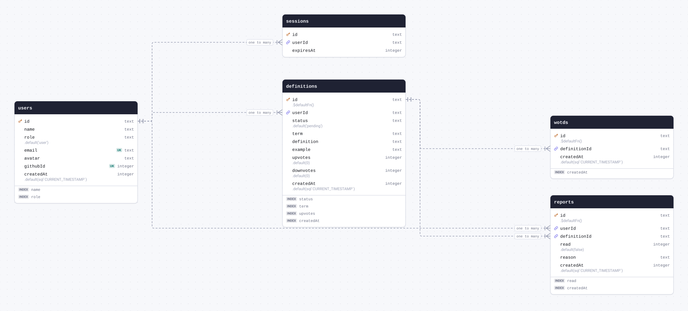
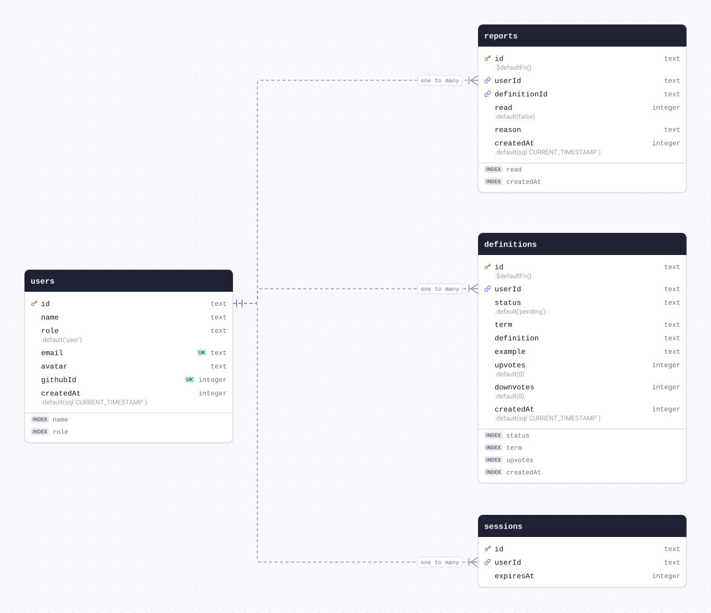
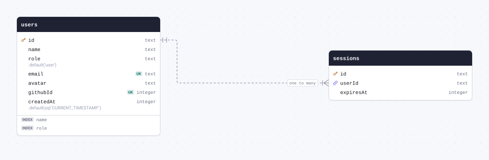
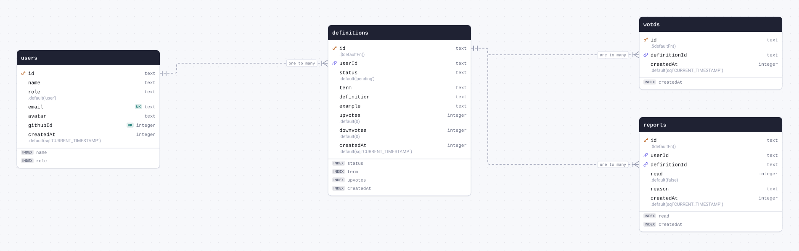
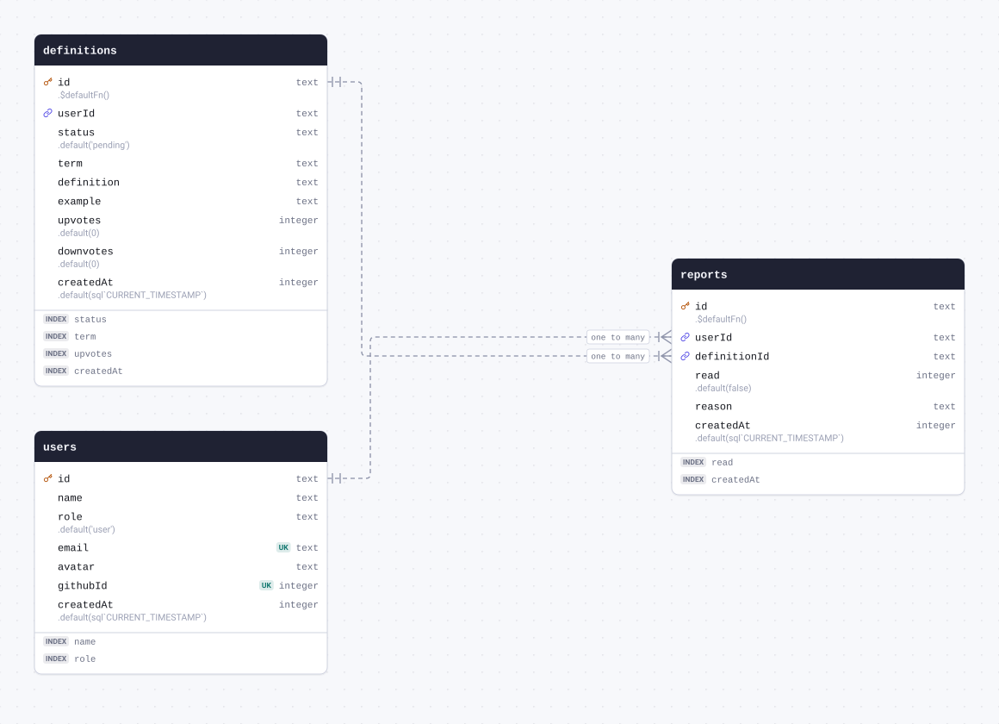
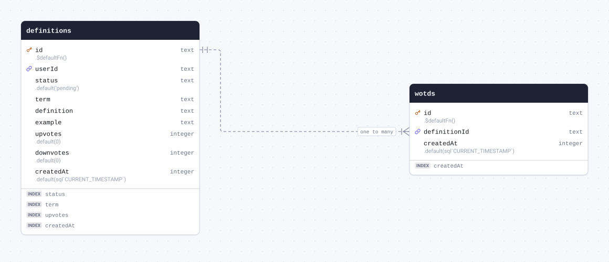

# Schema docs



<details>
<summary>The whole schema as SQL</summary>

```sql
CREATE TABLE `definitions` (
	`id` text(20) PRIMARY KEY,
	`user_id` text(21) NOT NULL,
	`status` text DEFAULT 'pending' NOT NULL,
	`term` text(255) NOT NULL,
	`definition` text NOT NULL,
	`example` text NOT NULL,
	`upvotes` integer DEFAULT 0 NOT NULL,
	`downvotes` integer DEFAULT 0 NOT NULL,
	`created_at` integer DEFAULT CURRENT_TIMESTAMP NOT NULL
);

CREATE TABLE `reports` (
	`id` text(20) PRIMARY KEY,
	`user_id` text(21) NOT NULL,
	`definition_id` text(20) NOT NULL,
	`read` integer DEFAULT false NOT NULL,
	`reason` text NOT NULL,
	`created_at` integer DEFAULT CURRENT_TIMESTAMP NOT NULL
);

CREATE TABLE `sessions` (
	`id` text(255) PRIMARY KEY,
	`user_id` text(21) NOT NULL,
	`expires_at` integer NOT NULL
);

CREATE TABLE `users` (
	`id` text(21) PRIMARY KEY,
	`name` text(32) NOT NULL,
	`role` text DEFAULT 'user' NOT NULL,
	`email` text(255) NOT NULL UNIQUE,
	`avatar` text(255) NOT NULL,
	`github_id` integer NOT NULL UNIQUE,
	`created_at` integer DEFAULT CURRENT_TIMESTAMP NOT NULL
);

CREATE TABLE `wotds` (
	`id` text(21) PRIMARY KEY,
	`definition_id` text(20) NOT NULL,
	`created_at` integer DEFAULT CURRENT_TIMESTAMP NOT NULL
);

CREATE INDEX `definitions_status_idx` ON `definitions` (`status`);

CREATE INDEX `definitions_term_idx` ON `definitions` (`term`);

CREATE INDEX `definitions_upvotes_idx` ON `definitions` (`upvotes`);

CREATE INDEX `definitions_created_at_idx` ON `definitions` (`created_at`);

CREATE INDEX `reports_read_idx` ON `reports` (`read`);

CREATE INDEX `reports_created_at_idx` ON `reports` (`created_at`);

CREATE INDEX `users_name_idx` ON `users` (`name`);

CREATE INDEX `users_role_idx` ON `users` (`role`);

CREATE INDEX `wotds_created_at_idx` ON `wotds` (`created_at`);
```

</details>

## Contents

| Table                             | Name in the database | Description |
| --------------------------------- | -------------------- | ----------- |
| [users](#table-users)             | `users`              |             |
| [sessions](#table-sessions)       | `sessions`           |             |
| [definitions](#table-definitions) | `definitions`        |             |
| [reports](#table-reports)         | `reports`            |             |
| [wotds](#table-wotds)             | `wotds`              |             |

## Tables

<a id="table-users"></a>

### users



| Column                     | Type      | Constraints     | Default                              | Description |
| -------------------------- | --------- | --------------- | ------------------------------------ | ----------- |
| `id`                       | `text`    | PK NOT NULL     |                                      |             |
| `name`                     | `text`    | NOT NULL        |                                      |             |
| `role`                     | `text`    | NOT NULL        | `.default('user')`                   |             |
| `email`                    | `text`    | UNIQUE NOT NULL |                                      |             |
| `avatar`                   | `text`    | NOT NULL        |                                      |             |
| `githubId` (`github_id`)   | `integer` | UNIQUE NOT NULL |                                      |             |
| `createdAt` (`created_at`) | `integer` | NOT NULL        | ``.default(sql`CURRENT_TIMESTAMP`)`` |             |

#### Definition

```sql
CREATE TABLE `users` (
	`id` text(21) PRIMARY KEY,
	`name` text(32) NOT NULL,
	`role` text DEFAULT 'user' NOT NULL,
	`email` text(255) NOT NULL UNIQUE,
	`avatar` text(255) NOT NULL,
	`github_id` integer NOT NULL UNIQUE,
	`created_at` integer DEFAULT CURRENT_TIMESTAMP NOT NULL
);

CREATE INDEX `users_name_idx` ON `users` (`name`);

CREATE INDEX `users_role_idx` ON `users` (`role`);
```

#### Indexes

- INDEX `name`
- INDEX `role`

#### Referenced by

- `id` → [sessions.userId](#table-sessions) (one to many, defineRelations)
- `id` → [definitions.userId](#table-definitions) (one to many, defineRelations)
- `id` → [reports.userId](#table-reports) (one to many, defineRelations)

<details>
<summary>Queries and their SQL</summary>

**Select**: Every row of users.

```ts
db.select().from(users);
```

```sql
select "id", "name", "role", "email", "avatar", "github_id", "created_at"
from "users"
```

**Count**: How many rows users has.

```ts
db.select({ count: count() }).from(users);
```

```sql
select count(*)
from "users"
```

**Find many**: The rows of users, through the relational query API.

```ts
db.query.users.findMany();
```

```sql
select "d0"."id" as "id", "d0"."name" as "name", "d0"."role" as "role", "d0"."email" as "email", "d0"."avatar" as "avatar", "d0"."github_id" as "githubId", "d0"."created_at" as "createdAt"
from "users" as "d0"
```

**Find by primary key**: One row of users, through the relational query API.

```ts
db.query.users.findFirst({ where: { id: "id" } });
```

```sql
select "d0"."id" as "id", "d0"."name" as "name", "d0"."role" as "role", "d0"."email" as "email", "d0"."avatar" as "avatar", "d0"."github_id" as "githubId", "d0"."created_at" as "createdAt"
from "users" as "d0"
where "d0"."id" = ?
limit ?
-- params: ["id",1]
```

**Insert**: Adds a row to users, giving the columns that have no default.

```ts
db.insert(users).values({ id: "id", name: "name", email: "email", avatar: "avatar", githubId: 1 });
```

```sql
insert into "users" ("id", "name", "role", "email", "avatar", "github_id", "created_at")
values (?, ?, ?, ?, ?, ?, CURRENT_TIMESTAMP)
-- params: ["id","name","user","email","avatar",1]
```

**Update**: Changes a row of users, found by its primary key.

```ts
db.update(users).set({ name: "name" }).where(eq(users.id, "id"));
```

```sql
update "users"
set "name" = ?
where "users"."id" = ?
-- params: ["name","id"]
```

**Delete**: Deletes a row of users, found by its primary key.

```ts
db.delete(users).where(eq(users.id, "id"));
```

```sql
delete from "users"
where "users"."id" = ?
-- params: ["id"]
```

</details>

<a id="table-sessions"></a>

### sessions



| Column                     | Type      | Constraints                         | Default | Description |
| -------------------------- | --------- | ----------------------------------- | ------- | ----------- |
| `id`                       | `text`    | PK NOT NULL                         |         |             |
| `userId` (`user_id`)       | `text`    | NOT NULL → [users.id](#table-users) |         |             |
| `expiresAt` (`expires_at`) | `integer` | NOT NULL                            |         |             |

#### Definition

```sql
CREATE TABLE `sessions` (
	`id` text(255) PRIMARY KEY,
	`user_id` text(21) NOT NULL,
	`expires_at` integer NOT NULL
);
```

#### References

- `userId` → [users.id](#table-users) (many to one, defineRelations, no foreign key)

<details>
<summary>Queries and their SQL</summary>

**Select**: Every row of sessions.

```ts
db.select().from(sessions);
```

```sql
select "id", "user_id", "expires_at"
from "sessions"
```

**Count**: How many rows sessions has.

```ts
db.select({ count: count() }).from(sessions);
```

```sql
select count(*)
from "sessions"
```

**Find many**: The rows of sessions, through the relational query API.

```ts
db.query.sessions.findMany();
```

```sql
select "d0"."id" as "id", "d0"."user_id" as "userId", "d0"."expires_at" as "expiresAt"
from "sessions" as "d0"
```

**Find by primary key**: One row of sessions, through the relational query API.

```ts
db.query.sessions.findFirst({ where: { id: "id" } });
```

```sql
select "d0"."id" as "id", "d0"."user_id" as "userId", "d0"."expires_at" as "expiresAt"
from "sessions" as "d0"
where "d0"."id" = ?
limit ?
-- params: ["id",1]
```

**Insert**: Adds a row to sessions, giving the columns that have no default.

```ts
db.insert(sessions).values({ id: "id", userId: "userId", expiresAt: 1 });
```

```sql
insert into "sessions" ("id", "user_id", "expires_at")
values (?, ?, ?)
-- params: ["id","userId",1]
```

**Update**: Changes a row of sessions, found by its primary key.

```ts
db.update(sessions).set({ userId: "userId" }).where(eq(sessions.id, "id"));
```

```sql
update "sessions"
set "user_id" = ?
where "sessions"."id" = ?
-- params: ["userId","id"]
```

**Delete**: Deletes a row of sessions, found by its primary key.

```ts
db.delete(sessions).where(eq(sessions.id, "id"));
```

```sql
delete from "sessions"
where "sessions"."id" = ?
-- params: ["id"]
```

</details>

<a id="table-definitions"></a>

### definitions



| Column                     | Type      | Constraints                         | Default                              | Description |
| -------------------------- | --------- | ----------------------------------- | ------------------------------------ | ----------- |
| `id`                       | `text`    | PK NOT NULL                         | `.$defaultFn()`                      |             |
| `userId` (`user_id`)       | `text`    | NOT NULL → [users.id](#table-users) |                                      |             |
| `status`                   | `text`    | NOT NULL                            | `.default('pending')`                |             |
| `term`                     | `text`    | NOT NULL                            |                                      |             |
| `definition`               | `text`    | NOT NULL                            |                                      |             |
| `example`                  | `text`    | NOT NULL                            |                                      |             |
| `upvotes`                  | `integer` | NOT NULL                            | `.default(0)`                        |             |
| `downvotes`                | `integer` | NOT NULL                            | `.default(0)`                        |             |
| `createdAt` (`created_at`) | `integer` | NOT NULL                            | ``.default(sql`CURRENT_TIMESTAMP`)`` |             |

#### Definition

```sql
CREATE TABLE `definitions` (
	`id` text(20) PRIMARY KEY,
	`user_id` text(21) NOT NULL,
	`status` text DEFAULT 'pending' NOT NULL,
	`term` text(255) NOT NULL,
	`definition` text NOT NULL,
	`example` text NOT NULL,
	`upvotes` integer DEFAULT 0 NOT NULL,
	`downvotes` integer DEFAULT 0 NOT NULL,
	`created_at` integer DEFAULT CURRENT_TIMESTAMP NOT NULL
);

CREATE INDEX `definitions_status_idx` ON `definitions` (`status`);

CREATE INDEX `definitions_term_idx` ON `definitions` (`term`);

CREATE INDEX `definitions_upvotes_idx` ON `definitions` (`upvotes`);

CREATE INDEX `definitions_created_at_idx` ON `definitions` (`created_at`);
```

#### Indexes

- INDEX `status`
- INDEX `term`
- INDEX `upvotes`
- INDEX `createdAt`

#### References

- `userId` → [users.id](#table-users) (many to one, defineRelations, no foreign key)

#### Referenced by

- `id` → [reports.definitionId](#table-reports) (one to many, defineRelations)
- `id` → [wotds.definitionId](#table-wotds) (one to many, defineRelations)

<details>
<summary>Queries and their SQL</summary>

**Select**: Every row of definitions.

```ts
db.select().from(definitions);
```

```sql
select "id", "user_id", "status", "term", "definition", "example", "upvotes", "downvotes", "created_at"
from "definitions"
```

**Count**: How many rows definitions has.

```ts
db.select({ count: count() }).from(definitions);
```

```sql
select count(*)
from "definitions"
```

**Find many**: The rows of definitions, through the relational query API.

```ts
db.query.definitions.findMany();
```

```sql
select "d0"."id" as "id", "d0"."user_id" as "userId", "d0"."status" as "status", "d0"."term" as "term", "d0"."definition" as "definition", "d0"."example" as "example", "d0"."upvotes" as "upvotes", "d0"."downvotes" as "downvotes", "d0"."created_at" as "createdAt"
from "definitions" as "d0"
```

**Find by primary key**: One row of definitions, through the relational query API.

```ts
db.query.definitions.findFirst({ where: { id: "id" } });
```

```sql
select "d0"."id" as "id", "d0"."user_id" as "userId", "d0"."status" as "status", "d0"."term" as "term", "d0"."definition" as "definition", "d0"."example" as "example", "d0"."upvotes" as "upvotes", "d0"."downvotes" as "downvotes", "d0"."created_at" as "createdAt"
from "definitions" as "d0"
where "d0"."id" = ?
limit ?
-- params: ["id",1]
```

**Insert**: Adds a row to definitions, giving the columns that have no default.

```ts
db.insert(definitions).values({
  userId: "userId",
  term: "term",
  definition: "definition",
  example: "example",
});
```

```sql
insert into "definitions" ("id", "user_id", "status", "term", "definition", "example", "upvotes", "downvotes", "created_at")
values (?, ?, ?, ?, ?, ?, ?, ?, CURRENT_TIMESTAMP)
-- params: ["def_aaaaaaaaaaaaaaaa","userId","pending","term","definition","example",0,0]
```

**Update**: Changes a row of definitions, found by its primary key.

```ts
db.update(definitions).set({ userId: "userId" }).where(eq(definitions.id, "id"));
```

```sql
update "definitions"
set "user_id" = ?
where "definitions"."id" = ?
-- params: ["userId","id"]
```

**Delete**: Deletes a row of definitions, found by its primary key.

```ts
db.delete(definitions).where(eq(definitions.id, "id"));
```

```sql
delete from "definitions"
where "definitions"."id" = ?
-- params: ["id"]
```

</details>

<a id="table-reports"></a>

### reports



| Column                           | Type      | Constraints                                     | Default                              | Description |
| -------------------------------- | --------- | ----------------------------------------------- | ------------------------------------ | ----------- |
| `id`                             | `text`    | PK NOT NULL                                     | `.$defaultFn()`                      |             |
| `userId` (`user_id`)             | `text`    | NOT NULL → [users.id](#table-users)             |                                      |             |
| `definitionId` (`definition_id`) | `text`    | NOT NULL → [definitions.id](#table-definitions) |                                      |             |
| `read`                           | `integer` | NOT NULL                                        | `.default(false)`                    |             |
| `reason`                         | `text`    | NOT NULL                                        |                                      |             |
| `createdAt` (`created_at`)       | `integer` | NOT NULL                                        | ``.default(sql`CURRENT_TIMESTAMP`)`` |             |

#### Definition

```sql
CREATE TABLE `reports` (
	`id` text(20) PRIMARY KEY,
	`user_id` text(21) NOT NULL,
	`definition_id` text(20) NOT NULL,
	`read` integer DEFAULT false NOT NULL,
	`reason` text NOT NULL,
	`created_at` integer DEFAULT CURRENT_TIMESTAMP NOT NULL
);

CREATE INDEX `reports_read_idx` ON `reports` (`read`);

CREATE INDEX `reports_created_at_idx` ON `reports` (`created_at`);
```

#### Indexes

- INDEX `read`
- INDEX `createdAt`

#### References

- `userId` → [users.id](#table-users) (many to one, defineRelations, no foreign key)
- `definitionId` → [definitions.id](#table-definitions) (many to one, defineRelations, no foreign key)

<details>
<summary>Queries and their SQL</summary>

**Select**: Every row of reports.

```ts
db.select().from(reports);
```

```sql
select "id", "user_id", "definition_id", "read", "reason", "created_at"
from "reports"
```

**Count**: How many rows reports has.

```ts
db.select({ count: count() }).from(reports);
```

```sql
select count(*)
from "reports"
```

**Find many**: The rows of reports, through the relational query API.

```ts
db.query.reports.findMany();
```

```sql
select "d0"."id" as "id", "d0"."user_id" as "userId", "d0"."definition_id" as "definitionId", "d0"."read" as "read", "d0"."reason" as "reason", "d0"."created_at" as "createdAt"
from "reports" as "d0"
```

**Find by primary key**: One row of reports, through the relational query API.

```ts
db.query.reports.findFirst({ where: { id: "id" } });
```

```sql
select "d0"."id" as "id", "d0"."user_id" as "userId", "d0"."definition_id" as "definitionId", "d0"."read" as "read", "d0"."reason" as "reason", "d0"."created_at" as "createdAt"
from "reports" as "d0"
where "d0"."id" = ?
limit ?
-- params: ["id",1]
```

**Insert**: Adds a row to reports, giving the columns that have no default.

```ts
db.insert(reports).values({ userId: "userId", definitionId: "definitionId", reason: "reason" });
```

```sql
insert into "reports" ("id", "user_id", "definition_id", "read", "reason", "created_at")
values (?, ?, ?, ?, ?, CURRENT_TIMESTAMP)
-- params: ["rpt_aaaaaaaaaaaaaaaa","userId","definitionId",0,"reason"]
```

**Update**: Changes a row of reports, found by its primary key.

```ts
db.update(reports).set({ userId: "userId" }).where(eq(reports.id, "id"));
```

```sql
update "reports"
set "user_id" = ?
where "reports"."id" = ?
-- params: ["userId","id"]
```

**Delete**: Deletes a row of reports, found by its primary key.

```ts
db.delete(reports).where(eq(reports.id, "id"));
```

```sql
delete from "reports"
where "reports"."id" = ?
-- params: ["id"]
```

</details>

<a id="table-wotds"></a>

### wotds



| Column                           | Type      | Constraints                                     | Default                              | Description |
| -------------------------------- | --------- | ----------------------------------------------- | ------------------------------------ | ----------- |
| `id`                             | `text`    | PK NOT NULL                                     | `.$defaultFn()`                      |             |
| `definitionId` (`definition_id`) | `text`    | NOT NULL → [definitions.id](#table-definitions) |                                      |             |
| `createdAt` (`created_at`)       | `integer` | NOT NULL                                        | ``.default(sql`CURRENT_TIMESTAMP`)`` |             |

#### Definition

```sql
CREATE TABLE `wotds` (
	`id` text(21) PRIMARY KEY,
	`definition_id` text(20) NOT NULL,
	`created_at` integer DEFAULT CURRENT_TIMESTAMP NOT NULL
);

CREATE INDEX `wotds_created_at_idx` ON `wotds` (`created_at`);
```

#### Indexes

- INDEX `createdAt`

#### References

- `definitionId` → [definitions.id](#table-definitions) (many to one, defineRelations, no foreign key)

<details>
<summary>Queries and their SQL</summary>

**Select**: Every row of wotds.

```ts
db.select().from(wotds);
```

```sql
select "id", "definition_id", "created_at"
from "wotds"
```

**Count**: How many rows wotds has.

```ts
db.select({ count: count() }).from(wotds);
```

```sql
select count(*)
from "wotds"
```

**Find many**: The rows of wotds, through the relational query API.

```ts
db.query.wotds.findMany();
```

```sql
select "d0"."id" as "id", "d0"."definition_id" as "definitionId", "d0"."created_at" as "createdAt"
from "wotds" as "d0"
```

**Find by primary key**: One row of wotds, through the relational query API.

```ts
db.query.wotds.findFirst({ where: { id: "id" } });
```

```sql
select "d0"."id" as "id", "d0"."definition_id" as "definitionId", "d0"."created_at" as "createdAt"
from "wotds" as "d0"
where "d0"."id" = ?
limit ?
-- params: ["id",1]
```

**Insert**: Adds a row to wotds, giving the columns that have no default.

```ts
db.insert(wotds).values({ definitionId: "definitionId" });
```

```sql
insert into "wotds" ("id", "definition_id", "created_at")
values (?, ?, CURRENT_TIMESTAMP)
-- params: ["wotd_aaaaaaaaaaaaaaaa","definitionId"]
```

**Update**: Changes a row of wotds, found by its primary key.

```ts
db.update(wotds).set({ definitionId: "definitionId" }).where(eq(wotds.id, "id"));
```

```sql
update "wotds"
set "definition_id" = ?
where "wotds"."id" = ?
-- params: ["definitionId","id"]
```

**Delete**: Deletes a row of wotds, found by its primary key.

```ts
db.delete(wotds).where(eq(wotds.id, "id"));
```

```sql
delete from "wotds"
where "wotds"."id" = ?
-- params: ["id"]
```

</details>
