# Schema docs

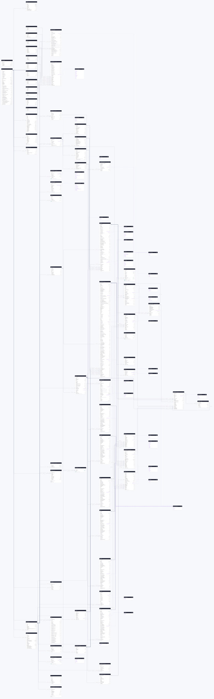

<details>
<summary>The whole schema as SQL</summary>

```sql
CREATE TYPE "applicationStatus" AS ENUM('idle', 'running', 'done', 'error');

CREATE TYPE "backupType" AS ENUM('database', 'compose');

CREATE TYPE "buildType" AS ENUM('dockerfile', 'heroku_buildpacks', 'paketo_buildpacks', 'nixpacks', 'static', 'railpack');

CREATE TYPE "certificateType" AS ENUM('letsencrypt', 'none', 'custom');

CREATE TYPE "composeType" AS ENUM('docker-compose', 'stack');

CREATE TYPE "databaseType" AS ENUM('postgres', 'mariadb', 'mysql', 'mongo', 'web-server', 'libsql');

CREATE TYPE "deploymentStatus" AS ENUM('running', 'done', 'error', 'cancelled');

CREATE TYPE "DnsProviderType" AS ENUM('cloudflare', 'route53', 'porkbun', 'infomaniak', 'ovh');

CREATE TYPE "domainType" AS ENUM('compose', 'application', 'preview');

CREATE TYPE "gitProviderType" AS ENUM('github', 'gitlab', 'bitbucket', 'gitea');

CREATE TYPE "mountType" AS ENUM('bind', 'volume', 'file');

CREATE TYPE "networkDriver" AS ENUM('bridge', 'overlay');

CREATE TYPE "notificationType" AS ENUM('slack', 'telegram', 'discord', 'email', 'resend', 'gotify', 'ntfy', 'mattermost', 'pushover', 'custom', 'lark', 'teams');

CREATE TYPE "patchType" AS ENUM('create', 'update', 'delete');

CREATE TYPE "protocolType" AS ENUM('tcp', 'udp');

CREATE TYPE "publishModeType" AS ENUM('ingress', 'host');

CREATE TYPE "RegistryType" AS ENUM('selfHosted', 'cloud');

CREATE TYPE "sandboxNetworkMode" AS ENUM('isolated', 'internet');

CREATE TYPE "sandboxStatus" AS ENUM('creating', 'running', 'killed', 'error');

CREATE TYPE "scheduleType" AS ENUM('application', 'compose', 'server', 'dokploy-server');

CREATE TYPE "serverStatus" AS ENUM('active', 'inactive');

CREATE TYPE "serverType" AS ENUM('deploy', 'build');

CREATE TYPE "serviceType" AS ENUM('application', 'postgres', 'mysql', 'mariadb', 'mongo', 'redis', 'compose', 'libsql');

CREATE TYPE "shellType" AS ENUM('bash', 'sh');

CREATE TYPE "sourceType" AS ENUM('docker', 'git', 'github', 'gitlab', 'bitbucket', 'gitea', 'drop');

CREATE TYPE "sourceTypeCompose" AS ENUM('git', 'github', 'gitlab', 'bitbucket', 'gitea', 'raw');

CREATE TYPE "sqldNode" AS ENUM('primary', 'replica');

CREATE TYPE "TelemetryProviderType" AS ENUM('loki', 'datadog', 'betterstack', 'elasticsearch', 'splunk_hec', 'aws_cloudwatch', 'prometheus_remote_write', 'new_relic', 'influxdb');

CREATE TYPE "triggerType" AS ENUM('push', 'tag');

CREATE TYPE "VaultProviderType" AS ENUM('hashicorp', 'infisical', 'aws', 'aws-parameter-store', 'doppler', 'azure', 'scaleway', 'phase');

CREATE TABLE "account" (
	"id" text PRIMARY KEY,
	"account_id" text NOT NULL,
	"provider_id" text NOT NULL,
	"user_id" text NOT NULL,
	"access_token" text,
	"refresh_token" text,
	"id_token" text,
	"access_token_expires_at" timestamp,
	"refresh_token_expires_at" timestamp,
	"scope" text,
	"password" text,
	"is2FAEnabled" boolean DEFAULT false NOT NULL,
	"created_at" timestamp NOT NULL,
	"updated_at" timestamp NOT NULL,
	"resetPasswordToken" text,
	"resetPasswordExpiresAt" text,
	"confirmationToken" text,
	"confirmationExpiresAt" text
);

CREATE TABLE "ai" (
	"aiId" text PRIMARY KEY,
	"name" text NOT NULL,
	"apiUrl" text NOT NULL,
	"apiKey" text NOT NULL,
	"model" text NOT NULL,
	"isEnabled" boolean DEFAULT true NOT NULL,
	"organizationId" text NOT NULL,
	"createdAt" text NOT NULL
);

CREATE TABLE "apikey" (
	"id" text PRIMARY KEY,
	"name" text,
	"start" text,
	"prefix" text,
	"key" text NOT NULL,
	"config_id" text DEFAULT 'default' NOT NULL,
	"reference_id" text NOT NULL,
	"refill_interval" integer,
	"refill_amount" integer,
	"last_refill_at" timestamp,
	"enabled" boolean,
	"rate_limit_enabled" boolean,
	"rate_limit_time_window" integer,
	"rate_limit_max" integer,
	"request_count" integer,
	"remaining" integer,
	"last_request" timestamp,
	"expires_at" timestamp,
	"created_at" timestamp NOT NULL,
	"updated_at" timestamp NOT NULL,
	"permissions" text,
	"metadata" text
);

CREATE TABLE "application" (
	"applicationId" text PRIMARY KEY,
	"name" text NOT NULL,
	"appName" text NOT NULL UNIQUE,
	"description" text,
	"env" text,
	"previewEnv" text,
	"watchPaths" text[],
	"previewBuildArgs" text,
	"previewBuildSecrets" text,
	"previewLabels" text[],
	"previewWildcard" text,
	"previewPort" integer DEFAULT 3000,
	"previewHttps" boolean DEFAULT false NOT NULL,
	"previewPath" text DEFAULT '/',
	"certificateType" "certificateType" DEFAULT 'none'::"certificateType" NOT NULL,
	"previewCustomCertResolver" text,
	"previewLimit" integer DEFAULT 3,
	"previewForwardAuthEnabled" boolean DEFAULT false NOT NULL,
	"isPreviewDeploymentsActive" boolean DEFAULT false,
	"previewRequireCollaboratorPermissions" boolean DEFAULT true,
	"rollbackActive" boolean DEFAULT false,
	"buildArgs" text,
	"buildSecrets" text,
	"memoryReservation" text,
	"memoryLimit" text,
	"cpuReservation" text,
	"cpuLimit" text,
	"title" text,
	"enabled" boolean,
	"subtitle" text,
	"command" text,
	"args" text[],
	"icon" text,
	"refreshToken" text,
	"sourceType" "sourceType" DEFAULT 'github'::"sourceType" NOT NULL,
	"cleanCache" boolean DEFAULT false,
	"repository" text,
	"owner" text,
	"branch" text,
	"buildPath" text DEFAULT '/',
	"triggerType" "triggerType" DEFAULT 'push'::"triggerType",
	"autoDeploy" boolean,
	"gitlabProjectId" integer,
	"gitlabRepository" text,
	"gitlabOwner" text,
	"gitlabBranch" text,
	"gitlabBuildPath" text DEFAULT '/',
	"gitlabPathNamespace" text,
	"giteaRepository" text,
	"giteaOwner" text,
	"giteaBranch" text,
	"giteaBuildPath" text DEFAULT '/',
	"bitbucketRepository" text,
	"bitbucketRepositorySlug" text,
	"bitbucketOwner" text,
	"bitbucketBranch" text,
	"bitbucketBuildPath" text DEFAULT '/',
	"username" text,
	"password" text,
	"dockerImage" text,
	"registryUrl" text,
	"customGitUrl" text,
	"customGitBranch" text,
	"customGitBuildPath" text,
	"customGitSSHKeyId" text,
	"enableSubmodules" boolean DEFAULT false NOT NULL,
	"dockerfile" text DEFAULT 'Dockerfile',
	"dockerContextPath" text,
	"dockerBuildStage" text,
	"dropBuildPath" text,
	"healthCheckSwarm" json,
	"restartPolicySwarm" json,
	"placementSwarm" json,
	"updateConfigSwarm" json,
	"rollbackConfigSwarm" json,
	"modeSwarm" json,
	"labelsSwarm" json,
	"networkSwarm" json,
	"stopGracePeriodSwarm" bigint,
	"endpointSpecSwarm" json,
	"ulimitsSwarm" json,
	"replicas" integer DEFAULT 1 NOT NULL,
	"applicationStatus" "applicationStatus" DEFAULT 'idle'::"applicationStatus" NOT NULL,
	"buildType" "buildType" DEFAULT 'nixpacks'::"buildType" NOT NULL,
	"railpackVersion" text DEFAULT '0.15.4',
	"herokuVersion" text DEFAULT '24',
	"publishDirectory" text,
	"isStaticSpa" boolean,
	"createEnvFile" boolean DEFAULT true NOT NULL,
	"createdAt" text NOT NULL,
	"registryId" text,
	"rollbackRegistryId" text,
	"environmentId" text NOT NULL,
	"githubId" text,
	"gitlabId" text,
	"giteaId" text,
	"bitbucketId" text,
	"serverId" text,
	"buildServerId" text,
	"buildRegistryId" text,
	"networkIds" text[] DEFAULT '{}'::text[],
	"detachDokployNetwork" boolean DEFAULT false NOT NULL
);

CREATE TABLE "audit_log" (
	"id" text PRIMARY KEY,
	"organization_id" text,
	"user_id" text,
	"user_email" text NOT NULL,
	"user_role" text NOT NULL,
	"action" text NOT NULL,
	"resource_type" text NOT NULL,
	"resource_id" text,
	"resource_name" text,
	"metadata" text,
	"created_at" timestamp DEFAULT now() NOT NULL
);

CREATE TABLE "backup" (
	"backupId" text PRIMARY KEY,
	"appName" text NOT NULL UNIQUE,
	"schedule" text NOT NULL,
	"enabled" boolean,
	"database" text NOT NULL,
	"prefix" text NOT NULL,
	"customName" text,
	"serviceName" text,
	"destinationId" text NOT NULL,
	"keepLatestCount" integer,
	"includeEncryptionKey" boolean DEFAULT true NOT NULL,
	"backupType" "backupType" DEFAULT 'database'::"backupType" NOT NULL,
	"databaseType" "databaseType" NOT NULL,
	"composeId" text,
	"postgresId" text,
	"mariadbId" text,
	"mysqlId" text,
	"mongoId" text,
	"libsqlId" text,
	"userId" text,
	"metadata" jsonb
);

CREATE TABLE "bitbucket" (
	"bitbucketId" text PRIMARY KEY,
	"bitbucketUsername" text,
	"bitbucketEmail" text,
	"appPassword" text,
	"apiToken" text,
	"bitbucketWorkspaceName" text,
	"gitProviderId" text NOT NULL
);

CREATE TABLE "certificate" (
	"certificateId" text PRIMARY KEY,
	"name" text NOT NULL,
	"certificateData" text NOT NULL,
	"privateKey" text NOT NULL,
	"certificatePath" text NOT NULL UNIQUE,
	"autoRenew" boolean,
	"organizationId" text NOT NULL,
	"serverId" text
);

CREATE TABLE "compose" (
	"composeId" text PRIMARY KEY,
	"name" text NOT NULL,
	"appName" text NOT NULL,
	"description" text,
	"env" text,
	"composeFile" text DEFAULT '' NOT NULL,
	"refreshToken" text,
	"sourceType" "sourceTypeCompose" DEFAULT 'github'::"sourceTypeCompose" NOT NULL,
	"composeType" "composeType" DEFAULT 'docker-compose'::"composeType" NOT NULL,
	"repository" text,
	"owner" text,
	"branch" text,
	"autoDeploy" boolean,
	"gitlabProjectId" integer,
	"gitlabRepository" text,
	"gitlabOwner" text,
	"gitlabBranch" text,
	"gitlabPathNamespace" text,
	"bitbucketRepository" text,
	"bitbucketRepositorySlug" text,
	"bitbucketOwner" text,
	"bitbucketBranch" text,
	"giteaRepository" text,
	"giteaOwner" text,
	"giteaBranch" text,
	"customGitUrl" text,
	"customGitBranch" text,
	"customGitSSHKeyId" text,
	"command" text DEFAULT '' NOT NULL,
	"createEnvFile" boolean DEFAULT true NOT NULL,
	"enableSubmodules" boolean DEFAULT false NOT NULL,
	"composePath" text DEFAULT './docker-compose.yml' NOT NULL,
	"suffix" text DEFAULT '' NOT NULL,
	"randomize" boolean DEFAULT false NOT NULL,
	"isolatedDeployment" boolean DEFAULT false NOT NULL,
	"isolatedDeploymentsVolume" boolean DEFAULT false NOT NULL,
	"pullImages" boolean DEFAULT false NOT NULL,
	"triggerType" "triggerType" DEFAULT 'push'::"triggerType",
	"composeStatus" "applicationStatus" DEFAULT 'idle'::"applicationStatus" NOT NULL,
	"icon" text,
	"environmentId" text NOT NULL,
	"createdAt" text NOT NULL,
	"watchPaths" text[],
	"githubId" text,
	"gitlabId" text,
	"bitbucketId" text,
	"giteaId" text,
	"serverId" text,
	"serviceNetworks" jsonb DEFAULT '[]'
);

CREATE TABLE "custom" (
	"customId" text PRIMARY KEY,
	"endpoint" text NOT NULL,
	"headers" jsonb
);

CREATE TABLE "deployment" (
	"deploymentId" text PRIMARY KEY,
	"title" text NOT NULL,
	"description" text,
	"status" "deploymentStatus" DEFAULT 'running'::"deploymentStatus",
	"logPath" text NOT NULL,
	"pid" text,
	"applicationId" text,
	"composeId" text,
	"serverId" text,
	"isPreviewDeployment" boolean DEFAULT false,
	"previewDeploymentId" text,
	"createdAt" text NOT NULL,
	"startedAt" text,
	"finishedAt" text,
	"errorMessage" text,
	"scheduleId" text,
	"backupId" text,
	"rollbackId" text,
	"volumeBackupId" text,
	"buildServerId" text
);

CREATE TABLE "destination" (
	"destinationId" text PRIMARY KEY,
	"name" text NOT NULL,
	"provider" text,
	"accessKey" text NOT NULL,
	"secretAccessKey" text NOT NULL,
	"bucket" text NOT NULL,
	"region" text NOT NULL,
	"endpoint" text NOT NULL,
	"additionalFlags" text[],
	"organizationId" text NOT NULL,
	"createdAt" timestamp DEFAULT now() NOT NULL
);

CREATE TABLE "discord" (
	"discordId" text PRIMARY KEY,
	"webhookUrl" text NOT NULL,
	"decoration" boolean
);

CREATE TABLE "dns_provider" (
	"dnsProviderId" text PRIMARY KEY,
	"name" text NOT NULL,
	"providerType" "DnsProviderType" NOT NULL,
	"config" jsonb NOT NULL,
	"organizationId" text NOT NULL,
	"createdAt" text NOT NULL
);

CREATE TABLE "domain" (
	"domainId" text PRIMARY KEY,
	"host" text NOT NULL,
	"https" boolean DEFAULT false NOT NULL,
	"port" integer DEFAULT 3000,
	"customEntrypoint" text,
	"path" text DEFAULT '/',
	"serviceName" text,
	"domainType" "domainType" DEFAULT 'application'::"domainType",
	"uniqueConfigKey" serial,
	"createdAt" text NOT NULL,
	"composeId" text,
	"customCertResolver" text,
	"applicationId" text,
	"previewDeploymentId" text,
	"certificateType" "certificateType" DEFAULT 'none'::"certificateType" NOT NULL,
	"internalPath" text DEFAULT '/',
	"stripPath" boolean DEFAULT false NOT NULL,
	"middlewares" text[] DEFAULT ARRAY[]::text[],
	"forwardAuthEnabled" boolean DEFAULT false NOT NULL,
	"enabled" boolean DEFAULT true NOT NULL
);

CREATE TABLE "email" (
	"emailId" text PRIMARY KEY,
	"smtpServer" text NOT NULL,
	"smtpPort" integer NOT NULL,
	"username" text NOT NULL,
	"password" text NOT NULL,
	"fromAddress" text NOT NULL,
	"toAddress" text[] NOT NULL
);

CREATE TABLE "environment" (
	"environmentId" text PRIMARY KEY,
	"name" text NOT NULL,
	"description" text,
	"createdAt" text NOT NULL,
	"env" text DEFAULT '' NOT NULL,
	"projectId" text NOT NULL,
	"isDefault" boolean DEFAULT false NOT NULL
);

CREATE TABLE "forward_auth_settings" (
	"forwardAuthSettingsId" text PRIMARY KEY,
	"authDomain" text NOT NULL,
	"baseDomain" text NOT NULL,
	"https" boolean DEFAULT true NOT NULL,
	"certificateType" "certificateType" DEFAULT 'letsencrypt'::"certificateType" NOT NULL,
	"customCertResolver" text,
	"providerId" text,
	"serverId" text UNIQUE,
	"createdAt" text NOT NULL
);

CREATE TABLE "git_provider" (
	"gitProviderId" text PRIMARY KEY,
	"name" text NOT NULL,
	"providerType" "gitProviderType" DEFAULT 'github'::"gitProviderType" NOT NULL,
	"createdAt" text NOT NULL,
	"organizationId" text NOT NULL,
	"userId" text NOT NULL,
	"sharedWithOrganization" boolean DEFAULT false NOT NULL
);

CREATE TABLE "gitea" (
	"giteaId" text PRIMARY KEY,
	"giteaUrl" text DEFAULT 'https://gitea.com' NOT NULL,
	"giteaInternalUrl" text,
	"redirect_uri" text,
	"client_id" text,
	"client_secret" text,
	"gitProviderId" text NOT NULL,
	"access_token" text,
	"refresh_token" text,
	"expires_at" integer,
	"scopes" text DEFAULT 'repo,repo:status,read:user,read:org',
	"last_authenticated_at" integer
);

CREATE TABLE "github" (
	"githubId" text PRIMARY KEY,
	"githubAppName" text,
	"githubAppId" integer,
	"githubClientId" text,
	"githubClientSecret" text,
	"githubInstallationId" text,
	"githubPrivateKey" text,
	"githubWebhookSecret" text,
	"githubUrl" text DEFAULT 'https://github.com' NOT NULL,
	"gitProviderId" text NOT NULL
);

CREATE TABLE "gitlab" (
	"gitlabId" text PRIMARY KEY,
	"gitlabUrl" text DEFAULT 'https://gitlab.com' NOT NULL,
	"gitlabInternalUrl" text,
	"application_id" text,
	"redirect_uri" text,
	"secret" text,
	"access_token" text,
	"refresh_token" text,
	"group_name" text,
	"expires_at" integer,
	"gitProviderId" text NOT NULL
);

CREATE TABLE "gotify" (
	"gotifyId" text PRIMARY KEY,
	"serverUrl" text NOT NULL,
	"appToken" text NOT NULL,
	"priority" integer DEFAULT 5 NOT NULL,
	"decoration" boolean
);

CREATE TABLE "invitation" (
	"id" text PRIMARY KEY,
	"organization_id" text NOT NULL,
	"email" text NOT NULL,
	"role" text,
	"status" text NOT NULL,
	"expires_at" timestamp NOT NULL,
	"inviter_id" text NOT NULL,
	"team_id" text,
	"created_at" timestamp DEFAULT now() NOT NULL
);

CREATE TABLE "lark" (
	"larkId" text PRIMARY KEY,
	"webhookUrl" text NOT NULL
);

CREATE TABLE "libsql" (
	"libsqlId" text PRIMARY KEY,
	"name" text NOT NULL,
	"appName" text NOT NULL UNIQUE,
	"description" text,
	"databaseUser" text NOT NULL,
	"databasePassword" text NOT NULL,
	"sqldNode" "sqldNode" DEFAULT 'primary'::"sqldNode" NOT NULL,
	"sqldPrimaryUrl" text,
	"enableNamespaces" boolean DEFAULT false NOT NULL,
	"dockerImage" text NOT NULL,
	"command" text,
	"env" text,
	"memoryReservation" text,
	"memoryLimit" text,
	"cpuReservation" text,
	"cpuLimit" text,
	"externalPort" integer,
	"externalGRPCPort" integer,
	"externalAdminPort" integer,
	"applicationStatus" "applicationStatus" DEFAULT 'idle'::"applicationStatus" NOT NULL,
	"healthCheckSwarm" json,
	"restartPolicySwarm" json,
	"placementSwarm" json,
	"updateConfigSwarm" json,
	"rollbackConfigSwarm" json,
	"modeSwarm" json,
	"labelsSwarm" json,
	"networkSwarm" json,
	"stopGracePeriodSwarm" bigint,
	"endpointSpecSwarm" json,
	"replicas" integer DEFAULT 1 NOT NULL,
	"networkIds" text[] DEFAULT '{}'::text[],
	"detachDokployNetwork" boolean DEFAULT false NOT NULL,
	"createdAt" text NOT NULL,
	"environmentId" text NOT NULL,
	"serverId" text
);

CREATE TABLE "mariadb" (
	"mariadbId" text PRIMARY KEY,
	"name" text NOT NULL,
	"appName" text NOT NULL UNIQUE,
	"description" text,
	"databaseName" text NOT NULL,
	"databaseUser" text NOT NULL,
	"databasePassword" text NOT NULL,
	"rootPassword" text NOT NULL,
	"dockerImage" text NOT NULL,
	"command" text,
	"args" text[],
	"env" text,
	"memoryReservation" text,
	"memoryLimit" text,
	"cpuReservation" text,
	"cpuLimit" text,
	"externalPort" integer,
	"applicationStatus" "applicationStatus" DEFAULT 'idle'::"applicationStatus" NOT NULL,
	"healthCheckSwarm" json,
	"restartPolicySwarm" json,
	"placementSwarm" json,
	"updateConfigSwarm" json,
	"rollbackConfigSwarm" json,
	"modeSwarm" json,
	"labelsSwarm" json,
	"networkSwarm" json,
	"stopGracePeriodSwarm" bigint,
	"endpointSpecSwarm" json,
	"ulimitsSwarm" json,
	"replicas" integer DEFAULT 1 NOT NULL,
	"createdAt" text NOT NULL,
	"environmentId" text NOT NULL,
	"serverId" text,
	"networkIds" text[] DEFAULT '{}'::text[],
	"detachDokployNetwork" boolean DEFAULT false NOT NULL
);

CREATE TABLE "mattermost" (
	"mattermostId" text PRIMARY KEY,
	"webhookUrl" text NOT NULL,
	"channel" text,
	"username" text
);

CREATE TABLE "member" (
	"id" text PRIMARY KEY,
	"organization_id" text NOT NULL,
	"user_id" text NOT NULL,
	"role" text NOT NULL,
	"created_at" timestamp NOT NULL,
	"team_id" text,
	"is_default" boolean DEFAULT false NOT NULL,
	"canCreateProjects" boolean DEFAULT false NOT NULL,
	"canAccessToSSHKeys" boolean DEFAULT false NOT NULL,
	"canCreateServices" boolean DEFAULT false NOT NULL,
	"canDeleteProjects" boolean DEFAULT false NOT NULL,
	"canDeleteServices" boolean DEFAULT false NOT NULL,
	"canAccessToDocker" boolean DEFAULT false NOT NULL,
	"canAccessToAPI" boolean DEFAULT false NOT NULL,
	"canAccessToGitProviders" boolean DEFAULT false NOT NULL,
	"canAccessToTraefikFiles" boolean DEFAULT false NOT NULL,
	"canDeleteEnvironments" boolean DEFAULT false NOT NULL,
	"canCreateEnvironments" boolean DEFAULT false NOT NULL,
	"accesedProjects" text[] DEFAULT ARRAY[]::text[] NOT NULL,
	"accessedEnvironments" text[] DEFAULT ARRAY[]::text[] NOT NULL,
	"accesedServices" text[] DEFAULT ARRAY[]::text[] NOT NULL,
	"accessedGitProviders" text[] DEFAULT ARRAY[]::text[] NOT NULL,
	"accessedServers" text[] DEFAULT ARRAY[]::text[] NOT NULL
);

CREATE TABLE "mongo" (
	"mongoId" text PRIMARY KEY,
	"name" text NOT NULL,
	"appName" text NOT NULL UNIQUE,
	"description" text,
	"databaseUser" text NOT NULL,
	"databasePassword" text NOT NULL,
	"dockerImage" text DEFAULT 'mongo:8' NOT NULL,
	"command" text,
	"args" text[],
	"env" text,
	"memoryReservation" text,
	"memoryLimit" text,
	"cpuReservation" text,
	"cpuLimit" text,
	"externalPort" integer,
	"applicationStatus" "applicationStatus" DEFAULT 'idle'::"applicationStatus" NOT NULL,
	"healthCheckSwarm" json,
	"restartPolicySwarm" json,
	"placementSwarm" json,
	"updateConfigSwarm" json,
	"rollbackConfigSwarm" json,
	"modeSwarm" json,
	"labelsSwarm" json,
	"networkSwarm" json,
	"stopGracePeriodSwarm" bigint,
	"endpointSpecSwarm" json,
	"ulimitsSwarm" json,
	"replicas" integer DEFAULT 1 NOT NULL,
	"createdAt" text NOT NULL,
	"environmentId" text NOT NULL,
	"serverId" text,
	"replicaSets" boolean DEFAULT false,
	"networkIds" text[] DEFAULT '{}'::text[],
	"detachDokployNetwork" boolean DEFAULT false NOT NULL
);

CREATE TABLE "mount" (
	"mountId" text PRIMARY KEY,
	"type" "mountType" NOT NULL,
	"hostPath" text,
	"volumeName" text,
	"filePath" text,
	"content" text,
	"serviceType" "serviceType" DEFAULT 'application'::"serviceType" NOT NULL,
	"mountPath" text NOT NULL,
	"applicationId" text,
	"composeId" text,
	"libsqlId" text,
	"mariadbId" text,
	"mongoId" text,
	"mysqlId" text,
	"postgresId" text,
	"redisId" text
);

CREATE TABLE "mysql" (
	"mysqlId" text PRIMARY KEY,
	"name" text NOT NULL,
	"appName" text NOT NULL UNIQUE,
	"description" text,
	"databaseName" text NOT NULL,
	"databaseUser" text NOT NULL,
	"databasePassword" text NOT NULL,
	"rootPassword" text NOT NULL,
	"dockerImage" text NOT NULL,
	"command" text,
	"args" text[],
	"env" text,
	"memoryReservation" text,
	"memoryLimit" text,
	"cpuReservation" text,
	"cpuLimit" text,
	"externalPort" integer,
	"applicationStatus" "applicationStatus" DEFAULT 'idle'::"applicationStatus" NOT NULL,
	"healthCheckSwarm" json,
	"restartPolicySwarm" json,
	"placementSwarm" json,
	"updateConfigSwarm" json,
	"rollbackConfigSwarm" json,
	"modeSwarm" json,
	"labelsSwarm" json,
	"networkSwarm" json,
	"stopGracePeriodSwarm" bigint,
	"endpointSpecSwarm" json,
	"ulimitsSwarm" json,
	"replicas" integer DEFAULT 1 NOT NULL,
	"createdAt" text NOT NULL,
	"environmentId" text NOT NULL,
	"serverId" text,
	"networkIds" text[] DEFAULT '{}'::text[],
	"detachDokployNetwork" boolean DEFAULT false NOT NULL
);

CREATE TABLE "network" (
	"networkId" text PRIMARY KEY,
	"name" text NOT NULL,
	"dockerId" text,
	"driver" "networkDriver" DEFAULT 'bridge'::"networkDriver" NOT NULL,
	"internal" boolean DEFAULT false NOT NULL,
	"attachable" boolean DEFAULT false NOT NULL,
	"enableIPv4" boolean DEFAULT true NOT NULL,
	"enableIPv6" boolean DEFAULT false NOT NULL,
	"mtu" integer,
	"ipam" jsonb DEFAULT '{}',
	"createdAt" text NOT NULL,
	"organizationId" text NOT NULL,
	"serverId" text
);

CREATE TABLE "notification" (
	"notificationId" text PRIMARY KEY,
	"name" text NOT NULL,
	"appDeploy" boolean DEFAULT false NOT NULL,
	"appBuildError" boolean DEFAULT false NOT NULL,
	"databaseBackup" boolean DEFAULT false NOT NULL,
	"volumeBackup" boolean DEFAULT false NOT NULL,
	"dokployRestart" boolean DEFAULT false NOT NULL,
	"dokployBackup" boolean DEFAULT false NOT NULL,
	"dockerCleanup" boolean DEFAULT false NOT NULL,
	"serverThreshold" boolean DEFAULT false NOT NULL,
	"notificationType" "notificationType" NOT NULL,
	"createdAt" text NOT NULL,
	"slackId" text,
	"telegramId" text,
	"discordId" text,
	"emailId" text,
	"resendId" text,
	"gotifyId" text,
	"ntfyId" text,
	"mattermostId" text,
	"customId" text,
	"larkId" text,
	"pushoverId" text,
	"teamsId" text,
	"organizationId" text NOT NULL
);

CREATE TABLE "ntfy" (
	"ntfyId" text PRIMARY KEY,
	"serverUrl" text NOT NULL,
	"topic" text NOT NULL,
	"accessToken" text,
	"priority" integer DEFAULT 3 NOT NULL
);

CREATE TABLE "organization" (
	"id" text PRIMARY KEY,
	"name" text NOT NULL,
	"slug" text UNIQUE,
	"logo" text,
	"created_at" timestamp NOT NULL,
	"metadata" text,
	"default_role" text,
	"owner_id" text NOT NULL
);

CREATE TABLE "organization_role" (
	"id" text PRIMARY KEY,
	"organization_id" text NOT NULL,
	"role" text NOT NULL,
	"permission" text NOT NULL,
	"created_at" timestamp DEFAULT now() NOT NULL,
	"updated_at" timestamp
);

CREATE TABLE "passkey" (
	"id" text PRIMARY KEY,
	"name" text,
	"public_key" text NOT NULL,
	"user_id" text NOT NULL,
	"credential_id" text NOT NULL,
	"counter" integer NOT NULL,
	"device_type" text NOT NULL,
	"backed_up" boolean NOT NULL,
	"transports" text,
	"created_at" timestamp,
	"aaguid" text
);

CREATE TABLE "patch" (
	"patchId" text PRIMARY KEY,
	"type" "patchType" DEFAULT 'update'::"patchType" NOT NULL,
	"filePath" text NOT NULL,
	"enabled" boolean DEFAULT true NOT NULL,
	"content" text NOT NULL,
	"createdAt" text NOT NULL,
	"updatedAt" text,
	"applicationId" text,
	"composeId" text,
	CONSTRAINT "patch_filepath_application_unique" UNIQUE("filePath","applicationId"),
	CONSTRAINT "patch_filepath_compose_unique" UNIQUE("filePath","composeId")
);

CREATE TABLE "port" (
	"portId" text PRIMARY KEY,
	"publishedPort" integer NOT NULL,
	"publishMode" "publishModeType" DEFAULT 'host'::"publishModeType" NOT NULL,
	"targetPort" integer NOT NULL,
	"protocol" "protocolType" NOT NULL,
	"applicationId" text NOT NULL
);

CREATE TABLE "postgres" (
	"postgresId" text PRIMARY KEY,
	"name" text NOT NULL,
	"appName" text NOT NULL UNIQUE,
	"databaseName" text NOT NULL,
	"databaseUser" text NOT NULL,
	"databasePassword" text NOT NULL,
	"description" text,
	"dockerImage" text NOT NULL,
	"command" text,
	"args" text[],
	"env" text,
	"memoryReservation" text,
	"externalPort" integer,
	"memoryLimit" text,
	"cpuReservation" text,
	"cpuLimit" text,
	"applicationStatus" "applicationStatus" DEFAULT 'idle'::"applicationStatus" NOT NULL,
	"healthCheckSwarm" json,
	"restartPolicySwarm" json,
	"placementSwarm" json,
	"updateConfigSwarm" json,
	"rollbackConfigSwarm" json,
	"modeSwarm" json,
	"labelsSwarm" json,
	"networkSwarm" json,
	"stopGracePeriodSwarm" bigint,
	"endpointSpecSwarm" json,
	"ulimitsSwarm" json,
	"replicas" integer DEFAULT 1 NOT NULL,
	"createdAt" text NOT NULL,
	"environmentId" text NOT NULL,
	"serverId" text,
	"networkIds" text[] DEFAULT '{}'::text[],
	"detachDokployNetwork" boolean DEFAULT false NOT NULL
);

CREATE TABLE "preview_deployments" (
	"previewDeploymentId" text PRIMARY KEY,
	"branch" text NOT NULL,
	"pullRequestId" text NOT NULL,
	"pullRequestNumber" text NOT NULL,
	"pullRequestURL" text NOT NULL,
	"pullRequestTitle" text NOT NULL,
	"pullRequestCommentId" text NOT NULL,
	"previewStatus" "applicationStatus" DEFAULT 'idle'::"applicationStatus" NOT NULL,
	"appName" text NOT NULL UNIQUE,
	"applicationId" text NOT NULL,
	"domainId" text,
	"createdAt" text NOT NULL,
	"expiresAt" text
);

CREATE TABLE "project_tag" (
	"id" text PRIMARY KEY,
	"projectId" text NOT NULL,
	"tagId" text NOT NULL,
	CONSTRAINT "unique_project_tag" UNIQUE("projectId","tagId")
);

CREATE TABLE "project" (
	"projectId" text PRIMARY KEY,
	"name" text NOT NULL,
	"description" text,
	"createdAt" text NOT NULL,
	"organizationId" text NOT NULL,
	"env" text DEFAULT '' NOT NULL
);

CREATE TABLE "pushover" (
	"pushoverId" text PRIMARY KEY,
	"userKey" text NOT NULL,
	"apiToken" text NOT NULL,
	"priority" integer DEFAULT 0 NOT NULL,
	"retry" integer,
	"expire" integer
);

CREATE TABLE "redirect" (
	"redirectId" text PRIMARY KEY,
	"regex" text NOT NULL,
	"replacement" text NOT NULL,
	"permanent" boolean DEFAULT false NOT NULL,
	"uniqueConfigKey" serial,
	"createdAt" text NOT NULL,
	"applicationId" text NOT NULL
);

CREATE TABLE "redis" (
	"redisId" text PRIMARY KEY,
	"name" text NOT NULL,
	"appName" text NOT NULL UNIQUE,
	"description" text,
	"password" text NOT NULL,
	"dockerImage" text NOT NULL,
	"command" text,
	"args" text[],
	"env" text,
	"memoryReservation" text,
	"memoryLimit" text,
	"cpuReservation" text,
	"cpuLimit" text,
	"externalPort" integer,
	"createdAt" text NOT NULL,
	"applicationStatus" "applicationStatus" DEFAULT 'idle'::"applicationStatus" NOT NULL,
	"healthCheckSwarm" json,
	"restartPolicySwarm" json,
	"placementSwarm" json,
	"updateConfigSwarm" json,
	"rollbackConfigSwarm" json,
	"modeSwarm" json,
	"labelsSwarm" json,
	"networkSwarm" json,
	"stopGracePeriodSwarm" bigint,
	"endpointSpecSwarm" json,
	"ulimitsSwarm" json,
	"replicas" integer DEFAULT 1 NOT NULL,
	"environmentId" text NOT NULL,
	"serverId" text,
	"networkIds" text[] DEFAULT '{}'::text[],
	"detachDokployNetwork" boolean DEFAULT false NOT NULL
);

CREATE TABLE "registry" (
	"registryId" text PRIMARY KEY,
	"registryName" text NOT NULL,
	"imagePrefix" text,
	"username" text NOT NULL,
	"password" text NOT NULL,
	"registryUrl" text DEFAULT '' NOT NULL,
	"createdAt" text NOT NULL,
	"selfHosted" "RegistryType" DEFAULT 'cloud'::"RegistryType" NOT NULL,
	"organizationId" text NOT NULL
);

CREATE TABLE "resend" (
	"resendId" text PRIMARY KEY,
	"apiKey" text NOT NULL,
	"fromAddress" text NOT NULL,
	"toAddress" text[] NOT NULL
);

CREATE TABLE "rollback" (
	"rollbackId" text PRIMARY KEY,
	"deploymentId" text NOT NULL,
	"version" serial,
	"image" text,
	"createdAt" text NOT NULL,
	"fullContext" jsonb
);

CREATE TABLE "sandbox" (
	"sandboxId" text PRIMARY KEY,
	"name" text NOT NULL,
	"organizationId" text NOT NULL,
	"serverId" text,
	"image" text NOT NULL,
	"template" text,
	"containerId" text,
	"status" "sandboxStatus" DEFAULT 'creating'::"sandboxStatus" NOT NULL,
	"cpu" real DEFAULT 1 NOT NULL,
	"memoryMb" integer DEFAULT 512 NOT NULL,
	"pidsLimit" integer DEFAULT 256 NOT NULL,
	"timeoutMs" integer DEFAULT 300000 NOT NULL,
	"expiresAt" timestamp with time zone,
	"deadlineAt" timestamp with time zone NOT NULL,
	"lastActivityAt" timestamp with time zone,
	"networkMode" "sandboxNetworkMode" DEFAULT 'isolated'::"sandboxNetworkMode" NOT NULL,
	"envVars" text,
	"workdir" text DEFAULT '/home/user' NOT NULL,
	"user" text,
	"runtime" text,
	"createdAt" text NOT NULL,
	"killedAt" timestamp with time zone
);

CREATE TABLE "schedule" (
	"scheduleId" text PRIMARY KEY,
	"name" text NOT NULL,
	"description" text,
	"cronExpression" text NOT NULL,
	"appName" text NOT NULL,
	"serviceName" text,
	"shellType" "shellType" DEFAULT 'bash'::"shellType" NOT NULL,
	"scheduleType" "scheduleType" DEFAULT 'application'::"scheduleType" NOT NULL,
	"command" text NOT NULL,
	"script" text,
	"applicationId" text,
	"composeId" text,
	"serverId" text,
	"organizationId" text,
	"enabled" boolean DEFAULT true NOT NULL,
	"timezone" text,
	"createdAt" text NOT NULL
);

CREATE TABLE "scim_provider" (
	"id" text PRIMARY KEY,
	"provider_id" text NOT NULL UNIQUE,
	"scim_token" text NOT NULL UNIQUE,
	"organization_id" text
);

CREATE TABLE "security" (
	"securityId" text PRIMARY KEY,
	"username" text NOT NULL,
	"password" text NOT NULL,
	"createdAt" text NOT NULL,
	"applicationId" text NOT NULL,
	CONSTRAINT "security_username_applicationId_unique" UNIQUE("username","applicationId")
);

CREATE TABLE "server" (
	"serverId" text PRIMARY KEY,
	"name" text NOT NULL,
	"description" text,
	"ipAddress" text NOT NULL,
	"port" integer NOT NULL,
	"username" text DEFAULT 'root' NOT NULL,
	"appName" text NOT NULL,
	"enableDockerCleanup" boolean DEFAULT false NOT NULL,
	"telemetryProviderIds" text[] DEFAULT ARRAY[]::text[] NOT NULL,
	"buildsConcurrency" integer DEFAULT 1 NOT NULL,
	"createdAt" text NOT NULL,
	"organizationId" text NOT NULL,
	"serverStatus" "serverStatus" DEFAULT 'active'::"serverStatus" NOT NULL,
	"serverType" "serverType" DEFAULT 'deploy'::"serverType" NOT NULL,
	"command" text DEFAULT '' NOT NULL,
	"sshKeyId" text,
	"metricsConfig" jsonb DEFAULT '{"server":{"type":"Remote","refreshRate":60,"port":4500,"token":"","urlCallback":"","cronJob":"","retentionDays":2,"thresholds":{"cpu":0,"memory":0}},"containers":{"refreshRate":60,"services":{"include":[],"exclude":[]}}}' NOT NULL
);

CREATE TABLE "session" (
	"id" text PRIMARY KEY,
	"expires_at" timestamp NOT NULL,
	"token" text NOT NULL UNIQUE,
	"created_at" timestamp NOT NULL,
	"updated_at" timestamp NOT NULL,
	"ip_address" text,
	"user_agent" text,
	"user_id" text NOT NULL,
	"impersonated_by" text,
	"active_organization_id" text
);

CREATE TABLE "slack" (
	"slackId" text PRIMARY KEY,
	"webhookUrl" text NOT NULL,
	"channel" text
);

CREATE TABLE "ssh-key" (
	"sshKeyId" text PRIMARY KEY,
	"privateKey" text DEFAULT '' NOT NULL,
	"publicKey" text NOT NULL,
	"name" text NOT NULL,
	"description" text,
	"createdAt" text NOT NULL,
	"lastUsedAt" text,
	"organizationId" text NOT NULL
);

CREATE TABLE "sso_provider" (
	"id" text PRIMARY KEY,
	"issuer" text NOT NULL,
	"oidc_config" text,
	"saml_config" text,
	"provider_id" text NOT NULL UNIQUE,
	"user_id" text,
	"organization_id" text,
	"domain" text NOT NULL,
	"domain_verified" boolean DEFAULT true NOT NULL,
	"created_at" timestamp DEFAULT now() NOT NULL
);

CREATE TABLE "tag" (
	"tagId" text PRIMARY KEY,
	"name" text NOT NULL,
	"color" text,
	"createdAt" text NOT NULL,
	"organizationId" text NOT NULL,
	CONSTRAINT "unique_org_tag_name" UNIQUE("organizationId","name")
);

CREATE TABLE "teams" (
	"teamsId" text PRIMARY KEY,
	"webhookUrl" text NOT NULL
);

CREATE TABLE "telegram" (
	"telegramId" text PRIMARY KEY,
	"botToken" text NOT NULL,
	"chatId" text NOT NULL,
	"messageThreadId" text
);

CREATE TABLE "telemetryProvider" (
	"telemetryProviderId" text PRIMARY KEY,
	"name" text NOT NULL,
	"providerType" "TelemetryProviderType" NOT NULL,
	"signals" text[] NOT NULL,
	"endpoint" text,
	"apiKey" text,
	"apiSecret" text,
	"extraConfig" jsonb,
	"enabled" boolean DEFAULT true NOT NULL,
	"createdAt" text NOT NULL,
	"organizationId" text NOT NULL
);

CREATE TABLE "two_factor" (
	"id" text PRIMARY KEY,
	"secret" text NOT NULL,
	"backup_codes" text NOT NULL,
	"user_id" text NOT NULL,
	"verified" boolean DEFAULT true NOT NULL,
	"failed_verification_count" integer DEFAULT 0 NOT NULL,
	"locked_until" timestamp
);

CREATE TABLE "user" (
	"id" text PRIMARY KEY,
	"firstName" text DEFAULT '' NOT NULL,
	"lastName" text DEFAULT '' NOT NULL,
	"isRegistered" boolean DEFAULT false NOT NULL,
	"expirationDate" text NOT NULL,
	"createdAt" text NOT NULL,
	"created_at" timestamp DEFAULT now(),
	"two_factor_enabled" boolean,
	"email" text NOT NULL UNIQUE,
	"email_verified" boolean NOT NULL,
	"image" text,
	"banned" boolean,
	"ban_reason" text,
	"ban_expires" timestamp,
	"updated_at" timestamp NOT NULL,
	"role" text DEFAULT 'user' NOT NULL,
	"enablePaidFeatures" boolean DEFAULT false NOT NULL,
	"allowImpersonation" boolean DEFAULT false NOT NULL,
	"enableEnterpriseFeatures" boolean DEFAULT false NOT NULL,
	"licenseKey" text,
	"isValidEnterpriseLicense" boolean DEFAULT false NOT NULL,
	"stripeCustomerId" text,
	"stripeSubscriptionId" text,
	"serversQuantity" integer DEFAULT 0 NOT NULL,
	"sendInvoiceNotifications" boolean DEFAULT false NOT NULL,
	"isEnterpriseCloud" boolean DEFAULT false NOT NULL,
	"trustedOrigins" text[],
	"bookmarkedTemplates" text[] DEFAULT ARRAY[]::text[],
	"onboardingCompletedAt" timestamp,
	"onboardingStep" text,
	"onboardingReturnEmails" integer DEFAULT 0 NOT NULL,
	"trialPlanPromptSubscriptionId" text,
	"serverSetupFailedEmailAt" timestamp,
	"serverConnectFailure" text
);

CREATE TABLE "vault_provider" (
	"vaultProviderId" text PRIMARY KEY,
	"name" text NOT NULL,
	"providerType" "VaultProviderType" NOT NULL,
	"config" jsonb NOT NULL,
	"assignments" jsonb DEFAULT '[]' NOT NULL,
	"organizationId" text NOT NULL,
	"createdAt" text NOT NULL
);

CREATE TABLE "verification" (
	"id" text PRIMARY KEY,
	"identifier" text NOT NULL,
	"value" text NOT NULL,
	"expires_at" timestamp NOT NULL,
	"created_at" timestamp,
	"updated_at" timestamp
);

CREATE TABLE "volume_backup" (
	"volumeBackupId" text PRIMARY KEY,
	"name" text NOT NULL,
	"volumeName" text NOT NULL,
	"prefix" text NOT NULL,
	"serviceType" "serviceType" DEFAULT 'application'::"serviceType" NOT NULL,
	"appName" text NOT NULL,
	"serviceName" text,
	"turnOff" boolean DEFAULT false NOT NULL,
	"cronExpression" text NOT NULL,
	"keepLatestCount" integer,
	"enabled" boolean,
	"applicationId" text,
	"postgresId" text,
	"mariadbId" text,
	"mongoId" text,
	"mysqlId" text,
	"redisId" text,
	"libsqlId" text,
	"composeId" text,
	"createdAt" text NOT NULL,
	"destinationId" text NOT NULL
);

CREATE TABLE "webServerSettings" (
	"id" text PRIMARY KEY,
	"serverIp" text,
	"certificateType" "certificateType" DEFAULT 'none'::"certificateType" NOT NULL,
	"https" boolean DEFAULT false NOT NULL,
	"host" text,
	"letsEncryptEmail" text,
	"sshPrivateKey" text,
	"enableDockerCleanup" boolean DEFAULT true NOT NULL,
	"logCleanupCron" text DEFAULT '0 0 * * *',
	"telemetryProviderIds" text[] DEFAULT ARRAY[]::text[] NOT NULL,
	"vectorAgentOrganizationId" text,
	"metricsConfig" jsonb DEFAULT '{"server":{"type":"Dokploy","refreshRate":60,"port":4500,"token":"","retentionDays":2,"cronJob":"","urlCallback":"","thresholds":{"cpu":0,"memory":0}},"containers":{"refreshRate":60,"services":{"include":[],"exclude":[]}}}' NOT NULL,
	"whitelabelingConfig" jsonb DEFAULT '{"appName":null,"appDescription":null,"logoUrl":null,"faviconUrl":null,"customCss":null,"loginLogoUrl":null,"supportUrl":null,"docsUrl":null,"errorPageTitle":null,"errorPageDescription":null,"footerText":null,"ogImageUrl":null,"passwordResetGuide":null,"supportEmail":null,"logoLightUrl":null,"loginLogoLightUrl":null,"faviconLightUrl":null,"dualModeBranding":false}',
	"remoteServersOnly" boolean DEFAULT false NOT NULL,
	"buildsConcurrency" integer DEFAULT 1 NOT NULL,
	"enforceSSO" boolean DEFAULT false NOT NULL,
	"cleanupCacheApplications" boolean DEFAULT false NOT NULL,
	"cleanupCacheOnPreviews" boolean DEFAULT false NOT NULL,
	"cleanupCacheOnCompose" boolean DEFAULT false NOT NULL,
	"created_at" timestamp DEFAULT now(),
	"updated_at" timestamp DEFAULT now() NOT NULL
);

CREATE INDEX "auditLog_organizationId_idx" ON "audit_log" ("organization_id");

CREATE INDEX "auditLog_userId_idx" ON "audit_log" ("user_id");

CREATE INDEX "auditLog_createdAt_idx" ON "audit_log" ("created_at");

CREATE UNIQUE INDEX "dns_provider_org_name_idx" ON "dns_provider" ("organizationId","name");

CREATE INDEX "organizationRole_organizationId_idx" ON "organization_role" ("organization_id");

CREATE INDEX "organizationRole_role_idx" ON "organization_role" ("role");

CREATE INDEX "passkey_userId_idx" ON "passkey" ("user_id");

CREATE INDEX "passkey_credentialID_idx" ON "passkey" ("credential_id");

CREATE UNIQUE INDEX "vault_provider_org_name_idx" ON "vault_provider" ("organizationId","name");

ALTER TABLE "account" ADD CONSTRAINT "account_user_id_user_id_fkey" FOREIGN KEY ("user_id") REFERENCES "user"("id") ON DELETE CASCADE;

ALTER TABLE "ai" ADD CONSTRAINT "ai_organizationId_organization_id_fkey" FOREIGN KEY ("organizationId") REFERENCES "organization"("id") ON DELETE CASCADE;

ALTER TABLE "apikey" ADD CONSTRAINT "apikey_reference_id_user_id_fkey" FOREIGN KEY ("reference_id") REFERENCES "user"("id") ON DELETE CASCADE;

ALTER TABLE "application" ADD CONSTRAINT "application_customGitSSHKeyId_ssh-key_sshKeyId_fkey" FOREIGN KEY ("customGitSSHKeyId") REFERENCES "ssh-key"("sshKeyId") ON DELETE SET NULL;

ALTER TABLE "application" ADD CONSTRAINT "application_registryId_registry_registryId_fkey" FOREIGN KEY ("registryId") REFERENCES "registry"("registryId") ON DELETE SET NULL;

ALTER TABLE "application" ADD CONSTRAINT "application_rollbackRegistryId_registry_registryId_fkey" FOREIGN KEY ("rollbackRegistryId") REFERENCES "registry"("registryId") ON DELETE SET NULL;

ALTER TABLE "application" ADD CONSTRAINT "application_environmentId_environment_environmentId_fkey" FOREIGN KEY ("environmentId") REFERENCES "environment"("environmentId") ON DELETE CASCADE;

ALTER TABLE "application" ADD CONSTRAINT "application_githubId_github_githubId_fkey" FOREIGN KEY ("githubId") REFERENCES "github"("githubId") ON DELETE SET NULL;

ALTER TABLE "application" ADD CONSTRAINT "application_gitlabId_gitlab_gitlabId_fkey" FOREIGN KEY ("gitlabId") REFERENCES "gitlab"("gitlabId") ON DELETE SET NULL;

ALTER TABLE "application" ADD CONSTRAINT "application_giteaId_gitea_giteaId_fkey" FOREIGN KEY ("giteaId") REFERENCES "gitea"("giteaId") ON DELETE SET NULL;

ALTER TABLE "application" ADD CONSTRAINT "application_bitbucketId_bitbucket_bitbucketId_fkey" FOREIGN KEY ("bitbucketId") REFERENCES "bitbucket"("bitbucketId") ON DELETE SET NULL;

ALTER TABLE "application" ADD CONSTRAINT "application_serverId_server_serverId_fkey" FOREIGN KEY ("serverId") REFERENCES "server"("serverId") ON DELETE CASCADE;

ALTER TABLE "application" ADD CONSTRAINT "application_buildServerId_server_serverId_fkey" FOREIGN KEY ("buildServerId") REFERENCES "server"("serverId") ON DELETE SET NULL;

ALTER TABLE "application" ADD CONSTRAINT "application_buildRegistryId_registry_registryId_fkey" FOREIGN KEY ("buildRegistryId") REFERENCES "registry"("registryId") ON DELETE SET NULL;

ALTER TABLE "audit_log" ADD CONSTRAINT "audit_log_organization_id_organization_id_fkey" FOREIGN KEY ("organization_id") REFERENCES "organization"("id") ON DELETE SET NULL;

ALTER TABLE "audit_log" ADD CONSTRAINT "audit_log_user_id_user_id_fkey" FOREIGN KEY ("user_id") REFERENCES "user"("id") ON DELETE SET NULL;

ALTER TABLE "backup" ADD CONSTRAINT "backup_destinationId_destination_destinationId_fkey" FOREIGN KEY ("destinationId") REFERENCES "destination"("destinationId") ON DELETE CASCADE;

ALTER TABLE "backup" ADD CONSTRAINT "backup_composeId_compose_composeId_fkey" FOREIGN KEY ("composeId") REFERENCES "compose"("composeId") ON DELETE CASCADE;

ALTER TABLE "backup" ADD CONSTRAINT "backup_postgresId_postgres_postgresId_fkey" FOREIGN KEY ("postgresId") REFERENCES "postgres"("postgresId") ON DELETE CASCADE;

ALTER TABLE "backup" ADD CONSTRAINT "backup_mariadbId_mariadb_mariadbId_fkey" FOREIGN KEY ("mariadbId") REFERENCES "mariadb"("mariadbId") ON DELETE CASCADE;

ALTER TABLE "backup" ADD CONSTRAINT "backup_mysqlId_mysql_mysqlId_fkey" FOREIGN KEY ("mysqlId") REFERENCES "mysql"("mysqlId") ON DELETE CASCADE;

ALTER TABLE "backup" ADD CONSTRAINT "backup_mongoId_mongo_mongoId_fkey" FOREIGN KEY ("mongoId") REFERENCES "mongo"("mongoId") ON DELETE CASCADE;

ALTER TABLE "backup" ADD CONSTRAINT "backup_libsqlId_libsql_libsqlId_fkey" FOREIGN KEY ("libsqlId") REFERENCES "libsql"("libsqlId") ON DELETE CASCADE;

ALTER TABLE "backup" ADD CONSTRAINT "backup_userId_user_id_fkey" FOREIGN KEY ("userId") REFERENCES "user"("id");

ALTER TABLE "bitbucket" ADD CONSTRAINT "bitbucket_gitProviderId_git_provider_gitProviderId_fkey" FOREIGN KEY ("gitProviderId") REFERENCES "git_provider"("gitProviderId") ON DELETE CASCADE;

ALTER TABLE "certificate" ADD CONSTRAINT "certificate_organizationId_organization_id_fkey" FOREIGN KEY ("organizationId") REFERENCES "organization"("id") ON DELETE CASCADE;

ALTER TABLE "certificate" ADD CONSTRAINT "certificate_serverId_server_serverId_fkey" FOREIGN KEY ("serverId") REFERENCES "server"("serverId") ON DELETE CASCADE;

ALTER TABLE "compose" ADD CONSTRAINT "compose_customGitSSHKeyId_ssh-key_sshKeyId_fkey" FOREIGN KEY ("customGitSSHKeyId") REFERENCES "ssh-key"("sshKeyId") ON DELETE SET NULL;

ALTER TABLE "compose" ADD CONSTRAINT "compose_environmentId_environment_environmentId_fkey" FOREIGN KEY ("environmentId") REFERENCES "environment"("environmentId") ON DELETE CASCADE;

ALTER TABLE "compose" ADD CONSTRAINT "compose_githubId_github_githubId_fkey" FOREIGN KEY ("githubId") REFERENCES "github"("githubId") ON DELETE SET NULL;

ALTER TABLE "compose" ADD CONSTRAINT "compose_gitlabId_gitlab_gitlabId_fkey" FOREIGN KEY ("gitlabId") REFERENCES "gitlab"("gitlabId") ON DELETE SET NULL;

ALTER TABLE "compose" ADD CONSTRAINT "compose_bitbucketId_bitbucket_bitbucketId_fkey" FOREIGN KEY ("bitbucketId") REFERENCES "bitbucket"("bitbucketId") ON DELETE SET NULL;

ALTER TABLE "compose" ADD CONSTRAINT "compose_giteaId_gitea_giteaId_fkey" FOREIGN KEY ("giteaId") REFERENCES "gitea"("giteaId") ON DELETE SET NULL;

ALTER TABLE "compose" ADD CONSTRAINT "compose_serverId_server_serverId_fkey" FOREIGN KEY ("serverId") REFERENCES "server"("serverId") ON DELETE CASCADE;

ALTER TABLE "deployment" ADD CONSTRAINT "deployment_applicationId_application_applicationId_fkey" FOREIGN KEY ("applicationId") REFERENCES "application"("applicationId") ON DELETE CASCADE;

ALTER TABLE "deployment" ADD CONSTRAINT "deployment_composeId_compose_composeId_fkey" FOREIGN KEY ("composeId") REFERENCES "compose"("composeId") ON DELETE CASCADE;

ALTER TABLE "deployment" ADD CONSTRAINT "deployment_serverId_server_serverId_fkey" FOREIGN KEY ("serverId") REFERENCES "server"("serverId") ON DELETE CASCADE;

ALTER TABLE "deployment" ADD CONSTRAINT "deployment_8YT77OVqNhcB_fkey" FOREIGN KEY ("previewDeploymentId") REFERENCES "preview_deployments"("previewDeploymentId") ON DELETE CASCADE;

ALTER TABLE "deployment" ADD CONSTRAINT "deployment_scheduleId_schedule_scheduleId_fkey" FOREIGN KEY ("scheduleId") REFERENCES "schedule"("scheduleId") ON DELETE CASCADE;

ALTER TABLE "deployment" ADD CONSTRAINT "deployment_backupId_backup_backupId_fkey" FOREIGN KEY ("backupId") REFERENCES "backup"("backupId") ON DELETE CASCADE;

ALTER TABLE "deployment" ADD CONSTRAINT "deployment_rollbackId_rollback_rollbackId_fkey" FOREIGN KEY ("rollbackId") REFERENCES "rollback"("rollbackId") ON DELETE CASCADE;

ALTER TABLE "deployment" ADD CONSTRAINT "deployment_volumeBackupId_volume_backup_volumeBackupId_fkey" FOREIGN KEY ("volumeBackupId") REFERENCES "volume_backup"("volumeBackupId") ON DELETE CASCADE;

ALTER TABLE "deployment" ADD CONSTRAINT "deployment_buildServerId_server_serverId_fkey" FOREIGN KEY ("buildServerId") REFERENCES "server"("serverId") ON DELETE CASCADE;

ALTER TABLE "destination" ADD CONSTRAINT "destination_organizationId_organization_id_fkey" FOREIGN KEY ("organizationId") REFERENCES "organization"("id") ON DELETE CASCADE;

ALTER TABLE "dns_provider" ADD CONSTRAINT "dns_provider_organizationId_organization_id_fkey" FOREIGN KEY ("organizationId") REFERENCES "organization"("id") ON DELETE CASCADE;

ALTER TABLE "domain" ADD CONSTRAINT "domain_composeId_compose_composeId_fkey" FOREIGN KEY ("composeId") REFERENCES "compose"("composeId") ON DELETE CASCADE;

ALTER TABLE "domain" ADD CONSTRAINT "domain_applicationId_application_applicationId_fkey" FOREIGN KEY ("applicationId") REFERENCES "application"("applicationId") ON DELETE CASCADE;

ALTER TABLE "domain" ADD CONSTRAINT "domain_vfpxoLFDACok_fkey" FOREIGN KEY ("previewDeploymentId") REFERENCES "preview_deployments"("previewDeploymentId") ON DELETE CASCADE;

ALTER TABLE "environment" ADD CONSTRAINT "environment_projectId_project_projectId_fkey" FOREIGN KEY ("projectId") REFERENCES "project"("projectId") ON DELETE CASCADE;

ALTER TABLE "forward_auth_settings" ADD CONSTRAINT "forward_auth_settings_providerId_sso_provider_provider_id_fkey" FOREIGN KEY ("providerId") REFERENCES "sso_provider"("provider_id") ON DELETE SET NULL;

ALTER TABLE "forward_auth_settings" ADD CONSTRAINT "forward_auth_settings_serverId_server_serverId_fkey" FOREIGN KEY ("serverId") REFERENCES "server"("serverId") ON DELETE CASCADE;

ALTER TABLE "git_provider" ADD CONSTRAINT "git_provider_organizationId_organization_id_fkey" FOREIGN KEY ("organizationId") REFERENCES "organization"("id") ON DELETE CASCADE;

ALTER TABLE "git_provider" ADD CONSTRAINT "git_provider_userId_user_id_fkey" FOREIGN KEY ("userId") REFERENCES "user"("id") ON DELETE CASCADE;

ALTER TABLE "gitea" ADD CONSTRAINT "gitea_gitProviderId_git_provider_gitProviderId_fkey" FOREIGN KEY ("gitProviderId") REFERENCES "git_provider"("gitProviderId") ON DELETE CASCADE;

ALTER TABLE "github" ADD CONSTRAINT "github_gitProviderId_git_provider_gitProviderId_fkey" FOREIGN KEY ("gitProviderId") REFERENCES "git_provider"("gitProviderId") ON DELETE CASCADE;

ALTER TABLE "gitlab" ADD CONSTRAINT "gitlab_gitProviderId_git_provider_gitProviderId_fkey" FOREIGN KEY ("gitProviderId") REFERENCES "git_provider"("gitProviderId") ON DELETE CASCADE;

ALTER TABLE "invitation" ADD CONSTRAINT "invitation_organization_id_organization_id_fkey" FOREIGN KEY ("organization_id") REFERENCES "organization"("id") ON DELETE CASCADE;

ALTER TABLE "invitation" ADD CONSTRAINT "invitation_inviter_id_user_id_fkey" FOREIGN KEY ("inviter_id") REFERENCES "user"("id") ON DELETE CASCADE;

ALTER TABLE "libsql" ADD CONSTRAINT "libsql_environmentId_environment_environmentId_fkey" FOREIGN KEY ("environmentId") REFERENCES "environment"("environmentId") ON DELETE CASCADE;

ALTER TABLE "libsql" ADD CONSTRAINT "libsql_serverId_server_serverId_fkey" FOREIGN KEY ("serverId") REFERENCES "server"("serverId") ON DELETE CASCADE;

ALTER TABLE "mariadb" ADD CONSTRAINT "mariadb_environmentId_environment_environmentId_fkey" FOREIGN KEY ("environmentId") REFERENCES "environment"("environmentId") ON DELETE CASCADE;

ALTER TABLE "mariadb" ADD CONSTRAINT "mariadb_serverId_server_serverId_fkey" FOREIGN KEY ("serverId") REFERENCES "server"("serverId") ON DELETE CASCADE;

ALTER TABLE "member" ADD CONSTRAINT "member_organization_id_organization_id_fkey" FOREIGN KEY ("organization_id") REFERENCES "organization"("id") ON DELETE CASCADE;

ALTER TABLE "member" ADD CONSTRAINT "member_user_id_user_id_fkey" FOREIGN KEY ("user_id") REFERENCES "user"("id") ON DELETE CASCADE;

ALTER TABLE "mongo" ADD CONSTRAINT "mongo_environmentId_environment_environmentId_fkey" FOREIGN KEY ("environmentId") REFERENCES "environment"("environmentId") ON DELETE CASCADE;

ALTER TABLE "mongo" ADD CONSTRAINT "mongo_serverId_server_serverId_fkey" FOREIGN KEY ("serverId") REFERENCES "server"("serverId") ON DELETE CASCADE;

ALTER TABLE "mount" ADD CONSTRAINT "mount_applicationId_application_applicationId_fkey" FOREIGN KEY ("applicationId") REFERENCES "application"("applicationId") ON DELETE CASCADE;

ALTER TABLE "mount" ADD CONSTRAINT "mount_composeId_compose_composeId_fkey" FOREIGN KEY ("composeId") REFERENCES "compose"("composeId") ON DELETE CASCADE;

ALTER TABLE "mount" ADD CONSTRAINT "mount_libsqlId_libsql_libsqlId_fkey" FOREIGN KEY ("libsqlId") REFERENCES "libsql"("libsqlId") ON DELETE CASCADE;

ALTER TABLE "mount" ADD CONSTRAINT "mount_mariadbId_mariadb_mariadbId_fkey" FOREIGN KEY ("mariadbId") REFERENCES "mariadb"("mariadbId") ON DELETE CASCADE;

ALTER TABLE "mount" ADD CONSTRAINT "mount_mongoId_mongo_mongoId_fkey" FOREIGN KEY ("mongoId") REFERENCES "mongo"("mongoId") ON DELETE CASCADE;

ALTER TABLE "mount" ADD CONSTRAINT "mount_mysqlId_mysql_mysqlId_fkey" FOREIGN KEY ("mysqlId") REFERENCES "mysql"("mysqlId") ON DELETE CASCADE;

ALTER TABLE "mount" ADD CONSTRAINT "mount_postgresId_postgres_postgresId_fkey" FOREIGN KEY ("postgresId") REFERENCES "postgres"("postgresId") ON DELETE CASCADE;

ALTER TABLE "mount" ADD CONSTRAINT "mount_redisId_redis_redisId_fkey" FOREIGN KEY ("redisId") REFERENCES "redis"("redisId") ON DELETE CASCADE;

ALTER TABLE "mysql" ADD CONSTRAINT "mysql_environmentId_environment_environmentId_fkey" FOREIGN KEY ("environmentId") REFERENCES "environment"("environmentId") ON DELETE CASCADE;

ALTER TABLE "mysql" ADD CONSTRAINT "mysql_serverId_server_serverId_fkey" FOREIGN KEY ("serverId") REFERENCES "server"("serverId") ON DELETE CASCADE;

ALTER TABLE "network" ADD CONSTRAINT "network_organizationId_organization_id_fkey" FOREIGN KEY ("organizationId") REFERENCES "organization"("id") ON DELETE CASCADE;

ALTER TABLE "network" ADD CONSTRAINT "network_serverId_server_serverId_fkey" FOREIGN KEY ("serverId") REFERENCES "server"("serverId") ON DELETE CASCADE;

ALTER TABLE "notification" ADD CONSTRAINT "notification_slackId_slack_slackId_fkey" FOREIGN KEY ("slackId") REFERENCES "slack"("slackId") ON DELETE CASCADE;

ALTER TABLE "notification" ADD CONSTRAINT "notification_telegramId_telegram_telegramId_fkey" FOREIGN KEY ("telegramId") REFERENCES "telegram"("telegramId") ON DELETE CASCADE;

ALTER TABLE "notification" ADD CONSTRAINT "notification_discordId_discord_discordId_fkey" FOREIGN KEY ("discordId") REFERENCES "discord"("discordId") ON DELETE CASCADE;

ALTER TABLE "notification" ADD CONSTRAINT "notification_emailId_email_emailId_fkey" FOREIGN KEY ("emailId") REFERENCES "email"("emailId") ON DELETE CASCADE;

ALTER TABLE "notification" ADD CONSTRAINT "notification_resendId_resend_resendId_fkey" FOREIGN KEY ("resendId") REFERENCES "resend"("resendId") ON DELETE CASCADE;

ALTER TABLE "notification" ADD CONSTRAINT "notification_gotifyId_gotify_gotifyId_fkey" FOREIGN KEY ("gotifyId") REFERENCES "gotify"("gotifyId") ON DELETE CASCADE;

ALTER TABLE "notification" ADD CONSTRAINT "notification_ntfyId_ntfy_ntfyId_fkey" FOREIGN KEY ("ntfyId") REFERENCES "ntfy"("ntfyId") ON DELETE CASCADE;

ALTER TABLE "notification" ADD CONSTRAINT "notification_mattermostId_mattermost_mattermostId_fkey" FOREIGN KEY ("mattermostId") REFERENCES "mattermost"("mattermostId") ON DELETE CASCADE;

ALTER TABLE "notification" ADD CONSTRAINT "notification_customId_custom_customId_fkey" FOREIGN KEY ("customId") REFERENCES "custom"("customId") ON DELETE CASCADE;

ALTER TABLE "notification" ADD CONSTRAINT "notification_larkId_lark_larkId_fkey" FOREIGN KEY ("larkId") REFERENCES "lark"("larkId") ON DELETE CASCADE;

ALTER TABLE "notification" ADD CONSTRAINT "notification_pushoverId_pushover_pushoverId_fkey" FOREIGN KEY ("pushoverId") REFERENCES "pushover"("pushoverId") ON DELETE CASCADE;

ALTER TABLE "notification" ADD CONSTRAINT "notification_teamsId_teams_teamsId_fkey" FOREIGN KEY ("teamsId") REFERENCES "teams"("teamsId") ON DELETE CASCADE;

ALTER TABLE "notification" ADD CONSTRAINT "notification_organizationId_organization_id_fkey" FOREIGN KEY ("organizationId") REFERENCES "organization"("id") ON DELETE CASCADE;

ALTER TABLE "organization" ADD CONSTRAINT "organization_owner_id_user_id_fkey" FOREIGN KEY ("owner_id") REFERENCES "user"("id") ON DELETE CASCADE;

ALTER TABLE "organization_role" ADD CONSTRAINT "organization_role_organization_id_organization_id_fkey" FOREIGN KEY ("organization_id") REFERENCES "organization"("id") ON DELETE CASCADE;

ALTER TABLE "passkey" ADD CONSTRAINT "passkey_user_id_user_id_fkey" FOREIGN KEY ("user_id") REFERENCES "user"("id") ON DELETE CASCADE;

ALTER TABLE "patch" ADD CONSTRAINT "patch_applicationId_application_applicationId_fkey" FOREIGN KEY ("applicationId") REFERENCES "application"("applicationId") ON DELETE CASCADE;

ALTER TABLE "patch" ADD CONSTRAINT "patch_composeId_compose_composeId_fkey" FOREIGN KEY ("composeId") REFERENCES "compose"("composeId") ON DELETE CASCADE;

ALTER TABLE "port" ADD CONSTRAINT "port_applicationId_application_applicationId_fkey" FOREIGN KEY ("applicationId") REFERENCES "application"("applicationId") ON DELETE CASCADE;

ALTER TABLE "postgres" ADD CONSTRAINT "postgres_environmentId_environment_environmentId_fkey" FOREIGN KEY ("environmentId") REFERENCES "environment"("environmentId") ON DELETE CASCADE;

ALTER TABLE "postgres" ADD CONSTRAINT "postgres_serverId_server_serverId_fkey" FOREIGN KEY ("serverId") REFERENCES "server"("serverId") ON DELETE CASCADE;

ALTER TABLE "preview_deployments" ADD CONSTRAINT "preview_deployments_dpBlPQiG4uoW_fkey" FOREIGN KEY ("applicationId") REFERENCES "application"("applicationId") ON DELETE CASCADE;

ALTER TABLE "preview_deployments" ADD CONSTRAINT "preview_deployments_domainId_domain_domainId_fkey" FOREIGN KEY ("domainId") REFERENCES "domain"("domainId") ON DELETE CASCADE;

ALTER TABLE "project_tag" ADD CONSTRAINT "project_tag_projectId_project_projectId_fkey" FOREIGN KEY ("projectId") REFERENCES "project"("projectId") ON DELETE CASCADE;

ALTER TABLE "project_tag" ADD CONSTRAINT "project_tag_tagId_tag_tagId_fkey" FOREIGN KEY ("tagId") REFERENCES "tag"("tagId") ON DELETE CASCADE;

ALTER TABLE "project" ADD CONSTRAINT "project_organizationId_organization_id_fkey" FOREIGN KEY ("organizationId") REFERENCES "organization"("id") ON DELETE CASCADE;

ALTER TABLE "redirect" ADD CONSTRAINT "redirect_applicationId_application_applicationId_fkey" FOREIGN KEY ("applicationId") REFERENCES "application"("applicationId") ON DELETE CASCADE;

ALTER TABLE "redis" ADD CONSTRAINT "redis_environmentId_environment_environmentId_fkey" FOREIGN KEY ("environmentId") REFERENCES "environment"("environmentId") ON DELETE CASCADE;

ALTER TABLE "redis" ADD CONSTRAINT "redis_serverId_server_serverId_fkey" FOREIGN KEY ("serverId") REFERENCES "server"("serverId") ON DELETE CASCADE;

ALTER TABLE "registry" ADD CONSTRAINT "registry_organizationId_organization_id_fkey" FOREIGN KEY ("organizationId") REFERENCES "organization"("id") ON DELETE CASCADE;

ALTER TABLE "rollback" ADD CONSTRAINT "rollback_deploymentId_deployment_deploymentId_fkey" FOREIGN KEY ("deploymentId") REFERENCES "deployment"("deploymentId") ON DELETE CASCADE;

ALTER TABLE "sandbox" ADD CONSTRAINT "sandbox_organizationId_organization_id_fkey" FOREIGN KEY ("organizationId") REFERENCES "organization"("id") ON DELETE CASCADE;

ALTER TABLE "sandbox" ADD CONSTRAINT "sandbox_serverId_server_serverId_fkey" FOREIGN KEY ("serverId") REFERENCES "server"("serverId") ON DELETE CASCADE;

ALTER TABLE "schedule" ADD CONSTRAINT "schedule_applicationId_application_applicationId_fkey" FOREIGN KEY ("applicationId") REFERENCES "application"("applicationId") ON DELETE CASCADE;

ALTER TABLE "schedule" ADD CONSTRAINT "schedule_composeId_compose_composeId_fkey" FOREIGN KEY ("composeId") REFERENCES "compose"("composeId") ON DELETE CASCADE;

ALTER TABLE "schedule" ADD CONSTRAINT "schedule_serverId_server_serverId_fkey" FOREIGN KEY ("serverId") REFERENCES "server"("serverId") ON DELETE CASCADE;

ALTER TABLE "schedule" ADD CONSTRAINT "schedule_organizationId_organization_id_fkey" FOREIGN KEY ("organizationId") REFERENCES "organization"("id") ON DELETE CASCADE;

ALTER TABLE "scim_provider" ADD CONSTRAINT "scim_provider_organization_id_organization_id_fkey" FOREIGN KEY ("organization_id") REFERENCES "organization"("id") ON DELETE CASCADE;

ALTER TABLE "security" ADD CONSTRAINT "security_applicationId_application_applicationId_fkey" FOREIGN KEY ("applicationId") REFERENCES "application"("applicationId") ON DELETE CASCADE;

ALTER TABLE "server" ADD CONSTRAINT "server_organizationId_organization_id_fkey" FOREIGN KEY ("organizationId") REFERENCES "organization"("id") ON DELETE CASCADE;

ALTER TABLE "server" ADD CONSTRAINT "server_sshKeyId_ssh-key_sshKeyId_fkey" FOREIGN KEY ("sshKeyId") REFERENCES "ssh-key"("sshKeyId") ON DELETE SET NULL;

ALTER TABLE "session" ADD CONSTRAINT "session_user_id_user_id_fkey" FOREIGN KEY ("user_id") REFERENCES "user"("id") ON DELETE CASCADE;

ALTER TABLE "ssh-key" ADD CONSTRAINT "ssh-key_organizationId_organization_id_fkey" FOREIGN KEY ("organizationId") REFERENCES "organization"("id") ON DELETE CASCADE;

ALTER TABLE "sso_provider" ADD CONSTRAINT "sso_provider_user_id_user_id_fkey" FOREIGN KEY ("user_id") REFERENCES "user"("id") ON DELETE SET NULL;

ALTER TABLE "sso_provider" ADD CONSTRAINT "sso_provider_organization_id_organization_id_fkey" FOREIGN KEY ("organization_id") REFERENCES "organization"("id") ON DELETE CASCADE;

ALTER TABLE "tag" ADD CONSTRAINT "tag_organizationId_organization_id_fkey" FOREIGN KEY ("organizationId") REFERENCES "organization"("id") ON DELETE CASCADE;

ALTER TABLE "telemetryProvider" ADD CONSTRAINT "telemetryProvider_organizationId_organization_id_fkey" FOREIGN KEY ("organizationId") REFERENCES "organization"("id") ON DELETE CASCADE;

ALTER TABLE "two_factor" ADD CONSTRAINT "two_factor_user_id_user_id_fkey" FOREIGN KEY ("user_id") REFERENCES "user"("id") ON DELETE CASCADE;

ALTER TABLE "vault_provider" ADD CONSTRAINT "vault_provider_organizationId_organization_id_fkey" FOREIGN KEY ("organizationId") REFERENCES "organization"("id") ON DELETE CASCADE;

ALTER TABLE "volume_backup" ADD CONSTRAINT "volume_backup_applicationId_application_applicationId_fkey" FOREIGN KEY ("applicationId") REFERENCES "application"("applicationId") ON DELETE CASCADE;

ALTER TABLE "volume_backup" ADD CONSTRAINT "volume_backup_postgresId_postgres_postgresId_fkey" FOREIGN KEY ("postgresId") REFERENCES "postgres"("postgresId") ON DELETE CASCADE;

ALTER TABLE "volume_backup" ADD CONSTRAINT "volume_backup_mariadbId_mariadb_mariadbId_fkey" FOREIGN KEY ("mariadbId") REFERENCES "mariadb"("mariadbId") ON DELETE CASCADE;

ALTER TABLE "volume_backup" ADD CONSTRAINT "volume_backup_mongoId_mongo_mongoId_fkey" FOREIGN KEY ("mongoId") REFERENCES "mongo"("mongoId") ON DELETE CASCADE;

ALTER TABLE "volume_backup" ADD CONSTRAINT "volume_backup_mysqlId_mysql_mysqlId_fkey" FOREIGN KEY ("mysqlId") REFERENCES "mysql"("mysqlId") ON DELETE CASCADE;

ALTER TABLE "volume_backup" ADD CONSTRAINT "volume_backup_redisId_redis_redisId_fkey" FOREIGN KEY ("redisId") REFERENCES "redis"("redisId") ON DELETE CASCADE;

ALTER TABLE "volume_backup" ADD CONSTRAINT "volume_backup_libsqlId_libsql_libsqlId_fkey" FOREIGN KEY ("libsqlId") REFERENCES "libsql"("libsqlId") ON DELETE CASCADE;

ALTER TABLE "volume_backup" ADD CONSTRAINT "volume_backup_composeId_compose_composeId_fkey" FOREIGN KEY ("composeId") REFERENCES "compose"("composeId") ON DELETE CASCADE;

ALTER TABLE "volume_backup" ADD CONSTRAINT "volume_backup_destinationId_destination_destinationId_fkey" FOREIGN KEY ("destinationId") REFERENCES "destination"("destinationId") ON DELETE CASCADE;

ALTER TABLE "webServerSettings" ADD CONSTRAINT "webServerSettings_iJ2mqc8DxI59_fkey" FOREIGN KEY ("vectorAgentOrganizationId") REFERENCES "organization"("id") ON DELETE SET NULL;
```

</details>

## Contents

| Table                                             | Name in the database    | Description |
| ------------------------------------------------- | ----------------------- | ----------- |
| [account](#table-account)                         | `account`               |             |
| [verification](#table-verification)               | `verification`          |             |
| [organization](#table-organization)               | `organization`          |             |
| [organizationRole](#table-organizationRole)       | `organization_role`     |             |
| [member](#table-member)                           | `member`                |             |
| [invitation](#table-invitation)                   | `invitation`            |             |
| [twoFactor](#table-twoFactor)                     | `two_factor`            |             |
| [passkey](#table-passkey)                         | `passkey`               |             |
| [apikey](#table-apikey)                           | `apikey`                |             |
| [ai](#table-ai)                                   | `ai`                    |             |
| [applications](#table-applications)               | `application`           |             |
| [auditLog](#table-auditLog)                       | `audit_log`             |             |
| [backups](#table-backups)                         | `backup`                |             |
| [bitbucket](#table-bitbucket)                     | `bitbucket`             |             |
| [certificates](#table-certificates)               | `certificate`           |             |
| [compose](#table-compose)                         | `compose`               |             |
| [deployments](#table-deployments)                 | `deployment`            |             |
| [destinations](#table-destinations)               | `destination`           |             |
| [dnsProvider](#table-dnsProvider)                 | `dns_provider`          |             |
| [domains](#table-domains)                         | `domain`                |             |
| [environments](#table-environments)               | `environment`           |             |
| [forwardAuthSettings](#table-forwardAuthSettings) | `forward_auth_settings` |             |
| [gitProvider](#table-gitProvider)                 | `git_provider`          |             |
| [gitea](#table-gitea)                             | `gitea`                 |             |
| [github](#table-github)                           | `github`                |             |
| [gitlab](#table-gitlab)                           | `gitlab`                |             |
| [libsql](#table-libsql)                           | `libsql`                |             |
| [mariadb](#table-mariadb)                         | `mariadb`               |             |
| [mongo](#table-mongo)                             | `mongo`                 |             |
| [mounts](#table-mounts)                           | `mount`                 |             |
| [mysql](#table-mysql)                             | `mysql`                 |             |
| [network](#table-network)                         | `network`               |             |
| [notifications](#table-notifications)             | `notification`          |             |
| [slack](#table-slack)                             | `slack`                 |             |
| [telegram](#table-telegram)                       | `telegram`              |             |
| [discord](#table-discord)                         | `discord`               |             |
| [email](#table-email)                             | `email`                 |             |
| [resend](#table-resend)                           | `resend`                |             |
| [gotify](#table-gotify)                           | `gotify`                |             |
| [ntfy](#table-ntfy)                               | `ntfy`                  |             |
| [mattermost](#table-mattermost)                   | `mattermost`            |             |
| [custom](#table-custom)                           | `custom`                |             |
| [lark](#table-lark)                               | `lark`                  |             |
| [pushover](#table-pushover)                       | `pushover`              |             |
| [teams](#table-teams)                             | `teams`                 |             |
| [patch](#table-patch)                             | `patch`                 |             |
| [ports](#table-ports)                             | `port`                  |             |
| [postgres](#table-postgres)                       | `postgres`              |             |
| [previewDeployments](#table-previewDeployments)   | `preview_deployments`   |             |
| [projects](#table-projects)                       | `project`               |             |
| [redirects](#table-redirects)                     | `redirect`              |             |
| [redis](#table-redis)                             | `redis`                 |             |
| [registry](#table-registry)                       | `registry`              |             |
| [rollbacks](#table-rollbacks)                     | `rollback`              |             |
| [sandboxes](#table-sandboxes)                     | `sandbox`               |             |
| [schedules](#table-schedules)                     | `schedule`              |             |
| [scimProvider](#table-scimProvider)               | `scim_provider`         |             |
| [security](#table-security)                       | `security`              |             |
| [server](#table-server)                           | `server`                |             |
| [session](#table-session)                         | `session`               | OLD TABLE   |
| [sshKeys](#table-sshKeys)                         | `ssh-key`               |             |
| [ssoProvider](#table-ssoProvider)                 | `sso_provider`          |             |
| [tags](#table-tags)                               | `tag`                   |             |
| [projectTags](#table-projectTags)                 | `project_tag`           |             |
| [telemetryProvider](#table-telemetryProvider)     | `telemetryProvider`     |             |
| [user](#table-user)                               | `user`                  | TEMP        |
| [vaultProvider](#table-vaultProvider)             | `vault_provider`        |             |
| [volumeBackups](#table-volumeBackups)             | `volume_backup`         |             |
| [webServerSettings](#table-webServerSettings)     | `webServerSettings`     |             |

| Enum                                                 | Name in the database    | Description                                                                                                                             |
| ---------------------------------------------------- | ----------------------- | --------------------------------------------------------------------------------------------------------------------------------------- |
| [sourceType](#enum-sourceType)                       | `sourceType`            |                                                                                                                                         |
| [buildType](#enum-buildType)                         | `buildType`             |                                                                                                                                         |
| [databaseType](#enum-databaseType)                   | `databaseType`          |                                                                                                                                         |
| [backupType](#enum-backupType)                       | `backupType`            |                                                                                                                                         |
| [sourceTypeCompose](#enum-sourceTypeCompose)         | `sourceTypeCompose`     |                                                                                                                                         |
| [composeType](#enum-composeType)                     | `composeType`           |                                                                                                                                         |
| [deploymentStatus](#enum-deploymentStatus)           | `deploymentStatus`      |                                                                                                                                         |
| [dnsProviderType](#enum-dnsProviderType)             | `DnsProviderType`       |                                                                                                                                         |
| [domainType](#enum-domainType)                       | `domainType`            |                                                                                                                                         |
| [gitProviderType](#enum-gitProviderType)             | `gitProviderType`       |                                                                                                                                         |
| [serviceType](#enum-serviceType)                     | `serviceType`           |                                                                                                                                         |
| [mountType](#enum-mountType)                         | `mountType`             |                                                                                                                                         |
| [networkDriver](#enum-networkDriver)                 | `networkDriver`         |                                                                                                                                         |
| [notificationType](#enum-notificationType)           | `notificationType`      |                                                                                                                                         |
| [patchType](#enum-patchType)                         | `patchType`             |                                                                                                                                         |
| [protocolType](#enum-protocolType)                   | `protocolType`          |                                                                                                                                         |
| [publishModeType](#enum-publishModeType)             | `publishModeType`       |                                                                                                                                         |
| [registryType](#enum-registryType)                   | `RegistryType`          | This is an example of how to use the multi-project schema feature of Drizzle ORM. Use the same database instance for multiple projects. |
| [sandboxStatus](#enum-sandboxStatus)                 | `sandboxStatus`         |                                                                                                                                         |
| [sandboxNetworkMode](#enum-sandboxNetworkMode)       | `sandboxNetworkMode`    |                                                                                                                                         |
| [shellTypes](#enum-shellTypes)                       | `shellType`             |                                                                                                                                         |
| [scheduleType](#enum-scheduleType)                   | `scheduleType`          |                                                                                                                                         |
| [serverStatus](#enum-serverStatus)                   | `serverStatus`          |                                                                                                                                         |
| [serverType](#enum-serverType)                       | `serverType`            |                                                                                                                                         |
| [applicationStatus](#enum-applicationStatus)         | `applicationStatus`     |                                                                                                                                         |
| [certificateType](#enum-certificateType)             | `certificateType`       |                                                                                                                                         |
| [triggerType](#enum-triggerType)                     | `triggerType`           |                                                                                                                                         |
| [sqldNode](#enum-sqldNode)                           | `sqldNode`              |                                                                                                                                         |
| [telemetryProviderType](#enum-telemetryProviderType) | `TelemetryProviderType` |                                                                                                                                         |
| [vaultProviderType](#enum-vaultProviderType)         | `VaultProviderType`     |                                                                                                                                         |

## Tables

<a id="table-account"></a>

### account

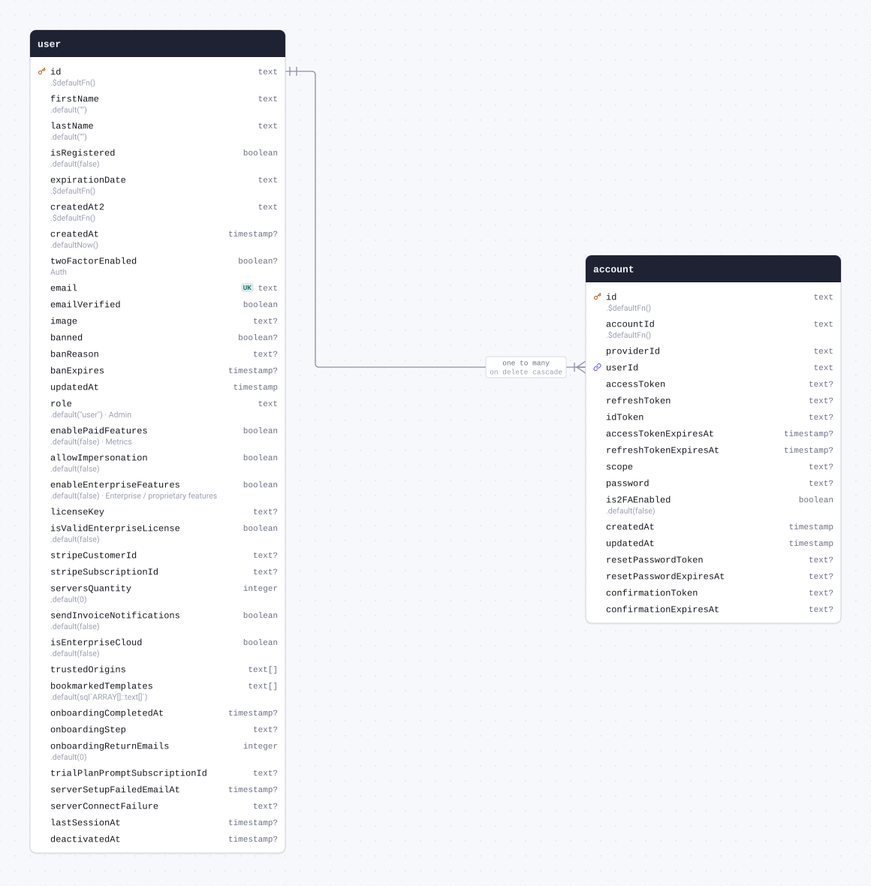

| Column                                               | Type        | Constraints                       | Default           | Description |
| ---------------------------------------------------- | ----------- | --------------------------------- | ----------------- | ----------- |
| `id`                                                 | `text`      | PK NOT NULL                       | `.$defaultFn()`   |             |
| `accountId` (`account_id`)                           | `text`      | NOT NULL                          | `.$defaultFn()`   |             |
| `providerId` (`provider_id`)                         | `text`      | NOT NULL                          |                   |             |
| `userId` (`user_id`)                                 | `text`      | NOT NULL → [user.id](#table-user) |                   |             |
| `accessToken` (`access_token`)                       | `text`      | NULL                              |                   |             |
| `refreshToken` (`refresh_token`)                     | `text`      | NULL                              |                   |             |
| `idToken` (`id_token`)                               | `text`      | NULL                              |                   |             |
| `accessTokenExpiresAt` (`access_token_expires_at`)   | `timestamp` | NULL                              |                   |             |
| `refreshTokenExpiresAt` (`refresh_token_expires_at`) | `timestamp` | NULL                              |                   |             |
| `scope`                                              | `text`      | NULL                              |                   |             |
| `password`                                           | `text`      | NULL                              |                   |             |
| `is2FAEnabled`                                       | `boolean`   | NOT NULL                          | `.default(false)` |             |
| `createdAt` (`created_at`)                           | `timestamp` | NOT NULL                          |                   |             |
| `updatedAt` (`updated_at`)                           | `timestamp` | NOT NULL                          |                   |             |
| `resetPasswordToken`                                 | `text`      | NULL                              |                   |             |
| `resetPasswordExpiresAt`                             | `text`      | NULL                              |                   |             |
| `confirmationToken`                                  | `text`      | NULL                              |                   |             |
| `confirmationExpiresAt`                              | `text`      | NULL                              |                   |             |

#### Definition

```sql
CREATE TABLE "account" (
	"id" text PRIMARY KEY,
	"account_id" text NOT NULL,
	"provider_id" text NOT NULL,
	"user_id" text NOT NULL,
	"access_token" text,
	"refresh_token" text,
	"id_token" text,
	"access_token_expires_at" timestamp,
	"refresh_token_expires_at" timestamp,
	"scope" text,
	"password" text,
	"is2FAEnabled" boolean DEFAULT false NOT NULL,
	"created_at" timestamp NOT NULL,
	"updated_at" timestamp NOT NULL,
	"resetPasswordToken" text,
	"resetPasswordExpiresAt" text,
	"confirmationToken" text,
	"confirmationExpiresAt" text
);

ALTER TABLE "account" ADD CONSTRAINT "account_user_id_user_id_fkey" FOREIGN KEY ("user_id") REFERENCES "user"("id") ON DELETE CASCADE;
```

#### References

- `userId` → [user.id](#table-user) (many to one, on delete cascade)

<details>
<summary>Queries and their SQL</summary>

**Select**: Every row of account.

```ts
db.select().from(account);
```

```sql
select "id", "account_id", "provider_id", "user_id", "access_token", "refresh_token", "id_token", "access_token_expires_at", "refresh_token_expires_at", "scope", "password", "is2FAEnabled", "created_at", "updated_at", "resetPasswordToken", "resetPasswordExpiresAt", "confirmationToken", "confirmationExpiresAt"
from "account"
```

**Count**: How many rows account has.

```ts
db.select({ count: count() }).from(account);
```

```sql
select count(*)
from "account"
```

**Find many**: The rows of account, through the relational query API.

```ts
db.query.account.findMany();
```

```sql
select "d0"."id" as "id", "d0"."account_id" as "accountId", "d0"."provider_id" as "providerId", "d0"."user_id" as "userId", "d0"."access_token" as "accessToken", "d0"."refresh_token" as "refreshToken", "d0"."id_token" as "idToken", "d0"."access_token_expires_at" as "accessTokenExpiresAt", "d0"."refresh_token_expires_at" as "refreshTokenExpiresAt", "d0"."scope" as "scope", "d0"."password" as "password", "d0"."is2FAEnabled" as "is2FAEnabled", "d0"."created_at" as "createdAt", "d0"."updated_at" as "updatedAt", "d0"."resetPasswordToken" as "resetPasswordToken", "d0"."resetPasswordExpiresAt" as "resetPasswordExpiresAt", "d0"."confirmationToken" as "confirmationToken", "d0"."confirmationExpiresAt" as "confirmationExpiresAt"
from "account" as "d0"
```

**Find by primary key**: One row of account, through the relational query API.

```ts
db.query.account.findFirst({ where: { id: "id" } });
```

```sql
select "d0"."id" as "id", "d0"."account_id" as "accountId", "d0"."provider_id" as "providerId", "d0"."user_id" as "userId", "d0"."access_token" as "accessToken", "d0"."refresh_token" as "refreshToken", "d0"."id_token" as "idToken", "d0"."access_token_expires_at" as "accessTokenExpiresAt", "d0"."refresh_token_expires_at" as "refreshTokenExpiresAt", "d0"."scope" as "scope", "d0"."password" as "password", "d0"."is2FAEnabled" as "is2FAEnabled", "d0"."created_at" as "createdAt", "d0"."updated_at" as "updatedAt", "d0"."resetPasswordToken" as "resetPasswordToken", "d0"."resetPasswordExpiresAt" as "resetPasswordExpiresAt", "d0"."confirmationToken" as "confirmationToken", "d0"."confirmationExpiresAt" as "confirmationExpiresAt"
from "account" as "d0"
where "d0"."id" = $1
limit $2
-- params: ["id",1]
```

**Insert**: Adds a row to account, giving the columns that have no default.

```ts
db.insert(account).values({
  providerId: "providerId",
  userId: "userId",
  createdAt: new Date("2026-01-01T00:00:00.000Z"),
  updatedAt: new Date("2026-01-01T00:00:00.000Z"),
});
```

```sql
insert into "account" ("id", "account_id", "provider_id", "user_id", "access_token", "refresh_token", "id_token", "access_token_expires_at", "refresh_token_expires_at", "scope", "password", "is2FAEnabled", "created_at", "updated_at", "resetPasswordToken", "resetPasswordExpiresAt", "confirmationToken", "confirmationExpiresAt")
values ($1, $2, $3, $4, default, default, default, default, default, default, default, default, $5, $6, default, default, default, default)
-- params: ["uuuuuuuuuuuuuuuuuuuuu","uuuuuuuuuuuuuuuuuuuuu","providerId","userId","2026-01-01T00:00:00.000Z","2026-01-01T00:00:00.000Z"]
```

**Update**: Changes a row of account, found by its primary key.

```ts
db.update(account).set({ accountId: "accountId" }).where(eq(account.id, "id"));
```

```sql
update "account"
set "account_id" = $1
where "account"."id" = $2
-- params: ["accountId","id"]
```

**Delete**: Deletes a row of account, found by its primary key.

```ts
db.delete(account).where(eq(account.id, "id"));
```

```sql
delete from "account"
where "account"."id" = $1
-- params: ["id"]
```

</details>

<a id="table-verification"></a>

### verification

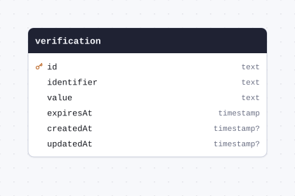

| Column                     | Type        | Constraints | Default | Description |
| -------------------------- | ----------- | ----------- | ------- | ----------- |
| `id`                       | `text`      | PK NOT NULL |         |             |
| `identifier`               | `text`      | NOT NULL    |         |             |
| `value`                    | `text`      | NOT NULL    |         |             |
| `expiresAt` (`expires_at`) | `timestamp` | NOT NULL    |         |             |
| `createdAt` (`created_at`) | `timestamp` | NULL        |         |             |
| `updatedAt` (`updated_at`) | `timestamp` | NULL        |         |             |

#### Definition

```sql
CREATE TABLE "verification" (
	"id" text PRIMARY KEY,
	"identifier" text NOT NULL,
	"value" text NOT NULL,
	"expires_at" timestamp NOT NULL,
	"created_at" timestamp,
	"updated_at" timestamp
);
```

<details>
<summary>Queries and their SQL</summary>

**Select**: Every row of verification.

```ts
db.select().from(verification);
```

```sql
select "id", "identifier", "value", "expires_at", "created_at", "updated_at"
from "verification"
```

**Count**: How many rows verification has.

```ts
db.select({ count: count() }).from(verification);
```

```sql
select count(*)
from "verification"
```

**Find many**: The rows of verification, through the relational query API.

```ts
db.query.verification.findMany();
```

```sql
select "d0"."id" as "id", "d0"."identifier" as "identifier", "d0"."value" as "value", "d0"."expires_at" as "expiresAt", "d0"."created_at" as "createdAt", "d0"."updated_at" as "updatedAt"
from "verification" as "d0"
```

**Find by primary key**: One row of verification, through the relational query API.

```ts
db.query.verification.findFirst({ where: { id: "id" } });
```

```sql
select "d0"."id" as "id", "d0"."identifier" as "identifier", "d0"."value" as "value", "d0"."expires_at" as "expiresAt", "d0"."created_at" as "createdAt", "d0"."updated_at" as "updatedAt"
from "verification" as "d0"
where "d0"."id" = $1
limit $2
-- params: ["id",1]
```

**Insert**: Adds a row to verification, giving the columns that have no default.

```ts
db.insert(verification).values({
  id: "id",
  identifier: "identifier",
  value: "value",
  expiresAt: new Date("2026-01-01T00:00:00.000Z"),
});
```

```sql
insert into "verification" ("id", "identifier", "value", "expires_at", "created_at", "updated_at")
values ($1, $2, $3, $4, default, default)
-- params: ["id","identifier","value","2026-01-01T00:00:00.000Z"]
```

**Update**: Changes a row of verification, found by its primary key.

```ts
db.update(verification).set({ identifier: "identifier" }).where(eq(verification.id, "id"));
```

```sql
update "verification"
set "identifier" = $1
where "verification"."id" = $2
-- params: ["identifier","id"]
```

**Delete**: Deletes a row of verification, found by its primary key.

```ts
db.delete(verification).where(eq(verification.id, "id"));
```

```sql
delete from "verification"
where "verification"."id" = $1
-- params: ["id"]
```

</details>

<a id="table-organization"></a>

### organization

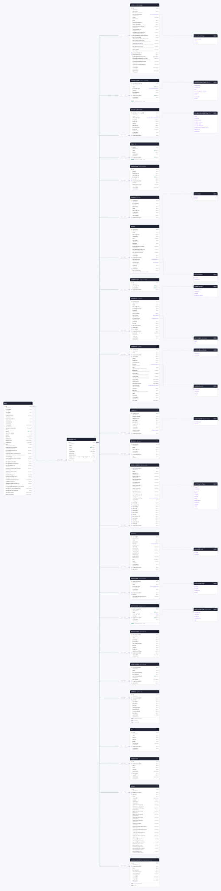

| Column                         | Type        | Constraints                       | Default         | Description |
| ------------------------------ | ----------- | --------------------------------- | --------------- | ----------- |
| `id`                           | `text`      | PK NOT NULL                       | `.$defaultFn()` |             |
| `name`                         | `text`      | NOT NULL                          |                 |             |
| `slug`                         | `text`      | UNIQUE NULL                       |                 |             |
| `logo`                         | `text`      | NULL                              |                 |             |
| `createdAt` (`created_at`)     | `timestamp` | NOT NULL                          |                 |             |
| `metadata`                     | `text`      | NULL                              |                 |             |
| `defaultRole` (`default_role`) | `text`      | NULL                              |                 |             |
| `ownerId` (`owner_id`)         | `text`      | NOT NULL → [user.id](#table-user) |                 |             |

#### Definition

```sql
CREATE TABLE "organization" (
	"id" text PRIMARY KEY,
	"name" text NOT NULL,
	"slug" text UNIQUE,
	"logo" text,
	"created_at" timestamp NOT NULL,
	"metadata" text,
	"default_role" text,
	"owner_id" text NOT NULL
);

ALTER TABLE "organization" ADD CONSTRAINT "organization_owner_id_user_id_fkey" FOREIGN KEY ("owner_id") REFERENCES "user"("id") ON DELETE CASCADE;
```

#### References

- `ownerId` → [user.id](#table-user) (many to one, on delete cascade)

#### Referenced by

- `id` → [organizationRole.organizationId](#table-organizationRole) (one to many, on delete cascade)
- `id` → [member.organizationId](#table-member) (one to many, on delete cascade)
- `id` → [invitation.organizationId](#table-invitation) (one to many, on delete cascade)
- `id` → [ai.organizationId](#table-ai) (one to many, on delete cascade)
- `id` → [auditLog.organizationId](#table-auditLog) (one to many, on delete set null)
- `id` → [certificates.organizationId](#table-certificates) (one to many, on delete cascade)
- `id` → [destinations.organizationId](#table-destinations) (one to many, on delete cascade)
- `id` → [dnsProvider.organizationId](#table-dnsProvider) (one to many, on delete cascade)
- `id` → [gitProvider.organizationId](#table-gitProvider) (one to many, on delete cascade)
- `id` → [network.organizationId](#table-network) (one to many, on delete cascade)
- `id` → [notifications.organizationId](#table-notifications) (one to many, on delete cascade)
- `id` → [projects.organizationId](#table-projects) (one to many, on delete cascade)
- `id` → [registry.organizationId](#table-registry) (one to many, on delete cascade)
- `id` → [sandboxes.organizationId](#table-sandboxes) (one to many, on delete cascade)
- `id` → [schedules.organizationId](#table-schedules) (one to many, on delete cascade)
- `id` → [scimProvider.organizationId](#table-scimProvider) (one to many, on delete cascade)
- `id` → [server.organizationId](#table-server) (one to many, on delete cascade)
- `id` → [sshKeys.organizationId](#table-sshKeys) (one to many, on delete cascade)
- `id` → [ssoProvider.organizationId](#table-ssoProvider) (one to many, on delete cascade)
- `id` → [tags.organizationId](#table-tags) (one to many, on delete cascade)
- `id` → [telemetryProvider.organizationId](#table-telemetryProvider) (one to many, on delete cascade)
- `id` → [vaultProvider.organizationId](#table-vaultProvider) (one to many, on delete cascade)
- `id` → [webServerSettings.vectorAgentOrganizationId](#table-webServerSettings) (one to many, on delete set null)

<details>
<summary>Queries and their SQL</summary>

**Select**: Every row of organization.

```ts
db.select().from(organization);
```

```sql
select "id", "name", "slug", "logo", "created_at", "metadata", "default_role", "owner_id"
from "organization"
```

**Count**: How many rows organization has.

```ts
db.select({ count: count() }).from(organization);
```

```sql
select count(*)
from "organization"
```

**Find many**: The rows of organization, through the relational query API.

```ts
db.query.organization.findMany();
```

```sql
select "d0"."id" as "id", "d0"."name" as "name", "d0"."slug" as "slug", "d0"."logo" as "logo", "d0"."created_at" as "createdAt", "d0"."metadata" as "metadata", "d0"."default_role" as "defaultRole", "d0"."owner_id" as "ownerId"
from "organization" as "d0"
```

**Find by primary key**: One row of organization, through the relational query API.

```ts
db.query.organization.findFirst({ where: { id: "id" } });
```

```sql
select "d0"."id" as "id", "d0"."name" as "name", "d0"."slug" as "slug", "d0"."logo" as "logo", "d0"."created_at" as "createdAt", "d0"."metadata" as "metadata", "d0"."default_role" as "defaultRole", "d0"."owner_id" as "ownerId"
from "organization" as "d0"
where "d0"."id" = $1
limit $2
-- params: ["id",1]
```

**Insert**: Adds a row to organization, giving the columns that have no default.

```ts
db.insert(organization).values({
  name: "name",
  createdAt: new Date("2026-01-01T00:00:00.000Z"),
  ownerId: "ownerId",
});
```

```sql
insert into "organization" ("id", "name", "slug", "logo", "created_at", "metadata", "default_role", "owner_id")
values ($1, $2, default, default, $3, default, default, $4)
-- params: ["uuuuuuuuuuuuuuuuuuuuu","name","2026-01-01T00:00:00.000Z","ownerId"]
```

**Update**: Changes a row of organization, found by its primary key.

```ts
db.update(organization).set({ name: "name" }).where(eq(organization.id, "id"));
```

```sql
update "organization"
set "name" = $1
where "organization"."id" = $2
-- params: ["name","id"]
```

**Delete**: Deletes a row of organization, found by its primary key.

```ts
db.delete(organization).where(eq(organization.id, "id"));
```

```sql
delete from "organization"
where "organization"."id" = $1
-- params: ["id"]
```

</details>

<a id="table-organizationRole"></a>

### organizationRole

Table `organization_role`.

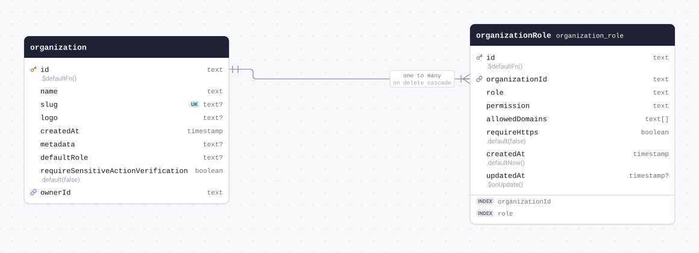

| Column                               | Type        | Constraints                                       | Default         | Description |
| ------------------------------------ | ----------- | ------------------------------------------------- | --------------- | ----------- |
| `id`                                 | `text`      | PK NOT NULL                                       | `.$defaultFn()` |             |
| `organizationId` (`organization_id`) | `text`      | NOT NULL → [organization.id](#table-organization) |                 |             |
| `role`                               | `text`      | NOT NULL                                          |                 |             |
| `permission`                         | `text`      | NOT NULL                                          |                 |             |
| `createdAt` (`created_at`)           | `timestamp` | NOT NULL                                          | `.defaultNow()` |             |
| `updatedAt` (`updated_at`)           | `timestamp` | NULL                                              | `.$onUpdate()`  |             |

#### Definition

```sql
CREATE TABLE "organization_role" (
	"id" text PRIMARY KEY,
	"organization_id" text NOT NULL,
	"role" text NOT NULL,
	"permission" text NOT NULL,
	"created_at" timestamp DEFAULT now() NOT NULL,
	"updated_at" timestamp
);

CREATE INDEX "organizationRole_organizationId_idx" ON "organization_role" ("organization_id");

CREATE INDEX "organizationRole_role_idx" ON "organization_role" ("role");

ALTER TABLE "organization_role" ADD CONSTRAINT "organization_role_organization_id_organization_id_fkey" FOREIGN KEY ("organization_id") REFERENCES "organization"("id") ON DELETE CASCADE;
```

#### Indexes

- INDEX `organizationId`
- INDEX `role`

#### References

- `organizationId` → [organization.id](#table-organization) (many to one, on delete cascade)

<details>
<summary>Queries and their SQL</summary>

**Select**: Every row of organizationRole.

```ts
db.select().from(organizationRole);
```

```sql
select "id", "organization_id", "role", "permission", "created_at", "updated_at"
from "organization_role"
```

**Count**: How many rows organizationRole has.

```ts
db.select({ count: count() }).from(organizationRole);
```

```sql
select count(*)
from "organization_role"
```

**Find many**: The rows of organizationRole, through the relational query API.

```ts
db.query.organizationRole.findMany();
```

```sql
select "d0"."id" as "id", "d0"."organization_id" as "organizationId", "d0"."role" as "role", "d0"."permission" as "permission", "d0"."created_at" as "createdAt", "d0"."updated_at" as "updatedAt"
from "organization_role" as "d0"
```

**Find by primary key**: One row of organizationRole, through the relational query API.

```ts
db.query.organizationRole.findFirst({ where: { id: "id" } });
```

```sql
select "d0"."id" as "id", "d0"."organization_id" as "organizationId", "d0"."role" as "role", "d0"."permission" as "permission", "d0"."created_at" as "createdAt", "d0"."updated_at" as "updatedAt"
from "organization_role" as "d0"
where "d0"."id" = $1
limit $2
-- params: ["id",1]
```

**Insert**: Adds a row to organizationRole, giving the columns that have no default.

```ts
db.insert(organizationRole).values({
  organizationId: "organizationId",
  role: "role",
  permission: "permission",
});
```

```sql
insert into "organization_role" ("id", "organization_id", "role", "permission", "created_at", "updated_at")
values ($1, $2, $3, $4, default, $5)
-- params: ["uuuuuuuuuuuuuuuuuuuuu","organizationId","role","permission","2026-01-01T00:00:00.000Z"]
```

**Update**: Changes a row of organizationRole, found by its primary key.

```ts
db.update(organizationRole)
  .set({ organizationId: "organizationId" })
  .where(eq(organizationRole.id, "id"));
```

```sql
update "organization_role"
set "organization_id" = $1, "updated_at" = $2
where "organization_role"."id" = $3
-- params: ["organizationId","2026-01-01T00:00:00.000Z","id"]
```

**Delete**: Deletes a row of organizationRole, found by its primary key.

```ts
db.delete(organizationRole).where(eq(organizationRole.id, "id"));
```

```sql
delete from "organization_role"
where "organization_role"."id" = $1
-- params: ["id"]
```

</details>

<a id="table-member"></a>

### member

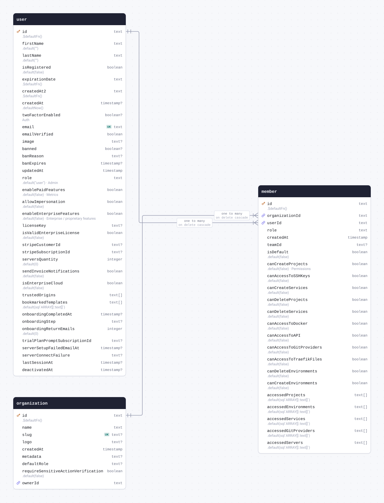

| Column                                 | Type        | Constraints                                       | Default                            | Description |
| -------------------------------------- | ----------- | ------------------------------------------------- | ---------------------------------- | ----------- |
| `id`                                   | `text`      | PK NOT NULL                                       | `.$defaultFn()`                    |             |
| `organizationId` (`organization_id`)   | `text`      | NOT NULL → [organization.id](#table-organization) |                                    |             |
| `userId` (`user_id`)                   | `text`      | NOT NULL → [user.id](#table-user)                 |                                    |             |
| `role`                                 | `text`      | NOT NULL                                          |                                    |             |
| `createdAt` (`created_at`)             | `timestamp` | NOT NULL                                          |                                    |             |
| `teamId` (`team_id`)                   | `text`      | NULL                                              |                                    |             |
| `isDefault` (`is_default`)             | `boolean`   | NOT NULL                                          | `.default(false)`                  |             |
| `canCreateProjects`                    | `boolean`   | NOT NULL                                          | `.default(false)`                  | Permissions |
| `canAccessToSSHKeys`                   | `boolean`   | NOT NULL                                          | `.default(false)`                  |             |
| `canCreateServices`                    | `boolean`   | NOT NULL                                          | `.default(false)`                  |             |
| `canDeleteProjects`                    | `boolean`   | NOT NULL                                          | `.default(false)`                  |             |
| `canDeleteServices`                    | `boolean`   | NOT NULL                                          | `.default(false)`                  |             |
| `canAccessToDocker`                    | `boolean`   | NOT NULL                                          | `.default(false)`                  |             |
| `canAccessToAPI`                       | `boolean`   | NOT NULL                                          | `.default(false)`                  |             |
| `canAccessToGitProviders`              | `boolean`   | NOT NULL                                          | `.default(false)`                  |             |
| `canAccessToTraefikFiles`              | `boolean`   | NOT NULL                                          | `.default(false)`                  |             |
| `canDeleteEnvironments`                | `boolean`   | NOT NULL                                          | `.default(false)`                  |             |
| `canCreateEnvironments`                | `boolean`   | NOT NULL                                          | `.default(false)`                  |             |
| `accessedProjects` (`accesedProjects`) | `text[]`    | NOT NULL                                          | ``.default(sql`ARRAY[]::text[]`)`` |             |
| `accessedEnvironments`                 | `text[]`    | NOT NULL                                          | ``.default(sql`ARRAY[]::text[]`)`` |             |
| `accessedServices` (`accesedServices`) | `text[]`    | NOT NULL                                          | ``.default(sql`ARRAY[]::text[]`)`` |             |
| `accessedGitProviders`                 | `text[]`    | NOT NULL                                          | ``.default(sql`ARRAY[]::text[]`)`` |             |
| `accessedServers`                      | `text[]`    | NOT NULL                                          | ``.default(sql`ARRAY[]::text[]`)`` |             |

#### Definition

```sql
CREATE TABLE "member" (
	"id" text PRIMARY KEY,
	"organization_id" text NOT NULL,
	"user_id" text NOT NULL,
	"role" text NOT NULL,
	"created_at" timestamp NOT NULL,
	"team_id" text,
	"is_default" boolean DEFAULT false NOT NULL,
	"canCreateProjects" boolean DEFAULT false NOT NULL,
	"canAccessToSSHKeys" boolean DEFAULT false NOT NULL,
	"canCreateServices" boolean DEFAULT false NOT NULL,
	"canDeleteProjects" boolean DEFAULT false NOT NULL,
	"canDeleteServices" boolean DEFAULT false NOT NULL,
	"canAccessToDocker" boolean DEFAULT false NOT NULL,
	"canAccessToAPI" boolean DEFAULT false NOT NULL,
	"canAccessToGitProviders" boolean DEFAULT false NOT NULL,
	"canAccessToTraefikFiles" boolean DEFAULT false NOT NULL,
	"canDeleteEnvironments" boolean DEFAULT false NOT NULL,
	"canCreateEnvironments" boolean DEFAULT false NOT NULL,
	"accesedProjects" text[] DEFAULT ARRAY[]::text[] NOT NULL,
	"accessedEnvironments" text[] DEFAULT ARRAY[]::text[] NOT NULL,
	"accesedServices" text[] DEFAULT ARRAY[]::text[] NOT NULL,
	"accessedGitProviders" text[] DEFAULT ARRAY[]::text[] NOT NULL,
	"accessedServers" text[] DEFAULT ARRAY[]::text[] NOT NULL
);

ALTER TABLE "member" ADD CONSTRAINT "member_organization_id_organization_id_fkey" FOREIGN KEY ("organization_id") REFERENCES "organization"("id") ON DELETE CASCADE;

ALTER TABLE "member" ADD CONSTRAINT "member_user_id_user_id_fkey" FOREIGN KEY ("user_id") REFERENCES "user"("id") ON DELETE CASCADE;
```

#### References

- `organizationId` → [organization.id](#table-organization) (many to one, on delete cascade)
- `userId` → [user.id](#table-user) (many to one, on delete cascade)

<details>
<summary>Queries and their SQL</summary>

**Select**: Every row of member.

```ts
db.select().from(member);
```

```sql
select "id", "organization_id", "user_id", "role", "created_at", "team_id", "is_default", "canCreateProjects", "canAccessToSSHKeys", "canCreateServices", "canDeleteProjects", "canDeleteServices", "canAccessToDocker", "canAccessToAPI", "canAccessToGitProviders", "canAccessToTraefikFiles", "canDeleteEnvironments", "canCreateEnvironments", "accesedProjects", "accessedEnvironments", "accesedServices", "accessedGitProviders", "accessedServers"
from "member"
```

**Count**: How many rows member has.

```ts
db.select({ count: count() }).from(member);
```

```sql
select count(*)
from "member"
```

**Find many**: The rows of member, through the relational query API.

```ts
db.query.member.findMany();
```

```sql
select "d0"."id" as "id", "d0"."organization_id" as "organizationId", "d0"."user_id" as "userId", "d0"."role" as "role", "d0"."created_at" as "createdAt", "d0"."team_id" as "teamId", "d0"."is_default" as "isDefault", "d0"."canCreateProjects" as "canCreateProjects", "d0"."canAccessToSSHKeys" as "canAccessToSSHKeys", "d0"."canCreateServices" as "canCreateServices", "d0"."canDeleteProjects" as "canDeleteProjects", "d0"."canDeleteServices" as "canDeleteServices", "d0"."canAccessToDocker" as "canAccessToDocker", "d0"."canAccessToAPI" as "canAccessToAPI", "d0"."canAccessToGitProviders" as "canAccessToGitProviders", "d0"."canAccessToTraefikFiles" as "canAccessToTraefikFiles", "d0"."canDeleteEnvironments" as "canDeleteEnvironments", "d0"."canCreateEnvironments" as "canCreateEnvironments", "d0"."accesedProjects" as "accessedProjects", "d0"."accessedEnvironments" as "accessedEnvironments", "d0"."accesedServices" as "accessedServices", "d0"."accessedGitProviders" as "accessedGitProviders", "d0"."accessedServers" as "accessedServers"
from "member" as "d0"
```

**Find by primary key**: One row of member, through the relational query API.

```ts
db.query.member.findFirst({ where: { id: "id" } });
```

```sql
select "d0"."id" as "id", "d0"."organization_id" as "organizationId", "d0"."user_id" as "userId", "d0"."role" as "role", "d0"."created_at" as "createdAt", "d0"."team_id" as "teamId", "d0"."is_default" as "isDefault", "d0"."canCreateProjects" as "canCreateProjects", "d0"."canAccessToSSHKeys" as "canAccessToSSHKeys", "d0"."canCreateServices" as "canCreateServices", "d0"."canDeleteProjects" as "canDeleteProjects", "d0"."canDeleteServices" as "canDeleteServices", "d0"."canAccessToDocker" as "canAccessToDocker", "d0"."canAccessToAPI" as "canAccessToAPI", "d0"."canAccessToGitProviders" as "canAccessToGitProviders", "d0"."canAccessToTraefikFiles" as "canAccessToTraefikFiles", "d0"."canDeleteEnvironments" as "canDeleteEnvironments", "d0"."canCreateEnvironments" as "canCreateEnvironments", "d0"."accesedProjects" as "accessedProjects", "d0"."accessedEnvironments" as "accessedEnvironments", "d0"."accesedServices" as "accessedServices", "d0"."accessedGitProviders" as "accessedGitProviders", "d0"."accessedServers" as "accessedServers"
from "member" as "d0"
where "d0"."id" = $1
limit $2
-- params: ["id",1]
```

**Insert**: Adds a row to member, giving the columns that have no default.

```ts
db.insert(member).values({
  organizationId: "organizationId",
  userId: "userId",
  role: "role",
  createdAt: new Date("2026-01-01T00:00:00.000Z"),
});
```

```sql
insert into "member" ("id", "organization_id", "user_id", "role", "created_at", "team_id", "is_default", "canCreateProjects", "canAccessToSSHKeys", "canCreateServices", "canDeleteProjects", "canDeleteServices", "canAccessToDocker", "canAccessToAPI", "canAccessToGitProviders", "canAccessToTraefikFiles", "canDeleteEnvironments", "canCreateEnvironments", "accesedProjects", "accessedEnvironments", "accesedServices", "accessedGitProviders", "accessedServers")
values ($1, $2, $3, $4, $5, default, default, default, default, default, default, default, default, default, default, default, default, default, default, default, default, default, default)
-- params: ["uuuuuuuuuuuuuuuuuuuuu","organizationId","userId","role","2026-01-01T00:00:00.000Z"]
```

**Update**: Changes a row of member, found by its primary key.

```ts
db.update(member).set({ organizationId: "organizationId" }).where(eq(member.id, "id"));
```

```sql
update "member"
set "organization_id" = $1
where "member"."id" = $2
-- params: ["organizationId","id"]
```

**Delete**: Deletes a row of member, found by its primary key.

```ts
db.delete(member).where(eq(member.id, "id"));
```

```sql
delete from "member"
where "member"."id" = $1
-- params: ["id"]
```

</details>

<a id="table-invitation"></a>

### invitation

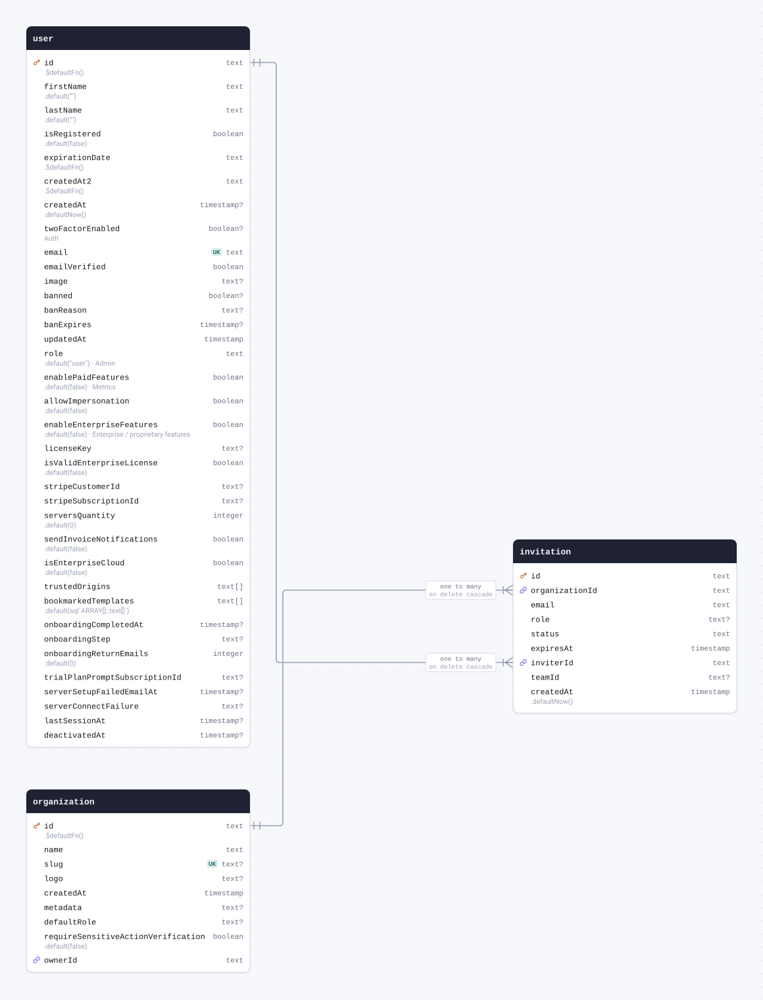

| Column                               | Type        | Constraints                                       | Default         | Description |
| ------------------------------------ | ----------- | ------------------------------------------------- | --------------- | ----------- |
| `id`                                 | `text`      | PK NOT NULL                                       |                 |             |
| `organizationId` (`organization_id`) | `text`      | NOT NULL → [organization.id](#table-organization) |                 |             |
| `email`                              | `text`      | NOT NULL                                          |                 |             |
| `role`                               | `text`      | NULL                                              |                 |             |
| `status`                             | `text`      | NOT NULL                                          |                 |             |
| `expiresAt` (`expires_at`)           | `timestamp` | NOT NULL                                          |                 |             |
| `inviterId` (`inviter_id`)           | `text`      | NOT NULL → [user.id](#table-user)                 |                 |             |
| `teamId` (`team_id`)                 | `text`      | NULL                                              |                 |             |
| `createdAt` (`created_at`)           | `timestamp` | NOT NULL                                          | `.defaultNow()` |             |

#### Definition

```sql
CREATE TABLE "invitation" (
	"id" text PRIMARY KEY,
	"organization_id" text NOT NULL,
	"email" text NOT NULL,
	"role" text,
	"status" text NOT NULL,
	"expires_at" timestamp NOT NULL,
	"inviter_id" text NOT NULL,
	"team_id" text,
	"created_at" timestamp DEFAULT now() NOT NULL
);

ALTER TABLE "invitation" ADD CONSTRAINT "invitation_organization_id_organization_id_fkey" FOREIGN KEY ("organization_id") REFERENCES "organization"("id") ON DELETE CASCADE;

ALTER TABLE "invitation" ADD CONSTRAINT "invitation_inviter_id_user_id_fkey" FOREIGN KEY ("inviter_id") REFERENCES "user"("id") ON DELETE CASCADE;
```

#### References

- `organizationId` → [organization.id](#table-organization) (many to one, on delete cascade)
- `inviterId` → [user.id](#table-user) (many to one, on delete cascade)

<details>
<summary>Queries and their SQL</summary>

**Select**: Every row of invitation.

```ts
db.select().from(invitation);
```

```sql
select "id", "organization_id", "email", "role", "status", "expires_at", "inviter_id", "team_id", "created_at"
from "invitation"
```

**Count**: How many rows invitation has.

```ts
db.select({ count: count() }).from(invitation);
```

```sql
select count(*)
from "invitation"
```

**Find many**: The rows of invitation, through the relational query API.

```ts
db.query.invitation.findMany();
```

```sql
select "d0"."id" as "id", "d0"."organization_id" as "organizationId", "d0"."email" as "email", "d0"."role" as "role", "d0"."status" as "status", "d0"."expires_at" as "expiresAt", "d0"."inviter_id" as "inviterId", "d0"."team_id" as "teamId", "d0"."created_at" as "createdAt"
from "invitation" as "d0"
```

**Find by primary key**: One row of invitation, through the relational query API.

```ts
db.query.invitation.findFirst({ where: { id: "id" } });
```

```sql
select "d0"."id" as "id", "d0"."organization_id" as "organizationId", "d0"."email" as "email", "d0"."role" as "role", "d0"."status" as "status", "d0"."expires_at" as "expiresAt", "d0"."inviter_id" as "inviterId", "d0"."team_id" as "teamId", "d0"."created_at" as "createdAt"
from "invitation" as "d0"
where "d0"."id" = $1
limit $2
-- params: ["id",1]
```

**Insert**: Adds a row to invitation, giving the columns that have no default.

```ts
db.insert(invitation).values({
  id: "id",
  organizationId: "organizationId",
  email: "email",
  status: "status",
  expiresAt: new Date("2026-01-01T00:00:00.000Z"),
  inviterId: "inviterId",
});
```

```sql
insert into "invitation" ("id", "organization_id", "email", "role", "status", "expires_at", "inviter_id", "team_id", "created_at")
values ($1, $2, $3, default, $4, $5, $6, default, default)
-- params: ["id","organizationId","email","status","2026-01-01T00:00:00.000Z","inviterId"]
```

**Update**: Changes a row of invitation, found by its primary key.

```ts
db.update(invitation).set({ organizationId: "organizationId" }).where(eq(invitation.id, "id"));
```

```sql
update "invitation"
set "organization_id" = $1
where "invitation"."id" = $2
-- params: ["organizationId","id"]
```

**Delete**: Deletes a row of invitation, found by its primary key.

```ts
db.delete(invitation).where(eq(invitation.id, "id"));
```

```sql
delete from "invitation"
where "invitation"."id" = $1
-- params: ["id"]
```

</details>

<a id="table-twoFactor"></a>

### twoFactor

Table `two_factor`.

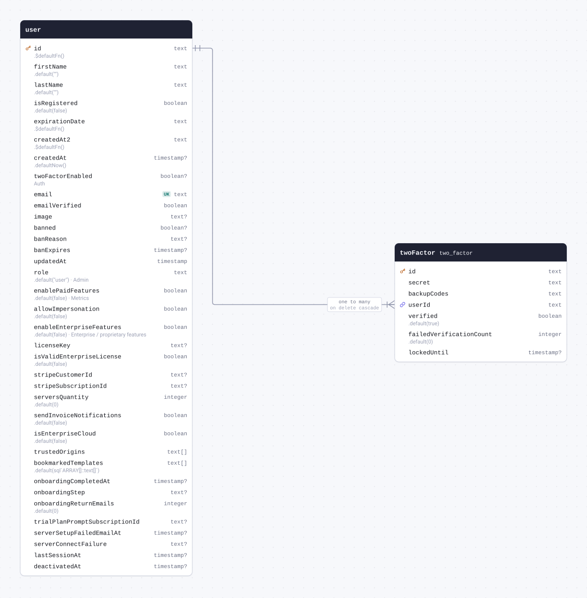

| Column                                                  | Type        | Constraints                       | Default          | Description |
| ------------------------------------------------------- | ----------- | --------------------------------- | ---------------- | ----------- |
| `id`                                                    | `text`      | PK NOT NULL                       |                  |             |
| `secret`                                                | `text`      | NOT NULL                          |                  |             |
| `backupCodes` (`backup_codes`)                          | `text`      | NOT NULL                          |                  |             |
| `userId` (`user_id`)                                    | `text`      | NOT NULL → [user.id](#table-user) |                  |             |
| `verified`                                              | `boolean`   | NOT NULL                          | `.default(true)` |             |
| `failedVerificationCount` (`failed_verification_count`) | `integer`   | NOT NULL                          | `.default(0)`    |             |
| `lockedUntil` (`locked_until`)                          | `timestamp` | NULL                              |                  |             |

#### Definition

```sql
CREATE TABLE "two_factor" (
	"id" text PRIMARY KEY,
	"secret" text NOT NULL,
	"backup_codes" text NOT NULL,
	"user_id" text NOT NULL,
	"verified" boolean DEFAULT true NOT NULL,
	"failed_verification_count" integer DEFAULT 0 NOT NULL,
	"locked_until" timestamp
);

ALTER TABLE "two_factor" ADD CONSTRAINT "two_factor_user_id_user_id_fkey" FOREIGN KEY ("user_id") REFERENCES "user"("id") ON DELETE CASCADE;
```

#### References

- `userId` → [user.id](#table-user) (many to one, on delete cascade)

<details>
<summary>Queries and their SQL</summary>

**Select**: Every row of twoFactor.

```ts
db.select().from(twoFactor);
```

```sql
select "id", "secret", "backup_codes", "user_id", "verified", "failed_verification_count", "locked_until"
from "two_factor"
```

**Count**: How many rows twoFactor has.

```ts
db.select({ count: count() }).from(twoFactor);
```

```sql
select count(*)
from "two_factor"
```

**Find many**: The rows of twoFactor, through the relational query API.

```ts
db.query.twoFactor.findMany();
```

```sql
select "d0"."id" as "id", "d0"."secret" as "secret", "d0"."backup_codes" as "backupCodes", "d0"."user_id" as "userId", "d0"."verified" as "verified", "d0"."failed_verification_count" as "failedVerificationCount", "d0"."locked_until" as "lockedUntil"
from "two_factor" as "d0"
```

**Find by primary key**: One row of twoFactor, through the relational query API.

```ts
db.query.twoFactor.findFirst({ where: { id: "id" } });
```

```sql
select "d0"."id" as "id", "d0"."secret" as "secret", "d0"."backup_codes" as "backupCodes", "d0"."user_id" as "userId", "d0"."verified" as "verified", "d0"."failed_verification_count" as "failedVerificationCount", "d0"."locked_until" as "lockedUntil"
from "two_factor" as "d0"
where "d0"."id" = $1
limit $2
-- params: ["id",1]
```

**Insert**: Adds a row to twoFactor, giving the columns that have no default.

```ts
db.insert(twoFactor).values({
  id: "id",
  secret: "secret",
  backupCodes: "backupCodes",
  userId: "userId",
});
```

```sql
insert into "two_factor" ("id", "secret", "backup_codes", "user_id", "verified", "failed_verification_count", "locked_until")
values ($1, $2, $3, $4, default, default, default)
-- params: ["id","secret","backupCodes","userId"]
```

**Update**: Changes a row of twoFactor, found by its primary key.

```ts
db.update(twoFactor).set({ secret: "secret" }).where(eq(twoFactor.id, "id"));
```

```sql
update "two_factor"
set "secret" = $1
where "two_factor"."id" = $2
-- params: ["secret","id"]
```

**Delete**: Deletes a row of twoFactor, found by its primary key.

```ts
db.delete(twoFactor).where(eq(twoFactor.id, "id"));
```

```sql
delete from "two_factor"
where "two_factor"."id" = $1
-- params: ["id"]
```

</details>

<a id="table-passkey"></a>

### passkey

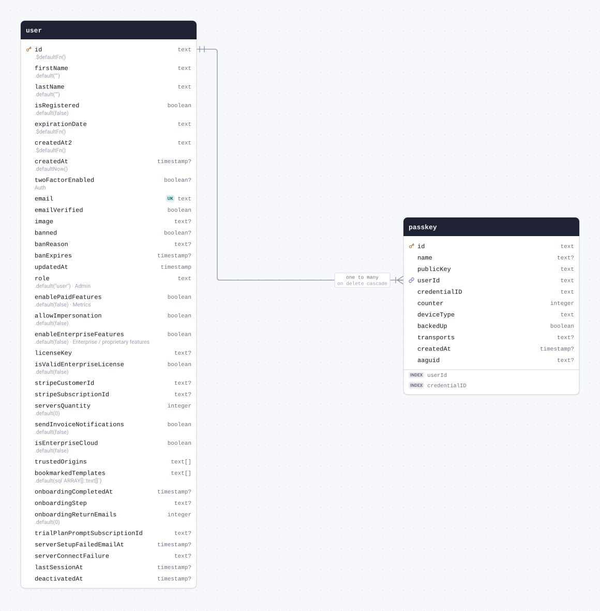

| Column                           | Type        | Constraints                       | Default | Description |
| -------------------------------- | ----------- | --------------------------------- | ------- | ----------- |
| `id`                             | `text`      | PK NOT NULL                       |         |             |
| `name`                           | `text`      | NULL                              |         |             |
| `publicKey` (`public_key`)       | `text`      | NOT NULL                          |         |             |
| `userId` (`user_id`)             | `text`      | NOT NULL → [user.id](#table-user) |         |             |
| `credentialID` (`credential_id`) | `text`      | NOT NULL                          |         |             |
| `counter`                        | `integer`   | NOT NULL                          |         |             |
| `deviceType` (`device_type`)     | `text`      | NOT NULL                          |         |             |
| `backedUp` (`backed_up`)         | `boolean`   | NOT NULL                          |         |             |
| `transports`                     | `text`      | NULL                              |         |             |
| `createdAt` (`created_at`)       | `timestamp` | NULL                              |         |             |
| `aaguid`                         | `text`      | NULL                              |         |             |

#### Definition

```sql
CREATE TABLE "passkey" (
	"id" text PRIMARY KEY,
	"name" text,
	"public_key" text NOT NULL,
	"user_id" text NOT NULL,
	"credential_id" text NOT NULL,
	"counter" integer NOT NULL,
	"device_type" text NOT NULL,
	"backed_up" boolean NOT NULL,
	"transports" text,
	"created_at" timestamp,
	"aaguid" text
);

CREATE INDEX "passkey_userId_idx" ON "passkey" ("user_id");

CREATE INDEX "passkey_credentialID_idx" ON "passkey" ("credential_id");

ALTER TABLE "passkey" ADD CONSTRAINT "passkey_user_id_user_id_fkey" FOREIGN KEY ("user_id") REFERENCES "user"("id") ON DELETE CASCADE;
```

#### Indexes

- INDEX `userId`
- INDEX `credentialID`

#### References

- `userId` → [user.id](#table-user) (many to one, on delete cascade)

<details>
<summary>Queries and their SQL</summary>

**Select**: Every row of passkey.

```ts
db.select().from(passkey);
```

```sql
select "id", "name", "public_key", "user_id", "credential_id", "counter", "device_type", "backed_up", "transports", "created_at", "aaguid"
from "passkey"
```

**Count**: How many rows passkey has.

```ts
db.select({ count: count() }).from(passkey);
```

```sql
select count(*)
from "passkey"
```

**Find many**: The rows of passkey, through the relational query API.

```ts
db.query.passkey.findMany();
```

```sql
select "d0"."id" as "id", "d0"."name" as "name", "d0"."public_key" as "publicKey", "d0"."user_id" as "userId", "d0"."credential_id" as "credentialID", "d0"."counter" as "counter", "d0"."device_type" as "deviceType", "d0"."backed_up" as "backedUp", "d0"."transports" as "transports", "d0"."created_at" as "createdAt", "d0"."aaguid" as "aaguid"
from "passkey" as "d0"
```

**Find by primary key**: One row of passkey, through the relational query API.

```ts
db.query.passkey.findFirst({ where: { id: "id" } });
```

```sql
select "d0"."id" as "id", "d0"."name" as "name", "d0"."public_key" as "publicKey", "d0"."user_id" as "userId", "d0"."credential_id" as "credentialID", "d0"."counter" as "counter", "d0"."device_type" as "deviceType", "d0"."backed_up" as "backedUp", "d0"."transports" as "transports", "d0"."created_at" as "createdAt", "d0"."aaguid" as "aaguid"
from "passkey" as "d0"
where "d0"."id" = $1
limit $2
-- params: ["id",1]
```

**Insert**: Adds a row to passkey, giving the columns that have no default.

```ts
db.insert(passkey).values({
  id: "id",
  publicKey: "publicKey",
  userId: "userId",
  credentialID: "credentialID",
  counter: 1,
  deviceType: "deviceType",
  backedUp: true,
});
```

```sql
insert into "passkey" ("id", "name", "public_key", "user_id", "credential_id", "counter", "device_type", "backed_up", "transports", "created_at", "aaguid")
values ($1, default, $2, $3, $4, $5, $6, $7, default, default, default)
-- params: ["id","publicKey","userId","credentialID",1,"deviceType",true]
```

**Update**: Changes a row of passkey, found by its primary key.

```ts
db.update(passkey).set({ name: "name" }).where(eq(passkey.id, "id"));
```

```sql
update "passkey"
set "name" = $1
where "passkey"."id" = $2
-- params: ["name","id"]
```

**Delete**: Deletes a row of passkey, found by its primary key.

```ts
db.delete(passkey).where(eq(passkey.id, "id"));
```

```sql
delete from "passkey"
where "passkey"."id" = $1
-- params: ["id"]
```

</details>

<a id="table-apikey"></a>

### apikey

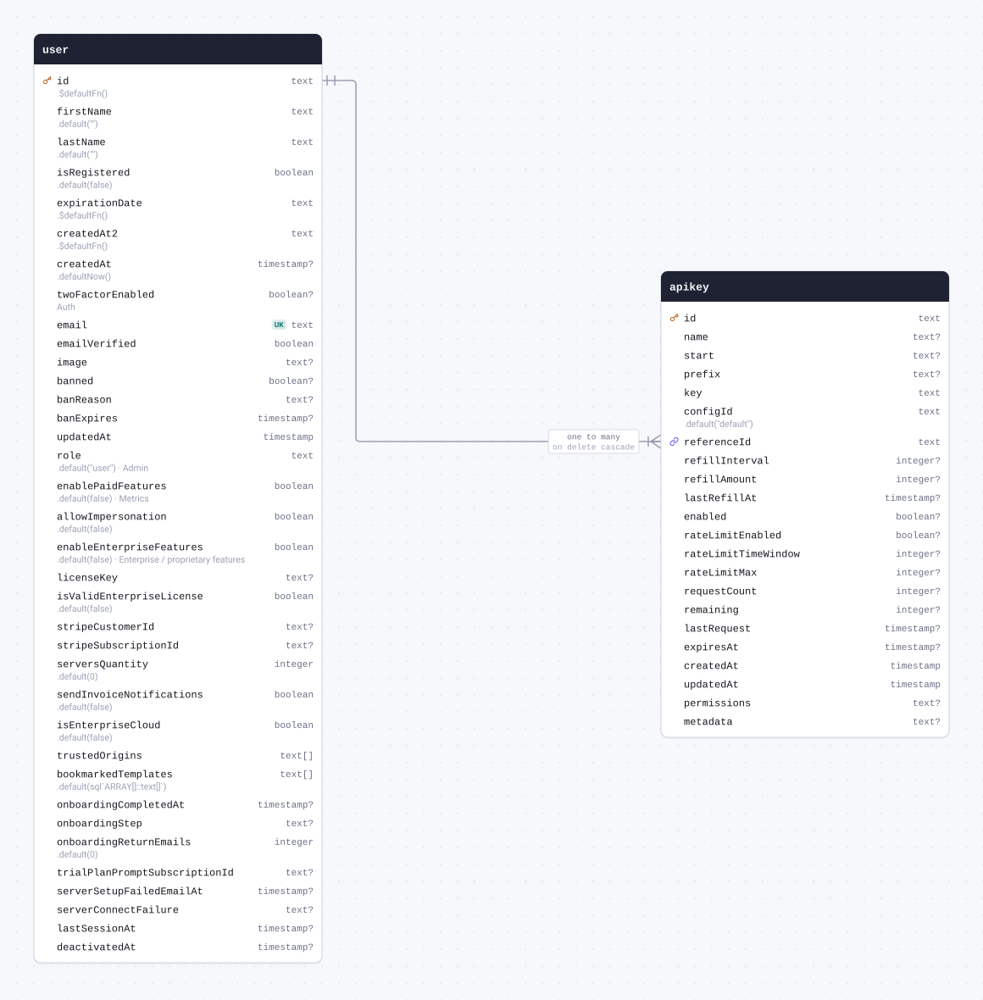

| Column                                           | Type        | Constraints                       | Default               | Description |
| ------------------------------------------------ | ----------- | --------------------------------- | --------------------- | ----------- |
| `id`                                             | `text`      | PK NOT NULL                       |                       |             |
| `name`                                           | `text`      | NULL                              |                       |             |
| `start`                                          | `text`      | NULL                              |                       |             |
| `prefix`                                         | `text`      | NULL                              |                       |             |
| `key`                                            | `text`      | NOT NULL                          |                       |             |
| `configId` (`config_id`)                         | `text`      | NOT NULL                          | `.default("default")` |             |
| `referenceId` (`reference_id`)                   | `text`      | NOT NULL → [user.id](#table-user) |                       |             |
| `refillInterval` (`refill_interval`)             | `integer`   | NULL                              |                       |             |
| `refillAmount` (`refill_amount`)                 | `integer`   | NULL                              |                       |             |
| `lastRefillAt` (`last_refill_at`)                | `timestamp` | NULL                              |                       |             |
| `enabled`                                        | `boolean`   | NULL                              |                       |             |
| `rateLimitEnabled` (`rate_limit_enabled`)        | `boolean`   | NULL                              |                       |             |
| `rateLimitTimeWindow` (`rate_limit_time_window`) | `integer`   | NULL                              |                       |             |
| `rateLimitMax` (`rate_limit_max`)                | `integer`   | NULL                              |                       |             |
| `requestCount` (`request_count`)                 | `integer`   | NULL                              |                       |             |
| `remaining`                                      | `integer`   | NULL                              |                       |             |
| `lastRequest` (`last_request`)                   | `timestamp` | NULL                              |                       |             |
| `expiresAt` (`expires_at`)                       | `timestamp` | NULL                              |                       |             |
| `createdAt` (`created_at`)                       | `timestamp` | NOT NULL                          |                       |             |
| `updatedAt` (`updated_at`)                       | `timestamp` | NOT NULL                          |                       |             |
| `permissions`                                    | `text`      | NULL                              |                       |             |
| `metadata`                                       | `text`      | NULL                              |                       |             |

#### Definition

```sql
CREATE TABLE "apikey" (
	"id" text PRIMARY KEY,
	"name" text,
	"start" text,
	"prefix" text,
	"key" text NOT NULL,
	"config_id" text DEFAULT 'default' NOT NULL,
	"reference_id" text NOT NULL,
	"refill_interval" integer,
	"refill_amount" integer,
	"last_refill_at" timestamp,
	"enabled" boolean,
	"rate_limit_enabled" boolean,
	"rate_limit_time_window" integer,
	"rate_limit_max" integer,
	"request_count" integer,
	"remaining" integer,
	"last_request" timestamp,
	"expires_at" timestamp,
	"created_at" timestamp NOT NULL,
	"updated_at" timestamp NOT NULL,
	"permissions" text,
	"metadata" text
);

ALTER TABLE "apikey" ADD CONSTRAINT "apikey_reference_id_user_id_fkey" FOREIGN KEY ("reference_id") REFERENCES "user"("id") ON DELETE CASCADE;
```

#### References

- `referenceId` → [user.id](#table-user) (many to one, on delete cascade)

<details>
<summary>Queries and their SQL</summary>

**Select**: Every row of apikey.

```ts
db.select().from(apikey);
```

```sql
select "id", "name", "start", "prefix", "key", "config_id", "reference_id", "refill_interval", "refill_amount", "last_refill_at", "enabled", "rate_limit_enabled", "rate_limit_time_window", "rate_limit_max", "request_count", "remaining", "last_request", "expires_at", "created_at", "updated_at", "permissions", "metadata"
from "apikey"
```

**Count**: How many rows apikey has.

```ts
db.select({ count: count() }).from(apikey);
```

```sql
select count(*)
from "apikey"
```

**Find many**: The rows of apikey, through the relational query API.

```ts
db.query.apikey.findMany();
```

```sql
select "d0"."id" as "id", "d0"."name" as "name", "d0"."start" as "start", "d0"."prefix" as "prefix", "d0"."key" as "key", "d0"."config_id" as "configId", "d0"."reference_id" as "referenceId", "d0"."refill_interval" as "refillInterval", "d0"."refill_amount" as "refillAmount", "d0"."last_refill_at" as "lastRefillAt", "d0"."enabled" as "enabled", "d0"."rate_limit_enabled" as "rateLimitEnabled", "d0"."rate_limit_time_window" as "rateLimitTimeWindow", "d0"."rate_limit_max" as "rateLimitMax", "d0"."request_count" as "requestCount", "d0"."remaining" as "remaining", "d0"."last_request" as "lastRequest", "d0"."expires_at" as "expiresAt", "d0"."created_at" as "createdAt", "d0"."updated_at" as "updatedAt", "d0"."permissions" as "permissions", "d0"."metadata" as "metadata"
from "apikey" as "d0"
```

**Find by primary key**: One row of apikey, through the relational query API.

```ts
db.query.apikey.findFirst({ where: { id: "id" } });
```

```sql
select "d0"."id" as "id", "d0"."name" as "name", "d0"."start" as "start", "d0"."prefix" as "prefix", "d0"."key" as "key", "d0"."config_id" as "configId", "d0"."reference_id" as "referenceId", "d0"."refill_interval" as "refillInterval", "d0"."refill_amount" as "refillAmount", "d0"."last_refill_at" as "lastRefillAt", "d0"."enabled" as "enabled", "d0"."rate_limit_enabled" as "rateLimitEnabled", "d0"."rate_limit_time_window" as "rateLimitTimeWindow", "d0"."rate_limit_max" as "rateLimitMax", "d0"."request_count" as "requestCount", "d0"."remaining" as "remaining", "d0"."last_request" as "lastRequest", "d0"."expires_at" as "expiresAt", "d0"."created_at" as "createdAt", "d0"."updated_at" as "updatedAt", "d0"."permissions" as "permissions", "d0"."metadata" as "metadata"
from "apikey" as "d0"
where "d0"."id" = $1
limit $2
-- params: ["id",1]
```

**Insert**: Adds a row to apikey, giving the columns that have no default.

```ts
db.insert(apikey).values({
  id: "id",
  key: "key",
  referenceId: "referenceId",
  createdAt: new Date("2026-01-01T00:00:00.000Z"),
  updatedAt: new Date("2026-01-01T00:00:00.000Z"),
});
```

```sql
insert into "apikey" ("id", "name", "start", "prefix", "key", "config_id", "reference_id", "refill_interval", "refill_amount", "last_refill_at", "enabled", "rate_limit_enabled", "rate_limit_time_window", "rate_limit_max", "request_count", "remaining", "last_request", "expires_at", "created_at", "updated_at", "permissions", "metadata")
values ($1, default, default, default, $2, default, $3, default, default, default, default, default, default, default, default, default, default, default, $4, $5, default, default)
-- params: ["id","key","referenceId","2026-01-01T00:00:00.000Z","2026-01-01T00:00:00.000Z"]
```

**Update**: Changes a row of apikey, found by its primary key.

```ts
db.update(apikey).set({ name: "name" }).where(eq(apikey.id, "id"));
```

```sql
update "apikey"
set "name" = $1
where "apikey"."id" = $2
-- params: ["name","id"]
```

**Delete**: Deletes a row of apikey, found by its primary key.

```ts
db.delete(apikey).where(eq(apikey.id, "id"));
```

```sql
delete from "apikey"
where "apikey"."id" = $1
-- params: ["id"]
```

</details>

<a id="table-ai"></a>

### ai

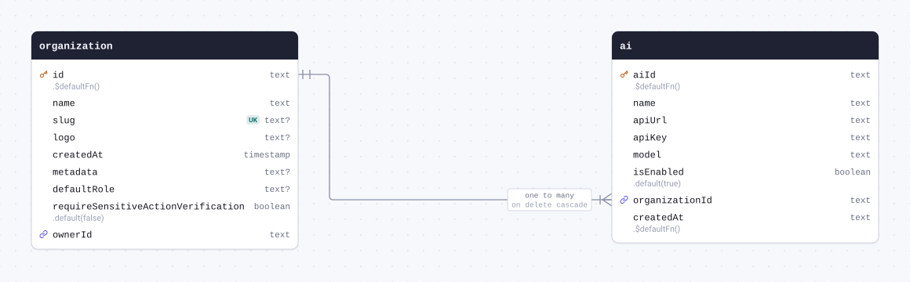

| Column           | Type      | Constraints                                       | Default          | Description |
| ---------------- | --------- | ------------------------------------------------- | ---------------- | ----------- |
| `aiId`           | `text`    | PK NOT NULL                                       | `.$defaultFn()`  |             |
| `name`           | `text`    | NOT NULL                                          |                  |             |
| `apiUrl`         | `text`    | NOT NULL                                          |                  |             |
| `apiKey`         | `text`    | NOT NULL                                          |                  |             |
| `model`          | `text`    | NOT NULL                                          |                  |             |
| `isEnabled`      | `boolean` | NOT NULL                                          | `.default(true)` |             |
| `organizationId` | `text`    | NOT NULL → [organization.id](#table-organization) |                  |             |
| `createdAt`      | `text`    | NOT NULL                                          | `.$defaultFn()`  |             |

#### Definition

```sql
CREATE TABLE "ai" (
	"aiId" text PRIMARY KEY,
	"name" text NOT NULL,
	"apiUrl" text NOT NULL,
	"apiKey" text NOT NULL,
	"model" text NOT NULL,
	"isEnabled" boolean DEFAULT true NOT NULL,
	"organizationId" text NOT NULL,
	"createdAt" text NOT NULL
);

ALTER TABLE "ai" ADD CONSTRAINT "ai_organizationId_organization_id_fkey" FOREIGN KEY ("organizationId") REFERENCES "organization"("id") ON DELETE CASCADE;
```

#### References

- `organizationId` → [organization.id](#table-organization) (many to one, on delete cascade)

<details>
<summary>Queries and their SQL</summary>

**Select**: Every row of ai.

```ts
db.select().from(ai);
```

```sql
select "aiId", "name", "apiUrl", "apiKey", "model", "isEnabled", "organizationId", "createdAt"
from "ai"
```

**Count**: How many rows ai has.

```ts
db.select({ count: count() }).from(ai);
```

```sql
select count(*)
from "ai"
```

**Find many**: The rows of ai, through the relational query API.

```ts
db.query.ai.findMany();
```

```sql
select "d0"."aiId" as "aiId", "d0"."name" as "name", "d0"."apiUrl" as "apiUrl", "d0"."apiKey" as "apiKey", "d0"."model" as "model", "d0"."isEnabled" as "isEnabled", "d0"."organizationId" as "organizationId", "d0"."createdAt" as "createdAt"
from "ai" as "d0"
```

**Find by primary key**: One row of ai, through the relational query API.

```ts
db.query.ai.findFirst({ where: { aiId: "aiId" } });
```

```sql
select "d0"."aiId" as "aiId", "d0"."name" as "name", "d0"."apiUrl" as "apiUrl", "d0"."apiKey" as "apiKey", "d0"."model" as "model", "d0"."isEnabled" as "isEnabled", "d0"."organizationId" as "organizationId", "d0"."createdAt" as "createdAt"
from "ai" as "d0"
where "d0"."aiId" = $1
limit $2
-- params: ["aiId",1]
```

**Insert**: Adds a row to ai, giving the columns that have no default.

```ts
db.insert(ai).values({
  name: "name",
  apiUrl: "apiUrl",
  apiKey: "apiKey",
  model: "model",
  organizationId: "organizationId",
});
```

```sql
insert into "ai" ("aiId", "name", "apiUrl", "apiKey", "model", "isEnabled", "organizationId", "createdAt")
values ($1, $2, $3, $4, $5, default, $6, $7)
-- params: ["uuuuuuuuuuuuuuuuuuuuu","name","apiUrl","apiKey","model","organizationId","2026-01-01T00:00:00.000Z"]
```

**Update**: Changes a row of ai, found by its primary key.

```ts
db.update(ai).set({ name: "name" }).where(eq(ai.aiId, "aiId"));
```

```sql
update "ai"
set "name" = $1
where "ai"."aiId" = $2
-- params: ["name","aiId"]
```

**Delete**: Deletes a row of ai, found by its primary key.

```ts
db.delete(ai).where(eq(ai.aiId, "aiId"));
```

```sql
delete from "ai"
where "ai"."aiId" = $1
-- params: ["aiId"]
```

</details>

<a id="table-applications"></a>

### applications

Table `application`.

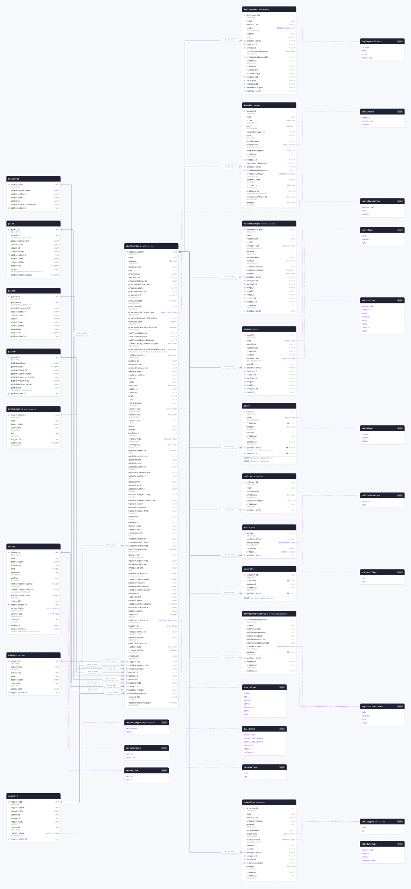

| Column                                       | Type                                           | Constraints                                                  | Default                  | Description                                                        |
| -------------------------------------------- | ---------------------------------------------- | ------------------------------------------------------------ | ------------------------ | ------------------------------------------------------------------ |
| `applicationId`                              | `text`                                         | PK NOT NULL                                                  | `.$defaultFn()`          |                                                                    |
| `name`                                       | `text`                                         | NOT NULL                                                     |                          |                                                                    |
| `appName`                                    | `text`                                         | UNIQUE NOT NULL                                              | `.$defaultFn()`          |                                                                    |
| `description`                                | `text`                                         | NULL                                                         |                          |                                                                    |
| `env`                                        | `text`                                         | NULL                                                         |                          |                                                                    |
| `previewEnv`                                 | `text`                                         | NULL                                                         |                          |                                                                    |
| `watchPaths`                                 | `text[]`                                       | NULL                                                         |                          |                                                                    |
| `previewBuildArgs`                           | `text`                                         | NULL                                                         |                          |                                                                    |
| `previewBuildSecrets`                        | `text`                                         | NULL                                                         |                          |                                                                    |
| `previewLabels`                              | `text[]`                                       | NULL                                                         |                          |                                                                    |
| `previewWildcard`                            | `text`                                         | NULL                                                         |                          |                                                                    |
| `previewPort`                                | `integer`                                      | NULL                                                         | `.default(3000)`         |                                                                    |
| `previewHttps`                               | `boolean`                                      | NOT NULL                                                     | `.default(false)`        |                                                                    |
| `previewPath`                                | `text`                                         | NULL                                                         | `.default("/")`          |                                                                    |
| `previewCertificateType` (`certificateType`) | [`certificateType`](#enum-certificateType)     | NOT NULL                                                     | `.default("none")`       |                                                                    |
| `previewCustomCertResolver`                  | `text`                                         | NULL                                                         |                          |                                                                    |
| `previewLimit`                               | `integer`                                      | NULL                                                         | `.default(3)`            |                                                                    |
| `previewForwardAuthEnabled`                  | `boolean`                                      | NOT NULL                                                     | `.default(false)`        |                                                                    |
| `isPreviewDeploymentsActive`                 | `boolean`                                      | NULL                                                         | `.default(false)`        |                                                                    |
| `previewRequireCollaboratorPermissions`      | `boolean`                                      | NULL                                                         | `.default(true)`         | Security: Require collaborator permissions for preview deployments |
| `rollbackActive`                             | `boolean`                                      | NULL                                                         | `.default(false)`        |                                                                    |
| `buildArgs`                                  | `text`                                         | NULL                                                         |                          |                                                                    |
| `buildSecrets`                               | `text`                                         | NULL                                                         |                          |                                                                    |
| `memoryReservation`                          | `text`                                         | NULL                                                         |                          |                                                                    |
| `memoryLimit`                                | `text`                                         | NULL                                                         |                          |                                                                    |
| `cpuReservation`                             | `text`                                         | NULL                                                         |                          |                                                                    |
| `cpuLimit`                                   | `text`                                         | NULL                                                         |                          |                                                                    |
| `title`                                      | `text`                                         | NULL                                                         |                          |                                                                    |
| `enabled`                                    | `boolean`                                      | NULL                                                         |                          |                                                                    |
| `subtitle`                                   | `text`                                         | NULL                                                         |                          |                                                                    |
| `command`                                    | `text`                                         | NULL                                                         |                          |                                                                    |
| `args`                                       | `text[]`                                       | NULL                                                         |                          |                                                                    |
| `icon`                                       | `text`                                         | NULL                                                         |                          |                                                                    |
| `refreshToken`                               | `text`                                         | NULL                                                         | `.$defaultFn()`          |                                                                    |
| `sourceType`                                 | [`sourceType`](#enum-sourceType)               | NOT NULL                                                     | `.default("github")`     |                                                                    |
| `cleanCache`                                 | `boolean`                                      | NULL                                                         | `.default(false)`        |                                                                    |
| `repository`                                 | `text`                                         | NULL                                                         |                          | Github                                                             |
| `owner`                                      | `text`                                         | NULL                                                         |                          |                                                                    |
| `branch`                                     | `text`                                         | NULL                                                         |                          |                                                                    |
| `buildPath`                                  | `text`                                         | NULL                                                         | `.default("/")`          |                                                                    |
| `triggerType`                                | [`triggerType`](#enum-triggerType)             | NULL                                                         | `.default("push")`       |                                                                    |
| `autoDeploy`                                 | `boolean`                                      | NULL                                                         | `.$defaultFn()`          |                                                                    |
| `gitlabProjectId`                            | `integer`                                      | NULL                                                         |                          | Gitlab                                                             |
| `gitlabRepository`                           | `text`                                         | NULL                                                         |                          |                                                                    |
| `gitlabOwner`                                | `text`                                         | NULL                                                         |                          |                                                                    |
| `gitlabBranch`                               | `text`                                         | NULL                                                         |                          |                                                                    |
| `gitlabBuildPath`                            | `text`                                         | NULL                                                         | `.default("/")`          |                                                                    |
| `gitlabPathNamespace`                        | `text`                                         | NULL                                                         |                          |                                                                    |
| `giteaRepository`                            | `text`                                         | NULL                                                         |                          | Gitea                                                              |
| `giteaOwner`                                 | `text`                                         | NULL                                                         |                          |                                                                    |
| `giteaBranch`                                | `text`                                         | NULL                                                         |                          |                                                                    |
| `giteaBuildPath`                             | `text`                                         | NULL                                                         | `.default("/")`          |                                                                    |
| `bitbucketRepository`                        | `text`                                         | NULL                                                         |                          | Bitbucket                                                          |
| `bitbucketRepositorySlug`                    | `text`                                         | NULL                                                         |                          |                                                                    |
| `bitbucketOwner`                             | `text`                                         | NULL                                                         |                          |                                                                    |
| `bitbucketBranch`                            | `text`                                         | NULL                                                         |                          |                                                                    |
| `bitbucketBuildPath`                         | `text`                                         | NULL                                                         | `.default("/")`          |                                                                    |
| `username`                                   | `text`                                         | NULL                                                         |                          | Docker                                                             |
| `password`                                   | `text`                                         | NULL                                                         |                          |                                                                    |
| `dockerImage`                                | `text`                                         | NULL                                                         |                          |                                                                    |
| `registryUrl`                                | `text`                                         | NULL                                                         |                          |                                                                    |
| `customGitUrl`                               | `text`                                         | NULL                                                         |                          | Git                                                                |
| `customGitBranch`                            | `text`                                         | NULL                                                         |                          |                                                                    |
| `customGitBuildPath`                         | `text`                                         | NULL                                                         |                          |                                                                    |
| `customGitSSHKeyId`                          | `text`                                         | NULL → [sshKeys.sshKeyId](#table-sshKeys)                    |                          |                                                                    |
| `enableSubmodules`                           | `boolean`                                      | NOT NULL                                                     | `.default(false)`        |                                                                    |
| `dockerfile`                                 | `text`                                         | NULL                                                         | `.default("Dockerfile")` |                                                                    |
| `dockerContextPath`                          | `text`                                         | NULL                                                         |                          |                                                                    |
| `dockerBuildStage`                           | `text`                                         | NULL                                                         |                          |                                                                    |
| `dropBuildPath`                              | `text`                                         | NULL                                                         |                          | Drop                                                               |
| `healthCheckSwarm`                           | `json`                                         | NULL                                                         |                          | Docker swarm json                                                  |
| `restartPolicySwarm`                         | `json`                                         | NULL                                                         |                          |                                                                    |
| `placementSwarm`                             | `json`                                         | NULL                                                         |                          |                                                                    |
| `updateConfigSwarm`                          | `json`                                         | NULL                                                         |                          |                                                                    |
| `rollbackConfigSwarm`                        | `json`                                         | NULL                                                         |                          |                                                                    |
| `modeSwarm`                                  | `json`                                         | NULL                                                         |                          |                                                                    |
| `labelsSwarm`                                | `json`                                         | NULL                                                         |                          |                                                                    |
| `networkSwarm`                               | `json`                                         | NULL                                                         |                          |                                                                    |
| `stopGracePeriodSwarm`                       | `bigint`                                       | NULL                                                         |                          |                                                                    |
| `endpointSpecSwarm`                          | `json`                                         | NULL                                                         |                          |                                                                    |
| `ulimitsSwarm`                               | `json`                                         | NULL                                                         |                          |                                                                    |
| `replicas`                                   | `integer`                                      | NOT NULL                                                     | `.default(1)`            |                                                                    |
| `applicationStatus`                          | [`applicationStatus`](#enum-applicationStatus) | NOT NULL                                                     | `.default("idle")`       |                                                                    |
| `buildType`                                  | [`buildType`](#enum-buildType)                 | NOT NULL                                                     | `.default("nixpacks")`   |                                                                    |
| `railpackVersion`                            | `text`                                         | NULL                                                         | `.default("0.15.4")`     |                                                                    |
| `herokuVersion`                              | `text`                                         | NULL                                                         | `.default("24")`         |                                                                    |
| `publishDirectory`                           | `text`                                         | NULL                                                         |                          |                                                                    |
| `isStaticSpa`                                | `boolean`                                      | NULL                                                         |                          |                                                                    |
| `createEnvFile`                              | `boolean`                                      | NOT NULL                                                     | `.default(true)`         |                                                                    |
| `createdAt`                                  | `text`                                         | NOT NULL                                                     | `.$defaultFn()`          |                                                                    |
| `registryId`                                 | `text`                                         | NULL → [registry.registryId](#table-registry)                |                          |                                                                    |
| `rollbackRegistryId`                         | `text`                                         | NULL → [registry.registryId](#table-registry)                |                          |                                                                    |
| `environmentId`                              | `text`                                         | NOT NULL → [environments.environmentId](#table-environments) |                          |                                                                    |
| `githubId`                                   | `text`                                         | NULL → [github.githubId](#table-github)                      |                          |                                                                    |
| `gitlabId`                                   | `text`                                         | NULL → [gitlab.gitlabId](#table-gitlab)                      |                          |                                                                    |
| `giteaId`                                    | `text`                                         | NULL → [gitea.giteaId](#table-gitea)                         |                          |                                                                    |
| `bitbucketId`                                | `text`                                         | NULL → [bitbucket.bitbucketId](#table-bitbucket)             |                          |                                                                    |
| `serverId`                                   | `text`                                         | NULL → [server.serverId](#table-server)                      |                          |                                                                    |
| `buildServerId`                              | `text`                                         | NULL → [server.serverId](#table-server)                      |                          |                                                                    |
| `buildRegistryId`                            | `text`                                         | NULL → [registry.registryId](#table-registry)                |                          |                                                                    |
| `networkIds`                                 | `text[]`                                       | NULL                                                         | `.default([])`           |                                                                    |
| `detachDokployNetwork`                       | `boolean`                                      | NOT NULL                                                     | `.default(false)`        |                                                                    |

#### Definition

```sql
CREATE TABLE "application" (
	"applicationId" text PRIMARY KEY,
	"name" text NOT NULL,
	"appName" text NOT NULL UNIQUE,
	"description" text,
	"env" text,
	"previewEnv" text,
	"watchPaths" text[],
	"previewBuildArgs" text,
	"previewBuildSecrets" text,
	"previewLabels" text[],
	"previewWildcard" text,
	"previewPort" integer DEFAULT 3000,
	"previewHttps" boolean DEFAULT false NOT NULL,
	"previewPath" text DEFAULT '/',
	"certificateType" "certificateType" DEFAULT 'none'::"certificateType" NOT NULL,
	"previewCustomCertResolver" text,
	"previewLimit" integer DEFAULT 3,
	"previewForwardAuthEnabled" boolean DEFAULT false NOT NULL,
	"isPreviewDeploymentsActive" boolean DEFAULT false,
	"previewRequireCollaboratorPermissions" boolean DEFAULT true,
	"rollbackActive" boolean DEFAULT false,
	"buildArgs" text,
	"buildSecrets" text,
	"memoryReservation" text,
	"memoryLimit" text,
	"cpuReservation" text,
	"cpuLimit" text,
	"title" text,
	"enabled" boolean,
	"subtitle" text,
	"command" text,
	"args" text[],
	"icon" text,
	"refreshToken" text,
	"sourceType" "sourceType" DEFAULT 'github'::"sourceType" NOT NULL,
	"cleanCache" boolean DEFAULT false,
	"repository" text,
	"owner" text,
	"branch" text,
	"buildPath" text DEFAULT '/',
	"triggerType" "triggerType" DEFAULT 'push'::"triggerType",
	"autoDeploy" boolean,
	"gitlabProjectId" integer,
	"gitlabRepository" text,
	"gitlabOwner" text,
	"gitlabBranch" text,
	"gitlabBuildPath" text DEFAULT '/',
	"gitlabPathNamespace" text,
	"giteaRepository" text,
	"giteaOwner" text,
	"giteaBranch" text,
	"giteaBuildPath" text DEFAULT '/',
	"bitbucketRepository" text,
	"bitbucketRepositorySlug" text,
	"bitbucketOwner" text,
	"bitbucketBranch" text,
	"bitbucketBuildPath" text DEFAULT '/',
	"username" text,
	"password" text,
	"dockerImage" text,
	"registryUrl" text,
	"customGitUrl" text,
	"customGitBranch" text,
	"customGitBuildPath" text,
	"customGitSSHKeyId" text,
	"enableSubmodules" boolean DEFAULT false NOT NULL,
	"dockerfile" text DEFAULT 'Dockerfile',
	"dockerContextPath" text,
	"dockerBuildStage" text,
	"dropBuildPath" text,
	"healthCheckSwarm" json,
	"restartPolicySwarm" json,
	"placementSwarm" json,
	"updateConfigSwarm" json,
	"rollbackConfigSwarm" json,
	"modeSwarm" json,
	"labelsSwarm" json,
	"networkSwarm" json,
	"stopGracePeriodSwarm" bigint,
	"endpointSpecSwarm" json,
	"ulimitsSwarm" json,
	"replicas" integer DEFAULT 1 NOT NULL,
	"applicationStatus" "applicationStatus" DEFAULT 'idle'::"applicationStatus" NOT NULL,
	"buildType" "buildType" DEFAULT 'nixpacks'::"buildType" NOT NULL,
	"railpackVersion" text DEFAULT '0.15.4',
	"herokuVersion" text DEFAULT '24',
	"publishDirectory" text,
	"isStaticSpa" boolean,
	"createEnvFile" boolean DEFAULT true NOT NULL,
	"createdAt" text NOT NULL,
	"registryId" text,
	"rollbackRegistryId" text,
	"environmentId" text NOT NULL,
	"githubId" text,
	"gitlabId" text,
	"giteaId" text,
	"bitbucketId" text,
	"serverId" text,
	"buildServerId" text,
	"buildRegistryId" text,
	"networkIds" text[] DEFAULT '{}'::text[],
	"detachDokployNetwork" boolean DEFAULT false NOT NULL
);

ALTER TABLE "application" ADD CONSTRAINT "application_customGitSSHKeyId_ssh-key_sshKeyId_fkey" FOREIGN KEY ("customGitSSHKeyId") REFERENCES "ssh-key"("sshKeyId") ON DELETE SET NULL;

ALTER TABLE "application" ADD CONSTRAINT "application_registryId_registry_registryId_fkey" FOREIGN KEY ("registryId") REFERENCES "registry"("registryId") ON DELETE SET NULL;

ALTER TABLE "application" ADD CONSTRAINT "application_rollbackRegistryId_registry_registryId_fkey" FOREIGN KEY ("rollbackRegistryId") REFERENCES "registry"("registryId") ON DELETE SET NULL;

ALTER TABLE "application" ADD CONSTRAINT "application_environmentId_environment_environmentId_fkey" FOREIGN KEY ("environmentId") REFERENCES "environment"("environmentId") ON DELETE CASCADE;

ALTER TABLE "application" ADD CONSTRAINT "application_githubId_github_githubId_fkey" FOREIGN KEY ("githubId") REFERENCES "github"("githubId") ON DELETE SET NULL;

ALTER TABLE "application" ADD CONSTRAINT "application_gitlabId_gitlab_gitlabId_fkey" FOREIGN KEY ("gitlabId") REFERENCES "gitlab"("gitlabId") ON DELETE SET NULL;

ALTER TABLE "application" ADD CONSTRAINT "application_giteaId_gitea_giteaId_fkey" FOREIGN KEY ("giteaId") REFERENCES "gitea"("giteaId") ON DELETE SET NULL;

ALTER TABLE "application" ADD CONSTRAINT "application_bitbucketId_bitbucket_bitbucketId_fkey" FOREIGN KEY ("bitbucketId") REFERENCES "bitbucket"("bitbucketId") ON DELETE SET NULL;

ALTER TABLE "application" ADD CONSTRAINT "application_serverId_server_serverId_fkey" FOREIGN KEY ("serverId") REFERENCES "server"("serverId") ON DELETE CASCADE;

ALTER TABLE "application" ADD CONSTRAINT "application_buildServerId_server_serverId_fkey" FOREIGN KEY ("buildServerId") REFERENCES "server"("serverId") ON DELETE SET NULL;

ALTER TABLE "application" ADD CONSTRAINT "application_buildRegistryId_registry_registryId_fkey" FOREIGN KEY ("buildRegistryId") REFERENCES "registry"("registryId") ON DELETE SET NULL;
```

#### References

- `customGitSSHKeyId` → [sshKeys.sshKeyId](#table-sshKeys) (many to one, on delete set null)
- `registryId` → [registry.registryId](#table-registry) (many to one, on delete set null)
- `rollbackRegistryId` → [registry.registryId](#table-registry) (many to one, on delete set null)
- `environmentId` → [environments.environmentId](#table-environments) (many to one, on delete cascade)
- `githubId` → [github.githubId](#table-github) (many to one, on delete set null)
- `gitlabId` → [gitlab.gitlabId](#table-gitlab) (many to one, on delete set null)
- `giteaId` → [gitea.giteaId](#table-gitea) (many to one, on delete set null)
- `bitbucketId` → [bitbucket.bitbucketId](#table-bitbucket) (many to one, on delete set null)
- `serverId` → [server.serverId](#table-server) (many to one, on delete cascade)
- `buildServerId` → [server.serverId](#table-server) (many to one, on delete set null)
- `buildRegistryId` → [registry.registryId](#table-registry) (many to one, on delete set null)

#### Referenced by

- `applicationId` → [deployments.applicationId](#table-deployments) (one to many, on delete cascade)
- `applicationId` → [domains.applicationId](#table-domains) (one to many, on delete cascade)
- `applicationId` → [mounts.applicationId](#table-mounts) (one to many, on delete cascade)
- `applicationId` → [patch.applicationId](#table-patch) (one to many, on delete cascade)
- `applicationId` → [ports.applicationId](#table-ports) (one to many, on delete cascade)
- `applicationId` → [previewDeployments.applicationId](#table-previewDeployments) (one to many, on delete cascade)
- `applicationId` → [redirects.applicationId](#table-redirects) (one to many, on delete cascade)
- `applicationId` → [schedules.applicationId](#table-schedules) (one to many, on delete cascade)
- `applicationId` → [security.applicationId](#table-security) (one to many, on delete cascade)
- `applicationId` → [volumeBackups.applicationId](#table-volumeBackups) (one to many, on delete cascade)

<details>
<summary>Queries and their SQL</summary>

**Select**: Every row of applications.

```ts
db.select().from(applications);
```

```sql
select "applicationId", "name", "appName", "description", "env", "previewEnv", "watchPaths", "previewBuildArgs", "previewBuildSecrets", "previewLabels", "previewWildcard", "previewPort", "previewHttps", "previewPath", "certificateType", "previewCustomCertResolver", "previewLimit", "previewForwardAuthEnabled", "isPreviewDeploymentsActive", "previewRequireCollaboratorPermissions", "rollbackActive", "buildArgs", "buildSecrets", "memoryReservation", "memoryLimit", "cpuReservation", "cpuLimit", "title", "enabled", "subtitle", "command", "args", "icon", "refreshToken", "sourceType", "cleanCache", "repository", "owner", "branch", "buildPath", "triggerType", "autoDeploy", "gitlabProjectId", "gitlabRepository", "gitlabOwner", "gitlabBranch", "gitlabBuildPath", "gitlabPathNamespace", "giteaRepository", "giteaOwner", "giteaBranch", "giteaBuildPath", "bitbucketRepository", "bitbucketRepositorySlug", "bitbucketOwner", "bitbucketBranch", "bitbucketBuildPath", "username", "password", "dockerImage", "registryUrl", "customGitUrl", "customGitBranch", "customGitBuildPath", "customGitSSHKeyId", "enableSubmodules", "dockerfile", "dockerContextPath", "dockerBuildStage", "dropBuildPath", "healthCheckSwarm", "restartPolicySwarm", "placementSwarm", "updateConfigSwarm", "rollbackConfigSwarm", "modeSwarm", "labelsSwarm", "networkSwarm", "stopGracePeriodSwarm", "endpointSpecSwarm", "ulimitsSwarm", "replicas", "applicationStatus", "buildType", "railpackVersion", "herokuVersion", "publishDirectory", "isStaticSpa", "createEnvFile", "createdAt", "registryId", "rollbackRegistryId", "environmentId", "githubId", "gitlabId", "giteaId", "bitbucketId", "serverId", "buildServerId", "buildRegistryId", "networkIds", "detachDokployNetwork"
from "application"
```

**Count**: How many rows applications has.

```ts
db.select({ count: count() }).from(applications);
```

```sql
select count(*)
from "application"
```

**Find many**: The rows of applications, through the relational query API.

```ts
db.query.applications.findMany();
```

```sql
select "d0"."applicationId" as "applicationId", "d0"."name" as "name", "d0"."appName" as "appName", "d0"."description" as "description", "d0"."env" as "env", "d0"."previewEnv" as "previewEnv", "d0"."watchPaths" as "watchPaths", "d0"."previewBuildArgs" as "previewBuildArgs", "d0"."previewBuildSecrets" as "previewBuildSecrets", "d0"."previewLabels" as "previewLabels", "d0"."previewWildcard" as "previewWildcard", "d0"."previewPort" as "previewPort", "d0"."previewHttps" as "previewHttps", "d0"."previewPath" as "previewPath", "d0"."certificateType" as "previewCertificateType", "d0"."previewCustomCertResolver" as "previewCustomCertResolver", "d0"."previewLimit" as "previewLimit", "d0"."previewForwardAuthEnabled" as "previewForwardAuthEnabled", "d0"."isPreviewDeploymentsActive" as "isPreviewDeploymentsActive", "d0"."previewRequireCollaboratorPermissions" as "previewRequireCollaboratorPermissions", "d0"."rollbackActive" as "rollbackActive", "d0"."buildArgs" as "buildArgs", "d0"."buildSecrets" as "buildSecrets", "d0"."memoryReservation" as "memoryReservation", "d0"."memoryLimit" as "memoryLimit", "d0"."cpuReservation" as "cpuReservation", "d0"."cpuLimit" as "cpuLimit", "d0"."title" as "title", "d0"."enabled" as "enabled", "d0"."subtitle" as "subtitle", "d0"."command" as "command", "d0"."args" as "args", "d0"."icon" as "icon", "d0"."refreshToken" as "refreshToken", "d0"."sourceType" as "sourceType", "d0"."cleanCache" as "cleanCache", "d0"."repository" as "repository", "d0"."owner" as "owner", "d0"."branch" as "branch", "d0"."buildPath" as "buildPath", "d0"."triggerType" as "triggerType", "d0"."autoDeploy" as "autoDeploy", "d0"."gitlabProjectId" as "gitlabProjectId", "d0"."gitlabRepository" as "gitlabRepository", "d0"."gitlabOwner" as "gitlabOwner", "d0"."gitlabBranch" as "gitlabBranch", "d0"."gitlabBuildPath" as "gitlabBuildPath", "d0"."gitlabPathNamespace" as "gitlabPathNamespace", "d0"."giteaRepository" as "giteaRepository", "d0"."giteaOwner" as "giteaOwner", "d0"."giteaBranch" as "giteaBranch", "d0"."giteaBuildPath" as "giteaBuildPath", "d0"."bitbucketRepository" as "bitbucketRepository", "d0"."bitbucketRepositorySlug" as "bitbucketRepositorySlug", "d0"."bitbucketOwner" as "bitbucketOwner", "d0"."bitbucketBranch" as "bitbucketBranch", "d0"."bitbucketBuildPath" as "bitbucketBuildPath", "d0"."username" as "username", "d0"."password" as "password", "d0"."dockerImage" as "dockerImage", "d0"."registryUrl" as "registryUrl", "d0"."customGitUrl" as "customGitUrl", "d0"."customGitBranch" as "customGitBranch", "d0"."customGitBuildPath" as "customGitBuildPath", "d0"."customGitSSHKeyId" as "customGitSSHKeyId", "d0"."enableSubmodules" as "enableSubmodules", "d0"."dockerfile" as "dockerfile", "d0"."dockerContextPath" as "dockerContextPath", "d0"."dockerBuildStage" as "dockerBuildStage", "d0"."dropBuildPath" as "dropBuildPath", "d0"."healthCheckSwarm" as "healthCheckSwarm", "d0"."restartPolicySwarm" as "restartPolicySwarm", "d0"."placementSwarm" as "placementSwarm", "d0"."updateConfigSwarm" as "updateConfigSwarm", "d0"."rollbackConfigSwarm" as "rollbackConfigSwarm", "d0"."modeSwarm" as "modeSwarm", "d0"."labelsSwarm" as "labelsSwarm", "d0"."networkSwarm" as "networkSwarm", "d0"."stopGracePeriodSwarm" as "stopGracePeriodSwarm", "d0"."endpointSpecSwarm" as "endpointSpecSwarm", "d0"."ulimitsSwarm" as "ulimitsSwarm", "d0"."replicas" as "replicas", "d0"."applicationStatus" as "applicationStatus", "d0"."buildType" as "buildType", "d0"."railpackVersion" as "railpackVersion", "d0"."herokuVersion" as "herokuVersion", "d0"."publishDirectory" as "publishDirectory", "d0"."isStaticSpa" as "isStaticSpa", "d0"."createEnvFile" as "createEnvFile", "d0"."createdAt" as "createdAt", "d0"."registryId" as "registryId", "d0"."rollbackRegistryId" as "rollbackRegistryId", "d0"."environmentId" as "environmentId", "d0"."githubId" as "githubId", "d0"."gitlabId" as "gitlabId", "d0"."giteaId" as "giteaId", "d0"."bitbucketId" as "bitbucketId", "d0"."serverId" as "serverId", "d0"."buildServerId" as "buildServerId", "d0"."buildRegistryId" as "buildRegistryId", "d0"."networkIds" as "networkIds", "d0"."detachDokployNetwork" as "detachDokployNetwork"
from "application" as "d0"
```

**Find by primary key**: One row of applications, through the relational query API.

```ts
db.query.applications.findFirst({ where: { applicationId: "applicationId" } });
```

```sql
select "d0"."applicationId" as "applicationId", "d0"."name" as "name", "d0"."appName" as "appName", "d0"."description" as "description", "d0"."env" as "env", "d0"."previewEnv" as "previewEnv", "d0"."watchPaths" as "watchPaths", "d0"."previewBuildArgs" as "previewBuildArgs", "d0"."previewBuildSecrets" as "previewBuildSecrets", "d0"."previewLabels" as "previewLabels", "d0"."previewWildcard" as "previewWildcard", "d0"."previewPort" as "previewPort", "d0"."previewHttps" as "previewHttps", "d0"."previewPath" as "previewPath", "d0"."certificateType" as "previewCertificateType", "d0"."previewCustomCertResolver" as "previewCustomCertResolver", "d0"."previewLimit" as "previewLimit", "d0"."previewForwardAuthEnabled" as "previewForwardAuthEnabled", "d0"."isPreviewDeploymentsActive" as "isPreviewDeploymentsActive", "d0"."previewRequireCollaboratorPermissions" as "previewRequireCollaboratorPermissions", "d0"."rollbackActive" as "rollbackActive", "d0"."buildArgs" as "buildArgs", "d0"."buildSecrets" as "buildSecrets", "d0"."memoryReservation" as "memoryReservation", "d0"."memoryLimit" as "memoryLimit", "d0"."cpuReservation" as "cpuReservation", "d0"."cpuLimit" as "cpuLimit", "d0"."title" as "title", "d0"."enabled" as "enabled", "d0"."subtitle" as "subtitle", "d0"."command" as "command", "d0"."args" as "args", "d0"."icon" as "icon", "d0"."refreshToken" as "refreshToken", "d0"."sourceType" as "sourceType", "d0"."cleanCache" as "cleanCache", "d0"."repository" as "repository", "d0"."owner" as "owner", "d0"."branch" as "branch", "d0"."buildPath" as "buildPath", "d0"."triggerType" as "triggerType", "d0"."autoDeploy" as "autoDeploy", "d0"."gitlabProjectId" as "gitlabProjectId", "d0"."gitlabRepository" as "gitlabRepository", "d0"."gitlabOwner" as "gitlabOwner", "d0"."gitlabBranch" as "gitlabBranch", "d0"."gitlabBuildPath" as "gitlabBuildPath", "d0"."gitlabPathNamespace" as "gitlabPathNamespace", "d0"."giteaRepository" as "giteaRepository", "d0"."giteaOwner" as "giteaOwner", "d0"."giteaBranch" as "giteaBranch", "d0"."giteaBuildPath" as "giteaBuildPath", "d0"."bitbucketRepository" as "bitbucketRepository", "d0"."bitbucketRepositorySlug" as "bitbucketRepositorySlug", "d0"."bitbucketOwner" as "bitbucketOwner", "d0"."bitbucketBranch" as "bitbucketBranch", "d0"."bitbucketBuildPath" as "bitbucketBuildPath", "d0"."username" as "username", "d0"."password" as "password", "d0"."dockerImage" as "dockerImage", "d0"."registryUrl" as "registryUrl", "d0"."customGitUrl" as "customGitUrl", "d0"."customGitBranch" as "customGitBranch", "d0"."customGitBuildPath" as "customGitBuildPath", "d0"."customGitSSHKeyId" as "customGitSSHKeyId", "d0"."enableSubmodules" as "enableSubmodules", "d0"."dockerfile" as "dockerfile", "d0"."dockerContextPath" as "dockerContextPath", "d0"."dockerBuildStage" as "dockerBuildStage", "d0"."dropBuildPath" as "dropBuildPath", "d0"."healthCheckSwarm" as "healthCheckSwarm", "d0"."restartPolicySwarm" as "restartPolicySwarm", "d0"."placementSwarm" as "placementSwarm", "d0"."updateConfigSwarm" as "updateConfigSwarm", "d0"."rollbackConfigSwarm" as "rollbackConfigSwarm", "d0"."modeSwarm" as "modeSwarm", "d0"."labelsSwarm" as "labelsSwarm", "d0"."networkSwarm" as "networkSwarm", "d0"."stopGracePeriodSwarm" as "stopGracePeriodSwarm", "d0"."endpointSpecSwarm" as "endpointSpecSwarm", "d0"."ulimitsSwarm" as "ulimitsSwarm", "d0"."replicas" as "replicas", "d0"."applicationStatus" as "applicationStatus", "d0"."buildType" as "buildType", "d0"."railpackVersion" as "railpackVersion", "d0"."herokuVersion" as "herokuVersion", "d0"."publishDirectory" as "publishDirectory", "d0"."isStaticSpa" as "isStaticSpa", "d0"."createEnvFile" as "createEnvFile", "d0"."createdAt" as "createdAt", "d0"."registryId" as "registryId", "d0"."rollbackRegistryId" as "rollbackRegistryId", "d0"."environmentId" as "environmentId", "d0"."githubId" as "githubId", "d0"."gitlabId" as "gitlabId", "d0"."giteaId" as "giteaId", "d0"."bitbucketId" as "bitbucketId", "d0"."serverId" as "serverId", "d0"."buildServerId" as "buildServerId", "d0"."buildRegistryId" as "buildRegistryId", "d0"."networkIds" as "networkIds", "d0"."detachDokployNetwork" as "detachDokployNetwork"
from "application" as "d0"
where "d0"."applicationId" = $1
limit $2
-- params: ["applicationId",1]
```

**Insert**: Adds a row to applications, giving the columns that have no default.

```ts
db.insert(applications).values({ name: "name", environmentId: "environmentId" });
```

```sql
insert into "application" ("applicationId", "name", "appName", "description", "env", "previewEnv", "watchPaths", "previewBuildArgs", "previewBuildSecrets", "previewLabels", "previewWildcard", "previewPort", "previewHttps", "previewPath", "certificateType", "previewCustomCertResolver", "previewLimit", "previewForwardAuthEnabled", "isPreviewDeploymentsActive", "previewRequireCollaboratorPermissions", "rollbackActive", "buildArgs", "buildSecrets", "memoryReservation", "memoryLimit", "cpuReservation", "cpuLimit", "title", "enabled", "subtitle", "command", "args", "icon", "refreshToken", "sourceType", "cleanCache", "repository", "owner", "branch", "buildPath", "triggerType", "autoDeploy", "gitlabProjectId", "gitlabRepository", "gitlabOwner", "gitlabBranch", "gitlabBuildPath", "gitlabPathNamespace", "giteaRepository", "giteaOwner", "giteaBranch", "giteaBuildPath", "bitbucketRepository", "bitbucketRepositorySlug", "bitbucketOwner", "bitbucketBranch", "bitbucketBuildPath", "username", "password", "dockerImage", "registryUrl", "customGitUrl", "customGitBranch", "customGitBuildPath", "customGitSSHKeyId", "enableSubmodules", "dockerfile", "dockerContextPath", "dockerBuildStage", "dropBuildPath", "healthCheckSwarm", "restartPolicySwarm", "placementSwarm", "updateConfigSwarm", "rollbackConfigSwarm", "modeSwarm", "labelsSwarm", "networkSwarm", "stopGracePeriodSwarm", "endpointSpecSwarm", "ulimitsSwarm", "replicas", "applicationStatus", "buildType", "railpackVersion", "herokuVersion", "publishDirectory", "isStaticSpa", "createEnvFile", "createdAt", "registryId", "rollbackRegistryId", "environmentId", "githubId", "gitlabId", "giteaId", "bitbucketId", "serverId", "buildServerId", "buildRegistryId", "networkIds", "detachDokployNetwork")
values ($1, $2, $3, default, default, default, default, default, default, default, default, default, default, default, default, default, default, default, default, default, default, default, default, default, default, default, default, default, default, default, default, default, default, $4, default, default, default, default, default, default, default, $5, default, default, default, default, default, default, default, default, default, default, default, default, default, default, default, default, default, default, default, default, default, default, default, default, default, default, default, default, default, default, default, default, default, default, default, default, default, default, default, default, default, default, default, default, default, default, default, $6, default, default, $7, default, default, default, default, default, default, default, default, default)
-- params: ["uuuuuuuuuuuuuuuuuuuuu","name","app-input-optical-microchip-aaaaaa","uuuuuuuuuuuuuuuuuuuuu",true,"2026-01-01T00:00:00.000Z","environmentId"]
```

**Update**: Changes a row of applications, found by its primary key.

```ts
db.update(applications)
  .set({ name: "name" })
  .where(eq(applications.applicationId, "applicationId"));
```

```sql
update "application"
set "name" = $1
where "application"."applicationId" = $2
-- params: ["name","applicationId"]
```

**Delete**: Deletes a row of applications, found by its primary key.

```ts
db.delete(applications).where(eq(applications.applicationId, "applicationId"));
```

```sql
delete from "application"
where "application"."applicationId" = $1
-- params: ["applicationId"]
```

</details>

<a id="table-auditLog"></a>

### auditLog

Table `audit_log`.

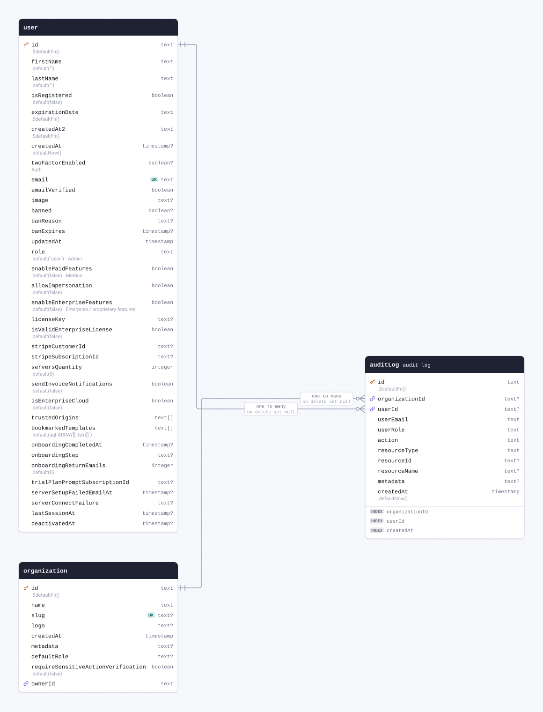

| Column                               | Type        | Constraints                                   | Default         | Description |
| ------------------------------------ | ----------- | --------------------------------------------- | --------------- | ----------- |
| `id`                                 | `text`      | PK NOT NULL                                   | `.$defaultFn()` |             |
| `organizationId` (`organization_id`) | `text`      | NULL → [organization.id](#table-organization) |                 |             |
| `userId` (`user_id`)                 | `text`      | NULL → [user.id](#table-user)                 |                 |             |
| `userEmail` (`user_email`)           | `text`      | NOT NULL                                      |                 |             |
| `userRole` (`user_role`)             | `text`      | NOT NULL                                      |                 |             |
| `action`                             | `text`      | NOT NULL                                      |                 |             |
| `resourceType` (`resource_type`)     | `text`      | NOT NULL                                      |                 |             |
| `resourceId` (`resource_id`)         | `text`      | NULL                                          |                 |             |
| `resourceName` (`resource_name`)     | `text`      | NULL                                          |                 |             |
| `metadata`                           | `text`      | NULL                                          |                 |             |
| `createdAt` (`created_at`)           | `timestamp` | NOT NULL                                      | `.defaultNow()` |             |

#### Definition

```sql
CREATE TABLE "audit_log" (
	"id" text PRIMARY KEY,
	"organization_id" text,
	"user_id" text,
	"user_email" text NOT NULL,
	"user_role" text NOT NULL,
	"action" text NOT NULL,
	"resource_type" text NOT NULL,
	"resource_id" text,
	"resource_name" text,
	"metadata" text,
	"created_at" timestamp DEFAULT now() NOT NULL
);

CREATE INDEX "auditLog_organizationId_idx" ON "audit_log" ("organization_id");

CREATE INDEX "auditLog_userId_idx" ON "audit_log" ("user_id");

CREATE INDEX "auditLog_createdAt_idx" ON "audit_log" ("created_at");

ALTER TABLE "audit_log" ADD CONSTRAINT "audit_log_organization_id_organization_id_fkey" FOREIGN KEY ("organization_id") REFERENCES "organization"("id") ON DELETE SET NULL;

ALTER TABLE "audit_log" ADD CONSTRAINT "audit_log_user_id_user_id_fkey" FOREIGN KEY ("user_id") REFERENCES "user"("id") ON DELETE SET NULL;
```

#### Indexes

- INDEX `organizationId`
- INDEX `userId`
- INDEX `createdAt`

#### References

- `organizationId` → [organization.id](#table-organization) (many to one, on delete set null)
- `userId` → [user.id](#table-user) (many to one, on delete set null)

<details>
<summary>Queries and their SQL</summary>

**Select**: Every row of auditLog.

```ts
db.select().from(auditLog);
```

```sql
select "id", "organization_id", "user_id", "user_email", "user_role", "action", "resource_type", "resource_id", "resource_name", "metadata", "created_at"
from "audit_log"
```

**Count**: How many rows auditLog has.

```ts
db.select({ count: count() }).from(auditLog);
```

```sql
select count(*)
from "audit_log"
```

**Find many**: The rows of auditLog, through the relational query API.

```ts
db.query.auditLog.findMany();
```

```sql
select "d0"."id" as "id", "d0"."organization_id" as "organizationId", "d0"."user_id" as "userId", "d0"."user_email" as "userEmail", "d0"."user_role" as "userRole", "d0"."action" as "action", "d0"."resource_type" as "resourceType", "d0"."resource_id" as "resourceId", "d0"."resource_name" as "resourceName", "d0"."metadata" as "metadata", "d0"."created_at" as "createdAt"
from "audit_log" as "d0"
```

**Find by primary key**: One row of auditLog, through the relational query API.

```ts
db.query.auditLog.findFirst({ where: { id: "id" } });
```

```sql
select "d0"."id" as "id", "d0"."organization_id" as "organizationId", "d0"."user_id" as "userId", "d0"."user_email" as "userEmail", "d0"."user_role" as "userRole", "d0"."action" as "action", "d0"."resource_type" as "resourceType", "d0"."resource_id" as "resourceId", "d0"."resource_name" as "resourceName", "d0"."metadata" as "metadata", "d0"."created_at" as "createdAt"
from "audit_log" as "d0"
where "d0"."id" = $1
limit $2
-- params: ["id",1]
```

**Insert**: Adds a row to auditLog, giving the columns that have no default.

```ts
db.insert(auditLog).values({
  userEmail: "userEmail",
  userRole: "userRole",
  action: "action",
  resourceType: "resourceType",
});
```

```sql
insert into "audit_log" ("id", "organization_id", "user_id", "user_email", "user_role", "action", "resource_type", "resource_id", "resource_name", "metadata", "created_at")
values ($1, default, default, $2, $3, $4, $5, default, default, default, default)
-- params: ["uuuuuuuuuuuuuuuuuuuuu","userEmail","userRole","action","resourceType"]
```

**Update**: Changes a row of auditLog, found by its primary key.

```ts
db.update(auditLog).set({ organizationId: "organizationId" }).where(eq(auditLog.id, "id"));
```

```sql
update "audit_log"
set "organization_id" = $1
where "audit_log"."id" = $2
-- params: ["organizationId","id"]
```

**Delete**: Deletes a row of auditLog, found by its primary key.

```ts
db.delete(auditLog).where(eq(auditLog.id, "id"));
```

```sql
delete from "audit_log"
where "audit_log"."id" = $1
-- params: ["id"]
```

</details>

<a id="table-backups"></a>

### backups

Table `backup`.

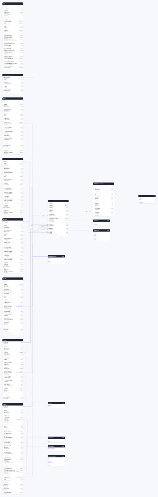

| Column                 | Type                                 | Constraints                                                  | Default                | Description              |
| ---------------------- | ------------------------------------ | ------------------------------------------------------------ | ---------------------- | ------------------------ |
| `backupId`             | `text`                               | PK NOT NULL                                                  | `.$defaultFn()`        |                          |
| `appName`              | `text`                               | UNIQUE NOT NULL                                              | `.$defaultFn()`        |                          |
| `schedule`             | `text`                               | NOT NULL                                                     |                        |                          |
| `enabled`              | `boolean`                            | NULL                                                         |                        |                          |
| `database`             | `text`                               | NOT NULL                                                     |                        |                          |
| `prefix`               | `text`                               | NOT NULL                                                     |                        |                          |
| `customName`           | `text`                               | NULL                                                         |                        |                          |
| `serviceName`          | `text`                               | NULL                                                         |                        |                          |
| `destinationId`        | `text`                               | NOT NULL → [destinations.destinationId](#table-destinations) |                        |                          |
| `keepLatestCount`      | `integer`                            | NULL                                                         |                        |                          |
| `includeEncryptionKey` | `boolean`                            | NOT NULL                                                     | `.default(true)`       |                          |
| `backupType`           | [`backupType`](#enum-backupType)     | NOT NULL                                                     | `.default("database")` |                          |
| `databaseType`         | [`databaseType`](#enum-databaseType) | NOT NULL                                                     |                        |                          |
| `composeId`            | `text`                               | NULL → [compose.composeId](#table-compose)                   |                        |                          |
| `postgresId`           | `text`                               | NULL → [postgres.postgresId](#table-postgres)                |                        |                          |
| `mariadbId`            | `text`                               | NULL → [mariadb.mariadbId](#table-mariadb)                   |                        |                          |
| `mysqlId`              | `text`                               | NULL → [mysql.mysqlId](#table-mysql)                         |                        |                          |
| `mongoId`              | `text`                               | NULL → [mongo.mongoId](#table-mongo)                         |                        |                          |
| `libsqlId`             | `text`                               | NULL → [libsql.libsqlId](#table-libsql)                      |                        |                          |
| `userId`               | `text`                               | NULL → [user.id](#table-user)                                |                        |                          |
| `metadata`             | `jsonb`                              | NULL                                                         |                        | Only for compose backups |

#### Definition

```sql
CREATE TABLE "backup" (
	"backupId" text PRIMARY KEY,
	"appName" text NOT NULL UNIQUE,
	"schedule" text NOT NULL,
	"enabled" boolean,
	"database" text NOT NULL,
	"prefix" text NOT NULL,
	"customName" text,
	"serviceName" text,
	"destinationId" text NOT NULL,
	"keepLatestCount" integer,
	"includeEncryptionKey" boolean DEFAULT true NOT NULL,
	"backupType" "backupType" DEFAULT 'database'::"backupType" NOT NULL,
	"databaseType" "databaseType" NOT NULL,
	"composeId" text,
	"postgresId" text,
	"mariadbId" text,
	"mysqlId" text,
	"mongoId" text,
	"libsqlId" text,
	"userId" text,
	"metadata" jsonb
);

ALTER TABLE "backup" ADD CONSTRAINT "backup_destinationId_destination_destinationId_fkey" FOREIGN KEY ("destinationId") REFERENCES "destination"("destinationId") ON DELETE CASCADE;

ALTER TABLE "backup" ADD CONSTRAINT "backup_composeId_compose_composeId_fkey" FOREIGN KEY ("composeId") REFERENCES "compose"("composeId") ON DELETE CASCADE;

ALTER TABLE "backup" ADD CONSTRAINT "backup_postgresId_postgres_postgresId_fkey" FOREIGN KEY ("postgresId") REFERENCES "postgres"("postgresId") ON DELETE CASCADE;

ALTER TABLE "backup" ADD CONSTRAINT "backup_mariadbId_mariadb_mariadbId_fkey" FOREIGN KEY ("mariadbId") REFERENCES "mariadb"("mariadbId") ON DELETE CASCADE;

ALTER TABLE "backup" ADD CONSTRAINT "backup_mysqlId_mysql_mysqlId_fkey" FOREIGN KEY ("mysqlId") REFERENCES "mysql"("mysqlId") ON DELETE CASCADE;

ALTER TABLE "backup" ADD CONSTRAINT "backup_mongoId_mongo_mongoId_fkey" FOREIGN KEY ("mongoId") REFERENCES "mongo"("mongoId") ON DELETE CASCADE;

ALTER TABLE "backup" ADD CONSTRAINT "backup_libsqlId_libsql_libsqlId_fkey" FOREIGN KEY ("libsqlId") REFERENCES "libsql"("libsqlId") ON DELETE CASCADE;

ALTER TABLE "backup" ADD CONSTRAINT "backup_userId_user_id_fkey" FOREIGN KEY ("userId") REFERENCES "user"("id");
```

#### References

- `destinationId` → [destinations.destinationId](#table-destinations) (many to one, on delete cascade)
- `composeId` → [compose.composeId](#table-compose) (many to one, on delete cascade)
- `postgresId` → [postgres.postgresId](#table-postgres) (many to one, on delete cascade)
- `mariadbId` → [mariadb.mariadbId](#table-mariadb) (many to one, on delete cascade)
- `mysqlId` → [mysql.mysqlId](#table-mysql) (many to one, on delete cascade)
- `mongoId` → [mongo.mongoId](#table-mongo) (many to one, on delete cascade)
- `libsqlId` → [libsql.libsqlId](#table-libsql) (many to one, on delete cascade)
- `userId` → [user.id](#table-user) (many to one)

#### Referenced by

- `backupId` → [deployments.backupId](#table-deployments) (one to many, on delete cascade)

<details>
<summary>Queries and their SQL</summary>

**Select**: Every row of backups.

```ts
db.select().from(backups);
```

```sql
select "backupId", "appName", "schedule", "enabled", "database", "prefix", "customName", "serviceName", "destinationId", "keepLatestCount", "includeEncryptionKey", "backupType", "databaseType", "composeId", "postgresId", "mariadbId", "mysqlId", "mongoId", "libsqlId", "userId", "metadata"
from "backup"
```

**Count**: How many rows backups has.

```ts
db.select({ count: count() }).from(backups);
```

```sql
select count(*)
from "backup"
```

**Find many**: The rows of backups, through the relational query API.

```ts
db.query.backups.findMany();
```

```sql
select "d0"."backupId" as "backupId", "d0"."appName" as "appName", "d0"."schedule" as "schedule", "d0"."enabled" as "enabled", "d0"."database" as "database", "d0"."prefix" as "prefix", "d0"."customName" as "customName", "d0"."serviceName" as "serviceName", "d0"."destinationId" as "destinationId", "d0"."keepLatestCount" as "keepLatestCount", "d0"."includeEncryptionKey" as "includeEncryptionKey", "d0"."backupType" as "backupType", "d0"."databaseType" as "databaseType", "d0"."composeId" as "composeId", "d0"."postgresId" as "postgresId", "d0"."mariadbId" as "mariadbId", "d0"."mysqlId" as "mysqlId", "d0"."mongoId" as "mongoId", "d0"."libsqlId" as "libsqlId", "d0"."userId" as "userId", "d0"."metadata" as "metadata"
from "backup" as "d0"
```

**Find by primary key**: One row of backups, through the relational query API.

```ts
db.query.backups.findFirst({ where: { backupId: "backupId" } });
```

```sql
select "d0"."backupId" as "backupId", "d0"."appName" as "appName", "d0"."schedule" as "schedule", "d0"."enabled" as "enabled", "d0"."database" as "database", "d0"."prefix" as "prefix", "d0"."customName" as "customName", "d0"."serviceName" as "serviceName", "d0"."destinationId" as "destinationId", "d0"."keepLatestCount" as "keepLatestCount", "d0"."includeEncryptionKey" as "includeEncryptionKey", "d0"."backupType" as "backupType", "d0"."databaseType" as "databaseType", "d0"."composeId" as "composeId", "d0"."postgresId" as "postgresId", "d0"."mariadbId" as "mariadbId", "d0"."mysqlId" as "mysqlId", "d0"."mongoId" as "mongoId", "d0"."libsqlId" as "libsqlId", "d0"."userId" as "userId", "d0"."metadata" as "metadata"
from "backup" as "d0"
where "d0"."backupId" = $1
limit $2
-- params: ["backupId",1]
```

**Insert**: Adds a row to backups, giving the columns that have no default.

```ts
db.insert(backups).values({
  schedule: "schedule",
  database: "database",
  prefix: "prefix",
  destinationId: "destinationId",
  databaseType: "postgres",
});
```

```sql
insert into "backup" ("backupId", "appName", "schedule", "enabled", "database", "prefix", "customName", "serviceName", "destinationId", "keepLatestCount", "includeEncryptionKey", "backupType", "databaseType", "composeId", "postgresId", "mariadbId", "mysqlId", "mongoId", "libsqlId", "userId", "metadata")
values ($1, $2, $3, default, $4, $5, default, default, $6, default, default, default, $7, default, default, default, default, default, default, default, default)
-- params: ["uuuuuuuuuuuuuuuuuuuuu","backup-input-mobile-monitor-aaaaaa","schedule","database","prefix","destinationId","postgres"]
```

**Update**: Changes a row of backups, found by its primary key.

```ts
db.update(backups).set({ appName: "appName" }).where(eq(backups.backupId, "backupId"));
```

```sql
update "backup"
set "appName" = $1
where "backup"."backupId" = $2
-- params: ["appName","backupId"]
```

**Delete**: Deletes a row of backups, found by its primary key.

```ts
db.delete(backups).where(eq(backups.backupId, "backupId"));
```

```sql
delete from "backup"
where "backup"."backupId" = $1
-- params: ["backupId"]
```

</details>

<a id="table-bitbucket"></a>

### bitbucket

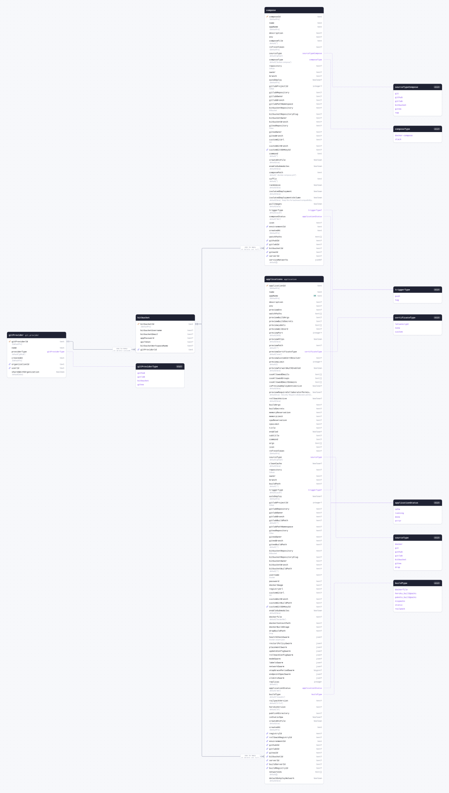

| Column                   | Type   | Constraints                                                | Default         | Description |
| ------------------------ | ------ | ---------------------------------------------------------- | --------------- | ----------- |
| `bitbucketId`            | `text` | PK NOT NULL                                                | `.$defaultFn()` |             |
| `bitbucketUsername`      | `text` | NULL                                                       |                 |             |
| `bitbucketEmail`         | `text` | NULL                                                       |                 |             |
| `appPassword`            | `text` | NULL                                                       |                 |             |
| `apiToken`               | `text` | NULL                                                       |                 |             |
| `bitbucketWorkspaceName` | `text` | NULL                                                       |                 |             |
| `gitProviderId`          | `text` | NOT NULL → [gitProvider.gitProviderId](#table-gitProvider) |                 |             |

#### Definition

```sql
CREATE TABLE "bitbucket" (
	"bitbucketId" text PRIMARY KEY,
	"bitbucketUsername" text,
	"bitbucketEmail" text,
	"appPassword" text,
	"apiToken" text,
	"bitbucketWorkspaceName" text,
	"gitProviderId" text NOT NULL
);

ALTER TABLE "bitbucket" ADD CONSTRAINT "bitbucket_gitProviderId_git_provider_gitProviderId_fkey" FOREIGN KEY ("gitProviderId") REFERENCES "git_provider"("gitProviderId") ON DELETE CASCADE;
```

#### References

- `gitProviderId` → [gitProvider.gitProviderId](#table-gitProvider) (many to one, on delete cascade)

#### Referenced by

- `bitbucketId` → [applications.bitbucketId](#table-applications) (one to many, on delete set null)
- `bitbucketId` → [compose.bitbucketId](#table-compose) (one to many, on delete set null)

<details>
<summary>Queries and their SQL</summary>

**Select**: Every row of bitbucket.

```ts
db.select().from(bitbucket);
```

```sql
select "bitbucketId", "bitbucketUsername", "bitbucketEmail", "appPassword", "apiToken", "bitbucketWorkspaceName", "gitProviderId"
from "bitbucket"
```

**Count**: How many rows bitbucket has.

```ts
db.select({ count: count() }).from(bitbucket);
```

```sql
select count(*)
from "bitbucket"
```

**Find many**: The rows of bitbucket, through the relational query API.

```ts
db.query.bitbucket.findMany();
```

```sql
select "d0"."bitbucketId" as "bitbucketId", "d0"."bitbucketUsername" as "bitbucketUsername", "d0"."bitbucketEmail" as "bitbucketEmail", "d0"."appPassword" as "appPassword", "d0"."apiToken" as "apiToken", "d0"."bitbucketWorkspaceName" as "bitbucketWorkspaceName", "d0"."gitProviderId" as "gitProviderId"
from "bitbucket" as "d0"
```

**Find by primary key**: One row of bitbucket, through the relational query API.

```ts
db.query.bitbucket.findFirst({ where: { bitbucketId: "bitbucketId" } });
```

```sql
select "d0"."bitbucketId" as "bitbucketId", "d0"."bitbucketUsername" as "bitbucketUsername", "d0"."bitbucketEmail" as "bitbucketEmail", "d0"."appPassword" as "appPassword", "d0"."apiToken" as "apiToken", "d0"."bitbucketWorkspaceName" as "bitbucketWorkspaceName", "d0"."gitProviderId" as "gitProviderId"
from "bitbucket" as "d0"
where "d0"."bitbucketId" = $1
limit $2
-- params: ["bitbucketId",1]
```

**Insert**: Adds a row to bitbucket, giving the columns that have no default.

```ts
db.insert(bitbucket).values({ gitProviderId: "gitProviderId" });
```

```sql
insert into "bitbucket" ("bitbucketId", "bitbucketUsername", "bitbucketEmail", "appPassword", "apiToken", "bitbucketWorkspaceName", "gitProviderId")
values ($1, default, default, default, default, default, $2)
-- params: ["uuuuuuuuuuuuuuuuuuuuu","gitProviderId"]
```

**Update**: Changes a row of bitbucket, found by its primary key.

```ts
db.update(bitbucket)
  .set({ bitbucketUsername: "bitbucketUsername" })
  .where(eq(bitbucket.bitbucketId, "bitbucketId"));
```

```sql
update "bitbucket"
set "bitbucketUsername" = $1
where "bitbucket"."bitbucketId" = $2
-- params: ["bitbucketUsername","bitbucketId"]
```

**Delete**: Deletes a row of bitbucket, found by its primary key.

```ts
db.delete(bitbucket).where(eq(bitbucket.bitbucketId, "bitbucketId"));
```

```sql
delete from "bitbucket"
where "bitbucket"."bitbucketId" = $1
-- params: ["bitbucketId"]
```

</details>

<a id="table-certificates"></a>

### certificates

Table `certificate`.

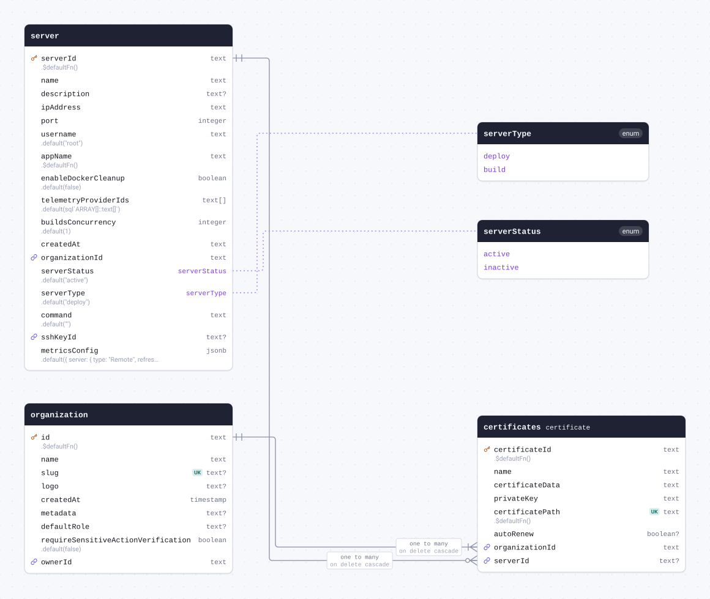

| Column            | Type      | Constraints                                       | Default         | Description |
| ----------------- | --------- | ------------------------------------------------- | --------------- | ----------- |
| `certificateId`   | `text`    | PK NOT NULL                                       | `.$defaultFn()` |             |
| `name`            | `text`    | NOT NULL                                          |                 |             |
| `certificateData` | `text`    | NOT NULL                                          |                 |             |
| `privateKey`      | `text`    | NOT NULL                                          |                 |             |
| `certificatePath` | `text`    | UNIQUE NOT NULL                                   | `.$defaultFn()` |             |
| `autoRenew`       | `boolean` | NULL                                              |                 |             |
| `organizationId`  | `text`    | NOT NULL → [organization.id](#table-organization) |                 |             |
| `serverId`        | `text`    | NULL → [server.serverId](#table-server)           |                 |             |

#### Definition

```sql
CREATE TABLE "certificate" (
	"certificateId" text PRIMARY KEY,
	"name" text NOT NULL,
	"certificateData" text NOT NULL,
	"privateKey" text NOT NULL,
	"certificatePath" text NOT NULL UNIQUE,
	"autoRenew" boolean,
	"organizationId" text NOT NULL,
	"serverId" text
);

ALTER TABLE "certificate" ADD CONSTRAINT "certificate_organizationId_organization_id_fkey" FOREIGN KEY ("organizationId") REFERENCES "organization"("id") ON DELETE CASCADE;

ALTER TABLE "certificate" ADD CONSTRAINT "certificate_serverId_server_serverId_fkey" FOREIGN KEY ("serverId") REFERENCES "server"("serverId") ON DELETE CASCADE;
```

#### References

- `organizationId` → [organization.id](#table-organization) (many to one, on delete cascade)
- `serverId` → [server.serverId](#table-server) (many to one, on delete cascade)

<details>
<summary>Queries and their SQL</summary>

**Select**: Every row of certificates.

```ts
db.select().from(certificates);
```

```sql
select "certificateId", "name", "certificateData", "privateKey", "certificatePath", "autoRenew", "organizationId", "serverId"
from "certificate"
```

**Count**: How many rows certificates has.

```ts
db.select({ count: count() }).from(certificates);
```

```sql
select count(*)
from "certificate"
```

**Find many**: The rows of certificates, through the relational query API.

```ts
db.query.certificates.findMany();
```

```sql
select "d0"."certificateId" as "certificateId", "d0"."name" as "name", "d0"."certificateData" as "certificateData", "d0"."privateKey" as "privateKey", "d0"."certificatePath" as "certificatePath", "d0"."autoRenew" as "autoRenew", "d0"."organizationId" as "organizationId", "d0"."serverId" as "serverId"
from "certificate" as "d0"
```

**Find by primary key**: One row of certificates, through the relational query API.

```ts
db.query.certificates.findFirst({ where: { certificateId: "certificateId" } });
```

```sql
select "d0"."certificateId" as "certificateId", "d0"."name" as "name", "d0"."certificateData" as "certificateData", "d0"."privateKey" as "privateKey", "d0"."certificatePath" as "certificatePath", "d0"."autoRenew" as "autoRenew", "d0"."organizationId" as "organizationId", "d0"."serverId" as "serverId"
from "certificate" as "d0"
where "d0"."certificateId" = $1
limit $2
-- params: ["certificateId",1]
```

**Insert**: Adds a row to certificates, giving the columns that have no default.

```ts
db.insert(certificates).values({
  name: "name",
  certificateData: "certificateData",
  privateKey: "privateKey",
  organizationId: "organizationId",
});
```

```sql
insert into "certificate" ("certificateId", "name", "certificateData", "privateKey", "certificatePath", "autoRenew", "organizationId", "serverId")
values ($1, $2, $3, $4, $5, default, $6, default)
-- params: ["uuuuuuuuuuuuuuuuuuuuu","name","certificateData","privateKey","certificate-hack-virtual-transmitter-aaaaaa","organizationId"]
```

**Update**: Changes a row of certificates, found by its primary key.

```ts
db.update(certificates)
  .set({ name: "name" })
  .where(eq(certificates.certificateId, "certificateId"));
```

```sql
update "certificate"
set "name" = $1
where "certificate"."certificateId" = $2
-- params: ["name","certificateId"]
```

**Delete**: Deletes a row of certificates, found by its primary key.

```ts
db.delete(certificates).where(eq(certificates.certificateId, "certificateId"));
```

```sql
delete from "certificate"
where "certificate"."certificateId" = $1
-- params: ["certificateId"]
```

</details>

<a id="table-compose"></a>

### compose

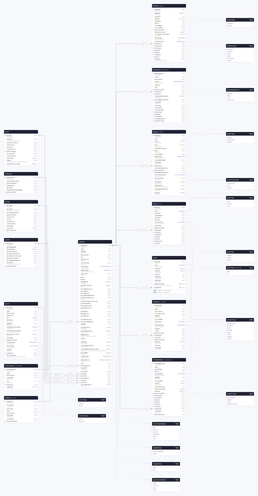

| Column                      | Type                                           | Constraints                                                  | Default                            | Description                                                                              |
| --------------------------- | ---------------------------------------------- | ------------------------------------------------------------ | ---------------------------------- | ---------------------------------------------------------------------------------------- |
| `composeId`                 | `text`                                         | PK NOT NULL                                                  | `.$defaultFn()`                    |                                                                                          |
| `name`                      | `text`                                         | NOT NULL                                                     |                                    |                                                                                          |
| `appName`                   | `text`                                         | NOT NULL                                                     | `.$defaultFn()`                    |                                                                                          |
| `description`               | `text`                                         | NULL                                                         |                                    |                                                                                          |
| `env`                       | `text`                                         | NULL                                                         |                                    |                                                                                          |
| `composeFile`               | `text`                                         | NOT NULL                                                     | `.default("")`                     |                                                                                          |
| `refreshToken`              | `text`                                         | NULL                                                         | `.$defaultFn()`                    |                                                                                          |
| `sourceType`                | [`sourceTypeCompose`](#enum-sourceTypeCompose) | NOT NULL                                                     | `.default("github")`               |                                                                                          |
| `composeType`               | [`composeType`](#enum-composeType)             | NOT NULL                                                     | `.default("docker-compose")`       |                                                                                          |
| `repository`                | `text`                                         | NULL                                                         |                                    | Github                                                                                   |
| `owner`                     | `text`                                         | NULL                                                         |                                    |                                                                                          |
| `branch`                    | `text`                                         | NULL                                                         |                                    |                                                                                          |
| `autoDeploy`                | `boolean`                                      | NULL                                                         | `.$defaultFn()`                    |                                                                                          |
| `gitlabProjectId`           | `integer`                                      | NULL                                                         |                                    | Gitlab                                                                                   |
| `gitlabRepository`          | `text`                                         | NULL                                                         |                                    |                                                                                          |
| `gitlabOwner`               | `text`                                         | NULL                                                         |                                    |                                                                                          |
| `gitlabBranch`              | `text`                                         | NULL                                                         |                                    |                                                                                          |
| `gitlabPathNamespace`       | `text`                                         | NULL                                                         |                                    |                                                                                          |
| `bitbucketRepository`       | `text`                                         | NULL                                                         |                                    | Bitbucket                                                                                |
| `bitbucketRepositorySlug`   | `text`                                         | NULL                                                         |                                    |                                                                                          |
| `bitbucketOwner`            | `text`                                         | NULL                                                         |                                    |                                                                                          |
| `bitbucketBranch`           | `text`                                         | NULL                                                         |                                    |                                                                                          |
| `giteaRepository`           | `text`                                         | NULL                                                         |                                    | Gitea                                                                                    |
| `giteaOwner`                | `text`                                         | NULL                                                         |                                    |                                                                                          |
| `giteaBranch`               | `text`                                         | NULL                                                         |                                    |                                                                                          |
| `customGitUrl`              | `text`                                         | NULL                                                         |                                    | Git                                                                                      |
| `customGitBranch`           | `text`                                         | NULL                                                         |                                    |                                                                                          |
| `customGitSSHKeyId`         | `text`                                         | NULL → [sshKeys.sshKeyId](#table-sshKeys)                    |                                    |                                                                                          |
| `command`                   | `text`                                         | NOT NULL                                                     | `.default("")`                     |                                                                                          |
| `createEnvFile`             | `boolean`                                      | NOT NULL                                                     | `.default(true)`                   |                                                                                          |
| `enableSubmodules`          | `boolean`                                      | NOT NULL                                                     | `.default(false)`                  |                                                                                          |
| `composePath`               | `text`                                         | NOT NULL                                                     | `.default("./docker-compose.yml")` |                                                                                          |
| `suffix`                    | `text`                                         | NOT NULL                                                     | `.default("")`                     |                                                                                          |
| `randomize`                 | `boolean`                                      | NOT NULL                                                     | `.default(false)`                  |                                                                                          |
| `isolatedDeployment`        | `boolean`                                      | NOT NULL                                                     | `.default(false)`                  |                                                                                          |
| `isolatedDeploymentsVolume` | `boolean`                                      | NOT NULL                                                     | `.default(false)`                  | Keep this for backward compatibility since we will not add the prefix anymore to volumes |
| `pullImages`                | `boolean`                                      | NOT NULL                                                     | `.default(false)`                  |                                                                                          |
| `triggerType`               | [`triggerType`](#enum-triggerType)             | NULL                                                         | `.default("push")`                 |                                                                                          |
| `composeStatus`             | [`applicationStatus`](#enum-applicationStatus) | NOT NULL                                                     | `.default("idle")`                 |                                                                                          |
| `icon`                      | `text`                                         | NULL                                                         |                                    |                                                                                          |
| `environmentId`             | `text`                                         | NOT NULL → [environments.environmentId](#table-environments) |                                    |                                                                                          |
| `createdAt`                 | `text`                                         | NOT NULL                                                     | `.$defaultFn()`                    |                                                                                          |
| `watchPaths`                | `text[]`                                       | NULL                                                         |                                    |                                                                                          |
| `githubId`                  | `text`                                         | NULL → [github.githubId](#table-github)                      |                                    |                                                                                          |
| `gitlabId`                  | `text`                                         | NULL → [gitlab.gitlabId](#table-gitlab)                      |                                    |                                                                                          |
| `bitbucketId`               | `text`                                         | NULL → [bitbucket.bitbucketId](#table-bitbucket)             |                                    |                                                                                          |
| `giteaId`                   | `text`                                         | NULL → [gitea.giteaId](#table-gitea)                         |                                    |                                                                                          |
| `serverId`                  | `text`                                         | NULL → [server.serverId](#table-server)                      |                                    |                                                                                          |
| `serviceNetworks`           | `jsonb`                                        | NULL                                                         | `.default([])`                     |                                                                                          |

#### Definition

```sql
CREATE TABLE "compose" (
	"composeId" text PRIMARY KEY,
	"name" text NOT NULL,
	"appName" text NOT NULL,
	"description" text,
	"env" text,
	"composeFile" text DEFAULT '' NOT NULL,
	"refreshToken" text,
	"sourceType" "sourceTypeCompose" DEFAULT 'github'::"sourceTypeCompose" NOT NULL,
	"composeType" "composeType" DEFAULT 'docker-compose'::"composeType" NOT NULL,
	"repository" text,
	"owner" text,
	"branch" text,
	"autoDeploy" boolean,
	"gitlabProjectId" integer,
	"gitlabRepository" text,
	"gitlabOwner" text,
	"gitlabBranch" text,
	"gitlabPathNamespace" text,
	"bitbucketRepository" text,
	"bitbucketRepositorySlug" text,
	"bitbucketOwner" text,
	"bitbucketBranch" text,
	"giteaRepository" text,
	"giteaOwner" text,
	"giteaBranch" text,
	"customGitUrl" text,
	"customGitBranch" text,
	"customGitSSHKeyId" text,
	"command" text DEFAULT '' NOT NULL,
	"createEnvFile" boolean DEFAULT true NOT NULL,
	"enableSubmodules" boolean DEFAULT false NOT NULL,
	"composePath" text DEFAULT './docker-compose.yml' NOT NULL,
	"suffix" text DEFAULT '' NOT NULL,
	"randomize" boolean DEFAULT false NOT NULL,
	"isolatedDeployment" boolean DEFAULT false NOT NULL,
	"isolatedDeploymentsVolume" boolean DEFAULT false NOT NULL,
	"pullImages" boolean DEFAULT false NOT NULL,
	"triggerType" "triggerType" DEFAULT 'push'::"triggerType",
	"composeStatus" "applicationStatus" DEFAULT 'idle'::"applicationStatus" NOT NULL,
	"icon" text,
	"environmentId" text NOT NULL,
	"createdAt" text NOT NULL,
	"watchPaths" text[],
	"githubId" text,
	"gitlabId" text,
	"bitbucketId" text,
	"giteaId" text,
	"serverId" text,
	"serviceNetworks" jsonb DEFAULT '[]'
);

ALTER TABLE "compose" ADD CONSTRAINT "compose_customGitSSHKeyId_ssh-key_sshKeyId_fkey" FOREIGN KEY ("customGitSSHKeyId") REFERENCES "ssh-key"("sshKeyId") ON DELETE SET NULL;

ALTER TABLE "compose" ADD CONSTRAINT "compose_environmentId_environment_environmentId_fkey" FOREIGN KEY ("environmentId") REFERENCES "environment"("environmentId") ON DELETE CASCADE;

ALTER TABLE "compose" ADD CONSTRAINT "compose_githubId_github_githubId_fkey" FOREIGN KEY ("githubId") REFERENCES "github"("githubId") ON DELETE SET NULL;

ALTER TABLE "compose" ADD CONSTRAINT "compose_gitlabId_gitlab_gitlabId_fkey" FOREIGN KEY ("gitlabId") REFERENCES "gitlab"("gitlabId") ON DELETE SET NULL;

ALTER TABLE "compose" ADD CONSTRAINT "compose_bitbucketId_bitbucket_bitbucketId_fkey" FOREIGN KEY ("bitbucketId") REFERENCES "bitbucket"("bitbucketId") ON DELETE SET NULL;

ALTER TABLE "compose" ADD CONSTRAINT "compose_giteaId_gitea_giteaId_fkey" FOREIGN KEY ("giteaId") REFERENCES "gitea"("giteaId") ON DELETE SET NULL;

ALTER TABLE "compose" ADD CONSTRAINT "compose_serverId_server_serverId_fkey" FOREIGN KEY ("serverId") REFERENCES "server"("serverId") ON DELETE CASCADE;
```

#### References

- `customGitSSHKeyId` → [sshKeys.sshKeyId](#table-sshKeys) (many to one, on delete set null)
- `environmentId` → [environments.environmentId](#table-environments) (many to one, on delete cascade)
- `githubId` → [github.githubId](#table-github) (many to one, on delete set null)
- `gitlabId` → [gitlab.gitlabId](#table-gitlab) (many to one, on delete set null)
- `bitbucketId` → [bitbucket.bitbucketId](#table-bitbucket) (many to one, on delete set null)
- `giteaId` → [gitea.giteaId](#table-gitea) (many to one, on delete set null)
- `serverId` → [server.serverId](#table-server) (many to one, on delete cascade)

#### Referenced by

- `composeId` → [backups.composeId](#table-backups) (one to many, on delete cascade)
- `composeId` → [deployments.composeId](#table-deployments) (one to many, on delete cascade)
- `composeId` → [domains.composeId](#table-domains) (one to many, on delete cascade)
- `composeId` → [mounts.composeId](#table-mounts) (one to many, on delete cascade)
- `composeId` → [patch.composeId](#table-patch) (one to many, on delete cascade)
- `composeId` → [schedules.composeId](#table-schedules) (one to many, on delete cascade)
- `composeId` → [volumeBackups.composeId](#table-volumeBackups) (one to many, on delete cascade)

<details>
<summary>Queries and their SQL</summary>

**Select**: Every row of compose.

```ts
db.select().from(compose);
```

```sql
select "composeId", "name", "appName", "description", "env", "composeFile", "refreshToken", "sourceType", "composeType", "repository", "owner", "branch", "autoDeploy", "gitlabProjectId", "gitlabRepository", "gitlabOwner", "gitlabBranch", "gitlabPathNamespace", "bitbucketRepository", "bitbucketRepositorySlug", "bitbucketOwner", "bitbucketBranch", "giteaRepository", "giteaOwner", "giteaBranch", "customGitUrl", "customGitBranch", "customGitSSHKeyId", "command", "createEnvFile", "enableSubmodules", "composePath", "suffix", "randomize", "isolatedDeployment", "isolatedDeploymentsVolume", "pullImages", "triggerType", "composeStatus", "icon", "environmentId", "createdAt", "watchPaths", "githubId", "gitlabId", "bitbucketId", "giteaId", "serverId", "serviceNetworks"
from "compose"
```

**Count**: How many rows compose has.

```ts
db.select({ count: count() }).from(compose);
```

```sql
select count(*)
from "compose"
```

**Find many**: The rows of compose, through the relational query API.

```ts
db.query.compose.findMany();
```

```sql
select "d0"."composeId" as "composeId", "d0"."name" as "name", "d0"."appName" as "appName", "d0"."description" as "description", "d0"."env" as "env", "d0"."composeFile" as "composeFile", "d0"."refreshToken" as "refreshToken", "d0"."sourceType" as "sourceType", "d0"."composeType" as "composeType", "d0"."repository" as "repository", "d0"."owner" as "owner", "d0"."branch" as "branch", "d0"."autoDeploy" as "autoDeploy", "d0"."gitlabProjectId" as "gitlabProjectId", "d0"."gitlabRepository" as "gitlabRepository", "d0"."gitlabOwner" as "gitlabOwner", "d0"."gitlabBranch" as "gitlabBranch", "d0"."gitlabPathNamespace" as "gitlabPathNamespace", "d0"."bitbucketRepository" as "bitbucketRepository", "d0"."bitbucketRepositorySlug" as "bitbucketRepositorySlug", "d0"."bitbucketOwner" as "bitbucketOwner", "d0"."bitbucketBranch" as "bitbucketBranch", "d0"."giteaRepository" as "giteaRepository", "d0"."giteaOwner" as "giteaOwner", "d0"."giteaBranch" as "giteaBranch", "d0"."customGitUrl" as "customGitUrl", "d0"."customGitBranch" as "customGitBranch", "d0"."customGitSSHKeyId" as "customGitSSHKeyId", "d0"."command" as "command", "d0"."createEnvFile" as "createEnvFile", "d0"."enableSubmodules" as "enableSubmodules", "d0"."composePath" as "composePath", "d0"."suffix" as "suffix", "d0"."randomize" as "randomize", "d0"."isolatedDeployment" as "isolatedDeployment", "d0"."isolatedDeploymentsVolume" as "isolatedDeploymentsVolume", "d0"."pullImages" as "pullImages", "d0"."triggerType" as "triggerType", "d0"."composeStatus" as "composeStatus", "d0"."icon" as "icon", "d0"."environmentId" as "environmentId", "d0"."createdAt" as "createdAt", "d0"."watchPaths" as "watchPaths", "d0"."githubId" as "githubId", "d0"."gitlabId" as "gitlabId", "d0"."bitbucketId" as "bitbucketId", "d0"."giteaId" as "giteaId", "d0"."serverId" as "serverId", "d0"."serviceNetworks" as "serviceNetworks"
from "compose" as "d0"
```

**Find by primary key**: One row of compose, through the relational query API.

```ts
db.query.compose.findFirst({ where: { composeId: "composeId" } });
```

```sql
select "d0"."composeId" as "composeId", "d0"."name" as "name", "d0"."appName" as "appName", "d0"."description" as "description", "d0"."env" as "env", "d0"."composeFile" as "composeFile", "d0"."refreshToken" as "refreshToken", "d0"."sourceType" as "sourceType", "d0"."composeType" as "composeType", "d0"."repository" as "repository", "d0"."owner" as "owner", "d0"."branch" as "branch", "d0"."autoDeploy" as "autoDeploy", "d0"."gitlabProjectId" as "gitlabProjectId", "d0"."gitlabRepository" as "gitlabRepository", "d0"."gitlabOwner" as "gitlabOwner", "d0"."gitlabBranch" as "gitlabBranch", "d0"."gitlabPathNamespace" as "gitlabPathNamespace", "d0"."bitbucketRepository" as "bitbucketRepository", "d0"."bitbucketRepositorySlug" as "bitbucketRepositorySlug", "d0"."bitbucketOwner" as "bitbucketOwner", "d0"."bitbucketBranch" as "bitbucketBranch", "d0"."giteaRepository" as "giteaRepository", "d0"."giteaOwner" as "giteaOwner", "d0"."giteaBranch" as "giteaBranch", "d0"."customGitUrl" as "customGitUrl", "d0"."customGitBranch" as "customGitBranch", "d0"."customGitSSHKeyId" as "customGitSSHKeyId", "d0"."command" as "command", "d0"."createEnvFile" as "createEnvFile", "d0"."enableSubmodules" as "enableSubmodules", "d0"."composePath" as "composePath", "d0"."suffix" as "suffix", "d0"."randomize" as "randomize", "d0"."isolatedDeployment" as "isolatedDeployment", "d0"."isolatedDeploymentsVolume" as "isolatedDeploymentsVolume", "d0"."pullImages" as "pullImages", "d0"."triggerType" as "triggerType", "d0"."composeStatus" as "composeStatus", "d0"."icon" as "icon", "d0"."environmentId" as "environmentId", "d0"."createdAt" as "createdAt", "d0"."watchPaths" as "watchPaths", "d0"."githubId" as "githubId", "d0"."gitlabId" as "gitlabId", "d0"."bitbucketId" as "bitbucketId", "d0"."giteaId" as "giteaId", "d0"."serverId" as "serverId", "d0"."serviceNetworks" as "serviceNetworks"
from "compose" as "d0"
where "d0"."composeId" = $1
limit $2
-- params: ["composeId",1]
```

**Insert**: Adds a row to compose, giving the columns that have no default.

```ts
db.insert(compose).values({ name: "name", environmentId: "environmentId" });
```

```sql
insert into "compose" ("composeId", "name", "appName", "description", "env", "composeFile", "refreshToken", "sourceType", "composeType", "repository", "owner", "branch", "autoDeploy", "gitlabProjectId", "gitlabRepository", "gitlabOwner", "gitlabBranch", "gitlabPathNamespace", "bitbucketRepository", "bitbucketRepositorySlug", "bitbucketOwner", "bitbucketBranch", "giteaRepository", "giteaOwner", "giteaBranch", "customGitUrl", "customGitBranch", "customGitSSHKeyId", "command", "createEnvFile", "enableSubmodules", "composePath", "suffix", "randomize", "isolatedDeployment", "isolatedDeploymentsVolume", "pullImages", "triggerType", "composeStatus", "icon", "environmentId", "createdAt", "watchPaths", "githubId", "gitlabId", "bitbucketId", "giteaId", "serverId", "serviceNetworks")
values ($1, $2, $3, default, default, default, $4, default, default, default, default, default, $5, default, default, default, default, default, default, default, default, default, default, default, default, default, default, default, default, default, default, default, default, default, default, default, default, default, default, default, $6, $7, default, default, default, default, default, default, default)
-- params: ["uuuuuuuuuuuuuuuuuuuuu","name","compose-generate-redundant-interface-aaaaaa","uuuuuuuuuuuuuuuuuuuuu",true,"environmentId","2026-01-01T00:00:00.000Z"]
```

**Update**: Changes a row of compose, found by its primary key.

```ts
db.update(compose).set({ name: "name" }).where(eq(compose.composeId, "composeId"));
```

```sql
update "compose"
set "name" = $1
where "compose"."composeId" = $2
-- params: ["name","composeId"]
```

**Delete**: Deletes a row of compose, found by its primary key.

```ts
db.delete(compose).where(eq(compose.composeId, "composeId"));
```

```sql
delete from "compose"
where "compose"."composeId" = $1
-- params: ["composeId"]
```

</details>

<a id="table-deployments"></a>

### deployments

Table `deployment`.

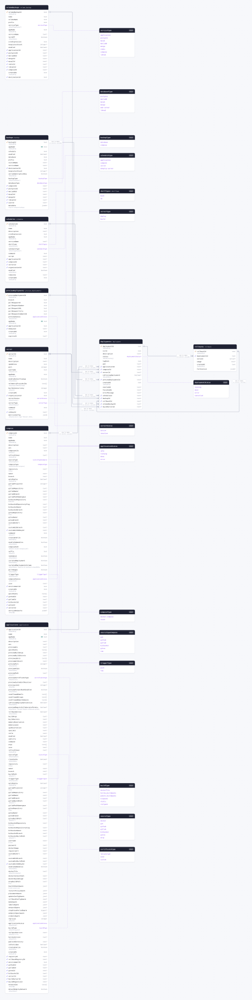

| Column                | Type                                         | Constraints                                                                | Default               | Description |
| --------------------- | -------------------------------------------- | -------------------------------------------------------------------------- | --------------------- | ----------- |
| `deploymentId`        | `text`                                       | PK NOT NULL                                                                | `.$defaultFn()`       |             |
| `title`               | `text`                                       | NOT NULL                                                                   |                       |             |
| `description`         | `text`                                       | NULL                                                                       |                       |             |
| `status`              | [`deploymentStatus`](#enum-deploymentStatus) | NULL                                                                       | `.default("running")` |             |
| `logPath`             | `text`                                       | NOT NULL                                                                   |                       |             |
| `pid`                 | `text`                                       | NULL                                                                       |                       |             |
| `applicationId`       | `text`                                       | NULL → [applications.applicationId](#table-applications)                   |                       |             |
| `composeId`           | `text`                                       | NULL → [compose.composeId](#table-compose)                                 |                       |             |
| `serverId`            | `text`                                       | NULL → [server.serverId](#table-server)                                    |                       |             |
| `isPreviewDeployment` | `boolean`                                    | NULL                                                                       | `.default(false)`     |             |
| `previewDeploymentId` | `text`                                       | NULL → [previewDeployments.previewDeploymentId](#table-previewDeployments) |                       |             |
| `createdAt`           | `text`                                       | NOT NULL                                                                   | `.$defaultFn()`       |             |
| `startedAt`           | `text`                                       | NULL                                                                       |                       |             |
| `finishedAt`          | `text`                                       | NULL                                                                       |                       |             |
| `errorMessage`        | `text`                                       | NULL                                                                       |                       |             |
| `scheduleId`          | `text`                                       | NULL → [schedules.scheduleId](#table-schedules)                            |                       |             |
| `backupId`            | `text`                                       | NULL → [backups.backupId](#table-backups)                                  |                       |             |
| `rollbackId`          | `text`                                       | NULL → [rollbacks.rollbackId](#table-rollbacks)                            |                       |             |
| `volumeBackupId`      | `text`                                       | NULL → [volumeBackups.volumeBackupId](#table-volumeBackups)                |                       |             |
| `buildServerId`       | `text`                                       | NULL → [server.serverId](#table-server)                                    |                       |             |

#### Definition

```sql
CREATE TABLE "deployment" (
	"deploymentId" text PRIMARY KEY,
	"title" text NOT NULL,
	"description" text,
	"status" "deploymentStatus" DEFAULT 'running'::"deploymentStatus",
	"logPath" text NOT NULL,
	"pid" text,
	"applicationId" text,
	"composeId" text,
	"serverId" text,
	"isPreviewDeployment" boolean DEFAULT false,
	"previewDeploymentId" text,
	"createdAt" text NOT NULL,
	"startedAt" text,
	"finishedAt" text,
	"errorMessage" text,
	"scheduleId" text,
	"backupId" text,
	"rollbackId" text,
	"volumeBackupId" text,
	"buildServerId" text
);

ALTER TABLE "deployment" ADD CONSTRAINT "deployment_applicationId_application_applicationId_fkey" FOREIGN KEY ("applicationId") REFERENCES "application"("applicationId") ON DELETE CASCADE;

ALTER TABLE "deployment" ADD CONSTRAINT "deployment_composeId_compose_composeId_fkey" FOREIGN KEY ("composeId") REFERENCES "compose"("composeId") ON DELETE CASCADE;

ALTER TABLE "deployment" ADD CONSTRAINT "deployment_serverId_server_serverId_fkey" FOREIGN KEY ("serverId") REFERENCES "server"("serverId") ON DELETE CASCADE;

ALTER TABLE "deployment" ADD CONSTRAINT "deployment_8YT77OVqNhcB_fkey" FOREIGN KEY ("previewDeploymentId") REFERENCES "preview_deployments"("previewDeploymentId") ON DELETE CASCADE;

ALTER TABLE "deployment" ADD CONSTRAINT "deployment_scheduleId_schedule_scheduleId_fkey" FOREIGN KEY ("scheduleId") REFERENCES "schedule"("scheduleId") ON DELETE CASCADE;

ALTER TABLE "deployment" ADD CONSTRAINT "deployment_backupId_backup_backupId_fkey" FOREIGN KEY ("backupId") REFERENCES "backup"("backupId") ON DELETE CASCADE;

ALTER TABLE "deployment" ADD CONSTRAINT "deployment_rollbackId_rollback_rollbackId_fkey" FOREIGN KEY ("rollbackId") REFERENCES "rollback"("rollbackId") ON DELETE CASCADE;

ALTER TABLE "deployment" ADD CONSTRAINT "deployment_volumeBackupId_volume_backup_volumeBackupId_fkey" FOREIGN KEY ("volumeBackupId") REFERENCES "volume_backup"("volumeBackupId") ON DELETE CASCADE;

ALTER TABLE "deployment" ADD CONSTRAINT "deployment_buildServerId_server_serverId_fkey" FOREIGN KEY ("buildServerId") REFERENCES "server"("serverId") ON DELETE CASCADE;
```

#### References

- `applicationId` → [applications.applicationId](#table-applications) (many to one, on delete cascade)
- `composeId` → [compose.composeId](#table-compose) (many to one, on delete cascade)
- `serverId` → [server.serverId](#table-server) (many to one, on delete cascade)
- `previewDeploymentId` → [previewDeployments.previewDeploymentId](#table-previewDeployments) (many to one, on delete cascade)
- `scheduleId` → [schedules.scheduleId](#table-schedules) (many to one, on delete cascade)
- `backupId` → [backups.backupId](#table-backups) (many to one, on delete cascade)
- `rollbackId` → [rollbacks.rollbackId](#table-rollbacks) (many to one, on delete cascade)
- `volumeBackupId` → [volumeBackups.volumeBackupId](#table-volumeBackups) (many to one, on delete cascade)
- `buildServerId` → [server.serverId](#table-server) (many to one, on delete cascade)

#### Referenced by

- `deploymentId` → [rollbacks.deploymentId](#table-rollbacks) (one to many, on delete cascade)

<details>
<summary>Queries and their SQL</summary>

**Select**: Every row of deployments.

```ts
db.select().from(deployments);
```

```sql
select "deploymentId", "title", "description", "status", "logPath", "pid", "applicationId", "composeId", "serverId", "isPreviewDeployment", "previewDeploymentId", "createdAt", "startedAt", "finishedAt", "errorMessage", "scheduleId", "backupId", "rollbackId", "volumeBackupId", "buildServerId"
from "deployment"
```

**Count**: How many rows deployments has.

```ts
db.select({ count: count() }).from(deployments);
```

```sql
select count(*)
from "deployment"
```

**Find many**: The rows of deployments, through the relational query API.

```ts
db.query.deployments.findMany();
```

```sql
select "d0"."deploymentId" as "deploymentId", "d0"."title" as "title", "d0"."description" as "description", "d0"."status" as "status", "d0"."logPath" as "logPath", "d0"."pid" as "pid", "d0"."applicationId" as "applicationId", "d0"."composeId" as "composeId", "d0"."serverId" as "serverId", "d0"."isPreviewDeployment" as "isPreviewDeployment", "d0"."previewDeploymentId" as "previewDeploymentId", "d0"."createdAt" as "createdAt", "d0"."startedAt" as "startedAt", "d0"."finishedAt" as "finishedAt", "d0"."errorMessage" as "errorMessage", "d0"."scheduleId" as "scheduleId", "d0"."backupId" as "backupId", "d0"."rollbackId" as "rollbackId", "d0"."volumeBackupId" as "volumeBackupId", "d0"."buildServerId" as "buildServerId"
from "deployment" as "d0"
```

**Find by primary key**: One row of deployments, through the relational query API.

```ts
db.query.deployments.findFirst({ where: { deploymentId: "deploymentId" } });
```

```sql
select "d0"."deploymentId" as "deploymentId", "d0"."title" as "title", "d0"."description" as "description", "d0"."status" as "status", "d0"."logPath" as "logPath", "d0"."pid" as "pid", "d0"."applicationId" as "applicationId", "d0"."composeId" as "composeId", "d0"."serverId" as "serverId", "d0"."isPreviewDeployment" as "isPreviewDeployment", "d0"."previewDeploymentId" as "previewDeploymentId", "d0"."createdAt" as "createdAt", "d0"."startedAt" as "startedAt", "d0"."finishedAt" as "finishedAt", "d0"."errorMessage" as "errorMessage", "d0"."scheduleId" as "scheduleId", "d0"."backupId" as "backupId", "d0"."rollbackId" as "rollbackId", "d0"."volumeBackupId" as "volumeBackupId", "d0"."buildServerId" as "buildServerId"
from "deployment" as "d0"
where "d0"."deploymentId" = $1
limit $2
-- params: ["deploymentId",1]
```

**Insert**: Adds a row to deployments, giving the columns that have no default.

```ts
db.insert(deployments).values({ title: "title", logPath: "logPath" });
```

```sql
insert into "deployment" ("deploymentId", "title", "description", "status", "logPath", "pid", "applicationId", "composeId", "serverId", "isPreviewDeployment", "previewDeploymentId", "createdAt", "startedAt", "finishedAt", "errorMessage", "scheduleId", "backupId", "rollbackId", "volumeBackupId", "buildServerId")
values ($1, $2, default, default, $3, default, default, default, default, default, default, $4, default, default, default, default, default, default, default, default)
-- params: ["uuuuuuuuuuuuuuuuuuuuu","title","logPath","2026-01-01T00:00:00.000Z"]
```

**Update**: Changes a row of deployments, found by its primary key.

```ts
db.update(deployments).set({ title: "title" }).where(eq(deployments.deploymentId, "deploymentId"));
```

```sql
update "deployment"
set "title" = $1
where "deployment"."deploymentId" = $2
-- params: ["title","deploymentId"]
```

**Delete**: Deletes a row of deployments, found by its primary key.

```ts
db.delete(deployments).where(eq(deployments.deploymentId, "deploymentId"));
```

```sql
delete from "deployment"
where "deployment"."deploymentId" = $1
-- params: ["deploymentId"]
```

</details>

<a id="table-destinations"></a>

### destinations

Table `destination`.

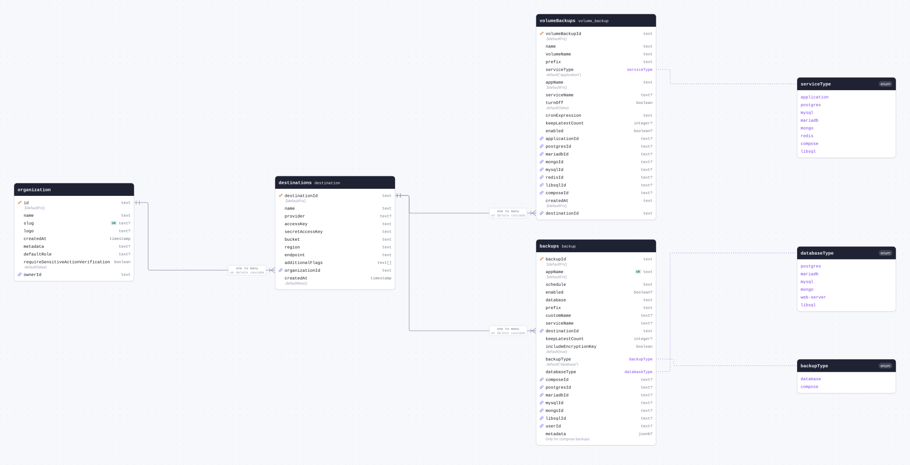

| Column            | Type        | Constraints                                       | Default         | Description |
| ----------------- | ----------- | ------------------------------------------------- | --------------- | ----------- |
| `destinationId`   | `text`      | PK NOT NULL                                       | `.$defaultFn()` |             |
| `name`            | `text`      | NOT NULL                                          |                 |             |
| `provider`        | `text`      | NULL                                              |                 |             |
| `accessKey`       | `text`      | NOT NULL                                          |                 |             |
| `secretAccessKey` | `text`      | NOT NULL                                          |                 |             |
| `bucket`          | `text`      | NOT NULL                                          |                 |             |
| `region`          | `text`      | NOT NULL                                          |                 |             |
| `endpoint`        | `text`      | NOT NULL                                          |                 |             |
| `additionalFlags` | `text[]`    | NULL                                              |                 |             |
| `organizationId`  | `text`      | NOT NULL → [organization.id](#table-organization) |                 |             |
| `createdAt`       | `timestamp` | NOT NULL                                          | `.defaultNow()` |             |

#### Definition

```sql
CREATE TABLE "destination" (
	"destinationId" text PRIMARY KEY,
	"name" text NOT NULL,
	"provider" text,
	"accessKey" text NOT NULL,
	"secretAccessKey" text NOT NULL,
	"bucket" text NOT NULL,
	"region" text NOT NULL,
	"endpoint" text NOT NULL,
	"additionalFlags" text[],
	"organizationId" text NOT NULL,
	"createdAt" timestamp DEFAULT now() NOT NULL
);

ALTER TABLE "destination" ADD CONSTRAINT "destination_organizationId_organization_id_fkey" FOREIGN KEY ("organizationId") REFERENCES "organization"("id") ON DELETE CASCADE;
```

#### References

- `organizationId` → [organization.id](#table-organization) (many to one, on delete cascade)

#### Referenced by

- `destinationId` → [backups.destinationId](#table-backups) (one to many, on delete cascade)
- `destinationId` → [volumeBackups.destinationId](#table-volumeBackups) (one to many, on delete cascade)

<details>
<summary>Queries and their SQL</summary>

**Select**: Every row of destinations.

```ts
db.select().from(destinations);
```

```sql
select "destinationId", "name", "provider", "accessKey", "secretAccessKey", "bucket", "region", "endpoint", "additionalFlags", "organizationId", "createdAt"
from "destination"
```

**Count**: How many rows destinations has.

```ts
db.select({ count: count() }).from(destinations);
```

```sql
select count(*)
from "destination"
```

**Find many**: The rows of destinations, through the relational query API.

```ts
db.query.destinations.findMany();
```

```sql
select "d0"."destinationId" as "destinationId", "d0"."name" as "name", "d0"."provider" as "provider", "d0"."accessKey" as "accessKey", "d0"."secretAccessKey" as "secretAccessKey", "d0"."bucket" as "bucket", "d0"."region" as "region", "d0"."endpoint" as "endpoint", "d0"."additionalFlags" as "additionalFlags", "d0"."organizationId" as "organizationId", "d0"."createdAt" as "createdAt"
from "destination" as "d0"
```

**Find by primary key**: One row of destinations, through the relational query API.

```ts
db.query.destinations.findFirst({ where: { destinationId: "destinationId" } });
```

```sql
select "d0"."destinationId" as "destinationId", "d0"."name" as "name", "d0"."provider" as "provider", "d0"."accessKey" as "accessKey", "d0"."secretAccessKey" as "secretAccessKey", "d0"."bucket" as "bucket", "d0"."region" as "region", "d0"."endpoint" as "endpoint", "d0"."additionalFlags" as "additionalFlags", "d0"."organizationId" as "organizationId", "d0"."createdAt" as "createdAt"
from "destination" as "d0"
where "d0"."destinationId" = $1
limit $2
-- params: ["destinationId",1]
```

**Insert**: Adds a row to destinations, giving the columns that have no default.

```ts
db.insert(destinations).values({
  name: "name",
  accessKey: "accessKey",
  secretAccessKey: "secretAccessKey",
  bucket: "bucket",
  region: "region",
  endpoint: "endpoint",
  organizationId: "organizationId",
});
```

```sql
insert into "destination" ("destinationId", "name", "provider", "accessKey", "secretAccessKey", "bucket", "region", "endpoint", "additionalFlags", "organizationId", "createdAt")
values ($1, $2, default, $3, $4, $5, $6, $7, default, $8, default)
-- params: ["uuuuuuuuuuuuuuuuuuuuu","name","accessKey","secretAccessKey","bucket","region","endpoint","organizationId"]
```

**Update**: Changes a row of destinations, found by its primary key.

```ts
db.update(destinations)
  .set({ name: "name" })
  .where(eq(destinations.destinationId, "destinationId"));
```

```sql
update "destination"
set "name" = $1
where "destination"."destinationId" = $2
-- params: ["name","destinationId"]
```

**Delete**: Deletes a row of destinations, found by its primary key.

```ts
db.delete(destinations).where(eq(destinations.destinationId, "destinationId"));
```

```sql
delete from "destination"
where "destination"."destinationId" = $1
-- params: ["destinationId"]
```

</details>

<a id="table-dnsProvider"></a>

### dnsProvider

Table `dns_provider`.

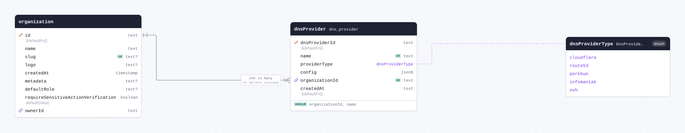

| Column           | Type                                       | Constraints                                       | Default         | Description |
| ---------------- | ------------------------------------------ | ------------------------------------------------- | --------------- | ----------- |
| `dnsProviderId`  | `text`                                     | PK NOT NULL                                       | `.$defaultFn()` |             |
| `name`           | `text`                                     | NOT NULL                                          |                 |             |
| `providerType`   | [`dnsProviderType`](#enum-dnsProviderType) | NOT NULL                                          |                 |             |
| `config`         | `jsonb`                                    | NOT NULL                                          |                 |             |
| `organizationId` | `text`                                     | NOT NULL → [organization.id](#table-organization) |                 |             |
| `createdAt`      | `text`                                     | NOT NULL                                          | `.$defaultFn()` |             |

#### Definition

```sql
CREATE TABLE "dns_provider" (
	"dnsProviderId" text PRIMARY KEY,
	"name" text NOT NULL,
	"providerType" "DnsProviderType" NOT NULL,
	"config" jsonb NOT NULL,
	"organizationId" text NOT NULL,
	"createdAt" text NOT NULL
);

CREATE UNIQUE INDEX "dns_provider_org_name_idx" ON "dns_provider" ("organizationId","name");

ALTER TABLE "dns_provider" ADD CONSTRAINT "dns_provider_organizationId_organization_id_fkey" FOREIGN KEY ("organizationId") REFERENCES "organization"("id") ON DELETE CASCADE;
```

#### Indexes

- UNIQUE `organizationId`, `name`

#### References

- `organizationId` → [organization.id](#table-organization) (many to one, on delete cascade)

<details>
<summary>Queries and their SQL</summary>

**Select**: Every row of dnsProvider.

```ts
db.select().from(dnsProvider);
```

```sql
select "dnsProviderId", "name", "providerType", "config", "organizationId", "createdAt"
from "dns_provider"
```

**Count**: How many rows dnsProvider has.

```ts
db.select({ count: count() }).from(dnsProvider);
```

```sql
select count(*)
from "dns_provider"
```

**Find many**: The rows of dnsProvider, through the relational query API.

```ts
db.query.dnsProvider.findMany();
```

```sql
select "d0"."dnsProviderId" as "dnsProviderId", "d0"."name" as "name", "d0"."providerType" as "providerType", "d0"."config" as "config", "d0"."organizationId" as "organizationId", "d0"."createdAt" as "createdAt"
from "dns_provider" as "d0"
```

**Find by primary key**: One row of dnsProvider, through the relational query API.

```ts
db.query.dnsProvider.findFirst({ where: { dnsProviderId: "dnsProviderId" } });
```

```sql
select "d0"."dnsProviderId" as "dnsProviderId", "d0"."name" as "name", "d0"."providerType" as "providerType", "d0"."config" as "config", "d0"."organizationId" as "organizationId", "d0"."createdAt" as "createdAt"
from "dns_provider" as "d0"
where "d0"."dnsProviderId" = $1
limit $2
-- params: ["dnsProviderId",1]
```

**Insert**: Adds a row to dnsProvider, giving the columns that have no default.

```ts
db.insert(dnsProvider).values({
  name: "name",
  providerType: "cloudflare",
  config: {},
  organizationId: "organizationId",
});
```

```sql
insert into "dns_provider" ("dnsProviderId", "name", "providerType", "config", "organizationId", "createdAt")
values ($1, $2, $3, $4, $5, $6)
-- params: ["uuuuuuuuuuuuuuuuuuuuu","name","cloudflare",{},"organizationId","2026-01-01T00:00:00.000Z"]
```

**Update**: Changes a row of dnsProvider, found by its primary key.

```ts
db.update(dnsProvider).set({ name: "name" }).where(eq(dnsProvider.dnsProviderId, "dnsProviderId"));
```

```sql
update "dns_provider"
set "name" = $1
where "dns_provider"."dnsProviderId" = $2
-- params: ["name","dnsProviderId"]
```

**Delete**: Deletes a row of dnsProvider, found by its primary key.

```ts
db.delete(dnsProvider).where(eq(dnsProvider.dnsProviderId, "dnsProviderId"));
```

```sql
delete from "dns_provider"
where "dns_provider"."dnsProviderId" = $1
-- params: ["dnsProviderId"]
```

</details>

<a id="table-domains"></a>

### domains

Table `domain`.

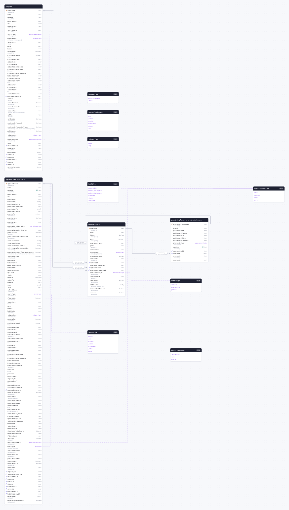

| Column                | Type                                       | Constraints                                                                | Default                            | Description |
| --------------------- | ------------------------------------------ | -------------------------------------------------------------------------- | ---------------------------------- | ----------- |
| `domainId`            | `text`                                     | PK NOT NULL                                                                | `.$defaultFn()`                    |             |
| `host`                | `text`                                     | NOT NULL                                                                   |                                    |             |
| `https`               | `boolean`                                  | NOT NULL                                                                   | `.default(false)`                  |             |
| `port`                | `integer`                                  | NULL                                                                       | `.default(3000)`                   |             |
| `customEntrypoint`    | `text`                                     | NULL                                                                       |                                    |             |
| `path`                | `text`                                     | NULL                                                                       | `.default("/")`                    |             |
| `serviceName`         | `text`                                     | NULL                                                                       |                                    |             |
| `domainType`          | [`domainType`](#enum-domainType)           | NULL                                                                       | `.default("application")`          |             |
| `uniqueConfigKey`     | `serial`                                   | NULL                                                                       |                                    |             |
| `createdAt`           | `text`                                     | NOT NULL                                                                   | `.$defaultFn()`                    |             |
| `composeId`           | `text`                                     | NULL → [compose.composeId](#table-compose)                                 |                                    |             |
| `customCertResolver`  | `text`                                     | NULL                                                                       |                                    |             |
| `applicationId`       | `text`                                     | NULL → [applications.applicationId](#table-applications)                   |                                    |             |
| `previewDeploymentId` | `text`                                     | NULL → [previewDeployments.previewDeploymentId](#table-previewDeployments) |                                    |             |
| `certificateType`     | [`certificateType`](#enum-certificateType) | NOT NULL                                                                   | `.default("none")`                 |             |
| `internalPath`        | `text`                                     | NULL                                                                       | `.default("/")`                    |             |
| `stripPath`           | `boolean`                                  | NOT NULL                                                                   | `.default(false)`                  |             |
| `middlewares`         | `text[]`                                   | NULL                                                                       | ``.default(sql`ARRAY[]::text[]`)`` |             |
| `forwardAuthEnabled`  | `boolean`                                  | NOT NULL                                                                   | `.default(false)`                  |             |
| `enabled`             | `boolean`                                  | NOT NULL                                                                   | `.default(true)`                   |             |

#### Definition

```sql
CREATE TABLE "domain" (
	"domainId" text PRIMARY KEY,
	"host" text NOT NULL,
	"https" boolean DEFAULT false NOT NULL,
	"port" integer DEFAULT 3000,
	"customEntrypoint" text,
	"path" text DEFAULT '/',
	"serviceName" text,
	"domainType" "domainType" DEFAULT 'application'::"domainType",
	"uniqueConfigKey" serial,
	"createdAt" text NOT NULL,
	"composeId" text,
	"customCertResolver" text,
	"applicationId" text,
	"previewDeploymentId" text,
	"certificateType" "certificateType" DEFAULT 'none'::"certificateType" NOT NULL,
	"internalPath" text DEFAULT '/',
	"stripPath" boolean DEFAULT false NOT NULL,
	"middlewares" text[] DEFAULT ARRAY[]::text[],
	"forwardAuthEnabled" boolean DEFAULT false NOT NULL,
	"enabled" boolean DEFAULT true NOT NULL
);

ALTER TABLE "domain" ADD CONSTRAINT "domain_composeId_compose_composeId_fkey" FOREIGN KEY ("composeId") REFERENCES "compose"("composeId") ON DELETE CASCADE;

ALTER TABLE "domain" ADD CONSTRAINT "domain_applicationId_application_applicationId_fkey" FOREIGN KEY ("applicationId") REFERENCES "application"("applicationId") ON DELETE CASCADE;

ALTER TABLE "domain" ADD CONSTRAINT "domain_vfpxoLFDACok_fkey" FOREIGN KEY ("previewDeploymentId") REFERENCES "preview_deployments"("previewDeploymentId") ON DELETE CASCADE;
```

#### References

- `composeId` → [compose.composeId](#table-compose) (many to one, on delete cascade)
- `applicationId` → [applications.applicationId](#table-applications) (many to one, on delete cascade)
- `previewDeploymentId` → [previewDeployments.previewDeploymentId](#table-previewDeployments) (many to one, on delete cascade)

#### Referenced by

- `domainId` → [previewDeployments.domainId](#table-previewDeployments) (one to many, on delete cascade)

<details>
<summary>Queries and their SQL</summary>

**Select**: Every row of domains.

```ts
db.select().from(domains);
```

```sql
select "domainId", "host", "https", "port", "customEntrypoint", "path", "serviceName", "domainType", "uniqueConfigKey", "createdAt", "composeId", "customCertResolver", "applicationId", "previewDeploymentId", "certificateType", "internalPath", "stripPath", "middlewares", "forwardAuthEnabled", "enabled"
from "domain"
```

**Count**: How many rows domains has.

```ts
db.select({ count: count() }).from(domains);
```

```sql
select count(*)
from "domain"
```

**Find many**: The rows of domains, through the relational query API.

```ts
db.query.domains.findMany();
```

```sql
select "d0"."domainId" as "domainId", "d0"."host" as "host", "d0"."https" as "https", "d0"."port" as "port", "d0"."customEntrypoint" as "customEntrypoint", "d0"."path" as "path", "d0"."serviceName" as "serviceName", "d0"."domainType" as "domainType", "d0"."uniqueConfigKey" as "uniqueConfigKey", "d0"."createdAt" as "createdAt", "d0"."composeId" as "composeId", "d0"."customCertResolver" as "customCertResolver", "d0"."applicationId" as "applicationId", "d0"."previewDeploymentId" as "previewDeploymentId", "d0"."certificateType" as "certificateType", "d0"."internalPath" as "internalPath", "d0"."stripPath" as "stripPath", "d0"."middlewares" as "middlewares", "d0"."forwardAuthEnabled" as "forwardAuthEnabled", "d0"."enabled" as "enabled"
from "domain" as "d0"
```

**Find by primary key**: One row of domains, through the relational query API.

```ts
db.query.domains.findFirst({ where: { domainId: "domainId" } });
```

```sql
select "d0"."domainId" as "domainId", "d0"."host" as "host", "d0"."https" as "https", "d0"."port" as "port", "d0"."customEntrypoint" as "customEntrypoint", "d0"."path" as "path", "d0"."serviceName" as "serviceName", "d0"."domainType" as "domainType", "d0"."uniqueConfigKey" as "uniqueConfigKey", "d0"."createdAt" as "createdAt", "d0"."composeId" as "composeId", "d0"."customCertResolver" as "customCertResolver", "d0"."applicationId" as "applicationId", "d0"."previewDeploymentId" as "previewDeploymentId", "d0"."certificateType" as "certificateType", "d0"."internalPath" as "internalPath", "d0"."stripPath" as "stripPath", "d0"."middlewares" as "middlewares", "d0"."forwardAuthEnabled" as "forwardAuthEnabled", "d0"."enabled" as "enabled"
from "domain" as "d0"
where "d0"."domainId" = $1
limit $2
-- params: ["domainId",1]
```

**Insert**: Adds a row to domains, giving the columns that have no default.

```ts
db.insert(domains).values({ host: "host" });
```

```sql
insert into "domain" ("domainId", "host", "https", "port", "customEntrypoint", "path", "serviceName", "domainType", "uniqueConfigKey", "createdAt", "composeId", "customCertResolver", "applicationId", "previewDeploymentId", "certificateType", "internalPath", "stripPath", "middlewares", "forwardAuthEnabled", "enabled")
values ($1, $2, default, default, default, default, default, default, default, $3, default, default, default, default, default, default, default, default, default, default)
-- params: ["uuuuuuuuuuuuuuuuuuuuu","host","2026-01-01T00:00:00.000Z"]
```

**Update**: Changes a row of domains, found by its primary key.

```ts
db.update(domains).set({ host: "host" }).where(eq(domains.domainId, "domainId"));
```

```sql
update "domain"
set "host" = $1
where "domain"."domainId" = $2
-- params: ["host","domainId"]
```

**Delete**: Deletes a row of domains, found by its primary key.

```ts
db.delete(domains).where(eq(domains.domainId, "domainId"));
```

```sql
delete from "domain"
where "domain"."domainId" = $1
-- params: ["domainId"]
```

</details>

<a id="table-environments"></a>

### environments

Table `environment`.

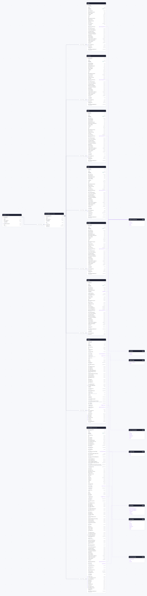

| Column          | Type      | Constraints                                      | Default           | Description |
| --------------- | --------- | ------------------------------------------------ | ----------------- | ----------- |
| `environmentId` | `text`    | PK NOT NULL                                      | `.$defaultFn()`   |             |
| `name`          | `text`    | NOT NULL                                         |                   |             |
| `description`   | `text`    | NULL                                             |                   |             |
| `createdAt`     | `text`    | NOT NULL                                         | `.$defaultFn()`   |             |
| `env`           | `text`    | NOT NULL                                         | `.default("")`    |             |
| `projectId`     | `text`    | NOT NULL → [projects.projectId](#table-projects) |                   |             |
| `isDefault`     | `boolean` | NOT NULL                                         | `.default(false)` |             |

#### Definition

```sql
CREATE TABLE "environment" (
	"environmentId" text PRIMARY KEY,
	"name" text NOT NULL,
	"description" text,
	"createdAt" text NOT NULL,
	"env" text DEFAULT '' NOT NULL,
	"projectId" text NOT NULL,
	"isDefault" boolean DEFAULT false NOT NULL
);

ALTER TABLE "environment" ADD CONSTRAINT "environment_projectId_project_projectId_fkey" FOREIGN KEY ("projectId") REFERENCES "project"("projectId") ON DELETE CASCADE;
```

#### References

- `projectId` → [projects.projectId](#table-projects) (many to one, on delete cascade)

#### Referenced by

- `environmentId` → [applications.environmentId](#table-applications) (one to many, on delete cascade)
- `environmentId` → [compose.environmentId](#table-compose) (one to many, on delete cascade)
- `environmentId` → [libsql.environmentId](#table-libsql) (one to many, on delete cascade)
- `environmentId` → [mariadb.environmentId](#table-mariadb) (one to many, on delete cascade)
- `environmentId` → [mongo.environmentId](#table-mongo) (one to many, on delete cascade)
- `environmentId` → [mysql.environmentId](#table-mysql) (one to many, on delete cascade)
- `environmentId` → [postgres.environmentId](#table-postgres) (one to many, on delete cascade)
- `environmentId` → [redis.environmentId](#table-redis) (one to many, on delete cascade)

<details>
<summary>Queries and their SQL</summary>

**Select**: Every row of environments.

```ts
db.select().from(environments);
```

```sql
select "environmentId", "name", "description", "createdAt", "env", "projectId", "isDefault"
from "environment"
```

**Count**: How many rows environments has.

```ts
db.select({ count: count() }).from(environments);
```

```sql
select count(*)
from "environment"
```

**Find many**: The rows of environments, through the relational query API.

```ts
db.query.environments.findMany();
```

```sql
select "d0"."environmentId" as "environmentId", "d0"."name" as "name", "d0"."description" as "description", "d0"."createdAt" as "createdAt", "d0"."env" as "env", "d0"."projectId" as "projectId", "d0"."isDefault" as "isDefault"
from "environment" as "d0"
```

**Find by primary key**: One row of environments, through the relational query API.

```ts
db.query.environments.findFirst({ where: { environmentId: "environmentId" } });
```

```sql
select "d0"."environmentId" as "environmentId", "d0"."name" as "name", "d0"."description" as "description", "d0"."createdAt" as "createdAt", "d0"."env" as "env", "d0"."projectId" as "projectId", "d0"."isDefault" as "isDefault"
from "environment" as "d0"
where "d0"."environmentId" = $1
limit $2
-- params: ["environmentId",1]
```

**Insert**: Adds a row to environments, giving the columns that have no default.

```ts
db.insert(environments).values({ name: "name", projectId: "projectId" });
```

```sql
insert into "environment" ("environmentId", "name", "description", "createdAt", "env", "projectId", "isDefault")
values ($1, $2, default, $3, default, $4, default)
-- params: ["uuuuuuuuuuuuuuuuuuuuu","name","2026-01-01T00:00:00.000Z","projectId"]
```

**Update**: Changes a row of environments, found by its primary key.

```ts
db.update(environments)
  .set({ name: "name" })
  .where(eq(environments.environmentId, "environmentId"));
```

```sql
update "environment"
set "name" = $1
where "environment"."environmentId" = $2
-- params: ["name","environmentId"]
```

**Delete**: Deletes a row of environments, found by its primary key.

```ts
db.delete(environments).where(eq(environments.environmentId, "environmentId"));
```

```sql
delete from "environment"
where "environment"."environmentId" = $1
-- params: ["environmentId"]
```

</details>

<a id="table-forwardAuthSettings"></a>

### forwardAuthSettings

Table `forward_auth_settings`.

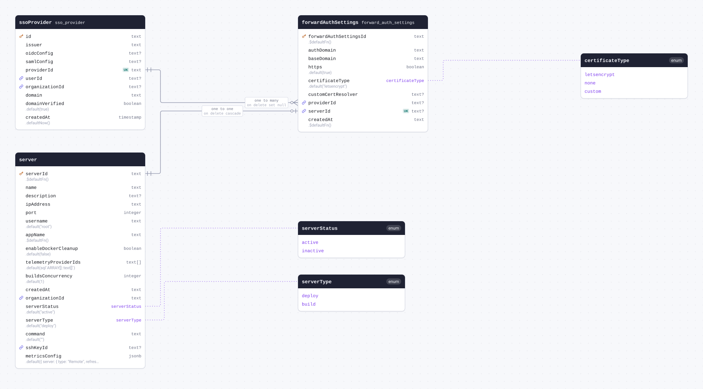

| Column                  | Type                                       | Constraints                                         | Default                   | Description |
| ----------------------- | ------------------------------------------ | --------------------------------------------------- | ------------------------- | ----------- |
| `forwardAuthSettingsId` | `text`                                     | PK NOT NULL                                         | `.$defaultFn()`           |             |
| `authDomain`            | `text`                                     | NOT NULL                                            |                           |             |
| `baseDomain`            | `text`                                     | NOT NULL                                            |                           |             |
| `https`                 | `boolean`                                  | NOT NULL                                            | `.default(true)`          |             |
| `certificateType`       | [`certificateType`](#enum-certificateType) | NOT NULL                                            | `.default("letsencrypt")` |             |
| `customCertResolver`    | `text`                                     | NULL                                                |                           |             |
| `providerId`            | `text`                                     | NULL → [ssoProvider.providerId](#table-ssoProvider) |                           |             |
| `serverId`              | `text`                                     | UNIQUE NULL → [server.serverId](#table-server)      |                           |             |
| `createdAt`             | `text`                                     | NOT NULL                                            | `.$defaultFn()`           |             |

#### Definition

```sql
CREATE TABLE "forward_auth_settings" (
	"forwardAuthSettingsId" text PRIMARY KEY,
	"authDomain" text NOT NULL,
	"baseDomain" text NOT NULL,
	"https" boolean DEFAULT true NOT NULL,
	"certificateType" "certificateType" DEFAULT 'letsencrypt'::"certificateType" NOT NULL,
	"customCertResolver" text,
	"providerId" text,
	"serverId" text UNIQUE,
	"createdAt" text NOT NULL
);

ALTER TABLE "forward_auth_settings" ADD CONSTRAINT "forward_auth_settings_providerId_sso_provider_provider_id_fkey" FOREIGN KEY ("providerId") REFERENCES "sso_provider"("provider_id") ON DELETE SET NULL;

ALTER TABLE "forward_auth_settings" ADD CONSTRAINT "forward_auth_settings_serverId_server_serverId_fkey" FOREIGN KEY ("serverId") REFERENCES "server"("serverId") ON DELETE CASCADE;
```

#### References

- `providerId` → [ssoProvider.providerId](#table-ssoProvider) (many to one, on delete set null)
- `serverId` → [server.serverId](#table-server) (one to one, on delete cascade)

<details>
<summary>Queries and their SQL</summary>

**Select**: Every row of forwardAuthSettings.

```ts
db.select().from(forwardAuthSettings);
```

```sql
select "forwardAuthSettingsId", "authDomain", "baseDomain", "https", "certificateType", "customCertResolver", "providerId", "serverId", "createdAt"
from "forward_auth_settings"
```

**Count**: How many rows forwardAuthSettings has.

```ts
db.select({ count: count() }).from(forwardAuthSettings);
```

```sql
select count(*)
from "forward_auth_settings"
```

**Find many**: The rows of forwardAuthSettings, through the relational query API.

```ts
db.query.forwardAuthSettings.findMany();
```

```sql
select "d0"."forwardAuthSettingsId" as "forwardAuthSettingsId", "d0"."authDomain" as "authDomain", "d0"."baseDomain" as "baseDomain", "d0"."https" as "https", "d0"."certificateType" as "certificateType", "d0"."customCertResolver" as "customCertResolver", "d0"."providerId" as "providerId", "d0"."serverId" as "serverId", "d0"."createdAt" as "createdAt"
from "forward_auth_settings" as "d0"
```

**Find by primary key**: One row of forwardAuthSettings, through the relational query API.

```ts
db.query.forwardAuthSettings.findFirst({
  where: { forwardAuthSettingsId: "forwardAuthSettingsId" },
});
```

```sql
select "d0"."forwardAuthSettingsId" as "forwardAuthSettingsId", "d0"."authDomain" as "authDomain", "d0"."baseDomain" as "baseDomain", "d0"."https" as "https", "d0"."certificateType" as "certificateType", "d0"."customCertResolver" as "customCertResolver", "d0"."providerId" as "providerId", "d0"."serverId" as "serverId", "d0"."createdAt" as "createdAt"
from "forward_auth_settings" as "d0"
where "d0"."forwardAuthSettingsId" = $1
limit $2
-- params: ["forwardAuthSettingsId",1]
```

**Insert**: Adds a row to forwardAuthSettings, giving the columns that have no default.

```ts
db.insert(forwardAuthSettings).values({ authDomain: "authDomain", baseDomain: "baseDomain" });
```

```sql
insert into "forward_auth_settings" ("forwardAuthSettingsId", "authDomain", "baseDomain", "https", "certificateType", "customCertResolver", "providerId", "serverId", "createdAt")
values ($1, $2, $3, default, default, default, default, default, $4)
-- params: ["uuuuuuuuuuuuuuuuuuuuu","authDomain","baseDomain","2026-01-01T00:00:00.000Z"]
```

**Update**: Changes a row of forwardAuthSettings, found by its primary key.

```ts
db.update(forwardAuthSettings)
  .set({ authDomain: "authDomain" })
  .where(eq(forwardAuthSettings.forwardAuthSettingsId, "forwardAuthSettingsId"));
```

```sql
update "forward_auth_settings"
set "authDomain" = $1
where "forward_auth_settings"."forwardAuthSettingsId" = $2
-- params: ["authDomain","forwardAuthSettingsId"]
```

**Delete**: Deletes a row of forwardAuthSettings, found by its primary key.

```ts
db.delete(forwardAuthSettings).where(
  eq(forwardAuthSettings.forwardAuthSettingsId, "forwardAuthSettingsId"),
);
```

```sql
delete from "forward_auth_settings"
where "forward_auth_settings"."forwardAuthSettingsId" = $1
-- params: ["forwardAuthSettingsId"]
```

</details>

<a id="table-gitProvider"></a>

### gitProvider

Table `git_provider`.

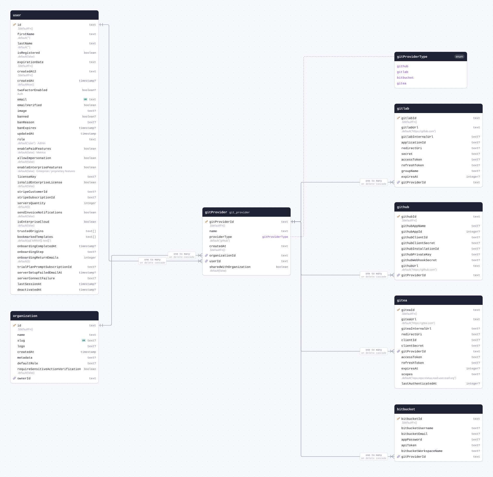

| Column                   | Type                                       | Constraints                                       | Default              | Description |
| ------------------------ | ------------------------------------------ | ------------------------------------------------- | -------------------- | ----------- |
| `gitProviderId`          | `text`                                     | PK NOT NULL                                       | `.$defaultFn()`      |             |
| `name`                   | `text`                                     | NOT NULL                                          |                      |             |
| `providerType`           | [`gitProviderType`](#enum-gitProviderType) | NOT NULL                                          | `.default("github")` |             |
| `createdAt`              | `text`                                     | NOT NULL                                          | `.$defaultFn()`      |             |
| `organizationId`         | `text`                                     | NOT NULL → [organization.id](#table-organization) |                      |             |
| `userId`                 | `text`                                     | NOT NULL → [user.id](#table-user)                 |                      |             |
| `sharedWithOrganization` | `boolean`                                  | NOT NULL                                          | `.default(false)`    |             |

#### Definition

```sql
CREATE TABLE "git_provider" (
	"gitProviderId" text PRIMARY KEY,
	"name" text NOT NULL,
	"providerType" "gitProviderType" DEFAULT 'github'::"gitProviderType" NOT NULL,
	"createdAt" text NOT NULL,
	"organizationId" text NOT NULL,
	"userId" text NOT NULL,
	"sharedWithOrganization" boolean DEFAULT false NOT NULL
);

ALTER TABLE "git_provider" ADD CONSTRAINT "git_provider_organizationId_organization_id_fkey" FOREIGN KEY ("organizationId") REFERENCES "organization"("id") ON DELETE CASCADE;

ALTER TABLE "git_provider" ADD CONSTRAINT "git_provider_userId_user_id_fkey" FOREIGN KEY ("userId") REFERENCES "user"("id") ON DELETE CASCADE;
```

#### References

- `organizationId` → [organization.id](#table-organization) (many to one, on delete cascade)
- `userId` → [user.id](#table-user) (many to one, on delete cascade)

#### Referenced by

- `gitProviderId` → [bitbucket.gitProviderId](#table-bitbucket) (one to many, on delete cascade)
- `gitProviderId` → [gitea.gitProviderId](#table-gitea) (one to many, on delete cascade)
- `gitProviderId` → [github.gitProviderId](#table-github) (one to many, on delete cascade)
- `gitProviderId` → [gitlab.gitProviderId](#table-gitlab) (one to many, on delete cascade)

<details>
<summary>Queries and their SQL</summary>

**Select**: Every row of gitProvider.

```ts
db.select().from(gitProvider);
```

```sql
select "gitProviderId", "name", "providerType", "createdAt", "organizationId", "userId", "sharedWithOrganization"
from "git_provider"
```

**Count**: How many rows gitProvider has.

```ts
db.select({ count: count() }).from(gitProvider);
```

```sql
select count(*)
from "git_provider"
```

**Find many**: The rows of gitProvider, through the relational query API.

```ts
db.query.gitProvider.findMany();
```

```sql
select "d0"."gitProviderId" as "gitProviderId", "d0"."name" as "name", "d0"."providerType" as "providerType", "d0"."createdAt" as "createdAt", "d0"."organizationId" as "organizationId", "d0"."userId" as "userId", "d0"."sharedWithOrganization" as "sharedWithOrganization"
from "git_provider" as "d0"
```

**Find by primary key**: One row of gitProvider, through the relational query API.

```ts
db.query.gitProvider.findFirst({ where: { gitProviderId: "gitProviderId" } });
```

```sql
select "d0"."gitProviderId" as "gitProviderId", "d0"."name" as "name", "d0"."providerType" as "providerType", "d0"."createdAt" as "createdAt", "d0"."organizationId" as "organizationId", "d0"."userId" as "userId", "d0"."sharedWithOrganization" as "sharedWithOrganization"
from "git_provider" as "d0"
where "d0"."gitProviderId" = $1
limit $2
-- params: ["gitProviderId",1]
```

**Insert**: Adds a row to gitProvider, giving the columns that have no default.

```ts
db.insert(gitProvider).values({ name: "name", organizationId: "organizationId", userId: "userId" });
```

```sql
insert into "git_provider" ("gitProviderId", "name", "providerType", "createdAt", "organizationId", "userId", "sharedWithOrganization")
values ($1, $2, default, $3, $4, $5, default)
-- params: ["uuuuuuuuuuuuuuuuuuuuu","name","2026-01-01T00:00:00.000Z","organizationId","userId"]
```

**Update**: Changes a row of gitProvider, found by its primary key.

```ts
db.update(gitProvider).set({ name: "name" }).where(eq(gitProvider.gitProviderId, "gitProviderId"));
```

```sql
update "git_provider"
set "name" = $1
where "git_provider"."gitProviderId" = $2
-- params: ["name","gitProviderId"]
```

**Delete**: Deletes a row of gitProvider, found by its primary key.

```ts
db.delete(gitProvider).where(eq(gitProvider.gitProviderId, "gitProviderId"));
```

```sql
delete from "git_provider"
where "git_provider"."gitProviderId" = $1
-- params: ["gitProviderId"]
```

</details>

<a id="table-gitea"></a>

### gitea

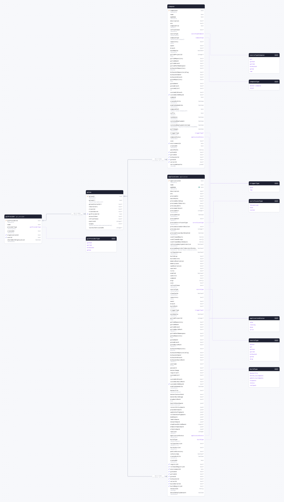

| Column                                          | Type      | Constraints                                                | Default                                           | Description |
| ----------------------------------------------- | --------- | ---------------------------------------------------------- | ------------------------------------------------- | ----------- |
| `giteaId`                                       | `text`    | PK NOT NULL                                                | `.$defaultFn()`                                   |             |
| `giteaUrl`                                      | `text`    | NOT NULL                                                   | `.default("https://gitea.com")`                   |             |
| `giteaInternalUrl`                              | `text`    | NULL                                                       |                                                   |             |
| `redirectUri` (`redirect_uri`)                  | `text`    | NULL                                                       |                                                   |             |
| `clientId` (`client_id`)                        | `text`    | NULL                                                       |                                                   |             |
| `clientSecret` (`client_secret`)                | `text`    | NULL                                                       |                                                   |             |
| `gitProviderId`                                 | `text`    | NOT NULL → [gitProvider.gitProviderId](#table-gitProvider) |                                                   |             |
| `accessToken` (`access_token`)                  | `text`    | NULL                                                       |                                                   |             |
| `refreshToken` (`refresh_token`)                | `text`    | NULL                                                       |                                                   |             |
| `expiresAt` (`expires_at`)                      | `integer` | NULL                                                       |                                                   |             |
| `scopes`                                        | `text`    | NULL                                                       | `.default("repo,repo:status,read:user,read:org")` |             |
| `lastAuthenticatedAt` (`last_authenticated_at`) | `integer` | NULL                                                       |                                                   |             |

#### Definition

```sql
CREATE TABLE "gitea" (
	"giteaId" text PRIMARY KEY,
	"giteaUrl" text DEFAULT 'https://gitea.com' NOT NULL,
	"giteaInternalUrl" text,
	"redirect_uri" text,
	"client_id" text,
	"client_secret" text,
	"gitProviderId" text NOT NULL,
	"access_token" text,
	"refresh_token" text,
	"expires_at" integer,
	"scopes" text DEFAULT 'repo,repo:status,read:user,read:org',
	"last_authenticated_at" integer
);

ALTER TABLE "gitea" ADD CONSTRAINT "gitea_gitProviderId_git_provider_gitProviderId_fkey" FOREIGN KEY ("gitProviderId") REFERENCES "git_provider"("gitProviderId") ON DELETE CASCADE;
```

#### References

- `gitProviderId` → [gitProvider.gitProviderId](#table-gitProvider) (many to one, on delete cascade)

#### Referenced by

- `giteaId` → [applications.giteaId](#table-applications) (one to many, on delete set null)
- `giteaId` → [compose.giteaId](#table-compose) (one to many, on delete set null)

<details>
<summary>Queries and their SQL</summary>

**Select**: Every row of gitea.

```ts
db.select().from(gitea);
```

```sql
select "giteaId", "giteaUrl", "giteaInternalUrl", "redirect_uri", "client_id", "client_secret", "gitProviderId", "access_token", "refresh_token", "expires_at", "scopes", "last_authenticated_at"
from "gitea"
```

**Count**: How many rows gitea has.

```ts
db.select({ count: count() }).from(gitea);
```

```sql
select count(*)
from "gitea"
```

**Find many**: The rows of gitea, through the relational query API.

```ts
db.query.gitea.findMany();
```

```sql
select "d0"."giteaId" as "giteaId", "d0"."giteaUrl" as "giteaUrl", "d0"."giteaInternalUrl" as "giteaInternalUrl", "d0"."redirect_uri" as "redirectUri", "d0"."client_id" as "clientId", "d0"."client_secret" as "clientSecret", "d0"."gitProviderId" as "gitProviderId", "d0"."access_token" as "accessToken", "d0"."refresh_token" as "refreshToken", "d0"."expires_at" as "expiresAt", "d0"."scopes" as "scopes", "d0"."last_authenticated_at" as "lastAuthenticatedAt"
from "gitea" as "d0"
```

**Find by primary key**: One row of gitea, through the relational query API.

```ts
db.query.gitea.findFirst({ where: { giteaId: "giteaId" } });
```

```sql
select "d0"."giteaId" as "giteaId", "d0"."giteaUrl" as "giteaUrl", "d0"."giteaInternalUrl" as "giteaInternalUrl", "d0"."redirect_uri" as "redirectUri", "d0"."client_id" as "clientId", "d0"."client_secret" as "clientSecret", "d0"."gitProviderId" as "gitProviderId", "d0"."access_token" as "accessToken", "d0"."refresh_token" as "refreshToken", "d0"."expires_at" as "expiresAt", "d0"."scopes" as "scopes", "d0"."last_authenticated_at" as "lastAuthenticatedAt"
from "gitea" as "d0"
where "d0"."giteaId" = $1
limit $2
-- params: ["giteaId",1]
```

**Insert**: Adds a row to gitea, giving the columns that have no default.

```ts
db.insert(gitea).values({ gitProviderId: "gitProviderId" });
```

```sql
insert into "gitea" ("giteaId", "giteaUrl", "giteaInternalUrl", "redirect_uri", "client_id", "client_secret", "gitProviderId", "access_token", "refresh_token", "expires_at", "scopes", "last_authenticated_at")
values ($1, default, default, default, default, default, $2, default, default, default, default, default)
-- params: ["uuuuuuuuuuuuuuuuuuuuu","gitProviderId"]
```

**Update**: Changes a row of gitea, found by its primary key.

```ts
db.update(gitea).set({ giteaUrl: "giteaUrl" }).where(eq(gitea.giteaId, "giteaId"));
```

```sql
update "gitea"
set "giteaUrl" = $1
where "gitea"."giteaId" = $2
-- params: ["giteaUrl","giteaId"]
```

**Delete**: Deletes a row of gitea, found by its primary key.

```ts
db.delete(gitea).where(eq(gitea.giteaId, "giteaId"));
```

```sql
delete from "gitea"
where "gitea"."giteaId" = $1
-- params: ["giteaId"]
```

</details>

<a id="table-github"></a>

### github

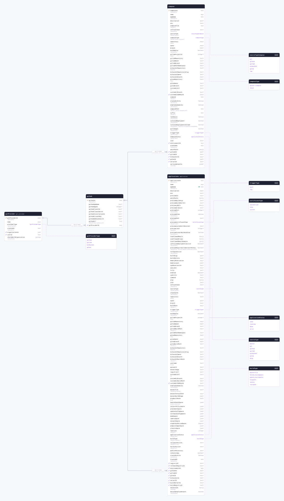

| Column                 | Type      | Constraints                                                | Default                          | Description |
| ---------------------- | --------- | ---------------------------------------------------------- | -------------------------------- | ----------- |
| `githubId`             | `text`    | PK NOT NULL                                                | `.$defaultFn()`                  |             |
| `githubAppName`        | `text`    | NULL                                                       |                                  |             |
| `githubAppId`          | `integer` | NULL                                                       |                                  |             |
| `githubClientId`       | `text`    | NULL                                                       |                                  |             |
| `githubClientSecret`   | `text`    | NULL                                                       |                                  |             |
| `githubInstallationId` | `text`    | NULL                                                       |                                  |             |
| `githubPrivateKey`     | `text`    | NULL                                                       |                                  |             |
| `githubWebhookSecret`  | `text`    | NULL                                                       |                                  |             |
| `githubUrl`            | `text`    | NOT NULL                                                   | `.default("https://github.com")` |             |
| `gitProviderId`        | `text`    | NOT NULL → [gitProvider.gitProviderId](#table-gitProvider) |                                  |             |

#### Definition

```sql
CREATE TABLE "github" (
	"githubId" text PRIMARY KEY,
	"githubAppName" text,
	"githubAppId" integer,
	"githubClientId" text,
	"githubClientSecret" text,
	"githubInstallationId" text,
	"githubPrivateKey" text,
	"githubWebhookSecret" text,
	"githubUrl" text DEFAULT 'https://github.com' NOT NULL,
	"gitProviderId" text NOT NULL
);

ALTER TABLE "github" ADD CONSTRAINT "github_gitProviderId_git_provider_gitProviderId_fkey" FOREIGN KEY ("gitProviderId") REFERENCES "git_provider"("gitProviderId") ON DELETE CASCADE;
```

#### References

- `gitProviderId` → [gitProvider.gitProviderId](#table-gitProvider) (many to one, on delete cascade)

#### Referenced by

- `githubId` → [applications.githubId](#table-applications) (one to many, on delete set null)
- `githubId` → [compose.githubId](#table-compose) (one to many, on delete set null)

<details>
<summary>Queries and their SQL</summary>

**Select**: Every row of github.

```ts
db.select().from(github);
```

```sql
select "githubId", "githubAppName", "githubAppId", "githubClientId", "githubClientSecret", "githubInstallationId", "githubPrivateKey", "githubWebhookSecret", "githubUrl", "gitProviderId"
from "github"
```

**Count**: How many rows github has.

```ts
db.select({ count: count() }).from(github);
```

```sql
select count(*)
from "github"
```

**Find many**: The rows of github, through the relational query API.

```ts
db.query.github.findMany();
```

```sql
select "d0"."githubId" as "githubId", "d0"."githubAppName" as "githubAppName", "d0"."githubAppId" as "githubAppId", "d0"."githubClientId" as "githubClientId", "d0"."githubClientSecret" as "githubClientSecret", "d0"."githubInstallationId" as "githubInstallationId", "d0"."githubPrivateKey" as "githubPrivateKey", "d0"."githubWebhookSecret" as "githubWebhookSecret", "d0"."githubUrl" as "githubUrl", "d0"."gitProviderId" as "gitProviderId"
from "github" as "d0"
```

**Find by primary key**: One row of github, through the relational query API.

```ts
db.query.github.findFirst({ where: { githubId: "githubId" } });
```

```sql
select "d0"."githubId" as "githubId", "d0"."githubAppName" as "githubAppName", "d0"."githubAppId" as "githubAppId", "d0"."githubClientId" as "githubClientId", "d0"."githubClientSecret" as "githubClientSecret", "d0"."githubInstallationId" as "githubInstallationId", "d0"."githubPrivateKey" as "githubPrivateKey", "d0"."githubWebhookSecret" as "githubWebhookSecret", "d0"."githubUrl" as "githubUrl", "d0"."gitProviderId" as "gitProviderId"
from "github" as "d0"
where "d0"."githubId" = $1
limit $2
-- params: ["githubId",1]
```

**Insert**: Adds a row to github, giving the columns that have no default.

```ts
db.insert(github).values({ gitProviderId: "gitProviderId" });
```

```sql
insert into "github" ("githubId", "githubAppName", "githubAppId", "githubClientId", "githubClientSecret", "githubInstallationId", "githubPrivateKey", "githubWebhookSecret", "githubUrl", "gitProviderId")
values ($1, default, default, default, default, default, default, default, default, $2)
-- params: ["uuuuuuuuuuuuuuuuuuuuu","gitProviderId"]
```

**Update**: Changes a row of github, found by its primary key.

```ts
db.update(github).set({ githubAppName: "githubAppName" }).where(eq(github.githubId, "githubId"));
```

```sql
update "github"
set "githubAppName" = $1
where "github"."githubId" = $2
-- params: ["githubAppName","githubId"]
```

**Delete**: Deletes a row of github, found by its primary key.

```ts
db.delete(github).where(eq(github.githubId, "githubId"));
```

```sql
delete from "github"
where "github"."githubId" = $1
-- params: ["githubId"]
```

</details>

<a id="table-gitlab"></a>

### gitlab

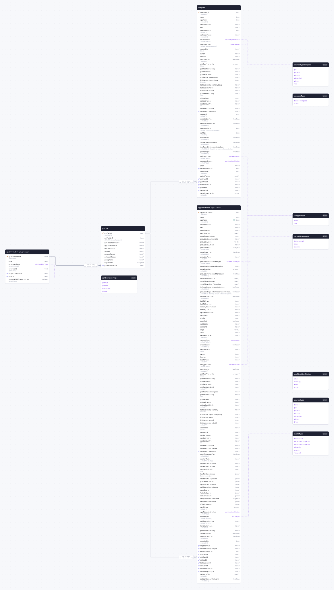

| Column                             | Type      | Constraints                                                | Default                          | Description |
| ---------------------------------- | --------- | ---------------------------------------------------------- | -------------------------------- | ----------- |
| `gitlabId`                         | `text`    | PK NOT NULL                                                | `.$defaultFn()`                  |             |
| `gitlabUrl`                        | `text`    | NOT NULL                                                   | `.default("https://gitlab.com")` |             |
| `gitlabInternalUrl`                | `text`    | NULL                                                       |                                  |             |
| `applicationId` (`application_id`) | `text`    | NULL                                                       |                                  |             |
| `redirectUri` (`redirect_uri`)     | `text`    | NULL                                                       |                                  |             |
| `secret`                           | `text`    | NULL                                                       |                                  |             |
| `accessToken` (`access_token`)     | `text`    | NULL                                                       |                                  |             |
| `refreshToken` (`refresh_token`)   | `text`    | NULL                                                       |                                  |             |
| `groupName` (`group_name`)         | `text`    | NULL                                                       |                                  |             |
| `expiresAt` (`expires_at`)         | `integer` | NULL                                                       |                                  |             |
| `gitProviderId`                    | `text`    | NOT NULL → [gitProvider.gitProviderId](#table-gitProvider) |                                  |             |

#### Definition

```sql
CREATE TABLE "gitlab" (
	"gitlabId" text PRIMARY KEY,
	"gitlabUrl" text DEFAULT 'https://gitlab.com' NOT NULL,
	"gitlabInternalUrl" text,
	"application_id" text,
	"redirect_uri" text,
	"secret" text,
	"access_token" text,
	"refresh_token" text,
	"group_name" text,
	"expires_at" integer,
	"gitProviderId" text NOT NULL
);

ALTER TABLE "gitlab" ADD CONSTRAINT "gitlab_gitProviderId_git_provider_gitProviderId_fkey" FOREIGN KEY ("gitProviderId") REFERENCES "git_provider"("gitProviderId") ON DELETE CASCADE;
```

#### References

- `gitProviderId` → [gitProvider.gitProviderId](#table-gitProvider) (many to one, on delete cascade)

#### Referenced by

- `gitlabId` → [applications.gitlabId](#table-applications) (one to many, on delete set null)
- `gitlabId` → [compose.gitlabId](#table-compose) (one to many, on delete set null)

<details>
<summary>Queries and their SQL</summary>

**Select**: Every row of gitlab.

```ts
db.select().from(gitlab);
```

```sql
select "gitlabId", "gitlabUrl", "gitlabInternalUrl", "application_id", "redirect_uri", "secret", "access_token", "refresh_token", "group_name", "expires_at", "gitProviderId"
from "gitlab"
```

**Count**: How many rows gitlab has.

```ts
db.select({ count: count() }).from(gitlab);
```

```sql
select count(*)
from "gitlab"
```

**Find many**: The rows of gitlab, through the relational query API.

```ts
db.query.gitlab.findMany();
```

```sql
select "d0"."gitlabId" as "gitlabId", "d0"."gitlabUrl" as "gitlabUrl", "d0"."gitlabInternalUrl" as "gitlabInternalUrl", "d0"."application_id" as "applicationId", "d0"."redirect_uri" as "redirectUri", "d0"."secret" as "secret", "d0"."access_token" as "accessToken", "d0"."refresh_token" as "refreshToken", "d0"."group_name" as "groupName", "d0"."expires_at" as "expiresAt", "d0"."gitProviderId" as "gitProviderId"
from "gitlab" as "d0"
```

**Find by primary key**: One row of gitlab, through the relational query API.

```ts
db.query.gitlab.findFirst({ where: { gitlabId: "gitlabId" } });
```

```sql
select "d0"."gitlabId" as "gitlabId", "d0"."gitlabUrl" as "gitlabUrl", "d0"."gitlabInternalUrl" as "gitlabInternalUrl", "d0"."application_id" as "applicationId", "d0"."redirect_uri" as "redirectUri", "d0"."secret" as "secret", "d0"."access_token" as "accessToken", "d0"."refresh_token" as "refreshToken", "d0"."group_name" as "groupName", "d0"."expires_at" as "expiresAt", "d0"."gitProviderId" as "gitProviderId"
from "gitlab" as "d0"
where "d0"."gitlabId" = $1
limit $2
-- params: ["gitlabId",1]
```

**Insert**: Adds a row to gitlab, giving the columns that have no default.

```ts
db.insert(gitlab).values({ gitProviderId: "gitProviderId" });
```

```sql
insert into "gitlab" ("gitlabId", "gitlabUrl", "gitlabInternalUrl", "application_id", "redirect_uri", "secret", "access_token", "refresh_token", "group_name", "expires_at", "gitProviderId")
values ($1, default, default, default, default, default, default, default, default, default, $2)
-- params: ["uuuuuuuuuuuuuuuuuuuuu","gitProviderId"]
```

**Update**: Changes a row of gitlab, found by its primary key.

```ts
db.update(gitlab).set({ gitlabUrl: "gitlabUrl" }).where(eq(gitlab.gitlabId, "gitlabId"));
```

```sql
update "gitlab"
set "gitlabUrl" = $1
where "gitlab"."gitlabId" = $2
-- params: ["gitlabUrl","gitlabId"]
```

**Delete**: Deletes a row of gitlab, found by its primary key.

```ts
db.delete(gitlab).where(eq(gitlab.gitlabId, "gitlabId"));
```

```sql
delete from "gitlab"
where "gitlab"."gitlabId" = $1
-- params: ["gitlabId"]
```

</details>

<a id="table-libsql"></a>

### libsql

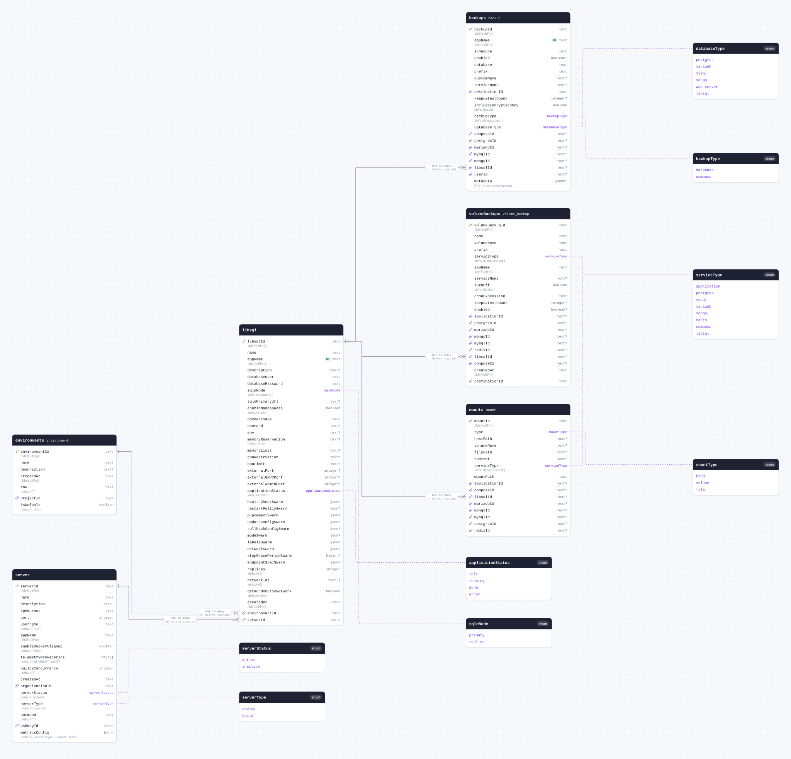

| Column                 | Type                                           | Constraints                                                  | Default               | Description |
| ---------------------- | ---------------------------------------------- | ------------------------------------------------------------ | --------------------- | ----------- |
| `libsqlId`             | `text`                                         | PK NOT NULL                                                  | `.$defaultFn()`       |             |
| `name`                 | `text`                                         | NOT NULL                                                     |                       |             |
| `appName`              | `text`                                         | UNIQUE NOT NULL                                              | `.$defaultFn()`       |             |
| `description`          | `text`                                         | NULL                                                         |                       |             |
| `databaseUser`         | `text`                                         | NOT NULL                                                     |                       |             |
| `databasePassword`     | `text`                                         | NOT NULL                                                     |                       |             |
| `sqldNode`             | [`sqldNode`](#enum-sqldNode)                   | NOT NULL                                                     | `.default("primary")` |             |
| `sqldPrimaryUrl`       | `text`                                         | NULL                                                         |                       |             |
| `enableNamespaces`     | `boolean`                                      | NOT NULL                                                     | `.default(false)`     |             |
| `dockerImage`          | `text`                                         | NOT NULL                                                     |                       |             |
| `command`              | `text`                                         | NULL                                                         |                       |             |
| `env`                  | `text`                                         | NULL                                                         |                       |             |
| `memoryReservation`    | `text`                                         | NULL                                                         |                       | RESOURCES   |
| `memoryLimit`          | `text`                                         | NULL                                                         |                       |             |
| `cpuReservation`       | `text`                                         | NULL                                                         |                       |             |
| `cpuLimit`             | `text`                                         | NULL                                                         |                       |             |
| `externalPort`         | `integer`                                      | NULL                                                         |                       |             |
| `externalGRPCPort`     | `integer`                                      | NULL                                                         |                       |             |
| `externalAdminPort`    | `integer`                                      | NULL                                                         |                       |             |
| `applicationStatus`    | [`applicationStatus`](#enum-applicationStatus) | NOT NULL                                                     | `.default("idle")`    |             |
| `healthCheckSwarm`     | `json`                                         | NULL                                                         |                       |             |
| `restartPolicySwarm`   | `json`                                         | NULL                                                         |                       |             |
| `placementSwarm`       | `json`                                         | NULL                                                         |                       |             |
| `updateConfigSwarm`    | `json`                                         | NULL                                                         |                       |             |
| `rollbackConfigSwarm`  | `json`                                         | NULL                                                         |                       |             |
| `modeSwarm`            | `json`                                         | NULL                                                         |                       |             |
| `labelsSwarm`          | `json`                                         | NULL                                                         |                       |             |
| `networkSwarm`         | `json`                                         | NULL                                                         |                       |             |
| `stopGracePeriodSwarm` | `bigint`                                       | NULL                                                         |                       |             |
| `endpointSpecSwarm`    | `json`                                         | NULL                                                         |                       |             |
| `replicas`             | `integer`                                      | NOT NULL                                                     | `.default(1)`         |             |
| `networkIds`           | `text[]`                                       | NULL                                                         | `.default([])`        |             |
| `detachDokployNetwork` | `boolean`                                      | NOT NULL                                                     | `.default(false)`     |             |
| `createdAt`            | `text`                                         | NOT NULL                                                     | `.$defaultFn()`       |             |
| `environmentId`        | `text`                                         | NOT NULL → [environments.environmentId](#table-environments) |                       |             |
| `serverId`             | `text`                                         | NULL → [server.serverId](#table-server)                      |                       |             |

#### Definition

```sql
CREATE TABLE "libsql" (
	"libsqlId" text PRIMARY KEY,
	"name" text NOT NULL,
	"appName" text NOT NULL UNIQUE,
	"description" text,
	"databaseUser" text NOT NULL,
	"databasePassword" text NOT NULL,
	"sqldNode" "sqldNode" DEFAULT 'primary'::"sqldNode" NOT NULL,
	"sqldPrimaryUrl" text,
	"enableNamespaces" boolean DEFAULT false NOT NULL,
	"dockerImage" text NOT NULL,
	"command" text,
	"env" text,
	"memoryReservation" text,
	"memoryLimit" text,
	"cpuReservation" text,
	"cpuLimit" text,
	"externalPort" integer,
	"externalGRPCPort" integer,
	"externalAdminPort" integer,
	"applicationStatus" "applicationStatus" DEFAULT 'idle'::"applicationStatus" NOT NULL,
	"healthCheckSwarm" json,
	"restartPolicySwarm" json,
	"placementSwarm" json,
	"updateConfigSwarm" json,
	"rollbackConfigSwarm" json,
	"modeSwarm" json,
	"labelsSwarm" json,
	"networkSwarm" json,
	"stopGracePeriodSwarm" bigint,
	"endpointSpecSwarm" json,
	"replicas" integer DEFAULT 1 NOT NULL,
	"networkIds" text[] DEFAULT '{}'::text[],
	"detachDokployNetwork" boolean DEFAULT false NOT NULL,
	"createdAt" text NOT NULL,
	"environmentId" text NOT NULL,
	"serverId" text
);

ALTER TABLE "libsql" ADD CONSTRAINT "libsql_environmentId_environment_environmentId_fkey" FOREIGN KEY ("environmentId") REFERENCES "environment"("environmentId") ON DELETE CASCADE;

ALTER TABLE "libsql" ADD CONSTRAINT "libsql_serverId_server_serverId_fkey" FOREIGN KEY ("serverId") REFERENCES "server"("serverId") ON DELETE CASCADE;
```

#### References

- `environmentId` → [environments.environmentId](#table-environments) (many to one, on delete cascade)
- `serverId` → [server.serverId](#table-server) (many to one, on delete cascade)

#### Referenced by

- `libsqlId` → [backups.libsqlId](#table-backups) (one to many, on delete cascade)
- `libsqlId` → [mounts.libsqlId](#table-mounts) (one to many, on delete cascade)
- `libsqlId` → [volumeBackups.libsqlId](#table-volumeBackups) (one to many, on delete cascade)

<details>
<summary>Queries and their SQL</summary>

**Select**: Every row of libsql.

```ts
db.select().from(libsql);
```

```sql
select "libsqlId", "name", "appName", "description", "databaseUser", "databasePassword", "sqldNode", "sqldPrimaryUrl", "enableNamespaces", "dockerImage", "command", "env", "memoryReservation", "memoryLimit", "cpuReservation", "cpuLimit", "externalPort", "externalGRPCPort", "externalAdminPort", "applicationStatus", "healthCheckSwarm", "restartPolicySwarm", "placementSwarm", "updateConfigSwarm", "rollbackConfigSwarm", "modeSwarm", "labelsSwarm", "networkSwarm", "stopGracePeriodSwarm", "endpointSpecSwarm", "replicas", "networkIds", "detachDokployNetwork", "createdAt", "environmentId", "serverId"
from "libsql"
```

**Count**: How many rows libsql has.

```ts
db.select({ count: count() }).from(libsql);
```

```sql
select count(*)
from "libsql"
```

**Find many**: The rows of libsql, through the relational query API.

```ts
db.query.libsql.findMany();
```

```sql
select "d0"."libsqlId" as "libsqlId", "d0"."name" as "name", "d0"."appName" as "appName", "d0"."description" as "description", "d0"."databaseUser" as "databaseUser", "d0"."databasePassword" as "databasePassword", "d0"."sqldNode" as "sqldNode", "d0"."sqldPrimaryUrl" as "sqldPrimaryUrl", "d0"."enableNamespaces" as "enableNamespaces", "d0"."dockerImage" as "dockerImage", "d0"."command" as "command", "d0"."env" as "env", "d0"."memoryReservation" as "memoryReservation", "d0"."memoryLimit" as "memoryLimit", "d0"."cpuReservation" as "cpuReservation", "d0"."cpuLimit" as "cpuLimit", "d0"."externalPort" as "externalPort", "d0"."externalGRPCPort" as "externalGRPCPort", "d0"."externalAdminPort" as "externalAdminPort", "d0"."applicationStatus" as "applicationStatus", "d0"."healthCheckSwarm" as "healthCheckSwarm", "d0"."restartPolicySwarm" as "restartPolicySwarm", "d0"."placementSwarm" as "placementSwarm", "d0"."updateConfigSwarm" as "updateConfigSwarm", "d0"."rollbackConfigSwarm" as "rollbackConfigSwarm", "d0"."modeSwarm" as "modeSwarm", "d0"."labelsSwarm" as "labelsSwarm", "d0"."networkSwarm" as "networkSwarm", "d0"."stopGracePeriodSwarm" as "stopGracePeriodSwarm", "d0"."endpointSpecSwarm" as "endpointSpecSwarm", "d0"."replicas" as "replicas", "d0"."networkIds" as "networkIds", "d0"."detachDokployNetwork" as "detachDokployNetwork", "d0"."createdAt" as "createdAt", "d0"."environmentId" as "environmentId", "d0"."serverId" as "serverId"
from "libsql" as "d0"
```

**Find by primary key**: One row of libsql, through the relational query API.

```ts
db.query.libsql.findFirst({ where: { libsqlId: "libsqlId" } });
```

```sql
select "d0"."libsqlId" as "libsqlId", "d0"."name" as "name", "d0"."appName" as "appName", "d0"."description" as "description", "d0"."databaseUser" as "databaseUser", "d0"."databasePassword" as "databasePassword", "d0"."sqldNode" as "sqldNode", "d0"."sqldPrimaryUrl" as "sqldPrimaryUrl", "d0"."enableNamespaces" as "enableNamespaces", "d0"."dockerImage" as "dockerImage", "d0"."command" as "command", "d0"."env" as "env", "d0"."memoryReservation" as "memoryReservation", "d0"."memoryLimit" as "memoryLimit", "d0"."cpuReservation" as "cpuReservation", "d0"."cpuLimit" as "cpuLimit", "d0"."externalPort" as "externalPort", "d0"."externalGRPCPort" as "externalGRPCPort", "d0"."externalAdminPort" as "externalAdminPort", "d0"."applicationStatus" as "applicationStatus", "d0"."healthCheckSwarm" as "healthCheckSwarm", "d0"."restartPolicySwarm" as "restartPolicySwarm", "d0"."placementSwarm" as "placementSwarm", "d0"."updateConfigSwarm" as "updateConfigSwarm", "d0"."rollbackConfigSwarm" as "rollbackConfigSwarm", "d0"."modeSwarm" as "modeSwarm", "d0"."labelsSwarm" as "labelsSwarm", "d0"."networkSwarm" as "networkSwarm", "d0"."stopGracePeriodSwarm" as "stopGracePeriodSwarm", "d0"."endpointSpecSwarm" as "endpointSpecSwarm", "d0"."replicas" as "replicas", "d0"."networkIds" as "networkIds", "d0"."detachDokployNetwork" as "detachDokployNetwork", "d0"."createdAt" as "createdAt", "d0"."environmentId" as "environmentId", "d0"."serverId" as "serverId"
from "libsql" as "d0"
where "d0"."libsqlId" = $1
limit $2
-- params: ["libsqlId",1]
```

**Insert**: Adds a row to libsql, giving the columns that have no default.

```ts
db.insert(libsql).values({
  name: "name",
  databaseUser: "databaseUser",
  databasePassword: "databasePassword",
  dockerImage: "dockerImage",
  environmentId: "environmentId",
});
```

```sql
insert into "libsql" ("libsqlId", "name", "appName", "description", "databaseUser", "databasePassword", "sqldNode", "sqldPrimaryUrl", "enableNamespaces", "dockerImage", "command", "env", "memoryReservation", "memoryLimit", "cpuReservation", "cpuLimit", "externalPort", "externalGRPCPort", "externalAdminPort", "applicationStatus", "healthCheckSwarm", "restartPolicySwarm", "placementSwarm", "updateConfigSwarm", "rollbackConfigSwarm", "modeSwarm", "labelsSwarm", "networkSwarm", "stopGracePeriodSwarm", "endpointSpecSwarm", "replicas", "networkIds", "detachDokployNetwork", "createdAt", "environmentId", "serverId")
values ($1, $2, $3, default, $4, $5, default, default, default, $6, default, default, default, default, default, default, default, default, default, default, default, default, default, default, default, default, default, default, default, default, default, default, default, $7, $8, default)
-- params: ["uuuuuuuuuuuuuuuuuuuuu","name","libsql-navigate-virtual-application-aaaaaa","databaseUser","databasePassword","dockerImage","2026-01-01T00:00:00.000Z","environmentId"]
```

**Update**: Changes a row of libsql, found by its primary key.

```ts
db.update(libsql).set({ name: "name" }).where(eq(libsql.libsqlId, "libsqlId"));
```

```sql
update "libsql"
set "name" = $1
where "libsql"."libsqlId" = $2
-- params: ["name","libsqlId"]
```

**Delete**: Deletes a row of libsql, found by its primary key.

```ts
db.delete(libsql).where(eq(libsql.libsqlId, "libsqlId"));
```

```sql
delete from "libsql"
where "libsql"."libsqlId" = $1
-- params: ["libsqlId"]
```

</details>

<a id="table-mariadb"></a>

### mariadb


| Column                                  | Type                                           | Constraints                                                  | Default            | Description |
| --------------------------------------- | ---------------------------------------------- | ------------------------------------------------------------ | ------------------ | ----------- |
| `mariadbId`                             | `text`                                         | PK NOT NULL                                                  | `.$defaultFn()`    |             |
| `name`                                  | `text`                                         | NOT NULL                                                     |                    |             |
| `appName`                               | `text`                                         | UNIQUE NOT NULL                                              | `.$defaultFn()`    |             |
| `description`                           | `text`                                         | NULL                                                         |                    |             |
| `databaseName`                          | `text`                                         | NOT NULL                                                     |                    |             |
| `databaseUser`                          | `text`                                         | NOT NULL                                                     |                    |             |
| `databasePassword`                      | `text`                                         | NOT NULL                                                     |                    |             |
| `databaseRootPassword` (`rootPassword`) | `text`                                         | NOT NULL                                                     |                    |             |
| `dockerImage`                           | `text`                                         | NOT NULL                                                     |                    |             |
| `command`                               | `text`                                         | NULL                                                         |                    |             |
| `args`                                  | `text[]`                                       | NULL                                                         |                    |             |
| `env`                                   | `text`                                         | NULL                                                         |                    |             |
| `memoryReservation`                     | `text`                                         | NULL                                                         |                    | RESOURCES   |
| `memoryLimit`                           | `text`                                         | NULL                                                         |                    |             |
| `cpuReservation`                        | `text`                                         | NULL                                                         |                    |             |
| `cpuLimit`                              | `text`                                         | NULL                                                         |                    |             |
| `externalPort`                          | `integer`                                      | NULL                                                         |                    |             |
| `applicationStatus`                     | [`applicationStatus`](#enum-applicationStatus) | NOT NULL                                                     | `.default("idle")` |             |
| `healthCheckSwarm`                      | `json`                                         | NULL                                                         |                    |             |
| `restartPolicySwarm`                    | `json`                                         | NULL                                                         |                    |             |
| `placementSwarm`                        | `json`                                         | NULL                                                         |                    |             |
| `updateConfigSwarm`                     | `json`                                         | NULL                                                         |                    |             |
| `rollbackConfigSwarm`                   | `json`                                         | NULL                                                         |                    |             |
| `modeSwarm`                             | `json`                                         | NULL                                                         |                    |             |
| `labelsSwarm`                           | `json`                                         | NULL                                                         |                    |             |
| `networkSwarm`                          | `json`                                         | NULL                                                         |                    |             |
| `stopGracePeriodSwarm`                  | `bigint`                                       | NULL                                                         |                    |             |
| `endpointSpecSwarm`                     | `json`                                         | NULL                                                         |                    |             |
| `ulimitsSwarm`                          | `json`                                         | NULL                                                         |                    |             |
| `replicas`                              | `integer`                                      | NOT NULL                                                     | `.default(1)`      |             |
| `createdAt`                             | `text`                                         | NOT NULL                                                     | `.$defaultFn()`    |             |
| `environmentId`                         | `text`                                         | NOT NULL → [environments.environmentId](#table-environments) |                    |             |
| `serverId`                              | `text`                                         | NULL → [server.serverId](#table-server)                      |                    |             |
| `networkIds`                            | `text[]`                                       | NULL                                                         | `.default([])`     |             |
| `detachDokployNetwork`                  | `boolean`                                      | NOT NULL                                                     | `.default(false)`  |             |

#### Definition

```sql
CREATE TABLE "mariadb" (
	"mariadbId" text PRIMARY KEY,
	"name" text NOT NULL,
	"appName" text NOT NULL UNIQUE,
	"description" text,
	"databaseName" text NOT NULL,
	"databaseUser" text NOT NULL,
	"databasePassword" text NOT NULL,
	"rootPassword" text NOT NULL,
	"dockerImage" text NOT NULL,
	"command" text,
	"args" text[],
	"env" text,
	"memoryReservation" text,
	"memoryLimit" text,
	"cpuReservation" text,
	"cpuLimit" text,
	"externalPort" integer,
	"applicationStatus" "applicationStatus" DEFAULT 'idle'::"applicationStatus" NOT NULL,
	"healthCheckSwarm" json,
	"restartPolicySwarm" json,
	"placementSwarm" json,
	"updateConfigSwarm" json,
	"rollbackConfigSwarm" json,
	"modeSwarm" json,
	"labelsSwarm" json,
	"networkSwarm" json,
	"stopGracePeriodSwarm" bigint,
	"endpointSpecSwarm" json,
	"ulimitsSwarm" json,
	"replicas" integer DEFAULT 1 NOT NULL,
	"createdAt" text NOT NULL,
	"environmentId" text NOT NULL,
	"serverId" text,
	"networkIds" text[] DEFAULT '{}'::text[],
	"detachDokployNetwork" boolean DEFAULT false NOT NULL
);

ALTER TABLE "mariadb" ADD CONSTRAINT "mariadb_environmentId_environment_environmentId_fkey" FOREIGN KEY ("environmentId") REFERENCES "environment"("environmentId") ON DELETE CASCADE;

ALTER TABLE "mariadb" ADD CONSTRAINT "mariadb_serverId_server_serverId_fkey" FOREIGN KEY ("serverId") REFERENCES "server"("serverId") ON DELETE CASCADE;
```

#### References

- `environmentId` → [environments.environmentId](#table-environments) (many to one, on delete cascade)
- `serverId` → [server.serverId](#table-server) (many to one, on delete cascade)

#### Referenced by

- `mariadbId` → [backups.mariadbId](#table-backups) (one to many, on delete cascade)
- `mariadbId` → [mounts.mariadbId](#table-mounts) (one to many, on delete cascade)
- `mariadbId` → [volumeBackups.mariadbId](#table-volumeBackups) (one to many, on delete cascade)

<details>
<summary>Queries and their SQL</summary>

**Select**: Every row of mariadb.

```ts
db.select().from(mariadb);
```

```sql
select "mariadbId", "name", "appName", "description", "databaseName", "databaseUser", "databasePassword", "rootPassword", "dockerImage", "command", "args", "env", "memoryReservation", "memoryLimit", "cpuReservation", "cpuLimit", "externalPort", "applicationStatus", "healthCheckSwarm", "restartPolicySwarm", "placementSwarm", "updateConfigSwarm", "rollbackConfigSwarm", "modeSwarm", "labelsSwarm", "networkSwarm", "stopGracePeriodSwarm", "endpointSpecSwarm", "ulimitsSwarm", "replicas", "createdAt", "environmentId", "serverId", "networkIds", "detachDokployNetwork"
from "mariadb"
```

**Count**: How many rows mariadb has.

```ts
db.select({ count: count() }).from(mariadb);
```

```sql
select count(*)
from "mariadb"
```

**Find many**: The rows of mariadb, through the relational query API.

```ts
db.query.mariadb.findMany();
```

```sql
select "d0"."mariadbId" as "mariadbId", "d0"."name" as "name", "d0"."appName" as "appName", "d0"."description" as "description", "d0"."databaseName" as "databaseName", "d0"."databaseUser" as "databaseUser", "d0"."databasePassword" as "databasePassword", "d0"."rootPassword" as "databaseRootPassword", "d0"."dockerImage" as "dockerImage", "d0"."command" as "command", "d0"."args" as "args", "d0"."env" as "env", "d0"."memoryReservation" as "memoryReservation", "d0"."memoryLimit" as "memoryLimit", "d0"."cpuReservation" as "cpuReservation", "d0"."cpuLimit" as "cpuLimit", "d0"."externalPort" as "externalPort", "d0"."applicationStatus" as "applicationStatus", "d0"."healthCheckSwarm" as "healthCheckSwarm", "d0"."restartPolicySwarm" as "restartPolicySwarm", "d0"."placementSwarm" as "placementSwarm", "d0"."updateConfigSwarm" as "updateConfigSwarm", "d0"."rollbackConfigSwarm" as "rollbackConfigSwarm", "d0"."modeSwarm" as "modeSwarm", "d0"."labelsSwarm" as "labelsSwarm", "d0"."networkSwarm" as "networkSwarm", "d0"."stopGracePeriodSwarm" as "stopGracePeriodSwarm", "d0"."endpointSpecSwarm" as "endpointSpecSwarm", "d0"."ulimitsSwarm" as "ulimitsSwarm", "d0"."replicas" as "replicas", "d0"."createdAt" as "createdAt", "d0"."environmentId" as "environmentId", "d0"."serverId" as "serverId", "d0"."networkIds" as "networkIds", "d0"."detachDokployNetwork" as "detachDokployNetwork"
from "mariadb" as "d0"
```

**Find by primary key**: One row of mariadb, through the relational query API.

```ts
db.query.mariadb.findFirst({ where: { mariadbId: "mariadbId" } });
```

```sql
select "d0"."mariadbId" as "mariadbId", "d0"."name" as "name", "d0"."appName" as "appName", "d0"."description" as "description", "d0"."databaseName" as "databaseName", "d0"."databaseUser" as "databaseUser", "d0"."databasePassword" as "databasePassword", "d0"."rootPassword" as "databaseRootPassword", "d0"."dockerImage" as "dockerImage", "d0"."command" as "command", "d0"."args" as "args", "d0"."env" as "env", "d0"."memoryReservation" as "memoryReservation", "d0"."memoryLimit" as "memoryLimit", "d0"."cpuReservation" as "cpuReservation", "d0"."cpuLimit" as "cpuLimit", "d0"."externalPort" as "externalPort", "d0"."applicationStatus" as "applicationStatus", "d0"."healthCheckSwarm" as "healthCheckSwarm", "d0"."restartPolicySwarm" as "restartPolicySwarm", "d0"."placementSwarm" as "placementSwarm", "d0"."updateConfigSwarm" as "updateConfigSwarm", "d0"."rollbackConfigSwarm" as "rollbackConfigSwarm", "d0"."modeSwarm" as "modeSwarm", "d0"."labelsSwarm" as "labelsSwarm", "d0"."networkSwarm" as "networkSwarm", "d0"."stopGracePeriodSwarm" as "stopGracePeriodSwarm", "d0"."endpointSpecSwarm" as "endpointSpecSwarm", "d0"."ulimitsSwarm" as "ulimitsSwarm", "d0"."replicas" as "replicas", "d0"."createdAt" as "createdAt", "d0"."environmentId" as "environmentId", "d0"."serverId" as "serverId", "d0"."networkIds" as "networkIds", "d0"."detachDokployNetwork" as "detachDokployNetwork"
from "mariadb" as "d0"
where "d0"."mariadbId" = $1
limit $2
-- params: ["mariadbId",1]
```

**Insert**: Adds a row to mariadb, giving the columns that have no default.

```ts
db.insert(mariadb).values({
  name: "name",
  databaseName: "databaseName",
  databaseUser: "databaseUser",
  databasePassword: "databasePassword",
  databaseRootPassword: "databaseRootPassword",
  dockerImage: "dockerImage",
  environmentId: "environmentId",
});
```

```sql
insert into "mariadb" ("mariadbId", "name", "appName", "description", "databaseName", "databaseUser", "databasePassword", "rootPassword", "dockerImage", "command", "args", "env", "memoryReservation", "memoryLimit", "cpuReservation", "cpuLimit", "externalPort", "applicationStatus", "healthCheckSwarm", "restartPolicySwarm", "placementSwarm", "updateConfigSwarm", "rollbackConfigSwarm", "modeSwarm", "labelsSwarm", "networkSwarm", "stopGracePeriodSwarm", "endpointSpecSwarm", "ulimitsSwarm", "replicas", "createdAt", "environmentId", "serverId", "networkIds", "detachDokployNetwork")
values ($1, $2, $3, default, $4, $5, $6, $7, $8, default, default, default, default, default, default, default, default, default, default, default, default, default, default, default, default, default, default, default, default, default, $9, $10, default, default, default)
-- params: ["uuuuuuuuuuuuuuuuuuuuu","name","mariadb-bypass-1080p-program-aaaaaa","databaseName","databaseUser","databasePassword","databaseRootPassword","dockerImage","2026-01-01T00:00:00.000Z","environmentId"]
```

**Update**: Changes a row of mariadb, found by its primary key.

```ts
db.update(mariadb).set({ name: "name" }).where(eq(mariadb.mariadbId, "mariadbId"));
```

```sql
update "mariadb"
set "name" = $1
where "mariadb"."mariadbId" = $2
-- params: ["name","mariadbId"]
```

**Delete**: Deletes a row of mariadb, found by its primary key.

```ts
db.delete(mariadb).where(eq(mariadb.mariadbId, "mariadbId"));
```

```sql
delete from "mariadb"
where "mariadb"."mariadbId" = $1
-- params: ["mariadbId"]
```

</details>

<a id="table-mongo"></a>

### mongo

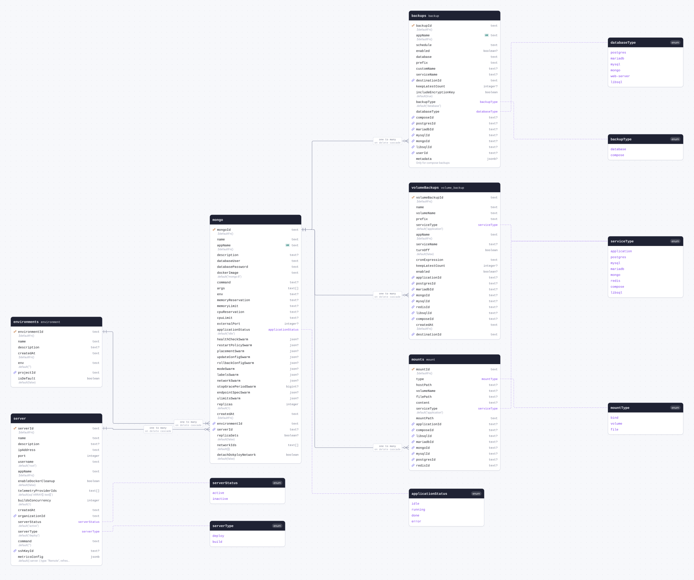

| Column                 | Type                                           | Constraints                                                  | Default               | Description |
| ---------------------- | ---------------------------------------------- | ------------------------------------------------------------ | --------------------- | ----------- |
| `mongoId`              | `text`                                         | PK NOT NULL                                                  | `.$defaultFn()`       |             |
| `name`                 | `text`                                         | NOT NULL                                                     |                       |             |
| `appName`              | `text`                                         | UNIQUE NOT NULL                                              | `.$defaultFn()`       |             |
| `description`          | `text`                                         | NULL                                                         |                       |             |
| `databaseUser`         | `text`                                         | NOT NULL                                                     |                       |             |
| `databasePassword`     | `text`                                         | NOT NULL                                                     |                       |             |
| `dockerImage`          | `text`                                         | NOT NULL                                                     | `.default("mongo:8")` |             |
| `command`              | `text`                                         | NULL                                                         |                       |             |
| `args`                 | `text[]`                                       | NULL                                                         |                       |             |
| `env`                  | `text`                                         | NULL                                                         |                       |             |
| `memoryReservation`    | `text`                                         | NULL                                                         |                       |             |
| `memoryLimit`          | `text`                                         | NULL                                                         |                       |             |
| `cpuReservation`       | `text`                                         | NULL                                                         |                       |             |
| `cpuLimit`             | `text`                                         | NULL                                                         |                       |             |
| `externalPort`         | `integer`                                      | NULL                                                         |                       |             |
| `applicationStatus`    | [`applicationStatus`](#enum-applicationStatus) | NOT NULL                                                     | `.default("idle")`    |             |
| `healthCheckSwarm`     | `json`                                         | NULL                                                         |                       |             |
| `restartPolicySwarm`   | `json`                                         | NULL                                                         |                       |             |
| `placementSwarm`       | `json`                                         | NULL                                                         |                       |             |
| `updateConfigSwarm`    | `json`                                         | NULL                                                         |                       |             |
| `rollbackConfigSwarm`  | `json`                                         | NULL                                                         |                       |             |
| `modeSwarm`            | `json`                                         | NULL                                                         |                       |             |
| `labelsSwarm`          | `json`                                         | NULL                                                         |                       |             |
| `networkSwarm`         | `json`                                         | NULL                                                         |                       |             |
| `stopGracePeriodSwarm` | `bigint`                                       | NULL                                                         |                       |             |
| `endpointSpecSwarm`    | `json`                                         | NULL                                                         |                       |             |
| `ulimitsSwarm`         | `json`                                         | NULL                                                         |                       |             |
| `replicas`             | `integer`                                      | NOT NULL                                                     | `.default(1)`         |             |
| `createdAt`            | `text`                                         | NOT NULL                                                     | `.$defaultFn()`       |             |
| `environmentId`        | `text`                                         | NOT NULL → [environments.environmentId](#table-environments) |                       |             |
| `serverId`             | `text`                                         | NULL → [server.serverId](#table-server)                      |                       |             |
| `replicaSets`          | `boolean`                                      | NULL                                                         | `.default(false)`     |             |
| `networkIds`           | `text[]`                                       | NULL                                                         | `.default([])`        |             |
| `detachDokployNetwork` | `boolean`                                      | NOT NULL                                                     | `.default(false)`     |             |

#### Definition

```sql
CREATE TABLE "mongo" (
	"mongoId" text PRIMARY KEY,
	"name" text NOT NULL,
	"appName" text NOT NULL UNIQUE,
	"description" text,
	"databaseUser" text NOT NULL,
	"databasePassword" text NOT NULL,
	"dockerImage" text DEFAULT 'mongo:8' NOT NULL,
	"command" text,
	"args" text[],
	"env" text,
	"memoryReservation" text,
	"memoryLimit" text,
	"cpuReservation" text,
	"cpuLimit" text,
	"externalPort" integer,
	"applicationStatus" "applicationStatus" DEFAULT 'idle'::"applicationStatus" NOT NULL,
	"healthCheckSwarm" json,
	"restartPolicySwarm" json,
	"placementSwarm" json,
	"updateConfigSwarm" json,
	"rollbackConfigSwarm" json,
	"modeSwarm" json,
	"labelsSwarm" json,
	"networkSwarm" json,
	"stopGracePeriodSwarm" bigint,
	"endpointSpecSwarm" json,
	"ulimitsSwarm" json,
	"replicas" integer DEFAULT 1 NOT NULL,
	"createdAt" text NOT NULL,
	"environmentId" text NOT NULL,
	"serverId" text,
	"replicaSets" boolean DEFAULT false,
	"networkIds" text[] DEFAULT '{}'::text[],
	"detachDokployNetwork" boolean DEFAULT false NOT NULL
);

ALTER TABLE "mongo" ADD CONSTRAINT "mongo_environmentId_environment_environmentId_fkey" FOREIGN KEY ("environmentId") REFERENCES "environment"("environmentId") ON DELETE CASCADE;

ALTER TABLE "mongo" ADD CONSTRAINT "mongo_serverId_server_serverId_fkey" FOREIGN KEY ("serverId") REFERENCES "server"("serverId") ON DELETE CASCADE;
```

#### References

- `environmentId` → [environments.environmentId](#table-environments) (many to one, on delete cascade)
- `serverId` → [server.serverId](#table-server) (many to one, on delete cascade)

#### Referenced by

- `mongoId` → [backups.mongoId](#table-backups) (one to many, on delete cascade)
- `mongoId` → [mounts.mongoId](#table-mounts) (one to many, on delete cascade)
- `mongoId` → [volumeBackups.mongoId](#table-volumeBackups) (one to many, on delete cascade)

<details>
<summary>Queries and their SQL</summary>

**Select**: Every row of mongo.

```ts
db.select().from(mongo);
```

```sql
select "mongoId", "name", "appName", "description", "databaseUser", "databasePassword", "dockerImage", "command", "args", "env", "memoryReservation", "memoryLimit", "cpuReservation", "cpuLimit", "externalPort", "applicationStatus", "healthCheckSwarm", "restartPolicySwarm", "placementSwarm", "updateConfigSwarm", "rollbackConfigSwarm", "modeSwarm", "labelsSwarm", "networkSwarm", "stopGracePeriodSwarm", "endpointSpecSwarm", "ulimitsSwarm", "replicas", "createdAt", "environmentId", "serverId", "replicaSets", "networkIds", "detachDokployNetwork"
from "mongo"
```

**Count**: How many rows mongo has.

```ts
db.select({ count: count() }).from(mongo);
```

```sql
select count(*)
from "mongo"
```

**Find many**: The rows of mongo, through the relational query API.

```ts
db.query.mongo.findMany();
```

```sql
select "d0"."mongoId" as "mongoId", "d0"."name" as "name", "d0"."appName" as "appName", "d0"."description" as "description", "d0"."databaseUser" as "databaseUser", "d0"."databasePassword" as "databasePassword", "d0"."dockerImage" as "dockerImage", "d0"."command" as "command", "d0"."args" as "args", "d0"."env" as "env", "d0"."memoryReservation" as "memoryReservation", "d0"."memoryLimit" as "memoryLimit", "d0"."cpuReservation" as "cpuReservation", "d0"."cpuLimit" as "cpuLimit", "d0"."externalPort" as "externalPort", "d0"."applicationStatus" as "applicationStatus", "d0"."healthCheckSwarm" as "healthCheckSwarm", "d0"."restartPolicySwarm" as "restartPolicySwarm", "d0"."placementSwarm" as "placementSwarm", "d0"."updateConfigSwarm" as "updateConfigSwarm", "d0"."rollbackConfigSwarm" as "rollbackConfigSwarm", "d0"."modeSwarm" as "modeSwarm", "d0"."labelsSwarm" as "labelsSwarm", "d0"."networkSwarm" as "networkSwarm", "d0"."stopGracePeriodSwarm" as "stopGracePeriodSwarm", "d0"."endpointSpecSwarm" as "endpointSpecSwarm", "d0"."ulimitsSwarm" as "ulimitsSwarm", "d0"."replicas" as "replicas", "d0"."createdAt" as "createdAt", "d0"."environmentId" as "environmentId", "d0"."serverId" as "serverId", "d0"."replicaSets" as "replicaSets", "d0"."networkIds" as "networkIds", "d0"."detachDokployNetwork" as "detachDokployNetwork"
from "mongo" as "d0"
```

**Find by primary key**: One row of mongo, through the relational query API.

```ts
db.query.mongo.findFirst({ where: { mongoId: "mongoId" } });
```

```sql
select "d0"."mongoId" as "mongoId", "d0"."name" as "name", "d0"."appName" as "appName", "d0"."description" as "description", "d0"."databaseUser" as "databaseUser", "d0"."databasePassword" as "databasePassword", "d0"."dockerImage" as "dockerImage", "d0"."command" as "command", "d0"."args" as "args", "d0"."env" as "env", "d0"."memoryReservation" as "memoryReservation", "d0"."memoryLimit" as "memoryLimit", "d0"."cpuReservation" as "cpuReservation", "d0"."cpuLimit" as "cpuLimit", "d0"."externalPort" as "externalPort", "d0"."applicationStatus" as "applicationStatus", "d0"."healthCheckSwarm" as "healthCheckSwarm", "d0"."restartPolicySwarm" as "restartPolicySwarm", "d0"."placementSwarm" as "placementSwarm", "d0"."updateConfigSwarm" as "updateConfigSwarm", "d0"."rollbackConfigSwarm" as "rollbackConfigSwarm", "d0"."modeSwarm" as "modeSwarm", "d0"."labelsSwarm" as "labelsSwarm", "d0"."networkSwarm" as "networkSwarm", "d0"."stopGracePeriodSwarm" as "stopGracePeriodSwarm", "d0"."endpointSpecSwarm" as "endpointSpecSwarm", "d0"."ulimitsSwarm" as "ulimitsSwarm", "d0"."replicas" as "replicas", "d0"."createdAt" as "createdAt", "d0"."environmentId" as "environmentId", "d0"."serverId" as "serverId", "d0"."replicaSets" as "replicaSets", "d0"."networkIds" as "networkIds", "d0"."detachDokployNetwork" as "detachDokployNetwork"
from "mongo" as "d0"
where "d0"."mongoId" = $1
limit $2
-- params: ["mongoId",1]
```

**Insert**: Adds a row to mongo, giving the columns that have no default.

```ts
db.insert(mongo).values({
  name: "name",
  databaseUser: "databaseUser",
  databasePassword: "databasePassword",
  environmentId: "environmentId",
});
```

```sql
insert into "mongo" ("mongoId", "name", "appName", "description", "databaseUser", "databasePassword", "dockerImage", "command", "args", "env", "memoryReservation", "memoryLimit", "cpuReservation", "cpuLimit", "externalPort", "applicationStatus", "healthCheckSwarm", "restartPolicySwarm", "placementSwarm", "updateConfigSwarm", "rollbackConfigSwarm", "modeSwarm", "labelsSwarm", "networkSwarm", "stopGracePeriodSwarm", "endpointSpecSwarm", "ulimitsSwarm", "replicas", "createdAt", "environmentId", "serverId", "replicaSets", "networkIds", "detachDokployNetwork")
values ($1, $2, $3, default, $4, $5, default, default, default, default, default, default, default, default, default, default, default, default, default, default, default, default, default, default, default, default, default, default, $6, $7, default, default, default, default)
-- params: ["uuuuuuuuuuuuuuuuuuuuu","name","mongo-quantify-solid-state-transmitter-aaaaaa","databaseUser","databasePassword","2026-01-01T00:00:00.000Z","environmentId"]
```

**Update**: Changes a row of mongo, found by its primary key.

```ts
db.update(mongo).set({ name: "name" }).where(eq(mongo.mongoId, "mongoId"));
```

```sql
update "mongo"
set "name" = $1
where "mongo"."mongoId" = $2
-- params: ["name","mongoId"]
```

**Delete**: Deletes a row of mongo, found by its primary key.

```ts
db.delete(mongo).where(eq(mongo.mongoId, "mongoId"));
```

```sql
delete from "mongo"
where "mongo"."mongoId" = $1
-- params: ["mongoId"]
```

</details>

<a id="table-mounts"></a>

### mounts

Table `mount`.

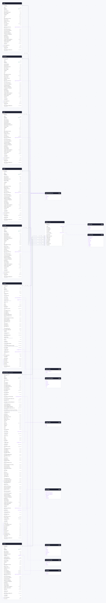

| Column          | Type                               | Constraints                                              | Default                   | Description |
| --------------- | ---------------------------------- | -------------------------------------------------------- | ------------------------- | ----------- |
| `mountId`       | `text`                             | PK NOT NULL                                              | `.$defaultFn()`           |             |
| `type`          | [`mountType`](#enum-mountType)     | NOT NULL                                                 |                           |             |
| `hostPath`      | `text`                             | NULL                                                     |                           |             |
| `volumeName`    | `text`                             | NULL                                                     |                           |             |
| `filePath`      | `text`                             | NULL                                                     |                           |             |
| `content`       | `text`                             | NULL                                                     |                           |             |
| `serviceType`   | [`serviceType`](#enum-serviceType) | NOT NULL                                                 | `.default("application")` |             |
| `mountPath`     | `text`                             | NOT NULL                                                 |                           |             |
| `applicationId` | `text`                             | NULL → [applications.applicationId](#table-applications) |                           |             |
| `composeId`     | `text`                             | NULL → [compose.composeId](#table-compose)               |                           |             |
| `libsqlId`      | `text`                             | NULL → [libsql.libsqlId](#table-libsql)                  |                           |             |
| `mariadbId`     | `text`                             | NULL → [mariadb.mariadbId](#table-mariadb)               |                           |             |
| `mongoId`       | `text`                             | NULL → [mongo.mongoId](#table-mongo)                     |                           |             |
| `mysqlId`       | `text`                             | NULL → [mysql.mysqlId](#table-mysql)                     |                           |             |
| `postgresId`    | `text`                             | NULL → [postgres.postgresId](#table-postgres)            |                           |             |
| `redisId`       | `text`                             | NULL → [redis.redisId](#table-redis)                     |                           |             |

#### Definition

```sql
CREATE TABLE "mount" (
	"mountId" text PRIMARY KEY,
	"type" "mountType" NOT NULL,
	"hostPath" text,
	"volumeName" text,
	"filePath" text,
	"content" text,
	"serviceType" "serviceType" DEFAULT 'application'::"serviceType" NOT NULL,
	"mountPath" text NOT NULL,
	"applicationId" text,
	"composeId" text,
	"libsqlId" text,
	"mariadbId" text,
	"mongoId" text,
	"mysqlId" text,
	"postgresId" text,
	"redisId" text
);

ALTER TABLE "mount" ADD CONSTRAINT "mount_applicationId_application_applicationId_fkey" FOREIGN KEY ("applicationId") REFERENCES "application"("applicationId") ON DELETE CASCADE;

ALTER TABLE "mount" ADD CONSTRAINT "mount_composeId_compose_composeId_fkey" FOREIGN KEY ("composeId") REFERENCES "compose"("composeId") ON DELETE CASCADE;

ALTER TABLE "mount" ADD CONSTRAINT "mount_libsqlId_libsql_libsqlId_fkey" FOREIGN KEY ("libsqlId") REFERENCES "libsql"("libsqlId") ON DELETE CASCADE;

ALTER TABLE "mount" ADD CONSTRAINT "mount_mariadbId_mariadb_mariadbId_fkey" FOREIGN KEY ("mariadbId") REFERENCES "mariadb"("mariadbId") ON DELETE CASCADE;

ALTER TABLE "mount" ADD CONSTRAINT "mount_mongoId_mongo_mongoId_fkey" FOREIGN KEY ("mongoId") REFERENCES "mongo"("mongoId") ON DELETE CASCADE;

ALTER TABLE "mount" ADD CONSTRAINT "mount_mysqlId_mysql_mysqlId_fkey" FOREIGN KEY ("mysqlId") REFERENCES "mysql"("mysqlId") ON DELETE CASCADE;

ALTER TABLE "mount" ADD CONSTRAINT "mount_postgresId_postgres_postgresId_fkey" FOREIGN KEY ("postgresId") REFERENCES "postgres"("postgresId") ON DELETE CASCADE;

ALTER TABLE "mount" ADD CONSTRAINT "mount_redisId_redis_redisId_fkey" FOREIGN KEY ("redisId") REFERENCES "redis"("redisId") ON DELETE CASCADE;
```

#### References

- `applicationId` → [applications.applicationId](#table-applications) (many to one, on delete cascade)
- `composeId` → [compose.composeId](#table-compose) (many to one, on delete cascade)
- `libsqlId` → [libsql.libsqlId](#table-libsql) (many to one, on delete cascade)
- `mariadbId` → [mariadb.mariadbId](#table-mariadb) (many to one, on delete cascade)
- `mongoId` → [mongo.mongoId](#table-mongo) (many to one, on delete cascade)
- `mysqlId` → [mysql.mysqlId](#table-mysql) (many to one, on delete cascade)
- `postgresId` → [postgres.postgresId](#table-postgres) (many to one, on delete cascade)
- `redisId` → [redis.redisId](#table-redis) (many to one, on delete cascade)

<details>
<summary>Queries and their SQL</summary>

**Select**: Every row of mounts.

```ts
db.select().from(mounts);
```

```sql
select "mountId", "type", "hostPath", "volumeName", "filePath", "content", "serviceType", "mountPath", "applicationId", "composeId", "libsqlId", "mariadbId", "mongoId", "mysqlId", "postgresId", "redisId"
from "mount"
```

**Count**: How many rows mounts has.

```ts
db.select({ count: count() }).from(mounts);
```

```sql
select count(*)
from "mount"
```

**Find many**: The rows of mounts, through the relational query API.

```ts
db.query.mounts.findMany();
```

```sql
select "d0"."mountId" as "mountId", "d0"."type" as "type", "d0"."hostPath" as "hostPath", "d0"."volumeName" as "volumeName", "d0"."filePath" as "filePath", "d0"."content" as "content", "d0"."serviceType" as "serviceType", "d0"."mountPath" as "mountPath", "d0"."applicationId" as "applicationId", "d0"."composeId" as "composeId", "d0"."libsqlId" as "libsqlId", "d0"."mariadbId" as "mariadbId", "d0"."mongoId" as "mongoId", "d0"."mysqlId" as "mysqlId", "d0"."postgresId" as "postgresId", "d0"."redisId" as "redisId"
from "mount" as "d0"
```

**Find by primary key**: One row of mounts, through the relational query API.

```ts
db.query.mounts.findFirst({ where: { mountId: "mountId" } });
```

```sql
select "d0"."mountId" as "mountId", "d0"."type" as "type", "d0"."hostPath" as "hostPath", "d0"."volumeName" as "volumeName", "d0"."filePath" as "filePath", "d0"."content" as "content", "d0"."serviceType" as "serviceType", "d0"."mountPath" as "mountPath", "d0"."applicationId" as "applicationId", "d0"."composeId" as "composeId", "d0"."libsqlId" as "libsqlId", "d0"."mariadbId" as "mariadbId", "d0"."mongoId" as "mongoId", "d0"."mysqlId" as "mysqlId", "d0"."postgresId" as "postgresId", "d0"."redisId" as "redisId"
from "mount" as "d0"
where "d0"."mountId" = $1
limit $2
-- params: ["mountId",1]
```

**Insert**: Adds a row to mounts, giving the columns that have no default.

```ts
db.insert(mounts).values({ type: "bind", mountPath: "mountPath" });
```

```sql
insert into "mount" ("mountId", "type", "hostPath", "volumeName", "filePath", "content", "serviceType", "mountPath", "applicationId", "composeId", "libsqlId", "mariadbId", "mongoId", "mysqlId", "postgresId", "redisId")
values ($1, $2, default, default, default, default, default, $3, default, default, default, default, default, default, default, default)
-- params: ["uuuuuuuuuuuuuuuuuuuuu","bind","mountPath"]
```

**Update**: Changes a row of mounts, found by its primary key.

```ts
db.update(mounts).set({ type: "bind" }).where(eq(mounts.mountId, "mountId"));
```

```sql
update "mount"
set "type" = $1
where "mount"."mountId" = $2
-- params: ["bind","mountId"]
```

**Delete**: Deletes a row of mounts, found by its primary key.

```ts
db.delete(mounts).where(eq(mounts.mountId, "mountId"));
```

```sql
delete from "mount"
where "mount"."mountId" = $1
-- params: ["mountId"]
```

</details>

<a id="table-mysql"></a>

### mysql


| Column                                  | Type                                           | Constraints                                                  | Default            | Description |
| --------------------------------------- | ---------------------------------------------- | ------------------------------------------------------------ | ------------------ | ----------- |
| `mysqlId`                               | `text`                                         | PK NOT NULL                                                  | `.$defaultFn()`    |             |
| `name`                                  | `text`                                         | NOT NULL                                                     |                    |             |
| `appName`                               | `text`                                         | UNIQUE NOT NULL                                              | `.$defaultFn()`    |             |
| `description`                           | `text`                                         | NULL                                                         |                    |             |
| `databaseName`                          | `text`                                         | NOT NULL                                                     |                    |             |
| `databaseUser`                          | `text`                                         | NOT NULL                                                     |                    |             |
| `databasePassword`                      | `text`                                         | NOT NULL                                                     |                    |             |
| `databaseRootPassword` (`rootPassword`) | `text`                                         | NOT NULL                                                     |                    |             |
| `dockerImage`                           | `text`                                         | NOT NULL                                                     |                    |             |
| `command`                               | `text`                                         | NULL                                                         |                    |             |
| `args`                                  | `text[]`                                       | NULL                                                         |                    |             |
| `env`                                   | `text`                                         | NULL                                                         |                    |             |
| `memoryReservation`                     | `text`                                         | NULL                                                         |                    |             |
| `memoryLimit`                           | `text`                                         | NULL                                                         |                    |             |
| `cpuReservation`                        | `text`                                         | NULL                                                         |                    |             |
| `cpuLimit`                              | `text`                                         | NULL                                                         |                    |             |
| `externalPort`                          | `integer`                                      | NULL                                                         |                    |             |
| `applicationStatus`                     | [`applicationStatus`](#enum-applicationStatus) | NOT NULL                                                     | `.default("idle")` |             |
| `healthCheckSwarm`                      | `json`                                         | NULL                                                         |                    |             |
| `restartPolicySwarm`                    | `json`                                         | NULL                                                         |                    |             |
| `placementSwarm`                        | `json`                                         | NULL                                                         |                    |             |
| `updateConfigSwarm`                     | `json`                                         | NULL                                                         |                    |             |
| `rollbackConfigSwarm`                   | `json`                                         | NULL                                                         |                    |             |
| `modeSwarm`                             | `json`                                         | NULL                                                         |                    |             |
| `labelsSwarm`                           | `json`                                         | NULL                                                         |                    |             |
| `networkSwarm`                          | `json`                                         | NULL                                                         |                    |             |
| `stopGracePeriodSwarm`                  | `bigint`                                       | NULL                                                         |                    |             |
| `endpointSpecSwarm`                     | `json`                                         | NULL                                                         |                    |             |
| `ulimitsSwarm`                          | `json`                                         | NULL                                                         |                    |             |
| `replicas`                              | `integer`                                      | NOT NULL                                                     | `.default(1)`      |             |
| `createdAt`                             | `text`                                         | NOT NULL                                                     | `.$defaultFn()`    |             |
| `environmentId`                         | `text`                                         | NOT NULL → [environments.environmentId](#table-environments) |                    |             |
| `serverId`                              | `text`                                         | NULL → [server.serverId](#table-server)                      |                    |             |
| `networkIds`                            | `text[]`                                       | NULL                                                         | `.default([])`     |             |
| `detachDokployNetwork`                  | `boolean`                                      | NOT NULL                                                     | `.default(false)`  |             |

#### Definition

```sql
CREATE TABLE "mysql" (
	"mysqlId" text PRIMARY KEY,
	"name" text NOT NULL,
	"appName" text NOT NULL UNIQUE,
	"description" text,
	"databaseName" text NOT NULL,
	"databaseUser" text NOT NULL,
	"databasePassword" text NOT NULL,
	"rootPassword" text NOT NULL,
	"dockerImage" text NOT NULL,
	"command" text,
	"args" text[],
	"env" text,
	"memoryReservation" text,
	"memoryLimit" text,
	"cpuReservation" text,
	"cpuLimit" text,
	"externalPort" integer,
	"applicationStatus" "applicationStatus" DEFAULT 'idle'::"applicationStatus" NOT NULL,
	"healthCheckSwarm" json,
	"restartPolicySwarm" json,
	"placementSwarm" json,
	"updateConfigSwarm" json,
	"rollbackConfigSwarm" json,
	"modeSwarm" json,
	"labelsSwarm" json,
	"networkSwarm" json,
	"stopGracePeriodSwarm" bigint,
	"endpointSpecSwarm" json,
	"ulimitsSwarm" json,
	"replicas" integer DEFAULT 1 NOT NULL,
	"createdAt" text NOT NULL,
	"environmentId" text NOT NULL,
	"serverId" text,
	"networkIds" text[] DEFAULT '{}'::text[],
	"detachDokployNetwork" boolean DEFAULT false NOT NULL
);

ALTER TABLE "mysql" ADD CONSTRAINT "mysql_environmentId_environment_environmentId_fkey" FOREIGN KEY ("environmentId") REFERENCES "environment"("environmentId") ON DELETE CASCADE;

ALTER TABLE "mysql" ADD CONSTRAINT "mysql_serverId_server_serverId_fkey" FOREIGN KEY ("serverId") REFERENCES "server"("serverId") ON DELETE CASCADE;
```

#### References

- `environmentId` → [environments.environmentId](#table-environments) (many to one, on delete cascade)
- `serverId` → [server.serverId](#table-server) (many to one, on delete cascade)

#### Referenced by

- `mysqlId` → [backups.mysqlId](#table-backups) (one to many, on delete cascade)
- `mysqlId` → [mounts.mysqlId](#table-mounts) (one to many, on delete cascade)
- `mysqlId` → [volumeBackups.mysqlId](#table-volumeBackups) (one to many, on delete cascade)

<details>
<summary>Queries and their SQL</summary>

**Select**: Every row of mysql.

```ts
db.select().from(mysql);
```

```sql
select "mysqlId", "name", "appName", "description", "databaseName", "databaseUser", "databasePassword", "rootPassword", "dockerImage", "command", "args", "env", "memoryReservation", "memoryLimit", "cpuReservation", "cpuLimit", "externalPort", "applicationStatus", "healthCheckSwarm", "restartPolicySwarm", "placementSwarm", "updateConfigSwarm", "rollbackConfigSwarm", "modeSwarm", "labelsSwarm", "networkSwarm", "stopGracePeriodSwarm", "endpointSpecSwarm", "ulimitsSwarm", "replicas", "createdAt", "environmentId", "serverId", "networkIds", "detachDokployNetwork"
from "mysql"
```

**Count**: How many rows mysql has.

```ts
db.select({ count: count() }).from(mysql);
```

```sql
select count(*)
from "mysql"
```

**Find many**: The rows of mysql, through the relational query API.

```ts
db.query.mysql.findMany();
```

```sql
select "d0"."mysqlId" as "mysqlId", "d0"."name" as "name", "d0"."appName" as "appName", "d0"."description" as "description", "d0"."databaseName" as "databaseName", "d0"."databaseUser" as "databaseUser", "d0"."databasePassword" as "databasePassword", "d0"."rootPassword" as "databaseRootPassword", "d0"."dockerImage" as "dockerImage", "d0"."command" as "command", "d0"."args" as "args", "d0"."env" as "env", "d0"."memoryReservation" as "memoryReservation", "d0"."memoryLimit" as "memoryLimit", "d0"."cpuReservation" as "cpuReservation", "d0"."cpuLimit" as "cpuLimit", "d0"."externalPort" as "externalPort", "d0"."applicationStatus" as "applicationStatus", "d0"."healthCheckSwarm" as "healthCheckSwarm", "d0"."restartPolicySwarm" as "restartPolicySwarm", "d0"."placementSwarm" as "placementSwarm", "d0"."updateConfigSwarm" as "updateConfigSwarm", "d0"."rollbackConfigSwarm" as "rollbackConfigSwarm", "d0"."modeSwarm" as "modeSwarm", "d0"."labelsSwarm" as "labelsSwarm", "d0"."networkSwarm" as "networkSwarm", "d0"."stopGracePeriodSwarm" as "stopGracePeriodSwarm", "d0"."endpointSpecSwarm" as "endpointSpecSwarm", "d0"."ulimitsSwarm" as "ulimitsSwarm", "d0"."replicas" as "replicas", "d0"."createdAt" as "createdAt", "d0"."environmentId" as "environmentId", "d0"."serverId" as "serverId", "d0"."networkIds" as "networkIds", "d0"."detachDokployNetwork" as "detachDokployNetwork"
from "mysql" as "d0"
```

**Find by primary key**: One row of mysql, through the relational query API.

```ts
db.query.mysql.findFirst({ where: { mysqlId: "mysqlId" } });
```

```sql
select "d0"."mysqlId" as "mysqlId", "d0"."name" as "name", "d0"."appName" as "appName", "d0"."description" as "description", "d0"."databaseName" as "databaseName", "d0"."databaseUser" as "databaseUser", "d0"."databasePassword" as "databasePassword", "d0"."rootPassword" as "databaseRootPassword", "d0"."dockerImage" as "dockerImage", "d0"."command" as "command", "d0"."args" as "args", "d0"."env" as "env", "d0"."memoryReservation" as "memoryReservation", "d0"."memoryLimit" as "memoryLimit", "d0"."cpuReservation" as "cpuReservation", "d0"."cpuLimit" as "cpuLimit", "d0"."externalPort" as "externalPort", "d0"."applicationStatus" as "applicationStatus", "d0"."healthCheckSwarm" as "healthCheckSwarm", "d0"."restartPolicySwarm" as "restartPolicySwarm", "d0"."placementSwarm" as "placementSwarm", "d0"."updateConfigSwarm" as "updateConfigSwarm", "d0"."rollbackConfigSwarm" as "rollbackConfigSwarm", "d0"."modeSwarm" as "modeSwarm", "d0"."labelsSwarm" as "labelsSwarm", "d0"."networkSwarm" as "networkSwarm", "d0"."stopGracePeriodSwarm" as "stopGracePeriodSwarm", "d0"."endpointSpecSwarm" as "endpointSpecSwarm", "d0"."ulimitsSwarm" as "ulimitsSwarm", "d0"."replicas" as "replicas", "d0"."createdAt" as "createdAt", "d0"."environmentId" as "environmentId", "d0"."serverId" as "serverId", "d0"."networkIds" as "networkIds", "d0"."detachDokployNetwork" as "detachDokployNetwork"
from "mysql" as "d0"
where "d0"."mysqlId" = $1
limit $2
-- params: ["mysqlId",1]
```

**Insert**: Adds a row to mysql, giving the columns that have no default.

```ts
db.insert(mysql).values({
  name: "name",
  databaseName: "databaseName",
  databaseUser: "databaseUser",
  databasePassword: "databasePassword",
  databaseRootPassword: "databaseRootPassword",
  dockerImage: "dockerImage",
  environmentId: "environmentId",
});
```

```sql
insert into "mysql" ("mysqlId", "name", "appName", "description", "databaseName", "databaseUser", "databasePassword", "rootPassword", "dockerImage", "command", "args", "env", "memoryReservation", "memoryLimit", "cpuReservation", "cpuLimit", "externalPort", "applicationStatus", "healthCheckSwarm", "restartPolicySwarm", "placementSwarm", "updateConfigSwarm", "rollbackConfigSwarm", "modeSwarm", "labelsSwarm", "networkSwarm", "stopGracePeriodSwarm", "endpointSpecSwarm", "ulimitsSwarm", "replicas", "createdAt", "environmentId", "serverId", "networkIds", "detachDokployNetwork")
values ($1, $2, $3, default, $4, $5, $6, $7, $8, default, default, default, default, default, default, default, default, default, default, default, default, default, default, default, default, default, default, default, default, default, $9, $10, default, default, default)
-- params: ["uuuuuuuuuuuuuuuuuuuuu","name","mysql-quantify-multi-byte-port-aaaaaa","databaseName","databaseUser","databasePassword","databaseRootPassword","dockerImage","2026-01-01T00:00:00.000Z","environmentId"]
```

**Update**: Changes a row of mysql, found by its primary key.

```ts
db.update(mysql).set({ name: "name" }).where(eq(mysql.mysqlId, "mysqlId"));
```

```sql
update "mysql"
set "name" = $1
where "mysql"."mysqlId" = $2
-- params: ["name","mysqlId"]
```

**Delete**: Deletes a row of mysql, found by its primary key.

```ts
db.delete(mysql).where(eq(mysql.mysqlId, "mysqlId"));
```

```sql
delete from "mysql"
where "mysql"."mysqlId" = $1
-- params: ["mysqlId"]
```

</details>

<a id="table-network"></a>

### network

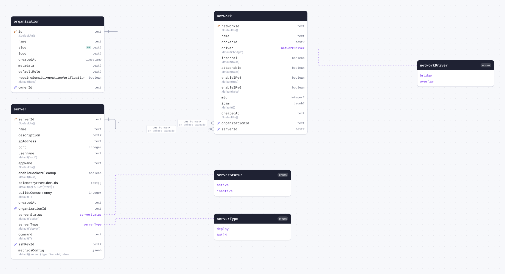

| Column           | Type                                   | Constraints                                       | Default              | Description |
| ---------------- | -------------------------------------- | ------------------------------------------------- | -------------------- | ----------- |
| `networkId`      | `text`                                 | PK NOT NULL                                       | `.$defaultFn()`      |             |
| `name`           | `text`                                 | NOT NULL                                          |                      |             |
| `dockerId`       | `text`                                 | NULL                                              |                      |             |
| `driver`         | [`networkDriver`](#enum-networkDriver) | NOT NULL                                          | `.default("bridge")` |             |
| `internal`       | `boolean`                              | NOT NULL                                          | `.default(false)`    |             |
| `attachable`     | `boolean`                              | NOT NULL                                          | `.default(false)`    |             |
| `enableIPv4`     | `boolean`                              | NOT NULL                                          | `.default(true)`     |             |
| `enableIPv6`     | `boolean`                              | NOT NULL                                          | `.default(false)`    |             |
| `mtu`            | `integer`                              | NULL                                              |                      |             |
| `ipam`           | `jsonb`                                | NULL                                              | `.default({})`       |             |
| `createdAt`      | `text`                                 | NOT NULL                                          | `.$defaultFn()`      |             |
| `organizationId` | `text`                                 | NOT NULL → [organization.id](#table-organization) |                      |             |
| `serverId`       | `text`                                 | NULL → [server.serverId](#table-server)           |                      |             |

#### Definition

```sql
CREATE TABLE "network" (
	"networkId" text PRIMARY KEY,
	"name" text NOT NULL,
	"dockerId" text,
	"driver" "networkDriver" DEFAULT 'bridge'::"networkDriver" NOT NULL,
	"internal" boolean DEFAULT false NOT NULL,
	"attachable" boolean DEFAULT false NOT NULL,
	"enableIPv4" boolean DEFAULT true NOT NULL,
	"enableIPv6" boolean DEFAULT false NOT NULL,
	"mtu" integer,
	"ipam" jsonb DEFAULT '{}',
	"createdAt" text NOT NULL,
	"organizationId" text NOT NULL,
	"serverId" text
);

ALTER TABLE "network" ADD CONSTRAINT "network_organizationId_organization_id_fkey" FOREIGN KEY ("organizationId") REFERENCES "organization"("id") ON DELETE CASCADE;

ALTER TABLE "network" ADD CONSTRAINT "network_serverId_server_serverId_fkey" FOREIGN KEY ("serverId") REFERENCES "server"("serverId") ON DELETE CASCADE;
```

#### References

- `organizationId` → [organization.id](#table-organization) (many to one, on delete cascade)
- `serverId` → [server.serverId](#table-server) (many to one, on delete cascade)

<details>
<summary>Queries and their SQL</summary>

**Select**: Every row of network.

```ts
db.select().from(network);
```

```sql
select "networkId", "name", "dockerId", "driver", "internal", "attachable", "enableIPv4", "enableIPv6", "mtu", "ipam", "createdAt", "organizationId", "serverId"
from "network"
```

**Count**: How many rows network has.

```ts
db.select({ count: count() }).from(network);
```

```sql
select count(*)
from "network"
```

**Find many**: The rows of network, through the relational query API.

```ts
db.query.network.findMany();
```

```sql
select "d0"."networkId" as "networkId", "d0"."name" as "name", "d0"."dockerId" as "dockerId", "d0"."driver" as "driver", "d0"."internal" as "internal", "d0"."attachable" as "attachable", "d0"."enableIPv4" as "enableIPv4", "d0"."enableIPv6" as "enableIPv6", "d0"."mtu" as "mtu", "d0"."ipam" as "ipam", "d0"."createdAt" as "createdAt", "d0"."organizationId" as "organizationId", "d0"."serverId" as "serverId"
from "network" as "d0"
```

**Find by primary key**: One row of network, through the relational query API.

```ts
db.query.network.findFirst({ where: { networkId: "networkId" } });
```

```sql
select "d0"."networkId" as "networkId", "d0"."name" as "name", "d0"."dockerId" as "dockerId", "d0"."driver" as "driver", "d0"."internal" as "internal", "d0"."attachable" as "attachable", "d0"."enableIPv4" as "enableIPv4", "d0"."enableIPv6" as "enableIPv6", "d0"."mtu" as "mtu", "d0"."ipam" as "ipam", "d0"."createdAt" as "createdAt", "d0"."organizationId" as "organizationId", "d0"."serverId" as "serverId"
from "network" as "d0"
where "d0"."networkId" = $1
limit $2
-- params: ["networkId",1]
```

**Insert**: Adds a row to network, giving the columns that have no default.

```ts
db.insert(network).values({ name: "name", organizationId: "organizationId" });
```

```sql
insert into "network" ("networkId", "name", "dockerId", "driver", "internal", "attachable", "enableIPv4", "enableIPv6", "mtu", "ipam", "createdAt", "organizationId", "serverId")
values ($1, $2, default, default, default, default, default, default, default, default, $3, $4, default)
-- params: ["uuuuuuuuuuuuuuuuuuuuu","name","2026-01-01T00:00:00.000Z","organizationId"]
```

**Update**: Changes a row of network, found by its primary key.

```ts
db.update(network).set({ name: "name" }).where(eq(network.networkId, "networkId"));
```

```sql
update "network"
set "name" = $1
where "network"."networkId" = $2
-- params: ["name","networkId"]
```

**Delete**: Deletes a row of network, found by its primary key.

```ts
db.delete(network).where(eq(network.networkId, "networkId"));
```

```sql
delete from "network"
where "network"."networkId" = $1
-- params: ["networkId"]
```

</details>

<a id="table-notifications"></a>

### notifications

Table `notification`.

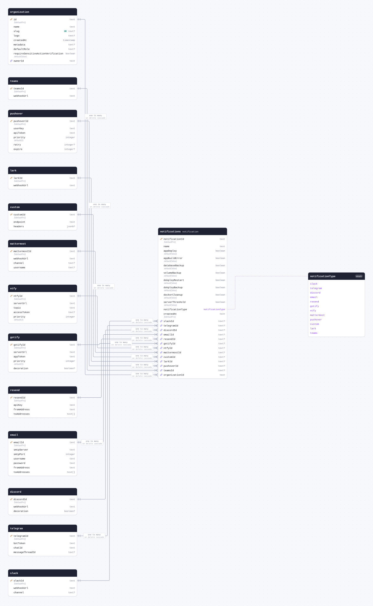

| Column             | Type                                         | Constraints                                         | Default           | Description |
| ------------------ | -------------------------------------------- | --------------------------------------------------- | ----------------- | ----------- |
| `notificationId`   | `text`                                       | PK NOT NULL                                         | `.$defaultFn()`   |             |
| `name`             | `text`                                       | NOT NULL                                            |                   |             |
| `appDeploy`        | `boolean`                                    | NOT NULL                                            | `.default(false)` |             |
| `appBuildError`    | `boolean`                                    | NOT NULL                                            | `.default(false)` |             |
| `databaseBackup`   | `boolean`                                    | NOT NULL                                            | `.default(false)` |             |
| `volumeBackup`     | `boolean`                                    | NOT NULL                                            | `.default(false)` |             |
| `dokployRestart`   | `boolean`                                    | NOT NULL                                            | `.default(false)` |             |
| `dokployBackup`    | `boolean`                                    | NOT NULL                                            | `.default(false)` |             |
| `dockerCleanup`    | `boolean`                                    | NOT NULL                                            | `.default(false)` |             |
| `serverThreshold`  | `boolean`                                    | NOT NULL                                            | `.default(false)` |             |
| `notificationType` | [`notificationType`](#enum-notificationType) | NOT NULL                                            |                   |             |
| `createdAt`        | `text`                                       | NOT NULL                                            | `.$defaultFn()`   |             |
| `slackId`          | `text`                                       | NULL → [slack.slackId](#table-slack)                |                   |             |
| `telegramId`       | `text`                                       | NULL → [telegram.telegramId](#table-telegram)       |                   |             |
| `discordId`        | `text`                                       | NULL → [discord.discordId](#table-discord)          |                   |             |
| `emailId`          | `text`                                       | NULL → [email.emailId](#table-email)                |                   |             |
| `resendId`         | `text`                                       | NULL → [resend.resendId](#table-resend)             |                   |             |
| `gotifyId`         | `text`                                       | NULL → [gotify.gotifyId](#table-gotify)             |                   |             |
| `ntfyId`           | `text`                                       | NULL → [ntfy.ntfyId](#table-ntfy)                   |                   |             |
| `mattermostId`     | `text`                                       | NULL → [mattermost.mattermostId](#table-mattermost) |                   |             |
| `customId`         | `text`                                       | NULL → [custom.customId](#table-custom)             |                   |             |
| `larkId`           | `text`                                       | NULL → [lark.larkId](#table-lark)                   |                   |             |
| `pushoverId`       | `text`                                       | NULL → [pushover.pushoverId](#table-pushover)       |                   |             |
| `teamsId`          | `text`                                       | NULL → [teams.teamsId](#table-teams)                |                   |             |
| `organizationId`   | `text`                                       | NOT NULL → [organization.id](#table-organization)   |                   |             |

#### Definition

```sql
CREATE TABLE "notification" (
	"notificationId" text PRIMARY KEY,
	"name" text NOT NULL,
	"appDeploy" boolean DEFAULT false NOT NULL,
	"appBuildError" boolean DEFAULT false NOT NULL,
	"databaseBackup" boolean DEFAULT false NOT NULL,
	"volumeBackup" boolean DEFAULT false NOT NULL,
	"dokployRestart" boolean DEFAULT false NOT NULL,
	"dokployBackup" boolean DEFAULT false NOT NULL,
	"dockerCleanup" boolean DEFAULT false NOT NULL,
	"serverThreshold" boolean DEFAULT false NOT NULL,
	"notificationType" "notificationType" NOT NULL,
	"createdAt" text NOT NULL,
	"slackId" text,
	"telegramId" text,
	"discordId" text,
	"emailId" text,
	"resendId" text,
	"gotifyId" text,
	"ntfyId" text,
	"mattermostId" text,
	"customId" text,
	"larkId" text,
	"pushoverId" text,
	"teamsId" text,
	"organizationId" text NOT NULL
);

ALTER TABLE "notification" ADD CONSTRAINT "notification_slackId_slack_slackId_fkey" FOREIGN KEY ("slackId") REFERENCES "slack"("slackId") ON DELETE CASCADE;

ALTER TABLE "notification" ADD CONSTRAINT "notification_telegramId_telegram_telegramId_fkey" FOREIGN KEY ("telegramId") REFERENCES "telegram"("telegramId") ON DELETE CASCADE;

ALTER TABLE "notification" ADD CONSTRAINT "notification_discordId_discord_discordId_fkey" FOREIGN KEY ("discordId") REFERENCES "discord"("discordId") ON DELETE CASCADE;

ALTER TABLE "notification" ADD CONSTRAINT "notification_emailId_email_emailId_fkey" FOREIGN KEY ("emailId") REFERENCES "email"("emailId") ON DELETE CASCADE;

ALTER TABLE "notification" ADD CONSTRAINT "notification_resendId_resend_resendId_fkey" FOREIGN KEY ("resendId") REFERENCES "resend"("resendId") ON DELETE CASCADE;

ALTER TABLE "notification" ADD CONSTRAINT "notification_gotifyId_gotify_gotifyId_fkey" FOREIGN KEY ("gotifyId") REFERENCES "gotify"("gotifyId") ON DELETE CASCADE;

ALTER TABLE "notification" ADD CONSTRAINT "notification_ntfyId_ntfy_ntfyId_fkey" FOREIGN KEY ("ntfyId") REFERENCES "ntfy"("ntfyId") ON DELETE CASCADE;

ALTER TABLE "notification" ADD CONSTRAINT "notification_mattermostId_mattermost_mattermostId_fkey" FOREIGN KEY ("mattermostId") REFERENCES "mattermost"("mattermostId") ON DELETE CASCADE;

ALTER TABLE "notification" ADD CONSTRAINT "notification_customId_custom_customId_fkey" FOREIGN KEY ("customId") REFERENCES "custom"("customId") ON DELETE CASCADE;

ALTER TABLE "notification" ADD CONSTRAINT "notification_larkId_lark_larkId_fkey" FOREIGN KEY ("larkId") REFERENCES "lark"("larkId") ON DELETE CASCADE;

ALTER TABLE "notification" ADD CONSTRAINT "notification_pushoverId_pushover_pushoverId_fkey" FOREIGN KEY ("pushoverId") REFERENCES "pushover"("pushoverId") ON DELETE CASCADE;

ALTER TABLE "notification" ADD CONSTRAINT "notification_teamsId_teams_teamsId_fkey" FOREIGN KEY ("teamsId") REFERENCES "teams"("teamsId") ON DELETE CASCADE;

ALTER TABLE "notification" ADD CONSTRAINT "notification_organizationId_organization_id_fkey" FOREIGN KEY ("organizationId") REFERENCES "organization"("id") ON DELETE CASCADE;
```

#### References

- `slackId` → [slack.slackId](#table-slack) (many to one, on delete cascade)
- `telegramId` → [telegram.telegramId](#table-telegram) (many to one, on delete cascade)
- `discordId` → [discord.discordId](#table-discord) (many to one, on delete cascade)
- `emailId` → [email.emailId](#table-email) (many to one, on delete cascade)
- `resendId` → [resend.resendId](#table-resend) (many to one, on delete cascade)
- `gotifyId` → [gotify.gotifyId](#table-gotify) (many to one, on delete cascade)
- `ntfyId` → [ntfy.ntfyId](#table-ntfy) (many to one, on delete cascade)
- `mattermostId` → [mattermost.mattermostId](#table-mattermost) (many to one, on delete cascade)
- `customId` → [custom.customId](#table-custom) (many to one, on delete cascade)
- `larkId` → [lark.larkId](#table-lark) (many to one, on delete cascade)
- `pushoverId` → [pushover.pushoverId](#table-pushover) (many to one, on delete cascade)
- `teamsId` → [teams.teamsId](#table-teams) (many to one, on delete cascade)
- `organizationId` → [organization.id](#table-organization) (many to one, on delete cascade)

<details>
<summary>Queries and their SQL</summary>

**Select**: Every row of notifications.

```ts
db.select().from(notifications);
```

```sql
select "notificationId", "name", "appDeploy", "appBuildError", "databaseBackup", "volumeBackup", "dokployRestart", "dokployBackup", "dockerCleanup", "serverThreshold", "notificationType", "createdAt", "slackId", "telegramId", "discordId", "emailId", "resendId", "gotifyId", "ntfyId", "mattermostId", "customId", "larkId", "pushoverId", "teamsId", "organizationId"
from "notification"
```

**Count**: How many rows notifications has.

```ts
db.select({ count: count() }).from(notifications);
```

```sql
select count(*)
from "notification"
```

**Find many**: The rows of notifications, through the relational query API.

```ts
db.query.notifications.findMany();
```

```sql
select "d0"."notificationId" as "notificationId", "d0"."name" as "name", "d0"."appDeploy" as "appDeploy", "d0"."appBuildError" as "appBuildError", "d0"."databaseBackup" as "databaseBackup", "d0"."volumeBackup" as "volumeBackup", "d0"."dokployRestart" as "dokployRestart", "d0"."dokployBackup" as "dokployBackup", "d0"."dockerCleanup" as "dockerCleanup", "d0"."serverThreshold" as "serverThreshold", "d0"."notificationType" as "notificationType", "d0"."createdAt" as "createdAt", "d0"."slackId" as "slackId", "d0"."telegramId" as "telegramId", "d0"."discordId" as "discordId", "d0"."emailId" as "emailId", "d0"."resendId" as "resendId", "d0"."gotifyId" as "gotifyId", "d0"."ntfyId" as "ntfyId", "d0"."mattermostId" as "mattermostId", "d0"."customId" as "customId", "d0"."larkId" as "larkId", "d0"."pushoverId" as "pushoverId", "d0"."teamsId" as "teamsId", "d0"."organizationId" as "organizationId"
from "notification" as "d0"
```

**Find by primary key**: One row of notifications, through the relational query API.

```ts
db.query.notifications.findFirst({ where: { notificationId: "notificationId" } });
```

```sql
select "d0"."notificationId" as "notificationId", "d0"."name" as "name", "d0"."appDeploy" as "appDeploy", "d0"."appBuildError" as "appBuildError", "d0"."databaseBackup" as "databaseBackup", "d0"."volumeBackup" as "volumeBackup", "d0"."dokployRestart" as "dokployRestart", "d0"."dokployBackup" as "dokployBackup", "d0"."dockerCleanup" as "dockerCleanup", "d0"."serverThreshold" as "serverThreshold", "d0"."notificationType" as "notificationType", "d0"."createdAt" as "createdAt", "d0"."slackId" as "slackId", "d0"."telegramId" as "telegramId", "d0"."discordId" as "discordId", "d0"."emailId" as "emailId", "d0"."resendId" as "resendId", "d0"."gotifyId" as "gotifyId", "d0"."ntfyId" as "ntfyId", "d0"."mattermostId" as "mattermostId", "d0"."customId" as "customId", "d0"."larkId" as "larkId", "d0"."pushoverId" as "pushoverId", "d0"."teamsId" as "teamsId", "d0"."organizationId" as "organizationId"
from "notification" as "d0"
where "d0"."notificationId" = $1
limit $2
-- params: ["notificationId",1]
```

**Insert**: Adds a row to notifications, giving the columns that have no default.

```ts
db.insert(notifications).values({
  name: "name",
  notificationType: "slack",
  organizationId: "organizationId",
});
```

```sql
insert into "notification" ("notificationId", "name", "appDeploy", "appBuildError", "databaseBackup", "volumeBackup", "dokployRestart", "dokployBackup", "dockerCleanup", "serverThreshold", "notificationType", "createdAt", "slackId", "telegramId", "discordId", "emailId", "resendId", "gotifyId", "ntfyId", "mattermostId", "customId", "larkId", "pushoverId", "teamsId", "organizationId")
values ($1, $2, default, default, default, default, default, default, default, default, $3, $4, default, default, default, default, default, default, default, default, default, default, default, default, $5)
-- params: ["uuuuuuuuuuuuuuuuuuuuu","name","slack","2026-01-01T00:00:00.000Z","organizationId"]
```

**Update**: Changes a row of notifications, found by its primary key.

```ts
db.update(notifications)
  .set({ name: "name" })
  .where(eq(notifications.notificationId, "notificationId"));
```

```sql
update "notification"
set "name" = $1
where "notification"."notificationId" = $2
-- params: ["name","notificationId"]
```

**Delete**: Deletes a row of notifications, found by its primary key.

```ts
db.delete(notifications).where(eq(notifications.notificationId, "notificationId"));
```

```sql
delete from "notification"
where "notification"."notificationId" = $1
-- params: ["notificationId"]
```

</details>

<a id="table-slack"></a>

### slack


| Column       | Type   | Constraints | Default         | Description |
| ------------ | ------ | ----------- | --------------- | ----------- |
| `slackId`    | `text` | PK NOT NULL | `.$defaultFn()` |             |
| `webhookUrl` | `text` | NOT NULL    |                 |             |
| `channel`    | `text` | NULL        |                 |             |

#### Definition

```sql
CREATE TABLE "slack" (
	"slackId" text PRIMARY KEY,
	"webhookUrl" text NOT NULL,
	"channel" text
);
```

#### Referenced by

- `slackId` → [notifications.slackId](#table-notifications) (one to many, on delete cascade)

<details>
<summary>Queries and their SQL</summary>

**Select**: Every row of slack.

```ts
db.select().from(slack);
```

```sql
select "slackId", "webhookUrl", "channel"
from "slack"
```

**Count**: How many rows slack has.

```ts
db.select({ count: count() }).from(slack);
```

```sql
select count(*)
from "slack"
```

**Find many**: The rows of slack, through the relational query API.

```ts
db.query.slack.findMany();
```

```sql
select "d0"."slackId" as "slackId", "d0"."webhookUrl" as "webhookUrl", "d0"."channel" as "channel"
from "slack" as "d0"
```

**Find by primary key**: One row of slack, through the relational query API.

```ts
db.query.slack.findFirst({ where: { slackId: "slackId" } });
```

```sql
select "d0"."slackId" as "slackId", "d0"."webhookUrl" as "webhookUrl", "d0"."channel" as "channel"
from "slack" as "d0"
where "d0"."slackId" = $1
limit $2
-- params: ["slackId",1]
```

**Insert**: Adds a row to slack, giving the columns that have no default.

```ts
db.insert(slack).values({ webhookUrl: "webhookUrl" });
```

```sql
insert into "slack" ("slackId", "webhookUrl", "channel")
values ($1, $2, default)
-- params: ["uuuuuuuuuuuuuuuuuuuuu","webhookUrl"]
```

**Update**: Changes a row of slack, found by its primary key.

```ts
db.update(slack).set({ webhookUrl: "webhookUrl" }).where(eq(slack.slackId, "slackId"));
```

```sql
update "slack"
set "webhookUrl" = $1
where "slack"."slackId" = $2
-- params: ["webhookUrl","slackId"]
```

**Delete**: Deletes a row of slack, found by its primary key.

```ts
db.delete(slack).where(eq(slack.slackId, "slackId"));
```

```sql
delete from "slack"
where "slack"."slackId" = $1
-- params: ["slackId"]
```

</details>

<a id="table-telegram"></a>

### telegram


| Column            | Type   | Constraints | Default         | Description |
| ----------------- | ------ | ----------- | --------------- | ----------- |
| `telegramId`      | `text` | PK NOT NULL | `.$defaultFn()` |             |
| `botToken`        | `text` | NOT NULL    |                 |             |
| `chatId`          | `text` | NOT NULL    |                 |             |
| `messageThreadId` | `text` | NULL        |                 |             |

#### Definition

```sql
CREATE TABLE "telegram" (
	"telegramId" text PRIMARY KEY,
	"botToken" text NOT NULL,
	"chatId" text NOT NULL,
	"messageThreadId" text
);
```

#### Referenced by

- `telegramId` → [notifications.telegramId](#table-notifications) (one to many, on delete cascade)

<details>
<summary>Queries and their SQL</summary>

**Select**: Every row of telegram.

```ts
db.select().from(telegram);
```

```sql
select "telegramId", "botToken", "chatId", "messageThreadId"
from "telegram"
```

**Count**: How many rows telegram has.

```ts
db.select({ count: count() }).from(telegram);
```

```sql
select count(*)
from "telegram"
```

**Find many**: The rows of telegram, through the relational query API.

```ts
db.query.telegram.findMany();
```

```sql
select "d0"."telegramId" as "telegramId", "d0"."botToken" as "botToken", "d0"."chatId" as "chatId", "d0"."messageThreadId" as "messageThreadId"
from "telegram" as "d0"
```

**Find by primary key**: One row of telegram, through the relational query API.

```ts
db.query.telegram.findFirst({ where: { telegramId: "telegramId" } });
```

```sql
select "d0"."telegramId" as "telegramId", "d0"."botToken" as "botToken", "d0"."chatId" as "chatId", "d0"."messageThreadId" as "messageThreadId"
from "telegram" as "d0"
where "d0"."telegramId" = $1
limit $2
-- params: ["telegramId",1]
```

**Insert**: Adds a row to telegram, giving the columns that have no default.

```ts
db.insert(telegram).values({ botToken: "botToken", chatId: "chatId" });
```

```sql
insert into "telegram" ("telegramId", "botToken", "chatId", "messageThreadId")
values ($1, $2, $3, default)
-- params: ["uuuuuuuuuuuuuuuuuuuuu","botToken","chatId"]
```

**Update**: Changes a row of telegram, found by its primary key.

```ts
db.update(telegram).set({ botToken: "botToken" }).where(eq(telegram.telegramId, "telegramId"));
```

```sql
update "telegram"
set "botToken" = $1
where "telegram"."telegramId" = $2
-- params: ["botToken","telegramId"]
```

**Delete**: Deletes a row of telegram, found by its primary key.

```ts
db.delete(telegram).where(eq(telegram.telegramId, "telegramId"));
```

```sql
delete from "telegram"
where "telegram"."telegramId" = $1
-- params: ["telegramId"]
```

</details>

<a id="table-discord"></a>

### discord


| Column       | Type      | Constraints | Default         | Description |
| ------------ | --------- | ----------- | --------------- | ----------- |
| `discordId`  | `text`    | PK NOT NULL | `.$defaultFn()` |             |
| `webhookUrl` | `text`    | NOT NULL    |                 |             |
| `decoration` | `boolean` | NULL        |                 |             |

#### Definition

```sql
CREATE TABLE "discord" (
	"discordId" text PRIMARY KEY,
	"webhookUrl" text NOT NULL,
	"decoration" boolean
);
```

#### Referenced by

- `discordId` → [notifications.discordId](#table-notifications) (one to many, on delete cascade)

<details>
<summary>Queries and their SQL</summary>

**Select**: Every row of discord.

```ts
db.select().from(discord);
```

```sql
select "discordId", "webhookUrl", "decoration"
from "discord"
```

**Count**: How many rows discord has.

```ts
db.select({ count: count() }).from(discord);
```

```sql
select count(*)
from "discord"
```

**Find many**: The rows of discord, through the relational query API.

```ts
db.query.discord.findMany();
```

```sql
select "d0"."discordId" as "discordId", "d0"."webhookUrl" as "webhookUrl", "d0"."decoration" as "decoration"
from "discord" as "d0"
```

**Find by primary key**: One row of discord, through the relational query API.

```ts
db.query.discord.findFirst({ where: { discordId: "discordId" } });
```

```sql
select "d0"."discordId" as "discordId", "d0"."webhookUrl" as "webhookUrl", "d0"."decoration" as "decoration"
from "discord" as "d0"
where "d0"."discordId" = $1
limit $2
-- params: ["discordId",1]
```

**Insert**: Adds a row to discord, giving the columns that have no default.

```ts
db.insert(discord).values({ webhookUrl: "webhookUrl" });
```

```sql
insert into "discord" ("discordId", "webhookUrl", "decoration")
values ($1, $2, default)
-- params: ["uuuuuuuuuuuuuuuuuuuuu","webhookUrl"]
```

**Update**: Changes a row of discord, found by its primary key.

```ts
db.update(discord).set({ webhookUrl: "webhookUrl" }).where(eq(discord.discordId, "discordId"));
```

```sql
update "discord"
set "webhookUrl" = $1
where "discord"."discordId" = $2
-- params: ["webhookUrl","discordId"]
```

**Delete**: Deletes a row of discord, found by its primary key.

```ts
db.delete(discord).where(eq(discord.discordId, "discordId"));
```

```sql
delete from "discord"
where "discord"."discordId" = $1
-- params: ["discordId"]
```

</details>

<a id="table-email"></a>

### email

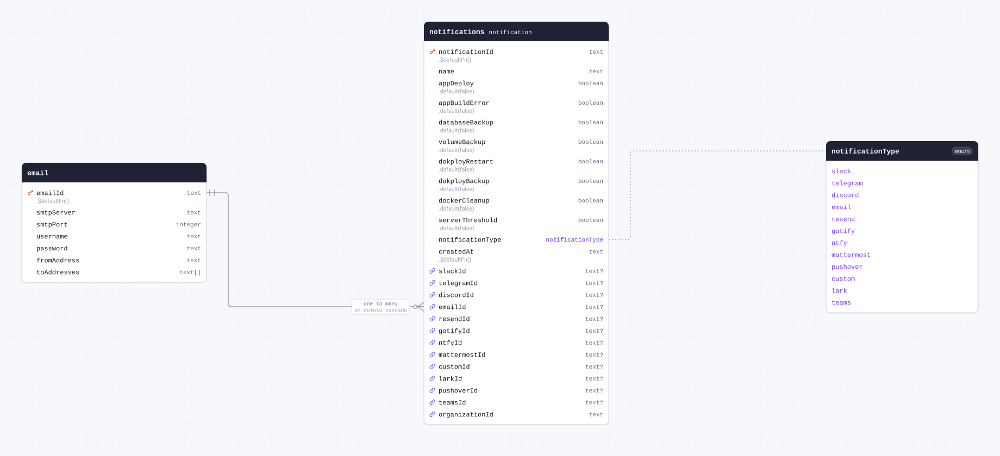

| Column                      | Type      | Constraints | Default         | Description |
| --------------------------- | --------- | ----------- | --------------- | ----------- |
| `emailId`                   | `text`    | PK NOT NULL | `.$defaultFn()` |             |
| `smtpServer`                | `text`    | NOT NULL    |                 |             |
| `smtpPort`                  | `integer` | NOT NULL    |                 |             |
| `username`                  | `text`    | NOT NULL    |                 |             |
| `password`                  | `text`    | NOT NULL    |                 |             |
| `fromAddress`               | `text`    | NOT NULL    |                 |             |
| `toAddresses` (`toAddress`) | `text[]`  | NOT NULL    |                 |             |

#### Definition

```sql
CREATE TABLE "email" (
	"emailId" text PRIMARY KEY,
	"smtpServer" text NOT NULL,
	"smtpPort" integer NOT NULL,
	"username" text NOT NULL,
	"password" text NOT NULL,
	"fromAddress" text NOT NULL,
	"toAddress" text[] NOT NULL
);
```

#### Referenced by

- `emailId` → [notifications.emailId](#table-notifications) (one to many, on delete cascade)

<details>
<summary>Queries and their SQL</summary>

**Select**: Every row of email.

```ts
db.select().from(email);
```

```sql
select "emailId", "smtpServer", "smtpPort", "username", "password", "fromAddress", "toAddress"
from "email"
```

**Count**: How many rows email has.

```ts
db.select({ count: count() }).from(email);
```

```sql
select count(*)
from "email"
```

**Find many**: The rows of email, through the relational query API.

```ts
db.query.email.findMany();
```

```sql
select "d0"."emailId" as "emailId", "d0"."smtpServer" as "smtpServer", "d0"."smtpPort" as "smtpPort", "d0"."username" as "username", "d0"."password" as "password", "d0"."fromAddress" as "fromAddress", "d0"."toAddress" as "toAddresses"
from "email" as "d0"
```

**Find by primary key**: One row of email, through the relational query API.

```ts
db.query.email.findFirst({ where: { emailId: "emailId" } });
```

```sql
select "d0"."emailId" as "emailId", "d0"."smtpServer" as "smtpServer", "d0"."smtpPort" as "smtpPort", "d0"."username" as "username", "d0"."password" as "password", "d0"."fromAddress" as "fromAddress", "d0"."toAddress" as "toAddresses"
from "email" as "d0"
where "d0"."emailId" = $1
limit $2
-- params: ["emailId",1]
```

**Insert**: Adds a row to email, giving the columns that have no default.

```ts
db.insert(email).values({
  smtpServer: "smtpServer",
  smtpPort: 1,
  username: "username",
  password: "password",
  fromAddress: "fromAddress",
  toAddresses: "toAddresses",
});
```

```sql
insert into "email" ("emailId", "smtpServer", "smtpPort", "username", "password", "fromAddress", "toAddress")
values ($1, $2, $3, $4, $5, $6, $7)
-- params: ["uuuuuuuuuuuuuuuuuuuuu","smtpServer",1,"username","password","fromAddress","toAddresses"]
```

**Update**: Changes a row of email, found by its primary key.

```ts
db.update(email).set({ smtpServer: "smtpServer" }).where(eq(email.emailId, "emailId"));
```

```sql
update "email"
set "smtpServer" = $1
where "email"."emailId" = $2
-- params: ["smtpServer","emailId"]
```

**Delete**: Deletes a row of email, found by its primary key.

```ts
db.delete(email).where(eq(email.emailId, "emailId"));
```

```sql
delete from "email"
where "email"."emailId" = $1
-- params: ["emailId"]
```

</details>

<a id="table-resend"></a>

### resend


| Column                      | Type     | Constraints | Default         | Description |
| --------------------------- | -------- | ----------- | --------------- | ----------- |
| `resendId`                  | `text`   | PK NOT NULL | `.$defaultFn()` |             |
| `apiKey`                    | `text`   | NOT NULL    |                 |             |
| `fromAddress`               | `text`   | NOT NULL    |                 |             |
| `toAddresses` (`toAddress`) | `text[]` | NOT NULL    |                 |             |

#### Definition

```sql
CREATE TABLE "resend" (
	"resendId" text PRIMARY KEY,
	"apiKey" text NOT NULL,
	"fromAddress" text NOT NULL,
	"toAddress" text[] NOT NULL
);
```

#### Referenced by

- `resendId` → [notifications.resendId](#table-notifications) (one to many, on delete cascade)

<details>
<summary>Queries and their SQL</summary>

**Select**: Every row of resend.

```ts
db.select().from(resend);
```

```sql
select "resendId", "apiKey", "fromAddress", "toAddress"
from "resend"
```

**Count**: How many rows resend has.

```ts
db.select({ count: count() }).from(resend);
```

```sql
select count(*)
from "resend"
```

**Find many**: The rows of resend, through the relational query API.

```ts
db.query.resend.findMany();
```

```sql
select "d0"."resendId" as "resendId", "d0"."apiKey" as "apiKey", "d0"."fromAddress" as "fromAddress", "d0"."toAddress" as "toAddresses"
from "resend" as "d0"
```

**Find by primary key**: One row of resend, through the relational query API.

```ts
db.query.resend.findFirst({ where: { resendId: "resendId" } });
```

```sql
select "d0"."resendId" as "resendId", "d0"."apiKey" as "apiKey", "d0"."fromAddress" as "fromAddress", "d0"."toAddress" as "toAddresses"
from "resend" as "d0"
where "d0"."resendId" = $1
limit $2
-- params: ["resendId",1]
```

**Insert**: Adds a row to resend, giving the columns that have no default.

```ts
db.insert(resend).values({
  apiKey: "apiKey",
  fromAddress: "fromAddress",
  toAddresses: "toAddresses",
});
```

```sql
insert into "resend" ("resendId", "apiKey", "fromAddress", "toAddress")
values ($1, $2, $3, $4)
-- params: ["uuuuuuuuuuuuuuuuuuuuu","apiKey","fromAddress","toAddresses"]
```

**Update**: Changes a row of resend, found by its primary key.

```ts
db.update(resend).set({ apiKey: "apiKey" }).where(eq(resend.resendId, "resendId"));
```

```sql
update "resend"
set "apiKey" = $1
where "resend"."resendId" = $2
-- params: ["apiKey","resendId"]
```

**Delete**: Deletes a row of resend, found by its primary key.

```ts
db.delete(resend).where(eq(resend.resendId, "resendId"));
```

```sql
delete from "resend"
where "resend"."resendId" = $1
-- params: ["resendId"]
```

</details>

<a id="table-gotify"></a>

### gotify

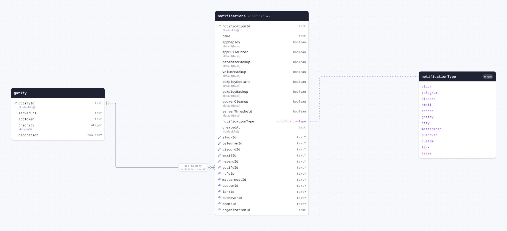

| Column       | Type      | Constraints | Default         | Description |
| ------------ | --------- | ----------- | --------------- | ----------- |
| `gotifyId`   | `text`    | PK NOT NULL | `.$defaultFn()` |             |
| `serverUrl`  | `text`    | NOT NULL    |                 |             |
| `appToken`   | `text`    | NOT NULL    |                 |             |
| `priority`   | `integer` | NOT NULL    | `.default(5)`   |             |
| `decoration` | `boolean` | NULL        |                 |             |

#### Definition

```sql
CREATE TABLE "gotify" (
	"gotifyId" text PRIMARY KEY,
	"serverUrl" text NOT NULL,
	"appToken" text NOT NULL,
	"priority" integer DEFAULT 5 NOT NULL,
	"decoration" boolean
);
```

#### Referenced by

- `gotifyId` → [notifications.gotifyId](#table-notifications) (one to many, on delete cascade)

<details>
<summary>Queries and their SQL</summary>

**Select**: Every row of gotify.

```ts
db.select().from(gotify);
```

```sql
select "gotifyId", "serverUrl", "appToken", "priority", "decoration"
from "gotify"
```

**Count**: How many rows gotify has.

```ts
db.select({ count: count() }).from(gotify);
```

```sql
select count(*)
from "gotify"
```

**Find many**: The rows of gotify, through the relational query API.

```ts
db.query.gotify.findMany();
```

```sql
select "d0"."gotifyId" as "gotifyId", "d0"."serverUrl" as "serverUrl", "d0"."appToken" as "appToken", "d0"."priority" as "priority", "d0"."decoration" as "decoration"
from "gotify" as "d0"
```

**Find by primary key**: One row of gotify, through the relational query API.

```ts
db.query.gotify.findFirst({ where: { gotifyId: "gotifyId" } });
```

```sql
select "d0"."gotifyId" as "gotifyId", "d0"."serverUrl" as "serverUrl", "d0"."appToken" as "appToken", "d0"."priority" as "priority", "d0"."decoration" as "decoration"
from "gotify" as "d0"
where "d0"."gotifyId" = $1
limit $2
-- params: ["gotifyId",1]
```

**Insert**: Adds a row to gotify, giving the columns that have no default.

```ts
db.insert(gotify).values({ serverUrl: "serverUrl", appToken: "appToken" });
```

```sql
insert into "gotify" ("gotifyId", "serverUrl", "appToken", "priority", "decoration")
values ($1, $2, $3, default, default)
-- params: ["uuuuuuuuuuuuuuuuuuuuu","serverUrl","appToken"]
```

**Update**: Changes a row of gotify, found by its primary key.

```ts
db.update(gotify).set({ serverUrl: "serverUrl" }).where(eq(gotify.gotifyId, "gotifyId"));
```

```sql
update "gotify"
set "serverUrl" = $1
where "gotify"."gotifyId" = $2
-- params: ["serverUrl","gotifyId"]
```

**Delete**: Deletes a row of gotify, found by its primary key.

```ts
db.delete(gotify).where(eq(gotify.gotifyId, "gotifyId"));
```

```sql
delete from "gotify"
where "gotify"."gotifyId" = $1
-- params: ["gotifyId"]
```

</details>

<a id="table-ntfy"></a>

### ntfy


| Column        | Type      | Constraints | Default         | Description |
| ------------- | --------- | ----------- | --------------- | ----------- |
| `ntfyId`      | `text`    | PK NOT NULL | `.$defaultFn()` |             |
| `serverUrl`   | `text`    | NOT NULL    |                 |             |
| `topic`       | `text`    | NOT NULL    |                 |             |
| `accessToken` | `text`    | NULL        |                 |             |
| `priority`    | `integer` | NOT NULL    | `.default(3)`   |             |

#### Definition

```sql
CREATE TABLE "ntfy" (
	"ntfyId" text PRIMARY KEY,
	"serverUrl" text NOT NULL,
	"topic" text NOT NULL,
	"accessToken" text,
	"priority" integer DEFAULT 3 NOT NULL
);
```

#### Referenced by

- `ntfyId` → [notifications.ntfyId](#table-notifications) (one to many, on delete cascade)

<details>
<summary>Queries and their SQL</summary>

**Select**: Every row of ntfy.

```ts
db.select().from(ntfy);
```

```sql
select "ntfyId", "serverUrl", "topic", "accessToken", "priority"
from "ntfy"
```

**Count**: How many rows ntfy has.

```ts
db.select({ count: count() }).from(ntfy);
```

```sql
select count(*)
from "ntfy"
```

**Find many**: The rows of ntfy, through the relational query API.

```ts
db.query.ntfy.findMany();
```

```sql
select "d0"."ntfyId" as "ntfyId", "d0"."serverUrl" as "serverUrl", "d0"."topic" as "topic", "d0"."accessToken" as "accessToken", "d0"."priority" as "priority"
from "ntfy" as "d0"
```

**Find by primary key**: One row of ntfy, through the relational query API.

```ts
db.query.ntfy.findFirst({ where: { ntfyId: "ntfyId" } });
```

```sql
select "d0"."ntfyId" as "ntfyId", "d0"."serverUrl" as "serverUrl", "d0"."topic" as "topic", "d0"."accessToken" as "accessToken", "d0"."priority" as "priority"
from "ntfy" as "d0"
where "d0"."ntfyId" = $1
limit $2
-- params: ["ntfyId",1]
```

**Insert**: Adds a row to ntfy, giving the columns that have no default.

```ts
db.insert(ntfy).values({ serverUrl: "serverUrl", topic: "topic" });
```

```sql
insert into "ntfy" ("ntfyId", "serverUrl", "topic", "accessToken", "priority")
values ($1, $2, $3, default, default)
-- params: ["uuuuuuuuuuuuuuuuuuuuu","serverUrl","topic"]
```

**Update**: Changes a row of ntfy, found by its primary key.

```ts
db.update(ntfy).set({ serverUrl: "serverUrl" }).where(eq(ntfy.ntfyId, "ntfyId"));
```

```sql
update "ntfy"
set "serverUrl" = $1
where "ntfy"."ntfyId" = $2
-- params: ["serverUrl","ntfyId"]
```

**Delete**: Deletes a row of ntfy, found by its primary key.

```ts
db.delete(ntfy).where(eq(ntfy.ntfyId, "ntfyId"));
```

```sql
delete from "ntfy"
where "ntfy"."ntfyId" = $1
-- params: ["ntfyId"]
```

</details>

<a id="table-mattermost"></a>

### mattermost

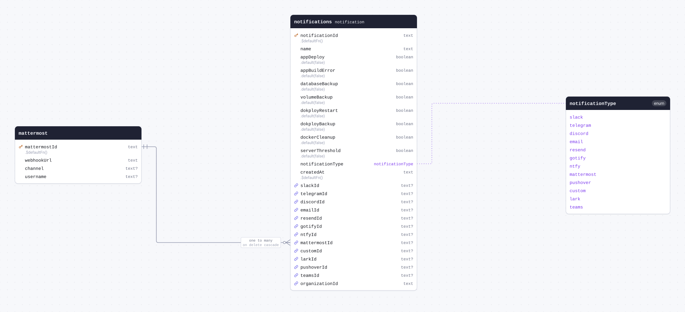

| Column         | Type   | Constraints | Default         | Description |
| -------------- | ------ | ----------- | --------------- | ----------- |
| `mattermostId` | `text` | PK NOT NULL | `.$defaultFn()` |             |
| `webhookUrl`   | `text` | NOT NULL    |                 |             |
| `channel`      | `text` | NULL        |                 |             |
| `username`     | `text` | NULL        |                 |             |

#### Definition

```sql
CREATE TABLE "mattermost" (
	"mattermostId" text PRIMARY KEY,
	"webhookUrl" text NOT NULL,
	"channel" text,
	"username" text
);
```

#### Referenced by

- `mattermostId` → [notifications.mattermostId](#table-notifications) (one to many, on delete cascade)

<details>
<summary>Queries and their SQL</summary>

**Select**: Every row of mattermost.

```ts
db.select().from(mattermost);
```

```sql
select "mattermostId", "webhookUrl", "channel", "username"
from "mattermost"
```

**Count**: How many rows mattermost has.

```ts
db.select({ count: count() }).from(mattermost);
```

```sql
select count(*)
from "mattermost"
```

**Find many**: The rows of mattermost, through the relational query API.

```ts
db.query.mattermost.findMany();
```

```sql
select "d0"."mattermostId" as "mattermostId", "d0"."webhookUrl" as "webhookUrl", "d0"."channel" as "channel", "d0"."username" as "username"
from "mattermost" as "d0"
```

**Find by primary key**: One row of mattermost, through the relational query API.

```ts
db.query.mattermost.findFirst({ where: { mattermostId: "mattermostId" } });
```

```sql
select "d0"."mattermostId" as "mattermostId", "d0"."webhookUrl" as "webhookUrl", "d0"."channel" as "channel", "d0"."username" as "username"
from "mattermost" as "d0"
where "d0"."mattermostId" = $1
limit $2
-- params: ["mattermostId",1]
```

**Insert**: Adds a row to mattermost, giving the columns that have no default.

```ts
db.insert(mattermost).values({ webhookUrl: "webhookUrl" });
```

```sql
insert into "mattermost" ("mattermostId", "webhookUrl", "channel", "username")
values ($1, $2, default, default)
-- params: ["uuuuuuuuuuuuuuuuuuuuu","webhookUrl"]
```

**Update**: Changes a row of mattermost, found by its primary key.

```ts
db.update(mattermost)
  .set({ webhookUrl: "webhookUrl" })
  .where(eq(mattermost.mattermostId, "mattermostId"));
```

```sql
update "mattermost"
set "webhookUrl" = $1
where "mattermost"."mattermostId" = $2
-- params: ["webhookUrl","mattermostId"]
```

**Delete**: Deletes a row of mattermost, found by its primary key.

```ts
db.delete(mattermost).where(eq(mattermost.mattermostId, "mattermostId"));
```

```sql
delete from "mattermost"
where "mattermost"."mattermostId" = $1
-- params: ["mattermostId"]
```

</details>

<a id="table-custom"></a>

### custom

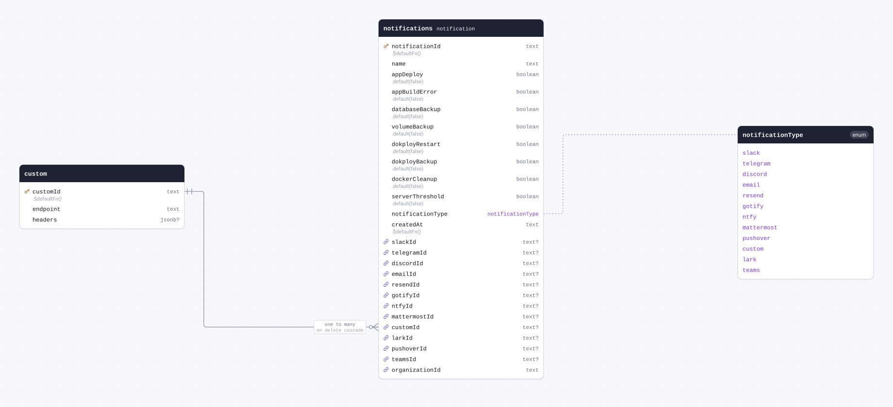

| Column     | Type    | Constraints | Default         | Description |
| ---------- | ------- | ----------- | --------------- | ----------- |
| `customId` | `text`  | PK NOT NULL | `.$defaultFn()` |             |
| `endpoint` | `text`  | NOT NULL    |                 |             |
| `headers`  | `jsonb` | NULL        |                 |             |

#### Definition

```sql
CREATE TABLE "custom" (
	"customId" text PRIMARY KEY,
	"endpoint" text NOT NULL,
	"headers" jsonb
);
```

#### Referenced by

- `customId` → [notifications.customId](#table-notifications) (one to many, on delete cascade)

<details>
<summary>Queries and their SQL</summary>

**Select**: Every row of custom.

```ts
db.select().from(custom);
```

```sql
select "customId", "endpoint", "headers"
from "custom"
```

**Count**: How many rows custom has.

```ts
db.select({ count: count() }).from(custom);
```

```sql
select count(*)
from "custom"
```

**Find many**: The rows of custom, through the relational query API.

```ts
db.query.custom.findMany();
```

```sql
select "d0"."customId" as "customId", "d0"."endpoint" as "endpoint", "d0"."headers" as "headers"
from "custom" as "d0"
```

**Find by primary key**: One row of custom, through the relational query API.

```ts
db.query.custom.findFirst({ where: { customId: "customId" } });
```

```sql
select "d0"."customId" as "customId", "d0"."endpoint" as "endpoint", "d0"."headers" as "headers"
from "custom" as "d0"
where "d0"."customId" = $1
limit $2
-- params: ["customId",1]
```

**Insert**: Adds a row to custom, giving the columns that have no default.

```ts
db.insert(custom).values({ endpoint: "endpoint" });
```

```sql
insert into "custom" ("customId", "endpoint", "headers")
values ($1, $2, default)
-- params: ["uuuuuuuuuuuuuuuuuuuuu","endpoint"]
```

**Update**: Changes a row of custom, found by its primary key.

```ts
db.update(custom).set({ endpoint: "endpoint" }).where(eq(custom.customId, "customId"));
```

```sql
update "custom"
set "endpoint" = $1
where "custom"."customId" = $2
-- params: ["endpoint","customId"]
```

**Delete**: Deletes a row of custom, found by its primary key.

```ts
db.delete(custom).where(eq(custom.customId, "customId"));
```

```sql
delete from "custom"
where "custom"."customId" = $1
-- params: ["customId"]
```

</details>

<a id="table-lark"></a>

### lark


| Column       | Type   | Constraints | Default         | Description |
| ------------ | ------ | ----------- | --------------- | ----------- |
| `larkId`     | `text` | PK NOT NULL | `.$defaultFn()` |             |
| `webhookUrl` | `text` | NOT NULL    |                 |             |

#### Definition

```sql
CREATE TABLE "lark" (
	"larkId" text PRIMARY KEY,
	"webhookUrl" text NOT NULL
);
```

#### Referenced by

- `larkId` → [notifications.larkId](#table-notifications) (one to many, on delete cascade)

<details>
<summary>Queries and their SQL</summary>

**Select**: Every row of lark.

```ts
db.select().from(lark);
```

```sql
select "larkId", "webhookUrl"
from "lark"
```

**Count**: How many rows lark has.

```ts
db.select({ count: count() }).from(lark);
```

```sql
select count(*)
from "lark"
```

**Find many**: The rows of lark, through the relational query API.

```ts
db.query.lark.findMany();
```

```sql
select "d0"."larkId" as "larkId", "d0"."webhookUrl" as "webhookUrl"
from "lark" as "d0"
```

**Find by primary key**: One row of lark, through the relational query API.

```ts
db.query.lark.findFirst({ where: { larkId: "larkId" } });
```

```sql
select "d0"."larkId" as "larkId", "d0"."webhookUrl" as "webhookUrl"
from "lark" as "d0"
where "d0"."larkId" = $1
limit $2
-- params: ["larkId",1]
```

**Insert**: Adds a row to lark, giving the columns that have no default.

```ts
db.insert(lark).values({ webhookUrl: "webhookUrl" });
```

```sql
insert into "lark" ("larkId", "webhookUrl")
values ($1, $2)
-- params: ["uuuuuuuuuuuuuuuuuuuuu","webhookUrl"]
```

**Update**: Changes a row of lark, found by its primary key.

```ts
db.update(lark).set({ webhookUrl: "webhookUrl" }).where(eq(lark.larkId, "larkId"));
```

```sql
update "lark"
set "webhookUrl" = $1
where "lark"."larkId" = $2
-- params: ["webhookUrl","larkId"]
```

**Delete**: Deletes a row of lark, found by its primary key.

```ts
db.delete(lark).where(eq(lark.larkId, "larkId"));
```

```sql
delete from "lark"
where "lark"."larkId" = $1
-- params: ["larkId"]
```

</details>

<a id="table-pushover"></a>

### pushover

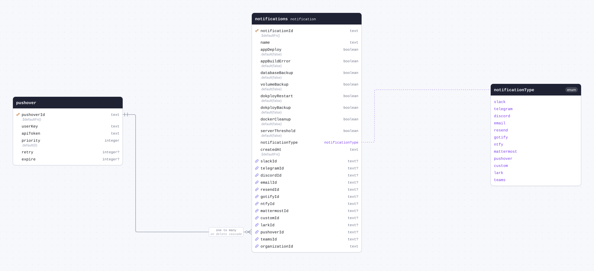

| Column       | Type      | Constraints | Default         | Description |
| ------------ | --------- | ----------- | --------------- | ----------- |
| `pushoverId` | `text`    | PK NOT NULL | `.$defaultFn()` |             |
| `userKey`    | `text`    | NOT NULL    |                 |             |
| `apiToken`   | `text`    | NOT NULL    |                 |             |
| `priority`   | `integer` | NOT NULL    | `.default(0)`   |             |
| `retry`      | `integer` | NULL        |                 |             |
| `expire`     | `integer` | NULL        |                 |             |

#### Definition

```sql
CREATE TABLE "pushover" (
	"pushoverId" text PRIMARY KEY,
	"userKey" text NOT NULL,
	"apiToken" text NOT NULL,
	"priority" integer DEFAULT 0 NOT NULL,
	"retry" integer,
	"expire" integer
);
```

#### Referenced by

- `pushoverId` → [notifications.pushoverId](#table-notifications) (one to many, on delete cascade)

<details>
<summary>Queries and their SQL</summary>

**Select**: Every row of pushover.

```ts
db.select().from(pushover);
```

```sql
select "pushoverId", "userKey", "apiToken", "priority", "retry", "expire"
from "pushover"
```

**Count**: How many rows pushover has.

```ts
db.select({ count: count() }).from(pushover);
```

```sql
select count(*)
from "pushover"
```

**Find many**: The rows of pushover, through the relational query API.

```ts
db.query.pushover.findMany();
```

```sql
select "d0"."pushoverId" as "pushoverId", "d0"."userKey" as "userKey", "d0"."apiToken" as "apiToken", "d0"."priority" as "priority", "d0"."retry" as "retry", "d0"."expire" as "expire"
from "pushover" as "d0"
```

**Find by primary key**: One row of pushover, through the relational query API.

```ts
db.query.pushover.findFirst({ where: { pushoverId: "pushoverId" } });
```

```sql
select "d0"."pushoverId" as "pushoverId", "d0"."userKey" as "userKey", "d0"."apiToken" as "apiToken", "d0"."priority" as "priority", "d0"."retry" as "retry", "d0"."expire" as "expire"
from "pushover" as "d0"
where "d0"."pushoverId" = $1
limit $2
-- params: ["pushoverId",1]
```

**Insert**: Adds a row to pushover, giving the columns that have no default.

```ts
db.insert(pushover).values({ userKey: "userKey", apiToken: "apiToken" });
```

```sql
insert into "pushover" ("pushoverId", "userKey", "apiToken", "priority", "retry", "expire")
values ($1, $2, $3, default, default, default)
-- params: ["uuuuuuuuuuuuuuuuuuuuu","userKey","apiToken"]
```

**Update**: Changes a row of pushover, found by its primary key.

```ts
db.update(pushover).set({ userKey: "userKey" }).where(eq(pushover.pushoverId, "pushoverId"));
```

```sql
update "pushover"
set "userKey" = $1
where "pushover"."pushoverId" = $2
-- params: ["userKey","pushoverId"]
```

**Delete**: Deletes a row of pushover, found by its primary key.

```ts
db.delete(pushover).where(eq(pushover.pushoverId, "pushoverId"));
```

```sql
delete from "pushover"
where "pushover"."pushoverId" = $1
-- params: ["pushoverId"]
```

</details>

<a id="table-teams"></a>

### teams

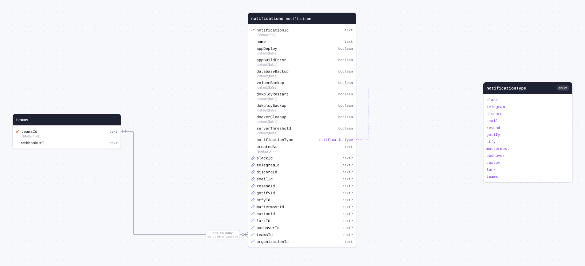

| Column       | Type   | Constraints | Default         | Description |
| ------------ | ------ | ----------- | --------------- | ----------- |
| `teamsId`    | `text` | PK NOT NULL | `.$defaultFn()` |             |
| `webhookUrl` | `text` | NOT NULL    |                 |             |

#### Definition

```sql
CREATE TABLE "teams" (
	"teamsId" text PRIMARY KEY,
	"webhookUrl" text NOT NULL
);
```

#### Referenced by

- `teamsId` → [notifications.teamsId](#table-notifications) (one to many, on delete cascade)

<details>
<summary>Queries and their SQL</summary>

**Select**: Every row of teams.

```ts
db.select().from(teams);
```

```sql
select "teamsId", "webhookUrl"
from "teams"
```

**Count**: How many rows teams has.

```ts
db.select({ count: count() }).from(teams);
```

```sql
select count(*)
from "teams"
```

**Find many**: The rows of teams, through the relational query API.

```ts
db.query.teams.findMany();
```

```sql
select "d0"."teamsId" as "teamsId", "d0"."webhookUrl" as "webhookUrl"
from "teams" as "d0"
```

**Find by primary key**: One row of teams, through the relational query API.

```ts
db.query.teams.findFirst({ where: { teamsId: "teamsId" } });
```

```sql
select "d0"."teamsId" as "teamsId", "d0"."webhookUrl" as "webhookUrl"
from "teams" as "d0"
where "d0"."teamsId" = $1
limit $2
-- params: ["teamsId",1]
```

**Insert**: Adds a row to teams, giving the columns that have no default.

```ts
db.insert(teams).values({ webhookUrl: "webhookUrl" });
```

```sql
insert into "teams" ("teamsId", "webhookUrl")
values ($1, $2)
-- params: ["uuuuuuuuuuuuuuuuuuuuu","webhookUrl"]
```

**Update**: Changes a row of teams, found by its primary key.

```ts
db.update(teams).set({ webhookUrl: "webhookUrl" }).where(eq(teams.teamsId, "teamsId"));
```

```sql
update "teams"
set "webhookUrl" = $1
where "teams"."teamsId" = $2
-- params: ["webhookUrl","teamsId"]
```

**Delete**: Deletes a row of teams, found by its primary key.

```ts
db.delete(teams).where(eq(teams.teamsId, "teamsId"));
```

```sql
delete from "teams"
where "teams"."teamsId" = $1
-- params: ["teamsId"]
```

</details>

<a id="table-patch"></a>

### patch

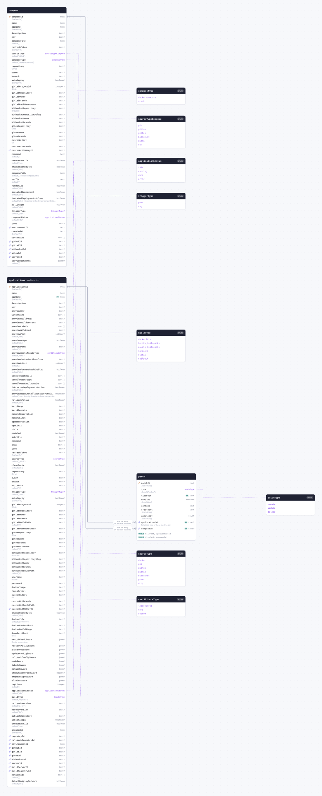

| Column          | Type                           | Constraints                                              | Default              | Description                          |
| --------------- | ------------------------------ | -------------------------------------------------------- | -------------------- | ------------------------------------ |
| `patchId`       | `text`                         | PK NOT NULL                                              | `.$defaultFn()`      |                                      |
| `type`          | [`patchType`](#enum-patchType) | NOT NULL                                                 | `.default("update")` |                                      |
| `filePath`      | `text`                         | NOT NULL                                                 |                      |                                      |
| `enabled`       | `boolean`                      | NOT NULL                                                 | `.default(true)`     |                                      |
| `content`       | `text`                         | NOT NULL                                                 |                      |                                      |
| `createdAt`     | `text`                         | NOT NULL                                                 | `.$defaultFn()`      |                                      |
| `updatedAt`     | `text`                         | NULL                                                     | `.$defaultFn()`      |                                      |
| `applicationId` | `text`                         | NULL → [applications.applicationId](#table-applications) |                      | Relations - one of these must be set |
| `composeId`     | `text`                         | NULL → [compose.composeId](#table-compose)               |                      |                                      |

#### Definition

```sql
CREATE TABLE "patch" (
	"patchId" text PRIMARY KEY,
	"type" "patchType" DEFAULT 'update'::"patchType" NOT NULL,
	"filePath" text NOT NULL,
	"enabled" boolean DEFAULT true NOT NULL,
	"content" text NOT NULL,
	"createdAt" text NOT NULL,
	"updatedAt" text,
	"applicationId" text,
	"composeId" text,
	CONSTRAINT "patch_filepath_application_unique" UNIQUE("filePath","applicationId"),
	CONSTRAINT "patch_filepath_compose_unique" UNIQUE("filePath","composeId")
);

ALTER TABLE "patch" ADD CONSTRAINT "patch_applicationId_application_applicationId_fkey" FOREIGN KEY ("applicationId") REFERENCES "application"("applicationId") ON DELETE CASCADE;

ALTER TABLE "patch" ADD CONSTRAINT "patch_composeId_compose_composeId_fkey" FOREIGN KEY ("composeId") REFERENCES "compose"("composeId") ON DELETE CASCADE;
```

#### Indexes

- UNIQUE `filePath`, `applicationId`
- UNIQUE `filePath`, `composeId`

#### References

- `applicationId` → [applications.applicationId](#table-applications) (many to one, on delete cascade)
- `composeId` → [compose.composeId](#table-compose) (many to one, on delete cascade)

<details>
<summary>Queries and their SQL</summary>

**Select**: Every row of patch.

```ts
db.select().from(patch);
```

```sql
select "patchId", "type", "filePath", "enabled", "content", "createdAt", "updatedAt", "applicationId", "composeId"
from "patch"
```

**Count**: How many rows patch has.

```ts
db.select({ count: count() }).from(patch);
```

```sql
select count(*)
from "patch"
```

**Find many**: The rows of patch, through the relational query API.

```ts
db.query.patch.findMany();
```

```sql
select "d0"."patchId" as "patchId", "d0"."type" as "type", "d0"."filePath" as "filePath", "d0"."enabled" as "enabled", "d0"."content" as "content", "d0"."createdAt" as "createdAt", "d0"."updatedAt" as "updatedAt", "d0"."applicationId" as "applicationId", "d0"."composeId" as "composeId"
from "patch" as "d0"
```

**Find by primary key**: One row of patch, through the relational query API.

```ts
db.query.patch.findFirst({ where: { patchId: "patchId" } });
```

```sql
select "d0"."patchId" as "patchId", "d0"."type" as "type", "d0"."filePath" as "filePath", "d0"."enabled" as "enabled", "d0"."content" as "content", "d0"."createdAt" as "createdAt", "d0"."updatedAt" as "updatedAt", "d0"."applicationId" as "applicationId", "d0"."composeId" as "composeId"
from "patch" as "d0"
where "d0"."patchId" = $1
limit $2
-- params: ["patchId",1]
```

**Insert**: Adds a row to patch, giving the columns that have no default.

```ts
db.insert(patch).values({ filePath: "filePath", content: "content" });
```

```sql
insert into "patch" ("patchId", "type", "filePath", "enabled", "content", "createdAt", "updatedAt", "applicationId", "composeId")
values ($1, default, $2, default, $3, $4, $5, default, default)
-- params: ["uuuuuuuuuuuuuuuuuuuuu","filePath","content","2026-01-01T00:00:00.000Z","2026-01-01T00:00:00.000Z"]
```

**Update**: Changes a row of patch, found by its primary key.

```ts
db.update(patch).set({ type: "create" }).where(eq(patch.patchId, "patchId"));
```

```sql
update "patch"
set "type" = $1
where "patch"."patchId" = $2
-- params: ["create","patchId"]
```

**Delete**: Deletes a row of patch, found by its primary key.

```ts
db.delete(patch).where(eq(patch.patchId, "patchId"));
```

```sql
delete from "patch"
where "patch"."patchId" = $1
-- params: ["patchId"]
```

</details>

<a id="table-ports"></a>

### ports

Table `port`.

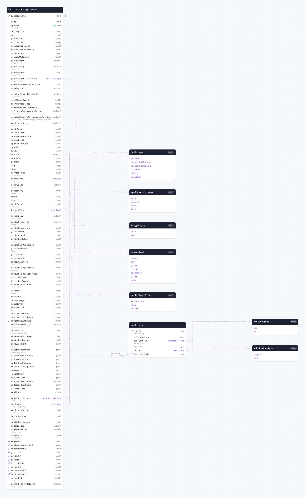

| Column          | Type                                       | Constraints                                                  | Default            | Description |
| --------------- | ------------------------------------------ | ------------------------------------------------------------ | ------------------ | ----------- |
| `portId`        | `text`                                     | PK NOT NULL                                                  | `.$defaultFn()`    |             |
| `publishedPort` | `integer`                                  | NOT NULL                                                     |                    |             |
| `publishMode`   | [`publishModeType`](#enum-publishModeType) | NOT NULL                                                     | `.default("host")` |             |
| `targetPort`    | `integer`                                  | NOT NULL                                                     |                    |             |
| `protocol`      | [`protocolType`](#enum-protocolType)       | NOT NULL                                                     |                    |             |
| `applicationId` | `text`                                     | NOT NULL → [applications.applicationId](#table-applications) |                    |             |

#### Definition

```sql
CREATE TABLE "port" (
	"portId" text PRIMARY KEY,
	"publishedPort" integer NOT NULL,
	"publishMode" "publishModeType" DEFAULT 'host'::"publishModeType" NOT NULL,
	"targetPort" integer NOT NULL,
	"protocol" "protocolType" NOT NULL,
	"applicationId" text NOT NULL
);

ALTER TABLE "port" ADD CONSTRAINT "port_applicationId_application_applicationId_fkey" FOREIGN KEY ("applicationId") REFERENCES "application"("applicationId") ON DELETE CASCADE;
```

#### References

- `applicationId` → [applications.applicationId](#table-applications) (many to one, on delete cascade)

<details>
<summary>Queries and their SQL</summary>

**Select**: Every row of ports.

```ts
db.select().from(ports);
```

```sql
select "portId", "publishedPort", "publishMode", "targetPort", "protocol", "applicationId"
from "port"
```

**Count**: How many rows ports has.

```ts
db.select({ count: count() }).from(ports);
```

```sql
select count(*)
from "port"
```

**Find many**: The rows of ports, through the relational query API.

```ts
db.query.ports.findMany();
```

```sql
select "d0"."portId" as "portId", "d0"."publishedPort" as "publishedPort", "d0"."publishMode" as "publishMode", "d0"."targetPort" as "targetPort", "d0"."protocol" as "protocol", "d0"."applicationId" as "applicationId"
from "port" as "d0"
```

**Find by primary key**: One row of ports, through the relational query API.

```ts
db.query.ports.findFirst({ where: { portId: "portId" } });
```

```sql
select "d0"."portId" as "portId", "d0"."publishedPort" as "publishedPort", "d0"."publishMode" as "publishMode", "d0"."targetPort" as "targetPort", "d0"."protocol" as "protocol", "d0"."applicationId" as "applicationId"
from "port" as "d0"
where "d0"."portId" = $1
limit $2
-- params: ["portId",1]
```

**Insert**: Adds a row to ports, giving the columns that have no default.

```ts
db.insert(ports).values({
  publishedPort: 1,
  targetPort: 1,
  protocol: "tcp",
  applicationId: "applicationId",
});
```

```sql
insert into "port" ("portId", "publishedPort", "publishMode", "targetPort", "protocol", "applicationId")
values ($1, $2, default, $3, $4, $5)
-- params: ["uuuuuuuuuuuuuuuuuuuuu",1,1,"tcp","applicationId"]
```

**Update**: Changes a row of ports, found by its primary key.

```ts
db.update(ports).set({ publishedPort: 1 }).where(eq(ports.portId, "portId"));
```

```sql
update "port"
set "publishedPort" = $1
where "port"."portId" = $2
-- params: [1,"portId"]
```

**Delete**: Deletes a row of ports, found by its primary key.

```ts
db.delete(ports).where(eq(ports.portId, "portId"));
```

```sql
delete from "port"
where "port"."portId" = $1
-- params: ["portId"]
```

</details>

<a id="table-postgres"></a>

### postgres

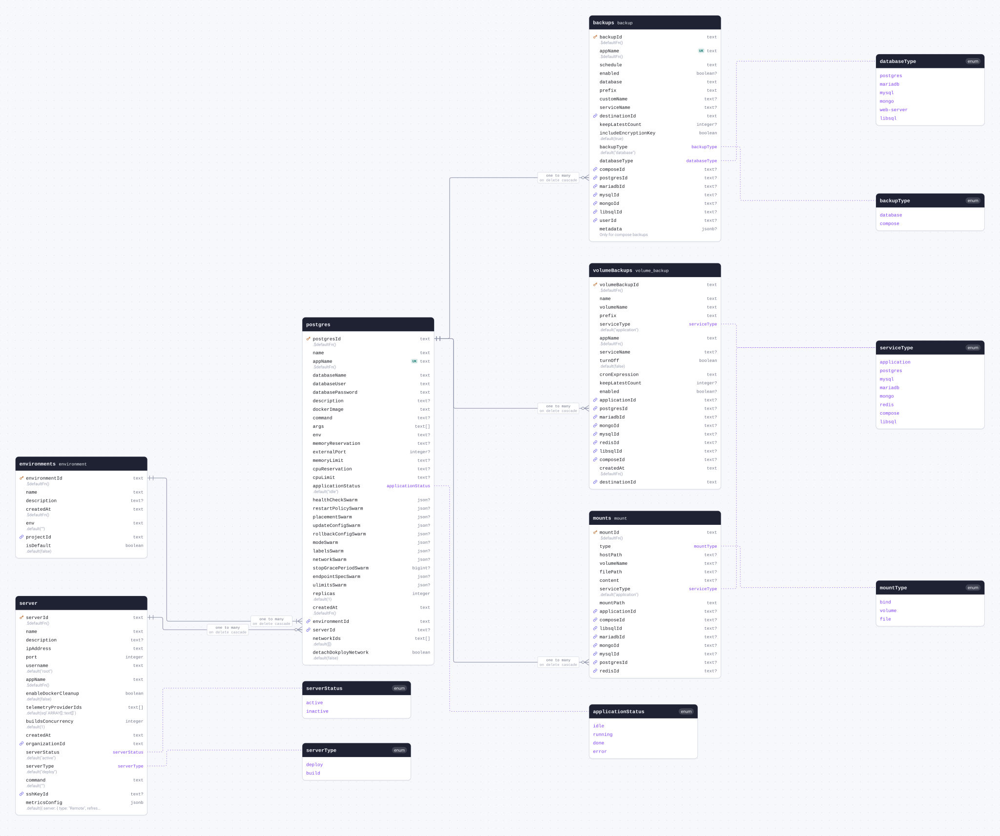

| Column                 | Type                                           | Constraints                                                  | Default            | Description |
| ---------------------- | ---------------------------------------------- | ------------------------------------------------------------ | ------------------ | ----------- |
| `postgresId`           | `text`                                         | PK NOT NULL                                                  | `.$defaultFn()`    |             |
| `name`                 | `text`                                         | NOT NULL                                                     |                    |             |
| `appName`              | `text`                                         | UNIQUE NOT NULL                                              | `.$defaultFn()`    |             |
| `databaseName`         | `text`                                         | NOT NULL                                                     |                    |             |
| `databaseUser`         | `text`                                         | NOT NULL                                                     |                    |             |
| `databasePassword`     | `text`                                         | NOT NULL                                                     |                    |             |
| `description`          | `text`                                         | NULL                                                         |                    |             |
| `dockerImage`          | `text`                                         | NOT NULL                                                     |                    |             |
| `command`              | `text`                                         | NULL                                                         |                    |             |
| `args`                 | `text[]`                                       | NULL                                                         |                    |             |
| `env`                  | `text`                                         | NULL                                                         |                    |             |
| `memoryReservation`    | `text`                                         | NULL                                                         |                    |             |
| `externalPort`         | `integer`                                      | NULL                                                         |                    |             |
| `memoryLimit`          | `text`                                         | NULL                                                         |                    |             |
| `cpuReservation`       | `text`                                         | NULL                                                         |                    |             |
| `cpuLimit`             | `text`                                         | NULL                                                         |                    |             |
| `applicationStatus`    | [`applicationStatus`](#enum-applicationStatus) | NOT NULL                                                     | `.default("idle")` |             |
| `healthCheckSwarm`     | `json`                                         | NULL                                                         |                    |             |
| `restartPolicySwarm`   | `json`                                         | NULL                                                         |                    |             |
| `placementSwarm`       | `json`                                         | NULL                                                         |                    |             |
| `updateConfigSwarm`    | `json`                                         | NULL                                                         |                    |             |
| `rollbackConfigSwarm`  | `json`                                         | NULL                                                         |                    |             |
| `modeSwarm`            | `json`                                         | NULL                                                         |                    |             |
| `labelsSwarm`          | `json`                                         | NULL                                                         |                    |             |
| `networkSwarm`         | `json`                                         | NULL                                                         |                    |             |
| `stopGracePeriodSwarm` | `bigint`                                       | NULL                                                         |                    |             |
| `endpointSpecSwarm`    | `json`                                         | NULL                                                         |                    |             |
| `ulimitsSwarm`         | `json`                                         | NULL                                                         |                    |             |
| `replicas`             | `integer`                                      | NOT NULL                                                     | `.default(1)`      |             |
| `createdAt`            | `text`                                         | NOT NULL                                                     | `.$defaultFn()`    |             |
| `environmentId`        | `text`                                         | NOT NULL → [environments.environmentId](#table-environments) |                    |             |
| `serverId`             | `text`                                         | NULL → [server.serverId](#table-server)                      |                    |             |
| `networkIds`           | `text[]`                                       | NULL                                                         | `.default([])`     |             |
| `detachDokployNetwork` | `boolean`                                      | NOT NULL                                                     | `.default(false)`  |             |

#### Definition

```sql
CREATE TABLE "postgres" (
	"postgresId" text PRIMARY KEY,
	"name" text NOT NULL,
	"appName" text NOT NULL UNIQUE,
	"databaseName" text NOT NULL,
	"databaseUser" text NOT NULL,
	"databasePassword" text NOT NULL,
	"description" text,
	"dockerImage" text NOT NULL,
	"command" text,
	"args" text[],
	"env" text,
	"memoryReservation" text,
	"externalPort" integer,
	"memoryLimit" text,
	"cpuReservation" text,
	"cpuLimit" text,
	"applicationStatus" "applicationStatus" DEFAULT 'idle'::"applicationStatus" NOT NULL,
	"healthCheckSwarm" json,
	"restartPolicySwarm" json,
	"placementSwarm" json,
	"updateConfigSwarm" json,
	"rollbackConfigSwarm" json,
	"modeSwarm" json,
	"labelsSwarm" json,
	"networkSwarm" json,
	"stopGracePeriodSwarm" bigint,
	"endpointSpecSwarm" json,
	"ulimitsSwarm" json,
	"replicas" integer DEFAULT 1 NOT NULL,
	"createdAt" text NOT NULL,
	"environmentId" text NOT NULL,
	"serverId" text,
	"networkIds" text[] DEFAULT '{}'::text[],
	"detachDokployNetwork" boolean DEFAULT false NOT NULL
);

ALTER TABLE "postgres" ADD CONSTRAINT "postgres_environmentId_environment_environmentId_fkey" FOREIGN KEY ("environmentId") REFERENCES "environment"("environmentId") ON DELETE CASCADE;

ALTER TABLE "postgres" ADD CONSTRAINT "postgres_serverId_server_serverId_fkey" FOREIGN KEY ("serverId") REFERENCES "server"("serverId") ON DELETE CASCADE;
```

#### References

- `environmentId` → [environments.environmentId](#table-environments) (many to one, on delete cascade)
- `serverId` → [server.serverId](#table-server) (many to one, on delete cascade)

#### Referenced by

- `postgresId` → [backups.postgresId](#table-backups) (one to many, on delete cascade)
- `postgresId` → [mounts.postgresId](#table-mounts) (one to many, on delete cascade)
- `postgresId` → [volumeBackups.postgresId](#table-volumeBackups) (one to many, on delete cascade)

<details>
<summary>Queries and their SQL</summary>

**Select**: Every row of postgres.

```ts
db.select().from(postgres);
```

```sql
select "postgresId", "name", "appName", "databaseName", "databaseUser", "databasePassword", "description", "dockerImage", "command", "args", "env", "memoryReservation", "externalPort", "memoryLimit", "cpuReservation", "cpuLimit", "applicationStatus", "healthCheckSwarm", "restartPolicySwarm", "placementSwarm", "updateConfigSwarm", "rollbackConfigSwarm", "modeSwarm", "labelsSwarm", "networkSwarm", "stopGracePeriodSwarm", "endpointSpecSwarm", "ulimitsSwarm", "replicas", "createdAt", "environmentId", "serverId", "networkIds", "detachDokployNetwork"
from "postgres"
```

**Count**: How many rows postgres has.

```ts
db.select({ count: count() }).from(postgres);
```

```sql
select count(*)
from "postgres"
```

**Find many**: The rows of postgres, through the relational query API.

```ts
db.query.postgres.findMany();
```

```sql
select "d0"."postgresId" as "postgresId", "d0"."name" as "name", "d0"."appName" as "appName", "d0"."databaseName" as "databaseName", "d0"."databaseUser" as "databaseUser", "d0"."databasePassword" as "databasePassword", "d0"."description" as "description", "d0"."dockerImage" as "dockerImage", "d0"."command" as "command", "d0"."args" as "args", "d0"."env" as "env", "d0"."memoryReservation" as "memoryReservation", "d0"."externalPort" as "externalPort", "d0"."memoryLimit" as "memoryLimit", "d0"."cpuReservation" as "cpuReservation", "d0"."cpuLimit" as "cpuLimit", "d0"."applicationStatus" as "applicationStatus", "d0"."healthCheckSwarm" as "healthCheckSwarm", "d0"."restartPolicySwarm" as "restartPolicySwarm", "d0"."placementSwarm" as "placementSwarm", "d0"."updateConfigSwarm" as "updateConfigSwarm", "d0"."rollbackConfigSwarm" as "rollbackConfigSwarm", "d0"."modeSwarm" as "modeSwarm", "d0"."labelsSwarm" as "labelsSwarm", "d0"."networkSwarm" as "networkSwarm", "d0"."stopGracePeriodSwarm" as "stopGracePeriodSwarm", "d0"."endpointSpecSwarm" as "endpointSpecSwarm", "d0"."ulimitsSwarm" as "ulimitsSwarm", "d0"."replicas" as "replicas", "d0"."createdAt" as "createdAt", "d0"."environmentId" as "environmentId", "d0"."serverId" as "serverId", "d0"."networkIds" as "networkIds", "d0"."detachDokployNetwork" as "detachDokployNetwork"
from "postgres" as "d0"
```

**Find by primary key**: One row of postgres, through the relational query API.

```ts
db.query.postgres.findFirst({ where: { postgresId: "postgresId" } });
```

```sql
select "d0"."postgresId" as "postgresId", "d0"."name" as "name", "d0"."appName" as "appName", "d0"."databaseName" as "databaseName", "d0"."databaseUser" as "databaseUser", "d0"."databasePassword" as "databasePassword", "d0"."description" as "description", "d0"."dockerImage" as "dockerImage", "d0"."command" as "command", "d0"."args" as "args", "d0"."env" as "env", "d0"."memoryReservation" as "memoryReservation", "d0"."externalPort" as "externalPort", "d0"."memoryLimit" as "memoryLimit", "d0"."cpuReservation" as "cpuReservation", "d0"."cpuLimit" as "cpuLimit", "d0"."applicationStatus" as "applicationStatus", "d0"."healthCheckSwarm" as "healthCheckSwarm", "d0"."restartPolicySwarm" as "restartPolicySwarm", "d0"."placementSwarm" as "placementSwarm", "d0"."updateConfigSwarm" as "updateConfigSwarm", "d0"."rollbackConfigSwarm" as "rollbackConfigSwarm", "d0"."modeSwarm" as "modeSwarm", "d0"."labelsSwarm" as "labelsSwarm", "d0"."networkSwarm" as "networkSwarm", "d0"."stopGracePeriodSwarm" as "stopGracePeriodSwarm", "d0"."endpointSpecSwarm" as "endpointSpecSwarm", "d0"."ulimitsSwarm" as "ulimitsSwarm", "d0"."replicas" as "replicas", "d0"."createdAt" as "createdAt", "d0"."environmentId" as "environmentId", "d0"."serverId" as "serverId", "d0"."networkIds" as "networkIds", "d0"."detachDokployNetwork" as "detachDokployNetwork"
from "postgres" as "d0"
where "d0"."postgresId" = $1
limit $2
-- params: ["postgresId",1]
```

**Insert**: Adds a row to postgres, giving the columns that have no default.

```ts
db.insert(postgres).values({
  name: "name",
  databaseName: "databaseName",
  databaseUser: "databaseUser",
  databasePassword: "databasePassword",
  dockerImage: "dockerImage",
  environmentId: "environmentId",
});
```

```sql
insert into "postgres" ("postgresId", "name", "appName", "databaseName", "databaseUser", "databasePassword", "description", "dockerImage", "command", "args", "env", "memoryReservation", "externalPort", "memoryLimit", "cpuReservation", "cpuLimit", "applicationStatus", "healthCheckSwarm", "restartPolicySwarm", "placementSwarm", "updateConfigSwarm", "rollbackConfigSwarm", "modeSwarm", "labelsSwarm", "networkSwarm", "stopGracePeriodSwarm", "endpointSpecSwarm", "ulimitsSwarm", "replicas", "createdAt", "environmentId", "serverId", "networkIds", "detachDokployNetwork")
values ($1, $2, $3, $4, $5, $6, default, $7, default, default, default, default, default, default, default, default, default, default, default, default, default, default, default, default, default, default, default, default, default, $8, $9, default, default, default)
-- params: ["uuuuuuuuuuuuuuuuuuuuu","name","postgres-calculate-open-source-bandwidth-aaaaaa","databaseName","databaseUser","databasePassword","dockerImage","2026-01-01T00:00:00.000Z","environmentId"]
```

**Update**: Changes a row of postgres, found by its primary key.

```ts
db.update(postgres).set({ name: "name" }).where(eq(postgres.postgresId, "postgresId"));
```

```sql
update "postgres"
set "name" = $1
where "postgres"."postgresId" = $2
-- params: ["name","postgresId"]
```

**Delete**: Deletes a row of postgres, found by its primary key.

```ts
db.delete(postgres).where(eq(postgres.postgresId, "postgresId"));
```

```sql
delete from "postgres"
where "postgres"."postgresId" = $1
-- params: ["postgresId"]
```

</details>

<a id="table-previewDeployments"></a>

### previewDeployments

Table `preview_deployments`.

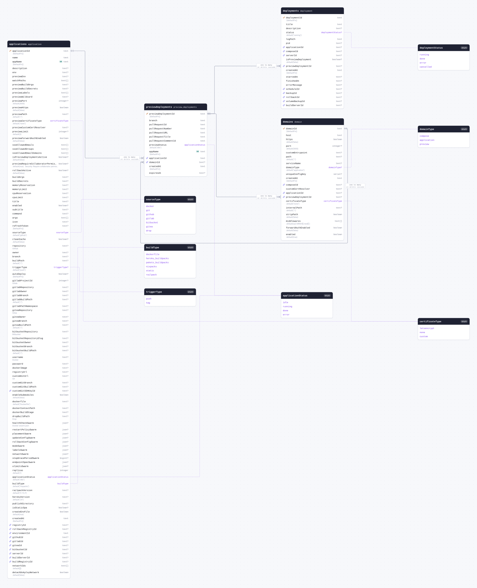

| Column                 | Type                                           | Constraints                                                  | Default            | Description |
| ---------------------- | ---------------------------------------------- | ------------------------------------------------------------ | ------------------ | ----------- |
| `previewDeploymentId`  | `text`                                         | PK NOT NULL                                                  | `.$defaultFn()`    |             |
| `branch`               | `text`                                         | NOT NULL                                                     |                    |             |
| `pullRequestId`        | `text`                                         | NOT NULL                                                     |                    |             |
| `pullRequestNumber`    | `text`                                         | NOT NULL                                                     |                    |             |
| `pullRequestURL`       | `text`                                         | NOT NULL                                                     |                    |             |
| `pullRequestTitle`     | `text`                                         | NOT NULL                                                     |                    |             |
| `pullRequestCommentId` | `text`                                         | NOT NULL                                                     |                    |             |
| `previewStatus`        | [`applicationStatus`](#enum-applicationStatus) | NOT NULL                                                     | `.default("idle")` |             |
| `appName`              | `text`                                         | UNIQUE NOT NULL                                              | `.$defaultFn()`    |             |
| `applicationId`        | `text`                                         | NOT NULL → [applications.applicationId](#table-applications) |                    |             |
| `domainId`             | `text`                                         | NULL → [domains.domainId](#table-domains)                    |                    |             |
| `createdAt`            | `text`                                         | NOT NULL                                                     | `.$defaultFn()`    |             |
| `expiresAt`            | `text`                                         | NULL                                                         |                    |             |

#### Definition

```sql
CREATE TABLE "preview_deployments" (
	"previewDeploymentId" text PRIMARY KEY,
	"branch" text NOT NULL,
	"pullRequestId" text NOT NULL,
	"pullRequestNumber" text NOT NULL,
	"pullRequestURL" text NOT NULL,
	"pullRequestTitle" text NOT NULL,
	"pullRequestCommentId" text NOT NULL,
	"previewStatus" "applicationStatus" DEFAULT 'idle'::"applicationStatus" NOT NULL,
	"appName" text NOT NULL UNIQUE,
	"applicationId" text NOT NULL,
	"domainId" text,
	"createdAt" text NOT NULL,
	"expiresAt" text
);

ALTER TABLE "preview_deployments" ADD CONSTRAINT "preview_deployments_dpBlPQiG4uoW_fkey" FOREIGN KEY ("applicationId") REFERENCES "application"("applicationId") ON DELETE CASCADE;

ALTER TABLE "preview_deployments" ADD CONSTRAINT "preview_deployments_domainId_domain_domainId_fkey" FOREIGN KEY ("domainId") REFERENCES "domain"("domainId") ON DELETE CASCADE;
```

#### References

- `applicationId` → [applications.applicationId](#table-applications) (many to one, on delete cascade)
- `domainId` → [domains.domainId](#table-domains) (many to one, on delete cascade)

#### Referenced by

- `previewDeploymentId` → [deployments.previewDeploymentId](#table-deployments) (one to many, on delete cascade)
- `previewDeploymentId` → [domains.previewDeploymentId](#table-domains) (one to many, on delete cascade)

<details>
<summary>Queries and their SQL</summary>

**Select**: Every row of previewDeployments.

```ts
db.select().from(previewDeployments);
```

```sql
select "previewDeploymentId", "branch", "pullRequestId", "pullRequestNumber", "pullRequestURL", "pullRequestTitle", "pullRequestCommentId", "previewStatus", "appName", "applicationId", "domainId", "createdAt", "expiresAt"
from "preview_deployments"
```

**Count**: How many rows previewDeployments has.

```ts
db.select({ count: count() }).from(previewDeployments);
```

```sql
select count(*)
from "preview_deployments"
```

**Find many**: The rows of previewDeployments, through the relational query API.

```ts
db.query.previewDeployments.findMany();
```

```sql
select "d0"."previewDeploymentId" as "previewDeploymentId", "d0"."branch" as "branch", "d0"."pullRequestId" as "pullRequestId", "d0"."pullRequestNumber" as "pullRequestNumber", "d0"."pullRequestURL" as "pullRequestURL", "d0"."pullRequestTitle" as "pullRequestTitle", "d0"."pullRequestCommentId" as "pullRequestCommentId", "d0"."previewStatus" as "previewStatus", "d0"."appName" as "appName", "d0"."applicationId" as "applicationId", "d0"."domainId" as "domainId", "d0"."createdAt" as "createdAt", "d0"."expiresAt" as "expiresAt"
from "preview_deployments" as "d0"
```

**Find by primary key**: One row of previewDeployments, through the relational query API.

```ts
db.query.previewDeployments.findFirst({ where: { previewDeploymentId: "previewDeploymentId" } });
```

```sql
select "d0"."previewDeploymentId" as "previewDeploymentId", "d0"."branch" as "branch", "d0"."pullRequestId" as "pullRequestId", "d0"."pullRequestNumber" as "pullRequestNumber", "d0"."pullRequestURL" as "pullRequestURL", "d0"."pullRequestTitle" as "pullRequestTitle", "d0"."pullRequestCommentId" as "pullRequestCommentId", "d0"."previewStatus" as "previewStatus", "d0"."appName" as "appName", "d0"."applicationId" as "applicationId", "d0"."domainId" as "domainId", "d0"."createdAt" as "createdAt", "d0"."expiresAt" as "expiresAt"
from "preview_deployments" as "d0"
where "d0"."previewDeploymentId" = $1
limit $2
-- params: ["previewDeploymentId",1]
```

**Insert**: Adds a row to previewDeployments, giving the columns that have no default.

```ts
db.insert(previewDeployments).values({
  branch: "branch",
  pullRequestId: "pullRequestId",
  pullRequestNumber: "pullRequestNumber",
  pullRequestURL: "pullRequestURL",
  pullRequestTitle: "pullRequestTitle",
  pullRequestCommentId: "pullRequestCommentId",
  applicationId: "applicationId",
});
```

```sql
insert into "preview_deployments" ("previewDeploymentId", "branch", "pullRequestId", "pullRequestNumber", "pullRequestURL", "pullRequestTitle", "pullRequestCommentId", "previewStatus", "appName", "applicationId", "domainId", "createdAt", "expiresAt")
values ($1, $2, $3, $4, $5, $6, $7, default, $8, $9, default, $10, default)
-- params: ["uuuuuuuuuuuuuuuuuuuuu","branch","pullRequestId","pullRequestNumber","pullRequestURL","pullRequestTitle","pullRequestCommentId","preview-transmit-neural-feed-aaaaaa","applicationId","2026-01-01T00:00:00.000Z"]
```

**Update**: Changes a row of previewDeployments, found by its primary key.

```ts
db.update(previewDeployments)
  .set({ branch: "branch" })
  .where(eq(previewDeployments.previewDeploymentId, "previewDeploymentId"));
```

```sql
update "preview_deployments"
set "branch" = $1
where "preview_deployments"."previewDeploymentId" = $2
-- params: ["branch","previewDeploymentId"]
```

**Delete**: Deletes a row of previewDeployments, found by its primary key.

```ts
db.delete(previewDeployments).where(
  eq(previewDeployments.previewDeploymentId, "previewDeploymentId"),
);
```

```sql
delete from "preview_deployments"
where "preview_deployments"."previewDeploymentId" = $1
-- params: ["previewDeploymentId"]
```

</details>

<a id="table-projects"></a>

### projects

Table `project`.

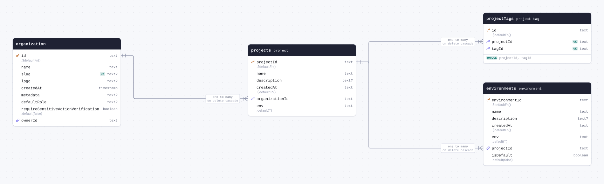

| Column           | Type   | Constraints                                       | Default         | Description |
| ---------------- | ------ | ------------------------------------------------- | --------------- | ----------- |
| `projectId`      | `text` | PK NOT NULL                                       | `.$defaultFn()` |             |
| `name`           | `text` | NOT NULL                                          |                 |             |
| `description`    | `text` | NULL                                              |                 |             |
| `createdAt`      | `text` | NOT NULL                                          | `.$defaultFn()` |             |
| `organizationId` | `text` | NOT NULL → [organization.id](#table-organization) |                 |             |
| `env`            | `text` | NOT NULL                                          | `.default("")`  |             |

#### Definition

```sql
CREATE TABLE "project" (
	"projectId" text PRIMARY KEY,
	"name" text NOT NULL,
	"description" text,
	"createdAt" text NOT NULL,
	"organizationId" text NOT NULL,
	"env" text DEFAULT '' NOT NULL
);

ALTER TABLE "project" ADD CONSTRAINT "project_organizationId_organization_id_fkey" FOREIGN KEY ("organizationId") REFERENCES "organization"("id") ON DELETE CASCADE;
```

#### References

- `organizationId` → [organization.id](#table-organization) (many to one, on delete cascade)

#### Referenced by

- `projectId` → [environments.projectId](#table-environments) (one to many, on delete cascade)
- `projectId` → [projectTags.projectId](#table-projectTags) (one to many, on delete cascade)

<details>
<summary>Queries and their SQL</summary>

**Select**: Every row of projects.

```ts
db.select().from(projects);
```

```sql
select "projectId", "name", "description", "createdAt", "organizationId", "env"
from "project"
```

**Count**: How many rows projects has.

```ts
db.select({ count: count() }).from(projects);
```

```sql
select count(*)
from "project"
```

**Find many**: The rows of projects, through the relational query API.

```ts
db.query.projects.findMany();
```

```sql
select "d0"."projectId" as "projectId", "d0"."name" as "name", "d0"."description" as "description", "d0"."createdAt" as "createdAt", "d0"."organizationId" as "organizationId", "d0"."env" as "env"
from "project" as "d0"
```

**Find by primary key**: One row of projects, through the relational query API.

```ts
db.query.projects.findFirst({ where: { projectId: "projectId" } });
```

```sql
select "d0"."projectId" as "projectId", "d0"."name" as "name", "d0"."description" as "description", "d0"."createdAt" as "createdAt", "d0"."organizationId" as "organizationId", "d0"."env" as "env"
from "project" as "d0"
where "d0"."projectId" = $1
limit $2
-- params: ["projectId",1]
```

**Insert**: Adds a row to projects, giving the columns that have no default.

```ts
db.insert(projects).values({ name: "name", organizationId: "organizationId" });
```

```sql
insert into "project" ("projectId", "name", "description", "createdAt", "organizationId", "env")
values ($1, $2, default, $3, $4, default)
-- params: ["uuuuuuuuuuuuuuuuuuuuu","name","2026-01-01T00:00:00.000Z","organizationId"]
```

**Update**: Changes a row of projects, found by its primary key.

```ts
db.update(projects).set({ name: "name" }).where(eq(projects.projectId, "projectId"));
```

```sql
update "project"
set "name" = $1
where "project"."projectId" = $2
-- params: ["name","projectId"]
```

**Delete**: Deletes a row of projects, found by its primary key.

```ts
db.delete(projects).where(eq(projects.projectId, "projectId"));
```

```sql
delete from "project"
where "project"."projectId" = $1
-- params: ["projectId"]
```

</details>

<a id="table-redirects"></a>

### redirects

Table `redirect`.

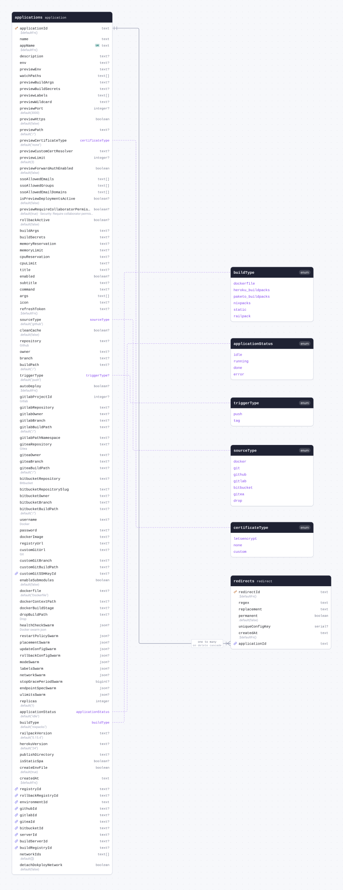

| Column            | Type      | Constraints                                                  | Default           | Description |
| ----------------- | --------- | ------------------------------------------------------------ | ----------------- | ----------- |
| `redirectId`      | `text`    | PK NOT NULL                                                  | `.$defaultFn()`   |             |
| `regex`           | `text`    | NOT NULL                                                     |                   |             |
| `replacement`     | `text`    | NOT NULL                                                     |                   |             |
| `permanent`       | `boolean` | NOT NULL                                                     | `.default(false)` |             |
| `uniqueConfigKey` | `serial`  | NULL                                                         |                   |             |
| `createdAt`       | `text`    | NOT NULL                                                     | `.$defaultFn()`   |             |
| `applicationId`   | `text`    | NOT NULL → [applications.applicationId](#table-applications) |                   |             |

#### Definition

```sql
CREATE TABLE "redirect" (
	"redirectId" text PRIMARY KEY,
	"regex" text NOT NULL,
	"replacement" text NOT NULL,
	"permanent" boolean DEFAULT false NOT NULL,
	"uniqueConfigKey" serial,
	"createdAt" text NOT NULL,
	"applicationId" text NOT NULL
);

ALTER TABLE "redirect" ADD CONSTRAINT "redirect_applicationId_application_applicationId_fkey" FOREIGN KEY ("applicationId") REFERENCES "application"("applicationId") ON DELETE CASCADE;
```

#### References

- `applicationId` → [applications.applicationId](#table-applications) (many to one, on delete cascade)

<details>
<summary>Queries and their SQL</summary>

**Select**: Every row of redirects.

```ts
db.select().from(redirects);
```

```sql
select "redirectId", "regex", "replacement", "permanent", "uniqueConfigKey", "createdAt", "applicationId"
from "redirect"
```

**Count**: How many rows redirects has.

```ts
db.select({ count: count() }).from(redirects);
```

```sql
select count(*)
from "redirect"
```

**Find many**: The rows of redirects, through the relational query API.

```ts
db.query.redirects.findMany();
```

```sql
select "d0"."redirectId" as "redirectId", "d0"."regex" as "regex", "d0"."replacement" as "replacement", "d0"."permanent" as "permanent", "d0"."uniqueConfigKey" as "uniqueConfigKey", "d0"."createdAt" as "createdAt", "d0"."applicationId" as "applicationId"
from "redirect" as "d0"
```

**Find by primary key**: One row of redirects, through the relational query API.

```ts
db.query.redirects.findFirst({ where: { redirectId: "redirectId" } });
```

```sql
select "d0"."redirectId" as "redirectId", "d0"."regex" as "regex", "d0"."replacement" as "replacement", "d0"."permanent" as "permanent", "d0"."uniqueConfigKey" as "uniqueConfigKey", "d0"."createdAt" as "createdAt", "d0"."applicationId" as "applicationId"
from "redirect" as "d0"
where "d0"."redirectId" = $1
limit $2
-- params: ["redirectId",1]
```

**Insert**: Adds a row to redirects, giving the columns that have no default.

```ts
db.insert(redirects).values({
  regex: "regex",
  replacement: "replacement",
  applicationId: "applicationId",
});
```

```sql
insert into "redirect" ("redirectId", "regex", "replacement", "permanent", "uniqueConfigKey", "createdAt", "applicationId")
values ($1, $2, $3, default, default, $4, $5)
-- params: ["uuuuuuuuuuuuuuuuuuuuu","regex","replacement","2026-01-01T00:00:00.000Z","applicationId"]
```

**Update**: Changes a row of redirects, found by its primary key.

```ts
db.update(redirects).set({ regex: "regex" }).where(eq(redirects.redirectId, "redirectId"));
```

```sql
update "redirect"
set "regex" = $1
where "redirect"."redirectId" = $2
-- params: ["regex","redirectId"]
```

**Delete**: Deletes a row of redirects, found by its primary key.

```ts
db.delete(redirects).where(eq(redirects.redirectId, "redirectId"));
```

```sql
delete from "redirect"
where "redirect"."redirectId" = $1
-- params: ["redirectId"]
```

</details>

<a id="table-redis"></a>

### redis

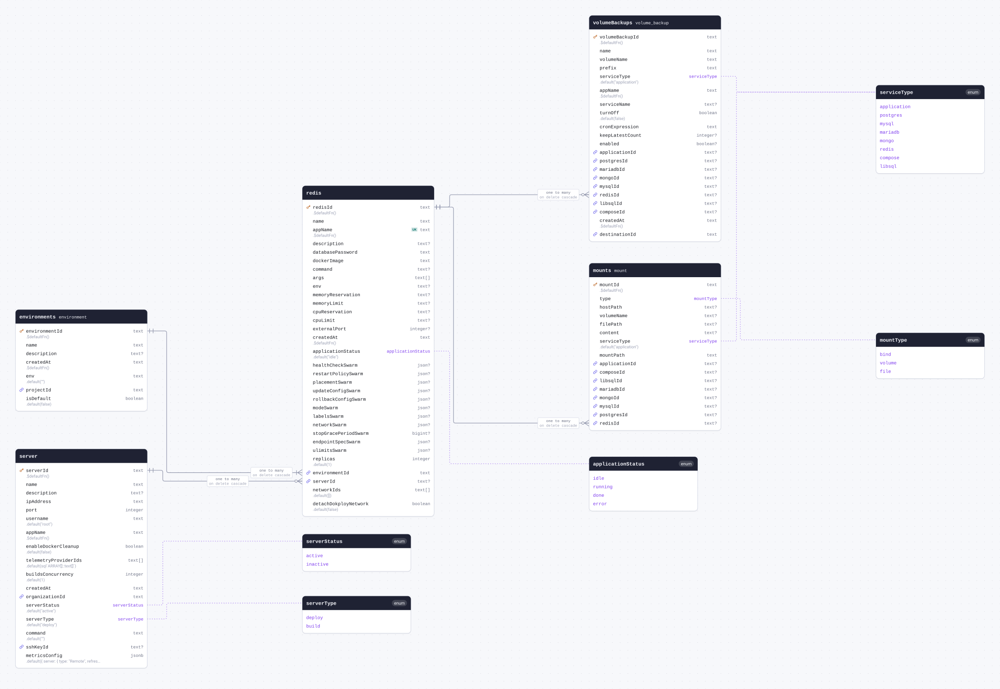

| Column                          | Type                                           | Constraints                                                  | Default            | Description |
| ------------------------------- | ---------------------------------------------- | ------------------------------------------------------------ | ------------------ | ----------- |
| `redisId`                       | `text`                                         | PK NOT NULL                                                  | `.$defaultFn()`    |             |
| `name`                          | `text`                                         | NOT NULL                                                     |                    |             |
| `appName`                       | `text`                                         | UNIQUE NOT NULL                                              | `.$defaultFn()`    |             |
| `description`                   | `text`                                         | NULL                                                         |                    |             |
| `databasePassword` (`password`) | `text`                                         | NOT NULL                                                     |                    |             |
| `dockerImage`                   | `text`                                         | NOT NULL                                                     |                    |             |
| `command`                       | `text`                                         | NULL                                                         |                    |             |
| `args`                          | `text[]`                                       | NULL                                                         |                    |             |
| `env`                           | `text`                                         | NULL                                                         |                    |             |
| `memoryReservation`             | `text`                                         | NULL                                                         |                    |             |
| `memoryLimit`                   | `text`                                         | NULL                                                         |                    |             |
| `cpuReservation`                | `text`                                         | NULL                                                         |                    |             |
| `cpuLimit`                      | `text`                                         | NULL                                                         |                    |             |
| `externalPort`                  | `integer`                                      | NULL                                                         |                    |             |
| `createdAt`                     | `text`                                         | NOT NULL                                                     | `.$defaultFn()`    |             |
| `applicationStatus`             | [`applicationStatus`](#enum-applicationStatus) | NOT NULL                                                     | `.default("idle")` |             |
| `healthCheckSwarm`              | `json`                                         | NULL                                                         |                    |             |
| `restartPolicySwarm`            | `json`                                         | NULL                                                         |                    |             |
| `placementSwarm`                | `json`                                         | NULL                                                         |                    |             |
| `updateConfigSwarm`             | `json`                                         | NULL                                                         |                    |             |
| `rollbackConfigSwarm`           | `json`                                         | NULL                                                         |                    |             |
| `modeSwarm`                     | `json`                                         | NULL                                                         |                    |             |
| `labelsSwarm`                   | `json`                                         | NULL                                                         |                    |             |
| `networkSwarm`                  | `json`                                         | NULL                                                         |                    |             |
| `stopGracePeriodSwarm`          | `bigint`                                       | NULL                                                         |                    |             |
| `endpointSpecSwarm`             | `json`                                         | NULL                                                         |                    |             |
| `ulimitsSwarm`                  | `json`                                         | NULL                                                         |                    |             |
| `replicas`                      | `integer`                                      | NOT NULL                                                     | `.default(1)`      |             |
| `environmentId`                 | `text`                                         | NOT NULL → [environments.environmentId](#table-environments) |                    |             |
| `serverId`                      | `text`                                         | NULL → [server.serverId](#table-server)                      |                    |             |
| `networkIds`                    | `text[]`                                       | NULL                                                         | `.default([])`     |             |
| `detachDokployNetwork`          | `boolean`                                      | NOT NULL                                                     | `.default(false)`  |             |

#### Definition

```sql
CREATE TABLE "redis" (
	"redisId" text PRIMARY KEY,
	"name" text NOT NULL,
	"appName" text NOT NULL UNIQUE,
	"description" text,
	"password" text NOT NULL,
	"dockerImage" text NOT NULL,
	"command" text,
	"args" text[],
	"env" text,
	"memoryReservation" text,
	"memoryLimit" text,
	"cpuReservation" text,
	"cpuLimit" text,
	"externalPort" integer,
	"createdAt" text NOT NULL,
	"applicationStatus" "applicationStatus" DEFAULT 'idle'::"applicationStatus" NOT NULL,
	"healthCheckSwarm" json,
	"restartPolicySwarm" json,
	"placementSwarm" json,
	"updateConfigSwarm" json,
	"rollbackConfigSwarm" json,
	"modeSwarm" json,
	"labelsSwarm" json,
	"networkSwarm" json,
	"stopGracePeriodSwarm" bigint,
	"endpointSpecSwarm" json,
	"ulimitsSwarm" json,
	"replicas" integer DEFAULT 1 NOT NULL,
	"environmentId" text NOT NULL,
	"serverId" text,
	"networkIds" text[] DEFAULT '{}'::text[],
	"detachDokployNetwork" boolean DEFAULT false NOT NULL
);

ALTER TABLE "redis" ADD CONSTRAINT "redis_environmentId_environment_environmentId_fkey" FOREIGN KEY ("environmentId") REFERENCES "environment"("environmentId") ON DELETE CASCADE;

ALTER TABLE "redis" ADD CONSTRAINT "redis_serverId_server_serverId_fkey" FOREIGN KEY ("serverId") REFERENCES "server"("serverId") ON DELETE CASCADE;
```

#### References

- `environmentId` → [environments.environmentId](#table-environments) (many to one, on delete cascade)
- `serverId` → [server.serverId](#table-server) (many to one, on delete cascade)

#### Referenced by

- `redisId` → [mounts.redisId](#table-mounts) (one to many, on delete cascade)
- `redisId` → [volumeBackups.redisId](#table-volumeBackups) (one to many, on delete cascade)

<details>
<summary>Queries and their SQL</summary>

**Select**: Every row of redis.

```ts
db.select().from(redis);
```

```sql
select "redisId", "name", "appName", "description", "password", "dockerImage", "command", "args", "env", "memoryReservation", "memoryLimit", "cpuReservation", "cpuLimit", "externalPort", "createdAt", "applicationStatus", "healthCheckSwarm", "restartPolicySwarm", "placementSwarm", "updateConfigSwarm", "rollbackConfigSwarm", "modeSwarm", "labelsSwarm", "networkSwarm", "stopGracePeriodSwarm", "endpointSpecSwarm", "ulimitsSwarm", "replicas", "environmentId", "serverId", "networkIds", "detachDokployNetwork"
from "redis"
```

**Count**: How many rows redis has.

```ts
db.select({ count: count() }).from(redis);
```

```sql
select count(*)
from "redis"
```

**Find many**: The rows of redis, through the relational query API.

```ts
db.query.redis.findMany();
```

```sql
select "d0"."redisId" as "redisId", "d0"."name" as "name", "d0"."appName" as "appName", "d0"."description" as "description", "d0"."password" as "databasePassword", "d0"."dockerImage" as "dockerImage", "d0"."command" as "command", "d0"."args" as "args", "d0"."env" as "env", "d0"."memoryReservation" as "memoryReservation", "d0"."memoryLimit" as "memoryLimit", "d0"."cpuReservation" as "cpuReservation", "d0"."cpuLimit" as "cpuLimit", "d0"."externalPort" as "externalPort", "d0"."createdAt" as "createdAt", "d0"."applicationStatus" as "applicationStatus", "d0"."healthCheckSwarm" as "healthCheckSwarm", "d0"."restartPolicySwarm" as "restartPolicySwarm", "d0"."placementSwarm" as "placementSwarm", "d0"."updateConfigSwarm" as "updateConfigSwarm", "d0"."rollbackConfigSwarm" as "rollbackConfigSwarm", "d0"."modeSwarm" as "modeSwarm", "d0"."labelsSwarm" as "labelsSwarm", "d0"."networkSwarm" as "networkSwarm", "d0"."stopGracePeriodSwarm" as "stopGracePeriodSwarm", "d0"."endpointSpecSwarm" as "endpointSpecSwarm", "d0"."ulimitsSwarm" as "ulimitsSwarm", "d0"."replicas" as "replicas", "d0"."environmentId" as "environmentId", "d0"."serverId" as "serverId", "d0"."networkIds" as "networkIds", "d0"."detachDokployNetwork" as "detachDokployNetwork"
from "redis" as "d0"
```

**Find by primary key**: One row of redis, through the relational query API.

```ts
db.query.redis.findFirst({ where: { redisId: "redisId" } });
```

```sql
select "d0"."redisId" as "redisId", "d0"."name" as "name", "d0"."appName" as "appName", "d0"."description" as "description", "d0"."password" as "databasePassword", "d0"."dockerImage" as "dockerImage", "d0"."command" as "command", "d0"."args" as "args", "d0"."env" as "env", "d0"."memoryReservation" as "memoryReservation", "d0"."memoryLimit" as "memoryLimit", "d0"."cpuReservation" as "cpuReservation", "d0"."cpuLimit" as "cpuLimit", "d0"."externalPort" as "externalPort", "d0"."createdAt" as "createdAt", "d0"."applicationStatus" as "applicationStatus", "d0"."healthCheckSwarm" as "healthCheckSwarm", "d0"."restartPolicySwarm" as "restartPolicySwarm", "d0"."placementSwarm" as "placementSwarm", "d0"."updateConfigSwarm" as "updateConfigSwarm", "d0"."rollbackConfigSwarm" as "rollbackConfigSwarm", "d0"."modeSwarm" as "modeSwarm", "d0"."labelsSwarm" as "labelsSwarm", "d0"."networkSwarm" as "networkSwarm", "d0"."stopGracePeriodSwarm" as "stopGracePeriodSwarm", "d0"."endpointSpecSwarm" as "endpointSpecSwarm", "d0"."ulimitsSwarm" as "ulimitsSwarm", "d0"."replicas" as "replicas", "d0"."environmentId" as "environmentId", "d0"."serverId" as "serverId", "d0"."networkIds" as "networkIds", "d0"."detachDokployNetwork" as "detachDokployNetwork"
from "redis" as "d0"
where "d0"."redisId" = $1
limit $2
-- params: ["redisId",1]
```

**Insert**: Adds a row to redis, giving the columns that have no default.

```ts
db.insert(redis).values({
  name: "name",
  databasePassword: "databasePassword",
  dockerImage: "dockerImage",
  environmentId: "environmentId",
});
```

```sql
insert into "redis" ("redisId", "name", "appName", "description", "password", "dockerImage", "command", "args", "env", "memoryReservation", "memoryLimit", "cpuReservation", "cpuLimit", "externalPort", "createdAt", "applicationStatus", "healthCheckSwarm", "restartPolicySwarm", "placementSwarm", "updateConfigSwarm", "rollbackConfigSwarm", "modeSwarm", "labelsSwarm", "networkSwarm", "stopGracePeriodSwarm", "endpointSpecSwarm", "ulimitsSwarm", "replicas", "environmentId", "serverId", "networkIds", "detachDokployNetwork")
values ($1, $2, $3, default, $4, $5, default, default, default, default, default, default, default, default, $6, default, default, default, default, default, default, default, default, default, default, default, default, default, $7, default, default, default)
-- params: ["uuuuuuuuuuuuuuuuuuuuu","name","redis-connect-primary-firewall-aaaaaa","databasePassword","dockerImage","2026-01-01T00:00:00.000Z","environmentId"]
```

**Update**: Changes a row of redis, found by its primary key.

```ts
db.update(redis).set({ name: "name" }).where(eq(redis.redisId, "redisId"));
```

```sql
update "redis"
set "name" = $1
where "redis"."redisId" = $2
-- params: ["name","redisId"]
```

**Delete**: Deletes a row of redis, found by its primary key.

```ts
db.delete(redis).where(eq(redis.redisId, "redisId"));
```

```sql
delete from "redis"
where "redis"."redisId" = $1
-- params: ["redisId"]
```

</details>

<a id="table-registry"></a>

### registry

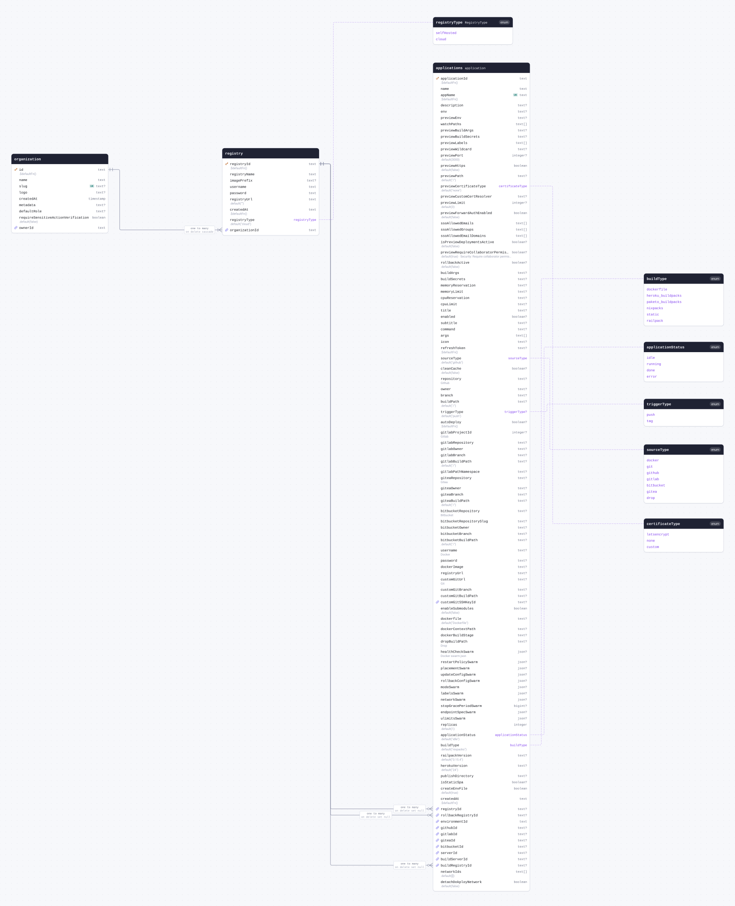

| Column                        | Type                                 | Constraints                                       | Default             | Description |
| ----------------------------- | ------------------------------------ | ------------------------------------------------- | ------------------- | ----------- |
| `registryId`                  | `text`                               | PK NOT NULL                                       | `.$defaultFn()`     |             |
| `registryName`                | `text`                               | NOT NULL                                          |                     |             |
| `imagePrefix`                 | `text`                               | NULL                                              |                     |             |
| `username`                    | `text`                               | NOT NULL                                          |                     |             |
| `password`                    | `text`                               | NOT NULL                                          |                     |             |
| `registryUrl`                 | `text`                               | NOT NULL                                          | `.default("")`      |             |
| `createdAt`                   | `text`                               | NOT NULL                                          | `.$defaultFn()`     |             |
| `registryType` (`selfHosted`) | [`registryType`](#enum-registryType) | NOT NULL                                          | `.default("cloud")` |             |
| `organizationId`              | `text`                               | NOT NULL → [organization.id](#table-organization) |                     |             |

#### Definition

```sql
CREATE TABLE "registry" (
	"registryId" text PRIMARY KEY,
	"registryName" text NOT NULL,
	"imagePrefix" text,
	"username" text NOT NULL,
	"password" text NOT NULL,
	"registryUrl" text DEFAULT '' NOT NULL,
	"createdAt" text NOT NULL,
	"selfHosted" "RegistryType" DEFAULT 'cloud'::"RegistryType" NOT NULL,
	"organizationId" text NOT NULL
);

ALTER TABLE "registry" ADD CONSTRAINT "registry_organizationId_organization_id_fkey" FOREIGN KEY ("organizationId") REFERENCES "organization"("id") ON DELETE CASCADE;
```

#### References

- `organizationId` → [organization.id](#table-organization) (many to one, on delete cascade)

#### Referenced by

- `registryId` → [applications.registryId](#table-applications) (one to many, on delete set null)
- `registryId` → [applications.rollbackRegistryId](#table-applications) (one to many, on delete set null)
- `registryId` → [applications.buildRegistryId](#table-applications) (one to many, on delete set null)

<details>
<summary>Queries and their SQL</summary>

**Select**: Every row of registry.

```ts
db.select().from(registry);
```

```sql
select "registryId", "registryName", "imagePrefix", "username", "password", "registryUrl", "createdAt", "selfHosted", "organizationId"
from "registry"
```

**Count**: How many rows registry has.

```ts
db.select({ count: count() }).from(registry);
```

```sql
select count(*)
from "registry"
```

**Find many**: The rows of registry, through the relational query API.

```ts
db.query.registry.findMany();
```

```sql
select "d0"."registryId" as "registryId", "d0"."registryName" as "registryName", "d0"."imagePrefix" as "imagePrefix", "d0"."username" as "username", "d0"."password" as "password", "d0"."registryUrl" as "registryUrl", "d0"."createdAt" as "createdAt", "d0"."selfHosted" as "registryType", "d0"."organizationId" as "organizationId"
from "registry" as "d0"
```

**Find by primary key**: One row of registry, through the relational query API.

```ts
db.query.registry.findFirst({ where: { registryId: "registryId" } });
```

```sql
select "d0"."registryId" as "registryId", "d0"."registryName" as "registryName", "d0"."imagePrefix" as "imagePrefix", "d0"."username" as "username", "d0"."password" as "password", "d0"."registryUrl" as "registryUrl", "d0"."createdAt" as "createdAt", "d0"."selfHosted" as "registryType", "d0"."organizationId" as "organizationId"
from "registry" as "d0"
where "d0"."registryId" = $1
limit $2
-- params: ["registryId",1]
```

**Insert**: Adds a row to registry, giving the columns that have no default.

```ts
db.insert(registry).values({
  registryName: "registryName",
  username: "username",
  password: "password",
  organizationId: "organizationId",
});
```

```sql
insert into "registry" ("registryId", "registryName", "imagePrefix", "username", "password", "registryUrl", "createdAt", "selfHosted", "organizationId")
values ($1, $2, default, $3, $4, default, $5, default, $6)
-- params: ["uuuuuuuuuuuuuuuuuuuuu","registryName","username","password","2026-01-01T00:00:00.000Z","organizationId"]
```

**Update**: Changes a row of registry, found by its primary key.

```ts
db.update(registry)
  .set({ registryName: "registryName" })
  .where(eq(registry.registryId, "registryId"));
```

```sql
update "registry"
set "registryName" = $1
where "registry"."registryId" = $2
-- params: ["registryName","registryId"]
```

**Delete**: Deletes a row of registry, found by its primary key.

```ts
db.delete(registry).where(eq(registry.registryId, "registryId"));
```

```sql
delete from "registry"
where "registry"."registryId" = $1
-- params: ["registryId"]
```

</details>

<a id="table-rollbacks"></a>

### rollbacks

Table `rollback`.

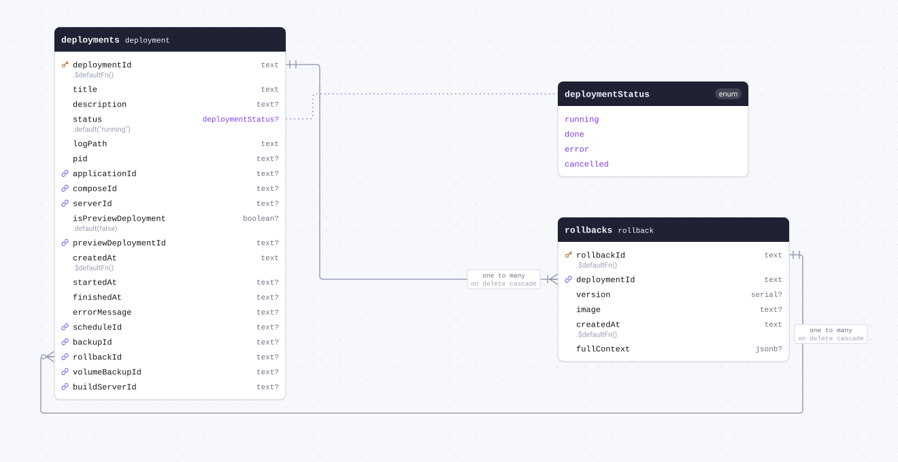

| Column         | Type     | Constraints                                               | Default         | Description |
| -------------- | -------- | --------------------------------------------------------- | --------------- | ----------- |
| `rollbackId`   | `text`   | PK NOT NULL                                               | `.$defaultFn()` |             |
| `deploymentId` | `text`   | NOT NULL → [deployments.deploymentId](#table-deployments) |                 |             |
| `version`      | `serial` | NULL                                                      |                 |             |
| `image`        | `text`   | NULL                                                      |                 |             |
| `createdAt`    | `text`   | NOT NULL                                                  | `.$defaultFn()` |             |
| `fullContext`  | `jsonb`  | NULL                                                      |                 |             |

#### Definition

```sql
CREATE TABLE "rollback" (
	"rollbackId" text PRIMARY KEY,
	"deploymentId" text NOT NULL,
	"version" serial,
	"image" text,
	"createdAt" text NOT NULL,
	"fullContext" jsonb
);

ALTER TABLE "rollback" ADD CONSTRAINT "rollback_deploymentId_deployment_deploymentId_fkey" FOREIGN KEY ("deploymentId") REFERENCES "deployment"("deploymentId") ON DELETE CASCADE;
```

#### References

- `deploymentId` → [deployments.deploymentId](#table-deployments) (many to one, on delete cascade)

#### Referenced by

- `rollbackId` → [deployments.rollbackId](#table-deployments) (one to many, on delete cascade)

<details>
<summary>Queries and their SQL</summary>

**Select**: Every row of rollbacks.

```ts
db.select().from(rollbacks);
```

```sql
select "rollbackId", "deploymentId", "version", "image", "createdAt", "fullContext"
from "rollback"
```

**Count**: How many rows rollbacks has.

```ts
db.select({ count: count() }).from(rollbacks);
```

```sql
select count(*)
from "rollback"
```

**Find many**: The rows of rollbacks, through the relational query API.

```ts
db.query.rollbacks.findMany();
```

```sql
select "d0"."rollbackId" as "rollbackId", "d0"."deploymentId" as "deploymentId", "d0"."version" as "version", "d0"."image" as "image", "d0"."createdAt" as "createdAt", "d0"."fullContext" as "fullContext"
from "rollback" as "d0"
```

**Find by primary key**: One row of rollbacks, through the relational query API.

```ts
db.query.rollbacks.findFirst({ where: { rollbackId: "rollbackId" } });
```

```sql
select "d0"."rollbackId" as "rollbackId", "d0"."deploymentId" as "deploymentId", "d0"."version" as "version", "d0"."image" as "image", "d0"."createdAt" as "createdAt", "d0"."fullContext" as "fullContext"
from "rollback" as "d0"
where "d0"."rollbackId" = $1
limit $2
-- params: ["rollbackId",1]
```

**Insert**: Adds a row to rollbacks, giving the columns that have no default.

```ts
db.insert(rollbacks).values({ deploymentId: "deploymentId" });
```

```sql
insert into "rollback" ("rollbackId", "deploymentId", "version", "image", "createdAt", "fullContext")
values ($1, $2, default, default, $3, default)
-- params: ["uuuuuuuuuuuuuuuuuuuuu","deploymentId","2026-01-01T00:00:00.000Z"]
```

**Update**: Changes a row of rollbacks, found by its primary key.

```ts
db.update(rollbacks)
  .set({ deploymentId: "deploymentId" })
  .where(eq(rollbacks.rollbackId, "rollbackId"));
```

```sql
update "rollback"
set "deploymentId" = $1
where "rollback"."rollbackId" = $2
-- params: ["deploymentId","rollbackId"]
```

**Delete**: Deletes a row of rollbacks, found by its primary key.

```ts
db.delete(rollbacks).where(eq(rollbacks.rollbackId, "rollbackId"));
```

```sql
delete from "rollback"
where "rollback"."rollbackId" = $1
-- params: ["rollbackId"]
```

</details>

<a id="table-sandboxes"></a>

### sandboxes

Table `sandbox`.

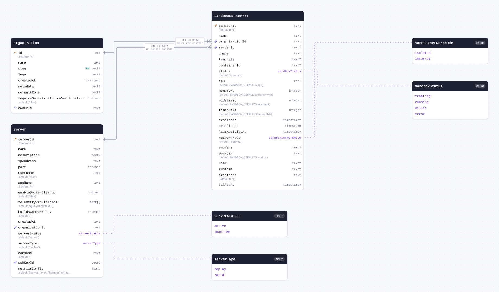

| Column           | Type                                             | Constraints                                       | Default                                | Description |
| ---------------- | ------------------------------------------------ | ------------------------------------------------- | -------------------------------------- | ----------- |
| `sandboxId`      | `text`                                           | PK NOT NULL                                       | `.$defaultFn()`                        |             |
| `name`           | `text`                                           | NOT NULL                                          |                                        |             |
| `organizationId` | `text`                                           | NOT NULL → [organization.id](#table-organization) |                                        |             |
| `serverId`       | `text`                                           | NULL → [server.serverId](#table-server)           |                                        |             |
| `image`          | `text`                                           | NOT NULL                                          |                                        |             |
| `template`       | `text`                                           | NULL                                              |                                        |             |
| `containerId`    | `text`                                           | NULL                                              |                                        |             |
| `status`         | [`sandboxStatus`](#enum-sandboxStatus)           | NOT NULL                                          | `.default("creating")`                 |             |
| `cpu`            | `real`                                           | NOT NULL                                          | `.default(SANDBOX_DEFAULTS.cpu)`       |             |
| `memoryMb`       | `integer`                                        | NOT NULL                                          | `.default(SANDBOX_DEFAULTS.memoryMb)`  |             |
| `pidsLimit`      | `integer`                                        | NOT NULL                                          | `.default(SANDBOX_DEFAULTS.pidsLimit)` |             |
| `timeoutMs`      | `integer`                                        | NOT NULL                                          | `.default(SANDBOX_DEFAULTS.timeoutMs)` |             |
| `expiresAt`      | `timestamp`                                      | NULL                                              |                                        |             |
| `deadlineAt`     | `timestamp`                                      | NOT NULL                                          |                                        |             |
| `lastActivityAt` | `timestamp`                                      | NULL                                              |                                        |             |
| `networkMode`    | [`sandboxNetworkMode`](#enum-sandboxNetworkMode) | NOT NULL                                          | `.default("isolated")`                 |             |
| `envVars`        | `text`                                           | NULL                                              |                                        |             |
| `workdir`        | `text`                                           | NOT NULL                                          | `.default(SANDBOX_DEFAULTS.workdir)`   |             |
| `user`           | `text`                                           | NULL                                              |                                        |             |
| `runtime`        | `text`                                           | NULL                                              |                                        |             |
| `createdAt`      | `text`                                           | NOT NULL                                          | `.$defaultFn()`                        |             |
| `killedAt`       | `timestamp`                                      | NULL                                              |                                        |             |

#### Definition

```sql
CREATE TABLE "sandbox" (
	"sandboxId" text PRIMARY KEY,
	"name" text NOT NULL,
	"organizationId" text NOT NULL,
	"serverId" text,
	"image" text NOT NULL,
	"template" text,
	"containerId" text,
	"status" "sandboxStatus" DEFAULT 'creating'::"sandboxStatus" NOT NULL,
	"cpu" real DEFAULT 1 NOT NULL,
	"memoryMb" integer DEFAULT 512 NOT NULL,
	"pidsLimit" integer DEFAULT 256 NOT NULL,
	"timeoutMs" integer DEFAULT 300000 NOT NULL,
	"expiresAt" timestamp with time zone,
	"deadlineAt" timestamp with time zone NOT NULL,
	"lastActivityAt" timestamp with time zone,
	"networkMode" "sandboxNetworkMode" DEFAULT 'isolated'::"sandboxNetworkMode" NOT NULL,
	"envVars" text,
	"workdir" text DEFAULT '/home/user' NOT NULL,
	"user" text,
	"runtime" text,
	"createdAt" text NOT NULL,
	"killedAt" timestamp with time zone
);

ALTER TABLE "sandbox" ADD CONSTRAINT "sandbox_organizationId_organization_id_fkey" FOREIGN KEY ("organizationId") REFERENCES "organization"("id") ON DELETE CASCADE;

ALTER TABLE "sandbox" ADD CONSTRAINT "sandbox_serverId_server_serverId_fkey" FOREIGN KEY ("serverId") REFERENCES "server"("serverId") ON DELETE CASCADE;
```

#### References

- `organizationId` → [organization.id](#table-organization) (many to one, on delete cascade)
- `serverId` → [server.serverId](#table-server) (many to one, on delete cascade)

<details>
<summary>Queries and their SQL</summary>

**Select**: Every row of sandboxes.

```ts
db.select().from(sandboxes);
```

```sql
select "sandboxId", "name", "organizationId", "serverId", "image", "template", "containerId", "status", "cpu", "memoryMb", "pidsLimit", "timeoutMs", "expiresAt", "deadlineAt", "lastActivityAt", "networkMode", "envVars", "workdir", "user", "runtime", "createdAt", "killedAt"
from "sandbox"
```

**Count**: How many rows sandboxes has.

```ts
db.select({ count: count() }).from(sandboxes);
```

```sql
select count(*)
from "sandbox"
```

**Find many**: The rows of sandboxes, through the relational query API.

```ts
db.query.sandboxes.findMany();
```

```sql
select "d0"."sandboxId" as "sandboxId", "d0"."name" as "name", "d0"."organizationId" as "organizationId", "d0"."serverId" as "serverId", "d0"."image" as "image", "d0"."template" as "template", "d0"."containerId" as "containerId", "d0"."status" as "status", "d0"."cpu" as "cpu", "d0"."memoryMb" as "memoryMb", "d0"."pidsLimit" as "pidsLimit", "d0"."timeoutMs" as "timeoutMs", "d0"."expiresAt" as "expiresAt", "d0"."deadlineAt" as "deadlineAt", "d0"."lastActivityAt" as "lastActivityAt", "d0"."networkMode" as "networkMode", "d0"."envVars" as "envVars", "d0"."workdir" as "workdir", "d0"."user" as "user", "d0"."runtime" as "runtime", "d0"."createdAt" as "createdAt", "d0"."killedAt" as "killedAt"
from "sandbox" as "d0"
```

**Find by primary key**: One row of sandboxes, through the relational query API.

```ts
db.query.sandboxes.findFirst({ where: { sandboxId: "sandboxId" } });
```

```sql
select "d0"."sandboxId" as "sandboxId", "d0"."name" as "name", "d0"."organizationId" as "organizationId", "d0"."serverId" as "serverId", "d0"."image" as "image", "d0"."template" as "template", "d0"."containerId" as "containerId", "d0"."status" as "status", "d0"."cpu" as "cpu", "d0"."memoryMb" as "memoryMb", "d0"."pidsLimit" as "pidsLimit", "d0"."timeoutMs" as "timeoutMs", "d0"."expiresAt" as "expiresAt", "d0"."deadlineAt" as "deadlineAt", "d0"."lastActivityAt" as "lastActivityAt", "d0"."networkMode" as "networkMode", "d0"."envVars" as "envVars", "d0"."workdir" as "workdir", "d0"."user" as "user", "d0"."runtime" as "runtime", "d0"."createdAt" as "createdAt", "d0"."killedAt" as "killedAt"
from "sandbox" as "d0"
where "d0"."sandboxId" = $1
limit $2
-- params: ["sandboxId",1]
```

**Insert**: Adds a row to sandboxes, giving the columns that have no default.

```ts
db.insert(sandboxes).values({
  name: "name",
  organizationId: "organizationId",
  image: "image",
  deadlineAt: new Date("2026-01-01T00:00:00.000Z"),
});
```

```sql
insert into "sandbox" ("sandboxId", "name", "organizationId", "serverId", "image", "template", "containerId", "status", "cpu", "memoryMb", "pidsLimit", "timeoutMs", "expiresAt", "deadlineAt", "lastActivityAt", "networkMode", "envVars", "workdir", "user", "runtime", "createdAt", "killedAt")
values ($1, $2, $3, default, $4, default, default, default, default, default, default, default, default, $5, default, default, default, default, default, default, $6, default)
-- params: ["uuuuuuuuuuuuuuuuuuuuu","name","organizationId","image","2026-01-01T00:00:00.000Z","2026-01-01T00:00:00.000Z"]
```

**Update**: Changes a row of sandboxes, found by its primary key.

```ts
db.update(sandboxes).set({ name: "name" }).where(eq(sandboxes.sandboxId, "sandboxId"));
```

```sql
update "sandbox"
set "name" = $1
where "sandbox"."sandboxId" = $2
-- params: ["name","sandboxId"]
```

**Delete**: Deletes a row of sandboxes, found by its primary key.

```ts
db.delete(sandboxes).where(eq(sandboxes.sandboxId, "sandboxId"));
```

```sql
delete from "sandbox"
where "sandbox"."sandboxId" = $1
-- params: ["sandboxId"]
```

</details>

<a id="table-schedules"></a>

### schedules

Table `schedule`.

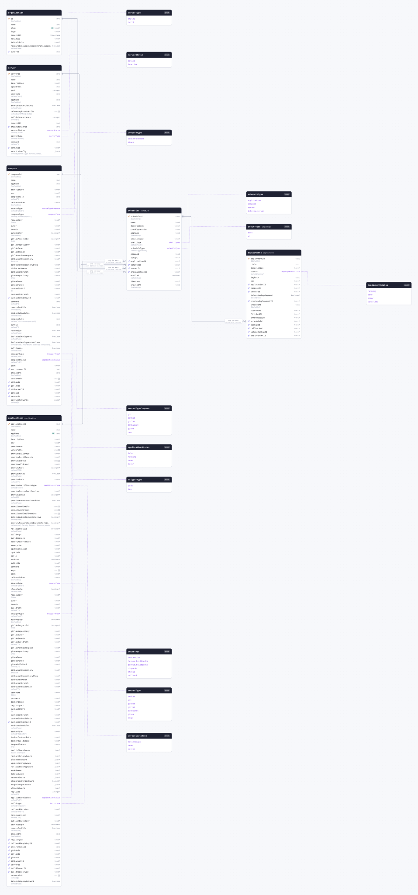

| Column           | Type                                 | Constraints                                              | Default                   | Description |
| ---------------- | ------------------------------------ | -------------------------------------------------------- | ------------------------- | ----------- |
| `scheduleId`     | `text`                               | PK NOT NULL                                              | `.$defaultFn()`           |             |
| `name`           | `text`                               | NOT NULL                                                 |                           |             |
| `description`    | `text`                               | NULL                                                     |                           |             |
| `cronExpression` | `text`                               | NOT NULL                                                 |                           |             |
| `appName`        | `text`                               | NOT NULL                                                 | `.$defaultFn()`           |             |
| `serviceName`    | `text`                               | NULL                                                     |                           |             |
| `shellType`      | [`shellTypes`](#enum-shellTypes)     | NOT NULL                                                 | `.default("bash")`        |             |
| `scheduleType`   | [`scheduleType`](#enum-scheduleType) | NOT NULL                                                 | `.default("application")` |             |
| `command`        | `text`                               | NOT NULL                                                 |                           |             |
| `script`         | `text`                               | NULL                                                     |                           |             |
| `applicationId`  | `text`                               | NULL → [applications.applicationId](#table-applications) |                           |             |
| `composeId`      | `text`                               | NULL → [compose.composeId](#table-compose)               |                           |             |
| `serverId`       | `text`                               | NULL → [server.serverId](#table-server)                  |                           |             |
| `organizationId` | `text`                               | NULL → [organization.id](#table-organization)            |                           |             |
| `enabled`        | `boolean`                            | NOT NULL                                                 | `.default(true)`          |             |
| `timezone`       | `text`                               | NULL                                                     |                           |             |
| `createdAt`      | `text`                               | NOT NULL                                                 | `.$defaultFn()`           |             |

#### Definition

```sql
CREATE TABLE "schedule" (
	"scheduleId" text PRIMARY KEY,
	"name" text NOT NULL,
	"description" text,
	"cronExpression" text NOT NULL,
	"appName" text NOT NULL,
	"serviceName" text,
	"shellType" "shellType" DEFAULT 'bash'::"shellType" NOT NULL,
	"scheduleType" "scheduleType" DEFAULT 'application'::"scheduleType" NOT NULL,
	"command" text NOT NULL,
	"script" text,
	"applicationId" text,
	"composeId" text,
	"serverId" text,
	"organizationId" text,
	"enabled" boolean DEFAULT true NOT NULL,
	"timezone" text,
	"createdAt" text NOT NULL
);

ALTER TABLE "schedule" ADD CONSTRAINT "schedule_applicationId_application_applicationId_fkey" FOREIGN KEY ("applicationId") REFERENCES "application"("applicationId") ON DELETE CASCADE;

ALTER TABLE "schedule" ADD CONSTRAINT "schedule_composeId_compose_composeId_fkey" FOREIGN KEY ("composeId") REFERENCES "compose"("composeId") ON DELETE CASCADE;

ALTER TABLE "schedule" ADD CONSTRAINT "schedule_serverId_server_serverId_fkey" FOREIGN KEY ("serverId") REFERENCES "server"("serverId") ON DELETE CASCADE;

ALTER TABLE "schedule" ADD CONSTRAINT "schedule_organizationId_organization_id_fkey" FOREIGN KEY ("organizationId") REFERENCES "organization"("id") ON DELETE CASCADE;
```

#### References

- `applicationId` → [applications.applicationId](#table-applications) (many to one, on delete cascade)
- `composeId` → [compose.composeId](#table-compose) (many to one, on delete cascade)
- `serverId` → [server.serverId](#table-server) (many to one, on delete cascade)
- `organizationId` → [organization.id](#table-organization) (many to one, on delete cascade)

#### Referenced by

- `scheduleId` → [deployments.scheduleId](#table-deployments) (one to many, on delete cascade)

<details>
<summary>Queries and their SQL</summary>

**Select**: Every row of schedules.

```ts
db.select().from(schedules);
```

```sql
select "scheduleId", "name", "description", "cronExpression", "appName", "serviceName", "shellType", "scheduleType", "command", "script", "applicationId", "composeId", "serverId", "organizationId", "enabled", "timezone", "createdAt"
from "schedule"
```

**Count**: How many rows schedules has.

```ts
db.select({ count: count() }).from(schedules);
```

```sql
select count(*)
from "schedule"
```

**Find many**: The rows of schedules, through the relational query API.

```ts
db.query.schedules.findMany();
```

```sql
select "d0"."scheduleId" as "scheduleId", "d0"."name" as "name", "d0"."description" as "description", "d0"."cronExpression" as "cronExpression", "d0"."appName" as "appName", "d0"."serviceName" as "serviceName", "d0"."shellType" as "shellType", "d0"."scheduleType" as "scheduleType", "d0"."command" as "command", "d0"."script" as "script", "d0"."applicationId" as "applicationId", "d0"."composeId" as "composeId", "d0"."serverId" as "serverId", "d0"."organizationId" as "organizationId", "d0"."enabled" as "enabled", "d0"."timezone" as "timezone", "d0"."createdAt" as "createdAt"
from "schedule" as "d0"
```

**Find by primary key**: One row of schedules, through the relational query API.

```ts
db.query.schedules.findFirst({ where: { scheduleId: "scheduleId" } });
```

```sql
select "d0"."scheduleId" as "scheduleId", "d0"."name" as "name", "d0"."description" as "description", "d0"."cronExpression" as "cronExpression", "d0"."appName" as "appName", "d0"."serviceName" as "serviceName", "d0"."shellType" as "shellType", "d0"."scheduleType" as "scheduleType", "d0"."command" as "command", "d0"."script" as "script", "d0"."applicationId" as "applicationId", "d0"."composeId" as "composeId", "d0"."serverId" as "serverId", "d0"."organizationId" as "organizationId", "d0"."enabled" as "enabled", "d0"."timezone" as "timezone", "d0"."createdAt" as "createdAt"
from "schedule" as "d0"
where "d0"."scheduleId" = $1
limit $2
-- params: ["scheduleId",1]
```

**Insert**: Adds a row to schedules, giving the columns that have no default.

```ts
db.insert(schedules).values({ name: "name", cronExpression: "cronExpression", command: "command" });
```

```sql
insert into "schedule" ("scheduleId", "name", "description", "cronExpression", "appName", "serviceName", "shellType", "scheduleType", "command", "script", "applicationId", "composeId", "serverId", "organizationId", "enabled", "timezone", "createdAt")
values ($1, $2, default, $3, $4, default, default, default, $5, default, default, default, default, default, default, default, $6)
-- params: ["uuuuuuuuuuuuuuuuuuuuu","name","cronExpression","schedule-navigate-1080p-microchip-aaaaaa","command","2026-01-01T00:00:00.000Z"]
```

**Update**: Changes a row of schedules, found by its primary key.

```ts
db.update(schedules).set({ name: "name" }).where(eq(schedules.scheduleId, "scheduleId"));
```

```sql
update "schedule"
set "name" = $1
where "schedule"."scheduleId" = $2
-- params: ["name","scheduleId"]
```

**Delete**: Deletes a row of schedules, found by its primary key.

```ts
db.delete(schedules).where(eq(schedules.scheduleId, "scheduleId"));
```

```sql
delete from "schedule"
where "schedule"."scheduleId" = $1
-- params: ["scheduleId"]
```

</details>

<a id="table-scimProvider"></a>

### scimProvider

Table `scim_provider`.

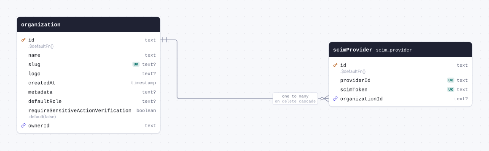

| Column                               | Type   | Constraints                                   | Default         | Description |
| ------------------------------------ | ------ | --------------------------------------------- | --------------- | ----------- |
| `id`                                 | `text` | PK NOT NULL                                   | `.$defaultFn()` |             |
| `providerId` (`provider_id`)         | `text` | UNIQUE NOT NULL                               |                 |             |
| `scimToken` (`scim_token`)           | `text` | UNIQUE NOT NULL                               |                 |             |
| `organizationId` (`organization_id`) | `text` | NULL → [organization.id](#table-organization) |                 |             |

#### Definition

```sql
CREATE TABLE "scim_provider" (
	"id" text PRIMARY KEY,
	"provider_id" text NOT NULL UNIQUE,
	"scim_token" text NOT NULL UNIQUE,
	"organization_id" text
);

ALTER TABLE "scim_provider" ADD CONSTRAINT "scim_provider_organization_id_organization_id_fkey" FOREIGN KEY ("organization_id") REFERENCES "organization"("id") ON DELETE CASCADE;
```

#### References

- `organizationId` → [organization.id](#table-organization) (many to one, on delete cascade)

<details>
<summary>Queries and their SQL</summary>

**Select**: Every row of scimProvider.

```ts
db.select().from(scimProvider);
```

```sql
select "id", "provider_id", "scim_token", "organization_id"
from "scim_provider"
```

**Count**: How many rows scimProvider has.

```ts
db.select({ count: count() }).from(scimProvider);
```

```sql
select count(*)
from "scim_provider"
```

**Find many**: The rows of scimProvider, through the relational query API.

```ts
db.query.scimProvider.findMany();
```

```sql
select "d0"."id" as "id", "d0"."provider_id" as "providerId", "d0"."scim_token" as "scimToken", "d0"."organization_id" as "organizationId"
from "scim_provider" as "d0"
```

**Find by primary key**: One row of scimProvider, through the relational query API.

```ts
db.query.scimProvider.findFirst({ where: { id: "id" } });
```

```sql
select "d0"."id" as "id", "d0"."provider_id" as "providerId", "d0"."scim_token" as "scimToken", "d0"."organization_id" as "organizationId"
from "scim_provider" as "d0"
where "d0"."id" = $1
limit $2
-- params: ["id",1]
```

**Insert**: Adds a row to scimProvider, giving the columns that have no default.

```ts
db.insert(scimProvider).values({ providerId: "providerId", scimToken: "scimToken" });
```

```sql
insert into "scim_provider" ("id", "provider_id", "scim_token", "organization_id")
values ($1, $2, $3, default)
-- params: ["uuuuuuuuuuuuuuuuuuuuu","providerId","scimToken"]
```

**Update**: Changes a row of scimProvider, found by its primary key.

```ts
db.update(scimProvider).set({ providerId: "providerId" }).where(eq(scimProvider.id, "id"));
```

```sql
update "scim_provider"
set "provider_id" = $1
where "scim_provider"."id" = $2
-- params: ["providerId","id"]
```

**Delete**: Deletes a row of scimProvider, found by its primary key.

```ts
db.delete(scimProvider).where(eq(scimProvider.id, "id"));
```

```sql
delete from "scim_provider"
where "scim_provider"."id" = $1
-- params: ["id"]
```

</details>

<a id="table-security"></a>

### security


| Column          | Type   | Constraints                                                  | Default         | Description |
| --------------- | ------ | ------------------------------------------------------------ | --------------- | ----------- |
| `securityId`    | `text` | PK NOT NULL                                                  | `.$defaultFn()` |             |
| `username`      | `text` | NOT NULL                                                     |                 |             |
| `password`      | `text` | NOT NULL                                                     |                 |             |
| `createdAt`     | `text` | NOT NULL                                                     | `.$defaultFn()` |             |
| `applicationId` | `text` | NOT NULL → [applications.applicationId](#table-applications) |                 |             |

#### Definition

```sql
CREATE TABLE "security" (
	"securityId" text PRIMARY KEY,
	"username" text NOT NULL,
	"password" text NOT NULL,
	"createdAt" text NOT NULL,
	"applicationId" text NOT NULL,
	CONSTRAINT "security_username_applicationId_unique" UNIQUE("username","applicationId")
);

ALTER TABLE "security" ADD CONSTRAINT "security_applicationId_application_applicationId_fkey" FOREIGN KEY ("applicationId") REFERENCES "application"("applicationId") ON DELETE CASCADE;
```

#### Indexes

- UNIQUE `username`, `applicationId`

#### References

- `applicationId` → [applications.applicationId](#table-applications) (many to one, on delete cascade)

<details>
<summary>Queries and their SQL</summary>

**Select**: Every row of security.

```ts
db.select().from(security);
```

```sql
select "securityId", "username", "password", "createdAt", "applicationId"
from "security"
```

**Count**: How many rows security has.

```ts
db.select({ count: count() }).from(security);
```

```sql
select count(*)
from "security"
```

**Find many**: The rows of security, through the relational query API.

```ts
db.query.security.findMany();
```

```sql
select "d0"."securityId" as "securityId", "d0"."username" as "username", "d0"."password" as "password", "d0"."createdAt" as "createdAt", "d0"."applicationId" as "applicationId"
from "security" as "d0"
```

**Find by primary key**: One row of security, through the relational query API.

```ts
db.query.security.findFirst({ where: { securityId: "securityId" } });
```

```sql
select "d0"."securityId" as "securityId", "d0"."username" as "username", "d0"."password" as "password", "d0"."createdAt" as "createdAt", "d0"."applicationId" as "applicationId"
from "security" as "d0"
where "d0"."securityId" = $1
limit $2
-- params: ["securityId",1]
```

**Insert**: Adds a row to security, giving the columns that have no default.

```ts
db.insert(security).values({
  username: "username",
  password: "password",
  applicationId: "applicationId",
});
```

```sql
insert into "security" ("securityId", "username", "password", "createdAt", "applicationId")
values ($1, $2, $3, $4, $5)
-- params: ["uuuuuuuuuuuuuuuuuuuuu","username","password","2026-01-01T00:00:00.000Z","applicationId"]
```

**Update**: Changes a row of security, found by its primary key.

```ts
db.update(security).set({ username: "username" }).where(eq(security.securityId, "securityId"));
```

```sql
update "security"
set "username" = $1
where "security"."securityId" = $2
-- params: ["username","securityId"]
```

**Delete**: Deletes a row of security, found by its primary key.

```ts
db.delete(security).where(eq(security.securityId, "securityId"));
```

```sql
delete from "security"
where "security"."securityId" = $1
-- params: ["securityId"]
```

</details>

<a id="table-server"></a>

### server


| Column                 | Type                                 | Constraints                                       | Default                                                                                                                                                                                                                                                                                                                                                                                                                 | Description |
| ---------------------- | ------------------------------------ | ------------------------------------------------- | ----------------------------------------------------------------------------------------------------------------------------------------------------------------------------------------------------------------------------------------------------------------------------------------------------------------------------------------------------------------------------------------------------------------------- | ----------- |
| `serverId`             | `text`                               | PK NOT NULL                                       | `.$defaultFn()`                                                                                                                                                                                                                                                                                                                                                                                                         |             |
| `name`                 | `text`                               | NOT NULL                                          |                                                                                                                                                                                                                                                                                                                                                                                                                         |             |
| `description`          | `text`                               | NULL                                              |                                                                                                                                                                                                                                                                                                                                                                                                                         |             |
| `ipAddress`            | `text`                               | NOT NULL                                          |                                                                                                                                                                                                                                                                                                                                                                                                                         |             |
| `port`                 | `integer`                            | NOT NULL                                          |                                                                                                                                                                                                                                                                                                                                                                                                                         |             |
| `username`             | `text`                               | NOT NULL                                          | `.default("root")`                                                                                                                                                                                                                                                                                                                                                                                                      |             |
| `appName`              | `text`                               | NOT NULL                                          | `.$defaultFn()`                                                                                                                                                                                                                                                                                                                                                                                                         |             |
| `enableDockerCleanup`  | `boolean`                            | NOT NULL                                          | `.default(false)`                                                                                                                                                                                                                                                                                                                                                                                                       |             |
| `telemetryProviderIds` | `text[]`                             | NOT NULL                                          | ``.default(sql`ARRAY[]::text[]`)``                                                                                                                                                                                                                                                                                                                                                                                      |             |
| `buildsConcurrency`    | `integer`                            | NOT NULL                                          | `.default(1)`                                                                                                                                                                                                                                                                                                                                                                                                           |             |
| `createdAt`            | `text`                               | NOT NULL                                          |                                                                                                                                                                                                                                                                                                                                                                                                                         |             |
| `organizationId`       | `text`                               | NOT NULL → [organization.id](#table-organization) |                                                                                                                                                                                                                                                                                                                                                                                                                         |             |
| `serverStatus`         | [`serverStatus`](#enum-serverStatus) | NOT NULL                                          | `.default("active")`                                                                                                                                                                                                                                                                                                                                                                                                    |             |
| `serverType`           | [`serverType`](#enum-serverType)     | NOT NULL                                          | `.default("deploy")`                                                                                                                                                                                                                                                                                                                                                                                                    |             |
| `command`              | `text`                               | NOT NULL                                          | `.default("")`                                                                                                                                                                                                                                                                                                                                                                                                          |             |
| `sshKeyId`             | `text`                               | NULL → [sshKeys.sshKeyId](#table-sshKeys)         |                                                                                                                                                                                                                                                                                                                                                                                                                         |             |
| `metricsConfig`        | `jsonb`                              | NOT NULL                                          | `.default({ 			server: { 				type: "Remote", 				refreshRate: 60, 				port: 4500, 				token: "", 				urlCallback: "", 				cronJob: "", 				retentionDays: 2, 				thresholds: { 					cpu: 0, 					memory: 0, 				}, 			}, 			containers: { 				refreshRate: 60, 				services: { 					include: [], 					exclude: [], 				}, 			}, 		})` |             |

#### Definition

```sql
CREATE TABLE "server" (
	"serverId" text PRIMARY KEY,
	"name" text NOT NULL,
	"description" text,
	"ipAddress" text NOT NULL,
	"port" integer NOT NULL,
	"username" text DEFAULT 'root' NOT NULL,
	"appName" text NOT NULL,
	"enableDockerCleanup" boolean DEFAULT false NOT NULL,
	"telemetryProviderIds" text[] DEFAULT ARRAY[]::text[] NOT NULL,
	"buildsConcurrency" integer DEFAULT 1 NOT NULL,
	"createdAt" text NOT NULL,
	"organizationId" text NOT NULL,
	"serverStatus" "serverStatus" DEFAULT 'active'::"serverStatus" NOT NULL,
	"serverType" "serverType" DEFAULT 'deploy'::"serverType" NOT NULL,
	"command" text DEFAULT '' NOT NULL,
	"sshKeyId" text,
	"metricsConfig" jsonb DEFAULT '{"server":{"type":"Remote","refreshRate":60,"port":4500,"token":"","urlCallback":"","cronJob":"","retentionDays":2,"thresholds":{"cpu":0,"memory":0}},"containers":{"refreshRate":60,"services":{"include":[],"exclude":[]}}}' NOT NULL
);

ALTER TABLE "server" ADD CONSTRAINT "server_organizationId_organization_id_fkey" FOREIGN KEY ("organizationId") REFERENCES "organization"("id") ON DELETE CASCADE;

ALTER TABLE "server" ADD CONSTRAINT "server_sshKeyId_ssh-key_sshKeyId_fkey" FOREIGN KEY ("sshKeyId") REFERENCES "ssh-key"("sshKeyId") ON DELETE SET NULL;
```

#### References

- `organizationId` → [organization.id](#table-organization) (many to one, on delete cascade)
- `sshKeyId` → [sshKeys.sshKeyId](#table-sshKeys) (many to one, on delete set null)

#### Referenced by

- `serverId` → [applications.serverId](#table-applications) (one to many, on delete cascade)
- `serverId` → [applications.buildServerId](#table-applications) (one to many, on delete set null)
- `serverId` → [certificates.serverId](#table-certificates) (one to many, on delete cascade)
- `serverId` → [compose.serverId](#table-compose) (one to many, on delete cascade)
- `serverId` → [deployments.serverId](#table-deployments) (one to many, on delete cascade)
- `serverId` → [deployments.buildServerId](#table-deployments) (one to many, on delete cascade)
- `serverId` → [forwardAuthSettings.serverId](#table-forwardAuthSettings) (one to one, on delete cascade)
- `serverId` → [libsql.serverId](#table-libsql) (one to many, on delete cascade)
- `serverId` → [mariadb.serverId](#table-mariadb) (one to many, on delete cascade)
- `serverId` → [mongo.serverId](#table-mongo) (one to many, on delete cascade)
- `serverId` → [mysql.serverId](#table-mysql) (one to many, on delete cascade)
- `serverId` → [network.serverId](#table-network) (one to many, on delete cascade)
- `serverId` → [postgres.serverId](#table-postgres) (one to many, on delete cascade)
- `serverId` → [redis.serverId](#table-redis) (one to many, on delete cascade)
- `serverId` → [sandboxes.serverId](#table-sandboxes) (one to many, on delete cascade)
- `serverId` → [schedules.serverId](#table-schedules) (one to many, on delete cascade)

<details>
<summary>Queries and their SQL</summary>

**Select**: Every row of server.

```ts
db.select().from(server);
```

```sql
select "serverId", "name", "description", "ipAddress", "port", "username", "appName", "enableDockerCleanup", "telemetryProviderIds", "buildsConcurrency", "createdAt", "organizationId", "serverStatus", "serverType", "command", "sshKeyId", "metricsConfig"
from "server"
```

**Count**: How many rows server has.

```ts
db.select({ count: count() }).from(server);
```

```sql
select count(*)
from "server"
```

**Find many**: The rows of server, through the relational query API.

```ts
db.query.server.findMany();
```

```sql
select "d0"."serverId" as "serverId", "d0"."name" as "name", "d0"."description" as "description", "d0"."ipAddress" as "ipAddress", "d0"."port" as "port", "d0"."username" as "username", "d0"."appName" as "appName", "d0"."enableDockerCleanup" as "enableDockerCleanup", "d0"."telemetryProviderIds" as "telemetryProviderIds", "d0"."buildsConcurrency" as "buildsConcurrency", "d0"."createdAt" as "createdAt", "d0"."organizationId" as "organizationId", "d0"."serverStatus" as "serverStatus", "d0"."serverType" as "serverType", "d0"."command" as "command", "d0"."sshKeyId" as "sshKeyId", "d0"."metricsConfig" as "metricsConfig"
from "server" as "d0"
```

**Find by primary key**: One row of server, through the relational query API.

```ts
db.query.server.findFirst({ where: { serverId: "serverId" } });
```

```sql
select "d0"."serverId" as "serverId", "d0"."name" as "name", "d0"."description" as "description", "d0"."ipAddress" as "ipAddress", "d0"."port" as "port", "d0"."username" as "username", "d0"."appName" as "appName", "d0"."enableDockerCleanup" as "enableDockerCleanup", "d0"."telemetryProviderIds" as "telemetryProviderIds", "d0"."buildsConcurrency" as "buildsConcurrency", "d0"."createdAt" as "createdAt", "d0"."organizationId" as "organizationId", "d0"."serverStatus" as "serverStatus", "d0"."serverType" as "serverType", "d0"."command" as "command", "d0"."sshKeyId" as "sshKeyId", "d0"."metricsConfig" as "metricsConfig"
from "server" as "d0"
where "d0"."serverId" = $1
limit $2
-- params: ["serverId",1]
```

**Insert**: Adds a row to server, giving the columns that have no default.

```ts
db.insert(server).values({
  name: "name",
  ipAddress: "ipAddress",
  port: 1,
  createdAt: "createdAt",
  organizationId: "organizationId",
});
```

```sql
insert into "server" ("serverId", "name", "description", "ipAddress", "port", "username", "appName", "enableDockerCleanup", "telemetryProviderIds", "buildsConcurrency", "createdAt", "organizationId", "serverStatus", "serverType", "command", "sshKeyId", "metricsConfig")
values ($1, $2, default, $3, $4, default, $5, default, default, default, $6, $7, default, default, default, default, default)
-- params: ["uuuuuuuuuuuuuuuuuuuuu","name","ipAddress",1,"server-override-open-source-system-aaaaaa","createdAt","organizationId"]
```

**Update**: Changes a row of server, found by its primary key.

```ts
db.update(server).set({ name: "name" }).where(eq(server.serverId, "serverId"));
```

```sql
update "server"
set "name" = $1
where "server"."serverId" = $2
-- params: ["name","serverId"]
```

**Delete**: Deletes a row of server, found by its primary key.

```ts
db.delete(server).where(eq(server.serverId, "serverId"));
```

```sql
delete from "server"
where "server"."serverId" = $1
-- params: ["serverId"]
```

</details>

<a id="table-session"></a>

### session

OLD TABLE


| Column                                            | Type        | Constraints                       | Default | Description |
| ------------------------------------------------- | ----------- | --------------------------------- | ------- | ----------- |
| `id`                                              | `text`      | PK NOT NULL                       |         |             |
| `expiresAt` (`expires_at`)                        | `timestamp` | NOT NULL                          |         |             |
| `token`                                           | `text`      | UNIQUE NOT NULL                   |         |             |
| `createdAt` (`created_at`)                        | `timestamp` | NOT NULL                          |         |             |
| `updatedAt` (`updated_at`)                        | `timestamp` | NOT NULL                          |         |             |
| `ipAddress` (`ip_address`)                        | `text`      | NULL                              |         |             |
| `userAgent` (`user_agent`)                        | `text`      | NULL                              |         |             |
| `userId` (`user_id`)                              | `text`      | NOT NULL → [user.id](#table-user) |         |             |
| `impersonatedBy` (`impersonated_by`)              | `text`      | NULL                              |         |             |
| `activeOrganizationId` (`active_organization_id`) | `text`      | NULL                              |         |             |

#### Definition

```sql
CREATE TABLE "session" (
	"id" text PRIMARY KEY,
	"expires_at" timestamp NOT NULL,
	"token" text NOT NULL UNIQUE,
	"created_at" timestamp NOT NULL,
	"updated_at" timestamp NOT NULL,
	"ip_address" text,
	"user_agent" text,
	"user_id" text NOT NULL,
	"impersonated_by" text,
	"active_organization_id" text
);

ALTER TABLE "session" ADD CONSTRAINT "session_user_id_user_id_fkey" FOREIGN KEY ("user_id") REFERENCES "user"("id") ON DELETE CASCADE;
```

#### References

- `userId` → [user.id](#table-user) (many to one, on delete cascade)

<details>
<summary>Queries and their SQL</summary>

**Select**: Every row of session.

```ts
db.select().from(session);
```

```sql
select "id", "expires_at", "token", "created_at", "updated_at", "ip_address", "user_agent", "user_id", "impersonated_by", "active_organization_id"
from "session"
```

**Count**: How many rows session has.

```ts
db.select({ count: count() }).from(session);
```

```sql
select count(*)
from "session"
```

**Find many**: The rows of session, through the relational query API.

```ts
db.query.session.findMany();
```

```sql
select "d0"."id" as "id", "d0"."expires_at" as "expiresAt", "d0"."token" as "token", "d0"."created_at" as "createdAt", "d0"."updated_at" as "updatedAt", "d0"."ip_address" as "ipAddress", "d0"."user_agent" as "userAgent", "d0"."user_id" as "userId", "d0"."impersonated_by" as "impersonatedBy", "d0"."active_organization_id" as "activeOrganizationId"
from "session" as "d0"
```

**Find by primary key**: One row of session, through the relational query API.

```ts
db.query.session.findFirst({ where: { id: "id" } });
```

```sql
select "d0"."id" as "id", "d0"."expires_at" as "expiresAt", "d0"."token" as "token", "d0"."created_at" as "createdAt", "d0"."updated_at" as "updatedAt", "d0"."ip_address" as "ipAddress", "d0"."user_agent" as "userAgent", "d0"."user_id" as "userId", "d0"."impersonated_by" as "impersonatedBy", "d0"."active_organization_id" as "activeOrganizationId"
from "session" as "d0"
where "d0"."id" = $1
limit $2
-- params: ["id",1]
```

**Insert**: Adds a row to session, giving the columns that have no default.

```ts
db.insert(session).values({
  id: "id",
  expiresAt: new Date("2026-01-01T00:00:00.000Z"),
  token: "token",
  createdAt: new Date("2026-01-01T00:00:00.000Z"),
  updatedAt: new Date("2026-01-01T00:00:00.000Z"),
  userId: "userId",
});
```

```sql
insert into "session" ("id", "expires_at", "token", "created_at", "updated_at", "ip_address", "user_agent", "user_id", "impersonated_by", "active_organization_id")
values ($1, $2, $3, $4, $5, default, default, $6, default, default)
-- params: ["id","2026-01-01T00:00:00.000Z","token","2026-01-01T00:00:00.000Z","2026-01-01T00:00:00.000Z","userId"]
```

**Update**: Changes a row of session, found by its primary key.

```ts
db.update(session)
  .set({ expiresAt: new Date("2026-01-01T00:00:00.000Z") })
  .where(eq(session.id, "id"));
```

```sql
update "session"
set "expires_at" = $1
where "session"."id" = $2
-- params: ["2026-01-01T00:00:00.000Z","id"]
```

**Delete**: Deletes a row of session, found by its primary key.

```ts
db.delete(session).where(eq(session.id, "id"));
```

```sql
delete from "session"
where "session"."id" = $1
-- params: ["id"]
```

</details>

<a id="table-sshKeys"></a>

### sshKeys

Table `ssh-key`.


| Column           | Type   | Constraints                                       | Default         | Description |
| ---------------- | ------ | ------------------------------------------------- | --------------- | ----------- |
| `sshKeyId`       | `text` | PK NOT NULL                                       | `.$defaultFn()` |             |
| `privateKey`     | `text` | NOT NULL                                          | `.default("")`  |             |
| `publicKey`      | `text` | NOT NULL                                          |                 |             |
| `name`           | `text` | NOT NULL                                          |                 |             |
| `description`    | `text` | NULL                                              |                 |             |
| `createdAt`      | `text` | NOT NULL                                          | `.$defaultFn()` |             |
| `lastUsedAt`     | `text` | NULL                                              |                 |             |
| `organizationId` | `text` | NOT NULL → [organization.id](#table-organization) |                 |             |

#### Definition

```sql
CREATE TABLE "ssh-key" (
	"sshKeyId" text PRIMARY KEY,
	"privateKey" text DEFAULT '' NOT NULL,
	"publicKey" text NOT NULL,
	"name" text NOT NULL,
	"description" text,
	"createdAt" text NOT NULL,
	"lastUsedAt" text,
	"organizationId" text NOT NULL
);

ALTER TABLE "ssh-key" ADD CONSTRAINT "ssh-key_organizationId_organization_id_fkey" FOREIGN KEY ("organizationId") REFERENCES "organization"("id") ON DELETE CASCADE;
```

#### References

- `organizationId` → [organization.id](#table-organization) (many to one, on delete cascade)

#### Referenced by

- `sshKeyId` → [applications.customGitSSHKeyId](#table-applications) (one to many, on delete set null)
- `sshKeyId` → [compose.customGitSSHKeyId](#table-compose) (one to many, on delete set null)
- `sshKeyId` → [server.sshKeyId](#table-server) (one to many, on delete set null)

<details>
<summary>Queries and their SQL</summary>

**Select**: Every row of sshKeys.

```ts
db.select().from(sshKeys);
```

```sql
select "sshKeyId", "privateKey", "publicKey", "name", "description", "createdAt", "lastUsedAt", "organizationId"
from "ssh-key"
```

**Count**: How many rows sshKeys has.

```ts
db.select({ count: count() }).from(sshKeys);
```

```sql
select count(*)
from "ssh-key"
```

**Find many**: The rows of sshKeys, through the relational query API.

```ts
db.query.sshKeys.findMany();
```

```sql
select "d0"."sshKeyId" as "sshKeyId", "d0"."privateKey" as "privateKey", "d0"."publicKey" as "publicKey", "d0"."name" as "name", "d0"."description" as "description", "d0"."createdAt" as "createdAt", "d0"."lastUsedAt" as "lastUsedAt", "d0"."organizationId" as "organizationId"
from "ssh-key" as "d0"
```

**Find by primary key**: One row of sshKeys, through the relational query API.

```ts
db.query.sshKeys.findFirst({ where: { sshKeyId: "sshKeyId" } });
```

```sql
select "d0"."sshKeyId" as "sshKeyId", "d0"."privateKey" as "privateKey", "d0"."publicKey" as "publicKey", "d0"."name" as "name", "d0"."description" as "description", "d0"."createdAt" as "createdAt", "d0"."lastUsedAt" as "lastUsedAt", "d0"."organizationId" as "organizationId"
from "ssh-key" as "d0"
where "d0"."sshKeyId" = $1
limit $2
-- params: ["sshKeyId",1]
```

**Insert**: Adds a row to sshKeys, giving the columns that have no default.

```ts
db.insert(sshKeys).values({
  publicKey: "publicKey",
  name: "name",
  organizationId: "organizationId",
});
```

```sql
insert into "ssh-key" ("sshKeyId", "privateKey", "publicKey", "name", "description", "createdAt", "lastUsedAt", "organizationId")
values ($1, default, $2, $3, default, $4, default, $5)
-- params: ["uuuuuuuuuuuuuuuuuuuuu","publicKey","name","2026-01-01T00:00:00.000Z","organizationId"]
```

**Update**: Changes a row of sshKeys, found by its primary key.

```ts
db.update(sshKeys).set({ privateKey: "privateKey" }).where(eq(sshKeys.sshKeyId, "sshKeyId"));
```

```sql
update "ssh-key"
set "privateKey" = $1
where "ssh-key"."sshKeyId" = $2
-- params: ["privateKey","sshKeyId"]
```

**Delete**: Deletes a row of sshKeys, found by its primary key.

```ts
db.delete(sshKeys).where(eq(sshKeys.sshKeyId, "sshKeyId"));
```

```sql
delete from "ssh-key"
where "ssh-key"."sshKeyId" = $1
-- params: ["sshKeyId"]
```

</details>

<a id="table-ssoProvider"></a>

### ssoProvider

Table `sso_provider`.


| Column                               | Type        | Constraints                                   | Default          | Description |
| ------------------------------------ | ----------- | --------------------------------------------- | ---------------- | ----------- |
| `id`                                 | `text`      | PK NOT NULL                                   |                  |             |
| `issuer`                             | `text`      | NOT NULL                                      |                  |             |
| `oidcConfig` (`oidc_config`)         | `text`      | NULL                                          |                  |             |
| `samlConfig` (`saml_config`)         | `text`      | NULL                                          |                  |             |
| `providerId` (`provider_id`)         | `text`      | UNIQUE NOT NULL                               |                  |             |
| `userId` (`user_id`)                 | `text`      | NULL → [user.id](#table-user)                 |                  |             |
| `organizationId` (`organization_id`) | `text`      | NULL → [organization.id](#table-organization) |                  |             |
| `domain`                             | `text`      | NOT NULL                                      |                  |             |
| `domainVerified` (`domain_verified`) | `boolean`   | NOT NULL                                      | `.default(true)` |             |
| `createdAt` (`created_at`)           | `timestamp` | NOT NULL                                      | `.defaultNow()`  |             |

#### Definition

```sql
CREATE TABLE "sso_provider" (
	"id" text PRIMARY KEY,
	"issuer" text NOT NULL,
	"oidc_config" text,
	"saml_config" text,
	"provider_id" text NOT NULL UNIQUE,
	"user_id" text,
	"organization_id" text,
	"domain" text NOT NULL,
	"domain_verified" boolean DEFAULT true NOT NULL,
	"created_at" timestamp DEFAULT now() NOT NULL
);

ALTER TABLE "sso_provider" ADD CONSTRAINT "sso_provider_user_id_user_id_fkey" FOREIGN KEY ("user_id") REFERENCES "user"("id") ON DELETE SET NULL;

ALTER TABLE "sso_provider" ADD CONSTRAINT "sso_provider_organization_id_organization_id_fkey" FOREIGN KEY ("organization_id") REFERENCES "organization"("id") ON DELETE CASCADE;
```

#### References

- `userId` → [user.id](#table-user) (many to one, on delete set null)
- `organizationId` → [organization.id](#table-organization) (many to one, on delete cascade)

#### Referenced by

- `providerId` → [forwardAuthSettings.providerId](#table-forwardAuthSettings) (one to many, on delete set null)

<details>
<summary>Queries and their SQL</summary>

**Select**: Every row of ssoProvider.

```ts
db.select().from(ssoProvider);
```

```sql
select "id", "issuer", "oidc_config", "saml_config", "provider_id", "user_id", "organization_id", "domain", "domain_verified", "created_at"
from "sso_provider"
```

**Count**: How many rows ssoProvider has.

```ts
db.select({ count: count() }).from(ssoProvider);
```

```sql
select count(*)
from "sso_provider"
```

**Find many**: The rows of ssoProvider, through the relational query API.

```ts
db.query.ssoProvider.findMany();
```

```sql
select "d0"."id" as "id", "d0"."issuer" as "issuer", "d0"."oidc_config" as "oidcConfig", "d0"."saml_config" as "samlConfig", "d0"."provider_id" as "providerId", "d0"."user_id" as "userId", "d0"."organization_id" as "organizationId", "d0"."domain" as "domain", "d0"."domain_verified" as "domainVerified", "d0"."created_at" as "createdAt"
from "sso_provider" as "d0"
```

**Find by primary key**: One row of ssoProvider, through the relational query API.

```ts
db.query.ssoProvider.findFirst({ where: { id: "id" } });
```

```sql
select "d0"."id" as "id", "d0"."issuer" as "issuer", "d0"."oidc_config" as "oidcConfig", "d0"."saml_config" as "samlConfig", "d0"."provider_id" as "providerId", "d0"."user_id" as "userId", "d0"."organization_id" as "organizationId", "d0"."domain" as "domain", "d0"."domain_verified" as "domainVerified", "d0"."created_at" as "createdAt"
from "sso_provider" as "d0"
where "d0"."id" = $1
limit $2
-- params: ["id",1]
```

**Insert**: Adds a row to ssoProvider, giving the columns that have no default.

```ts
db.insert(ssoProvider).values({
  id: "id",
  issuer: "issuer",
  providerId: "providerId",
  domain: "domain",
});
```

```sql
insert into "sso_provider" ("id", "issuer", "oidc_config", "saml_config", "provider_id", "user_id", "organization_id", "domain", "domain_verified", "created_at")
values ($1, $2, default, default, $3, default, default, $4, default, default)
-- params: ["id","issuer","providerId","domain"]
```

**Update**: Changes a row of ssoProvider, found by its primary key.

```ts
db.update(ssoProvider).set({ issuer: "issuer" }).where(eq(ssoProvider.id, "id"));
```

```sql
update "sso_provider"
set "issuer" = $1
where "sso_provider"."id" = $2
-- params: ["issuer","id"]
```

**Delete**: Deletes a row of ssoProvider, found by its primary key.

```ts
db.delete(ssoProvider).where(eq(ssoProvider.id, "id"));
```

```sql
delete from "sso_provider"
where "sso_provider"."id" = $1
-- params: ["id"]
```

</details>

<a id="table-tags"></a>

### tags

Table `tag`.


| Column           | Type   | Constraints                                       | Default         | Description |
| ---------------- | ------ | ------------------------------------------------- | --------------- | ----------- |
| `tagId`          | `text` | PK NOT NULL                                       | `.$defaultFn()` |             |
| `name`           | `text` | NOT NULL                                          |                 |             |
| `color`          | `text` | NULL                                              |                 |             |
| `createdAt`      | `text` | NOT NULL                                          | `.$defaultFn()` |             |
| `organizationId` | `text` | NOT NULL → [organization.id](#table-organization) |                 |             |

#### Definition

```sql
CREATE TABLE "tag" (
	"tagId" text PRIMARY KEY,
	"name" text NOT NULL,
	"color" text,
	"createdAt" text NOT NULL,
	"organizationId" text NOT NULL,
	CONSTRAINT "unique_org_tag_name" UNIQUE("organizationId","name")
);

ALTER TABLE "tag" ADD CONSTRAINT "tag_organizationId_organization_id_fkey" FOREIGN KEY ("organizationId") REFERENCES "organization"("id") ON DELETE CASCADE;
```

#### Indexes

- UNIQUE `organizationId`, `name`

#### References

- `organizationId` → [organization.id](#table-organization) (many to one, on delete cascade)

#### Referenced by

- `tagId` → [projectTags.tagId](#table-projectTags) (one to many, on delete cascade)

<details>
<summary>Queries and their SQL</summary>

**Select**: Every row of tags.

```ts
db.select().from(tags);
```

```sql
select "tagId", "name", "color", "createdAt", "organizationId"
from "tag"
```

**Count**: How many rows tags has.

```ts
db.select({ count: count() }).from(tags);
```

```sql
select count(*)
from "tag"
```

**Find many**: The rows of tags, through the relational query API.

```ts
db.query.tags.findMany();
```

```sql
select "d0"."tagId" as "tagId", "d0"."name" as "name", "d0"."color" as "color", "d0"."createdAt" as "createdAt", "d0"."organizationId" as "organizationId"
from "tag" as "d0"
```

**Find by primary key**: One row of tags, through the relational query API.

```ts
db.query.tags.findFirst({ where: { tagId: "tagId" } });
```

```sql
select "d0"."tagId" as "tagId", "d0"."name" as "name", "d0"."color" as "color", "d0"."createdAt" as "createdAt", "d0"."organizationId" as "organizationId"
from "tag" as "d0"
where "d0"."tagId" = $1
limit $2
-- params: ["tagId",1]
```

**Insert**: Adds a row to tags, giving the columns that have no default.

```ts
db.insert(tags).values({ name: "name", organizationId: "organizationId" });
```

```sql
insert into "tag" ("tagId", "name", "color", "createdAt", "organizationId")
values ($1, $2, default, $3, $4)
-- params: ["uuuuuuuuuuuuuuuuuuuuu","name","2026-01-01T00:00:00.000Z","organizationId"]
```

**Update**: Changes a row of tags, found by its primary key.

```ts
db.update(tags).set({ name: "name" }).where(eq(tags.tagId, "tagId"));
```

```sql
update "tag"
set "name" = $1
where "tag"."tagId" = $2
-- params: ["name","tagId"]
```

**Delete**: Deletes a row of tags, found by its primary key.

```ts
db.delete(tags).where(eq(tags.tagId, "tagId"));
```

```sql
delete from "tag"
where "tag"."tagId" = $1
-- params: ["tagId"]
```

</details>

<a id="table-projectTags"></a>

### projectTags

Table `project_tag`.


| Column      | Type   | Constraints                                      | Default         | Description |
| ----------- | ------ | ------------------------------------------------ | --------------- | ----------- |
| `id`        | `text` | PK NOT NULL                                      | `.$defaultFn()` |             |
| `projectId` | `text` | NOT NULL → [projects.projectId](#table-projects) |                 |             |
| `tagId`     | `text` | NOT NULL → [tags.tagId](#table-tags)             |                 |             |

#### Definition

```sql
CREATE TABLE "project_tag" (
	"id" text PRIMARY KEY,
	"projectId" text NOT NULL,
	"tagId" text NOT NULL,
	CONSTRAINT "unique_project_tag" UNIQUE("projectId","tagId")
);

ALTER TABLE "project_tag" ADD CONSTRAINT "project_tag_projectId_project_projectId_fkey" FOREIGN KEY ("projectId") REFERENCES "project"("projectId") ON DELETE CASCADE;

ALTER TABLE "project_tag" ADD CONSTRAINT "project_tag_tagId_tag_tagId_fkey" FOREIGN KEY ("tagId") REFERENCES "tag"("tagId") ON DELETE CASCADE;
```

#### Indexes

- UNIQUE `projectId`, `tagId`

#### References

- `projectId` → [projects.projectId](#table-projects) (many to one, on delete cascade)
- `tagId` → [tags.tagId](#table-tags) (many to one, on delete cascade)

<details>
<summary>Queries and their SQL</summary>

**Select**: Every row of projectTags.

```ts
db.select().from(projectTags);
```

```sql
select "id", "projectId", "tagId"
from "project_tag"
```

**Count**: How many rows projectTags has.

```ts
db.select({ count: count() }).from(projectTags);
```

```sql
select count(*)
from "project_tag"
```

**Find many**: The rows of projectTags, through the relational query API.

```ts
db.query.projectTags.findMany();
```

```sql
select "d0"."id" as "id", "d0"."projectId" as "projectId", "d0"."tagId" as "tagId"
from "project_tag" as "d0"
```

**Find by primary key**: One row of projectTags, through the relational query API.

```ts
db.query.projectTags.findFirst({ where: { id: "id" } });
```

```sql
select "d0"."id" as "id", "d0"."projectId" as "projectId", "d0"."tagId" as "tagId"
from "project_tag" as "d0"
where "d0"."id" = $1
limit $2
-- params: ["id",1]
```

**Insert**: Adds a row to projectTags, giving the columns that have no default.

```ts
db.insert(projectTags).values({ projectId: "projectId", tagId: "tagId" });
```

```sql
insert into "project_tag" ("id", "projectId", "tagId")
values ($1, $2, $3)
-- params: ["uuuuuuuuuuuuuuuuuuuuu","projectId","tagId"]
```

**Update**: Changes a row of projectTags, found by its primary key.

```ts
db.update(projectTags).set({ projectId: "projectId" }).where(eq(projectTags.id, "id"));
```

```sql
update "project_tag"
set "projectId" = $1
where "project_tag"."id" = $2
-- params: ["projectId","id"]
```

**Delete**: Deletes a row of projectTags, found by its primary key.

```ts
db.delete(projectTags).where(eq(projectTags.id, "id"));
```

```sql
delete from "project_tag"
where "project_tag"."id" = $1
-- params: ["id"]
```

</details>

<a id="table-telemetryProvider"></a>

### telemetryProvider


| Column                | Type                                                   | Constraints                                       | Default          | Description |
| --------------------- | ------------------------------------------------------ | ------------------------------------------------- | ---------------- | ----------- |
| `telemetryProviderId` | `text`                                                 | PK NOT NULL                                       | `.$defaultFn()`  |             |
| `name`                | `text`                                                 | NOT NULL                                          |                  |             |
| `providerType`        | [`telemetryProviderType`](#enum-telemetryProviderType) | NOT NULL                                          |                  |             |
| `signals`             | `text[]`                                               | NOT NULL                                          |                  |             |
| `endpoint`            | `text`                                                 | NULL                                              |                  |             |
| `apiKey`              | `text`                                                 | NULL                                              |                  |             |
| `apiSecret`           | `text`                                                 | NULL                                              |                  |             |
| `extraConfig`         | `jsonb`                                                | NULL                                              |                  |             |
| `enabled`             | `boolean`                                              | NOT NULL                                          | `.default(true)` |             |
| `createdAt`           | `text`                                                 | NOT NULL                                          | `.$defaultFn()`  |             |
| `organizationId`      | `text`                                                 | NOT NULL → [organization.id](#table-organization) |                  |             |

#### Definition

```sql
CREATE TABLE "telemetryProvider" (
	"telemetryProviderId" text PRIMARY KEY,
	"name" text NOT NULL,
	"providerType" "TelemetryProviderType" NOT NULL,
	"signals" text[] NOT NULL,
	"endpoint" text,
	"apiKey" text,
	"apiSecret" text,
	"extraConfig" jsonb,
	"enabled" boolean DEFAULT true NOT NULL,
	"createdAt" text NOT NULL,
	"organizationId" text NOT NULL
);

ALTER TABLE "telemetryProvider" ADD CONSTRAINT "telemetryProvider_organizationId_organization_id_fkey" FOREIGN KEY ("organizationId") REFERENCES "organization"("id") ON DELETE CASCADE;
```

#### References

- `organizationId` → [organization.id](#table-organization) (many to one, on delete cascade)

<details>
<summary>Queries and their SQL</summary>

**Select**: Every row of telemetryProvider.

```ts
db.select().from(telemetryProvider);
```

```sql
select "telemetryProviderId", "name", "providerType", "signals", "endpoint", "apiKey", "apiSecret", "extraConfig", "enabled", "createdAt", "organizationId"
from "telemetryProvider"
```

**Count**: How many rows telemetryProvider has.

```ts
db.select({ count: count() }).from(telemetryProvider);
```

```sql
select count(*)
from "telemetryProvider"
```

**Find many**: The rows of telemetryProvider, through the relational query API.

```ts
db.query.telemetryProvider.findMany();
```

```sql
select "d0"."telemetryProviderId" as "telemetryProviderId", "d0"."name" as "name", "d0"."providerType" as "providerType", "d0"."signals" as "signals", "d0"."endpoint" as "endpoint", "d0"."apiKey" as "apiKey", "d0"."apiSecret" as "apiSecret", "d0"."extraConfig" as "extraConfig", "d0"."enabled" as "enabled", "d0"."createdAt" as "createdAt", "d0"."organizationId" as "organizationId"
from "telemetryProvider" as "d0"
```

**Find by primary key**: One row of telemetryProvider, through the relational query API.

```ts
db.query.telemetryProvider.findFirst({ where: { telemetryProviderId: "telemetryProviderId" } });
```

```sql
select "d0"."telemetryProviderId" as "telemetryProviderId", "d0"."name" as "name", "d0"."providerType" as "providerType", "d0"."signals" as "signals", "d0"."endpoint" as "endpoint", "d0"."apiKey" as "apiKey", "d0"."apiSecret" as "apiSecret", "d0"."extraConfig" as "extraConfig", "d0"."enabled" as "enabled", "d0"."createdAt" as "createdAt", "d0"."organizationId" as "organizationId"
from "telemetryProvider" as "d0"
where "d0"."telemetryProviderId" = $1
limit $2
-- params: ["telemetryProviderId",1]
```

**Insert**: Adds a row to telemetryProvider, giving the columns that have no default.

```ts
db.insert(telemetryProvider).values({
  name: "name",
  providerType: "loki",
  signals: "signals",
  organizationId: "organizationId",
});
```

```sql
insert into "telemetryProvider" ("telemetryProviderId", "name", "providerType", "signals", "endpoint", "apiKey", "apiSecret", "extraConfig", "enabled", "createdAt", "organizationId")
values ($1, $2, $3, $4, default, default, default, default, default, $5, $6)
-- params: ["uuuuuuuuuuuuuuuuuuuuu","name","loki","signals","2026-01-01T00:00:00.000Z","organizationId"]
```

**Update**: Changes a row of telemetryProvider, found by its primary key.

```ts
db.update(telemetryProvider)
  .set({ name: "name" })
  .where(eq(telemetryProvider.telemetryProviderId, "telemetryProviderId"));
```

```sql
update "telemetryProvider"
set "name" = $1
where "telemetryProvider"."telemetryProviderId" = $2
-- params: ["name","telemetryProviderId"]
```

**Delete**: Deletes a row of telemetryProvider, found by its primary key.

```ts
db.delete(telemetryProvider).where(
  eq(telemetryProvider.telemetryProviderId, "telemetryProviderId"),
);
```

```sql
delete from "telemetryProvider"
where "telemetryProvider"."telemetryProviderId" = $1
-- params: ["telemetryProviderId"]
```

</details>

<a id="table-user"></a>

### user

TEMP


| Column                                    | Type        | Constraints     | Default                            | Description                       |
| ----------------------------------------- | ----------- | --------------- | ---------------------------------- | --------------------------------- |
| `id`                                      | `text`      | PK NOT NULL     | `.$defaultFn()`                    |                                   |
| `firstName`                               | `text`      | NOT NULL        | `.default("")`                     |                                   |
| `lastName`                                | `text`      | NOT NULL        | `.default("")`                     |                                   |
| `isRegistered`                            | `boolean`   | NOT NULL        | `.default(false)`                  |                                   |
| `expirationDate`                          | `text`      | NOT NULL        | `.$defaultFn()`                    |                                   |
| `createdAt2` (`createdAt`)                | `text`      | NOT NULL        | `.$defaultFn()`                    |                                   |
| `createdAt` (`created_at`)                | `timestamp` | NULL            | `.defaultNow()`                    |                                   |
| `twoFactorEnabled` (`two_factor_enabled`) | `boolean`   | NULL            |                                    | Auth                              |
| `email`                                   | `text`      | UNIQUE NOT NULL |                                    |                                   |
| `emailVerified` (`email_verified`)        | `boolean`   | NOT NULL        |                                    |                                   |
| `image`                                   | `text`      | NULL            |                                    |                                   |
| `banned`                                  | `boolean`   | NULL            |                                    |                                   |
| `banReason` (`ban_reason`)                | `text`      | NULL            |                                    |                                   |
| `banExpires` (`ban_expires`)              | `timestamp` | NULL            |                                    |                                   |
| `updatedAt` (`updated_at`)                | `timestamp` | NOT NULL        |                                    |                                   |
| `role`                                    | `text`      | NOT NULL        | `.default("user")`                 | Admin                             |
| `enablePaidFeatures`                      | `boolean`   | NOT NULL        | `.default(false)`                  | Metrics                           |
| `allowImpersonation`                      | `boolean`   | NOT NULL        | `.default(false)`                  |                                   |
| `enableEnterpriseFeatures`                | `boolean`   | NOT NULL        | `.default(false)`                  | Enterprise / proprietary features |
| `licenseKey`                              | `text`      | NULL            |                                    |                                   |
| `isValidEnterpriseLicense`                | `boolean`   | NOT NULL        | `.default(false)`                  |                                   |
| `stripeCustomerId`                        | `text`      | NULL            |                                    |                                   |
| `stripeSubscriptionId`                    | `text`      | NULL            |                                    |                                   |
| `serversQuantity`                         | `integer`   | NOT NULL        | `.default(0)`                      |                                   |
| `sendInvoiceNotifications`                | `boolean`   | NOT NULL        | `.default(false)`                  |                                   |
| `isEnterpriseCloud`                       | `boolean`   | NOT NULL        | `.default(false)`                  |                                   |
| `trustedOrigins`                          | `text[]`    | NULL            |                                    |                                   |
| `bookmarkedTemplates`                     | `text[]`    | NULL            | ``.default(sql`ARRAY[]::text[]`)`` |                                   |
| `onboardingCompletedAt`                   | `timestamp` | NULL            |                                    |                                   |
| `onboardingStep`                          | `text`      | NULL            |                                    |                                   |
| `onboardingReturnEmails`                  | `integer`   | NOT NULL        | `.default(0)`                      |                                   |
| `trialPlanPromptSubscriptionId`           | `text`      | NULL            |                                    |                                   |
| `serverSetupFailedEmailAt`                | `timestamp` | NULL            |                                    |                                   |
| `serverConnectFailure`                    | `text`      | NULL            |                                    |                                   |

#### Definition

```sql
CREATE TABLE "user" (
	"id" text PRIMARY KEY,
	"firstName" text DEFAULT '' NOT NULL,
	"lastName" text DEFAULT '' NOT NULL,
	"isRegistered" boolean DEFAULT false NOT NULL,
	"expirationDate" text NOT NULL,
	"createdAt" text NOT NULL,
	"created_at" timestamp DEFAULT now(),
	"two_factor_enabled" boolean,
	"email" text NOT NULL UNIQUE,
	"email_verified" boolean NOT NULL,
	"image" text,
	"banned" boolean,
	"ban_reason" text,
	"ban_expires" timestamp,
	"updated_at" timestamp NOT NULL,
	"role" text DEFAULT 'user' NOT NULL,
	"enablePaidFeatures" boolean DEFAULT false NOT NULL,
	"allowImpersonation" boolean DEFAULT false NOT NULL,
	"enableEnterpriseFeatures" boolean DEFAULT false NOT NULL,
	"licenseKey" text,
	"isValidEnterpriseLicense" boolean DEFAULT false NOT NULL,
	"stripeCustomerId" text,
	"stripeSubscriptionId" text,
	"serversQuantity" integer DEFAULT 0 NOT NULL,
	"sendInvoiceNotifications" boolean DEFAULT false NOT NULL,
	"isEnterpriseCloud" boolean DEFAULT false NOT NULL,
	"trustedOrigins" text[],
	"bookmarkedTemplates" text[] DEFAULT ARRAY[]::text[],
	"onboardingCompletedAt" timestamp,
	"onboardingStep" text,
	"onboardingReturnEmails" integer DEFAULT 0 NOT NULL,
	"trialPlanPromptSubscriptionId" text,
	"serverSetupFailedEmailAt" timestamp,
	"serverConnectFailure" text
);
```

#### Referenced by

- `id` → [account.userId](#table-account) (one to many, on delete cascade)
- `id` → [organization.ownerId](#table-organization) (one to many, on delete cascade)
- `id` → [member.userId](#table-member) (one to many, on delete cascade)
- `id` → [invitation.inviterId](#table-invitation) (one to many, on delete cascade)
- `id` → [twoFactor.userId](#table-twoFactor) (one to many, on delete cascade)
- `id` → [passkey.userId](#table-passkey) (one to many, on delete cascade)
- `id` → [apikey.referenceId](#table-apikey) (one to many, on delete cascade)
- `id` → [auditLog.userId](#table-auditLog) (one to many, on delete set null)
- `id` → [backups.userId](#table-backups) (one to many)
- `id` → [gitProvider.userId](#table-gitProvider) (one to many, on delete cascade)
- `id` → [session.userId](#table-session) (one to many, on delete cascade)
- `id` → [ssoProvider.userId](#table-ssoProvider) (one to many, on delete set null)

<details>
<summary>Queries and their SQL</summary>

**Select**: Every row of user.

```ts
db.select().from(user);
```

```sql
select "id", "firstName", "lastName", "isRegistered", "expirationDate", "createdAt", "created_at", "two_factor_enabled", "email", "email_verified", "image", "banned", "ban_reason", "ban_expires", "updated_at", "role", "enablePaidFeatures", "allowImpersonation", "enableEnterpriseFeatures", "licenseKey", "isValidEnterpriseLicense", "stripeCustomerId", "stripeSubscriptionId", "serversQuantity", "sendInvoiceNotifications", "isEnterpriseCloud", "trustedOrigins", "bookmarkedTemplates", "onboardingCompletedAt", "onboardingStep", "onboardingReturnEmails", "trialPlanPromptSubscriptionId", "serverSetupFailedEmailAt", "serverConnectFailure"
from "user"
```

**Count**: How many rows user has.

```ts
db.select({ count: count() }).from(user);
```

```sql
select count(*)
from "user"
```

**Find many**: The rows of user, through the relational query API.

```ts
db.query.user.findMany();
```

```sql
select "d0"."id" as "id", "d0"."firstName" as "firstName", "d0"."lastName" as "lastName", "d0"."isRegistered" as "isRegistered", "d0"."expirationDate" as "expirationDate", "d0"."createdAt" as "createdAt2", "d0"."created_at" as "createdAt", "d0"."two_factor_enabled" as "twoFactorEnabled", "d0"."email" as "email", "d0"."email_verified" as "emailVerified", "d0"."image" as "image", "d0"."banned" as "banned", "d0"."ban_reason" as "banReason", "d0"."ban_expires" as "banExpires", "d0"."updated_at" as "updatedAt", "d0"."role" as "role", "d0"."enablePaidFeatures" as "enablePaidFeatures", "d0"."allowImpersonation" as "allowImpersonation", "d0"."enableEnterpriseFeatures" as "enableEnterpriseFeatures", "d0"."licenseKey" as "licenseKey", "d0"."isValidEnterpriseLicense" as "isValidEnterpriseLicense", "d0"."stripeCustomerId" as "stripeCustomerId", "d0"."stripeSubscriptionId" as "stripeSubscriptionId", "d0"."serversQuantity" as "serversQuantity", "d0"."sendInvoiceNotifications" as "sendInvoiceNotifications", "d0"."isEnterpriseCloud" as "isEnterpriseCloud", "d0"."trustedOrigins" as "trustedOrigins", "d0"."bookmarkedTemplates" as "bookmarkedTemplates", "d0"."onboardingCompletedAt" as "onboardingCompletedAt", "d0"."onboardingStep" as "onboardingStep", "d0"."onboardingReturnEmails" as "onboardingReturnEmails", "d0"."trialPlanPromptSubscriptionId" as "trialPlanPromptSubscriptionId", "d0"."serverSetupFailedEmailAt" as "serverSetupFailedEmailAt", "d0"."serverConnectFailure" as "serverConnectFailure"
from "user" as "d0"
```

**Find by primary key**: One row of user, through the relational query API.

```ts
db.query.user.findFirst({ where: { id: "id" } });
```

```sql
select "d0"."id" as "id", "d0"."firstName" as "firstName", "d0"."lastName" as "lastName", "d0"."isRegistered" as "isRegistered", "d0"."expirationDate" as "expirationDate", "d0"."createdAt" as "createdAt2", "d0"."created_at" as "createdAt", "d0"."two_factor_enabled" as "twoFactorEnabled", "d0"."email" as "email", "d0"."email_verified" as "emailVerified", "d0"."image" as "image", "d0"."banned" as "banned", "d0"."ban_reason" as "banReason", "d0"."ban_expires" as "banExpires", "d0"."updated_at" as "updatedAt", "d0"."role" as "role", "d0"."enablePaidFeatures" as "enablePaidFeatures", "d0"."allowImpersonation" as "allowImpersonation", "d0"."enableEnterpriseFeatures" as "enableEnterpriseFeatures", "d0"."licenseKey" as "licenseKey", "d0"."isValidEnterpriseLicense" as "isValidEnterpriseLicense", "d0"."stripeCustomerId" as "stripeCustomerId", "d0"."stripeSubscriptionId" as "stripeSubscriptionId", "d0"."serversQuantity" as "serversQuantity", "d0"."sendInvoiceNotifications" as "sendInvoiceNotifications", "d0"."isEnterpriseCloud" as "isEnterpriseCloud", "d0"."trustedOrigins" as "trustedOrigins", "d0"."bookmarkedTemplates" as "bookmarkedTemplates", "d0"."onboardingCompletedAt" as "onboardingCompletedAt", "d0"."onboardingStep" as "onboardingStep", "d0"."onboardingReturnEmails" as "onboardingReturnEmails", "d0"."trialPlanPromptSubscriptionId" as "trialPlanPromptSubscriptionId", "d0"."serverSetupFailedEmailAt" as "serverSetupFailedEmailAt", "d0"."serverConnectFailure" as "serverConnectFailure"
from "user" as "d0"
where "d0"."id" = $1
limit $2
-- params: ["id",1]
```

**Insert**: Adds a row to user, giving the columns that have no default.

```ts
db.insert(user).values({
  email: "email",
  emailVerified: true,
  updatedAt: new Date("2026-01-01T00:00:00.000Z"),
});
```

```sql
insert into "user" ("id", "firstName", "lastName", "isRegistered", "expirationDate", "createdAt", "created_at", "two_factor_enabled", "email", "email_verified", "image", "banned", "ban_reason", "ban_expires", "updated_at", "role", "enablePaidFeatures", "allowImpersonation", "enableEnterpriseFeatures", "licenseKey", "isValidEnterpriseLicense", "stripeCustomerId", "stripeSubscriptionId", "serversQuantity", "sendInvoiceNotifications", "isEnterpriseCloud", "trustedOrigins", "bookmarkedTemplates", "onboardingCompletedAt", "onboardingStep", "onboardingReturnEmails", "trialPlanPromptSubscriptionId", "serverSetupFailedEmailAt", "serverConnectFailure")
values ($1, default, default, default, $2, $3, default, default, $4, $5, default, default, default, default, $6, default, default, default, default, default, default, default, default, default, default, default, default, default, default, default, default, default, default, default)
-- params: ["uuuuuuuuuuuuuuuuuuuuu","2026-01-01T00:00:00.000Z","2026-01-01T00:00:00.000Z","email",true,"2026-01-01T00:00:00.000Z"]
```

**Update**: Changes a row of user, found by its primary key.

```ts
db.update(user).set({ firstName: "firstName" }).where(eq(user.id, "id"));
```

```sql
update "user"
set "firstName" = $1
where "user"."id" = $2
-- params: ["firstName","id"]
```

**Delete**: Deletes a row of user, found by its primary key.

```ts
db.delete(user).where(eq(user.id, "id"));
```

```sql
delete from "user"
where "user"."id" = $1
-- params: ["id"]
```

</details>

<a id="table-vaultProvider"></a>

### vaultProvider

Table `vault_provider`.


| Column            | Type                                           | Constraints                                       | Default         | Description |
| ----------------- | ---------------------------------------------- | ------------------------------------------------- | --------------- | ----------- |
| `vaultProviderId` | `text`                                         | PK NOT NULL                                       | `.$defaultFn()` |             |
| `name`            | `text`                                         | NOT NULL                                          |                 |             |
| `providerType`    | [`vaultProviderType`](#enum-vaultProviderType) | NOT NULL                                          |                 |             |
| `config`          | `jsonb`                                        | NOT NULL                                          |                 |             |
| `assignments`     | `jsonb`                                        | NOT NULL                                          | `.default([])`  |             |
| `organizationId`  | `text`                                         | NOT NULL → [organization.id](#table-organization) |                 |             |
| `createdAt`       | `text`                                         | NOT NULL                                          | `.$defaultFn()` |             |

#### Definition

```sql
CREATE TABLE "vault_provider" (
	"vaultProviderId" text PRIMARY KEY,
	"name" text NOT NULL,
	"providerType" "VaultProviderType" NOT NULL,
	"config" jsonb NOT NULL,
	"assignments" jsonb DEFAULT '[]' NOT NULL,
	"organizationId" text NOT NULL,
	"createdAt" text NOT NULL
);

CREATE UNIQUE INDEX "vault_provider_org_name_idx" ON "vault_provider" ("organizationId","name");

ALTER TABLE "vault_provider" ADD CONSTRAINT "vault_provider_organizationId_organization_id_fkey" FOREIGN KEY ("organizationId") REFERENCES "organization"("id") ON DELETE CASCADE;
```

#### Indexes

- UNIQUE `organizationId`, `name`

#### References

- `organizationId` → [organization.id](#table-organization) (many to one, on delete cascade)

<details>
<summary>Queries and their SQL</summary>

**Select**: Every row of vaultProvider.

```ts
db.select().from(vaultProvider);
```

```sql
select "vaultProviderId", "name", "providerType", "config", "assignments", "organizationId", "createdAt"
from "vault_provider"
```

**Count**: How many rows vaultProvider has.

```ts
db.select({ count: count() }).from(vaultProvider);
```

```sql
select count(*)
from "vault_provider"
```

**Find many**: The rows of vaultProvider, through the relational query API.

```ts
db.query.vaultProvider.findMany();
```

```sql
select "d0"."vaultProviderId" as "vaultProviderId", "d0"."name" as "name", "d0"."providerType" as "providerType", "d0"."config" as "config", "d0"."assignments" as "assignments", "d0"."organizationId" as "organizationId", "d0"."createdAt" as "createdAt"
from "vault_provider" as "d0"
```

**Find by primary key**: One row of vaultProvider, through the relational query API.

```ts
db.query.vaultProvider.findFirst({ where: { vaultProviderId: "vaultProviderId" } });
```

```sql
select "d0"."vaultProviderId" as "vaultProviderId", "d0"."name" as "name", "d0"."providerType" as "providerType", "d0"."config" as "config", "d0"."assignments" as "assignments", "d0"."organizationId" as "organizationId", "d0"."createdAt" as "createdAt"
from "vault_provider" as "d0"
where "d0"."vaultProviderId" = $1
limit $2
-- params: ["vaultProviderId",1]
```

**Insert**: Adds a row to vaultProvider, giving the columns that have no default.

```ts
db.insert(vaultProvider).values({
  name: "name",
  providerType: "hashicorp",
  config: {},
  organizationId: "organizationId",
});
```

```sql
insert into "vault_provider" ("vaultProviderId", "name", "providerType", "config", "assignments", "organizationId", "createdAt")
values ($1, $2, $3, $4, default, $5, $6)
-- params: ["uuuuuuuuuuuuuuuuuuuuu","name","hashicorp",{},"organizationId","2026-01-01T00:00:00.000Z"]
```

**Update**: Changes a row of vaultProvider, found by its primary key.

```ts
db.update(vaultProvider)
  .set({ name: "name" })
  .where(eq(vaultProvider.vaultProviderId, "vaultProviderId"));
```

```sql
update "vault_provider"
set "name" = $1
where "vault_provider"."vaultProviderId" = $2
-- params: ["name","vaultProviderId"]
```

**Delete**: Deletes a row of vaultProvider, found by its primary key.

```ts
db.delete(vaultProvider).where(eq(vaultProvider.vaultProviderId, "vaultProviderId"));
```

```sql
delete from "vault_provider"
where "vault_provider"."vaultProviderId" = $1
-- params: ["vaultProviderId"]
```

</details>

<a id="table-volumeBackups"></a>

### volumeBackups

Table `volume_backup`.


| Column            | Type                               | Constraints                                                  | Default                   | Description |
| ----------------- | ---------------------------------- | ------------------------------------------------------------ | ------------------------- | ----------- |
| `volumeBackupId`  | `text`                             | PK NOT NULL                                                  | `.$defaultFn()`           |             |
| `name`            | `text`                             | NOT NULL                                                     |                           |             |
| `volumeName`      | `text`                             | NOT NULL                                                     |                           |             |
| `prefix`          | `text`                             | NOT NULL                                                     |                           |             |
| `serviceType`     | [`serviceType`](#enum-serviceType) | NOT NULL                                                     | `.default("application")` |             |
| `appName`         | `text`                             | NOT NULL                                                     | `.$defaultFn()`           |             |
| `serviceName`     | `text`                             | NULL                                                         |                           |             |
| `turnOff`         | `boolean`                          | NOT NULL                                                     | `.default(false)`         |             |
| `cronExpression`  | `text`                             | NOT NULL                                                     |                           |             |
| `keepLatestCount` | `integer`                          | NULL                                                         |                           |             |
| `enabled`         | `boolean`                          | NULL                                                         |                           |             |
| `applicationId`   | `text`                             | NULL → [applications.applicationId](#table-applications)     |                           |             |
| `postgresId`      | `text`                             | NULL → [postgres.postgresId](#table-postgres)                |                           |             |
| `mariadbId`       | `text`                             | NULL → [mariadb.mariadbId](#table-mariadb)                   |                           |             |
| `mongoId`         | `text`                             | NULL → [mongo.mongoId](#table-mongo)                         |                           |             |
| `mysqlId`         | `text`                             | NULL → [mysql.mysqlId](#table-mysql)                         |                           |             |
| `redisId`         | `text`                             | NULL → [redis.redisId](#table-redis)                         |                           |             |
| `libsqlId`        | `text`                             | NULL → [libsql.libsqlId](#table-libsql)                      |                           |             |
| `composeId`       | `text`                             | NULL → [compose.composeId](#table-compose)                   |                           |             |
| `createdAt`       | `text`                             | NOT NULL                                                     | `.$defaultFn()`           |             |
| `destinationId`   | `text`                             | NOT NULL → [destinations.destinationId](#table-destinations) |                           |             |

#### Definition

```sql
CREATE TABLE "volume_backup" (
	"volumeBackupId" text PRIMARY KEY,
	"name" text NOT NULL,
	"volumeName" text NOT NULL,
	"prefix" text NOT NULL,
	"serviceType" "serviceType" DEFAULT 'application'::"serviceType" NOT NULL,
	"appName" text NOT NULL,
	"serviceName" text,
	"turnOff" boolean DEFAULT false NOT NULL,
	"cronExpression" text NOT NULL,
	"keepLatestCount" integer,
	"enabled" boolean,
	"applicationId" text,
	"postgresId" text,
	"mariadbId" text,
	"mongoId" text,
	"mysqlId" text,
	"redisId" text,
	"libsqlId" text,
	"composeId" text,
	"createdAt" text NOT NULL,
	"destinationId" text NOT NULL
);

ALTER TABLE "volume_backup" ADD CONSTRAINT "volume_backup_applicationId_application_applicationId_fkey" FOREIGN KEY ("applicationId") REFERENCES "application"("applicationId") ON DELETE CASCADE;

ALTER TABLE "volume_backup" ADD CONSTRAINT "volume_backup_postgresId_postgres_postgresId_fkey" FOREIGN KEY ("postgresId") REFERENCES "postgres"("postgresId") ON DELETE CASCADE;

ALTER TABLE "volume_backup" ADD CONSTRAINT "volume_backup_mariadbId_mariadb_mariadbId_fkey" FOREIGN KEY ("mariadbId") REFERENCES "mariadb"("mariadbId") ON DELETE CASCADE;

ALTER TABLE "volume_backup" ADD CONSTRAINT "volume_backup_mongoId_mongo_mongoId_fkey" FOREIGN KEY ("mongoId") REFERENCES "mongo"("mongoId") ON DELETE CASCADE;

ALTER TABLE "volume_backup" ADD CONSTRAINT "volume_backup_mysqlId_mysql_mysqlId_fkey" FOREIGN KEY ("mysqlId") REFERENCES "mysql"("mysqlId") ON DELETE CASCADE;

ALTER TABLE "volume_backup" ADD CONSTRAINT "volume_backup_redisId_redis_redisId_fkey" FOREIGN KEY ("redisId") REFERENCES "redis"("redisId") ON DELETE CASCADE;

ALTER TABLE "volume_backup" ADD CONSTRAINT "volume_backup_libsqlId_libsql_libsqlId_fkey" FOREIGN KEY ("libsqlId") REFERENCES "libsql"("libsqlId") ON DELETE CASCADE;

ALTER TABLE "volume_backup" ADD CONSTRAINT "volume_backup_composeId_compose_composeId_fkey" FOREIGN KEY ("composeId") REFERENCES "compose"("composeId") ON DELETE CASCADE;

ALTER TABLE "volume_backup" ADD CONSTRAINT "volume_backup_destinationId_destination_destinationId_fkey" FOREIGN KEY ("destinationId") REFERENCES "destination"("destinationId") ON DELETE CASCADE;
```

#### References

- `applicationId` → [applications.applicationId](#table-applications) (many to one, on delete cascade)
- `postgresId` → [postgres.postgresId](#table-postgres) (many to one, on delete cascade)
- `mariadbId` → [mariadb.mariadbId](#table-mariadb) (many to one, on delete cascade)
- `mongoId` → [mongo.mongoId](#table-mongo) (many to one, on delete cascade)
- `mysqlId` → [mysql.mysqlId](#table-mysql) (many to one, on delete cascade)
- `redisId` → [redis.redisId](#table-redis) (many to one, on delete cascade)
- `libsqlId` → [libsql.libsqlId](#table-libsql) (many to one, on delete cascade)
- `composeId` → [compose.composeId](#table-compose) (many to one, on delete cascade)
- `destinationId` → [destinations.destinationId](#table-destinations) (many to one, on delete cascade)

#### Referenced by

- `volumeBackupId` → [deployments.volumeBackupId](#table-deployments) (one to many, on delete cascade)

<details>
<summary>Queries and their SQL</summary>

**Select**: Every row of volumeBackups.

```ts
db.select().from(volumeBackups);
```

```sql
select "volumeBackupId", "name", "volumeName", "prefix", "serviceType", "appName", "serviceName", "turnOff", "cronExpression", "keepLatestCount", "enabled", "applicationId", "postgresId", "mariadbId", "mongoId", "mysqlId", "redisId", "libsqlId", "composeId", "createdAt", "destinationId"
from "volume_backup"
```

**Count**: How many rows volumeBackups has.

```ts
db.select({ count: count() }).from(volumeBackups);
```

```sql
select count(*)
from "volume_backup"
```

**Find many**: The rows of volumeBackups, through the relational query API.

```ts
db.query.volumeBackups.findMany();
```

```sql
select "d0"."volumeBackupId" as "volumeBackupId", "d0"."name" as "name", "d0"."volumeName" as "volumeName", "d0"."prefix" as "prefix", "d0"."serviceType" as "serviceType", "d0"."appName" as "appName", "d0"."serviceName" as "serviceName", "d0"."turnOff" as "turnOff", "d0"."cronExpression" as "cronExpression", "d0"."keepLatestCount" as "keepLatestCount", "d0"."enabled" as "enabled", "d0"."applicationId" as "applicationId", "d0"."postgresId" as "postgresId", "d0"."mariadbId" as "mariadbId", "d0"."mongoId" as "mongoId", "d0"."mysqlId" as "mysqlId", "d0"."redisId" as "redisId", "d0"."libsqlId" as "libsqlId", "d0"."composeId" as "composeId", "d0"."createdAt" as "createdAt", "d0"."destinationId" as "destinationId"
from "volume_backup" as "d0"
```

**Find by primary key**: One row of volumeBackups, through the relational query API.

```ts
db.query.volumeBackups.findFirst({ where: { volumeBackupId: "volumeBackupId" } });
```

```sql
select "d0"."volumeBackupId" as "volumeBackupId", "d0"."name" as "name", "d0"."volumeName" as "volumeName", "d0"."prefix" as "prefix", "d0"."serviceType" as "serviceType", "d0"."appName" as "appName", "d0"."serviceName" as "serviceName", "d0"."turnOff" as "turnOff", "d0"."cronExpression" as "cronExpression", "d0"."keepLatestCount" as "keepLatestCount", "d0"."enabled" as "enabled", "d0"."applicationId" as "applicationId", "d0"."postgresId" as "postgresId", "d0"."mariadbId" as "mariadbId", "d0"."mongoId" as "mongoId", "d0"."mysqlId" as "mysqlId", "d0"."redisId" as "redisId", "d0"."libsqlId" as "libsqlId", "d0"."composeId" as "composeId", "d0"."createdAt" as "createdAt", "d0"."destinationId" as "destinationId"
from "volume_backup" as "d0"
where "d0"."volumeBackupId" = $1
limit $2
-- params: ["volumeBackupId",1]
```

**Insert**: Adds a row to volumeBackups, giving the columns that have no default.

```ts
db.insert(volumeBackups).values({
  name: "name",
  volumeName: "volumeName",
  prefix: "prefix",
  cronExpression: "cronExpression",
  destinationId: "destinationId",
});
```

```sql
insert into "volume_backup" ("volumeBackupId", "name", "volumeName", "prefix", "serviceType", "appName", "serviceName", "turnOff", "cronExpression", "keepLatestCount", "enabled", "applicationId", "postgresId", "mariadbId", "mongoId", "mysqlId", "redisId", "libsqlId", "composeId", "createdAt", "destinationId")
values ($1, $2, $3, $4, default, $5, default, default, $6, default, default, default, default, default, default, default, default, default, default, $7, $8)
-- params: ["uuuuuuuuuuuuuuuuuuuuu","name","volumeName","prefix","volumeBackup-parse-haptic-firewall-aaaaaa","cronExpression","2026-01-01T00:00:00.000Z","destinationId"]
```

**Update**: Changes a row of volumeBackups, found by its primary key.

```ts
db.update(volumeBackups)
  .set({ name: "name" })
  .where(eq(volumeBackups.volumeBackupId, "volumeBackupId"));
```

```sql
update "volume_backup"
set "name" = $1
where "volume_backup"."volumeBackupId" = $2
-- params: ["name","volumeBackupId"]
```

**Delete**: Deletes a row of volumeBackups, found by its primary key.

```ts
db.delete(volumeBackups).where(eq(volumeBackups.volumeBackupId, "volumeBackupId"));
```

```sql
delete from "volume_backup"
where "volume_backup"."volumeBackupId" = $1
-- params: ["volumeBackupId"]
```

</details>

<a id="table-webServerSettings"></a>

### webServerSettings


| Column                      | Type                                       | Constraints                                   | Default                                                                                                                                                                                                                                                                                                                                                                                                                                                                                                      | Description                                            |
| --------------------------- | ------------------------------------------ | --------------------------------------------- | ------------------------------------------------------------------------------------------------------------------------------------------------------------------------------------------------------------------------------------------------------------------------------------------------------------------------------------------------------------------------------------------------------------------------------------------------------------------------------------------------------------ | ------------------------------------------------------ |
| `id`                        | `text`                                     | PK NOT NULL                                   | `.$defaultFn()`                                                                                                                                                                                                                                                                                                                                                                                                                                                                                              |                                                        |
| `serverIp`                  | `text`                                     | NULL                                          |                                                                                                                                                                                                                                                                                                                                                                                                                                                                                                              | Web Server Configuration                               |
| `certificateType`           | [`certificateType`](#enum-certificateType) | NOT NULL                                      | `.default("none")`                                                                                                                                                                                                                                                                                                                                                                                                                                                                                           |                                                        |
| `https`                     | `boolean`                                  | NOT NULL                                      | `.default(false)`                                                                                                                                                                                                                                                                                                                                                                                                                                                                                            |                                                        |
| `host`                      | `text`                                     | NULL                                          |                                                                                                                                                                                                                                                                                                                                                                                                                                                                                                              |                                                        |
| `letsEncryptEmail`          | `text`                                     | NULL                                          |                                                                                                                                                                                                                                                                                                                                                                                                                                                                                                              |                                                        |
| `sshPrivateKey`             | `text`                                     | NULL                                          |                                                                                                                                                                                                                                                                                                                                                                                                                                                                                                              |                                                        |
| `enableDockerCleanup`       | `boolean`                                  | NOT NULL                                      | `.default(true)`                                                                                                                                                                                                                                                                                                                                                                                                                                                                                             |                                                        |
| `logCleanupCron`            | `text`                                     | NULL                                          | `.default("0 0 * * *")`                                                                                                                                                                                                                                                                                                                                                                                                                                                                                      |                                                        |
| `telemetryProviderIds`      | `text[]`                                   | NOT NULL                                      | ``.default(sql`ARRAY[]::text[]`)``                                                                                                                                                                                                                                                                                                                                                                                                                                                                           |                                                        |
| `vectorAgentOrganizationId` | `text`                                     | NULL → [organization.id](#table-organization) |                                                                                                                                                                                                                                                                                                                                                                                                                                                                                                              |                                                        |
| `metricsConfig`             | `jsonb`                                    | NOT NULL                                      | `.default({ 			server: { 				type: "Dokploy", 				refreshRate: 60, 				port: 4500, 				token: "", 				retentionDays: 2, 				cronJob: "", 				urlCallback: "", 				thresholds: { 					cpu: 0, 					memory: 0, 				}, 			}, 			containers: { 				refreshRate: 60, 				services: { 					include: [], 					exclude: [], 				}, 			}, 		})`                                                                                     | Metrics Configuration                                  |
| `whitelabelingConfig`       | `jsonb`                                    | NULL                                          | `.default({ 			appName: null, 			appDescription: null, 			logoUrl: null, 			faviconUrl: null, 			customCss: null, 			loginLogoUrl: null, 			supportUrl: null, 			docsUrl: null, 			errorPageTitle: null, 			errorPageDescription: null, 			footerText: null, 			ogImageUrl: null, 			passwordResetGuide: null, 			supportEmail: null, 			logoLightUrl: null, 			loginLogoLightUrl: null, 			faviconLightUrl: null, 			dualModeBranding: false, 		})` | Whitelabeling Configuration (Enterprise / Proprietary) |
| `remoteServersOnly`         | `boolean`                                  | NOT NULL                                      | `.default(false)`                                                                                                                                                                                                                                                                                                                                                                                                                                                                                            | Deployment Configuration (self-hosted only)            |
| `buildsConcurrency`         | `integer`                                  | NOT NULL                                      | `.default(1)`                                                                                                                                                                                                                                                                                                                                                                                                                                                                                                | Concurrent builds on the local web server              |
| `enforceSSO`                | `boolean`                                  | NOT NULL                                      | `.default(false)`                                                                                                                                                                                                                                                                                                                                                                                                                                                                                            | Auth Configuration (self-hosted only)                  |
| `cleanupCacheApplications`  | `boolean`                                  | NOT NULL                                      | `.default(false)`                                                                                                                                                                                                                                                                                                                                                                                                                                                                                            | Cache Cleanup Configuration                            |
| `cleanupCacheOnPreviews`    | `boolean`                                  | NOT NULL                                      | `.default(false)`                                                                                                                                                                                                                                                                                                                                                                                                                                                                                            |                                                        |
| `cleanupCacheOnCompose`     | `boolean`                                  | NOT NULL                                      | `.default(false)`                                                                                                                                                                                                                                                                                                                                                                                                                                                                                            |                                                        |
| `createdAt` (`created_at`)  | `timestamp`                                | NULL                                          | `.defaultNow()`                                                                                                                                                                                                                                                                                                                                                                                                                                                                                              |                                                        |
| `updatedAt` (`updated_at`)  | `timestamp`                                | NOT NULL                                      | `.defaultNow()`                                                                                                                                                                                                                                                                                                                                                                                                                                                                                              |                                                        |

#### Definition

```sql
CREATE TABLE "webServerSettings" (
	"id" text PRIMARY KEY,
	"serverIp" text,
	"certificateType" "certificateType" DEFAULT 'none'::"certificateType" NOT NULL,
	"https" boolean DEFAULT false NOT NULL,
	"host" text,
	"letsEncryptEmail" text,
	"sshPrivateKey" text,
	"enableDockerCleanup" boolean DEFAULT true NOT NULL,
	"logCleanupCron" text DEFAULT '0 0 * * *',
	"telemetryProviderIds" text[] DEFAULT ARRAY[]::text[] NOT NULL,
	"vectorAgentOrganizationId" text,
	"metricsConfig" jsonb DEFAULT '{"server":{"type":"Dokploy","refreshRate":60,"port":4500,"token":"","retentionDays":2,"cronJob":"","urlCallback":"","thresholds":{"cpu":0,"memory":0}},"containers":{"refreshRate":60,"services":{"include":[],"exclude":[]}}}' NOT NULL,
	"whitelabelingConfig" jsonb DEFAULT '{"appName":null,"appDescription":null,"logoUrl":null,"faviconUrl":null,"customCss":null,"loginLogoUrl":null,"supportUrl":null,"docsUrl":null,"errorPageTitle":null,"errorPageDescription":null,"footerText":null,"ogImageUrl":null,"passwordResetGuide":null,"supportEmail":null,"logoLightUrl":null,"loginLogoLightUrl":null,"faviconLightUrl":null,"dualModeBranding":false}',
	"remoteServersOnly" boolean DEFAULT false NOT NULL,
	"buildsConcurrency" integer DEFAULT 1 NOT NULL,
	"enforceSSO" boolean DEFAULT false NOT NULL,
	"cleanupCacheApplications" boolean DEFAULT false NOT NULL,
	"cleanupCacheOnPreviews" boolean DEFAULT false NOT NULL,
	"cleanupCacheOnCompose" boolean DEFAULT false NOT NULL,
	"created_at" timestamp DEFAULT now(),
	"updated_at" timestamp DEFAULT now() NOT NULL
);

ALTER TABLE "webServerSettings" ADD CONSTRAINT "webServerSettings_iJ2mqc8DxI59_fkey" FOREIGN KEY ("vectorAgentOrganizationId") REFERENCES "organization"("id") ON DELETE SET NULL;
```

#### References

- `vectorAgentOrganizationId` → [organization.id](#table-organization) (many to one, on delete set null)

<details>
<summary>Queries and their SQL</summary>

**Select**: Every row of webServerSettings.

```ts
db.select().from(webServerSettings);
```

```sql
select "id", "serverIp", "certificateType", "https", "host", "letsEncryptEmail", "sshPrivateKey", "enableDockerCleanup", "logCleanupCron", "telemetryProviderIds", "vectorAgentOrganizationId", "metricsConfig", "whitelabelingConfig", "remoteServersOnly", "buildsConcurrency", "enforceSSO", "cleanupCacheApplications", "cleanupCacheOnPreviews", "cleanupCacheOnCompose", "created_at", "updated_at"
from "webServerSettings"
```

**Count**: How many rows webServerSettings has.

```ts
db.select({ count: count() }).from(webServerSettings);
```

```sql
select count(*)
from "webServerSettings"
```

**Find many**: The rows of webServerSettings, through the relational query API.

```ts
db.query.webServerSettings.findMany();
```

```sql
select "d0"."id" as "id", "d0"."serverIp" as "serverIp", "d0"."certificateType" as "certificateType", "d0"."https" as "https", "d0"."host" as "host", "d0"."letsEncryptEmail" as "letsEncryptEmail", "d0"."sshPrivateKey" as "sshPrivateKey", "d0"."enableDockerCleanup" as "enableDockerCleanup", "d0"."logCleanupCron" as "logCleanupCron", "d0"."telemetryProviderIds" as "telemetryProviderIds", "d0"."vectorAgentOrganizationId" as "vectorAgentOrganizationId", "d0"."metricsConfig" as "metricsConfig", "d0"."whitelabelingConfig" as "whitelabelingConfig", "d0"."remoteServersOnly" as "remoteServersOnly", "d0"."buildsConcurrency" as "buildsConcurrency", "d0"."enforceSSO" as "enforceSSO", "d0"."cleanupCacheApplications" as "cleanupCacheApplications", "d0"."cleanupCacheOnPreviews" as "cleanupCacheOnPreviews", "d0"."cleanupCacheOnCompose" as "cleanupCacheOnCompose", "d0"."created_at" as "createdAt", "d0"."updated_at" as "updatedAt"
from "webServerSettings" as "d0"
```

**Find by primary key**: One row of webServerSettings, through the relational query API.

```ts
db.query.webServerSettings.findFirst({ where: { id: "id" } });
```

```sql
select "d0"."id" as "id", "d0"."serverIp" as "serverIp", "d0"."certificateType" as "certificateType", "d0"."https" as "https", "d0"."host" as "host", "d0"."letsEncryptEmail" as "letsEncryptEmail", "d0"."sshPrivateKey" as "sshPrivateKey", "d0"."enableDockerCleanup" as "enableDockerCleanup", "d0"."logCleanupCron" as "logCleanupCron", "d0"."telemetryProviderIds" as "telemetryProviderIds", "d0"."vectorAgentOrganizationId" as "vectorAgentOrganizationId", "d0"."metricsConfig" as "metricsConfig", "d0"."whitelabelingConfig" as "whitelabelingConfig", "d0"."remoteServersOnly" as "remoteServersOnly", "d0"."buildsConcurrency" as "buildsConcurrency", "d0"."enforceSSO" as "enforceSSO", "d0"."cleanupCacheApplications" as "cleanupCacheApplications", "d0"."cleanupCacheOnPreviews" as "cleanupCacheOnPreviews", "d0"."cleanupCacheOnCompose" as "cleanupCacheOnCompose", "d0"."created_at" as "createdAt", "d0"."updated_at" as "updatedAt"
from "webServerSettings" as "d0"
where "d0"."id" = $1
limit $2
-- params: ["id",1]
```

**Insert**: Adds a row to webServerSettings, giving the columns that have no default.

```ts
db.insert(webServerSettings).values({});
```

```sql
insert into "webServerSettings" ("id", "serverIp", "certificateType", "https", "host", "letsEncryptEmail", "sshPrivateKey", "enableDockerCleanup", "logCleanupCron", "telemetryProviderIds", "vectorAgentOrganizationId", "metricsConfig", "whitelabelingConfig", "remoteServersOnly", "buildsConcurrency", "enforceSSO", "cleanupCacheApplications", "cleanupCacheOnPreviews", "cleanupCacheOnCompose", "created_at", "updated_at")
values ($1, default, default, default, default, default, default, default, default, default, default, default, default, default, default, default, default, default, default, default, default)
-- params: ["uuuuuuuuuuuuuuuuuuuuu"]
```

**Update**: Changes a row of webServerSettings, found by its primary key.

```ts
db.update(webServerSettings).set({ serverIp: "serverIp" }).where(eq(webServerSettings.id, "id"));
```

```sql
update "webServerSettings"
set "serverIp" = $1
where "webServerSettings"."id" = $2
-- params: ["serverIp","id"]
```

**Delete**: Deletes a row of webServerSettings, found by its primary key.

```ts
db.delete(webServerSettings).where(eq(webServerSettings.id, "id"));
```

```sql
delete from "webServerSettings"
where "webServerSettings"."id" = $1
-- params: ["id"]
```

</details>

## Enums

<a id="enum-sourceType"></a>

### sourceType

- `docker`
- `git`
- `github`
- `gitlab`
- `bitbucket`
- `gitea`
- `drop`

#### Definition

```sql
CREATE TYPE "sourceType" AS ENUM('docker', 'git', 'github', 'gitlab', 'bitbucket', 'gitea', 'drop');
```

<a id="enum-buildType"></a>

### buildType

- `dockerfile`
- `heroku_buildpacks`
- `paketo_buildpacks`
- `nixpacks`
- `static`
- `railpack`

#### Definition

```sql
CREATE TYPE "buildType" AS ENUM('dockerfile', 'heroku_buildpacks', 'paketo_buildpacks', 'nixpacks', 'static', 'railpack');
```

<a id="enum-databaseType"></a>

### databaseType

- `postgres`
- `mariadb`
- `mysql`
- `mongo`
- `web-server`
- `libsql`

#### Definition

```sql
CREATE TYPE "databaseType" AS ENUM('postgres', 'mariadb', 'mysql', 'mongo', 'web-server', 'libsql');
```

<a id="enum-backupType"></a>

### backupType

- `database`
- `compose`

#### Definition

```sql
CREATE TYPE "backupType" AS ENUM('database', 'compose');
```

<a id="enum-sourceTypeCompose"></a>

### sourceTypeCompose

- `git`
- `github`
- `gitlab`
- `bitbucket`
- `gitea`
- `raw`

#### Definition

```sql
CREATE TYPE "sourceTypeCompose" AS ENUM('git', 'github', 'gitlab', 'bitbucket', 'gitea', 'raw');
```

<a id="enum-composeType"></a>

### composeType

- `docker-compose`
- `stack`

#### Definition

```sql
CREATE TYPE "composeType" AS ENUM('docker-compose', 'stack');
```

<a id="enum-deploymentStatus"></a>

### deploymentStatus

- `running`
- `done`
- `error`
- `cancelled`

#### Definition

```sql
CREATE TYPE "deploymentStatus" AS ENUM('running', 'done', 'error', 'cancelled');
```

<a id="enum-dnsProviderType"></a>

### dnsProviderType

Type `DnsProviderType`.

- `cloudflare`
- `route53`
- `porkbun`
- `infomaniak`
- `ovh`

#### Definition

```sql
CREATE TYPE "DnsProviderType" AS ENUM('cloudflare', 'route53', 'porkbun', 'infomaniak', 'ovh');
```

<a id="enum-domainType"></a>

### domainType

- `compose`
- `application`
- `preview`

#### Definition

```sql
CREATE TYPE "domainType" AS ENUM('compose', 'application', 'preview');
```

<a id="enum-gitProviderType"></a>

### gitProviderType

- `github`
- `gitlab`
- `bitbucket`
- `gitea`

#### Definition

```sql
CREATE TYPE "gitProviderType" AS ENUM('github', 'gitlab', 'bitbucket', 'gitea');
```

<a id="enum-serviceType"></a>

### serviceType

- `application`
- `postgres`
- `mysql`
- `mariadb`
- `mongo`
- `redis`
- `compose`
- `libsql`

#### Definition

```sql
CREATE TYPE "serviceType" AS ENUM('application', 'postgres', 'mysql', 'mariadb', 'mongo', 'redis', 'compose', 'libsql');
```

<a id="enum-mountType"></a>

### mountType

- `bind`
- `volume`
- `file`

#### Definition

```sql
CREATE TYPE "mountType" AS ENUM('bind', 'volume', 'file');
```

<a id="enum-networkDriver"></a>

### networkDriver

- `bridge`
- `overlay`

#### Definition

```sql
CREATE TYPE "networkDriver" AS ENUM('bridge', 'overlay');
```

<a id="enum-notificationType"></a>

### notificationType

- `slack`
- `telegram`
- `discord`
- `email`
- `resend`
- `gotify`
- `ntfy`
- `mattermost`
- `pushover`
- `custom`
- `lark`
- `teams`

#### Definition

```sql
CREATE TYPE "notificationType" AS ENUM('slack', 'telegram', 'discord', 'email', 'resend', 'gotify', 'ntfy', 'mattermost', 'pushover', 'custom', 'lark', 'teams');
```

<a id="enum-patchType"></a>

### patchType

- `create`
- `update`
- `delete`

#### Definition

```sql
CREATE TYPE "patchType" AS ENUM('create', 'update', 'delete');
```

<a id="enum-protocolType"></a>

### protocolType

- `tcp`
- `udp`

#### Definition

```sql
CREATE TYPE "protocolType" AS ENUM('tcp', 'udp');
```

<a id="enum-publishModeType"></a>

### publishModeType

- `ingress`
- `host`

#### Definition

```sql
CREATE TYPE "publishModeType" AS ENUM('ingress', 'host');
```

<a id="enum-registryType"></a>

### registryType

Type `RegistryType`. This is an example of how to use the multi-project schema feature of Drizzle ORM. Use the same database instance for multiple projects.

- `selfHosted`
- `cloud`

#### Definition

```sql
CREATE TYPE "RegistryType" AS ENUM('selfHosted', 'cloud');
```

<a id="enum-sandboxStatus"></a>

### sandboxStatus

- `creating`
- `running`
- `killed`
- `error`

#### Definition

```sql
CREATE TYPE "sandboxStatus" AS ENUM('creating', 'running', 'killed', 'error');
```

<a id="enum-sandboxNetworkMode"></a>

### sandboxNetworkMode

- `isolated`
- `internet`

#### Definition

```sql
CREATE TYPE "sandboxNetworkMode" AS ENUM('isolated', 'internet');
```

<a id="enum-shellTypes"></a>

### shellTypes

Type `shellType`.

- `bash`
- `sh`

#### Definition

```sql
CREATE TYPE "shellType" AS ENUM('bash', 'sh');
```

<a id="enum-scheduleType"></a>

### scheduleType

- `application`
- `compose`
- `server`
- `dokploy-server`

#### Definition

```sql
CREATE TYPE "scheduleType" AS ENUM('application', 'compose', 'server', 'dokploy-server');
```

<a id="enum-serverStatus"></a>

### serverStatus

- `active`
- `inactive`

#### Definition

```sql
CREATE TYPE "serverStatus" AS ENUM('active', 'inactive');
```

<a id="enum-serverType"></a>

### serverType

- `deploy`
- `build`

#### Definition

```sql
CREATE TYPE "serverType" AS ENUM('deploy', 'build');
```

<a id="enum-applicationStatus"></a>

### applicationStatus

- `idle`
- `running`
- `done`
- `error`

#### Definition

```sql
CREATE TYPE "applicationStatus" AS ENUM('idle', 'running', 'done', 'error');
```

<a id="enum-certificateType"></a>

### certificateType

- `letsencrypt`
- `none`
- `custom`

#### Definition

```sql
CREATE TYPE "certificateType" AS ENUM('letsencrypt', 'none', 'custom');
```

<a id="enum-triggerType"></a>

### triggerType

- `push`
- `tag`

#### Definition

```sql
CREATE TYPE "triggerType" AS ENUM('push', 'tag');
```

<a id="enum-sqldNode"></a>

### sqldNode

- `primary`
- `replica`

#### Definition

```sql
CREATE TYPE "sqldNode" AS ENUM('primary', 'replica');
```

<a id="enum-telemetryProviderType"></a>

### telemetryProviderType

Type `TelemetryProviderType`.

- `loki`
- `datadog`
- `betterstack`
- `elasticsearch`
- `splunk_hec`
- `aws_cloudwatch`
- `prometheus_remote_write`
- `new_relic`
- `influxdb`

#### Definition

```sql
CREATE TYPE "TelemetryProviderType" AS ENUM('loki', 'datadog', 'betterstack', 'elasticsearch', 'splunk_hec', 'aws_cloudwatch', 'prometheus_remote_write', 'new_relic', 'influxdb');
```

<a id="enum-vaultProviderType"></a>

### vaultProviderType

Type `VaultProviderType`.

- `hashicorp`
- `infisical`
- `aws`
- `aws-parameter-store`
- `doppler`
- `azure`
- `scaleway`
- `phase`

#### Definition

```sql
CREATE TYPE "VaultProviderType" AS ENUM('hashicorp', 'infisical', 'aws', 'aws-parameter-store', 'doppler', 'azure', 'scaleway', 'phase');
```
