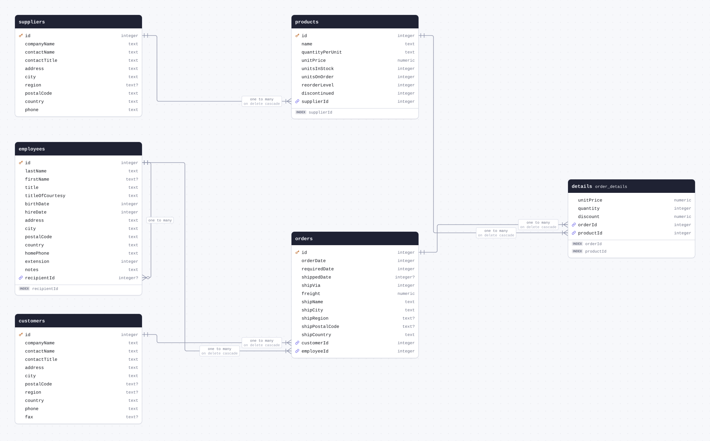
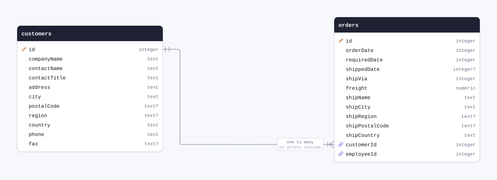
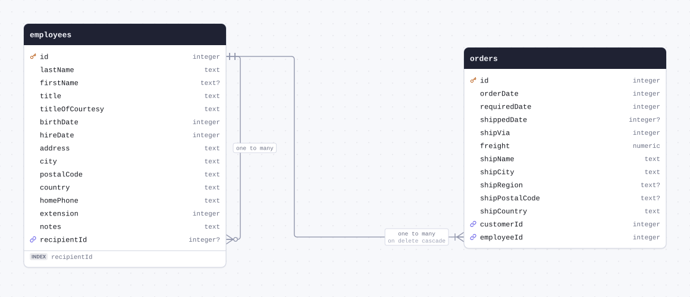
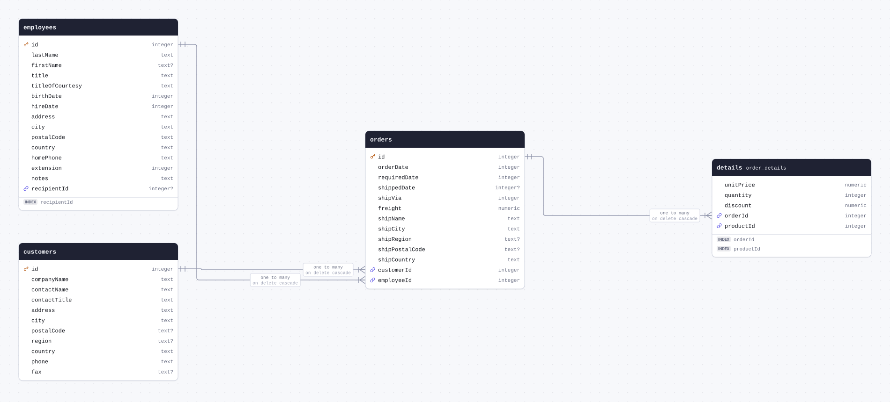
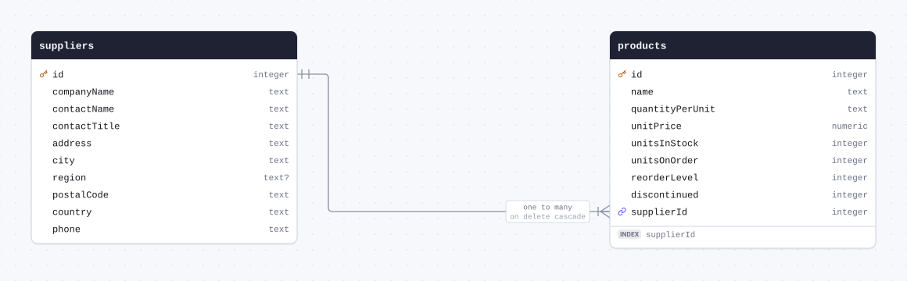
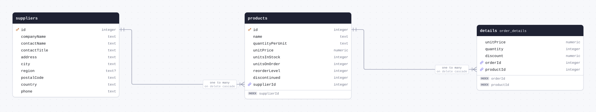
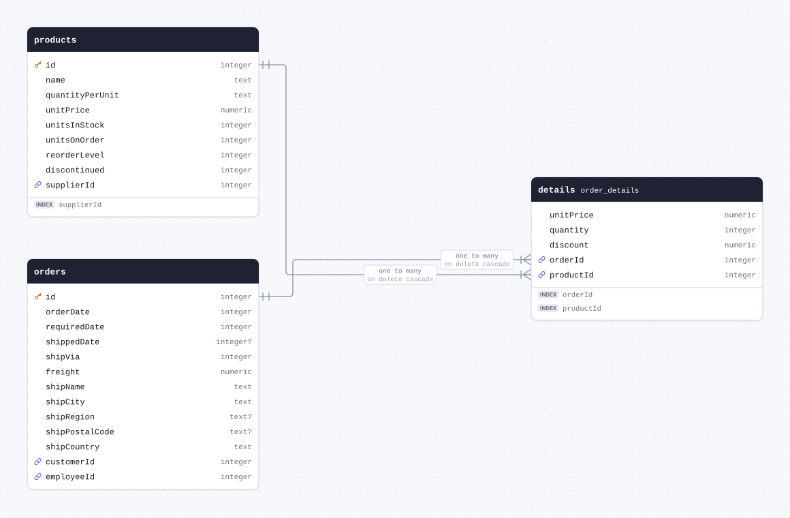

# Schema docs



<details>
<summary>The whole schema as SQL</summary>

```sql
CREATE TABLE `customers` (
	`id` integer PRIMARY KEY AUTOINCREMENT,
	`company_name` text NOT NULL,
	`contact_name` text NOT NULL,
	`contact_title` text NOT NULL,
	`address` text NOT NULL,
	`city` text NOT NULL,
	`postal_code` text,
	`region` text,
	`country` text NOT NULL,
	`phone` text NOT NULL,
	`fax` text
);

CREATE TABLE `order_details` (
	`unit_price` numeric NOT NULL,
	`quantity` integer NOT NULL,
	`discount` numeric NOT NULL,
	`order_id` integer NOT NULL,
	`product_id` integer NOT NULL,
	CONSTRAINT `fk_order_details_order_id_orders_id_fk` FOREIGN KEY (`order_id`) REFERENCES `orders`(`id`) ON DELETE CASCADE,
	CONSTRAINT `fk_order_details_product_id_products_id_fk` FOREIGN KEY (`product_id`) REFERENCES `products`(`id`) ON DELETE CASCADE
);

CREATE TABLE `employees` (
	`id` integer PRIMARY KEY AUTOINCREMENT,
	`last_name` text NOT NULL,
	`first_name` text,
	`title` text NOT NULL,
	`title_of_courtesy` text NOT NULL,
	`birth_date` integer NOT NULL,
	`hire_date` integer NOT NULL,
	`address` text NOT NULL,
	`city` text NOT NULL,
	`postal_code` text NOT NULL,
	`country` text NOT NULL,
	`home_phone` text NOT NULL,
	`extension` integer NOT NULL,
	`notes` text NOT NULL,
	`recipient_id` integer,
	CONSTRAINT `fk_employees_recipient_id_employees_id_fk` FOREIGN KEY (`recipient_id`) REFERENCES `employees`(`id`)
);

CREATE TABLE `orders` (
	`id` integer PRIMARY KEY AUTOINCREMENT,
	`order_date` integer NOT NULL,
	`required_date` integer NOT NULL,
	`shipped_date` integer,
	`ship_via` integer NOT NULL,
	`freight` numeric NOT NULL,
	`ship_name` text NOT NULL,
	`ship_city` text NOT NULL,
	`ship_region` text,
	`ship_postal_code` text,
	`ship_country` text NOT NULL,
	`customer_id` integer NOT NULL,
	`employee_id` integer NOT NULL,
	CONSTRAINT `fk_orders_customer_id_customers_id_fk` FOREIGN KEY (`customer_id`) REFERENCES `customers`(`id`) ON DELETE CASCADE,
	CONSTRAINT `fk_orders_employee_id_employees_id_fk` FOREIGN KEY (`employee_id`) REFERENCES `employees`(`id`) ON DELETE CASCADE
);

CREATE TABLE `products` (
	`id` integer PRIMARY KEY AUTOINCREMENT,
	`name` text NOT NULL,
	`qt_per_unit` text NOT NULL,
	`unit_price` numeric NOT NULL,
	`units_in_stock` integer NOT NULL,
	`units_on_order` integer NOT NULL,
	`reorder_level` integer NOT NULL,
	`discontinued` integer NOT NULL,
	`supplier_id` integer NOT NULL,
	CONSTRAINT `fk_products_supplier_id_suppliers_id_fk` FOREIGN KEY (`supplier_id`) REFERENCES `suppliers`(`id`) ON DELETE CASCADE
);

CREATE TABLE `suppliers` (
	`id` integer PRIMARY KEY AUTOINCREMENT,
	`company_name` text NOT NULL,
	`contact_name` text NOT NULL,
	`contact_title` text NOT NULL,
	`address` text NOT NULL,
	`city` text NOT NULL,
	`region` text,
	`postal_code` text NOT NULL,
	`country` text NOT NULL,
	`phone` text NOT NULL
);

CREATE INDEX `order_id_idx` ON `order_details` (`order_id`);

CREATE INDEX `product_id_idx` ON `order_details` (`product_id`);

CREATE INDEX `recepient_idx` ON `employees` (`recipient_id`);

CREATE INDEX `supplier_idx` ON `products` (`supplier_id`);
```

</details>

## Contents

| Table                         | Name in the database | Description |
| ----------------------------- | -------------------- | ----------- |
| [customers](#table-customers) | `customers`          |             |
| [employees](#table-employees) | `employees`          |             |
| [orders](#table-orders)       | `orders`             |             |
| [suppliers](#table-suppliers) | `suppliers`          |             |
| [products](#table-products)   | `products`           |             |
| [details](#table-details)     | `order_details`      |             |

## Tables

<a id="table-customers"></a>

### customers



| Column                           | Type      | Constraints | Default | Description |
| -------------------------------- | --------- | ----------- | ------- | ----------- |
| `id`                             | `integer` | PK NOT NULL |         |             |
| `companyName` (`company_name`)   | `text`    | NOT NULL    |         |             |
| `contactName` (`contact_name`)   | `text`    | NOT NULL    |         |             |
| `contactTitle` (`contact_title`) | `text`    | NOT NULL    |         |             |
| `address`                        | `text`    | NOT NULL    |         |             |
| `city`                           | `text`    | NOT NULL    |         |             |
| `postalCode` (`postal_code`)     | `text`    | NULL        |         |             |
| `region`                         | `text`    | NULL        |         |             |
| `country`                        | `text`    | NOT NULL    |         |             |
| `phone`                          | `text`    | NOT NULL    |         |             |
| `fax`                            | `text`    | NULL        |         |             |

#### Definition

```sql
CREATE TABLE `customers` (
	`id` integer PRIMARY KEY AUTOINCREMENT,
	`company_name` text NOT NULL,
	`contact_name` text NOT NULL,
	`contact_title` text NOT NULL,
	`address` text NOT NULL,
	`city` text NOT NULL,
	`postal_code` text,
	`region` text,
	`country` text NOT NULL,
	`phone` text NOT NULL,
	`fax` text
);
```

#### Referenced by

- `id` → [orders.customerId](#table-orders) (one to many, on delete cascade)

<details>
<summary>Queries and their SQL</summary>

**Select**: Every row of customers.

```ts
db.select().from(customers);
```

```sql
select "id", "company_name", "contact_name", "contact_title", "address", "city", "postal_code", "region", "country", "phone", "fax"
from "customers"
```

**Count**: How many rows customers has.

```ts
db.select({ count: count() }).from(customers);
```

```sql
select count(*)
from "customers"
```

**Find many**: The rows of customers, through the relational query API.

```ts
db.query.customers.findMany();
```

```sql
select "d0"."id" as "id", "d0"."company_name" as "companyName", "d0"."contact_name" as "contactName", "d0"."contact_title" as "contactTitle", "d0"."address" as "address", "d0"."city" as "city", "d0"."postal_code" as "postalCode", "d0"."region" as "region", "d0"."country" as "country", "d0"."phone" as "phone", "d0"."fax" as "fax"
from "customers" as "d0"
```

**Find by primary key**: One row of customers, through the relational query API.

```ts
db.query.customers.findFirst({ where: { id: 1 } });
```

```sql
select "d0"."id" as "id", "d0"."company_name" as "companyName", "d0"."contact_name" as "contactName", "d0"."contact_title" as "contactTitle", "d0"."address" as "address", "d0"."city" as "city", "d0"."postal_code" as "postalCode", "d0"."region" as "region", "d0"."country" as "country", "d0"."phone" as "phone", "d0"."fax" as "fax"
from "customers" as "d0"
where "d0"."id" = ?
limit ?
-- params: [1,1]
```

**Insert**: Adds a row to customers, giving the columns that have no default.

```ts
db.insert(customers).values({
  id: 1,
  companyName: "companyName",
  contactName: "contactName",
  contactTitle: "contactTitle",
  address: "address",
  city: "city",
  country: "country",
  phone: "phone",
});
```

```sql
insert into "customers" ("id", "company_name", "contact_name", "contact_title", "address", "city", "postal_code", "region", "country", "phone", "fax")
values (?, ?, ?, ?, ?, ?, null, null, ?, ?, null)
-- params: [1,"companyName","contactName","contactTitle","address","city","country","phone"]
```

**Update**: Changes a row of customers, found by its primary key.

```ts
db.update(customers).set({ companyName: "companyName" }).where(eq(customers.id, 1));
```

```sql
update "customers"
set "company_name" = ?
where "customers"."id" = ?
-- params: ["companyName",1]
```

**Delete**: Deletes a row of customers, found by its primary key.

```ts
db.delete(customers).where(eq(customers.id, 1));
```

```sql
delete from "customers"
where "customers"."id" = ?
-- params: [1]
```

</details>

<a id="table-employees"></a>

### employees



| Column                                  | Type      | Constraints                             | Default | Description |
| --------------------------------------- | --------- | --------------------------------------- | ------- | ----------- |
| `id`                                    | `integer` | PK NOT NULL                             |         |             |
| `lastName` (`last_name`)                | `text`    | NOT NULL                                |         |             |
| `firstName` (`first_name`)              | `text`    | NULL                                    |         |             |
| `title`                                 | `text`    | NOT NULL                                |         |             |
| `titleOfCourtesy` (`title_of_courtesy`) | `text`    | NOT NULL                                |         |             |
| `birthDate` (`birth_date`)              | `integer` | NOT NULL                                |         |             |
| `hireDate` (`hire_date`)                | `integer` | NOT NULL                                |         |             |
| `address`                               | `text`    | NOT NULL                                |         |             |
| `city`                                  | `text`    | NOT NULL                                |         |             |
| `postalCode` (`postal_code`)            | `text`    | NOT NULL                                |         |             |
| `country`                               | `text`    | NOT NULL                                |         |             |
| `homePhone` (`home_phone`)              | `text`    | NOT NULL                                |         |             |
| `extension`                             | `integer` | NOT NULL                                |         |             |
| `notes`                                 | `text`    | NOT NULL                                |         |             |
| `recipientId` (`recipient_id`)          | `integer` | NULL → [employees.id](#table-employees) |         |             |

#### Definition

```sql
CREATE TABLE `employees` (
	`id` integer PRIMARY KEY AUTOINCREMENT,
	`last_name` text NOT NULL,
	`first_name` text,
	`title` text NOT NULL,
	`title_of_courtesy` text NOT NULL,
	`birth_date` integer NOT NULL,
	`hire_date` integer NOT NULL,
	`address` text NOT NULL,
	`city` text NOT NULL,
	`postal_code` text NOT NULL,
	`country` text NOT NULL,
	`home_phone` text NOT NULL,
	`extension` integer NOT NULL,
	`notes` text NOT NULL,
	`recipient_id` integer,
	CONSTRAINT `fk_employees_recipient_id_employees_id_fk` FOREIGN KEY (`recipient_id`) REFERENCES `employees`(`id`)
);

CREATE INDEX `recepient_idx` ON `employees` (`recipient_id`);
```

#### Indexes

- INDEX `recipientId`

#### References

- `recipientId` → [employees.id](#table-employees) (many to one)

#### Referenced by

- `id` → [employees.recipientId](#table-employees) (one to many)
- `id` → [orders.employeeId](#table-orders) (one to many, on delete cascade)

<details>
<summary>Queries and their SQL</summary>

**Select**: Every row of employees.

```ts
db.select().from(employees);
```

```sql
select "id", "last_name", "first_name", "title", "title_of_courtesy", "birth_date", "hire_date", "address", "city", "postal_code", "country", "home_phone", "extension", "notes", "recipient_id"
from "employees"
```

**Count**: How many rows employees has.

```ts
db.select({ count: count() }).from(employees);
```

```sql
select count(*)
from "employees"
```

**Find many**: The rows of employees, through the relational query API.

```ts
db.query.employees.findMany();
```

```sql
select "d0"."id" as "id", "d0"."last_name" as "lastName", "d0"."first_name" as "firstName", "d0"."title" as "title", "d0"."title_of_courtesy" as "titleOfCourtesy", "d0"."birth_date" as "birthDate", "d0"."hire_date" as "hireDate", "d0"."address" as "address", "d0"."city" as "city", "d0"."postal_code" as "postalCode", "d0"."country" as "country", "d0"."home_phone" as "homePhone", "d0"."extension" as "extension", "d0"."notes" as "notes", "d0"."recipient_id" as "recipientId"
from "employees" as "d0"
```

**Find by primary key**: One row of employees, through the relational query API.

```ts
db.query.employees.findFirst({ where: { id: 1 } });
```

```sql
select "d0"."id" as "id", "d0"."last_name" as "lastName", "d0"."first_name" as "firstName", "d0"."title" as "title", "d0"."title_of_courtesy" as "titleOfCourtesy", "d0"."birth_date" as "birthDate", "d0"."hire_date" as "hireDate", "d0"."address" as "address", "d0"."city" as "city", "d0"."postal_code" as "postalCode", "d0"."country" as "country", "d0"."home_phone" as "homePhone", "d0"."extension" as "extension", "d0"."notes" as "notes", "d0"."recipient_id" as "recipientId"
from "employees" as "d0"
where "d0"."id" = ?
limit ?
-- params: [1,1]
```

**Insert**: Adds a row to employees, giving the columns that have no default.

```ts
db.insert(employees).values({
  id: 1,
  lastName: "lastName",
  title: "title",
  titleOfCourtesy: "titleOfCourtesy",
  birthDate: 1,
  hireDate: 1,
  address: "address",
  city: "city",
  postalCode: "postalCode",
  country: "country",
  homePhone: "homePhone",
  extension: 1,
  notes: "notes",
});
```

```sql
insert into "employees" ("id", "last_name", "first_name", "title", "title_of_courtesy", "birth_date", "hire_date", "address", "city", "postal_code", "country", "home_phone", "extension", "notes", "recipient_id")
values (?, ?, null, ?, ?, ?, ?, ?, ?, ?, ?, ?, ?, ?, null)
-- params: [1,"lastName","title","titleOfCourtesy",1,1,"address","city","postalCode","country","homePhone",1,"notes"]
```

**Update**: Changes a row of employees, found by its primary key.

```ts
db.update(employees).set({ lastName: "lastName" }).where(eq(employees.id, 1));
```

```sql
update "employees"
set "last_name" = ?
where "employees"."id" = ?
-- params: ["lastName",1]
```

**Delete**: Deletes a row of employees, found by its primary key.

```ts
db.delete(employees).where(eq(employees.id, 1));
```

```sql
delete from "employees"
where "employees"."id" = ?
-- params: [1]
```

</details>

<a id="table-orders"></a>

### orders



| Column                                | Type      | Constraints                                 | Default | Description |
| ------------------------------------- | --------- | ------------------------------------------- | ------- | ----------- |
| `id`                                  | `integer` | PK NOT NULL                                 |         |             |
| `orderDate` (`order_date`)            | `integer` | NOT NULL                                    |         |             |
| `requiredDate` (`required_date`)      | `integer` | NOT NULL                                    |         |             |
| `shippedDate` (`shipped_date`)        | `integer` | NULL                                        |         |             |
| `shipVia` (`ship_via`)                | `integer` | NOT NULL                                    |         |             |
| `freight`                             | `numeric` | NOT NULL                                    |         |             |
| `shipName` (`ship_name`)              | `text`    | NOT NULL                                    |         |             |
| `shipCity` (`ship_city`)              | `text`    | NOT NULL                                    |         |             |
| `shipRegion` (`ship_region`)          | `text`    | NULL                                        |         |             |
| `shipPostalCode` (`ship_postal_code`) | `text`    | NULL                                        |         |             |
| `shipCountry` (`ship_country`)        | `text`    | NOT NULL                                    |         |             |
| `customerId` (`customer_id`)          | `integer` | NOT NULL → [customers.id](#table-customers) |         |             |
| `employeeId` (`employee_id`)          | `integer` | NOT NULL → [employees.id](#table-employees) |         |             |

#### Definition

```sql
CREATE TABLE `orders` (
	`id` integer PRIMARY KEY AUTOINCREMENT,
	`order_date` integer NOT NULL,
	`required_date` integer NOT NULL,
	`shipped_date` integer,
	`ship_via` integer NOT NULL,
	`freight` numeric NOT NULL,
	`ship_name` text NOT NULL,
	`ship_city` text NOT NULL,
	`ship_region` text,
	`ship_postal_code` text,
	`ship_country` text NOT NULL,
	`customer_id` integer NOT NULL,
	`employee_id` integer NOT NULL,
	CONSTRAINT `fk_orders_customer_id_customers_id_fk` FOREIGN KEY (`customer_id`) REFERENCES `customers`(`id`) ON DELETE CASCADE,
	CONSTRAINT `fk_orders_employee_id_employees_id_fk` FOREIGN KEY (`employee_id`) REFERENCES `employees`(`id`) ON DELETE CASCADE
);
```

#### References

- `customerId` → [customers.id](#table-customers) (many to one, on delete cascade)
- `employeeId` → [employees.id](#table-employees) (many to one, on delete cascade)

#### Referenced by

- `id` → [details.orderId](#table-details) (one to many, on delete cascade)

<details>
<summary>Queries and their SQL</summary>

**Select**: Every row of orders.

```ts
db.select().from(orders);
```

```sql
select "id", "order_date", "required_date", "shipped_date", "ship_via", "freight", "ship_name", "ship_city", "ship_region", "ship_postal_code", "ship_country", "customer_id", "employee_id"
from "orders"
```

**Count**: How many rows orders has.

```ts
db.select({ count: count() }).from(orders);
```

```sql
select count(*)
from "orders"
```

**Find many**: The rows of orders, through the relational query API.

```ts
db.query.orders.findMany();
```

```sql
select "d0"."id" as "id", "d0"."order_date" as "orderDate", "d0"."required_date" as "requiredDate", "d0"."shipped_date" as "shippedDate", "d0"."ship_via" as "shipVia", "d0"."freight" as "freight", "d0"."ship_name" as "shipName", "d0"."ship_city" as "shipCity", "d0"."ship_region" as "shipRegion", "d0"."ship_postal_code" as "shipPostalCode", "d0"."ship_country" as "shipCountry", "d0"."customer_id" as "customerId", "d0"."employee_id" as "employeeId"
from "orders" as "d0"
```

**Find by primary key**: One row of orders, through the relational query API.

```ts
db.query.orders.findFirst({ where: { id: 1 } });
```

```sql
select "d0"."id" as "id", "d0"."order_date" as "orderDate", "d0"."required_date" as "requiredDate", "d0"."shipped_date" as "shippedDate", "d0"."ship_via" as "shipVia", "d0"."freight" as "freight", "d0"."ship_name" as "shipName", "d0"."ship_city" as "shipCity", "d0"."ship_region" as "shipRegion", "d0"."ship_postal_code" as "shipPostalCode", "d0"."ship_country" as "shipCountry", "d0"."customer_id" as "customerId", "d0"."employee_id" as "employeeId"
from "orders" as "d0"
where "d0"."id" = ?
limit ?
-- params: [1,1]
```

**Insert**: Adds a row to orders, giving the columns that have no default.

```ts
db.insert(orders).values({
  id: 1,
  orderDate: 1,
  requiredDate: 1,
  shipVia: 1,
  freight: "1.00",
  shipName: "shipName",
  shipCity: "shipCity",
  shipCountry: "shipCountry",
  customerId: 1,
  employeeId: 1,
});
```

```sql
insert into "orders" ("id", "order_date", "required_date", "shipped_date", "ship_via", "freight", "ship_name", "ship_city", "ship_region", "ship_postal_code", "ship_country", "customer_id", "employee_id")
values (?, ?, ?, null, ?, ?, ?, ?, null, null, ?, ?, ?)
-- params: [1,1,1,1,"1.00","shipName","shipCity","shipCountry",1,1]
```

**Update**: Changes a row of orders, found by its primary key.

```ts
db.update(orders).set({ orderDate: 1 }).where(eq(orders.id, 1));
```

```sql
update "orders"
set "order_date" = ?
where "orders"."id" = ?
-- params: [1,1]
```

**Delete**: Deletes a row of orders, found by its primary key.

```ts
db.delete(orders).where(eq(orders.id, 1));
```

```sql
delete from "orders"
where "orders"."id" = ?
-- params: [1]
```

</details>

<a id="table-suppliers"></a>

### suppliers



| Column                           | Type      | Constraints | Default | Description |
| -------------------------------- | --------- | ----------- | ------- | ----------- |
| `id`                             | `integer` | PK NOT NULL |         |             |
| `companyName` (`company_name`)   | `text`    | NOT NULL    |         |             |
| `contactName` (`contact_name`)   | `text`    | NOT NULL    |         |             |
| `contactTitle` (`contact_title`) | `text`    | NOT NULL    |         |             |
| `address`                        | `text`    | NOT NULL    |         |             |
| `city`                           | `text`    | NOT NULL    |         |             |
| `region`                         | `text`    | NULL        |         |             |
| `postalCode` (`postal_code`)     | `text`    | NOT NULL    |         |             |
| `country`                        | `text`    | NOT NULL    |         |             |
| `phone`                          | `text`    | NOT NULL    |         |             |

#### Definition

```sql
CREATE TABLE `suppliers` (
	`id` integer PRIMARY KEY AUTOINCREMENT,
	`company_name` text NOT NULL,
	`contact_name` text NOT NULL,
	`contact_title` text NOT NULL,
	`address` text NOT NULL,
	`city` text NOT NULL,
	`region` text,
	`postal_code` text NOT NULL,
	`country` text NOT NULL,
	`phone` text NOT NULL
);
```

#### Referenced by

- `id` → [products.supplierId](#table-products) (one to many, on delete cascade)

<details>
<summary>Queries and their SQL</summary>

**Select**: Every row of suppliers.

```ts
db.select().from(suppliers);
```

```sql
select "id", "company_name", "contact_name", "contact_title", "address", "city", "region", "postal_code", "country", "phone"
from "suppliers"
```

**Count**: How many rows suppliers has.

```ts
db.select({ count: count() }).from(suppliers);
```

```sql
select count(*)
from "suppliers"
```

**Find many**: The rows of suppliers, through the relational query API.

```ts
db.query.suppliers.findMany();
```

```sql
select "d0"."id" as "id", "d0"."company_name" as "companyName", "d0"."contact_name" as "contactName", "d0"."contact_title" as "contactTitle", "d0"."address" as "address", "d0"."city" as "city", "d0"."region" as "region", "d0"."postal_code" as "postalCode", "d0"."country" as "country", "d0"."phone" as "phone"
from "suppliers" as "d0"
```

**Find by primary key**: One row of suppliers, through the relational query API.

```ts
db.query.suppliers.findFirst({ where: { id: 1 } });
```

```sql
select "d0"."id" as "id", "d0"."company_name" as "companyName", "d0"."contact_name" as "contactName", "d0"."contact_title" as "contactTitle", "d0"."address" as "address", "d0"."city" as "city", "d0"."region" as "region", "d0"."postal_code" as "postalCode", "d0"."country" as "country", "d0"."phone" as "phone"
from "suppliers" as "d0"
where "d0"."id" = ?
limit ?
-- params: [1,1]
```

**Insert**: Adds a row to suppliers, giving the columns that have no default.

```ts
db.insert(suppliers).values({
  id: 1,
  companyName: "companyName",
  contactName: "contactName",
  contactTitle: "contactTitle",
  address: "address",
  city: "city",
  postalCode: "postalCode",
  country: "country",
  phone: "phone",
});
```

```sql
insert into "suppliers" ("id", "company_name", "contact_name", "contact_title", "address", "city", "region", "postal_code", "country", "phone")
values (?, ?, ?, ?, ?, ?, null, ?, ?, ?)
-- params: [1,"companyName","contactName","contactTitle","address","city","postalCode","country","phone"]
```

**Update**: Changes a row of suppliers, found by its primary key.

```ts
db.update(suppliers).set({ companyName: "companyName" }).where(eq(suppliers.id, 1));
```

```sql
update "suppliers"
set "company_name" = ?
where "suppliers"."id" = ?
-- params: ["companyName",1]
```

**Delete**: Deletes a row of suppliers, found by its primary key.

```ts
db.delete(suppliers).where(eq(suppliers.id, 1));
```

```sql
delete from "suppliers"
where "suppliers"."id" = ?
-- params: [1]
```

</details>

<a id="table-products"></a>

### products



| Column                            | Type      | Constraints                                 | Default | Description |
| --------------------------------- | --------- | ------------------------------------------- | ------- | ----------- |
| `id`                              | `integer` | PK NOT NULL                                 |         |             |
| `name`                            | `text`    | NOT NULL                                    |         |             |
| `quantityPerUnit` (`qt_per_unit`) | `text`    | NOT NULL                                    |         |             |
| `unitPrice` (`unit_price`)        | `numeric` | NOT NULL                                    |         |             |
| `unitsInStock` (`units_in_stock`) | `integer` | NOT NULL                                    |         |             |
| `unitsOnOrder` (`units_on_order`) | `integer` | NOT NULL                                    |         |             |
| `reorderLevel` (`reorder_level`)  | `integer` | NOT NULL                                    |         |             |
| `discontinued`                    | `integer` | NOT NULL                                    |         |             |
| `supplierId` (`supplier_id`)      | `integer` | NOT NULL → [suppliers.id](#table-suppliers) |         |             |

#### Definition

```sql
CREATE TABLE `products` (
	`id` integer PRIMARY KEY AUTOINCREMENT,
	`name` text NOT NULL,
	`qt_per_unit` text NOT NULL,
	`unit_price` numeric NOT NULL,
	`units_in_stock` integer NOT NULL,
	`units_on_order` integer NOT NULL,
	`reorder_level` integer NOT NULL,
	`discontinued` integer NOT NULL,
	`supplier_id` integer NOT NULL,
	CONSTRAINT `fk_products_supplier_id_suppliers_id_fk` FOREIGN KEY (`supplier_id`) REFERENCES `suppliers`(`id`) ON DELETE CASCADE
);

CREATE INDEX `supplier_idx` ON `products` (`supplier_id`);
```

#### Indexes

- INDEX `supplierId`

#### References

- `supplierId` → [suppliers.id](#table-suppliers) (many to one, on delete cascade)

#### Referenced by

- `id` → [details.productId](#table-details) (one to many, on delete cascade)

<details>
<summary>Queries and their SQL</summary>

**Select**: Every row of products.

```ts
db.select().from(products);
```

```sql
select "id", "name", "qt_per_unit", "unit_price", "units_in_stock", "units_on_order", "reorder_level", "discontinued", "supplier_id"
from "products"
```

**Count**: How many rows products has.

```ts
db.select({ count: count() }).from(products);
```

```sql
select count(*)
from "products"
```

**Find many**: The rows of products, through the relational query API.

```ts
db.query.products.findMany();
```

```sql
select "d0"."id" as "id", "d0"."name" as "name", "d0"."qt_per_unit" as "quantityPerUnit", "d0"."unit_price" as "unitPrice", "d0"."units_in_stock" as "unitsInStock", "d0"."units_on_order" as "unitsOnOrder", "d0"."reorder_level" as "reorderLevel", "d0"."discontinued" as "discontinued", "d0"."supplier_id" as "supplierId"
from "products" as "d0"
```

**Find by primary key**: One row of products, through the relational query API.

```ts
db.query.products.findFirst({ where: { id: 1 } });
```

```sql
select "d0"."id" as "id", "d0"."name" as "name", "d0"."qt_per_unit" as "quantityPerUnit", "d0"."unit_price" as "unitPrice", "d0"."units_in_stock" as "unitsInStock", "d0"."units_on_order" as "unitsOnOrder", "d0"."reorder_level" as "reorderLevel", "d0"."discontinued" as "discontinued", "d0"."supplier_id" as "supplierId"
from "products" as "d0"
where "d0"."id" = ?
limit ?
-- params: [1,1]
```

**Insert**: Adds a row to products, giving the columns that have no default.

```ts
db.insert(products).values({
  id: 1,
  name: "name",
  quantityPerUnit: "quantityPerUnit",
  unitPrice: "1.00",
  unitsInStock: 1,
  unitsOnOrder: 1,
  reorderLevel: 1,
  discontinued: 1,
  supplierId: 1,
});
```

```sql
insert into "products" ("id", "name", "qt_per_unit", "unit_price", "units_in_stock", "units_on_order", "reorder_level", "discontinued", "supplier_id")
values (?, ?, ?, ?, ?, ?, ?, ?, ?)
-- params: [1,"name","quantityPerUnit","1.00",1,1,1,1,1]
```

**Update**: Changes a row of products, found by its primary key.

```ts
db.update(products).set({ name: "name" }).where(eq(products.id, 1));
```

```sql
update "products"
set "name" = ?
where "products"."id" = ?
-- params: ["name",1]
```

**Delete**: Deletes a row of products, found by its primary key.

```ts
db.delete(products).where(eq(products.id, 1));
```

```sql
delete from "products"
where "products"."id" = ?
-- params: [1]
```

</details>

<a id="table-details"></a>

### details

Table `order_details`.



| Column                     | Type      | Constraints                               | Default | Description |
| -------------------------- | --------- | ----------------------------------------- | ------- | ----------- |
| `unitPrice` (`unit_price`) | `numeric` | NOT NULL                                  |         |             |
| `quantity`                 | `integer` | NOT NULL                                  |         |             |
| `discount`                 | `numeric` | NOT NULL                                  |         |             |
| `orderId` (`order_id`)     | `integer` | NOT NULL → [orders.id](#table-orders)     |         |             |
| `productId` (`product_id`) | `integer` | NOT NULL → [products.id](#table-products) |         |             |

#### Definition

```sql
CREATE TABLE `order_details` (
	`unit_price` numeric NOT NULL,
	`quantity` integer NOT NULL,
	`discount` numeric NOT NULL,
	`order_id` integer NOT NULL,
	`product_id` integer NOT NULL,
	CONSTRAINT `fk_order_details_order_id_orders_id_fk` FOREIGN KEY (`order_id`) REFERENCES `orders`(`id`) ON DELETE CASCADE,
	CONSTRAINT `fk_order_details_product_id_products_id_fk` FOREIGN KEY (`product_id`) REFERENCES `products`(`id`) ON DELETE CASCADE
);

CREATE INDEX `order_id_idx` ON `order_details` (`order_id`);

CREATE INDEX `product_id_idx` ON `order_details` (`product_id`);
```

#### Indexes

- INDEX `orderId`
- INDEX `productId`

#### References

- `orderId` → [orders.id](#table-orders) (many to one, on delete cascade)
- `productId` → [products.id](#table-products) (many to one, on delete cascade)

<details>
<summary>Queries and their SQL</summary>

**Select**: Every row of details.

```ts
db.select().from(details);
```

```sql
select "unit_price", "quantity", "discount", "order_id", "product_id"
from "order_details"
```

**Count**: How many rows details has.

```ts
db.select({ count: count() }).from(details);
```

```sql
select count(*)
from "order_details"
```

**Find many**: The rows of details, through the relational query API.

```ts
db.query.details.findMany();
```

```sql
select "d0"."unit_price" as "unitPrice", "d0"."quantity" as "quantity", "d0"."discount" as "discount", "d0"."order_id" as "orderId", "d0"."product_id" as "productId"
from "order_details" as "d0"
```

**Insert**: Adds a row to details, giving the columns that have no default.

```ts
db.insert(details).values({
  unitPrice: "1.00",
  quantity: 1,
  discount: "1.00",
  orderId: 1,
  productId: 1,
});
```

```sql
insert into "order_details" ("unit_price", "quantity", "discount", "order_id", "product_id")
values (?, ?, ?, ?, ?)
-- params: ["1.00",1,"1.00",1,1]
```

</details>
