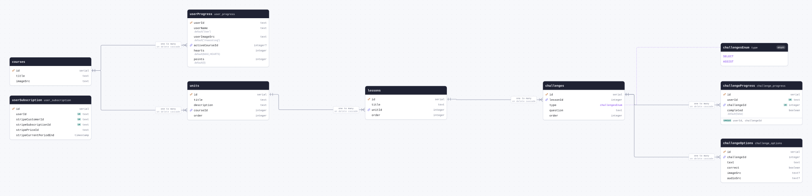
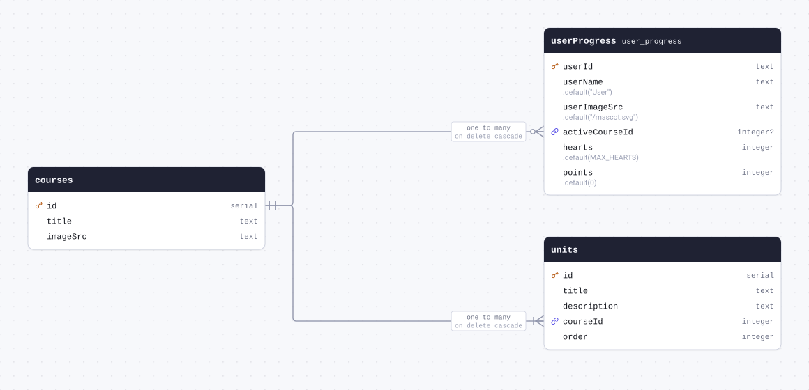
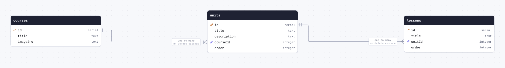
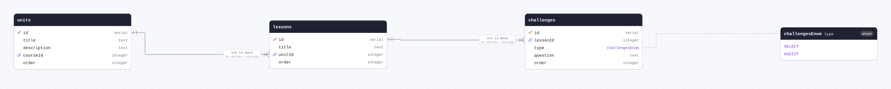
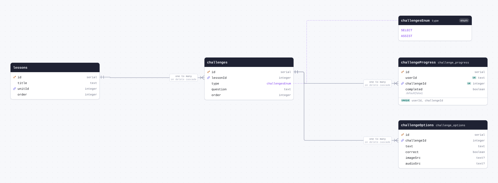
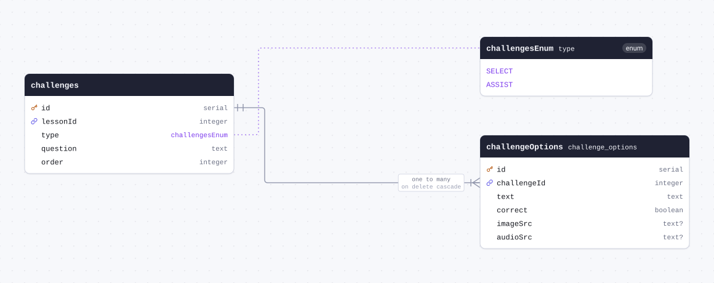
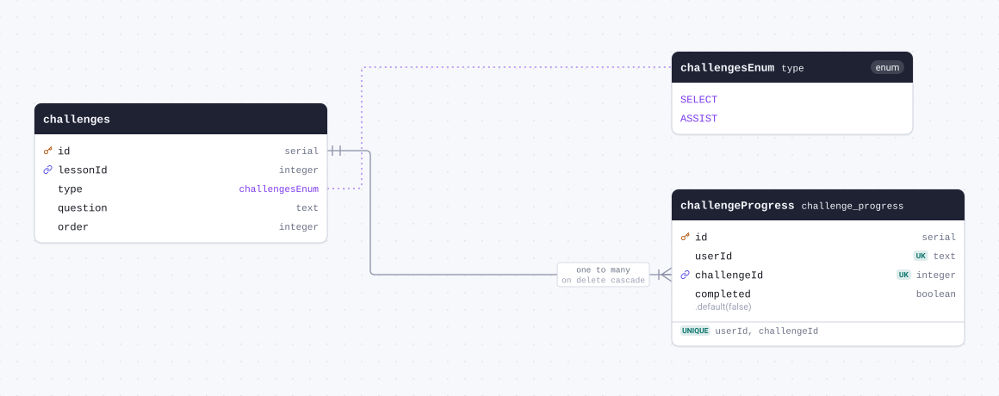
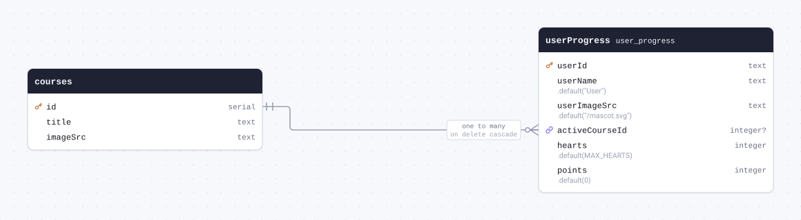
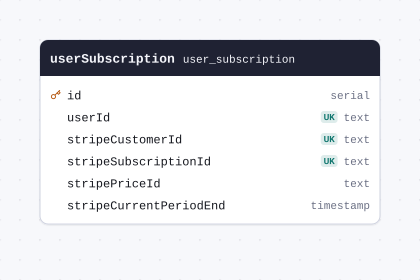

# Schema docs



<details>
<summary>The whole schema as SQL</summary>

```sql
CREATE TYPE "type" AS ENUM('SELECT', 'ASSIST');

CREATE TABLE "challenge_options" (
	"id" serial PRIMARY KEY,
	"challenge_id" integer NOT NULL,
	"text" text NOT NULL,
	"correct" boolean NOT NULL,
	"image_src" text,
	"audio_src" text
);

CREATE TABLE "challenge_progress" (
	"id" serial PRIMARY KEY,
	"user_id" text NOT NULL,
	"challenge_id" integer NOT NULL,
	"completed" boolean DEFAULT false NOT NULL,
	CONSTRAINT "challenge_progress_user_id_challenge_id_unique" UNIQUE("user_id","challenge_id")
);

CREATE TABLE "challenges" (
	"id" serial PRIMARY KEY,
	"lesson_id" integer NOT NULL,
	"type" "type" NOT NULL,
	"question" text NOT NULL,
	"order" integer NOT NULL
);

CREATE TABLE "courses" (
	"id" serial PRIMARY KEY,
	"title" text NOT NULL,
	"image_src" text NOT NULL
);

CREATE TABLE "lessons" (
	"id" serial PRIMARY KEY,
	"title" text NOT NULL,
	"unit_id" integer NOT NULL,
	"order" integer NOT NULL
);

CREATE TABLE "units" (
	"id" serial PRIMARY KEY,
	"title" text NOT NULL,
	"description" text NOT NULL,
	"course_id" integer NOT NULL,
	"order" integer NOT NULL
);

CREATE TABLE "user_progress" (
	"user_id" text PRIMARY KEY,
	"user_name" text DEFAULT 'User' NOT NULL,
	"user_image_src" text DEFAULT '/mascot.svg' NOT NULL,
	"active_course_id" integer,
	"hearts" integer DEFAULT 5 NOT NULL,
	"points" integer DEFAULT 0 NOT NULL
);

CREATE TABLE "user_subscription" (
	"id" serial PRIMARY KEY,
	"user_id" text NOT NULL UNIQUE,
	"stripe_customer_id" text NOT NULL UNIQUE,
	"stripe_subscription_id" text NOT NULL UNIQUE,
	"stripe_price_id" text NOT NULL,
	"stripe_current_period_end" timestamp NOT NULL
);

ALTER TABLE "challenge_options" ADD CONSTRAINT "challenge_options_challenge_id_challenges_id_fkey" FOREIGN KEY ("challenge_id") REFERENCES "challenges"("id") ON DELETE CASCADE;

ALTER TABLE "challenge_progress" ADD CONSTRAINT "challenge_progress_challenge_id_challenges_id_fkey" FOREIGN KEY ("challenge_id") REFERENCES "challenges"("id") ON DELETE CASCADE;

ALTER TABLE "challenges" ADD CONSTRAINT "challenges_lesson_id_lessons_id_fkey" FOREIGN KEY ("lesson_id") REFERENCES "lessons"("id") ON DELETE CASCADE;

ALTER TABLE "lessons" ADD CONSTRAINT "lessons_unit_id_units_id_fkey" FOREIGN KEY ("unit_id") REFERENCES "units"("id") ON DELETE CASCADE;

ALTER TABLE "units" ADD CONSTRAINT "units_course_id_courses_id_fkey" FOREIGN KEY ("course_id") REFERENCES "courses"("id") ON DELETE CASCADE;

ALTER TABLE "user_progress" ADD CONSTRAINT "user_progress_active_course_id_courses_id_fkey" FOREIGN KEY ("active_course_id") REFERENCES "courses"("id") ON DELETE CASCADE;
```

</details>

## Contents

| Table                                         | Name in the database | Description |
| --------------------------------------------- | -------------------- | ----------- |
| [courses](#table-courses)                     | `courses`            |             |
| [units](#table-units)                         | `units`              |             |
| [lessons](#table-lessons)                     | `lessons`            |             |
| [challenges](#table-challenges)               | `challenges`         |             |
| [challengeOptions](#table-challengeOptions)   | `challenge_options`  |             |
| [challengeProgress](#table-challengeProgress) | `challenge_progress` |             |
| [userProgress](#table-userProgress)           | `user_progress`      |             |
| [userSubscription](#table-userSubscription)   | `user_subscription`  |             |

| Enum                                   | Name in the database | Description |
| -------------------------------------- | -------------------- | ----------- |
| [challengesEnum](#enum-challengesEnum) | `type`               |             |

## Tables

<a id="table-courses"></a>

### courses



| Column                   | Type     | Constraints | Default | Description |
| ------------------------ | -------- | ----------- | ------- | ----------- |
| `id`                     | `serial` | PK NOT NULL |         |             |
| `title`                  | `text`   | NOT NULL    |         |             |
| `imageSrc` (`image_src`) | `text`   | NOT NULL    |         |             |

#### Definition

```sql
CREATE TABLE "courses" (
	"id" serial PRIMARY KEY,
	"title" text NOT NULL,
	"image_src" text NOT NULL
);
```

#### Referenced by

- `id` → [units.courseId](#table-units) (one to many, on delete cascade)
- `id` → [userProgress.activeCourseId](#table-userProgress) (one to many, on delete cascade)

<details>
<summary>Queries and their SQL</summary>

**Select**: Every row of courses.

```ts
db.select().from(courses);
```

```sql
select "id", "title", "image_src"
from "courses"
```

**Count**: How many rows courses has.

```ts
db.select({ count: count() }).from(courses);
```

```sql
select count(*)
from "courses"
```

**Find many**: The rows of courses, through the relational query API.

```ts
db.query.courses.findMany();
```

```sql
select "d0"."id" as "id", "d0"."title" as "title", "d0"."image_src" as "imageSrc"
from "courses" as "d0"
```

**Find by primary key**: One row of courses, through the relational query API.

```ts
db.query.courses.findFirst({ where: { id: 1 } });
```

```sql
select "d0"."id" as "id", "d0"."title" as "title", "d0"."image_src" as "imageSrc"
from "courses" as "d0"
where "d0"."id" = $1
limit $2
-- params: [1,1]
```

**Insert**: Adds a row to courses, giving the columns that have no default.

```ts
db.insert(courses).values({ title: "title", imageSrc: "imageSrc" });
```

```sql
insert into "courses" ("id", "title", "image_src")
values (default, $1, $2)
-- params: ["title","imageSrc"]
```

**Update**: Changes a row of courses, found by its primary key.

```ts
db.update(courses).set({ title: "title" }).where(eq(courses.id, 1));
```

```sql
update "courses"
set "title" = $1
where "courses"."id" = $2
-- params: ["title",1]
```

**Delete**: Deletes a row of courses, found by its primary key.

```ts
db.delete(courses).where(eq(courses.id, 1));
```

```sql
delete from "courses"
where "courses"."id" = $1
-- params: [1]
```

</details>

<a id="table-units"></a>

### units



| Column                   | Type      | Constraints                             | Default | Description |
| ------------------------ | --------- | --------------------------------------- | ------- | ----------- |
| `id`                     | `serial`  | PK NOT NULL                             |         |             |
| `title`                  | `text`    | NOT NULL                                |         |             |
| `description`            | `text`    | NOT NULL                                |         |             |
| `courseId` (`course_id`) | `integer` | NOT NULL → [courses.id](#table-courses) |         |             |
| `order`                  | `integer` | NOT NULL                                |         |             |

#### Definition

```sql
CREATE TABLE "units" (
	"id" serial PRIMARY KEY,
	"title" text NOT NULL,
	"description" text NOT NULL,
	"course_id" integer NOT NULL,
	"order" integer NOT NULL
);

ALTER TABLE "units" ADD CONSTRAINT "units_course_id_courses_id_fkey" FOREIGN KEY ("course_id") REFERENCES "courses"("id") ON DELETE CASCADE;
```

#### References

- `courseId` → [courses.id](#table-courses) (many to one, on delete cascade)

#### Referenced by

- `id` → [lessons.unitId](#table-lessons) (one to many, on delete cascade)

<details>
<summary>Queries and their SQL</summary>

**Select**: Every row of units.

```ts
db.select().from(units);
```

```sql
select "id", "title", "description", "course_id", "order"
from "units"
```

**Count**: How many rows units has.

```ts
db.select({ count: count() }).from(units);
```

```sql
select count(*)
from "units"
```

**Find many**: The rows of units, through the relational query API.

```ts
db.query.units.findMany();
```

```sql
select "d0"."id" as "id", "d0"."title" as "title", "d0"."description" as "description", "d0"."course_id" as "courseId", "d0"."order" as "order"
from "units" as "d0"
```

**Find by primary key**: One row of units, through the relational query API.

```ts
db.query.units.findFirst({ where: { id: 1 } });
```

```sql
select "d0"."id" as "id", "d0"."title" as "title", "d0"."description" as "description", "d0"."course_id" as "courseId", "d0"."order" as "order"
from "units" as "d0"
where "d0"."id" = $1
limit $2
-- params: [1,1]
```

**Insert**: Adds a row to units, giving the columns that have no default.

```ts
db.insert(units).values({ title: "title", description: "description", courseId: 1, order: 1 });
```

```sql
insert into "units" ("id", "title", "description", "course_id", "order")
values (default, $1, $2, $3, $4)
-- params: ["title","description",1,1]
```

**Update**: Changes a row of units, found by its primary key.

```ts
db.update(units).set({ title: "title" }).where(eq(units.id, 1));
```

```sql
update "units"
set "title" = $1
where "units"."id" = $2
-- params: ["title",1]
```

**Delete**: Deletes a row of units, found by its primary key.

```ts
db.delete(units).where(eq(units.id, 1));
```

```sql
delete from "units"
where "units"."id" = $1
-- params: [1]
```

</details>

<a id="table-lessons"></a>

### lessons



| Column               | Type      | Constraints                         | Default | Description |
| -------------------- | --------- | ----------------------------------- | ------- | ----------- |
| `id`                 | `serial`  | PK NOT NULL                         |         |             |
| `title`              | `text`    | NOT NULL                            |         |             |
| `unitId` (`unit_id`) | `integer` | NOT NULL → [units.id](#table-units) |         |             |
| `order`              | `integer` | NOT NULL                            |         |             |

#### Definition

```sql
CREATE TABLE "lessons" (
	"id" serial PRIMARY KEY,
	"title" text NOT NULL,
	"unit_id" integer NOT NULL,
	"order" integer NOT NULL
);

ALTER TABLE "lessons" ADD CONSTRAINT "lessons_unit_id_units_id_fkey" FOREIGN KEY ("unit_id") REFERENCES "units"("id") ON DELETE CASCADE;
```

#### References

- `unitId` → [units.id](#table-units) (many to one, on delete cascade)

#### Referenced by

- `id` → [challenges.lessonId](#table-challenges) (one to many, on delete cascade)

<details>
<summary>Queries and their SQL</summary>

**Select**: Every row of lessons.

```ts
db.select().from(lessons);
```

```sql
select "id", "title", "unit_id", "order"
from "lessons"
```

**Count**: How many rows lessons has.

```ts
db.select({ count: count() }).from(lessons);
```

```sql
select count(*)
from "lessons"
```

**Find many**: The rows of lessons, through the relational query API.

```ts
db.query.lessons.findMany();
```

```sql
select "d0"."id" as "id", "d0"."title" as "title", "d0"."unit_id" as "unitId", "d0"."order" as "order"
from "lessons" as "d0"
```

**Find by primary key**: One row of lessons, through the relational query API.

```ts
db.query.lessons.findFirst({ where: { id: 1 } });
```

```sql
select "d0"."id" as "id", "d0"."title" as "title", "d0"."unit_id" as "unitId", "d0"."order" as "order"
from "lessons" as "d0"
where "d0"."id" = $1
limit $2
-- params: [1,1]
```

**Insert**: Adds a row to lessons, giving the columns that have no default.

```ts
db.insert(lessons).values({ title: "title", unitId: 1, order: 1 });
```

```sql
insert into "lessons" ("id", "title", "unit_id", "order")
values (default, $1, $2, $3)
-- params: ["title",1,1]
```

**Update**: Changes a row of lessons, found by its primary key.

```ts
db.update(lessons).set({ title: "title" }).where(eq(lessons.id, 1));
```

```sql
update "lessons"
set "title" = $1
where "lessons"."id" = $2
-- params: ["title",1]
```

**Delete**: Deletes a row of lessons, found by its primary key.

```ts
db.delete(lessons).where(eq(lessons.id, 1));
```

```sql
delete from "lessons"
where "lessons"."id" = $1
-- params: [1]
```

</details>

<a id="table-challenges"></a>

### challenges



| Column                   | Type                                     | Constraints                             | Default | Description |
| ------------------------ | ---------------------------------------- | --------------------------------------- | ------- | ----------- |
| `id`                     | `serial`                                 | PK NOT NULL                             |         |             |
| `lessonId` (`lesson_id`) | `integer`                                | NOT NULL → [lessons.id](#table-lessons) |         |             |
| `type`                   | [`challengesEnum`](#enum-challengesEnum) | NOT NULL                                |         |             |
| `question`               | `text`                                   | NOT NULL                                |         |             |
| `order`                  | `integer`                                | NOT NULL                                |         |             |

#### Definition

```sql
CREATE TABLE "challenges" (
	"id" serial PRIMARY KEY,
	"lesson_id" integer NOT NULL,
	"type" "type" NOT NULL,
	"question" text NOT NULL,
	"order" integer NOT NULL
);

ALTER TABLE "challenges" ADD CONSTRAINT "challenges_lesson_id_lessons_id_fkey" FOREIGN KEY ("lesson_id") REFERENCES "lessons"("id") ON DELETE CASCADE;
```

#### References

- `lessonId` → [lessons.id](#table-lessons) (many to one, on delete cascade)

#### Referenced by

- `id` → [challengeOptions.challengeId](#table-challengeOptions) (one to many, on delete cascade)
- `id` → [challengeProgress.challengeId](#table-challengeProgress) (one to many, on delete cascade)

<details>
<summary>Queries and their SQL</summary>

**Select**: Every row of challenges.

```ts
db.select().from(challenges);
```

```sql
select "id", "lesson_id", "type", "question", "order"
from "challenges"
```

**Count**: How many rows challenges has.

```ts
db.select({ count: count() }).from(challenges);
```

```sql
select count(*)
from "challenges"
```

**Find many**: The rows of challenges, through the relational query API.

```ts
db.query.challenges.findMany();
```

```sql
select "d0"."id" as "id", "d0"."lesson_id" as "lessonId", "d0"."type" as "type", "d0"."question" as "question", "d0"."order" as "order"
from "challenges" as "d0"
```

**Find by primary key**: One row of challenges, through the relational query API.

```ts
db.query.challenges.findFirst({ where: { id: 1 } });
```

```sql
select "d0"."id" as "id", "d0"."lesson_id" as "lessonId", "d0"."type" as "type", "d0"."question" as "question", "d0"."order" as "order"
from "challenges" as "d0"
where "d0"."id" = $1
limit $2
-- params: [1,1]
```

**Insert**: Adds a row to challenges, giving the columns that have no default.

```ts
db.insert(challenges).values({ lessonId: 1, type: "SELECT", question: "question", order: 1 });
```

```sql
insert into "challenges" ("id", "lesson_id", "type", "question", "order")
values (default, $1, $2, $3, $4)
-- params: [1,"SELECT","question",1]
```

**Update**: Changes a row of challenges, found by its primary key.

```ts
db.update(challenges).set({ lessonId: 1 }).where(eq(challenges.id, 1));
```

```sql
update "challenges"
set "lesson_id" = $1
where "challenges"."id" = $2
-- params: [1,1]
```

**Delete**: Deletes a row of challenges, found by its primary key.

```ts
db.delete(challenges).where(eq(challenges.id, 1));
```

```sql
delete from "challenges"
where "challenges"."id" = $1
-- params: [1]
```

</details>

<a id="table-challengeOptions"></a>

### challengeOptions

Table `challenge_options`.



| Column                         | Type      | Constraints                                   | Default | Description |
| ------------------------------ | --------- | --------------------------------------------- | ------- | ----------- |
| `id`                           | `serial`  | PK NOT NULL                                   |         |             |
| `challengeId` (`challenge_id`) | `integer` | NOT NULL → [challenges.id](#table-challenges) |         |             |
| `text`                         | `text`    | NOT NULL                                      |         |             |
| `correct`                      | `boolean` | NOT NULL                                      |         |             |
| `imageSrc` (`image_src`)       | `text`    | NULL                                          |         |             |
| `audioSrc` (`audio_src`)       | `text`    | NULL                                          |         |             |

#### Definition

```sql
CREATE TABLE "challenge_options" (
	"id" serial PRIMARY KEY,
	"challenge_id" integer NOT NULL,
	"text" text NOT NULL,
	"correct" boolean NOT NULL,
	"image_src" text,
	"audio_src" text
);

ALTER TABLE "challenge_options" ADD CONSTRAINT "challenge_options_challenge_id_challenges_id_fkey" FOREIGN KEY ("challenge_id") REFERENCES "challenges"("id") ON DELETE CASCADE;
```

#### References

- `challengeId` → [challenges.id](#table-challenges) (many to one, on delete cascade)

<details>
<summary>Queries and their SQL</summary>

**Select**: Every row of challengeOptions.

```ts
db.select().from(challengeOptions);
```

```sql
select "id", "challenge_id", "text", "correct", "image_src", "audio_src"
from "challenge_options"
```

**Count**: How many rows challengeOptions has.

```ts
db.select({ count: count() }).from(challengeOptions);
```

```sql
select count(*)
from "challenge_options"
```

**Find many**: The rows of challengeOptions, through the relational query API.

```ts
db.query.challengeOptions.findMany();
```

```sql
select "d0"."id" as "id", "d0"."challenge_id" as "challengeId", "d0"."text" as "text", "d0"."correct" as "correct", "d0"."image_src" as "imageSrc", "d0"."audio_src" as "audioSrc"
from "challenge_options" as "d0"
```

**Find by primary key**: One row of challengeOptions, through the relational query API.

```ts
db.query.challengeOptions.findFirst({ where: { id: 1 } });
```

```sql
select "d0"."id" as "id", "d0"."challenge_id" as "challengeId", "d0"."text" as "text", "d0"."correct" as "correct", "d0"."image_src" as "imageSrc", "d0"."audio_src" as "audioSrc"
from "challenge_options" as "d0"
where "d0"."id" = $1
limit $2
-- params: [1,1]
```

**Insert**: Adds a row to challengeOptions, giving the columns that have no default.

```ts
db.insert(challengeOptions).values({ challengeId: 1, text: "text", correct: true });
```

```sql
insert into "challenge_options" ("id", "challenge_id", "text", "correct", "image_src", "audio_src")
values (default, $1, $2, $3, default, default)
-- params: [1,"text",true]
```

**Update**: Changes a row of challengeOptions, found by its primary key.

```ts
db.update(challengeOptions).set({ challengeId: 1 }).where(eq(challengeOptions.id, 1));
```

```sql
update "challenge_options"
set "challenge_id" = $1
where "challenge_options"."id" = $2
-- params: [1,1]
```

**Delete**: Deletes a row of challengeOptions, found by its primary key.

```ts
db.delete(challengeOptions).where(eq(challengeOptions.id, 1));
```

```sql
delete from "challenge_options"
where "challenge_options"."id" = $1
-- params: [1]
```

</details>

<a id="table-challengeProgress"></a>

### challengeProgress

Table `challenge_progress`.



| Column                         | Type      | Constraints                                   | Default           | Description |
| ------------------------------ | --------- | --------------------------------------------- | ----------------- | ----------- |
| `id`                           | `serial`  | PK NOT NULL                                   |                   |             |
| `userId` (`user_id`)           | `text`    | NOT NULL                                      |                   |             |
| `challengeId` (`challenge_id`) | `integer` | NOT NULL → [challenges.id](#table-challenges) |                   |             |
| `completed`                    | `boolean` | NOT NULL                                      | `.default(false)` |             |

#### Definition

```sql
CREATE TABLE "challenge_progress" (
	"id" serial PRIMARY KEY,
	"user_id" text NOT NULL,
	"challenge_id" integer NOT NULL,
	"completed" boolean DEFAULT false NOT NULL,
	CONSTRAINT "challenge_progress_user_id_challenge_id_unique" UNIQUE("user_id","challenge_id")
);

ALTER TABLE "challenge_progress" ADD CONSTRAINT "challenge_progress_challenge_id_challenges_id_fkey" FOREIGN KEY ("challenge_id") REFERENCES "challenges"("id") ON DELETE CASCADE;
```

#### Indexes

- UNIQUE `userId`, `challengeId`

#### References

- `challengeId` → [challenges.id](#table-challenges) (many to one, on delete cascade)

<details>
<summary>Queries and their SQL</summary>

**Select**: Every row of challengeProgress.

```ts
db.select().from(challengeProgress);
```

```sql
select "id", "user_id", "challenge_id", "completed"
from "challenge_progress"
```

**Count**: How many rows challengeProgress has.

```ts
db.select({ count: count() }).from(challengeProgress);
```

```sql
select count(*)
from "challenge_progress"
```

**Find many**: The rows of challengeProgress, through the relational query API.

```ts
db.query.challengeProgress.findMany();
```

```sql
select "d0"."id" as "id", "d0"."user_id" as "userId", "d0"."challenge_id" as "challengeId", "d0"."completed" as "completed"
from "challenge_progress" as "d0"
```

**Find by primary key**: One row of challengeProgress, through the relational query API.

```ts
db.query.challengeProgress.findFirst({ where: { id: 1 } });
```

```sql
select "d0"."id" as "id", "d0"."user_id" as "userId", "d0"."challenge_id" as "challengeId", "d0"."completed" as "completed"
from "challenge_progress" as "d0"
where "d0"."id" = $1
limit $2
-- params: [1,1]
```

**Insert**: Adds a row to challengeProgress, giving the columns that have no default.

```ts
db.insert(challengeProgress).values({ userId: "userId", challengeId: 1 });
```

```sql
insert into "challenge_progress" ("id", "user_id", "challenge_id", "completed")
values (default, $1, $2, default)
-- params: ["userId",1]
```

**Update**: Changes a row of challengeProgress, found by its primary key.

```ts
db.update(challengeProgress).set({ userId: "userId" }).where(eq(challengeProgress.id, 1));
```

```sql
update "challenge_progress"
set "user_id" = $1
where "challenge_progress"."id" = $2
-- params: ["userId",1]
```

**Delete**: Deletes a row of challengeProgress, found by its primary key.

```ts
db.delete(challengeProgress).where(eq(challengeProgress.id, 1));
```

```sql
delete from "challenge_progress"
where "challenge_progress"."id" = $1
-- params: [1]
```

</details>

<a id="table-userProgress"></a>

### userProgress

Table `user_progress`.



| Column                                | Type      | Constraints                         | Default                   | Description |
| ------------------------------------- | --------- | ----------------------------------- | ------------------------- | ----------- |
| `userId` (`user_id`)                  | `text`    | PK NOT NULL                         |                           |             |
| `userName` (`user_name`)              | `text`    | NOT NULL                            | `.default("User")`        |             |
| `userImageSrc` (`user_image_src`)     | `text`    | NOT NULL                            | `.default("/mascot.svg")` |             |
| `activeCourseId` (`active_course_id`) | `integer` | NULL → [courses.id](#table-courses) |                           |             |
| `hearts`                              | `integer` | NOT NULL                            | `.default(MAX_HEARTS)`    |             |
| `points`                              | `integer` | NOT NULL                            | `.default(0)`             |             |

#### Definition

```sql
CREATE TABLE "user_progress" (
	"user_id" text PRIMARY KEY,
	"user_name" text DEFAULT 'User' NOT NULL,
	"user_image_src" text DEFAULT '/mascot.svg' NOT NULL,
	"active_course_id" integer,
	"hearts" integer DEFAULT 5 NOT NULL,
	"points" integer DEFAULT 0 NOT NULL
);

ALTER TABLE "user_progress" ADD CONSTRAINT "user_progress_active_course_id_courses_id_fkey" FOREIGN KEY ("active_course_id") REFERENCES "courses"("id") ON DELETE CASCADE;
```

#### References

- `activeCourseId` → [courses.id](#table-courses) (many to one, on delete cascade)

<details>
<summary>Queries and their SQL</summary>

**Select**: Every row of userProgress.

```ts
db.select().from(userProgress);
```

```sql
select "user_id", "user_name", "user_image_src", "active_course_id", "hearts", "points"
from "user_progress"
```

**Count**: How many rows userProgress has.

```ts
db.select({ count: count() }).from(userProgress);
```

```sql
select count(*)
from "user_progress"
```

**Find many**: The rows of userProgress, through the relational query API.

```ts
db.query.userProgress.findMany();
```

```sql
select "d0"."user_id" as "userId", "d0"."user_name" as "userName", "d0"."user_image_src" as "userImageSrc", "d0"."active_course_id" as "activeCourseId", "d0"."hearts" as "hearts", "d0"."points" as "points"
from "user_progress" as "d0"
```

**Find by primary key**: One row of userProgress, through the relational query API.

```ts
db.query.userProgress.findFirst({ where: { userId: "userId" } });
```

```sql
select "d0"."user_id" as "userId", "d0"."user_name" as "userName", "d0"."user_image_src" as "userImageSrc", "d0"."active_course_id" as "activeCourseId", "d0"."hearts" as "hearts", "d0"."points" as "points"
from "user_progress" as "d0"
where "d0"."user_id" = $1
limit $2
-- params: ["userId",1]
```

**Insert**: Adds a row to userProgress, giving the columns that have no default.

```ts
db.insert(userProgress).values({ userId: "userId" });
```

```sql
insert into "user_progress" ("user_id", "user_name", "user_image_src", "active_course_id", "hearts", "points")
values ($1, default, default, default, default, default)
-- params: ["userId"]
```

**Update**: Changes a row of userProgress, found by its primary key.

```ts
db.update(userProgress).set({ userName: "userName" }).where(eq(userProgress.userId, "userId"));
```

```sql
update "user_progress"
set "user_name" = $1
where "user_progress"."user_id" = $2
-- params: ["userName","userId"]
```

**Delete**: Deletes a row of userProgress, found by its primary key.

```ts
db.delete(userProgress).where(eq(userProgress.userId, "userId"));
```

```sql
delete from "user_progress"
where "user_progress"."user_id" = $1
-- params: ["userId"]
```

</details>

<a id="table-userSubscription"></a>

### userSubscription

Table `user_subscription`.



| Column                                                 | Type        | Constraints     | Default | Description |
| ------------------------------------------------------ | ----------- | --------------- | ------- | ----------- |
| `id`                                                   | `serial`    | PK NOT NULL     |         |             |
| `userId` (`user_id`)                                   | `text`      | UNIQUE NOT NULL |         |             |
| `stripeCustomerId` (`stripe_customer_id`)              | `text`      | UNIQUE NOT NULL |         |             |
| `stripeSubscriptionId` (`stripe_subscription_id`)      | `text`      | UNIQUE NOT NULL |         |             |
| `stripePriceId` (`stripe_price_id`)                    | `text`      | NOT NULL        |         |             |
| `stripeCurrentPeriodEnd` (`stripe_current_period_end`) | `timestamp` | NOT NULL        |         |             |

#### Definition

```sql
CREATE TABLE "user_subscription" (
	"id" serial PRIMARY KEY,
	"user_id" text NOT NULL UNIQUE,
	"stripe_customer_id" text NOT NULL UNIQUE,
	"stripe_subscription_id" text NOT NULL UNIQUE,
	"stripe_price_id" text NOT NULL,
	"stripe_current_period_end" timestamp NOT NULL
);
```

<details>
<summary>Queries and their SQL</summary>

**Select**: Every row of userSubscription.

```ts
db.select().from(userSubscription);
```

```sql
select "id", "user_id", "stripe_customer_id", "stripe_subscription_id", "stripe_price_id", "stripe_current_period_end"
from "user_subscription"
```

**Count**: How many rows userSubscription has.

```ts
db.select({ count: count() }).from(userSubscription);
```

```sql
select count(*)
from "user_subscription"
```

**Find many**: The rows of userSubscription, through the relational query API.

```ts
db.query.userSubscription.findMany();
```

```sql
select "d0"."id" as "id", "d0"."user_id" as "userId", "d0"."stripe_customer_id" as "stripeCustomerId", "d0"."stripe_subscription_id" as "stripeSubscriptionId", "d0"."stripe_price_id" as "stripePriceId", "d0"."stripe_current_period_end" as "stripeCurrentPeriodEnd"
from "user_subscription" as "d0"
```

**Find by primary key**: One row of userSubscription, through the relational query API.

```ts
db.query.userSubscription.findFirst({ where: { id: 1 } });
```

```sql
select "d0"."id" as "id", "d0"."user_id" as "userId", "d0"."stripe_customer_id" as "stripeCustomerId", "d0"."stripe_subscription_id" as "stripeSubscriptionId", "d0"."stripe_price_id" as "stripePriceId", "d0"."stripe_current_period_end" as "stripeCurrentPeriodEnd"
from "user_subscription" as "d0"
where "d0"."id" = $1
limit $2
-- params: [1,1]
```

**Insert**: Adds a row to userSubscription, giving the columns that have no default.

```ts
db.insert(userSubscription).values({
  userId: "userId",
  stripeCustomerId: "stripeCustomerId",
  stripeSubscriptionId: "stripeSubscriptionId",
  stripePriceId: "stripePriceId",
  stripeCurrentPeriodEnd: new Date("2026-01-01T00:00:00.000Z"),
});
```

```sql
insert into "user_subscription" ("id", "user_id", "stripe_customer_id", "stripe_subscription_id", "stripe_price_id", "stripe_current_period_end")
values (default, $1, $2, $3, $4, $5)
-- params: ["userId","stripeCustomerId","stripeSubscriptionId","stripePriceId","2026-01-01T00:00:00.000Z"]
```

**Update**: Changes a row of userSubscription, found by its primary key.

```ts
db.update(userSubscription).set({ userId: "userId" }).where(eq(userSubscription.id, 1));
```

```sql
update "user_subscription"
set "user_id" = $1
where "user_subscription"."id" = $2
-- params: ["userId",1]
```

**Delete**: Deletes a row of userSubscription, found by its primary key.

```ts
db.delete(userSubscription).where(eq(userSubscription.id, 1));
```

```sql
delete from "user_subscription"
where "user_subscription"."id" = $1
-- params: [1]
```

</details>

## Enums

<a id="enum-challengesEnum"></a>

### challengesEnum

Type `type`.

- `SELECT`
- `ASSIST`

#### Definition

```sql
CREATE TYPE "type" AS ENUM('SELECT', 'ASSIST');
```
