# Schema docs

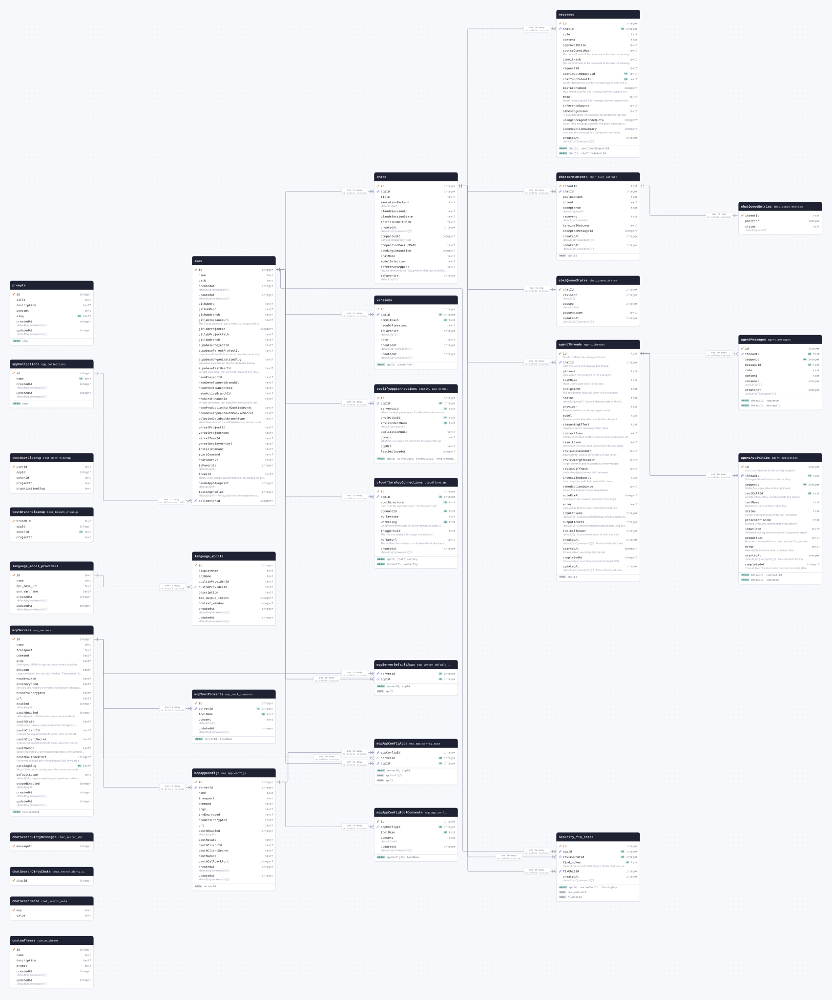

<details>
<summary>The whole schema as SQL</summary>

```sql
CREATE TABLE `agent_activities` (
	`id` integer PRIMARY KEY AUTOINCREMENT,
	`thread_id` text NOT NULL,
	`sequence` integer NOT NULL,
	`tool_call_id` text NOT NULL,
	`tool_name` text NOT NULL,
	`status` text NOT NULL,
	`presentation_xml` text NOT NULL,
	`input_json` text,
	`output_text` text,
	`error` text,
	`started_at` integer DEFAULT (unixepoch()) NOT NULL,
	`completed_at` integer,
	CONSTRAINT `fk_agent_activities_thread_id_agent_threads_id_fk` FOREIGN KEY (`thread_id`) REFERENCES `agent_threads`(`id`) ON DELETE CASCADE,
	CONSTRAINT `agent_activities_thread_tool_call_unique` UNIQUE(`thread_id`,`tool_call_id`),
	CONSTRAINT `agent_activities_thread_sequence_unique` UNIQUE(`thread_id`,`sequence`)
);

CREATE TABLE `agent_messages` (
	`id` integer PRIMARY KEY AUTOINCREMENT,
	`thread_id` text NOT NULL,
	`sequence` integer NOT NULL,
	`message_id` text NOT NULL,
	`role` text NOT NULL,
	`content` text NOT NULL,
	`consumed` integer DEFAULT 0 NOT NULL,
	`created_at` integer DEFAULT (unixepoch()) NOT NULL,
	CONSTRAINT `fk_agent_messages_thread_id_agent_threads_id_fk` FOREIGN KEY (`thread_id`) REFERENCES `agent_threads`(`id`) ON DELETE CASCADE,
	CONSTRAINT `agent_messages_thread_sequence_unique` UNIQUE(`thread_id`,`sequence`),
	CONSTRAINT `agent_messages_thread_message_unique` UNIQUE(`thread_id`,`message_id`)
);

CREATE TABLE `agent_threads` (
	`id` text PRIMARY KEY,
	`chat_id` integer NOT NULL,
	`persona` text NOT NULL,
	`task_name` text NOT NULL,
	`assignment` text NOT NULL,
	`status` text DEFAULT 'queued' NOT NULL,
	`provider` text NOT NULL,
	`model` text NOT NULL,
	`reasoning_effort` text NOT NULL,
	`context_json` text,
	`result_json` text,
	`review_base_commit` text,
	`review_target_commit` text,
	`review_diff_hash` text,
	`invocation_source` text NOT NULL,
	`remediation_source` text,
	`auto_fix_at` integer,
	`error` text,
	`input_tokens` integer DEFAULT 0 NOT NULL,
	`output_tokens` integer DEFAULT 0 NOT NULL,
	`tool_call_count` integer DEFAULT 0 NOT NULL,
	`created_at` integer DEFAULT (unixepoch()) NOT NULL,
	`started_at` integer,
	`completed_at` integer,
	`updated_at` integer DEFAULT (unixepoch()) NOT NULL,
	CONSTRAINT `fk_agent_threads_chat_id_chats_id_fk` FOREIGN KEY (`chat_id`) REFERENCES `chats`(`id`) ON DELETE CASCADE
);

CREATE TABLE `app_collections` (
	`id` integer PRIMARY KEY AUTOINCREMENT,
	`name` text NOT NULL CONSTRAINT `app_collections_name_unique` UNIQUE,
	`created_at` integer DEFAULT (unixepoch()) NOT NULL,
	`updated_at` integer DEFAULT (unixepoch()) NOT NULL
);

CREATE TABLE `apps` (
	`id` integer PRIMARY KEY AUTOINCREMENT,
	`name` text NOT NULL,
	`path` text NOT NULL,
	`created_at` integer DEFAULT (unixepoch()) NOT NULL,
	`updated_at` integer DEFAULT (unixepoch()) NOT NULL,
	`github_org` text,
	`github_repo` text,
	`github_branch` text,
	`gitlab_instance_url` text,
	`gitlab_project_id` integer,
	`gitlab_project_path` text,
	`gitlab_branch` text,
	`supabase_project_id` text,
	`supabase_parent_project_id` text,
	`supabase_organization_slug` text,
	`supabase_test_user_id` text,
	`neon_project_id` text,
	`neon_development_branch_id` text,
	`neon_preview_branch_id` text,
	`neon_active_branch_id` text,
	`neon_test_branch_id` text,
	`neon_production_auth_cookie_secret` text,
	`neon_development_auth_cookie_secret` text,
	`selected_database_branch_type` text,
	`vercel_project_id` text,
	`vercel_project_name` text,
	`vercel_team_id` text,
	`vercel_deployment_url` text,
	`install_command` text,
	`start_command` text,
	`chat_context` text,
	`is_favorite` integer DEFAULT 0 NOT NULL,
	`theme_id` text,
	`needs_app_blueprint` integer DEFAULT 0 NOT NULL,
	`testing_enabled` integer DEFAULT 0 NOT NULL,
	`collection_id` integer,
	CONSTRAINT `fk_apps_collection_id_app_collections_id_fk` FOREIGN KEY (`collection_id`) REFERENCES `app_collections`(`id`) ON DELETE SET NULL
);

CREATE TABLE `chat_queue_entries` (
	`intent_id` text PRIMARY KEY,
	`position` integer NOT NULL,
	`status` text DEFAULT 'queued' NOT NULL,
	CONSTRAINT `fk_chat_queue_entries_intent_id_chat_turn_intents_intent_id_fk` FOREIGN KEY (`intent_id`) REFERENCES `chat_turn_intents`(`intent_id`) ON DELETE CASCADE
);

CREATE TABLE `chat_queue_states` (
	`chat_id` integer PRIMARY KEY,
	`revision` integer DEFAULT 0 NOT NULL,
	`paused` integer DEFAULT false NOT NULL,
	`pause_reason` text,
	`updated_at` integer DEFAULT (unixepoch()) NOT NULL,
	CONSTRAINT `fk_chat_queue_states_chat_id_chats_id_fk` FOREIGN KEY (`chat_id`) REFERENCES `chats`(`id`) ON DELETE CASCADE
);

CREATE TABLE `chat_search_dirty_chats` (
	`chat_id` integer PRIMARY KEY
);

CREATE TABLE `chat_search_dirty_messages` (
	`message_id` integer PRIMARY KEY
);

CREATE TABLE `chat_search_meta` (
	`key` text PRIMARY KEY,
	`value` text NOT NULL
);

CREATE TABLE `chat_turn_intents` (
	`intent_id` text PRIMARY KEY,
	`chat_id` integer NOT NULL,
	`payload_hash` text NOT NULL,
	`intent` text,
	`acceptance` text DEFAULT 'queued' NOT NULL,
	`recovery` text DEFAULT 'not-started' NOT NULL,
	`terminal_outcome` text,
	`accepted_message_id` integer,
	`created_at` integer DEFAULT (unixepoch()) NOT NULL,
	`updated_at` integer DEFAULT (unixepoch()) NOT NULL,
	CONSTRAINT `fk_chat_turn_intents_chat_id_chats_id_fk` FOREIGN KEY (`chat_id`) REFERENCES `chats`(`id`) ON DELETE CASCADE
);

CREATE TABLE `chats` (
	`id` integer PRIMARY KEY AUTOINCREMENT,
	`app_id` integer NOT NULL,
	`title` text,
	`execution_backend` text DEFAULT 'dyad' NOT NULL,
	`claude_session_id` text,
	`claude_session_state` text,
	`initial_commit_hash` text,
	`created_at` integer DEFAULT (unixepoch()) NOT NULL,
	`compacted_at` integer,
	`compaction_backup_path` text,
	`pending_compaction` integer,
	`chat_mode` text,
	`model_selection` text,
	`referenced_app_ids` text,
	`is_favorite` integer DEFAULT 0 NOT NULL,
	CONSTRAINT `fk_chats_app_id_apps_id_fk` FOREIGN KEY (`app_id`) REFERENCES `apps`(`id`) ON DELETE CASCADE
);

CREATE TABLE `cloudflare_app_connections` (
	`id` integer PRIMARY KEY AUTOINCREMENT,
	`app_id` integer NOT NULL,
	`root_directory` text NOT NULL,
	`account_id` text NOT NULL,
	`worker_name` text NOT NULL,
	`worker_tag` text NOT NULL,
	`trigger_uuid` text NOT NULL,
	`worker_url` text,
	`created_at` integer DEFAULT (unixepoch()) NOT NULL,
	CONSTRAINT `fk_cloudflare_app_connections_app_id_apps_id_fk` FOREIGN KEY (`app_id`) REFERENCES `apps`(`id`) ON DELETE CASCADE,
	CONSTRAINT `cloudflare_app_connections_target_unique` UNIQUE(`app_id`,`root_directory`),
	CONSTRAINT `cloudflare_app_connections_worker_unique` UNIQUE(`account_id`,`worker_tag`)
);

CREATE TABLE `coolify_app_connections` (
	`id` integer PRIMARY KEY AUTOINCREMENT,
	`app_id` integer NOT NULL,
	`server_uuid` text NOT NULL,
	`project_uuid` text NOT NULL,
	`environment_name` text DEFAULT 'production' NOT NULL,
	`application_uuid` text,
	`domain` text,
	`app_url` text,
	`last_deployed_at` integer,
	CONSTRAINT `fk_coolify_app_connections_app_id_apps_id_fk` FOREIGN KEY (`app_id`) REFERENCES `apps`(`id`) ON DELETE CASCADE,
	CONSTRAINT `coolify_app_connections_target_unique` UNIQUE(`app_id`,`server_uuid`,`project_uuid`,`environment_name`)
);

CREATE TABLE `custom_themes` (
	`id` integer PRIMARY KEY AUTOINCREMENT,
	`name` text NOT NULL,
	`description` text,
	`prompt` text NOT NULL,
	`created_at` integer DEFAULT (unixepoch()) NOT NULL,
	`updated_at` integer DEFAULT (unixepoch()) NOT NULL
);

CREATE TABLE `language_model_providers` (
	`id` text PRIMARY KEY,
	`name` text NOT NULL,
	`api_base_url` text NOT NULL,
	`env_var_name` text,
	`created_at` integer DEFAULT (unixepoch()) NOT NULL,
	`updated_at` integer DEFAULT (unixepoch()) NOT NULL
);

CREATE TABLE `language_models` (
	`id` integer PRIMARY KEY AUTOINCREMENT,
	`display_name` text NOT NULL,
	`api_name` text NOT NULL,
	`builtin_provider_id` text,
	`custom_provider_id` text,
	`description` text,
	`max_output_tokens` integer,
	`context_window` integer,
	`created_at` integer DEFAULT (unixepoch()) NOT NULL,
	`updated_at` integer DEFAULT (unixepoch()) NOT NULL,
	CONSTRAINT `fk_language_models_custom_provider_id_language_model_providers_id_fk` FOREIGN KEY (`custom_provider_id`) REFERENCES `language_model_providers`(`id`) ON DELETE CASCADE
);

CREATE TABLE `mcp_servers` (
	`id` integer PRIMARY KEY AUTOINCREMENT,
	`name` text NOT NULL,
	`transport` text NOT NULL,
	`command` text,
	`args` text,
	`env_json` text,
	`headers_json` text,
	`env_encrypted` text,
	`headers_encrypted` text,
	`url` text,
	`enabled` integer DEFAULT 0 NOT NULL,
	`oauth_enabled` integer DEFAULT 0 NOT NULL,
	`oauth_state` text,
	`oauth_client_id` text,
	`oauth_client_secret` text,
	`oauth_scope` text,
	`oauth_callback_port` integer,
	`catalog_slug` text,
	`created_at` integer DEFAULT (unixepoch()) NOT NULL,
	`updated_at` integer DEFAULT (unixepoch()) NOT NULL
);

CREATE TABLE `mcp_tool_consents` (
	`id` integer PRIMARY KEY AUTOINCREMENT,
	`server_id` integer NOT NULL,
	`tool_name` text NOT NULL,
	`consent` text DEFAULT 'ask' NOT NULL,
	`updated_at` integer DEFAULT (unixepoch()) NOT NULL,
	CONSTRAINT `fk_mcp_tool_consents_server_id_mcp_servers_id_fk` FOREIGN KEY (`server_id`) REFERENCES `mcp_servers`(`id`) ON DELETE CASCADE,
	CONSTRAINT `uniq_mcp_consent` UNIQUE(`server_id`,`tool_name`)
);

CREATE TABLE `messages` (
	`id` integer PRIMARY KEY AUTOINCREMENT,
	`chat_id` integer NOT NULL,
	`role` text NOT NULL,
	`content` text NOT NULL,
	`approval_state` text,
	`source_commit_hash` text,
	`commit_hash` text,
	`request_id` text,
	`user_input_request_id` text,
	`chat_turn_intent_id` text,
	`max_tokens_used` integer,
	`model` text,
	`inference_source` text,
	`ai_messages_json` text,
	`using_free_agent_mode_quota` integer,
	`is_compaction_summary` integer,
	`created_at` integer DEFAULT (unixepoch()) NOT NULL,
	CONSTRAINT `fk_messages_chat_id_chats_id_fk` FOREIGN KEY (`chat_id`) REFERENCES `chats`(`id`) ON DELETE CASCADE
);

CREATE TABLE `prompts` (
	`id` integer PRIMARY KEY AUTOINCREMENT,
	`title` text NOT NULL,
	`description` text,
	`content` text NOT NULL,
	`slug` text CONSTRAINT `prompts_slug_unique` UNIQUE,
	`created_at` integer DEFAULT (unixepoch()) NOT NULL,
	`updated_at` integer DEFAULT (unixepoch()) NOT NULL
);

CREATE TABLE `security_fix_chats` (
	`id` integer PRIMARY KEY AUTOINCREMENT,
	`app_id` integer NOT NULL,
	`review_chat_id` integer NOT NULL,
	`finding_key` text NOT NULL,
	`fix_chat_id` integer NOT NULL,
	`created_at` integer DEFAULT (unixepoch()) NOT NULL,
	CONSTRAINT `fk_security_fix_chats_app_id_apps_id_fk` FOREIGN KEY (`app_id`) REFERENCES `apps`(`id`) ON DELETE CASCADE,
	CONSTRAINT `fk_security_fix_chats_review_chat_id_chats_id_fk` FOREIGN KEY (`review_chat_id`) REFERENCES `chats`(`id`) ON DELETE CASCADE,
	CONSTRAINT `fk_security_fix_chats_fix_chat_id_chats_id_fk` FOREIGN KEY (`fix_chat_id`) REFERENCES `chats`(`id`) ON DELETE CASCADE,
	CONSTRAINT `security_fix_chats_unique` UNIQUE(`app_id`,`review_chat_id`,`finding_key`)
);

CREATE TABLE `test_branch_cleanup` (
	`branch_id` text PRIMARY KEY,
	`app_id` integer NOT NULL,
	`owner_id` text NOT NULL UNIQUE,
	`project_id` text NOT NULL
);

CREATE TABLE `test_user_cleanup` (
	`user_id` text PRIMARY KEY,
	`app_id` integer NOT NULL,
	`owner_id` text NOT NULL,
	`project_id` text NOT NULL,
	`organization_slug` text NOT NULL
);

CREATE TABLE `versions` (
	`id` integer PRIMARY KEY AUTOINCREMENT,
	`app_id` integer NOT NULL,
	`commit_hash` text NOT NULL,
	`neon_db_timestamp` text,
	`is_favorite` integer DEFAULT 0 NOT NULL,
	`note` text,
	`created_at` integer DEFAULT (unixepoch()) NOT NULL,
	`updated_at` integer DEFAULT (unixepoch()) NOT NULL,
	CONSTRAINT `fk_versions_app_id_apps_id_fk` FOREIGN KEY (`app_id`) REFERENCES `apps`(`id`) ON DELETE CASCADE,
	CONSTRAINT `versions_app_commit_unique` UNIQUE(`app_id`,`commit_hash`)
);

CREATE INDEX `agent_threads_chat_id_idx` ON `agent_threads` (`chat_id`);

CREATE INDEX `chat_turn_intents_chat_idx` ON `chat_turn_intents` (`chat_id`);

CREATE UNIQUE INDEX `uniq_mcp_catalog_slug` ON `mcp_servers` (`catalog_slug`);

CREATE UNIQUE INDEX `messages_chat_user_input_request_unique` ON `messages` (`chat_id`,`user_input_request_id`);

CREATE UNIQUE INDEX `messages_chat_turn_intent_unique` ON `messages` (`chat_id`,`chat_turn_intent_id`);

CREATE INDEX `security_fix_chats_review_chat_id_idx` ON `security_fix_chats` (`review_chat_id`);

CREATE INDEX `security_fix_chats_fix_chat_id_idx` ON `security_fix_chats` (`fix_chat_id`);
```

</details>

## Contents

| Table                                                       | Name in the database         | Description                                                                                                                                                                                                                                                                                                                                                                                                                                                                                                                                                                                                                       |
| ----------------------------------------------------------- | ---------------------------- | --------------------------------------------------------------------------------------------------------------------------------------------------------------------------------------------------------------------------------------------------------------------------------------------------------------------------------------------------------------------------------------------------------------------------------------------------------------------------------------------------------------------------------------------------------------------------------------------------------------------------------- |
| [prompts](#table-prompts)                                   | `prompts`                    |                                                                                                                                                                                                                                                                                                                                                                                                                                                                                                                                                                                                                                   |
| [appCollections](#table-appCollections)                     | `app_collections`            |                                                                                                                                                                                                                                                                                                                                                                                                                                                                                                                                                                                                                                   |
| [apps](#table-apps)                                         | `apps`                       |                                                                                                                                                                                                                                                                                                                                                                                                                                                                                                                                                                                                                                   |
| [testUserCleanup](#table-testUserCleanup)                   | `test_user_cleanup`          | Independent recovery records: concurrent cases must never overwrite another run's user. Deliberately no cascading FK: a failed remote deletion must remain recoverable even after the local app is deleted. No credentials are stored.                                                                                                                                                                                                                                                                                                                                                                                            |
| [testBranchCleanup](#table-testBranchCleanup)               | `test_branch_cleanup`        | One record per sandboxed run, independent of the recorder's app-row marker. Retain provider identity after app deletion/reassociation so failed cleanup remains recoverable. Never store connection strings or auth credentials here.                                                                                                                                                                                                                                                                                                                                                                                             |
| [chats](#table-chats)                                       | `chats`                      |                                                                                                                                                                                                                                                                                                                                                                                                                                                                                                                                                                                                                                   |
| [messages](#table-messages)                                 | `messages`                   |                                                                                                                                                                                                                                                                                                                                                                                                                                                                                                                                                                                                                                   |
| [chatTurnIntents](#table-chatTurnIntents)                   | `chat_turn_intents`          |                                                                                                                                                                                                                                                                                                                                                                                                                                                                                                                                                                                                                                   |
| [chatQueueStates](#table-chatQueueStates)                   | `chat_queue_states`          |                                                                                                                                                                                                                                                                                                                                                                                                                                                                                                                                                                                                                                   |
| [chatQueueEntries](#table-chatQueueEntries)                 | `chat_queue_entries`         |                                                                                                                                                                                                                                                                                                                                                                                                                                                                                                                                                                                                                                   |
| [agentThreads](#table-agentThreads)                         | `agent_threads`              |                                                                                                                                                                                                                                                                                                                                                                                                                                                                                                                                                                                                                                   |
| [agentMessages](#table-agentMessages)                       | `agent_messages`             |                                                                                                                                                                                                                                                                                                                                                                                                                                                                                                                                                                                                                                   |
| [agentActivities](#table-agentActivities)                   | `agent_activities`           |                                                                                                                                                                                                                                                                                                                                                                                                                                                                                                                                                                                                                                   |
| [versions](#table-versions)                                 | `versions`                   |                                                                                                                                                                                                                                                                                                                                                                                                                                                                                                                                                                                                                                   |
| [security_fix_chats](#table-security_fix_chats)             | `security_fix_chats`         |                                                                                                                                                                                                                                                                                                                                                                                                                                                                                                                                                                                                                                   |
| [coolifyAppConnections](#table-coolifyAppConnections)       | `coolify_app_connections`    | Where an app deploys to on a Coolify instance. A table rather than columns on `apps` because these are set together and mean nothing apart: a server without a project names nowhere, and an application id without either belongs to no instance. The row existing is what "connected" means, so disconnecting deletes it rather than nulling every field and hoping each writer nulls the same ones. One row is one deployment. The target columns are NOT NULL because the database will not hold a half-configured connection; the rest fill in as a deploy progresses. The API token is instance-wide and lives in settings. |
| [cloudflareAppConnections](#table-cloudflareAppConnections) | `cloudflare_app_connections` | Which Cloudflare Worker a folder of an app deploys to. One row per target, where a target is a folder with a Wrangler config or a Nitro app: an app can deploy several Workers, each with its own rule on Cloudflare. The row existing is what "connected" means, so every column but `workerUrl` is NOT NULL and disconnecting deletes the row. The API token is account-wide and lives in settings.                                                                                                                                                                                                                             |
| [language_model_providers](#table-language_model_providers) | `language_model_providers`   |                                                                                                                                                                                                                                                                                                                                                                                                                                                                                                                                                                                                                                   |
| [language_models](#table-language_models)                   | `language_models`            |                                                                                                                                                                                                                                                                                                                                                                                                                                                                                                                                                                                                                                   |
| [mcpServers](#table-mcpServers)                             | `mcp_servers`                | --- MCP (Model Context Protocol) tables ---                                                                                                                                                                                                                                                                                                                                                                                                                                                                                                                                                                                       |
| [mcpToolConsents](#table-mcpToolConsents)                   | `mcp_tool_consents`          |                                                                                                                                                                                                                                                                                                                                                                                                                                                                                                                                                                                                                                   |
| [chatSearchDirtyMessages](#table-chatSearchDirtyMessages)   | `chat_search_dirty_messages` | --- Chat search (FTS5) support tables --- Dirty queues for the chat_search_fts index (created in a custom migration — drizzle cannot model FTS5 virtual tables). Rows are enqueued by SQLite triggers when source rows change and drained by ChatSearchIndexer, which builds the searchable text projection in TypeScript. No foreign keys: triggers own the row lifecycle, including cleanup on delete.                                                                                                                                                                                                                          |
| [chatSearchDirtyChats](#table-chatSearchDirtyChats)         | `chat_search_dirty_chats`    |                                                                                                                                                                                                                                                                                                                                                                                                                                                                                                                                                                                                                                   |
| [chatSearchMeta](#table-chatSearchMeta)                     | `chat_search_meta`           | Key/value metadata for the chat-search index (e.g. projection version so a policy change can trigger a background rebuild).                                                                                                                                                                                                                                                                                                                                                                                                                                                                                                       |
| [customThemes](#table-customThemes)                         | `custom_themes`              | --- Custom Themes table ---                                                                                                                                                                                                                                                                                                                                                                                                                                                                                                                                                                                                       |

## Tables

<a id="table-prompts"></a>

### prompts

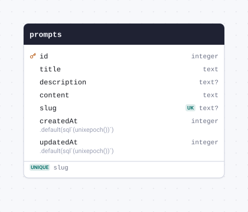

| Column                     | Type      | Constraints | Default                          | Description |
| -------------------------- | --------- | ----------- | -------------------------------- | ----------- |
| `id`                       | `integer` | PK NOT NULL |                                  |             |
| `title`                    | `text`    | NOT NULL    |                                  |             |
| `description`              | `text`    | NULL        |                                  |             |
| `content`                  | `text`    | NOT NULL    |                                  |             |
| `slug`                     | `text`    | NULL        |                                  |             |
| `createdAt` (`created_at`) | `integer` | NOT NULL    | ``.default(sql`(unixepoch())`)`` |             |
| `updatedAt` (`updated_at`) | `integer` | NOT NULL    | ``.default(sql`(unixepoch())`)`` |             |

#### Definition

```sql
CREATE TABLE `prompts` (
	`id` integer PRIMARY KEY AUTOINCREMENT,
	`title` text NOT NULL,
	`description` text,
	`content` text NOT NULL,
	`slug` text CONSTRAINT `prompts_slug_unique` UNIQUE,
	`created_at` integer DEFAULT (unixepoch()) NOT NULL,
	`updated_at` integer DEFAULT (unixepoch()) NOT NULL
);
```

#### Indexes

- UNIQUE `slug`

<details>
<summary>Queries and their SQL</summary>

**Select**: Every row of prompts.

```ts
db.select().from(prompts);
```

```sql
select "id", "title", "description", "content", "slug", "created_at", "updated_at"
from "prompts"
```

**Count**: How many rows prompts has.

```ts
db.select({ count: count() }).from(prompts);
```

```sql
select count(*)
from "prompts"
```

**Find many**: The rows of prompts, through the relational query API.

```ts
db.query.prompts.findMany();
```

```sql
select "d0"."id" as "id", "d0"."title" as "title", "d0"."description" as "description", "d0"."content" as "content", "d0"."slug" as "slug", "d0"."created_at" as "createdAt", "d0"."updated_at" as "updatedAt"
from "prompts" as "d0"
```

**Find by primary key**: One row of prompts, through the relational query API.

```ts
db.query.prompts.findFirst({ where: { id: 1 } });
```

```sql
select "d0"."id" as "id", "d0"."title" as "title", "d0"."description" as "description", "d0"."content" as "content", "d0"."slug" as "slug", "d0"."created_at" as "createdAt", "d0"."updated_at" as "updatedAt"
from "prompts" as "d0"
where "d0"."id" = ?
limit ?
-- params: [1,1]
```

**Insert**: Adds a row to prompts, giving the columns that have no default.

```ts
db.insert(prompts).values({ id: 1, title: "title", content: "content" });
```

```sql
insert into "prompts" ("id", "title", "description", "content", "slug", "created_at", "updated_at")
values (?, ?, null, ?, null, (unixepoch()), (unixepoch()))
-- params: [1,"title","content"]
```

**Update**: Changes a row of prompts, found by its primary key.

```ts
db.update(prompts).set({ title: "title" }).where(eq(prompts.id, 1));
```

```sql
update "prompts"
set "title" = ?
where "prompts"."id" = ?
-- params: ["title",1]
```

**Delete**: Deletes a row of prompts, found by its primary key.

```ts
db.delete(prompts).where(eq(prompts.id, 1));
```

```sql
delete from "prompts"
where "prompts"."id" = ?
-- params: [1]
```

</details>

<a id="table-appCollections"></a>

### appCollections

Table `app_collections`.

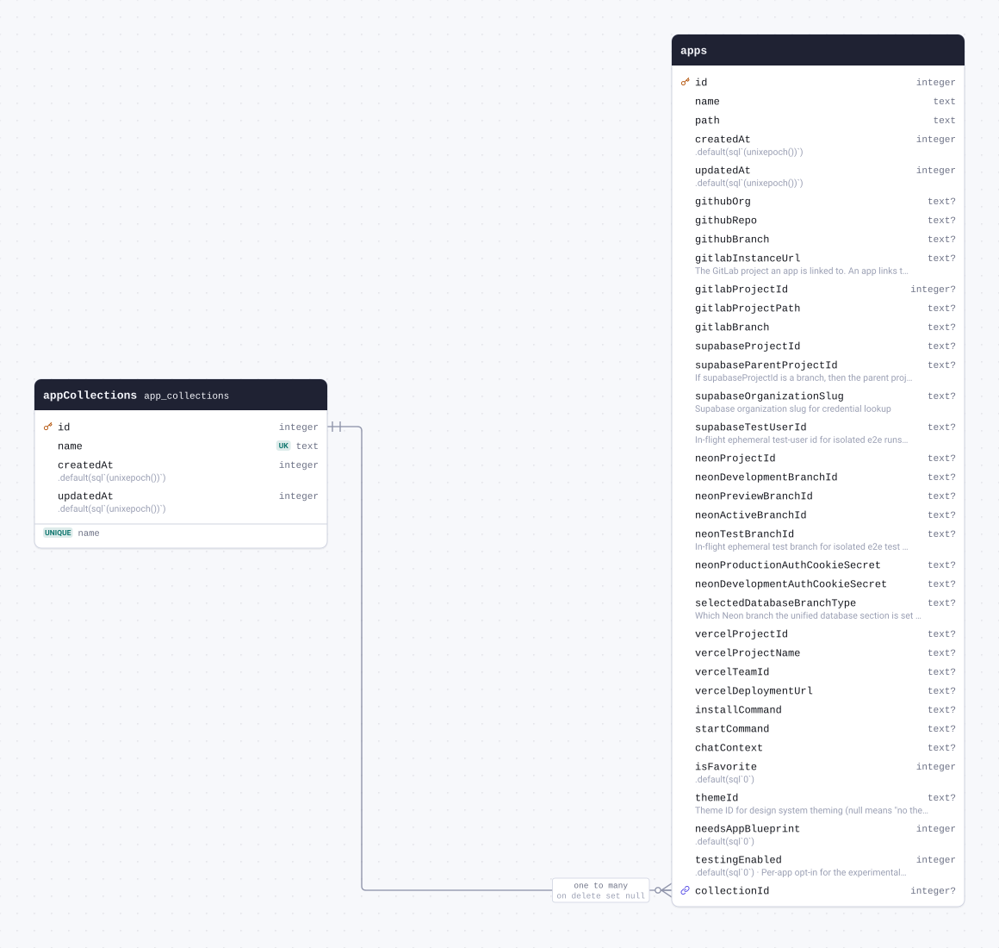

| Column                     | Type      | Constraints | Default                          | Description |
| -------------------------- | --------- | ----------- | -------------------------------- | ----------- |
| `id`                       | `integer` | PK NOT NULL |                                  |             |
| `name`                     | `text`    | NOT NULL    |                                  |             |
| `createdAt` (`created_at`) | `integer` | NOT NULL    | ``.default(sql`(unixepoch())`)`` |             |
| `updatedAt` (`updated_at`) | `integer` | NOT NULL    | ``.default(sql`(unixepoch())`)`` |             |

#### Definition

```sql
CREATE TABLE `app_collections` (
	`id` integer PRIMARY KEY AUTOINCREMENT,
	`name` text NOT NULL CONSTRAINT `app_collections_name_unique` UNIQUE,
	`created_at` integer DEFAULT (unixepoch()) NOT NULL,
	`updated_at` integer DEFAULT (unixepoch()) NOT NULL
);
```

#### Indexes

- UNIQUE `name`

#### Referenced by

- `id` → [apps.collectionId](#table-apps) (one to many, on delete set null)

<details>
<summary>Queries and their SQL</summary>

**Select**: Every row of appCollections.

```ts
db.select().from(appCollections);
```

```sql
select "id", "name", "created_at", "updated_at"
from "app_collections"
```

**Count**: How many rows appCollections has.

```ts
db.select({ count: count() }).from(appCollections);
```

```sql
select count(*)
from "app_collections"
```

**Find many**: The rows of appCollections, through the relational query API.

```ts
db.query.appCollections.findMany();
```

```sql
select "d0"."id" as "id", "d0"."name" as "name", "d0"."created_at" as "createdAt", "d0"."updated_at" as "updatedAt"
from "app_collections" as "d0"
```

**Find by primary key**: One row of appCollections, through the relational query API.

```ts
db.query.appCollections.findFirst({ where: { id: 1 } });
```

```sql
select "d0"."id" as "id", "d0"."name" as "name", "d0"."created_at" as "createdAt", "d0"."updated_at" as "updatedAt"
from "app_collections" as "d0"
where "d0"."id" = ?
limit ?
-- params: [1,1]
```

**Insert**: Adds a row to appCollections, giving the columns that have no default.

```ts
db.insert(appCollections).values({ id: 1, name: "name" });
```

```sql
insert into "app_collections" ("id", "name", "created_at", "updated_at")
values (?, ?, (unixepoch()), (unixepoch()))
-- params: [1,"name"]
```

**Update**: Changes a row of appCollections, found by its primary key.

```ts
db.update(appCollections).set({ name: "name" }).where(eq(appCollections.id, 1));
```

```sql
update "app_collections"
set "name" = ?
where "app_collections"."id" = ?
-- params: ["name",1]
```

**Delete**: Deletes a row of appCollections, found by its primary key.

```ts
db.delete(appCollections).where(eq(appCollections.id, 1));
```

```sql
delete from "app_collections"
where "app_collections"."id" = ?
-- params: [1]
```

</details>

<a id="table-apps"></a>

### apps

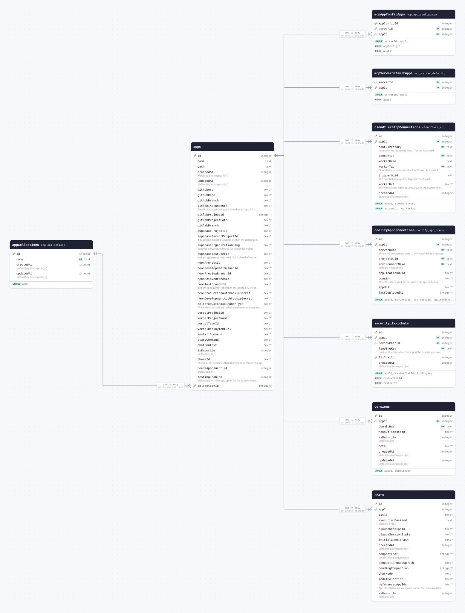

| Column                                                                    | Type      | Constraints                                       | Default                          | Description                                                                                                                                                                                                                                                                                                                                                                                                                                                                                                                                                                                |
| ------------------------------------------------------------------------- | --------- | ------------------------------------------------- | -------------------------------- | ------------------------------------------------------------------------------------------------------------------------------------------------------------------------------------------------------------------------------------------------------------------------------------------------------------------------------------------------------------------------------------------------------------------------------------------------------------------------------------------------------------------------------------------------------------------------------------------ |
| `id`                                                                      | `integer` | PK NOT NULL                                       |                                  |                                                                                                                                                                                                                                                                                                                                                                                                                                                                                                                                                                                            |
| `name`                                                                    | `text`    | NOT NULL                                          |                                  |                                                                                                                                                                                                                                                                                                                                                                                                                                                                                                                                                                                            |
| `path`                                                                    | `text`    | NOT NULL                                          |                                  |                                                                                                                                                                                                                                                                                                                                                                                                                                                                                                                                                                                            |
| `createdAt` (`created_at`)                                                | `integer` | NOT NULL                                          | ``.default(sql`(unixepoch())`)`` |                                                                                                                                                                                                                                                                                                                                                                                                                                                                                                                                                                                            |
| `updatedAt` (`updated_at`)                                                | `integer` | NOT NULL                                          | ``.default(sql`(unixepoch())`)`` |                                                                                                                                                                                                                                                                                                                                                                                                                                                                                                                                                                                            |
| `githubOrg` (`github_org`)                                                | `text`    | NULL                                              |                                  |                                                                                                                                                                                                                                                                                                                                                                                                                                                                                                                                                                                            |
| `githubRepo` (`github_repo`)                                              | `text`    | NULL                                              |                                  |                                                                                                                                                                                                                                                                                                                                                                                                                                                                                                                                                                                            |
| `githubBranch` (`github_branch`)                                          | `text`    | NULL                                              |                                  |                                                                                                                                                                                                                                                                                                                                                                                                                                                                                                                                                                                            |
| `gitlabInstanceUrl` (`gitlab_instance_url`)                               | `text`    | NULL                                              |                                  | The GitLab project an app is linked to. An app links to GitHub or GitLab, never both. Which one an app belongs to is decided in src/shared/linked_remote.ts, and src/ipc/utils/app_git_remote.ts builds the URLs and credentials on top of it — resolve through those rather than reading these columns directly, so the UI and the push cannot disagree about the provider. The instance URL is recorded because Dyad holds one GitLab connection at a time and it can later point at a different instance than this project is on — pushing there would silently go to the wrong GitLab. |
| `gitlabProjectId` (`gitlab_project_id`)                                   | `integer` | NULL                                              |                                  |                                                                                                                                                                                                                                                                                                                                                                                                                                                                                                                                                                                            |
| `gitlabProjectPath` (`gitlab_project_path`)                               | `text`    | NULL                                              |                                  |                                                                                                                                                                                                                                                                                                                                                                                                                                                                                                                                                                                            |
| `gitlabBranch` (`gitlab_branch`)                                          | `text`    | NULL                                              |                                  |                                                                                                                                                                                                                                                                                                                                                                                                                                                                                                                                                                                            |
| `supabaseProjectId` (`supabase_project_id`)                               | `text`    | NULL                                              |                                  |                                                                                                                                                                                                                                                                                                                                                                                                                                                                                                                                                                                            |
| `supabaseParentProjectId` (`supabase_parent_project_id`)                  | `text`    | NULL                                              |                                  | If supabaseProjectId is a branch, then the parent project id set. This is because there's no way to retrieve ALL the branches for ALL projects in a single API call This is only used for display purposes but is NOT used for any actual supabase management logic.                                                                                                                                                                                                                                                                                                                       |
| `supabaseOrganizationSlug` (`supabase_organization_slug`)                 | `text`    | NULL                                              |                                  | Supabase organization slug for credential lookup                                                                                                                                                                                                                                                                                                                                                                                                                                                                                                                                           |
| `supabaseTestUserId` (`supabase_test_user_id`)                            | `text`    | NULL                                              |                                  | In-flight ephemeral test-user id for isolated e2e runs against Supabase. Supabase's free tier has no DB branching, so instead of a throwaway branch we create a dedicated throwaway auth user (via the Auth Admin API, stamped app_metadata.dyad_test=true) and run the tests authenticated as it. Set while a test session holds that user, cleared on teardown. Persisted so a crash mid-session can be reconciled (orphan user deleted) on the next launch. See ipc/utils/supabase_test_user.ts.                                                                                        |
| `neonProjectId` (`neon_project_id`)                                       | `text`    | NULL                                              |                                  |                                                                                                                                                                                                                                                                                                                                                                                                                                                                                                                                                                                            |
| `neonDevelopmentBranchId` (`neon_development_branch_id`)                  | `text`    | NULL                                              |                                  |                                                                                                                                                                                                                                                                                                                                                                                                                                                                                                                                                                                            |
| `neonPreviewBranchId` (`neon_preview_branch_id`)                          | `text`    | NULL                                              |                                  |                                                                                                                                                                                                                                                                                                                                                                                                                                                                                                                                                                                            |
| `neonActiveBranchId` (`neon_active_branch_id`)                            | `text`    | NULL                                              |                                  |                                                                                                                                                                                                                                                                                                                                                                                                                                                                                                                                                                                            |
| `neonTestBranchId` (`neon_test_branch_id`)                                | `text`    | NULL                                              |                                  | In-flight ephemeral test branch for isolated e2e test runs. Set while a test session holds a throwaway copy-on-write branch, cleared on teardown. Persisted so a crash mid-session can be reconciled (orphan branch deleted) on the next launch. See ipc/utils/neon_test_branch.ts.                                                                                                                                                                                                                                                                                                        |
| `neonProductionAuthCookieSecret` (`neon_production_auth_cookie_secret`)   | `text`    | NULL                                              |                                  |                                                                                                                                                                                                                                                                                                                                                                                                                                                                                                                                                                                            |
| `neonDevelopmentAuthCookieSecret` (`neon_development_auth_cookie_secret`) | `text`    | NULL                                              |                                  |                                                                                                                                                                                                                                                                                                                                                                                                                                                                                                                                                                                            |
| `selectedDatabaseBranchType` (`selected_database_branch_type`)            | `text`    | NULL                                              |                                  | Which Neon branch the unified database section is set to deploy/sync against ("production" \| "development"). Null is interpreted differently by each consumer: the backend sync (getSelectedDeployBranchType) treats null as production, while the DatabaseSection UI treats null as "not yet chosen" and shows the branch picker until the user selects one. Read by the main process when syncing env vars + trusted domains to Vercel.                                                                                                                                                 |
| `vercelProjectId` (`vercel_project_id`)                                   | `text`    | NULL                                              |                                  |                                                                                                                                                                                                                                                                                                                                                                                                                                                                                                                                                                                            |
| `vercelProjectName` (`vercel_project_name`)                               | `text`    | NULL                                              |                                  |                                                                                                                                                                                                                                                                                                                                                                                                                                                                                                                                                                                            |
| `vercelTeamId` (`vercel_team_id`)                                         | `text`    | NULL                                              |                                  |                                                                                                                                                                                                                                                                                                                                                                                                                                                                                                                                                                                            |
| `vercelDeploymentUrl` (`vercel_deployment_url`)                           | `text`    | NULL                                              |                                  |                                                                                                                                                                                                                                                                                                                                                                                                                                                                                                                                                                                            |
| `installCommand` (`install_command`)                                      | `text`    | NULL                                              |                                  |                                                                                                                                                                                                                                                                                                                                                                                                                                                                                                                                                                                            |
| `startCommand` (`start_command`)                                          | `text`    | NULL                                              |                                  |                                                                                                                                                                                                                                                                                                                                                                                                                                                                                                                                                                                            |
| `chatContext` (`chat_context`)                                            | `text`    | NULL                                              |                                  |                                                                                                                                                                                                                                                                                                                                                                                                                                                                                                                                                                                            |
| `isFavorite` (`is_favorite`)                                              | `integer` | NOT NULL                                          | ``.default(sql`0`)``             |                                                                                                                                                                                                                                                                                                                                                                                                                                                                                                                                                                                            |
| `themeId` (`theme_id`)                                                    | `text`    | NULL                                              |                                  | Theme ID for design system theming (null means "no theme")                                                                                                                                                                                                                                                                                                                                                                                                                                                                                                                                 |
| `needsAppBlueprint` (`needs_app_blueprint`)                               | `integer` | NOT NULL                                          | ``.default(sql`0`)``             |                                                                                                                                                                                                                                                                                                                                                                                                                                                                                                                                                                                            |
| `testingEnabled` (`testing_enabled`)                                      | `integer` | NOT NULL                                          | ``.default(sql`0`)``             | Per-app opt-in for the experimental AI E2E testing feature. Off by default: running tests can mutate the app's real data, so the Tests panel gates all run/generate controls behind this flag until the user explicitly enables it (after acknowledging the data-backup warning). See TestsPanel.tsx.                                                                                                                                                                                                                                                                                      |
| `collectionId` (`collection_id`)                                          | `integer` | NULL → [appCollections.id](#table-appCollections) |                                  |                                                                                                                                                                                                                                                                                                                                                                                                                                                                                                                                                                                            |

#### Definition

```sql
CREATE TABLE `apps` (
	`id` integer PRIMARY KEY AUTOINCREMENT,
	`name` text NOT NULL,
	`path` text NOT NULL,
	`created_at` integer DEFAULT (unixepoch()) NOT NULL,
	`updated_at` integer DEFAULT (unixepoch()) NOT NULL,
	`github_org` text,
	`github_repo` text,
	`github_branch` text,
	`gitlab_instance_url` text,
	`gitlab_project_id` integer,
	`gitlab_project_path` text,
	`gitlab_branch` text,
	`supabase_project_id` text,
	`supabase_parent_project_id` text,
	`supabase_organization_slug` text,
	`supabase_test_user_id` text,
	`neon_project_id` text,
	`neon_development_branch_id` text,
	`neon_preview_branch_id` text,
	`neon_active_branch_id` text,
	`neon_test_branch_id` text,
	`neon_production_auth_cookie_secret` text,
	`neon_development_auth_cookie_secret` text,
	`selected_database_branch_type` text,
	`vercel_project_id` text,
	`vercel_project_name` text,
	`vercel_team_id` text,
	`vercel_deployment_url` text,
	`install_command` text,
	`start_command` text,
	`chat_context` text,
	`is_favorite` integer DEFAULT 0 NOT NULL,
	`theme_id` text,
	`needs_app_blueprint` integer DEFAULT 0 NOT NULL,
	`testing_enabled` integer DEFAULT 0 NOT NULL,
	`collection_id` integer,
	CONSTRAINT `fk_apps_collection_id_app_collections_id_fk` FOREIGN KEY (`collection_id`) REFERENCES `app_collections`(`id`) ON DELETE SET NULL
);
```

#### References

- `collectionId` → [appCollections.id](#table-appCollections) (many to one, on delete set null)

#### Referenced by

- `id` → [chats.appId](#table-chats) (one to many, on delete cascade)
- `id` → [versions.appId](#table-versions) (one to many, on delete cascade)
- `id` → [security_fix_chats.appId](#table-security_fix_chats) (one to many, on delete cascade)
- `id` → [coolifyAppConnections.appId](#table-coolifyAppConnections) (one to many, on delete cascade)
- `id` → [cloudflareAppConnections.appId](#table-cloudflareAppConnections) (one to many, on delete cascade)

<details>
<summary>Queries and their SQL</summary>

**Select**: Every row of apps.

```ts
db.select().from(apps);
```

```sql
select "id", "name", "path", "created_at", "updated_at", "github_org", "github_repo", "github_branch", "gitlab_instance_url", "gitlab_project_id", "gitlab_project_path", "gitlab_branch", "supabase_project_id", "supabase_parent_project_id", "supabase_organization_slug", "supabase_test_user_id", "neon_project_id", "neon_development_branch_id", "neon_preview_branch_id", "neon_active_branch_id", "neon_test_branch_id", "neon_production_auth_cookie_secret", "neon_development_auth_cookie_secret", "selected_database_branch_type", "vercel_project_id", "vercel_project_name", "vercel_team_id", "vercel_deployment_url", "install_command", "start_command", "chat_context", "is_favorite", "theme_id", "needs_app_blueprint", "testing_enabled", "collection_id"
from "apps"
```

**Count**: How many rows apps has.

```ts
db.select({ count: count() }).from(apps);
```

```sql
select count(*)
from "apps"
```

**Find many**: The rows of apps, through the relational query API.

```ts
db.query.apps.findMany();
```

```sql
select "d0"."id" as "id", "d0"."name" as "name", "d0"."path" as "path", "d0"."created_at" as "createdAt", "d0"."updated_at" as "updatedAt", "d0"."github_org" as "githubOrg", "d0"."github_repo" as "githubRepo", "d0"."github_branch" as "githubBranch", "d0"."gitlab_instance_url" as "gitlabInstanceUrl", "d0"."gitlab_project_id" as "gitlabProjectId", "d0"."gitlab_project_path" as "gitlabProjectPath", "d0"."gitlab_branch" as "gitlabBranch", "d0"."supabase_project_id" as "supabaseProjectId", "d0"."supabase_parent_project_id" as "supabaseParentProjectId", "d0"."supabase_organization_slug" as "supabaseOrganizationSlug", "d0"."supabase_test_user_id" as "supabaseTestUserId", "d0"."neon_project_id" as "neonProjectId", "d0"."neon_development_branch_id" as "neonDevelopmentBranchId", "d0"."neon_preview_branch_id" as "neonPreviewBranchId", "d0"."neon_active_branch_id" as "neonActiveBranchId", "d0"."neon_test_branch_id" as "neonTestBranchId", "d0"."neon_production_auth_cookie_secret" as "neonProductionAuthCookieSecret", "d0"."neon_development_auth_cookie_secret" as "neonDevelopmentAuthCookieSecret", "d0"."selected_database_branch_type" as "selectedDatabaseBranchType", "d0"."vercel_project_id" as "vercelProjectId", "d0"."vercel_project_name" as "vercelProjectName", "d0"."vercel_team_id" as "vercelTeamId", "d0"."vercel_deployment_url" as "vercelDeploymentUrl", "d0"."install_command" as "installCommand", "d0"."start_command" as "startCommand", "d0"."chat_context" as "chatContext", "d0"."is_favorite" as "isFavorite", "d0"."theme_id" as "themeId", "d0"."needs_app_blueprint" as "needsAppBlueprint", "d0"."testing_enabled" as "testingEnabled", "d0"."collection_id" as "collectionId"
from "apps" as "d0"
```

**Find by primary key**: One row of apps, through the relational query API.

```ts
db.query.apps.findFirst({ where: { id: 1 } });
```

```sql
select "d0"."id" as "id", "d0"."name" as "name", "d0"."path" as "path", "d0"."created_at" as "createdAt", "d0"."updated_at" as "updatedAt", "d0"."github_org" as "githubOrg", "d0"."github_repo" as "githubRepo", "d0"."github_branch" as "githubBranch", "d0"."gitlab_instance_url" as "gitlabInstanceUrl", "d0"."gitlab_project_id" as "gitlabProjectId", "d0"."gitlab_project_path" as "gitlabProjectPath", "d0"."gitlab_branch" as "gitlabBranch", "d0"."supabase_project_id" as "supabaseProjectId", "d0"."supabase_parent_project_id" as "supabaseParentProjectId", "d0"."supabase_organization_slug" as "supabaseOrganizationSlug", "d0"."supabase_test_user_id" as "supabaseTestUserId", "d0"."neon_project_id" as "neonProjectId", "d0"."neon_development_branch_id" as "neonDevelopmentBranchId", "d0"."neon_preview_branch_id" as "neonPreviewBranchId", "d0"."neon_active_branch_id" as "neonActiveBranchId", "d0"."neon_test_branch_id" as "neonTestBranchId", "d0"."neon_production_auth_cookie_secret" as "neonProductionAuthCookieSecret", "d0"."neon_development_auth_cookie_secret" as "neonDevelopmentAuthCookieSecret", "d0"."selected_database_branch_type" as "selectedDatabaseBranchType", "d0"."vercel_project_id" as "vercelProjectId", "d0"."vercel_project_name" as "vercelProjectName", "d0"."vercel_team_id" as "vercelTeamId", "d0"."vercel_deployment_url" as "vercelDeploymentUrl", "d0"."install_command" as "installCommand", "d0"."start_command" as "startCommand", "d0"."chat_context" as "chatContext", "d0"."is_favorite" as "isFavorite", "d0"."theme_id" as "themeId", "d0"."needs_app_blueprint" as "needsAppBlueprint", "d0"."testing_enabled" as "testingEnabled", "d0"."collection_id" as "collectionId"
from "apps" as "d0"
where "d0"."id" = ?
limit ?
-- params: [1,1]
```

**Insert**: Adds a row to apps, giving the columns that have no default.

```ts
db.insert(apps).values({ id: 1, name: "name", path: "path" });
```

```sql
insert into "apps" ("id", "name", "path", "created_at", "updated_at", "github_org", "github_repo", "github_branch", "gitlab_instance_url", "gitlab_project_id", "gitlab_project_path", "gitlab_branch", "supabase_project_id", "supabase_parent_project_id", "supabase_organization_slug", "supabase_test_user_id", "neon_project_id", "neon_development_branch_id", "neon_preview_branch_id", "neon_active_branch_id", "neon_test_branch_id", "neon_production_auth_cookie_secret", "neon_development_auth_cookie_secret", "selected_database_branch_type", "vercel_project_id", "vercel_project_name", "vercel_team_id", "vercel_deployment_url", "install_command", "start_command", "chat_context", "is_favorite", "theme_id", "needs_app_blueprint", "testing_enabled", "collection_id")
values (?, ?, ?, (unixepoch()), (unixepoch()), null, null, null, null, null, null, null, null, null, null, null, null, null, null, null, null, null, null, null, null, null, null, null, null, null, null, 0, null, 0, 0, null)
-- params: [1,"name","path"]
```

**Update**: Changes a row of apps, found by its primary key.

```ts
db.update(apps).set({ name: "name" }).where(eq(apps.id, 1));
```

```sql
update "apps"
set "name" = ?
where "apps"."id" = ?
-- params: ["name",1]
```

**Delete**: Deletes a row of apps, found by its primary key.

```ts
db.delete(apps).where(eq(apps.id, 1));
```

```sql
delete from "apps"
where "apps"."id" = ?
-- params: [1]
```

</details>

<a id="table-testUserCleanup"></a>

### testUserCleanup

Table `test_user_cleanup`. Independent recovery records: concurrent cases must never overwrite another run's user. Deliberately no cascading FK: a failed remote deletion must remain recoverable even after the local app is deleted. No credentials are stored.

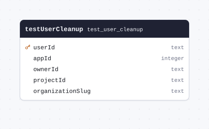

| Column                                   | Type      | Constraints | Default | Description |
| ---------------------------------------- | --------- | ----------- | ------- | ----------- |
| `userId` (`user_id`)                     | `text`    | PK NOT NULL |         |             |
| `appId` (`app_id`)                       | `integer` | NOT NULL    |         |             |
| `ownerId` (`owner_id`)                   | `text`    | NOT NULL    |         |             |
| `projectId` (`project_id`)               | `text`    | NOT NULL    |         |             |
| `organizationSlug` (`organization_slug`) | `text`    | NOT NULL    |         |             |

#### Definition

```sql
CREATE TABLE `test_user_cleanup` (
	`user_id` text PRIMARY KEY,
	`app_id` integer NOT NULL,
	`owner_id` text NOT NULL,
	`project_id` text NOT NULL,
	`organization_slug` text NOT NULL
);
```

<details>
<summary>Queries and their SQL</summary>

**Select**: Every row of testUserCleanup.

```ts
db.select().from(testUserCleanup);
```

```sql
select "user_id", "app_id", "owner_id", "project_id", "organization_slug"
from "test_user_cleanup"
```

**Count**: How many rows testUserCleanup has.

```ts
db.select({ count: count() }).from(testUserCleanup);
```

```sql
select count(*)
from "test_user_cleanup"
```

**Find many**: The rows of testUserCleanup, through the relational query API.

```ts
db.query.testUserCleanup.findMany();
```

```sql
select "d0"."user_id" as "userId", "d0"."app_id" as "appId", "d0"."owner_id" as "ownerId", "d0"."project_id" as "projectId", "d0"."organization_slug" as "organizationSlug"
from "test_user_cleanup" as "d0"
```

**Find by primary key**: One row of testUserCleanup, through the relational query API.

```ts
db.query.testUserCleanup.findFirst({ where: { userId: "userId" } });
```

```sql
select "d0"."user_id" as "userId", "d0"."app_id" as "appId", "d0"."owner_id" as "ownerId", "d0"."project_id" as "projectId", "d0"."organization_slug" as "organizationSlug"
from "test_user_cleanup" as "d0"
where "d0"."user_id" = ?
limit ?
-- params: ["userId",1]
```

**Insert**: Adds a row to testUserCleanup, giving the columns that have no default.

```ts
db.insert(testUserCleanup).values({
  userId: "userId",
  appId: 1,
  ownerId: "ownerId",
  projectId: "projectId",
  organizationSlug: "organizationSlug",
});
```

```sql
insert into "test_user_cleanup" ("user_id", "app_id", "owner_id", "project_id", "organization_slug")
values (?, ?, ?, ?, ?)
-- params: ["userId",1,"ownerId","projectId","organizationSlug"]
```

**Update**: Changes a row of testUserCleanup, found by its primary key.

```ts
db.update(testUserCleanup).set({ appId: 1 }).where(eq(testUserCleanup.userId, "userId"));
```

```sql
update "test_user_cleanup"
set "app_id" = ?
where "test_user_cleanup"."user_id" = ?
-- params: [1,"userId"]
```

**Delete**: Deletes a row of testUserCleanup, found by its primary key.

```ts
db.delete(testUserCleanup).where(eq(testUserCleanup.userId, "userId"));
```

```sql
delete from "test_user_cleanup"
where "test_user_cleanup"."user_id" = ?
-- params: ["userId"]
```

</details>

<a id="table-testBranchCleanup"></a>

### testBranchCleanup

Table `test_branch_cleanup`. One record per sandboxed run, independent of the recorder's app-row marker. Retain provider identity after app deletion/reassociation so failed cleanup remains recoverable. Never store connection strings or auth credentials here.

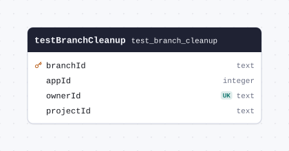

| Column                     | Type      | Constraints     | Default | Description |
| -------------------------- | --------- | --------------- | ------- | ----------- |
| `branchId` (`branch_id`)   | `text`    | PK NOT NULL     |         |             |
| `appId` (`app_id`)         | `integer` | NOT NULL        |         |             |
| `ownerId` (`owner_id`)     | `text`    | UNIQUE NOT NULL |         |             |
| `projectId` (`project_id`) | `text`    | NOT NULL        |         |             |

#### Definition

```sql
CREATE TABLE `test_branch_cleanup` (
	`branch_id` text PRIMARY KEY,
	`app_id` integer NOT NULL,
	`owner_id` text NOT NULL UNIQUE,
	`project_id` text NOT NULL
);
```

<details>
<summary>Queries and their SQL</summary>

**Select**: Every row of testBranchCleanup.

```ts
db.select().from(testBranchCleanup);
```

```sql
select "branch_id", "app_id", "owner_id", "project_id"
from "test_branch_cleanup"
```

**Count**: How many rows testBranchCleanup has.

```ts
db.select({ count: count() }).from(testBranchCleanup);
```

```sql
select count(*)
from "test_branch_cleanup"
```

**Find many**: The rows of testBranchCleanup, through the relational query API.

```ts
db.query.testBranchCleanup.findMany();
```

```sql
select "d0"."branch_id" as "branchId", "d0"."app_id" as "appId", "d0"."owner_id" as "ownerId", "d0"."project_id" as "projectId"
from "test_branch_cleanup" as "d0"
```

**Find by primary key**: One row of testBranchCleanup, through the relational query API.

```ts
db.query.testBranchCleanup.findFirst({ where: { branchId: "branchId" } });
```

```sql
select "d0"."branch_id" as "branchId", "d0"."app_id" as "appId", "d0"."owner_id" as "ownerId", "d0"."project_id" as "projectId"
from "test_branch_cleanup" as "d0"
where "d0"."branch_id" = ?
limit ?
-- params: ["branchId",1]
```

**Insert**: Adds a row to testBranchCleanup, giving the columns that have no default.

```ts
db.insert(testBranchCleanup).values({
  branchId: "branchId",
  appId: 1,
  ownerId: "ownerId",
  projectId: "projectId",
});
```

```sql
insert into "test_branch_cleanup" ("branch_id", "app_id", "owner_id", "project_id")
values (?, ?, ?, ?)
-- params: ["branchId",1,"ownerId","projectId"]
```

**Update**: Changes a row of testBranchCleanup, found by its primary key.

```ts
db.update(testBranchCleanup).set({ appId: 1 }).where(eq(testBranchCleanup.branchId, "branchId"));
```

```sql
update "test_branch_cleanup"
set "app_id" = ?
where "test_branch_cleanup"."branch_id" = ?
-- params: [1,"branchId"]
```

**Delete**: Deletes a row of testBranchCleanup, found by its primary key.

```ts
db.delete(testBranchCleanup).where(eq(testBranchCleanup.branchId, "branchId"));
```

```sql
delete from "test_branch_cleanup"
where "test_branch_cleanup"."branch_id" = ?
-- params: ["branchId"]
```

</details>

<a id="table-chats"></a>

### chats

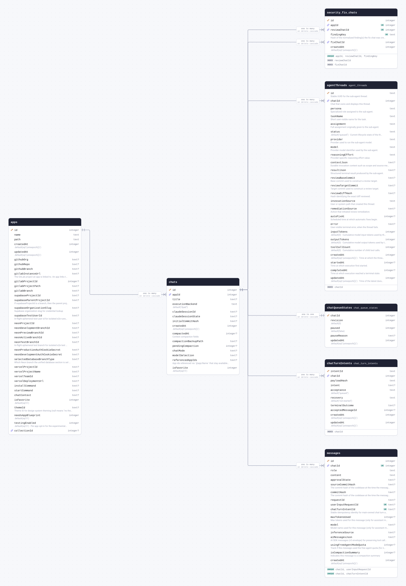

| Column                                            | Type      | Constraints                       | Default                          | Description                                                                                                                                                                                                                                                                                                    |
| ------------------------------------------------- | --------- | --------------------------------- | -------------------------------- | -------------------------------------------------------------------------------------------------------------------------------------------------------------------------------------------------------------------------------------------------------------------------------------------------------------- |
| `id`                                              | `integer` | PK NOT NULL                       |                                  |                                                                                                                                                                                                                                                                                                                |
| `appId` (`app_id`)                                | `integer` | NOT NULL → [apps.id](#table-apps) |                                  |                                                                                                                                                                                                                                                                                                                |
| `title`                                           | `text`    | NULL                              |                                  |                                                                                                                                                                                                                                                                                                                |
| `executionBackend` (`execution_backend`)          | `text`    | NOT NULL                          | `.default("dyad")`               |                                                                                                                                                                                                                                                                                                                |
| `claudeSessionId` (`claude_session_id`)           | `text`    | NULL                              |                                  |                                                                                                                                                                                                                                                                                                                |
| `claudeSessionState` (`claude_session_state`)     | `text`    | NULL                              |                                  |                                                                                                                                                                                                                                                                                                                |
| `initialCommitHash` (`initial_commit_hash`)       | `text`    | NULL                              |                                  |                                                                                                                                                                                                                                                                                                                |
| `createdAt` (`created_at`)                        | `integer` | NOT NULL                          | ``.default(sql`(unixepoch())`)`` |                                                                                                                                                                                                                                                                                                                |
| `compactedAt` (`compacted_at`)                    | `integer` | NULL                              |                                  | Context compaction fields                                                                                                                                                                                                                                                                                      |
| `compactionBackupPath` (`compaction_backup_path`) | `text`    | NULL                              |                                  |                                                                                                                                                                                                                                                                                                                |
| `pendingCompaction` (`pending_compaction`)        | `integer` | NULL                              |                                  |                                                                                                                                                                                                                                                                                                                |
| `chatMode` (`chat_mode`)                          | `text`    | NULL                              |                                  |                                                                                                                                                                                                                                                                                                                |
| `modelSelection` (`model_selection`)              | `text`    | NULL                              |                                  |                                                                                                                                                                                                                                                                                                                |
| `referencedAppIds` (`referenced_app_ids`)         | `text`    | NULL                              |                                  | App ids referenced via `@app:Name` that stay available for the rest of the chat (agent-backed modes only). Stored on the chat rather than derived from message history so references survive compaction, which rewrites history. Ids, not paths: apps can be renamed or moved, so paths are resolved per turn. |
| `isFavorite` (`is_favorite`)                      | `integer` | NOT NULL                          | ``.default(sql`0`)``             |                                                                                                                                                                                                                                                                                                                |

#### Definition

```sql
CREATE TABLE `chats` (
	`id` integer PRIMARY KEY AUTOINCREMENT,
	`app_id` integer NOT NULL,
	`title` text,
	`execution_backend` text DEFAULT 'dyad' NOT NULL,
	`claude_session_id` text,
	`claude_session_state` text,
	`initial_commit_hash` text,
	`created_at` integer DEFAULT (unixepoch()) NOT NULL,
	`compacted_at` integer,
	`compaction_backup_path` text,
	`pending_compaction` integer,
	`chat_mode` text,
	`model_selection` text,
	`referenced_app_ids` text,
	`is_favorite` integer DEFAULT 0 NOT NULL,
	CONSTRAINT `fk_chats_app_id_apps_id_fk` FOREIGN KEY (`app_id`) REFERENCES `apps`(`id`) ON DELETE CASCADE
);
```

#### References

- `appId` → [apps.id](#table-apps) (many to one, on delete cascade)

#### Referenced by

- `id` → [messages.chatId](#table-messages) (one to many, on delete cascade)
- `id` → [chatTurnIntents.chatId](#table-chatTurnIntents) (one to many, on delete cascade)
- `id` → [chatQueueStates.chatId](#table-chatQueueStates) (one to one, on delete cascade)
- `id` → [agentThreads.chatId](#table-agentThreads) (one to many, on delete cascade)
- `id` → [security_fix_chats.reviewChatId](#table-security_fix_chats) (one to many, on delete cascade)
- `id` → [security_fix_chats.fixChatId](#table-security_fix_chats) (one to many, on delete cascade)

<details>
<summary>Queries and their SQL</summary>

**Select**: Every row of chats.

```ts
db.select().from(chats);
```

```sql
select "id", "app_id", "title", "execution_backend", "claude_session_id", "claude_session_state", "initial_commit_hash", "created_at", "compacted_at", "compaction_backup_path", "pending_compaction", "chat_mode", "model_selection", "referenced_app_ids", "is_favorite"
from "chats"
```

**Count**: How many rows chats has.

```ts
db.select({ count: count() }).from(chats);
```

```sql
select count(*)
from "chats"
```

**Find many**: The rows of chats, through the relational query API.

```ts
db.query.chats.findMany();
```

```sql
select "d0"."id" as "id", "d0"."app_id" as "appId", "d0"."title" as "title", "d0"."execution_backend" as "executionBackend", "d0"."claude_session_id" as "claudeSessionId", "d0"."claude_session_state" as "claudeSessionState", "d0"."initial_commit_hash" as "initialCommitHash", "d0"."created_at" as "createdAt", "d0"."compacted_at" as "compactedAt", "d0"."compaction_backup_path" as "compactionBackupPath", "d0"."pending_compaction" as "pendingCompaction", "d0"."chat_mode" as "chatMode", "d0"."model_selection" as "modelSelection", "d0"."referenced_app_ids" as "referencedAppIds", "d0"."is_favorite" as "isFavorite"
from "chats" as "d0"
```

**Find by primary key**: One row of chats, through the relational query API.

```ts
db.query.chats.findFirst({ where: { id: 1 } });
```

```sql
select "d0"."id" as "id", "d0"."app_id" as "appId", "d0"."title" as "title", "d0"."execution_backend" as "executionBackend", "d0"."claude_session_id" as "claudeSessionId", "d0"."claude_session_state" as "claudeSessionState", "d0"."initial_commit_hash" as "initialCommitHash", "d0"."created_at" as "createdAt", "d0"."compacted_at" as "compactedAt", "d0"."compaction_backup_path" as "compactionBackupPath", "d0"."pending_compaction" as "pendingCompaction", "d0"."chat_mode" as "chatMode", "d0"."model_selection" as "modelSelection", "d0"."referenced_app_ids" as "referencedAppIds", "d0"."is_favorite" as "isFavorite"
from "chats" as "d0"
where "d0"."id" = ?
limit ?
-- params: [1,1]
```

**Insert**: Adds a row to chats, giving the columns that have no default.

```ts
db.insert(chats).values({ id: 1, appId: 1 });
```

```sql
insert into "chats" ("id", "app_id", "title", "execution_backend", "claude_session_id", "claude_session_state", "initial_commit_hash", "created_at", "compacted_at", "compaction_backup_path", "pending_compaction", "chat_mode", "model_selection", "referenced_app_ids", "is_favorite")
values (?, ?, null, ?, null, null, null, (unixepoch()), null, null, null, null, null, null, 0)
-- params: [1,1,"dyad"]
```

**Update**: Changes a row of chats, found by its primary key.

```ts
db.update(chats).set({ appId: 1 }).where(eq(chats.id, 1));
```

```sql
update "chats"
set "app_id" = ?
where "chats"."id" = ?
-- params: [1,1]
```

**Delete**: Deletes a row of chats, found by its primary key.

```ts
db.delete(chats).where(eq(chats.id, 1));
```

```sql
delete from "chats"
where "chats"."id" = ?
-- params: [1]
```

</details>

<a id="table-messages"></a>

### messages

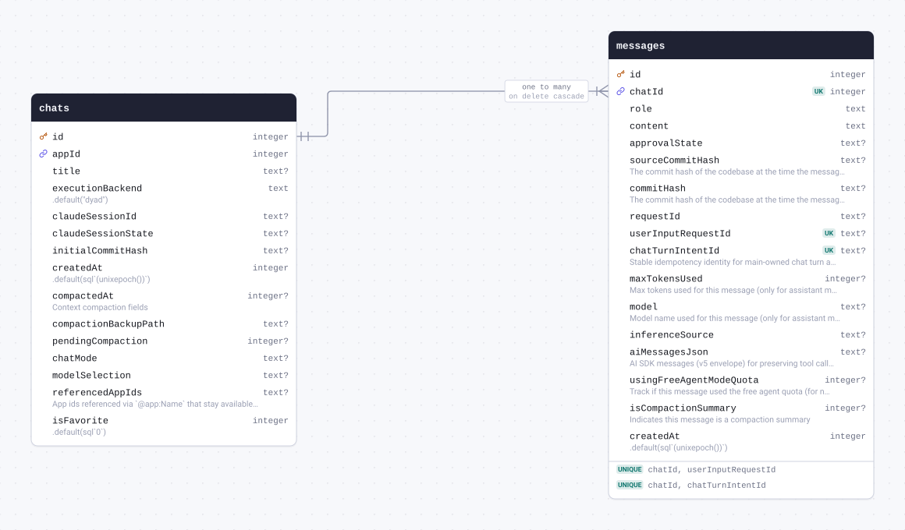

| Column                                                    | Type      | Constraints                         | Default                          | Description                                                                                                                                |
| --------------------------------------------------------- | --------- | ----------------------------------- | -------------------------------- | ------------------------------------------------------------------------------------------------------------------------------------------ |
| `id`                                                      | `integer` | PK NOT NULL                         |                                  |                                                                                                                                            |
| `chatId` (`chat_id`)                                      | `integer` | NOT NULL → [chats.id](#table-chats) |                                  |                                                                                                                                            |
| `role`                                                    | `text`    | NOT NULL                            |                                  |                                                                                                                                            |
| `content`                                                 | `text`    | NOT NULL                            |                                  |                                                                                                                                            |
| `approvalState` (`approval_state`)                        | `text`    | NULL                                |                                  |                                                                                                                                            |
| `sourceCommitHash` (`source_commit_hash`)                 | `text`    | NULL                                |                                  | The commit hash of the codebase at the time the message was created                                                                        |
| `commitHash` (`commit_hash`)                              | `text`    | NULL                                |                                  | The commit hash of the codebase at the time the message was sent                                                                           |
| `requestId` (`request_id`)                                | `text`    | NULL                                |                                  |                                                                                                                                            |
| `userInputRequestId` (`user_input_request_id`)            | `text`    | NULL                                |                                  |                                                                                                                                            |
| `chatTurnIntentId` (`chat_turn_intent_id`)                | `text`    | NULL                                |                                  | Stable idempotency identity for main-owned chat turn admission. Unlike userInputRequestId, ordinary queued turns also carry this identity. |
| `maxTokensUsed` (`max_tokens_used`)                       | `integer` | NULL                                |                                  | Max tokens used for this message (only for assistant messages)                                                                             |
| `model`                                                   | `text`    | NULL                                |                                  | Model name used for this message (only for assistant messages)                                                                             |
| `inferenceSource` (`inference_source`)                    | `text`    | NULL                                |                                  |                                                                                                                                            |
| `aiMessagesJson` (`ai_messages_json`)                     | `text`    | NULL                                |                                  | AI SDK messages (v5 envelope) for preserving tool calls/results in agent mode                                                              |
| `usingFreeAgentModeQuota` (`using_free_agent_mode_quota`) | `integer` | NULL                                |                                  | Track if this message used the free agent quota (for non-Pro users)                                                                        |
| `isCompactionSummary` (`is_compaction_summary`)           | `integer` | NULL                                |                                  | Indicates this message is a compaction summary                                                                                             |
| `createdAt` (`created_at`)                                | `integer` | NOT NULL                            | ``.default(sql`(unixepoch())`)`` |                                                                                                                                            |

#### Definition

```sql
CREATE TABLE `messages` (
	`id` integer PRIMARY KEY AUTOINCREMENT,
	`chat_id` integer NOT NULL,
	`role` text NOT NULL,
	`content` text NOT NULL,
	`approval_state` text,
	`source_commit_hash` text,
	`commit_hash` text,
	`request_id` text,
	`user_input_request_id` text,
	`chat_turn_intent_id` text,
	`max_tokens_used` integer,
	`model` text,
	`inference_source` text,
	`ai_messages_json` text,
	`using_free_agent_mode_quota` integer,
	`is_compaction_summary` integer,
	`created_at` integer DEFAULT (unixepoch()) NOT NULL,
	CONSTRAINT `fk_messages_chat_id_chats_id_fk` FOREIGN KEY (`chat_id`) REFERENCES `chats`(`id`) ON DELETE CASCADE
);

CREATE UNIQUE INDEX `messages_chat_user_input_request_unique` ON `messages` (`chat_id`,`user_input_request_id`);

CREATE UNIQUE INDEX `messages_chat_turn_intent_unique` ON `messages` (`chat_id`,`chat_turn_intent_id`);
```

#### Indexes

- UNIQUE `chatId`, `userInputRequestId`
- UNIQUE `chatId`, `chatTurnIntentId`

#### References

- `chatId` → [chats.id](#table-chats) (many to one, on delete cascade)

<details>
<summary>Queries and their SQL</summary>

**Select**: Every row of messages.

```ts
db.select().from(messages);
```

```sql
select "id", "chat_id", "role", "content", "approval_state", "source_commit_hash", "commit_hash", "request_id", "user_input_request_id", "chat_turn_intent_id", "max_tokens_used", "model", "inference_source", "ai_messages_json", "using_free_agent_mode_quota", "is_compaction_summary", "created_at"
from "messages"
```

**Count**: How many rows messages has.

```ts
db.select({ count: count() }).from(messages);
```

```sql
select count(*)
from "messages"
```

**Find many**: The rows of messages, through the relational query API.

```ts
db.query.messages.findMany();
```

```sql
select "d0"."id" as "id", "d0"."chat_id" as "chatId", "d0"."role" as "role", "d0"."content" as "content", "d0"."approval_state" as "approvalState", "d0"."source_commit_hash" as "sourceCommitHash", "d0"."commit_hash" as "commitHash", "d0"."request_id" as "requestId", "d0"."user_input_request_id" as "userInputRequestId", "d0"."chat_turn_intent_id" as "chatTurnIntentId", "d0"."max_tokens_used" as "maxTokensUsed", "d0"."model" as "model", "d0"."inference_source" as "inferenceSource", "d0"."ai_messages_json" as "aiMessagesJson", "d0"."using_free_agent_mode_quota" as "usingFreeAgentModeQuota", "d0"."is_compaction_summary" as "isCompactionSummary", "d0"."created_at" as "createdAt"
from "messages" as "d0"
```

**Find by primary key**: One row of messages, through the relational query API.

```ts
db.query.messages.findFirst({ where: { id: 1 } });
```

```sql
select "d0"."id" as "id", "d0"."chat_id" as "chatId", "d0"."role" as "role", "d0"."content" as "content", "d0"."approval_state" as "approvalState", "d0"."source_commit_hash" as "sourceCommitHash", "d0"."commit_hash" as "commitHash", "d0"."request_id" as "requestId", "d0"."user_input_request_id" as "userInputRequestId", "d0"."chat_turn_intent_id" as "chatTurnIntentId", "d0"."max_tokens_used" as "maxTokensUsed", "d0"."model" as "model", "d0"."inference_source" as "inferenceSource", "d0"."ai_messages_json" as "aiMessagesJson", "d0"."using_free_agent_mode_quota" as "usingFreeAgentModeQuota", "d0"."is_compaction_summary" as "isCompactionSummary", "d0"."created_at" as "createdAt"
from "messages" as "d0"
where "d0"."id" = ?
limit ?
-- params: [1,1]
```

**Insert**: Adds a row to messages, giving the columns that have no default.

```ts
db.insert(messages).values({ id: 1, chatId: 1, role: "role", content: "content" });
```

```sql
insert into "messages" ("id", "chat_id", "role", "content", "approval_state", "source_commit_hash", "commit_hash", "request_id", "user_input_request_id", "chat_turn_intent_id", "max_tokens_used", "model", "inference_source", "ai_messages_json", "using_free_agent_mode_quota", "is_compaction_summary", "created_at")
values (?, ?, ?, ?, null, null, null, null, null, null, null, null, null, null, null, null, (unixepoch()))
-- params: [1,1,"role","content"]
```

**Update**: Changes a row of messages, found by its primary key.

```ts
db.update(messages).set({ chatId: 1 }).where(eq(messages.id, 1));
```

```sql
update "messages"
set "chat_id" = ?
where "messages"."id" = ?
-- params: [1,1]
```

**Delete**: Deletes a row of messages, found by its primary key.

```ts
db.delete(messages).where(eq(messages.id, 1));
```

```sql
delete from "messages"
where "messages"."id" = ?
-- params: [1]
```

</details>

<a id="table-chatTurnIntents"></a>

### chatTurnIntents

Table `chat_turn_intents`.

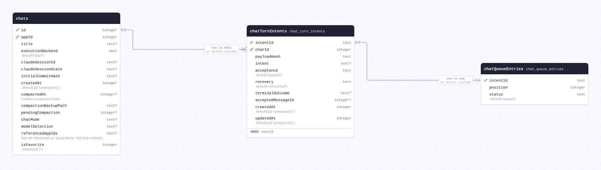

| Column                                      | Type      | Constraints                         | Default                          | Description |
| ------------------------------------------- | --------- | ----------------------------------- | -------------------------------- | ----------- |
| `intentId` (`intent_id`)                    | `text`    | PK NOT NULL                         |                                  |             |
| `chatId` (`chat_id`)                        | `integer` | NOT NULL → [chats.id](#table-chats) |                                  |             |
| `payloadHash` (`payload_hash`)              | `text`    | NOT NULL                            |                                  |             |
| `intent`                                    | `text`    | NULL                                |                                  |             |
| `acceptance`                                | `text`    | NOT NULL                            | `.default("queued")`             |             |
| `recovery`                                  | `text`    | NOT NULL                            | `.default("not-started")`        |             |
| `terminalOutcome` (`terminal_outcome`)      | `text`    | NULL                                |                                  |             |
| `acceptedMessageId` (`accepted_message_id`) | `integer` | NULL                                |                                  |             |
| `createdAt` (`created_at`)                  | `integer` | NOT NULL                            | ``.default(sql`(unixepoch())`)`` |             |
| `updatedAt` (`updated_at`)                  | `integer` | NOT NULL                            | ``.default(sql`(unixepoch())`)`` |             |

#### Definition

```sql
CREATE TABLE `chat_turn_intents` (
	`intent_id` text PRIMARY KEY,
	`chat_id` integer NOT NULL,
	`payload_hash` text NOT NULL,
	`intent` text,
	`acceptance` text DEFAULT 'queued' NOT NULL,
	`recovery` text DEFAULT 'not-started' NOT NULL,
	`terminal_outcome` text,
	`accepted_message_id` integer,
	`created_at` integer DEFAULT (unixepoch()) NOT NULL,
	`updated_at` integer DEFAULT (unixepoch()) NOT NULL,
	CONSTRAINT `fk_chat_turn_intents_chat_id_chats_id_fk` FOREIGN KEY (`chat_id`) REFERENCES `chats`(`id`) ON DELETE CASCADE
);

CREATE INDEX `chat_turn_intents_chat_idx` ON `chat_turn_intents` (`chat_id`);
```

#### Indexes

- INDEX `chatId`

#### References

- `chatId` → [chats.id](#table-chats) (many to one, on delete cascade)

#### Referenced by

- `intentId` → [chatQueueEntries.intentId](#table-chatQueueEntries) (one to one, on delete cascade)

<details>
<summary>Queries and their SQL</summary>

**Select**: Every row of chatTurnIntents.

```ts
db.select().from(chatTurnIntents);
```

```sql
select "intent_id", "chat_id", "payload_hash", "intent", "acceptance", "recovery", "terminal_outcome", "accepted_message_id", "created_at", "updated_at"
from "chat_turn_intents"
```

**Count**: How many rows chatTurnIntents has.

```ts
db.select({ count: count() }).from(chatTurnIntents);
```

```sql
select count(*)
from "chat_turn_intents"
```

**Find many**: The rows of chatTurnIntents, through the relational query API.

```ts
db.query.chatTurnIntents.findMany();
```

```sql
select "d0"."intent_id" as "intentId", "d0"."chat_id" as "chatId", "d0"."payload_hash" as "payloadHash", "d0"."intent" as "intent", "d0"."acceptance" as "acceptance", "d0"."recovery" as "recovery", "d0"."terminal_outcome" as "terminalOutcome", "d0"."accepted_message_id" as "acceptedMessageId", "d0"."created_at" as "createdAt", "d0"."updated_at" as "updatedAt"
from "chat_turn_intents" as "d0"
```

**Find by primary key**: One row of chatTurnIntents, through the relational query API.

```ts
db.query.chatTurnIntents.findFirst({ where: { intentId: "intentId" } });
```

```sql
select "d0"."intent_id" as "intentId", "d0"."chat_id" as "chatId", "d0"."payload_hash" as "payloadHash", "d0"."intent" as "intent", "d0"."acceptance" as "acceptance", "d0"."recovery" as "recovery", "d0"."terminal_outcome" as "terminalOutcome", "d0"."accepted_message_id" as "acceptedMessageId", "d0"."created_at" as "createdAt", "d0"."updated_at" as "updatedAt"
from "chat_turn_intents" as "d0"
where "d0"."intent_id" = ?
limit ?
-- params: ["intentId",1]
```

**Insert**: Adds a row to chatTurnIntents, giving the columns that have no default.

```ts
db.insert(chatTurnIntents).values({ intentId: "intentId", chatId: 1, payloadHash: "payloadHash" });
```

```sql
insert into "chat_turn_intents" ("intent_id", "chat_id", "payload_hash", "intent", "acceptance", "recovery", "terminal_outcome", "accepted_message_id", "created_at", "updated_at")
values (?, ?, ?, null, ?, ?, null, null, (unixepoch()), (unixepoch()))
-- params: ["intentId",1,"payloadHash","queued","not-started"]
```

**Update**: Changes a row of chatTurnIntents, found by its primary key.

```ts
db.update(chatTurnIntents).set({ chatId: 1 }).where(eq(chatTurnIntents.intentId, "intentId"));
```

```sql
update "chat_turn_intents"
set "chat_id" = ?
where "chat_turn_intents"."intent_id" = ?
-- params: [1,"intentId"]
```

**Delete**: Deletes a row of chatTurnIntents, found by its primary key.

```ts
db.delete(chatTurnIntents).where(eq(chatTurnIntents.intentId, "intentId"));
```

```sql
delete from "chat_turn_intents"
where "chat_turn_intents"."intent_id" = ?
-- params: ["intentId"]
```

</details>

<a id="table-chatQueueStates"></a>

### chatQueueStates

Table `chat_queue_states`.

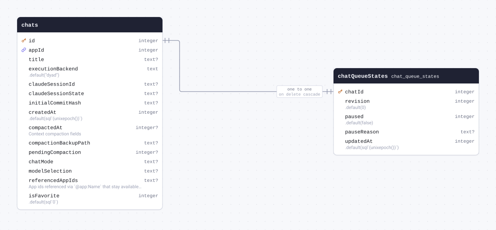

| Column                         | Type      | Constraints                            | Default                          | Description |
| ------------------------------ | --------- | -------------------------------------- | -------------------------------- | ----------- |
| `chatId` (`chat_id`)           | `integer` | PK NOT NULL → [chats.id](#table-chats) |                                  |             |
| `revision`                     | `integer` | NOT NULL                               | `.default(0)`                    |             |
| `paused`                       | `integer` | NOT NULL                               | `.default(false)`                |             |
| `pauseReason` (`pause_reason`) | `text`    | NULL                                   |                                  |             |
| `updatedAt` (`updated_at`)     | `integer` | NOT NULL                               | ``.default(sql`(unixepoch())`)`` |             |

#### Definition

```sql
CREATE TABLE `chat_queue_states` (
	`chat_id` integer PRIMARY KEY,
	`revision` integer DEFAULT 0 NOT NULL,
	`paused` integer DEFAULT false NOT NULL,
	`pause_reason` text,
	`updated_at` integer DEFAULT (unixepoch()) NOT NULL,
	CONSTRAINT `fk_chat_queue_states_chat_id_chats_id_fk` FOREIGN KEY (`chat_id`) REFERENCES `chats`(`id`) ON DELETE CASCADE
);
```

#### References

- `chatId` → [chats.id](#table-chats) (one to one, on delete cascade)

<details>
<summary>Queries and their SQL</summary>

**Select**: Every row of chatQueueStates.

```ts
db.select().from(chatQueueStates);
```

```sql
select "chat_id", "revision", "paused", "pause_reason", "updated_at"
from "chat_queue_states"
```

**Count**: How many rows chatQueueStates has.

```ts
db.select({ count: count() }).from(chatQueueStates);
```

```sql
select count(*)
from "chat_queue_states"
```

**Find many**: The rows of chatQueueStates, through the relational query API.

```ts
db.query.chatQueueStates.findMany();
```

```sql
select "d0"."chat_id" as "chatId", "d0"."revision" as "revision", "d0"."paused" as "paused", "d0"."pause_reason" as "pauseReason", "d0"."updated_at" as "updatedAt"
from "chat_queue_states" as "d0"
```

**Find by primary key**: One row of chatQueueStates, through the relational query API.

```ts
db.query.chatQueueStates.findFirst({ where: { chatId: 1 } });
```

```sql
select "d0"."chat_id" as "chatId", "d0"."revision" as "revision", "d0"."paused" as "paused", "d0"."pause_reason" as "pauseReason", "d0"."updated_at" as "updatedAt"
from "chat_queue_states" as "d0"
where "d0"."chat_id" = ?
limit ?
-- params: [1,1]
```

**Insert**: Adds a row to chatQueueStates, giving the columns that have no default.

```ts
db.insert(chatQueueStates).values({ chatId: 1 });
```

```sql
insert into "chat_queue_states" ("chat_id", "revision", "paused", "pause_reason", "updated_at")
values (?, ?, ?, null, (unixepoch()))
-- params: [1,0,0]
```

**Update**: Changes a row of chatQueueStates, found by its primary key.

```ts
db.update(chatQueueStates).set({ revision: 1 }).where(eq(chatQueueStates.chatId, 1));
```

```sql
update "chat_queue_states"
set "revision" = ?
where "chat_queue_states"."chat_id" = ?
-- params: [1,1]
```

**Delete**: Deletes a row of chatQueueStates, found by its primary key.

```ts
db.delete(chatQueueStates).where(eq(chatQueueStates.chatId, 1));
```

```sql
delete from "chat_queue_states"
where "chat_queue_states"."chat_id" = ?
-- params: [1]
```

</details>

<a id="table-chatQueueEntries"></a>

### chatQueueEntries

Table `chat_queue_entries`.

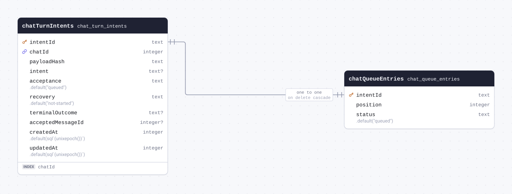

| Column                   | Type      | Constraints                                                      | Default              | Description |
| ------------------------ | --------- | ---------------------------------------------------------------- | -------------------- | ----------- |
| `intentId` (`intent_id`) | `text`    | PK NOT NULL → [chatTurnIntents.intentId](#table-chatTurnIntents) |                      |             |
| `position`               | `integer` | NOT NULL                                                         |                      |             |
| `status`                 | `text`    | NOT NULL                                                         | `.default("queued")` |             |

#### Definition

```sql
CREATE TABLE `chat_queue_entries` (
	`intent_id` text PRIMARY KEY,
	`position` integer NOT NULL,
	`status` text DEFAULT 'queued' NOT NULL,
	CONSTRAINT `fk_chat_queue_entries_intent_id_chat_turn_intents_intent_id_fk` FOREIGN KEY (`intent_id`) REFERENCES `chat_turn_intents`(`intent_id`) ON DELETE CASCADE
);
```

#### References

- `intentId` → [chatTurnIntents.intentId](#table-chatTurnIntents) (one to one, on delete cascade)

<details>
<summary>Queries and their SQL</summary>

**Select**: Every row of chatQueueEntries.

```ts
db.select().from(chatQueueEntries);
```

```sql
select "intent_id", "position", "status"
from "chat_queue_entries"
```

**Count**: How many rows chatQueueEntries has.

```ts
db.select({ count: count() }).from(chatQueueEntries);
```

```sql
select count(*)
from "chat_queue_entries"
```

**Find many**: The rows of chatQueueEntries, through the relational query API.

```ts
db.query.chatQueueEntries.findMany();
```

```sql
select "d0"."intent_id" as "intentId", "d0"."position" as "position", "d0"."status" as "status"
from "chat_queue_entries" as "d0"
```

**Find by primary key**: One row of chatQueueEntries, through the relational query API.

```ts
db.query.chatQueueEntries.findFirst({ where: { intentId: "intentId" } });
```

```sql
select "d0"."intent_id" as "intentId", "d0"."position" as "position", "d0"."status" as "status"
from "chat_queue_entries" as "d0"
where "d0"."intent_id" = ?
limit ?
-- params: ["intentId",1]
```

**Insert**: Adds a row to chatQueueEntries, giving the columns that have no default.

```ts
db.insert(chatQueueEntries).values({ intentId: "intentId", position: 1 });
```

```sql
insert into "chat_queue_entries" ("intent_id", "position", "status")
values (?, ?, ?)
-- params: ["intentId",1,"queued"]
```

**Update**: Changes a row of chatQueueEntries, found by its primary key.

```ts
db.update(chatQueueEntries).set({ position: 1 }).where(eq(chatQueueEntries.intentId, "intentId"));
```

```sql
update "chat_queue_entries"
set "position" = ?
where "chat_queue_entries"."intent_id" = ?
-- params: [1,"intentId"]
```

**Delete**: Deletes a row of chatQueueEntries, found by its primary key.

```ts
db.delete(chatQueueEntries).where(eq(chatQueueEntries.intentId, "intentId"));
```

```sql
delete from "chat_queue_entries"
where "chat_queue_entries"."intent_id" = ?
-- params: ["intentId"]
```

</details>

<a id="table-agentThreads"></a>

### agentThreads

Table `agent_threads`.

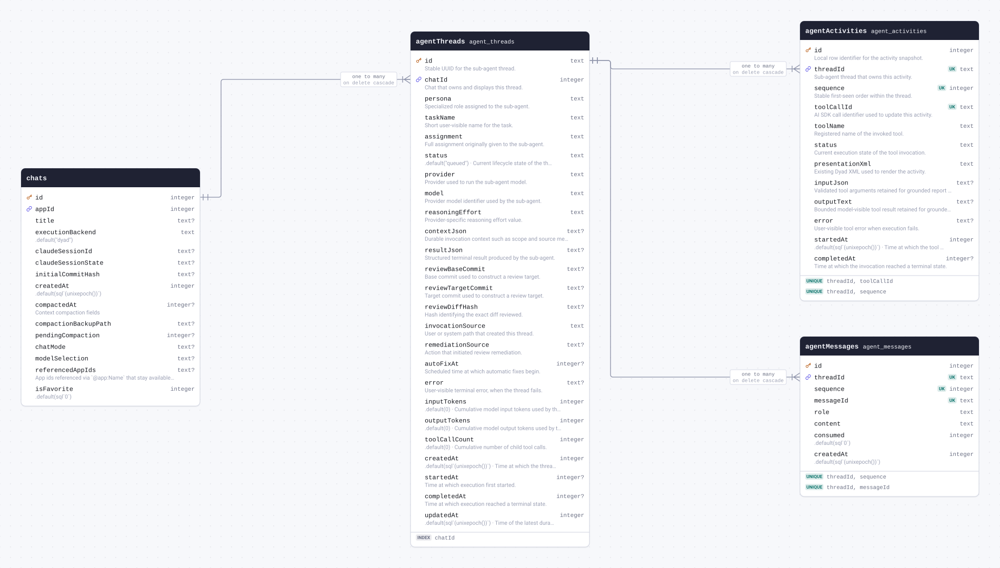

| Column                                        | Type      | Constraints                         | Default                          | Description                                                  |
| --------------------------------------------- | --------- | ----------------------------------- | -------------------------------- | ------------------------------------------------------------ |
| `id`                                          | `text`    | PK NOT NULL                         |                                  | Stable UUID for the sub-agent thread.                        |
| `chatId` (`chat_id`)                          | `integer` | NOT NULL → [chats.id](#table-chats) |                                  | Chat that owns and displays this thread.                     |
| `persona`                                     | `text`    | NOT NULL                            |                                  | Specialized role assigned to the sub-agent.                  |
| `taskName` (`task_name`)                      | `text`    | NOT NULL                            |                                  | Short user-visible name for the task.                        |
| `assignment`                                  | `text`    | NOT NULL                            |                                  | Full assignment originally given to the sub-agent.           |
| `status`                                      | `text`    | NOT NULL                            | `.default("queued")`             | Current lifecycle state of the thread.                       |
| `provider`                                    | `text`    | NOT NULL                            |                                  | Provider used to run the sub-agent model.                    |
| `model`                                       | `text`    | NOT NULL                            |                                  | Provider model identifier used by the sub-agent.             |
| `reasoningEffort` (`reasoning_effort`)        | `text`    | NOT NULL                            |                                  | Provider-specific reasoning effort value.                    |
| `contextJson` (`context_json`)                | `text`    | NULL                                |                                  | Durable invocation context such as scope and source message. |
| `resultJson` (`result_json`)                  | `text`    | NULL                                |                                  | Structured terminal result produced by the sub-agent.        |
| `reviewBaseCommit` (`review_base_commit`)     | `text`    | NULL                                |                                  | Base commit used to construct a review target.               |
| `reviewTargetCommit` (`review_target_commit`) | `text`    | NULL                                |                                  | Target commit used to construct a review target.             |
| `reviewDiffHash` (`review_diff_hash`)         | `text`    | NULL                                |                                  | Hash identifying the exact diff reviewed.                    |
| `invocationSource` (`invocation_source`)      | `text`    | NOT NULL                            |                                  | User or system path that created this thread.                |
| `remediationSource` (`remediation_source`)    | `text`    | NULL                                |                                  | Action that initiated review remediation.                    |
| `autoFixAt` (`auto_fix_at`)                   | `integer` | NULL                                |                                  | Scheduled time at which automatic fixes begin.               |
| `error`                                       | `text`    | NULL                                |                                  | User-visible terminal error, when the thread fails.          |
| `inputTokens` (`input_tokens`)                | `integer` | NOT NULL                            | `.default(0)`                    | Cumulative model input tokens used by the thread.            |
| `outputTokens` (`output_tokens`)              | `integer` | NOT NULL                            | `.default(0)`                    | Cumulative model output tokens used by the thread.           |
| `toolCallCount` (`tool_call_count`)           | `integer` | NOT NULL                            | `.default(0)`                    | Cumulative number of child tool calls.                       |
| `createdAt` (`created_at`)                    | `integer` | NOT NULL                            | ``.default(sql`(unixepoch())`)`` | Time at which the thread was created.                        |
| `startedAt` (`started_at`)                    | `integer` | NULL                                |                                  | Time at which execution first started.                       |
| `completedAt` (`completed_at`)                | `integer` | NULL                                |                                  | Time at which execution reached a terminal state.            |
| `updatedAt` (`updated_at`)                    | `integer` | NOT NULL                            | ``.default(sql`(unixepoch())`)`` | Time of the latest durable thread update.                    |

#### Definition

```sql
CREATE TABLE `agent_threads` (
	`id` text PRIMARY KEY,
	`chat_id` integer NOT NULL,
	`persona` text NOT NULL,
	`task_name` text NOT NULL,
	`assignment` text NOT NULL,
	`status` text DEFAULT 'queued' NOT NULL,
	`provider` text NOT NULL,
	`model` text NOT NULL,
	`reasoning_effort` text NOT NULL,
	`context_json` text,
	`result_json` text,
	`review_base_commit` text,
	`review_target_commit` text,
	`review_diff_hash` text,
	`invocation_source` text NOT NULL,
	`remediation_source` text,
	`auto_fix_at` integer,
	`error` text,
	`input_tokens` integer DEFAULT 0 NOT NULL,
	`output_tokens` integer DEFAULT 0 NOT NULL,
	`tool_call_count` integer DEFAULT 0 NOT NULL,
	`created_at` integer DEFAULT (unixepoch()) NOT NULL,
	`started_at` integer,
	`completed_at` integer,
	`updated_at` integer DEFAULT (unixepoch()) NOT NULL,
	CONSTRAINT `fk_agent_threads_chat_id_chats_id_fk` FOREIGN KEY (`chat_id`) REFERENCES `chats`(`id`) ON DELETE CASCADE
);

CREATE INDEX `agent_threads_chat_id_idx` ON `agent_threads` (`chat_id`);
```

#### Indexes

- INDEX `chatId`

#### References

- `chatId` → [chats.id](#table-chats) (many to one, on delete cascade)

#### Referenced by

- `id` → [agentMessages.threadId](#table-agentMessages) (one to many, on delete cascade)
- `id` → [agentActivities.threadId](#table-agentActivities) (one to many, on delete cascade)

<details>
<summary>Queries and their SQL</summary>

**Select**: Every row of agentThreads.

```ts
db.select().from(agentThreads);
```

```sql
select "id", "chat_id", "persona", "task_name", "assignment", "status", "provider", "model", "reasoning_effort", "context_json", "result_json", "review_base_commit", "review_target_commit", "review_diff_hash", "invocation_source", "remediation_source", "auto_fix_at", "error", "input_tokens", "output_tokens", "tool_call_count", "created_at", "started_at", "completed_at", "updated_at"
from "agent_threads"
```

**Count**: How many rows agentThreads has.

```ts
db.select({ count: count() }).from(agentThreads);
```

```sql
select count(*)
from "agent_threads"
```

**Find many**: The rows of agentThreads, through the relational query API.

```ts
db.query.agentThreads.findMany();
```

```sql
select "d0"."id" as "id", "d0"."chat_id" as "chatId", "d0"."persona" as "persona", "d0"."task_name" as "taskName", "d0"."assignment" as "assignment", "d0"."status" as "status", "d0"."provider" as "provider", "d0"."model" as "model", "d0"."reasoning_effort" as "reasoningEffort", "d0"."context_json" as "contextJson", "d0"."result_json" as "resultJson", "d0"."review_base_commit" as "reviewBaseCommit", "d0"."review_target_commit" as "reviewTargetCommit", "d0"."review_diff_hash" as "reviewDiffHash", "d0"."invocation_source" as "invocationSource", "d0"."remediation_source" as "remediationSource", "d0"."auto_fix_at" as "autoFixAt", "d0"."error" as "error", "d0"."input_tokens" as "inputTokens", "d0"."output_tokens" as "outputTokens", "d0"."tool_call_count" as "toolCallCount", "d0"."created_at" as "createdAt", "d0"."started_at" as "startedAt", "d0"."completed_at" as "completedAt", "d0"."updated_at" as "updatedAt"
from "agent_threads" as "d0"
```

**Find by primary key**: One row of agentThreads, through the relational query API.

```ts
db.query.agentThreads.findFirst({ where: { id: "id" } });
```

```sql
select "d0"."id" as "id", "d0"."chat_id" as "chatId", "d0"."persona" as "persona", "d0"."task_name" as "taskName", "d0"."assignment" as "assignment", "d0"."status" as "status", "d0"."provider" as "provider", "d0"."model" as "model", "d0"."reasoning_effort" as "reasoningEffort", "d0"."context_json" as "contextJson", "d0"."result_json" as "resultJson", "d0"."review_base_commit" as "reviewBaseCommit", "d0"."review_target_commit" as "reviewTargetCommit", "d0"."review_diff_hash" as "reviewDiffHash", "d0"."invocation_source" as "invocationSource", "d0"."remediation_source" as "remediationSource", "d0"."auto_fix_at" as "autoFixAt", "d0"."error" as "error", "d0"."input_tokens" as "inputTokens", "d0"."output_tokens" as "outputTokens", "d0"."tool_call_count" as "toolCallCount", "d0"."created_at" as "createdAt", "d0"."started_at" as "startedAt", "d0"."completed_at" as "completedAt", "d0"."updated_at" as "updatedAt"
from "agent_threads" as "d0"
where "d0"."id" = ?
limit ?
-- params: ["id",1]
```

**Insert**: Adds a row to agentThreads, giving the columns that have no default.

```ts
db.insert(agentThreads).values({
  id: "id",
  chatId: 1,
  persona: "persona",
  taskName: "taskName",
  assignment: "assignment",
  provider: "provider",
  model: "model",
  reasoningEffort: "reasoningEffort",
  invocationSource: "invocationSource",
});
```

```sql
insert into "agent_threads" ("id", "chat_id", "persona", "task_name", "assignment", "status", "provider", "model", "reasoning_effort", "context_json", "result_json", "review_base_commit", "review_target_commit", "review_diff_hash", "invocation_source", "remediation_source", "auto_fix_at", "error", "input_tokens", "output_tokens", "tool_call_count", "created_at", "started_at", "completed_at", "updated_at")
values (?, ?, ?, ?, ?, ?, ?, ?, ?, null, null, null, null, null, ?, null, null, null, ?, ?, ?, (unixepoch()), null, null, (unixepoch()))
-- params: ["id",1,"persona","taskName","assignment","queued","provider","model","reasoningEffort","invocationSource",0,0,0]
```

**Update**: Changes a row of agentThreads, found by its primary key.

```ts
db.update(agentThreads).set({ chatId: 1 }).where(eq(agentThreads.id, "id"));
```

```sql
update "agent_threads"
set "chat_id" = ?
where "agent_threads"."id" = ?
-- params: [1,"id"]
```

**Delete**: Deletes a row of agentThreads, found by its primary key.

```ts
db.delete(agentThreads).where(eq(agentThreads.id, "id"));
```

```sql
delete from "agent_threads"
where "agent_threads"."id" = ?
-- params: ["id"]
```

</details>

<a id="table-agentMessages"></a>

### agentMessages

Table `agent_messages`.

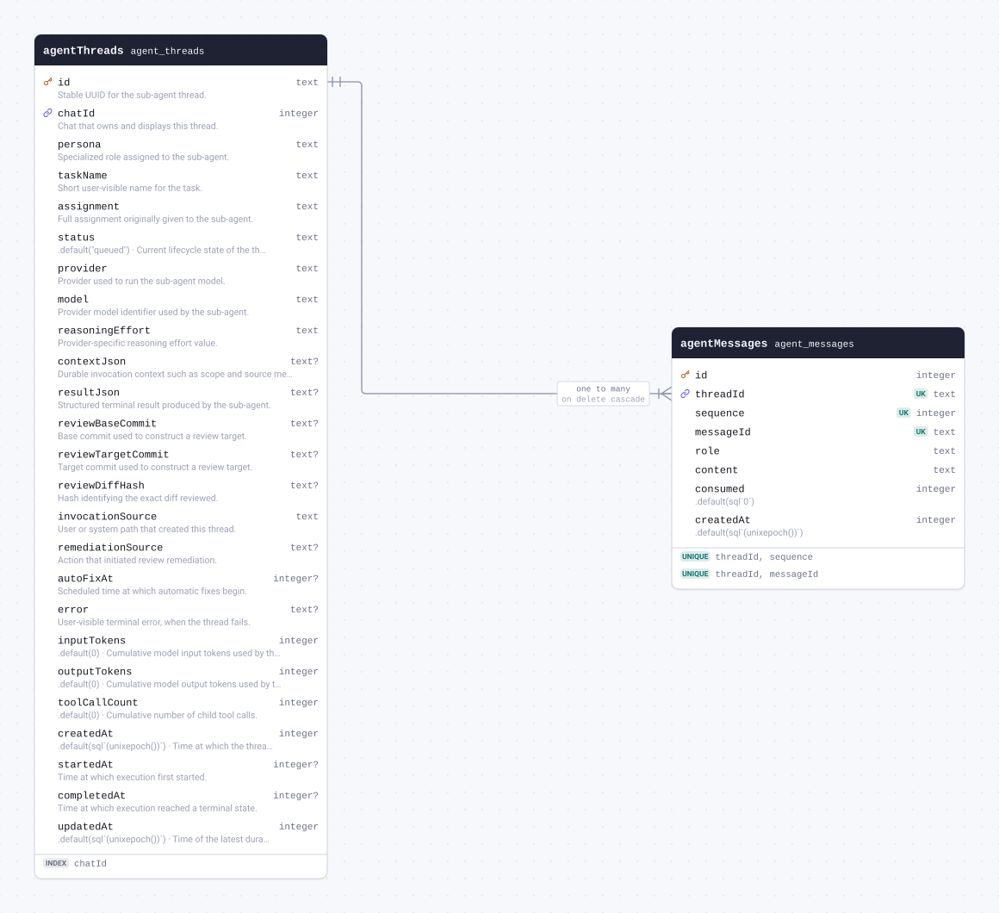

| Column                     | Type      | Constraints                                       | Default                          | Description |
| -------------------------- | --------- | ------------------------------------------------- | -------------------------------- | ----------- |
| `id`                       | `integer` | PK NOT NULL                                       |                                  |             |
| `threadId` (`thread_id`)   | `text`    | NOT NULL → [agentThreads.id](#table-agentThreads) |                                  |             |
| `sequence`                 | `integer` | NOT NULL                                          |                                  |             |
| `messageId` (`message_id`) | `text`    | NOT NULL                                          |                                  |             |
| `role`                     | `text`    | NOT NULL                                          |                                  |             |
| `content`                  | `text`    | NOT NULL                                          |                                  |             |
| `consumed`                 | `integer` | NOT NULL                                          | ``.default(sql`0`)``             |             |
| `createdAt` (`created_at`) | `integer` | NOT NULL                                          | ``.default(sql`(unixepoch())`)`` |             |

#### Definition

```sql
CREATE TABLE `agent_messages` (
	`id` integer PRIMARY KEY AUTOINCREMENT,
	`thread_id` text NOT NULL,
	`sequence` integer NOT NULL,
	`message_id` text NOT NULL,
	`role` text NOT NULL,
	`content` text NOT NULL,
	`consumed` integer DEFAULT 0 NOT NULL,
	`created_at` integer DEFAULT (unixepoch()) NOT NULL,
	CONSTRAINT `fk_agent_messages_thread_id_agent_threads_id_fk` FOREIGN KEY (`thread_id`) REFERENCES `agent_threads`(`id`) ON DELETE CASCADE,
	CONSTRAINT `agent_messages_thread_sequence_unique` UNIQUE(`thread_id`,`sequence`),
	CONSTRAINT `agent_messages_thread_message_unique` UNIQUE(`thread_id`,`message_id`)
);
```

#### Indexes

- UNIQUE `threadId`, `sequence`
- UNIQUE `threadId`, `messageId`

#### References

- `threadId` → [agentThreads.id](#table-agentThreads) (many to one, on delete cascade)

<details>
<summary>Queries and their SQL</summary>

**Select**: Every row of agentMessages.

```ts
db.select().from(agentMessages);
```

```sql
select "id", "thread_id", "sequence", "message_id", "role", "content", "consumed", "created_at"
from "agent_messages"
```

**Count**: How many rows agentMessages has.

```ts
db.select({ count: count() }).from(agentMessages);
```

```sql
select count(*)
from "agent_messages"
```

**Find many**: The rows of agentMessages, through the relational query API.

```ts
db.query.agentMessages.findMany();
```

```sql
select "d0"."id" as "id", "d0"."thread_id" as "threadId", "d0"."sequence" as "sequence", "d0"."message_id" as "messageId", "d0"."role" as "role", "d0"."content" as "content", "d0"."consumed" as "consumed", "d0"."created_at" as "createdAt"
from "agent_messages" as "d0"
```

**Find by primary key**: One row of agentMessages, through the relational query API.

```ts
db.query.agentMessages.findFirst({ where: { id: 1 } });
```

```sql
select "d0"."id" as "id", "d0"."thread_id" as "threadId", "d0"."sequence" as "sequence", "d0"."message_id" as "messageId", "d0"."role" as "role", "d0"."content" as "content", "d0"."consumed" as "consumed", "d0"."created_at" as "createdAt"
from "agent_messages" as "d0"
where "d0"."id" = ?
limit ?
-- params: [1,1]
```

**Insert**: Adds a row to agentMessages, giving the columns that have no default.

```ts
db.insert(agentMessages).values({
  id: 1,
  threadId: "threadId",
  sequence: 1,
  messageId: "messageId",
  role: "role",
  content: "content",
});
```

```sql
insert into "agent_messages" ("id", "thread_id", "sequence", "message_id", "role", "content", "consumed", "created_at")
values (?, ?, ?, ?, ?, ?, 0, (unixepoch()))
-- params: [1,"threadId",1,"messageId","role","content"]
```

**Update**: Changes a row of agentMessages, found by its primary key.

```ts
db.update(agentMessages).set({ threadId: "threadId" }).where(eq(agentMessages.id, 1));
```

```sql
update "agent_messages"
set "thread_id" = ?
where "agent_messages"."id" = ?
-- params: ["threadId",1]
```

**Delete**: Deletes a row of agentMessages, found by its primary key.

```ts
db.delete(agentMessages).where(eq(agentMessages.id, 1));
```

```sql
delete from "agent_messages"
where "agent_messages"."id" = ?
-- params: [1]
```

</details>

<a id="table-agentActivities"></a>

### agentActivities

Table `agent_activities`.

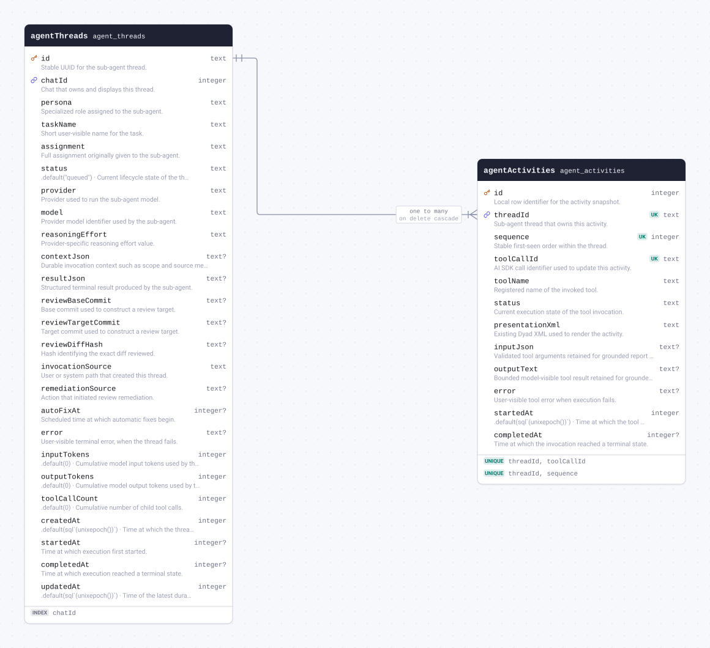

| Column                                 | Type      | Constraints                                       | Default                          | Description                                                           |
| -------------------------------------- | --------- | ------------------------------------------------- | -------------------------------- | --------------------------------------------------------------------- |
| `id`                                   | `integer` | PK NOT NULL                                       |                                  | Local row identifier for the activity snapshot.                       |
| `threadId` (`thread_id`)               | `text`    | NOT NULL → [agentThreads.id](#table-agentThreads) |                                  | Sub-agent thread that owns this activity.                             |
| `sequence`                             | `integer` | NOT NULL                                          |                                  | Stable first-seen order within the thread.                            |
| `toolCallId` (`tool_call_id`)          | `text`    | NOT NULL                                          |                                  | AI SDK call identifier used to update this activity.                  |
| `toolName` (`tool_name`)               | `text`    | NOT NULL                                          |                                  | Registered name of the invoked tool.                                  |
| `status`                               | `text`    | NOT NULL                                          |                                  | Current execution state of the tool invocation.                       |
| `presentationXml` (`presentation_xml`) | `text`    | NOT NULL                                          |                                  | Existing Dyad XML used to render the activity.                        |
| `inputJson` (`input_json`)             | `text`    | NULL                                              |                                  | Validated tool arguments retained for grounded report reconstruction. |
| `outputText` (`output_text`)           | `text`    | NULL                                              |                                  | Bounded model-visible tool result retained for grounded reports.      |
| `error`                                | `text`    | NULL                                              |                                  | User-visible tool error when execution fails.                         |
| `startedAt` (`started_at`)             | `integer` | NOT NULL                                          | ``.default(sql`(unixepoch())`)`` | Time at which the tool invocation first appeared.                     |
| `completedAt` (`completed_at`)         | `integer` | NULL                                              |                                  | Time at which the invocation reached a terminal state.                |

#### Definition

```sql
CREATE TABLE `agent_activities` (
	`id` integer PRIMARY KEY AUTOINCREMENT,
	`thread_id` text NOT NULL,
	`sequence` integer NOT NULL,
	`tool_call_id` text NOT NULL,
	`tool_name` text NOT NULL,
	`status` text NOT NULL,
	`presentation_xml` text NOT NULL,
	`input_json` text,
	`output_text` text,
	`error` text,
	`started_at` integer DEFAULT (unixepoch()) NOT NULL,
	`completed_at` integer,
	CONSTRAINT `fk_agent_activities_thread_id_agent_threads_id_fk` FOREIGN KEY (`thread_id`) REFERENCES `agent_threads`(`id`) ON DELETE CASCADE,
	CONSTRAINT `agent_activities_thread_tool_call_unique` UNIQUE(`thread_id`,`tool_call_id`),
	CONSTRAINT `agent_activities_thread_sequence_unique` UNIQUE(`thread_id`,`sequence`)
);
```

#### Indexes

- UNIQUE `threadId`, `toolCallId`
- UNIQUE `threadId`, `sequence`

#### References

- `threadId` → [agentThreads.id](#table-agentThreads) (many to one, on delete cascade)

<details>
<summary>Queries and their SQL</summary>

**Select**: Every row of agentActivities.

```ts
db.select().from(agentActivities);
```

```sql
select "id", "thread_id", "sequence", "tool_call_id", "tool_name", "status", "presentation_xml", "input_json", "output_text", "error", "started_at", "completed_at"
from "agent_activities"
```

**Count**: How many rows agentActivities has.

```ts
db.select({ count: count() }).from(agentActivities);
```

```sql
select count(*)
from "agent_activities"
```

**Find many**: The rows of agentActivities, through the relational query API.

```ts
db.query.agentActivities.findMany();
```

```sql
select "d0"."id" as "id", "d0"."thread_id" as "threadId", "d0"."sequence" as "sequence", "d0"."tool_call_id" as "toolCallId", "d0"."tool_name" as "toolName", "d0"."status" as "status", "d0"."presentation_xml" as "presentationXml", "d0"."input_json" as "inputJson", "d0"."output_text" as "outputText", "d0"."error" as "error", "d0"."started_at" as "startedAt", "d0"."completed_at" as "completedAt"
from "agent_activities" as "d0"
```

**Find by primary key**: One row of agentActivities, through the relational query API.

```ts
db.query.agentActivities.findFirst({ where: { id: 1 } });
```

```sql
select "d0"."id" as "id", "d0"."thread_id" as "threadId", "d0"."sequence" as "sequence", "d0"."tool_call_id" as "toolCallId", "d0"."tool_name" as "toolName", "d0"."status" as "status", "d0"."presentation_xml" as "presentationXml", "d0"."input_json" as "inputJson", "d0"."output_text" as "outputText", "d0"."error" as "error", "d0"."started_at" as "startedAt", "d0"."completed_at" as "completedAt"
from "agent_activities" as "d0"
where "d0"."id" = ?
limit ?
-- params: [1,1]
```

**Insert**: Adds a row to agentActivities, giving the columns that have no default.

```ts
db.insert(agentActivities).values({
  id: 1,
  threadId: "threadId",
  sequence: 1,
  toolCallId: "toolCallId",
  toolName: "toolName",
  status: "status",
  presentationXml: "presentationXml",
});
```

```sql
insert into "agent_activities" ("id", "thread_id", "sequence", "tool_call_id", "tool_name", "status", "presentation_xml", "input_json", "output_text", "error", "started_at", "completed_at")
values (?, ?, ?, ?, ?, ?, ?, null, null, null, (unixepoch()), null)
-- params: [1,"threadId",1,"toolCallId","toolName","status","presentationXml"]
```

**Update**: Changes a row of agentActivities, found by its primary key.

```ts
db.update(agentActivities).set({ threadId: "threadId" }).where(eq(agentActivities.id, 1));
```

```sql
update "agent_activities"
set "thread_id" = ?
where "agent_activities"."id" = ?
-- params: ["threadId",1]
```

**Delete**: Deletes a row of agentActivities, found by its primary key.

```ts
db.delete(agentActivities).where(eq(agentActivities.id, 1));
```

```sql
delete from "agent_activities"
where "agent_activities"."id" = ?
-- params: [1]
```

</details>

<a id="table-versions"></a>

### versions

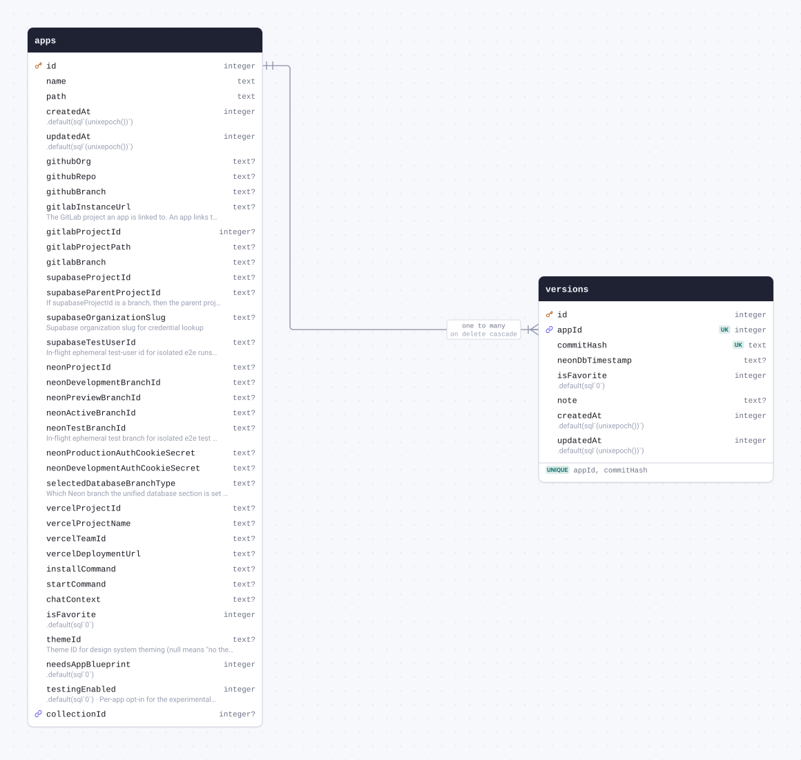

| Column                                  | Type      | Constraints                       | Default                          | Description |
| --------------------------------------- | --------- | --------------------------------- | -------------------------------- | ----------- |
| `id`                                    | `integer` | PK NOT NULL                       |                                  |             |
| `appId` (`app_id`)                      | `integer` | NOT NULL → [apps.id](#table-apps) |                                  |             |
| `commitHash` (`commit_hash`)            | `text`    | NOT NULL                          |                                  |             |
| `neonDbTimestamp` (`neon_db_timestamp`) | `text`    | NULL                              |                                  |             |
| `isFavorite` (`is_favorite`)            | `integer` | NOT NULL                          | ``.default(sql`0`)``             |             |
| `note`                                  | `text`    | NULL                              |                                  |             |
| `createdAt` (`created_at`)              | `integer` | NOT NULL                          | ``.default(sql`(unixepoch())`)`` |             |
| `updatedAt` (`updated_at`)              | `integer` | NOT NULL                          | ``.default(sql`(unixepoch())`)`` |             |

#### Definition

```sql
CREATE TABLE `versions` (
	`id` integer PRIMARY KEY AUTOINCREMENT,
	`app_id` integer NOT NULL,
	`commit_hash` text NOT NULL,
	`neon_db_timestamp` text,
	`is_favorite` integer DEFAULT 0 NOT NULL,
	`note` text,
	`created_at` integer DEFAULT (unixepoch()) NOT NULL,
	`updated_at` integer DEFAULT (unixepoch()) NOT NULL,
	CONSTRAINT `fk_versions_app_id_apps_id_fk` FOREIGN KEY (`app_id`) REFERENCES `apps`(`id`) ON DELETE CASCADE,
	CONSTRAINT `versions_app_commit_unique` UNIQUE(`app_id`,`commit_hash`)
);
```

#### Indexes

- UNIQUE `appId`, `commitHash`

#### References

- `appId` → [apps.id](#table-apps) (many to one, on delete cascade)

<details>
<summary>Queries and their SQL</summary>

**Select**: Every row of versions.

```ts
db.select().from(versions);
```

```sql
select "id", "app_id", "commit_hash", "neon_db_timestamp", "is_favorite", "note", "created_at", "updated_at"
from "versions"
```

**Count**: How many rows versions has.

```ts
db.select({ count: count() }).from(versions);
```

```sql
select count(*)
from "versions"
```

**Find many**: The rows of versions, through the relational query API.

```ts
db.query.versions.findMany();
```

```sql
select "d0"."id" as "id", "d0"."app_id" as "appId", "d0"."commit_hash" as "commitHash", "d0"."neon_db_timestamp" as "neonDbTimestamp", "d0"."is_favorite" as "isFavorite", "d0"."note" as "note", "d0"."created_at" as "createdAt", "d0"."updated_at" as "updatedAt"
from "versions" as "d0"
```

**Find by primary key**: One row of versions, through the relational query API.

```ts
db.query.versions.findFirst({ where: { id: 1 } });
```

```sql
select "d0"."id" as "id", "d0"."app_id" as "appId", "d0"."commit_hash" as "commitHash", "d0"."neon_db_timestamp" as "neonDbTimestamp", "d0"."is_favorite" as "isFavorite", "d0"."note" as "note", "d0"."created_at" as "createdAt", "d0"."updated_at" as "updatedAt"
from "versions" as "d0"
where "d0"."id" = ?
limit ?
-- params: [1,1]
```

**Insert**: Adds a row to versions, giving the columns that have no default.

```ts
db.insert(versions).values({ id: 1, appId: 1, commitHash: "commitHash" });
```

```sql
insert into "versions" ("id", "app_id", "commit_hash", "neon_db_timestamp", "is_favorite", "note", "created_at", "updated_at")
values (?, ?, ?, null, 0, null, (unixepoch()), (unixepoch()))
-- params: [1,1,"commitHash"]
```

**Update**: Changes a row of versions, found by its primary key.

```ts
db.update(versions).set({ appId: 1 }).where(eq(versions.id, 1));
```

```sql
update "versions"
set "app_id" = ?
where "versions"."id" = ?
-- params: [1,1]
```

**Delete**: Deletes a row of versions, found by its primary key.

```ts
db.delete(versions).where(eq(versions.id, 1));
```

```sql
delete from "versions"
where "versions"."id" = ?
-- params: [1]
```

</details>

<a id="table-security_fix_chats"></a>

### security_fix_chats

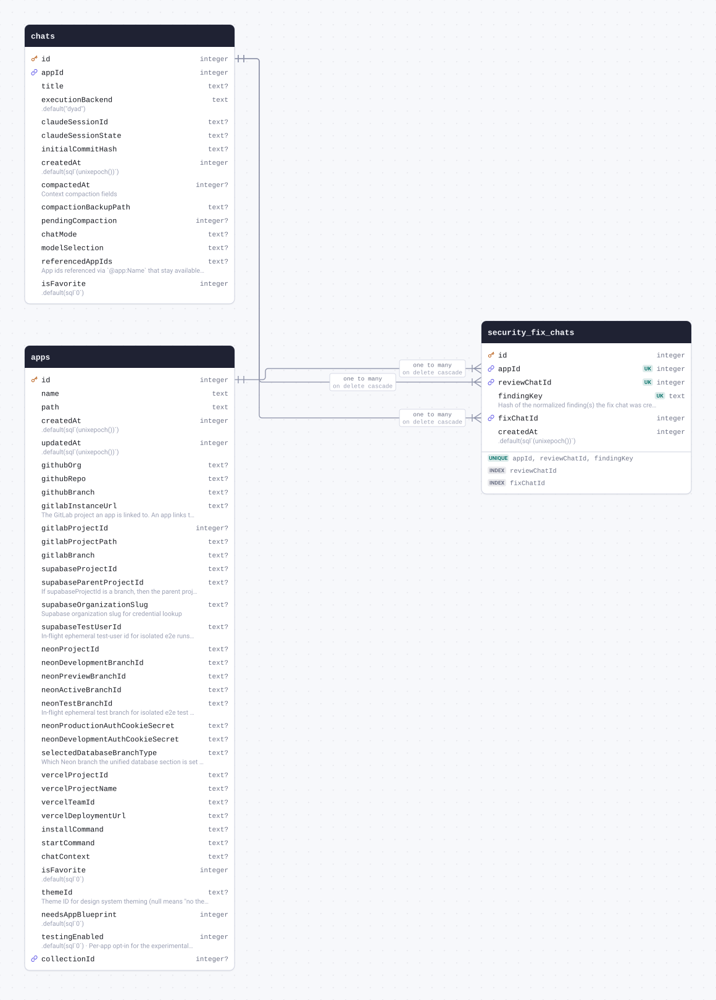

| Column                            | Type      | Constraints                         | Default                          | Description                                                    |
| --------------------------------- | --------- | ----------------------------------- | -------------------------------- | -------------------------------------------------------------- |
| `id`                              | `integer` | PK NOT NULL                         |                                  |                                                                |
| `appId` (`app_id`)                | `integer` | NOT NULL → [apps.id](#table-apps)   |                                  |                                                                |
| `reviewChatId` (`review_chat_id`) | `integer` | NOT NULL → [chats.id](#table-chats) |                                  |                                                                |
| `findingKey` (`finding_key`)      | `text`    | NOT NULL                            |                                  | Hash of the normalized finding(s) the fix chat was created for |
| `fixChatId` (`fix_chat_id`)       | `integer` | NOT NULL → [chats.id](#table-chats) |                                  |                                                                |
| `createdAt` (`created_at`)        | `integer` | NOT NULL                            | ``.default(sql`(unixepoch())`)`` |                                                                |

#### Definition

```sql
CREATE TABLE `security_fix_chats` (
	`id` integer PRIMARY KEY AUTOINCREMENT,
	`app_id` integer NOT NULL,
	`review_chat_id` integer NOT NULL,
	`finding_key` text NOT NULL,
	`fix_chat_id` integer NOT NULL,
	`created_at` integer DEFAULT (unixepoch()) NOT NULL,
	CONSTRAINT `fk_security_fix_chats_app_id_apps_id_fk` FOREIGN KEY (`app_id`) REFERENCES `apps`(`id`) ON DELETE CASCADE,
	CONSTRAINT `fk_security_fix_chats_review_chat_id_chats_id_fk` FOREIGN KEY (`review_chat_id`) REFERENCES `chats`(`id`) ON DELETE CASCADE,
	CONSTRAINT `fk_security_fix_chats_fix_chat_id_chats_id_fk` FOREIGN KEY (`fix_chat_id`) REFERENCES `chats`(`id`) ON DELETE CASCADE,
	CONSTRAINT `security_fix_chats_unique` UNIQUE(`app_id`,`review_chat_id`,`finding_key`)
);

CREATE INDEX `security_fix_chats_review_chat_id_idx` ON `security_fix_chats` (`review_chat_id`);

CREATE INDEX `security_fix_chats_fix_chat_id_idx` ON `security_fix_chats` (`fix_chat_id`);
```

#### Indexes

- UNIQUE `appId`, `reviewChatId`, `findingKey`
- INDEX `reviewChatId`
- INDEX `fixChatId`

#### References

- `appId` → [apps.id](#table-apps) (many to one, on delete cascade)
- `reviewChatId` → [chats.id](#table-chats) (many to one, on delete cascade)
- `fixChatId` → [chats.id](#table-chats) (many to one, on delete cascade)

<details>
<summary>Queries and their SQL</summary>

**Select**: Every row of security_fix_chats.

```ts
db.select().from(security_fix_chats);
```

```sql
select "id", "app_id", "review_chat_id", "finding_key", "fix_chat_id", "created_at"
from "security_fix_chats"
```

**Count**: How many rows security_fix_chats has.

```ts
db.select({ count: count() }).from(security_fix_chats);
```

```sql
select count(*)
from "security_fix_chats"
```

**Find many**: The rows of security_fix_chats, through the relational query API.

```ts
db.query.security_fix_chats.findMany();
```

```sql
select "d0"."id" as "id", "d0"."app_id" as "appId", "d0"."review_chat_id" as "reviewChatId", "d0"."finding_key" as "findingKey", "d0"."fix_chat_id" as "fixChatId", "d0"."created_at" as "createdAt"
from "security_fix_chats" as "d0"
```

**Find by primary key**: One row of security_fix_chats, through the relational query API.

```ts
db.query.security_fix_chats.findFirst({ where: { id: 1 } });
```

```sql
select "d0"."id" as "id", "d0"."app_id" as "appId", "d0"."review_chat_id" as "reviewChatId", "d0"."finding_key" as "findingKey", "d0"."fix_chat_id" as "fixChatId", "d0"."created_at" as "createdAt"
from "security_fix_chats" as "d0"
where "d0"."id" = ?
limit ?
-- params: [1,1]
```

**Insert**: Adds a row to security_fix_chats, giving the columns that have no default.

```ts
db.insert(security_fix_chats).values({
  id: 1,
  appId: 1,
  reviewChatId: 1,
  findingKey: "findingKey",
  fixChatId: 1,
});
```

```sql
insert into "security_fix_chats" ("id", "app_id", "review_chat_id", "finding_key", "fix_chat_id", "created_at")
values (?, ?, ?, ?, ?, (unixepoch()))
-- params: [1,1,1,"findingKey",1]
```

**Update**: Changes a row of security_fix_chats, found by its primary key.

```ts
db.update(security_fix_chats).set({ appId: 1 }).where(eq(security_fix_chats.id, 1));
```

```sql
update "security_fix_chats"
set "app_id" = ?
where "security_fix_chats"."id" = ?
-- params: [1,1]
```

**Delete**: Deletes a row of security_fix_chats, found by its primary key.

```ts
db.delete(security_fix_chats).where(eq(security_fix_chats.id, 1));
```

```sql
delete from "security_fix_chats"
where "security_fix_chats"."id" = ?
-- params: [1]
```

</details>

<a id="table-coolifyAppConnections"></a>

### coolifyAppConnections

Table `coolify_app_connections`. Where an app deploys to on a Coolify instance. A table rather than columns on `apps` because these are set together and mean nothing apart: a server without a project names nowhere, and an application id without either belongs to no instance. The row existing is what "connected" means, so disconnecting deletes it rather than nulling every field and hoping each writer nulls the same ones. One row is one deployment. The target columns are NOT NULL because the database will not hold a half-configured connection; the rest fill in as a deploy progresses. The API token is instance-wide and lives in settings.

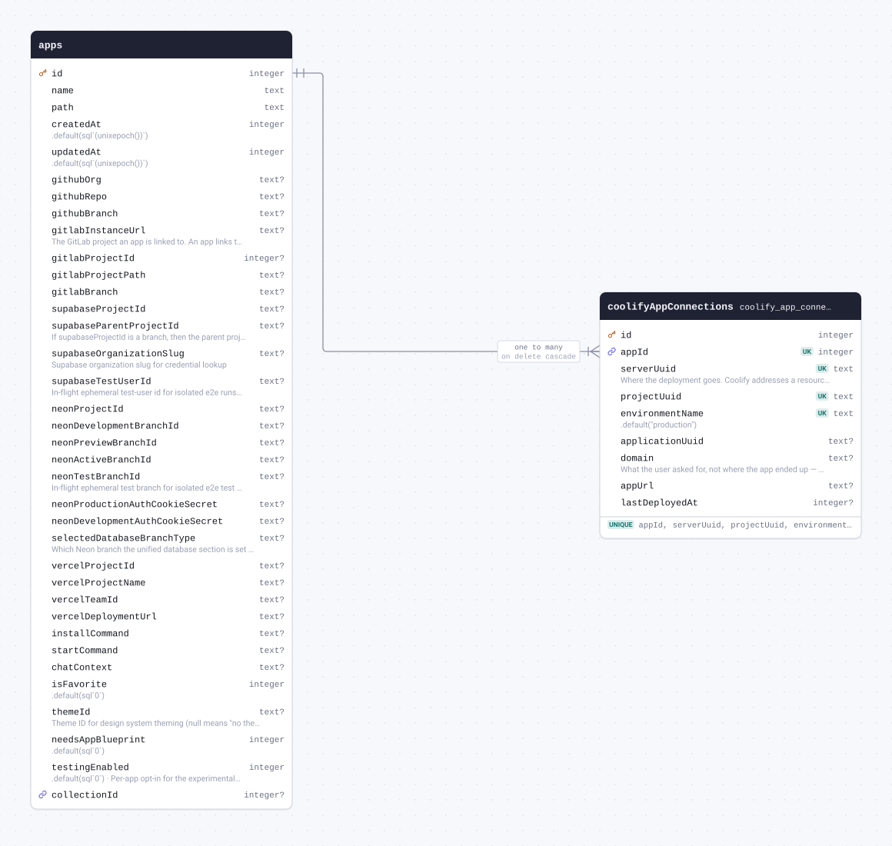

| Column                                 | Type      | Constraints                       | Default                  | Description                                                                                                                                                                                                                                                                                                                                                                                                                                                                                                         |
| -------------------------------------- | --------- | --------------------------------- | ------------------------ | ------------------------------------------------------------------------------------------------------------------------------------------------------------------------------------------------------------------------------------------------------------------------------------------------------------------------------------------------------------------------------------------------------------------------------------------------------------------------------------------------------------------- |
| `id`                                   | `integer` | PK NOT NULL                       |                          |                                                                                                                                                                                                                                                                                                                                                                                                                                                                                                                     |
| `appId` (`app_id`)                     | `integer` | NOT NULL → [apps.id](#table-apps) |                          |                                                                                                                                                                                                                                                                                                                                                                                                                                                                                                                     |
| `serverUuid` (`server_uuid`)           | `text`    | NOT NULL                          |                          | Where the deployment goes. Coolify addresses a resource by all three: the machine, the grouping, and the lane within it — an app can have a production and a staging copy in one project on one server. The Coolify instance is deliberately not here. Its only handle is the URL, which changes without the instance changing (http to https once a certificate lands, an IP becoming a domain), so keying on it would make every app look moved. These are UUIDs, so they do not collide across instances anyway. |
| `projectUuid` (`project_uuid`)         | `text`    | NOT NULL                          |                          |                                                                                                                                                                                                                                                                                                                                                                                                                                                                                                                     |
| `environmentName` (`environment_name`) | `text`    | NOT NULL                          | `.default("production")` |                                                                                                                                                                                                                                                                                                                                                                                                                                                                                                                     |
| `applicationUuid` (`application_uuid`) | `text`    | NULL                              |                          |                                                                                                                                                                                                                                                                                                                                                                                                                                                                                                                     |
| `domain`                               | `text`    | NULL                              |                          | What the user asked for, not where the app ended up — that is app_url. Null means no custom domain, so the address is whatever the deploy is entitled to generate. Never write a generated address back here, or the user's "no preference" becomes a stored preference they cannot undo.                                                                                                                                                                                                                           |
| `appUrl` (`app_url`)                   | `text`    | NULL                              |                          |                                                                                                                                                                                                                                                                                                                                                                                                                                                                                                                     |
| `lastDeployedAt` (`last_deployed_at`)  | `integer` | NULL                              |                          |                                                                                                                                                                                                                                                                                                                                                                                                                                                                                                                     |

#### Definition

```sql
CREATE TABLE `coolify_app_connections` (
	`id` integer PRIMARY KEY AUTOINCREMENT,
	`app_id` integer NOT NULL,
	`server_uuid` text NOT NULL,
	`project_uuid` text NOT NULL,
	`environment_name` text DEFAULT 'production' NOT NULL,
	`application_uuid` text,
	`domain` text,
	`app_url` text,
	`last_deployed_at` integer,
	CONSTRAINT `fk_coolify_app_connections_app_id_apps_id_fk` FOREIGN KEY (`app_id`) REFERENCES `apps`(`id`) ON DELETE CASCADE,
	CONSTRAINT `coolify_app_connections_target_unique` UNIQUE(`app_id`,`server_uuid`,`project_uuid`,`environment_name`)
);
```

#### Indexes

- UNIQUE `appId`, `serverUuid`, `projectUuid`, `environmentName`

#### References

- `appId` → [apps.id](#table-apps) (many to one, on delete cascade)

<details>
<summary>Queries and their SQL</summary>

**Select**: Every row of coolifyAppConnections.

```ts
db.select().from(coolifyAppConnections);
```

```sql
select "id", "app_id", "server_uuid", "project_uuid", "environment_name", "application_uuid", "domain", "app_url", "last_deployed_at"
from "coolify_app_connections"
```

**Count**: How many rows coolifyAppConnections has.

```ts
db.select({ count: count() }).from(coolifyAppConnections);
```

```sql
select count(*)
from "coolify_app_connections"
```

**Find many**: The rows of coolifyAppConnections, through the relational query API.

```ts
db.query.coolifyAppConnections.findMany();
```

```sql
select "d0"."id" as "id", "d0"."app_id" as "appId", "d0"."server_uuid" as "serverUuid", "d0"."project_uuid" as "projectUuid", "d0"."environment_name" as "environmentName", "d0"."application_uuid" as "applicationUuid", "d0"."domain" as "domain", "d0"."app_url" as "appUrl", "d0"."last_deployed_at" as "lastDeployedAt"
from "coolify_app_connections" as "d0"
```

**Find by primary key**: One row of coolifyAppConnections, through the relational query API.

```ts
db.query.coolifyAppConnections.findFirst({ where: { id: 1 } });
```

```sql
select "d0"."id" as "id", "d0"."app_id" as "appId", "d0"."server_uuid" as "serverUuid", "d0"."project_uuid" as "projectUuid", "d0"."environment_name" as "environmentName", "d0"."application_uuid" as "applicationUuid", "d0"."domain" as "domain", "d0"."app_url" as "appUrl", "d0"."last_deployed_at" as "lastDeployedAt"
from "coolify_app_connections" as "d0"
where "d0"."id" = ?
limit ?
-- params: [1,1]
```

**Insert**: Adds a row to coolifyAppConnections, giving the columns that have no default.

```ts
db.insert(coolifyAppConnections).values({
  id: 1,
  appId: 1,
  serverUuid: "serverUuid",
  projectUuid: "projectUuid",
});
```

```sql
insert into "coolify_app_connections" ("id", "app_id", "server_uuid", "project_uuid", "environment_name", "application_uuid", "domain", "app_url", "last_deployed_at")
values (?, ?, ?, ?, ?, null, null, null, null)
-- params: [1,1,"serverUuid","projectUuid","production"]
```

**Update**: Changes a row of coolifyAppConnections, found by its primary key.

```ts
db.update(coolifyAppConnections).set({ appId: 1 }).where(eq(coolifyAppConnections.id, 1));
```

```sql
update "coolify_app_connections"
set "app_id" = ?
where "coolify_app_connections"."id" = ?
-- params: [1,1]
```

**Delete**: Deletes a row of coolifyAppConnections, found by its primary key.

```ts
db.delete(coolifyAppConnections).where(eq(coolifyAppConnections.id, 1));
```

```sql
delete from "coolify_app_connections"
where "coolify_app_connections"."id" = ?
-- params: [1]
```

</details>

<a id="table-cloudflareAppConnections"></a>

### cloudflareAppConnections

Table `cloudflare_app_connections`. Which Cloudflare Worker a folder of an app deploys to. One row per target, where a target is a folder with a Wrangler config or a Nitro app: an app can deploy several Workers, each with its own rule on Cloudflare. The row existing is what "connected" means, so every column but `workerUrl` is NOT NULL and disconnecting deletes the row. The API token is account-wide and lives in settings.

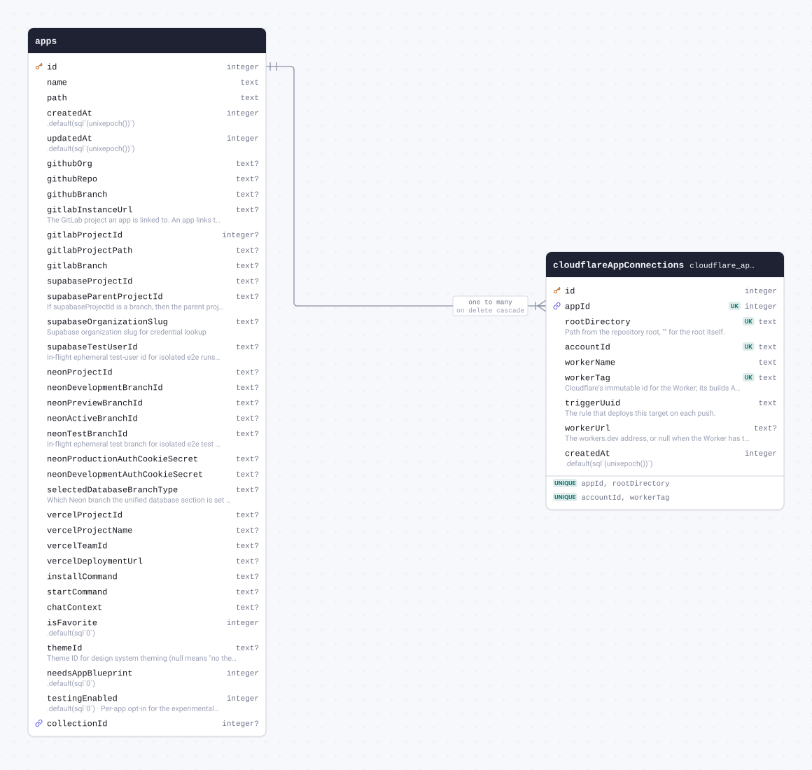

| Column                             | Type      | Constraints                       | Default                          | Description                                                            |
| ---------------------------------- | --------- | --------------------------------- | -------------------------------- | ---------------------------------------------------------------------- |
| `id`                               | `integer` | PK NOT NULL                       |                                  |                                                                        |
| `appId` (`app_id`)                 | `integer` | NOT NULL → [apps.id](#table-apps) |                                  |                                                                        |
| `rootDirectory` (`root_directory`) | `text`    | NOT NULL                          |                                  | Path from the repository root, "" for the root itself.                 |
| `accountId` (`account_id`)         | `text`    | NOT NULL                          |                                  |                                                                        |
| `workerName` (`worker_name`)       | `text`    | NOT NULL                          |                                  |                                                                        |
| `workerTag` (`worker_tag`)         | `text`    | NOT NULL                          |                                  | Cloudflare's immutable id for the Worker; its builds API keys on this. |
| `triggerUuid` (`trigger_uuid`)     | `text`    | NOT NULL                          |                                  | The rule that deploys this target on each push.                        |
| `workerUrl` (`worker_url`)         | `text`    | NULL                              |                                  | The workers.dev address, or null when the Worker has that route off.   |
| `createdAt` (`created_at`)         | `integer` | NOT NULL                          | ``.default(sql`(unixepoch())`)`` |                                                                        |

#### Definition

```sql
CREATE TABLE `cloudflare_app_connections` (
	`id` integer PRIMARY KEY AUTOINCREMENT,
	`app_id` integer NOT NULL,
	`root_directory` text NOT NULL,
	`account_id` text NOT NULL,
	`worker_name` text NOT NULL,
	`worker_tag` text NOT NULL,
	`trigger_uuid` text NOT NULL,
	`worker_url` text,
	`created_at` integer DEFAULT (unixepoch()) NOT NULL,
	CONSTRAINT `fk_cloudflare_app_connections_app_id_apps_id_fk` FOREIGN KEY (`app_id`) REFERENCES `apps`(`id`) ON DELETE CASCADE,
	CONSTRAINT `cloudflare_app_connections_target_unique` UNIQUE(`app_id`,`root_directory`),
	CONSTRAINT `cloudflare_app_connections_worker_unique` UNIQUE(`account_id`,`worker_tag`)
);
```

#### Indexes

- UNIQUE `appId`, `rootDirectory`
- UNIQUE `accountId`, `workerTag`

#### References

- `appId` → [apps.id](#table-apps) (many to one, on delete cascade)

<details>
<summary>Queries and their SQL</summary>

**Select**: Every row of cloudflareAppConnections.

```ts
db.select().from(cloudflareAppConnections);
```

```sql
select "id", "app_id", "root_directory", "account_id", "worker_name", "worker_tag", "trigger_uuid", "worker_url", "created_at"
from "cloudflare_app_connections"
```

**Count**: How many rows cloudflareAppConnections has.

```ts
db.select({ count: count() }).from(cloudflareAppConnections);
```

```sql
select count(*)
from "cloudflare_app_connections"
```

**Find many**: The rows of cloudflareAppConnections, through the relational query API.

```ts
db.query.cloudflareAppConnections.findMany();
```

```sql
select "d0"."id" as "id", "d0"."app_id" as "appId", "d0"."root_directory" as "rootDirectory", "d0"."account_id" as "accountId", "d0"."worker_name" as "workerName", "d0"."worker_tag" as "workerTag", "d0"."trigger_uuid" as "triggerUuid", "d0"."worker_url" as "workerUrl", "d0"."created_at" as "createdAt"
from "cloudflare_app_connections" as "d0"
```

**Find by primary key**: One row of cloudflareAppConnections, through the relational query API.

```ts
db.query.cloudflareAppConnections.findFirst({ where: { id: 1 } });
```

```sql
select "d0"."id" as "id", "d0"."app_id" as "appId", "d0"."root_directory" as "rootDirectory", "d0"."account_id" as "accountId", "d0"."worker_name" as "workerName", "d0"."worker_tag" as "workerTag", "d0"."trigger_uuid" as "triggerUuid", "d0"."worker_url" as "workerUrl", "d0"."created_at" as "createdAt"
from "cloudflare_app_connections" as "d0"
where "d0"."id" = ?
limit ?
-- params: [1,1]
```

**Insert**: Adds a row to cloudflareAppConnections, giving the columns that have no default.

```ts
db.insert(cloudflareAppConnections).values({
  id: 1,
  appId: 1,
  rootDirectory: "rootDirectory",
  accountId: "accountId",
  workerName: "workerName",
  workerTag: "workerTag",
  triggerUuid: "triggerUuid",
});
```

```sql
insert into "cloudflare_app_connections" ("id", "app_id", "root_directory", "account_id", "worker_name", "worker_tag", "trigger_uuid", "worker_url", "created_at")
values (?, ?, ?, ?, ?, ?, ?, null, (unixepoch()))
-- params: [1,1,"rootDirectory","accountId","workerName","workerTag","triggerUuid"]
```

**Update**: Changes a row of cloudflareAppConnections, found by its primary key.

```ts
db.update(cloudflareAppConnections).set({ appId: 1 }).where(eq(cloudflareAppConnections.id, 1));
```

```sql
update "cloudflare_app_connections"
set "app_id" = ?
where "cloudflare_app_connections"."id" = ?
-- params: [1,1]
```

**Delete**: Deletes a row of cloudflareAppConnections, found by its primary key.

```ts
db.delete(cloudflareAppConnections).where(eq(cloudflareAppConnections.id, 1));
```

```sql
delete from "cloudflare_app_connections"
where "cloudflare_app_connections"."id" = ?
-- params: [1]
```

</details>

<a id="table-language_model_providers"></a>

### language_model_providers


| Column                     | Type      | Constraints | Default                          | Description |
| -------------------------- | --------- | ----------- | -------------------------------- | ----------- |
| `id`                       | `text`    | PK NOT NULL |                                  |             |
| `name`                     | `text`    | NOT NULL    |                                  |             |
| `api_base_url`             | `text`    | NOT NULL    |                                  |             |
| `env_var_name`             | `text`    | NULL        |                                  |             |
| `createdAt` (`created_at`) | `integer` | NOT NULL    | ``.default(sql`(unixepoch())`)`` |             |
| `updatedAt` (`updated_at`) | `integer` | NOT NULL    | ``.default(sql`(unixepoch())`)`` |             |

#### Definition

```sql
CREATE TABLE `language_model_providers` (
	`id` text PRIMARY KEY,
	`name` text NOT NULL,
	`api_base_url` text NOT NULL,
	`env_var_name` text,
	`created_at` integer DEFAULT (unixepoch()) NOT NULL,
	`updated_at` integer DEFAULT (unixepoch()) NOT NULL
);
```

#### Referenced by

- `id` → [language_models.customProviderId](#table-language_models) (one to many, on delete cascade)

<details>
<summary>Queries and their SQL</summary>

**Select**: Every row of language_model_providers.

```ts
db.select().from(language_model_providers);
```

```sql
select "id", "name", "api_base_url", "env_var_name", "created_at", "updated_at"
from "language_model_providers"
```

**Count**: How many rows language_model_providers has.

```ts
db.select({ count: count() }).from(language_model_providers);
```

```sql
select count(*)
from "language_model_providers"
```

**Find many**: The rows of language_model_providers, through the relational query API.

```ts
db.query.language_model_providers.findMany();
```

```sql
select "d0"."id" as "id", "d0"."name" as "name", "d0"."api_base_url" as "api_base_url", "d0"."env_var_name" as "env_var_name", "d0"."created_at" as "createdAt", "d0"."updated_at" as "updatedAt"
from "language_model_providers" as "d0"
```

**Find by primary key**: One row of language_model_providers, through the relational query API.

```ts
db.query.language_model_providers.findFirst({ where: { id: "id" } });
```

```sql
select "d0"."id" as "id", "d0"."name" as "name", "d0"."api_base_url" as "api_base_url", "d0"."env_var_name" as "env_var_name", "d0"."created_at" as "createdAt", "d0"."updated_at" as "updatedAt"
from "language_model_providers" as "d0"
where "d0"."id" = ?
limit ?
-- params: ["id",1]
```

**Insert**: Adds a row to language_model_providers, giving the columns that have no default.

```ts
db.insert(language_model_providers).values({
  id: "id",
  name: "name",
  api_base_url: "api_base_url",
});
```

```sql
insert into "language_model_providers" ("id", "name", "api_base_url", "env_var_name", "created_at", "updated_at")
values (?, ?, ?, null, (unixepoch()), (unixepoch()))
-- params: ["id","name","api_base_url"]
```

**Update**: Changes a row of language_model_providers, found by its primary key.

```ts
db.update(language_model_providers)
  .set({ name: "name" })
  .where(eq(language_model_providers.id, "id"));
```

```sql
update "language_model_providers"
set "name" = ?
where "language_model_providers"."id" = ?
-- params: ["name","id"]
```

**Delete**: Deletes a row of language_model_providers, found by its primary key.

```ts
db.delete(language_model_providers).where(eq(language_model_providers.id, "id"));
```

```sql
delete from "language_model_providers"
where "language_model_providers"."id" = ?
-- params: ["id"]
```

</details>

<a id="table-language_models"></a>

### language_models

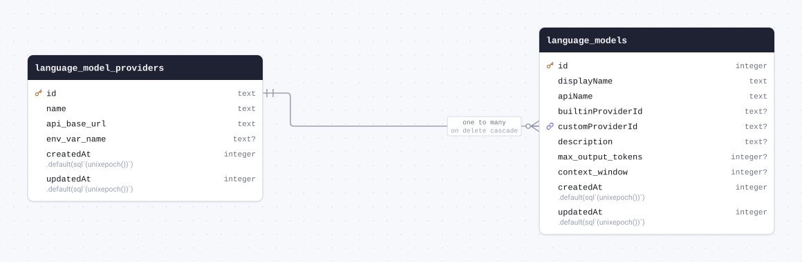

| Column                                      | Type      | Constraints                                                           | Default                          | Description |
| ------------------------------------------- | --------- | --------------------------------------------------------------------- | -------------------------------- | ----------- |
| `id`                                        | `integer` | PK NOT NULL                                                           |                                  |             |
| `displayName` (`display_name`)              | `text`    | NOT NULL                                                              |                                  |             |
| `apiName` (`api_name`)                      | `text`    | NOT NULL                                                              |                                  |             |
| `builtinProviderId` (`builtin_provider_id`) | `text`    | NULL                                                                  |                                  |             |
| `customProviderId` (`custom_provider_id`)   | `text`    | NULL → [language_model_providers.id](#table-language_model_providers) |                                  |             |
| `description`                               | `text`    | NULL                                                                  |                                  |             |
| `max_output_tokens`                         | `integer` | NULL                                                                  |                                  |             |
| `context_window`                            | `integer` | NULL                                                                  |                                  |             |
| `createdAt` (`created_at`)                  | `integer` | NOT NULL                                                              | ``.default(sql`(unixepoch())`)`` |             |
| `updatedAt` (`updated_at`)                  | `integer` | NOT NULL                                                              | ``.default(sql`(unixepoch())`)`` |             |

#### Definition

```sql
CREATE TABLE `language_models` (
	`id` integer PRIMARY KEY AUTOINCREMENT,
	`display_name` text NOT NULL,
	`api_name` text NOT NULL,
	`builtin_provider_id` text,
	`custom_provider_id` text,
	`description` text,
	`max_output_tokens` integer,
	`context_window` integer,
	`created_at` integer DEFAULT (unixepoch()) NOT NULL,
	`updated_at` integer DEFAULT (unixepoch()) NOT NULL,
	CONSTRAINT `fk_language_models_custom_provider_id_language_model_providers_id_fk` FOREIGN KEY (`custom_provider_id`) REFERENCES `language_model_providers`(`id`) ON DELETE CASCADE
);
```

#### References

- `customProviderId` → [language_model_providers.id](#table-language_model_providers) (many to one, on delete cascade)

<details>
<summary>Queries and their SQL</summary>

**Select**: Every row of language_models.

```ts
db.select().from(language_models);
```

```sql
select "id", "display_name", "api_name", "builtin_provider_id", "custom_provider_id", "description", "max_output_tokens", "context_window", "created_at", "updated_at"
from "language_models"
```

**Count**: How many rows language_models has.

```ts
db.select({ count: count() }).from(language_models);
```

```sql
select count(*)
from "language_models"
```

**Find many**: The rows of language_models, through the relational query API.

```ts
db.query.language_models.findMany();
```

```sql
select "d0"."id" as "id", "d0"."display_name" as "displayName", "d0"."api_name" as "apiName", "d0"."builtin_provider_id" as "builtinProviderId", "d0"."custom_provider_id" as "customProviderId", "d0"."description" as "description", "d0"."max_output_tokens" as "max_output_tokens", "d0"."context_window" as "context_window", "d0"."created_at" as "createdAt", "d0"."updated_at" as "updatedAt"
from "language_models" as "d0"
```

**Find by primary key**: One row of language_models, through the relational query API.

```ts
db.query.language_models.findFirst({ where: { id: 1 } });
```

```sql
select "d0"."id" as "id", "d0"."display_name" as "displayName", "d0"."api_name" as "apiName", "d0"."builtin_provider_id" as "builtinProviderId", "d0"."custom_provider_id" as "customProviderId", "d0"."description" as "description", "d0"."max_output_tokens" as "max_output_tokens", "d0"."context_window" as "context_window", "d0"."created_at" as "createdAt", "d0"."updated_at" as "updatedAt"
from "language_models" as "d0"
where "d0"."id" = ?
limit ?
-- params: [1,1]
```

**Insert**: Adds a row to language_models, giving the columns that have no default.

```ts
db.insert(language_models).values({ id: 1, displayName: "displayName", apiName: "apiName" });
```

```sql
insert into "language_models" ("id", "display_name", "api_name", "builtin_provider_id", "custom_provider_id", "description", "max_output_tokens", "context_window", "created_at", "updated_at")
values (?, ?, ?, null, null, null, null, null, (unixepoch()), (unixepoch()))
-- params: [1,"displayName","apiName"]
```

**Update**: Changes a row of language_models, found by its primary key.

```ts
db.update(language_models).set({ displayName: "displayName" }).where(eq(language_models.id, 1));
```

```sql
update "language_models"
set "display_name" = ?
where "language_models"."id" = ?
-- params: ["displayName",1]
```

**Delete**: Deletes a row of language_models, found by its primary key.

```ts
db.delete(language_models).where(eq(language_models.id, 1));
```

```sql
delete from "language_models"
where "language_models"."id" = ?
-- params: [1]
```

</details>

<a id="table-mcpServers"></a>

### mcpServers

Table `mcp_servers`. --- MCP (Model Context Protocol) tables ---

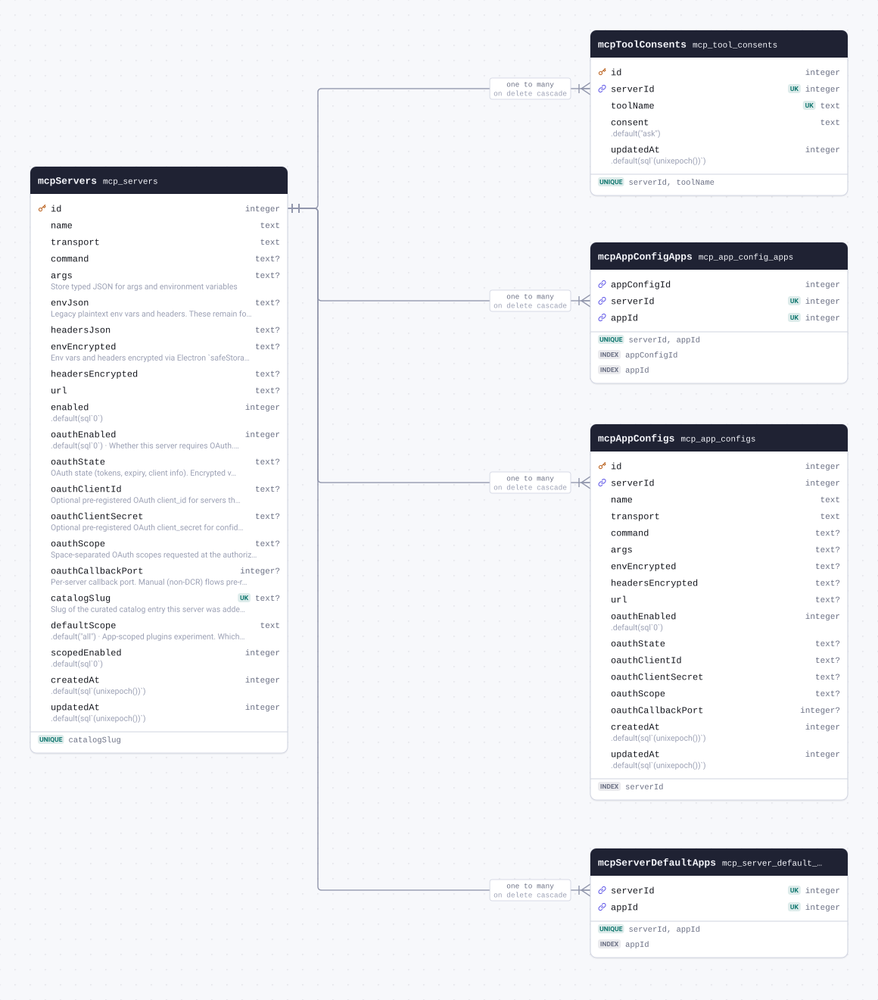

| Column                                      | Type      | Constraints | Default                          | Description                                                                                                                                                                                                                                                              |
| ------------------------------------------- | --------- | ----------- | -------------------------------- | ------------------------------------------------------------------------------------------------------------------------------------------------------------------------------------------------------------------------------------------------------------------------ |
| `id`                                        | `integer` | PK NOT NULL |                                  |                                                                                                                                                                                                                                                                          |
| `name`                                      | `text`    | NOT NULL    |                                  |                                                                                                                                                                                                                                                                          |
| `transport`                                 | `text`    | NOT NULL    |                                  |                                                                                                                                                                                                                                                                          |
| `command`                                   | `text`    | NULL        |                                  |                                                                                                                                                                                                                                                                          |
| `args`                                      | `text`    | NULL        |                                  | Store typed JSON for args and environment variables                                                                                                                                                                                                                      |
| `envJson` (`env_json`)                      | `text`    | NULL        |                                  | Legacy plaintext env vars and headers. These remain for unedited rows so older builds can still use their existing configuration; new writes and secret edits clear them in favor of the encrypted columns below, which are what this build reads.                       |
| `headersJson` (`headers_json`)              | `text`    | NULL        |                                  |                                                                                                                                                                                                                                                                          |
| `envEncrypted` (`env_encrypted`)            | `text`    | NULL        |                                  | Env vars and headers encrypted via Electron `safeStorage`, or base64 plaintext where no keyring is available (see encryptSecretMap). Both hold a JSON object of strings.                                                                                                 |
| `headersEncrypted` (`headers_encrypted`)    | `text`    | NULL        |                                  |                                                                                                                                                                                                                                                                          |
| `url`                                       | `text`    | NULL        |                                  |                                                                                                                                                                                                                                                                          |
| `enabled`                                   | `integer` | NOT NULL    | ``.default(sql`0`)``             |                                                                                                                                                                                                                                                                          |
| `oauthEnabled` (`oauth_enabled`)            | `integer` | NOT NULL    | ``.default(sql`0`)``             | Whether this server requires OAuth. When true, the MCP manager wires an `OAuthClientProvider` into the streamable HTTP transport so the Vercel `@ai-sdk/mcp` `auth()` flow can drive PKCE + refresh.                                                                     |
| `oauthState` (`oauth_state`)                | `text`    | NULL        |                                  | OAuth state (tokens, expiry, client info). Encrypted via Electron `safeStorage`, or base64 plaintext where no keyring is available (see encryptToString). Read/written only by DyadOAuthClientProvider.                                                                  |
| `oauthClientId` (`oauth_client_id`)         | `text`    | NULL        |                                  | Optional pre-registered OAuth client_id for servers that don't support dynamic client registration (RFC 7591). User-supplied via the add-server UI; left blank for servers that support DCR.                                                                             |
| `oauthClientSecret` (`oauth_client_secret`) | `text`    | NULL        |                                  | Optional pre-registered OAuth client_secret for confidential clients. Encrypted via `safeStorage` (base64 plaintext fallback where no keyring exists). Never sent to the renderer.                                                                                       |
| `oauthScope` (`oauth_scope`)                | `text`    | NULL        |                                  | Space-separated OAuth scopes requested at the authorize endpoint. Server-defined values; check provider docs. Blank means omit the `scope` parameter entirely so the server applies its own default (rather than us guessing a value that fits a minority of providers). |
| `oauthCallbackPort` (`oauth_callback_port`) | `integer` | NULL        |                                  | Per-server callback port. Manual (non-DCR) flows pre-register a redirect URI that includes the port, so it must stay stable for those rows. Null falls back to DEFAULT_OAUTH_CALLBACK_PORT.                                                                              |
| `catalogSlug` (`catalog_slug`)              | `text`    | NULL        |                                  | Slug of the curated catalog entry this server was added from. Null for manually configured servers.                                                                                                                                                                      |
| `createdAt` (`created_at`)                  | `integer` | NOT NULL    | ``.default(sql`(unixepoch())`)`` |                                                                                                                                                                                                                                                                          |
| `updatedAt` (`updated_at`)                  | `integer` | NOT NULL    | ``.default(sql`(unixepoch())`)`` |                                                                                                                                                                                                                                                                          |

#### Definition

```sql
CREATE TABLE `mcp_servers` (
	`id` integer PRIMARY KEY AUTOINCREMENT,
	`name` text NOT NULL,
	`transport` text NOT NULL,
	`command` text,
	`args` text,
	`env_json` text,
	`headers_json` text,
	`env_encrypted` text,
	`headers_encrypted` text,
	`url` text,
	`enabled` integer DEFAULT 0 NOT NULL,
	`oauth_enabled` integer DEFAULT 0 NOT NULL,
	`oauth_state` text,
	`oauth_client_id` text,
	`oauth_client_secret` text,
	`oauth_scope` text,
	`oauth_callback_port` integer,
	`catalog_slug` text,
	`created_at` integer DEFAULT (unixepoch()) NOT NULL,
	`updated_at` integer DEFAULT (unixepoch()) NOT NULL
);

CREATE UNIQUE INDEX `uniq_mcp_catalog_slug` ON `mcp_servers` (`catalog_slug`);
```

#### Indexes

- UNIQUE `catalogSlug`

#### Referenced by

- `id` → [mcpToolConsents.serverId](#table-mcpToolConsents) (one to many, on delete cascade)

<details>
<summary>Queries and their SQL</summary>

**Select**: Every row of mcpServers.

```ts
db.select().from(mcpServers);
```

```sql
select "id", "name", "transport", "command", "args", "env_json", "headers_json", "env_encrypted", "headers_encrypted", "url", "enabled", "oauth_enabled", "oauth_state", "oauth_client_id", "oauth_client_secret", "oauth_scope", "oauth_callback_port", "catalog_slug", "created_at", "updated_at"
from "mcp_servers"
```

**Count**: How many rows mcpServers has.

```ts
db.select({ count: count() }).from(mcpServers);
```

```sql
select count(*)
from "mcp_servers"
```

**Find many**: The rows of mcpServers, through the relational query API.

```ts
db.query.mcpServers.findMany();
```

```sql
select "d0"."id" as "id", "d0"."name" as "name", "d0"."transport" as "transport", "d0"."command" as "command", "d0"."args" as "args", "d0"."env_json" as "envJson", "d0"."headers_json" as "headersJson", "d0"."env_encrypted" as "envEncrypted", "d0"."headers_encrypted" as "headersEncrypted", "d0"."url" as "url", "d0"."enabled" as "enabled", "d0"."oauth_enabled" as "oauthEnabled", "d0"."oauth_state" as "oauthState", "d0"."oauth_client_id" as "oauthClientId", "d0"."oauth_client_secret" as "oauthClientSecret", "d0"."oauth_scope" as "oauthScope", "d0"."oauth_callback_port" as "oauthCallbackPort", "d0"."catalog_slug" as "catalogSlug", "d0"."created_at" as "createdAt", "d0"."updated_at" as "updatedAt"
from "mcp_servers" as "d0"
```

**Find by primary key**: One row of mcpServers, through the relational query API.

```ts
db.query.mcpServers.findFirst({ where: { id: 1 } });
```

```sql
select "d0"."id" as "id", "d0"."name" as "name", "d0"."transport" as "transport", "d0"."command" as "command", "d0"."args" as "args", "d0"."env_json" as "envJson", "d0"."headers_json" as "headersJson", "d0"."env_encrypted" as "envEncrypted", "d0"."headers_encrypted" as "headersEncrypted", "d0"."url" as "url", "d0"."enabled" as "enabled", "d0"."oauth_enabled" as "oauthEnabled", "d0"."oauth_state" as "oauthState", "d0"."oauth_client_id" as "oauthClientId", "d0"."oauth_client_secret" as "oauthClientSecret", "d0"."oauth_scope" as "oauthScope", "d0"."oauth_callback_port" as "oauthCallbackPort", "d0"."catalog_slug" as "catalogSlug", "d0"."created_at" as "createdAt", "d0"."updated_at" as "updatedAt"
from "mcp_servers" as "d0"
where "d0"."id" = ?
limit ?
-- params: [1,1]
```

**Insert**: Adds a row to mcpServers, giving the columns that have no default.

```ts
db.insert(mcpServers).values({ id: 1, name: "name", transport: "transport" });
```

```sql
insert into "mcp_servers" ("id", "name", "transport", "command", "args", "env_json", "headers_json", "env_encrypted", "headers_encrypted", "url", "enabled", "oauth_enabled", "oauth_state", "oauth_client_id", "oauth_client_secret", "oauth_scope", "oauth_callback_port", "catalog_slug", "created_at", "updated_at")
values (?, ?, ?, null, null, null, null, null, null, null, 0, 0, null, null, null, null, null, null, (unixepoch()), (unixepoch()))
-- params: [1,"name","transport"]
```

**Update**: Changes a row of mcpServers, found by its primary key.

```ts
db.update(mcpServers).set({ name: "name" }).where(eq(mcpServers.id, 1));
```

```sql
update "mcp_servers"
set "name" = ?
where "mcp_servers"."id" = ?
-- params: ["name",1]
```

**Delete**: Deletes a row of mcpServers, found by its primary key.

```ts
db.delete(mcpServers).where(eq(mcpServers.id, 1));
```

```sql
delete from "mcp_servers"
where "mcp_servers"."id" = ?
-- params: [1]
```

</details>

<a id="table-mcpToolConsents"></a>

### mcpToolConsents

Table `mcp_tool_consents`.

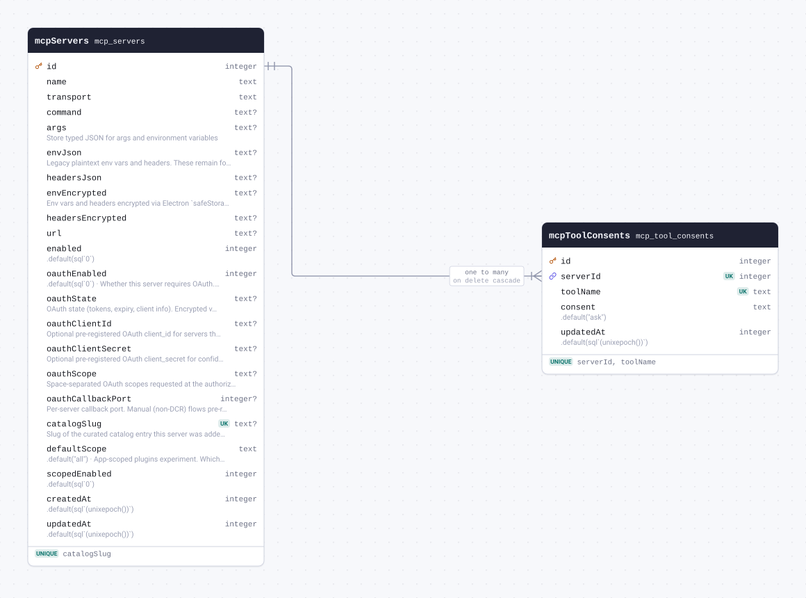

| Column                     | Type      | Constraints                                   | Default                          | Description |
| -------------------------- | --------- | --------------------------------------------- | -------------------------------- | ----------- |
| `id`                       | `integer` | PK NOT NULL                                   |                                  |             |
| `serverId` (`server_id`)   | `integer` | NOT NULL → [mcpServers.id](#table-mcpServers) |                                  |             |
| `toolName` (`tool_name`)   | `text`    | NOT NULL                                      |                                  |             |
| `consent`                  | `text`    | NOT NULL                                      | `.default("ask")`                |             |
| `updatedAt` (`updated_at`) | `integer` | NOT NULL                                      | ``.default(sql`(unixepoch())`)`` |             |

#### Definition

```sql
CREATE TABLE `mcp_tool_consents` (
	`id` integer PRIMARY KEY AUTOINCREMENT,
	`server_id` integer NOT NULL,
	`tool_name` text NOT NULL,
	`consent` text DEFAULT 'ask' NOT NULL,
	`updated_at` integer DEFAULT (unixepoch()) NOT NULL,
	CONSTRAINT `fk_mcp_tool_consents_server_id_mcp_servers_id_fk` FOREIGN KEY (`server_id`) REFERENCES `mcp_servers`(`id`) ON DELETE CASCADE,
	CONSTRAINT `uniq_mcp_consent` UNIQUE(`server_id`,`tool_name`)
);
```

#### Indexes

- UNIQUE `serverId`, `toolName`

#### References

- `serverId` → [mcpServers.id](#table-mcpServers) (many to one, on delete cascade)

<details>
<summary>Queries and their SQL</summary>

**Select**: Every row of mcpToolConsents.

```ts
db.select().from(mcpToolConsents);
```

```sql
select "id", "server_id", "tool_name", "consent", "updated_at"
from "mcp_tool_consents"
```

**Count**: How many rows mcpToolConsents has.

```ts
db.select({ count: count() }).from(mcpToolConsents);
```

```sql
select count(*)
from "mcp_tool_consents"
```

**Find many**: The rows of mcpToolConsents, through the relational query API.

```ts
db.query.mcpToolConsents.findMany();
```

```sql
select "d0"."id" as "id", "d0"."server_id" as "serverId", "d0"."tool_name" as "toolName", "d0"."consent" as "consent", "d0"."updated_at" as "updatedAt"
from "mcp_tool_consents" as "d0"
```

**Find by primary key**: One row of mcpToolConsents, through the relational query API.

```ts
db.query.mcpToolConsents.findFirst({ where: { id: 1 } });
```

```sql
select "d0"."id" as "id", "d0"."server_id" as "serverId", "d0"."tool_name" as "toolName", "d0"."consent" as "consent", "d0"."updated_at" as "updatedAt"
from "mcp_tool_consents" as "d0"
where "d0"."id" = ?
limit ?
-- params: [1,1]
```

**Insert**: Adds a row to mcpToolConsents, giving the columns that have no default.

```ts
db.insert(mcpToolConsents).values({ id: 1, serverId: 1, toolName: "toolName" });
```

```sql
insert into "mcp_tool_consents" ("id", "server_id", "tool_name", "consent", "updated_at")
values (?, ?, ?, ?, (unixepoch()))
-- params: [1,1,"toolName","ask"]
```

**Update**: Changes a row of mcpToolConsents, found by its primary key.

```ts
db.update(mcpToolConsents).set({ serverId: 1 }).where(eq(mcpToolConsents.id, 1));
```

```sql
update "mcp_tool_consents"
set "server_id" = ?
where "mcp_tool_consents"."id" = ?
-- params: [1,1]
```

**Delete**: Deletes a row of mcpToolConsents, found by its primary key.

```ts
db.delete(mcpToolConsents).where(eq(mcpToolConsents.id, 1));
```

```sql
delete from "mcp_tool_consents"
where "mcp_tool_consents"."id" = ?
-- params: [1]
```

</details>

<a id="table-chatSearchDirtyMessages"></a>

### chatSearchDirtyMessages

Table `chat_search_dirty_messages`. --- Chat search (FTS5) support tables --- Dirty queues for the chat_search_fts index (created in a custom migration — drizzle cannot model FTS5 virtual tables). Rows are enqueued by SQLite triggers when source rows change and drained by ChatSearchIndexer, which builds the searchable text projection in TypeScript. No foreign keys: triggers own the row lifecycle, including cleanup on delete.

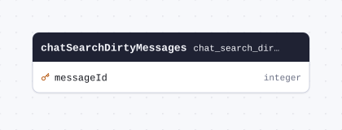

| Column                     | Type      | Constraints | Default | Description |
| -------------------------- | --------- | ----------- | ------- | ----------- |
| `messageId` (`message_id`) | `integer` | PK NOT NULL |         |             |

#### Definition

```sql
CREATE TABLE `chat_search_dirty_messages` (
	`message_id` integer PRIMARY KEY
);
```

<details>
<summary>Queries and their SQL</summary>

**Select**: Every row of chatSearchDirtyMessages.

```ts
db.select().from(chatSearchDirtyMessages);
```

```sql
select "message_id"
from "chat_search_dirty_messages"
```

**Count**: How many rows chatSearchDirtyMessages has.

```ts
db.select({ count: count() }).from(chatSearchDirtyMessages);
```

```sql
select count(*)
from "chat_search_dirty_messages"
```

**Find many**: The rows of chatSearchDirtyMessages, through the relational query API.

```ts
db.query.chatSearchDirtyMessages.findMany();
```

```sql
select "d0"."message_id" as "messageId"
from "chat_search_dirty_messages" as "d0"
```

**Find by primary key**: One row of chatSearchDirtyMessages, through the relational query API.

```ts
db.query.chatSearchDirtyMessages.findFirst({ where: { messageId: 1 } });
```

```sql
select "d0"."message_id" as "messageId"
from "chat_search_dirty_messages" as "d0"
where "d0"."message_id" = ?
limit ?
-- params: [1,1]
```

**Insert**: Adds a row to chatSearchDirtyMessages, giving the columns that have no default.

```ts
db.insert(chatSearchDirtyMessages).values({ messageId: 1 });
```

```sql
insert into "chat_search_dirty_messages" ("message_id")
values (?)
-- params: [1]
```

**Delete**: Deletes a row of chatSearchDirtyMessages, found by its primary key.

```ts
db.delete(chatSearchDirtyMessages).where(eq(chatSearchDirtyMessages.messageId, 1));
```

```sql
delete from "chat_search_dirty_messages"
where "chat_search_dirty_messages"."message_id" = ?
-- params: [1]
```

</details>

<a id="table-chatSearchDirtyChats"></a>

### chatSearchDirtyChats

Table `chat_search_dirty_chats`.

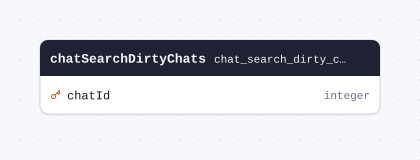

| Column               | Type      | Constraints | Default | Description |
| -------------------- | --------- | ----------- | ------- | ----------- |
| `chatId` (`chat_id`) | `integer` | PK NOT NULL |         |             |

#### Definition

```sql
CREATE TABLE `chat_search_dirty_chats` (
	`chat_id` integer PRIMARY KEY
);
```

<details>
<summary>Queries and their SQL</summary>

**Select**: Every row of chatSearchDirtyChats.

```ts
db.select().from(chatSearchDirtyChats);
```

```sql
select "chat_id"
from "chat_search_dirty_chats"
```

**Count**: How many rows chatSearchDirtyChats has.

```ts
db.select({ count: count() }).from(chatSearchDirtyChats);
```

```sql
select count(*)
from "chat_search_dirty_chats"
```

**Find many**: The rows of chatSearchDirtyChats, through the relational query API.

```ts
db.query.chatSearchDirtyChats.findMany();
```

```sql
select "d0"."chat_id" as "chatId"
from "chat_search_dirty_chats" as "d0"
```

**Find by primary key**: One row of chatSearchDirtyChats, through the relational query API.

```ts
db.query.chatSearchDirtyChats.findFirst({ where: { chatId: 1 } });
```

```sql
select "d0"."chat_id" as "chatId"
from "chat_search_dirty_chats" as "d0"
where "d0"."chat_id" = ?
limit ?
-- params: [1,1]
```

**Insert**: Adds a row to chatSearchDirtyChats, giving the columns that have no default.

```ts
db.insert(chatSearchDirtyChats).values({ chatId: 1 });
```

```sql
insert into "chat_search_dirty_chats" ("chat_id")
values (?)
-- params: [1]
```

**Delete**: Deletes a row of chatSearchDirtyChats, found by its primary key.

```ts
db.delete(chatSearchDirtyChats).where(eq(chatSearchDirtyChats.chatId, 1));
```

```sql
delete from "chat_search_dirty_chats"
where "chat_search_dirty_chats"."chat_id" = ?
-- params: [1]
```

</details>

<a id="table-chatSearchMeta"></a>

### chatSearchMeta

Table `chat_search_meta`. Key/value metadata for the chat-search index (e.g. projection version so a policy change can trigger a background rebuild).

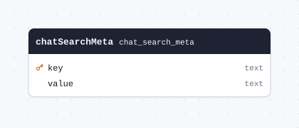

| Column  | Type   | Constraints | Default | Description |
| ------- | ------ | ----------- | ------- | ----------- |
| `key`   | `text` | PK NOT NULL |         |             |
| `value` | `text` | NOT NULL    |         |             |

#### Definition

```sql
CREATE TABLE `chat_search_meta` (
	`key` text PRIMARY KEY,
	`value` text NOT NULL
);
```

<details>
<summary>Queries and their SQL</summary>

**Select**: Every row of chatSearchMeta.

```ts
db.select().from(chatSearchMeta);
```

```sql
select "key", "value"
from "chat_search_meta"
```

**Count**: How many rows chatSearchMeta has.

```ts
db.select({ count: count() }).from(chatSearchMeta);
```

```sql
select count(*)
from "chat_search_meta"
```

**Find many**: The rows of chatSearchMeta, through the relational query API.

```ts
db.query.chatSearchMeta.findMany();
```

```sql
select "d0"."key" as "key", "d0"."value" as "value"
from "chat_search_meta" as "d0"
```

**Find by primary key**: One row of chatSearchMeta, through the relational query API.

```ts
db.query.chatSearchMeta.findFirst({ where: { key: "key" } });
```

```sql
select "d0"."key" as "key", "d0"."value" as "value"
from "chat_search_meta" as "d0"
where "d0"."key" = ?
limit ?
-- params: ["key",1]
```

**Insert**: Adds a row to chatSearchMeta, giving the columns that have no default.

```ts
db.insert(chatSearchMeta).values({ key: "key", value: "value" });
```

```sql
insert into "chat_search_meta" ("key", "value")
values (?, ?)
-- params: ["key","value"]
```

**Update**: Changes a row of chatSearchMeta, found by its primary key.

```ts
db.update(chatSearchMeta).set({ value: "value" }).where(eq(chatSearchMeta.key, "key"));
```

```sql
update "chat_search_meta"
set "value" = ?
where "chat_search_meta"."key" = ?
-- params: ["value","key"]
```

**Delete**: Deletes a row of chatSearchMeta, found by its primary key.

```ts
db.delete(chatSearchMeta).where(eq(chatSearchMeta.key, "key"));
```

```sql
delete from "chat_search_meta"
where "chat_search_meta"."key" = ?
-- params: ["key"]
```

</details>

<a id="table-customThemes"></a>

### customThemes

Table `custom_themes`. --- Custom Themes table ---

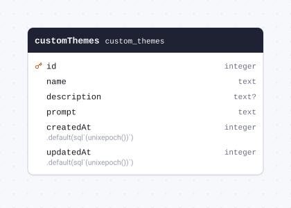

| Column                     | Type      | Constraints | Default                          | Description |
| -------------------------- | --------- | ----------- | -------------------------------- | ----------- |
| `id`                       | `integer` | PK NOT NULL |                                  |             |
| `name`                     | `text`    | NOT NULL    |                                  |             |
| `description`              | `text`    | NULL        |                                  |             |
| `prompt`                   | `text`    | NOT NULL    |                                  |             |
| `createdAt` (`created_at`) | `integer` | NOT NULL    | ``.default(sql`(unixepoch())`)`` |             |
| `updatedAt` (`updated_at`) | `integer` | NOT NULL    | ``.default(sql`(unixepoch())`)`` |             |

#### Definition

```sql
CREATE TABLE `custom_themes` (
	`id` integer PRIMARY KEY AUTOINCREMENT,
	`name` text NOT NULL,
	`description` text,
	`prompt` text NOT NULL,
	`created_at` integer DEFAULT (unixepoch()) NOT NULL,
	`updated_at` integer DEFAULT (unixepoch()) NOT NULL
);
```

<details>
<summary>Queries and their SQL</summary>

**Select**: Every row of customThemes.

```ts
db.select().from(customThemes);
```

```sql
select "id", "name", "description", "prompt", "created_at", "updated_at"
from "custom_themes"
```

**Count**: How many rows customThemes has.

```ts
db.select({ count: count() }).from(customThemes);
```

```sql
select count(*)
from "custom_themes"
```

**Find many**: The rows of customThemes, through the relational query API.

```ts
db.query.customThemes.findMany();
```

```sql
select "d0"."id" as "id", "d0"."name" as "name", "d0"."description" as "description", "d0"."prompt" as "prompt", "d0"."created_at" as "createdAt", "d0"."updated_at" as "updatedAt"
from "custom_themes" as "d0"
```

**Find by primary key**: One row of customThemes, through the relational query API.

```ts
db.query.customThemes.findFirst({ where: { id: 1 } });
```

```sql
select "d0"."id" as "id", "d0"."name" as "name", "d0"."description" as "description", "d0"."prompt" as "prompt", "d0"."created_at" as "createdAt", "d0"."updated_at" as "updatedAt"
from "custom_themes" as "d0"
where "d0"."id" = ?
limit ?
-- params: [1,1]
```

**Insert**: Adds a row to customThemes, giving the columns that have no default.

```ts
db.insert(customThemes).values({ id: 1, name: "name", prompt: "prompt" });
```

```sql
insert into "custom_themes" ("id", "name", "description", "prompt", "created_at", "updated_at")
values (?, ?, null, ?, (unixepoch()), (unixepoch()))
-- params: [1,"name","prompt"]
```

**Update**: Changes a row of customThemes, found by its primary key.

```ts
db.update(customThemes).set({ name: "name" }).where(eq(customThemes.id, 1));
```

```sql
update "custom_themes"
set "name" = ?
where "custom_themes"."id" = ?
-- params: ["name",1]
```

**Delete**: Deletes a row of customThemes, found by its primary key.

```ts
db.delete(customThemes).where(eq(customThemes.id, 1));
```

```sql
delete from "custom_themes"
where "custom_themes"."id" = ?
-- params: [1]
```

</details>
