# Schema docs

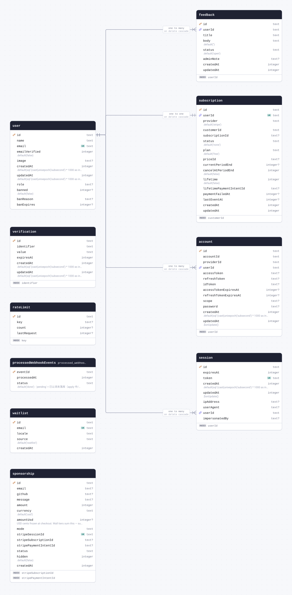

<details>
<summary>The whole schema as SQL</summary>

```sql
CREATE TABLE `account` (
	`id` text PRIMARY KEY,
	`account_id` text NOT NULL,
	`provider_id` text NOT NULL,
	`user_id` text NOT NULL,
	`access_token` text,
	`refresh_token` text,
	`id_token` text,
	`access_token_expires_at` integer,
	`refresh_token_expires_at` integer,
	`scope` text,
	`password` text,
	`created_at` integer DEFAULT (cast(unixepoch('subsecond') * 1000 as integer)) NOT NULL,
	`updated_at` integer NOT NULL,
	CONSTRAINT `fk_account_user_id_user_id_fk` FOREIGN KEY (`user_id`) REFERENCES `user`(`id`) ON DELETE CASCADE
);

CREATE TABLE `feedback` (
	`id` text PRIMARY KEY,
	`user_id` text NOT NULL,
	`title` text NOT NULL,
	`body` text DEFAULT '' NOT NULL,
	`status` text DEFAULT 'open' NOT NULL,
	`admin_note` text,
	`created_at` integer NOT NULL,
	`updated_at` integer NOT NULL,
	CONSTRAINT `fk_feedback_user_id_user_id_fk` FOREIGN KEY (`user_id`) REFERENCES `user`(`id`) ON DELETE CASCADE
);

CREATE TABLE `processed_webhook_events` (
	`event_id` text PRIMARY KEY,
	`processed_at` integer NOT NULL,
	`status` text DEFAULT 'done' NOT NULL
);

CREATE TABLE `rateLimit` (
	`id` text PRIMARY KEY,
	`key` text,
	`count` integer,
	`last_request` integer
);

CREATE TABLE `session` (
	`id` text PRIMARY KEY,
	`expires_at` integer NOT NULL,
	`token` text NOT NULL UNIQUE,
	`created_at` integer DEFAULT (cast(unixepoch('subsecond') * 1000 as integer)) NOT NULL,
	`updated_at` integer NOT NULL,
	`ip_address` text,
	`user_agent` text,
	`user_id` text NOT NULL,
	`impersonated_by` text,
	CONSTRAINT `fk_session_user_id_user_id_fk` FOREIGN KEY (`user_id`) REFERENCES `user`(`id`) ON DELETE CASCADE
);

CREATE TABLE `sponsorship` (
	`id` text PRIMARY KEY,
	`email` text,
	`github` text,
	`message` text,
	`amount` integer NOT NULL,
	`currency` text DEFAULT 'usd' NOT NULL,
	`amount_usd` integer,
	`mode` text NOT NULL,
	`stripe_session_id` text NOT NULL UNIQUE,
	`stripe_subscription_id` text,
	`stripe_payment_intent_id` text,
	`status` text NOT NULL,
	`hidden` integer DEFAULT false NOT NULL,
	`created_at` integer NOT NULL
);

CREATE TABLE `subscription` (
	`id` text PRIMARY KEY,
	`user_id` text NOT NULL UNIQUE,
	`provider` text DEFAULT 'stripe' NOT NULL,
	`customer_id` text NOT NULL,
	`subscription_id` text,
	`status` text DEFAULT 'none' NOT NULL,
	`plan` text DEFAULT 'free' NOT NULL,
	`price_id` text,
	`current_period_end` integer,
	`cancel_at_period_end` integer DEFAULT false NOT NULL,
	`lifetime` integer DEFAULT false NOT NULL,
	`lifetime_payment_intent_id` text,
	`payment_failed_at` integer,
	`last_event_at` integer,
	`created_at` integer NOT NULL,
	`updated_at` integer NOT NULL,
	CONSTRAINT `fk_subscription_user_id_user_id_fk` FOREIGN KEY (`user_id`) REFERENCES `user`(`id`) ON DELETE CASCADE
);

CREATE TABLE `user` (
	`id` text PRIMARY KEY,
	`name` text NOT NULL,
	`email` text NOT NULL UNIQUE,
	`email_verified` integer DEFAULT false NOT NULL,
	`image` text,
	`created_at` integer DEFAULT (cast(unixepoch('subsecond') * 1000 as integer)) NOT NULL,
	`updated_at` integer DEFAULT (cast(unixepoch('subsecond') * 1000 as integer)) NOT NULL,
	`role` text,
	`banned` integer DEFAULT false,
	`ban_reason` text,
	`ban_expires` integer
);

CREATE TABLE `verification` (
	`id` text PRIMARY KEY,
	`identifier` text NOT NULL,
	`value` text NOT NULL,
	`expires_at` integer NOT NULL,
	`created_at` integer DEFAULT (cast(unixepoch('subsecond') * 1000 as integer)) NOT NULL,
	`updated_at` integer DEFAULT (cast(unixepoch('subsecond') * 1000 as integer)) NOT NULL
);

CREATE TABLE `waitlist` (
	`id` text PRIMARY KEY,
	`email` text NOT NULL UNIQUE,
	`locale` text NOT NULL,
	`source` text DEFAULT 'waitlist' NOT NULL,
	`created_at` integer NOT NULL
);

CREATE INDEX `account_userId_idx` ON `account` (`user_id`);

CREATE INDEX `feedback_userId_idx` ON `feedback` (`user_id`);

CREATE INDEX `rateLimit_key_idx` ON `rateLimit` (`key`);

CREATE INDEX `session_userId_idx` ON `session` (`user_id`);

CREATE INDEX `sponsorship_subscription_id_idx` ON `sponsorship` (`stripe_subscription_id`);

CREATE INDEX `sponsorship_payment_intent_id_idx` ON `sponsorship` (`stripe_payment_intent_id`);

CREATE INDEX `subscription_customer_id_idx` ON `subscription` (`customer_id`);

CREATE INDEX `verification_identifier_idx` ON `verification` (`identifier`);
```

</details>

## Contents

| Table                                                   | Name in the database       | Description                                                                                                                                            |
| ------------------------------------------------------- | -------------------------- | ------------------------------------------------------------------------------------------------------------------------------------------------------ |
| [user](#table-user)                                     | `user`                     |                                                                                                                                                        |
| [session](#table-session)                               | `session`                  |                                                                                                                                                        |
| [account](#table-account)                               | `account`                  |                                                                                                                                                        |
| [verification](#table-verification)                     | `verification`             |                                                                                                                                                        |
| [rateLimit](#table-rateLimit)                           | `rateLimit`                | Backs better-auth's `rateLimit: { storage: 'database' }`. Field names (key, count, lastRequest) must match what the rate-limiter adapter reads/writes. |
| [subscription](#table-subscription)                     | `subscription`             |                                                                                                                                                        |
| [processedWebhookEvents](#table-processedWebhookEvents) | `processed_webhook_events` |                                                                                                                                                        |
| [waitlist](#table-waitlist)                             | `waitlist`                 |                                                                                                                                                        |
| [sponsorship](#table-sponsorship)                       | `sponsorship`              |                                                                                                                                                        |
| [feedback](#table-feedback)                             | `feedback`                 |                                                                                                                                                        |

## Tables

<a id="table-user"></a>

### user

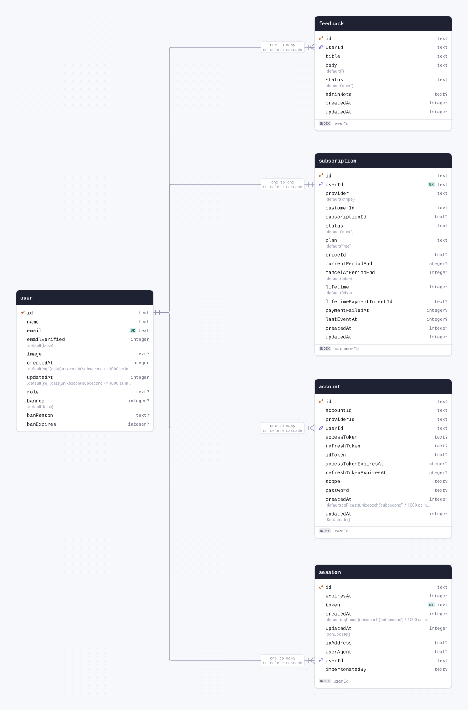

| Column                             | Type      | Constraints     | Default                                                                            | Description |
| ---------------------------------- | --------- | --------------- | ---------------------------------------------------------------------------------- | ----------- |
| `id`                               | `text`    | PK NOT NULL     |                                                                                    |             |
| `name`                             | `text`    | NOT NULL        |                                                                                    |             |
| `email`                            | `text`    | UNIQUE NOT NULL |                                                                                    |             |
| `emailVerified` (`email_verified`) | `integer` | NOT NULL        | `.default(false)`                                                                  |             |
| `image`                            | `text`    | NULL            |                                                                                    |             |
| `createdAt` (`created_at`)         | `integer` | NOT NULL        | ``.default(sql`(cast(unixepoch('subsecond') * 1000 as integer))`)``                |             |
| `updatedAt` (`updated_at`)         | `integer` | NOT NULL        | ``.default(sql`(cast(unixepoch('subsecond') * 1000 as integer))`)`` `.$onUpdate()` |             |
| `role`                             | `text`    | NULL            |                                                                                    |             |
| `banned`                           | `integer` | NULL            | `.default(false)`                                                                  |             |
| `banReason` (`ban_reason`)         | `text`    | NULL            |                                                                                    |             |
| `banExpires` (`ban_expires`)       | `integer` | NULL            |                                                                                    |             |

#### Definition

```sql
CREATE TABLE `user` (
	`id` text PRIMARY KEY,
	`name` text NOT NULL,
	`email` text NOT NULL UNIQUE,
	`email_verified` integer DEFAULT false NOT NULL,
	`image` text,
	`created_at` integer DEFAULT (cast(unixepoch('subsecond') * 1000 as integer)) NOT NULL,
	`updated_at` integer DEFAULT (cast(unixepoch('subsecond') * 1000 as integer)) NOT NULL,
	`role` text,
	`banned` integer DEFAULT false,
	`ban_reason` text,
	`ban_expires` integer
);
```

#### Referenced by

- `id` → [session.userId](#table-session) (one to many, on delete cascade)
- `id` → [account.userId](#table-account) (one to many, on delete cascade)
- `id` → [subscription.userId](#table-subscription) (one to one, on delete cascade)
- `id` → [feedback.userId](#table-feedback) (one to many, on delete cascade)

<details>
<summary>Queries and their SQL</summary>

**Select**: Every row of user.

```ts
db.select().from(user);
```

```sql
select "id", "name", "email", "email_verified", "image", "created_at", "updated_at", "role", "banned", "ban_reason", "ban_expires"
from "user"
```

**Count**: How many rows user has.

```ts
db.select({ count: count() }).from(user);
```

```sql
select count(*)
from "user"
```

**Find many**: The rows of user, through the relational query API.

```ts
db.query.user.findMany();
```

```sql
select "d0"."id" as "id", "d0"."name" as "name", "d0"."email" as "email", "d0"."email_verified" as "emailVerified", "d0"."image" as "image", "d0"."created_at" as "createdAt", "d0"."updated_at" as "updatedAt", "d0"."role" as "role", "d0"."banned" as "banned", "d0"."ban_reason" as "banReason", "d0"."ban_expires" as "banExpires"
from "user" as "d0"
```

**Find by primary key**: One row of user, through the relational query API.

```ts
db.query.user.findFirst({ where: { id: "id" } });
```

```sql
select "d0"."id" as "id", "d0"."name" as "name", "d0"."email" as "email", "d0"."email_verified" as "emailVerified", "d0"."image" as "image", "d0"."created_at" as "createdAt", "d0"."updated_at" as "updatedAt", "d0"."role" as "role", "d0"."banned" as "banned", "d0"."ban_reason" as "banReason", "d0"."ban_expires" as "banExpires"
from "user" as "d0"
where "d0"."id" = ?
limit ?
-- params: ["id",1]
```

**Insert**: Adds a row to user, giving the columns that have no default.

```ts
db.insert(user).values({ id: "id", name: "name", email: "email" });
```

```sql
insert into "user" ("id", "name", "email", "email_verified", "image", "created_at", "updated_at", "role", "banned", "ban_reason", "ban_expires")
values (?, ?, ?, ?, null, (cast(unixepoch('subsecond') * 1000 as integer)), (cast(unixepoch('subsecond') * 1000 as integer)), null, ?, null, null)
-- params: ["id","name","email",0,0]
```

**Update**: Changes a row of user, found by its primary key.

```ts
db.update(user).set({ name: "name" }).where(eq(user.id, "id"));
```

```sql
update "user"
set "name" = ?, "updated_at" = ?
where "user"."id" = ?
-- params: ["name",1767225600000,"id"]
```

**Delete**: Deletes a row of user, found by its primary key.

```ts
db.delete(user).where(eq(user.id, "id"));
```

```sql
delete from "user"
where "user"."id" = ?
-- params: ["id"]
```

</details>

<a id="table-session"></a>

### session

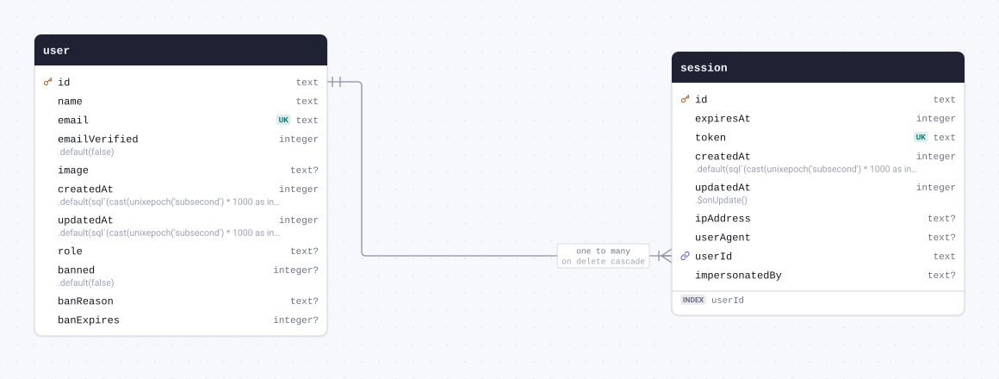

| Column                               | Type      | Constraints                       | Default                                                             | Description |
| ------------------------------------ | --------- | --------------------------------- | ------------------------------------------------------------------- | ----------- |
| `id`                                 | `text`    | PK NOT NULL                       |                                                                     |             |
| `expiresAt` (`expires_at`)           | `integer` | NOT NULL                          |                                                                     |             |
| `token`                              | `text`    | UNIQUE NOT NULL                   |                                                                     |             |
| `createdAt` (`created_at`)           | `integer` | NOT NULL                          | ``.default(sql`(cast(unixepoch('subsecond') * 1000 as integer))`)`` |             |
| `updatedAt` (`updated_at`)           | `integer` | NOT NULL                          | `.$onUpdate()`                                                      |             |
| `ipAddress` (`ip_address`)           | `text`    | NULL                              |                                                                     |             |
| `userAgent` (`user_agent`)           | `text`    | NULL                              |                                                                     |             |
| `userId` (`user_id`)                 | `text`    | NOT NULL → [user.id](#table-user) |                                                                     |             |
| `impersonatedBy` (`impersonated_by`) | `text`    | NULL                              |                                                                     |             |

#### Definition

```sql
CREATE TABLE `session` (
	`id` text PRIMARY KEY,
	`expires_at` integer NOT NULL,
	`token` text NOT NULL UNIQUE,
	`created_at` integer DEFAULT (cast(unixepoch('subsecond') * 1000 as integer)) NOT NULL,
	`updated_at` integer NOT NULL,
	`ip_address` text,
	`user_agent` text,
	`user_id` text NOT NULL,
	`impersonated_by` text,
	CONSTRAINT `fk_session_user_id_user_id_fk` FOREIGN KEY (`user_id`) REFERENCES `user`(`id`) ON DELETE CASCADE
);

CREATE INDEX `session_userId_idx` ON `session` (`user_id`);
```

#### Indexes

- INDEX `userId`

#### References

- `userId` → [user.id](#table-user) (many to one, on delete cascade)

<details>
<summary>Queries and their SQL</summary>

**Select**: Every row of session.

```ts
db.select().from(session);
```

```sql
select "id", "expires_at", "token", "created_at", "updated_at", "ip_address", "user_agent", "user_id", "impersonated_by"
from "session"
```

**Count**: How many rows session has.

```ts
db.select({ count: count() }).from(session);
```

```sql
select count(*)
from "session"
```

**Find many**: The rows of session, through the relational query API.

```ts
db.query.session.findMany();
```

```sql
select "d0"."id" as "id", "d0"."expires_at" as "expiresAt", "d0"."token" as "token", "d0"."created_at" as "createdAt", "d0"."updated_at" as "updatedAt", "d0"."ip_address" as "ipAddress", "d0"."user_agent" as "userAgent", "d0"."user_id" as "userId", "d0"."impersonated_by" as "impersonatedBy"
from "session" as "d0"
```

**Find by primary key**: One row of session, through the relational query API.

```ts
db.query.session.findFirst({ where: { id: "id" } });
```

```sql
select "d0"."id" as "id", "d0"."expires_at" as "expiresAt", "d0"."token" as "token", "d0"."created_at" as "createdAt", "d0"."updated_at" as "updatedAt", "d0"."ip_address" as "ipAddress", "d0"."user_agent" as "userAgent", "d0"."user_id" as "userId", "d0"."impersonated_by" as "impersonatedBy"
from "session" as "d0"
where "d0"."id" = ?
limit ?
-- params: ["id",1]
```

**Insert**: Adds a row to session, giving the columns that have no default.

```ts
db.insert(session).values({
  id: "id",
  expiresAt: 1,
  token: "token",
  updatedAt: 1,
  userId: "userId",
});
```

```sql
insert into "session" ("id", "expires_at", "token", "created_at", "updated_at", "ip_address", "user_agent", "user_id", "impersonated_by")
values (?, ?, ?, (cast(unixepoch('subsecond') * 1000 as integer)), ?, null, null, ?, null)
-- params: ["id",1,"token",1,"userId"]
```

**Update**: Changes a row of session, found by its primary key.

```ts
db.update(session).set({ expiresAt: 1 }).where(eq(session.id, "id"));
```

```sql
update "session"
set "expires_at" = ?, "updated_at" = ?
where "session"."id" = ?
-- params: [1,1767225600000,"id"]
```

**Delete**: Deletes a row of session, found by its primary key.

```ts
db.delete(session).where(eq(session.id, "id"));
```

```sql
delete from "session"
where "session"."id" = ?
-- params: ["id"]
```

</details>

<a id="table-account"></a>

### account

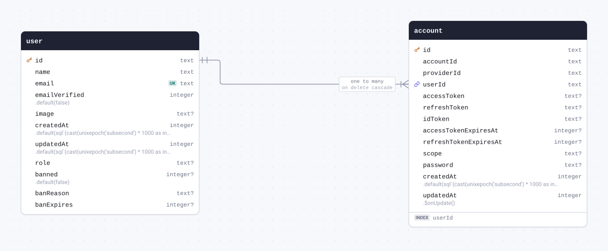

| Column                                               | Type      | Constraints                       | Default                                                             | Description |
| ---------------------------------------------------- | --------- | --------------------------------- | ------------------------------------------------------------------- | ----------- |
| `id`                                                 | `text`    | PK NOT NULL                       |                                                                     |             |
| `accountId` (`account_id`)                           | `text`    | NOT NULL                          |                                                                     |             |
| `providerId` (`provider_id`)                         | `text`    | NOT NULL                          |                                                                     |             |
| `userId` (`user_id`)                                 | `text`    | NOT NULL → [user.id](#table-user) |                                                                     |             |
| `accessToken` (`access_token`)                       | `text`    | NULL                              |                                                                     |             |
| `refreshToken` (`refresh_token`)                     | `text`    | NULL                              |                                                                     |             |
| `idToken` (`id_token`)                               | `text`    | NULL                              |                                                                     |             |
| `accessTokenExpiresAt` (`access_token_expires_at`)   | `integer` | NULL                              |                                                                     |             |
| `refreshTokenExpiresAt` (`refresh_token_expires_at`) | `integer` | NULL                              |                                                                     |             |
| `scope`                                              | `text`    | NULL                              |                                                                     |             |
| `password`                                           | `text`    | NULL                              |                                                                     |             |
| `createdAt` (`created_at`)                           | `integer` | NOT NULL                          | ``.default(sql`(cast(unixepoch('subsecond') * 1000 as integer))`)`` |             |
| `updatedAt` (`updated_at`)                           | `integer` | NOT NULL                          | `.$onUpdate()`                                                      |             |

#### Definition

```sql
CREATE TABLE `account` (
	`id` text PRIMARY KEY,
	`account_id` text NOT NULL,
	`provider_id` text NOT NULL,
	`user_id` text NOT NULL,
	`access_token` text,
	`refresh_token` text,
	`id_token` text,
	`access_token_expires_at` integer,
	`refresh_token_expires_at` integer,
	`scope` text,
	`password` text,
	`created_at` integer DEFAULT (cast(unixepoch('subsecond') * 1000 as integer)) NOT NULL,
	`updated_at` integer NOT NULL,
	CONSTRAINT `fk_account_user_id_user_id_fk` FOREIGN KEY (`user_id`) REFERENCES `user`(`id`) ON DELETE CASCADE
);

CREATE INDEX `account_userId_idx` ON `account` (`user_id`);
```

#### Indexes

- INDEX `userId`

#### References

- `userId` → [user.id](#table-user) (many to one, on delete cascade)

<details>
<summary>Queries and their SQL</summary>

**Select**: Every row of account.

```ts
db.select().from(account);
```

```sql
select "id", "account_id", "provider_id", "user_id", "access_token", "refresh_token", "id_token", "access_token_expires_at", "refresh_token_expires_at", "scope", "password", "created_at", "updated_at"
from "account"
```

**Count**: How many rows account has.

```ts
db.select({ count: count() }).from(account);
```

```sql
select count(*)
from "account"
```

**Find many**: The rows of account, through the relational query API.

```ts
db.query.account.findMany();
```

```sql
select "d0"."id" as "id", "d0"."account_id" as "accountId", "d0"."provider_id" as "providerId", "d0"."user_id" as "userId", "d0"."access_token" as "accessToken", "d0"."refresh_token" as "refreshToken", "d0"."id_token" as "idToken", "d0"."access_token_expires_at" as "accessTokenExpiresAt", "d0"."refresh_token_expires_at" as "refreshTokenExpiresAt", "d0"."scope" as "scope", "d0"."password" as "password", "d0"."created_at" as "createdAt", "d0"."updated_at" as "updatedAt"
from "account" as "d0"
```

**Find by primary key**: One row of account, through the relational query API.

```ts
db.query.account.findFirst({ where: { id: "id" } });
```

```sql
select "d0"."id" as "id", "d0"."account_id" as "accountId", "d0"."provider_id" as "providerId", "d0"."user_id" as "userId", "d0"."access_token" as "accessToken", "d0"."refresh_token" as "refreshToken", "d0"."id_token" as "idToken", "d0"."access_token_expires_at" as "accessTokenExpiresAt", "d0"."refresh_token_expires_at" as "refreshTokenExpiresAt", "d0"."scope" as "scope", "d0"."password" as "password", "d0"."created_at" as "createdAt", "d0"."updated_at" as "updatedAt"
from "account" as "d0"
where "d0"."id" = ?
limit ?
-- params: ["id",1]
```

**Insert**: Adds a row to account, giving the columns that have no default.

```ts
db.insert(account).values({
  id: "id",
  accountId: "accountId",
  providerId: "providerId",
  userId: "userId",
  updatedAt: 1,
});
```

```sql
insert into "account" ("id", "account_id", "provider_id", "user_id", "access_token", "refresh_token", "id_token", "access_token_expires_at", "refresh_token_expires_at", "scope", "password", "created_at", "updated_at")
values (?, ?, ?, ?, null, null, null, null, null, null, null, (cast(unixepoch('subsecond') * 1000 as integer)), ?)
-- params: ["id","accountId","providerId","userId",1]
```

**Update**: Changes a row of account, found by its primary key.

```ts
db.update(account).set({ accountId: "accountId" }).where(eq(account.id, "id"));
```

```sql
update "account"
set "account_id" = ?, "updated_at" = ?
where "account"."id" = ?
-- params: ["accountId",1767225600000,"id"]
```

**Delete**: Deletes a row of account, found by its primary key.

```ts
db.delete(account).where(eq(account.id, "id"));
```

```sql
delete from "account"
where "account"."id" = ?
-- params: ["id"]
```

</details>

<a id="table-verification"></a>

### verification

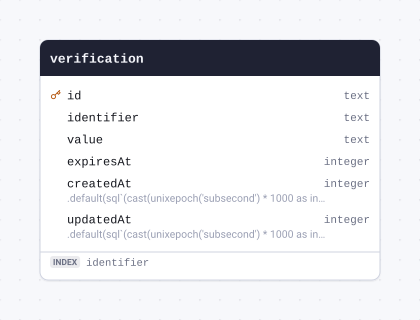

| Column                     | Type      | Constraints | Default                                                                            | Description |
| -------------------------- | --------- | ----------- | ---------------------------------------------------------------------------------- | ----------- |
| `id`                       | `text`    | PK NOT NULL |                                                                                    |             |
| `identifier`               | `text`    | NOT NULL    |                                                                                    |             |
| `value`                    | `text`    | NOT NULL    |                                                                                    |             |
| `expiresAt` (`expires_at`) | `integer` | NOT NULL    |                                                                                    |             |
| `createdAt` (`created_at`) | `integer` | NOT NULL    | ``.default(sql`(cast(unixepoch('subsecond') * 1000 as integer))`)``                |             |
| `updatedAt` (`updated_at`) | `integer` | NOT NULL    | ``.default(sql`(cast(unixepoch('subsecond') * 1000 as integer))`)`` `.$onUpdate()` |             |

#### Definition

```sql
CREATE TABLE `verification` (
	`id` text PRIMARY KEY,
	`identifier` text NOT NULL,
	`value` text NOT NULL,
	`expires_at` integer NOT NULL,
	`created_at` integer DEFAULT (cast(unixepoch('subsecond') * 1000 as integer)) NOT NULL,
	`updated_at` integer DEFAULT (cast(unixepoch('subsecond') * 1000 as integer)) NOT NULL
);

CREATE INDEX `verification_identifier_idx` ON `verification` (`identifier`);
```

#### Indexes

- INDEX `identifier`

<details>
<summary>Queries and their SQL</summary>

**Select**: Every row of verification.

```ts
db.select().from(verification);
```

```sql
select "id", "identifier", "value", "expires_at", "created_at", "updated_at"
from "verification"
```

**Count**: How many rows verification has.

```ts
db.select({ count: count() }).from(verification);
```

```sql
select count(*)
from "verification"
```

**Find many**: The rows of verification, through the relational query API.

```ts
db.query.verification.findMany();
```

```sql
select "d0"."id" as "id", "d0"."identifier" as "identifier", "d0"."value" as "value", "d0"."expires_at" as "expiresAt", "d0"."created_at" as "createdAt", "d0"."updated_at" as "updatedAt"
from "verification" as "d0"
```

**Find by primary key**: One row of verification, through the relational query API.

```ts
db.query.verification.findFirst({ where: { id: "id" } });
```

```sql
select "d0"."id" as "id", "d0"."identifier" as "identifier", "d0"."value" as "value", "d0"."expires_at" as "expiresAt", "d0"."created_at" as "createdAt", "d0"."updated_at" as "updatedAt"
from "verification" as "d0"
where "d0"."id" = ?
limit ?
-- params: ["id",1]
```

**Insert**: Adds a row to verification, giving the columns that have no default.

```ts
db.insert(verification).values({
  id: "id",
  identifier: "identifier",
  value: "value",
  expiresAt: 1,
});
```

```sql
insert into "verification" ("id", "identifier", "value", "expires_at", "created_at", "updated_at")
values (?, ?, ?, ?, (cast(unixepoch('subsecond') * 1000 as integer)), (cast(unixepoch('subsecond') * 1000 as integer)))
-- params: ["id","identifier","value",1]
```

**Update**: Changes a row of verification, found by its primary key.

```ts
db.update(verification).set({ identifier: "identifier" }).where(eq(verification.id, "id"));
```

```sql
update "verification"
set "identifier" = ?, "updated_at" = ?
where "verification"."id" = ?
-- params: ["identifier",1767225600000,"id"]
```

**Delete**: Deletes a row of verification, found by its primary key.

```ts
db.delete(verification).where(eq(verification.id, "id"));
```

```sql
delete from "verification"
where "verification"."id" = ?
-- params: ["id"]
```

</details>

<a id="table-rateLimit"></a>

### rateLimit

Backs better-auth's `rateLimit: { storage: 'database' }`. Field names (key, count, lastRequest) must match what the rate-limiter adapter reads/writes.

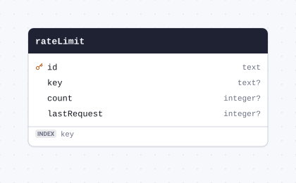

| Column                         | Type      | Constraints | Default | Description |
| ------------------------------ | --------- | ----------- | ------- | ----------- |
| `id`                           | `text`    | PK NOT NULL |         |             |
| `key`                          | `text`    | NULL        |         |             |
| `count`                        | `integer` | NULL        |         |             |
| `lastRequest` (`last_request`) | `integer` | NULL        |         |             |

#### Definition

```sql
CREATE TABLE `rateLimit` (
	`id` text PRIMARY KEY,
	`key` text,
	`count` integer,
	`last_request` integer
);

CREATE INDEX `rateLimit_key_idx` ON `rateLimit` (`key`);
```

#### Indexes

- INDEX `key`

<details>
<summary>Queries and their SQL</summary>

**Select**: Every row of rateLimit.

```ts
db.select().from(rateLimit);
```

```sql
select "id", "key", "count", "last_request"
from "rateLimit"
```

**Count**: How many rows rateLimit has.

```ts
db.select({ count: count() }).from(rateLimit);
```

```sql
select count(*)
from "rateLimit"
```

**Find many**: The rows of rateLimit, through the relational query API.

```ts
db.query.rateLimit.findMany();
```

```sql
select "d0"."id" as "id", "d0"."key" as "key", "d0"."count" as "count", "d0"."last_request" as "lastRequest"
from "rateLimit" as "d0"
```

**Find by primary key**: One row of rateLimit, through the relational query API.

```ts
db.query.rateLimit.findFirst({ where: { id: "id" } });
```

```sql
select "d0"."id" as "id", "d0"."key" as "key", "d0"."count" as "count", "d0"."last_request" as "lastRequest"
from "rateLimit" as "d0"
where "d0"."id" = ?
limit ?
-- params: ["id",1]
```

**Insert**: Adds a row to rateLimit, giving the columns that have no default.

```ts
db.insert(rateLimit).values({ id: "id" });
```

```sql
insert into "rateLimit" ("id", "key", "count", "last_request")
values (?, null, null, null)
-- params: ["id"]
```

**Update**: Changes a row of rateLimit, found by its primary key.

```ts
db.update(rateLimit).set({ key: "key" }).where(eq(rateLimit.id, "id"));
```

```sql
update "rateLimit"
set "key" = ?
where "rateLimit"."id" = ?
-- params: ["key","id"]
```

**Delete**: Deletes a row of rateLimit, found by its primary key.

```ts
db.delete(rateLimit).where(eq(rateLimit.id, "id"));
```

```sql
delete from "rateLimit"
where "rateLimit"."id" = ?
-- params: ["id"]
```

</details>

<a id="table-subscription"></a>

### subscription

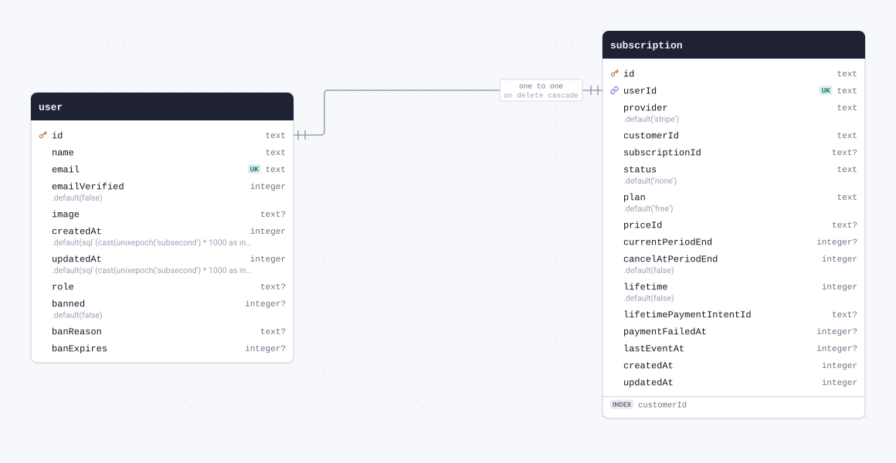

| Column                                                   | Type      | Constraints                              | Default              | Description |
| -------------------------------------------------------- | --------- | ---------------------------------------- | -------------------- | ----------- |
| `id`                                                     | `text`    | PK NOT NULL                              |                      |             |
| `userId` (`user_id`)                                     | `text`    | UNIQUE NOT NULL → [user.id](#table-user) |                      |             |
| `provider`                                               | `text`    | NOT NULL                                 | `.default('stripe')` |             |
| `customerId` (`customer_id`)                             | `text`    | NOT NULL                                 |                      |             |
| `subscriptionId` (`subscription_id`)                     | `text`    | NULL                                     |                      |             |
| `status`                                                 | `text`    | NOT NULL                                 | `.default('none')`   |             |
| `plan`                                                   | `text`    | NOT NULL                                 | `.default('free')`   |             |
| `priceId` (`price_id`)                                   | `text`    | NULL                                     |                      |             |
| `currentPeriodEnd` (`current_period_end`)                | `integer` | NULL                                     |                      |             |
| `cancelAtPeriodEnd` (`cancel_at_period_end`)             | `integer` | NOT NULL                                 | `.default(false)`    |             |
| `lifetime`                                               | `integer` | NOT NULL                                 | `.default(false)`    |             |
| `lifetimePaymentIntentId` (`lifetime_payment_intent_id`) | `text`    | NULL                                     |                      |             |
| `paymentFailedAt` (`payment_failed_at`)                  | `integer` | NULL                                     |                      |             |
| `lastEventAt` (`last_event_at`)                          | `integer` | NULL                                     |                      |             |
| `createdAt` (`created_at`)                               | `integer` | NOT NULL                                 |                      |             |
| `updatedAt` (`updated_at`)                               | `integer` | NOT NULL                                 |                      |             |

#### Definition

```sql
CREATE TABLE `subscription` (
	`id` text PRIMARY KEY,
	`user_id` text NOT NULL UNIQUE,
	`provider` text DEFAULT 'stripe' NOT NULL,
	`customer_id` text NOT NULL,
	`subscription_id` text,
	`status` text DEFAULT 'none' NOT NULL,
	`plan` text DEFAULT 'free' NOT NULL,
	`price_id` text,
	`current_period_end` integer,
	`cancel_at_period_end` integer DEFAULT false NOT NULL,
	`lifetime` integer DEFAULT false NOT NULL,
	`lifetime_payment_intent_id` text,
	`payment_failed_at` integer,
	`last_event_at` integer,
	`created_at` integer NOT NULL,
	`updated_at` integer NOT NULL,
	CONSTRAINT `fk_subscription_user_id_user_id_fk` FOREIGN KEY (`user_id`) REFERENCES `user`(`id`) ON DELETE CASCADE
);

CREATE INDEX `subscription_customer_id_idx` ON `subscription` (`customer_id`);
```

#### Indexes

- INDEX `customerId`

#### References

- `userId` → [user.id](#table-user) (one to one, on delete cascade)

<details>
<summary>Queries and their SQL</summary>

**Select**: Every row of subscription.

```ts
db.select().from(subscription);
```

```sql
select "id", "user_id", "provider", "customer_id", "subscription_id", "status", "plan", "price_id", "current_period_end", "cancel_at_period_end", "lifetime", "lifetime_payment_intent_id", "payment_failed_at", "last_event_at", "created_at", "updated_at"
from "subscription"
```

**Count**: How many rows subscription has.

```ts
db.select({ count: count() }).from(subscription);
```

```sql
select count(*)
from "subscription"
```

**Find many**: The rows of subscription, through the relational query API.

```ts
db.query.subscription.findMany();
```

```sql
select "d0"."id" as "id", "d0"."user_id" as "userId", "d0"."provider" as "provider", "d0"."customer_id" as "customerId", "d0"."subscription_id" as "subscriptionId", "d0"."status" as "status", "d0"."plan" as "plan", "d0"."price_id" as "priceId", "d0"."current_period_end" as "currentPeriodEnd", "d0"."cancel_at_period_end" as "cancelAtPeriodEnd", "d0"."lifetime" as "lifetime", "d0"."lifetime_payment_intent_id" as "lifetimePaymentIntentId", "d0"."payment_failed_at" as "paymentFailedAt", "d0"."last_event_at" as "lastEventAt", "d0"."created_at" as "createdAt", "d0"."updated_at" as "updatedAt"
from "subscription" as "d0"
```

**Find by primary key**: One row of subscription, through the relational query API.

```ts
db.query.subscription.findFirst({ where: { id: "id" } });
```

```sql
select "d0"."id" as "id", "d0"."user_id" as "userId", "d0"."provider" as "provider", "d0"."customer_id" as "customerId", "d0"."subscription_id" as "subscriptionId", "d0"."status" as "status", "d0"."plan" as "plan", "d0"."price_id" as "priceId", "d0"."current_period_end" as "currentPeriodEnd", "d0"."cancel_at_period_end" as "cancelAtPeriodEnd", "d0"."lifetime" as "lifetime", "d0"."lifetime_payment_intent_id" as "lifetimePaymentIntentId", "d0"."payment_failed_at" as "paymentFailedAt", "d0"."last_event_at" as "lastEventAt", "d0"."created_at" as "createdAt", "d0"."updated_at" as "updatedAt"
from "subscription" as "d0"
where "d0"."id" = ?
limit ?
-- params: ["id",1]
```

**Insert**: Adds a row to subscription, giving the columns that have no default.

```ts
db.insert(subscription).values({
  id: "id",
  userId: "userId",
  customerId: "customerId",
  createdAt: 1,
  updatedAt: 1,
});
```

```sql
insert into "subscription" ("id", "user_id", "provider", "customer_id", "subscription_id", "status", "plan", "price_id", "current_period_end", "cancel_at_period_end", "lifetime", "lifetime_payment_intent_id", "payment_failed_at", "last_event_at", "created_at", "updated_at")
values (?, ?, ?, ?, null, ?, ?, null, null, ?, ?, null, null, null, ?, ?)
-- params: ["id","userId","stripe","customerId","none","free",0,0,1,1]
```

**Update**: Changes a row of subscription, found by its primary key.

```ts
db.update(subscription).set({ userId: "userId" }).where(eq(subscription.id, "id"));
```

```sql
update "subscription"
set "user_id" = ?
where "subscription"."id" = ?
-- params: ["userId","id"]
```

**Delete**: Deletes a row of subscription, found by its primary key.

```ts
db.delete(subscription).where(eq(subscription.id, "id"));
```

```sql
delete from "subscription"
where "subscription"."id" = ?
-- params: ["id"]
```

</details>

<a id="table-processedWebhookEvents"></a>

### processedWebhookEvents

Table `processed_webhook_events`.

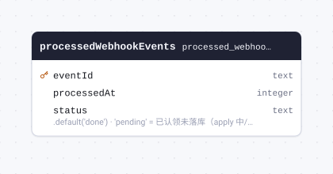

| Column                         | Type      | Constraints | Default            | Description                                                                                                                                                         |
| ------------------------------ | --------- | ----------- | ------------------ | ------------------------------------------------------------------------------------------------------------------------------------------------------------------- |
| `eventId` (`event_id`)         | `text`    | PK NOT NULL |                    |                                                                                                                                                                     |
| `processedAt` (`processed_at`) | `integer` | NOT NULL    |                    |                                                                                                                                                                     |
| `status`                       | `text`    | NOT NULL    | `.default('done')` | 'pending' = 已认领未落库（apply 中/曾中途死掉）；'done' = 已应用。D1 无跨语句事务， 认领与落库间的宕机窗口靠「陈旧 pending 可被重试接管」闭合（见 handleWebhook）。 |

#### Definition

```sql
CREATE TABLE `processed_webhook_events` (
	`event_id` text PRIMARY KEY,
	`processed_at` integer NOT NULL,
	`status` text DEFAULT 'done' NOT NULL
);
```

<details>
<summary>Queries and their SQL</summary>

**Select**: Every row of processedWebhookEvents.

```ts
db.select().from(processedWebhookEvents);
```

```sql
select "event_id", "processed_at", "status"
from "processed_webhook_events"
```

**Count**: How many rows processedWebhookEvents has.

```ts
db.select({ count: count() }).from(processedWebhookEvents);
```

```sql
select count(*)
from "processed_webhook_events"
```

**Find many**: The rows of processedWebhookEvents, through the relational query API.

```ts
db.query.processedWebhookEvents.findMany();
```

```sql
select "d0"."event_id" as "eventId", "d0"."processed_at" as "processedAt", "d0"."status" as "status"
from "processed_webhook_events" as "d0"
```

**Find by primary key**: One row of processedWebhookEvents, through the relational query API.

```ts
db.query.processedWebhookEvents.findFirst({ where: { eventId: "eventId" } });
```

```sql
select "d0"."event_id" as "eventId", "d0"."processed_at" as "processedAt", "d0"."status" as "status"
from "processed_webhook_events" as "d0"
where "d0"."event_id" = ?
limit ?
-- params: ["eventId",1]
```

**Insert**: Adds a row to processedWebhookEvents, giving the columns that have no default.

```ts
db.insert(processedWebhookEvents).values({ eventId: "eventId", processedAt: 1 });
```

```sql
insert into "processed_webhook_events" ("event_id", "processed_at", "status")
values (?, ?, ?)
-- params: ["eventId",1,"done"]
```

**Update**: Changes a row of processedWebhookEvents, found by its primary key.

```ts
db.update(processedWebhookEvents)
  .set({ processedAt: 1 })
  .where(eq(processedWebhookEvents.eventId, "eventId"));
```

```sql
update "processed_webhook_events"
set "processed_at" = ?
where "processed_webhook_events"."event_id" = ?
-- params: [1,"eventId"]
```

**Delete**: Deletes a row of processedWebhookEvents, found by its primary key.

```ts
db.delete(processedWebhookEvents).where(eq(processedWebhookEvents.eventId, "eventId"));
```

```sql
delete from "processed_webhook_events"
where "processed_webhook_events"."event_id" = ?
-- params: ["eventId"]
```

</details>

<a id="table-waitlist"></a>

### waitlist

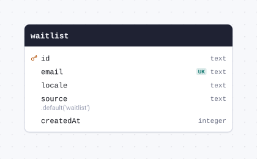

| Column                     | Type      | Constraints     | Default                | Description |
| -------------------------- | --------- | --------------- | ---------------------- | ----------- |
| `id`                       | `text`    | PK NOT NULL     |                        |             |
| `email`                    | `text`    | UNIQUE NOT NULL |                        |             |
| `locale`                   | `text`    | NOT NULL        |                        |             |
| `source`                   | `text`    | NOT NULL        | `.default('waitlist')` |             |
| `createdAt` (`created_at`) | `integer` | NOT NULL        |                        |             |

#### Definition

```sql
CREATE TABLE `waitlist` (
	`id` text PRIMARY KEY,
	`email` text NOT NULL UNIQUE,
	`locale` text NOT NULL,
	`source` text DEFAULT 'waitlist' NOT NULL,
	`created_at` integer NOT NULL
);
```

<details>
<summary>Queries and their SQL</summary>

**Select**: Every row of waitlist.

```ts
db.select().from(waitlist);
```

```sql
select "id", "email", "locale", "source", "created_at"
from "waitlist"
```

**Count**: How many rows waitlist has.

```ts
db.select({ count: count() }).from(waitlist);
```

```sql
select count(*)
from "waitlist"
```

**Find many**: The rows of waitlist, through the relational query API.

```ts
db.query.waitlist.findMany();
```

```sql
select "d0"."id" as "id", "d0"."email" as "email", "d0"."locale" as "locale", "d0"."source" as "source", "d0"."created_at" as "createdAt"
from "waitlist" as "d0"
```

**Find by primary key**: One row of waitlist, through the relational query API.

```ts
db.query.waitlist.findFirst({ where: { id: "id" } });
```

```sql
select "d0"."id" as "id", "d0"."email" as "email", "d0"."locale" as "locale", "d0"."source" as "source", "d0"."created_at" as "createdAt"
from "waitlist" as "d0"
where "d0"."id" = ?
limit ?
-- params: ["id",1]
```

**Insert**: Adds a row to waitlist, giving the columns that have no default.

```ts
db.insert(waitlist).values({ id: "id", email: "email", locale: "locale", createdAt: 1 });
```

```sql
insert into "waitlist" ("id", "email", "locale", "source", "created_at")
values (?, ?, ?, ?, ?)
-- params: ["id","email","locale","waitlist",1]
```

**Update**: Changes a row of waitlist, found by its primary key.

```ts
db.update(waitlist).set({ email: "email" }).where(eq(waitlist.id, "id"));
```

```sql
update "waitlist"
set "email" = ?
where "waitlist"."id" = ?
-- params: ["email","id"]
```

**Delete**: Deletes a row of waitlist, found by its primary key.

```ts
db.delete(waitlist).where(eq(waitlist.id, "id"));
```

```sql
delete from "waitlist"
where "waitlist"."id" = ?
-- params: ["id"]
```

</details>

<a id="table-sponsorship"></a>

### sponsorship

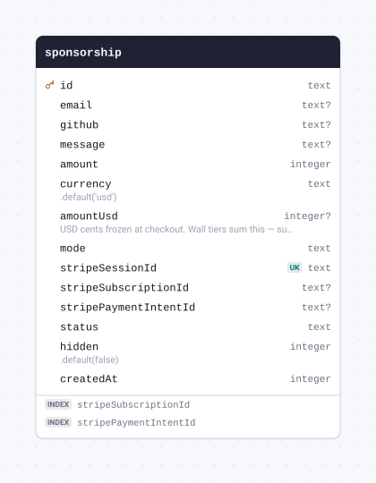

| Column                                               | Type      | Constraints     | Default           | Description                                                                                                                                                       |
| ---------------------------------------------------- | --------- | --------------- | ----------------- | ----------------------------------------------------------------------------------------------------------------------------------------------------------------- |
| `id`                                                 | `text`    | PK NOT NULL     |                   |                                                                                                                                                                   |
| `email`                                              | `text`    | NULL            |                   |                                                                                                                                                                   |
| `github`                                             | `text`    | NULL            |                   |                                                                                                                                                                   |
| `message`                                            | `text`    | NULL            |                   |                                                                                                                                                                   |
| `amount`                                             | `integer` | NOT NULL        |                   |                                                                                                                                                                   |
| `currency`                                           | `text`    | NOT NULL        | `.default('usd')` |                                                                                                                                                                   |
| `amountUsd` (`amount_usd`)                           | `integer` | NULL            |                   | USD cents frozen at checkout. Wall tiers sum this — summing mixed currencies reads HK$78 as $78 (see currency.ts). null = row predates the column (USD-only era). |
| `mode`                                               | `text`    | NOT NULL        |                   |                                                                                                                                                                   |
| `stripeSessionId` (`stripe_session_id`)              | `text`    | UNIQUE NOT NULL |                   |                                                                                                                                                                   |
| `stripeSubscriptionId` (`stripe_subscription_id`)    | `text`    | NULL            |                   |                                                                                                                                                                   |
| `stripePaymentIntentId` (`stripe_payment_intent_id`) | `text`    | NULL            |                   |                                                                                                                                                                   |
| `status`                                             | `text`    | NOT NULL        |                   |                                                                                                                                                                   |
| `hidden`                                             | `integer` | NOT NULL        | `.default(false)` |                                                                                                                                                                   |
| `createdAt` (`created_at`)                           | `integer` | NOT NULL        |                   |                                                                                                                                                                   |

#### Definition

```sql
CREATE TABLE `sponsorship` (
	`id` text PRIMARY KEY,
	`email` text,
	`github` text,
	`message` text,
	`amount` integer NOT NULL,
	`currency` text DEFAULT 'usd' NOT NULL,
	`amount_usd` integer,
	`mode` text NOT NULL,
	`stripe_session_id` text NOT NULL UNIQUE,
	`stripe_subscription_id` text,
	`stripe_payment_intent_id` text,
	`status` text NOT NULL,
	`hidden` integer DEFAULT false NOT NULL,
	`created_at` integer NOT NULL
);

CREATE INDEX `sponsorship_subscription_id_idx` ON `sponsorship` (`stripe_subscription_id`);

CREATE INDEX `sponsorship_payment_intent_id_idx` ON `sponsorship` (`stripe_payment_intent_id`);
```

#### Indexes

- INDEX `stripeSubscriptionId`
- INDEX `stripePaymentIntentId`

<details>
<summary>Queries and their SQL</summary>

**Select**: Every row of sponsorship.

```ts
db.select().from(sponsorship);
```

```sql
select "id", "email", "github", "message", "amount", "currency", "amount_usd", "mode", "stripe_session_id", "stripe_subscription_id", "stripe_payment_intent_id", "status", "hidden", "created_at"
from "sponsorship"
```

**Count**: How many rows sponsorship has.

```ts
db.select({ count: count() }).from(sponsorship);
```

```sql
select count(*)
from "sponsorship"
```

**Find many**: The rows of sponsorship, through the relational query API.

```ts
db.query.sponsorship.findMany();
```

```sql
select "d0"."id" as "id", "d0"."email" as "email", "d0"."github" as "github", "d0"."message" as "message", "d0"."amount" as "amount", "d0"."currency" as "currency", "d0"."amount_usd" as "amountUsd", "d0"."mode" as "mode", "d0"."stripe_session_id" as "stripeSessionId", "d0"."stripe_subscription_id" as "stripeSubscriptionId", "d0"."stripe_payment_intent_id" as "stripePaymentIntentId", "d0"."status" as "status", "d0"."hidden" as "hidden", "d0"."created_at" as "createdAt"
from "sponsorship" as "d0"
```

**Find by primary key**: One row of sponsorship, through the relational query API.

```ts
db.query.sponsorship.findFirst({ where: { id: "id" } });
```

```sql
select "d0"."id" as "id", "d0"."email" as "email", "d0"."github" as "github", "d0"."message" as "message", "d0"."amount" as "amount", "d0"."currency" as "currency", "d0"."amount_usd" as "amountUsd", "d0"."mode" as "mode", "d0"."stripe_session_id" as "stripeSessionId", "d0"."stripe_subscription_id" as "stripeSubscriptionId", "d0"."stripe_payment_intent_id" as "stripePaymentIntentId", "d0"."status" as "status", "d0"."hidden" as "hidden", "d0"."created_at" as "createdAt"
from "sponsorship" as "d0"
where "d0"."id" = ?
limit ?
-- params: ["id",1]
```

**Insert**: Adds a row to sponsorship, giving the columns that have no default.

```ts
db.insert(sponsorship).values({
  id: "id",
  amount: 1,
  mode: "mode",
  stripeSessionId: "stripeSessionId",
  status: "status",
  createdAt: 1,
});
```

```sql
insert into "sponsorship" ("id", "email", "github", "message", "amount", "currency", "amount_usd", "mode", "stripe_session_id", "stripe_subscription_id", "stripe_payment_intent_id", "status", "hidden", "created_at")
values (?, null, null, null, ?, ?, null, ?, ?, null, null, ?, ?, ?)
-- params: ["id",1,"usd","mode","stripeSessionId","status",0,1]
```

**Update**: Changes a row of sponsorship, found by its primary key.

```ts
db.update(sponsorship).set({ email: "email" }).where(eq(sponsorship.id, "id"));
```

```sql
update "sponsorship"
set "email" = ?
where "sponsorship"."id" = ?
-- params: ["email","id"]
```

**Delete**: Deletes a row of sponsorship, found by its primary key.

```ts
db.delete(sponsorship).where(eq(sponsorship.id, "id"));
```

```sql
delete from "sponsorship"
where "sponsorship"."id" = ?
-- params: ["id"]
```

</details>

<a id="table-feedback"></a>

### feedback

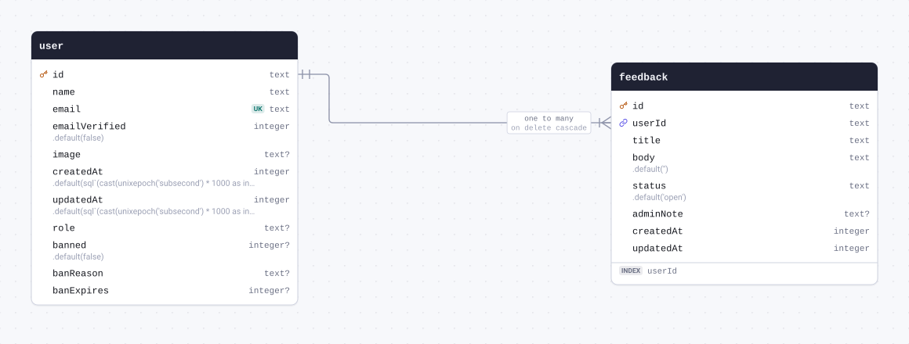

| Column                     | Type      | Constraints                       | Default            | Description |
| -------------------------- | --------- | --------------------------------- | ------------------ | ----------- |
| `id`                       | `text`    | PK NOT NULL                       |                    |             |
| `userId` (`user_id`)       | `text`    | NOT NULL → [user.id](#table-user) |                    |             |
| `title`                    | `text`    | NOT NULL                          |                    |             |
| `body`                     | `text`    | NOT NULL                          | `.default('')`     |             |
| `status`                   | `text`    | NOT NULL                          | `.default('open')` |             |
| `adminNote` (`admin_note`) | `text`    | NULL                              |                    |             |
| `createdAt` (`created_at`) | `integer` | NOT NULL                          |                    |             |
| `updatedAt` (`updated_at`) | `integer` | NOT NULL                          |                    |             |

#### Definition

```sql
CREATE TABLE `feedback` (
	`id` text PRIMARY KEY,
	`user_id` text NOT NULL,
	`title` text NOT NULL,
	`body` text DEFAULT '' NOT NULL,
	`status` text DEFAULT 'open' NOT NULL,
	`admin_note` text,
	`created_at` integer NOT NULL,
	`updated_at` integer NOT NULL,
	CONSTRAINT `fk_feedback_user_id_user_id_fk` FOREIGN KEY (`user_id`) REFERENCES `user`(`id`) ON DELETE CASCADE
);

CREATE INDEX `feedback_userId_idx` ON `feedback` (`user_id`);
```

#### Indexes

- INDEX `userId`

#### References

- `userId` → [user.id](#table-user) (many to one, on delete cascade)

<details>
<summary>Queries and their SQL</summary>

**Select**: Every row of feedback.

```ts
db.select().from(feedback);
```

```sql
select "id", "user_id", "title", "body", "status", "admin_note", "created_at", "updated_at"
from "feedback"
```

**Count**: How many rows feedback has.

```ts
db.select({ count: count() }).from(feedback);
```

```sql
select count(*)
from "feedback"
```

**Find many**: The rows of feedback, through the relational query API.

```ts
db.query.feedback.findMany();
```

```sql
select "d0"."id" as "id", "d0"."user_id" as "userId", "d0"."title" as "title", "d0"."body" as "body", "d0"."status" as "status", "d0"."admin_note" as "adminNote", "d0"."created_at" as "createdAt", "d0"."updated_at" as "updatedAt"
from "feedback" as "d0"
```

**Find by primary key**: One row of feedback, through the relational query API.

```ts
db.query.feedback.findFirst({ where: { id: "id" } });
```

```sql
select "d0"."id" as "id", "d0"."user_id" as "userId", "d0"."title" as "title", "d0"."body" as "body", "d0"."status" as "status", "d0"."admin_note" as "adminNote", "d0"."created_at" as "createdAt", "d0"."updated_at" as "updatedAt"
from "feedback" as "d0"
where "d0"."id" = ?
limit ?
-- params: ["id",1]
```

**Insert**: Adds a row to feedback, giving the columns that have no default.

```ts
db.insert(feedback).values({
  id: "id",
  userId: "userId",
  title: "title",
  createdAt: 1,
  updatedAt: 1,
});
```

```sql
insert into "feedback" ("id", "user_id", "title", "body", "status", "admin_note", "created_at", "updated_at")
values (?, ?, ?, ?, ?, null, ?, ?)
-- params: ["id","userId","title","","open",1,1]
```

**Update**: Changes a row of feedback, found by its primary key.

```ts
db.update(feedback).set({ userId: "userId" }).where(eq(feedback.id, "id"));
```

```sql
update "feedback"
set "user_id" = ?
where "feedback"."id" = ?
-- params: ["userId","id"]
```

**Delete**: Deletes a row of feedback, found by its primary key.

```ts
db.delete(feedback).where(eq(feedback.id, "id"));
```

```sql
delete from "feedback"
where "feedback"."id" = ?
-- params: ["id"]
```

</details>
