# Schema docs


<details>
<summary>The whole schema as SQL</summary>

```sql
CREATE TABLE `action_items` (
	`id` text PRIMARY KEY,
	`workspace_id` text DEFAULT '' NOT NULL,
	`session_id` text DEFAULT '' NOT NULL,
	`source_type` text DEFAULT '' NOT NULL,
	`source_id` text DEFAULT '' NOT NULL,
	`source_order` integer DEFAULT 0 NOT NULL,
	`assignee_human_id` text DEFAULT '' NOT NULL,
	`status` text DEFAULT 'todo' NOT NULL,
	`text` text DEFAULT '' NOT NULL,
	`body_json` text DEFAULT '{}' NOT NULL,
	`due_at` text DEFAULT '' NOT NULL,
	`completed_at` text,
	`created_by` text DEFAULT '' NOT NULL,
	`updated_by` text DEFAULT '' NOT NULL,
	`metadata_json` text DEFAULT '{}' NOT NULL,
	`created_at` text DEFAULT (strftime('%Y-%m-%dT%H:%M:%fZ', 'now')) NOT NULL,
	`updated_at` text DEFAULT (strftime('%Y-%m-%dT%H:%M:%fZ', 'now')) NOT NULL,
	`deleted_at` text
);

CREATE TABLE `app_settings` (
	`id` text PRIMARY KEY,
	`value_json` text DEFAULT 'null' NOT NULL,
	`updated_at` text DEFAULT (strftime('%Y-%m-%dT%H:%M:%fZ', 'now')) NOT NULL
);

CREATE TABLE `attachment_local_state` (
	`attachment_id` text PRIMARY KEY,
	`session_id` text DEFAULT '' NOT NULL,
	`relative_path` text DEFAULT '' NOT NULL,
	`availability` text DEFAULT 'present' NOT NULL,
	`updated_at` text DEFAULT (strftime('%Y-%m-%dT%H:%M:%fZ', 'now')) NOT NULL
);

CREATE TABLE `attachment_transfer_jobs` (
	`id` text PRIMARY KEY,
	`attachment_id` text NOT NULL,
	`session_id` text NOT NULL,
	`workspace_id` text NOT NULL,
	`direction` text NOT NULL,
	`expected_sha256` text NOT NULL,
	`expected_size_bytes` integer DEFAULT 0 NOT NULL,
	`ciphertext_sha256` text DEFAULT '' NOT NULL,
	`ciphertext_size_bytes` integer DEFAULT 0 NOT NULL,
	`remote_object_id` text DEFAULT '' NOT NULL,
	`object_key` text DEFAULT '' NOT NULL,
	`cache_id` text DEFAULT '' NOT NULL,
	`phase` text DEFAULT 'queued' NOT NULL,
	`attempt_count` integer DEFAULT 0 NOT NULL,
	`next_attempt_at` text DEFAULT (strftime('%Y-%m-%dT%H:%M:%fZ', 'now')) NOT NULL,
	`last_attempt_at` text,
	`last_error` text DEFAULT '' NOT NULL,
	`created_at` text DEFAULT (strftime('%Y-%m-%dT%H:%M:%fZ', 'now')) NOT NULL,
	`updated_at` text DEFAULT (strftime('%Y-%m-%dT%H:%M:%fZ', 'now')) NOT NULL,
	`completed_at` text
);

CREATE TABLE `calendars` (
	`id` text PRIMARY KEY,
	`tracking_id_calendar` text DEFAULT '' NOT NULL,
	`name` text DEFAULT '' NOT NULL,
	`enabled` integer DEFAULT false NOT NULL,
	`provider` text DEFAULT '' NOT NULL,
	`source` text DEFAULT '' NOT NULL,
	`color` text DEFAULT '#888' NOT NULL,
	`connection_id` text DEFAULT '' NOT NULL,
	`created_at` text NOT NULL,
	`updated_at` text NOT NULL,
	`deleted_at` text
);

CREATE TABLE `chat_groups` (
	`id` text PRIMARY KEY,
	`workspace_id` text DEFAULT '' NOT NULL,
	`owner_user_id` text DEFAULT '' NOT NULL,
	`title` text DEFAULT '' NOT NULL,
	`created_at` text DEFAULT (strftime('%Y-%m-%dT%H:%M:%fZ', 'now')) NOT NULL,
	`updated_at` text DEFAULT (strftime('%Y-%m-%dT%H:%M:%fZ', 'now')) NOT NULL,
	`deleted_at` text
);

CREATE TABLE `chat_messages` (
	`id` text PRIMARY KEY,
	`workspace_id` text DEFAULT '' NOT NULL,
	`chat_group_id` text DEFAULT '' NOT NULL,
	`owner_user_id` text DEFAULT '' NOT NULL,
	`role` text DEFAULT '' NOT NULL,
	`content` text DEFAULT '' NOT NULL,
	`metadata_json` text DEFAULT '{}' NOT NULL,
	`parts_json` text DEFAULT '[]' NOT NULL,
	`status` text DEFAULT 'ready' NOT NULL,
	`created_at` text DEFAULT (strftime('%Y-%m-%dT%H:%M:%fZ', 'now')) NOT NULL,
	`updated_at` text DEFAULT (strftime('%Y-%m-%dT%H:%M:%fZ', 'now')) NOT NULL,
	`deleted_at` text
);

CREATE TABLE `daily_notes` (
	`id` text PRIMARY KEY,
	`workspace_id` text DEFAULT '' NOT NULL,
	`owner_user_id` text DEFAULT '' NOT NULL,
	`note_date` text DEFAULT '' NOT NULL,
	`body_format` text DEFAULT 'prosemirror_json' NOT NULL,
	`body` text DEFAULT '' NOT NULL,
	`created_at` text DEFAULT (strftime('%Y-%m-%dT%H:%M:%fZ', 'now')) NOT NULL,
	`updated_at` text DEFAULT (strftime('%Y-%m-%dT%H:%M:%fZ', 'now')) NOT NULL,
	`deleted_at` text
);

CREATE TABLE `entity_mentions` (
	`id` text PRIMARY KEY,
	`workspace_id` text DEFAULT '' NOT NULL,
	`owner_user_id` text DEFAULT '' NOT NULL,
	`source_type` text DEFAULT '' NOT NULL,
	`source_id` text DEFAULT '' NOT NULL,
	`target_type` text DEFAULT '' NOT NULL,
	`target_id` text DEFAULT '' NOT NULL,
	`created_at` text DEFAULT (strftime('%Y-%m-%dT%H:%M:%fZ', 'now')) NOT NULL,
	`updated_at` text DEFAULT (strftime('%Y-%m-%dT%H:%M:%fZ', 'now')) NOT NULL,
	`deleted_at` text
);

CREATE TABLE `events` (
	`id` text PRIMARY KEY,
	`tracking_id_event` text DEFAULT '' NOT NULL,
	`calendar_id` text DEFAULT '' NOT NULL,
	`title` text DEFAULT '' NOT NULL,
	`started_at` text DEFAULT '' NOT NULL,
	`ended_at` text DEFAULT '' NOT NULL,
	`location` text DEFAULT '' NOT NULL,
	`meeting_link` text DEFAULT '' NOT NULL,
	`description` text DEFAULT '' NOT NULL,
	`note` text DEFAULT '' NOT NULL,
	`recurrence_series_id` text DEFAULT '' NOT NULL,
	`has_recurrence_rules` integer DEFAULT false NOT NULL,
	`is_all_day` integer DEFAULT false NOT NULL,
	`provider` text DEFAULT '' NOT NULL,
	`participants_json` text,
	`attendance_json` text,
	`created_at` text NOT NULL,
	`updated_at` text NOT NULL,
	`deleted_at` text
);

CREATE TABLE `folder_attachments` (
	`id` text PRIMARY KEY,
	`workspace_id` text DEFAULT '' NOT NULL,
	`folder_path` text DEFAULT '' NOT NULL,
	`filename` text DEFAULT '' NOT NULL,
	`relative_path` text DEFAULT '' NOT NULL,
	`content_type` text DEFAULT '' NOT NULL,
	`size_bytes` integer DEFAULT 0 NOT NULL,
	`sha256` text DEFAULT '' NOT NULL,
	`storage_kind` text DEFAULT 'local_file' NOT NULL,
	`cloud_object_key` text DEFAULT '' NOT NULL,
	`source_type` text DEFAULT 'folder_material' NOT NULL,
	`source_id` text DEFAULT '' NOT NULL,
	`metadata_json` text DEFAULT '{}' NOT NULL,
	`created_at` text DEFAULT (strftime('%Y-%m-%dT%H:%M:%fZ', 'now')) NOT NULL,
	`updated_at` text DEFAULT (strftime('%Y-%m-%dT%H:%M:%fZ', 'now')) NOT NULL,
	`deleted_at` text
);

CREATE TABLE `folders` (
	`id` text PRIMARY KEY,
	`workspace_id` text DEFAULT '' NOT NULL,
	`path` text DEFAULT '' NOT NULL,
	`instructions` text DEFAULT '' NOT NULL,
	`icon_json` text DEFAULT '{"type":"icon","value":"folder","color":"#9ca3af"}' NOT NULL,
	`created_at` text DEFAULT (strftime('%Y-%m-%dT%H:%M:%fZ', 'now')) NOT NULL,
	`updated_at` text DEFAULT (strftime('%Y-%m-%dT%H:%M:%fZ', 'now')) NOT NULL,
	`deleted_at` text
);

CREATE TABLE `humans` (
	`id` text PRIMARY KEY,
	`workspace_id` text DEFAULT '' NOT NULL,
	`owner_user_id` text DEFAULT '' NOT NULL,
	`organization_id` text DEFAULT '' NOT NULL,
	`name` text DEFAULT '' NOT NULL,
	`email` text DEFAULT '' NOT NULL,
	`phone` text DEFAULT '' NOT NULL,
	`job_title` text DEFAULT '' NOT NULL,
	`linkedin_username` text DEFAULT '' NOT NULL,
	`memo` text DEFAULT '' NOT NULL,
	`pinned` integer DEFAULT false NOT NULL,
	`pin_order` integer,
	`metadata_json` text DEFAULT '{}' NOT NULL,
	`created_at` text DEFAULT (strftime('%Y-%m-%dT%H:%M:%fZ', 'now')) NOT NULL,
	`updated_at` text DEFAULT (strftime('%Y-%m-%dT%H:%M:%fZ', 'now')) NOT NULL,
	`deleted_at` text
);

CREATE TABLE `local_library_attachment_state` (
	`account_user_id` text NOT NULL,
	`attachment_id` text NOT NULL,
	`cloud_object_key` text DEFAULT '' NOT NULL,
	`cloud_sync_enabled` integer DEFAULT false NOT NULL,
	CONSTRAINT `local_library_attachment_state_pk` PRIMARY KEY(`account_user_id`, `attachment_id`)
);

CREATE TABLE `local_library_connections` (
	`account_user_id` text PRIMARY KEY,
	`library_workspace_id` text DEFAULT '' NOT NULL,
	`active` integer DEFAULT false NOT NULL,
	`recovery_settings` text DEFAULT '{}' NOT NULL,
	`created_at` text DEFAULT (strftime('%Y-%m-%dT%H:%M:%fZ', 'now')) NOT NULL
);

CREATE TABLE `migration_import_items` (
	`id` text PRIMARY KEY,
	`run_id` text DEFAULT '' NOT NULL,
	`source_path` text DEFAULT '' NOT NULL,
	`source_kind` text DEFAULT '' NOT NULL,
	`source_sha256` text DEFAULT '' NOT NULL,
	`status` text DEFAULT 'pending' NOT NULL,
	`discovered_count` integer DEFAULT 0 NOT NULL,
	`imported_count` integer DEFAULT 0 NOT NULL,
	`matched_count` integer DEFAULT 0 NOT NULL,
	`skipped_count` integer DEFAULT 0 NOT NULL,
	`conflict_count` integer DEFAULT 0 NOT NULL,
	`error` text DEFAULT '' NOT NULL,
	`created_at` text DEFAULT (strftime('%Y-%m-%dT%H:%M:%fZ', 'now')) NOT NULL,
	`completed_at` text
);

CREATE TABLE `migration_import_runs` (
	`id` text PRIMARY KEY,
	`importer_version` integer DEFAULT 1 NOT NULL,
	`source_root` text DEFAULT '' NOT NULL,
	`dry_run` integer DEFAULT false NOT NULL,
	`status` text DEFAULT 'running' NOT NULL,
	`discovered_count` integer DEFAULT 0 NOT NULL,
	`imported_count` integer DEFAULT 0 NOT NULL,
	`matched_count` integer DEFAULT 0 NOT NULL,
	`skipped_count` integer DEFAULT 0 NOT NULL,
	`conflict_count` integer DEFAULT 0 NOT NULL,
	`error_count` integer DEFAULT 0 NOT NULL,
	`started_at` text DEFAULT (strftime('%Y-%m-%dT%H:%M:%fZ', 'now')) NOT NULL,
	`completed_at` text,
	`error` text DEFAULT '' NOT NULL
);

CREATE TABLE `migration_import_targets` (
	`id` text PRIMARY KEY,
	`run_id` text DEFAULT '' NOT NULL,
	`item_id` text DEFAULT '' NOT NULL,
	`source_path` text DEFAULT '' NOT NULL,
	`source_kind` text DEFAULT '' NOT NULL,
	`table_name` text DEFAULT '' NOT NULL,
	`target_id` text DEFAULT '' NOT NULL,
	`status` text DEFAULT 'pending' NOT NULL,
	`error` text DEFAULT '' NOT NULL,
	`created_at` text DEFAULT (strftime('%Y-%m-%dT%H:%M:%fZ', 'now')) NOT NULL
);

CREATE TABLE `organizations` (
	`id` text PRIMARY KEY,
	`workspace_id` text DEFAULT '' NOT NULL,
	`owner_user_id` text DEFAULT '' NOT NULL,
	`name` text DEFAULT '' NOT NULL,
	`memo` text DEFAULT '' NOT NULL,
	`pinned` integer DEFAULT false NOT NULL,
	`pin_order` integer,
	`metadata_json` text DEFAULT '{}' NOT NULL,
	`created_at` text DEFAULT (strftime('%Y-%m-%dT%H:%M:%fZ', 'now')) NOT NULL,
	`updated_at` text DEFAULT (strftime('%Y-%m-%dT%H:%M:%fZ', 'now')) NOT NULL,
	`deleted_at` text
);

CREATE TABLE `session_attachments` (
	`id` text PRIMARY KEY,
	`workspace_id` text DEFAULT '' NOT NULL,
	`session_id` text DEFAULT '' NOT NULL,
	`filename` text DEFAULT '' NOT NULL,
	`relative_path` text DEFAULT '' NOT NULL,
	`content_type` text DEFAULT '' NOT NULL,
	`size_bytes` integer DEFAULT 0 NOT NULL,
	`sha256` text DEFAULT '' NOT NULL,
	`storage_kind` text DEFAULT 'local_file' NOT NULL,
	`cloud_object_key` text DEFAULT '' NOT NULL,
	`cloud_sync_enabled` integer DEFAULT 0 NOT NULL,
	`source_type` text DEFAULT '' NOT NULL,
	`source_id` text DEFAULT '' NOT NULL,
	`metadata_json` text DEFAULT '{}' NOT NULL,
	`created_at` text DEFAULT (strftime('%Y-%m-%dT%H:%M:%fZ', 'now')) NOT NULL,
	`updated_at` text DEFAULT (strftime('%Y-%m-%dT%H:%M:%fZ', 'now')) NOT NULL,
	`deleted_at` text
);

CREATE TABLE `session_documents` (
	`id` text PRIMARY KEY,
	`workspace_id` text DEFAULT '' NOT NULL,
	`session_id` text DEFAULT '' NOT NULL,
	`kind` text DEFAULT 'note' NOT NULL,
	`template_id` text DEFAULT '' NOT NULL,
	`title` text DEFAULT '' NOT NULL,
	`body_format` text DEFAULT 'prosemirror_json' NOT NULL,
	`body` text DEFAULT '' NOT NULL,
	`source_hash` text DEFAULT '' NOT NULL,
	`generation_metadata_json` text DEFAULT '{}' NOT NULL,
	`sort_order` integer DEFAULT 0 NOT NULL,
	`created_by` text DEFAULT '' NOT NULL,
	`updated_by` text DEFAULT '' NOT NULL,
	`created_at` text DEFAULT (strftime('%Y-%m-%dT%H:%M:%fZ', 'now')) NOT NULL,
	`updated_at` text DEFAULT (strftime('%Y-%m-%dT%H:%M:%fZ', 'now')) NOT NULL,
	`content_version` text DEFAULT '' NOT NULL,
	`deleted_at` text
);

CREATE TABLE `session_participants` (
	`id` text PRIMARY KEY,
	`workspace_id` text DEFAULT '' NOT NULL,
	`owner_user_id` text DEFAULT '' NOT NULL,
	`session_id` text DEFAULT '' NOT NULL,
	`human_id` text DEFAULT '' NOT NULL,
	`display_name` text DEFAULT '' NOT NULL,
	`email` text DEFAULT '' NOT NULL,
	`role` text DEFAULT '' NOT NULL,
	`source` text DEFAULT '' NOT NULL,
	`metadata_json` text DEFAULT '{}' NOT NULL,
	`created_at` text DEFAULT (strftime('%Y-%m-%dT%H:%M:%fZ', 'now')) NOT NULL,
	`updated_at` text DEFAULT (strftime('%Y-%m-%dT%H:%M:%fZ', 'now')) NOT NULL,
	`deleted_at` text
);

CREATE TABLE `session_share_activation` (
	`viewer_user_id` text NOT NULL,
	`share_id` text NOT NULL,
	`session_id` text NOT NULL,
	`activated_at` text DEFAULT (strftime('%Y-%m-%dT%H:%M:%fZ', 'now')) NOT NULL,
	CONSTRAINT `session_share_activation_pk` PRIMARY KEY(`viewer_user_id`, `share_id`)
);

CREATE TABLE `session_share_sync_state` (
	`viewer_user_id` text NOT NULL,
	`share_id` text NOT NULL,
	`session_id` text NOT NULL,
	`acknowledged_content_revision` integer NOT NULL,
	`baseline_source_hash` text NOT NULL,
	`status` text DEFAULT 'clean' NOT NULL,
	`updated_at` text DEFAULT (strftime('%Y-%m-%dT%H:%M:%fZ', 'now')) NOT NULL,
	CONSTRAINT `session_share_sync_state_pk` PRIMARY KEY(`viewer_user_id`, `share_id`)
);

CREATE TABLE `session_tags` (
	`id` text PRIMARY KEY,
	`workspace_id` text DEFAULT '' NOT NULL,
	`owner_user_id` text DEFAULT '' NOT NULL,
	`session_id` text DEFAULT '' NOT NULL,
	`tag_id` text DEFAULT '' NOT NULL,
	`created_at` text DEFAULT (strftime('%Y-%m-%dT%H:%M:%fZ', 'now')) NOT NULL,
	`updated_at` text DEFAULT (strftime('%Y-%m-%dT%H:%M:%fZ', 'now')) NOT NULL,
	`deleted_at` text
);

CREATE TABLE `sessions` (
	`id` text PRIMARY KEY,
	`workspace_id` text DEFAULT '' NOT NULL,
	`owner_user_id` text DEFAULT '' NOT NULL,
	`title` text DEFAULT '' NOT NULL,
	`kind` text DEFAULT 'meeting' NOT NULL,
	`status` text DEFAULT 'active' NOT NULL,
	`created_at` text DEFAULT (strftime('%Y-%m-%dT%H:%M:%fZ', 'now')) NOT NULL,
	`updated_at` text DEFAULT (strftime('%Y-%m-%dT%H:%M:%fZ', 'now')) NOT NULL,
	`started_at` text DEFAULT '' NOT NULL,
	`ended_at` text DEFAULT '' NOT NULL,
	`timezone` text DEFAULT '' NOT NULL,
	`language` text DEFAULT '' NOT NULL,
	`event_id` text DEFAULT '' NOT NULL,
	`external_event_id` text DEFAULT '' NOT NULL,
	`external_provider` text DEFAULT '' NOT NULL,
	`series_id` text DEFAULT '' NOT NULL,
	`source_apps_json` text DEFAULT '[]' NOT NULL,
	`event_json` text DEFAULT '' NOT NULL,
	`folder_path` text DEFAULT '' NOT NULL,
	`slug` text DEFAULT '' NOT NULL,
	`metadata_json` text DEFAULT '{}' NOT NULL,
	`share_activation_json` text DEFAULT '{}' NOT NULL,
	`deletion_context` text DEFAULT '' NOT NULL,
	`deleted_at` text
);

CREATE TABLE `shared_session_attachment_cache` (
	`viewer_user_id` text NOT NULL,
	`share_id` text NOT NULL,
	`attachment_id` text NOT NULL,
	`filename` text DEFAULT '' NOT NULL,
	`content_type` text DEFAULT 'application/octet-stream' NOT NULL,
	`size_bytes` integer DEFAULT 0 NOT NULL,
	`sha256` text NOT NULL,
	`cache_id` text DEFAULT '' NOT NULL,
	`claim_token` text DEFAULT '' NOT NULL,
	`cache_generation` integer DEFAULT 0 NOT NULL,
	`availability` text DEFAULT 'pending' NOT NULL,
	`access_version` integer DEFAULT 0 NOT NULL,
	`attempt_count` integer DEFAULT 0 NOT NULL,
	`next_attempt_at` text DEFAULT (strftime('%Y-%m-%dT%H:%M:%fZ', 'now')) NOT NULL,
	`last_attempt_at` text,
	`last_error` text DEFAULT '' NOT NULL,
	`created_at` text DEFAULT (strftime('%Y-%m-%dT%H:%M:%fZ', 'now')) NOT NULL,
	`updated_at` text DEFAULT (strftime('%Y-%m-%dT%H:%M:%fZ', 'now')) NOT NULL,
	CONSTRAINT `shared_session_attachment_cache_pk` PRIMARY KEY(`viewer_user_id`, `share_id`, `attachment_id`)
);

CREATE TABLE `shared_session_cache` (
	`share_id` text NOT NULL,
	`viewer_user_id` text NOT NULL,
	`workspace_id` text NOT NULL,
	`session_id` text NOT NULL,
	`schema_version` integer DEFAULT 1 NOT NULL,
	`content_revision` integer NOT NULL,
	`title` text DEFAULT '' NOT NULL,
	`body_json` text NOT NULL,
	`attachments_json` text DEFAULT '[]' NOT NULL,
	`capability` text DEFAULT 'viewer' NOT NULL,
	`manage_access` integer DEFAULT false NOT NULL,
	`access_version` integer NOT NULL,
	`web_editable` integer DEFAULT false NOT NULL,
	`web_edit_base_content_revision` integer,
	`web_edit_base_title` text,
	`web_edit_base_body_json` text,
	`published_at` text NOT NULL,
	`cached_at` text DEFAULT (strftime('%Y-%m-%dT%H:%M:%fZ', 'now')) NOT NULL,
	CONSTRAINT `shared_session_cache_pk` PRIMARY KEY(`viewer_user_id`, `share_id`)
);

CREATE TABLE `storage_migration_state` (
	`id` text PRIMARY KEY,
	`importer_version` integer DEFAULT 1 NOT NULL,
	`phase` text DEFAULT 'shadow' NOT NULL,
	`latest_run_id` text DEFAULT '' NOT NULL,
	`parity_verified` integer DEFAULT false NOT NULL,
	`cutover_at` text,
	`rollback_until` text,
	`last_error` text DEFAULT '' NOT NULL,
	`updated_at` text DEFAULT (strftime('%Y-%m-%dT%H:%M:%fZ', 'now')) NOT NULL
);

CREATE TABLE `synced_preferences` (
	`id` text PRIMARY KEY,
	`workspace_id` text DEFAULT '' NOT NULL,
	`value_json` text DEFAULT 'null' NOT NULL,
	`updated_at` text DEFAULT (strftime('%Y-%m-%dT%H:%M:%fZ', 'now')) NOT NULL
);

CREATE TABLE `tags` (
	`id` text PRIMARY KEY,
	`workspace_id` text DEFAULT '' NOT NULL,
	`owner_user_id` text DEFAULT '' NOT NULL,
	`name` text DEFAULT '' NOT NULL,
	`created_at` text DEFAULT (strftime('%Y-%m-%dT%H:%M:%fZ', 'now')) NOT NULL,
	`updated_at` text DEFAULT (strftime('%Y-%m-%dT%H:%M:%fZ', 'now')) NOT NULL,
	`deleted_at` text
);

CREATE TABLE `templates` (
	`id` text PRIMARY KEY,
	`title` text DEFAULT '' NOT NULL,
	`description` text DEFAULT '' NOT NULL,
	`pinned` integer DEFAULT false NOT NULL,
	`pin_order` integer,
	`category` text,
	`icon_json` text DEFAULT '{"type":"icon","value":"notebook-tabs","color":"#9ca3af"}' NOT NULL,
	`targets_json` text,
	`sections_json` text DEFAULT '[]' NOT NULL,
	`created_at` text NOT NULL,
	`updated_at` text NOT NULL
);

CREATE TABLE `transcripts` (
	`id` text PRIMARY KEY,
	`workspace_id` text DEFAULT '' NOT NULL,
	`owner_user_id` text DEFAULT '' NOT NULL,
	`session_id` text DEFAULT '' NOT NULL,
	`source` text DEFAULT '' NOT NULL,
	`provider` text DEFAULT '' NOT NULL,
	`model` text DEFAULT '' NOT NULL,
	`language` text DEFAULT '' NOT NULL,
	`started_at_ms` integer DEFAULT 0 NOT NULL,
	`ended_at_ms` integer,
	`audio_attachment_id` text DEFAULT '' NOT NULL,
	`memo` text DEFAULT '' NOT NULL,
	`words_json` text DEFAULT '[]' NOT NULL,
	`speaker_hints_json` text DEFAULT '[]' NOT NULL,
	`metadata_json` text DEFAULT '{}' NOT NULL,
	`created_at` text DEFAULT (strftime('%Y-%m-%dT%H:%M:%fZ', 'now')) NOT NULL,
	`updated_at` text DEFAULT (strftime('%Y-%m-%dT%H:%M:%fZ', 'now')) NOT NULL,
	`content_version` text DEFAULT '' NOT NULL,
	`deleted_at` text
);

CREATE TABLE `workspace_memberships` (
	`id` text PRIMARY KEY,
	`workspace_id` text DEFAULT '' NOT NULL,
	`user_id` text DEFAULT '' NOT NULL,
	`role` text DEFAULT 'member' NOT NULL,
	`created_at` text DEFAULT (strftime('%Y-%m-%dT%H:%M:%fZ', 'now')) NOT NULL,
	`updated_at` text DEFAULT (strftime('%Y-%m-%dT%H:%M:%fZ', 'now')) NOT NULL,
	`deleted_at` text
);

CREATE TABLE `workspaces` (
	`id` text PRIMARY KEY,
	`owner_user_id` text DEFAULT '' NOT NULL,
	`kind` text DEFAULT 'personal' NOT NULL,
	`name` text DEFAULT '' NOT NULL,
	`created_at` text DEFAULT (strftime('%Y-%m-%dT%H:%M:%fZ', 'now')) NOT NULL,
	`updated_at` text DEFAULT (strftime('%Y-%m-%dT%H:%M:%fZ', 'now')) NOT NULL,
	`deleted_at` text
);

CREATE INDEX `idx_action_items_session_id` ON `action_items` (`session_id`);

CREATE INDEX `idx_action_items_source` ON `action_items` (`source_type`,`source_id`);

CREATE INDEX `idx_attachment_local_state_session_id` ON `attachment_local_state` (`session_id`);

CREATE UNIQUE INDEX `idx_attachment_transfer_jobs_live_version` ON `attachment_transfer_jobs` (`attachment_id`,`expected_sha256`,`expected_size_bytes`) WHERE "attachment_transfer_jobs"."direction" IN ('upload', 'download') AND "attachment_transfer_jobs"."phase" <> 'completed';

CREATE UNIQUE INDEX `idx_attachment_transfer_jobs_delete_object` ON `attachment_transfer_jobs` (`object_key`) WHERE "attachment_transfer_jobs"."direction" = 'delete';

CREATE UNIQUE INDEX `idx_attachment_transfer_jobs_upload_object_id` ON `attachment_transfer_jobs` (`remote_object_id`) WHERE "attachment_transfer_jobs"."direction" = 'upload' AND "attachment_transfer_jobs"."remote_object_id" <> '';

CREATE UNIQUE INDEX `idx_attachment_transfer_jobs_delete_object_id` ON `attachment_transfer_jobs` (`remote_object_id`) WHERE "attachment_transfer_jobs"."direction" = 'delete' AND "attachment_transfer_jobs"."remote_object_id" <> '';

CREATE UNIQUE INDEX `idx_attachment_transfer_jobs_cache_id` ON `attachment_transfer_jobs` (`cache_id`) WHERE "attachment_transfer_jobs"."cache_id" <> '';

CREATE INDEX `idx_attachment_transfer_jobs_due` ON `attachment_transfer_jobs` (`phase`,`next_attempt_at`,`created_at`);

CREATE INDEX `idx_attachment_transfer_jobs_attachment_id` ON `attachment_transfer_jobs` (`attachment_id`);

CREATE INDEX `idx_attachment_transfer_jobs_session_id` ON `attachment_transfer_jobs` (`session_id`);

CREATE INDEX `idx_calendars_provider` ON `calendars` (`provider`);

CREATE INDEX `idx_chat_messages_group_id` ON `chat_messages` (`chat_group_id`,`created_at`);

CREATE INDEX `idx_daily_notes_note_date` ON `daily_notes` (`note_date`);

CREATE INDEX `idx_entity_mentions_source` ON `entity_mentions` (`source_type`,`source_id`);

CREATE INDEX `idx_entity_mentions_target` ON `entity_mentions` (`target_type`,`target_id`);

CREATE INDEX `idx_events_calendar_id` ON `events` (`calendar_id`);

CREATE INDEX `idx_events_started_at` ON `events` (`started_at`);

CREATE INDEX `idx_folder_attachments_folder_path` ON `folder_attachments` (`folder_path`);

CREATE INDEX `idx_folders_path` ON `folders` (`path`);

CREATE INDEX `idx_humans_organization_id` ON `humans` (`organization_id`);

CREATE INDEX `idx_humans_email` ON `humans` (`email`);

CREATE INDEX `idx_local_library_connections_library` ON `local_library_connections` (`library_workspace_id`);

CREATE UNIQUE INDEX `idx_local_library_connections_active` ON `local_library_connections` (`active`) WHERE "local_library_connections"."active" = 1;

CREATE INDEX `idx_migration_import_items_run_id` ON `migration_import_items` (`run_id`);

CREATE INDEX `idx_migration_import_items_source` ON `migration_import_items` (`source_path`,`source_sha256`);

CREATE INDEX `idx_migration_import_targets_run_id` ON `migration_import_targets` (`run_id`);

CREATE INDEX `idx_migration_import_targets_table` ON `migration_import_targets` (`run_id`,`table_name`,`status`);

CREATE INDEX `idx_migration_import_targets_source` ON `migration_import_targets` (`source_path`,`target_id`);

CREATE INDEX `idx_session_attachments_session_id` ON `session_attachments` (`session_id`);

CREATE INDEX `idx_session_documents_session_id` ON `session_documents` (`session_id`);

CREATE INDEX `idx_session_documents_kind` ON `session_documents` (`kind`);

CREATE INDEX `idx_session_participants_session_id` ON `session_participants` (`session_id`);

CREATE INDEX `idx_session_participants_human_id` ON `session_participants` (`human_id`);

CREATE UNIQUE INDEX `session_share_activation_viewer_session_unique` ON `session_share_activation` (`viewer_user_id`,`session_id`);

CREATE INDEX `idx_session_share_sync_state_session` ON `session_share_sync_state` (`viewer_user_id`,`session_id`);

CREATE INDEX `idx_session_tags_session_id` ON `session_tags` (`session_id`);

CREATE INDEX `idx_session_tags_tag_id` ON `session_tags` (`tag_id`);

CREATE INDEX `idx_sessions_created_at` ON `sessions` (`created_at`);

CREATE INDEX `idx_sessions_folder_path` ON `sessions` (`folder_path`);

CREATE INDEX `idx_sessions_event_id` ON `sessions` (`event_id`);

CREATE UNIQUE INDEX `idx_shared_session_attachment_cache_cache_id` ON `shared_session_attachment_cache` (`cache_id`) WHERE "shared_session_attachment_cache"."cache_id" <> '';

CREATE INDEX `idx_shared_session_attachment_cache_cleanup` ON `shared_session_attachment_cache` (`availability`,`updated_at`) WHERE "shared_session_attachment_cache"."availability" IN ('delete_pending', 'deleting', 'failed');

CREATE INDEX `idx_shared_session_attachment_cache_due` ON `shared_session_attachment_cache` (`availability`,`next_attempt_at`,`updated_at`) WHERE "shared_session_attachment_cache"."availability" IN ('pending', 'delete_pending', 'failed');

CREATE INDEX `idx_shared_session_attachment_cache_share` ON `shared_session_attachment_cache` (`viewer_user_id`,`share_id`);

CREATE INDEX `idx_shared_session_cache_viewer_workspace` ON `shared_session_cache` (`viewer_user_id`,`workspace_id`);

CREATE INDEX `idx_tags_name` ON `tags` (`name`);

CREATE INDEX `idx_transcripts_session_id` ON `transcripts` (`session_id`);

CREATE INDEX `idx_workspace_memberships_user_id` ON `workspace_memberships` (`user_id`);

CREATE INDEX `idx_workspaces_owner_user_id` ON `workspaces` (`owner_user_id`);
```

</details>

## Contents

| Table                                                               | Name in the database              | Description |
| ------------------------------------------------------------------- | --------------------------------- | ----------- |
| [localLibraryConnections](#table-localLibraryConnections)           | `local_library_connections`       |             |
| [localLibraryAttachmentState](#table-localLibraryAttachmentState)   | `local_library_attachment_state`  |             |
| [templates](#table-templates)                                       | `templates`                       |             |
| [calendars](#table-calendars)                                       | `calendars`                       |             |
| [events](#table-events)                                             | `events`                          |             |
| [workspaces](#table-workspaces)                                     | `workspaces`                      |             |
| [workspaceMemberships](#table-workspaceMemberships)                 | `workspace_memberships`           |             |
| [organizations](#table-organizations)                               | `organizations`                   |             |
| [humans](#table-humans)                                             | `humans`                          |             |
| [sessions](#table-sessions)                                         | `sessions`                        |             |
| [sessionDocuments](#table-sessionDocuments)                         | `session_documents`               |             |
| [sharedSessionCache](#table-sharedSessionCache)                     | `shared_session_cache`            |             |
| [sessionShareSyncState](#table-sessionShareSyncState)               | `session_share_sync_state`        |             |
| [sessionShareActivation](#table-sessionShareActivation)             | `session_share_activation`        |             |
| [transcripts](#table-transcripts)                                   | `transcripts`                     |             |
| [sessionParticipants](#table-sessionParticipants)                   | `session_participants`            |             |
| [actionItems](#table-actionItems)                                   | `action_items`                    |             |
| [sessionAttachments](#table-sessionAttachments)                     | `session_attachments`             |             |
| [folders](#table-folders)                                           | `folders`                         |             |
| [folderAttachments](#table-folderAttachments)                       | `folder_attachments`              |             |
| [attachmentLocalState](#table-attachmentLocalState)                 | `attachment_local_state`          |             |
| [attachmentTransferJobs](#table-attachmentTransferJobs)             | `attachment_transfer_jobs`        |             |
| [sharedSessionAttachmentCache](#table-sharedSessionAttachmentCache) | `shared_session_attachment_cache` |             |
| [tags](#table-tags)                                                 | `tags`                            |             |
| [sessionTags](#table-sessionTags)                                   | `session_tags`                    |             |
| [entityMentions](#table-entityMentions)                             | `entity_mentions`                 |             |
| [chatGroups](#table-chatGroups)                                     | `chat_groups`                     |             |
| [chatMessages](#table-chatMessages)                                 | `chat_messages`                   |             |
| [dailyNotes](#table-dailyNotes)                                     | `daily_notes`                     |             |
| [appSettings](#table-appSettings)                                   | `app_settings`                    |             |
| [syncedPreferences](#table-syncedPreferences)                       | `synced_preferences`              |             |
| [migrationImportRuns](#table-migrationImportRuns)                   | `migration_import_runs`           |             |
| [migrationImportItems](#table-migrationImportItems)                 | `migration_import_items`          |             |
| [migrationImportTargets](#table-migrationImportTargets)             | `migration_import_targets`        |             |
| [storageMigrationState](#table-storageMigrationState)               | `storage_migration_state`         |             |

## Tables

<a id="table-localLibraryConnections"></a>

### localLibraryConnections

Table `local_library_connections`.

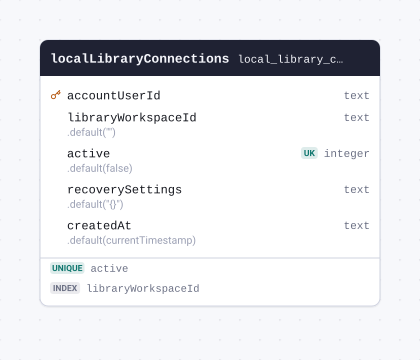

| Column                                        | Type      | Constraints | Default                      | Description |
| --------------------------------------------- | --------- | ----------- | ---------------------------- | ----------- |
| `accountUserId` (`account_user_id`)           | `text`    | PK NOT NULL |                              |             |
| `libraryWorkspaceId` (`library_workspace_id`) | `text`    | NOT NULL    | `.default("")`               |             |
| `active`                                      | `integer` | NOT NULL    | `.default(false)`            |             |
| `recoverySettings` (`recovery_settings`)      | `text`    | NOT NULL    | `.default("{}")`             |             |
| `createdAt` (`created_at`)                    | `text`    | NOT NULL    | `.default(currentTimestamp)` |             |

#### Definition

```sql
CREATE TABLE `local_library_connections` (
	`account_user_id` text PRIMARY KEY,
	`library_workspace_id` text DEFAULT '' NOT NULL,
	`active` integer DEFAULT false NOT NULL,
	`recovery_settings` text DEFAULT '{}' NOT NULL,
	`created_at` text DEFAULT (strftime('%Y-%m-%dT%H:%M:%fZ', 'now')) NOT NULL
);

CREATE INDEX `idx_local_library_connections_library` ON `local_library_connections` (`library_workspace_id`);

CREATE UNIQUE INDEX `idx_local_library_connections_active` ON `local_library_connections` (`active`) WHERE "local_library_connections"."active" = 1;
```

#### Indexes

- INDEX `libraryWorkspaceId`
- UNIQUE `active`

<details>
<summary>Queries and their SQL</summary>

**Select**: Every row of localLibraryConnections.

```ts
db.select().from(localLibraryConnections);
```

```sql
select "account_user_id", "library_workspace_id", "active", "recovery_settings", "created_at"
from "local_library_connections"
```

**Count**: How many rows localLibraryConnections has.

```ts
db.select({ count: count() }).from(localLibraryConnections);
```

```sql
select count(*)
from "local_library_connections"
```

**Find many**: The rows of localLibraryConnections, through the relational query API.

```ts
db.query.localLibraryConnections.findMany();
```

```sql
select "d0"."account_user_id" as "accountUserId", "d0"."library_workspace_id" as "libraryWorkspaceId", "d0"."active" as "active", "d0"."recovery_settings" as "recoverySettings", "d0"."created_at" as "createdAt"
from "local_library_connections" as "d0"
```

**Find by primary key**: One row of localLibraryConnections, through the relational query API.

```ts
db.query.localLibraryConnections.findFirst({ where: { accountUserId: "accountUserId" } });
```

```sql
select "d0"."account_user_id" as "accountUserId", "d0"."library_workspace_id" as "libraryWorkspaceId", "d0"."active" as "active", "d0"."recovery_settings" as "recoverySettings", "d0"."created_at" as "createdAt"
from "local_library_connections" as "d0"
where "d0"."account_user_id" = ?
limit ?
-- params: ["accountUserId",1]
```

**Insert**: Adds a row to localLibraryConnections, giving the columns that have no default.

```ts
db.insert(localLibraryConnections).values({ accountUserId: "accountUserId" });
```

```sql
insert into "local_library_connections" ("account_user_id", "library_workspace_id", "active", "recovery_settings", "created_at")
values (?, ?, ?, ?, (strftime('%Y-%m-%dT%H:%M:%fZ', 'now')))
-- params: ["accountUserId","",0,"{}"]
```

**Update**: Changes a row of localLibraryConnections, found by its primary key.

```ts
db.update(localLibraryConnections)
  .set({ libraryWorkspaceId: "libraryWorkspaceId" })
  .where(eq(localLibraryConnections.accountUserId, "accountUserId"));
```

```sql
update "local_library_connections"
set "library_workspace_id" = ?
where "local_library_connections"."account_user_id" = ?
-- params: ["libraryWorkspaceId","accountUserId"]
```

**Delete**: Deletes a row of localLibraryConnections, found by its primary key.

```ts
db.delete(localLibraryConnections).where(
  eq(localLibraryConnections.accountUserId, "accountUserId"),
);
```

```sql
delete from "local_library_connections"
where "local_library_connections"."account_user_id" = ?
-- params: ["accountUserId"]
```

</details>

<a id="table-localLibraryAttachmentState"></a>

### localLibraryAttachmentState

Table `local_library_attachment_state`.

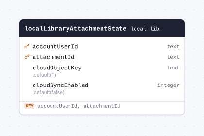

| Column                                    | Type      | Constraints | Default           | Description |
| ----------------------------------------- | --------- | ----------- | ----------------- | ----------- |
| `accountUserId` (`account_user_id`)       | `text`    | PK NOT NULL |                   |             |
| `attachmentId` (`attachment_id`)          | `text`    | PK NOT NULL |                   |             |
| `cloudObjectKey` (`cloud_object_key`)     | `text`    | NOT NULL    | `.default("")`    |             |
| `cloudSyncEnabled` (`cloud_sync_enabled`) | `integer` | NOT NULL    | `.default(false)` |             |

#### Definition

```sql
CREATE TABLE `local_library_attachment_state` (
	`account_user_id` text NOT NULL,
	`attachment_id` text NOT NULL,
	`cloud_object_key` text DEFAULT '' NOT NULL,
	`cloud_sync_enabled` integer DEFAULT false NOT NULL,
	CONSTRAINT `local_library_attachment_state_pk` PRIMARY KEY(`account_user_id`, `attachment_id`)
);
```

#### Indexes

- PRIMARY KEY `accountUserId`, `attachmentId`

<details>
<summary>Queries and their SQL</summary>

**Select**: Every row of localLibraryAttachmentState.

```ts
db.select().from(localLibraryAttachmentState);
```

```sql
select "account_user_id", "attachment_id", "cloud_object_key", "cloud_sync_enabled"
from "local_library_attachment_state"
```

**Count**: How many rows localLibraryAttachmentState has.

```ts
db.select({ count: count() }).from(localLibraryAttachmentState);
```

```sql
select count(*)
from "local_library_attachment_state"
```

**Find many**: The rows of localLibraryAttachmentState, through the relational query API.

```ts
db.query.localLibraryAttachmentState.findMany();
```

```sql
select "d0"."account_user_id" as "accountUserId", "d0"."attachment_id" as "attachmentId", "d0"."cloud_object_key" as "cloudObjectKey", "d0"."cloud_sync_enabled" as "cloudSyncEnabled"
from "local_library_attachment_state" as "d0"
```

**Find by primary key**: One row of localLibraryAttachmentState, through the relational query API.

```ts
db.query.localLibraryAttachmentState.findFirst({
  where: { accountUserId: "accountUserId", attachmentId: "attachmentId" },
});
```

```sql
select "d0"."account_user_id" as "accountUserId", "d0"."attachment_id" as "attachmentId", "d0"."cloud_object_key" as "cloudObjectKey", "d0"."cloud_sync_enabled" as "cloudSyncEnabled"
from "local_library_attachment_state" as "d0"
where (("d0"."account_user_id" = ?) and ("d0"."attachment_id" = ?))
limit ?
-- params: ["accountUserId","attachmentId",1]
```

**Insert**: Adds a row to localLibraryAttachmentState, giving the columns that have no default.

```ts
db.insert(localLibraryAttachmentState).values({
  accountUserId: "accountUserId",
  attachmentId: "attachmentId",
});
```

```sql
insert into "local_library_attachment_state" ("account_user_id", "attachment_id", "cloud_object_key", "cloud_sync_enabled")
values (?, ?, ?, ?)
-- params: ["accountUserId","attachmentId","",0]
```

**Update**: Changes a row of localLibraryAttachmentState, found by its primary key.

```ts
db.update(localLibraryAttachmentState)
  .set({ cloudObjectKey: "cloudObjectKey" })
  .where(
    and(
      eq(localLibraryAttachmentState.accountUserId, "accountUserId"),
      eq(localLibraryAttachmentState.attachmentId, "attachmentId"),
    ),
  );
```

```sql
update "local_library_attachment_state"
set "cloud_object_key" = ?
where (("local_library_attachment_state"."account_user_id" = ?) and ("local_library_attachment_state"."attachment_id" = ?))
-- params: ["cloudObjectKey","accountUserId","attachmentId"]
```

**Delete**: Deletes a row of localLibraryAttachmentState, found by its primary key.

```ts
db.delete(localLibraryAttachmentState).where(
  and(
    eq(localLibraryAttachmentState.accountUserId, "accountUserId"),
    eq(localLibraryAttachmentState.attachmentId, "attachmentId"),
  ),
);
```

```sql
delete from "local_library_attachment_state"
where (("local_library_attachment_state"."account_user_id" = ?) and ("local_library_attachment_state"."attachment_id" = ?))
-- params: ["accountUserId","attachmentId"]
```

</details>

<a id="table-templates"></a>

### templates

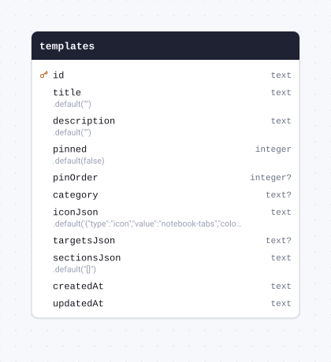

| Column                           | Type      | Constraints | Default                                                                 | Description |
| -------------------------------- | --------- | ----------- | ----------------------------------------------------------------------- | ----------- |
| `id`                             | `text`    | PK NOT NULL |                                                                         |             |
| `title`                          | `text`    | NOT NULL    | `.default("")`                                                          |             |
| `description`                    | `text`    | NOT NULL    | `.default("")`                                                          |             |
| `pinned`                         | `integer` | NOT NULL    | `.default(false)`                                                       |             |
| `pinOrder` (`pin_order`)         | `integer` | NULL        |                                                                         |             |
| `category`                       | `text`    | NULL        |                                                                         |             |
| `iconJson` (`icon_json`)         | `text`    | NOT NULL    | `.default('{"type":"icon","value":"notebook-tabs","color":"#9ca3af"}')` |             |
| `targetsJson` (`targets_json`)   | `text`    | NULL        |                                                                         |             |
| `sectionsJson` (`sections_json`) | `text`    | NOT NULL    | `.default("[]")`                                                        |             |
| `createdAt` (`created_at`)       | `text`    | NOT NULL    |                                                                         |             |
| `updatedAt` (`updated_at`)       | `text`    | NOT NULL    |                                                                         |             |

#### Definition

```sql
CREATE TABLE `templates` (
	`id` text PRIMARY KEY,
	`title` text DEFAULT '' NOT NULL,
	`description` text DEFAULT '' NOT NULL,
	`pinned` integer DEFAULT false NOT NULL,
	`pin_order` integer,
	`category` text,
	`icon_json` text DEFAULT '{"type":"icon","value":"notebook-tabs","color":"#9ca3af"}' NOT NULL,
	`targets_json` text,
	`sections_json` text DEFAULT '[]' NOT NULL,
	`created_at` text NOT NULL,
	`updated_at` text NOT NULL
);
```

<details>
<summary>Queries and their SQL</summary>

**Select**: Every row of templates.

```ts
db.select().from(templates);
```

```sql
select "id", "title", "description", "pinned", "pin_order", "category", "icon_json", "targets_json", "sections_json", "created_at", "updated_at"
from "templates"
```

**Count**: How many rows templates has.

```ts
db.select({ count: count() }).from(templates);
```

```sql
select count(*)
from "templates"
```

**Find many**: The rows of templates, through the relational query API.

```ts
db.query.templates.findMany();
```

```sql
select "d0"."id" as "id", "d0"."title" as "title", "d0"."description" as "description", "d0"."pinned" as "pinned", "d0"."pin_order" as "pinOrder", "d0"."category" as "category", "d0"."icon_json" as "iconJson", "d0"."targets_json" as "targetsJson", "d0"."sections_json" as "sectionsJson", "d0"."created_at" as "createdAt", "d0"."updated_at" as "updatedAt"
from "templates" as "d0"
```

**Find by primary key**: One row of templates, through the relational query API.

```ts
db.query.templates.findFirst({ where: { id: "id" } });
```

```sql
select "d0"."id" as "id", "d0"."title" as "title", "d0"."description" as "description", "d0"."pinned" as "pinned", "d0"."pin_order" as "pinOrder", "d0"."category" as "category", "d0"."icon_json" as "iconJson", "d0"."targets_json" as "targetsJson", "d0"."sections_json" as "sectionsJson", "d0"."created_at" as "createdAt", "d0"."updated_at" as "updatedAt"
from "templates" as "d0"
where "d0"."id" = ?
limit ?
-- params: ["id",1]
```

**Insert**: Adds a row to templates, giving the columns that have no default.

```ts
db.insert(templates).values({ id: "id", createdAt: "createdAt", updatedAt: "updatedAt" });
```

```sql
insert into "templates" ("id", "title", "description", "pinned", "pin_order", "category", "icon_json", "targets_json", "sections_json", "created_at", "updated_at")
values (?, ?, ?, ?, null, null, ?, null, ?, ?, ?)
-- params: ["id","","",0,"\"{\\\"type\\\":\\\"icon\\\",\\\"value\\\":\\\"notebook-tabs\\\",\\\"color\\\":\\\"#9ca3af\\\"}\"","\"[]\"","createdAt","updatedAt"]
```

**Update**: Changes a row of templates, found by its primary key.

```ts
db.update(templates).set({ title: "title" }).where(eq(templates.id, "id"));
```

```sql
update "templates"
set "title" = ?
where "templates"."id" = ?
-- params: ["title","id"]
```

**Delete**: Deletes a row of templates, found by its primary key.

```ts
db.delete(templates).where(eq(templates.id, "id"));
```

```sql
delete from "templates"
where "templates"."id" = ?
-- params: ["id"]
```

</details>

<a id="table-calendars"></a>

### calendars

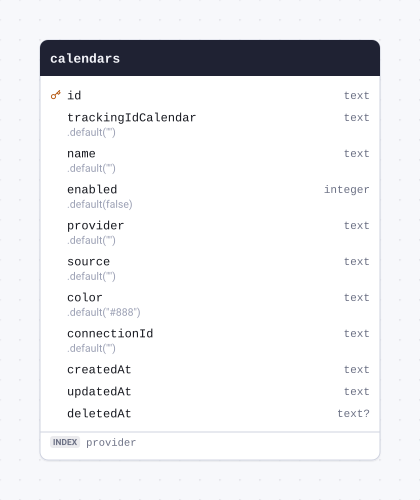

| Column                                        | Type      | Constraints | Default            | Description |
| --------------------------------------------- | --------- | ----------- | ------------------ | ----------- |
| `id`                                          | `text`    | PK NOT NULL |                    |             |
| `trackingIdCalendar` (`tracking_id_calendar`) | `text`    | NOT NULL    | `.default("")`     |             |
| `name`                                        | `text`    | NOT NULL    | `.default("")`     |             |
| `enabled`                                     | `integer` | NOT NULL    | `.default(false)`  |             |
| `provider`                                    | `text`    | NOT NULL    | `.default("")`     |             |
| `source`                                      | `text`    | NOT NULL    | `.default("")`     |             |
| `color`                                       | `text`    | NOT NULL    | `.default("#888")` |             |
| `connectionId` (`connection_id`)              | `text`    | NOT NULL    | `.default("")`     |             |
| `createdAt` (`created_at`)                    | `text`    | NOT NULL    |                    |             |
| `updatedAt` (`updated_at`)                    | `text`    | NOT NULL    |                    |             |
| `deletedAt` (`deleted_at`)                    | `text`    | NULL        |                    |             |

#### Definition

```sql
CREATE TABLE `calendars` (
	`id` text PRIMARY KEY,
	`tracking_id_calendar` text DEFAULT '' NOT NULL,
	`name` text DEFAULT '' NOT NULL,
	`enabled` integer DEFAULT false NOT NULL,
	`provider` text DEFAULT '' NOT NULL,
	`source` text DEFAULT '' NOT NULL,
	`color` text DEFAULT '#888' NOT NULL,
	`connection_id` text DEFAULT '' NOT NULL,
	`created_at` text NOT NULL,
	`updated_at` text NOT NULL,
	`deleted_at` text
);

CREATE INDEX `idx_calendars_provider` ON `calendars` (`provider`);
```

#### Indexes

- INDEX `provider`

<details>
<summary>Queries and their SQL</summary>

**Select**: Every row of calendars.

```ts
db.select().from(calendars);
```

```sql
select "id", "tracking_id_calendar", "name", "enabled", "provider", "source", "color", "connection_id", "created_at", "updated_at", "deleted_at"
from "calendars"
```

**Count**: How many rows calendars has.

```ts
db.select({ count: count() }).from(calendars);
```

```sql
select count(*)
from "calendars"
```

**Find many**: The rows of calendars, through the relational query API.

```ts
db.query.calendars.findMany();
```

```sql
select "d0"."id" as "id", "d0"."tracking_id_calendar" as "trackingIdCalendar", "d0"."name" as "name", "d0"."enabled" as "enabled", "d0"."provider" as "provider", "d0"."source" as "source", "d0"."color" as "color", "d0"."connection_id" as "connectionId", "d0"."created_at" as "createdAt", "d0"."updated_at" as "updatedAt", "d0"."deleted_at" as "deletedAt"
from "calendars" as "d0"
```

**Find by primary key**: One row of calendars, through the relational query API.

```ts
db.query.calendars.findFirst({ where: { id: "id" } });
```

```sql
select "d0"."id" as "id", "d0"."tracking_id_calendar" as "trackingIdCalendar", "d0"."name" as "name", "d0"."enabled" as "enabled", "d0"."provider" as "provider", "d0"."source" as "source", "d0"."color" as "color", "d0"."connection_id" as "connectionId", "d0"."created_at" as "createdAt", "d0"."updated_at" as "updatedAt", "d0"."deleted_at" as "deletedAt"
from "calendars" as "d0"
where "d0"."id" = ?
limit ?
-- params: ["id",1]
```

**Insert**: Adds a row to calendars, giving the columns that have no default.

```ts
db.insert(calendars).values({ id: "id", createdAt: "createdAt", updatedAt: "updatedAt" });
```

```sql
insert into "calendars" ("id", "tracking_id_calendar", "name", "enabled", "provider", "source", "color", "connection_id", "created_at", "updated_at", "deleted_at")
values (?, ?, ?, ?, ?, ?, ?, ?, ?, ?, null)
-- params: ["id","","",0,"","","#888","","createdAt","updatedAt"]
```

**Update**: Changes a row of calendars, found by its primary key.

```ts
db.update(calendars)
  .set({ trackingIdCalendar: "trackingIdCalendar" })
  .where(eq(calendars.id, "id"));
```

```sql
update "calendars"
set "tracking_id_calendar" = ?
where "calendars"."id" = ?
-- params: ["trackingIdCalendar","id"]
```

**Delete**: Deletes a row of calendars, found by its primary key.

```ts
db.delete(calendars).where(eq(calendars.id, "id"));
```

```sql
delete from "calendars"
where "calendars"."id" = ?
-- params: ["id"]
```

</details>

<a id="table-events"></a>

### events

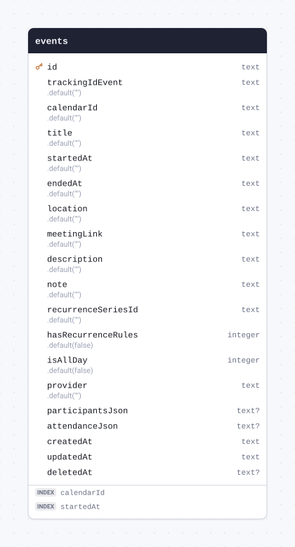

| Column                                        | Type      | Constraints | Default           | Description |
| --------------------------------------------- | --------- | ----------- | ----------------- | ----------- |
| `id`                                          | `text`    | PK NOT NULL |                   |             |
| `trackingIdEvent` (`tracking_id_event`)       | `text`    | NOT NULL    | `.default("")`    |             |
| `calendarId` (`calendar_id`)                  | `text`    | NOT NULL    | `.default("")`    |             |
| `title`                                       | `text`    | NOT NULL    | `.default("")`    |             |
| `startedAt` (`started_at`)                    | `text`    | NOT NULL    | `.default("")`    |             |
| `endedAt` (`ended_at`)                        | `text`    | NOT NULL    | `.default("")`    |             |
| `location`                                    | `text`    | NOT NULL    | `.default("")`    |             |
| `meetingLink` (`meeting_link`)                | `text`    | NOT NULL    | `.default("")`    |             |
| `description`                                 | `text`    | NOT NULL    | `.default("")`    |             |
| `note`                                        | `text`    | NOT NULL    | `.default("")`    |             |
| `recurrenceSeriesId` (`recurrence_series_id`) | `text`    | NOT NULL    | `.default("")`    |             |
| `hasRecurrenceRules` (`has_recurrence_rules`) | `integer` | NOT NULL    | `.default(false)` |             |
| `isAllDay` (`is_all_day`)                     | `integer` | NOT NULL    | `.default(false)` |             |
| `provider`                                    | `text`    | NOT NULL    | `.default("")`    |             |
| `participantsJson` (`participants_json`)      | `text`    | NULL        |                   |             |
| `attendanceJson` (`attendance_json`)          | `text`    | NULL        |                   |             |
| `createdAt` (`created_at`)                    | `text`    | NOT NULL    |                   |             |
| `updatedAt` (`updated_at`)                    | `text`    | NOT NULL    |                   |             |
| `deletedAt` (`deleted_at`)                    | `text`    | NULL        |                   |             |

#### Definition

```sql
CREATE TABLE `events` (
	`id` text PRIMARY KEY,
	`tracking_id_event` text DEFAULT '' NOT NULL,
	`calendar_id` text DEFAULT '' NOT NULL,
	`title` text DEFAULT '' NOT NULL,
	`started_at` text DEFAULT '' NOT NULL,
	`ended_at` text DEFAULT '' NOT NULL,
	`location` text DEFAULT '' NOT NULL,
	`meeting_link` text DEFAULT '' NOT NULL,
	`description` text DEFAULT '' NOT NULL,
	`note` text DEFAULT '' NOT NULL,
	`recurrence_series_id` text DEFAULT '' NOT NULL,
	`has_recurrence_rules` integer DEFAULT false NOT NULL,
	`is_all_day` integer DEFAULT false NOT NULL,
	`provider` text DEFAULT '' NOT NULL,
	`participants_json` text,
	`attendance_json` text,
	`created_at` text NOT NULL,
	`updated_at` text NOT NULL,
	`deleted_at` text
);

CREATE INDEX `idx_events_calendar_id` ON `events` (`calendar_id`);

CREATE INDEX `idx_events_started_at` ON `events` (`started_at`);
```

#### Indexes

- INDEX `calendarId`
- INDEX `startedAt`

<details>
<summary>Queries and their SQL</summary>

**Select**: Every row of events.

```ts
db.select().from(events);
```

```sql
select "id", "tracking_id_event", "calendar_id", "title", "started_at", "ended_at", "location", "meeting_link", "description", "note", "recurrence_series_id", "has_recurrence_rules", "is_all_day", "provider", "participants_json", "attendance_json", "created_at", "updated_at", "deleted_at"
from "events"
```

**Count**: How many rows events has.

```ts
db.select({ count: count() }).from(events);
```

```sql
select count(*)
from "events"
```

**Find many**: The rows of events, through the relational query API.

```ts
db.query.events.findMany();
```

```sql
select "d0"."id" as "id", "d0"."tracking_id_event" as "trackingIdEvent", "d0"."calendar_id" as "calendarId", "d0"."title" as "title", "d0"."started_at" as "startedAt", "d0"."ended_at" as "endedAt", "d0"."location" as "location", "d0"."meeting_link" as "meetingLink", "d0"."description" as "description", "d0"."note" as "note", "d0"."recurrence_series_id" as "recurrenceSeriesId", "d0"."has_recurrence_rules" as "hasRecurrenceRules", "d0"."is_all_day" as "isAllDay", "d0"."provider" as "provider", "d0"."participants_json" as "participantsJson", "d0"."attendance_json" as "attendanceJson", "d0"."created_at" as "createdAt", "d0"."updated_at" as "updatedAt", "d0"."deleted_at" as "deletedAt"
from "events" as "d0"
```

**Find by primary key**: One row of events, through the relational query API.

```ts
db.query.events.findFirst({ where: { id: "id" } });
```

```sql
select "d0"."id" as "id", "d0"."tracking_id_event" as "trackingIdEvent", "d0"."calendar_id" as "calendarId", "d0"."title" as "title", "d0"."started_at" as "startedAt", "d0"."ended_at" as "endedAt", "d0"."location" as "location", "d0"."meeting_link" as "meetingLink", "d0"."description" as "description", "d0"."note" as "note", "d0"."recurrence_series_id" as "recurrenceSeriesId", "d0"."has_recurrence_rules" as "hasRecurrenceRules", "d0"."is_all_day" as "isAllDay", "d0"."provider" as "provider", "d0"."participants_json" as "participantsJson", "d0"."attendance_json" as "attendanceJson", "d0"."created_at" as "createdAt", "d0"."updated_at" as "updatedAt", "d0"."deleted_at" as "deletedAt"
from "events" as "d0"
where "d0"."id" = ?
limit ?
-- params: ["id",1]
```

**Insert**: Adds a row to events, giving the columns that have no default.

```ts
db.insert(events).values({ id: "id", createdAt: "createdAt", updatedAt: "updatedAt" });
```

```sql
insert into "events" ("id", "tracking_id_event", "calendar_id", "title", "started_at", "ended_at", "location", "meeting_link", "description", "note", "recurrence_series_id", "has_recurrence_rules", "is_all_day", "provider", "participants_json", "attendance_json", "created_at", "updated_at", "deleted_at")
values (?, ?, ?, ?, ?, ?, ?, ?, ?, ?, ?, ?, ?, ?, null, null, ?, ?, null)
-- params: ["id","","","","","","","","","","",0,0,"","createdAt","updatedAt"]
```

**Update**: Changes a row of events, found by its primary key.

```ts
db.update(events).set({ trackingIdEvent: "trackingIdEvent" }).where(eq(events.id, "id"));
```

```sql
update "events"
set "tracking_id_event" = ?
where "events"."id" = ?
-- params: ["trackingIdEvent","id"]
```

**Delete**: Deletes a row of events, found by its primary key.

```ts
db.delete(events).where(eq(events.id, "id"));
```

```sql
delete from "events"
where "events"."id" = ?
-- params: ["id"]
```

</details>

<a id="table-workspaces"></a>

### workspaces

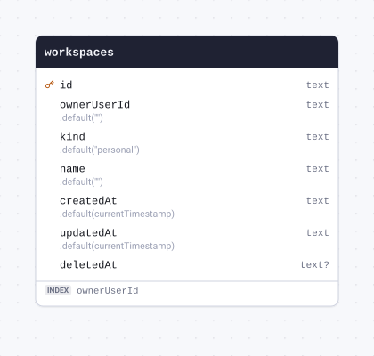

| Column                          | Type   | Constraints | Default                      | Description |
| ------------------------------- | ------ | ----------- | ---------------------------- | ----------- |
| `id`                            | `text` | PK NOT NULL |                              |             |
| `ownerUserId` (`owner_user_id`) | `text` | NOT NULL    | `.default("")`               |             |
| `kind`                          | `text` | NOT NULL    | `.default("personal")`       |             |
| `name`                          | `text` | NOT NULL    | `.default("")`               |             |
| `createdAt` (`created_at`)      | `text` | NOT NULL    | `.default(currentTimestamp)` |             |
| `updatedAt` (`updated_at`)      | `text` | NOT NULL    | `.default(currentTimestamp)` |             |
| `deletedAt` (`deleted_at`)      | `text` | NULL        |                              |             |

#### Definition

```sql
CREATE TABLE `workspaces` (
	`id` text PRIMARY KEY,
	`owner_user_id` text DEFAULT '' NOT NULL,
	`kind` text DEFAULT 'personal' NOT NULL,
	`name` text DEFAULT '' NOT NULL,
	`created_at` text DEFAULT (strftime('%Y-%m-%dT%H:%M:%fZ', 'now')) NOT NULL,
	`updated_at` text DEFAULT (strftime('%Y-%m-%dT%H:%M:%fZ', 'now')) NOT NULL,
	`deleted_at` text
);

CREATE INDEX `idx_workspaces_owner_user_id` ON `workspaces` (`owner_user_id`);
```

#### Indexes

- INDEX `ownerUserId`

<details>
<summary>Queries and their SQL</summary>

**Select**: Every row of workspaces.

```ts
db.select().from(workspaces);
```

```sql
select "id", "owner_user_id", "kind", "name", "created_at", "updated_at", "deleted_at"
from "workspaces"
```

**Count**: How many rows workspaces has.

```ts
db.select({ count: count() }).from(workspaces);
```

```sql
select count(*)
from "workspaces"
```

**Find many**: The rows of workspaces, through the relational query API.

```ts
db.query.workspaces.findMany();
```

```sql
select "d0"."id" as "id", "d0"."owner_user_id" as "ownerUserId", "d0"."kind" as "kind", "d0"."name" as "name", "d0"."created_at" as "createdAt", "d0"."updated_at" as "updatedAt", "d0"."deleted_at" as "deletedAt"
from "workspaces" as "d0"
```

**Find by primary key**: One row of workspaces, through the relational query API.

```ts
db.query.workspaces.findFirst({ where: { id: "id" } });
```

```sql
select "d0"."id" as "id", "d0"."owner_user_id" as "ownerUserId", "d0"."kind" as "kind", "d0"."name" as "name", "d0"."created_at" as "createdAt", "d0"."updated_at" as "updatedAt", "d0"."deleted_at" as "deletedAt"
from "workspaces" as "d0"
where "d0"."id" = ?
limit ?
-- params: ["id",1]
```

**Insert**: Adds a row to workspaces, giving the columns that have no default.

```ts
db.insert(workspaces).values({ id: "id" });
```

```sql
insert into "workspaces" ("id", "owner_user_id", "kind", "name", "created_at", "updated_at", "deleted_at")
values (?, ?, ?, ?, (strftime('%Y-%m-%dT%H:%M:%fZ', 'now')), (strftime('%Y-%m-%dT%H:%M:%fZ', 'now')), null)
-- params: ["id","","personal",""]
```

**Update**: Changes a row of workspaces, found by its primary key.

```ts
db.update(workspaces).set({ ownerUserId: "ownerUserId" }).where(eq(workspaces.id, "id"));
```

```sql
update "workspaces"
set "owner_user_id" = ?
where "workspaces"."id" = ?
-- params: ["ownerUserId","id"]
```

**Delete**: Deletes a row of workspaces, found by its primary key.

```ts
db.delete(workspaces).where(eq(workspaces.id, "id"));
```

```sql
delete from "workspaces"
where "workspaces"."id" = ?
-- params: ["id"]
```

</details>

<a id="table-workspaceMemberships"></a>

### workspaceMemberships

Table `workspace_memberships`.

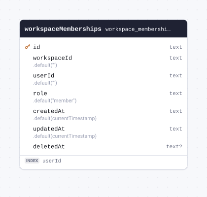

| Column                         | Type   | Constraints | Default                      | Description |
| ------------------------------ | ------ | ----------- | ---------------------------- | ----------- |
| `id`                           | `text` | PK NOT NULL |                              |             |
| `workspaceId` (`workspace_id`) | `text` | NOT NULL    | `.default("")`               |             |
| `userId` (`user_id`)           | `text` | NOT NULL    | `.default("")`               |             |
| `role`                         | `text` | NOT NULL    | `.default("member")`         |             |
| `createdAt` (`created_at`)     | `text` | NOT NULL    | `.default(currentTimestamp)` |             |
| `updatedAt` (`updated_at`)     | `text` | NOT NULL    | `.default(currentTimestamp)` |             |
| `deletedAt` (`deleted_at`)     | `text` | NULL        |                              |             |

#### Definition

```sql
CREATE TABLE `workspace_memberships` (
	`id` text PRIMARY KEY,
	`workspace_id` text DEFAULT '' NOT NULL,
	`user_id` text DEFAULT '' NOT NULL,
	`role` text DEFAULT 'member' NOT NULL,
	`created_at` text DEFAULT (strftime('%Y-%m-%dT%H:%M:%fZ', 'now')) NOT NULL,
	`updated_at` text DEFAULT (strftime('%Y-%m-%dT%H:%M:%fZ', 'now')) NOT NULL,
	`deleted_at` text
);

CREATE INDEX `idx_workspace_memberships_user_id` ON `workspace_memberships` (`user_id`);
```

#### Indexes

- INDEX `userId`

<details>
<summary>Queries and their SQL</summary>

**Select**: Every row of workspaceMemberships.

```ts
db.select().from(workspaceMemberships);
```

```sql
select "id", "workspace_id", "user_id", "role", "created_at", "updated_at", "deleted_at"
from "workspace_memberships"
```

**Count**: How many rows workspaceMemberships has.

```ts
db.select({ count: count() }).from(workspaceMemberships);
```

```sql
select count(*)
from "workspace_memberships"
```

**Find many**: The rows of workspaceMemberships, through the relational query API.

```ts
db.query.workspaceMemberships.findMany();
```

```sql
select "d0"."id" as "id", "d0"."workspace_id" as "workspaceId", "d0"."user_id" as "userId", "d0"."role" as "role", "d0"."created_at" as "createdAt", "d0"."updated_at" as "updatedAt", "d0"."deleted_at" as "deletedAt"
from "workspace_memberships" as "d0"
```

**Find by primary key**: One row of workspaceMemberships, through the relational query API.

```ts
db.query.workspaceMemberships.findFirst({ where: { id: "id" } });
```

```sql
select "d0"."id" as "id", "d0"."workspace_id" as "workspaceId", "d0"."user_id" as "userId", "d0"."role" as "role", "d0"."created_at" as "createdAt", "d0"."updated_at" as "updatedAt", "d0"."deleted_at" as "deletedAt"
from "workspace_memberships" as "d0"
where "d0"."id" = ?
limit ?
-- params: ["id",1]
```

**Insert**: Adds a row to workspaceMemberships, giving the columns that have no default.

```ts
db.insert(workspaceMemberships).values({ id: "id" });
```

```sql
insert into "workspace_memberships" ("id", "workspace_id", "user_id", "role", "created_at", "updated_at", "deleted_at")
values (?, ?, ?, ?, (strftime('%Y-%m-%dT%H:%M:%fZ', 'now')), (strftime('%Y-%m-%dT%H:%M:%fZ', 'now')), null)
-- params: ["id","","","member"]
```

**Update**: Changes a row of workspaceMemberships, found by its primary key.

```ts
db.update(workspaceMemberships)
  .set({ workspaceId: "workspaceId" })
  .where(eq(workspaceMemberships.id, "id"));
```

```sql
update "workspace_memberships"
set "workspace_id" = ?
where "workspace_memberships"."id" = ?
-- params: ["workspaceId","id"]
```

**Delete**: Deletes a row of workspaceMemberships, found by its primary key.

```ts
db.delete(workspaceMemberships).where(eq(workspaceMemberships.id, "id"));
```

```sql
delete from "workspace_memberships"
where "workspace_memberships"."id" = ?
-- params: ["id"]
```

</details>

<a id="table-organizations"></a>

### organizations

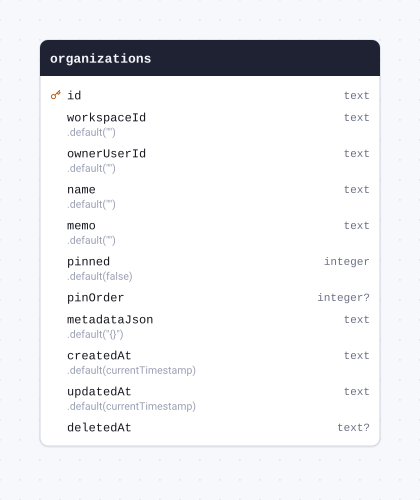

| Column                           | Type      | Constraints | Default                      | Description |
| -------------------------------- | --------- | ----------- | ---------------------------- | ----------- |
| `id`                             | `text`    | PK NOT NULL |                              |             |
| `workspaceId` (`workspace_id`)   | `text`    | NOT NULL    | `.default("")`               |             |
| `ownerUserId` (`owner_user_id`)  | `text`    | NOT NULL    | `.default("")`               |             |
| `name`                           | `text`    | NOT NULL    | `.default("")`               |             |
| `memo`                           | `text`    | NOT NULL    | `.default("")`               |             |
| `pinned`                         | `integer` | NOT NULL    | `.default(false)`            |             |
| `pinOrder` (`pin_order`)         | `integer` | NULL        |                              |             |
| `metadataJson` (`metadata_json`) | `text`    | NOT NULL    | `.default("{}")`             |             |
| `createdAt` (`created_at`)       | `text`    | NOT NULL    | `.default(currentTimestamp)` |             |
| `updatedAt` (`updated_at`)       | `text`    | NOT NULL    | `.default(currentTimestamp)` |             |
| `deletedAt` (`deleted_at`)       | `text`    | NULL        |                              |             |

#### Definition

```sql
CREATE TABLE `organizations` (
	`id` text PRIMARY KEY,
	`workspace_id` text DEFAULT '' NOT NULL,
	`owner_user_id` text DEFAULT '' NOT NULL,
	`name` text DEFAULT '' NOT NULL,
	`memo` text DEFAULT '' NOT NULL,
	`pinned` integer DEFAULT false NOT NULL,
	`pin_order` integer,
	`metadata_json` text DEFAULT '{}' NOT NULL,
	`created_at` text DEFAULT (strftime('%Y-%m-%dT%H:%M:%fZ', 'now')) NOT NULL,
	`updated_at` text DEFAULT (strftime('%Y-%m-%dT%H:%M:%fZ', 'now')) NOT NULL,
	`deleted_at` text
);
```

<details>
<summary>Queries and their SQL</summary>

**Select**: Every row of organizations.

```ts
db.select().from(organizations);
```

```sql
select "id", "workspace_id", "owner_user_id", "name", "memo", "pinned", "pin_order", "metadata_json", "created_at", "updated_at", "deleted_at"
from "organizations"
```

**Count**: How many rows organizations has.

```ts
db.select({ count: count() }).from(organizations);
```

```sql
select count(*)
from "organizations"
```

**Find many**: The rows of organizations, through the relational query API.

```ts
db.query.organizations.findMany();
```

```sql
select "d0"."id" as "id", "d0"."workspace_id" as "workspaceId", "d0"."owner_user_id" as "ownerUserId", "d0"."name" as "name", "d0"."memo" as "memo", "d0"."pinned" as "pinned", "d0"."pin_order" as "pinOrder", "d0"."metadata_json" as "metadataJson", "d0"."created_at" as "createdAt", "d0"."updated_at" as "updatedAt", "d0"."deleted_at" as "deletedAt"
from "organizations" as "d0"
```

**Find by primary key**: One row of organizations, through the relational query API.

```ts
db.query.organizations.findFirst({ where: { id: "id" } });
```

```sql
select "d0"."id" as "id", "d0"."workspace_id" as "workspaceId", "d0"."owner_user_id" as "ownerUserId", "d0"."name" as "name", "d0"."memo" as "memo", "d0"."pinned" as "pinned", "d0"."pin_order" as "pinOrder", "d0"."metadata_json" as "metadataJson", "d0"."created_at" as "createdAt", "d0"."updated_at" as "updatedAt", "d0"."deleted_at" as "deletedAt"
from "organizations" as "d0"
where "d0"."id" = ?
limit ?
-- params: ["id",1]
```

**Insert**: Adds a row to organizations, giving the columns that have no default.

```ts
db.insert(organizations).values({ id: "id" });
```

```sql
insert into "organizations" ("id", "workspace_id", "owner_user_id", "name", "memo", "pinned", "pin_order", "metadata_json", "created_at", "updated_at", "deleted_at")
values (?, ?, ?, ?, ?, ?, null, ?, (strftime('%Y-%m-%dT%H:%M:%fZ', 'now')), (strftime('%Y-%m-%dT%H:%M:%fZ', 'now')), null)
-- params: ["id","","","","",0,"{}"]
```

**Update**: Changes a row of organizations, found by its primary key.

```ts
db.update(organizations).set({ workspaceId: "workspaceId" }).where(eq(organizations.id, "id"));
```

```sql
update "organizations"
set "workspace_id" = ?
where "organizations"."id" = ?
-- params: ["workspaceId","id"]
```

**Delete**: Deletes a row of organizations, found by its primary key.

```ts
db.delete(organizations).where(eq(organizations.id, "id"));
```

```sql
delete from "organizations"
where "organizations"."id" = ?
-- params: ["id"]
```

</details>

<a id="table-humans"></a>

### humans

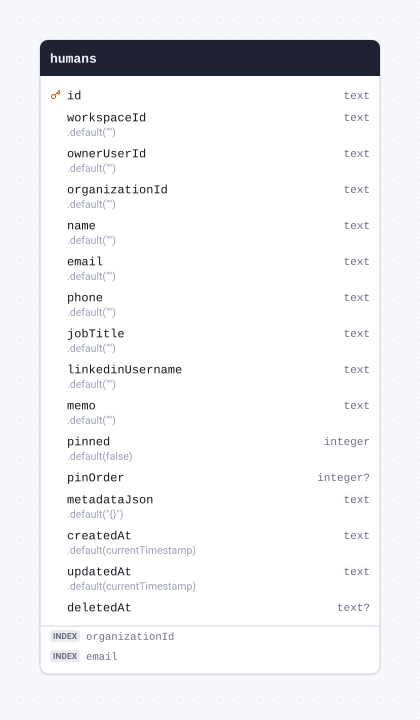

| Column                                   | Type      | Constraints | Default                      | Description |
| ---------------------------------------- | --------- | ----------- | ---------------------------- | ----------- |
| `id`                                     | `text`    | PK NOT NULL |                              |             |
| `workspaceId` (`workspace_id`)           | `text`    | NOT NULL    | `.default("")`               |             |
| `ownerUserId` (`owner_user_id`)          | `text`    | NOT NULL    | `.default("")`               |             |
| `organizationId` (`organization_id`)     | `text`    | NOT NULL    | `.default("")`               |             |
| `name`                                   | `text`    | NOT NULL    | `.default("")`               |             |
| `email`                                  | `text`    | NOT NULL    | `.default("")`               |             |
| `phone`                                  | `text`    | NOT NULL    | `.default("")`               |             |
| `jobTitle` (`job_title`)                 | `text`    | NOT NULL    | `.default("")`               |             |
| `linkedinUsername` (`linkedin_username`) | `text`    | NOT NULL    | `.default("")`               |             |
| `memo`                                   | `text`    | NOT NULL    | `.default("")`               |             |
| `pinned`                                 | `integer` | NOT NULL    | `.default(false)`            |             |
| `pinOrder` (`pin_order`)                 | `integer` | NULL        |                              |             |
| `metadataJson` (`metadata_json`)         | `text`    | NOT NULL    | `.default("{}")`             |             |
| `createdAt` (`created_at`)               | `text`    | NOT NULL    | `.default(currentTimestamp)` |             |
| `updatedAt` (`updated_at`)               | `text`    | NOT NULL    | `.default(currentTimestamp)` |             |
| `deletedAt` (`deleted_at`)               | `text`    | NULL        |                              |             |

#### Definition

```sql
CREATE TABLE `humans` (
	`id` text PRIMARY KEY,
	`workspace_id` text DEFAULT '' NOT NULL,
	`owner_user_id` text DEFAULT '' NOT NULL,
	`organization_id` text DEFAULT '' NOT NULL,
	`name` text DEFAULT '' NOT NULL,
	`email` text DEFAULT '' NOT NULL,
	`phone` text DEFAULT '' NOT NULL,
	`job_title` text DEFAULT '' NOT NULL,
	`linkedin_username` text DEFAULT '' NOT NULL,
	`memo` text DEFAULT '' NOT NULL,
	`pinned` integer DEFAULT false NOT NULL,
	`pin_order` integer,
	`metadata_json` text DEFAULT '{}' NOT NULL,
	`created_at` text DEFAULT (strftime('%Y-%m-%dT%H:%M:%fZ', 'now')) NOT NULL,
	`updated_at` text DEFAULT (strftime('%Y-%m-%dT%H:%M:%fZ', 'now')) NOT NULL,
	`deleted_at` text
);

CREATE INDEX `idx_humans_organization_id` ON `humans` (`organization_id`);

CREATE INDEX `idx_humans_email` ON `humans` (`email`);
```

#### Indexes

- INDEX `organizationId`
- INDEX `email`

<details>
<summary>Queries and their SQL</summary>

**Select**: Every row of humans.

```ts
db.select().from(humans);
```

```sql
select "id", "workspace_id", "owner_user_id", "organization_id", "name", "email", "phone", "job_title", "linkedin_username", "memo", "pinned", "pin_order", "metadata_json", "created_at", "updated_at", "deleted_at"
from "humans"
```

**Count**: How many rows humans has.

```ts
db.select({ count: count() }).from(humans);
```

```sql
select count(*)
from "humans"
```

**Find many**: The rows of humans, through the relational query API.

```ts
db.query.humans.findMany();
```

```sql
select "d0"."id" as "id", "d0"."workspace_id" as "workspaceId", "d0"."owner_user_id" as "ownerUserId", "d0"."organization_id" as "organizationId", "d0"."name" as "name", "d0"."email" as "email", "d0"."phone" as "phone", "d0"."job_title" as "jobTitle", "d0"."linkedin_username" as "linkedinUsername", "d0"."memo" as "memo", "d0"."pinned" as "pinned", "d0"."pin_order" as "pinOrder", "d0"."metadata_json" as "metadataJson", "d0"."created_at" as "createdAt", "d0"."updated_at" as "updatedAt", "d0"."deleted_at" as "deletedAt"
from "humans" as "d0"
```

**Find by primary key**: One row of humans, through the relational query API.

```ts
db.query.humans.findFirst({ where: { id: "id" } });
```

```sql
select "d0"."id" as "id", "d0"."workspace_id" as "workspaceId", "d0"."owner_user_id" as "ownerUserId", "d0"."organization_id" as "organizationId", "d0"."name" as "name", "d0"."email" as "email", "d0"."phone" as "phone", "d0"."job_title" as "jobTitle", "d0"."linkedin_username" as "linkedinUsername", "d0"."memo" as "memo", "d0"."pinned" as "pinned", "d0"."pin_order" as "pinOrder", "d0"."metadata_json" as "metadataJson", "d0"."created_at" as "createdAt", "d0"."updated_at" as "updatedAt", "d0"."deleted_at" as "deletedAt"
from "humans" as "d0"
where "d0"."id" = ?
limit ?
-- params: ["id",1]
```

**Insert**: Adds a row to humans, giving the columns that have no default.

```ts
db.insert(humans).values({ id: "id" });
```

```sql
insert into "humans" ("id", "workspace_id", "owner_user_id", "organization_id", "name", "email", "phone", "job_title", "linkedin_username", "memo", "pinned", "pin_order", "metadata_json", "created_at", "updated_at", "deleted_at")
values (?, ?, ?, ?, ?, ?, ?, ?, ?, ?, ?, null, ?, (strftime('%Y-%m-%dT%H:%M:%fZ', 'now')), (strftime('%Y-%m-%dT%H:%M:%fZ', 'now')), null)
-- params: ["id","","","","","","","","","",0,"{}"]
```

**Update**: Changes a row of humans, found by its primary key.

```ts
db.update(humans).set({ workspaceId: "workspaceId" }).where(eq(humans.id, "id"));
```

```sql
update "humans"
set "workspace_id" = ?
where "humans"."id" = ?
-- params: ["workspaceId","id"]
```

**Delete**: Deletes a row of humans, found by its primary key.

```ts
db.delete(humans).where(eq(humans.id, "id"));
```

```sql
delete from "humans"
where "humans"."id" = ?
-- params: ["id"]
```

</details>

<a id="table-sessions"></a>

### sessions

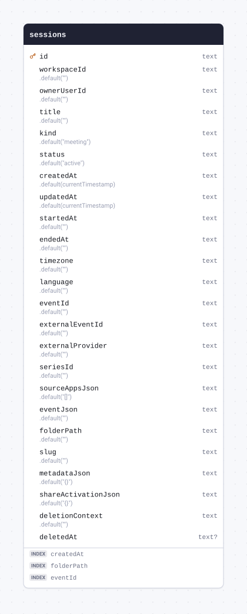

| Column                                          | Type   | Constraints | Default                      | Description |
| ----------------------------------------------- | ------ | ----------- | ---------------------------- | ----------- |
| `id`                                            | `text` | PK NOT NULL |                              |             |
| `workspaceId` (`workspace_id`)                  | `text` | NOT NULL    | `.default("")`               |             |
| `ownerUserId` (`owner_user_id`)                 | `text` | NOT NULL    | `.default("")`               |             |
| `title`                                         | `text` | NOT NULL    | `.default("")`               |             |
| `kind`                                          | `text` | NOT NULL    | `.default("meeting")`        |             |
| `status`                                        | `text` | NOT NULL    | `.default("active")`         |             |
| `createdAt` (`created_at`)                      | `text` | NOT NULL    | `.default(currentTimestamp)` |             |
| `updatedAt` (`updated_at`)                      | `text` | NOT NULL    | `.default(currentTimestamp)` |             |
| `startedAt` (`started_at`)                      | `text` | NOT NULL    | `.default("")`               |             |
| `endedAt` (`ended_at`)                          | `text` | NOT NULL    | `.default("")`               |             |
| `timezone`                                      | `text` | NOT NULL    | `.default("")`               |             |
| `language`                                      | `text` | NOT NULL    | `.default("")`               |             |
| `eventId` (`event_id`)                          | `text` | NOT NULL    | `.default("")`               |             |
| `externalEventId` (`external_event_id`)         | `text` | NOT NULL    | `.default("")`               |             |
| `externalProvider` (`external_provider`)        | `text` | NOT NULL    | `.default("")`               |             |
| `seriesId` (`series_id`)                        | `text` | NOT NULL    | `.default("")`               |             |
| `sourceAppsJson` (`source_apps_json`)           | `text` | NOT NULL    | `.default("[]")`             |             |
| `eventJson` (`event_json`)                      | `text` | NOT NULL    | `.default("")`               |             |
| `folderPath` (`folder_path`)                    | `text` | NOT NULL    | `.default("")`               |             |
| `slug`                                          | `text` | NOT NULL    | `.default("")`               |             |
| `metadataJson` (`metadata_json`)                | `text` | NOT NULL    | `.default("{}")`             |             |
| `shareActivationJson` (`share_activation_json`) | `text` | NOT NULL    | `.default("{}")`             |             |
| `deletionContext` (`deletion_context`)          | `text` | NOT NULL    | `.default("")`               |             |
| `deletedAt` (`deleted_at`)                      | `text` | NULL        |                              |             |

#### Definition

```sql
CREATE TABLE `sessions` (
	`id` text PRIMARY KEY,
	`workspace_id` text DEFAULT '' NOT NULL,
	`owner_user_id` text DEFAULT '' NOT NULL,
	`title` text DEFAULT '' NOT NULL,
	`kind` text DEFAULT 'meeting' NOT NULL,
	`status` text DEFAULT 'active' NOT NULL,
	`created_at` text DEFAULT (strftime('%Y-%m-%dT%H:%M:%fZ', 'now')) NOT NULL,
	`updated_at` text DEFAULT (strftime('%Y-%m-%dT%H:%M:%fZ', 'now')) NOT NULL,
	`started_at` text DEFAULT '' NOT NULL,
	`ended_at` text DEFAULT '' NOT NULL,
	`timezone` text DEFAULT '' NOT NULL,
	`language` text DEFAULT '' NOT NULL,
	`event_id` text DEFAULT '' NOT NULL,
	`external_event_id` text DEFAULT '' NOT NULL,
	`external_provider` text DEFAULT '' NOT NULL,
	`series_id` text DEFAULT '' NOT NULL,
	`source_apps_json` text DEFAULT '[]' NOT NULL,
	`event_json` text DEFAULT '' NOT NULL,
	`folder_path` text DEFAULT '' NOT NULL,
	`slug` text DEFAULT '' NOT NULL,
	`metadata_json` text DEFAULT '{}' NOT NULL,
	`share_activation_json` text DEFAULT '{}' NOT NULL,
	`deletion_context` text DEFAULT '' NOT NULL,
	`deleted_at` text
);

CREATE INDEX `idx_sessions_created_at` ON `sessions` (`created_at`);

CREATE INDEX `idx_sessions_folder_path` ON `sessions` (`folder_path`);

CREATE INDEX `idx_sessions_event_id` ON `sessions` (`event_id`);
```

#### Indexes

- INDEX `createdAt`
- INDEX `folderPath`
- INDEX `eventId`

<details>
<summary>Queries and their SQL</summary>

**Select**: Every row of sessions.

```ts
db.select().from(sessions);
```

```sql
select "id", "workspace_id", "owner_user_id", "title", "kind", "status", "created_at", "updated_at", "started_at", "ended_at", "timezone", "language", "event_id", "external_event_id", "external_provider", "series_id", "source_apps_json", "event_json", "folder_path", "slug", "metadata_json", "share_activation_json", "deletion_context", "deleted_at"
from "sessions"
```

**Count**: How many rows sessions has.

```ts
db.select({ count: count() }).from(sessions);
```

```sql
select count(*)
from "sessions"
```

**Find many**: The rows of sessions, through the relational query API.

```ts
db.query.sessions.findMany();
```

```sql
select "d0"."id" as "id", "d0"."workspace_id" as "workspaceId", "d0"."owner_user_id" as "ownerUserId", "d0"."title" as "title", "d0"."kind" as "kind", "d0"."status" as "status", "d0"."created_at" as "createdAt", "d0"."updated_at" as "updatedAt", "d0"."started_at" as "startedAt", "d0"."ended_at" as "endedAt", "d0"."timezone" as "timezone", "d0"."language" as "language", "d0"."event_id" as "eventId", "d0"."external_event_id" as "externalEventId", "d0"."external_provider" as "externalProvider", "d0"."series_id" as "seriesId", "d0"."source_apps_json" as "sourceAppsJson", "d0"."event_json" as "eventJson", "d0"."folder_path" as "folderPath", "d0"."slug" as "slug", "d0"."metadata_json" as "metadataJson", "d0"."share_activation_json" as "shareActivationJson", "d0"."deletion_context" as "deletionContext", "d0"."deleted_at" as "deletedAt"
from "sessions" as "d0"
```

**Find by primary key**: One row of sessions, through the relational query API.

```ts
db.query.sessions.findFirst({ where: { id: "id" } });
```

```sql
select "d0"."id" as "id", "d0"."workspace_id" as "workspaceId", "d0"."owner_user_id" as "ownerUserId", "d0"."title" as "title", "d0"."kind" as "kind", "d0"."status" as "status", "d0"."created_at" as "createdAt", "d0"."updated_at" as "updatedAt", "d0"."started_at" as "startedAt", "d0"."ended_at" as "endedAt", "d0"."timezone" as "timezone", "d0"."language" as "language", "d0"."event_id" as "eventId", "d0"."external_event_id" as "externalEventId", "d0"."external_provider" as "externalProvider", "d0"."series_id" as "seriesId", "d0"."source_apps_json" as "sourceAppsJson", "d0"."event_json" as "eventJson", "d0"."folder_path" as "folderPath", "d0"."slug" as "slug", "d0"."metadata_json" as "metadataJson", "d0"."share_activation_json" as "shareActivationJson", "d0"."deletion_context" as "deletionContext", "d0"."deleted_at" as "deletedAt"
from "sessions" as "d0"
where "d0"."id" = ?
limit ?
-- params: ["id",1]
```

**Insert**: Adds a row to sessions, giving the columns that have no default.

```ts
db.insert(sessions).values({ id: "id" });
```

```sql
insert into "sessions" ("id", "workspace_id", "owner_user_id", "title", "kind", "status", "created_at", "updated_at", "started_at", "ended_at", "timezone", "language", "event_id", "external_event_id", "external_provider", "series_id", "source_apps_json", "event_json", "folder_path", "slug", "metadata_json", "share_activation_json", "deletion_context", "deleted_at")
values (?, ?, ?, ?, ?, ?, (strftime('%Y-%m-%dT%H:%M:%fZ', 'now')), (strftime('%Y-%m-%dT%H:%M:%fZ', 'now')), ?, ?, ?, ?, ?, ?, ?, ?, ?, ?, ?, ?, ?, ?, ?, null)
-- params: ["id","","","","meeting","active","","","","","","","","","[]","","","","{}","{}",""]
```

**Update**: Changes a row of sessions, found by its primary key.

```ts
db.update(sessions).set({ workspaceId: "workspaceId" }).where(eq(sessions.id, "id"));
```

```sql
update "sessions"
set "workspace_id" = ?
where "sessions"."id" = ?
-- params: ["workspaceId","id"]
```

**Delete**: Deletes a row of sessions, found by its primary key.

```ts
db.delete(sessions).where(eq(sessions.id, "id"));
```

```sql
delete from "sessions"
where "sessions"."id" = ?
-- params: ["id"]
```

</details>

<a id="table-sessionDocuments"></a>

### sessionDocuments

Table `session_documents`.

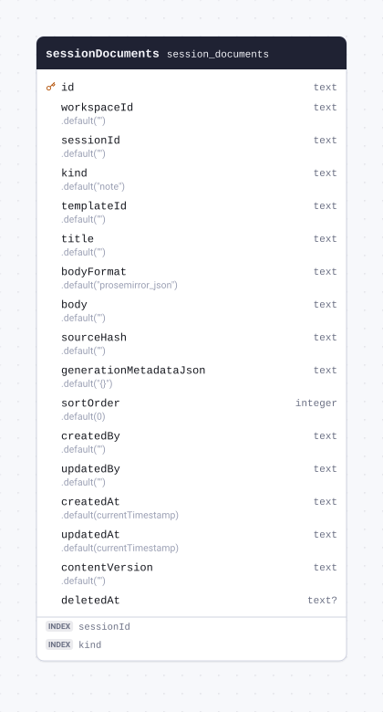

| Column                                                | Type      | Constraints | Default                        | Description |
| ----------------------------------------------------- | --------- | ----------- | ------------------------------ | ----------- |
| `id`                                                  | `text`    | PK NOT NULL |                                |             |
| `workspaceId` (`workspace_id`)                        | `text`    | NOT NULL    | `.default("")`                 |             |
| `sessionId` (`session_id`)                            | `text`    | NOT NULL    | `.default("")`                 |             |
| `kind`                                                | `text`    | NOT NULL    | `.default("note")`             |             |
| `templateId` (`template_id`)                          | `text`    | NOT NULL    | `.default("")`                 |             |
| `title`                                               | `text`    | NOT NULL    | `.default("")`                 |             |
| `bodyFormat` (`body_format`)                          | `text`    | NOT NULL    | `.default("prosemirror_json")` |             |
| `body`                                                | `text`    | NOT NULL    | `.default("")`                 |             |
| `sourceHash` (`source_hash`)                          | `text`    | NOT NULL    | `.default("")`                 |             |
| `generationMetadataJson` (`generation_metadata_json`) | `text`    | NOT NULL    | `.default("{}")`               |             |
| `sortOrder` (`sort_order`)                            | `integer` | NOT NULL    | `.default(0)`                  |             |
| `createdBy` (`created_by`)                            | `text`    | NOT NULL    | `.default("")`                 |             |
| `updatedBy` (`updated_by`)                            | `text`    | NOT NULL    | `.default("")`                 |             |
| `createdAt` (`created_at`)                            | `text`    | NOT NULL    | `.default(currentTimestamp)`   |             |
| `updatedAt` (`updated_at`)                            | `text`    | NOT NULL    | `.default(currentTimestamp)`   |             |
| `contentVersion` (`content_version`)                  | `text`    | NOT NULL    | `.default("")`                 |             |
| `deletedAt` (`deleted_at`)                            | `text`    | NULL        |                                |             |

#### Definition

```sql
CREATE TABLE `session_documents` (
	`id` text PRIMARY KEY,
	`workspace_id` text DEFAULT '' NOT NULL,
	`session_id` text DEFAULT '' NOT NULL,
	`kind` text DEFAULT 'note' NOT NULL,
	`template_id` text DEFAULT '' NOT NULL,
	`title` text DEFAULT '' NOT NULL,
	`body_format` text DEFAULT 'prosemirror_json' NOT NULL,
	`body` text DEFAULT '' NOT NULL,
	`source_hash` text DEFAULT '' NOT NULL,
	`generation_metadata_json` text DEFAULT '{}' NOT NULL,
	`sort_order` integer DEFAULT 0 NOT NULL,
	`created_by` text DEFAULT '' NOT NULL,
	`updated_by` text DEFAULT '' NOT NULL,
	`created_at` text DEFAULT (strftime('%Y-%m-%dT%H:%M:%fZ', 'now')) NOT NULL,
	`updated_at` text DEFAULT (strftime('%Y-%m-%dT%H:%M:%fZ', 'now')) NOT NULL,
	`content_version` text DEFAULT '' NOT NULL,
	`deleted_at` text
);

CREATE INDEX `idx_session_documents_session_id` ON `session_documents` (`session_id`);

CREATE INDEX `idx_session_documents_kind` ON `session_documents` (`kind`);
```

#### Indexes

- INDEX `sessionId`
- INDEX `kind`

<details>
<summary>Queries and their SQL</summary>

**Select**: Every row of sessionDocuments.

```ts
db.select().from(sessionDocuments);
```

```sql
select "id", "workspace_id", "session_id", "kind", "template_id", "title", "body_format", "body", "source_hash", "generation_metadata_json", "sort_order", "created_by", "updated_by", "created_at", "updated_at", "content_version", "deleted_at"
from "session_documents"
```

**Count**: How many rows sessionDocuments has.

```ts
db.select({ count: count() }).from(sessionDocuments);
```

```sql
select count(*)
from "session_documents"
```

**Find many**: The rows of sessionDocuments, through the relational query API.

```ts
db.query.sessionDocuments.findMany();
```

```sql
select "d0"."id" as "id", "d0"."workspace_id" as "workspaceId", "d0"."session_id" as "sessionId", "d0"."kind" as "kind", "d0"."template_id" as "templateId", "d0"."title" as "title", "d0"."body_format" as "bodyFormat", "d0"."body" as "body", "d0"."source_hash" as "sourceHash", "d0"."generation_metadata_json" as "generationMetadataJson", "d0"."sort_order" as "sortOrder", "d0"."created_by" as "createdBy", "d0"."updated_by" as "updatedBy", "d0"."created_at" as "createdAt", "d0"."updated_at" as "updatedAt", "d0"."content_version" as "contentVersion", "d0"."deleted_at" as "deletedAt"
from "session_documents" as "d0"
```

**Find by primary key**: One row of sessionDocuments, through the relational query API.

```ts
db.query.sessionDocuments.findFirst({ where: { id: "id" } });
```

```sql
select "d0"."id" as "id", "d0"."workspace_id" as "workspaceId", "d0"."session_id" as "sessionId", "d0"."kind" as "kind", "d0"."template_id" as "templateId", "d0"."title" as "title", "d0"."body_format" as "bodyFormat", "d0"."body" as "body", "d0"."source_hash" as "sourceHash", "d0"."generation_metadata_json" as "generationMetadataJson", "d0"."sort_order" as "sortOrder", "d0"."created_by" as "createdBy", "d0"."updated_by" as "updatedBy", "d0"."created_at" as "createdAt", "d0"."updated_at" as "updatedAt", "d0"."content_version" as "contentVersion", "d0"."deleted_at" as "deletedAt"
from "session_documents" as "d0"
where "d0"."id" = ?
limit ?
-- params: ["id",1]
```

**Insert**: Adds a row to sessionDocuments, giving the columns that have no default.

```ts
db.insert(sessionDocuments).values({ id: "id" });
```

```sql
insert into "session_documents" ("id", "workspace_id", "session_id", "kind", "template_id", "title", "body_format", "body", "source_hash", "generation_metadata_json", "sort_order", "created_by", "updated_by", "created_at", "updated_at", "content_version", "deleted_at")
values (?, ?, ?, ?, ?, ?, ?, ?, ?, ?, ?, ?, ?, (strftime('%Y-%m-%dT%H:%M:%fZ', 'now')), (strftime('%Y-%m-%dT%H:%M:%fZ', 'now')), ?, null)
-- params: ["id","","","note","","","prosemirror_json","","","{}",0,"","",""]
```

**Update**: Changes a row of sessionDocuments, found by its primary key.

```ts
db.update(sessionDocuments)
  .set({ workspaceId: "workspaceId" })
  .where(eq(sessionDocuments.id, "id"));
```

```sql
update "session_documents"
set "workspace_id" = ?
where "session_documents"."id" = ?
-- params: ["workspaceId","id"]
```

**Delete**: Deletes a row of sessionDocuments, found by its primary key.

```ts
db.delete(sessionDocuments).where(eq(sessionDocuments.id, "id"));
```

```sql
delete from "session_documents"
where "session_documents"."id" = ?
-- params: ["id"]
```

</details>

<a id="table-sharedSessionCache"></a>

### sharedSessionCache

Table `shared_session_cache`.

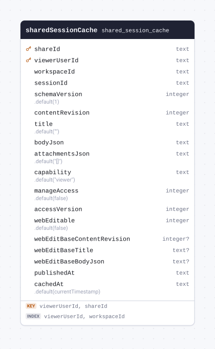

| Column                                                          | Type      | Constraints | Default                      | Description |
| --------------------------------------------------------------- | --------- | ----------- | ---------------------------- | ----------- |
| `shareId` (`share_id`)                                          | `text`    | PK NOT NULL |                              |             |
| `viewerUserId` (`viewer_user_id`)                               | `text`    | PK NOT NULL |                              |             |
| `workspaceId` (`workspace_id`)                                  | `text`    | NOT NULL    |                              |             |
| `sessionId` (`session_id`)                                      | `text`    | NOT NULL    |                              |             |
| `schemaVersion` (`schema_version`)                              | `integer` | NOT NULL    | `.default(1)`                |             |
| `contentRevision` (`content_revision`)                          | `integer` | NOT NULL    |                              |             |
| `title`                                                         | `text`    | NOT NULL    | `.default("")`               |             |
| `bodyJson` (`body_json`)                                        | `text`    | NOT NULL    |                              |             |
| `attachmentsJson` (`attachments_json`)                          | `text`    | NOT NULL    | `.default("[]")`             |             |
| `capability`                                                    | `text`    | NOT NULL    | `.default("viewer")`         |             |
| `manageAccess` (`manage_access`)                                | `integer` | NOT NULL    | `.default(false)`            |             |
| `accessVersion` (`access_version`)                              | `integer` | NOT NULL    |                              |             |
| `webEditable` (`web_editable`)                                  | `integer` | NOT NULL    | `.default(false)`            |             |
| `webEditBaseContentRevision` (`web_edit_base_content_revision`) | `integer` | NULL        |                              |             |
| `webEditBaseTitle` (`web_edit_base_title`)                      | `text`    | NULL        |                              |             |
| `webEditBaseBodyJson` (`web_edit_base_body_json`)               | `text`    | NULL        |                              |             |
| `publishedAt` (`published_at`)                                  | `text`    | NOT NULL    |                              |             |
| `cachedAt` (`cached_at`)                                        | `text`    | NOT NULL    | `.default(currentTimestamp)` |             |

#### Definition

```sql
CREATE TABLE `shared_session_cache` (
	`share_id` text NOT NULL,
	`viewer_user_id` text NOT NULL,
	`workspace_id` text NOT NULL,
	`session_id` text NOT NULL,
	`schema_version` integer DEFAULT 1 NOT NULL,
	`content_revision` integer NOT NULL,
	`title` text DEFAULT '' NOT NULL,
	`body_json` text NOT NULL,
	`attachments_json` text DEFAULT '[]' NOT NULL,
	`capability` text DEFAULT 'viewer' NOT NULL,
	`manage_access` integer DEFAULT false NOT NULL,
	`access_version` integer NOT NULL,
	`web_editable` integer DEFAULT false NOT NULL,
	`web_edit_base_content_revision` integer,
	`web_edit_base_title` text,
	`web_edit_base_body_json` text,
	`published_at` text NOT NULL,
	`cached_at` text DEFAULT (strftime('%Y-%m-%dT%H:%M:%fZ', 'now')) NOT NULL,
	CONSTRAINT `shared_session_cache_pk` PRIMARY KEY(`viewer_user_id`, `share_id`)
);

CREATE INDEX `idx_shared_session_cache_viewer_workspace` ON `shared_session_cache` (`viewer_user_id`,`workspace_id`);
```

#### Indexes

- PRIMARY KEY `viewerUserId`, `shareId`
- INDEX `viewerUserId`, `workspaceId`

<details>
<summary>Queries and their SQL</summary>

**Select**: Every row of sharedSessionCache.

```ts
db.select().from(sharedSessionCache);
```

```sql
select "share_id", "viewer_user_id", "workspace_id", "session_id", "schema_version", "content_revision", "title", "body_json", "attachments_json", "capability", "manage_access", "access_version", "web_editable", "web_edit_base_content_revision", "web_edit_base_title", "web_edit_base_body_json", "published_at", "cached_at"
from "shared_session_cache"
```

**Count**: How many rows sharedSessionCache has.

```ts
db.select({ count: count() }).from(sharedSessionCache);
```

```sql
select count(*)
from "shared_session_cache"
```

**Find many**: The rows of sharedSessionCache, through the relational query API.

```ts
db.query.sharedSessionCache.findMany();
```

```sql
select "d0"."share_id" as "shareId", "d0"."viewer_user_id" as "viewerUserId", "d0"."workspace_id" as "workspaceId", "d0"."session_id" as "sessionId", "d0"."schema_version" as "schemaVersion", "d0"."content_revision" as "contentRevision", "d0"."title" as "title", "d0"."body_json" as "bodyJson", "d0"."attachments_json" as "attachmentsJson", "d0"."capability" as "capability", "d0"."manage_access" as "manageAccess", "d0"."access_version" as "accessVersion", "d0"."web_editable" as "webEditable", "d0"."web_edit_base_content_revision" as "webEditBaseContentRevision", "d0"."web_edit_base_title" as "webEditBaseTitle", "d0"."web_edit_base_body_json" as "webEditBaseBodyJson", "d0"."published_at" as "publishedAt", "d0"."cached_at" as "cachedAt"
from "shared_session_cache" as "d0"
```

**Find by primary key**: One row of sharedSessionCache, through the relational query API.

```ts
db.query.sharedSessionCache.findFirst({
  where: { shareId: "shareId", viewerUserId: "viewerUserId" },
});
```

```sql
select "d0"."share_id" as "shareId", "d0"."viewer_user_id" as "viewerUserId", "d0"."workspace_id" as "workspaceId", "d0"."session_id" as "sessionId", "d0"."schema_version" as "schemaVersion", "d0"."content_revision" as "contentRevision", "d0"."title" as "title", "d0"."body_json" as "bodyJson", "d0"."attachments_json" as "attachmentsJson", "d0"."capability" as "capability", "d0"."manage_access" as "manageAccess", "d0"."access_version" as "accessVersion", "d0"."web_editable" as "webEditable", "d0"."web_edit_base_content_revision" as "webEditBaseContentRevision", "d0"."web_edit_base_title" as "webEditBaseTitle", "d0"."web_edit_base_body_json" as "webEditBaseBodyJson", "d0"."published_at" as "publishedAt", "d0"."cached_at" as "cachedAt"
from "shared_session_cache" as "d0"
where (("d0"."share_id" = ?) and ("d0"."viewer_user_id" = ?))
limit ?
-- params: ["shareId","viewerUserId",1]
```

**Insert**: Adds a row to sharedSessionCache, giving the columns that have no default.

```ts
db.insert(sharedSessionCache).values({
  shareId: "shareId",
  viewerUserId: "viewerUserId",
  workspaceId: "workspaceId",
  sessionId: "sessionId",
  contentRevision: 1,
  bodyJson: "bodyJson",
  accessVersion: 1,
  publishedAt: "publishedAt",
});
```

```sql
insert into "shared_session_cache" ("share_id", "viewer_user_id", "workspace_id", "session_id", "schema_version", "content_revision", "title", "body_json", "attachments_json", "capability", "manage_access", "access_version", "web_editable", "web_edit_base_content_revision", "web_edit_base_title", "web_edit_base_body_json", "published_at", "cached_at")
values (?, ?, ?, ?, ?, ?, ?, ?, ?, ?, ?, ?, ?, null, null, null, ?, (strftime('%Y-%m-%dT%H:%M:%fZ', 'now')))
-- params: ["shareId","viewerUserId","workspaceId","sessionId",1,1,"","\"bodyJson\"","\"[]\"","viewer",0,1,0,"publishedAt"]
```

**Update**: Changes a row of sharedSessionCache, found by its primary key.

```ts
db.update(sharedSessionCache)
  .set({ workspaceId: "workspaceId" })
  .where(
    and(
      eq(sharedSessionCache.shareId, "shareId"),
      eq(sharedSessionCache.viewerUserId, "viewerUserId"),
    ),
  );
```

```sql
update "shared_session_cache"
set "workspace_id" = ?
where (("shared_session_cache"."share_id" = ?) and ("shared_session_cache"."viewer_user_id" = ?))
-- params: ["workspaceId","shareId","viewerUserId"]
```

**Delete**: Deletes a row of sharedSessionCache, found by its primary key.

```ts
db.delete(sharedSessionCache).where(
  and(
    eq(sharedSessionCache.shareId, "shareId"),
    eq(sharedSessionCache.viewerUserId, "viewerUserId"),
  ),
);
```

```sql
delete from "shared_session_cache"
where (("shared_session_cache"."share_id" = ?) and ("shared_session_cache"."viewer_user_id" = ?))
-- params: ["shareId","viewerUserId"]
```

</details>

<a id="table-sessionShareSyncState"></a>

### sessionShareSyncState

Table `session_share_sync_state`.

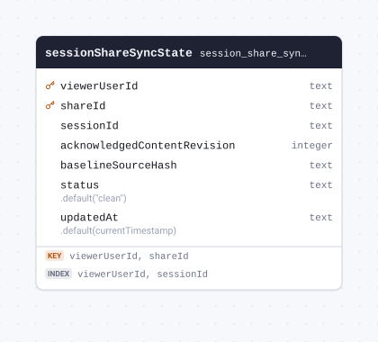

| Column                                                          | Type      | Constraints | Default                      | Description |
| --------------------------------------------------------------- | --------- | ----------- | ---------------------------- | ----------- |
| `viewerUserId` (`viewer_user_id`)                               | `text`    | PK NOT NULL |                              |             |
| `shareId` (`share_id`)                                          | `text`    | PK NOT NULL |                              |             |
| `sessionId` (`session_id`)                                      | `text`    | NOT NULL    |                              |             |
| `acknowledgedContentRevision` (`acknowledged_content_revision`) | `integer` | NOT NULL    |                              |             |
| `baselineSourceHash` (`baseline_source_hash`)                   | `text`    | NOT NULL    |                              |             |
| `status`                                                        | `text`    | NOT NULL    | `.default("clean")`          |             |
| `updatedAt` (`updated_at`)                                      | `text`    | NOT NULL    | `.default(currentTimestamp)` |             |

#### Definition

```sql
CREATE TABLE `session_share_sync_state` (
	`viewer_user_id` text NOT NULL,
	`share_id` text NOT NULL,
	`session_id` text NOT NULL,
	`acknowledged_content_revision` integer NOT NULL,
	`baseline_source_hash` text NOT NULL,
	`status` text DEFAULT 'clean' NOT NULL,
	`updated_at` text DEFAULT (strftime('%Y-%m-%dT%H:%M:%fZ', 'now')) NOT NULL,
	CONSTRAINT `session_share_sync_state_pk` PRIMARY KEY(`viewer_user_id`, `share_id`)
);

CREATE INDEX `idx_session_share_sync_state_session` ON `session_share_sync_state` (`viewer_user_id`,`session_id`);
```

#### Indexes

- PRIMARY KEY `viewerUserId`, `shareId`
- INDEX `viewerUserId`, `sessionId`

<details>
<summary>Queries and their SQL</summary>

**Select**: Every row of sessionShareSyncState.

```ts
db.select().from(sessionShareSyncState);
```

```sql
select "viewer_user_id", "share_id", "session_id", "acknowledged_content_revision", "baseline_source_hash", "status", "updated_at"
from "session_share_sync_state"
```

**Count**: How many rows sessionShareSyncState has.

```ts
db.select({ count: count() }).from(sessionShareSyncState);
```

```sql
select count(*)
from "session_share_sync_state"
```

**Find many**: The rows of sessionShareSyncState, through the relational query API.

```ts
db.query.sessionShareSyncState.findMany();
```

```sql
select "d0"."viewer_user_id" as "viewerUserId", "d0"."share_id" as "shareId", "d0"."session_id" as "sessionId", "d0"."acknowledged_content_revision" as "acknowledgedContentRevision", "d0"."baseline_source_hash" as "baselineSourceHash", "d0"."status" as "status", "d0"."updated_at" as "updatedAt"
from "session_share_sync_state" as "d0"
```

**Find by primary key**: One row of sessionShareSyncState, through the relational query API.

```ts
db.query.sessionShareSyncState.findFirst({
  where: { viewerUserId: "viewerUserId", shareId: "shareId" },
});
```

```sql
select "d0"."viewer_user_id" as "viewerUserId", "d0"."share_id" as "shareId", "d0"."session_id" as "sessionId", "d0"."acknowledged_content_revision" as "acknowledgedContentRevision", "d0"."baseline_source_hash" as "baselineSourceHash", "d0"."status" as "status", "d0"."updated_at" as "updatedAt"
from "session_share_sync_state" as "d0"
where (("d0"."viewer_user_id" = ?) and ("d0"."share_id" = ?))
limit ?
-- params: ["viewerUserId","shareId",1]
```

**Insert**: Adds a row to sessionShareSyncState, giving the columns that have no default.

```ts
db.insert(sessionShareSyncState).values({
  viewerUserId: "viewerUserId",
  shareId: "shareId",
  sessionId: "sessionId",
  acknowledgedContentRevision: 1,
  baselineSourceHash: "baselineSourceHash",
});
```

```sql
insert into "session_share_sync_state" ("viewer_user_id", "share_id", "session_id", "acknowledged_content_revision", "baseline_source_hash", "status", "updated_at")
values (?, ?, ?, ?, ?, ?, (strftime('%Y-%m-%dT%H:%M:%fZ', 'now')))
-- params: ["viewerUserId","shareId","sessionId",1,"baselineSourceHash","clean"]
```

**Update**: Changes a row of sessionShareSyncState, found by its primary key.

```ts
db.update(sessionShareSyncState)
  .set({ sessionId: "sessionId" })
  .where(
    and(
      eq(sessionShareSyncState.viewerUserId, "viewerUserId"),
      eq(sessionShareSyncState.shareId, "shareId"),
    ),
  );
```

```sql
update "session_share_sync_state"
set "session_id" = ?
where (("session_share_sync_state"."viewer_user_id" = ?) and ("session_share_sync_state"."share_id" = ?))
-- params: ["sessionId","viewerUserId","shareId"]
```

**Delete**: Deletes a row of sessionShareSyncState, found by its primary key.

```ts
db.delete(sessionShareSyncState).where(
  and(
    eq(sessionShareSyncState.viewerUserId, "viewerUserId"),
    eq(sessionShareSyncState.shareId, "shareId"),
  ),
);
```

```sql
delete from "session_share_sync_state"
where (("session_share_sync_state"."viewer_user_id" = ?) and ("session_share_sync_state"."share_id" = ?))
-- params: ["viewerUserId","shareId"]
```

</details>

<a id="table-sessionShareActivation"></a>

### sessionShareActivation

Table `session_share_activation`.

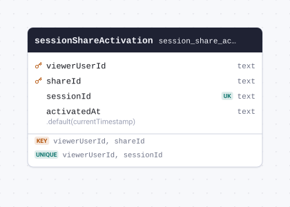

| Column                            | Type   | Constraints | Default                      | Description |
| --------------------------------- | ------ | ----------- | ---------------------------- | ----------- |
| `viewerUserId` (`viewer_user_id`) | `text` | PK NOT NULL |                              |             |
| `shareId` (`share_id`)            | `text` | PK NOT NULL |                              |             |
| `sessionId` (`session_id`)        | `text` | NOT NULL    |                              |             |
| `activatedAt` (`activated_at`)    | `text` | NOT NULL    | `.default(currentTimestamp)` |             |

#### Definition

```sql
CREATE TABLE `session_share_activation` (
	`viewer_user_id` text NOT NULL,
	`share_id` text NOT NULL,
	`session_id` text NOT NULL,
	`activated_at` text DEFAULT (strftime('%Y-%m-%dT%H:%M:%fZ', 'now')) NOT NULL,
	CONSTRAINT `session_share_activation_pk` PRIMARY KEY(`viewer_user_id`, `share_id`)
);

CREATE UNIQUE INDEX `session_share_activation_viewer_session_unique` ON `session_share_activation` (`viewer_user_id`,`session_id`);
```

#### Indexes

- PRIMARY KEY `viewerUserId`, `shareId`
- UNIQUE `viewerUserId`, `sessionId`

<details>
<summary>Queries and their SQL</summary>

**Select**: Every row of sessionShareActivation.

```ts
db.select().from(sessionShareActivation);
```

```sql
select "viewer_user_id", "share_id", "session_id", "activated_at"
from "session_share_activation"
```

**Count**: How many rows sessionShareActivation has.

```ts
db.select({ count: count() }).from(sessionShareActivation);
```

```sql
select count(*)
from "session_share_activation"
```

**Find many**: The rows of sessionShareActivation, through the relational query API.

```ts
db.query.sessionShareActivation.findMany();
```

```sql
select "d0"."viewer_user_id" as "viewerUserId", "d0"."share_id" as "shareId", "d0"."session_id" as "sessionId", "d0"."activated_at" as "activatedAt"
from "session_share_activation" as "d0"
```

**Find by primary key**: One row of sessionShareActivation, through the relational query API.

```ts
db.query.sessionShareActivation.findFirst({
  where: { viewerUserId: "viewerUserId", shareId: "shareId" },
});
```

```sql
select "d0"."viewer_user_id" as "viewerUserId", "d0"."share_id" as "shareId", "d0"."session_id" as "sessionId", "d0"."activated_at" as "activatedAt"
from "session_share_activation" as "d0"
where (("d0"."viewer_user_id" = ?) and ("d0"."share_id" = ?))
limit ?
-- params: ["viewerUserId","shareId",1]
```

**Insert**: Adds a row to sessionShareActivation, giving the columns that have no default.

```ts
db.insert(sessionShareActivation).values({
  viewerUserId: "viewerUserId",
  shareId: "shareId",
  sessionId: "sessionId",
});
```

```sql
insert into "session_share_activation" ("viewer_user_id", "share_id", "session_id", "activated_at")
values (?, ?, ?, (strftime('%Y-%m-%dT%H:%M:%fZ', 'now')))
-- params: ["viewerUserId","shareId","sessionId"]
```

**Update**: Changes a row of sessionShareActivation, found by its primary key.

```ts
db.update(sessionShareActivation)
  .set({ sessionId: "sessionId" })
  .where(
    and(
      eq(sessionShareActivation.viewerUserId, "viewerUserId"),
      eq(sessionShareActivation.shareId, "shareId"),
    ),
  );
```

```sql
update "session_share_activation"
set "session_id" = ?
where (("session_share_activation"."viewer_user_id" = ?) and ("session_share_activation"."share_id" = ?))
-- params: ["sessionId","viewerUserId","shareId"]
```

**Delete**: Deletes a row of sessionShareActivation, found by its primary key.

```ts
db.delete(sessionShareActivation).where(
  and(
    eq(sessionShareActivation.viewerUserId, "viewerUserId"),
    eq(sessionShareActivation.shareId, "shareId"),
  ),
);
```

```sql
delete from "session_share_activation"
where (("session_share_activation"."viewer_user_id" = ?) and ("session_share_activation"."share_id" = ?))
-- params: ["viewerUserId","shareId"]
```

</details>

<a id="table-transcripts"></a>

### transcripts

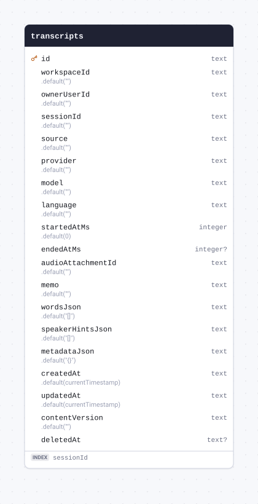

| Column                                      | Type      | Constraints | Default                      | Description |
| ------------------------------------------- | --------- | ----------- | ---------------------------- | ----------- |
| `id`                                        | `text`    | PK NOT NULL |                              |             |
| `workspaceId` (`workspace_id`)              | `text`    | NOT NULL    | `.default("")`               |             |
| `ownerUserId` (`owner_user_id`)             | `text`    | NOT NULL    | `.default("")`               |             |
| `sessionId` (`session_id`)                  | `text`    | NOT NULL    | `.default("")`               |             |
| `source`                                    | `text`    | NOT NULL    | `.default("")`               |             |
| `provider`                                  | `text`    | NOT NULL    | `.default("")`               |             |
| `model`                                     | `text`    | NOT NULL    | `.default("")`               |             |
| `language`                                  | `text`    | NOT NULL    | `.default("")`               |             |
| `startedAtMs` (`started_at_ms`)             | `integer` | NOT NULL    | `.default(0)`                |             |
| `endedAtMs` (`ended_at_ms`)                 | `integer` | NULL        |                              |             |
| `audioAttachmentId` (`audio_attachment_id`) | `text`    | NOT NULL    | `.default("")`               |             |
| `memo`                                      | `text`    | NOT NULL    | `.default("")`               |             |
| `wordsJson` (`words_json`)                  | `text`    | NOT NULL    | `.default("[]")`             |             |
| `speakerHintsJson` (`speaker_hints_json`)   | `text`    | NOT NULL    | `.default("[]")`             |             |
| `metadataJson` (`metadata_json`)            | `text`    | NOT NULL    | `.default("{}")`             |             |
| `createdAt` (`created_at`)                  | `text`    | NOT NULL    | `.default(currentTimestamp)` |             |
| `updatedAt` (`updated_at`)                  | `text`    | NOT NULL    | `.default(currentTimestamp)` |             |
| `contentVersion` (`content_version`)        | `text`    | NOT NULL    | `.default("")`               |             |
| `deletedAt` (`deleted_at`)                  | `text`    | NULL        |                              |             |

#### Definition

```sql
CREATE TABLE `transcripts` (
	`id` text PRIMARY KEY,
	`workspace_id` text DEFAULT '' NOT NULL,
	`owner_user_id` text DEFAULT '' NOT NULL,
	`session_id` text DEFAULT '' NOT NULL,
	`source` text DEFAULT '' NOT NULL,
	`provider` text DEFAULT '' NOT NULL,
	`model` text DEFAULT '' NOT NULL,
	`language` text DEFAULT '' NOT NULL,
	`started_at_ms` integer DEFAULT 0 NOT NULL,
	`ended_at_ms` integer,
	`audio_attachment_id` text DEFAULT '' NOT NULL,
	`memo` text DEFAULT '' NOT NULL,
	`words_json` text DEFAULT '[]' NOT NULL,
	`speaker_hints_json` text DEFAULT '[]' NOT NULL,
	`metadata_json` text DEFAULT '{}' NOT NULL,
	`created_at` text DEFAULT (strftime('%Y-%m-%dT%H:%M:%fZ', 'now')) NOT NULL,
	`updated_at` text DEFAULT (strftime('%Y-%m-%dT%H:%M:%fZ', 'now')) NOT NULL,
	`content_version` text DEFAULT '' NOT NULL,
	`deleted_at` text
);

CREATE INDEX `idx_transcripts_session_id` ON `transcripts` (`session_id`);
```

#### Indexes

- INDEX `sessionId`

<details>
<summary>Queries and their SQL</summary>

**Select**: Every row of transcripts.

```ts
db.select().from(transcripts);
```

```sql
select "id", "workspace_id", "owner_user_id", "session_id", "source", "provider", "model", "language", "started_at_ms", "ended_at_ms", "audio_attachment_id", "memo", "words_json", "speaker_hints_json", "metadata_json", "created_at", "updated_at", "content_version", "deleted_at"
from "transcripts"
```

**Count**: How many rows transcripts has.

```ts
db.select({ count: count() }).from(transcripts);
```

```sql
select count(*)
from "transcripts"
```

**Find many**: The rows of transcripts, through the relational query API.

```ts
db.query.transcripts.findMany();
```

```sql
select "d0"."id" as "id", "d0"."workspace_id" as "workspaceId", "d0"."owner_user_id" as "ownerUserId", "d0"."session_id" as "sessionId", "d0"."source" as "source", "d0"."provider" as "provider", "d0"."model" as "model", "d0"."language" as "language", "d0"."started_at_ms" as "startedAtMs", "d0"."ended_at_ms" as "endedAtMs", "d0"."audio_attachment_id" as "audioAttachmentId", "d0"."memo" as "memo", "d0"."words_json" as "wordsJson", "d0"."speaker_hints_json" as "speakerHintsJson", "d0"."metadata_json" as "metadataJson", "d0"."created_at" as "createdAt", "d0"."updated_at" as "updatedAt", "d0"."content_version" as "contentVersion", "d0"."deleted_at" as "deletedAt"
from "transcripts" as "d0"
```

**Find by primary key**: One row of transcripts, through the relational query API.

```ts
db.query.transcripts.findFirst({ where: { id: "id" } });
```

```sql
select "d0"."id" as "id", "d0"."workspace_id" as "workspaceId", "d0"."owner_user_id" as "ownerUserId", "d0"."session_id" as "sessionId", "d0"."source" as "source", "d0"."provider" as "provider", "d0"."model" as "model", "d0"."language" as "language", "d0"."started_at_ms" as "startedAtMs", "d0"."ended_at_ms" as "endedAtMs", "d0"."audio_attachment_id" as "audioAttachmentId", "d0"."memo" as "memo", "d0"."words_json" as "wordsJson", "d0"."speaker_hints_json" as "speakerHintsJson", "d0"."metadata_json" as "metadataJson", "d0"."created_at" as "createdAt", "d0"."updated_at" as "updatedAt", "d0"."content_version" as "contentVersion", "d0"."deleted_at" as "deletedAt"
from "transcripts" as "d0"
where "d0"."id" = ?
limit ?
-- params: ["id",1]
```

**Insert**: Adds a row to transcripts, giving the columns that have no default.

```ts
db.insert(transcripts).values({ id: "id" });
```

```sql
insert into "transcripts" ("id", "workspace_id", "owner_user_id", "session_id", "source", "provider", "model", "language", "started_at_ms", "ended_at_ms", "audio_attachment_id", "memo", "words_json", "speaker_hints_json", "metadata_json", "created_at", "updated_at", "content_version", "deleted_at")
values (?, ?, ?, ?, ?, ?, ?, ?, ?, null, ?, ?, ?, ?, ?, (strftime('%Y-%m-%dT%H:%M:%fZ', 'now')), (strftime('%Y-%m-%dT%H:%M:%fZ', 'now')), ?, null)
-- params: ["id","","","","","","","",0,"","","[]","[]","{}",""]
```

**Update**: Changes a row of transcripts, found by its primary key.

```ts
db.update(transcripts).set({ workspaceId: "workspaceId" }).where(eq(transcripts.id, "id"));
```

```sql
update "transcripts"
set "workspace_id" = ?
where "transcripts"."id" = ?
-- params: ["workspaceId","id"]
```

**Delete**: Deletes a row of transcripts, found by its primary key.

```ts
db.delete(transcripts).where(eq(transcripts.id, "id"));
```

```sql
delete from "transcripts"
where "transcripts"."id" = ?
-- params: ["id"]
```

</details>

<a id="table-sessionParticipants"></a>

### sessionParticipants

Table `session_participants`.

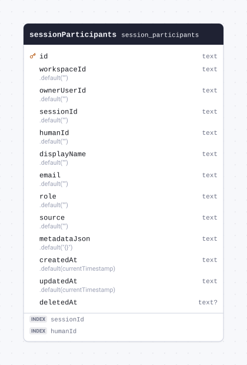

| Column                           | Type   | Constraints | Default                      | Description |
| -------------------------------- | ------ | ----------- | ---------------------------- | ----------- |
| `id`                             | `text` | PK NOT NULL |                              |             |
| `workspaceId` (`workspace_id`)   | `text` | NOT NULL    | `.default("")`               |             |
| `ownerUserId` (`owner_user_id`)  | `text` | NOT NULL    | `.default("")`               |             |
| `sessionId` (`session_id`)       | `text` | NOT NULL    | `.default("")`               |             |
| `humanId` (`human_id`)           | `text` | NOT NULL    | `.default("")`               |             |
| `displayName` (`display_name`)   | `text` | NOT NULL    | `.default("")`               |             |
| `email`                          | `text` | NOT NULL    | `.default("")`               |             |
| `role`                           | `text` | NOT NULL    | `.default("")`               |             |
| `source`                         | `text` | NOT NULL    | `.default("")`               |             |
| `metadataJson` (`metadata_json`) | `text` | NOT NULL    | `.default("{}")`             |             |
| `createdAt` (`created_at`)       | `text` | NOT NULL    | `.default(currentTimestamp)` |             |
| `updatedAt` (`updated_at`)       | `text` | NOT NULL    | `.default(currentTimestamp)` |             |
| `deletedAt` (`deleted_at`)       | `text` | NULL        |                              |             |

#### Definition

```sql
CREATE TABLE `session_participants` (
	`id` text PRIMARY KEY,
	`workspace_id` text DEFAULT '' NOT NULL,
	`owner_user_id` text DEFAULT '' NOT NULL,
	`session_id` text DEFAULT '' NOT NULL,
	`human_id` text DEFAULT '' NOT NULL,
	`display_name` text DEFAULT '' NOT NULL,
	`email` text DEFAULT '' NOT NULL,
	`role` text DEFAULT '' NOT NULL,
	`source` text DEFAULT '' NOT NULL,
	`metadata_json` text DEFAULT '{}' NOT NULL,
	`created_at` text DEFAULT (strftime('%Y-%m-%dT%H:%M:%fZ', 'now')) NOT NULL,
	`updated_at` text DEFAULT (strftime('%Y-%m-%dT%H:%M:%fZ', 'now')) NOT NULL,
	`deleted_at` text
);

CREATE INDEX `idx_session_participants_session_id` ON `session_participants` (`session_id`);

CREATE INDEX `idx_session_participants_human_id` ON `session_participants` (`human_id`);
```

#### Indexes

- INDEX `sessionId`
- INDEX `humanId`

<details>
<summary>Queries and their SQL</summary>

**Select**: Every row of sessionParticipants.

```ts
db.select().from(sessionParticipants);
```

```sql
select "id", "workspace_id", "owner_user_id", "session_id", "human_id", "display_name", "email", "role", "source", "metadata_json", "created_at", "updated_at", "deleted_at"
from "session_participants"
```

**Count**: How many rows sessionParticipants has.

```ts
db.select({ count: count() }).from(sessionParticipants);
```

```sql
select count(*)
from "session_participants"
```

**Find many**: The rows of sessionParticipants, through the relational query API.

```ts
db.query.sessionParticipants.findMany();
```

```sql
select "d0"."id" as "id", "d0"."workspace_id" as "workspaceId", "d0"."owner_user_id" as "ownerUserId", "d0"."session_id" as "sessionId", "d0"."human_id" as "humanId", "d0"."display_name" as "displayName", "d0"."email" as "email", "d0"."role" as "role", "d0"."source" as "source", "d0"."metadata_json" as "metadataJson", "d0"."created_at" as "createdAt", "d0"."updated_at" as "updatedAt", "d0"."deleted_at" as "deletedAt"
from "session_participants" as "d0"
```

**Find by primary key**: One row of sessionParticipants, through the relational query API.

```ts
db.query.sessionParticipants.findFirst({ where: { id: "id" } });
```

```sql
select "d0"."id" as "id", "d0"."workspace_id" as "workspaceId", "d0"."owner_user_id" as "ownerUserId", "d0"."session_id" as "sessionId", "d0"."human_id" as "humanId", "d0"."display_name" as "displayName", "d0"."email" as "email", "d0"."role" as "role", "d0"."source" as "source", "d0"."metadata_json" as "metadataJson", "d0"."created_at" as "createdAt", "d0"."updated_at" as "updatedAt", "d0"."deleted_at" as "deletedAt"
from "session_participants" as "d0"
where "d0"."id" = ?
limit ?
-- params: ["id",1]
```

**Insert**: Adds a row to sessionParticipants, giving the columns that have no default.

```ts
db.insert(sessionParticipants).values({ id: "id" });
```

```sql
insert into "session_participants" ("id", "workspace_id", "owner_user_id", "session_id", "human_id", "display_name", "email", "role", "source", "metadata_json", "created_at", "updated_at", "deleted_at")
values (?, ?, ?, ?, ?, ?, ?, ?, ?, ?, (strftime('%Y-%m-%dT%H:%M:%fZ', 'now')), (strftime('%Y-%m-%dT%H:%M:%fZ', 'now')), null)
-- params: ["id","","","","","","","","","{}"]
```

**Update**: Changes a row of sessionParticipants, found by its primary key.

```ts
db.update(sessionParticipants)
  .set({ workspaceId: "workspaceId" })
  .where(eq(sessionParticipants.id, "id"));
```

```sql
update "session_participants"
set "workspace_id" = ?
where "session_participants"."id" = ?
-- params: ["workspaceId","id"]
```

**Delete**: Deletes a row of sessionParticipants, found by its primary key.

```ts
db.delete(sessionParticipants).where(eq(sessionParticipants.id, "id"));
```

```sql
delete from "session_participants"
where "session_participants"."id" = ?
-- params: ["id"]
```

</details>

<a id="table-actionItems"></a>

### actionItems

Table `action_items`.

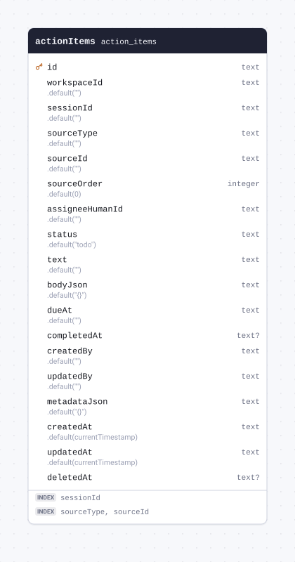

| Column                                  | Type      | Constraints | Default                      | Description |
| --------------------------------------- | --------- | ----------- | ---------------------------- | ----------- |
| `id`                                    | `text`    | PK NOT NULL |                              |             |
| `workspaceId` (`workspace_id`)          | `text`    | NOT NULL    | `.default("")`               |             |
| `sessionId` (`session_id`)              | `text`    | NOT NULL    | `.default("")`               |             |
| `sourceType` (`source_type`)            | `text`    | NOT NULL    | `.default("")`               |             |
| `sourceId` (`source_id`)                | `text`    | NOT NULL    | `.default("")`               |             |
| `sourceOrder` (`source_order`)          | `integer` | NOT NULL    | `.default(0)`                |             |
| `assigneeHumanId` (`assignee_human_id`) | `text`    | NOT NULL    | `.default("")`               |             |
| `status`                                | `text`    | NOT NULL    | `.default("todo")`           |             |
| `text`                                  | `text`    | NOT NULL    | `.default("")`               |             |
| `bodyJson` (`body_json`)                | `text`    | NOT NULL    | `.default("{}")`             |             |
| `dueAt` (`due_at`)                      | `text`    | NOT NULL    | `.default("")`               |             |
| `completedAt` (`completed_at`)          | `text`    | NULL        |                              |             |
| `createdBy` (`created_by`)              | `text`    | NOT NULL    | `.default("")`               |             |
| `updatedBy` (`updated_by`)              | `text`    | NOT NULL    | `.default("")`               |             |
| `metadataJson` (`metadata_json`)        | `text`    | NOT NULL    | `.default("{}")`             |             |
| `createdAt` (`created_at`)              | `text`    | NOT NULL    | `.default(currentTimestamp)` |             |
| `updatedAt` (`updated_at`)              | `text`    | NOT NULL    | `.default(currentTimestamp)` |             |
| `deletedAt` (`deleted_at`)              | `text`    | NULL        |                              |             |

#### Definition

```sql
CREATE TABLE `action_items` (
	`id` text PRIMARY KEY,
	`workspace_id` text DEFAULT '' NOT NULL,
	`session_id` text DEFAULT '' NOT NULL,
	`source_type` text DEFAULT '' NOT NULL,
	`source_id` text DEFAULT '' NOT NULL,
	`source_order` integer DEFAULT 0 NOT NULL,
	`assignee_human_id` text DEFAULT '' NOT NULL,
	`status` text DEFAULT 'todo' NOT NULL,
	`text` text DEFAULT '' NOT NULL,
	`body_json` text DEFAULT '{}' NOT NULL,
	`due_at` text DEFAULT '' NOT NULL,
	`completed_at` text,
	`created_by` text DEFAULT '' NOT NULL,
	`updated_by` text DEFAULT '' NOT NULL,
	`metadata_json` text DEFAULT '{}' NOT NULL,
	`created_at` text DEFAULT (strftime('%Y-%m-%dT%H:%M:%fZ', 'now')) NOT NULL,
	`updated_at` text DEFAULT (strftime('%Y-%m-%dT%H:%M:%fZ', 'now')) NOT NULL,
	`deleted_at` text
);

CREATE INDEX `idx_action_items_session_id` ON `action_items` (`session_id`);

CREATE INDEX `idx_action_items_source` ON `action_items` (`source_type`,`source_id`);
```

#### Indexes

- INDEX `sessionId`
- INDEX `sourceType`, `sourceId`

<details>
<summary>Queries and their SQL</summary>

**Select**: Every row of actionItems.

```ts
db.select().from(actionItems);
```

```sql
select "id", "workspace_id", "session_id", "source_type", "source_id", "source_order", "assignee_human_id", "status", "text", "body_json", "due_at", "completed_at", "created_by", "updated_by", "metadata_json", "created_at", "updated_at", "deleted_at"
from "action_items"
```

**Count**: How many rows actionItems has.

```ts
db.select({ count: count() }).from(actionItems);
```

```sql
select count(*)
from "action_items"
```

**Find many**: The rows of actionItems, through the relational query API.

```ts
db.query.actionItems.findMany();
```

```sql
select "d0"."id" as "id", "d0"."workspace_id" as "workspaceId", "d0"."session_id" as "sessionId", "d0"."source_type" as "sourceType", "d0"."source_id" as "sourceId", "d0"."source_order" as "sourceOrder", "d0"."assignee_human_id" as "assigneeHumanId", "d0"."status" as "status", "d0"."text" as "text", "d0"."body_json" as "bodyJson", "d0"."due_at" as "dueAt", "d0"."completed_at" as "completedAt", "d0"."created_by" as "createdBy", "d0"."updated_by" as "updatedBy", "d0"."metadata_json" as "metadataJson", "d0"."created_at" as "createdAt", "d0"."updated_at" as "updatedAt", "d0"."deleted_at" as "deletedAt"
from "action_items" as "d0"
```

**Find by primary key**: One row of actionItems, through the relational query API.

```ts
db.query.actionItems.findFirst({ where: { id: "id" } });
```

```sql
select "d0"."id" as "id", "d0"."workspace_id" as "workspaceId", "d0"."session_id" as "sessionId", "d0"."source_type" as "sourceType", "d0"."source_id" as "sourceId", "d0"."source_order" as "sourceOrder", "d0"."assignee_human_id" as "assigneeHumanId", "d0"."status" as "status", "d0"."text" as "text", "d0"."body_json" as "bodyJson", "d0"."due_at" as "dueAt", "d0"."completed_at" as "completedAt", "d0"."created_by" as "createdBy", "d0"."updated_by" as "updatedBy", "d0"."metadata_json" as "metadataJson", "d0"."created_at" as "createdAt", "d0"."updated_at" as "updatedAt", "d0"."deleted_at" as "deletedAt"
from "action_items" as "d0"
where "d0"."id" = ?
limit ?
-- params: ["id",1]
```

**Insert**: Adds a row to actionItems, giving the columns that have no default.

```ts
db.insert(actionItems).values({ id: "id" });
```

```sql
insert into "action_items" ("id", "workspace_id", "session_id", "source_type", "source_id", "source_order", "assignee_human_id", "status", "text", "body_json", "due_at", "completed_at", "created_by", "updated_by", "metadata_json", "created_at", "updated_at", "deleted_at")
values (?, ?, ?, ?, ?, ?, ?, ?, ?, ?, ?, null, ?, ?, ?, (strftime('%Y-%m-%dT%H:%M:%fZ', 'now')), (strftime('%Y-%m-%dT%H:%M:%fZ', 'now')), null)
-- params: ["id","","","","",0,"","todo","","{}","","","","{}"]
```

**Update**: Changes a row of actionItems, found by its primary key.

```ts
db.update(actionItems).set({ workspaceId: "workspaceId" }).where(eq(actionItems.id, "id"));
```

```sql
update "action_items"
set "workspace_id" = ?
where "action_items"."id" = ?
-- params: ["workspaceId","id"]
```

**Delete**: Deletes a row of actionItems, found by its primary key.

```ts
db.delete(actionItems).where(eq(actionItems.id, "id"));
```

```sql
delete from "action_items"
where "action_items"."id" = ?
-- params: ["id"]
```

</details>

<a id="table-sessionAttachments"></a>

### sessionAttachments

Table `session_attachments`.

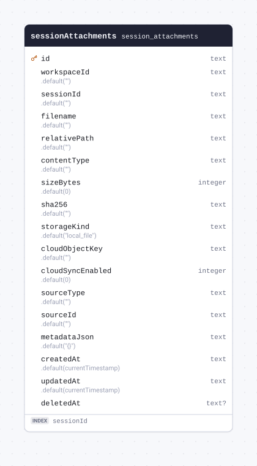

| Column                                    | Type      | Constraints | Default                      | Description |
| ----------------------------------------- | --------- | ----------- | ---------------------------- | ----------- |
| `id`                                      | `text`    | PK NOT NULL |                              |             |
| `workspaceId` (`workspace_id`)            | `text`    | NOT NULL    | `.default("")`               |             |
| `sessionId` (`session_id`)                | `text`    | NOT NULL    | `.default("")`               |             |
| `filename`                                | `text`    | NOT NULL    | `.default("")`               |             |
| `relativePath` (`relative_path`)          | `text`    | NOT NULL    | `.default("")`               |             |
| `contentType` (`content_type`)            | `text`    | NOT NULL    | `.default("")`               |             |
| `sizeBytes` (`size_bytes`)                | `integer` | NOT NULL    | `.default(0)`                |             |
| `sha256`                                  | `text`    | NOT NULL    | `.default("")`               |             |
| `storageKind` (`storage_kind`)            | `text`    | NOT NULL    | `.default("local_file")`     |             |
| `cloudObjectKey` (`cloud_object_key`)     | `text`    | NOT NULL    | `.default("")`               |             |
| `cloudSyncEnabled` (`cloud_sync_enabled`) | `integer` | NOT NULL    | `.default(0)`                |             |
| `sourceType` (`source_type`)              | `text`    | NOT NULL    | `.default("")`               |             |
| `sourceId` (`source_id`)                  | `text`    | NOT NULL    | `.default("")`               |             |
| `metadataJson` (`metadata_json`)          | `text`    | NOT NULL    | `.default("{}")`             |             |
| `createdAt` (`created_at`)                | `text`    | NOT NULL    | `.default(currentTimestamp)` |             |
| `updatedAt` (`updated_at`)                | `text`    | NOT NULL    | `.default(currentTimestamp)` |             |
| `deletedAt` (`deleted_at`)                | `text`    | NULL        |                              |             |

#### Definition

```sql
CREATE TABLE `session_attachments` (
	`id` text PRIMARY KEY,
	`workspace_id` text DEFAULT '' NOT NULL,
	`session_id` text DEFAULT '' NOT NULL,
	`filename` text DEFAULT '' NOT NULL,
	`relative_path` text DEFAULT '' NOT NULL,
	`content_type` text DEFAULT '' NOT NULL,
	`size_bytes` integer DEFAULT 0 NOT NULL,
	`sha256` text DEFAULT '' NOT NULL,
	`storage_kind` text DEFAULT 'local_file' NOT NULL,
	`cloud_object_key` text DEFAULT '' NOT NULL,
	`cloud_sync_enabled` integer DEFAULT 0 NOT NULL,
	`source_type` text DEFAULT '' NOT NULL,
	`source_id` text DEFAULT '' NOT NULL,
	`metadata_json` text DEFAULT '{}' NOT NULL,
	`created_at` text DEFAULT (strftime('%Y-%m-%dT%H:%M:%fZ', 'now')) NOT NULL,
	`updated_at` text DEFAULT (strftime('%Y-%m-%dT%H:%M:%fZ', 'now')) NOT NULL,
	`deleted_at` text
);

CREATE INDEX `idx_session_attachments_session_id` ON `session_attachments` (`session_id`);
```

#### Indexes

- INDEX `sessionId`

<details>
<summary>Queries and their SQL</summary>

**Select**: Every row of sessionAttachments.

```ts
db.select().from(sessionAttachments);
```

```sql
select "id", "workspace_id", "session_id", "filename", "relative_path", "content_type", "size_bytes", "sha256", "storage_kind", "cloud_object_key", "cloud_sync_enabled", "source_type", "source_id", "metadata_json", "created_at", "updated_at", "deleted_at"
from "session_attachments"
```

**Count**: How many rows sessionAttachments has.

```ts
db.select({ count: count() }).from(sessionAttachments);
```

```sql
select count(*)
from "session_attachments"
```

**Find many**: The rows of sessionAttachments, through the relational query API.

```ts
db.query.sessionAttachments.findMany();
```

```sql
select "d0"."id" as "id", "d0"."workspace_id" as "workspaceId", "d0"."session_id" as "sessionId", "d0"."filename" as "filename", "d0"."relative_path" as "relativePath", "d0"."content_type" as "contentType", "d0"."size_bytes" as "sizeBytes", "d0"."sha256" as "sha256", "d0"."storage_kind" as "storageKind", "d0"."cloud_object_key" as "cloudObjectKey", "d0"."cloud_sync_enabled" as "cloudSyncEnabled", "d0"."source_type" as "sourceType", "d0"."source_id" as "sourceId", "d0"."metadata_json" as "metadataJson", "d0"."created_at" as "createdAt", "d0"."updated_at" as "updatedAt", "d0"."deleted_at" as "deletedAt"
from "session_attachments" as "d0"
```

**Find by primary key**: One row of sessionAttachments, through the relational query API.

```ts
db.query.sessionAttachments.findFirst({ where: { id: "id" } });
```

```sql
select "d0"."id" as "id", "d0"."workspace_id" as "workspaceId", "d0"."session_id" as "sessionId", "d0"."filename" as "filename", "d0"."relative_path" as "relativePath", "d0"."content_type" as "contentType", "d0"."size_bytes" as "sizeBytes", "d0"."sha256" as "sha256", "d0"."storage_kind" as "storageKind", "d0"."cloud_object_key" as "cloudObjectKey", "d0"."cloud_sync_enabled" as "cloudSyncEnabled", "d0"."source_type" as "sourceType", "d0"."source_id" as "sourceId", "d0"."metadata_json" as "metadataJson", "d0"."created_at" as "createdAt", "d0"."updated_at" as "updatedAt", "d0"."deleted_at" as "deletedAt"
from "session_attachments" as "d0"
where "d0"."id" = ?
limit ?
-- params: ["id",1]
```

**Insert**: Adds a row to sessionAttachments, giving the columns that have no default.

```ts
db.insert(sessionAttachments).values({ id: "id" });
```

```sql
insert into "session_attachments" ("id", "workspace_id", "session_id", "filename", "relative_path", "content_type", "size_bytes", "sha256", "storage_kind", "cloud_object_key", "cloud_sync_enabled", "source_type", "source_id", "metadata_json", "created_at", "updated_at", "deleted_at")
values (?, ?, ?, ?, ?, ?, ?, ?, ?, ?, ?, ?, ?, ?, (strftime('%Y-%m-%dT%H:%M:%fZ', 'now')), (strftime('%Y-%m-%dT%H:%M:%fZ', 'now')), null)
-- params: ["id","","","","","",0,"","local_file","",0,"","","{}"]
```

**Update**: Changes a row of sessionAttachments, found by its primary key.

```ts
db.update(sessionAttachments)
  .set({ workspaceId: "workspaceId" })
  .where(eq(sessionAttachments.id, "id"));
```

```sql
update "session_attachments"
set "workspace_id" = ?
where "session_attachments"."id" = ?
-- params: ["workspaceId","id"]
```

**Delete**: Deletes a row of sessionAttachments, found by its primary key.

```ts
db.delete(sessionAttachments).where(eq(sessionAttachments.id, "id"));
```

```sql
delete from "session_attachments"
where "session_attachments"."id" = ?
-- params: ["id"]
```

</details>

<a id="table-folders"></a>

### folders

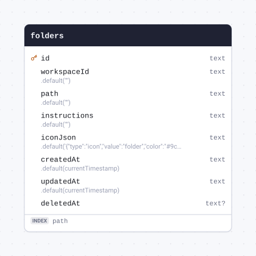

| Column                         | Type   | Constraints | Default                                                          | Description |
| ------------------------------ | ------ | ----------- | ---------------------------------------------------------------- | ----------- |
| `id`                           | `text` | PK NOT NULL |                                                                  |             |
| `workspaceId` (`workspace_id`) | `text` | NOT NULL    | `.default("")`                                                   |             |
| `path`                         | `text` | NOT NULL    | `.default("")`                                                   |             |
| `instructions`                 | `text` | NOT NULL    | `.default("")`                                                   |             |
| `iconJson` (`icon_json`)       | `text` | NOT NULL    | `.default('{"type":"icon","value":"folder","color":"#9ca3af"}')` |             |
| `createdAt` (`created_at`)     | `text` | NOT NULL    | `.default(currentTimestamp)`                                     |             |
| `updatedAt` (`updated_at`)     | `text` | NOT NULL    | `.default(currentTimestamp)`                                     |             |
| `deletedAt` (`deleted_at`)     | `text` | NULL        |                                                                  |             |

#### Definition

```sql
CREATE TABLE `folders` (
	`id` text PRIMARY KEY,
	`workspace_id` text DEFAULT '' NOT NULL,
	`path` text DEFAULT '' NOT NULL,
	`instructions` text DEFAULT '' NOT NULL,
	`icon_json` text DEFAULT '{"type":"icon","value":"folder","color":"#9ca3af"}' NOT NULL,
	`created_at` text DEFAULT (strftime('%Y-%m-%dT%H:%M:%fZ', 'now')) NOT NULL,
	`updated_at` text DEFAULT (strftime('%Y-%m-%dT%H:%M:%fZ', 'now')) NOT NULL,
	`deleted_at` text
);

CREATE INDEX `idx_folders_path` ON `folders` (`path`);
```

#### Indexes

- INDEX `path`

<details>
<summary>Queries and their SQL</summary>

**Select**: Every row of folders.

```ts
db.select().from(folders);
```

```sql
select "id", "workspace_id", "path", "instructions", "icon_json", "created_at", "updated_at", "deleted_at"
from "folders"
```

**Count**: How many rows folders has.

```ts
db.select({ count: count() }).from(folders);
```

```sql
select count(*)
from "folders"
```

**Find many**: The rows of folders, through the relational query API.

```ts
db.query.folders.findMany();
```

```sql
select "d0"."id" as "id", "d0"."workspace_id" as "workspaceId", "d0"."path" as "path", "d0"."instructions" as "instructions", "d0"."icon_json" as "iconJson", "d0"."created_at" as "createdAt", "d0"."updated_at" as "updatedAt", "d0"."deleted_at" as "deletedAt"
from "folders" as "d0"
```

**Find by primary key**: One row of folders, through the relational query API.

```ts
db.query.folders.findFirst({ where: { id: "id" } });
```

```sql
select "d0"."id" as "id", "d0"."workspace_id" as "workspaceId", "d0"."path" as "path", "d0"."instructions" as "instructions", "d0"."icon_json" as "iconJson", "d0"."created_at" as "createdAt", "d0"."updated_at" as "updatedAt", "d0"."deleted_at" as "deletedAt"
from "folders" as "d0"
where "d0"."id" = ?
limit ?
-- params: ["id",1]
```

**Insert**: Adds a row to folders, giving the columns that have no default.

```ts
db.insert(folders).values({ id: "id" });
```

```sql
insert into "folders" ("id", "workspace_id", "path", "instructions", "icon_json", "created_at", "updated_at", "deleted_at")
values (?, ?, ?, ?, ?, (strftime('%Y-%m-%dT%H:%M:%fZ', 'now')), (strftime('%Y-%m-%dT%H:%M:%fZ', 'now')), null)
-- params: ["id","","","","\"{\\\"type\\\":\\\"icon\\\",\\\"value\\\":\\\"folder\\\",\\\"color\\\":\\\"#9ca3af\\\"}\""]
```

**Update**: Changes a row of folders, found by its primary key.

```ts
db.update(folders).set({ workspaceId: "workspaceId" }).where(eq(folders.id, "id"));
```

```sql
update "folders"
set "workspace_id" = ?
where "folders"."id" = ?
-- params: ["workspaceId","id"]
```

**Delete**: Deletes a row of folders, found by its primary key.

```ts
db.delete(folders).where(eq(folders.id, "id"));
```

```sql
delete from "folders"
where "folders"."id" = ?
-- params: ["id"]
```

</details>

<a id="table-folderAttachments"></a>

### folderAttachments

Table `folder_attachments`.

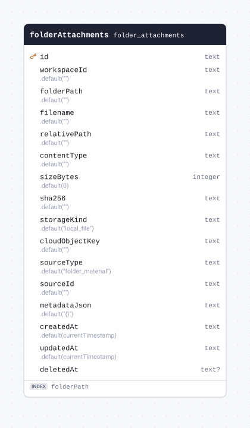

| Column                                | Type      | Constraints | Default                       | Description |
| ------------------------------------- | --------- | ----------- | ----------------------------- | ----------- |
| `id`                                  | `text`    | PK NOT NULL |                               |             |
| `workspaceId` (`workspace_id`)        | `text`    | NOT NULL    | `.default("")`                |             |
| `folderPath` (`folder_path`)          | `text`    | NOT NULL    | `.default("")`                |             |
| `filename`                            | `text`    | NOT NULL    | `.default("")`                |             |
| `relativePath` (`relative_path`)      | `text`    | NOT NULL    | `.default("")`                |             |
| `contentType` (`content_type`)        | `text`    | NOT NULL    | `.default("")`                |             |
| `sizeBytes` (`size_bytes`)            | `integer` | NOT NULL    | `.default(0)`                 |             |
| `sha256`                              | `text`    | NOT NULL    | `.default("")`                |             |
| `storageKind` (`storage_kind`)        | `text`    | NOT NULL    | `.default("local_file")`      |             |
| `cloudObjectKey` (`cloud_object_key`) | `text`    | NOT NULL    | `.default("")`                |             |
| `sourceType` (`source_type`)          | `text`    | NOT NULL    | `.default("folder_material")` |             |
| `sourceId` (`source_id`)              | `text`    | NOT NULL    | `.default("")`                |             |
| `metadataJson` (`metadata_json`)      | `text`    | NOT NULL    | `.default("{}")`              |             |
| `createdAt` (`created_at`)            | `text`    | NOT NULL    | `.default(currentTimestamp)`  |             |
| `updatedAt` (`updated_at`)            | `text`    | NOT NULL    | `.default(currentTimestamp)`  |             |
| `deletedAt` (`deleted_at`)            | `text`    | NULL        |                               |             |

#### Definition

```sql
CREATE TABLE `folder_attachments` (
	`id` text PRIMARY KEY,
	`workspace_id` text DEFAULT '' NOT NULL,
	`folder_path` text DEFAULT '' NOT NULL,
	`filename` text DEFAULT '' NOT NULL,
	`relative_path` text DEFAULT '' NOT NULL,
	`content_type` text DEFAULT '' NOT NULL,
	`size_bytes` integer DEFAULT 0 NOT NULL,
	`sha256` text DEFAULT '' NOT NULL,
	`storage_kind` text DEFAULT 'local_file' NOT NULL,
	`cloud_object_key` text DEFAULT '' NOT NULL,
	`source_type` text DEFAULT 'folder_material' NOT NULL,
	`source_id` text DEFAULT '' NOT NULL,
	`metadata_json` text DEFAULT '{}' NOT NULL,
	`created_at` text DEFAULT (strftime('%Y-%m-%dT%H:%M:%fZ', 'now')) NOT NULL,
	`updated_at` text DEFAULT (strftime('%Y-%m-%dT%H:%M:%fZ', 'now')) NOT NULL,
	`deleted_at` text
);

CREATE INDEX `idx_folder_attachments_folder_path` ON `folder_attachments` (`folder_path`);
```

#### Indexes

- INDEX `folderPath`

<details>
<summary>Queries and their SQL</summary>

**Select**: Every row of folderAttachments.

```ts
db.select().from(folderAttachments);
```

```sql
select "id", "workspace_id", "folder_path", "filename", "relative_path", "content_type", "size_bytes", "sha256", "storage_kind", "cloud_object_key", "source_type", "source_id", "metadata_json", "created_at", "updated_at", "deleted_at"
from "folder_attachments"
```

**Count**: How many rows folderAttachments has.

```ts
db.select({ count: count() }).from(folderAttachments);
```

```sql
select count(*)
from "folder_attachments"
```

**Find many**: The rows of folderAttachments, through the relational query API.

```ts
db.query.folderAttachments.findMany();
```

```sql
select "d0"."id" as "id", "d0"."workspace_id" as "workspaceId", "d0"."folder_path" as "folderPath", "d0"."filename" as "filename", "d0"."relative_path" as "relativePath", "d0"."content_type" as "contentType", "d0"."size_bytes" as "sizeBytes", "d0"."sha256" as "sha256", "d0"."storage_kind" as "storageKind", "d0"."cloud_object_key" as "cloudObjectKey", "d0"."source_type" as "sourceType", "d0"."source_id" as "sourceId", "d0"."metadata_json" as "metadataJson", "d0"."created_at" as "createdAt", "d0"."updated_at" as "updatedAt", "d0"."deleted_at" as "deletedAt"
from "folder_attachments" as "d0"
```

**Find by primary key**: One row of folderAttachments, through the relational query API.

```ts
db.query.folderAttachments.findFirst({ where: { id: "id" } });
```

```sql
select "d0"."id" as "id", "d0"."workspace_id" as "workspaceId", "d0"."folder_path" as "folderPath", "d0"."filename" as "filename", "d0"."relative_path" as "relativePath", "d0"."content_type" as "contentType", "d0"."size_bytes" as "sizeBytes", "d0"."sha256" as "sha256", "d0"."storage_kind" as "storageKind", "d0"."cloud_object_key" as "cloudObjectKey", "d0"."source_type" as "sourceType", "d0"."source_id" as "sourceId", "d0"."metadata_json" as "metadataJson", "d0"."created_at" as "createdAt", "d0"."updated_at" as "updatedAt", "d0"."deleted_at" as "deletedAt"
from "folder_attachments" as "d0"
where "d0"."id" = ?
limit ?
-- params: ["id",1]
```

**Insert**: Adds a row to folderAttachments, giving the columns that have no default.

```ts
db.insert(folderAttachments).values({ id: "id" });
```

```sql
insert into "folder_attachments" ("id", "workspace_id", "folder_path", "filename", "relative_path", "content_type", "size_bytes", "sha256", "storage_kind", "cloud_object_key", "source_type", "source_id", "metadata_json", "created_at", "updated_at", "deleted_at")
values (?, ?, ?, ?, ?, ?, ?, ?, ?, ?, ?, ?, ?, (strftime('%Y-%m-%dT%H:%M:%fZ', 'now')), (strftime('%Y-%m-%dT%H:%M:%fZ', 'now')), null)
-- params: ["id","","","","","",0,"","local_file","","folder_material","","{}"]
```

**Update**: Changes a row of folderAttachments, found by its primary key.

```ts
db.update(folderAttachments)
  .set({ workspaceId: "workspaceId" })
  .where(eq(folderAttachments.id, "id"));
```

```sql
update "folder_attachments"
set "workspace_id" = ?
where "folder_attachments"."id" = ?
-- params: ["workspaceId","id"]
```

**Delete**: Deletes a row of folderAttachments, found by its primary key.

```ts
db.delete(folderAttachments).where(eq(folderAttachments.id, "id"));
```

```sql
delete from "folder_attachments"
where "folder_attachments"."id" = ?
-- params: ["id"]
```

</details>

<a id="table-attachmentLocalState"></a>

### attachmentLocalState

Table `attachment_local_state`.

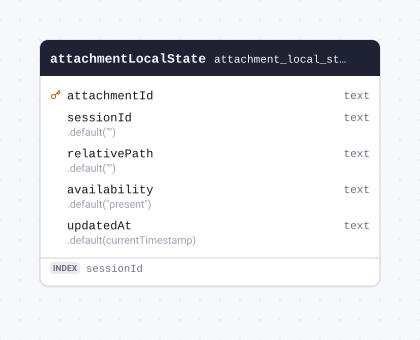

| Column                           | Type   | Constraints | Default                      | Description |
| -------------------------------- | ------ | ----------- | ---------------------------- | ----------- |
| `attachmentId` (`attachment_id`) | `text` | PK NOT NULL |                              |             |
| `sessionId` (`session_id`)       | `text` | NOT NULL    | `.default("")`               |             |
| `relativePath` (`relative_path`) | `text` | NOT NULL    | `.default("")`               |             |
| `availability`                   | `text` | NOT NULL    | `.default("present")`        |             |
| `updatedAt` (`updated_at`)       | `text` | NOT NULL    | `.default(currentTimestamp)` |             |

#### Definition

```sql
CREATE TABLE `attachment_local_state` (
	`attachment_id` text PRIMARY KEY,
	`session_id` text DEFAULT '' NOT NULL,
	`relative_path` text DEFAULT '' NOT NULL,
	`availability` text DEFAULT 'present' NOT NULL,
	`updated_at` text DEFAULT (strftime('%Y-%m-%dT%H:%M:%fZ', 'now')) NOT NULL
);

CREATE INDEX `idx_attachment_local_state_session_id` ON `attachment_local_state` (`session_id`);
```

#### Indexes

- INDEX `sessionId`

<details>
<summary>Queries and their SQL</summary>

**Select**: Every row of attachmentLocalState.

```ts
db.select().from(attachmentLocalState);
```

```sql
select "attachment_id", "session_id", "relative_path", "availability", "updated_at"
from "attachment_local_state"
```

**Count**: How many rows attachmentLocalState has.

```ts
db.select({ count: count() }).from(attachmentLocalState);
```

```sql
select count(*)
from "attachment_local_state"
```

**Find many**: The rows of attachmentLocalState, through the relational query API.

```ts
db.query.attachmentLocalState.findMany();
```

```sql
select "d0"."attachment_id" as "attachmentId", "d0"."session_id" as "sessionId", "d0"."relative_path" as "relativePath", "d0"."availability" as "availability", "d0"."updated_at" as "updatedAt"
from "attachment_local_state" as "d0"
```

**Find by primary key**: One row of attachmentLocalState, through the relational query API.

```ts
db.query.attachmentLocalState.findFirst({ where: { attachmentId: "attachmentId" } });
```

```sql
select "d0"."attachment_id" as "attachmentId", "d0"."session_id" as "sessionId", "d0"."relative_path" as "relativePath", "d0"."availability" as "availability", "d0"."updated_at" as "updatedAt"
from "attachment_local_state" as "d0"
where "d0"."attachment_id" = ?
limit ?
-- params: ["attachmentId",1]
```

**Insert**: Adds a row to attachmentLocalState, giving the columns that have no default.

```ts
db.insert(attachmentLocalState).values({ attachmentId: "attachmentId" });
```

```sql
insert into "attachment_local_state" ("attachment_id", "session_id", "relative_path", "availability", "updated_at")
values (?, ?, ?, ?, (strftime('%Y-%m-%dT%H:%M:%fZ', 'now')))
-- params: ["attachmentId","","","present"]
```

**Update**: Changes a row of attachmentLocalState, found by its primary key.

```ts
db.update(attachmentLocalState)
  .set({ sessionId: "sessionId" })
  .where(eq(attachmentLocalState.attachmentId, "attachmentId"));
```

```sql
update "attachment_local_state"
set "session_id" = ?
where "attachment_local_state"."attachment_id" = ?
-- params: ["sessionId","attachmentId"]
```

**Delete**: Deletes a row of attachmentLocalState, found by its primary key.

```ts
db.delete(attachmentLocalState).where(eq(attachmentLocalState.attachmentId, "attachmentId"));
```

```sql
delete from "attachment_local_state"
where "attachment_local_state"."attachment_id" = ?
-- params: ["attachmentId"]
```

</details>

<a id="table-attachmentTransferJobs"></a>

### attachmentTransferJobs

Table `attachment_transfer_jobs`.

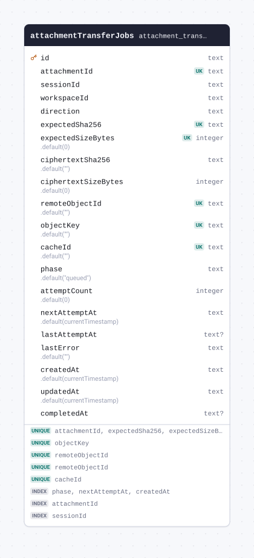

| Column                                          | Type      | Constraints | Default                      | Description |
| ----------------------------------------------- | --------- | ----------- | ---------------------------- | ----------- |
| `id`                                            | `text`    | PK NOT NULL |                              |             |
| `attachmentId` (`attachment_id`)                | `text`    | NOT NULL    |                              |             |
| `sessionId` (`session_id`)                      | `text`    | NOT NULL    |                              |             |
| `workspaceId` (`workspace_id`)                  | `text`    | NOT NULL    |                              |             |
| `direction`                                     | `text`    | NOT NULL    |                              |             |
| `expectedSha256` (`expected_sha256`)            | `text`    | NOT NULL    |                              |             |
| `expectedSizeBytes` (`expected_size_bytes`)     | `integer` | NOT NULL    | `.default(0)`                |             |
| `ciphertextSha256` (`ciphertext_sha256`)        | `text`    | NOT NULL    | `.default("")`               |             |
| `ciphertextSizeBytes` (`ciphertext_size_bytes`) | `integer` | NOT NULL    | `.default(0)`                |             |
| `remoteObjectId` (`remote_object_id`)           | `text`    | NOT NULL    | `.default("")`               |             |
| `objectKey` (`object_key`)                      | `text`    | NOT NULL    | `.default("")`               |             |
| `cacheId` (`cache_id`)                          | `text`    | NOT NULL    | `.default("")`               |             |
| `phase`                                         | `text`    | NOT NULL    | `.default("queued")`         |             |
| `attemptCount` (`attempt_count`)                | `integer` | NOT NULL    | `.default(0)`                |             |
| `nextAttemptAt` (`next_attempt_at`)             | `text`    | NOT NULL    | `.default(currentTimestamp)` |             |
| `lastAttemptAt` (`last_attempt_at`)             | `text`    | NULL        |                              |             |
| `lastError` (`last_error`)                      | `text`    | NOT NULL    | `.default("")`               |             |
| `createdAt` (`created_at`)                      | `text`    | NOT NULL    | `.default(currentTimestamp)` |             |
| `updatedAt` (`updated_at`)                      | `text`    | NOT NULL    | `.default(currentTimestamp)` |             |
| `completedAt` (`completed_at`)                  | `text`    | NULL        |                              |             |

#### Definition

```sql
CREATE TABLE `attachment_transfer_jobs` (
	`id` text PRIMARY KEY,
	`attachment_id` text NOT NULL,
	`session_id` text NOT NULL,
	`workspace_id` text NOT NULL,
	`direction` text NOT NULL,
	`expected_sha256` text NOT NULL,
	`expected_size_bytes` integer DEFAULT 0 NOT NULL,
	`ciphertext_sha256` text DEFAULT '' NOT NULL,
	`ciphertext_size_bytes` integer DEFAULT 0 NOT NULL,
	`remote_object_id` text DEFAULT '' NOT NULL,
	`object_key` text DEFAULT '' NOT NULL,
	`cache_id` text DEFAULT '' NOT NULL,
	`phase` text DEFAULT 'queued' NOT NULL,
	`attempt_count` integer DEFAULT 0 NOT NULL,
	`next_attempt_at` text DEFAULT (strftime('%Y-%m-%dT%H:%M:%fZ', 'now')) NOT NULL,
	`last_attempt_at` text,
	`last_error` text DEFAULT '' NOT NULL,
	`created_at` text DEFAULT (strftime('%Y-%m-%dT%H:%M:%fZ', 'now')) NOT NULL,
	`updated_at` text DEFAULT (strftime('%Y-%m-%dT%H:%M:%fZ', 'now')) NOT NULL,
	`completed_at` text
);

CREATE UNIQUE INDEX `idx_attachment_transfer_jobs_live_version` ON `attachment_transfer_jobs` (`attachment_id`,`expected_sha256`,`expected_size_bytes`) WHERE "attachment_transfer_jobs"."direction" IN ('upload', 'download') AND "attachment_transfer_jobs"."phase" <> 'completed';

CREATE UNIQUE INDEX `idx_attachment_transfer_jobs_delete_object` ON `attachment_transfer_jobs` (`object_key`) WHERE "attachment_transfer_jobs"."direction" = 'delete';

CREATE UNIQUE INDEX `idx_attachment_transfer_jobs_upload_object_id` ON `attachment_transfer_jobs` (`remote_object_id`) WHERE "attachment_transfer_jobs"."direction" = 'upload' AND "attachment_transfer_jobs"."remote_object_id" <> '';

CREATE UNIQUE INDEX `idx_attachment_transfer_jobs_delete_object_id` ON `attachment_transfer_jobs` (`remote_object_id`) WHERE "attachment_transfer_jobs"."direction" = 'delete' AND "attachment_transfer_jobs"."remote_object_id" <> '';

CREATE UNIQUE INDEX `idx_attachment_transfer_jobs_cache_id` ON `attachment_transfer_jobs` (`cache_id`) WHERE "attachment_transfer_jobs"."cache_id" <> '';

CREATE INDEX `idx_attachment_transfer_jobs_due` ON `attachment_transfer_jobs` (`phase`,`next_attempt_at`,`created_at`);

CREATE INDEX `idx_attachment_transfer_jobs_attachment_id` ON `attachment_transfer_jobs` (`attachment_id`);

CREATE INDEX `idx_attachment_transfer_jobs_session_id` ON `attachment_transfer_jobs` (`session_id`);
```

#### Indexes

- UNIQUE `attachmentId`, `expectedSha256`, `expectedSizeBytes`
- UNIQUE `objectKey`
- UNIQUE `remoteObjectId`
- UNIQUE `remoteObjectId`
- UNIQUE `cacheId`
- INDEX `phase`, `nextAttemptAt`, `createdAt`
- INDEX `attachmentId`
- INDEX `sessionId`

<details>
<summary>Queries and their SQL</summary>

**Select**: Every row of attachmentTransferJobs.

```ts
db.select().from(attachmentTransferJobs);
```

```sql
select "id", "attachment_id", "session_id", "workspace_id", "direction", "expected_sha256", "expected_size_bytes", "ciphertext_sha256", "ciphertext_size_bytes", "remote_object_id", "object_key", "cache_id", "phase", "attempt_count", "next_attempt_at", "last_attempt_at", "last_error", "created_at", "updated_at", "completed_at"
from "attachment_transfer_jobs"
```

**Count**: How many rows attachmentTransferJobs has.

```ts
db.select({ count: count() }).from(attachmentTransferJobs);
```

```sql
select count(*)
from "attachment_transfer_jobs"
```

**Find many**: The rows of attachmentTransferJobs, through the relational query API.

```ts
db.query.attachmentTransferJobs.findMany();
```

```sql
select "d0"."id" as "id", "d0"."attachment_id" as "attachmentId", "d0"."session_id" as "sessionId", "d0"."workspace_id" as "workspaceId", "d0"."direction" as "direction", "d0"."expected_sha256" as "expectedSha256", "d0"."expected_size_bytes" as "expectedSizeBytes", "d0"."ciphertext_sha256" as "ciphertextSha256", "d0"."ciphertext_size_bytes" as "ciphertextSizeBytes", "d0"."remote_object_id" as "remoteObjectId", "d0"."object_key" as "objectKey", "d0"."cache_id" as "cacheId", "d0"."phase" as "phase", "d0"."attempt_count" as "attemptCount", "d0"."next_attempt_at" as "nextAttemptAt", "d0"."last_attempt_at" as "lastAttemptAt", "d0"."last_error" as "lastError", "d0"."created_at" as "createdAt", "d0"."updated_at" as "updatedAt", "d0"."completed_at" as "completedAt"
from "attachment_transfer_jobs" as "d0"
```

**Find by primary key**: One row of attachmentTransferJobs, through the relational query API.

```ts
db.query.attachmentTransferJobs.findFirst({ where: { id: "id" } });
```

```sql
select "d0"."id" as "id", "d0"."attachment_id" as "attachmentId", "d0"."session_id" as "sessionId", "d0"."workspace_id" as "workspaceId", "d0"."direction" as "direction", "d0"."expected_sha256" as "expectedSha256", "d0"."expected_size_bytes" as "expectedSizeBytes", "d0"."ciphertext_sha256" as "ciphertextSha256", "d0"."ciphertext_size_bytes" as "ciphertextSizeBytes", "d0"."remote_object_id" as "remoteObjectId", "d0"."object_key" as "objectKey", "d0"."cache_id" as "cacheId", "d0"."phase" as "phase", "d0"."attempt_count" as "attemptCount", "d0"."next_attempt_at" as "nextAttemptAt", "d0"."last_attempt_at" as "lastAttemptAt", "d0"."last_error" as "lastError", "d0"."created_at" as "createdAt", "d0"."updated_at" as "updatedAt", "d0"."completed_at" as "completedAt"
from "attachment_transfer_jobs" as "d0"
where "d0"."id" = ?
limit ?
-- params: ["id",1]
```

**Insert**: Adds a row to attachmentTransferJobs, giving the columns that have no default.

```ts
db.insert(attachmentTransferJobs).values({
  id: "id",
  attachmentId: "attachmentId",
  sessionId: "sessionId",
  workspaceId: "workspaceId",
  direction: "direction",
  expectedSha256: "expectedSha256",
});
```

```sql
insert into "attachment_transfer_jobs" ("id", "attachment_id", "session_id", "workspace_id", "direction", "expected_sha256", "expected_size_bytes", "ciphertext_sha256", "ciphertext_size_bytes", "remote_object_id", "object_key", "cache_id", "phase", "attempt_count", "next_attempt_at", "last_attempt_at", "last_error", "created_at", "updated_at", "completed_at")
values (?, ?, ?, ?, ?, ?, ?, ?, ?, ?, ?, ?, ?, ?, (strftime('%Y-%m-%dT%H:%M:%fZ', 'now')), null, ?, (strftime('%Y-%m-%dT%H:%M:%fZ', 'now')), (strftime('%Y-%m-%dT%H:%M:%fZ', 'now')), null)
-- params: ["id","attachmentId","sessionId","workspaceId","direction","expectedSha256",0,"",0,"","","","queued",0,""]
```

**Update**: Changes a row of attachmentTransferJobs, found by its primary key.

```ts
db.update(attachmentTransferJobs)
  .set({ attachmentId: "attachmentId" })
  .where(eq(attachmentTransferJobs.id, "id"));
```

```sql
update "attachment_transfer_jobs"
set "attachment_id" = ?
where "attachment_transfer_jobs"."id" = ?
-- params: ["attachmentId","id"]
```

**Delete**: Deletes a row of attachmentTransferJobs, found by its primary key.

```ts
db.delete(attachmentTransferJobs).where(eq(attachmentTransferJobs.id, "id"));
```

```sql
delete from "attachment_transfer_jobs"
where "attachment_transfer_jobs"."id" = ?
-- params: ["id"]
```

</details>

<a id="table-sharedSessionAttachmentCache"></a>

### sharedSessionAttachmentCache

Table `shared_session_attachment_cache`.

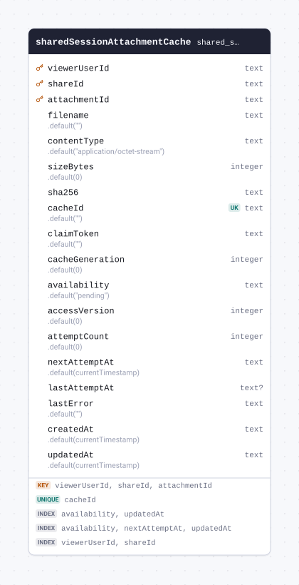

| Column                                 | Type      | Constraints | Default                                | Description |
| -------------------------------------- | --------- | ----------- | -------------------------------------- | ----------- |
| `viewerUserId` (`viewer_user_id`)      | `text`    | PK NOT NULL |                                        |             |
| `shareId` (`share_id`)                 | `text`    | PK NOT NULL |                                        |             |
| `attachmentId` (`attachment_id`)       | `text`    | PK NOT NULL |                                        |             |
| `filename`                             | `text`    | NOT NULL    | `.default("")`                         |             |
| `contentType` (`content_type`)         | `text`    | NOT NULL    | `.default("application/octet-stream")` |             |
| `sizeBytes` (`size_bytes`)             | `integer` | NOT NULL    | `.default(0)`                          |             |
| `sha256`                               | `text`    | NOT NULL    |                                        |             |
| `cacheId` (`cache_id`)                 | `text`    | NOT NULL    | `.default("")`                         |             |
| `claimToken` (`claim_token`)           | `text`    | NOT NULL    | `.default("")`                         |             |
| `cacheGeneration` (`cache_generation`) | `integer` | NOT NULL    | `.default(0)`                          |             |
| `availability`                         | `text`    | NOT NULL    | `.default("pending")`                  |             |
| `accessVersion` (`access_version`)     | `integer` | NOT NULL    | `.default(0)`                          |             |
| `attemptCount` (`attempt_count`)       | `integer` | NOT NULL    | `.default(0)`                          |             |
| `nextAttemptAt` (`next_attempt_at`)    | `text`    | NOT NULL    | `.default(currentTimestamp)`           |             |
| `lastAttemptAt` (`last_attempt_at`)    | `text`    | NULL        |                                        |             |
| `lastError` (`last_error`)             | `text`    | NOT NULL    | `.default("")`                         |             |
| `createdAt` (`created_at`)             | `text`    | NOT NULL    | `.default(currentTimestamp)`           |             |
| `updatedAt` (`updated_at`)             | `text`    | NOT NULL    | `.default(currentTimestamp)`           |             |

#### Definition

```sql
CREATE TABLE `shared_session_attachment_cache` (
	`viewer_user_id` text NOT NULL,
	`share_id` text NOT NULL,
	`attachment_id` text NOT NULL,
	`filename` text DEFAULT '' NOT NULL,
	`content_type` text DEFAULT 'application/octet-stream' NOT NULL,
	`size_bytes` integer DEFAULT 0 NOT NULL,
	`sha256` text NOT NULL,
	`cache_id` text DEFAULT '' NOT NULL,
	`claim_token` text DEFAULT '' NOT NULL,
	`cache_generation` integer DEFAULT 0 NOT NULL,
	`availability` text DEFAULT 'pending' NOT NULL,
	`access_version` integer DEFAULT 0 NOT NULL,
	`attempt_count` integer DEFAULT 0 NOT NULL,
	`next_attempt_at` text DEFAULT (strftime('%Y-%m-%dT%H:%M:%fZ', 'now')) NOT NULL,
	`last_attempt_at` text,
	`last_error` text DEFAULT '' NOT NULL,
	`created_at` text DEFAULT (strftime('%Y-%m-%dT%H:%M:%fZ', 'now')) NOT NULL,
	`updated_at` text DEFAULT (strftime('%Y-%m-%dT%H:%M:%fZ', 'now')) NOT NULL,
	CONSTRAINT `shared_session_attachment_cache_pk` PRIMARY KEY(`viewer_user_id`, `share_id`, `attachment_id`)
);

CREATE UNIQUE INDEX `idx_shared_session_attachment_cache_cache_id` ON `shared_session_attachment_cache` (`cache_id`) WHERE "shared_session_attachment_cache"."cache_id" <> '';

CREATE INDEX `idx_shared_session_attachment_cache_cleanup` ON `shared_session_attachment_cache` (`availability`,`updated_at`) WHERE "shared_session_attachment_cache"."availability" IN ('delete_pending', 'deleting', 'failed');

CREATE INDEX `idx_shared_session_attachment_cache_due` ON `shared_session_attachment_cache` (`availability`,`next_attempt_at`,`updated_at`) WHERE "shared_session_attachment_cache"."availability" IN ('pending', 'delete_pending', 'failed');

CREATE INDEX `idx_shared_session_attachment_cache_share` ON `shared_session_attachment_cache` (`viewer_user_id`,`share_id`);
```

#### Indexes

- PRIMARY KEY `viewerUserId`, `shareId`, `attachmentId`
- UNIQUE `cacheId`
- INDEX `availability`, `updatedAt`
- INDEX `availability`, `nextAttemptAt`, `updatedAt`
- INDEX `viewerUserId`, `shareId`

<details>
<summary>Queries and their SQL</summary>

**Select**: Every row of sharedSessionAttachmentCache.

```ts
db.select().from(sharedSessionAttachmentCache);
```

```sql
select "viewer_user_id", "share_id", "attachment_id", "filename", "content_type", "size_bytes", "sha256", "cache_id", "claim_token", "cache_generation", "availability", "access_version", "attempt_count", "next_attempt_at", "last_attempt_at", "last_error", "created_at", "updated_at"
from "shared_session_attachment_cache"
```

**Count**: How many rows sharedSessionAttachmentCache has.

```ts
db.select({ count: count() }).from(sharedSessionAttachmentCache);
```

```sql
select count(*)
from "shared_session_attachment_cache"
```

**Find many**: The rows of sharedSessionAttachmentCache, through the relational query API.

```ts
db.query.sharedSessionAttachmentCache.findMany();
```

```sql
select "d0"."viewer_user_id" as "viewerUserId", "d0"."share_id" as "shareId", "d0"."attachment_id" as "attachmentId", "d0"."filename" as "filename", "d0"."content_type" as "contentType", "d0"."size_bytes" as "sizeBytes", "d0"."sha256" as "sha256", "d0"."cache_id" as "cacheId", "d0"."claim_token" as "claimToken", "d0"."cache_generation" as "cacheGeneration", "d0"."availability" as "availability", "d0"."access_version" as "accessVersion", "d0"."attempt_count" as "attemptCount", "d0"."next_attempt_at" as "nextAttemptAt", "d0"."last_attempt_at" as "lastAttemptAt", "d0"."last_error" as "lastError", "d0"."created_at" as "createdAt", "d0"."updated_at" as "updatedAt"
from "shared_session_attachment_cache" as "d0"
```

**Find by primary key**: One row of sharedSessionAttachmentCache, through the relational query API.

```ts
db.query.sharedSessionAttachmentCache.findFirst({
  where: { viewerUserId: "viewerUserId", shareId: "shareId", attachmentId: "attachmentId" },
});
```

```sql
select "d0"."viewer_user_id" as "viewerUserId", "d0"."share_id" as "shareId", "d0"."attachment_id" as "attachmentId", "d0"."filename" as "filename", "d0"."content_type" as "contentType", "d0"."size_bytes" as "sizeBytes", "d0"."sha256" as "sha256", "d0"."cache_id" as "cacheId", "d0"."claim_token" as "claimToken", "d0"."cache_generation" as "cacheGeneration", "d0"."availability" as "availability", "d0"."access_version" as "accessVersion", "d0"."attempt_count" as "attemptCount", "d0"."next_attempt_at" as "nextAttemptAt", "d0"."last_attempt_at" as "lastAttemptAt", "d0"."last_error" as "lastError", "d0"."created_at" as "createdAt", "d0"."updated_at" as "updatedAt"
from "shared_session_attachment_cache" as "d0"
where (("d0"."viewer_user_id" = ?) and ("d0"."share_id" = ?) and ("d0"."attachment_id" = ?))
limit ?
-- params: ["viewerUserId","shareId","attachmentId",1]
```

**Insert**: Adds a row to sharedSessionAttachmentCache, giving the columns that have no default.

```ts
db.insert(sharedSessionAttachmentCache).values({
  viewerUserId: "viewerUserId",
  shareId: "shareId",
  attachmentId: "attachmentId",
  sha256: "sha256",
});
```

```sql
insert into "shared_session_attachment_cache" ("viewer_user_id", "share_id", "attachment_id", "filename", "content_type", "size_bytes", "sha256", "cache_id", "claim_token", "cache_generation", "availability", "access_version", "attempt_count", "next_attempt_at", "last_attempt_at", "last_error", "created_at", "updated_at")
values (?, ?, ?, ?, ?, ?, ?, ?, ?, ?, ?, ?, ?, (strftime('%Y-%m-%dT%H:%M:%fZ', 'now')), null, ?, (strftime('%Y-%m-%dT%H:%M:%fZ', 'now')), (strftime('%Y-%m-%dT%H:%M:%fZ', 'now')))
-- params: ["viewerUserId","shareId","attachmentId","","application/octet-stream",0,"sha256","","",0,"pending",0,0,""]
```

**Update**: Changes a row of sharedSessionAttachmentCache, found by its primary key.

```ts
db.update(sharedSessionAttachmentCache)
  .set({ filename: "filename" })
  .where(
    and(
      eq(sharedSessionAttachmentCache.viewerUserId, "viewerUserId"),
      eq(sharedSessionAttachmentCache.shareId, "shareId"),
      eq(sharedSessionAttachmentCache.attachmentId, "attachmentId"),
    ),
  );
```

```sql
update "shared_session_attachment_cache"
set "filename" = ?
where (("shared_session_attachment_cache"."viewer_user_id" = ?) and ("shared_session_attachment_cache"."share_id" = ?) and ("shared_session_attachment_cache"."attachment_id" = ?))
-- params: ["filename","viewerUserId","shareId","attachmentId"]
```

**Delete**: Deletes a row of sharedSessionAttachmentCache, found by its primary key.

```ts
db.delete(sharedSessionAttachmentCache).where(
  and(
    eq(sharedSessionAttachmentCache.viewerUserId, "viewerUserId"),
    eq(sharedSessionAttachmentCache.shareId, "shareId"),
    eq(sharedSessionAttachmentCache.attachmentId, "attachmentId"),
  ),
);
```

```sql
delete from "shared_session_attachment_cache"
where (("shared_session_attachment_cache"."viewer_user_id" = ?) and ("shared_session_attachment_cache"."share_id" = ?) and ("shared_session_attachment_cache"."attachment_id" = ?))
-- params: ["viewerUserId","shareId","attachmentId"]
```

</details>

<a id="table-tags"></a>

### tags


| Column                          | Type   | Constraints | Default                      | Description |
| ------------------------------- | ------ | ----------- | ---------------------------- | ----------- |
| `id`                            | `text` | PK NOT NULL |                              |             |
| `workspaceId` (`workspace_id`)  | `text` | NOT NULL    | `.default("")`               |             |
| `ownerUserId` (`owner_user_id`) | `text` | NOT NULL    | `.default("")`               |             |
| `name`                          | `text` | NOT NULL    | `.default("")`               |             |
| `createdAt` (`created_at`)      | `text` | NOT NULL    | `.default(currentTimestamp)` |             |
| `updatedAt` (`updated_at`)      | `text` | NOT NULL    | `.default(currentTimestamp)` |             |
| `deletedAt` (`deleted_at`)      | `text` | NULL        |                              |             |

#### Definition

```sql
CREATE TABLE `tags` (
	`id` text PRIMARY KEY,
	`workspace_id` text DEFAULT '' NOT NULL,
	`owner_user_id` text DEFAULT '' NOT NULL,
	`name` text DEFAULT '' NOT NULL,
	`created_at` text DEFAULT (strftime('%Y-%m-%dT%H:%M:%fZ', 'now')) NOT NULL,
	`updated_at` text DEFAULT (strftime('%Y-%m-%dT%H:%M:%fZ', 'now')) NOT NULL,
	`deleted_at` text
);

CREATE INDEX `idx_tags_name` ON `tags` (`name`);
```

#### Indexes

- INDEX `name`

<details>
<summary>Queries and their SQL</summary>

**Select**: Every row of tags.

```ts
db.select().from(tags);
```

```sql
select "id", "workspace_id", "owner_user_id", "name", "created_at", "updated_at", "deleted_at"
from "tags"
```

**Count**: How many rows tags has.

```ts
db.select({ count: count() }).from(tags);
```

```sql
select count(*)
from "tags"
```

**Find many**: The rows of tags, through the relational query API.

```ts
db.query.tags.findMany();
```

```sql
select "d0"."id" as "id", "d0"."workspace_id" as "workspaceId", "d0"."owner_user_id" as "ownerUserId", "d0"."name" as "name", "d0"."created_at" as "createdAt", "d0"."updated_at" as "updatedAt", "d0"."deleted_at" as "deletedAt"
from "tags" as "d0"
```

**Find by primary key**: One row of tags, through the relational query API.

```ts
db.query.tags.findFirst({ where: { id: "id" } });
```

```sql
select "d0"."id" as "id", "d0"."workspace_id" as "workspaceId", "d0"."owner_user_id" as "ownerUserId", "d0"."name" as "name", "d0"."created_at" as "createdAt", "d0"."updated_at" as "updatedAt", "d0"."deleted_at" as "deletedAt"
from "tags" as "d0"
where "d0"."id" = ?
limit ?
-- params: ["id",1]
```

**Insert**: Adds a row to tags, giving the columns that have no default.

```ts
db.insert(tags).values({ id: "id" });
```

```sql
insert into "tags" ("id", "workspace_id", "owner_user_id", "name", "created_at", "updated_at", "deleted_at")
values (?, ?, ?, ?, (strftime('%Y-%m-%dT%H:%M:%fZ', 'now')), (strftime('%Y-%m-%dT%H:%M:%fZ', 'now')), null)
-- params: ["id","","",""]
```

**Update**: Changes a row of tags, found by its primary key.

```ts
db.update(tags).set({ workspaceId: "workspaceId" }).where(eq(tags.id, "id"));
```

```sql
update "tags"
set "workspace_id" = ?
where "tags"."id" = ?
-- params: ["workspaceId","id"]
```

**Delete**: Deletes a row of tags, found by its primary key.

```ts
db.delete(tags).where(eq(tags.id, "id"));
```

```sql
delete from "tags"
where "tags"."id" = ?
-- params: ["id"]
```

</details>

<a id="table-sessionTags"></a>

### sessionTags

Table `session_tags`.

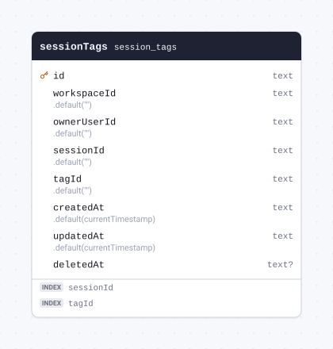

| Column                          | Type   | Constraints | Default                      | Description |
| ------------------------------- | ------ | ----------- | ---------------------------- | ----------- |
| `id`                            | `text` | PK NOT NULL |                              |             |
| `workspaceId` (`workspace_id`)  | `text` | NOT NULL    | `.default("")`               |             |
| `ownerUserId` (`owner_user_id`) | `text` | NOT NULL    | `.default("")`               |             |
| `sessionId` (`session_id`)      | `text` | NOT NULL    | `.default("")`               |             |
| `tagId` (`tag_id`)              | `text` | NOT NULL    | `.default("")`               |             |
| `createdAt` (`created_at`)      | `text` | NOT NULL    | `.default(currentTimestamp)` |             |
| `updatedAt` (`updated_at`)      | `text` | NOT NULL    | `.default(currentTimestamp)` |             |
| `deletedAt` (`deleted_at`)      | `text` | NULL        |                              |             |

#### Definition

```sql
CREATE TABLE `session_tags` (
	`id` text PRIMARY KEY,
	`workspace_id` text DEFAULT '' NOT NULL,
	`owner_user_id` text DEFAULT '' NOT NULL,
	`session_id` text DEFAULT '' NOT NULL,
	`tag_id` text DEFAULT '' NOT NULL,
	`created_at` text DEFAULT (strftime('%Y-%m-%dT%H:%M:%fZ', 'now')) NOT NULL,
	`updated_at` text DEFAULT (strftime('%Y-%m-%dT%H:%M:%fZ', 'now')) NOT NULL,
	`deleted_at` text
);

CREATE INDEX `idx_session_tags_session_id` ON `session_tags` (`session_id`);

CREATE INDEX `idx_session_tags_tag_id` ON `session_tags` (`tag_id`);
```

#### Indexes

- INDEX `sessionId`
- INDEX `tagId`

<details>
<summary>Queries and their SQL</summary>

**Select**: Every row of sessionTags.

```ts
db.select().from(sessionTags);
```

```sql
select "id", "workspace_id", "owner_user_id", "session_id", "tag_id", "created_at", "updated_at", "deleted_at"
from "session_tags"
```

**Count**: How many rows sessionTags has.

```ts
db.select({ count: count() }).from(sessionTags);
```

```sql
select count(*)
from "session_tags"
```

**Find many**: The rows of sessionTags, through the relational query API.

```ts
db.query.sessionTags.findMany();
```

```sql
select "d0"."id" as "id", "d0"."workspace_id" as "workspaceId", "d0"."owner_user_id" as "ownerUserId", "d0"."session_id" as "sessionId", "d0"."tag_id" as "tagId", "d0"."created_at" as "createdAt", "d0"."updated_at" as "updatedAt", "d0"."deleted_at" as "deletedAt"
from "session_tags" as "d0"
```

**Find by primary key**: One row of sessionTags, through the relational query API.

```ts
db.query.sessionTags.findFirst({ where: { id: "id" } });
```

```sql
select "d0"."id" as "id", "d0"."workspace_id" as "workspaceId", "d0"."owner_user_id" as "ownerUserId", "d0"."session_id" as "sessionId", "d0"."tag_id" as "tagId", "d0"."created_at" as "createdAt", "d0"."updated_at" as "updatedAt", "d0"."deleted_at" as "deletedAt"
from "session_tags" as "d0"
where "d0"."id" = ?
limit ?
-- params: ["id",1]
```

**Insert**: Adds a row to sessionTags, giving the columns that have no default.

```ts
db.insert(sessionTags).values({ id: "id" });
```

```sql
insert into "session_tags" ("id", "workspace_id", "owner_user_id", "session_id", "tag_id", "created_at", "updated_at", "deleted_at")
values (?, ?, ?, ?, ?, (strftime('%Y-%m-%dT%H:%M:%fZ', 'now')), (strftime('%Y-%m-%dT%H:%M:%fZ', 'now')), null)
-- params: ["id","","","",""]
```

**Update**: Changes a row of sessionTags, found by its primary key.

```ts
db.update(sessionTags).set({ workspaceId: "workspaceId" }).where(eq(sessionTags.id, "id"));
```

```sql
update "session_tags"
set "workspace_id" = ?
where "session_tags"."id" = ?
-- params: ["workspaceId","id"]
```

**Delete**: Deletes a row of sessionTags, found by its primary key.

```ts
db.delete(sessionTags).where(eq(sessionTags.id, "id"));
```

```sql
delete from "session_tags"
where "session_tags"."id" = ?
-- params: ["id"]
```

</details>

<a id="table-entityMentions"></a>

### entityMentions

Table `entity_mentions`.

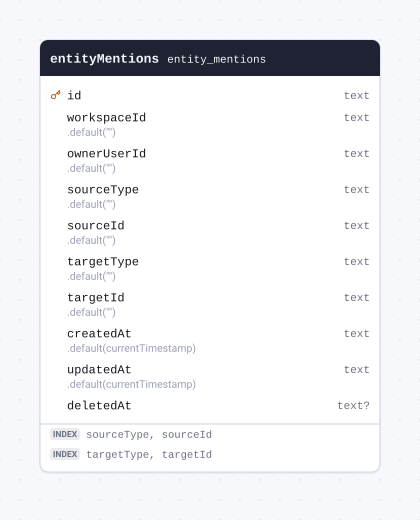

| Column                          | Type   | Constraints | Default                      | Description |
| ------------------------------- | ------ | ----------- | ---------------------------- | ----------- |
| `id`                            | `text` | PK NOT NULL |                              |             |
| `workspaceId` (`workspace_id`)  | `text` | NOT NULL    | `.default("")`               |             |
| `ownerUserId` (`owner_user_id`) | `text` | NOT NULL    | `.default("")`               |             |
| `sourceType` (`source_type`)    | `text` | NOT NULL    | `.default("")`               |             |
| `sourceId` (`source_id`)        | `text` | NOT NULL    | `.default("")`               |             |
| `targetType` (`target_type`)    | `text` | NOT NULL    | `.default("")`               |             |
| `targetId` (`target_id`)        | `text` | NOT NULL    | `.default("")`               |             |
| `createdAt` (`created_at`)      | `text` | NOT NULL    | `.default(currentTimestamp)` |             |
| `updatedAt` (`updated_at`)      | `text` | NOT NULL    | `.default(currentTimestamp)` |             |
| `deletedAt` (`deleted_at`)      | `text` | NULL        |                              |             |

#### Definition

```sql
CREATE TABLE `entity_mentions` (
	`id` text PRIMARY KEY,
	`workspace_id` text DEFAULT '' NOT NULL,
	`owner_user_id` text DEFAULT '' NOT NULL,
	`source_type` text DEFAULT '' NOT NULL,
	`source_id` text DEFAULT '' NOT NULL,
	`target_type` text DEFAULT '' NOT NULL,
	`target_id` text DEFAULT '' NOT NULL,
	`created_at` text DEFAULT (strftime('%Y-%m-%dT%H:%M:%fZ', 'now')) NOT NULL,
	`updated_at` text DEFAULT (strftime('%Y-%m-%dT%H:%M:%fZ', 'now')) NOT NULL,
	`deleted_at` text
);

CREATE INDEX `idx_entity_mentions_source` ON `entity_mentions` (`source_type`,`source_id`);

CREATE INDEX `idx_entity_mentions_target` ON `entity_mentions` (`target_type`,`target_id`);
```

#### Indexes

- INDEX `sourceType`, `sourceId`
- INDEX `targetType`, `targetId`

<details>
<summary>Queries and their SQL</summary>

**Select**: Every row of entityMentions.

```ts
db.select().from(entityMentions);
```

```sql
select "id", "workspace_id", "owner_user_id", "source_type", "source_id", "target_type", "target_id", "created_at", "updated_at", "deleted_at"
from "entity_mentions"
```

**Count**: How many rows entityMentions has.

```ts
db.select({ count: count() }).from(entityMentions);
```

```sql
select count(*)
from "entity_mentions"
```

**Find many**: The rows of entityMentions, through the relational query API.

```ts
db.query.entityMentions.findMany();
```

```sql
select "d0"."id" as "id", "d0"."workspace_id" as "workspaceId", "d0"."owner_user_id" as "ownerUserId", "d0"."source_type" as "sourceType", "d0"."source_id" as "sourceId", "d0"."target_type" as "targetType", "d0"."target_id" as "targetId", "d0"."created_at" as "createdAt", "d0"."updated_at" as "updatedAt", "d0"."deleted_at" as "deletedAt"
from "entity_mentions" as "d0"
```

**Find by primary key**: One row of entityMentions, through the relational query API.

```ts
db.query.entityMentions.findFirst({ where: { id: "id" } });
```

```sql
select "d0"."id" as "id", "d0"."workspace_id" as "workspaceId", "d0"."owner_user_id" as "ownerUserId", "d0"."source_type" as "sourceType", "d0"."source_id" as "sourceId", "d0"."target_type" as "targetType", "d0"."target_id" as "targetId", "d0"."created_at" as "createdAt", "d0"."updated_at" as "updatedAt", "d0"."deleted_at" as "deletedAt"
from "entity_mentions" as "d0"
where "d0"."id" = ?
limit ?
-- params: ["id",1]
```

**Insert**: Adds a row to entityMentions, giving the columns that have no default.

```ts
db.insert(entityMentions).values({ id: "id" });
```

```sql
insert into "entity_mentions" ("id", "workspace_id", "owner_user_id", "source_type", "source_id", "target_type", "target_id", "created_at", "updated_at", "deleted_at")
values (?, ?, ?, ?, ?, ?, ?, (strftime('%Y-%m-%dT%H:%M:%fZ', 'now')), (strftime('%Y-%m-%dT%H:%M:%fZ', 'now')), null)
-- params: ["id","","","","","",""]
```

**Update**: Changes a row of entityMentions, found by its primary key.

```ts
db.update(entityMentions).set({ workspaceId: "workspaceId" }).where(eq(entityMentions.id, "id"));
```

```sql
update "entity_mentions"
set "workspace_id" = ?
where "entity_mentions"."id" = ?
-- params: ["workspaceId","id"]
```

**Delete**: Deletes a row of entityMentions, found by its primary key.

```ts
db.delete(entityMentions).where(eq(entityMentions.id, "id"));
```

```sql
delete from "entity_mentions"
where "entity_mentions"."id" = ?
-- params: ["id"]
```

</details>

<a id="table-chatGroups"></a>

### chatGroups

Table `chat_groups`.

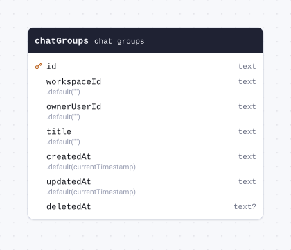

| Column                          | Type   | Constraints | Default                      | Description |
| ------------------------------- | ------ | ----------- | ---------------------------- | ----------- |
| `id`                            | `text` | PK NOT NULL |                              |             |
| `workspaceId` (`workspace_id`)  | `text` | NOT NULL    | `.default("")`               |             |
| `ownerUserId` (`owner_user_id`) | `text` | NOT NULL    | `.default("")`               |             |
| `title`                         | `text` | NOT NULL    | `.default("")`               |             |
| `createdAt` (`created_at`)      | `text` | NOT NULL    | `.default(currentTimestamp)` |             |
| `updatedAt` (`updated_at`)      | `text` | NOT NULL    | `.default(currentTimestamp)` |             |
| `deletedAt` (`deleted_at`)      | `text` | NULL        |                              |             |

#### Definition

```sql
CREATE TABLE `chat_groups` (
	`id` text PRIMARY KEY,
	`workspace_id` text DEFAULT '' NOT NULL,
	`owner_user_id` text DEFAULT '' NOT NULL,
	`title` text DEFAULT '' NOT NULL,
	`created_at` text DEFAULT (strftime('%Y-%m-%dT%H:%M:%fZ', 'now')) NOT NULL,
	`updated_at` text DEFAULT (strftime('%Y-%m-%dT%H:%M:%fZ', 'now')) NOT NULL,
	`deleted_at` text
);
```

<details>
<summary>Queries and their SQL</summary>

**Select**: Every row of chatGroups.

```ts
db.select().from(chatGroups);
```

```sql
select "id", "workspace_id", "owner_user_id", "title", "created_at", "updated_at", "deleted_at"
from "chat_groups"
```

**Count**: How many rows chatGroups has.

```ts
db.select({ count: count() }).from(chatGroups);
```

```sql
select count(*)
from "chat_groups"
```

**Find many**: The rows of chatGroups, through the relational query API.

```ts
db.query.chatGroups.findMany();
```

```sql
select "d0"."id" as "id", "d0"."workspace_id" as "workspaceId", "d0"."owner_user_id" as "ownerUserId", "d0"."title" as "title", "d0"."created_at" as "createdAt", "d0"."updated_at" as "updatedAt", "d0"."deleted_at" as "deletedAt"
from "chat_groups" as "d0"
```

**Find by primary key**: One row of chatGroups, through the relational query API.

```ts
db.query.chatGroups.findFirst({ where: { id: "id" } });
```

```sql
select "d0"."id" as "id", "d0"."workspace_id" as "workspaceId", "d0"."owner_user_id" as "ownerUserId", "d0"."title" as "title", "d0"."created_at" as "createdAt", "d0"."updated_at" as "updatedAt", "d0"."deleted_at" as "deletedAt"
from "chat_groups" as "d0"
where "d0"."id" = ?
limit ?
-- params: ["id",1]
```

**Insert**: Adds a row to chatGroups, giving the columns that have no default.

```ts
db.insert(chatGroups).values({ id: "id" });
```

```sql
insert into "chat_groups" ("id", "workspace_id", "owner_user_id", "title", "created_at", "updated_at", "deleted_at")
values (?, ?, ?, ?, (strftime('%Y-%m-%dT%H:%M:%fZ', 'now')), (strftime('%Y-%m-%dT%H:%M:%fZ', 'now')), null)
-- params: ["id","","",""]
```

**Update**: Changes a row of chatGroups, found by its primary key.

```ts
db.update(chatGroups).set({ workspaceId: "workspaceId" }).where(eq(chatGroups.id, "id"));
```

```sql
update "chat_groups"
set "workspace_id" = ?
where "chat_groups"."id" = ?
-- params: ["workspaceId","id"]
```

**Delete**: Deletes a row of chatGroups, found by its primary key.

```ts
db.delete(chatGroups).where(eq(chatGroups.id, "id"));
```

```sql
delete from "chat_groups"
where "chat_groups"."id" = ?
-- params: ["id"]
```

</details>

<a id="table-chatMessages"></a>

### chatMessages

Table `chat_messages`.

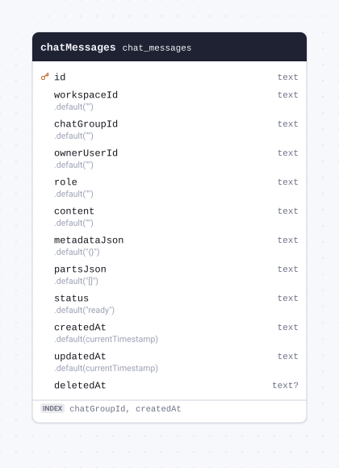

| Column                           | Type   | Constraints | Default                      | Description |
| -------------------------------- | ------ | ----------- | ---------------------------- | ----------- |
| `id`                             | `text` | PK NOT NULL |                              |             |
| `workspaceId` (`workspace_id`)   | `text` | NOT NULL    | `.default("")`               |             |
| `chatGroupId` (`chat_group_id`)  | `text` | NOT NULL    | `.default("")`               |             |
| `ownerUserId` (`owner_user_id`)  | `text` | NOT NULL    | `.default("")`               |             |
| `role`                           | `text` | NOT NULL    | `.default("")`               |             |
| `content`                        | `text` | NOT NULL    | `.default("")`               |             |
| `metadataJson` (`metadata_json`) | `text` | NOT NULL    | `.default("{}")`             |             |
| `partsJson` (`parts_json`)       | `text` | NOT NULL    | `.default("[]")`             |             |
| `status`                         | `text` | NOT NULL    | `.default("ready")`          |             |
| `createdAt` (`created_at`)       | `text` | NOT NULL    | `.default(currentTimestamp)` |             |
| `updatedAt` (`updated_at`)       | `text` | NOT NULL    | `.default(currentTimestamp)` |             |
| `deletedAt` (`deleted_at`)       | `text` | NULL        |                              |             |

#### Definition

```sql
CREATE TABLE `chat_messages` (
	`id` text PRIMARY KEY,
	`workspace_id` text DEFAULT '' NOT NULL,
	`chat_group_id` text DEFAULT '' NOT NULL,
	`owner_user_id` text DEFAULT '' NOT NULL,
	`role` text DEFAULT '' NOT NULL,
	`content` text DEFAULT '' NOT NULL,
	`metadata_json` text DEFAULT '{}' NOT NULL,
	`parts_json` text DEFAULT '[]' NOT NULL,
	`status` text DEFAULT 'ready' NOT NULL,
	`created_at` text DEFAULT (strftime('%Y-%m-%dT%H:%M:%fZ', 'now')) NOT NULL,
	`updated_at` text DEFAULT (strftime('%Y-%m-%dT%H:%M:%fZ', 'now')) NOT NULL,
	`deleted_at` text
);

CREATE INDEX `idx_chat_messages_group_id` ON `chat_messages` (`chat_group_id`,`created_at`);
```

#### Indexes

- INDEX `chatGroupId`, `createdAt`

<details>
<summary>Queries and their SQL</summary>

**Select**: Every row of chatMessages.

```ts
db.select().from(chatMessages);
```

```sql
select "id", "workspace_id", "chat_group_id", "owner_user_id", "role", "content", "metadata_json", "parts_json", "status", "created_at", "updated_at", "deleted_at"
from "chat_messages"
```

**Count**: How many rows chatMessages has.

```ts
db.select({ count: count() }).from(chatMessages);
```

```sql
select count(*)
from "chat_messages"
```

**Find many**: The rows of chatMessages, through the relational query API.

```ts
db.query.chatMessages.findMany();
```

```sql
select "d0"."id" as "id", "d0"."workspace_id" as "workspaceId", "d0"."chat_group_id" as "chatGroupId", "d0"."owner_user_id" as "ownerUserId", "d0"."role" as "role", "d0"."content" as "content", "d0"."metadata_json" as "metadataJson", "d0"."parts_json" as "partsJson", "d0"."status" as "status", "d0"."created_at" as "createdAt", "d0"."updated_at" as "updatedAt", "d0"."deleted_at" as "deletedAt"
from "chat_messages" as "d0"
```

**Find by primary key**: One row of chatMessages, through the relational query API.

```ts
db.query.chatMessages.findFirst({ where: { id: "id" } });
```

```sql
select "d0"."id" as "id", "d0"."workspace_id" as "workspaceId", "d0"."chat_group_id" as "chatGroupId", "d0"."owner_user_id" as "ownerUserId", "d0"."role" as "role", "d0"."content" as "content", "d0"."metadata_json" as "metadataJson", "d0"."parts_json" as "partsJson", "d0"."status" as "status", "d0"."created_at" as "createdAt", "d0"."updated_at" as "updatedAt", "d0"."deleted_at" as "deletedAt"
from "chat_messages" as "d0"
where "d0"."id" = ?
limit ?
-- params: ["id",1]
```

**Insert**: Adds a row to chatMessages, giving the columns that have no default.

```ts
db.insert(chatMessages).values({ id: "id" });
```

```sql
insert into "chat_messages" ("id", "workspace_id", "chat_group_id", "owner_user_id", "role", "content", "metadata_json", "parts_json", "status", "created_at", "updated_at", "deleted_at")
values (?, ?, ?, ?, ?, ?, ?, ?, ?, (strftime('%Y-%m-%dT%H:%M:%fZ', 'now')), (strftime('%Y-%m-%dT%H:%M:%fZ', 'now')), null)
-- params: ["id","","","","","","{}","[]","ready"]
```

**Update**: Changes a row of chatMessages, found by its primary key.

```ts
db.update(chatMessages).set({ workspaceId: "workspaceId" }).where(eq(chatMessages.id, "id"));
```

```sql
update "chat_messages"
set "workspace_id" = ?
where "chat_messages"."id" = ?
-- params: ["workspaceId","id"]
```

**Delete**: Deletes a row of chatMessages, found by its primary key.

```ts
db.delete(chatMessages).where(eq(chatMessages.id, "id"));
```

```sql
delete from "chat_messages"
where "chat_messages"."id" = ?
-- params: ["id"]
```

</details>

<a id="table-dailyNotes"></a>

### dailyNotes

Table `daily_notes`.

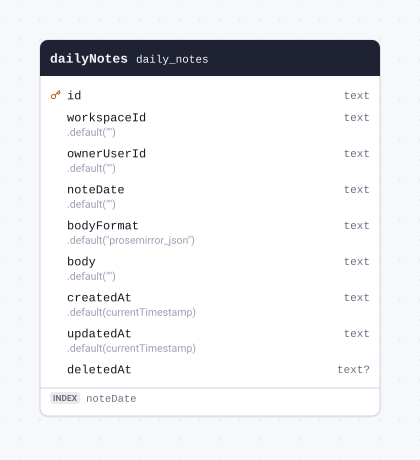

| Column                          | Type   | Constraints | Default                        | Description |
| ------------------------------- | ------ | ----------- | ------------------------------ | ----------- |
| `id`                            | `text` | PK NOT NULL |                                |             |
| `workspaceId` (`workspace_id`)  | `text` | NOT NULL    | `.default("")`                 |             |
| `ownerUserId` (`owner_user_id`) | `text` | NOT NULL    | `.default("")`                 |             |
| `noteDate` (`note_date`)        | `text` | NOT NULL    | `.default("")`                 |             |
| `bodyFormat` (`body_format`)    | `text` | NOT NULL    | `.default("prosemirror_json")` |             |
| `body`                          | `text` | NOT NULL    | `.default("")`                 |             |
| `createdAt` (`created_at`)      | `text` | NOT NULL    | `.default(currentTimestamp)`   |             |
| `updatedAt` (`updated_at`)      | `text` | NOT NULL    | `.default(currentTimestamp)`   |             |
| `deletedAt` (`deleted_at`)      | `text` | NULL        |                                |             |

#### Definition

```sql
CREATE TABLE `daily_notes` (
	`id` text PRIMARY KEY,
	`workspace_id` text DEFAULT '' NOT NULL,
	`owner_user_id` text DEFAULT '' NOT NULL,
	`note_date` text DEFAULT '' NOT NULL,
	`body_format` text DEFAULT 'prosemirror_json' NOT NULL,
	`body` text DEFAULT '' NOT NULL,
	`created_at` text DEFAULT (strftime('%Y-%m-%dT%H:%M:%fZ', 'now')) NOT NULL,
	`updated_at` text DEFAULT (strftime('%Y-%m-%dT%H:%M:%fZ', 'now')) NOT NULL,
	`deleted_at` text
);

CREATE INDEX `idx_daily_notes_note_date` ON `daily_notes` (`note_date`);
```

#### Indexes

- INDEX `noteDate`

<details>
<summary>Queries and their SQL</summary>

**Select**: Every row of dailyNotes.

```ts
db.select().from(dailyNotes);
```

```sql
select "id", "workspace_id", "owner_user_id", "note_date", "body_format", "body", "created_at", "updated_at", "deleted_at"
from "daily_notes"
```

**Count**: How many rows dailyNotes has.

```ts
db.select({ count: count() }).from(dailyNotes);
```

```sql
select count(*)
from "daily_notes"
```

**Find many**: The rows of dailyNotes, through the relational query API.

```ts
db.query.dailyNotes.findMany();
```

```sql
select "d0"."id" as "id", "d0"."workspace_id" as "workspaceId", "d0"."owner_user_id" as "ownerUserId", "d0"."note_date" as "noteDate", "d0"."body_format" as "bodyFormat", "d0"."body" as "body", "d0"."created_at" as "createdAt", "d0"."updated_at" as "updatedAt", "d0"."deleted_at" as "deletedAt"
from "daily_notes" as "d0"
```

**Find by primary key**: One row of dailyNotes, through the relational query API.

```ts
db.query.dailyNotes.findFirst({ where: { id: "id" } });
```

```sql
select "d0"."id" as "id", "d0"."workspace_id" as "workspaceId", "d0"."owner_user_id" as "ownerUserId", "d0"."note_date" as "noteDate", "d0"."body_format" as "bodyFormat", "d0"."body" as "body", "d0"."created_at" as "createdAt", "d0"."updated_at" as "updatedAt", "d0"."deleted_at" as "deletedAt"
from "daily_notes" as "d0"
where "d0"."id" = ?
limit ?
-- params: ["id",1]
```

**Insert**: Adds a row to dailyNotes, giving the columns that have no default.

```ts
db.insert(dailyNotes).values({ id: "id" });
```

```sql
insert into "daily_notes" ("id", "workspace_id", "owner_user_id", "note_date", "body_format", "body", "created_at", "updated_at", "deleted_at")
values (?, ?, ?, ?, ?, ?, (strftime('%Y-%m-%dT%H:%M:%fZ', 'now')), (strftime('%Y-%m-%dT%H:%M:%fZ', 'now')), null)
-- params: ["id","","","","prosemirror_json",""]
```

**Update**: Changes a row of dailyNotes, found by its primary key.

```ts
db.update(dailyNotes).set({ workspaceId: "workspaceId" }).where(eq(dailyNotes.id, "id"));
```

```sql
update "daily_notes"
set "workspace_id" = ?
where "daily_notes"."id" = ?
-- params: ["workspaceId","id"]
```

**Delete**: Deletes a row of dailyNotes, found by its primary key.

```ts
db.delete(dailyNotes).where(eq(dailyNotes.id, "id"));
```

```sql
delete from "daily_notes"
where "daily_notes"."id" = ?
-- params: ["id"]
```

</details>

<a id="table-appSettings"></a>

### appSettings

Table `app_settings`.

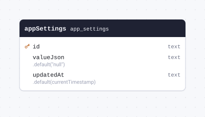

| Column                     | Type   | Constraints | Default                      | Description |
| -------------------------- | ------ | ----------- | ---------------------------- | ----------- |
| `id`                       | `text` | PK NOT NULL |                              |             |
| `valueJson` (`value_json`) | `text` | NOT NULL    | `.default("null")`           |             |
| `updatedAt` (`updated_at`) | `text` | NOT NULL    | `.default(currentTimestamp)` |             |

#### Definition

```sql
CREATE TABLE `app_settings` (
	`id` text PRIMARY KEY,
	`value_json` text DEFAULT 'null' NOT NULL,
	`updated_at` text DEFAULT (strftime('%Y-%m-%dT%H:%M:%fZ', 'now')) NOT NULL
);
```

<details>
<summary>Queries and their SQL</summary>

**Select**: Every row of appSettings.

```ts
db.select().from(appSettings);
```

```sql
select "id", "value_json", "updated_at"
from "app_settings"
```

**Count**: How many rows appSettings has.

```ts
db.select({ count: count() }).from(appSettings);
```

```sql
select count(*)
from "app_settings"
```

**Find many**: The rows of appSettings, through the relational query API.

```ts
db.query.appSettings.findMany();
```

```sql
select "d0"."id" as "id", "d0"."value_json" as "valueJson", "d0"."updated_at" as "updatedAt"
from "app_settings" as "d0"
```

**Find by primary key**: One row of appSettings, through the relational query API.

```ts
db.query.appSettings.findFirst({ where: { id: "id" } });
```

```sql
select "d0"."id" as "id", "d0"."value_json" as "valueJson", "d0"."updated_at" as "updatedAt"
from "app_settings" as "d0"
where "d0"."id" = ?
limit ?
-- params: ["id",1]
```

**Insert**: Adds a row to appSettings, giving the columns that have no default.

```ts
db.insert(appSettings).values({ id: "id" });
```

```sql
insert into "app_settings" ("id", "value_json", "updated_at")
values (?, ?, (strftime('%Y-%m-%dT%H:%M:%fZ', 'now')))
-- params: ["id","null"]
```

**Update**: Changes a row of appSettings, found by its primary key.

```ts
db.update(appSettings).set({ valueJson: "valueJson" }).where(eq(appSettings.id, "id"));
```

```sql
update "app_settings"
set "value_json" = ?
where "app_settings"."id" = ?
-- params: ["valueJson","id"]
```

**Delete**: Deletes a row of appSettings, found by its primary key.

```ts
db.delete(appSettings).where(eq(appSettings.id, "id"));
```

```sql
delete from "app_settings"
where "app_settings"."id" = ?
-- params: ["id"]
```

</details>

<a id="table-syncedPreferences"></a>

### syncedPreferences

Table `synced_preferences`.

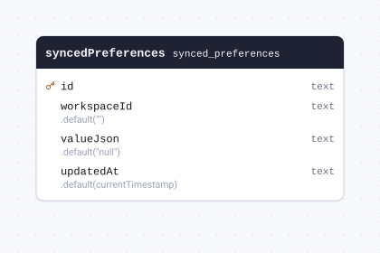

| Column                         | Type   | Constraints | Default                      | Description |
| ------------------------------ | ------ | ----------- | ---------------------------- | ----------- |
| `id`                           | `text` | PK NOT NULL |                              |             |
| `workspaceId` (`workspace_id`) | `text` | NOT NULL    | `.default("")`               |             |
| `valueJson` (`value_json`)     | `text` | NOT NULL    | `.default("null")`           |             |
| `updatedAt` (`updated_at`)     | `text` | NOT NULL    | `.default(currentTimestamp)` |             |

#### Definition

```sql
CREATE TABLE `synced_preferences` (
	`id` text PRIMARY KEY,
	`workspace_id` text DEFAULT '' NOT NULL,
	`value_json` text DEFAULT 'null' NOT NULL,
	`updated_at` text DEFAULT (strftime('%Y-%m-%dT%H:%M:%fZ', 'now')) NOT NULL
);
```

<details>
<summary>Queries and their SQL</summary>

**Select**: Every row of syncedPreferences.

```ts
db.select().from(syncedPreferences);
```

```sql
select "id", "workspace_id", "value_json", "updated_at"
from "synced_preferences"
```

**Count**: How many rows syncedPreferences has.

```ts
db.select({ count: count() }).from(syncedPreferences);
```

```sql
select count(*)
from "synced_preferences"
```

**Find many**: The rows of syncedPreferences, through the relational query API.

```ts
db.query.syncedPreferences.findMany();
```

```sql
select "d0"."id" as "id", "d0"."workspace_id" as "workspaceId", "d0"."value_json" as "valueJson", "d0"."updated_at" as "updatedAt"
from "synced_preferences" as "d0"
```

**Find by primary key**: One row of syncedPreferences, through the relational query API.

```ts
db.query.syncedPreferences.findFirst({ where: { id: "id" } });
```

```sql
select "d0"."id" as "id", "d0"."workspace_id" as "workspaceId", "d0"."value_json" as "valueJson", "d0"."updated_at" as "updatedAt"
from "synced_preferences" as "d0"
where "d0"."id" = ?
limit ?
-- params: ["id",1]
```

**Insert**: Adds a row to syncedPreferences, giving the columns that have no default.

```ts
db.insert(syncedPreferences).values({ id: "id" });
```

```sql
insert into "synced_preferences" ("id", "workspace_id", "value_json", "updated_at")
values (?, ?, ?, (strftime('%Y-%m-%dT%H:%M:%fZ', 'now')))
-- params: ["id","","null"]
```

**Update**: Changes a row of syncedPreferences, found by its primary key.

```ts
db.update(syncedPreferences)
  .set({ workspaceId: "workspaceId" })
  .where(eq(syncedPreferences.id, "id"));
```

```sql
update "synced_preferences"
set "workspace_id" = ?
where "synced_preferences"."id" = ?
-- params: ["workspaceId","id"]
```

**Delete**: Deletes a row of syncedPreferences, found by its primary key.

```ts
db.delete(syncedPreferences).where(eq(syncedPreferences.id, "id"));
```

```sql
delete from "synced_preferences"
where "synced_preferences"."id" = ?
-- params: ["id"]
```

</details>

<a id="table-migrationImportRuns"></a>

### migrationImportRuns

Table `migration_import_runs`.

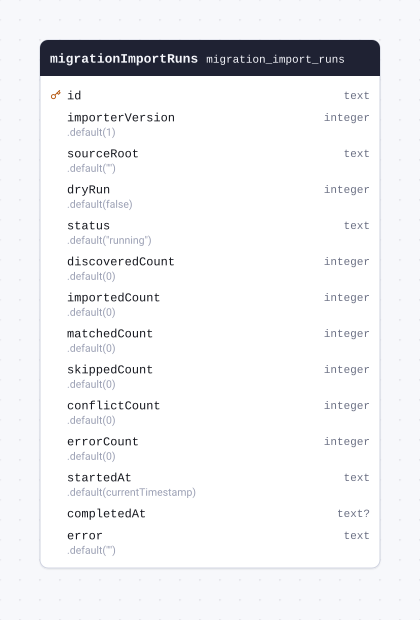

| Column                                 | Type      | Constraints | Default                      | Description |
| -------------------------------------- | --------- | ----------- | ---------------------------- | ----------- |
| `id`                                   | `text`    | PK NOT NULL |                              |             |
| `importerVersion` (`importer_version`) | `integer` | NOT NULL    | `.default(1)`                |             |
| `sourceRoot` (`source_root`)           | `text`    | NOT NULL    | `.default("")`               |             |
| `dryRun` (`dry_run`)                   | `integer` | NOT NULL    | `.default(false)`            |             |
| `status`                               | `text`    | NOT NULL    | `.default("running")`        |             |
| `discoveredCount` (`discovered_count`) | `integer` | NOT NULL    | `.default(0)`                |             |
| `importedCount` (`imported_count`)     | `integer` | NOT NULL    | `.default(0)`                |             |
| `matchedCount` (`matched_count`)       | `integer` | NOT NULL    | `.default(0)`                |             |
| `skippedCount` (`skipped_count`)       | `integer` | NOT NULL    | `.default(0)`                |             |
| `conflictCount` (`conflict_count`)     | `integer` | NOT NULL    | `.default(0)`                |             |
| `errorCount` (`error_count`)           | `integer` | NOT NULL    | `.default(0)`                |             |
| `startedAt` (`started_at`)             | `text`    | NOT NULL    | `.default(currentTimestamp)` |             |
| `completedAt` (`completed_at`)         | `text`    | NULL        |                              |             |
| `error`                                | `text`    | NOT NULL    | `.default("")`               |             |

#### Definition

```sql
CREATE TABLE `migration_import_runs` (
	`id` text PRIMARY KEY,
	`importer_version` integer DEFAULT 1 NOT NULL,
	`source_root` text DEFAULT '' NOT NULL,
	`dry_run` integer DEFAULT false NOT NULL,
	`status` text DEFAULT 'running' NOT NULL,
	`discovered_count` integer DEFAULT 0 NOT NULL,
	`imported_count` integer DEFAULT 0 NOT NULL,
	`matched_count` integer DEFAULT 0 NOT NULL,
	`skipped_count` integer DEFAULT 0 NOT NULL,
	`conflict_count` integer DEFAULT 0 NOT NULL,
	`error_count` integer DEFAULT 0 NOT NULL,
	`started_at` text DEFAULT (strftime('%Y-%m-%dT%H:%M:%fZ', 'now')) NOT NULL,
	`completed_at` text,
	`error` text DEFAULT '' NOT NULL
);
```

<details>
<summary>Queries and their SQL</summary>

**Select**: Every row of migrationImportRuns.

```ts
db.select().from(migrationImportRuns);
```

```sql
select "id", "importer_version", "source_root", "dry_run", "status", "discovered_count", "imported_count", "matched_count", "skipped_count", "conflict_count", "error_count", "started_at", "completed_at", "error"
from "migration_import_runs"
```

**Count**: How many rows migrationImportRuns has.

```ts
db.select({ count: count() }).from(migrationImportRuns);
```

```sql
select count(*)
from "migration_import_runs"
```

**Find many**: The rows of migrationImportRuns, through the relational query API.

```ts
db.query.migrationImportRuns.findMany();
```

```sql
select "d0"."id" as "id", "d0"."importer_version" as "importerVersion", "d0"."source_root" as "sourceRoot", "d0"."dry_run" as "dryRun", "d0"."status" as "status", "d0"."discovered_count" as "discoveredCount", "d0"."imported_count" as "importedCount", "d0"."matched_count" as "matchedCount", "d0"."skipped_count" as "skippedCount", "d0"."conflict_count" as "conflictCount", "d0"."error_count" as "errorCount", "d0"."started_at" as "startedAt", "d0"."completed_at" as "completedAt", "d0"."error" as "error"
from "migration_import_runs" as "d0"
```

**Find by primary key**: One row of migrationImportRuns, through the relational query API.

```ts
db.query.migrationImportRuns.findFirst({ where: { id: "id" } });
```

```sql
select "d0"."id" as "id", "d0"."importer_version" as "importerVersion", "d0"."source_root" as "sourceRoot", "d0"."dry_run" as "dryRun", "d0"."status" as "status", "d0"."discovered_count" as "discoveredCount", "d0"."imported_count" as "importedCount", "d0"."matched_count" as "matchedCount", "d0"."skipped_count" as "skippedCount", "d0"."conflict_count" as "conflictCount", "d0"."error_count" as "errorCount", "d0"."started_at" as "startedAt", "d0"."completed_at" as "completedAt", "d0"."error" as "error"
from "migration_import_runs" as "d0"
where "d0"."id" = ?
limit ?
-- params: ["id",1]
```

**Insert**: Adds a row to migrationImportRuns, giving the columns that have no default.

```ts
db.insert(migrationImportRuns).values({ id: "id" });
```

```sql
insert into "migration_import_runs" ("id", "importer_version", "source_root", "dry_run", "status", "discovered_count", "imported_count", "matched_count", "skipped_count", "conflict_count", "error_count", "started_at", "completed_at", "error")
values (?, ?, ?, ?, ?, ?, ?, ?, ?, ?, ?, (strftime('%Y-%m-%dT%H:%M:%fZ', 'now')), null, ?)
-- params: ["id",1,"",0,"running",0,0,0,0,0,0,""]
```

**Update**: Changes a row of migrationImportRuns, found by its primary key.

```ts
db.update(migrationImportRuns).set({ importerVersion: 1 }).where(eq(migrationImportRuns.id, "id"));
```

```sql
update "migration_import_runs"
set "importer_version" = ?
where "migration_import_runs"."id" = ?
-- params: [1,"id"]
```

**Delete**: Deletes a row of migrationImportRuns, found by its primary key.

```ts
db.delete(migrationImportRuns).where(eq(migrationImportRuns.id, "id"));
```

```sql
delete from "migration_import_runs"
where "migration_import_runs"."id" = ?
-- params: ["id"]
```

</details>

<a id="table-migrationImportItems"></a>

### migrationImportItems

Table `migration_import_items`.

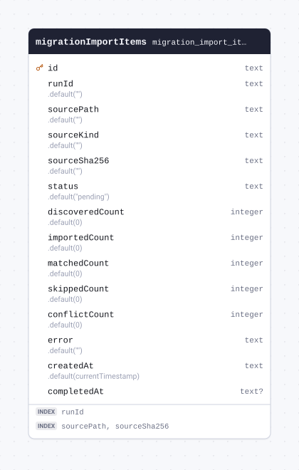

| Column                                 | Type      | Constraints | Default                      | Description |
| -------------------------------------- | --------- | ----------- | ---------------------------- | ----------- |
| `id`                                   | `text`    | PK NOT NULL |                              |             |
| `runId` (`run_id`)                     | `text`    | NOT NULL    | `.default("")`               |             |
| `sourcePath` (`source_path`)           | `text`    | NOT NULL    | `.default("")`               |             |
| `sourceKind` (`source_kind`)           | `text`    | NOT NULL    | `.default("")`               |             |
| `sourceSha256` (`source_sha256`)       | `text`    | NOT NULL    | `.default("")`               |             |
| `status`                               | `text`    | NOT NULL    | `.default("pending")`        |             |
| `discoveredCount` (`discovered_count`) | `integer` | NOT NULL    | `.default(0)`                |             |
| `importedCount` (`imported_count`)     | `integer` | NOT NULL    | `.default(0)`                |             |
| `matchedCount` (`matched_count`)       | `integer` | NOT NULL    | `.default(0)`                |             |
| `skippedCount` (`skipped_count`)       | `integer` | NOT NULL    | `.default(0)`                |             |
| `conflictCount` (`conflict_count`)     | `integer` | NOT NULL    | `.default(0)`                |             |
| `error`                                | `text`    | NOT NULL    | `.default("")`               |             |
| `createdAt` (`created_at`)             | `text`    | NOT NULL    | `.default(currentTimestamp)` |             |
| `completedAt` (`completed_at`)         | `text`    | NULL        |                              |             |

#### Definition

```sql
CREATE TABLE `migration_import_items` (
	`id` text PRIMARY KEY,
	`run_id` text DEFAULT '' NOT NULL,
	`source_path` text DEFAULT '' NOT NULL,
	`source_kind` text DEFAULT '' NOT NULL,
	`source_sha256` text DEFAULT '' NOT NULL,
	`status` text DEFAULT 'pending' NOT NULL,
	`discovered_count` integer DEFAULT 0 NOT NULL,
	`imported_count` integer DEFAULT 0 NOT NULL,
	`matched_count` integer DEFAULT 0 NOT NULL,
	`skipped_count` integer DEFAULT 0 NOT NULL,
	`conflict_count` integer DEFAULT 0 NOT NULL,
	`error` text DEFAULT '' NOT NULL,
	`created_at` text DEFAULT (strftime('%Y-%m-%dT%H:%M:%fZ', 'now')) NOT NULL,
	`completed_at` text
);

CREATE INDEX `idx_migration_import_items_run_id` ON `migration_import_items` (`run_id`);

CREATE INDEX `idx_migration_import_items_source` ON `migration_import_items` (`source_path`,`source_sha256`);
```

#### Indexes

- INDEX `runId`
- INDEX `sourcePath`, `sourceSha256`

<details>
<summary>Queries and their SQL</summary>

**Select**: Every row of migrationImportItems.

```ts
db.select().from(migrationImportItems);
```

```sql
select "id", "run_id", "source_path", "source_kind", "source_sha256", "status", "discovered_count", "imported_count", "matched_count", "skipped_count", "conflict_count", "error", "created_at", "completed_at"
from "migration_import_items"
```

**Count**: How many rows migrationImportItems has.

```ts
db.select({ count: count() }).from(migrationImportItems);
```

```sql
select count(*)
from "migration_import_items"
```

**Find many**: The rows of migrationImportItems, through the relational query API.

```ts
db.query.migrationImportItems.findMany();
```

```sql
select "d0"."id" as "id", "d0"."run_id" as "runId", "d0"."source_path" as "sourcePath", "d0"."source_kind" as "sourceKind", "d0"."source_sha256" as "sourceSha256", "d0"."status" as "status", "d0"."discovered_count" as "discoveredCount", "d0"."imported_count" as "importedCount", "d0"."matched_count" as "matchedCount", "d0"."skipped_count" as "skippedCount", "d0"."conflict_count" as "conflictCount", "d0"."error" as "error", "d0"."created_at" as "createdAt", "d0"."completed_at" as "completedAt"
from "migration_import_items" as "d0"
```

**Find by primary key**: One row of migrationImportItems, through the relational query API.

```ts
db.query.migrationImportItems.findFirst({ where: { id: "id" } });
```

```sql
select "d0"."id" as "id", "d0"."run_id" as "runId", "d0"."source_path" as "sourcePath", "d0"."source_kind" as "sourceKind", "d0"."source_sha256" as "sourceSha256", "d0"."status" as "status", "d0"."discovered_count" as "discoveredCount", "d0"."imported_count" as "importedCount", "d0"."matched_count" as "matchedCount", "d0"."skipped_count" as "skippedCount", "d0"."conflict_count" as "conflictCount", "d0"."error" as "error", "d0"."created_at" as "createdAt", "d0"."completed_at" as "completedAt"
from "migration_import_items" as "d0"
where "d0"."id" = ?
limit ?
-- params: ["id",1]
```

**Insert**: Adds a row to migrationImportItems, giving the columns that have no default.

```ts
db.insert(migrationImportItems).values({ id: "id" });
```

```sql
insert into "migration_import_items" ("id", "run_id", "source_path", "source_kind", "source_sha256", "status", "discovered_count", "imported_count", "matched_count", "skipped_count", "conflict_count", "error", "created_at", "completed_at")
values (?, ?, ?, ?, ?, ?, ?, ?, ?, ?, ?, ?, (strftime('%Y-%m-%dT%H:%M:%fZ', 'now')), null)
-- params: ["id","","","","","pending",0,0,0,0,0,""]
```

**Update**: Changes a row of migrationImportItems, found by its primary key.

```ts
db.update(migrationImportItems).set({ runId: "runId" }).where(eq(migrationImportItems.id, "id"));
```

```sql
update "migration_import_items"
set "run_id" = ?
where "migration_import_items"."id" = ?
-- params: ["runId","id"]
```

**Delete**: Deletes a row of migrationImportItems, found by its primary key.

```ts
db.delete(migrationImportItems).where(eq(migrationImportItems.id, "id"));
```

```sql
delete from "migration_import_items"
where "migration_import_items"."id" = ?
-- params: ["id"]
```

</details>

<a id="table-migrationImportTargets"></a>

### migrationImportTargets

Table `migration_import_targets`.

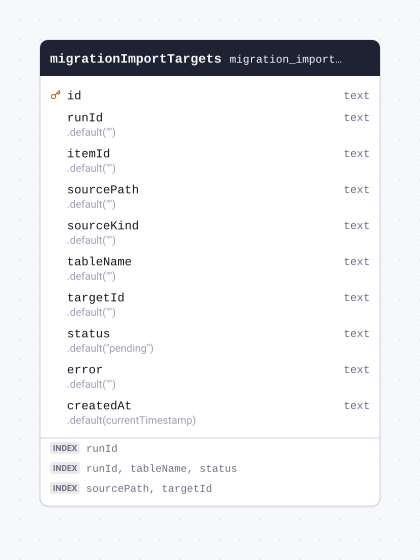

| Column                       | Type   | Constraints | Default                      | Description |
| ---------------------------- | ------ | ----------- | ---------------------------- | ----------- |
| `id`                         | `text` | PK NOT NULL |                              |             |
| `runId` (`run_id`)           | `text` | NOT NULL    | `.default("")`               |             |
| `itemId` (`item_id`)         | `text` | NOT NULL    | `.default("")`               |             |
| `sourcePath` (`source_path`) | `text` | NOT NULL    | `.default("")`               |             |
| `sourceKind` (`source_kind`) | `text` | NOT NULL    | `.default("")`               |             |
| `tableName` (`table_name`)   | `text` | NOT NULL    | `.default("")`               |             |
| `targetId` (`target_id`)     | `text` | NOT NULL    | `.default("")`               |             |
| `status`                     | `text` | NOT NULL    | `.default("pending")`        |             |
| `error`                      | `text` | NOT NULL    | `.default("")`               |             |
| `createdAt` (`created_at`)   | `text` | NOT NULL    | `.default(currentTimestamp)` |             |

#### Definition

```sql
CREATE TABLE `migration_import_targets` (
	`id` text PRIMARY KEY,
	`run_id` text DEFAULT '' NOT NULL,
	`item_id` text DEFAULT '' NOT NULL,
	`source_path` text DEFAULT '' NOT NULL,
	`source_kind` text DEFAULT '' NOT NULL,
	`table_name` text DEFAULT '' NOT NULL,
	`target_id` text DEFAULT '' NOT NULL,
	`status` text DEFAULT 'pending' NOT NULL,
	`error` text DEFAULT '' NOT NULL,
	`created_at` text DEFAULT (strftime('%Y-%m-%dT%H:%M:%fZ', 'now')) NOT NULL
);

CREATE INDEX `idx_migration_import_targets_run_id` ON `migration_import_targets` (`run_id`);

CREATE INDEX `idx_migration_import_targets_table` ON `migration_import_targets` (`run_id`,`table_name`,`status`);

CREATE INDEX `idx_migration_import_targets_source` ON `migration_import_targets` (`source_path`,`target_id`);
```

#### Indexes

- INDEX `runId`
- INDEX `runId`, `tableName`, `status`
- INDEX `sourcePath`, `targetId`

<details>
<summary>Queries and their SQL</summary>

**Select**: Every row of migrationImportTargets.

```ts
db.select().from(migrationImportTargets);
```

```sql
select "id", "run_id", "item_id", "source_path", "source_kind", "table_name", "target_id", "status", "error", "created_at"
from "migration_import_targets"
```

**Count**: How many rows migrationImportTargets has.

```ts
db.select({ count: count() }).from(migrationImportTargets);
```

```sql
select count(*)
from "migration_import_targets"
```

**Find many**: The rows of migrationImportTargets, through the relational query API.

```ts
db.query.migrationImportTargets.findMany();
```

```sql
select "d0"."id" as "id", "d0"."run_id" as "runId", "d0"."item_id" as "itemId", "d0"."source_path" as "sourcePath", "d0"."source_kind" as "sourceKind", "d0"."table_name" as "tableName", "d0"."target_id" as "targetId", "d0"."status" as "status", "d0"."error" as "error", "d0"."created_at" as "createdAt"
from "migration_import_targets" as "d0"
```

**Find by primary key**: One row of migrationImportTargets, through the relational query API.

```ts
db.query.migrationImportTargets.findFirst({ where: { id: "id" } });
```

```sql
select "d0"."id" as "id", "d0"."run_id" as "runId", "d0"."item_id" as "itemId", "d0"."source_path" as "sourcePath", "d0"."source_kind" as "sourceKind", "d0"."table_name" as "tableName", "d0"."target_id" as "targetId", "d0"."status" as "status", "d0"."error" as "error", "d0"."created_at" as "createdAt"
from "migration_import_targets" as "d0"
where "d0"."id" = ?
limit ?
-- params: ["id",1]
```

**Insert**: Adds a row to migrationImportTargets, giving the columns that have no default.

```ts
db.insert(migrationImportTargets).values({ id: "id" });
```

```sql
insert into "migration_import_targets" ("id", "run_id", "item_id", "source_path", "source_kind", "table_name", "target_id", "status", "error", "created_at")
values (?, ?, ?, ?, ?, ?, ?, ?, ?, (strftime('%Y-%m-%dT%H:%M:%fZ', 'now')))
-- params: ["id","","","","","","","pending",""]
```

**Update**: Changes a row of migrationImportTargets, found by its primary key.

```ts
db.update(migrationImportTargets)
  .set({ runId: "runId" })
  .where(eq(migrationImportTargets.id, "id"));
```

```sql
update "migration_import_targets"
set "run_id" = ?
where "migration_import_targets"."id" = ?
-- params: ["runId","id"]
```

**Delete**: Deletes a row of migrationImportTargets, found by its primary key.

```ts
db.delete(migrationImportTargets).where(eq(migrationImportTargets.id, "id"));
```

```sql
delete from "migration_import_targets"
where "migration_import_targets"."id" = ?
-- params: ["id"]
```

</details>

<a id="table-storageMigrationState"></a>

### storageMigrationState

Table `storage_migration_state`.

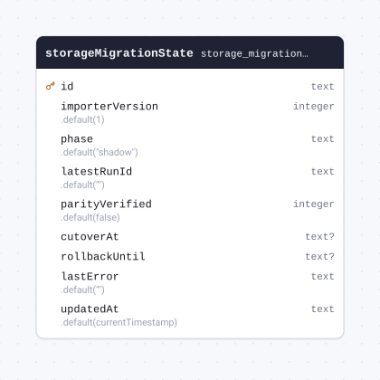

| Column                                 | Type      | Constraints | Default                      | Description |
| -------------------------------------- | --------- | ----------- | ---------------------------- | ----------- |
| `id`                                   | `text`    | PK NOT NULL |                              |             |
| `importerVersion` (`importer_version`) | `integer` | NOT NULL    | `.default(1)`                |             |
| `phase`                                | `text`    | NOT NULL    | `.default("shadow")`         |             |
| `latestRunId` (`latest_run_id`)        | `text`    | NOT NULL    | `.default("")`               |             |
| `parityVerified` (`parity_verified`)   | `integer` | NOT NULL    | `.default(false)`            |             |
| `cutoverAt` (`cutover_at`)             | `text`    | NULL        |                              |             |
| `rollbackUntil` (`rollback_until`)     | `text`    | NULL        |                              |             |
| `lastError` (`last_error`)             | `text`    | NOT NULL    | `.default("")`               |             |
| `updatedAt` (`updated_at`)             | `text`    | NOT NULL    | `.default(currentTimestamp)` |             |

#### Definition

```sql
CREATE TABLE `storage_migration_state` (
	`id` text PRIMARY KEY,
	`importer_version` integer DEFAULT 1 NOT NULL,
	`phase` text DEFAULT 'shadow' NOT NULL,
	`latest_run_id` text DEFAULT '' NOT NULL,
	`parity_verified` integer DEFAULT false NOT NULL,
	`cutover_at` text,
	`rollback_until` text,
	`last_error` text DEFAULT '' NOT NULL,
	`updated_at` text DEFAULT (strftime('%Y-%m-%dT%H:%M:%fZ', 'now')) NOT NULL
);
```

<details>
<summary>Queries and their SQL</summary>

**Select**: Every row of storageMigrationState.

```ts
db.select().from(storageMigrationState);
```

```sql
select "id", "importer_version", "phase", "latest_run_id", "parity_verified", "cutover_at", "rollback_until", "last_error", "updated_at"
from "storage_migration_state"
```

**Count**: How many rows storageMigrationState has.

```ts
db.select({ count: count() }).from(storageMigrationState);
```

```sql
select count(*)
from "storage_migration_state"
```

**Find many**: The rows of storageMigrationState, through the relational query API.

```ts
db.query.storageMigrationState.findMany();
```

```sql
select "d0"."id" as "id", "d0"."importer_version" as "importerVersion", "d0"."phase" as "phase", "d0"."latest_run_id" as "latestRunId", "d0"."parity_verified" as "parityVerified", "d0"."cutover_at" as "cutoverAt", "d0"."rollback_until" as "rollbackUntil", "d0"."last_error" as "lastError", "d0"."updated_at" as "updatedAt"
from "storage_migration_state" as "d0"
```

**Find by primary key**: One row of storageMigrationState, through the relational query API.

```ts
db.query.storageMigrationState.findFirst({ where: { id: "id" } });
```

```sql
select "d0"."id" as "id", "d0"."importer_version" as "importerVersion", "d0"."phase" as "phase", "d0"."latest_run_id" as "latestRunId", "d0"."parity_verified" as "parityVerified", "d0"."cutover_at" as "cutoverAt", "d0"."rollback_until" as "rollbackUntil", "d0"."last_error" as "lastError", "d0"."updated_at" as "updatedAt"
from "storage_migration_state" as "d0"
where "d0"."id" = ?
limit ?
-- params: ["id",1]
```

**Insert**: Adds a row to storageMigrationState, giving the columns that have no default.

```ts
db.insert(storageMigrationState).values({ id: "id" });
```

```sql
insert into "storage_migration_state" ("id", "importer_version", "phase", "latest_run_id", "parity_verified", "cutover_at", "rollback_until", "last_error", "updated_at")
values (?, ?, ?, ?, ?, null, null, ?, (strftime('%Y-%m-%dT%H:%M:%fZ', 'now')))
-- params: ["id",1,"shadow","",0,""]
```

**Update**: Changes a row of storageMigrationState, found by its primary key.

```ts
db.update(storageMigrationState)
  .set({ importerVersion: 1 })
  .where(eq(storageMigrationState.id, "id"));
```

```sql
update "storage_migration_state"
set "importer_version" = ?
where "storage_migration_state"."id" = ?
-- params: [1,"id"]
```

**Delete**: Deletes a row of storageMigrationState, found by its primary key.

```ts
db.delete(storageMigrationState).where(eq(storageMigrationState.id, "id"));
```

```sql
delete from "storage_migration_state"
where "storage_migration_state"."id" = ?
-- params: ["id"]
```

</details>
