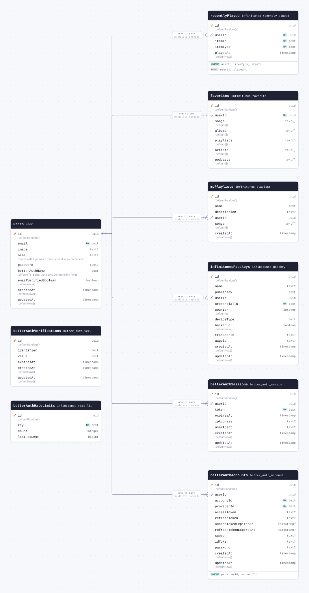
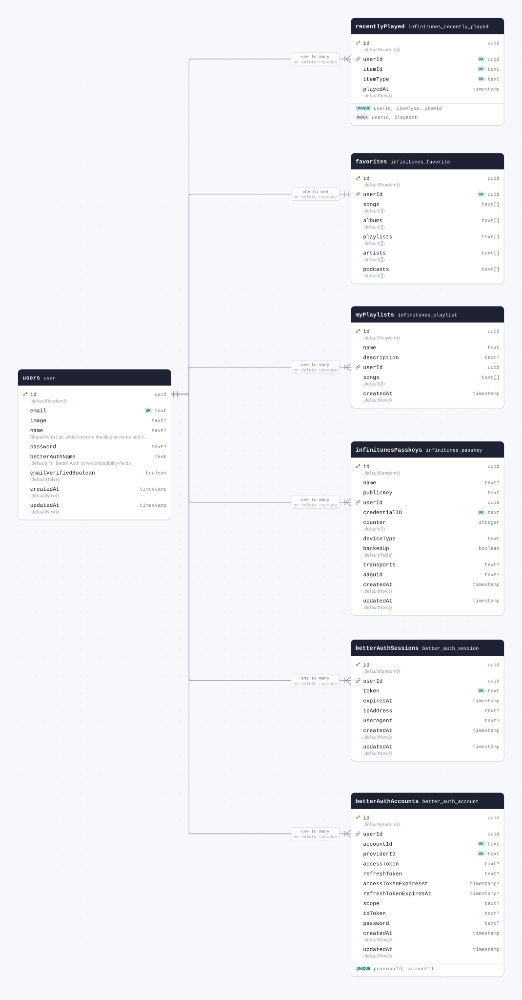
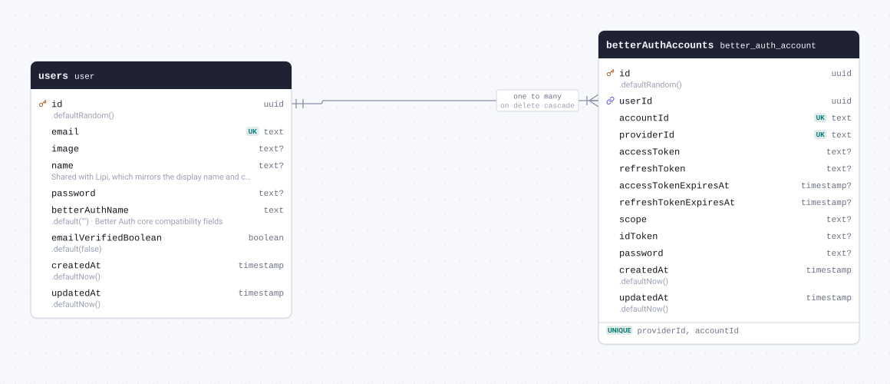
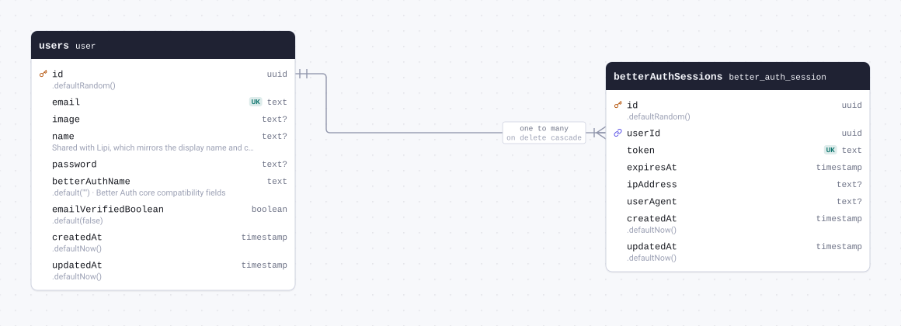
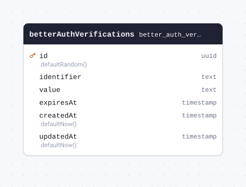
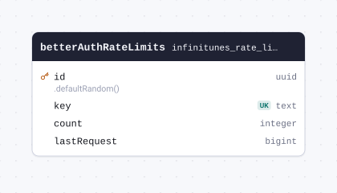
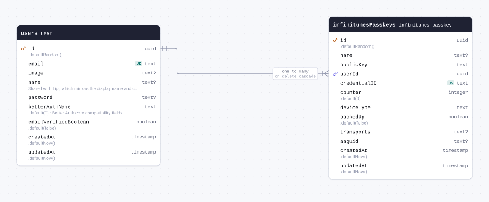
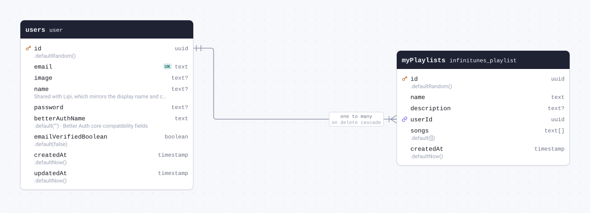
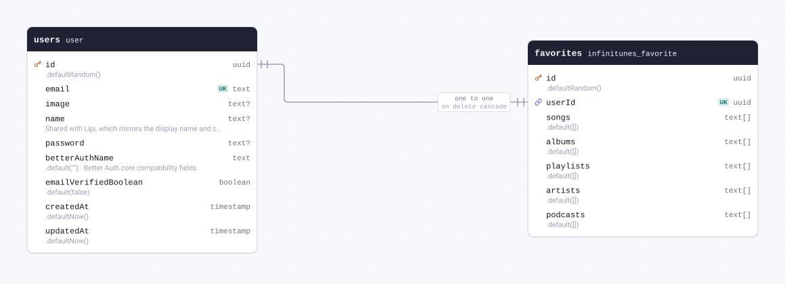
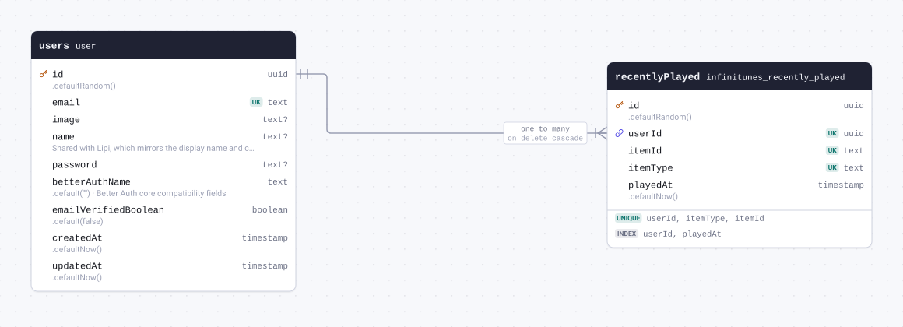

# Schema docs



<details>
<summary>The whole schema as SQL</summary>

```sql
CREATE TABLE "better_auth_account" (
	"id" uuid PRIMARY KEY DEFAULT gen_random_uuid(),
	"userId" uuid NOT NULL,
	"accountId" text NOT NULL,
	"providerId" text NOT NULL,
	"accessToken" text,
	"refreshToken" text,
	"accessTokenExpiresAt" timestamp,
	"refreshTokenExpiresAt" timestamp,
	"scope" text,
	"idToken" text,
	"password" text,
	"createdAt" timestamp DEFAULT now() NOT NULL,
	"updatedAt" timestamp DEFAULT now() NOT NULL
);

CREATE TABLE "infinitunes_rate_limit" (
	"id" uuid PRIMARY KEY DEFAULT gen_random_uuid(),
	"key" text NOT NULL UNIQUE,
	"count" integer NOT NULL,
	"lastRequest" bigint NOT NULL
);

CREATE TABLE "better_auth_session" (
	"id" uuid PRIMARY KEY DEFAULT gen_random_uuid(),
	"userId" uuid NOT NULL,
	"token" text NOT NULL UNIQUE,
	"expiresAt" timestamp NOT NULL,
	"ipAddress" text,
	"userAgent" text,
	"createdAt" timestamp DEFAULT now() NOT NULL,
	"updatedAt" timestamp DEFAULT now() NOT NULL
);

CREATE TABLE "better_auth_verification" (
	"id" uuid PRIMARY KEY DEFAULT gen_random_uuid(),
	"identifier" text NOT NULL,
	"value" text NOT NULL,
	"expiresAt" timestamp NOT NULL,
	"createdAt" timestamp DEFAULT now() NOT NULL,
	"updatedAt" timestamp DEFAULT now() NOT NULL
);

CREATE TABLE "infinitunes_favorite" (
	"id" uuid PRIMARY KEY DEFAULT gen_random_uuid(),
	"userId" uuid NOT NULL UNIQUE,
	"songs" text[] DEFAULT '{}'::text[] NOT NULL,
	"albums" text[] DEFAULT '{}'::text[] NOT NULL,
	"playlists" text[] DEFAULT '{}'::text[] NOT NULL,
	"artists" text[] DEFAULT '{}'::text[] NOT NULL,
	"podcasts" text[] DEFAULT '{}'::text[] NOT NULL
);

CREATE TABLE "infinitunes_passkey" (
	"id" uuid PRIMARY KEY DEFAULT gen_random_uuid(),
	"name" text,
	"publicKey" text NOT NULL,
	"userId" uuid NOT NULL,
	"credentialID" text NOT NULL UNIQUE,
	"counter" integer DEFAULT 0 NOT NULL,
	"deviceType" text NOT NULL,
	"backedUp" boolean DEFAULT false NOT NULL,
	"transports" text,
	"aaguid" text,
	"createdAt" timestamp DEFAULT now() NOT NULL,
	"updatedAt" timestamp DEFAULT now() NOT NULL
);

CREATE TABLE "infinitunes_playlist" (
	"id" uuid PRIMARY KEY DEFAULT gen_random_uuid(),
	"name" text NOT NULL,
	"description" text,
	"userId" uuid NOT NULL,
	"songs" text[] DEFAULT '{}'::text[] NOT NULL,
	"createdAt" timestamp DEFAULT now() NOT NULL
);

CREATE TABLE "infinitunes_recently_played" (
	"id" uuid PRIMARY KEY DEFAULT gen_random_uuid(),
	"userId" uuid NOT NULL,
	"itemId" text NOT NULL,
	"itemType" text NOT NULL,
	"playedAt" timestamp DEFAULT now() NOT NULL
);

CREATE TABLE "user" (
	"id" uuid PRIMARY KEY DEFAULT gen_random_uuid(),
	"email" text NOT NULL UNIQUE,
	"image" text,
	"name" text,
	"password" text,
	"betterAuthName" text DEFAULT '' NOT NULL,
	"emailVerifiedBoolean" boolean DEFAULT false NOT NULL,
	"createdAt" timestamp DEFAULT now() NOT NULL,
	"updatedAt" timestamp DEFAULT now() NOT NULL
);

CREATE UNIQUE INDEX "better_auth_account_provider_account_unique" ON "better_auth_account" ("providerId","accountId");

CREATE UNIQUE INDEX "infinitunes_recently_played_user_item_unique" ON "infinitunes_recently_played" ("userId","itemType","itemId");

CREATE INDEX "infinitunes_recently_played_user_played_at_idx" ON "infinitunes_recently_played" ("userId","playedAt" DESC NULLS LAST);

ALTER TABLE "better_auth_account" ADD CONSTRAINT "better_auth_account_userId_user_id_fkey" FOREIGN KEY ("userId") REFERENCES "user"("id") ON DELETE CASCADE;

ALTER TABLE "better_auth_session" ADD CONSTRAINT "better_auth_session_userId_user_id_fkey" FOREIGN KEY ("userId") REFERENCES "user"("id") ON DELETE CASCADE;

ALTER TABLE "infinitunes_favorite" ADD CONSTRAINT "infinitunes_favorite_userId_user_id_fkey" FOREIGN KEY ("userId") REFERENCES "user"("id") ON DELETE CASCADE;

ALTER TABLE "infinitunes_passkey" ADD CONSTRAINT "infinitunes_passkey_userId_user_id_fkey" FOREIGN KEY ("userId") REFERENCES "user"("id") ON DELETE CASCADE;

ALTER TABLE "infinitunes_playlist" ADD CONSTRAINT "infinitunes_playlist_userId_user_id_fkey" FOREIGN KEY ("userId") REFERENCES "user"("id") ON DELETE CASCADE;

ALTER TABLE "infinitunes_recently_played" ADD CONSTRAINT "infinitunes_recently_played_userId_user_id_fkey" FOREIGN KEY ("userId") REFERENCES "user"("id") ON DELETE CASCADE;
```

</details>

## Contents

| Table                                                     | Name in the database          | Description                                                   |
| --------------------------------------------------------- | ----------------------------- | ------------------------------------------------------------- |
| [users](#table-users)                                     | `user`                        |                                                               |
| [betterAuthAccounts](#table-betterAuthAccounts)           | `better_auth_account`         |                                                               |
| [betterAuthSessions](#table-betterAuthSessions)           | `better_auth_session`         |                                                               |
| [betterAuthVerifications](#table-betterAuthVerifications) | `better_auth_verification`    |                                                               |
| [betterAuthRateLimits](#table-betterAuthRateLimits)       | `infinitunes_rate_limit`      |                                                               |
| [infinitunesPasskeys](#table-infinitunesPasskeys)         | `infinitunes_passkey`         |                                                               |
| [myPlaylists](#table-myPlaylists)                         | `infinitunes_playlist`        |                                                               |
| [favorites](#table-favorites)                             | `infinitunes_favorite`        |                                                               |
| [recentlyPlayed](#table-recentlyPlayed)                   | `infinitunes_recently_played` | One row per user and played item; replaying bumps `playedAt`. |

## Tables

<a id="table-users"></a>

### users

Table `user`.



| Column                 | Type        | Constraints     | Default            | Description                                                               |
| ---------------------- | ----------- | --------------- | ------------------ | ------------------------------------------------------------------------- |
| `id`                   | `uuid`      | PK NOT NULL     | `.defaultRandom()` |                                                                           |
| `email`                | `text`      | UNIQUE NOT NULL |                    |                                                                           |
| `image`                | `text`      | NULL            |                    |                                                                           |
| `name`                 | `text`      | NULL            |                    | Shared with Lipi, which mirrors the display name and credential hash here |
| `password`             | `text`      | NULL            |                    |                                                                           |
| `betterAuthName`       | `text`      | NOT NULL        | `.default("")`     | Better Auth core compatibility fields                                     |
| `emailVerifiedBoolean` | `boolean`   | NOT NULL        | `.default(false)`  |                                                                           |
| `createdAt`            | `timestamp` | NOT NULL        | `.defaultNow()`    |                                                                           |
| `updatedAt`            | `timestamp` | NOT NULL        | `.defaultNow()`    |                                                                           |

#### Definition

```sql
CREATE TABLE "user" (
	"id" uuid PRIMARY KEY DEFAULT gen_random_uuid(),
	"email" text NOT NULL UNIQUE,
	"image" text,
	"name" text,
	"password" text,
	"betterAuthName" text DEFAULT '' NOT NULL,
	"emailVerifiedBoolean" boolean DEFAULT false NOT NULL,
	"createdAt" timestamp DEFAULT now() NOT NULL,
	"updatedAt" timestamp DEFAULT now() NOT NULL
);
```

#### Referenced by

- `id` → [betterAuthAccounts.userId](#table-betterAuthAccounts) (one to many, on delete cascade)
- `id` → [betterAuthSessions.userId](#table-betterAuthSessions) (one to many, on delete cascade)
- `id` → [infinitunesPasskeys.userId](#table-infinitunesPasskeys) (one to many, on delete cascade)
- `id` → [myPlaylists.userId](#table-myPlaylists) (one to many, on delete cascade)
- `id` → [favorites.userId](#table-favorites) (one to one, on delete cascade)
- `id` → [recentlyPlayed.userId](#table-recentlyPlayed) (one to many, on delete cascade)

<details>
<summary>Queries and their SQL</summary>

**Select**: Every row of users.

```ts
db.select().from(users);
```

```sql
select "id", "email", "image", "name", "password", "betterAuthName", "emailVerifiedBoolean", "createdAt", "updatedAt"
from "user"
```

**Count**: How many rows users has.

```ts
db.select({ count: count() }).from(users);
```

```sql
select count(*)
from "user"
```

**Find many**: The rows of users, through the relational query API.

```ts
db.query.users.findMany();
```

```sql
select "d0"."id" as "id", "d0"."email" as "email", "d0"."image" as "image", "d0"."name" as "name", "d0"."password" as "password", "d0"."betterAuthName" as "betterAuthName", "d0"."emailVerifiedBoolean" as "emailVerifiedBoolean", "d0"."createdAt" as "createdAt", "d0"."updatedAt" as "updatedAt"
from "user" as "d0"
```

**Find by primary key**: One row of users, through the relational query API.

```ts
db.query.users.findFirst({ where: { id: "00000000-0000-0000-0000-000000000000" } });
```

```sql
select "d0"."id" as "id", "d0"."email" as "email", "d0"."image" as "image", "d0"."name" as "name", "d0"."password" as "password", "d0"."betterAuthName" as "betterAuthName", "d0"."emailVerifiedBoolean" as "emailVerifiedBoolean", "d0"."createdAt" as "createdAt", "d0"."updatedAt" as "updatedAt"
from "user" as "d0"
where "d0"."id" = $1
limit $2
-- params: ["00000000-0000-0000-0000-000000000000",1]
```

**Insert**: Adds a row to users, giving the columns that have no default.

```ts
db.insert(users).values({ email: "email" });
```

```sql
insert into "user" ("id", "email", "image", "name", "password", "betterAuthName", "emailVerifiedBoolean", "createdAt", "updatedAt")
values (default, $1, default, default, default, default, default, default, default)
-- params: ["email"]
```

**Update**: Changes a row of users, found by its primary key.

```ts
db.update(users)
  .set({ email: "email" })
  .where(eq(users.id, "00000000-0000-0000-0000-000000000000"));
```

```sql
update "user"
set "email" = $1
where "user"."id" = $2
-- params: ["email","00000000-0000-0000-0000-000000000000"]
```

**Delete**: Deletes a row of users, found by its primary key.

```ts
db.delete(users).where(eq(users.id, "00000000-0000-0000-0000-000000000000"));
```

```sql
delete from "user"
where "user"."id" = $1
-- params: ["00000000-0000-0000-0000-000000000000"]
```

</details>

<a id="table-betterAuthAccounts"></a>

### betterAuthAccounts

Table `better_auth_account`.



| Column                  | Type        | Constraints                         | Default            | Description |
| ----------------------- | ----------- | ----------------------------------- | ------------------ | ----------- |
| `id`                    | `uuid`      | PK NOT NULL                         | `.defaultRandom()` |             |
| `userId`                | `uuid`      | NOT NULL → [users.id](#table-users) |                    |             |
| `accountId`             | `text`      | NOT NULL                            |                    |             |
| `providerId`            | `text`      | NOT NULL                            |                    |             |
| `accessToken`           | `text`      | NULL                                |                    |             |
| `refreshToken`          | `text`      | NULL                                |                    |             |
| `accessTokenExpiresAt`  | `timestamp` | NULL                                |                    |             |
| `refreshTokenExpiresAt` | `timestamp` | NULL                                |                    |             |
| `scope`                 | `text`      | NULL                                |                    |             |
| `idToken`               | `text`      | NULL                                |                    |             |
| `password`              | `text`      | NULL                                |                    |             |
| `createdAt`             | `timestamp` | NOT NULL                            | `.defaultNow()`    |             |
| `updatedAt`             | `timestamp` | NOT NULL                            | `.defaultNow()`    |             |

#### Definition

```sql
CREATE TABLE "better_auth_account" (
	"id" uuid PRIMARY KEY DEFAULT gen_random_uuid(),
	"userId" uuid NOT NULL,
	"accountId" text NOT NULL,
	"providerId" text NOT NULL,
	"accessToken" text,
	"refreshToken" text,
	"accessTokenExpiresAt" timestamp,
	"refreshTokenExpiresAt" timestamp,
	"scope" text,
	"idToken" text,
	"password" text,
	"createdAt" timestamp DEFAULT now() NOT NULL,
	"updatedAt" timestamp DEFAULT now() NOT NULL
);

CREATE UNIQUE INDEX "better_auth_account_provider_account_unique" ON "better_auth_account" ("providerId","accountId");

ALTER TABLE "better_auth_account" ADD CONSTRAINT "better_auth_account_userId_user_id_fkey" FOREIGN KEY ("userId") REFERENCES "user"("id") ON DELETE CASCADE;
```

#### Indexes

- UNIQUE `providerId`, `accountId`

#### References

- `userId` → [users.id](#table-users) (many to one, on delete cascade)

<details>
<summary>Queries and their SQL</summary>

**Select**: Every row of betterAuthAccounts.

```ts
db.select().from(betterAuthAccounts);
```

```sql
select "id", "userId", "accountId", "providerId", "accessToken", "refreshToken", "accessTokenExpiresAt", "refreshTokenExpiresAt", "scope", "idToken", "password", "createdAt", "updatedAt"
from "better_auth_account"
```

**Count**: How many rows betterAuthAccounts has.

```ts
db.select({ count: count() }).from(betterAuthAccounts);
```

```sql
select count(*)
from "better_auth_account"
```

**Find many**: The rows of betterAuthAccounts, through the relational query API.

```ts
db.query.betterAuthAccounts.findMany();
```

```sql
select "d0"."id" as "id", "d0"."userId" as "userId", "d0"."accountId" as "accountId", "d0"."providerId" as "providerId", "d0"."accessToken" as "accessToken", "d0"."refreshToken" as "refreshToken", "d0"."accessTokenExpiresAt" as "accessTokenExpiresAt", "d0"."refreshTokenExpiresAt" as "refreshTokenExpiresAt", "d0"."scope" as "scope", "d0"."idToken" as "idToken", "d0"."password" as "password", "d0"."createdAt" as "createdAt", "d0"."updatedAt" as "updatedAt"
from "better_auth_account" as "d0"
```

**Find by primary key**: One row of betterAuthAccounts, through the relational query API.

```ts
db.query.betterAuthAccounts.findFirst({ where: { id: "00000000-0000-0000-0000-000000000000" } });
```

```sql
select "d0"."id" as "id", "d0"."userId" as "userId", "d0"."accountId" as "accountId", "d0"."providerId" as "providerId", "d0"."accessToken" as "accessToken", "d0"."refreshToken" as "refreshToken", "d0"."accessTokenExpiresAt" as "accessTokenExpiresAt", "d0"."refreshTokenExpiresAt" as "refreshTokenExpiresAt", "d0"."scope" as "scope", "d0"."idToken" as "idToken", "d0"."password" as "password", "d0"."createdAt" as "createdAt", "d0"."updatedAt" as "updatedAt"
from "better_auth_account" as "d0"
where "d0"."id" = $1
limit $2
-- params: ["00000000-0000-0000-0000-000000000000",1]
```

**Insert**: Adds a row to betterAuthAccounts, giving the columns that have no default.

```ts
db.insert(betterAuthAccounts).values({
  userId: "00000000-0000-0000-0000-000000000000",
  accountId: "accountId",
  providerId: "providerId",
});
```

```sql
insert into "better_auth_account" ("id", "userId", "accountId", "providerId", "accessToken", "refreshToken", "accessTokenExpiresAt", "refreshTokenExpiresAt", "scope", "idToken", "password", "createdAt", "updatedAt")
values (default, $1, $2, $3, default, default, default, default, default, default, default, default, default)
-- params: ["00000000-0000-0000-0000-000000000000","accountId","providerId"]
```

**Update**: Changes a row of betterAuthAccounts, found by its primary key.

```ts
db.update(betterAuthAccounts)
  .set({ userId: "00000000-0000-0000-0000-000000000000" })
  .where(eq(betterAuthAccounts.id, "00000000-0000-0000-0000-000000000000"));
```

```sql
update "better_auth_account"
set "userId" = $1
where "better_auth_account"."id" = $2
-- params: ["00000000-0000-0000-0000-000000000000","00000000-0000-0000-0000-000000000000"]
```

**Delete**: Deletes a row of betterAuthAccounts, found by its primary key.

```ts
db.delete(betterAuthAccounts).where(
  eq(betterAuthAccounts.id, "00000000-0000-0000-0000-000000000000"),
);
```

```sql
delete from "better_auth_account"
where "better_auth_account"."id" = $1
-- params: ["00000000-0000-0000-0000-000000000000"]
```

</details>

<a id="table-betterAuthSessions"></a>

### betterAuthSessions

Table `better_auth_session`.



| Column      | Type        | Constraints                         | Default            | Description |
| ----------- | ----------- | ----------------------------------- | ------------------ | ----------- |
| `id`        | `uuid`      | PK NOT NULL                         | `.defaultRandom()` |             |
| `userId`    | `uuid`      | NOT NULL → [users.id](#table-users) |                    |             |
| `token`     | `text`      | UNIQUE NOT NULL                     |                    |             |
| `expiresAt` | `timestamp` | NOT NULL                            |                    |             |
| `ipAddress` | `text`      | NULL                                |                    |             |
| `userAgent` | `text`      | NULL                                |                    |             |
| `createdAt` | `timestamp` | NOT NULL                            | `.defaultNow()`    |             |
| `updatedAt` | `timestamp` | NOT NULL                            | `.defaultNow()`    |             |

#### Definition

```sql
CREATE TABLE "better_auth_session" (
	"id" uuid PRIMARY KEY DEFAULT gen_random_uuid(),
	"userId" uuid NOT NULL,
	"token" text NOT NULL UNIQUE,
	"expiresAt" timestamp NOT NULL,
	"ipAddress" text,
	"userAgent" text,
	"createdAt" timestamp DEFAULT now() NOT NULL,
	"updatedAt" timestamp DEFAULT now() NOT NULL
);

ALTER TABLE "better_auth_session" ADD CONSTRAINT "better_auth_session_userId_user_id_fkey" FOREIGN KEY ("userId") REFERENCES "user"("id") ON DELETE CASCADE;
```

#### References

- `userId` → [users.id](#table-users) (many to one, on delete cascade)

<details>
<summary>Queries and their SQL</summary>

**Select**: Every row of betterAuthSessions.

```ts
db.select().from(betterAuthSessions);
```

```sql
select "id", "userId", "token", "expiresAt", "ipAddress", "userAgent", "createdAt", "updatedAt"
from "better_auth_session"
```

**Count**: How many rows betterAuthSessions has.

```ts
db.select({ count: count() }).from(betterAuthSessions);
```

```sql
select count(*)
from "better_auth_session"
```

**Find many**: The rows of betterAuthSessions, through the relational query API.

```ts
db.query.betterAuthSessions.findMany();
```

```sql
select "d0"."id" as "id", "d0"."userId" as "userId", "d0"."token" as "token", "d0"."expiresAt" as "expiresAt", "d0"."ipAddress" as "ipAddress", "d0"."userAgent" as "userAgent", "d0"."createdAt" as "createdAt", "d0"."updatedAt" as "updatedAt"
from "better_auth_session" as "d0"
```

**Find by primary key**: One row of betterAuthSessions, through the relational query API.

```ts
db.query.betterAuthSessions.findFirst({ where: { id: "00000000-0000-0000-0000-000000000000" } });
```

```sql
select "d0"."id" as "id", "d0"."userId" as "userId", "d0"."token" as "token", "d0"."expiresAt" as "expiresAt", "d0"."ipAddress" as "ipAddress", "d0"."userAgent" as "userAgent", "d0"."createdAt" as "createdAt", "d0"."updatedAt" as "updatedAt"
from "better_auth_session" as "d0"
where "d0"."id" = $1
limit $2
-- params: ["00000000-0000-0000-0000-000000000000",1]
```

**Insert**: Adds a row to betterAuthSessions, giving the columns that have no default.

```ts
db.insert(betterAuthSessions).values({
  userId: "00000000-0000-0000-0000-000000000000",
  token: "token",
  expiresAt: new Date("2026-01-01T00:00:00.000Z"),
});
```

```sql
insert into "better_auth_session" ("id", "userId", "token", "expiresAt", "ipAddress", "userAgent", "createdAt", "updatedAt")
values (default, $1, $2, $3, default, default, default, default)
-- params: ["00000000-0000-0000-0000-000000000000","token","2026-01-01T00:00:00.000Z"]
```

**Update**: Changes a row of betterAuthSessions, found by its primary key.

```ts
db.update(betterAuthSessions)
  .set({ userId: "00000000-0000-0000-0000-000000000000" })
  .where(eq(betterAuthSessions.id, "00000000-0000-0000-0000-000000000000"));
```

```sql
update "better_auth_session"
set "userId" = $1
where "better_auth_session"."id" = $2
-- params: ["00000000-0000-0000-0000-000000000000","00000000-0000-0000-0000-000000000000"]
```

**Delete**: Deletes a row of betterAuthSessions, found by its primary key.

```ts
db.delete(betterAuthSessions).where(
  eq(betterAuthSessions.id, "00000000-0000-0000-0000-000000000000"),
);
```

```sql
delete from "better_auth_session"
where "better_auth_session"."id" = $1
-- params: ["00000000-0000-0000-0000-000000000000"]
```

</details>

<a id="table-betterAuthVerifications"></a>

### betterAuthVerifications

Table `better_auth_verification`.



| Column       | Type        | Constraints | Default            | Description |
| ------------ | ----------- | ----------- | ------------------ | ----------- |
| `id`         | `uuid`      | PK NOT NULL | `.defaultRandom()` |             |
| `identifier` | `text`      | NOT NULL    |                    |             |
| `value`      | `text`      | NOT NULL    |                    |             |
| `expiresAt`  | `timestamp` | NOT NULL    |                    |             |
| `createdAt`  | `timestamp` | NOT NULL    | `.defaultNow()`    |             |
| `updatedAt`  | `timestamp` | NOT NULL    | `.defaultNow()`    |             |

#### Definition

```sql
CREATE TABLE "better_auth_verification" (
	"id" uuid PRIMARY KEY DEFAULT gen_random_uuid(),
	"identifier" text NOT NULL,
	"value" text NOT NULL,
	"expiresAt" timestamp NOT NULL,
	"createdAt" timestamp DEFAULT now() NOT NULL,
	"updatedAt" timestamp DEFAULT now() NOT NULL
);
```

<details>
<summary>Queries and their SQL</summary>

**Select**: Every row of betterAuthVerifications.

```ts
db.select().from(betterAuthVerifications);
```

```sql
select "id", "identifier", "value", "expiresAt", "createdAt", "updatedAt"
from "better_auth_verification"
```

**Count**: How many rows betterAuthVerifications has.

```ts
db.select({ count: count() }).from(betterAuthVerifications);
```

```sql
select count(*)
from "better_auth_verification"
```

**Find many**: The rows of betterAuthVerifications, through the relational query API.

```ts
db.query.betterAuthVerifications.findMany();
```

```sql
select "d0"."id" as "id", "d0"."identifier" as "identifier", "d0"."value" as "value", "d0"."expiresAt" as "expiresAt", "d0"."createdAt" as "createdAt", "d0"."updatedAt" as "updatedAt"
from "better_auth_verification" as "d0"
```

**Find by primary key**: One row of betterAuthVerifications, through the relational query API.

```ts
db.query.betterAuthVerifications.findFirst({
  where: { id: "00000000-0000-0000-0000-000000000000" },
});
```

```sql
select "d0"."id" as "id", "d0"."identifier" as "identifier", "d0"."value" as "value", "d0"."expiresAt" as "expiresAt", "d0"."createdAt" as "createdAt", "d0"."updatedAt" as "updatedAt"
from "better_auth_verification" as "d0"
where "d0"."id" = $1
limit $2
-- params: ["00000000-0000-0000-0000-000000000000",1]
```

**Insert**: Adds a row to betterAuthVerifications, giving the columns that have no default.

```ts
db.insert(betterAuthVerifications).values({
  identifier: "identifier",
  value: "value",
  expiresAt: new Date("2026-01-01T00:00:00.000Z"),
});
```

```sql
insert into "better_auth_verification" ("id", "identifier", "value", "expiresAt", "createdAt", "updatedAt")
values (default, $1, $2, $3, default, default)
-- params: ["identifier","value","2026-01-01T00:00:00.000Z"]
```

**Update**: Changes a row of betterAuthVerifications, found by its primary key.

```ts
db.update(betterAuthVerifications)
  .set({ identifier: "identifier" })
  .where(eq(betterAuthVerifications.id, "00000000-0000-0000-0000-000000000000"));
```

```sql
update "better_auth_verification"
set "identifier" = $1
where "better_auth_verification"."id" = $2
-- params: ["identifier","00000000-0000-0000-0000-000000000000"]
```

**Delete**: Deletes a row of betterAuthVerifications, found by its primary key.

```ts
db.delete(betterAuthVerifications).where(
  eq(betterAuthVerifications.id, "00000000-0000-0000-0000-000000000000"),
);
```

```sql
delete from "better_auth_verification"
where "better_auth_verification"."id" = $1
-- params: ["00000000-0000-0000-0000-000000000000"]
```

</details>

<a id="table-betterAuthRateLimits"></a>

### betterAuthRateLimits

Table `infinitunes_rate_limit`.



| Column        | Type      | Constraints     | Default            | Description |
| ------------- | --------- | --------------- | ------------------ | ----------- |
| `id`          | `uuid`    | PK NOT NULL     | `.defaultRandom()` |             |
| `key`         | `text`    | UNIQUE NOT NULL |                    |             |
| `count`       | `integer` | NOT NULL        |                    |             |
| `lastRequest` | `bigint`  | NOT NULL        |                    |             |

#### Definition

```sql
CREATE TABLE "infinitunes_rate_limit" (
	"id" uuid PRIMARY KEY DEFAULT gen_random_uuid(),
	"key" text NOT NULL UNIQUE,
	"count" integer NOT NULL,
	"lastRequest" bigint NOT NULL
);
```

<details>
<summary>Queries and their SQL</summary>

**Select**: Every row of betterAuthRateLimits.

```ts
db.select().from(betterAuthRateLimits);
```

```sql
select "id", "key", "count", "lastRequest"
from "infinitunes_rate_limit"
```

**Count**: How many rows betterAuthRateLimits has.

```ts
db.select({ count: count() }).from(betterAuthRateLimits);
```

```sql
select count(*)
from "infinitunes_rate_limit"
```

**Find many**: The rows of betterAuthRateLimits, through the relational query API.

```ts
db.query.betterAuthRateLimits.findMany();
```

```sql
select "d0"."id" as "id", "d0"."key" as "key", "d0"."count" as "count", "d0"."lastRequest" as "lastRequest"
from "infinitunes_rate_limit" as "d0"
```

**Find by primary key**: One row of betterAuthRateLimits, through the relational query API.

```ts
db.query.betterAuthRateLimits.findFirst({ where: { id: "00000000-0000-0000-0000-000000000000" } });
```

```sql
select "d0"."id" as "id", "d0"."key" as "key", "d0"."count" as "count", "d0"."lastRequest" as "lastRequest"
from "infinitunes_rate_limit" as "d0"
where "d0"."id" = $1
limit $2
-- params: ["00000000-0000-0000-0000-000000000000",1]
```

**Insert**: Adds a row to betterAuthRateLimits, giving the columns that have no default.

```ts
db.insert(betterAuthRateLimits).values({ key: "key", count: 1, lastRequest: 1 });
```

```sql
insert into "infinitunes_rate_limit" ("id", "key", "count", "lastRequest")
values (default, $1, $2, $3)
-- params: ["key",1,1]
```

**Update**: Changes a row of betterAuthRateLimits, found by its primary key.

```ts
db.update(betterAuthRateLimits)
  .set({ key: "key" })
  .where(eq(betterAuthRateLimits.id, "00000000-0000-0000-0000-000000000000"));
```

```sql
update "infinitunes_rate_limit"
set "key" = $1
where "infinitunes_rate_limit"."id" = $2
-- params: ["key","00000000-0000-0000-0000-000000000000"]
```

**Delete**: Deletes a row of betterAuthRateLimits, found by its primary key.

```ts
db.delete(betterAuthRateLimits).where(
  eq(betterAuthRateLimits.id, "00000000-0000-0000-0000-000000000000"),
);
```

```sql
delete from "infinitunes_rate_limit"
where "infinitunes_rate_limit"."id" = $1
-- params: ["00000000-0000-0000-0000-000000000000"]
```

</details>

<a id="table-infinitunesPasskeys"></a>

### infinitunesPasskeys

Table `infinitunes_passkey`.



| Column         | Type        | Constraints                         | Default            | Description |
| -------------- | ----------- | ----------------------------------- | ------------------ | ----------- |
| `id`           | `uuid`      | PK NOT NULL                         | `.defaultRandom()` |             |
| `name`         | `text`      | NULL                                |                    |             |
| `publicKey`    | `text`      | NOT NULL                            |                    |             |
| `userId`       | `uuid`      | NOT NULL → [users.id](#table-users) |                    |             |
| `credentialID` | `text`      | UNIQUE NOT NULL                     |                    |             |
| `counter`      | `integer`   | NOT NULL                            | `.default(0)`      |             |
| `deviceType`   | `text`      | NOT NULL                            |                    |             |
| `backedUp`     | `boolean`   | NOT NULL                            | `.default(false)`  |             |
| `transports`   | `text`      | NULL                                |                    |             |
| `aaguid`       | `text`      | NULL                                |                    |             |
| `createdAt`    | `timestamp` | NOT NULL                            | `.defaultNow()`    |             |
| `updatedAt`    | `timestamp` | NOT NULL                            | `.defaultNow()`    |             |

#### Definition

```sql
CREATE TABLE "infinitunes_passkey" (
	"id" uuid PRIMARY KEY DEFAULT gen_random_uuid(),
	"name" text,
	"publicKey" text NOT NULL,
	"userId" uuid NOT NULL,
	"credentialID" text NOT NULL UNIQUE,
	"counter" integer DEFAULT 0 NOT NULL,
	"deviceType" text NOT NULL,
	"backedUp" boolean DEFAULT false NOT NULL,
	"transports" text,
	"aaguid" text,
	"createdAt" timestamp DEFAULT now() NOT NULL,
	"updatedAt" timestamp DEFAULT now() NOT NULL
);

ALTER TABLE "infinitunes_passkey" ADD CONSTRAINT "infinitunes_passkey_userId_user_id_fkey" FOREIGN KEY ("userId") REFERENCES "user"("id") ON DELETE CASCADE;
```

#### References

- `userId` → [users.id](#table-users) (many to one, on delete cascade)

<details>
<summary>Queries and their SQL</summary>

**Select**: Every row of infinitunesPasskeys.

```ts
db.select().from(infinitunesPasskeys);
```

```sql
select "id", "name", "publicKey", "userId", "credentialID", "counter", "deviceType", "backedUp", "transports", "aaguid", "createdAt", "updatedAt"
from "infinitunes_passkey"
```

**Count**: How many rows infinitunesPasskeys has.

```ts
db.select({ count: count() }).from(infinitunesPasskeys);
```

```sql
select count(*)
from "infinitunes_passkey"
```

**Find many**: The rows of infinitunesPasskeys, through the relational query API.

```ts
db.query.infinitunesPasskeys.findMany();
```

```sql
select "d0"."id" as "id", "d0"."name" as "name", "d0"."publicKey" as "publicKey", "d0"."userId" as "userId", "d0"."credentialID" as "credentialID", "d0"."counter" as "counter", "d0"."deviceType" as "deviceType", "d0"."backedUp" as "backedUp", "d0"."transports" as "transports", "d0"."aaguid" as "aaguid", "d0"."createdAt" as "createdAt", "d0"."updatedAt" as "updatedAt"
from "infinitunes_passkey" as "d0"
```

**Find by primary key**: One row of infinitunesPasskeys, through the relational query API.

```ts
db.query.infinitunesPasskeys.findFirst({ where: { id: "00000000-0000-0000-0000-000000000000" } });
```

```sql
select "d0"."id" as "id", "d0"."name" as "name", "d0"."publicKey" as "publicKey", "d0"."userId" as "userId", "d0"."credentialID" as "credentialID", "d0"."counter" as "counter", "d0"."deviceType" as "deviceType", "d0"."backedUp" as "backedUp", "d0"."transports" as "transports", "d0"."aaguid" as "aaguid", "d0"."createdAt" as "createdAt", "d0"."updatedAt" as "updatedAt"
from "infinitunes_passkey" as "d0"
where "d0"."id" = $1
limit $2
-- params: ["00000000-0000-0000-0000-000000000000",1]
```

**Insert**: Adds a row to infinitunesPasskeys, giving the columns that have no default.

```ts
db.insert(infinitunesPasskeys).values({
  publicKey: "publicKey",
  userId: "00000000-0000-0000-0000-000000000000",
  credentialID: "credentialID",
  deviceType: "deviceType",
});
```

```sql
insert into "infinitunes_passkey" ("id", "name", "publicKey", "userId", "credentialID", "counter", "deviceType", "backedUp", "transports", "aaguid", "createdAt", "updatedAt")
values (default, default, $1, $2, $3, default, $4, default, default, default, default, default)
-- params: ["publicKey","00000000-0000-0000-0000-000000000000","credentialID","deviceType"]
```

**Update**: Changes a row of infinitunesPasskeys, found by its primary key.

```ts
db.update(infinitunesPasskeys)
  .set({ name: "name" })
  .where(eq(infinitunesPasskeys.id, "00000000-0000-0000-0000-000000000000"));
```

```sql
update "infinitunes_passkey"
set "name" = $1
where "infinitunes_passkey"."id" = $2
-- params: ["name","00000000-0000-0000-0000-000000000000"]
```

**Delete**: Deletes a row of infinitunesPasskeys, found by its primary key.

```ts
db.delete(infinitunesPasskeys).where(
  eq(infinitunesPasskeys.id, "00000000-0000-0000-0000-000000000000"),
);
```

```sql
delete from "infinitunes_passkey"
where "infinitunes_passkey"."id" = $1
-- params: ["00000000-0000-0000-0000-000000000000"]
```

</details>

<a id="table-myPlaylists"></a>

### myPlaylists

Table `infinitunes_playlist`.



| Column        | Type        | Constraints                         | Default            | Description |
| ------------- | ----------- | ----------------------------------- | ------------------ | ----------- |
| `id`          | `uuid`      | PK NOT NULL                         | `.defaultRandom()` |             |
| `name`        | `text`      | NOT NULL                            |                    |             |
| `description` | `text`      | NULL                                |                    |             |
| `userId`      | `uuid`      | NOT NULL → [users.id](#table-users) |                    |             |
| `songs`       | `text[]`    | NOT NULL                            | `.default([])`     |             |
| `createdAt`   | `timestamp` | NOT NULL                            | `.defaultNow()`    |             |

#### Definition

```sql
CREATE TABLE "infinitunes_playlist" (
	"id" uuid PRIMARY KEY DEFAULT gen_random_uuid(),
	"name" text NOT NULL,
	"description" text,
	"userId" uuid NOT NULL,
	"songs" text[] DEFAULT '{}'::text[] NOT NULL,
	"createdAt" timestamp DEFAULT now() NOT NULL
);

ALTER TABLE "infinitunes_playlist" ADD CONSTRAINT "infinitunes_playlist_userId_user_id_fkey" FOREIGN KEY ("userId") REFERENCES "user"("id") ON DELETE CASCADE;
```

#### References

- `userId` → [users.id](#table-users) (many to one, on delete cascade)

<details>
<summary>Queries and their SQL</summary>

**Select**: Every row of myPlaylists.

```ts
db.select().from(myPlaylists);
```

```sql
select "id", "name", "description", "userId", "songs", "createdAt"
from "infinitunes_playlist"
```

**Count**: How many rows myPlaylists has.

```ts
db.select({ count: count() }).from(myPlaylists);
```

```sql
select count(*)
from "infinitunes_playlist"
```

**Find many**: The rows of myPlaylists, through the relational query API.

```ts
db.query.myPlaylists.findMany();
```

```sql
select "d0"."id" as "id", "d0"."name" as "name", "d0"."description" as "description", "d0"."userId" as "userId", "d0"."songs" as "songs", "d0"."createdAt" as "createdAt"
from "infinitunes_playlist" as "d0"
```

**Find by primary key**: One row of myPlaylists, through the relational query API.

```ts
db.query.myPlaylists.findFirst({ where: { id: "00000000-0000-0000-0000-000000000000" } });
```

```sql
select "d0"."id" as "id", "d0"."name" as "name", "d0"."description" as "description", "d0"."userId" as "userId", "d0"."songs" as "songs", "d0"."createdAt" as "createdAt"
from "infinitunes_playlist" as "d0"
where "d0"."id" = $1
limit $2
-- params: ["00000000-0000-0000-0000-000000000000",1]
```

**Insert**: Adds a row to myPlaylists, giving the columns that have no default.

```ts
db.insert(myPlaylists).values({ name: "name", userId: "00000000-0000-0000-0000-000000000000" });
```

```sql
insert into "infinitunes_playlist" ("id", "name", "description", "userId", "songs", "createdAt")
values (default, $1, default, $2, default, default)
-- params: ["name","00000000-0000-0000-0000-000000000000"]
```

**Update**: Changes a row of myPlaylists, found by its primary key.

```ts
db.update(myPlaylists)
  .set({ name: "name" })
  .where(eq(myPlaylists.id, "00000000-0000-0000-0000-000000000000"));
```

```sql
update "infinitunes_playlist"
set "name" = $1
where "infinitunes_playlist"."id" = $2
-- params: ["name","00000000-0000-0000-0000-000000000000"]
```

**Delete**: Deletes a row of myPlaylists, found by its primary key.

```ts
db.delete(myPlaylists).where(eq(myPlaylists.id, "00000000-0000-0000-0000-000000000000"));
```

```sql
delete from "infinitunes_playlist"
where "infinitunes_playlist"."id" = $1
-- params: ["00000000-0000-0000-0000-000000000000"]
```

</details>

<a id="table-favorites"></a>

### favorites

Table `infinitunes_favorite`.



| Column      | Type     | Constraints                                | Default            | Description |
| ----------- | -------- | ------------------------------------------ | ------------------ | ----------- |
| `id`        | `uuid`   | PK NOT NULL                                | `.defaultRandom()` |             |
| `userId`    | `uuid`   | UNIQUE NOT NULL → [users.id](#table-users) |                    |             |
| `songs`     | `text[]` | NOT NULL                                   | `.default([])`     |             |
| `albums`    | `text[]` | NOT NULL                                   | `.default([])`     |             |
| `playlists` | `text[]` | NOT NULL                                   | `.default([])`     |             |
| `artists`   | `text[]` | NOT NULL                                   | `.default([])`     |             |
| `podcasts`  | `text[]` | NOT NULL                                   | `.default([])`     |             |

#### Definition

```sql
CREATE TABLE "infinitunes_favorite" (
	"id" uuid PRIMARY KEY DEFAULT gen_random_uuid(),
	"userId" uuid NOT NULL UNIQUE,
	"songs" text[] DEFAULT '{}'::text[] NOT NULL,
	"albums" text[] DEFAULT '{}'::text[] NOT NULL,
	"playlists" text[] DEFAULT '{}'::text[] NOT NULL,
	"artists" text[] DEFAULT '{}'::text[] NOT NULL,
	"podcasts" text[] DEFAULT '{}'::text[] NOT NULL
);

ALTER TABLE "infinitunes_favorite" ADD CONSTRAINT "infinitunes_favorite_userId_user_id_fkey" FOREIGN KEY ("userId") REFERENCES "user"("id") ON DELETE CASCADE;
```

#### References

- `userId` → [users.id](#table-users) (one to one, on delete cascade)

<details>
<summary>Queries and their SQL</summary>

**Select**: Every row of favorites.

```ts
db.select().from(favorites);
```

```sql
select "id", "userId", "songs", "albums", "playlists", "artists", "podcasts"
from "infinitunes_favorite"
```

**Count**: How many rows favorites has.

```ts
db.select({ count: count() }).from(favorites);
```

```sql
select count(*)
from "infinitunes_favorite"
```

**Find many**: The rows of favorites, through the relational query API.

```ts
db.query.favorites.findMany();
```

```sql
select "d0"."id" as "id", "d0"."userId" as "userId", "d0"."songs" as "songs", "d0"."albums" as "albums", "d0"."playlists" as "playlists", "d0"."artists" as "artists", "d0"."podcasts" as "podcasts"
from "infinitunes_favorite" as "d0"
```

**Find by primary key**: One row of favorites, through the relational query API.

```ts
db.query.favorites.findFirst({ where: { id: "00000000-0000-0000-0000-000000000000" } });
```

```sql
select "d0"."id" as "id", "d0"."userId" as "userId", "d0"."songs" as "songs", "d0"."albums" as "albums", "d0"."playlists" as "playlists", "d0"."artists" as "artists", "d0"."podcasts" as "podcasts"
from "infinitunes_favorite" as "d0"
where "d0"."id" = $1
limit $2
-- params: ["00000000-0000-0000-0000-000000000000",1]
```

**Insert**: Adds a row to favorites, giving the columns that have no default.

```ts
db.insert(favorites).values({ userId: "00000000-0000-0000-0000-000000000000" });
```

```sql
insert into "infinitunes_favorite" ("id", "userId", "songs", "albums", "playlists", "artists", "podcasts")
values (default, $1, default, default, default, default, default)
-- params: ["00000000-0000-0000-0000-000000000000"]
```

**Update**: Changes a row of favorites, found by its primary key.

```ts
db.update(favorites)
  .set({ userId: "00000000-0000-0000-0000-000000000000" })
  .where(eq(favorites.id, "00000000-0000-0000-0000-000000000000"));
```

```sql
update "infinitunes_favorite"
set "userId" = $1
where "infinitunes_favorite"."id" = $2
-- params: ["00000000-0000-0000-0000-000000000000","00000000-0000-0000-0000-000000000000"]
```

**Delete**: Deletes a row of favorites, found by its primary key.

```ts
db.delete(favorites).where(eq(favorites.id, "00000000-0000-0000-0000-000000000000"));
```

```sql
delete from "infinitunes_favorite"
where "infinitunes_favorite"."id" = $1
-- params: ["00000000-0000-0000-0000-000000000000"]
```

</details>

<a id="table-recentlyPlayed"></a>

### recentlyPlayed

Table `infinitunes_recently_played`. One row per user and played item; replaying bumps `playedAt`.



| Column     | Type        | Constraints                         | Default            | Description |
| ---------- | ----------- | ----------------------------------- | ------------------ | ----------- |
| `id`       | `uuid`      | PK NOT NULL                         | `.defaultRandom()` |             |
| `userId`   | `uuid`      | NOT NULL → [users.id](#table-users) |                    |             |
| `itemId`   | `text`      | NOT NULL                            |                    |             |
| `itemType` | `text`      | NOT NULL                            |                    |             |
| `playedAt` | `timestamp` | NOT NULL                            | `.defaultNow()`    |             |

#### Definition

```sql
CREATE TABLE "infinitunes_recently_played" (
	"id" uuid PRIMARY KEY DEFAULT gen_random_uuid(),
	"userId" uuid NOT NULL,
	"itemId" text NOT NULL,
	"itemType" text NOT NULL,
	"playedAt" timestamp DEFAULT now() NOT NULL
);

CREATE UNIQUE INDEX "infinitunes_recently_played_user_item_unique" ON "infinitunes_recently_played" ("userId","itemType","itemId");

CREATE INDEX "infinitunes_recently_played_user_played_at_idx" ON "infinitunes_recently_played" ("userId","playedAt" DESC NULLS LAST);

ALTER TABLE "infinitunes_recently_played" ADD CONSTRAINT "infinitunes_recently_played_userId_user_id_fkey" FOREIGN KEY ("userId") REFERENCES "user"("id") ON DELETE CASCADE;
```

#### Indexes

- UNIQUE `userId`, `itemType`, `itemId`
- INDEX `userId`, `playedAt`

#### References

- `userId` → [users.id](#table-users) (many to one, on delete cascade)

<details>
<summary>Queries and their SQL</summary>

**Select**: Every row of recentlyPlayed.

```ts
db.select().from(recentlyPlayed);
```

```sql
select "id", "userId", "itemId", "itemType", "playedAt"
from "infinitunes_recently_played"
```

**Count**: How many rows recentlyPlayed has.

```ts
db.select({ count: count() }).from(recentlyPlayed);
```

```sql
select count(*)
from "infinitunes_recently_played"
```

**Find many**: The rows of recentlyPlayed, through the relational query API.

```ts
db.query.recentlyPlayed.findMany();
```

```sql
select "d0"."id" as "id", "d0"."userId" as "userId", "d0"."itemId" as "itemId", "d0"."itemType" as "itemType", "d0"."playedAt" as "playedAt"
from "infinitunes_recently_played" as "d0"
```

**Find by primary key**: One row of recentlyPlayed, through the relational query API.

```ts
db.query.recentlyPlayed.findFirst({ where: { id: "00000000-0000-0000-0000-000000000000" } });
```

```sql
select "d0"."id" as "id", "d0"."userId" as "userId", "d0"."itemId" as "itemId", "d0"."itemType" as "itemType", "d0"."playedAt" as "playedAt"
from "infinitunes_recently_played" as "d0"
where "d0"."id" = $1
limit $2
-- params: ["00000000-0000-0000-0000-000000000000",1]
```

**Insert**: Adds a row to recentlyPlayed, giving the columns that have no default.

```ts
db.insert(recentlyPlayed).values({
  userId: "00000000-0000-0000-0000-000000000000",
  itemId: "itemId",
  itemType: "itemType",
});
```

```sql
insert into "infinitunes_recently_played" ("id", "userId", "itemId", "itemType", "playedAt")
values (default, $1, $2, $3, default)
-- params: ["00000000-0000-0000-0000-000000000000","itemId","itemType"]
```

**Update**: Changes a row of recentlyPlayed, found by its primary key.

```ts
db.update(recentlyPlayed)
  .set({ userId: "00000000-0000-0000-0000-000000000000" })
  .where(eq(recentlyPlayed.id, "00000000-0000-0000-0000-000000000000"));
```

```sql
update "infinitunes_recently_played"
set "userId" = $1
where "infinitunes_recently_played"."id" = $2
-- params: ["00000000-0000-0000-0000-000000000000","00000000-0000-0000-0000-000000000000"]
```

**Delete**: Deletes a row of recentlyPlayed, found by its primary key.

```ts
db.delete(recentlyPlayed).where(eq(recentlyPlayed.id, "00000000-0000-0000-0000-000000000000"));
```

```sql
delete from "infinitunes_recently_played"
where "infinitunes_recently_played"."id" = $1
-- params: ["00000000-0000-0000-0000-000000000000"]
```

</details>
