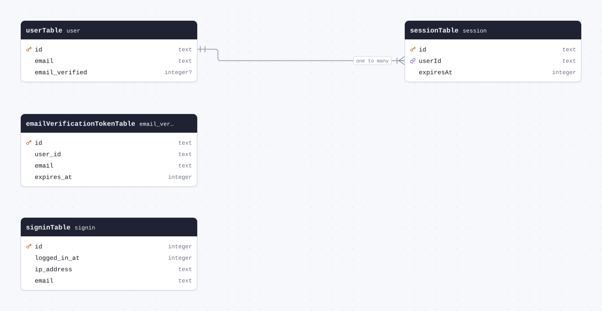
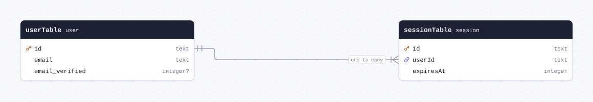
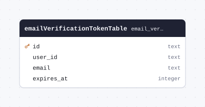
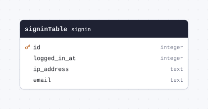

# Schema docs



<details>
<summary>The whole schema as SQL</summary>

```sql
CREATE TABLE `email_verification_token` (
	`id` text PRIMARY KEY,
	`user_id` text NOT NULL,
	`email` text NOT NULL,
	`expires_at` integer NOT NULL
);

CREATE TABLE `session` (
	`id` text PRIMARY KEY,
	`user_id` text NOT NULL,
	`expires_at` integer NOT NULL,
	CONSTRAINT `fk_session_user_id_user_id_fk` FOREIGN KEY (`user_id`) REFERENCES `user`(`id`)
);

CREATE TABLE `signin` (
	`id` integer PRIMARY KEY AUTOINCREMENT,
	`logged_in_at` integer NOT NULL,
	`ip_address` text NOT NULL,
	`email` text NOT NULL
);

CREATE TABLE `user` (
	`id` text PRIMARY KEY,
	`email` text NOT NULL,
	`email_verified` integer
);
```

</details>

## Contents

| Table                                                             | Name in the database       | Description |
| ----------------------------------------------------------------- | -------------------------- | ----------- |
| [userTable](#table-userTable)                                     | `user`                     |             |
| [sessionTable](#table-sessionTable)                               | `session`                  |             |
| [emailVerificationTokenTable](#table-emailVerificationTokenTable) | `email_verification_token` |             |
| [signinTable](#table-signinTable)                                 | `signin`                   |             |

## Tables

<a id="table-userTable"></a>

### userTable

Table `user`.


| Column           | Type      | Constraints | Default | Description |
| ---------------- | --------- | ----------- | ------- | ----------- |
| `id`             | `text`    | PK NOT NULL |         |             |
| `email`          | `text`    | NOT NULL    |         |             |
| `email_verified` | `integer` | NULL        |         |             |

#### Definition

```sql
CREATE TABLE `user` (
	`id` text PRIMARY KEY,
	`email` text NOT NULL,
	`email_verified` integer
);
```

#### Referenced by

- `id` → [sessionTable.userId](#table-sessionTable) (one to many)

<details>
<summary>Queries and their SQL</summary>

**Select**: Every row of userTable.

```ts
db.select().from(userTable);
```

```sql
select "id", "email", "email_verified"
from "user"
```

**Count**: How many rows userTable has.

```ts
db.select({ count: count() }).from(userTable);
```

```sql
select count(*)
from "user"
```

**Find many**: The rows of userTable, through the relational query API.

```ts
db.query.userTable.findMany();
```

```sql
select "d0"."id" as "id", "d0"."email" as "email", "d0"."email_verified" as "email_verified"
from "user" as "d0"
```

**Find by primary key**: One row of userTable, through the relational query API.

```ts
db.query.userTable.findFirst({ where: { id: "id" } });
```

```sql
select "d0"."id" as "id", "d0"."email" as "email", "d0"."email_verified" as "email_verified"
from "user" as "d0"
where "d0"."id" = ?
limit ?
-- params: ["id",1]
```

**Insert**: Adds a row to userTable, giving the columns that have no default.

```ts
db.insert(userTable).values({ id: "id", email: "email" });
```

```sql
insert into "user" ("id", "email", "email_verified")
values (?, ?, null)
-- params: ["id","email"]
```

**Update**: Changes a row of userTable, found by its primary key.

```ts
db.update(userTable).set({ email: "email" }).where(eq(userTable.id, "id"));
```

```sql
update "user"
set "email" = ?
where "user"."id" = ?
-- params: ["email","id"]
```

**Delete**: Deletes a row of userTable, found by its primary key.

```ts
db.delete(userTable).where(eq(userTable.id, "id"));
```

```sql
delete from "user"
where "user"."id" = ?
-- params: ["id"]
```

</details>

<a id="table-sessionTable"></a>

### sessionTable

Table `session`.



| Column                     | Type      | Constraints                                 | Default | Description |
| -------------------------- | --------- | ------------------------------------------- | ------- | ----------- |
| `id`                       | `text`    | PK NOT NULL                                 |         |             |
| `userId` (`user_id`)       | `text`    | NOT NULL → [userTable.id](#table-userTable) |         |             |
| `expiresAt` (`expires_at`) | `integer` | NOT NULL                                    |         |             |

#### Definition

```sql
CREATE TABLE `session` (
	`id` text PRIMARY KEY,
	`user_id` text NOT NULL,
	`expires_at` integer NOT NULL,
	CONSTRAINT `fk_session_user_id_user_id_fk` FOREIGN KEY (`user_id`) REFERENCES `user`(`id`)
);
```

#### References

- `userId` → [userTable.id](#table-userTable) (many to one)

<details>
<summary>Queries and their SQL</summary>

**Select**: Every row of sessionTable.

```ts
db.select().from(sessionTable);
```

```sql
select "id", "user_id", "expires_at"
from "session"
```

**Count**: How many rows sessionTable has.

```ts
db.select({ count: count() }).from(sessionTable);
```

```sql
select count(*)
from "session"
```

**Find many**: The rows of sessionTable, through the relational query API.

```ts
db.query.sessionTable.findMany();
```

```sql
select "d0"."id" as "id", "d0"."user_id" as "userId", "d0"."expires_at" as "expiresAt"
from "session" as "d0"
```

**Find by primary key**: One row of sessionTable, through the relational query API.

```ts
db.query.sessionTable.findFirst({ where: { id: "id" } });
```

```sql
select "d0"."id" as "id", "d0"."user_id" as "userId", "d0"."expires_at" as "expiresAt"
from "session" as "d0"
where "d0"."id" = ?
limit ?
-- params: ["id",1]
```

**Insert**: Adds a row to sessionTable, giving the columns that have no default.

```ts
db.insert(sessionTable).values({ id: "id", userId: "userId", expiresAt: 1 });
```

```sql
insert into "session" ("id", "user_id", "expires_at")
values (?, ?, ?)
-- params: ["id","userId",1]
```

**Update**: Changes a row of sessionTable, found by its primary key.

```ts
db.update(sessionTable).set({ userId: "userId" }).where(eq(sessionTable.id, "id"));
```

```sql
update "session"
set "user_id" = ?
where "session"."id" = ?
-- params: ["userId","id"]
```

**Delete**: Deletes a row of sessionTable, found by its primary key.

```ts
db.delete(sessionTable).where(eq(sessionTable.id, "id"));
```

```sql
delete from "session"
where "session"."id" = ?
-- params: ["id"]
```

</details>

<a id="table-emailVerificationTokenTable"></a>

### emailVerificationTokenTable

Table `email_verification_token`.



| Column       | Type      | Constraints | Default | Description |
| ------------ | --------- | ----------- | ------- | ----------- |
| `id`         | `text`    | PK NOT NULL |         |             |
| `user_id`    | `text`    | NOT NULL    |         |             |
| `email`      | `text`    | NOT NULL    |         |             |
| `expires_at` | `integer` | NOT NULL    |         |             |

#### Definition

```sql
CREATE TABLE `email_verification_token` (
	`id` text PRIMARY KEY,
	`user_id` text NOT NULL,
	`email` text NOT NULL,
	`expires_at` integer NOT NULL
);
```

<details>
<summary>Queries and their SQL</summary>

**Select**: Every row of emailVerificationTokenTable.

```ts
db.select().from(emailVerificationTokenTable);
```

```sql
select "id", "user_id", "email", "expires_at"
from "email_verification_token"
```

**Count**: How many rows emailVerificationTokenTable has.

```ts
db.select({ count: count() }).from(emailVerificationTokenTable);
```

```sql
select count(*)
from "email_verification_token"
```

**Find many**: The rows of emailVerificationTokenTable, through the relational query API.

```ts
db.query.emailVerificationTokenTable.findMany();
```

```sql
select "d0"."id" as "id", "d0"."user_id" as "user_id", "d0"."email" as "email", "d0"."expires_at" as "expires_at"
from "email_verification_token" as "d0"
```

**Find by primary key**: One row of emailVerificationTokenTable, through the relational query API.

```ts
db.query.emailVerificationTokenTable.findFirst({ where: { id: "id" } });
```

```sql
select "d0"."id" as "id", "d0"."user_id" as "user_id", "d0"."email" as "email", "d0"."expires_at" as "expires_at"
from "email_verification_token" as "d0"
where "d0"."id" = ?
limit ?
-- params: ["id",1]
```

**Insert**: Adds a row to emailVerificationTokenTable, giving the columns that have no default.

```ts
db.insert(emailVerificationTokenTable).values({
  id: "id",
  user_id: "user_id",
  email: "email",
  expires_at: 1,
});
```

```sql
insert into "email_verification_token" ("id", "user_id", "email", "expires_at")
values (?, ?, ?, ?)
-- params: ["id","user_id","email",1]
```

**Update**: Changes a row of emailVerificationTokenTable, found by its primary key.

```ts
db.update(emailVerificationTokenTable)
  .set({ user_id: "user_id" })
  .where(eq(emailVerificationTokenTable.id, "id"));
```

```sql
update "email_verification_token"
set "user_id" = ?
where "email_verification_token"."id" = ?
-- params: ["user_id","id"]
```

**Delete**: Deletes a row of emailVerificationTokenTable, found by its primary key.

```ts
db.delete(emailVerificationTokenTable).where(eq(emailVerificationTokenTable.id, "id"));
```

```sql
delete from "email_verification_token"
where "email_verification_token"."id" = ?
-- params: ["id"]
```

</details>

<a id="table-signinTable"></a>

### signinTable

Table `signin`.



| Column         | Type      | Constraints | Default | Description |
| -------------- | --------- | ----------- | ------- | ----------- |
| `id`           | `integer` | PK NOT NULL |         |             |
| `logged_in_at` | `integer` | NOT NULL    |         |             |
| `ip_address`   | `text`    | NOT NULL    |         |             |
| `email`        | `text`    | NOT NULL    |         |             |

#### Definition

```sql
CREATE TABLE `signin` (
	`id` integer PRIMARY KEY AUTOINCREMENT,
	`logged_in_at` integer NOT NULL,
	`ip_address` text NOT NULL,
	`email` text NOT NULL
);
```

<details>
<summary>Queries and their SQL</summary>

**Select**: Every row of signinTable.

```ts
db.select().from(signinTable);
```

```sql
select "id", "logged_in_at", "ip_address", "email"
from "signin"
```

**Count**: How many rows signinTable has.

```ts
db.select({ count: count() }).from(signinTable);
```

```sql
select count(*)
from "signin"
```

**Find many**: The rows of signinTable, through the relational query API.

```ts
db.query.signinTable.findMany();
```

```sql
select "d0"."id" as "id", "d0"."logged_in_at" as "logged_in_at", "d0"."ip_address" as "ip_address", "d0"."email" as "email"
from "signin" as "d0"
```

**Find by primary key**: One row of signinTable, through the relational query API.

```ts
db.query.signinTable.findFirst({ where: { id: 1 } });
```

```sql
select "d0"."id" as "id", "d0"."logged_in_at" as "logged_in_at", "d0"."ip_address" as "ip_address", "d0"."email" as "email"
from "signin" as "d0"
where "d0"."id" = ?
limit ?
-- params: [1,1]
```

**Insert**: Adds a row to signinTable, giving the columns that have no default.

```ts
db.insert(signinTable).values({ id: 1, logged_in_at: 1, ip_address: "ip_address", email: "email" });
```

```sql
insert into "signin" ("id", "logged_in_at", "ip_address", "email")
values (?, ?, ?, ?)
-- params: [1,1,"ip_address","email"]
```

**Update**: Changes a row of signinTable, found by its primary key.

```ts
db.update(signinTable).set({ logged_in_at: 1 }).where(eq(signinTable.id, 1));
```

```sql
update "signin"
set "logged_in_at" = ?
where "signin"."id" = ?
-- params: [1,1]
```

**Delete**: Deletes a row of signinTable, found by its primary key.

```ts
db.delete(signinTable).where(eq(signinTable.id, 1));
```

```sql
delete from "signin"
where "signin"."id" = ?
-- params: [1]
```

</details>
