# Schema docs

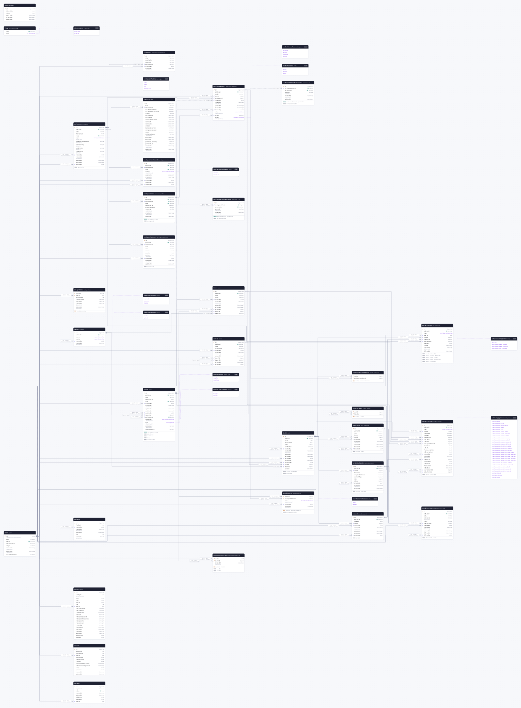

<details>
<summary>The whole schema as SQL</summary>

```sql
CREATE TYPE "board_member_role" AS ENUM('admin', 'member');

CREATE TYPE "board_type" AS ENUM('regular', 'template');

CREATE TYPE "board_visibility" AS ENUM('private', 'public');

CREATE TYPE "card_activity_type" AS ENUM('card.created', 'card.updated.title', 'card.updated.description', 'card.updated.index', 'card.updated.list', 'card.updated.label.added', 'card.updated.label.removed', 'card.updated.member.added', 'card.updated.member.removed', 'card.updated.comment.added', 'card.updated.comment.updated', 'card.updated.comment.deleted', 'card.updated.checklist.added', 'card.updated.checklist.renamed', 'card.updated.checklist.deleted', 'card.updated.checklist.item.added', 'card.updated.checklist.item.updated', 'card.updated.checklist.item.completed', 'card.updated.checklist.item.uncompleted', 'card.updated.checklist.item.deleted', 'card.updated.attachment.added', 'card.updated.attachment.removed', 'card.updated.dueDate.added', 'card.updated.dueDate.updated', 'card.updated.dueDate.removed', 'card.archived');

CREATE TYPE "source" AS ENUM('trello', 'github');

CREATE TYPE "status" AS ENUM('started', 'success', 'failed');

CREATE TYPE "invite_link_status" AS ENUM('active', 'inactive');

CREATE TYPE "role" AS ENUM('admin', 'member', 'guest');

CREATE TYPE "member_status" AS ENUM('invited', 'active', 'removed', 'paused');

CREATE TYPE "notification_type" AS ENUM('mention', 'workspace.member.added', 'workspace.member.removed', 'workspace.role.changed');

CREATE TYPE "slug_type" AS ENUM('reserved', 'premium');

CREATE TYPE "workspace_plan" AS ENUM('free', 'team', 'pro', 'enterprise');

CREATE TABLE "account" (
	"id" bigserial PRIMARY KEY,
	"accountId" text NOT NULL,
	"providerId" text NOT NULL,
	"userId" uuid NOT NULL,
	"accessToken" text,
	"refreshToken" text,
	"idToken" text,
	"accessTokenExpiresAt" timestamp,
	"refreshTokenExpiresAt" timestamp,
	"scope" text,
	"password" text,
	"createdAt" timestamp NOT NULL,
	"updatedAt" timestamp NOT NULL
);

ALTER TABLE "account" ENABLE ROW LEVEL SECURITY;

CREATE TABLE "apiKey" (
	"id" bigserial PRIMARY KEY,
	"configId" text DEFAULT 'default' NOT NULL,
	"name" text,
	"start" text,
	"prefix" text,
	"key" text NOT NULL,
	"userId" uuid NOT NULL,
	"refillInterval" integer,
	"refillAmount" integer,
	"lastRefillAt" timestamp,
	"enabled" boolean,
	"rateLimitEnabled" boolean,
	"rateLimitTimeWindow" integer,
	"rateLimitMax" integer,
	"requestCount" integer,
	"remaining" integer,
	"lastRequest" timestamp,
	"expiresAt" timestamp,
	"createdAt" timestamp NOT NULL,
	"updatedAt" timestamp NOT NULL,
	"permissions" text,
	"metadata" text
);

ALTER TABLE "apiKey" ENABLE ROW LEVEL SECURITY;

CREATE TABLE "session" (
	"id" bigserial PRIMARY KEY,
	"expiresAt" timestamp NOT NULL,
	"token" text NOT NULL UNIQUE,
	"createdAt" timestamp NOT NULL,
	"updatedAt" timestamp NOT NULL,
	"ipAddress" text,
	"userAgent" text,
	"userId" uuid NOT NULL
);

ALTER TABLE "session" ENABLE ROW LEVEL SECURITY;

CREATE TABLE "verification" (
	"id" bigserial PRIMARY KEY,
	"identifier" text NOT NULL,
	"value" text NOT NULL,
	"expiresAt" timestamp NOT NULL,
	"createdAt" timestamp,
	"updatedAt" timestamp
);

ALTER TABLE "verification" ENABLE ROW LEVEL SECURITY;

CREATE TABLE "board_members" (
	"boardId" bigint,
	"workspaceMemberId" bigint,
	"role" "board_member_role" DEFAULT 'member'::"board_member_role" NOT NULL,
	"createdBy" uuid,
	"createdAt" timestamp DEFAULT now() NOT NULL,
	CONSTRAINT "board_members_pkey" PRIMARY KEY("boardId","workspaceMemberId")
);

ALTER TABLE "board_members" ENABLE ROW LEVEL SECURITY;

CREATE TABLE "board" (
	"id" bigserial PRIMARY KEY,
	"publicId" varchar(12) NOT NULL UNIQUE,
	"name" varchar(255) NOT NULL,
	"description" text,
	"slug" varchar(255) NOT NULL,
	"createdBy" uuid,
	"createdAt" timestamp DEFAULT now() NOT NULL,
	"updatedAt" timestamp,
	"deletedAt" timestamp,
	"deletedBy" uuid,
	"importId" bigint,
	"workspaceId" bigint NOT NULL,
	"visibility" "board_visibility" DEFAULT 'private'::"board_visibility" NOT NULL,
	"type" "board_type" DEFAULT 'regular'::"board_type" NOT NULL,
	"isArchived" boolean DEFAULT false NOT NULL,
	"sourceBoardId" bigint
);

ALTER TABLE "board" ENABLE ROW LEVEL SECURITY;

CREATE TABLE "user_board_favorites" (
	"userId" uuid,
	"boardId" bigint,
	"createdAt" timestamp DEFAULT now() NOT NULL,
	CONSTRAINT "user_board_favorites_pkey" PRIMARY KEY("userId","boardId")
);

CREATE TABLE "card_activity" (
	"id" bigserial PRIMARY KEY,
	"publicId" varchar(12) NOT NULL UNIQUE,
	"type" "card_activity_type" NOT NULL,
	"cardId" bigint NOT NULL,
	"fromIndex" integer,
	"toIndex" integer,
	"fromListId" bigint,
	"toListId" bigint,
	"labelId" bigint,
	"workspaceMemberId" bigint,
	"fromTitle" text,
	"toTitle" text,
	"fromDescription" text,
	"toDescription" text,
	"createdBy" uuid,
	"createdAt" timestamp DEFAULT now() NOT NULL,
	"commentId" bigint,
	"fromComment" text,
	"toComment" text,
	"fromDueDate" timestamp,
	"toDueDate" timestamp,
	"sourceBoardId" bigint,
	"attachmentId" bigint
);

ALTER TABLE "card_activity" ENABLE ROW LEVEL SECURITY;

CREATE TABLE "card_attachment" (
	"id" bigserial PRIMARY KEY,
	"publicId" varchar(12) NOT NULL UNIQUE,
	"cardId" bigint NOT NULL,
	"filename" varchar(255) NOT NULL,
	"originalFilename" varchar(255) NOT NULL,
	"contentType" varchar(100) NOT NULL,
	"size" bigint NOT NULL,
	"s3Key" varchar(500) NOT NULL,
	"createdBy" uuid,
	"createdAt" timestamp DEFAULT now() NOT NULL,
	"deletedAt" timestamp
);

ALTER TABLE "card_attachment" ENABLE ROW LEVEL SECURITY;

CREATE TABLE "_card_workspace_members" (
	"cardId" bigint,
	"workspaceMemberId" bigint,
	CONSTRAINT "_card_workspace_members_pkey" PRIMARY KEY("cardId","workspaceMemberId")
);

ALTER TABLE "_card_workspace_members" ENABLE ROW LEVEL SECURITY;

CREATE TABLE "card" (
	"id" bigserial PRIMARY KEY,
	"publicId" varchar(12) NOT NULL UNIQUE,
	"title" text NOT NULL,
	"description" text,
	"index" integer NOT NULL,
	"cardNumber" integer,
	"createdBy" uuid,
	"createdAt" timestamp DEFAULT now() NOT NULL,
	"updatedAt" timestamp,
	"deletedAt" timestamp,
	"deletedBy" uuid,
	"listId" bigint NOT NULL,
	"importId" bigint,
	"dueDate" timestamp
);

ALTER TABLE "card" ENABLE ROW LEVEL SECURITY;

CREATE TABLE "_card_labels" (
	"cardId" bigint,
	"labelId" bigint,
	CONSTRAINT "_card_labels_pkey" PRIMARY KEY("cardId","labelId")
);

ALTER TABLE "_card_labels" ENABLE ROW LEVEL SECURITY;

CREATE TABLE "card_comments" (
	"id" bigserial PRIMARY KEY,
	"publicId" varchar(12) NOT NULL UNIQUE,
	"comment" text NOT NULL,
	"cardId" bigint NOT NULL,
	"createdBy" uuid,
	"createdAt" timestamp DEFAULT now() NOT NULL,
	"updatedAt" timestamp,
	"deletedAt" timestamp,
	"deletedBy" uuid
);

ALTER TABLE "card_comments" ENABLE ROW LEVEL SECURITY;

CREATE TABLE "card_checklist_item" (
	"id" bigserial PRIMARY KEY,
	"publicId" varchar(12) NOT NULL UNIQUE,
	"title" varchar(500) NOT NULL,
	"completed" boolean DEFAULT false NOT NULL,
	"index" integer NOT NULL,
	"checklistId" bigint NOT NULL,
	"createdBy" uuid,
	"createdAt" timestamp DEFAULT now() NOT NULL,
	"updatedAt" timestamp,
	"deletedAt" timestamp,
	"deletedBy" uuid
);

ALTER TABLE "card_checklist_item" ENABLE ROW LEVEL SECURITY;

CREATE TABLE "card_checklist" (
	"id" bigserial PRIMARY KEY,
	"publicId" varchar(12) NOT NULL UNIQUE,
	"name" varchar(255) NOT NULL,
	"index" integer NOT NULL,
	"cardId" bigint NOT NULL,
	"createdBy" uuid,
	"createdAt" timestamp DEFAULT now() NOT NULL,
	"updatedAt" timestamp,
	"deletedAt" timestamp,
	"deletedBy" uuid
);

ALTER TABLE "card_checklist" ENABLE ROW LEVEL SECURITY;

CREATE TABLE "feedback" (
	"id" bigserial PRIMARY KEY,
	"feedback" text NOT NULL,
	"createdBy" uuid,
	"createdAt" timestamp DEFAULT now() NOT NULL,
	"updatedAt" timestamp,
	"url" text NOT NULL,
	"reviewed" boolean DEFAULT false NOT NULL
);

ALTER TABLE "feedback" ENABLE ROW LEVEL SECURITY;

CREATE TABLE "import" (
	"id" bigserial PRIMARY KEY,
	"publicId" varchar(12) NOT NULL UNIQUE,
	"source" "source" NOT NULL,
	"status" "status" NOT NULL,
	"createdBy" uuid,
	"createdAt" timestamp DEFAULT now() NOT NULL
);

ALTER TABLE "import" ENABLE ROW LEVEL SECURITY;

CREATE TABLE "integration" (
	"provider" varchar(255),
	"userId" uuid,
	"accessToken" text NOT NULL,
	"refreshToken" varchar(255),
	"expiresAt" timestamp NOT NULL,
	"createdAt" timestamp NOT NULL,
	"updatedAt" timestamp,
	CONSTRAINT "integration_pkey" PRIMARY KEY("userId","provider")
);

ALTER TABLE "integration" ENABLE ROW LEVEL SECURITY;

CREATE TABLE "label" (
	"id" bigserial PRIMARY KEY,
	"publicId" varchar(12) NOT NULL UNIQUE,
	"name" varchar(255) NOT NULL,
	"colourCode" varchar(12),
	"createdBy" uuid,
	"createdAt" timestamp DEFAULT now() NOT NULL,
	"updatedAt" timestamp,
	"boardId" bigint NOT NULL,
	"importId" bigint,
	"deletedAt" timestamp,
	"deletedBy" uuid
);

ALTER TABLE "label" ENABLE ROW LEVEL SECURITY;

CREATE TABLE "list" (
	"id" bigserial PRIMARY KEY,
	"publicId" varchar(12) NOT NULL UNIQUE,
	"name" varchar(255) NOT NULL,
	"index" integer NOT NULL,
	"createdBy" uuid,
	"createdAt" timestamp DEFAULT now() NOT NULL,
	"updatedAt" timestamp,
	"deletedAt" timestamp,
	"deletedBy" uuid,
	"boardId" bigint NOT NULL,
	"importId" bigint
);

ALTER TABLE "list" ENABLE ROW LEVEL SECURITY;

CREATE TABLE "notification" (
	"id" bigserial PRIMARY KEY,
	"publicId" varchar(12) NOT NULL UNIQUE,
	"type" "notification_type" NOT NULL,
	"userId" uuid NOT NULL,
	"cardId" bigint,
	"commentId" bigint,
	"workspaceId" bigint,
	"metadata" text,
	"readAt" timestamp,
	"createdAt" timestamp DEFAULT now() NOT NULL,
	"deletedAt" timestamp
);

ALTER TABLE "notification" ENABLE ROW LEVEL SECURITY;

CREATE TABLE "workspace_slug_checks" (
	"id" bigserial PRIMARY KEY,
	"slug" varchar(255) NOT NULL,
	"available" boolean NOT NULL,
	"reserved" boolean NOT NULL,
	"workspaceId" bigint,
	"createdBy" uuid,
	"createdAt" timestamp DEFAULT now() NOT NULL
);

ALTER TABLE "workspace_slug_checks" ENABLE ROW LEVEL SECURITY;

CREATE TABLE "workspace_slugs" (
	"slug" varchar(255) NOT NULL UNIQUE,
	"type" "slug_type" NOT NULL
);

CREATE TABLE "subscription" (
	"id" bigserial PRIMARY KEY,
	"plan" varchar(255) NOT NULL,
	"referenceId" varchar(12),
	"stripeCustomerId" varchar(255),
	"stripeSubscriptionId" varchar(255),
	"status" varchar(255) NOT NULL,
	"periodStart" timestamp,
	"periodEnd" timestamp,
	"cancelAtPeriodEnd" boolean,
	"cancelAt" timestamp,
	"canceledAt" timestamp,
	"endedAt" timestamp,
	"billingInterval" varchar(255),
	"stripeScheduleId" varchar(255),
	"seats" integer,
	"unlimitedSeats" boolean DEFAULT false NOT NULL,
	"trialStart" timestamp,
	"trialEnd" timestamp,
	"partnerLicenseKey" varchar(255),
	"partnerTier" integer,
	"createdAt" timestamp DEFAULT now() NOT NULL,
	"updatedAt" timestamp DEFAULT now() NOT NULL
);

ALTER TABLE "subscription" ENABLE ROW LEVEL SECURITY;

CREATE TABLE "user" (
	"id" uuid PRIMARY KEY DEFAULT uuid_generate_v4(),
	"name" varchar(255),
	"email" varchar(255) NOT NULL UNIQUE,
	"emailVerified" boolean NOT NULL,
	"image" varchar(255),
	"createdAt" timestamp DEFAULT now() NOT NULL,
	"updatedAt" timestamp DEFAULT now() NOT NULL,
	"stripeCustomerId" varchar(255)
);

ALTER TABLE "user" ENABLE ROW LEVEL SECURITY;

CREATE TABLE "workspace_invite_links" (
	"id" bigserial PRIMARY KEY,
	"publicId" varchar(12) NOT NULL UNIQUE,
	"workspaceId" bigint NOT NULL,
	"code" varchar(12) NOT NULL UNIQUE,
	"status" "invite_link_status" DEFAULT 'active'::"invite_link_status" NOT NULL,
	"expiresAt" timestamp,
	"createdAt" timestamp DEFAULT now() NOT NULL,
	"createdBy" uuid,
	"updatedAt" timestamp,
	"updatedBy" uuid
);

ALTER TABLE "workspace_invite_links" ENABLE ROW LEVEL SECURITY;

CREATE TABLE "workspace_member_permissions" (
	"id" bigserial PRIMARY KEY,
	"workspaceMemberId" bigint NOT NULL,
	"permission" varchar(64) NOT NULL,
	"granted" boolean DEFAULT true NOT NULL,
	"createdAt" timestamp DEFAULT now() NOT NULL,
	"updatedAt" timestamp
);

ALTER TABLE "workspace_member_permissions" ENABLE ROW LEVEL SECURITY;

CREATE TABLE "workspace_members" (
	"id" bigserial PRIMARY KEY,
	"publicId" varchar(12) NOT NULL UNIQUE,
	"email" varchar(255) NOT NULL,
	"userId" uuid,
	"workspaceId" bigint NOT NULL,
	"createdBy" uuid NOT NULL,
	"createdAt" timestamp DEFAULT now() NOT NULL,
	"updatedAt" timestamp,
	"deletedAt" timestamp,
	"deletedBy" uuid,
	"role" "role" NOT NULL,
	"roleId" bigint,
	"status" "member_status" DEFAULT 'invited'::"member_status" NOT NULL
);

ALTER TABLE "workspace_members" ENABLE ROW LEVEL SECURITY;

CREATE TABLE "workspace_role_permissions" (
	"id" bigserial PRIMARY KEY,
	"workspaceRoleId" bigint NOT NULL,
	"permission" varchar(64) NOT NULL,
	"granted" boolean DEFAULT true NOT NULL,
	"createdAt" timestamp DEFAULT now() NOT NULL
);

ALTER TABLE "workspace_role_permissions" ENABLE ROW LEVEL SECURITY;

CREATE TABLE "workspace_roles" (
	"id" bigserial PRIMARY KEY,
	"publicId" varchar(12) NOT NULL UNIQUE,
	"workspaceId" bigint NOT NULL,
	"name" varchar(64) NOT NULL,
	"description" varchar(255),
	"hierarchyLevel" integer NOT NULL,
	"isSystem" boolean DEFAULT false NOT NULL,
	"createdAt" timestamp DEFAULT now() NOT NULL,
	"updatedAt" timestamp
);

ALTER TABLE "workspace_roles" ENABLE ROW LEVEL SECURITY;

CREATE TABLE "workspace_webhooks" (
	"id" bigserial PRIMARY KEY,
	"publicId" varchar(12) NOT NULL UNIQUE,
	"workspaceId" bigint NOT NULL,
	"name" varchar(255) NOT NULL,
	"url" varchar(2048) NOT NULL,
	"secret" text,
	"events" text NOT NULL,
	"active" boolean DEFAULT true NOT NULL,
	"createdBy" uuid NOT NULL,
	"createdAt" timestamp DEFAULT now() NOT NULL,
	"updatedAt" timestamp
);

ALTER TABLE "workspace_webhooks" ENABLE ROW LEVEL SECURITY;

CREATE TABLE "workspace" (
	"id" bigserial PRIMARY KEY,
	"publicId" varchar(12) NOT NULL UNIQUE,
	"name" varchar(255) NOT NULL,
	"description" text,
	"slug" varchar(255) NOT NULL UNIQUE,
	"plan" "workspace_plan" DEFAULT 'free'::"workspace_plan" NOT NULL,
	"showEmailsToMembers" boolean DEFAULT true NOT NULL,
	"weekStartDay" integer DEFAULT 1 NOT NULL,
	"cardPrefix" varchar(10) DEFAULT '' NOT NULL,
	"cardCounter" integer DEFAULT 0 NOT NULL,
	"createdBy" uuid,
	"createdAt" timestamp DEFAULT now() NOT NULL,
	"updatedAt" timestamp,
	"deletedAt" timestamp,
	"deletedBy" uuid
);

ALTER TABLE "workspace" ENABLE ROW LEVEL SECURITY;

CREATE INDEX "board_members_workspace_member_idx" ON "board_members" ("workspaceMemberId");

CREATE INDEX "board_is_archived_idx" ON "board" ("isArchived");

CREATE INDEX "board_visibility_idx" ON "board" ("visibility");

CREATE INDEX "board_type_idx" ON "board" ("type");

CREATE INDEX "board_source_idx" ON "board" ("sourceBoardId");

CREATE UNIQUE INDEX "unique_slug_per_workspace" ON "board" ("workspaceId","slug") WHERE "deletedAt" IS NULL;

CREATE INDEX "user_board_favorite_user_idx" ON "user_board_favorites" ("userId");

CREATE INDEX "user_board_favorite_board_idx" ON "user_board_favorites" ("boardId");

CREATE INDEX "card_activity_card_created_at_idx" ON "card_activity" ("cardId","createdAt");

CREATE INDEX "card_attachment_card_created_at_idx" ON "card_attachment" ("cardId","createdAt");

CREATE INDEX "card_list_number_idx" ON "card" ("listId","cardNumber");

CREATE INDEX "card_comments_card_id_idx" ON "card_comments" ("cardId");

CREATE INDEX "card_checklist_item_checklist_index_idx" ON "card_checklist_item" ("checklistId","index");

CREATE INDEX "card_checklist_card_index_idx" ON "card_checklist" ("cardId","index");

CREATE INDEX "notification_user_deleted_idx" ON "notification" ("userId","deletedAt");

CREATE INDEX "notification_user_read_deleted_idx" ON "notification" ("userId","readAt","deletedAt");

CREATE INDEX "notification_user_type_card_idx" ON "notification" ("userId","type","cardId");

CREATE INDEX "notification_user_type_workspace_idx" ON "notification" ("userId","type","workspaceId");

CREATE INDEX "notification_user_created_idx" ON "notification" ("userId","createdAt");

CREATE UNIQUE INDEX "unique_member_permission" ON "workspace_member_permissions" ("workspaceMemberId","permission");

CREATE INDEX "permission_member_idx" ON "workspace_member_permissions" ("workspaceMemberId");

CREATE UNIQUE INDEX "unique_role_permission" ON "workspace_role_permissions" ("workspaceRoleId","permission");

CREATE INDEX "role_permissions_role_idx" ON "workspace_role_permissions" ("workspaceRoleId");

CREATE UNIQUE INDEX "unique_role_per_workspace" ON "workspace_roles" ("workspaceId","name");

CREATE INDEX "workspace_roles_workspace_idx" ON "workspace_roles" ("workspaceId");

CREATE INDEX "workspace_webhooks_workspace_idx" ON "workspace_webhooks" ("workspaceId");

CREATE INDEX "workspace_card_prefix_idx" ON "workspace" ("cardPrefix");

ALTER TABLE "account" ADD CONSTRAINT "account_userId_user_id_fkey" FOREIGN KEY ("userId") REFERENCES "user"("id") ON DELETE CASCADE;

ALTER TABLE "apiKey" ADD CONSTRAINT "apiKey_userId_user_id_fkey" FOREIGN KEY ("userId") REFERENCES "user"("id") ON DELETE CASCADE;

ALTER TABLE "session" ADD CONSTRAINT "session_userId_user_id_fkey" FOREIGN KEY ("userId") REFERENCES "user"("id") ON DELETE CASCADE;

ALTER TABLE "board_members" ADD CONSTRAINT "board_members_boardId_board_id_fkey" FOREIGN KEY ("boardId") REFERENCES "board"("id") ON DELETE CASCADE;

ALTER TABLE "board_members" ADD CONSTRAINT "board_members_workspaceMemberId_workspace_members_id_fkey" FOREIGN KEY ("workspaceMemberId") REFERENCES "workspace_members"("id") ON DELETE CASCADE;

ALTER TABLE "board_members" ADD CONSTRAINT "board_members_createdBy_user_id_fkey" FOREIGN KEY ("createdBy") REFERENCES "user"("id") ON DELETE SET NULL;

ALTER TABLE "board" ADD CONSTRAINT "board_createdBy_user_id_fkey" FOREIGN KEY ("createdBy") REFERENCES "user"("id") ON DELETE SET NULL;

ALTER TABLE "board" ADD CONSTRAINT "board_deletedBy_user_id_fkey" FOREIGN KEY ("deletedBy") REFERENCES "user"("id") ON DELETE SET NULL;

ALTER TABLE "board" ADD CONSTRAINT "board_importId_import_id_fkey" FOREIGN KEY ("importId") REFERENCES "import"("id");

ALTER TABLE "board" ADD CONSTRAINT "board_workspaceId_workspace_id_fkey" FOREIGN KEY ("workspaceId") REFERENCES "workspace"("id") ON DELETE CASCADE;

ALTER TABLE "user_board_favorites" ADD CONSTRAINT "user_board_favorites_userId_user_id_fkey" FOREIGN KEY ("userId") REFERENCES "user"("id") ON DELETE CASCADE;

ALTER TABLE "user_board_favorites" ADD CONSTRAINT "user_board_favorites_boardId_board_id_fkey" FOREIGN KEY ("boardId") REFERENCES "board"("id") ON DELETE CASCADE;

ALTER TABLE "card_activity" ADD CONSTRAINT "card_activity_cardId_card_id_fkey" FOREIGN KEY ("cardId") REFERENCES "card"("id") ON DELETE CASCADE;

ALTER TABLE "card_activity" ADD CONSTRAINT "card_activity_fromListId_list_id_fkey" FOREIGN KEY ("fromListId") REFERENCES "list"("id") ON DELETE CASCADE;

ALTER TABLE "card_activity" ADD CONSTRAINT "card_activity_toListId_list_id_fkey" FOREIGN KEY ("toListId") REFERENCES "list"("id") ON DELETE CASCADE;

ALTER TABLE "card_activity" ADD CONSTRAINT "card_activity_labelId_label_id_fkey" FOREIGN KEY ("labelId") REFERENCES "label"("id") ON DELETE CASCADE;

ALTER TABLE "card_activity" ADD CONSTRAINT "card_activity_workspaceMemberId_workspace_members_id_fkey" FOREIGN KEY ("workspaceMemberId") REFERENCES "workspace_members"("id") ON DELETE SET NULL;

ALTER TABLE "card_activity" ADD CONSTRAINT "card_activity_createdBy_user_id_fkey" FOREIGN KEY ("createdBy") REFERENCES "user"("id") ON DELETE SET NULL;

ALTER TABLE "card_activity" ADD CONSTRAINT "card_activity_commentId_card_comments_id_fkey" FOREIGN KEY ("commentId") REFERENCES "card_comments"("id") ON DELETE CASCADE;

ALTER TABLE "card_activity" ADD CONSTRAINT "card_activity_sourceBoardId_board_id_fkey" FOREIGN KEY ("sourceBoardId") REFERENCES "board"("id") ON DELETE SET NULL;

ALTER TABLE "card_activity" ADD CONSTRAINT "card_activity_attachmentId_card_attachment_id_fkey" FOREIGN KEY ("attachmentId") REFERENCES "card_attachment"("id") ON DELETE CASCADE;

ALTER TABLE "card_attachment" ADD CONSTRAINT "card_attachment_cardId_card_id_fkey" FOREIGN KEY ("cardId") REFERENCES "card"("id") ON DELETE CASCADE;

ALTER TABLE "card_attachment" ADD CONSTRAINT "card_attachment_createdBy_user_id_fkey" FOREIGN KEY ("createdBy") REFERENCES "user"("id") ON DELETE SET NULL;

ALTER TABLE "_card_workspace_members" ADD CONSTRAINT "_card_workspace_members_cardId_card_id_fkey" FOREIGN KEY ("cardId") REFERENCES "card"("id") ON DELETE CASCADE;

ALTER TABLE "_card_workspace_members" ADD CONSTRAINT "_card_workspace_members_tMcTv7HPnXM6_fkey" FOREIGN KEY ("workspaceMemberId") REFERENCES "workspace_members"("id") ON DELETE CASCADE;

ALTER TABLE "card" ADD CONSTRAINT "card_createdBy_user_id_fkey" FOREIGN KEY ("createdBy") REFERENCES "user"("id") ON DELETE SET NULL;

ALTER TABLE "card" ADD CONSTRAINT "card_deletedBy_user_id_fkey" FOREIGN KEY ("deletedBy") REFERENCES "user"("id") ON DELETE SET NULL;

ALTER TABLE "card" ADD CONSTRAINT "card_listId_list_id_fkey" FOREIGN KEY ("listId") REFERENCES "list"("id") ON DELETE CASCADE;

ALTER TABLE "card" ADD CONSTRAINT "card_importId_import_id_fkey" FOREIGN KEY ("importId") REFERENCES "import"("id");

ALTER TABLE "_card_labels" ADD CONSTRAINT "_card_labels_cardId_card_id_fkey" FOREIGN KEY ("cardId") REFERENCES "card"("id") ON DELETE CASCADE;

ALTER TABLE "_card_labels" ADD CONSTRAINT "_card_labels_labelId_label_id_fkey" FOREIGN KEY ("labelId") REFERENCES "label"("id") ON DELETE CASCADE;

ALTER TABLE "card_comments" ADD CONSTRAINT "card_comments_cardId_card_id_fkey" FOREIGN KEY ("cardId") REFERENCES "card"("id") ON DELETE CASCADE;

ALTER TABLE "card_comments" ADD CONSTRAINT "card_comments_createdBy_user_id_fkey" FOREIGN KEY ("createdBy") REFERENCES "user"("id") ON DELETE SET NULL;

ALTER TABLE "card_comments" ADD CONSTRAINT "card_comments_deletedBy_user_id_fkey" FOREIGN KEY ("deletedBy") REFERENCES "user"("id") ON DELETE SET NULL;

ALTER TABLE "card_checklist_item" ADD CONSTRAINT "card_checklist_item_checklistId_card_checklist_id_fkey" FOREIGN KEY ("checklistId") REFERENCES "card_checklist"("id") ON DELETE CASCADE;

ALTER TABLE "card_checklist_item" ADD CONSTRAINT "card_checklist_item_createdBy_user_id_fkey" FOREIGN KEY ("createdBy") REFERENCES "user"("id") ON DELETE SET NULL;

ALTER TABLE "card_checklist_item" ADD CONSTRAINT "card_checklist_item_deletedBy_user_id_fkey" FOREIGN KEY ("deletedBy") REFERENCES "user"("id") ON DELETE SET NULL;

ALTER TABLE "card_checklist" ADD CONSTRAINT "card_checklist_cardId_card_id_fkey" FOREIGN KEY ("cardId") REFERENCES "card"("id") ON DELETE CASCADE;

ALTER TABLE "card_checklist" ADD CONSTRAINT "card_checklist_createdBy_user_id_fkey" FOREIGN KEY ("createdBy") REFERENCES "user"("id") ON DELETE SET NULL;

ALTER TABLE "card_checklist" ADD CONSTRAINT "card_checklist_deletedBy_user_id_fkey" FOREIGN KEY ("deletedBy") REFERENCES "user"("id") ON DELETE SET NULL;

ALTER TABLE "feedback" ADD CONSTRAINT "feedback_createdBy_user_id_fkey" FOREIGN KEY ("createdBy") REFERENCES "user"("id") ON DELETE SET NULL;

ALTER TABLE "import" ADD CONSTRAINT "import_createdBy_user_id_fkey" FOREIGN KEY ("createdBy") REFERENCES "user"("id") ON DELETE SET NULL;

ALTER TABLE "integration" ADD CONSTRAINT "integration_userId_user_id_fkey" FOREIGN KEY ("userId") REFERENCES "user"("id") ON DELETE CASCADE;

ALTER TABLE "label" ADD CONSTRAINT "label_createdBy_user_id_fkey" FOREIGN KEY ("createdBy") REFERENCES "user"("id") ON DELETE SET NULL;

ALTER TABLE "label" ADD CONSTRAINT "label_boardId_board_id_fkey" FOREIGN KEY ("boardId") REFERENCES "board"("id") ON DELETE CASCADE;

ALTER TABLE "label" ADD CONSTRAINT "label_importId_import_id_fkey" FOREIGN KEY ("importId") REFERENCES "import"("id");

ALTER TABLE "label" ADD CONSTRAINT "label_deletedBy_user_id_fkey" FOREIGN KEY ("deletedBy") REFERENCES "user"("id") ON DELETE SET NULL;

ALTER TABLE "list" ADD CONSTRAINT "list_createdBy_user_id_fkey" FOREIGN KEY ("createdBy") REFERENCES "user"("id") ON DELETE SET NULL;

ALTER TABLE "list" ADD CONSTRAINT "list_deletedBy_user_id_fkey" FOREIGN KEY ("deletedBy") REFERENCES "user"("id") ON DELETE SET NULL;

ALTER TABLE "list" ADD CONSTRAINT "list_boardId_board_id_fkey" FOREIGN KEY ("boardId") REFERENCES "board"("id") ON DELETE CASCADE;

ALTER TABLE "list" ADD CONSTRAINT "list_importId_import_id_fkey" FOREIGN KEY ("importId") REFERENCES "import"("id");

ALTER TABLE "notification" ADD CONSTRAINT "notification_userId_user_id_fkey" FOREIGN KEY ("userId") REFERENCES "user"("id") ON DELETE CASCADE;

ALTER TABLE "notification" ADD CONSTRAINT "notification_cardId_card_id_fkey" FOREIGN KEY ("cardId") REFERENCES "card"("id") ON DELETE CASCADE;

ALTER TABLE "notification" ADD CONSTRAINT "notification_commentId_card_comments_id_fkey" FOREIGN KEY ("commentId") REFERENCES "card_comments"("id") ON DELETE CASCADE;

ALTER TABLE "notification" ADD CONSTRAINT "notification_workspaceId_workspace_id_fkey" FOREIGN KEY ("workspaceId") REFERENCES "workspace"("id") ON DELETE CASCADE;

ALTER TABLE "workspace_slug_checks" ADD CONSTRAINT "workspace_slug_checks_workspaceId_workspace_id_fkey" FOREIGN KEY ("workspaceId") REFERENCES "workspace"("id");

ALTER TABLE "workspace_slug_checks" ADD CONSTRAINT "workspace_slug_checks_createdBy_user_id_fkey" FOREIGN KEY ("createdBy") REFERENCES "user"("id") ON DELETE SET NULL;

ALTER TABLE "subscription" ADD CONSTRAINT "subscription_referenceId_workspace_publicId_fkey" FOREIGN KEY ("referenceId") REFERENCES "workspace"("publicId") ON DELETE SET NULL;

ALTER TABLE "workspace_invite_links" ADD CONSTRAINT "workspace_invite_links_workspaceId_workspace_id_fkey" FOREIGN KEY ("workspaceId") REFERENCES "workspace"("id") ON DELETE CASCADE;

ALTER TABLE "workspace_invite_links" ADD CONSTRAINT "workspace_invite_links_createdBy_user_id_fkey" FOREIGN KEY ("createdBy") REFERENCES "user"("id") ON DELETE SET NULL;

ALTER TABLE "workspace_invite_links" ADD CONSTRAINT "workspace_invite_links_updatedBy_user_id_fkey" FOREIGN KEY ("updatedBy") REFERENCES "user"("id") ON DELETE SET NULL;

ALTER TABLE "workspace_members" ADD CONSTRAINT "workspace_members_userId_user_id_fkey" FOREIGN KEY ("userId") REFERENCES "user"("id") ON DELETE SET NULL;

ALTER TABLE "workspace_members" ADD CONSTRAINT "workspace_members_workspaceId_workspace_id_fkey" FOREIGN KEY ("workspaceId") REFERENCES "workspace"("id") ON DELETE CASCADE;

ALTER TABLE "workspace_members" ADD CONSTRAINT "workspace_members_deletedBy_user_id_fkey" FOREIGN KEY ("deletedBy") REFERENCES "user"("id") ON DELETE SET NULL;

ALTER TABLE "workspace_members" ADD CONSTRAINT "workspace_members_roleId_workspace_roles_id_fkey" FOREIGN KEY ("roleId") REFERENCES "workspace_roles"("id") ON DELETE RESTRICT;

ALTER TABLE "workspace_role_permissions" ADD CONSTRAINT "workspace_role_permissions_fv6TMp4WLKC4_fkey" FOREIGN KEY ("workspaceRoleId") REFERENCES "workspace_roles"("id") ON DELETE CASCADE;

ALTER TABLE "workspace_roles" ADD CONSTRAINT "workspace_roles_workspaceId_workspace_id_fkey" FOREIGN KEY ("workspaceId") REFERENCES "workspace"("id") ON DELETE CASCADE;

ALTER TABLE "workspace_webhooks" ADD CONSTRAINT "workspace_webhooks_workspaceId_workspace_id_fkey" FOREIGN KEY ("workspaceId") REFERENCES "workspace"("id") ON DELETE CASCADE;

ALTER TABLE "workspace_webhooks" ADD CONSTRAINT "workspace_webhooks_createdBy_user_id_fkey" FOREIGN KEY ("createdBy") REFERENCES "user"("id") ON DELETE CASCADE;

ALTER TABLE "workspace" ADD CONSTRAINT "workspace_createdBy_user_id_fkey" FOREIGN KEY ("createdBy") REFERENCES "user"("id") ON DELETE SET NULL;

ALTER TABLE "workspace" ADD CONSTRAINT "workspace_deletedBy_user_id_fkey" FOREIGN KEY ("deletedBy") REFERENCES "user"("id") ON DELETE SET NULL;
```

</details>

## Contents

| Table                                                           | Name in the database           | Description |
| --------------------------------------------------------------- | ------------------------------ | ----------- |
| [session](#table-session)                                       | `session`                      |             |
| [account](#table-account)                                       | `account`                      |             |
| [verification](#table-verification)                             | `verification`                 |             |
| [apikey](#table-apikey)                                         | `apiKey`                       |             |
| [boards](#table-boards)                                         | `board`                        |             |
| [userBoardFavorites](#table-userBoardFavorites)                 | `user_board_favorites`         |             |
| [boardMembers](#table-boardMembers)                             | `board_members`                |             |
| [cards](#table-cards)                                           | `card`                         |             |
| [cardActivities](#table-cardActivities)                         | `card_activity`                |             |
| [cardsToLabels](#table-cardsToLabels)                           | `_card_labels`                 |             |
| [cardToWorkspaceMembers](#table-cardToWorkspaceMembers)         | `_card_workspace_members`      |             |
| [comments](#table-comments)                                     | `card_comments`                |             |
| [cardAttachments](#table-cardAttachments)                       | `card_attachment`              |             |
| [checklists](#table-checklists)                                 | `card_checklist`               |             |
| [checklistItems](#table-checklistItems)                         | `card_checklist_item`          |             |
| [feedback](#table-feedback)                                     | `feedback`                     |             |
| [imports](#table-imports)                                       | `import`                       |             |
| [integrations](#table-integrations)                             | `integration`                  |             |
| [labels](#table-labels)                                         | `label`                        |             |
| [lists](#table-lists)                                           | `list`                         |             |
| [notifications](#table-notifications)                           | `notification`                 |             |
| [workspaceRoles](#table-workspaceRoles)                         | `workspace_roles`              |             |
| [workspaceRolePermissions](#table-workspaceRolePermissions)     | `workspace_role_permissions`   |             |
| [workspaceMemberPermissions](#table-workspaceMemberPermissions) | `workspace_member_permissions` |             |
| [subscription](#table-subscription)                             | `subscription`                 |             |
| [users](#table-users)                                           | `user`                         |             |
| [workspaceWebhooks](#table-workspaceWebhooks)                   | `workspace_webhooks`           |             |
| [workspaceInviteLinks](#table-workspaceInviteLinks)             | `workspace_invite_links`       |             |
| [workspaces](#table-workspaces)                                 | `workspace`                    |             |
| [workspaceMembers](#table-workspaceMembers)                     | `workspace_members`            |             |
| [slugs](#table-slugs)                                           | `workspace_slugs`              |             |
| [slugChecks](#table-slugChecks)                                 | `workspace_slug_checks`        |             |

| Enum                                               | Name in the database | Description |
| -------------------------------------------------- | -------------------- | ----------- |
| [boardVisibilityEnum](#enum-boardVisibilityEnum)   | `board_visibility`   |             |
| [boardMemberRoleEnum](#enum-boardMemberRoleEnum)   | `board_member_role`  |             |
| [boardTypeEnum](#enum-boardTypeEnum)               | `board_type`         |             |
| [activityTypeEnum](#enum-activityTypeEnum)         | `card_activity_type` |             |
| [importSourceEnum](#enum-importSourceEnum)         | `source`             |             |
| [importStatusEnum](#enum-importStatusEnum)         | `status`             |             |
| [notificationTypeEnum](#enum-notificationTypeEnum) | `notification_type`  |             |
| [inviteLinkStatusEnum](#enum-inviteLinkStatusEnum) | `invite_link_status` |             |
| [memberRoleEnum](#enum-memberRoleEnum)             | `role`               |             |
| [memberStatusEnum](#enum-memberStatusEnum)         | `member_status`      |             |
| [slugTypeEnum](#enum-slugTypeEnum)                 | `slug_type`          |             |
| [workspacePlanEnum](#enum-workspacePlanEnum)       | `workspace_plan`     |             |

## Tables

<a id="table-session"></a>

### session

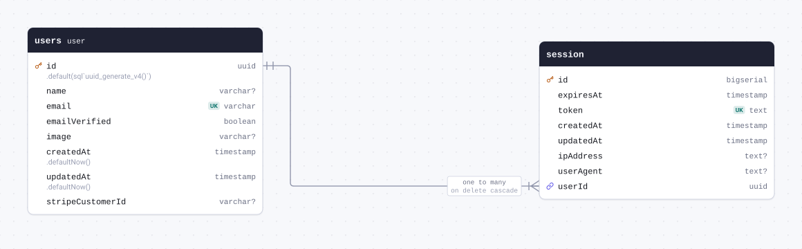

| Column      | Type        | Constraints                         | Default | Description |
| ----------- | ----------- | ----------------------------------- | ------- | ----------- |
| `id`        | `bigserial` | PK NOT NULL                         |         |             |
| `expiresAt` | `timestamp` | NOT NULL                            |         |             |
| `token`     | `text`      | UNIQUE NOT NULL                     |         |             |
| `createdAt` | `timestamp` | NOT NULL                            |         |             |
| `updatedAt` | `timestamp` | NOT NULL                            |         |             |
| `ipAddress` | `text`      | NULL                                |         |             |
| `userAgent` | `text`      | NULL                                |         |             |
| `userId`    | `uuid`      | NOT NULL → [users.id](#table-users) |         |             |

#### Definition

```sql
CREATE TABLE "session" (
	"id" bigserial PRIMARY KEY,
	"expiresAt" timestamp NOT NULL,
	"token" text NOT NULL UNIQUE,
	"createdAt" timestamp NOT NULL,
	"updatedAt" timestamp NOT NULL,
	"ipAddress" text,
	"userAgent" text,
	"userId" uuid NOT NULL
);

ALTER TABLE "session" ENABLE ROW LEVEL SECURITY;

ALTER TABLE "session" ADD CONSTRAINT "session_userId_user_id_fkey" FOREIGN KEY ("userId") REFERENCES "user"("id") ON DELETE CASCADE;
```

#### References

- `userId` → [users.id](#table-users) (many to one, on delete cascade)

<details>
<summary>Queries and their SQL</summary>

**Select**: Every row of session.

```ts
db.select().from(session);
```

```sql
select "id", "expiresAt", "token", "createdAt", "updatedAt", "ipAddress", "userAgent", "userId"
from "session"
```

**Count**: How many rows session has.

```ts
db.select({ count: count() }).from(session);
```

```sql
select count(*)
from "session"
```

**Find many**: The rows of session, through the relational query API.

```ts
db.query.session.findMany();
```

```sql
select "d0"."id" as "id", "d0"."expiresAt" as "expiresAt", "d0"."token" as "token", "d0"."createdAt" as "createdAt", "d0"."updatedAt" as "updatedAt", "d0"."ipAddress" as "ipAddress", "d0"."userAgent" as "userAgent", "d0"."userId" as "userId"
from "session" as "d0"
```

**Find by primary key**: One row of session, through the relational query API.

```ts
db.query.session.findFirst({ where: { id: 1 } });
```

```sql
select "d0"."id" as "id", "d0"."expiresAt" as "expiresAt", "d0"."token" as "token", "d0"."createdAt" as "createdAt", "d0"."updatedAt" as "updatedAt", "d0"."ipAddress" as "ipAddress", "d0"."userAgent" as "userAgent", "d0"."userId" as "userId"
from "session" as "d0"
where "d0"."id" = $1
limit $2
-- params: [1,1]
```

**Insert**: Adds a row to session, giving the columns that have no default.

```ts
db.insert(session).values({
  expiresAt: new Date("2026-01-01T00:00:00.000Z"),
  token: "token",
  createdAt: new Date("2026-01-01T00:00:00.000Z"),
  updatedAt: new Date("2026-01-01T00:00:00.000Z"),
  userId: "00000000-0000-0000-0000-000000000000",
});
```

```sql
insert into "session" ("id", "expiresAt", "token", "createdAt", "updatedAt", "ipAddress", "userAgent", "userId")
values (default, $1, $2, $3, $4, default, default, $5)
-- params: ["2026-01-01T00:00:00.000Z","token","2026-01-01T00:00:00.000Z","2026-01-01T00:00:00.000Z","00000000-0000-0000-0000-000000000000"]
```

**Update**: Changes a row of session, found by its primary key.

```ts
db.update(session)
  .set({ expiresAt: new Date("2026-01-01T00:00:00.000Z") })
  .where(eq(session.id, 1));
```

```sql
update "session"
set "expiresAt" = $1
where "session"."id" = $2
-- params: ["2026-01-01T00:00:00.000Z",1]
```

**Delete**: Deletes a row of session, found by its primary key.

```ts
db.delete(session).where(eq(session.id, 1));
```

```sql
delete from "session"
where "session"."id" = $1
-- params: [1]
```

</details>

<a id="table-account"></a>

### account

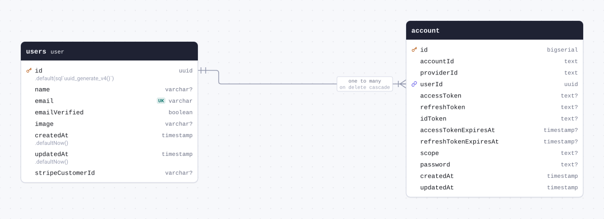

| Column                  | Type        | Constraints                         | Default | Description |
| ----------------------- | ----------- | ----------------------------------- | ------- | ----------- |
| `id`                    | `bigserial` | PK NOT NULL                         |         |             |
| `accountId`             | `text`      | NOT NULL                            |         |             |
| `providerId`            | `text`      | NOT NULL                            |         |             |
| `userId`                | `uuid`      | NOT NULL → [users.id](#table-users) |         |             |
| `accessToken`           | `text`      | NULL                                |         |             |
| `refreshToken`          | `text`      | NULL                                |         |             |
| `idToken`               | `text`      | NULL                                |         |             |
| `accessTokenExpiresAt`  | `timestamp` | NULL                                |         |             |
| `refreshTokenExpiresAt` | `timestamp` | NULL                                |         |             |
| `scope`                 | `text`      | NULL                                |         |             |
| `password`              | `text`      | NULL                                |         |             |
| `createdAt`             | `timestamp` | NOT NULL                            |         |             |
| `updatedAt`             | `timestamp` | NOT NULL                            |         |             |

#### Definition

```sql
CREATE TABLE "account" (
	"id" bigserial PRIMARY KEY,
	"accountId" text NOT NULL,
	"providerId" text NOT NULL,
	"userId" uuid NOT NULL,
	"accessToken" text,
	"refreshToken" text,
	"idToken" text,
	"accessTokenExpiresAt" timestamp,
	"refreshTokenExpiresAt" timestamp,
	"scope" text,
	"password" text,
	"createdAt" timestamp NOT NULL,
	"updatedAt" timestamp NOT NULL
);

ALTER TABLE "account" ENABLE ROW LEVEL SECURITY;

ALTER TABLE "account" ADD CONSTRAINT "account_userId_user_id_fkey" FOREIGN KEY ("userId") REFERENCES "user"("id") ON DELETE CASCADE;
```

#### References

- `userId` → [users.id](#table-users) (many to one, on delete cascade)

<details>
<summary>Queries and their SQL</summary>

**Select**: Every row of account.

```ts
db.select().from(account);
```

```sql
select "id", "accountId", "providerId", "userId", "accessToken", "refreshToken", "idToken", "accessTokenExpiresAt", "refreshTokenExpiresAt", "scope", "password", "createdAt", "updatedAt"
from "account"
```

**Count**: How many rows account has.

```ts
db.select({ count: count() }).from(account);
```

```sql
select count(*)
from "account"
```

**Find many**: The rows of account, through the relational query API.

```ts
db.query.account.findMany();
```

```sql
select "d0"."id" as "id", "d0"."accountId" as "accountId", "d0"."providerId" as "providerId", "d0"."userId" as "userId", "d0"."accessToken" as "accessToken", "d0"."refreshToken" as "refreshToken", "d0"."idToken" as "idToken", "d0"."accessTokenExpiresAt" as "accessTokenExpiresAt", "d0"."refreshTokenExpiresAt" as "refreshTokenExpiresAt", "d0"."scope" as "scope", "d0"."password" as "password", "d0"."createdAt" as "createdAt", "d0"."updatedAt" as "updatedAt"
from "account" as "d0"
```

**Find by primary key**: One row of account, through the relational query API.

```ts
db.query.account.findFirst({ where: { id: 1 } });
```

```sql
select "d0"."id" as "id", "d0"."accountId" as "accountId", "d0"."providerId" as "providerId", "d0"."userId" as "userId", "d0"."accessToken" as "accessToken", "d0"."refreshToken" as "refreshToken", "d0"."idToken" as "idToken", "d0"."accessTokenExpiresAt" as "accessTokenExpiresAt", "d0"."refreshTokenExpiresAt" as "refreshTokenExpiresAt", "d0"."scope" as "scope", "d0"."password" as "password", "d0"."createdAt" as "createdAt", "d0"."updatedAt" as "updatedAt"
from "account" as "d0"
where "d0"."id" = $1
limit $2
-- params: [1,1]
```

**Insert**: Adds a row to account, giving the columns that have no default.

```ts
db.insert(account).values({
  accountId: "accountId",
  providerId: "providerId",
  userId: "00000000-0000-0000-0000-000000000000",
  createdAt: new Date("2026-01-01T00:00:00.000Z"),
  updatedAt: new Date("2026-01-01T00:00:00.000Z"),
});
```

```sql
insert into "account" ("id", "accountId", "providerId", "userId", "accessToken", "refreshToken", "idToken", "accessTokenExpiresAt", "refreshTokenExpiresAt", "scope", "password", "createdAt", "updatedAt")
values (default, $1, $2, $3, default, default, default, default, default, default, default, $4, $5)
-- params: ["accountId","providerId","00000000-0000-0000-0000-000000000000","2026-01-01T00:00:00.000Z","2026-01-01T00:00:00.000Z"]
```

**Update**: Changes a row of account, found by its primary key.

```ts
db.update(account).set({ accountId: "accountId" }).where(eq(account.id, 1));
```

```sql
update "account"
set "accountId" = $1
where "account"."id" = $2
-- params: ["accountId",1]
```

**Delete**: Deletes a row of account, found by its primary key.

```ts
db.delete(account).where(eq(account.id, 1));
```

```sql
delete from "account"
where "account"."id" = $1
-- params: [1]
```

</details>

<a id="table-verification"></a>

### verification

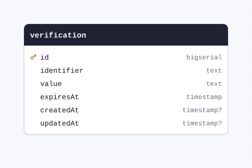

| Column       | Type        | Constraints | Default | Description |
| ------------ | ----------- | ----------- | ------- | ----------- |
| `id`         | `bigserial` | PK NOT NULL |         |             |
| `identifier` | `text`      | NOT NULL    |         |             |
| `value`      | `text`      | NOT NULL    |         |             |
| `expiresAt`  | `timestamp` | NOT NULL    |         |             |
| `createdAt`  | `timestamp` | NULL        |         |             |
| `updatedAt`  | `timestamp` | NULL        |         |             |

#### Definition

```sql
CREATE TABLE "verification" (
	"id" bigserial PRIMARY KEY,
	"identifier" text NOT NULL,
	"value" text NOT NULL,
	"expiresAt" timestamp NOT NULL,
	"createdAt" timestamp,
	"updatedAt" timestamp
);

ALTER TABLE "verification" ENABLE ROW LEVEL SECURITY;
```

<details>
<summary>Queries and their SQL</summary>

**Select**: Every row of verification.

```ts
db.select().from(verification);
```

```sql
select "id", "identifier", "value", "expiresAt", "createdAt", "updatedAt"
from "verification"
```

**Count**: How many rows verification has.

```ts
db.select({ count: count() }).from(verification);
```

```sql
select count(*)
from "verification"
```

**Find many**: The rows of verification, through the relational query API.

```ts
db.query.verification.findMany();
```

```sql
select "d0"."id" as "id", "d0"."identifier" as "identifier", "d0"."value" as "value", "d0"."expiresAt" as "expiresAt", "d0"."createdAt" as "createdAt", "d0"."updatedAt" as "updatedAt"
from "verification" as "d0"
```

**Find by primary key**: One row of verification, through the relational query API.

```ts
db.query.verification.findFirst({ where: { id: 1 } });
```

```sql
select "d0"."id" as "id", "d0"."identifier" as "identifier", "d0"."value" as "value", "d0"."expiresAt" as "expiresAt", "d0"."createdAt" as "createdAt", "d0"."updatedAt" as "updatedAt"
from "verification" as "d0"
where "d0"."id" = $1
limit $2
-- params: [1,1]
```

**Insert**: Adds a row to verification, giving the columns that have no default.

```ts
db.insert(verification).values({
  identifier: "identifier",
  value: "value",
  expiresAt: new Date("2026-01-01T00:00:00.000Z"),
});
```

```sql
insert into "verification" ("id", "identifier", "value", "expiresAt", "createdAt", "updatedAt")
values (default, $1, $2, $3, default, default)
-- params: ["identifier","value","2026-01-01T00:00:00.000Z"]
```

**Update**: Changes a row of verification, found by its primary key.

```ts
db.update(verification).set({ identifier: "identifier" }).where(eq(verification.id, 1));
```

```sql
update "verification"
set "identifier" = $1
where "verification"."id" = $2
-- params: ["identifier",1]
```

**Delete**: Deletes a row of verification, found by its primary key.

```ts
db.delete(verification).where(eq(verification.id, 1));
```

```sql
delete from "verification"
where "verification"."id" = $1
-- params: [1]
```

</details>

<a id="table-apikey"></a>

### apikey

Table `apiKey`.

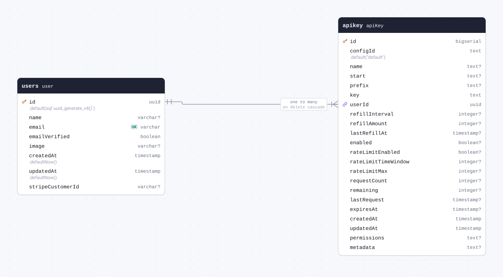

| Column                | Type        | Constraints                         | Default               | Description |
| --------------------- | ----------- | ----------------------------------- | --------------------- | ----------- |
| `id`                  | `bigserial` | PK NOT NULL                         |                       |             |
| `configId`            | `text`      | NOT NULL                            | `.default("default")` |             |
| `name`                | `text`      | NULL                                |                       |             |
| `start`               | `text`      | NULL                                |                       |             |
| `prefix`              | `text`      | NULL                                |                       |             |
| `key`                 | `text`      | NOT NULL                            |                       |             |
| `userId`              | `uuid`      | NOT NULL → [users.id](#table-users) |                       |             |
| `refillInterval`      | `integer`   | NULL                                |                       |             |
| `refillAmount`        | `integer`   | NULL                                |                       |             |
| `lastRefillAt`        | `timestamp` | NULL                                |                       |             |
| `enabled`             | `boolean`   | NULL                                |                       |             |
| `rateLimitEnabled`    | `boolean`   | NULL                                |                       |             |
| `rateLimitTimeWindow` | `integer`   | NULL                                |                       |             |
| `rateLimitMax`        | `integer`   | NULL                                |                       |             |
| `requestCount`        | `integer`   | NULL                                |                       |             |
| `remaining`           | `integer`   | NULL                                |                       |             |
| `lastRequest`         | `timestamp` | NULL                                |                       |             |
| `expiresAt`           | `timestamp` | NULL                                |                       |             |
| `createdAt`           | `timestamp` | NOT NULL                            |                       |             |
| `updatedAt`           | `timestamp` | NOT NULL                            |                       |             |
| `permissions`         | `text`      | NULL                                |                       |             |
| `metadata`            | `text`      | NULL                                |                       |             |

#### Definition

```sql
CREATE TABLE "apiKey" (
	"id" bigserial PRIMARY KEY,
	"configId" text DEFAULT 'default' NOT NULL,
	"name" text,
	"start" text,
	"prefix" text,
	"key" text NOT NULL,
	"userId" uuid NOT NULL,
	"refillInterval" integer,
	"refillAmount" integer,
	"lastRefillAt" timestamp,
	"enabled" boolean,
	"rateLimitEnabled" boolean,
	"rateLimitTimeWindow" integer,
	"rateLimitMax" integer,
	"requestCount" integer,
	"remaining" integer,
	"lastRequest" timestamp,
	"expiresAt" timestamp,
	"createdAt" timestamp NOT NULL,
	"updatedAt" timestamp NOT NULL,
	"permissions" text,
	"metadata" text
);

ALTER TABLE "apiKey" ENABLE ROW LEVEL SECURITY;

ALTER TABLE "apiKey" ADD CONSTRAINT "apiKey_userId_user_id_fkey" FOREIGN KEY ("userId") REFERENCES "user"("id") ON DELETE CASCADE;
```

#### References

- `userId` → [users.id](#table-users) (many to one, on delete cascade)

<details>
<summary>Queries and their SQL</summary>

**Select**: Every row of apikey.

```ts
db.select().from(apikey);
```

```sql
select "id", "configId", "name", "start", "prefix", "key", "userId", "refillInterval", "refillAmount", "lastRefillAt", "enabled", "rateLimitEnabled", "rateLimitTimeWindow", "rateLimitMax", "requestCount", "remaining", "lastRequest", "expiresAt", "createdAt", "updatedAt", "permissions", "metadata"
from "apiKey"
```

**Count**: How many rows apikey has.

```ts
db.select({ count: count() }).from(apikey);
```

```sql
select count(*)
from "apiKey"
```

**Find many**: The rows of apikey, through the relational query API.

```ts
db.query.apikey.findMany();
```

```sql
select "d0"."id" as "id", "d0"."configId" as "configId", "d0"."name" as "name", "d0"."start" as "start", "d0"."prefix" as "prefix", "d0"."key" as "key", "d0"."userId" as "userId", "d0"."refillInterval" as "refillInterval", "d0"."refillAmount" as "refillAmount", "d0"."lastRefillAt" as "lastRefillAt", "d0"."enabled" as "enabled", "d0"."rateLimitEnabled" as "rateLimitEnabled", "d0"."rateLimitTimeWindow" as "rateLimitTimeWindow", "d0"."rateLimitMax" as "rateLimitMax", "d0"."requestCount" as "requestCount", "d0"."remaining" as "remaining", "d0"."lastRequest" as "lastRequest", "d0"."expiresAt" as "expiresAt", "d0"."createdAt" as "createdAt", "d0"."updatedAt" as "updatedAt", "d0"."permissions" as "permissions", "d0"."metadata" as "metadata"
from "apiKey" as "d0"
```

**Find by primary key**: One row of apikey, through the relational query API.

```ts
db.query.apikey.findFirst({ where: { id: 1 } });
```

```sql
select "d0"."id" as "id", "d0"."configId" as "configId", "d0"."name" as "name", "d0"."start" as "start", "d0"."prefix" as "prefix", "d0"."key" as "key", "d0"."userId" as "userId", "d0"."refillInterval" as "refillInterval", "d0"."refillAmount" as "refillAmount", "d0"."lastRefillAt" as "lastRefillAt", "d0"."enabled" as "enabled", "d0"."rateLimitEnabled" as "rateLimitEnabled", "d0"."rateLimitTimeWindow" as "rateLimitTimeWindow", "d0"."rateLimitMax" as "rateLimitMax", "d0"."requestCount" as "requestCount", "d0"."remaining" as "remaining", "d0"."lastRequest" as "lastRequest", "d0"."expiresAt" as "expiresAt", "d0"."createdAt" as "createdAt", "d0"."updatedAt" as "updatedAt", "d0"."permissions" as "permissions", "d0"."metadata" as "metadata"
from "apiKey" as "d0"
where "d0"."id" = $1
limit $2
-- params: [1,1]
```

**Insert**: Adds a row to apikey, giving the columns that have no default.

```ts
db.insert(apikey).values({
  key: "key",
  userId: "00000000-0000-0000-0000-000000000000",
  createdAt: new Date("2026-01-01T00:00:00.000Z"),
  updatedAt: new Date("2026-01-01T00:00:00.000Z"),
});
```

```sql
insert into "apiKey" ("id", "configId", "name", "start", "prefix", "key", "userId", "refillInterval", "refillAmount", "lastRefillAt", "enabled", "rateLimitEnabled", "rateLimitTimeWindow", "rateLimitMax", "requestCount", "remaining", "lastRequest", "expiresAt", "createdAt", "updatedAt", "permissions", "metadata")
values (default, default, default, default, default, $1, $2, default, default, default, default, default, default, default, default, default, default, default, $3, $4, default, default)
-- params: ["key","00000000-0000-0000-0000-000000000000","2026-01-01T00:00:00.000Z","2026-01-01T00:00:00.000Z"]
```

**Update**: Changes a row of apikey, found by its primary key.

```ts
db.update(apikey).set({ configId: "configId" }).where(eq(apikey.id, 1));
```

```sql
update "apiKey"
set "configId" = $1
where "apiKey"."id" = $2
-- params: ["configId",1]
```

**Delete**: Deletes a row of apikey, found by its primary key.

```ts
db.delete(apikey).where(eq(apikey.id, 1));
```

```sql
delete from "apiKey"
where "apiKey"."id" = $1
-- params: [1]
```

</details>

<a id="table-boards"></a>

### boards

Table `board`.

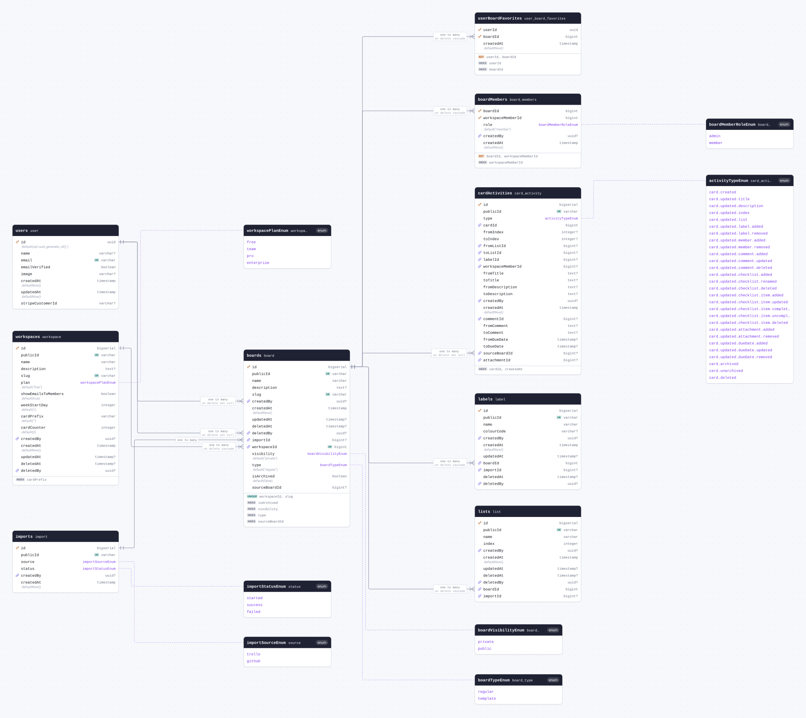

| Column          | Type                                               | Constraints                                   | Default               | Description |
| --------------- | -------------------------------------------------- | --------------------------------------------- | --------------------- | ----------- |
| `id`            | `bigserial`                                        | PK NOT NULL                                   |                       |             |
| `publicId`      | `varchar`                                          | UNIQUE NOT NULL                               |                       |             |
| `name`          | `varchar`                                          | NOT NULL                                      |                       |             |
| `description`   | `text`                                             | NULL                                          |                       |             |
| `slug`          | `varchar`                                          | NOT NULL                                      |                       |             |
| `createdBy`     | `uuid`                                             | NULL → [users.id](#table-users)               |                       |             |
| `createdAt`     | `timestamp`                                        | NOT NULL                                      | `.defaultNow()`       |             |
| `updatedAt`     | `timestamp`                                        | NULL                                          |                       |             |
| `deletedAt`     | `timestamp`                                        | NULL                                          |                       |             |
| `deletedBy`     | `uuid`                                             | NULL → [users.id](#table-users)               |                       |             |
| `importId`      | `bigint`                                           | NULL → [imports.id](#table-imports)           |                       |             |
| `workspaceId`   | `bigint`                                           | NOT NULL → [workspaces.id](#table-workspaces) |                       |             |
| `visibility`    | [`boardVisibilityEnum`](#enum-boardVisibilityEnum) | NOT NULL                                      | `.default("private")` |             |
| `type`          | [`boardTypeEnum`](#enum-boardTypeEnum)             | NOT NULL                                      | `.default("regular")` |             |
| `isArchived`    | `boolean`                                          | NOT NULL                                      | `.default(false)`     |             |
| `sourceBoardId` | `bigint`                                           | NULL                                          |                       |             |

#### Definition

```sql
CREATE TABLE "board" (
	"id" bigserial PRIMARY KEY,
	"publicId" varchar(12) NOT NULL UNIQUE,
	"name" varchar(255) NOT NULL,
	"description" text,
	"slug" varchar(255) NOT NULL,
	"createdBy" uuid,
	"createdAt" timestamp DEFAULT now() NOT NULL,
	"updatedAt" timestamp,
	"deletedAt" timestamp,
	"deletedBy" uuid,
	"importId" bigint,
	"workspaceId" bigint NOT NULL,
	"visibility" "board_visibility" DEFAULT 'private'::"board_visibility" NOT NULL,
	"type" "board_type" DEFAULT 'regular'::"board_type" NOT NULL,
	"isArchived" boolean DEFAULT false NOT NULL,
	"sourceBoardId" bigint
);

ALTER TABLE "board" ENABLE ROW LEVEL SECURITY;

CREATE INDEX "board_is_archived_idx" ON "board" ("isArchived");

CREATE INDEX "board_visibility_idx" ON "board" ("visibility");

CREATE INDEX "board_type_idx" ON "board" ("type");

CREATE INDEX "board_source_idx" ON "board" ("sourceBoardId");

CREATE UNIQUE INDEX "unique_slug_per_workspace" ON "board" ("workspaceId","slug") WHERE "deletedAt" IS NULL;

ALTER TABLE "board" ADD CONSTRAINT "board_createdBy_user_id_fkey" FOREIGN KEY ("createdBy") REFERENCES "user"("id") ON DELETE SET NULL;

ALTER TABLE "board" ADD CONSTRAINT "board_deletedBy_user_id_fkey" FOREIGN KEY ("deletedBy") REFERENCES "user"("id") ON DELETE SET NULL;

ALTER TABLE "board" ADD CONSTRAINT "board_importId_import_id_fkey" FOREIGN KEY ("importId") REFERENCES "import"("id");

ALTER TABLE "board" ADD CONSTRAINT "board_workspaceId_workspace_id_fkey" FOREIGN KEY ("workspaceId") REFERENCES "workspace"("id") ON DELETE CASCADE;
```

#### Indexes

- INDEX `isArchived`
- INDEX `visibility`
- INDEX `type`
- INDEX `sourceBoardId`
- UNIQUE `workspaceId`, `slug`

#### References

- `createdBy` → [users.id](#table-users) (many to one, on delete set null)
- `deletedBy` → [users.id](#table-users) (many to one, on delete set null)
- `importId` → [imports.id](#table-imports) (many to one)
- `workspaceId` → [workspaces.id](#table-workspaces) (many to one, on delete cascade)

#### Referenced by

- `id` → [userBoardFavorites.boardId](#table-userBoardFavorites) (one to many, on delete cascade)
- `id` → [boardMembers.boardId](#table-boardMembers) (one to many, on delete cascade)
- `id` → [cardActivities.sourceBoardId](#table-cardActivities) (one to many, on delete set null)
- `id` → [labels.boardId](#table-labels) (one to many, on delete cascade)
- `id` → [lists.boardId](#table-lists) (one to many, on delete cascade)

<details>
<summary>Queries and their SQL</summary>

**Select**: Every row of boards.

```ts
db.select().from(boards);
```

```sql
select "id", "publicId", "name", "description", "slug", "createdBy", "createdAt", "updatedAt", "deletedAt", "deletedBy", "importId", "workspaceId", "visibility", "type", "isArchived", "sourceBoardId"
from "board"
```

**Count**: How many rows boards has.

```ts
db.select({ count: count() }).from(boards);
```

```sql
select count(*)
from "board"
```

**Find many**: The rows of boards, through the relational query API.

```ts
db.query.boards.findMany();
```

```sql
select "d0"."id" as "id", "d0"."publicId" as "publicId", "d0"."name" as "name", "d0"."description" as "description", "d0"."slug" as "slug", "d0"."createdBy" as "createdBy", "d0"."createdAt" as "createdAt", "d0"."updatedAt" as "updatedAt", "d0"."deletedAt" as "deletedAt", "d0"."deletedBy" as "deletedBy", "d0"."importId" as "importId", "d0"."workspaceId" as "workspaceId", "d0"."visibility" as "visibility", "d0"."type" as "type", "d0"."isArchived" as "isArchived", "d0"."sourceBoardId" as "sourceBoardId"
from "board" as "d0"
```

**Find by primary key**: One row of boards, through the relational query API.

```ts
db.query.boards.findFirst({ where: { id: 1 } });
```

```sql
select "d0"."id" as "id", "d0"."publicId" as "publicId", "d0"."name" as "name", "d0"."description" as "description", "d0"."slug" as "slug", "d0"."createdBy" as "createdBy", "d0"."createdAt" as "createdAt", "d0"."updatedAt" as "updatedAt", "d0"."deletedAt" as "deletedAt", "d0"."deletedBy" as "deletedBy", "d0"."importId" as "importId", "d0"."workspaceId" as "workspaceId", "d0"."visibility" as "visibility", "d0"."type" as "type", "d0"."isArchived" as "isArchived", "d0"."sourceBoardId" as "sourceBoardId"
from "board" as "d0"
where "d0"."id" = $1
limit $2
-- params: [1,1]
```

**Insert**: Adds a row to boards, giving the columns that have no default.

```ts
db.insert(boards).values({ publicId: "publicId", name: "name", slug: "slug", workspaceId: 1 });
```

```sql
insert into "board" ("id", "publicId", "name", "description", "slug", "createdBy", "createdAt", "updatedAt", "deletedAt", "deletedBy", "importId", "workspaceId", "visibility", "type", "isArchived", "sourceBoardId")
values (default, $1, $2, default, $3, default, default, default, default, default, default, $4, default, default, default, default)
-- params: ["publicId","name","slug",1]
```

**Update**: Changes a row of boards, found by its primary key.

```ts
db.update(boards).set({ publicId: "publicId" }).where(eq(boards.id, 1));
```

```sql
update "board"
set "publicId" = $1
where "board"."id" = $2
-- params: ["publicId",1]
```

**Delete**: Deletes a row of boards, found by its primary key.

```ts
db.delete(boards).where(eq(boards.id, 1));
```

```sql
delete from "board"
where "board"."id" = $1
-- params: [1]
```

</details>

<a id="table-userBoardFavorites"></a>

### userBoardFavorites

Table `user_board_favorites`.

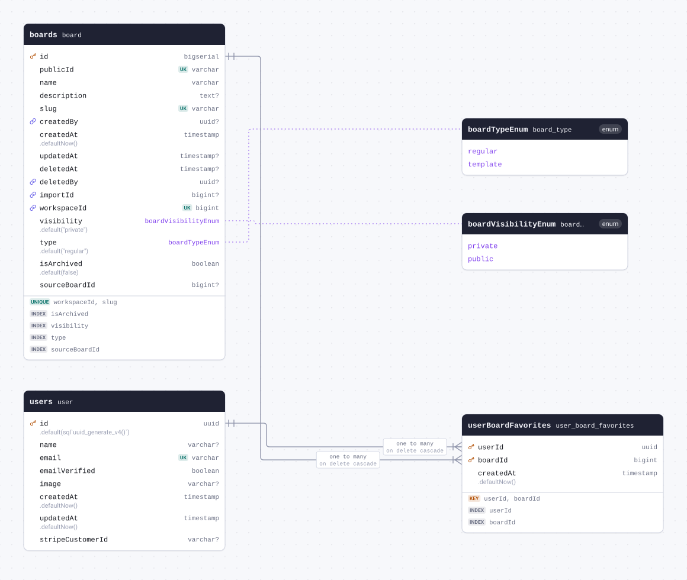

| Column      | Type        | Constraints                              | Default         | Description |
| ----------- | ----------- | ---------------------------------------- | --------------- | ----------- |
| `userId`    | `uuid`      | PK NOT NULL → [users.id](#table-users)   |                 |             |
| `boardId`   | `bigint`    | PK NOT NULL → [boards.id](#table-boards) |                 |             |
| `createdAt` | `timestamp` | NOT NULL                                 | `.defaultNow()` |             |

#### Definition

```sql
CREATE TABLE "user_board_favorites" (
	"userId" uuid,
	"boardId" bigint,
	"createdAt" timestamp DEFAULT now() NOT NULL,
	CONSTRAINT "user_board_favorites_pkey" PRIMARY KEY("userId","boardId")
);

CREATE INDEX "user_board_favorite_user_idx" ON "user_board_favorites" ("userId");

CREATE INDEX "user_board_favorite_board_idx" ON "user_board_favorites" ("boardId");

ALTER TABLE "user_board_favorites" ADD CONSTRAINT "user_board_favorites_userId_user_id_fkey" FOREIGN KEY ("userId") REFERENCES "user"("id") ON DELETE CASCADE;

ALTER TABLE "user_board_favorites" ADD CONSTRAINT "user_board_favorites_boardId_board_id_fkey" FOREIGN KEY ("boardId") REFERENCES "board"("id") ON DELETE CASCADE;
```

#### Indexes

- PRIMARY KEY `userId`, `boardId`
- INDEX `userId`
- INDEX `boardId`

#### References

- `userId` → [users.id](#table-users) (many to one, on delete cascade)
- `boardId` → [boards.id](#table-boards) (many to one, on delete cascade)

<details>
<summary>Queries and their SQL</summary>

**Select**: Every row of userBoardFavorites.

```ts
db.select().from(userBoardFavorites);
```

```sql
select "userId", "boardId", "createdAt"
from "user_board_favorites"
```

**Count**: How many rows userBoardFavorites has.

```ts
db.select({ count: count() }).from(userBoardFavorites);
```

```sql
select count(*)
from "user_board_favorites"
```

**Find many**: The rows of userBoardFavorites, through the relational query API.

```ts
db.query.userBoardFavorites.findMany();
```

```sql
select "d0"."userId" as "userId", "d0"."boardId" as "boardId", "d0"."createdAt" as "createdAt"
from "user_board_favorites" as "d0"
```

**Find by primary key**: One row of userBoardFavorites, through the relational query API.

```ts
db.query.userBoardFavorites.findFirst({
  where: { userId: "00000000-0000-0000-0000-000000000000", boardId: 1 },
});
```

```sql
select "d0"."userId" as "userId", "d0"."boardId" as "boardId", "d0"."createdAt" as "createdAt"
from "user_board_favorites" as "d0"
where (("d0"."userId" = $1) and ("d0"."boardId" = $2))
limit $3
-- params: ["00000000-0000-0000-0000-000000000000",1,1]
```

**Insert**: Adds a row to userBoardFavorites, giving the columns that have no default.

```ts
db.insert(userBoardFavorites).values({
  userId: "00000000-0000-0000-0000-000000000000",
  boardId: 1,
});
```

```sql
insert into "user_board_favorites" ("userId", "boardId", "createdAt")
values ($1, $2, default)
-- params: ["00000000-0000-0000-0000-000000000000",1]
```

**Update**: Changes a row of userBoardFavorites, found by its primary key.

```ts
db.update(userBoardFavorites)
  .set({ createdAt: new Date("2026-01-01T00:00:00.000Z") })
  .where(
    and(
      eq(userBoardFavorites.userId, "00000000-0000-0000-0000-000000000000"),
      eq(userBoardFavorites.boardId, 1),
    ),
  );
```

```sql
update "user_board_favorites"
set "createdAt" = $1
where (("user_board_favorites"."userId" = $2) and ("user_board_favorites"."boardId" = $3))
-- params: ["2026-01-01T00:00:00.000Z","00000000-0000-0000-0000-000000000000",1]
```

**Delete**: Deletes a row of userBoardFavorites, found by its primary key.

```ts
db.delete(userBoardFavorites).where(
  and(
    eq(userBoardFavorites.userId, "00000000-0000-0000-0000-000000000000"),
    eq(userBoardFavorites.boardId, 1),
  ),
);
```

```sql
delete from "user_board_favorites"
where (("user_board_favorites"."userId" = $1) and ("user_board_favorites"."boardId" = $2))
-- params: ["00000000-0000-0000-0000-000000000000",1]
```

</details>

<a id="table-boardMembers"></a>

### boardMembers

Table `board_members`.

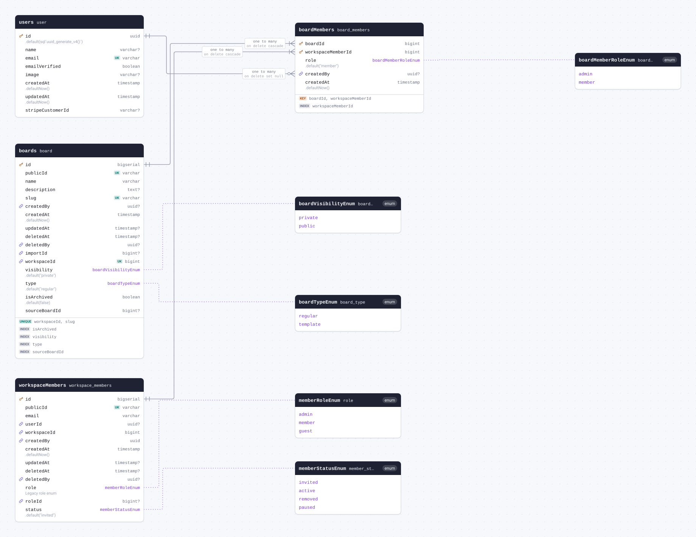

| Column              | Type                                               | Constraints                                                  | Default              | Description |
| ------------------- | -------------------------------------------------- | ------------------------------------------------------------ | -------------------- | ----------- |
| `boardId`           | `bigint`                                           | PK NOT NULL → [boards.id](#table-boards)                     |                      |             |
| `workspaceMemberId` | `bigint`                                           | PK NOT NULL → [workspaceMembers.id](#table-workspaceMembers) |                      |             |
| `role`              | [`boardMemberRoleEnum`](#enum-boardMemberRoleEnum) | NOT NULL                                                     | `.default("member")` |             |
| `createdBy`         | `uuid`                                             | NULL → [users.id](#table-users)                              |                      |             |
| `createdAt`         | `timestamp`                                        | NOT NULL                                                     | `.defaultNow()`      |             |

#### Definition

```sql
CREATE TABLE "board_members" (
	"boardId" bigint,
	"workspaceMemberId" bigint,
	"role" "board_member_role" DEFAULT 'member'::"board_member_role" NOT NULL,
	"createdBy" uuid,
	"createdAt" timestamp DEFAULT now() NOT NULL,
	CONSTRAINT "board_members_pkey" PRIMARY KEY("boardId","workspaceMemberId")
);

ALTER TABLE "board_members" ENABLE ROW LEVEL SECURITY;

CREATE INDEX "board_members_workspace_member_idx" ON "board_members" ("workspaceMemberId");

ALTER TABLE "board_members" ADD CONSTRAINT "board_members_boardId_board_id_fkey" FOREIGN KEY ("boardId") REFERENCES "board"("id") ON DELETE CASCADE;

ALTER TABLE "board_members" ADD CONSTRAINT "board_members_workspaceMemberId_workspace_members_id_fkey" FOREIGN KEY ("workspaceMemberId") REFERENCES "workspace_members"("id") ON DELETE CASCADE;

ALTER TABLE "board_members" ADD CONSTRAINT "board_members_createdBy_user_id_fkey" FOREIGN KEY ("createdBy") REFERENCES "user"("id") ON DELETE SET NULL;
```

#### Indexes

- PRIMARY KEY `boardId`, `workspaceMemberId`
- INDEX `workspaceMemberId`

#### References

- `boardId` → [boards.id](#table-boards) (many to one, on delete cascade)
- `workspaceMemberId` → [workspaceMembers.id](#table-workspaceMembers) (many to one, on delete cascade)
- `createdBy` → [users.id](#table-users) (many to one, on delete set null)

<details>
<summary>Queries and their SQL</summary>

**Select**: Every row of boardMembers.

```ts
db.select().from(boardMembers);
```

```sql
select "boardId", "workspaceMemberId", "role", "createdBy", "createdAt"
from "board_members"
```

**Count**: How many rows boardMembers has.

```ts
db.select({ count: count() }).from(boardMembers);
```

```sql
select count(*)
from "board_members"
```

**Find many**: The rows of boardMembers, through the relational query API.

```ts
db.query.boardMembers.findMany();
```

```sql
select "d0"."boardId" as "boardId", "d0"."workspaceMemberId" as "workspaceMemberId", "d0"."role" as "role", "d0"."createdBy" as "createdBy", "d0"."createdAt" as "createdAt"
from "board_members" as "d0"
```

**Find by primary key**: One row of boardMembers, through the relational query API.

```ts
db.query.boardMembers.findFirst({ where: { boardId: 1, workspaceMemberId: 1 } });
```

```sql
select "d0"."boardId" as "boardId", "d0"."workspaceMemberId" as "workspaceMemberId", "d0"."role" as "role", "d0"."createdBy" as "createdBy", "d0"."createdAt" as "createdAt"
from "board_members" as "d0"
where (("d0"."boardId" = $1) and ("d0"."workspaceMemberId" = $2))
limit $3
-- params: [1,1,1]
```

**Insert**: Adds a row to boardMembers, giving the columns that have no default.

```ts
db.insert(boardMembers).values({ boardId: 1, workspaceMemberId: 1 });
```

```sql
insert into "board_members" ("boardId", "workspaceMemberId", "role", "createdBy", "createdAt")
values ($1, $2, default, default, default)
-- params: [1,1]
```

**Update**: Changes a row of boardMembers, found by its primary key.

```ts
db.update(boardMembers)
  .set({ role: "admin" })
  .where(and(eq(boardMembers.boardId, 1), eq(boardMembers.workspaceMemberId, 1)));
```

```sql
update "board_members"
set "role" = $1
where (("board_members"."boardId" = $2) and ("board_members"."workspaceMemberId" = $3))
-- params: ["admin",1,1]
```

**Delete**: Deletes a row of boardMembers, found by its primary key.

```ts
db.delete(boardMembers).where(
  and(eq(boardMembers.boardId, 1), eq(boardMembers.workspaceMemberId, 1)),
);
```

```sql
delete from "board_members"
where (("board_members"."boardId" = $1) and ("board_members"."workspaceMemberId" = $2))
-- params: [1,1]
```

</details>

<a id="table-cards"></a>

### cards

Table `card`.

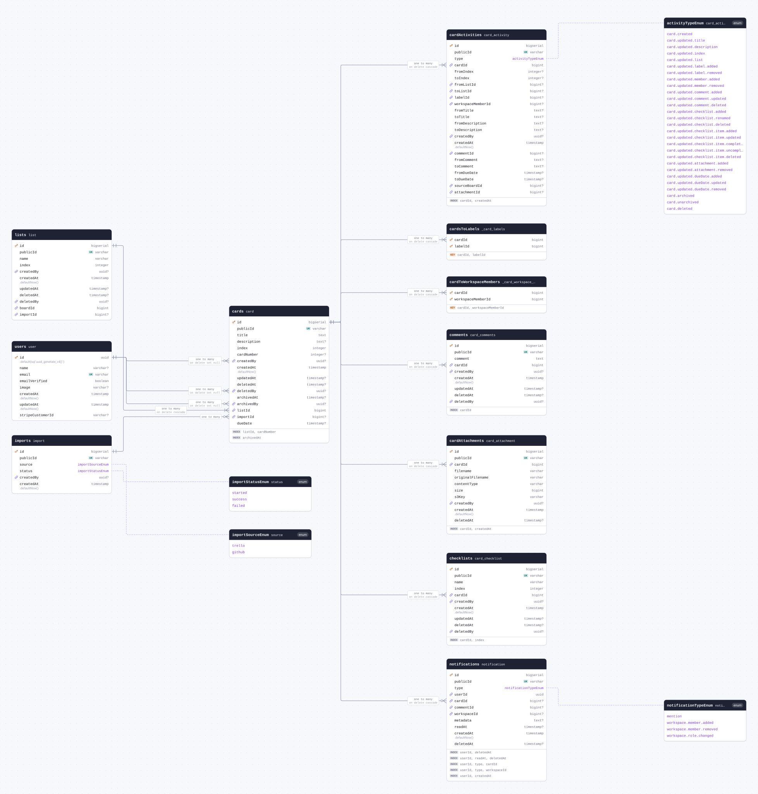

| Column        | Type        | Constraints                         | Default         | Description |
| ------------- | ----------- | ----------------------------------- | --------------- | ----------- |
| `id`          | `bigserial` | PK NOT NULL                         |                 |             |
| `publicId`    | `varchar`   | UNIQUE NOT NULL                     |                 |             |
| `title`       | `text`      | NOT NULL                            |                 |             |
| `description` | `text`      | NULL                                |                 |             |
| `index`       | `integer`   | NOT NULL                            |                 |             |
| `cardNumber`  | `integer`   | NULL                                |                 |             |
| `createdBy`   | `uuid`      | NULL → [users.id](#table-users)     |                 |             |
| `createdAt`   | `timestamp` | NOT NULL                            | `.defaultNow()` |             |
| `updatedAt`   | `timestamp` | NULL                                |                 |             |
| `deletedAt`   | `timestamp` | NULL                                |                 |             |
| `deletedBy`   | `uuid`      | NULL → [users.id](#table-users)     |                 |             |
| `listId`      | `bigint`    | NOT NULL → [lists.id](#table-lists) |                 |             |
| `importId`    | `bigint`    | NULL → [imports.id](#table-imports) |                 |             |
| `dueDate`     | `timestamp` | NULL                                |                 |             |

#### Definition

```sql
CREATE TABLE "card" (
	"id" bigserial PRIMARY KEY,
	"publicId" varchar(12) NOT NULL UNIQUE,
	"title" text NOT NULL,
	"description" text,
	"index" integer NOT NULL,
	"cardNumber" integer,
	"createdBy" uuid,
	"createdAt" timestamp DEFAULT now() NOT NULL,
	"updatedAt" timestamp,
	"deletedAt" timestamp,
	"deletedBy" uuid,
	"listId" bigint NOT NULL,
	"importId" bigint,
	"dueDate" timestamp
);

ALTER TABLE "card" ENABLE ROW LEVEL SECURITY;

CREATE INDEX "card_list_number_idx" ON "card" ("listId","cardNumber");

ALTER TABLE "card" ADD CONSTRAINT "card_createdBy_user_id_fkey" FOREIGN KEY ("createdBy") REFERENCES "user"("id") ON DELETE SET NULL;

ALTER TABLE "card" ADD CONSTRAINT "card_deletedBy_user_id_fkey" FOREIGN KEY ("deletedBy") REFERENCES "user"("id") ON DELETE SET NULL;

ALTER TABLE "card" ADD CONSTRAINT "card_listId_list_id_fkey" FOREIGN KEY ("listId") REFERENCES "list"("id") ON DELETE CASCADE;

ALTER TABLE "card" ADD CONSTRAINT "card_importId_import_id_fkey" FOREIGN KEY ("importId") REFERENCES "import"("id");
```

#### Indexes

- INDEX `listId`, `cardNumber`

#### References

- `createdBy` → [users.id](#table-users) (many to one, on delete set null)
- `deletedBy` → [users.id](#table-users) (many to one, on delete set null)
- `listId` → [lists.id](#table-lists) (many to one, on delete cascade)
- `importId` → [imports.id](#table-imports) (many to one)

#### Referenced by

- `id` → [cardActivities.cardId](#table-cardActivities) (one to many, on delete cascade)
- `id` → [cardsToLabels.cardId](#table-cardsToLabels) (one to many, on delete cascade)
- `id` → [cardToWorkspaceMembers.cardId](#table-cardToWorkspaceMembers) (one to many, on delete cascade)
- `id` → [comments.cardId](#table-comments) (one to many, on delete cascade)
- `id` → [cardAttachments.cardId](#table-cardAttachments) (one to many, on delete cascade)
- `id` → [checklists.cardId](#table-checklists) (one to many, on delete cascade)
- `id` → [notifications.cardId](#table-notifications) (one to many, on delete cascade)

<details>
<summary>Queries and their SQL</summary>

**Select**: Every row of cards.

```ts
db.select().from(cards);
```

```sql
select "id", "publicId", "title", "description", "index", "cardNumber", "createdBy", "createdAt", "updatedAt", "deletedAt", "deletedBy", "listId", "importId", "dueDate"
from "card"
```

**Count**: How many rows cards has.

```ts
db.select({ count: count() }).from(cards);
```

```sql
select count(*)
from "card"
```

**Find many**: The rows of cards, through the relational query API.

```ts
db.query.cards.findMany();
```

```sql
select "d0"."id" as "id", "d0"."publicId" as "publicId", "d0"."title" as "title", "d0"."description" as "description", "d0"."index" as "index", "d0"."cardNumber" as "cardNumber", "d0"."createdBy" as "createdBy", "d0"."createdAt" as "createdAt", "d0"."updatedAt" as "updatedAt", "d0"."deletedAt" as "deletedAt", "d0"."deletedBy" as "deletedBy", "d0"."listId" as "listId", "d0"."importId" as "importId", "d0"."dueDate" as "dueDate"
from "card" as "d0"
```

**Find by primary key**: One row of cards, through the relational query API.

```ts
db.query.cards.findFirst({ where: { id: 1 } });
```

```sql
select "d0"."id" as "id", "d0"."publicId" as "publicId", "d0"."title" as "title", "d0"."description" as "description", "d0"."index" as "index", "d0"."cardNumber" as "cardNumber", "d0"."createdBy" as "createdBy", "d0"."createdAt" as "createdAt", "d0"."updatedAt" as "updatedAt", "d0"."deletedAt" as "deletedAt", "d0"."deletedBy" as "deletedBy", "d0"."listId" as "listId", "d0"."importId" as "importId", "d0"."dueDate" as "dueDate"
from "card" as "d0"
where "d0"."id" = $1
limit $2
-- params: [1,1]
```

**Insert**: Adds a row to cards, giving the columns that have no default.

```ts
db.insert(cards).values({ publicId: "publicId", title: "title", index: 1, listId: 1 });
```

```sql
insert into "card" ("id", "publicId", "title", "description", "index", "cardNumber", "createdBy", "createdAt", "updatedAt", "deletedAt", "deletedBy", "listId", "importId", "dueDate")
values (default, $1, $2, default, $3, default, default, default, default, default, default, $4, default, default)
-- params: ["publicId","title",1,1]
```

**Update**: Changes a row of cards, found by its primary key.

```ts
db.update(cards).set({ publicId: "publicId" }).where(eq(cards.id, 1));
```

```sql
update "card"
set "publicId" = $1
where "card"."id" = $2
-- params: ["publicId",1]
```

**Delete**: Deletes a row of cards, found by its primary key.

```ts
db.delete(cards).where(eq(cards.id, 1));
```

```sql
delete from "card"
where "card"."id" = $1
-- params: [1]
```

</details>

<a id="table-cardActivities"></a>

### cardActivities

Table `card_activity`.

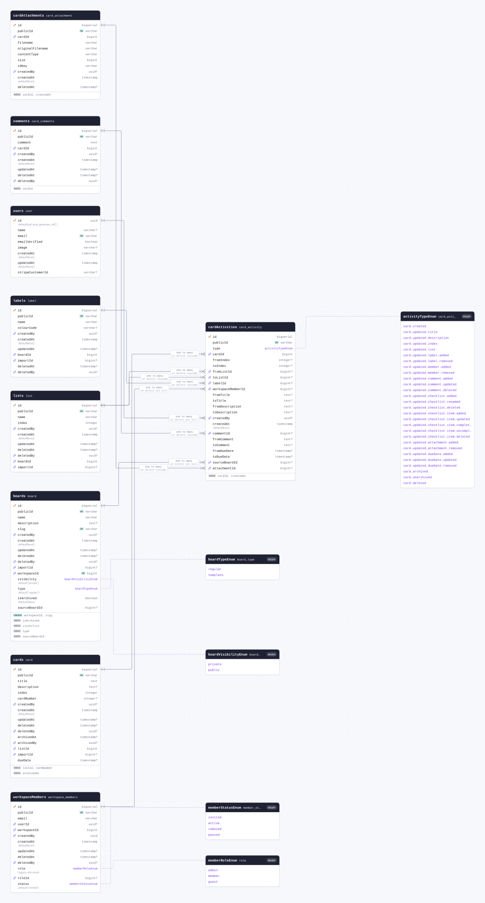

| Column              | Type                                         | Constraints                                           | Default         | Description |
| ------------------- | -------------------------------------------- | ----------------------------------------------------- | --------------- | ----------- |
| `id`                | `bigserial`                                  | PK NOT NULL                                           |                 |             |
| `publicId`          | `varchar`                                    | UNIQUE NOT NULL                                       |                 |             |
| `type`              | [`activityTypeEnum`](#enum-activityTypeEnum) | NOT NULL                                              |                 |             |
| `cardId`            | `bigint`                                     | NOT NULL → [cards.id](#table-cards)                   |                 |             |
| `fromIndex`         | `integer`                                    | NULL                                                  |                 |             |
| `toIndex`           | `integer`                                    | NULL                                                  |                 |             |
| `fromListId`        | `bigint`                                     | NULL → [lists.id](#table-lists)                       |                 |             |
| `toListId`          | `bigint`                                     | NULL → [lists.id](#table-lists)                       |                 |             |
| `labelId`           | `bigint`                                     | NULL → [labels.id](#table-labels)                     |                 |             |
| `workspaceMemberId` | `bigint`                                     | NULL → [workspaceMembers.id](#table-workspaceMembers) |                 |             |
| `fromTitle`         | `text`                                       | NULL                                                  |                 |             |
| `toTitle`           | `text`                                       | NULL                                                  |                 |             |
| `fromDescription`   | `text`                                       | NULL                                                  |                 |             |
| `toDescription`     | `text`                                       | NULL                                                  |                 |             |
| `createdBy`         | `uuid`                                       | NULL → [users.id](#table-users)                       |                 |             |
| `createdAt`         | `timestamp`                                  | NOT NULL                                              | `.defaultNow()` |             |
| `commentId`         | `bigint`                                     | NULL → [comments.id](#table-comments)                 |                 |             |
| `fromComment`       | `text`                                       | NULL                                                  |                 |             |
| `toComment`         | `text`                                       | NULL                                                  |                 |             |
| `fromDueDate`       | `timestamp`                                  | NULL                                                  |                 |             |
| `toDueDate`         | `timestamp`                                  | NULL                                                  |                 |             |
| `sourceBoardId`     | `bigint`                                     | NULL → [boards.id](#table-boards)                     |                 |             |
| `attachmentId`      | `bigint`                                     | NULL → [cardAttachments.id](#table-cardAttachments)   |                 |             |

#### Definition

```sql
CREATE TABLE "card_activity" (
	"id" bigserial PRIMARY KEY,
	"publicId" varchar(12) NOT NULL UNIQUE,
	"type" "card_activity_type" NOT NULL,
	"cardId" bigint NOT NULL,
	"fromIndex" integer,
	"toIndex" integer,
	"fromListId" bigint,
	"toListId" bigint,
	"labelId" bigint,
	"workspaceMemberId" bigint,
	"fromTitle" text,
	"toTitle" text,
	"fromDescription" text,
	"toDescription" text,
	"createdBy" uuid,
	"createdAt" timestamp DEFAULT now() NOT NULL,
	"commentId" bigint,
	"fromComment" text,
	"toComment" text,
	"fromDueDate" timestamp,
	"toDueDate" timestamp,
	"sourceBoardId" bigint,
	"attachmentId" bigint
);

ALTER TABLE "card_activity" ENABLE ROW LEVEL SECURITY;

CREATE INDEX "card_activity_card_created_at_idx" ON "card_activity" ("cardId","createdAt");

ALTER TABLE "card_activity" ADD CONSTRAINT "card_activity_cardId_card_id_fkey" FOREIGN KEY ("cardId") REFERENCES "card"("id") ON DELETE CASCADE;

ALTER TABLE "card_activity" ADD CONSTRAINT "card_activity_fromListId_list_id_fkey" FOREIGN KEY ("fromListId") REFERENCES "list"("id") ON DELETE CASCADE;

ALTER TABLE "card_activity" ADD CONSTRAINT "card_activity_toListId_list_id_fkey" FOREIGN KEY ("toListId") REFERENCES "list"("id") ON DELETE CASCADE;

ALTER TABLE "card_activity" ADD CONSTRAINT "card_activity_labelId_label_id_fkey" FOREIGN KEY ("labelId") REFERENCES "label"("id") ON DELETE CASCADE;

ALTER TABLE "card_activity" ADD CONSTRAINT "card_activity_workspaceMemberId_workspace_members_id_fkey" FOREIGN KEY ("workspaceMemberId") REFERENCES "workspace_members"("id") ON DELETE SET NULL;

ALTER TABLE "card_activity" ADD CONSTRAINT "card_activity_createdBy_user_id_fkey" FOREIGN KEY ("createdBy") REFERENCES "user"("id") ON DELETE SET NULL;

ALTER TABLE "card_activity" ADD CONSTRAINT "card_activity_commentId_card_comments_id_fkey" FOREIGN KEY ("commentId") REFERENCES "card_comments"("id") ON DELETE CASCADE;

ALTER TABLE "card_activity" ADD CONSTRAINT "card_activity_sourceBoardId_board_id_fkey" FOREIGN KEY ("sourceBoardId") REFERENCES "board"("id") ON DELETE SET NULL;

ALTER TABLE "card_activity" ADD CONSTRAINT "card_activity_attachmentId_card_attachment_id_fkey" FOREIGN KEY ("attachmentId") REFERENCES "card_attachment"("id") ON DELETE CASCADE;
```

#### Indexes

- INDEX `cardId`, `createdAt`

#### References

- `cardId` → [cards.id](#table-cards) (many to one, on delete cascade)
- `fromListId` → [lists.id](#table-lists) (many to one, on delete cascade)
- `toListId` → [lists.id](#table-lists) (many to one, on delete cascade)
- `labelId` → [labels.id](#table-labels) (many to one, on delete cascade)
- `workspaceMemberId` → [workspaceMembers.id](#table-workspaceMembers) (many to one, on delete set null)
- `createdBy` → [users.id](#table-users) (many to one, on delete set null)
- `commentId` → [comments.id](#table-comments) (many to one, on delete cascade)
- `sourceBoardId` → [boards.id](#table-boards) (many to one, on delete set null)
- `attachmentId` → [cardAttachments.id](#table-cardAttachments) (many to one, on delete cascade)

<details>
<summary>Queries and their SQL</summary>

**Select**: Every row of cardActivities.

```ts
db.select().from(cardActivities);
```

```sql
select "id", "publicId", "type", "cardId", "fromIndex", "toIndex", "fromListId", "toListId", "labelId", "workspaceMemberId", "fromTitle", "toTitle", "fromDescription", "toDescription", "createdBy", "createdAt", "commentId", "fromComment", "toComment", "fromDueDate", "toDueDate", "sourceBoardId", "attachmentId"
from "card_activity"
```

**Count**: How many rows cardActivities has.

```ts
db.select({ count: count() }).from(cardActivities);
```

```sql
select count(*)
from "card_activity"
```

**Find many**: The rows of cardActivities, through the relational query API.

```ts
db.query.cardActivities.findMany();
```

```sql
select "d0"."id" as "id", "d0"."publicId" as "publicId", "d0"."type" as "type", "d0"."cardId" as "cardId", "d0"."fromIndex" as "fromIndex", "d0"."toIndex" as "toIndex", "d0"."fromListId" as "fromListId", "d0"."toListId" as "toListId", "d0"."labelId" as "labelId", "d0"."workspaceMemberId" as "workspaceMemberId", "d0"."fromTitle" as "fromTitle", "d0"."toTitle" as "toTitle", "d0"."fromDescription" as "fromDescription", "d0"."toDescription" as "toDescription", "d0"."createdBy" as "createdBy", "d0"."createdAt" as "createdAt", "d0"."commentId" as "commentId", "d0"."fromComment" as "fromComment", "d0"."toComment" as "toComment", "d0"."fromDueDate" as "fromDueDate", "d0"."toDueDate" as "toDueDate", "d0"."sourceBoardId" as "sourceBoardId", "d0"."attachmentId" as "attachmentId"
from "card_activity" as "d0"
```

**Find by primary key**: One row of cardActivities, through the relational query API.

```ts
db.query.cardActivities.findFirst({ where: { id: 1 } });
```

```sql
select "d0"."id" as "id", "d0"."publicId" as "publicId", "d0"."type" as "type", "d0"."cardId" as "cardId", "d0"."fromIndex" as "fromIndex", "d0"."toIndex" as "toIndex", "d0"."fromListId" as "fromListId", "d0"."toListId" as "toListId", "d0"."labelId" as "labelId", "d0"."workspaceMemberId" as "workspaceMemberId", "d0"."fromTitle" as "fromTitle", "d0"."toTitle" as "toTitle", "d0"."fromDescription" as "fromDescription", "d0"."toDescription" as "toDescription", "d0"."createdBy" as "createdBy", "d0"."createdAt" as "createdAt", "d0"."commentId" as "commentId", "d0"."fromComment" as "fromComment", "d0"."toComment" as "toComment", "d0"."fromDueDate" as "fromDueDate", "d0"."toDueDate" as "toDueDate", "d0"."sourceBoardId" as "sourceBoardId", "d0"."attachmentId" as "attachmentId"
from "card_activity" as "d0"
where "d0"."id" = $1
limit $2
-- params: [1,1]
```

**Insert**: Adds a row to cardActivities, giving the columns that have no default.

```ts
db.insert(cardActivities).values({ publicId: "publicId", type: "card.created", cardId: 1 });
```

```sql
insert into "card_activity" ("id", "publicId", "type", "cardId", "fromIndex", "toIndex", "fromListId", "toListId", "labelId", "workspaceMemberId", "fromTitle", "toTitle", "fromDescription", "toDescription", "createdBy", "createdAt", "commentId", "fromComment", "toComment", "fromDueDate", "toDueDate", "sourceBoardId", "attachmentId")
values (default, $1, $2, $3, default, default, default, default, default, default, default, default, default, default, default, default, default, default, default, default, default, default, default)
-- params: ["publicId","card.created",1]
```

**Update**: Changes a row of cardActivities, found by its primary key.

```ts
db.update(cardActivities).set({ publicId: "publicId" }).where(eq(cardActivities.id, 1));
```

```sql
update "card_activity"
set "publicId" = $1
where "card_activity"."id" = $2
-- params: ["publicId",1]
```

**Delete**: Deletes a row of cardActivities, found by its primary key.

```ts
db.delete(cardActivities).where(eq(cardActivities.id, 1));
```

```sql
delete from "card_activity"
where "card_activity"."id" = $1
-- params: [1]
```

</details>

<a id="table-cardsToLabels"></a>

### cardsToLabels

Table `_card_labels`.

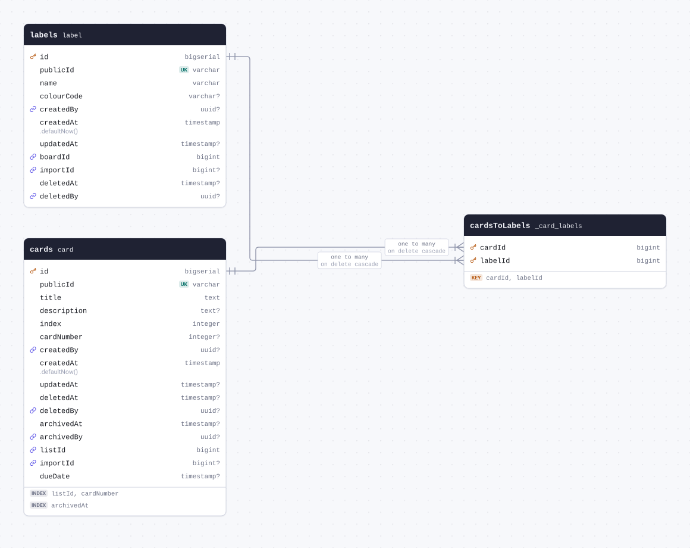

| Column    | Type     | Constraints                              | Default | Description |
| --------- | -------- | ---------------------------------------- | ------- | ----------- |
| `cardId`  | `bigint` | PK NOT NULL → [cards.id](#table-cards)   |         |             |
| `labelId` | `bigint` | PK NOT NULL → [labels.id](#table-labels) |         |             |

#### Definition

```sql
CREATE TABLE "_card_labels" (
	"cardId" bigint,
	"labelId" bigint,
	CONSTRAINT "_card_labels_pkey" PRIMARY KEY("cardId","labelId")
);

ALTER TABLE "_card_labels" ENABLE ROW LEVEL SECURITY;

ALTER TABLE "_card_labels" ADD CONSTRAINT "_card_labels_cardId_card_id_fkey" FOREIGN KEY ("cardId") REFERENCES "card"("id") ON DELETE CASCADE;

ALTER TABLE "_card_labels" ADD CONSTRAINT "_card_labels_labelId_label_id_fkey" FOREIGN KEY ("labelId") REFERENCES "label"("id") ON DELETE CASCADE;
```

#### Indexes

- PRIMARY KEY `cardId`, `labelId`

#### References

- `cardId` → [cards.id](#table-cards) (many to one, on delete cascade)
- `labelId` → [labels.id](#table-labels) (many to one, on delete cascade)

<details>
<summary>Queries and their SQL</summary>

**Select**: Every row of cardsToLabels.

```ts
db.select().from(cardsToLabels);
```

```sql
select "cardId", "labelId"
from "_card_labels"
```

**Count**: How many rows cardsToLabels has.

```ts
db.select({ count: count() }).from(cardsToLabels);
```

```sql
select count(*)
from "_card_labels"
```

**Find many**: The rows of cardsToLabels, through the relational query API.

```ts
db.query.cardsToLabels.findMany();
```

```sql
select "d0"."cardId" as "cardId", "d0"."labelId" as "labelId"
from "_card_labels" as "d0"
```

**Find by primary key**: One row of cardsToLabels, through the relational query API.

```ts
db.query.cardsToLabels.findFirst({ where: { cardId: 1, labelId: 1 } });
```

```sql
select "d0"."cardId" as "cardId", "d0"."labelId" as "labelId"
from "_card_labels" as "d0"
where (("d0"."cardId" = $1) and ("d0"."labelId" = $2))
limit $3
-- params: [1,1,1]
```

**Insert**: Adds a row to cardsToLabels, giving the columns that have no default.

```ts
db.insert(cardsToLabels).values({ cardId: 1, labelId: 1 });
```

```sql
insert into "_card_labels" ("cardId", "labelId")
values ($1, $2)
-- params: [1,1]
```

**Delete**: Deletes a row of cardsToLabels, found by its primary key.

```ts
db.delete(cardsToLabels).where(and(eq(cardsToLabels.cardId, 1), eq(cardsToLabels.labelId, 1)));
```

```sql
delete from "_card_labels"
where (("_card_labels"."cardId" = $1) and ("_card_labels"."labelId" = $2))
-- params: [1,1]
```

</details>

<a id="table-cardToWorkspaceMembers"></a>

### cardToWorkspaceMembers

Table `_card_workspace_members`.

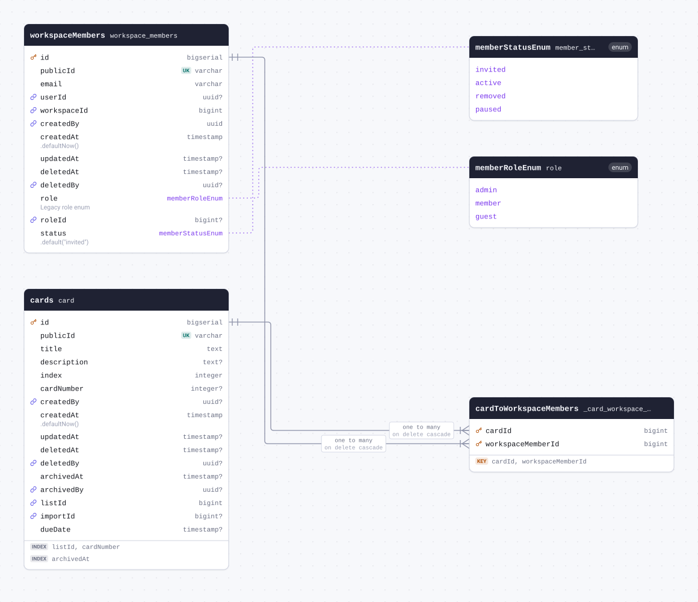

| Column              | Type     | Constraints                                                  | Default | Description |
| ------------------- | -------- | ------------------------------------------------------------ | ------- | ----------- |
| `cardId`            | `bigint` | PK NOT NULL → [cards.id](#table-cards)                       |         |             |
| `workspaceMemberId` | `bigint` | PK NOT NULL → [workspaceMembers.id](#table-workspaceMembers) |         |             |

#### Definition

```sql
CREATE TABLE "_card_workspace_members" (
	"cardId" bigint,
	"workspaceMemberId" bigint,
	CONSTRAINT "_card_workspace_members_pkey" PRIMARY KEY("cardId","workspaceMemberId")
);

ALTER TABLE "_card_workspace_members" ENABLE ROW LEVEL SECURITY;

ALTER TABLE "_card_workspace_members" ADD CONSTRAINT "_card_workspace_members_cardId_card_id_fkey" FOREIGN KEY ("cardId") REFERENCES "card"("id") ON DELETE CASCADE;

ALTER TABLE "_card_workspace_members" ADD CONSTRAINT "_card_workspace_members_tMcTv7HPnXM6_fkey" FOREIGN KEY ("workspaceMemberId") REFERENCES "workspace_members"("id") ON DELETE CASCADE;
```

#### Indexes

- PRIMARY KEY `cardId`, `workspaceMemberId`

#### References

- `cardId` → [cards.id](#table-cards) (many to one, on delete cascade)
- `workspaceMemberId` → [workspaceMembers.id](#table-workspaceMembers) (many to one, on delete cascade)

<details>
<summary>Queries and their SQL</summary>

**Select**: Every row of cardToWorkspaceMembers.

```ts
db.select().from(cardToWorkspaceMembers);
```

```sql
select "cardId", "workspaceMemberId"
from "_card_workspace_members"
```

**Count**: How many rows cardToWorkspaceMembers has.

```ts
db.select({ count: count() }).from(cardToWorkspaceMembers);
```

```sql
select count(*)
from "_card_workspace_members"
```

**Find many**: The rows of cardToWorkspaceMembers, through the relational query API.

```ts
db.query.cardToWorkspaceMembers.findMany();
```

```sql
select "d0"."cardId" as "cardId", "d0"."workspaceMemberId" as "workspaceMemberId"
from "_card_workspace_members" as "d0"
```

**Find by primary key**: One row of cardToWorkspaceMembers, through the relational query API.

```ts
db.query.cardToWorkspaceMembers.findFirst({ where: { cardId: 1, workspaceMemberId: 1 } });
```

```sql
select "d0"."cardId" as "cardId", "d0"."workspaceMemberId" as "workspaceMemberId"
from "_card_workspace_members" as "d0"
where (("d0"."cardId" = $1) and ("d0"."workspaceMemberId" = $2))
limit $3
-- params: [1,1,1]
```

**Insert**: Adds a row to cardToWorkspaceMembers, giving the columns that have no default.

```ts
db.insert(cardToWorkspaceMembers).values({ cardId: 1, workspaceMemberId: 1 });
```

```sql
insert into "_card_workspace_members" ("cardId", "workspaceMemberId")
values ($1, $2)
-- params: [1,1]
```

**Delete**: Deletes a row of cardToWorkspaceMembers, found by its primary key.

```ts
db.delete(cardToWorkspaceMembers).where(
  and(eq(cardToWorkspaceMembers.cardId, 1), eq(cardToWorkspaceMembers.workspaceMemberId, 1)),
);
```

```sql
delete from "_card_workspace_members"
where (("_card_workspace_members"."cardId" = $1) and ("_card_workspace_members"."workspaceMemberId" = $2))
-- params: [1,1]
```

</details>

<a id="table-comments"></a>

### comments

Table `card_comments`.

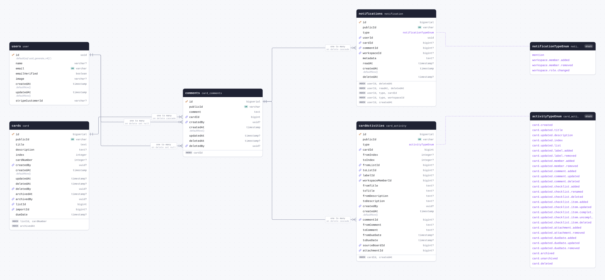

| Column      | Type        | Constraints                         | Default         | Description |
| ----------- | ----------- | ----------------------------------- | --------------- | ----------- |
| `id`        | `bigserial` | PK NOT NULL                         |                 |             |
| `publicId`  | `varchar`   | UNIQUE NOT NULL                     |                 |             |
| `comment`   | `text`      | NOT NULL                            |                 |             |
| `cardId`    | `bigint`    | NOT NULL → [cards.id](#table-cards) |                 |             |
| `createdBy` | `uuid`      | NULL → [users.id](#table-users)     |                 |             |
| `createdAt` | `timestamp` | NOT NULL                            | `.defaultNow()` |             |
| `updatedAt` | `timestamp` | NULL                                |                 |             |
| `deletedAt` | `timestamp` | NULL                                |                 |             |
| `deletedBy` | `uuid`      | NULL → [users.id](#table-users)     |                 |             |

#### Definition

```sql
CREATE TABLE "card_comments" (
	"id" bigserial PRIMARY KEY,
	"publicId" varchar(12) NOT NULL UNIQUE,
	"comment" text NOT NULL,
	"cardId" bigint NOT NULL,
	"createdBy" uuid,
	"createdAt" timestamp DEFAULT now() NOT NULL,
	"updatedAt" timestamp,
	"deletedAt" timestamp,
	"deletedBy" uuid
);

ALTER TABLE "card_comments" ENABLE ROW LEVEL SECURITY;

CREATE INDEX "card_comments_card_id_idx" ON "card_comments" ("cardId");

ALTER TABLE "card_comments" ADD CONSTRAINT "card_comments_cardId_card_id_fkey" FOREIGN KEY ("cardId") REFERENCES "card"("id") ON DELETE CASCADE;

ALTER TABLE "card_comments" ADD CONSTRAINT "card_comments_createdBy_user_id_fkey" FOREIGN KEY ("createdBy") REFERENCES "user"("id") ON DELETE SET NULL;

ALTER TABLE "card_comments" ADD CONSTRAINT "card_comments_deletedBy_user_id_fkey" FOREIGN KEY ("deletedBy") REFERENCES "user"("id") ON DELETE SET NULL;
```

#### Indexes

- INDEX `cardId`

#### References

- `cardId` → [cards.id](#table-cards) (many to one, on delete cascade)
- `createdBy` → [users.id](#table-users) (many to one, on delete set null)
- `deletedBy` → [users.id](#table-users) (many to one, on delete set null)

#### Referenced by

- `id` → [cardActivities.commentId](#table-cardActivities) (one to many, on delete cascade)
- `id` → [notifications.commentId](#table-notifications) (one to many, on delete cascade)

<details>
<summary>Queries and their SQL</summary>

**Select**: Every row of comments.

```ts
db.select().from(comments);
```

```sql
select "id", "publicId", "comment", "cardId", "createdBy", "createdAt", "updatedAt", "deletedAt", "deletedBy"
from "card_comments"
```

**Count**: How many rows comments has.

```ts
db.select({ count: count() }).from(comments);
```

```sql
select count(*)
from "card_comments"
```

**Find many**: The rows of comments, through the relational query API.

```ts
db.query.comments.findMany();
```

```sql
select "d0"."id" as "id", "d0"."publicId" as "publicId", "d0"."comment" as "comment", "d0"."cardId" as "cardId", "d0"."createdBy" as "createdBy", "d0"."createdAt" as "createdAt", "d0"."updatedAt" as "updatedAt", "d0"."deletedAt" as "deletedAt", "d0"."deletedBy" as "deletedBy"
from "card_comments" as "d0"
```

**Find by primary key**: One row of comments, through the relational query API.

```ts
db.query.comments.findFirst({ where: { id: 1 } });
```

```sql
select "d0"."id" as "id", "d0"."publicId" as "publicId", "d0"."comment" as "comment", "d0"."cardId" as "cardId", "d0"."createdBy" as "createdBy", "d0"."createdAt" as "createdAt", "d0"."updatedAt" as "updatedAt", "d0"."deletedAt" as "deletedAt", "d0"."deletedBy" as "deletedBy"
from "card_comments" as "d0"
where "d0"."id" = $1
limit $2
-- params: [1,1]
```

**Insert**: Adds a row to comments, giving the columns that have no default.

```ts
db.insert(comments).values({ publicId: "publicId", comment: "comment", cardId: 1 });
```

```sql
insert into "card_comments" ("id", "publicId", "comment", "cardId", "createdBy", "createdAt", "updatedAt", "deletedAt", "deletedBy")
values (default, $1, $2, $3, default, default, default, default, default)
-- params: ["publicId","comment",1]
```

**Update**: Changes a row of comments, found by its primary key.

```ts
db.update(comments).set({ publicId: "publicId" }).where(eq(comments.id, 1));
```

```sql
update "card_comments"
set "publicId" = $1
where "card_comments"."id" = $2
-- params: ["publicId",1]
```

**Delete**: Deletes a row of comments, found by its primary key.

```ts
db.delete(comments).where(eq(comments.id, 1));
```

```sql
delete from "card_comments"
where "card_comments"."id" = $1
-- params: [1]
```

</details>

<a id="table-cardAttachments"></a>

### cardAttachments

Table `card_attachment`.

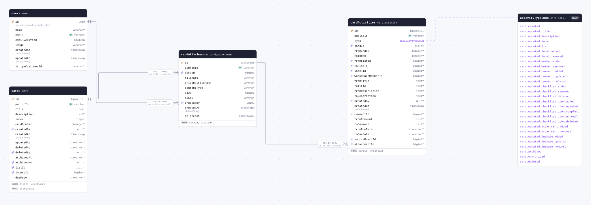

| Column             | Type        | Constraints                         | Default         | Description |
| ------------------ | ----------- | ----------------------------------- | --------------- | ----------- |
| `id`               | `bigserial` | PK NOT NULL                         |                 |             |
| `publicId`         | `varchar`   | UNIQUE NOT NULL                     |                 |             |
| `cardId`           | `bigint`    | NOT NULL → [cards.id](#table-cards) |                 |             |
| `filename`         | `varchar`   | NOT NULL                            |                 |             |
| `originalFilename` | `varchar`   | NOT NULL                            |                 |             |
| `contentType`      | `varchar`   | NOT NULL                            |                 |             |
| `size`             | `bigint`    | NOT NULL                            |                 |             |
| `s3Key`            | `varchar`   | NOT NULL                            |                 |             |
| `createdBy`        | `uuid`      | NULL → [users.id](#table-users)     |                 |             |
| `createdAt`        | `timestamp` | NOT NULL                            | `.defaultNow()` |             |
| `deletedAt`        | `timestamp` | NULL                                |                 |             |

#### Definition

```sql
CREATE TABLE "card_attachment" (
	"id" bigserial PRIMARY KEY,
	"publicId" varchar(12) NOT NULL UNIQUE,
	"cardId" bigint NOT NULL,
	"filename" varchar(255) NOT NULL,
	"originalFilename" varchar(255) NOT NULL,
	"contentType" varchar(100) NOT NULL,
	"size" bigint NOT NULL,
	"s3Key" varchar(500) NOT NULL,
	"createdBy" uuid,
	"createdAt" timestamp DEFAULT now() NOT NULL,
	"deletedAt" timestamp
);

ALTER TABLE "card_attachment" ENABLE ROW LEVEL SECURITY;

CREATE INDEX "card_attachment_card_created_at_idx" ON "card_attachment" ("cardId","createdAt");

ALTER TABLE "card_attachment" ADD CONSTRAINT "card_attachment_cardId_card_id_fkey" FOREIGN KEY ("cardId") REFERENCES "card"("id") ON DELETE CASCADE;

ALTER TABLE "card_attachment" ADD CONSTRAINT "card_attachment_createdBy_user_id_fkey" FOREIGN KEY ("createdBy") REFERENCES "user"("id") ON DELETE SET NULL;
```

#### Indexes

- INDEX `cardId`, `createdAt`

#### References

- `cardId` → [cards.id](#table-cards) (many to one, on delete cascade)
- `createdBy` → [users.id](#table-users) (many to one, on delete set null)

#### Referenced by

- `id` → [cardActivities.attachmentId](#table-cardActivities) (one to many, on delete cascade)

<details>
<summary>Queries and their SQL</summary>

**Select**: Every row of cardAttachments.

```ts
db.select().from(cardAttachments);
```

```sql
select "id", "publicId", "cardId", "filename", "originalFilename", "contentType", "size", "s3Key", "createdBy", "createdAt", "deletedAt"
from "card_attachment"
```

**Count**: How many rows cardAttachments has.

```ts
db.select({ count: count() }).from(cardAttachments);
```

```sql
select count(*)
from "card_attachment"
```

**Find many**: The rows of cardAttachments, through the relational query API.

```ts
db.query.cardAttachments.findMany();
```

```sql
select "d0"."id" as "id", "d0"."publicId" as "publicId", "d0"."cardId" as "cardId", "d0"."filename" as "filename", "d0"."originalFilename" as "originalFilename", "d0"."contentType" as "contentType", "d0"."size" as "size", "d0"."s3Key" as "s3Key", "d0"."createdBy" as "createdBy", "d0"."createdAt" as "createdAt", "d0"."deletedAt" as "deletedAt"
from "card_attachment" as "d0"
```

**Find by primary key**: One row of cardAttachments, through the relational query API.

```ts
db.query.cardAttachments.findFirst({ where: { id: 1 } });
```

```sql
select "d0"."id" as "id", "d0"."publicId" as "publicId", "d0"."cardId" as "cardId", "d0"."filename" as "filename", "d0"."originalFilename" as "originalFilename", "d0"."contentType" as "contentType", "d0"."size" as "size", "d0"."s3Key" as "s3Key", "d0"."createdBy" as "createdBy", "d0"."createdAt" as "createdAt", "d0"."deletedAt" as "deletedAt"
from "card_attachment" as "d0"
where "d0"."id" = $1
limit $2
-- params: [1,1]
```

**Insert**: Adds a row to cardAttachments, giving the columns that have no default.

```ts
db.insert(cardAttachments).values({
  publicId: "publicId",
  cardId: 1,
  filename: "filename",
  originalFilename: "originalFilename",
  contentType: "contentType",
  size: 1,
  s3Key: "s3Key",
});
```

```sql
insert into "card_attachment" ("id", "publicId", "cardId", "filename", "originalFilename", "contentType", "size", "s3Key", "createdBy", "createdAt", "deletedAt")
values (default, $1, $2, $3, $4, $5, $6, $7, default, default, default)
-- params: ["publicId",1,"filename","originalFilename","contentType",1,"s3Key"]
```

**Update**: Changes a row of cardAttachments, found by its primary key.

```ts
db.update(cardAttachments).set({ publicId: "publicId" }).where(eq(cardAttachments.id, 1));
```

```sql
update "card_attachment"
set "publicId" = $1
where "card_attachment"."id" = $2
-- params: ["publicId",1]
```

**Delete**: Deletes a row of cardAttachments, found by its primary key.

```ts
db.delete(cardAttachments).where(eq(cardAttachments.id, 1));
```

```sql
delete from "card_attachment"
where "card_attachment"."id" = $1
-- params: [1]
```

</details>

<a id="table-checklists"></a>

### checklists

Table `card_checklist`.

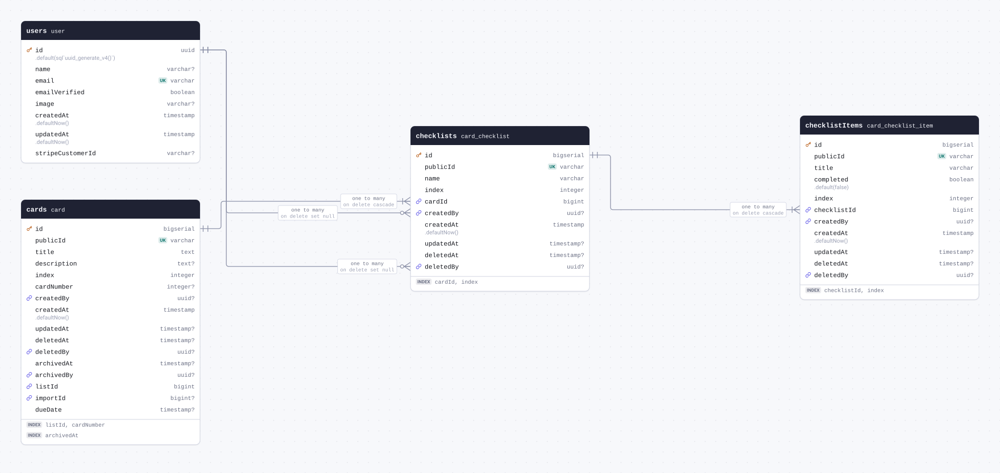

| Column      | Type        | Constraints                         | Default         | Description |
| ----------- | ----------- | ----------------------------------- | --------------- | ----------- |
| `id`        | `bigserial` | PK NOT NULL                         |                 |             |
| `publicId`  | `varchar`   | UNIQUE NOT NULL                     |                 |             |
| `name`      | `varchar`   | NOT NULL                            |                 |             |
| `index`     | `integer`   | NOT NULL                            |                 |             |
| `cardId`    | `bigint`    | NOT NULL → [cards.id](#table-cards) |                 |             |
| `createdBy` | `uuid`      | NULL → [users.id](#table-users)     |                 |             |
| `createdAt` | `timestamp` | NOT NULL                            | `.defaultNow()` |             |
| `updatedAt` | `timestamp` | NULL                                |                 |             |
| `deletedAt` | `timestamp` | NULL                                |                 |             |
| `deletedBy` | `uuid`      | NULL → [users.id](#table-users)     |                 |             |

#### Definition

```sql
CREATE TABLE "card_checklist" (
	"id" bigserial PRIMARY KEY,
	"publicId" varchar(12) NOT NULL UNIQUE,
	"name" varchar(255) NOT NULL,
	"index" integer NOT NULL,
	"cardId" bigint NOT NULL,
	"createdBy" uuid,
	"createdAt" timestamp DEFAULT now() NOT NULL,
	"updatedAt" timestamp,
	"deletedAt" timestamp,
	"deletedBy" uuid
);

ALTER TABLE "card_checklist" ENABLE ROW LEVEL SECURITY;

CREATE INDEX "card_checklist_card_index_idx" ON "card_checklist" ("cardId","index");

ALTER TABLE "card_checklist" ADD CONSTRAINT "card_checklist_cardId_card_id_fkey" FOREIGN KEY ("cardId") REFERENCES "card"("id") ON DELETE CASCADE;

ALTER TABLE "card_checklist" ADD CONSTRAINT "card_checklist_createdBy_user_id_fkey" FOREIGN KEY ("createdBy") REFERENCES "user"("id") ON DELETE SET NULL;

ALTER TABLE "card_checklist" ADD CONSTRAINT "card_checklist_deletedBy_user_id_fkey" FOREIGN KEY ("deletedBy") REFERENCES "user"("id") ON DELETE SET NULL;
```

#### Indexes

- INDEX `cardId`, `index`

#### References

- `cardId` → [cards.id](#table-cards) (many to one, on delete cascade)
- `createdBy` → [users.id](#table-users) (many to one, on delete set null)
- `deletedBy` → [users.id](#table-users) (many to one, on delete set null)

#### Referenced by

- `id` → [checklistItems.checklistId](#table-checklistItems) (one to many, on delete cascade)

<details>
<summary>Queries and their SQL</summary>

**Select**: Every row of checklists.

```ts
db.select().from(checklists);
```

```sql
select "id", "publicId", "name", "index", "cardId", "createdBy", "createdAt", "updatedAt", "deletedAt", "deletedBy"
from "card_checklist"
```

**Count**: How many rows checklists has.

```ts
db.select({ count: count() }).from(checklists);
```

```sql
select count(*)
from "card_checklist"
```

**Find many**: The rows of checklists, through the relational query API.

```ts
db.query.checklists.findMany();
```

```sql
select "d0"."id" as "id", "d0"."publicId" as "publicId", "d0"."name" as "name", "d0"."index" as "index", "d0"."cardId" as "cardId", "d0"."createdBy" as "createdBy", "d0"."createdAt" as "createdAt", "d0"."updatedAt" as "updatedAt", "d0"."deletedAt" as "deletedAt", "d0"."deletedBy" as "deletedBy"
from "card_checklist" as "d0"
```

**Find by primary key**: One row of checklists, through the relational query API.

```ts
db.query.checklists.findFirst({ where: { id: 1 } });
```

```sql
select "d0"."id" as "id", "d0"."publicId" as "publicId", "d0"."name" as "name", "d0"."index" as "index", "d0"."cardId" as "cardId", "d0"."createdBy" as "createdBy", "d0"."createdAt" as "createdAt", "d0"."updatedAt" as "updatedAt", "d0"."deletedAt" as "deletedAt", "d0"."deletedBy" as "deletedBy"
from "card_checklist" as "d0"
where "d0"."id" = $1
limit $2
-- params: [1,1]
```

**Insert**: Adds a row to checklists, giving the columns that have no default.

```ts
db.insert(checklists).values({ publicId: "publicId", name: "name", index: 1, cardId: 1 });
```

```sql
insert into "card_checklist" ("id", "publicId", "name", "index", "cardId", "createdBy", "createdAt", "updatedAt", "deletedAt", "deletedBy")
values (default, $1, $2, $3, $4, default, default, default, default, default)
-- params: ["publicId","name",1,1]
```

**Update**: Changes a row of checklists, found by its primary key.

```ts
db.update(checklists).set({ publicId: "publicId" }).where(eq(checklists.id, 1));
```

```sql
update "card_checklist"
set "publicId" = $1
where "card_checklist"."id" = $2
-- params: ["publicId",1]
```

**Delete**: Deletes a row of checklists, found by its primary key.

```ts
db.delete(checklists).where(eq(checklists.id, 1));
```

```sql
delete from "card_checklist"
where "card_checklist"."id" = $1
-- params: [1]
```

</details>

<a id="table-checklistItems"></a>

### checklistItems

Table `card_checklist_item`.

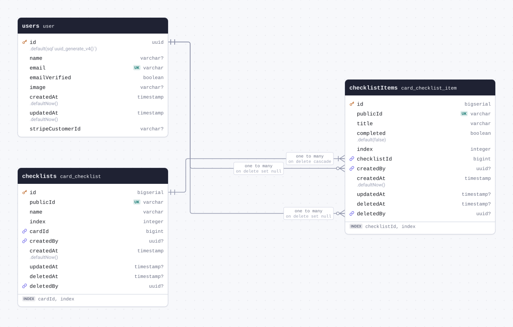

| Column        | Type        | Constraints                                   | Default           | Description |
| ------------- | ----------- | --------------------------------------------- | ----------------- | ----------- |
| `id`          | `bigserial` | PK NOT NULL                                   |                   |             |
| `publicId`    | `varchar`   | UNIQUE NOT NULL                               |                   |             |
| `title`       | `varchar`   | NOT NULL                                      |                   |             |
| `completed`   | `boolean`   | NOT NULL                                      | `.default(false)` |             |
| `index`       | `integer`   | NOT NULL                                      |                   |             |
| `checklistId` | `bigint`    | NOT NULL → [checklists.id](#table-checklists) |                   |             |
| `createdBy`   | `uuid`      | NULL → [users.id](#table-users)               |                   |             |
| `createdAt`   | `timestamp` | NOT NULL                                      | `.defaultNow()`   |             |
| `updatedAt`   | `timestamp` | NULL                                          |                   |             |
| `deletedAt`   | `timestamp` | NULL                                          |                   |             |
| `deletedBy`   | `uuid`      | NULL → [users.id](#table-users)               |                   |             |

#### Definition

```sql
CREATE TABLE "card_checklist_item" (
	"id" bigserial PRIMARY KEY,
	"publicId" varchar(12) NOT NULL UNIQUE,
	"title" varchar(500) NOT NULL,
	"completed" boolean DEFAULT false NOT NULL,
	"index" integer NOT NULL,
	"checklistId" bigint NOT NULL,
	"createdBy" uuid,
	"createdAt" timestamp DEFAULT now() NOT NULL,
	"updatedAt" timestamp,
	"deletedAt" timestamp,
	"deletedBy" uuid
);

ALTER TABLE "card_checklist_item" ENABLE ROW LEVEL SECURITY;

CREATE INDEX "card_checklist_item_checklist_index_idx" ON "card_checklist_item" ("checklistId","index");

ALTER TABLE "card_checklist_item" ADD CONSTRAINT "card_checklist_item_checklistId_card_checklist_id_fkey" FOREIGN KEY ("checklistId") REFERENCES "card_checklist"("id") ON DELETE CASCADE;

ALTER TABLE "card_checklist_item" ADD CONSTRAINT "card_checklist_item_createdBy_user_id_fkey" FOREIGN KEY ("createdBy") REFERENCES "user"("id") ON DELETE SET NULL;

ALTER TABLE "card_checklist_item" ADD CONSTRAINT "card_checklist_item_deletedBy_user_id_fkey" FOREIGN KEY ("deletedBy") REFERENCES "user"("id") ON DELETE SET NULL;
```

#### Indexes

- INDEX `checklistId`, `index`

#### References

- `checklistId` → [checklists.id](#table-checklists) (many to one, on delete cascade)
- `createdBy` → [users.id](#table-users) (many to one, on delete set null)
- `deletedBy` → [users.id](#table-users) (many to one, on delete set null)

<details>
<summary>Queries and their SQL</summary>

**Select**: Every row of checklistItems.

```ts
db.select().from(checklistItems);
```

```sql
select "id", "publicId", "title", "completed", "index", "checklistId", "createdBy", "createdAt", "updatedAt", "deletedAt", "deletedBy"
from "card_checklist_item"
```

**Count**: How many rows checklistItems has.

```ts
db.select({ count: count() }).from(checklistItems);
```

```sql
select count(*)
from "card_checklist_item"
```

**Find many**: The rows of checklistItems, through the relational query API.

```ts
db.query.checklistItems.findMany();
```

```sql
select "d0"."id" as "id", "d0"."publicId" as "publicId", "d0"."title" as "title", "d0"."completed" as "completed", "d0"."index" as "index", "d0"."checklistId" as "checklistId", "d0"."createdBy" as "createdBy", "d0"."createdAt" as "createdAt", "d0"."updatedAt" as "updatedAt", "d0"."deletedAt" as "deletedAt", "d0"."deletedBy" as "deletedBy"
from "card_checklist_item" as "d0"
```

**Find by primary key**: One row of checklistItems, through the relational query API.

```ts
db.query.checklistItems.findFirst({ where: { id: 1 } });
```

```sql
select "d0"."id" as "id", "d0"."publicId" as "publicId", "d0"."title" as "title", "d0"."completed" as "completed", "d0"."index" as "index", "d0"."checklistId" as "checklistId", "d0"."createdBy" as "createdBy", "d0"."createdAt" as "createdAt", "d0"."updatedAt" as "updatedAt", "d0"."deletedAt" as "deletedAt", "d0"."deletedBy" as "deletedBy"
from "card_checklist_item" as "d0"
where "d0"."id" = $1
limit $2
-- params: [1,1]
```

**Insert**: Adds a row to checklistItems, giving the columns that have no default.

```ts
db.insert(checklistItems).values({
  publicId: "publicId",
  title: "title",
  index: 1,
  checklistId: 1,
});
```

```sql
insert into "card_checklist_item" ("id", "publicId", "title", "completed", "index", "checklistId", "createdBy", "createdAt", "updatedAt", "deletedAt", "deletedBy")
values (default, $1, $2, default, $3, $4, default, default, default, default, default)
-- params: ["publicId","title",1,1]
```

**Update**: Changes a row of checklistItems, found by its primary key.

```ts
db.update(checklistItems).set({ publicId: "publicId" }).where(eq(checklistItems.id, 1));
```

```sql
update "card_checklist_item"
set "publicId" = $1
where "card_checklist_item"."id" = $2
-- params: ["publicId",1]
```

**Delete**: Deletes a row of checklistItems, found by its primary key.

```ts
db.delete(checklistItems).where(eq(checklistItems.id, 1));
```

```sql
delete from "card_checklist_item"
where "card_checklist_item"."id" = $1
-- params: [1]
```

</details>

<a id="table-feedback"></a>

### feedback

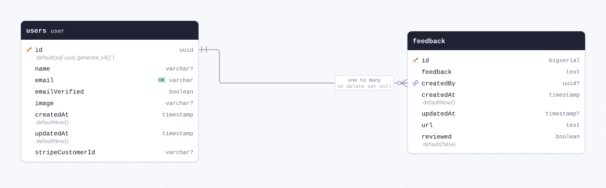

| Column      | Type        | Constraints                     | Default           | Description |
| ----------- | ----------- | ------------------------------- | ----------------- | ----------- |
| `id`        | `bigserial` | PK NOT NULL                     |                   |             |
| `feedback`  | `text`      | NOT NULL                        |                   |             |
| `createdBy` | `uuid`      | NULL → [users.id](#table-users) |                   |             |
| `createdAt` | `timestamp` | NOT NULL                        | `.defaultNow()`   |             |
| `updatedAt` | `timestamp` | NULL                            |                   |             |
| `url`       | `text`      | NOT NULL                        |                   |             |
| `reviewed`  | `boolean`   | NOT NULL                        | `.default(false)` |             |

#### Definition

```sql
CREATE TABLE "feedback" (
	"id" bigserial PRIMARY KEY,
	"feedback" text NOT NULL,
	"createdBy" uuid,
	"createdAt" timestamp DEFAULT now() NOT NULL,
	"updatedAt" timestamp,
	"url" text NOT NULL,
	"reviewed" boolean DEFAULT false NOT NULL
);

ALTER TABLE "feedback" ENABLE ROW LEVEL SECURITY;

ALTER TABLE "feedback" ADD CONSTRAINT "feedback_createdBy_user_id_fkey" FOREIGN KEY ("createdBy") REFERENCES "user"("id") ON DELETE SET NULL;
```

#### References

- `createdBy` → [users.id](#table-users) (many to one, on delete set null)

<details>
<summary>Queries and their SQL</summary>

**Select**: Every row of feedback.

```ts
db.select().from(feedback);
```

```sql
select "id", "feedback", "createdBy", "createdAt", "updatedAt", "url", "reviewed"
from "feedback"
```

**Count**: How many rows feedback has.

```ts
db.select({ count: count() }).from(feedback);
```

```sql
select count(*)
from "feedback"
```

**Find many**: The rows of feedback, through the relational query API.

```ts
db.query.feedback.findMany();
```

```sql
select "d0"."id" as "id", "d0"."feedback" as "feedback", "d0"."createdBy" as "createdBy", "d0"."createdAt" as "createdAt", "d0"."updatedAt" as "updatedAt", "d0"."url" as "url", "d0"."reviewed" as "reviewed"
from "feedback" as "d0"
```

**Find by primary key**: One row of feedback, through the relational query API.

```ts
db.query.feedback.findFirst({ where: { id: 1 } });
```

```sql
select "d0"."id" as "id", "d0"."feedback" as "feedback", "d0"."createdBy" as "createdBy", "d0"."createdAt" as "createdAt", "d0"."updatedAt" as "updatedAt", "d0"."url" as "url", "d0"."reviewed" as "reviewed"
from "feedback" as "d0"
where "d0"."id" = $1
limit $2
-- params: [1,1]
```

**Insert**: Adds a row to feedback, giving the columns that have no default.

```ts
db.insert(feedback).values({ feedback: "feedback", url: "url" });
```

```sql
insert into "feedback" ("id", "feedback", "createdBy", "createdAt", "updatedAt", "url", "reviewed")
values (default, $1, default, default, default, $2, default)
-- params: ["feedback","url"]
```

**Update**: Changes a row of feedback, found by its primary key.

```ts
db.update(feedback).set({ feedback: "feedback" }).where(eq(feedback.id, 1));
```

```sql
update "feedback"
set "feedback" = $1
where "feedback"."id" = $2
-- params: ["feedback",1]
```

**Delete**: Deletes a row of feedback, found by its primary key.

```ts
db.delete(feedback).where(eq(feedback.id, 1));
```

```sql
delete from "feedback"
where "feedback"."id" = $1
-- params: [1]
```

</details>

<a id="table-imports"></a>

### imports

Table `import`.

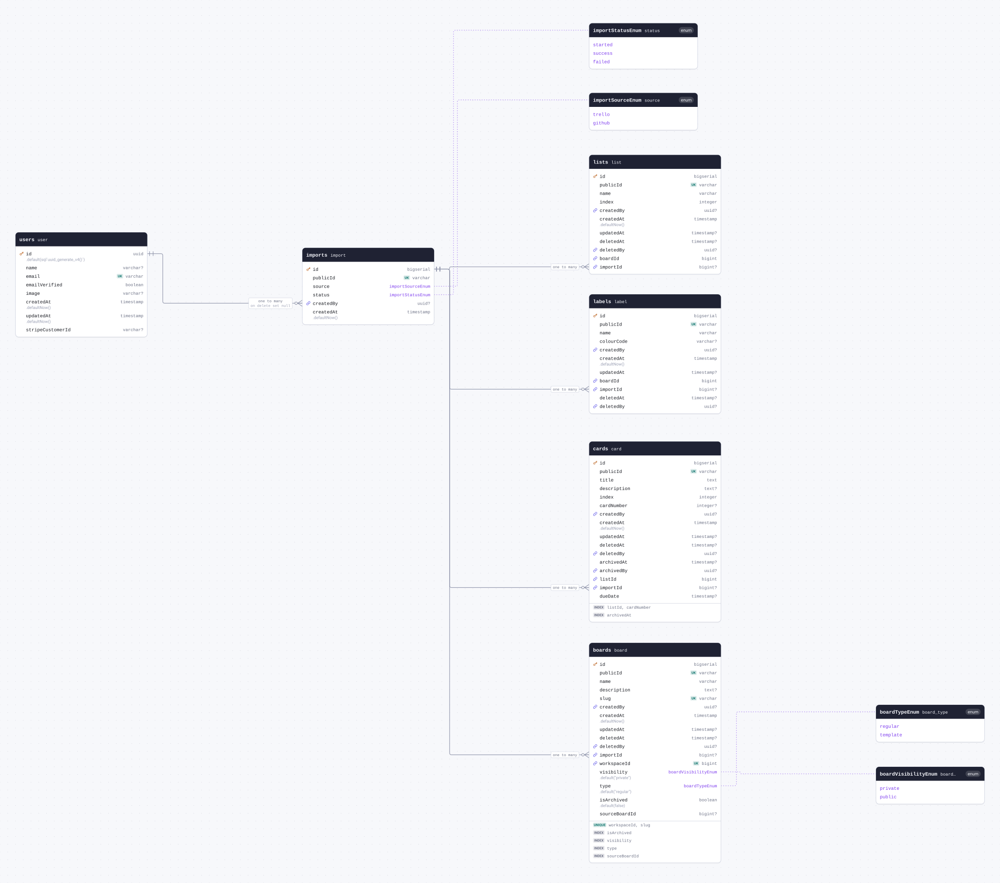

| Column      | Type                                         | Constraints                     | Default         | Description |
| ----------- | -------------------------------------------- | ------------------------------- | --------------- | ----------- |
| `id`        | `bigserial`                                  | PK NOT NULL                     |                 |             |
| `publicId`  | `varchar`                                    | UNIQUE NOT NULL                 |                 |             |
| `source`    | [`importSourceEnum`](#enum-importSourceEnum) | NOT NULL                        |                 |             |
| `status`    | [`importStatusEnum`](#enum-importStatusEnum) | NOT NULL                        |                 |             |
| `createdBy` | `uuid`                                       | NULL → [users.id](#table-users) |                 |             |
| `createdAt` | `timestamp`                                  | NOT NULL                        | `.defaultNow()` |             |

#### Definition

```sql
CREATE TABLE "import" (
	"id" bigserial PRIMARY KEY,
	"publicId" varchar(12) NOT NULL UNIQUE,
	"source" "source" NOT NULL,
	"status" "status" NOT NULL,
	"createdBy" uuid,
	"createdAt" timestamp DEFAULT now() NOT NULL
);

ALTER TABLE "import" ENABLE ROW LEVEL SECURITY;

ALTER TABLE "import" ADD CONSTRAINT "import_createdBy_user_id_fkey" FOREIGN KEY ("createdBy") REFERENCES "user"("id") ON DELETE SET NULL;
```

#### References

- `createdBy` → [users.id](#table-users) (many to one, on delete set null)

#### Referenced by

- `id` → [boards.importId](#table-boards) (one to many)
- `id` → [cards.importId](#table-cards) (one to many)
- `id` → [labels.importId](#table-labels) (one to many)
- `id` → [lists.importId](#table-lists) (one to many)

<details>
<summary>Queries and their SQL</summary>

**Select**: Every row of imports.

```ts
db.select().from(imports);
```

```sql
select "id", "publicId", "source", "status", "createdBy", "createdAt"
from "import"
```

**Count**: How many rows imports has.

```ts
db.select({ count: count() }).from(imports);
```

```sql
select count(*)
from "import"
```

**Find many**: The rows of imports, through the relational query API.

```ts
db.query.imports.findMany();
```

```sql
select "d0"."id" as "id", "d0"."publicId" as "publicId", "d0"."source" as "source", "d0"."status" as "status", "d0"."createdBy" as "createdBy", "d0"."createdAt" as "createdAt"
from "import" as "d0"
```

**Find by primary key**: One row of imports, through the relational query API.

```ts
db.query.imports.findFirst({ where: { id: 1 } });
```

```sql
select "d0"."id" as "id", "d0"."publicId" as "publicId", "d0"."source" as "source", "d0"."status" as "status", "d0"."createdBy" as "createdBy", "d0"."createdAt" as "createdAt"
from "import" as "d0"
where "d0"."id" = $1
limit $2
-- params: [1,1]
```

**Insert**: Adds a row to imports, giving the columns that have no default.

```ts
db.insert(imports).values({ publicId: "publicId", source: "trello", status: "started" });
```

```sql
insert into "import" ("id", "publicId", "source", "status", "createdBy", "createdAt")
values (default, $1, $2, $3, default, default)
-- params: ["publicId","trello","started"]
```

**Update**: Changes a row of imports, found by its primary key.

```ts
db.update(imports).set({ publicId: "publicId" }).where(eq(imports.id, 1));
```

```sql
update "import"
set "publicId" = $1
where "import"."id" = $2
-- params: ["publicId",1]
```

**Delete**: Deletes a row of imports, found by its primary key.

```ts
db.delete(imports).where(eq(imports.id, 1));
```

```sql
delete from "import"
where "import"."id" = $1
-- params: [1]
```

</details>

<a id="table-integrations"></a>

### integrations

Table `integration`.

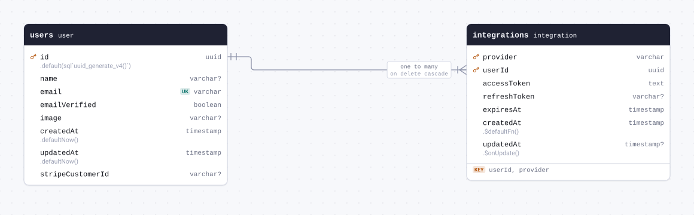

| Column         | Type        | Constraints                            | Default         | Description |
| -------------- | ----------- | -------------------------------------- | --------------- | ----------- |
| `provider`     | `varchar`   | PK NOT NULL                            |                 |             |
| `userId`       | `uuid`      | PK NOT NULL → [users.id](#table-users) |                 |             |
| `accessToken`  | `text`      | NOT NULL                               |                 |             |
| `refreshToken` | `varchar`   | NULL                                   |                 |             |
| `expiresAt`    | `timestamp` | NOT NULL                               |                 |             |
| `createdAt`    | `timestamp` | NOT NULL                               | `.$defaultFn()` |             |
| `updatedAt`    | `timestamp` | NULL                                   | `.$onUpdate()`  |             |

#### Definition

```sql
CREATE TABLE "integration" (
	"provider" varchar(255),
	"userId" uuid,
	"accessToken" text NOT NULL,
	"refreshToken" varchar(255),
	"expiresAt" timestamp NOT NULL,
	"createdAt" timestamp NOT NULL,
	"updatedAt" timestamp,
	CONSTRAINT "integration_pkey" PRIMARY KEY("userId","provider")
);

ALTER TABLE "integration" ENABLE ROW LEVEL SECURITY;

ALTER TABLE "integration" ADD CONSTRAINT "integration_userId_user_id_fkey" FOREIGN KEY ("userId") REFERENCES "user"("id") ON DELETE CASCADE;
```

#### Indexes

- PRIMARY KEY `userId`, `provider`

#### References

- `userId` → [users.id](#table-users) (many to one, on delete cascade)

<details>
<summary>Queries and their SQL</summary>

**Select**: Every row of integrations.

```ts
db.select().from(integrations);
```

```sql
select "provider", "userId", "accessToken", "refreshToken", "expiresAt", "createdAt", "updatedAt"
from "integration"
```

**Count**: How many rows integrations has.

```ts
db.select({ count: count() }).from(integrations);
```

```sql
select count(*)
from "integration"
```

**Find many**: The rows of integrations, through the relational query API.

```ts
db.query.integrations.findMany();
```

```sql
select "d0"."provider" as "provider", "d0"."userId" as "userId", "d0"."accessToken" as "accessToken", "d0"."refreshToken" as "refreshToken", "d0"."expiresAt" as "expiresAt", "d0"."createdAt" as "createdAt", "d0"."updatedAt" as "updatedAt"
from "integration" as "d0"
```

**Find by primary key**: One row of integrations, through the relational query API.

```ts
db.query.integrations.findFirst({
  where: { provider: "provider", userId: "00000000-0000-0000-0000-000000000000" },
});
```

```sql
select "d0"."provider" as "provider", "d0"."userId" as "userId", "d0"."accessToken" as "accessToken", "d0"."refreshToken" as "refreshToken", "d0"."expiresAt" as "expiresAt", "d0"."createdAt" as "createdAt", "d0"."updatedAt" as "updatedAt"
from "integration" as "d0"
where (("d0"."provider" = $1) and ("d0"."userId" = $2))
limit $3
-- params: ["provider","00000000-0000-0000-0000-000000000000",1]
```

**Insert**: Adds a row to integrations, giving the columns that have no default.

```ts
db.insert(integrations).values({
  provider: "provider",
  userId: "00000000-0000-0000-0000-000000000000",
  accessToken: "accessToken",
  expiresAt: new Date("2026-01-01T00:00:00.000Z"),
});
```

```sql
insert into "integration" ("provider", "userId", "accessToken", "refreshToken", "expiresAt", "createdAt", "updatedAt")
values ($1, $2, $3, default, $4, $5, $6)
-- params: ["provider","00000000-0000-0000-0000-000000000000","accessToken","2026-01-01T00:00:00.000Z","2026-01-01T00:00:00.000Z","2026-01-01T00:00:00.000Z"]
```

**Update**: Changes a row of integrations, found by its primary key.

```ts
db.update(integrations)
  .set({ accessToken: "accessToken" })
  .where(
    and(
      eq(integrations.provider, "provider"),
      eq(integrations.userId, "00000000-0000-0000-0000-000000000000"),
    ),
  );
```

```sql
update "integration"
set "accessToken" = $1, "updatedAt" = $2
where (("integration"."provider" = $3) and ("integration"."userId" = $4))
-- params: ["accessToken","2026-01-01T00:00:00.000Z","provider","00000000-0000-0000-0000-000000000000"]
```

**Delete**: Deletes a row of integrations, found by its primary key.

```ts
db.delete(integrations).where(
  and(
    eq(integrations.provider, "provider"),
    eq(integrations.userId, "00000000-0000-0000-0000-000000000000"),
  ),
);
```

```sql
delete from "integration"
where (("integration"."provider" = $1) and ("integration"."userId" = $2))
-- params: ["provider","00000000-0000-0000-0000-000000000000"]
```

</details>

<a id="table-labels"></a>

### labels

Table `label`.

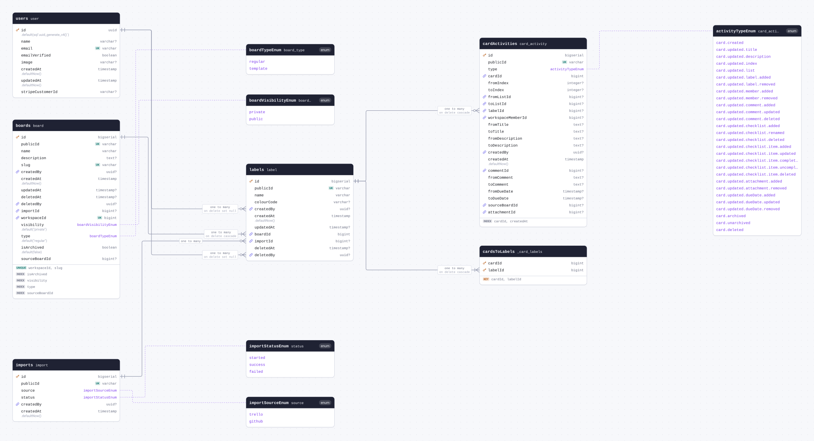

| Column       | Type        | Constraints                           | Default         | Description |
| ------------ | ----------- | ------------------------------------- | --------------- | ----------- |
| `id`         | `bigserial` | PK NOT NULL                           |                 |             |
| `publicId`   | `varchar`   | UNIQUE NOT NULL                       |                 |             |
| `name`       | `varchar`   | NOT NULL                              |                 |             |
| `colourCode` | `varchar`   | NULL                                  |                 |             |
| `createdBy`  | `uuid`      | NULL → [users.id](#table-users)       |                 |             |
| `createdAt`  | `timestamp` | NOT NULL                              | `.defaultNow()` |             |
| `updatedAt`  | `timestamp` | NULL                                  |                 |             |
| `boardId`    | `bigint`    | NOT NULL → [boards.id](#table-boards) |                 |             |
| `importId`   | `bigint`    | NULL → [imports.id](#table-imports)   |                 |             |
| `deletedAt`  | `timestamp` | NULL                                  |                 |             |
| `deletedBy`  | `uuid`      | NULL → [users.id](#table-users)       |                 |             |

#### Definition

```sql
CREATE TABLE "label" (
	"id" bigserial PRIMARY KEY,
	"publicId" varchar(12) NOT NULL UNIQUE,
	"name" varchar(255) NOT NULL,
	"colourCode" varchar(12),
	"createdBy" uuid,
	"createdAt" timestamp DEFAULT now() NOT NULL,
	"updatedAt" timestamp,
	"boardId" bigint NOT NULL,
	"importId" bigint,
	"deletedAt" timestamp,
	"deletedBy" uuid
);

ALTER TABLE "label" ENABLE ROW LEVEL SECURITY;

ALTER TABLE "label" ADD CONSTRAINT "label_createdBy_user_id_fkey" FOREIGN KEY ("createdBy") REFERENCES "user"("id") ON DELETE SET NULL;

ALTER TABLE "label" ADD CONSTRAINT "label_boardId_board_id_fkey" FOREIGN KEY ("boardId") REFERENCES "board"("id") ON DELETE CASCADE;

ALTER TABLE "label" ADD CONSTRAINT "label_importId_import_id_fkey" FOREIGN KEY ("importId") REFERENCES "import"("id");

ALTER TABLE "label" ADD CONSTRAINT "label_deletedBy_user_id_fkey" FOREIGN KEY ("deletedBy") REFERENCES "user"("id") ON DELETE SET NULL;
```

#### References

- `createdBy` → [users.id](#table-users) (many to one, on delete set null)
- `boardId` → [boards.id](#table-boards) (many to one, on delete cascade)
- `importId` → [imports.id](#table-imports) (many to one)
- `deletedBy` → [users.id](#table-users) (many to one, on delete set null)

#### Referenced by

- `id` → [cardActivities.labelId](#table-cardActivities) (one to many, on delete cascade)
- `id` → [cardsToLabels.labelId](#table-cardsToLabels) (one to many, on delete cascade)

<details>
<summary>Queries and their SQL</summary>

**Select**: Every row of labels.

```ts
db.select().from(labels);
```

```sql
select "id", "publicId", "name", "colourCode", "createdBy", "createdAt", "updatedAt", "boardId", "importId", "deletedAt", "deletedBy"
from "label"
```

**Count**: How many rows labels has.

```ts
db.select({ count: count() }).from(labels);
```

```sql
select count(*)
from "label"
```

**Find many**: The rows of labels, through the relational query API.

```ts
db.query.labels.findMany();
```

```sql
select "d0"."id" as "id", "d0"."publicId" as "publicId", "d0"."name" as "name", "d0"."colourCode" as "colourCode", "d0"."createdBy" as "createdBy", "d0"."createdAt" as "createdAt", "d0"."updatedAt" as "updatedAt", "d0"."boardId" as "boardId", "d0"."importId" as "importId", "d0"."deletedAt" as "deletedAt", "d0"."deletedBy" as "deletedBy"
from "label" as "d0"
```

**Find by primary key**: One row of labels, through the relational query API.

```ts
db.query.labels.findFirst({ where: { id: 1 } });
```

```sql
select "d0"."id" as "id", "d0"."publicId" as "publicId", "d0"."name" as "name", "d0"."colourCode" as "colourCode", "d0"."createdBy" as "createdBy", "d0"."createdAt" as "createdAt", "d0"."updatedAt" as "updatedAt", "d0"."boardId" as "boardId", "d0"."importId" as "importId", "d0"."deletedAt" as "deletedAt", "d0"."deletedBy" as "deletedBy"
from "label" as "d0"
where "d0"."id" = $1
limit $2
-- params: [1,1]
```

**Insert**: Adds a row to labels, giving the columns that have no default.

```ts
db.insert(labels).values({ publicId: "publicId", name: "name", boardId: 1 });
```

```sql
insert into "label" ("id", "publicId", "name", "colourCode", "createdBy", "createdAt", "updatedAt", "boardId", "importId", "deletedAt", "deletedBy")
values (default, $1, $2, default, default, default, default, $3, default, default, default)
-- params: ["publicId","name",1]
```

**Update**: Changes a row of labels, found by its primary key.

```ts
db.update(labels).set({ publicId: "publicId" }).where(eq(labels.id, 1));
```

```sql
update "label"
set "publicId" = $1
where "label"."id" = $2
-- params: ["publicId",1]
```

**Delete**: Deletes a row of labels, found by its primary key.

```ts
db.delete(labels).where(eq(labels.id, 1));
```

```sql
delete from "label"
where "label"."id" = $1
-- params: [1]
```

</details>

<a id="table-lists"></a>

### lists

Table `list`.

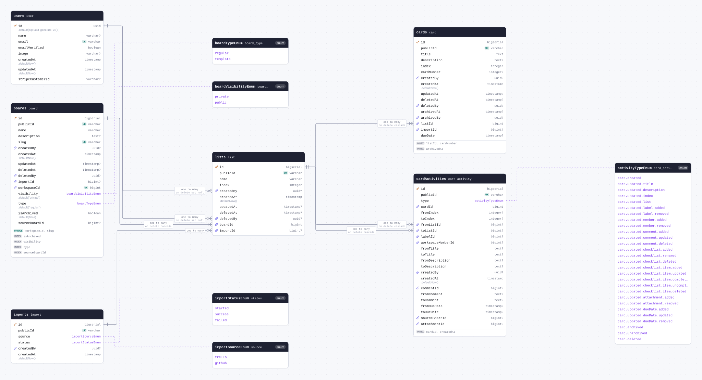

| Column      | Type        | Constraints                           | Default         | Description |
| ----------- | ----------- | ------------------------------------- | --------------- | ----------- |
| `id`        | `bigserial` | PK NOT NULL                           |                 |             |
| `publicId`  | `varchar`   | UNIQUE NOT NULL                       |                 |             |
| `name`      | `varchar`   | NOT NULL                              |                 |             |
| `index`     | `integer`   | NOT NULL                              |                 |             |
| `createdBy` | `uuid`      | NULL → [users.id](#table-users)       |                 |             |
| `createdAt` | `timestamp` | NOT NULL                              | `.defaultNow()` |             |
| `updatedAt` | `timestamp` | NULL                                  |                 |             |
| `deletedAt` | `timestamp` | NULL                                  |                 |             |
| `deletedBy` | `uuid`      | NULL → [users.id](#table-users)       |                 |             |
| `boardId`   | `bigint`    | NOT NULL → [boards.id](#table-boards) |                 |             |
| `importId`  | `bigint`    | NULL → [imports.id](#table-imports)   |                 |             |

#### Definition

```sql
CREATE TABLE "list" (
	"id" bigserial PRIMARY KEY,
	"publicId" varchar(12) NOT NULL UNIQUE,
	"name" varchar(255) NOT NULL,
	"index" integer NOT NULL,
	"createdBy" uuid,
	"createdAt" timestamp DEFAULT now() NOT NULL,
	"updatedAt" timestamp,
	"deletedAt" timestamp,
	"deletedBy" uuid,
	"boardId" bigint NOT NULL,
	"importId" bigint
);

ALTER TABLE "list" ENABLE ROW LEVEL SECURITY;

ALTER TABLE "list" ADD CONSTRAINT "list_createdBy_user_id_fkey" FOREIGN KEY ("createdBy") REFERENCES "user"("id") ON DELETE SET NULL;

ALTER TABLE "list" ADD CONSTRAINT "list_deletedBy_user_id_fkey" FOREIGN KEY ("deletedBy") REFERENCES "user"("id") ON DELETE SET NULL;

ALTER TABLE "list" ADD CONSTRAINT "list_boardId_board_id_fkey" FOREIGN KEY ("boardId") REFERENCES "board"("id") ON DELETE CASCADE;

ALTER TABLE "list" ADD CONSTRAINT "list_importId_import_id_fkey" FOREIGN KEY ("importId") REFERENCES "import"("id");
```

#### References

- `createdBy` → [users.id](#table-users) (many to one, on delete set null)
- `deletedBy` → [users.id](#table-users) (many to one, on delete set null)
- `boardId` → [boards.id](#table-boards) (many to one, on delete cascade)
- `importId` → [imports.id](#table-imports) (many to one)

#### Referenced by

- `id` → [cards.listId](#table-cards) (one to many, on delete cascade)
- `id` → [cardActivities.fromListId](#table-cardActivities) (one to many, on delete cascade)
- `id` → [cardActivities.toListId](#table-cardActivities) (one to many, on delete cascade)

<details>
<summary>Queries and their SQL</summary>

**Select**: Every row of lists.

```ts
db.select().from(lists);
```

```sql
select "id", "publicId", "name", "index", "createdBy", "createdAt", "updatedAt", "deletedAt", "deletedBy", "boardId", "importId"
from "list"
```

**Count**: How many rows lists has.

```ts
db.select({ count: count() }).from(lists);
```

```sql
select count(*)
from "list"
```

**Find many**: The rows of lists, through the relational query API.

```ts
db.query.lists.findMany();
```

```sql
select "d0"."id" as "id", "d0"."publicId" as "publicId", "d0"."name" as "name", "d0"."index" as "index", "d0"."createdBy" as "createdBy", "d0"."createdAt" as "createdAt", "d0"."updatedAt" as "updatedAt", "d0"."deletedAt" as "deletedAt", "d0"."deletedBy" as "deletedBy", "d0"."boardId" as "boardId", "d0"."importId" as "importId"
from "list" as "d0"
```

**Find by primary key**: One row of lists, through the relational query API.

```ts
db.query.lists.findFirst({ where: { id: 1 } });
```

```sql
select "d0"."id" as "id", "d0"."publicId" as "publicId", "d0"."name" as "name", "d0"."index" as "index", "d0"."createdBy" as "createdBy", "d0"."createdAt" as "createdAt", "d0"."updatedAt" as "updatedAt", "d0"."deletedAt" as "deletedAt", "d0"."deletedBy" as "deletedBy", "d0"."boardId" as "boardId", "d0"."importId" as "importId"
from "list" as "d0"
where "d0"."id" = $1
limit $2
-- params: [1,1]
```

**Insert**: Adds a row to lists, giving the columns that have no default.

```ts
db.insert(lists).values({ publicId: "publicId", name: "name", index: 1, boardId: 1 });
```

```sql
insert into "list" ("id", "publicId", "name", "index", "createdBy", "createdAt", "updatedAt", "deletedAt", "deletedBy", "boardId", "importId")
values (default, $1, $2, $3, default, default, default, default, default, $4, default)
-- params: ["publicId","name",1,1]
```

**Update**: Changes a row of lists, found by its primary key.

```ts
db.update(lists).set({ publicId: "publicId" }).where(eq(lists.id, 1));
```

```sql
update "list"
set "publicId" = $1
where "list"."id" = $2
-- params: ["publicId",1]
```

**Delete**: Deletes a row of lists, found by its primary key.

```ts
db.delete(lists).where(eq(lists.id, 1));
```

```sql
delete from "list"
where "list"."id" = $1
-- params: [1]
```

</details>

<a id="table-notifications"></a>

### notifications

Table `notification`.

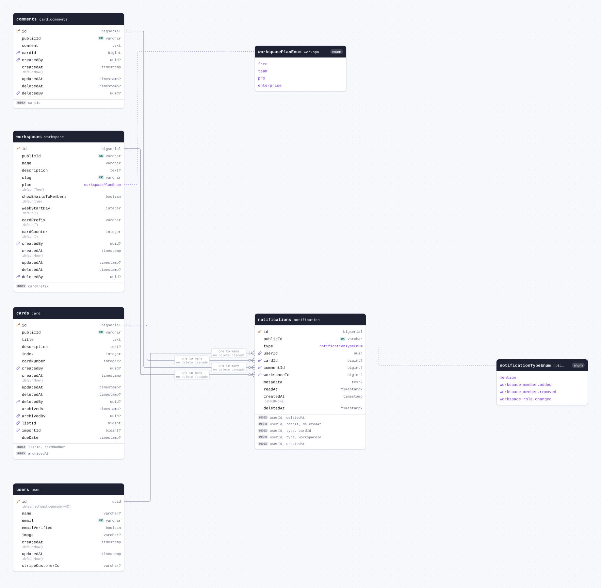

| Column        | Type                                                 | Constraints                               | Default         | Description |
| ------------- | ---------------------------------------------------- | ----------------------------------------- | --------------- | ----------- |
| `id`          | `bigserial`                                          | PK NOT NULL                               |                 |             |
| `publicId`    | `varchar`                                            | UNIQUE NOT NULL                           |                 |             |
| `type`        | [`notificationTypeEnum`](#enum-notificationTypeEnum) | NOT NULL                                  |                 |             |
| `userId`      | `uuid`                                               | NOT NULL → [users.id](#table-users)       |                 |             |
| `cardId`      | `bigint`                                             | NULL → [cards.id](#table-cards)           |                 |             |
| `commentId`   | `bigint`                                             | NULL → [comments.id](#table-comments)     |                 |             |
| `workspaceId` | `bigint`                                             | NULL → [workspaces.id](#table-workspaces) |                 |             |
| `metadata`    | `text`                                               | NULL                                      |                 |             |
| `readAt`      | `timestamp`                                          | NULL                                      |                 |             |
| `createdAt`   | `timestamp`                                          | NOT NULL                                  | `.defaultNow()` |             |
| `deletedAt`   | `timestamp`                                          | NULL                                      |                 |             |

#### Definition

```sql
CREATE TABLE "notification" (
	"id" bigserial PRIMARY KEY,
	"publicId" varchar(12) NOT NULL UNIQUE,
	"type" "notification_type" NOT NULL,
	"userId" uuid NOT NULL,
	"cardId" bigint,
	"commentId" bigint,
	"workspaceId" bigint,
	"metadata" text,
	"readAt" timestamp,
	"createdAt" timestamp DEFAULT now() NOT NULL,
	"deletedAt" timestamp
);

ALTER TABLE "notification" ENABLE ROW LEVEL SECURITY;

CREATE INDEX "notification_user_deleted_idx" ON "notification" ("userId","deletedAt");

CREATE INDEX "notification_user_read_deleted_idx" ON "notification" ("userId","readAt","deletedAt");

CREATE INDEX "notification_user_type_card_idx" ON "notification" ("userId","type","cardId");

CREATE INDEX "notification_user_type_workspace_idx" ON "notification" ("userId","type","workspaceId");

CREATE INDEX "notification_user_created_idx" ON "notification" ("userId","createdAt");

ALTER TABLE "notification" ADD CONSTRAINT "notification_userId_user_id_fkey" FOREIGN KEY ("userId") REFERENCES "user"("id") ON DELETE CASCADE;

ALTER TABLE "notification" ADD CONSTRAINT "notification_cardId_card_id_fkey" FOREIGN KEY ("cardId") REFERENCES "card"("id") ON DELETE CASCADE;

ALTER TABLE "notification" ADD CONSTRAINT "notification_commentId_card_comments_id_fkey" FOREIGN KEY ("commentId") REFERENCES "card_comments"("id") ON DELETE CASCADE;

ALTER TABLE "notification" ADD CONSTRAINT "notification_workspaceId_workspace_id_fkey" FOREIGN KEY ("workspaceId") REFERENCES "workspace"("id") ON DELETE CASCADE;
```

#### Indexes

- INDEX `userId`, `deletedAt`
- INDEX `userId`, `readAt`, `deletedAt`
- INDEX `userId`, `type`, `cardId`
- INDEX `userId`, `type`, `workspaceId`
- INDEX `userId`, `createdAt`

#### References

- `userId` → [users.id](#table-users) (many to one, on delete cascade)
- `cardId` → [cards.id](#table-cards) (many to one, on delete cascade)
- `commentId` → [comments.id](#table-comments) (many to one, on delete cascade)
- `workspaceId` → [workspaces.id](#table-workspaces) (many to one, on delete cascade)

<details>
<summary>Queries and their SQL</summary>

**Select**: Every row of notifications.

```ts
db.select().from(notifications);
```

```sql
select "id", "publicId", "type", "userId", "cardId", "commentId", "workspaceId", "metadata", "readAt", "createdAt", "deletedAt"
from "notification"
```

**Count**: How many rows notifications has.

```ts
db.select({ count: count() }).from(notifications);
```

```sql
select count(*)
from "notification"
```

**Find many**: The rows of notifications, through the relational query API.

```ts
db.query.notifications.findMany();
```

```sql
select "d0"."id" as "id", "d0"."publicId" as "publicId", "d0"."type" as "type", "d0"."userId" as "userId", "d0"."cardId" as "cardId", "d0"."commentId" as "commentId", "d0"."workspaceId" as "workspaceId", "d0"."metadata" as "metadata", "d0"."readAt" as "readAt", "d0"."createdAt" as "createdAt", "d0"."deletedAt" as "deletedAt"
from "notification" as "d0"
```

**Find by primary key**: One row of notifications, through the relational query API.

```ts
db.query.notifications.findFirst({ where: { id: 1 } });
```

```sql
select "d0"."id" as "id", "d0"."publicId" as "publicId", "d0"."type" as "type", "d0"."userId" as "userId", "d0"."cardId" as "cardId", "d0"."commentId" as "commentId", "d0"."workspaceId" as "workspaceId", "d0"."metadata" as "metadata", "d0"."readAt" as "readAt", "d0"."createdAt" as "createdAt", "d0"."deletedAt" as "deletedAt"
from "notification" as "d0"
where "d0"."id" = $1
limit $2
-- params: [1,1]
```

**Insert**: Adds a row to notifications, giving the columns that have no default.

```ts
db.insert(notifications).values({
  publicId: "publicId",
  type: "mention",
  userId: "00000000-0000-0000-0000-000000000000",
});
```

```sql
insert into "notification" ("id", "publicId", "type", "userId", "cardId", "commentId", "workspaceId", "metadata", "readAt", "createdAt", "deletedAt")
values (default, $1, $2, $3, default, default, default, default, default, default, default)
-- params: ["publicId","mention","00000000-0000-0000-0000-000000000000"]
```

**Update**: Changes a row of notifications, found by its primary key.

```ts
db.update(notifications).set({ publicId: "publicId" }).where(eq(notifications.id, 1));
```

```sql
update "notification"
set "publicId" = $1
where "notification"."id" = $2
-- params: ["publicId",1]
```

**Delete**: Deletes a row of notifications, found by its primary key.

```ts
db.delete(notifications).where(eq(notifications.id, 1));
```

```sql
delete from "notification"
where "notification"."id" = $1
-- params: [1]
```

</details>

<a id="table-workspaceRoles"></a>

### workspaceRoles

Table `workspace_roles`.

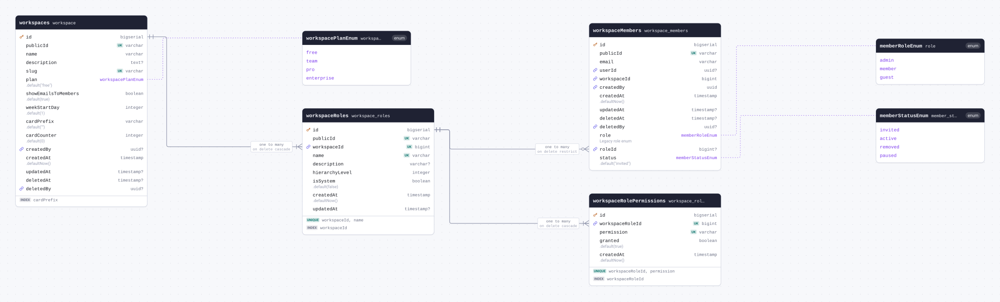

| Column           | Type        | Constraints                                   | Default           | Description |
| ---------------- | ----------- | --------------------------------------------- | ----------------- | ----------- |
| `id`             | `bigserial` | PK NOT NULL                                   |                   |             |
| `publicId`       | `varchar`   | UNIQUE NOT NULL                               |                   |             |
| `workspaceId`    | `bigint`    | NOT NULL → [workspaces.id](#table-workspaces) |                   |             |
| `name`           | `varchar`   | NOT NULL                                      |                   |             |
| `description`    | `varchar`   | NULL                                          |                   |             |
| `hierarchyLevel` | `integer`   | NOT NULL                                      |                   |             |
| `isSystem`       | `boolean`   | NOT NULL                                      | `.default(false)` |             |
| `createdAt`      | `timestamp` | NOT NULL                                      | `.defaultNow()`   |             |
| `updatedAt`      | `timestamp` | NULL                                          |                   |             |

#### Definition

```sql
CREATE TABLE "workspace_roles" (
	"id" bigserial PRIMARY KEY,
	"publicId" varchar(12) NOT NULL UNIQUE,
	"workspaceId" bigint NOT NULL,
	"name" varchar(64) NOT NULL,
	"description" varchar(255),
	"hierarchyLevel" integer NOT NULL,
	"isSystem" boolean DEFAULT false NOT NULL,
	"createdAt" timestamp DEFAULT now() NOT NULL,
	"updatedAt" timestamp
);

ALTER TABLE "workspace_roles" ENABLE ROW LEVEL SECURITY;

CREATE UNIQUE INDEX "unique_role_per_workspace" ON "workspace_roles" ("workspaceId","name");

CREATE INDEX "workspace_roles_workspace_idx" ON "workspace_roles" ("workspaceId");

ALTER TABLE "workspace_roles" ADD CONSTRAINT "workspace_roles_workspaceId_workspace_id_fkey" FOREIGN KEY ("workspaceId") REFERENCES "workspace"("id") ON DELETE CASCADE;
```

#### Indexes

- UNIQUE `workspaceId`, `name`
- INDEX `workspaceId`

#### References

- `workspaceId` → [workspaces.id](#table-workspaces) (many to one, on delete cascade)

#### Referenced by

- `id` → [workspaceRolePermissions.workspaceRoleId](#table-workspaceRolePermissions) (one to many, on delete cascade)
- `id` → [workspaceMembers.roleId](#table-workspaceMembers) (one to many, on delete restrict)

<details>
<summary>Queries and their SQL</summary>

**Select**: Every row of workspaceRoles.

```ts
db.select().from(workspaceRoles);
```

```sql
select "id", "publicId", "workspaceId", "name", "description", "hierarchyLevel", "isSystem", "createdAt", "updatedAt"
from "workspace_roles"
```

**Count**: How many rows workspaceRoles has.

```ts
db.select({ count: count() }).from(workspaceRoles);
```

```sql
select count(*)
from "workspace_roles"
```

**Find many**: The rows of workspaceRoles, through the relational query API.

```ts
db.query.workspaceRoles.findMany();
```

```sql
select "d0"."id" as "id", "d0"."publicId" as "publicId", "d0"."workspaceId" as "workspaceId", "d0"."name" as "name", "d0"."description" as "description", "d0"."hierarchyLevel" as "hierarchyLevel", "d0"."isSystem" as "isSystem", "d0"."createdAt" as "createdAt", "d0"."updatedAt" as "updatedAt"
from "workspace_roles" as "d0"
```

**Find by primary key**: One row of workspaceRoles, through the relational query API.

```ts
db.query.workspaceRoles.findFirst({ where: { id: 1 } });
```

```sql
select "d0"."id" as "id", "d0"."publicId" as "publicId", "d0"."workspaceId" as "workspaceId", "d0"."name" as "name", "d0"."description" as "description", "d0"."hierarchyLevel" as "hierarchyLevel", "d0"."isSystem" as "isSystem", "d0"."createdAt" as "createdAt", "d0"."updatedAt" as "updatedAt"
from "workspace_roles" as "d0"
where "d0"."id" = $1
limit $2
-- params: [1,1]
```

**Insert**: Adds a row to workspaceRoles, giving the columns that have no default.

```ts
db.insert(workspaceRoles).values({
  publicId: "publicId",
  workspaceId: 1,
  name: "name",
  hierarchyLevel: 1,
});
```

```sql
insert into "workspace_roles" ("id", "publicId", "workspaceId", "name", "description", "hierarchyLevel", "isSystem", "createdAt", "updatedAt")
values (default, $1, $2, $3, default, $4, default, default, default)
-- params: ["publicId",1,"name",1]
```

**Update**: Changes a row of workspaceRoles, found by its primary key.

```ts
db.update(workspaceRoles).set({ publicId: "publicId" }).where(eq(workspaceRoles.id, 1));
```

```sql
update "workspace_roles"
set "publicId" = $1
where "workspace_roles"."id" = $2
-- params: ["publicId",1]
```

**Delete**: Deletes a row of workspaceRoles, found by its primary key.

```ts
db.delete(workspaceRoles).where(eq(workspaceRoles.id, 1));
```

```sql
delete from "workspace_roles"
where "workspace_roles"."id" = $1
-- params: [1]
```

</details>

<a id="table-workspaceRolePermissions"></a>

### workspaceRolePermissions

Table `workspace_role_permissions`.

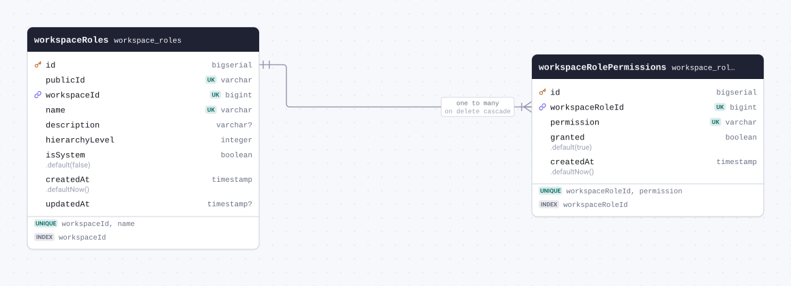

| Column            | Type        | Constraints                                           | Default          | Description |
| ----------------- | ----------- | ----------------------------------------------------- | ---------------- | ----------- |
| `id`              | `bigserial` | PK NOT NULL                                           |                  |             |
| `workspaceRoleId` | `bigint`    | NOT NULL → [workspaceRoles.id](#table-workspaceRoles) |                  |             |
| `permission`      | `varchar`   | NOT NULL                                              |                  |             |
| `granted`         | `boolean`   | NOT NULL                                              | `.default(true)` |             |
| `createdAt`       | `timestamp` | NOT NULL                                              | `.defaultNow()`  |             |

#### Definition

```sql
CREATE TABLE "workspace_role_permissions" (
	"id" bigserial PRIMARY KEY,
	"workspaceRoleId" bigint NOT NULL,
	"permission" varchar(64) NOT NULL,
	"granted" boolean DEFAULT true NOT NULL,
	"createdAt" timestamp DEFAULT now() NOT NULL
);

ALTER TABLE "workspace_role_permissions" ENABLE ROW LEVEL SECURITY;

CREATE UNIQUE INDEX "unique_role_permission" ON "workspace_role_permissions" ("workspaceRoleId","permission");

CREATE INDEX "role_permissions_role_idx" ON "workspace_role_permissions" ("workspaceRoleId");

ALTER TABLE "workspace_role_permissions" ADD CONSTRAINT "workspace_role_permissions_fv6TMp4WLKC4_fkey" FOREIGN KEY ("workspaceRoleId") REFERENCES "workspace_roles"("id") ON DELETE CASCADE;
```

#### Indexes

- UNIQUE `workspaceRoleId`, `permission`
- INDEX `workspaceRoleId`

#### References

- `workspaceRoleId` → [workspaceRoles.id](#table-workspaceRoles) (many to one, on delete cascade)

<details>
<summary>Queries and their SQL</summary>

**Select**: Every row of workspaceRolePermissions.

```ts
db.select().from(workspaceRolePermissions);
```

```sql
select "id", "workspaceRoleId", "permission", "granted", "createdAt"
from "workspace_role_permissions"
```

**Count**: How many rows workspaceRolePermissions has.

```ts
db.select({ count: count() }).from(workspaceRolePermissions);
```

```sql
select count(*)
from "workspace_role_permissions"
```

**Find many**: The rows of workspaceRolePermissions, through the relational query API.

```ts
db.query.workspaceRolePermissions.findMany();
```

```sql
select "d0"."id" as "id", "d0"."workspaceRoleId" as "workspaceRoleId", "d0"."permission" as "permission", "d0"."granted" as "granted", "d0"."createdAt" as "createdAt"
from "workspace_role_permissions" as "d0"
```

**Find by primary key**: One row of workspaceRolePermissions, through the relational query API.

```ts
db.query.workspaceRolePermissions.findFirst({ where: { id: 1 } });
```

```sql
select "d0"."id" as "id", "d0"."workspaceRoleId" as "workspaceRoleId", "d0"."permission" as "permission", "d0"."granted" as "granted", "d0"."createdAt" as "createdAt"
from "workspace_role_permissions" as "d0"
where "d0"."id" = $1
limit $2
-- params: [1,1]
```

**Insert**: Adds a row to workspaceRolePermissions, giving the columns that have no default.

```ts
db.insert(workspaceRolePermissions).values({ workspaceRoleId: 1, permission: "permission" });
```

```sql
insert into "workspace_role_permissions" ("id", "workspaceRoleId", "permission", "granted", "createdAt")
values (default, $1, $2, default, default)
-- params: [1,"permission"]
```

**Update**: Changes a row of workspaceRolePermissions, found by its primary key.

```ts
db.update(workspaceRolePermissions)
  .set({ workspaceRoleId: 1 })
  .where(eq(workspaceRolePermissions.id, 1));
```

```sql
update "workspace_role_permissions"
set "workspaceRoleId" = $1
where "workspace_role_permissions"."id" = $2
-- params: [1,1]
```

**Delete**: Deletes a row of workspaceRolePermissions, found by its primary key.

```ts
db.delete(workspaceRolePermissions).where(eq(workspaceRolePermissions.id, 1));
```

```sql
delete from "workspace_role_permissions"
where "workspace_role_permissions"."id" = $1
-- params: [1]
```

</details>

<a id="table-workspaceMemberPermissions"></a>

### workspaceMemberPermissions

Table `workspace_member_permissions`.

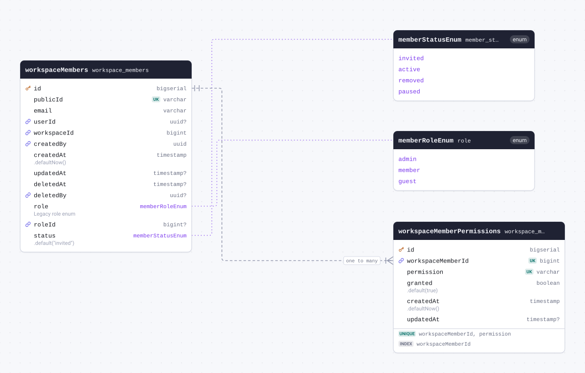

| Column              | Type        | Constraints                                               | Default          | Description |
| ------------------- | ----------- | --------------------------------------------------------- | ---------------- | ----------- |
| `id`                | `bigserial` | PK NOT NULL                                               |                  |             |
| `workspaceMemberId` | `bigint`    | NOT NULL → [workspaceMembers.id](#table-workspaceMembers) |                  |             |
| `permission`        | `varchar`   | NOT NULL                                                  |                  |             |
| `granted`           | `boolean`   | NOT NULL                                                  | `.default(true)` |             |
| `createdAt`         | `timestamp` | NOT NULL                                                  | `.defaultNow()`  |             |
| `updatedAt`         | `timestamp` | NULL                                                      |                  |             |

#### Definition

```sql
CREATE TABLE "workspace_member_permissions" (
	"id" bigserial PRIMARY KEY,
	"workspaceMemberId" bigint NOT NULL,
	"permission" varchar(64) NOT NULL,
	"granted" boolean DEFAULT true NOT NULL,
	"createdAt" timestamp DEFAULT now() NOT NULL,
	"updatedAt" timestamp
);

ALTER TABLE "workspace_member_permissions" ENABLE ROW LEVEL SECURITY;

CREATE UNIQUE INDEX "unique_member_permission" ON "workspace_member_permissions" ("workspaceMemberId","permission");

CREATE INDEX "permission_member_idx" ON "workspace_member_permissions" ("workspaceMemberId");
```

#### Indexes

- UNIQUE `workspaceMemberId`, `permission`
- INDEX `workspaceMemberId`

#### References

- `workspaceMemberId` → [workspaceMembers.id](#table-workspaceMembers) (many to one, defineRelations, no foreign key)

<details>
<summary>Queries and their SQL</summary>

**Select**: Every row of workspaceMemberPermissions.

```ts
db.select().from(workspaceMemberPermissions);
```

```sql
select "id", "workspaceMemberId", "permission", "granted", "createdAt", "updatedAt"
from "workspace_member_permissions"
```

**Count**: How many rows workspaceMemberPermissions has.

```ts
db.select({ count: count() }).from(workspaceMemberPermissions);
```

```sql
select count(*)
from "workspace_member_permissions"
```

**Find many**: The rows of workspaceMemberPermissions, through the relational query API.

```ts
db.query.workspaceMemberPermissions.findMany();
```

```sql
select "d0"."id" as "id", "d0"."workspaceMemberId" as "workspaceMemberId", "d0"."permission" as "permission", "d0"."granted" as "granted", "d0"."createdAt" as "createdAt", "d0"."updatedAt" as "updatedAt"
from "workspace_member_permissions" as "d0"
```

**Find by primary key**: One row of workspaceMemberPermissions, through the relational query API.

```ts
db.query.workspaceMemberPermissions.findFirst({ where: { id: 1 } });
```

```sql
select "d0"."id" as "id", "d0"."workspaceMemberId" as "workspaceMemberId", "d0"."permission" as "permission", "d0"."granted" as "granted", "d0"."createdAt" as "createdAt", "d0"."updatedAt" as "updatedAt"
from "workspace_member_permissions" as "d0"
where "d0"."id" = $1
limit $2
-- params: [1,1]
```

**Insert**: Adds a row to workspaceMemberPermissions, giving the columns that have no default.

```ts
db.insert(workspaceMemberPermissions).values({ workspaceMemberId: 1, permission: "permission" });
```

```sql
insert into "workspace_member_permissions" ("id", "workspaceMemberId", "permission", "granted", "createdAt", "updatedAt")
values (default, $1, $2, default, default, default)
-- params: [1,"permission"]
```

**Update**: Changes a row of workspaceMemberPermissions, found by its primary key.

```ts
db.update(workspaceMemberPermissions)
  .set({ workspaceMemberId: 1 })
  .where(eq(workspaceMemberPermissions.id, 1));
```

```sql
update "workspace_member_permissions"
set "workspaceMemberId" = $1
where "workspace_member_permissions"."id" = $2
-- params: [1,1]
```

**Delete**: Deletes a row of workspaceMemberPermissions, found by its primary key.

```ts
db.delete(workspaceMemberPermissions).where(eq(workspaceMemberPermissions.id, 1));
```

```sql
delete from "workspace_member_permissions"
where "workspace_member_permissions"."id" = $1
-- params: [1]
```

</details>

<a id="table-subscription"></a>

### subscription

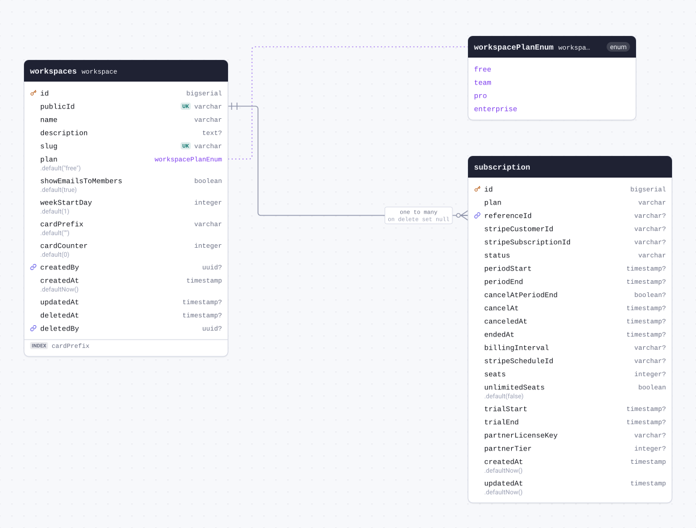

| Column                 | Type        | Constraints                                     | Default           | Description |
| ---------------------- | ----------- | ----------------------------------------------- | ----------------- | ----------- |
| `id`                   | `bigserial` | PK NOT NULL                                     |                   |             |
| `plan`                 | `varchar`   | NOT NULL                                        |                   |             |
| `referenceId`          | `varchar`   | NULL → [workspaces.publicId](#table-workspaces) |                   |             |
| `stripeCustomerId`     | `varchar`   | NULL                                            |                   |             |
| `stripeSubscriptionId` | `varchar`   | NULL                                            |                   |             |
| `status`               | `varchar`   | NOT NULL                                        |                   |             |
| `periodStart`          | `timestamp` | NULL                                            |                   |             |
| `periodEnd`            | `timestamp` | NULL                                            |                   |             |
| `cancelAtPeriodEnd`    | `boolean`   | NULL                                            |                   |             |
| `cancelAt`             | `timestamp` | NULL                                            |                   |             |
| `canceledAt`           | `timestamp` | NULL                                            |                   |             |
| `endedAt`              | `timestamp` | NULL                                            |                   |             |
| `billingInterval`      | `varchar`   | NULL                                            |                   |             |
| `stripeScheduleId`     | `varchar`   | NULL                                            |                   |             |
| `seats`                | `integer`   | NULL                                            |                   |             |
| `unlimitedSeats`       | `boolean`   | NOT NULL                                        | `.default(false)` |             |
| `trialStart`           | `timestamp` | NULL                                            |                   |             |
| `trialEnd`             | `timestamp` | NULL                                            |                   |             |
| `partnerLicenseKey`    | `varchar`   | NULL                                            |                   |             |
| `partnerTier`          | `integer`   | NULL                                            |                   |             |
| `createdAt`            | `timestamp` | NOT NULL                                        | `.defaultNow()`   |             |
| `updatedAt`            | `timestamp` | NOT NULL                                        | `.defaultNow()`   |             |

#### Definition

```sql
CREATE TABLE "subscription" (
	"id" bigserial PRIMARY KEY,
	"plan" varchar(255) NOT NULL,
	"referenceId" varchar(12),
	"stripeCustomerId" varchar(255),
	"stripeSubscriptionId" varchar(255),
	"status" varchar(255) NOT NULL,
	"periodStart" timestamp,
	"periodEnd" timestamp,
	"cancelAtPeriodEnd" boolean,
	"cancelAt" timestamp,
	"canceledAt" timestamp,
	"endedAt" timestamp,
	"billingInterval" varchar(255),
	"stripeScheduleId" varchar(255),
	"seats" integer,
	"unlimitedSeats" boolean DEFAULT false NOT NULL,
	"trialStart" timestamp,
	"trialEnd" timestamp,
	"partnerLicenseKey" varchar(255),
	"partnerTier" integer,
	"createdAt" timestamp DEFAULT now() NOT NULL,
	"updatedAt" timestamp DEFAULT now() NOT NULL
);

ALTER TABLE "subscription" ENABLE ROW LEVEL SECURITY;

ALTER TABLE "subscription" ADD CONSTRAINT "subscription_referenceId_workspace_publicId_fkey" FOREIGN KEY ("referenceId") REFERENCES "workspace"("publicId") ON DELETE SET NULL;
```

#### References

- `referenceId` → [workspaces.publicId](#table-workspaces) (many to one, on delete set null)

<details>
<summary>Queries and their SQL</summary>

**Select**: Every row of subscription.

```ts
db.select().from(subscription);
```

```sql
select "id", "plan", "referenceId", "stripeCustomerId", "stripeSubscriptionId", "status", "periodStart", "periodEnd", "cancelAtPeriodEnd", "cancelAt", "canceledAt", "endedAt", "billingInterval", "stripeScheduleId", "seats", "unlimitedSeats", "trialStart", "trialEnd", "partnerLicenseKey", "partnerTier", "createdAt", "updatedAt"
from "subscription"
```

**Count**: How many rows subscription has.

```ts
db.select({ count: count() }).from(subscription);
```

```sql
select count(*)
from "subscription"
```

**Find many**: The rows of subscription, through the relational query API.

```ts
db.query.subscription.findMany();
```

```sql
select "d0"."id" as "id", "d0"."plan" as "plan", "d0"."referenceId" as "referenceId", "d0"."stripeCustomerId" as "stripeCustomerId", "d0"."stripeSubscriptionId" as "stripeSubscriptionId", "d0"."status" as "status", "d0"."periodStart" as "periodStart", "d0"."periodEnd" as "periodEnd", "d0"."cancelAtPeriodEnd" as "cancelAtPeriodEnd", "d0"."cancelAt" as "cancelAt", "d0"."canceledAt" as "canceledAt", "d0"."endedAt" as "endedAt", "d0"."billingInterval" as "billingInterval", "d0"."stripeScheduleId" as "stripeScheduleId", "d0"."seats" as "seats", "d0"."unlimitedSeats" as "unlimitedSeats", "d0"."trialStart" as "trialStart", "d0"."trialEnd" as "trialEnd", "d0"."partnerLicenseKey" as "partnerLicenseKey", "d0"."partnerTier" as "partnerTier", "d0"."createdAt" as "createdAt", "d0"."updatedAt" as "updatedAt"
from "subscription" as "d0"
```

**Find by primary key**: One row of subscription, through the relational query API.

```ts
db.query.subscription.findFirst({ where: { id: 1 } });
```

```sql
select "d0"."id" as "id", "d0"."plan" as "plan", "d0"."referenceId" as "referenceId", "d0"."stripeCustomerId" as "stripeCustomerId", "d0"."stripeSubscriptionId" as "stripeSubscriptionId", "d0"."status" as "status", "d0"."periodStart" as "periodStart", "d0"."periodEnd" as "periodEnd", "d0"."cancelAtPeriodEnd" as "cancelAtPeriodEnd", "d0"."cancelAt" as "cancelAt", "d0"."canceledAt" as "canceledAt", "d0"."endedAt" as "endedAt", "d0"."billingInterval" as "billingInterval", "d0"."stripeScheduleId" as "stripeScheduleId", "d0"."seats" as "seats", "d0"."unlimitedSeats" as "unlimitedSeats", "d0"."trialStart" as "trialStart", "d0"."trialEnd" as "trialEnd", "d0"."partnerLicenseKey" as "partnerLicenseKey", "d0"."partnerTier" as "partnerTier", "d0"."createdAt" as "createdAt", "d0"."updatedAt" as "updatedAt"
from "subscription" as "d0"
where "d0"."id" = $1
limit $2
-- params: [1,1]
```

**Insert**: Adds a row to subscription, giving the columns that have no default.

```ts
db.insert(subscription).values({ plan: "plan", status: "status" });
```

```sql
insert into "subscription" ("id", "plan", "referenceId", "stripeCustomerId", "stripeSubscriptionId", "status", "periodStart", "periodEnd", "cancelAtPeriodEnd", "cancelAt", "canceledAt", "endedAt", "billingInterval", "stripeScheduleId", "seats", "unlimitedSeats", "trialStart", "trialEnd", "partnerLicenseKey", "partnerTier", "createdAt", "updatedAt")
values (default, $1, default, default, default, $2, default, default, default, default, default, default, default, default, default, default, default, default, default, default, default, default)
-- params: ["plan","status"]
```

**Update**: Changes a row of subscription, found by its primary key.

```ts
db.update(subscription).set({ plan: "plan" }).where(eq(subscription.id, 1));
```

```sql
update "subscription"
set "plan" = $1
where "subscription"."id" = $2
-- params: ["plan",1]
```

**Delete**: Deletes a row of subscription, found by its primary key.

```ts
db.delete(subscription).where(eq(subscription.id, 1));
```

```sql
delete from "subscription"
where "subscription"."id" = $1
-- params: [1]
```

</details>

<a id="table-users"></a>

### users

Table `user`.

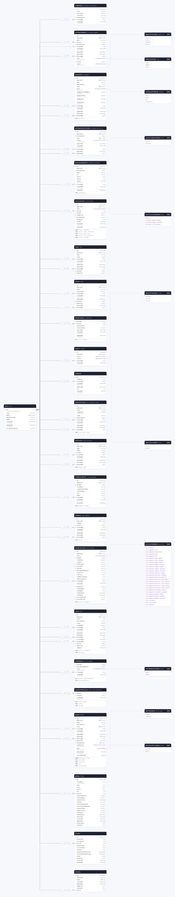

| Column             | Type        | Constraints     | Default                               | Description |
| ------------------ | ----------- | --------------- | ------------------------------------- | ----------- |
| `id`               | `uuid`      | PK NOT NULL     | ``.default(sql`uuid_generate_v4()`)`` |             |
| `name`             | `varchar`   | NULL            |                                       |             |
| `email`            | `varchar`   | UNIQUE NOT NULL |                                       |             |
| `emailVerified`    | `boolean`   | NOT NULL        |                                       |             |
| `image`            | `varchar`   | NULL            |                                       |             |
| `createdAt`        | `timestamp` | NOT NULL        | `.defaultNow()`                       |             |
| `updatedAt`        | `timestamp` | NOT NULL        | `.defaultNow()`                       |             |
| `stripeCustomerId` | `varchar`   | NULL            |                                       |             |

#### Definition

```sql
CREATE TABLE "user" (
	"id" uuid PRIMARY KEY DEFAULT uuid_generate_v4(),
	"name" varchar(255),
	"email" varchar(255) NOT NULL UNIQUE,
	"emailVerified" boolean NOT NULL,
	"image" varchar(255),
	"createdAt" timestamp DEFAULT now() NOT NULL,
	"updatedAt" timestamp DEFAULT now() NOT NULL,
	"stripeCustomerId" varchar(255)
);

ALTER TABLE "user" ENABLE ROW LEVEL SECURITY;
```

#### Referenced by

- `id` → [session.userId](#table-session) (one to many, on delete cascade)
- `id` → [account.userId](#table-account) (one to many, on delete cascade)
- `id` → [apikey.userId](#table-apikey) (one to many, on delete cascade)
- `id` → [boards.createdBy](#table-boards) (one to many, on delete set null)
- `id` → [boards.deletedBy](#table-boards) (one to many, on delete set null)
- `id` → [userBoardFavorites.userId](#table-userBoardFavorites) (one to many, on delete cascade)
- `id` → [boardMembers.createdBy](#table-boardMembers) (one to many, on delete set null)
- `id` → [cards.createdBy](#table-cards) (one to many, on delete set null)
- `id` → [cards.deletedBy](#table-cards) (one to many, on delete set null)
- `id` → [cardActivities.createdBy](#table-cardActivities) (one to many, on delete set null)
- `id` → [comments.createdBy](#table-comments) (one to many, on delete set null)
- `id` → [comments.deletedBy](#table-comments) (one to many, on delete set null)
- `id` → [cardAttachments.createdBy](#table-cardAttachments) (one to many, on delete set null)
- `id` → [checklists.createdBy](#table-checklists) (one to many, on delete set null)
- `id` → [checklists.deletedBy](#table-checklists) (one to many, on delete set null)
- `id` → [checklistItems.createdBy](#table-checklistItems) (one to many, on delete set null)
- `id` → [checklistItems.deletedBy](#table-checklistItems) (one to many, on delete set null)
- `id` → [feedback.createdBy](#table-feedback) (one to many, on delete set null)
- `id` → [imports.createdBy](#table-imports) (one to many, on delete set null)
- `id` → [integrations.userId](#table-integrations) (one to many, on delete cascade)
- `id` → [labels.createdBy](#table-labels) (one to many, on delete set null)
- `id` → [labels.deletedBy](#table-labels) (one to many, on delete set null)
- `id` → [lists.createdBy](#table-lists) (one to many, on delete set null)
- `id` → [lists.deletedBy](#table-lists) (one to many, on delete set null)
- `id` → [notifications.userId](#table-notifications) (one to many, on delete cascade)
- `id` → [workspaceWebhooks.createdBy](#table-workspaceWebhooks) (one to many, on delete cascade)
- `id` → [workspaceInviteLinks.createdBy](#table-workspaceInviteLinks) (one to many, on delete set null)
- `id` → [workspaceInviteLinks.updatedBy](#table-workspaceInviteLinks) (one to many, on delete set null)
- `id` → [workspaces.createdBy](#table-workspaces) (one to many, on delete set null)
- `id` → [workspaces.deletedBy](#table-workspaces) (one to many, on delete set null)
- `id` → [workspaceMembers.userId](#table-workspaceMembers) (one to many, on delete set null)
- `id` → [workspaceMembers.deletedBy](#table-workspaceMembers) (one to many, on delete set null)
- `id` → [slugChecks.createdBy](#table-slugChecks) (one to many, on delete set null)
- `id` → [workspaceMembers.createdBy](#table-workspaceMembers) (one to many, defineRelations)

<details>
<summary>Queries and their SQL</summary>

**Select**: Every row of users.

```ts
db.select().from(users);
```

```sql
select "id", "name", "email", "emailVerified", "image", "createdAt", "updatedAt", "stripeCustomerId"
from "user"
```

**Count**: How many rows users has.

```ts
db.select({ count: count() }).from(users);
```

```sql
select count(*)
from "user"
```

**Find many**: The rows of users, through the relational query API.

```ts
db.query.users.findMany();
```

```sql
select "d0"."id" as "id", "d0"."name" as "name", "d0"."email" as "email", "d0"."emailVerified" as "emailVerified", "d0"."image" as "image", "d0"."createdAt" as "createdAt", "d0"."updatedAt" as "updatedAt", "d0"."stripeCustomerId" as "stripeCustomerId"
from "user" as "d0"
```

**Find by primary key**: One row of users, through the relational query API.

```ts
db.query.users.findFirst({ where: { id: "00000000-0000-0000-0000-000000000000" } });
```

```sql
select "d0"."id" as "id", "d0"."name" as "name", "d0"."email" as "email", "d0"."emailVerified" as "emailVerified", "d0"."image" as "image", "d0"."createdAt" as "createdAt", "d0"."updatedAt" as "updatedAt", "d0"."stripeCustomerId" as "stripeCustomerId"
from "user" as "d0"
where "d0"."id" = $1
limit $2
-- params: ["00000000-0000-0000-0000-000000000000",1]
```

**Insert**: Adds a row to users, giving the columns that have no default.

```ts
db.insert(users).values({ email: "email", emailVerified: true });
```

```sql
insert into "user" ("id", "name", "email", "emailVerified", "image", "createdAt", "updatedAt", "stripeCustomerId")
values (default, default, $1, $2, default, default, default, default)
-- params: ["email",true]
```

**Update**: Changes a row of users, found by its primary key.

```ts
db.update(users).set({ name: "name" }).where(eq(users.id, "00000000-0000-0000-0000-000000000000"));
```

```sql
update "user"
set "name" = $1
where "user"."id" = $2
-- params: ["name","00000000-0000-0000-0000-000000000000"]
```

**Delete**: Deletes a row of users, found by its primary key.

```ts
db.delete(users).where(eq(users.id, "00000000-0000-0000-0000-000000000000"));
```

```sql
delete from "user"
where "user"."id" = $1
-- params: ["00000000-0000-0000-0000-000000000000"]
```

</details>

<a id="table-workspaceWebhooks"></a>

### workspaceWebhooks

Table `workspace_webhooks`.

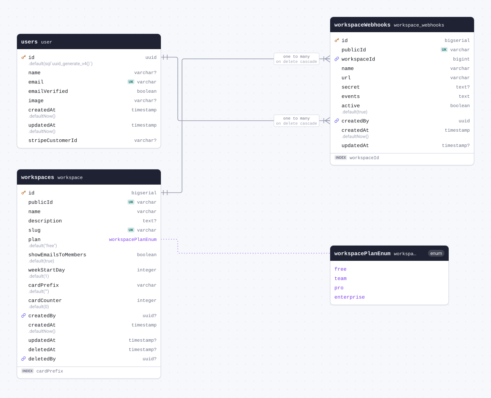

| Column        | Type        | Constraints                                   | Default          | Description |
| ------------- | ----------- | --------------------------------------------- | ---------------- | ----------- |
| `id`          | `bigserial` | PK NOT NULL                                   |                  |             |
| `publicId`    | `varchar`   | UNIQUE NOT NULL                               |                  |             |
| `workspaceId` | `bigint`    | NOT NULL → [workspaces.id](#table-workspaces) |                  |             |
| `name`        | `varchar`   | NOT NULL                                      |                  |             |
| `url`         | `varchar`   | NOT NULL                                      |                  |             |
| `secret`      | `text`      | NULL                                          |                  |             |
| `events`      | `text`      | NOT NULL                                      |                  |             |
| `active`      | `boolean`   | NOT NULL                                      | `.default(true)` |             |
| `createdBy`   | `uuid`      | NOT NULL → [users.id](#table-users)           |                  |             |
| `createdAt`   | `timestamp` | NOT NULL                                      | `.defaultNow()`  |             |
| `updatedAt`   | `timestamp` | NULL                                          |                  |             |

#### Definition

```sql
CREATE TABLE "workspace_webhooks" (
	"id" bigserial PRIMARY KEY,
	"publicId" varchar(12) NOT NULL UNIQUE,
	"workspaceId" bigint NOT NULL,
	"name" varchar(255) NOT NULL,
	"url" varchar(2048) NOT NULL,
	"secret" text,
	"events" text NOT NULL,
	"active" boolean DEFAULT true NOT NULL,
	"createdBy" uuid NOT NULL,
	"createdAt" timestamp DEFAULT now() NOT NULL,
	"updatedAt" timestamp
);

ALTER TABLE "workspace_webhooks" ENABLE ROW LEVEL SECURITY;

CREATE INDEX "workspace_webhooks_workspace_idx" ON "workspace_webhooks" ("workspaceId");

ALTER TABLE "workspace_webhooks" ADD CONSTRAINT "workspace_webhooks_workspaceId_workspace_id_fkey" FOREIGN KEY ("workspaceId") REFERENCES "workspace"("id") ON DELETE CASCADE;

ALTER TABLE "workspace_webhooks" ADD CONSTRAINT "workspace_webhooks_createdBy_user_id_fkey" FOREIGN KEY ("createdBy") REFERENCES "user"("id") ON DELETE CASCADE;
```

#### Indexes

- INDEX `workspaceId`

#### References

- `workspaceId` → [workspaces.id](#table-workspaces) (many to one, on delete cascade)
- `createdBy` → [users.id](#table-users) (many to one, on delete cascade)

<details>
<summary>Queries and their SQL</summary>

**Select**: Every row of workspaceWebhooks.

```ts
db.select().from(workspaceWebhooks);
```

```sql
select "id", "publicId", "workspaceId", "name", "url", "secret", "events", "active", "createdBy", "createdAt", "updatedAt"
from "workspace_webhooks"
```

**Count**: How many rows workspaceWebhooks has.

```ts
db.select({ count: count() }).from(workspaceWebhooks);
```

```sql
select count(*)
from "workspace_webhooks"
```

**Find many**: The rows of workspaceWebhooks, through the relational query API.

```ts
db.query.workspaceWebhooks.findMany();
```

```sql
select "d0"."id" as "id", "d0"."publicId" as "publicId", "d0"."workspaceId" as "workspaceId", "d0"."name" as "name", "d0"."url" as "url", "d0"."secret" as "secret", "d0"."events" as "events", "d0"."active" as "active", "d0"."createdBy" as "createdBy", "d0"."createdAt" as "createdAt", "d0"."updatedAt" as "updatedAt"
from "workspace_webhooks" as "d0"
```

**Find by primary key**: One row of workspaceWebhooks, through the relational query API.

```ts
db.query.workspaceWebhooks.findFirst({ where: { id: 1 } });
```

```sql
select "d0"."id" as "id", "d0"."publicId" as "publicId", "d0"."workspaceId" as "workspaceId", "d0"."name" as "name", "d0"."url" as "url", "d0"."secret" as "secret", "d0"."events" as "events", "d0"."active" as "active", "d0"."createdBy" as "createdBy", "d0"."createdAt" as "createdAt", "d0"."updatedAt" as "updatedAt"
from "workspace_webhooks" as "d0"
where "d0"."id" = $1
limit $2
-- params: [1,1]
```

**Insert**: Adds a row to workspaceWebhooks, giving the columns that have no default.

```ts
db.insert(workspaceWebhooks).values({
  publicId: "publicId",
  workspaceId: 1,
  name: "name",
  url: "url",
  events: "events",
  createdBy: "00000000-0000-0000-0000-000000000000",
});
```

```sql
insert into "workspace_webhooks" ("id", "publicId", "workspaceId", "name", "url", "secret", "events", "active", "createdBy", "createdAt", "updatedAt")
values (default, $1, $2, $3, $4, default, $5, default, $6, default, default)
-- params: ["publicId",1,"name","url","events","00000000-0000-0000-0000-000000000000"]
```

**Update**: Changes a row of workspaceWebhooks, found by its primary key.

```ts
db.update(workspaceWebhooks).set({ publicId: "publicId" }).where(eq(workspaceWebhooks.id, 1));
```

```sql
update "workspace_webhooks"
set "publicId" = $1
where "workspace_webhooks"."id" = $2
-- params: ["publicId",1]
```

**Delete**: Deletes a row of workspaceWebhooks, found by its primary key.

```ts
db.delete(workspaceWebhooks).where(eq(workspaceWebhooks.id, 1));
```

```sql
delete from "workspace_webhooks"
where "workspace_webhooks"."id" = $1
-- params: [1]
```

</details>

<a id="table-workspaceInviteLinks"></a>

### workspaceInviteLinks

Table `workspace_invite_links`.

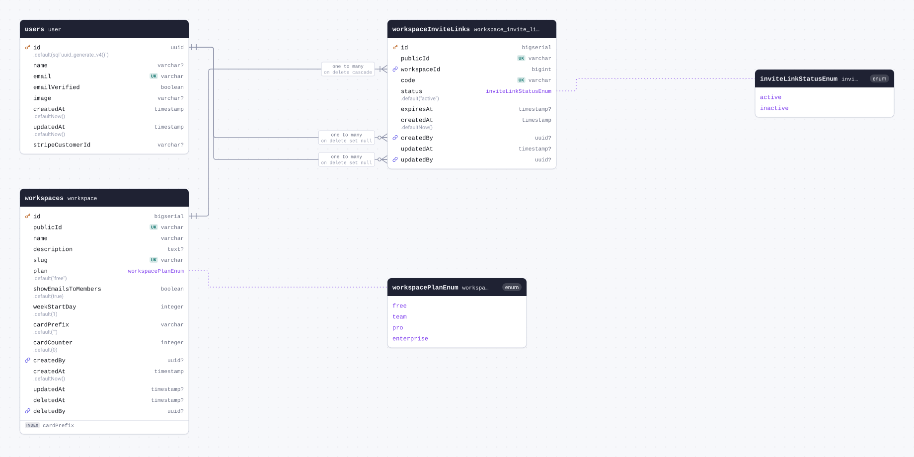

| Column        | Type                                                 | Constraints                                   | Default              | Description |
| ------------- | ---------------------------------------------------- | --------------------------------------------- | -------------------- | ----------- |
| `id`          | `bigserial`                                          | PK NOT NULL                                   |                      |             |
| `publicId`    | `varchar`                                            | UNIQUE NOT NULL                               |                      |             |
| `workspaceId` | `bigint`                                             | NOT NULL → [workspaces.id](#table-workspaces) |                      |             |
| `code`        | `varchar`                                            | UNIQUE NOT NULL                               |                      |             |
| `status`      | [`inviteLinkStatusEnum`](#enum-inviteLinkStatusEnum) | NOT NULL                                      | `.default("active")` |             |
| `expiresAt`   | `timestamp`                                          | NULL                                          |                      |             |
| `createdAt`   | `timestamp`                                          | NOT NULL                                      | `.defaultNow()`      |             |
| `createdBy`   | `uuid`                                               | NULL → [users.id](#table-users)               |                      |             |
| `updatedAt`   | `timestamp`                                          | NULL                                          |                      |             |
| `updatedBy`   | `uuid`                                               | NULL → [users.id](#table-users)               |                      |             |

#### Definition

```sql
CREATE TABLE "workspace_invite_links" (
	"id" bigserial PRIMARY KEY,
	"publicId" varchar(12) NOT NULL UNIQUE,
	"workspaceId" bigint NOT NULL,
	"code" varchar(12) NOT NULL UNIQUE,
	"status" "invite_link_status" DEFAULT 'active'::"invite_link_status" NOT NULL,
	"expiresAt" timestamp,
	"createdAt" timestamp DEFAULT now() NOT NULL,
	"createdBy" uuid,
	"updatedAt" timestamp,
	"updatedBy" uuid
);

ALTER TABLE "workspace_invite_links" ENABLE ROW LEVEL SECURITY;

ALTER TABLE "workspace_invite_links" ADD CONSTRAINT "workspace_invite_links_workspaceId_workspace_id_fkey" FOREIGN KEY ("workspaceId") REFERENCES "workspace"("id") ON DELETE CASCADE;

ALTER TABLE "workspace_invite_links" ADD CONSTRAINT "workspace_invite_links_createdBy_user_id_fkey" FOREIGN KEY ("createdBy") REFERENCES "user"("id") ON DELETE SET NULL;

ALTER TABLE "workspace_invite_links" ADD CONSTRAINT "workspace_invite_links_updatedBy_user_id_fkey" FOREIGN KEY ("updatedBy") REFERENCES "user"("id") ON DELETE SET NULL;
```

#### References

- `workspaceId` → [workspaces.id](#table-workspaces) (many to one, on delete cascade)
- `createdBy` → [users.id](#table-users) (many to one, on delete set null)
- `updatedBy` → [users.id](#table-users) (many to one, on delete set null)

<details>
<summary>Queries and their SQL</summary>

**Select**: Every row of workspaceInviteLinks.

```ts
db.select().from(workspaceInviteLinks);
```

```sql
select "id", "publicId", "workspaceId", "code", "status", "expiresAt", "createdAt", "createdBy", "updatedAt", "updatedBy"
from "workspace_invite_links"
```

**Count**: How many rows workspaceInviteLinks has.

```ts
db.select({ count: count() }).from(workspaceInviteLinks);
```

```sql
select count(*)
from "workspace_invite_links"
```

**Find many**: The rows of workspaceInviteLinks, through the relational query API.

```ts
db.query.workspaceInviteLinks.findMany();
```

```sql
select "d0"."id" as "id", "d0"."publicId" as "publicId", "d0"."workspaceId" as "workspaceId", "d0"."code" as "code", "d0"."status" as "status", "d0"."expiresAt" as "expiresAt", "d0"."createdAt" as "createdAt", "d0"."createdBy" as "createdBy", "d0"."updatedAt" as "updatedAt", "d0"."updatedBy" as "updatedBy"
from "workspace_invite_links" as "d0"
```

**Find by primary key**: One row of workspaceInviteLinks, through the relational query API.

```ts
db.query.workspaceInviteLinks.findFirst({ where: { id: 1 } });
```

```sql
select "d0"."id" as "id", "d0"."publicId" as "publicId", "d0"."workspaceId" as "workspaceId", "d0"."code" as "code", "d0"."status" as "status", "d0"."expiresAt" as "expiresAt", "d0"."createdAt" as "createdAt", "d0"."createdBy" as "createdBy", "d0"."updatedAt" as "updatedAt", "d0"."updatedBy" as "updatedBy"
from "workspace_invite_links" as "d0"
where "d0"."id" = $1
limit $2
-- params: [1,1]
```

**Insert**: Adds a row to workspaceInviteLinks, giving the columns that have no default.

```ts
db.insert(workspaceInviteLinks).values({ publicId: "publicId", workspaceId: 1, code: "code" });
```

```sql
insert into "workspace_invite_links" ("id", "publicId", "workspaceId", "code", "status", "expiresAt", "createdAt", "createdBy", "updatedAt", "updatedBy")
values (default, $1, $2, $3, default, default, default, default, default, default)
-- params: ["publicId",1,"code"]
```

**Update**: Changes a row of workspaceInviteLinks, found by its primary key.

```ts
db.update(workspaceInviteLinks).set({ publicId: "publicId" }).where(eq(workspaceInviteLinks.id, 1));
```

```sql
update "workspace_invite_links"
set "publicId" = $1
where "workspace_invite_links"."id" = $2
-- params: ["publicId",1]
```

**Delete**: Deletes a row of workspaceInviteLinks, found by its primary key.

```ts
db.delete(workspaceInviteLinks).where(eq(workspaceInviteLinks.id, 1));
```

```sql
delete from "workspace_invite_links"
where "workspace_invite_links"."id" = $1
-- params: [1]
```

</details>

<a id="table-workspaces"></a>

### workspaces

Table `workspace`.

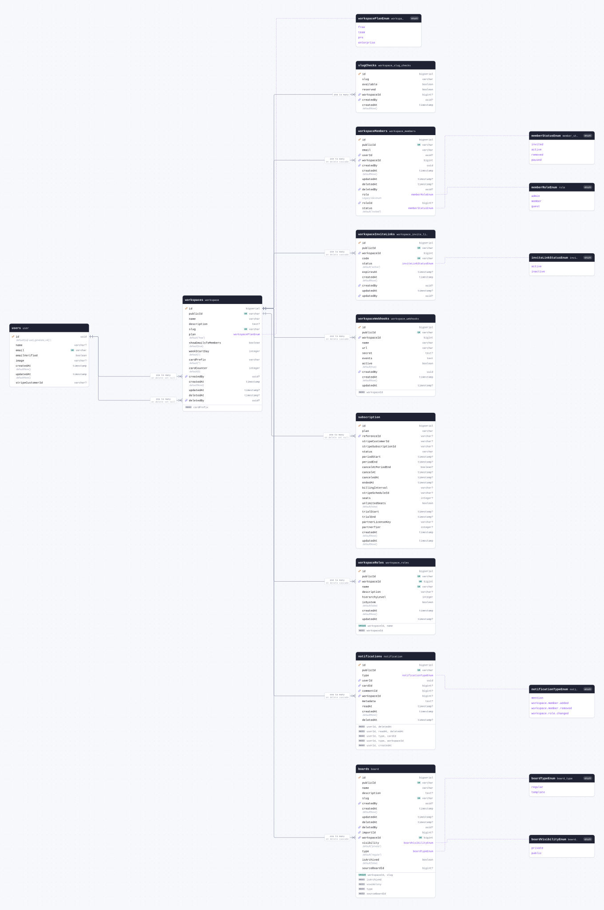

| Column                | Type                                           | Constraints                     | Default            | Description |
| --------------------- | ---------------------------------------------- | ------------------------------- | ------------------ | ----------- |
| `id`                  | `bigserial`                                    | PK NOT NULL                     |                    |             |
| `publicId`            | `varchar`                                      | UNIQUE NOT NULL                 |                    |             |
| `name`                | `varchar`                                      | NOT NULL                        |                    |             |
| `description`         | `text`                                         | NULL                            |                    |             |
| `slug`                | `varchar`                                      | UNIQUE NOT NULL                 |                    |             |
| `plan`                | [`workspacePlanEnum`](#enum-workspacePlanEnum) | NOT NULL                        | `.default("free")` |             |
| `showEmailsToMembers` | `boolean`                                      | NOT NULL                        | `.default(true)`   |             |
| `weekStartDay`        | `integer`                                      | NOT NULL                        | `.default(1)`      |             |
| `cardPrefix`          | `varchar`                                      | NOT NULL                        | `.default("")`     |             |
| `cardCounter`         | `integer`                                      | NOT NULL                        | `.default(0)`      |             |
| `createdBy`           | `uuid`                                         | NULL → [users.id](#table-users) |                    |             |
| `createdAt`           | `timestamp`                                    | NOT NULL                        | `.defaultNow()`    |             |
| `updatedAt`           | `timestamp`                                    | NULL                            |                    |             |
| `deletedAt`           | `timestamp`                                    | NULL                            |                    |             |
| `deletedBy`           | `uuid`                                         | NULL → [users.id](#table-users) |                    |             |

#### Definition

```sql
CREATE TABLE "workspace" (
	"id" bigserial PRIMARY KEY,
	"publicId" varchar(12) NOT NULL UNIQUE,
	"name" varchar(255) NOT NULL,
	"description" text,
	"slug" varchar(255) NOT NULL UNIQUE,
	"plan" "workspace_plan" DEFAULT 'free'::"workspace_plan" NOT NULL,
	"showEmailsToMembers" boolean DEFAULT true NOT NULL,
	"weekStartDay" integer DEFAULT 1 NOT NULL,
	"cardPrefix" varchar(10) DEFAULT '' NOT NULL,
	"cardCounter" integer DEFAULT 0 NOT NULL,
	"createdBy" uuid,
	"createdAt" timestamp DEFAULT now() NOT NULL,
	"updatedAt" timestamp,
	"deletedAt" timestamp,
	"deletedBy" uuid
);

ALTER TABLE "workspace" ENABLE ROW LEVEL SECURITY;

CREATE INDEX "workspace_card_prefix_idx" ON "workspace" ("cardPrefix");

ALTER TABLE "workspace" ADD CONSTRAINT "workspace_createdBy_user_id_fkey" FOREIGN KEY ("createdBy") REFERENCES "user"("id") ON DELETE SET NULL;

ALTER TABLE "workspace" ADD CONSTRAINT "workspace_deletedBy_user_id_fkey" FOREIGN KEY ("deletedBy") REFERENCES "user"("id") ON DELETE SET NULL;
```

#### Indexes

- INDEX `cardPrefix`

#### References

- `createdBy` → [users.id](#table-users) (many to one, on delete set null)
- `deletedBy` → [users.id](#table-users) (many to one, on delete set null)

#### Referenced by

- `id` → [boards.workspaceId](#table-boards) (one to many, on delete cascade)
- `id` → [notifications.workspaceId](#table-notifications) (one to many, on delete cascade)
- `id` → [workspaceRoles.workspaceId](#table-workspaceRoles) (one to many, on delete cascade)
- `publicId` → [subscription.referenceId](#table-subscription) (one to many, on delete set null)
- `id` → [workspaceWebhooks.workspaceId](#table-workspaceWebhooks) (one to many, on delete cascade)
- `id` → [workspaceInviteLinks.workspaceId](#table-workspaceInviteLinks) (one to many, on delete cascade)
- `id` → [workspaceMembers.workspaceId](#table-workspaceMembers) (one to many, on delete cascade)
- `id` → [slugChecks.workspaceId](#table-slugChecks) (one to many)

<details>
<summary>Queries and their SQL</summary>

**Select**: Every row of workspaces.

```ts
db.select().from(workspaces);
```

```sql
select "id", "publicId", "name", "description", "slug", "plan", "showEmailsToMembers", "weekStartDay", "cardPrefix", "cardCounter", "createdBy", "createdAt", "updatedAt", "deletedAt", "deletedBy"
from "workspace"
```

**Count**: How many rows workspaces has.

```ts
db.select({ count: count() }).from(workspaces);
```

```sql
select count(*)
from "workspace"
```

**Find many**: The rows of workspaces, through the relational query API.

```ts
db.query.workspaces.findMany();
```

```sql
select "d0"."id" as "id", "d0"."publicId" as "publicId", "d0"."name" as "name", "d0"."description" as "description", "d0"."slug" as "slug", "d0"."plan" as "plan", "d0"."showEmailsToMembers" as "showEmailsToMembers", "d0"."weekStartDay" as "weekStartDay", "d0"."cardPrefix" as "cardPrefix", "d0"."cardCounter" as "cardCounter", "d0"."createdBy" as "createdBy", "d0"."createdAt" as "createdAt", "d0"."updatedAt" as "updatedAt", "d0"."deletedAt" as "deletedAt", "d0"."deletedBy" as "deletedBy"
from "workspace" as "d0"
```

**Find by primary key**: One row of workspaces, through the relational query API.

```ts
db.query.workspaces.findFirst({ where: { id: 1 } });
```

```sql
select "d0"."id" as "id", "d0"."publicId" as "publicId", "d0"."name" as "name", "d0"."description" as "description", "d0"."slug" as "slug", "d0"."plan" as "plan", "d0"."showEmailsToMembers" as "showEmailsToMembers", "d0"."weekStartDay" as "weekStartDay", "d0"."cardPrefix" as "cardPrefix", "d0"."cardCounter" as "cardCounter", "d0"."createdBy" as "createdBy", "d0"."createdAt" as "createdAt", "d0"."updatedAt" as "updatedAt", "d0"."deletedAt" as "deletedAt", "d0"."deletedBy" as "deletedBy"
from "workspace" as "d0"
where "d0"."id" = $1
limit $2
-- params: [1,1]
```

**Insert**: Adds a row to workspaces, giving the columns that have no default.

```ts
db.insert(workspaces).values({ publicId: "publicId", name: "name", slug: "slug" });
```

```sql
insert into "workspace" ("id", "publicId", "name", "description", "slug", "plan", "showEmailsToMembers", "weekStartDay", "cardPrefix", "cardCounter", "createdBy", "createdAt", "updatedAt", "deletedAt", "deletedBy")
values (default, $1, $2, default, $3, default, default, default, default, default, default, default, default, default, default)
-- params: ["publicId","name","slug"]
```

**Update**: Changes a row of workspaces, found by its primary key.

```ts
db.update(workspaces).set({ publicId: "publicId" }).where(eq(workspaces.id, 1));
```

```sql
update "workspace"
set "publicId" = $1
where "workspace"."id" = $2
-- params: ["publicId",1]
```

**Delete**: Deletes a row of workspaces, found by its primary key.

```ts
db.delete(workspaces).where(eq(workspaces.id, 1));
```

```sql
delete from "workspace"
where "workspace"."id" = $1
-- params: [1]
```

</details>

<a id="table-workspaceMembers"></a>

### workspaceMembers

Table `workspace_members`.

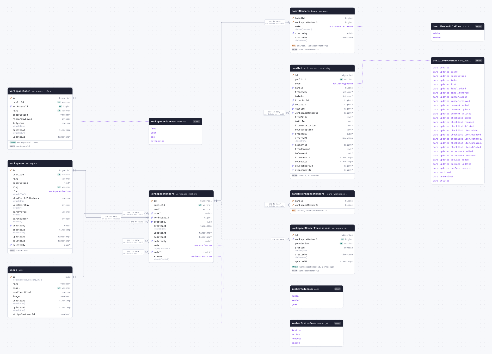

| Column        | Type                                         | Constraints                                       | Default               | Description      |
| ------------- | -------------------------------------------- | ------------------------------------------------- | --------------------- | ---------------- |
| `id`          | `bigserial`                                  | PK NOT NULL                                       |                       |                  |
| `publicId`    | `varchar`                                    | UNIQUE NOT NULL                                   |                       |                  |
| `email`       | `varchar`                                    | NOT NULL                                          |                       |                  |
| `userId`      | `uuid`                                       | NULL → [users.id](#table-users)                   |                       |                  |
| `workspaceId` | `bigint`                                     | NOT NULL → [workspaces.id](#table-workspaces)     |                       |                  |
| `createdBy`   | `uuid`                                       | NOT NULL → [users.id](#table-users)               |                       |                  |
| `createdAt`   | `timestamp`                                  | NOT NULL                                          | `.defaultNow()`       |                  |
| `updatedAt`   | `timestamp`                                  | NULL                                              |                       |                  |
| `deletedAt`   | `timestamp`                                  | NULL                                              |                       |                  |
| `deletedBy`   | `uuid`                                       | NULL → [users.id](#table-users)                   |                       |                  |
| `role`        | [`memberRoleEnum`](#enum-memberRoleEnum)     | NOT NULL                                          |                       | Legacy role enum |
| `roleId`      | `bigint`                                     | NULL → [workspaceRoles.id](#table-workspaceRoles) |                       |                  |
| `status`      | [`memberStatusEnum`](#enum-memberStatusEnum) | NOT NULL                                          | `.default("invited")` |                  |

#### Definition

```sql
CREATE TABLE "workspace_members" (
	"id" bigserial PRIMARY KEY,
	"publicId" varchar(12) NOT NULL UNIQUE,
	"email" varchar(255) NOT NULL,
	"userId" uuid,
	"workspaceId" bigint NOT NULL,
	"createdBy" uuid NOT NULL,
	"createdAt" timestamp DEFAULT now() NOT NULL,
	"updatedAt" timestamp,
	"deletedAt" timestamp,
	"deletedBy" uuid,
	"role" "role" NOT NULL,
	"roleId" bigint,
	"status" "member_status" DEFAULT 'invited'::"member_status" NOT NULL
);

ALTER TABLE "workspace_members" ENABLE ROW LEVEL SECURITY;

ALTER TABLE "workspace_members" ADD CONSTRAINT "workspace_members_userId_user_id_fkey" FOREIGN KEY ("userId") REFERENCES "user"("id") ON DELETE SET NULL;

ALTER TABLE "workspace_members" ADD CONSTRAINT "workspace_members_workspaceId_workspace_id_fkey" FOREIGN KEY ("workspaceId") REFERENCES "workspace"("id") ON DELETE CASCADE;

ALTER TABLE "workspace_members" ADD CONSTRAINT "workspace_members_deletedBy_user_id_fkey" FOREIGN KEY ("deletedBy") REFERENCES "user"("id") ON DELETE SET NULL;

ALTER TABLE "workspace_members" ADD CONSTRAINT "workspace_members_roleId_workspace_roles_id_fkey" FOREIGN KEY ("roleId") REFERENCES "workspace_roles"("id") ON DELETE RESTRICT;
```

#### References

- `userId` → [users.id](#table-users) (many to one, on delete set null)
- `workspaceId` → [workspaces.id](#table-workspaces) (many to one, on delete cascade)
- `deletedBy` → [users.id](#table-users) (many to one, on delete set null)
- `roleId` → [workspaceRoles.id](#table-workspaceRoles) (many to one, on delete restrict)
- `createdBy` → [users.id](#table-users) (many to one, defineRelations, no foreign key)

#### Referenced by

- `id` → [boardMembers.workspaceMemberId](#table-boardMembers) (one to many, on delete cascade)
- `id` → [cardActivities.workspaceMemberId](#table-cardActivities) (one to many, on delete set null)
- `id` → [cardToWorkspaceMembers.workspaceMemberId](#table-cardToWorkspaceMembers) (one to many, on delete cascade)
- `id` → [workspaceMemberPermissions.workspaceMemberId](#table-workspaceMemberPermissions) (one to many, defineRelations)

<details>
<summary>Queries and their SQL</summary>

**Select**: Every row of workspaceMembers.

```ts
db.select().from(workspaceMembers);
```

```sql
select "id", "publicId", "email", "userId", "workspaceId", "createdBy", "createdAt", "updatedAt", "deletedAt", "deletedBy", "role", "roleId", "status"
from "workspace_members"
```

**Count**: How many rows workspaceMembers has.

```ts
db.select({ count: count() }).from(workspaceMembers);
```

```sql
select count(*)
from "workspace_members"
```

**Find many**: The rows of workspaceMembers, through the relational query API.

```ts
db.query.workspaceMembers.findMany();
```

```sql
select "d0"."id" as "id", "d0"."publicId" as "publicId", "d0"."email" as "email", "d0"."userId" as "userId", "d0"."workspaceId" as "workspaceId", "d0"."createdBy" as "createdBy", "d0"."createdAt" as "createdAt", "d0"."updatedAt" as "updatedAt", "d0"."deletedAt" as "deletedAt", "d0"."deletedBy" as "deletedBy", "d0"."role" as "role", "d0"."roleId" as "roleId", "d0"."status" as "status"
from "workspace_members" as "d0"
```

**Find by primary key**: One row of workspaceMembers, through the relational query API.

```ts
db.query.workspaceMembers.findFirst({ where: { id: 1 } });
```

```sql
select "d0"."id" as "id", "d0"."publicId" as "publicId", "d0"."email" as "email", "d0"."userId" as "userId", "d0"."workspaceId" as "workspaceId", "d0"."createdBy" as "createdBy", "d0"."createdAt" as "createdAt", "d0"."updatedAt" as "updatedAt", "d0"."deletedAt" as "deletedAt", "d0"."deletedBy" as "deletedBy", "d0"."role" as "role", "d0"."roleId" as "roleId", "d0"."status" as "status"
from "workspace_members" as "d0"
where "d0"."id" = $1
limit $2
-- params: [1,1]
```

**Insert**: Adds a row to workspaceMembers, giving the columns that have no default.

```ts
db.insert(workspaceMembers).values({
  publicId: "publicId",
  email: "email",
  workspaceId: 1,
  createdBy: "00000000-0000-0000-0000-000000000000",
  role: "admin",
});
```

```sql
insert into "workspace_members" ("id", "publicId", "email", "userId", "workspaceId", "createdBy", "createdAt", "updatedAt", "deletedAt", "deletedBy", "role", "roleId", "status")
values (default, $1, $2, default, $3, $4, default, default, default, default, $5, default, default)
-- params: ["publicId","email",1,"00000000-0000-0000-0000-000000000000","admin"]
```

**Update**: Changes a row of workspaceMembers, found by its primary key.

```ts
db.update(workspaceMembers).set({ publicId: "publicId" }).where(eq(workspaceMembers.id, 1));
```

```sql
update "workspace_members"
set "publicId" = $1
where "workspace_members"."id" = $2
-- params: ["publicId",1]
```

**Delete**: Deletes a row of workspaceMembers, found by its primary key.

```ts
db.delete(workspaceMembers).where(eq(workspaceMembers.id, 1));
```

```sql
delete from "workspace_members"
where "workspace_members"."id" = $1
-- params: [1]
```

</details>

<a id="table-slugs"></a>

### slugs

Table `workspace_slugs`.

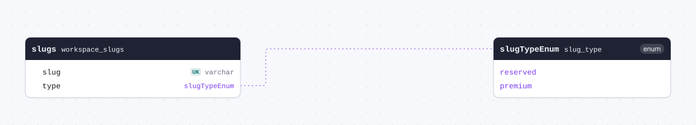

| Column | Type                                 | Constraints     | Default | Description |
| ------ | ------------------------------------ | --------------- | ------- | ----------- |
| `slug` | `varchar`                            | UNIQUE NOT NULL |         |             |
| `type` | [`slugTypeEnum`](#enum-slugTypeEnum) | NOT NULL        |         |             |

#### Definition

```sql
CREATE TABLE "workspace_slugs" (
	"slug" varchar(255) NOT NULL UNIQUE,
	"type" "slug_type" NOT NULL
);
```

<details>
<summary>Queries and their SQL</summary>

**Select**: Every row of slugs.

```ts
db.select().from(slugs);
```

```sql
select "slug", "type"
from "workspace_slugs"
```

**Count**: How many rows slugs has.

```ts
db.select({ count: count() }).from(slugs);
```

```sql
select count(*)
from "workspace_slugs"
```

**Find many**: The rows of slugs, through the relational query API.

```ts
db.query.slugs.findMany();
```

```sql
select "d0"."slug" as "slug", "d0"."type" as "type"
from "workspace_slugs" as "d0"
```

**Insert**: Adds a row to slugs, giving the columns that have no default.

```ts
db.insert(slugs).values({ slug: "slug", type: "reserved" });
```

```sql
insert into "workspace_slugs" ("slug", "type")
values ($1, $2)
-- params: ["slug","reserved"]
```

</details>

<a id="table-slugChecks"></a>

### slugChecks

Table `workspace_slug_checks`.

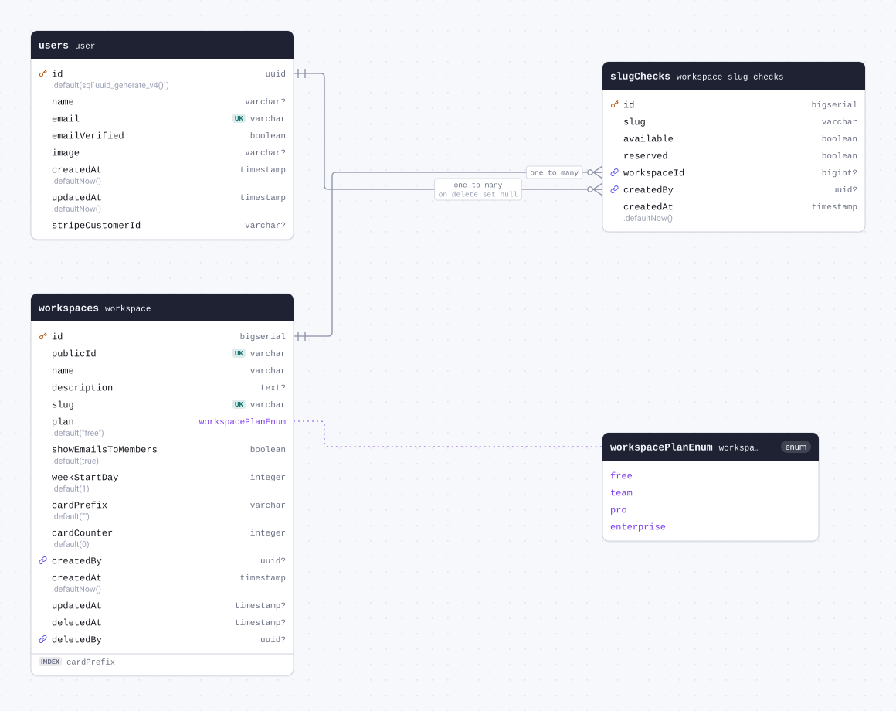

| Column        | Type        | Constraints                               | Default         | Description |
| ------------- | ----------- | ----------------------------------------- | --------------- | ----------- |
| `id`          | `bigserial` | PK NOT NULL                               |                 |             |
| `slug`        | `varchar`   | NOT NULL                                  |                 |             |
| `available`   | `boolean`   | NOT NULL                                  |                 |             |
| `reserved`    | `boolean`   | NOT NULL                                  |                 |             |
| `workspaceId` | `bigint`    | NULL → [workspaces.id](#table-workspaces) |                 |             |
| `createdBy`   | `uuid`      | NULL → [users.id](#table-users)           |                 |             |
| `createdAt`   | `timestamp` | NOT NULL                                  | `.defaultNow()` |             |

#### Definition

```sql
CREATE TABLE "workspace_slug_checks" (
	"id" bigserial PRIMARY KEY,
	"slug" varchar(255) NOT NULL,
	"available" boolean NOT NULL,
	"reserved" boolean NOT NULL,
	"workspaceId" bigint,
	"createdBy" uuid,
	"createdAt" timestamp DEFAULT now() NOT NULL
);

ALTER TABLE "workspace_slug_checks" ENABLE ROW LEVEL SECURITY;

ALTER TABLE "workspace_slug_checks" ADD CONSTRAINT "workspace_slug_checks_workspaceId_workspace_id_fkey" FOREIGN KEY ("workspaceId") REFERENCES "workspace"("id");

ALTER TABLE "workspace_slug_checks" ADD CONSTRAINT "workspace_slug_checks_createdBy_user_id_fkey" FOREIGN KEY ("createdBy") REFERENCES "user"("id") ON DELETE SET NULL;
```

#### References

- `workspaceId` → [workspaces.id](#table-workspaces) (many to one)
- `createdBy` → [users.id](#table-users) (many to one, on delete set null)

<details>
<summary>Queries and their SQL</summary>

**Select**: Every row of slugChecks.

```ts
db.select().from(slugChecks);
```

```sql
select "id", "slug", "available", "reserved", "workspaceId", "createdBy", "createdAt"
from "workspace_slug_checks"
```

**Count**: How many rows slugChecks has.

```ts
db.select({ count: count() }).from(slugChecks);
```

```sql
select count(*)
from "workspace_slug_checks"
```

**Find many**: The rows of slugChecks, through the relational query API.

```ts
db.query.slugChecks.findMany();
```

```sql
select "d0"."id" as "id", "d0"."slug" as "slug", "d0"."available" as "available", "d0"."reserved" as "reserved", "d0"."workspaceId" as "workspaceId", "d0"."createdBy" as "createdBy", "d0"."createdAt" as "createdAt"
from "workspace_slug_checks" as "d0"
```

**Find by primary key**: One row of slugChecks, through the relational query API.

```ts
db.query.slugChecks.findFirst({ where: { id: 1 } });
```

```sql
select "d0"."id" as "id", "d0"."slug" as "slug", "d0"."available" as "available", "d0"."reserved" as "reserved", "d0"."workspaceId" as "workspaceId", "d0"."createdBy" as "createdBy", "d0"."createdAt" as "createdAt"
from "workspace_slug_checks" as "d0"
where "d0"."id" = $1
limit $2
-- params: [1,1]
```

**Insert**: Adds a row to slugChecks, giving the columns that have no default.

```ts
db.insert(slugChecks).values({ slug: "slug", available: true, reserved: true });
```

```sql
insert into "workspace_slug_checks" ("id", "slug", "available", "reserved", "workspaceId", "createdBy", "createdAt")
values (default, $1, $2, $3, default, default, default)
-- params: ["slug",true,true]
```

**Update**: Changes a row of slugChecks, found by its primary key.

```ts
db.update(slugChecks).set({ slug: "slug" }).where(eq(slugChecks.id, 1));
```

```sql
update "workspace_slug_checks"
set "slug" = $1
where "workspace_slug_checks"."id" = $2
-- params: ["slug",1]
```

**Delete**: Deletes a row of slugChecks, found by its primary key.

```ts
db.delete(slugChecks).where(eq(slugChecks.id, 1));
```

```sql
delete from "workspace_slug_checks"
where "workspace_slug_checks"."id" = $1
-- params: [1]
```

</details>

## Enums

<a id="enum-boardVisibilityEnum"></a>

### boardVisibilityEnum

Type `board_visibility`.

- `private`
- `public`

#### Definition

```sql
CREATE TYPE "board_visibility" AS ENUM('private', 'public');
```

<a id="enum-boardMemberRoleEnum"></a>

### boardMemberRoleEnum

Type `board_member_role`.

- `admin`
- `member`

#### Definition

```sql
CREATE TYPE "board_member_role" AS ENUM('admin', 'member');
```

<a id="enum-boardTypeEnum"></a>

### boardTypeEnum

Type `board_type`.

- `regular`
- `template`

#### Definition

```sql
CREATE TYPE "board_type" AS ENUM('regular', 'template');
```

<a id="enum-activityTypeEnum"></a>

### activityTypeEnum

Type `card_activity_type`.

- `card.created`
- `card.updated.title`
- `card.updated.description`
- `card.updated.index`
- `card.updated.list`
- `card.updated.label.added`
- `card.updated.label.removed`
- `card.updated.member.added`
- `card.updated.member.removed`
- `card.updated.comment.added`
- `card.updated.comment.updated`
- `card.updated.comment.deleted`
- `card.updated.checklist.added`
- `card.updated.checklist.renamed`
- `card.updated.checklist.deleted`
- `card.updated.checklist.item.added`
- `card.updated.checklist.item.updated`
- `card.updated.checklist.item.completed`
- `card.updated.checklist.item.uncompleted`
- `card.updated.checklist.item.deleted`
- `card.updated.attachment.added`
- `card.updated.attachment.removed`
- `card.updated.dueDate.added`
- `card.updated.dueDate.updated`
- `card.updated.dueDate.removed`
- `card.archived`

#### Definition

```sql
CREATE TYPE "card_activity_type" AS ENUM('card.created', 'card.updated.title', 'card.updated.description', 'card.updated.index', 'card.updated.list', 'card.updated.label.added', 'card.updated.label.removed', 'card.updated.member.added', 'card.updated.member.removed', 'card.updated.comment.added', 'card.updated.comment.updated', 'card.updated.comment.deleted', 'card.updated.checklist.added', 'card.updated.checklist.renamed', 'card.updated.checklist.deleted', 'card.updated.checklist.item.added', 'card.updated.checklist.item.updated', 'card.updated.checklist.item.completed', 'card.updated.checklist.item.uncompleted', 'card.updated.checklist.item.deleted', 'card.updated.attachment.added', 'card.updated.attachment.removed', 'card.updated.dueDate.added', 'card.updated.dueDate.updated', 'card.updated.dueDate.removed', 'card.archived');
```

<a id="enum-importSourceEnum"></a>

### importSourceEnum

Type `source`.

- `trello`
- `github`

#### Definition

```sql
CREATE TYPE "source" AS ENUM('trello', 'github');
```

<a id="enum-importStatusEnum"></a>

### importStatusEnum

Type `status`.

- `started`
- `success`
- `failed`

#### Definition

```sql
CREATE TYPE "status" AS ENUM('started', 'success', 'failed');
```

<a id="enum-notificationTypeEnum"></a>

### notificationTypeEnum

Type `notification_type`.

- `mention`
- `workspace.member.added`
- `workspace.member.removed`
- `workspace.role.changed`

#### Definition

```sql
CREATE TYPE "notification_type" AS ENUM('mention', 'workspace.member.added', 'workspace.member.removed', 'workspace.role.changed');
```

<a id="enum-inviteLinkStatusEnum"></a>

### inviteLinkStatusEnum

Type `invite_link_status`.

- `active`
- `inactive`

#### Definition

```sql
CREATE TYPE "invite_link_status" AS ENUM('active', 'inactive');
```

<a id="enum-memberRoleEnum"></a>

### memberRoleEnum

Type `role`.

- `admin`
- `member`
- `guest`

#### Definition

```sql
CREATE TYPE "role" AS ENUM('admin', 'member', 'guest');
```

<a id="enum-memberStatusEnum"></a>

### memberStatusEnum

Type `member_status`.

- `invited`
- `active`
- `removed`
- `paused`

#### Definition

```sql
CREATE TYPE "member_status" AS ENUM('invited', 'active', 'removed', 'paused');
```

<a id="enum-slugTypeEnum"></a>

### slugTypeEnum

Type `slug_type`.

- `reserved`
- `premium`

#### Definition

```sql
CREATE TYPE "slug_type" AS ENUM('reserved', 'premium');
```

<a id="enum-workspacePlanEnum"></a>

### workspacePlanEnum

Type `workspace_plan`.

- `free`
- `team`
- `pro`
- `enterprise`

#### Definition

```sql
CREATE TYPE "workspace_plan" AS ENUM('free', 'team', 'pro', 'enterprise');
```
