# Schema docs

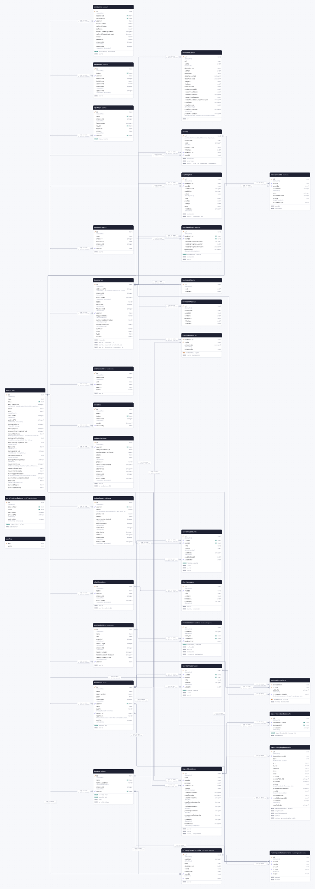

<details>
<summary>The whole schema as SQL</summary>

```sql
CREATE TABLE `account` (
	`id` text PRIMARY KEY,
	`accountId` text NOT NULL,
	`providerId` text NOT NULL,
	`userId` text NOT NULL,
	`accessToken` text,
	`refreshToken` text,
	`idToken` text,
	`accessTokenExpiresAt` integer,
	`refreshTokenExpiresAt` integer,
	`scope` text,
	`password` text,
	`createdAt` integer NOT NULL,
	`updatedAt` integer NOT NULL,
	CONSTRAINT `fk_account_userId_user_id_fk` FOREIGN KEY (`userId`) REFERENCES `user`(`id`) ON DELETE CASCADE,
	CONSTRAINT `accounts_providerId_accountId_unique` UNIQUE(`providerId`,`accountId`)
);

CREATE TABLE `apiKey` (
	`id` text PRIMARY KEY,
	`name` text NOT NULL,
	`createdAt` integer NOT NULL,
	`lastUsedAt` integer,
	`keyId` text NOT NULL UNIQUE,
	`keyHash` text NOT NULL,
	`scopes` text NOT NULL,
	`userId` text NOT NULL,
	CONSTRAINT `fk_apiKey_userId_user_id_fk` FOREIGN KEY (`userId`) REFERENCES `user`(`id`) ON DELETE CASCADE,
	CONSTRAINT `apiKey_name_userId_unique` UNIQUE(`name`,`userId`)
);

CREATE TABLE `assets` (
	`id` text PRIMARY KEY,
	`assetType` text NOT NULL,
	`size` integer DEFAULT 0 NOT NULL,
	`contentType` text,
	`fileName` text,
	`bookmarkId` text,
	`userId` text NOT NULL,
	CONSTRAINT `fk_assets_bookmarkId_bookmarks_id_fk` FOREIGN KEY (`bookmarkId`) REFERENCES `bookmarks`(`id`) ON DELETE CASCADE,
	CONSTRAINT `fk_assets_userId_user_id_fk` FOREIGN KEY (`userId`) REFERENCES `user`(`id`) ON DELETE CASCADE
);

CREATE TABLE `backups` (
	`id` text PRIMARY KEY,
	`userId` text NOT NULL,
	`assetId` text,
	`createdAt` integer NOT NULL,
	`size` integer NOT NULL,
	`bookmarkCount` integer NOT NULL,
	`status` text DEFAULT 'pending' NOT NULL,
	`errorMessage` text,
	CONSTRAINT `fk_backups_userId_user_id_fk` FOREIGN KEY (`userId`) REFERENCES `user`(`id`) ON DELETE CASCADE,
	CONSTRAINT `fk_backups_assetId_assets_id_fk` FOREIGN KEY (`assetId`) REFERENCES `assets`(`id`) ON DELETE CASCADE
);

CREATE TABLE `bookmarkAssets` (
	`id` text PRIMARY KEY,
	`assetType` text NOT NULL,
	`assetId` text NOT NULL,
	`content` text,
	`metadata` text,
	`fileName` text,
	`sourceUrl` text,
	CONSTRAINT `fk_bookmarkAssets_id_bookmarks_id_fk` FOREIGN KEY (`id`) REFERENCES `bookmarks`(`id`) ON DELETE CASCADE
);

CREATE TABLE `bookmarkLinks` (
	`id` text PRIMARY KEY,
	`url` text NOT NULL,
	`title` text,
	`description` text,
	`author` text,
	`publisher` text,
	`datePublished` integer,
	`dateModified` integer,
	`imageUrl` text,
	`favicon` text,
	`htmlContent` text,
	`contentAssetId` text,
	`readerViewStatus` text,
	`readerViewScore` integer,
	`readerViewReasons` text,
	`readerViewClassifierVersion` integer,
	`crawledAt` integer,
	`crawlStatus` text DEFAULT 'pending',
	`crawlStatusCode` integer DEFAULT 200,
	`probeMetadataAt` integer,
	CONSTRAINT `fk_bookmarkLinks_id_bookmarks_id_fk` FOREIGN KEY (`id`) REFERENCES `bookmarks`(`id`) ON DELETE CASCADE
);

CREATE TABLE `bookmarkLists` (
	`id` text PRIMARY KEY,
	`name` text NOT NULL,
	`description` text,
	`icon` text NOT NULL,
	`createdAt` integer NOT NULL,
	`userId` text NOT NULL,
	`type` text NOT NULL,
	`query` text,
	`parentId` text,
	`rssToken` text,
	`public` integer DEFAULT false NOT NULL,
	CONSTRAINT `fk_bookmarkLists_userId_user_id_fk` FOREIGN KEY (`userId`) REFERENCES `user`(`id`) ON DELETE CASCADE,
	CONSTRAINT `fk_bookmarkLists_parentId_bookmarkLists_id_fk` FOREIGN KEY (`parentId`) REFERENCES `bookmarkLists`(`id`) ON DELETE SET NULL,
	CONSTRAINT `bookmarkLists_userId_id_idx` UNIQUE(`userId`,`id`)
);

CREATE TABLE `bookmarkTags` (
	`id` text PRIMARY KEY,
	`name` text NOT NULL,
	`normalizedName` text GENERATED ALWAYS AS (lower(replace(replace(replace("name", ' ', ''), '-', ''), '_', ''))) VIRTUAL,
	`createdAt` integer NOT NULL,
	`userId` text NOT NULL,
	CONSTRAINT `fk_bookmarkTags_userId_user_id_fk` FOREIGN KEY (`userId`) REFERENCES `user`(`id`) ON DELETE CASCADE,
	CONSTRAINT `bookmarkTags_userId_name_unique` UNIQUE(`userId`,`name`),
	CONSTRAINT `bookmarkTags_userId_id_idx` UNIQUE(`userId`,`id`)
);

CREATE TABLE `bookmarkTexts` (
	`id` text PRIMARY KEY,
	`text` text,
	`sourceUrl` text,
	CONSTRAINT `fk_bookmarkTexts_id_bookmarks_id_fk` FOREIGN KEY (`id`) REFERENCES `bookmarks`(`id`) ON DELETE CASCADE
);

CREATE TABLE `bookmarks` (
	`id` text PRIMARY KEY,
	`createdAt` integer NOT NULL,
	`lastSavedAt` integer NOT NULL,
	`modifiedAt` integer,
	`title` text,
	`archived` integer DEFAULT false NOT NULL,
	`favourited` integer DEFAULT false NOT NULL,
	`userId` text NOT NULL,
	`taggingStatus` text DEFAULT 'pending',
	`summarizationStatus` text DEFAULT 'pending',
	`embeddingStatus` text DEFAULT 'pending',
	`summary` text,
	`note` text,
	`type` text NOT NULL,
	`source` text,
	CONSTRAINT `fk_bookmarks_userId_user_id_fk` FOREIGN KEY (`userId`) REFERENCES `user`(`id`) ON DELETE CASCADE
);

CREATE TABLE `bookmarksInLists` (
	`bookmarkId` text NOT NULL,
	`listId` text NOT NULL,
	`addedAt` integer,
	`listMembershipId` text,
	CONSTRAINT `bookmarksInLists_pk` PRIMARY KEY(`bookmarkId`, `listId`),
	CONSTRAINT `fk_bookmarksInLists_bookmarkId_bookmarks_id_fk` FOREIGN KEY (`bookmarkId`) REFERENCES `bookmarks`(`id`) ON DELETE CASCADE,
	CONSTRAINT `fk_bookmarksInLists_listId_bookmarkLists_id_fk` FOREIGN KEY (`listId`) REFERENCES `bookmarkLists`(`id`) ON DELETE CASCADE,
	CONSTRAINT `fk_bookmarksInLists_listMembershipId_listCollaborators_id_fk` FOREIGN KEY (`listMembershipId`) REFERENCES `listCollaborators`(`id`) ON DELETE CASCADE
);

CREATE TABLE `chatMessages` (
	`id` text PRIMARY KEY,
	`chatId` text NOT NULL,
	`role` text NOT NULL,
	`content` text NOT NULL,
	`metadata` text,
	`createdAt` integer NOT NULL,
	CONSTRAINT `fk_chatMessages_chatId_chatSessions_id_fk` FOREIGN KEY (`chatId`) REFERENCES `chatSessions`(`id`) ON DELETE CASCADE
);

CREATE TABLE `chatSessions` (
	`id` text PRIMARY KEY,
	`title` text NOT NULL,
	`userId` text NOT NULL,
	`createdAt` integer NOT NULL,
	`modifiedAt` integer,
	CONSTRAINT `fk_chatSessions_userId_user_id_fk` FOREIGN KEY (`userId`) REFERENCES `user`(`id`) ON DELETE CASCADE
);

CREATE TABLE `config` (
	`key` text PRIMARY KEY,
	`value` text NOT NULL
);

CREATE TABLE `customPrompts` (
	`id` text PRIMARY KEY,
	`text` text NOT NULL,
	`enabled` integer NOT NULL,
	`appliesTo` text NOT NULL,
	`createdAt` integer NOT NULL,
	`userId` text NOT NULL,
	CONSTRAINT `fk_customPrompts_userId_user_id_fk` FOREIGN KEY (`userId`) REFERENCES `user`(`id`) ON DELETE CASCADE
);

CREATE TABLE `highlights` (
	`id` text PRIMARY KEY,
	`bookmarkId` text NOT NULL,
	`userId` text NOT NULL,
	`startOffset` integer NOT NULL,
	`endOffset` integer NOT NULL,
	`color` text DEFAULT 'yellow' NOT NULL,
	`text` text,
	`prefix` text,
	`suffix` text,
	`note` text,
	`createdAt` integer NOT NULL,
	CONSTRAINT `fk_highlights_bookmarkId_bookmarks_id_fk` FOREIGN KEY (`bookmarkId`) REFERENCES `bookmarks`(`id`) ON DELETE CASCADE,
	CONSTRAINT `fk_highlights_userId_user_id_fk` FOREIGN KEY (`userId`) REFERENCES `user`(`id`) ON DELETE CASCADE
);

CREATE TABLE `importSessionBookmarks` (
	`id` text PRIMARY KEY,
	`importSessionId` text NOT NULL,
	`bookmarkId` text NOT NULL,
	`createdAt` integer NOT NULL,
	CONSTRAINT `fk_importSessionBookmarks_importSessionId_importSessions_id_fk` FOREIGN KEY (`importSessionId`) REFERENCES `importSessions`(`id`) ON DELETE CASCADE,
	CONSTRAINT `fk_importSessionBookmarks_bookmarkId_bookmarks_id_fk` FOREIGN KEY (`bookmarkId`) REFERENCES `bookmarks`(`id`) ON DELETE CASCADE,
	CONSTRAINT `importSessionBookmarks_importSessionId_bookmarkId_unique` UNIQUE(`importSessionId`,`bookmarkId`)
);

CREATE TABLE `importSessions` (
	`id` text PRIMARY KEY,
	`name` text NOT NULL,
	`userId` text NOT NULL,
	`message` text,
	`rootListId` text,
	`status` text DEFAULT 'staging' NOT NULL,
	`lastProcessedAt` integer,
	`completedAt` integer,
	`totalBookmarks` integer DEFAULT 0 NOT NULL,
	`completedBookmarks` integer DEFAULT 0 NOT NULL,
	`failedBookmarks` integer DEFAULT 0 NOT NULL,
	`pendingBookmarks` integer DEFAULT 0 NOT NULL,
	`processingBookmarks` integer DEFAULT 0 NOT NULL,
	`createdAt` integer NOT NULL,
	`modifiedAt` integer,
	CONSTRAINT `fk_importSessions_userId_user_id_fk` FOREIGN KEY (`userId`) REFERENCES `user`(`id`) ON DELETE CASCADE,
	CONSTRAINT `fk_importSessions_rootListId_bookmarkLists_id_fk` FOREIGN KEY (`rootListId`) REFERENCES `bookmarkLists`(`id`) ON DELETE SET NULL
);

CREATE TABLE `importStagingBookmarks` (
	`id` text PRIMARY KEY,
	`importSessionId` text NOT NULL,
	`type` text NOT NULL,
	`url` text,
	`title` text,
	`content` text,
	`note` text,
	`tags` text,
	`listIds` text,
	`sourceAddedAt` integer,
	`archived` integer,
	`status` text DEFAULT 'pending' NOT NULL,
	`processingStartedAt` integer,
	`result` text,
	`resultReason` text,
	`resultBookmarkId` text,
	`createdAt` integer NOT NULL,
	`completedAt` integer,
	CONSTRAINT `fk_importStagingBookmarks_importSessionId_importSessions_id_fk` FOREIGN KEY (`importSessionId`) REFERENCES `importSessions`(`id`) ON DELETE CASCADE,
	CONSTRAINT `fk_importStagingBookmarks_resultBookmarkId_bookmarks_id_fk` FOREIGN KEY (`resultBookmarkId`) REFERENCES `bookmarks`(`id`) ON DELETE SET NULL
);

CREATE TABLE `inAppSubscriptions` (
	`id` text PRIMARY KEY,
	`userId` text NOT NULL UNIQUE,
	`store` text,
	`productId` text,
	`status` text NOT NULL,
	`cancelAtPeriodEnd` integer DEFAULT false NOT NULL,
	`billingIssue` integer DEFAULT false NOT NULL,
	`isSandbox` integer DEFAULT false NOT NULL,
	`startDate` integer,
	`endDate` integer,
	`createdAt` integer NOT NULL,
	`modifiedAt` integer,
	CONSTRAINT `fk_inAppSubscriptions_userId_user_id_fk` FOREIGN KEY (`userId`) REFERENCES `user`(`id`) ON DELETE CASCADE
);

CREATE TABLE `invites` (
	`id` text PRIMARY KEY,
	`email` text NOT NULL,
	`token` text NOT NULL UNIQUE,
	`createdAt` integer NOT NULL,
	`usedAt` integer,
	`invitedBy` text NOT NULL,
	CONSTRAINT `fk_invites_invitedBy_user_id_fk` FOREIGN KEY (`invitedBy`) REFERENCES `user`(`id`) ON DELETE CASCADE
);

CREATE TABLE `listCollaborators` (
	`id` text PRIMARY KEY,
	`listId` text NOT NULL,
	`userId` text NOT NULL,
	`role` text NOT NULL,
	`createdAt` integer NOT NULL,
	`addedBy` text,
	CONSTRAINT `fk_listCollaborators_listId_bookmarkLists_id_fk` FOREIGN KEY (`listId`) REFERENCES `bookmarkLists`(`id`) ON DELETE CASCADE,
	CONSTRAINT `fk_listCollaborators_userId_user_id_fk` FOREIGN KEY (`userId`) REFERENCES `user`(`id`) ON DELETE CASCADE,
	CONSTRAINT `fk_listCollaborators_addedBy_user_id_fk` FOREIGN KEY (`addedBy`) REFERENCES `user`(`id`) ON DELETE SET NULL,
	CONSTRAINT `listCollaborators_listId_userId_unique` UNIQUE(`listId`,`userId`)
);

CREATE TABLE `listInvitations` (
	`id` text PRIMARY KEY,
	`listId` text NOT NULL,
	`userId` text NOT NULL,
	`role` text NOT NULL,
	`status` text DEFAULT 'pending' NOT NULL,
	`invitedAt` integer NOT NULL,
	`invitedEmail` text,
	`invitedBy` text,
	CONSTRAINT `fk_listInvitations_listId_bookmarkLists_id_fk` FOREIGN KEY (`listId`) REFERENCES `bookmarkLists`(`id`) ON DELETE CASCADE,
	CONSTRAINT `fk_listInvitations_userId_user_id_fk` FOREIGN KEY (`userId`) REFERENCES `user`(`id`) ON DELETE CASCADE,
	CONSTRAINT `fk_listInvitations_invitedBy_user_id_fk` FOREIGN KEY (`invitedBy`) REFERENCES `user`(`id`) ON DELETE SET NULL,
	CONSTRAINT `listInvitations_listId_userId_unique` UNIQUE(`listId`,`userId`)
);

CREATE TABLE `rssFeedImports` (
	`id` text PRIMARY KEY,
	`createdAt` integer NOT NULL,
	`entryId` text NOT NULL,
	`rssFeedId` text NOT NULL,
	`bookmarkId` text,
	CONSTRAINT `fk_rssFeedImports_rssFeedId_rssFeeds_id_fk` FOREIGN KEY (`rssFeedId`) REFERENCES `rssFeeds`(`id`) ON DELETE CASCADE,
	CONSTRAINT `fk_rssFeedImports_bookmarkId_bookmarks_id_fk` FOREIGN KEY (`bookmarkId`) REFERENCES `bookmarks`(`id`) ON DELETE SET NULL,
	CONSTRAINT `rssFeedImports_rssFeedId_entryId_unique` UNIQUE(`rssFeedId`,`entryId`)
);

CREATE TABLE `rssFeeds` (
	`id` text PRIMARY KEY,
	`name` text NOT NULL,
	`url` text NOT NULL,
	`enabled` integer DEFAULT true NOT NULL,
	`importTags` integer DEFAULT false NOT NULL,
	`createdAt` integer NOT NULL,
	`lastFetchedAt` integer,
	`lastSuccessfulFetchAt` integer,
	`lastFetchedStatus` text DEFAULT 'pending',
	`userId` text NOT NULL,
	CONSTRAINT `fk_rssFeeds_userId_user_id_fk` FOREIGN KEY (`userId`) REFERENCES `user`(`id`) ON DELETE CASCADE
);

CREATE TABLE `ruleEngineActions` (
	`id` text PRIMARY KEY,
	`userId` text NOT NULL,
	`ruleId` text NOT NULL,
	`action` text NOT NULL,
	`listId` text,
	`tagId` text,
	CONSTRAINT `fk_ruleEngineActions_userId_user_id_fk` FOREIGN KEY (`userId`) REFERENCES `user`(`id`) ON DELETE CASCADE,
	CONSTRAINT `fk_ruleEngineActions_ruleId_ruleEngineRules_id_fk` FOREIGN KEY (`ruleId`) REFERENCES `ruleEngineRules`(`id`) ON DELETE CASCADE,
	CONSTRAINT `ruleEngineActions_userId_tagId_fk` FOREIGN KEY (`userId`,`tagId`) REFERENCES `bookmarkTags`(`userId`,`id`) ON DELETE CASCADE,
	CONSTRAINT `ruleEngineActions_userId_listId_fk` FOREIGN KEY (`userId`,`listId`) REFERENCES `bookmarkLists`(`userId`,`id`) ON DELETE CASCADE
);

CREATE TABLE `ruleEngineRules` (
	`id` text PRIMARY KEY,
	`enabled` integer DEFAULT true NOT NULL,
	`name` text NOT NULL,
	`description` text,
	`event` text NOT NULL,
	`condition` text NOT NULL,
	`userId` text NOT NULL,
	`tagId` text,
	CONSTRAINT `fk_ruleEngineRules_userId_user_id_fk` FOREIGN KEY (`userId`) REFERENCES `user`(`id`) ON DELETE CASCADE,
	CONSTRAINT `ruleEngineRules_userId_tagId_fk` FOREIGN KEY (`userId`,`tagId`) REFERENCES `bookmarkTags`(`userId`,`id`) ON DELETE CASCADE
);

CREATE TABLE `session` (
	`id` text PRIMARY KEY,
	`token` text NOT NULL UNIQUE,
	`userId` text NOT NULL,
	`expiresAt` integer NOT NULL,
	`ipAddress` text,
	`userAgent` text,
	`createdAt` integer NOT NULL,
	`updatedAt` integer NOT NULL,
	CONSTRAINT `fk_session_userId_user_id_fk` FOREIGN KEY (`userId`) REFERENCES `user`(`id`) ON DELETE CASCADE
);

CREATE TABLE `subscriptions` (
	`id` text PRIMARY KEY,
	`userId` text NOT NULL UNIQUE,
	`stripeCustomerId` text NOT NULL,
	`stripeSubscriptionId` text,
	`status` text NOT NULL,
	`tier` text DEFAULT 'free' NOT NULL,
	`priceId` text,
	`cancelAtPeriodEnd` integer DEFAULT false,
	`startDate` integer,
	`endDate` integer,
	`createdAt` integer NOT NULL,
	`modifiedAt` integer,
	CONSTRAINT `fk_subscriptions_userId_user_id_fk` FOREIGN KEY (`userId`) REFERENCES `user`(`id`) ON DELETE CASCADE
);

CREATE TABLE `tagsOnBookmarks` (
	`bookmarkId` text NOT NULL,
	`tagId` text NOT NULL,
	`attachedAt` integer,
	`attachedBy` text NOT NULL,
	CONSTRAINT `tagsOnBookmarks_pk` PRIMARY KEY(`bookmarkId`, `tagId`),
	CONSTRAINT `fk_tagsOnBookmarks_bookmarkId_bookmarks_id_fk` FOREIGN KEY (`bookmarkId`) REFERENCES `bookmarks`(`id`) ON DELETE CASCADE,
	CONSTRAINT `fk_tagsOnBookmarks_tagId_bookmarkTags_id_fk` FOREIGN KEY (`tagId`) REFERENCES `bookmarkTags`(`id`) ON DELETE CASCADE
);

CREATE TABLE `userReadingProgress` (
	`id` text PRIMARY KEY,
	`bookmarkId` text NOT NULL,
	`userId` text NOT NULL,
	`readingProgressOffset` integer NOT NULL,
	`readingProgressAnchor` text,
	`readingProgressPercent` integer,
	`modifiedAt` integer,
	CONSTRAINT `fk_userReadingProgress_bookmarkId_bookmarks_id_fk` FOREIGN KEY (`bookmarkId`) REFERENCES `bookmarks`(`id`) ON DELETE CASCADE,
	CONSTRAINT `fk_userReadingProgress_userId_user_id_fk` FOREIGN KEY (`userId`) REFERENCES `user`(`id`) ON DELETE CASCADE,
	CONSTRAINT `userReadingProgress_bookmarkId_userId_unique` UNIQUE(`bookmarkId`,`userId`)
);

CREATE TABLE `user` (
	`id` text PRIMARY KEY,
	`name` text NOT NULL,
	`email` text NOT NULL UNIQUE,
	`emailVerified` integer,
	`image` text,
	`role` text DEFAULT 'user',
	`createdAt` integer,
	`updatedAt` integer,
	`bookmarkQuota` integer,
	`storageQuota` integer,
	`browserCrawlingEnabled` integer,
	`manualTierName` text,
	`bookmarkClickAction` text DEFAULT 'open_original_link' NOT NULL,
	`archiveDisplayBehaviour` text DEFAULT 'show' NOT NULL,
	`timezone` text DEFAULT 'UTC',
	`backupsEnabled` integer DEFAULT false NOT NULL,
	`backupsFrequency` text DEFAULT 'weekly' NOT NULL,
	`backupsRetentionDays` integer DEFAULT 30 NOT NULL,
	`readerFontSize` integer,
	`readerLineHeight` real,
	`readerFontFamily` text,
	`autoTaggingEnabled` integer,
	`autoSummarizationEnabled` integer,
	`tagStyle` text DEFAULT 'titlecase-spaces',
	`curatedTagIds` text,
	`inferredTagLang` text
);

CREATE TABLE `verificationToken` (
	`id` text PRIMARY KEY,
	`identifier` text NOT NULL,
	`value` text NOT NULL,
	`expiresAt` integer NOT NULL,
	`createdAt` integer NOT NULL,
	`updatedAt` integer NOT NULL,
	CONSTRAINT `verificationTokens_identifier_value_unique` UNIQUE(`identifier`,`value`)
);

CREATE TABLE `webhooks` (
	`id` text PRIMARY KEY,
	`createdAt` integer NOT NULL,
	`url` text NOT NULL,
	`userId` text NOT NULL,
	`events` text NOT NULL,
	`token` text,
	CONSTRAINT `fk_webhooks_userId_user_id_fk` FOREIGN KEY (`userId`) REFERENCES `user`(`id`) ON DELETE CASCADE
);

CREATE INDEX `accounts_userId_idx` ON `account` (`userId`);

CREATE INDEX `assets_bookmarkId_idx` ON `assets` (`bookmarkId`);

CREATE INDEX `assets_assetType_idx` ON `assets` (`assetType`);

CREATE INDEX `assets_userId_size_idx` ON `assets` (`userId`,`size`,`id`,`assetType`,`bookmarkId`);

CREATE INDEX `backups_userId_idx` ON `backups` (`userId`);

CREATE INDEX `backups_createdAt_idx` ON `backups` (`createdAt`);

CREATE INDEX `bookmarkLinks_url_idx` ON `bookmarkLinks` (`url`);

CREATE INDEX `bookmarkLists_userId_idx` ON `bookmarkLists` (`userId`);

CREATE INDEX `bookmarkTags_name_idx` ON `bookmarkTags` (`name`);

CREATE INDEX `bookmarkTags_normalizedName_idx` ON `bookmarkTags` (`normalizedName`);

CREATE INDEX `bookmarks_lastSavedAt_idx` ON `bookmarks` (`lastSavedAt`);

CREATE INDEX `bookmarks_userId_lastSavedAt_id_idx` ON `bookmarks` (`userId`,`lastSavedAt`,`id`);

CREATE INDEX `bookmarks_userId_archived_lastSavedAt_id_idx` ON `bookmarks` (`userId`,`archived`,`lastSavedAt`,`id`);

CREATE INDEX `bookmarks_userId_favourited_lastSavedAt_id_idx` ON `bookmarks` (`userId`,`favourited`,`lastSavedAt`,`id`);

CREATE INDEX `bookmarksInLists_listId_bookmarkId_idx` ON `bookmarksInLists` (`listId`,`bookmarkId`);

CREATE INDEX `chatMessages_chatId_idx` ON `chatMessages` (`chatId`);

CREATE INDEX `chatMessages_chatId_createdAt_idx` ON `chatMessages` (`chatId`,`createdAt`);

CREATE INDEX `chatSessions_userId_idx` ON `chatSessions` (`userId`);

CREATE INDEX `chatSessions_userId_modifiedAt_idx` ON `chatSessions` (`userId`,`modifiedAt`);

CREATE INDEX `customPrompts_userId_idx` ON `customPrompts` (`userId`);

CREATE INDEX `highlights_bookmarkId_idx` ON `highlights` (`bookmarkId`);

CREATE INDEX `highlights_userId_createdAt_id_idx` ON `highlights` (`userId`,`createdAt`,`id`);

CREATE INDEX `importSessionBookmarks_bookmarkId_idx` ON `importSessionBookmarks` (`bookmarkId`);

CREATE INDEX `importSessions_userId_idx` ON `importSessions` (`userId`);

CREATE INDEX `importSessions_status_idx` ON `importSessions` (`status`);

CREATE INDEX `importSessions_status_completedAt_idx` ON `importSessions` (`status`,`completedAt`);

CREATE INDEX `importStaging_session_status_idx` ON `importStagingBookmarks` (`importSessionId`,`status`);

CREATE INDEX `importStaging_completedAt_idx` ON `importStagingBookmarks` (`completedAt`);

CREATE INDEX `importStaging_resultBookmarkId_idx` ON `importStagingBookmarks` (`resultBookmarkId`);

CREATE INDEX `importStaging_status_idx` ON `importStagingBookmarks` (`status`);

CREATE INDEX `importStaging_status_processingStartedAt_idx` ON `importStagingBookmarks` (`status`,`processingStartedAt`);

CREATE INDEX `listCollaborators_listId_idx` ON `listCollaborators` (`listId`);

CREATE INDEX `listCollaborators_userId_idx` ON `listCollaborators` (`userId`);

CREATE INDEX `listInvitations_listId_idx` ON `listInvitations` (`listId`);

CREATE INDEX `listInvitations_userId_idx` ON `listInvitations` (`userId`);

CREATE INDEX `listInvitations_status_idx` ON `listInvitations` (`status`);

CREATE INDEX `rssFeedImports_feedIdIdx_idx` ON `rssFeedImports` (`rssFeedId`);

CREATE INDEX `rssFeedImports_entryIdIdx_idx` ON `rssFeedImports` (`entryId`);

CREATE INDEX `rssFeedImports_bookmarkId_idx` ON `rssFeedImports` (`bookmarkId`);

CREATE INDEX `rssFeedImports_rssFeedId_bookmarkId_idx` ON `rssFeedImports` (`rssFeedId`,`bookmarkId`);

CREATE INDEX `rssFeeds_userId_idx` ON `rssFeeds` (`userId`);

CREATE INDEX `ruleEngineActions_userId_idx` ON `ruleEngineActions` (`userId`);

CREATE INDEX `ruleEngineActions_ruleId_idx` ON `ruleEngineActions` (`ruleId`);

CREATE INDEX `ruleEngine_userId_idx` ON `ruleEngineRules` (`userId`);

CREATE INDEX `sessions_userId_idx` ON `session` (`userId`);

CREATE INDEX `subscriptions_userId_idx` ON `subscriptions` (`userId`);

CREATE INDEX `subscriptions_stripeCustomerId_idx` ON `subscriptions` (`stripeCustomerId`);

CREATE INDEX `tagsOnBookmarks_tagId_bookmarkId_idx` ON `tagsOnBookmarks` (`tagId`,`bookmarkId`);

CREATE INDEX `userReadingProgress_bookmarkId_idx` ON `userReadingProgress` (`bookmarkId`);

CREATE INDEX `userReadingProgress_userId_idx` ON `userReadingProgress` (`userId`);

CREATE INDEX `verificationTokens_identifier_idx` ON `verificationToken` (`identifier`);

CREATE INDEX `webhooks_userId_idx` ON `webhooks` (`userId`);
```

</details>

## Contents

| Table                                                   | Name in the database     | Description                                                                                                                                                                                                            |
| ------------------------------------------------------- | ------------------------ | ---------------------------------------------------------------------------------------------------------------------------------------------------------------------------------------------------------------------- |
| [users](#table-users)                                   | `user`                   |                                                                                                                                                                                                                        |
| [accounts](#table-accounts)                             | `account`                |                                                                                                                                                                                                                        |
| [sessions](#table-sessions)                             | `session`                |                                                                                                                                                                                                                        |
| [verificationTokens](#table-verificationTokens)         | `verificationToken`      |                                                                                                                                                                                                                        |
| [apiKeys](#table-apiKeys)                               | `apiKey`                 |                                                                                                                                                                                                                        |
| [bookmarks](#table-bookmarks)                           | `bookmarks`              |                                                                                                                                                                                                                        |
| [bookmarkLinks](#table-bookmarkLinks)                   | `bookmarkLinks`          |                                                                                                                                                                                                                        |
| [assets](#table-assets)                                 | `assets`                 |                                                                                                                                                                                                                        |
| [highlights](#table-highlights)                         | `highlights`             |                                                                                                                                                                                                                        |
| [userReadingProgress](#table-userReadingProgress)       | `userReadingProgress`    |                                                                                                                                                                                                                        |
| [bookmarkTexts](#table-bookmarkTexts)                   | `bookmarkTexts`          |                                                                                                                                                                                                                        |
| [bookmarkAssets](#table-bookmarkAssets)                 | `bookmarkAssets`         |                                                                                                                                                                                                                        |
| [bookmarkTags](#table-bookmarkTags)                     | `bookmarkTags`           |                                                                                                                                                                                                                        |
| [tagsOnBookmarks](#table-tagsOnBookmarks)               | `tagsOnBookmarks`        |                                                                                                                                                                                                                        |
| [bookmarkLists](#table-bookmarkLists)                   | `bookmarkLists`          |                                                                                                                                                                                                                        |
| [bookmarksInLists](#table-bookmarksInLists)             | `bookmarksInLists`       |                                                                                                                                                                                                                        |
| [listCollaborators](#table-listCollaborators)           | `listCollaborators`      |                                                                                                                                                                                                                        |
| [listInvitations](#table-listInvitations)               | `listInvitations`        |                                                                                                                                                                                                                        |
| [customPrompts](#table-customPrompts)                   | `customPrompts`          |                                                                                                                                                                                                                        |
| [chatSessions](#table-chatSessions)                     | `chatSessions`           |                                                                                                                                                                                                                        |
| [chatMessages](#table-chatMessages)                     | `chatMessages`           |                                                                                                                                                                                                                        |
| [rssFeedsTable](#table-rssFeedsTable)                   | `rssFeeds`               |                                                                                                                                                                                                                        |
| [webhooksTable](#table-webhooksTable)                   | `webhooks`               |                                                                                                                                                                                                                        |
| [rssFeedImportsTable](#table-rssFeedImportsTable)       | `rssFeedImports`         |                                                                                                                                                                                                                        |
| [backupsTable](#table-backupsTable)                     | `backups`                |                                                                                                                                                                                                                        |
| [config](#table-config)                                 | `config`                 |                                                                                                                                                                                                                        |
| [ruleEngineRulesTable](#table-ruleEngineRulesTable)     | `ruleEngineRules`        |                                                                                                                                                                                                                        |
| [ruleEngineActionsTable](#table-ruleEngineActionsTable) | `ruleEngineActions`      |                                                                                                                                                                                                                        |
| [invites](#table-invites)                               | `invites`                |                                                                                                                                                                                                                        |
| [subscriptions](#table-subscriptions)                   | `subscriptions`          |                                                                                                                                                                                                                        |
| [inAppSubscriptions](#table-inAppSubscriptions)         | `inAppSubscriptions`     | Subscriptions purchased through the mobile app stores (App Store / Google Play). These are managed by RevenueCat, which is the source of truth; this table mirrors the state of the configured RevenueCat entitlement. |
| [importSessions](#table-importSessions)                 | `importSessions`         |                                                                                                                                                                                                                        |
| [importSessionBookmarks](#table-importSessionBookmarks) | `importSessionBookmarks` |                                                                                                                                                                                                                        |
| [importStagingBookmarks](#table-importStagingBookmarks) | `importStagingBookmarks` |                                                                                                                                                                                                                        |

## Tables

<a id="table-users"></a>

### users

Table `user`.

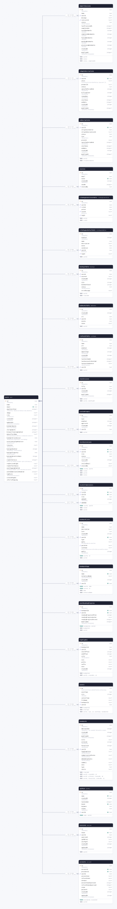

| Column                     | Type      | Constraints     | Default                          | Description                                                                                                                                                                                            |
| -------------------------- | --------- | --------------- | -------------------------------- | ------------------------------------------------------------------------------------------------------------------------------------------------------------------------------------------------------ |
| `id`                       | `text`    | PK NOT NULL     | `.$defaultFn()`                  |                                                                                                                                                                                                        |
| `name`                     | `text`    | NOT NULL        |                                  |                                                                                                                                                                                                        |
| `email`                    | `text`    | UNIQUE NOT NULL |                                  |                                                                                                                                                                                                        |
| `emailVerified`            | `integer` | NULL            | `.$defaultFn()`                  | Nullable and without a SQL default because SQLite can't add those constraints to an existing column without rebuilding the user table.                                                                 |
| `image`                    | `text`    | NULL            |                                  |                                                                                                                                                                                                        |
| `role`                     | `text`    | NULL            | `.default("user")`               |                                                                                                                                                                                                        |
| `createdAt`                | `integer` | NULL            | `.$defaultFn()`                  |                                                                                                                                                                                                        |
| `updatedAt`                | `integer` | NULL            | `.$defaultFn()` `.$onUpdate()`   |                                                                                                                                                                                                        |
| `bookmarkQuota`            | `integer` | NULL            |                                  | Admin Only Settings                                                                                                                                                                                    |
| `storageQuota`             | `integer` | NULL            |                                  |                                                                                                                                                                                                        |
| `browserCrawlingEnabled`   | `integer` | NULL            |                                  |                                                                                                                                                                                                        |
| `manualTierName`           | `text`    | NULL            |                                  | Admin-granted plan label (e.g. a collaborator name). While set, Stripe and in-app purchase syncs don't downgrade the user's entitlements; it's cleared when the user gets an active paid subscription. |
| `bookmarkClickAction`      | `text`    | NOT NULL        | `.default("open_original_link")` | User Settings                                                                                                                                                                                          |
| `archiveDisplayBehaviour`  | `text`    | NOT NULL        | `.default("show")`               |                                                                                                                                                                                                        |
| `timezone`                 | `text`    | NULL            | `.default("UTC")`                |                                                                                                                                                                                                        |
| `backupsEnabled`           | `integer` | NOT NULL        | `.default(false)`                | Backup Settings                                                                                                                                                                                        |
| `backupsFrequency`         | `text`    | NOT NULL        | `.default("weekly")`             |                                                                                                                                                                                                        |
| `backupsRetentionDays`     | `integer` | NOT NULL        | `.default(30)`                   |                                                                                                                                                                                                        |
| `readerFontSize`           | `integer` | NULL            |                                  | Reader view settings (nullable = opt-in, null means use client default)                                                                                                                                |
| `readerLineHeight`         | `real`    | NULL            |                                  |                                                                                                                                                                                                        |
| `readerFontFamily`         | `text`    | NULL            |                                  |                                                                                                                                                                                                        |
| `autoTaggingEnabled`       | `integer` | NULL            |                                  | AI Settings (nullable = opt-in, null means use server default)                                                                                                                                         |
| `autoSummarizationEnabled` | `integer` | NULL            |                                  |                                                                                                                                                                                                        |
| `tagStyle`                 | `text`    | NULL            | `.default("titlecase-spaces")`   |                                                                                                                                                                                                        |
| `curatedTagIds`            | `text`    | NULL            |                                  |                                                                                                                                                                                                        |
| `inferredTagLang`          | `text`    | NULL            |                                  |                                                                                                                                                                                                        |

#### Definition

```sql
CREATE TABLE `user` (
	`id` text PRIMARY KEY,
	`name` text NOT NULL,
	`email` text NOT NULL UNIQUE,
	`emailVerified` integer,
	`image` text,
	`role` text DEFAULT 'user',
	`createdAt` integer,
	`updatedAt` integer,
	`bookmarkQuota` integer,
	`storageQuota` integer,
	`browserCrawlingEnabled` integer,
	`manualTierName` text,
	`bookmarkClickAction` text DEFAULT 'open_original_link' NOT NULL,
	`archiveDisplayBehaviour` text DEFAULT 'show' NOT NULL,
	`timezone` text DEFAULT 'UTC',
	`backupsEnabled` integer DEFAULT false NOT NULL,
	`backupsFrequency` text DEFAULT 'weekly' NOT NULL,
	`backupsRetentionDays` integer DEFAULT 30 NOT NULL,
	`readerFontSize` integer,
	`readerLineHeight` real,
	`readerFontFamily` text,
	`autoTaggingEnabled` integer,
	`autoSummarizationEnabled` integer,
	`tagStyle` text DEFAULT 'titlecase-spaces',
	`curatedTagIds` text,
	`inferredTagLang` text
);
```

#### Referenced by

- `id` → [accounts.userId](#table-accounts) (one to many, on delete cascade)
- `id` → [sessions.userId](#table-sessions) (one to many, on delete cascade)
- `id` → [apiKeys.userId](#table-apiKeys) (one to many, on delete cascade)
- `id` → [bookmarks.userId](#table-bookmarks) (one to many, on delete cascade)
- `id` → [assets.userId](#table-assets) (one to many, on delete cascade)
- `id` → [highlights.userId](#table-highlights) (one to many, on delete cascade)
- `id` → [userReadingProgress.userId](#table-userReadingProgress) (one to many, on delete cascade)
- `id` → [bookmarkTags.userId](#table-bookmarkTags) (one to many, on delete cascade)
- `id` → [bookmarkLists.userId](#table-bookmarkLists) (one to many, on delete cascade)
- `id` → [listCollaborators.userId](#table-listCollaborators) (one to many, on delete cascade)
- `id` → [listCollaborators.addedBy](#table-listCollaborators) (one to many, on delete set null)
- `id` → [listInvitations.userId](#table-listInvitations) (one to many, on delete cascade)
- `id` → [listInvitations.invitedBy](#table-listInvitations) (one to many, on delete set null)
- `id` → [customPrompts.userId](#table-customPrompts) (one to many, on delete cascade)
- `id` → [chatSessions.userId](#table-chatSessions) (one to many, on delete cascade)
- `id` → [rssFeedsTable.userId](#table-rssFeedsTable) (one to many, on delete cascade)
- `id` → [webhooksTable.userId](#table-webhooksTable) (one to many, on delete cascade)
- `id` → [backupsTable.userId](#table-backupsTable) (one to many, on delete cascade)
- `id` → [ruleEngineRulesTable.userId](#table-ruleEngineRulesTable) (one to many, on delete cascade)
- `id` → [ruleEngineActionsTable.userId](#table-ruleEngineActionsTable) (one to many, on delete cascade)
- `id` → [invites.invitedBy](#table-invites) (one to many, on delete cascade)
- `id` → [subscriptions.userId](#table-subscriptions) (one to one, on delete cascade)
- `id` → [inAppSubscriptions.userId](#table-inAppSubscriptions) (one to one, on delete cascade)
- `id` → [importSessions.userId](#table-importSessions) (one to many, on delete cascade)

<details>
<summary>Queries and their SQL</summary>

**Select**: Every row of users.

```ts
db.select().from(users);
```

```sql
select "id", "name", "email", "emailVerified", "image", "role", "createdAt", "updatedAt", "bookmarkQuota", "storageQuota", "browserCrawlingEnabled", "manualTierName", "bookmarkClickAction", "archiveDisplayBehaviour", "timezone", "backupsEnabled", "backupsFrequency", "backupsRetentionDays", "readerFontSize", "readerLineHeight", "readerFontFamily", "autoTaggingEnabled", "autoSummarizationEnabled", "tagStyle", "curatedTagIds", "inferredTagLang"
from "user"
```

**Count**: How many rows users has.

```ts
db.select({ count: count() }).from(users);
```

```sql
select count(*)
from "user"
```

**Find many**: The rows of users, through the relational query API.

```ts
db.query.users.findMany();
```

```sql
select "d0"."id" as "id", "d0"."name" as "name", "d0"."email" as "email", "d0"."emailVerified" as "emailVerified", "d0"."image" as "image", "d0"."role" as "role", "d0"."createdAt" as "createdAt", "d0"."updatedAt" as "updatedAt", "d0"."bookmarkQuota" as "bookmarkQuota", "d0"."storageQuota" as "storageQuota", "d0"."browserCrawlingEnabled" as "browserCrawlingEnabled", "d0"."manualTierName" as "manualTierName", "d0"."bookmarkClickAction" as "bookmarkClickAction", "d0"."archiveDisplayBehaviour" as "archiveDisplayBehaviour", "d0"."timezone" as "timezone", "d0"."backupsEnabled" as "backupsEnabled", "d0"."backupsFrequency" as "backupsFrequency", "d0"."backupsRetentionDays" as "backupsRetentionDays", "d0"."readerFontSize" as "readerFontSize", "d0"."readerLineHeight" as "readerLineHeight", "d0"."readerFontFamily" as "readerFontFamily", "d0"."autoTaggingEnabled" as "autoTaggingEnabled", "d0"."autoSummarizationEnabled" as "autoSummarizationEnabled", "d0"."tagStyle" as "tagStyle", "d0"."curatedTagIds" as "curatedTagIds", "d0"."inferredTagLang" as "inferredTagLang"
from "user" as "d0"
```

**Find by primary key**: One row of users, through the relational query API.

```ts
db.query.users.findFirst({ where: { id: "id" } });
```

```sql
select "d0"."id" as "id", "d0"."name" as "name", "d0"."email" as "email", "d0"."emailVerified" as "emailVerified", "d0"."image" as "image", "d0"."role" as "role", "d0"."createdAt" as "createdAt", "d0"."updatedAt" as "updatedAt", "d0"."bookmarkQuota" as "bookmarkQuota", "d0"."storageQuota" as "storageQuota", "d0"."browserCrawlingEnabled" as "browserCrawlingEnabled", "d0"."manualTierName" as "manualTierName", "d0"."bookmarkClickAction" as "bookmarkClickAction", "d0"."archiveDisplayBehaviour" as "archiveDisplayBehaviour", "d0"."timezone" as "timezone", "d0"."backupsEnabled" as "backupsEnabled", "d0"."backupsFrequency" as "backupsFrequency", "d0"."backupsRetentionDays" as "backupsRetentionDays", "d0"."readerFontSize" as "readerFontSize", "d0"."readerLineHeight" as "readerLineHeight", "d0"."readerFontFamily" as "readerFontFamily", "d0"."autoTaggingEnabled" as "autoTaggingEnabled", "d0"."autoSummarizationEnabled" as "autoSummarizationEnabled", "d0"."tagStyle" as "tagStyle", "d0"."curatedTagIds" as "curatedTagIds", "d0"."inferredTagLang" as "inferredTagLang"
from "user" as "d0"
where "d0"."id" = ?
limit ?
-- params: ["id",1]
```

**Insert**: Adds a row to users, giving the columns that have no default.

```ts
db.insert(users).values({ name: "name", email: "email" });
```

```sql
insert into "user" ("id", "name", "email", "emailVerified", "image", "role", "createdAt", "updatedAt", "bookmarkQuota", "storageQuota", "browserCrawlingEnabled", "manualTierName", "bookmarkClickAction", "archiveDisplayBehaviour", "timezone", "backupsEnabled", "backupsFrequency", "backupsRetentionDays", "readerFontSize", "readerLineHeight", "readerFontFamily", "autoTaggingEnabled", "autoSummarizationEnabled", "tagStyle", "curatedTagIds", "inferredTagLang")
values (?, ?, ?, ?, null, ?, ?, ?, null, null, null, null, ?, ?, ?, ?, ?, ?, null, null, null, null, null, ?, null, null)
-- params: ["aauyl8ca800v38uhc8wq0jek","name","email",0,"user",1767225600000,1767225600000,"open_original_link","show","UTC",0,"weekly",30,"titlecase-spaces"]
```

**Update**: Changes a row of users, found by its primary key.

```ts
db.update(users).set({ name: "name" }).where(eq(users.id, "id"));
```

```sql
update "user"
set "name" = ?, "updatedAt" = ?
where "user"."id" = ?
-- params: ["name",1767225600000,"id"]
```

**Delete**: Deletes a row of users, found by its primary key.

```ts
db.delete(users).where(eq(users.id, "id"));
```

```sql
delete from "user"
where "user"."id" = ?
-- params: ["id"]
```

</details>

<a id="table-accounts"></a>

### accounts

Table `account`.

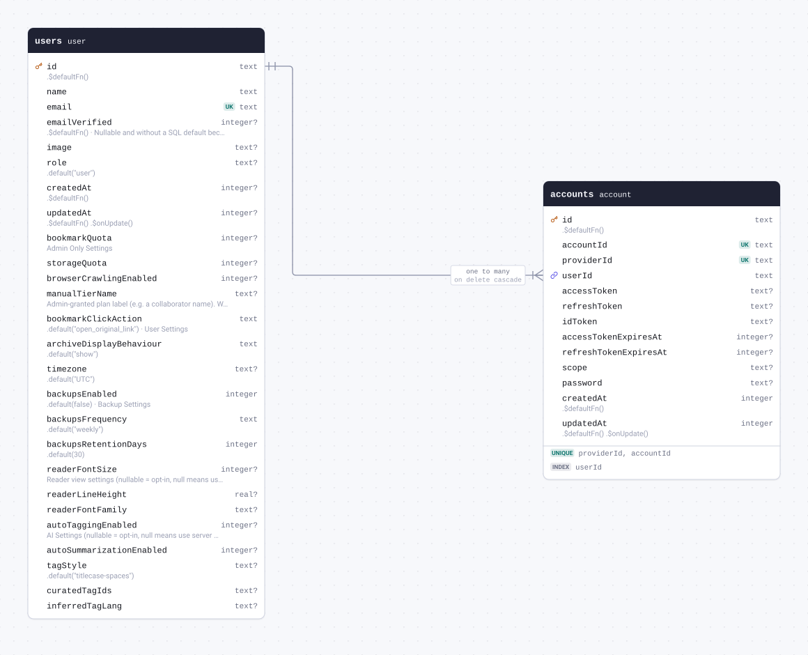

| Column                  | Type      | Constraints                         | Default                        | Description |
| ----------------------- | --------- | ----------------------------------- | ------------------------------ | ----------- |
| `id`                    | `text`    | PK NOT NULL                         | `.$defaultFn()`                |             |
| `accountId`             | `text`    | NOT NULL                            |                                |             |
| `providerId`            | `text`    | NOT NULL                            |                                |             |
| `userId`                | `text`    | NOT NULL → [users.id](#table-users) |                                |             |
| `accessToken`           | `text`    | NULL                                |                                |             |
| `refreshToken`          | `text`    | NULL                                |                                |             |
| `idToken`               | `text`    | NULL                                |                                |             |
| `accessTokenExpiresAt`  | `integer` | NULL                                |                                |             |
| `refreshTokenExpiresAt` | `integer` | NULL                                |                                |             |
| `scope`                 | `text`    | NULL                                |                                |             |
| `password`              | `text`    | NULL                                |                                |             |
| `createdAt`             | `integer` | NOT NULL                            | `.$defaultFn()`                |             |
| `updatedAt`             | `integer` | NOT NULL                            | `.$defaultFn()` `.$onUpdate()` |             |

#### Definition

```sql
CREATE TABLE `account` (
	`id` text PRIMARY KEY,
	`accountId` text NOT NULL,
	`providerId` text NOT NULL,
	`userId` text NOT NULL,
	`accessToken` text,
	`refreshToken` text,
	`idToken` text,
	`accessTokenExpiresAt` integer,
	`refreshTokenExpiresAt` integer,
	`scope` text,
	`password` text,
	`createdAt` integer NOT NULL,
	`updatedAt` integer NOT NULL,
	CONSTRAINT `fk_account_userId_user_id_fk` FOREIGN KEY (`userId`) REFERENCES `user`(`id`) ON DELETE CASCADE,
	CONSTRAINT `accounts_providerId_accountId_unique` UNIQUE(`providerId`,`accountId`)
);

CREATE INDEX `accounts_userId_idx` ON `account` (`userId`);
```

#### Indexes

- UNIQUE `providerId`, `accountId`
- INDEX `userId`

#### References

- `userId` → [users.id](#table-users) (many to one, on delete cascade)

<details>
<summary>Queries and their SQL</summary>

**Select**: Every row of accounts.

```ts
db.select().from(accounts);
```

```sql
select "id", "accountId", "providerId", "userId", "accessToken", "refreshToken", "idToken", "accessTokenExpiresAt", "refreshTokenExpiresAt", "scope", "password", "createdAt", "updatedAt"
from "account"
```

**Count**: How many rows accounts has.

```ts
db.select({ count: count() }).from(accounts);
```

```sql
select count(*)
from "account"
```

**Find many**: The rows of accounts, through the relational query API.

```ts
db.query.accounts.findMany();
```

```sql
select "d0"."id" as "id", "d0"."accountId" as "accountId", "d0"."providerId" as "providerId", "d0"."userId" as "userId", "d0"."accessToken" as "accessToken", "d0"."refreshToken" as "refreshToken", "d0"."idToken" as "idToken", "d0"."accessTokenExpiresAt" as "accessTokenExpiresAt", "d0"."refreshTokenExpiresAt" as "refreshTokenExpiresAt", "d0"."scope" as "scope", "d0"."password" as "password", "d0"."createdAt" as "createdAt", "d0"."updatedAt" as "updatedAt"
from "account" as "d0"
```

**Find by primary key**: One row of accounts, through the relational query API.

```ts
db.query.accounts.findFirst({ where: { id: "id" } });
```

```sql
select "d0"."id" as "id", "d0"."accountId" as "accountId", "d0"."providerId" as "providerId", "d0"."userId" as "userId", "d0"."accessToken" as "accessToken", "d0"."refreshToken" as "refreshToken", "d0"."idToken" as "idToken", "d0"."accessTokenExpiresAt" as "accessTokenExpiresAt", "d0"."refreshTokenExpiresAt" as "refreshTokenExpiresAt", "d0"."scope" as "scope", "d0"."password" as "password", "d0"."createdAt" as "createdAt", "d0"."updatedAt" as "updatedAt"
from "account" as "d0"
where "d0"."id" = ?
limit ?
-- params: ["id",1]
```

**Insert**: Adds a row to accounts, giving the columns that have no default.

```ts
db.insert(accounts).values({ accountId: "accountId", providerId: "providerId", userId: "userId" });
```

```sql
insert into "account" ("id", "accountId", "providerId", "userId", "accessToken", "refreshToken", "idToken", "accessTokenExpiresAt", "refreshTokenExpiresAt", "scope", "password", "createdAt", "updatedAt")
values (?, ?, ?, ?, null, null, null, null, null, null, null, ?, ?)
-- params: ["a3zlcfqwha1jfl7z8mtleoga","accountId","providerId","userId",1767225600000,1767225600000]
```

**Update**: Changes a row of accounts, found by its primary key.

```ts
db.update(accounts).set({ accountId: "accountId" }).where(eq(accounts.id, "id"));
```

```sql
update "account"
set "accountId" = ?, "updatedAt" = ?
where "account"."id" = ?
-- params: ["accountId",1767225600000,"id"]
```

**Delete**: Deletes a row of accounts, found by its primary key.

```ts
db.delete(accounts).where(eq(accounts.id, "id"));
```

```sql
delete from "account"
where "account"."id" = ?
-- params: ["id"]
```

</details>

<a id="table-sessions"></a>

### sessions

Table `session`.

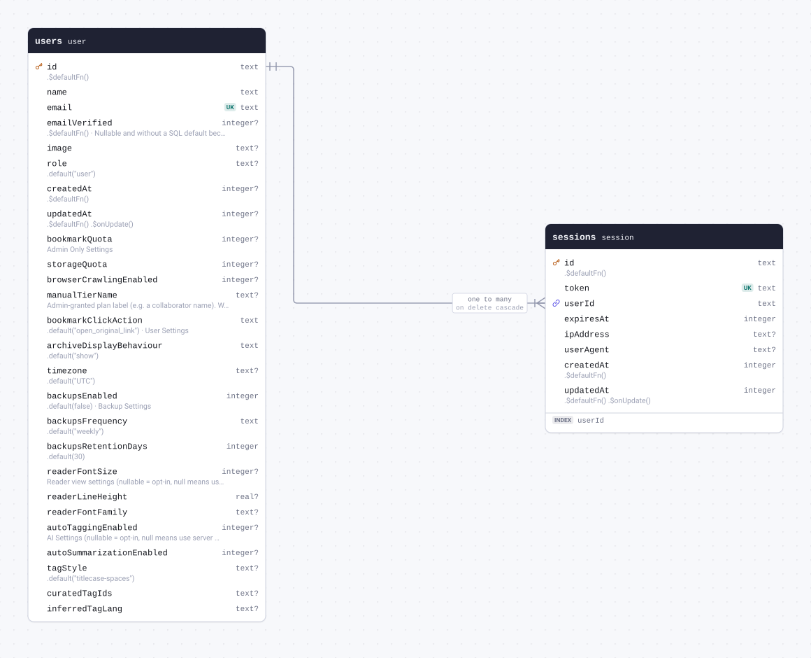

| Column      | Type      | Constraints                         | Default                        | Description |
| ----------- | --------- | ----------------------------------- | ------------------------------ | ----------- |
| `id`        | `text`    | PK NOT NULL                         | `.$defaultFn()`                |             |
| `token`     | `text`    | UNIQUE NOT NULL                     |                                |             |
| `userId`    | `text`    | NOT NULL → [users.id](#table-users) |                                |             |
| `expiresAt` | `integer` | NOT NULL                            |                                |             |
| `ipAddress` | `text`    | NULL                                |                                |             |
| `userAgent` | `text`    | NULL                                |                                |             |
| `createdAt` | `integer` | NOT NULL                            | `.$defaultFn()`                |             |
| `updatedAt` | `integer` | NOT NULL                            | `.$defaultFn()` `.$onUpdate()` |             |

#### Definition

```sql
CREATE TABLE `session` (
	`id` text PRIMARY KEY,
	`token` text NOT NULL UNIQUE,
	`userId` text NOT NULL,
	`expiresAt` integer NOT NULL,
	`ipAddress` text,
	`userAgent` text,
	`createdAt` integer NOT NULL,
	`updatedAt` integer NOT NULL,
	CONSTRAINT `fk_session_userId_user_id_fk` FOREIGN KEY (`userId`) REFERENCES `user`(`id`) ON DELETE CASCADE
);

CREATE INDEX `sessions_userId_idx` ON `session` (`userId`);
```

#### Indexes

- INDEX `userId`

#### References

- `userId` → [users.id](#table-users) (many to one, on delete cascade)

<details>
<summary>Queries and their SQL</summary>

**Select**: Every row of sessions.

```ts
db.select().from(sessions);
```

```sql
select "id", "token", "userId", "expiresAt", "ipAddress", "userAgent", "createdAt", "updatedAt"
from "session"
```

**Count**: How many rows sessions has.

```ts
db.select({ count: count() }).from(sessions);
```

```sql
select count(*)
from "session"
```

**Find many**: The rows of sessions, through the relational query API.

```ts
db.query.sessions.findMany();
```

```sql
select "d0"."id" as "id", "d0"."token" as "token", "d0"."userId" as "userId", "d0"."expiresAt" as "expiresAt", "d0"."ipAddress" as "ipAddress", "d0"."userAgent" as "userAgent", "d0"."createdAt" as "createdAt", "d0"."updatedAt" as "updatedAt"
from "session" as "d0"
```

**Find by primary key**: One row of sessions, through the relational query API.

```ts
db.query.sessions.findFirst({ where: { id: "id" } });
```

```sql
select "d0"."id" as "id", "d0"."token" as "token", "d0"."userId" as "userId", "d0"."expiresAt" as "expiresAt", "d0"."ipAddress" as "ipAddress", "d0"."userAgent" as "userAgent", "d0"."createdAt" as "createdAt", "d0"."updatedAt" as "updatedAt"
from "session" as "d0"
where "d0"."id" = ?
limit ?
-- params: ["id",1]
```

**Insert**: Adds a row to sessions, giving the columns that have no default.

```ts
db.insert(sessions).values({ token: "token", userId: "userId", expiresAt: 1 });
```

```sql
insert into "session" ("id", "token", "userId", "expiresAt", "ipAddress", "userAgent", "createdAt", "updatedAt")
values (?, ?, ?, ?, null, null, ?, ?)
-- params: ["a2awqignxz8d7ps7fky604rl","token","userId",1,1767225600000,1767225600000]
```

**Update**: Changes a row of sessions, found by its primary key.

```ts
db.update(sessions).set({ token: "token" }).where(eq(sessions.id, "id"));
```

```sql
update "session"
set "token" = ?, "updatedAt" = ?
where "session"."id" = ?
-- params: ["token",1767225600000,"id"]
```

**Delete**: Deletes a row of sessions, found by its primary key.

```ts
db.delete(sessions).where(eq(sessions.id, "id"));
```

```sql
delete from "session"
where "session"."id" = ?
-- params: ["id"]
```

</details>

<a id="table-verificationTokens"></a>

### verificationTokens

Table `verificationToken`.

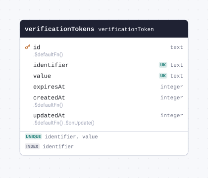

| Column       | Type      | Constraints | Default                        | Description |
| ------------ | --------- | ----------- | ------------------------------ | ----------- |
| `id`         | `text`    | PK NOT NULL | `.$defaultFn()`                |             |
| `identifier` | `text`    | NOT NULL    |                                |             |
| `value`      | `text`    | NOT NULL    |                                |             |
| `expiresAt`  | `integer` | NOT NULL    |                                |             |
| `createdAt`  | `integer` | NOT NULL    | `.$defaultFn()`                |             |
| `updatedAt`  | `integer` | NOT NULL    | `.$defaultFn()` `.$onUpdate()` |             |

#### Definition

```sql
CREATE TABLE `verificationToken` (
	`id` text PRIMARY KEY,
	`identifier` text NOT NULL,
	`value` text NOT NULL,
	`expiresAt` integer NOT NULL,
	`createdAt` integer NOT NULL,
	`updatedAt` integer NOT NULL,
	CONSTRAINT `verificationTokens_identifier_value_unique` UNIQUE(`identifier`,`value`)
);

CREATE INDEX `verificationTokens_identifier_idx` ON `verificationToken` (`identifier`);
```

#### Indexes

- UNIQUE `identifier`, `value`
- INDEX `identifier`

<details>
<summary>Queries and their SQL</summary>

**Select**: Every row of verificationTokens.

```ts
db.select().from(verificationTokens);
```

```sql
select "id", "identifier", "value", "expiresAt", "createdAt", "updatedAt"
from "verificationToken"
```

**Count**: How many rows verificationTokens has.

```ts
db.select({ count: count() }).from(verificationTokens);
```

```sql
select count(*)
from "verificationToken"
```

**Find many**: The rows of verificationTokens, through the relational query API.

```ts
db.query.verificationTokens.findMany();
```

```sql
select "d0"."id" as "id", "d0"."identifier" as "identifier", "d0"."value" as "value", "d0"."expiresAt" as "expiresAt", "d0"."createdAt" as "createdAt", "d0"."updatedAt" as "updatedAt"
from "verificationToken" as "d0"
```

**Find by primary key**: One row of verificationTokens, through the relational query API.

```ts
db.query.verificationTokens.findFirst({ where: { id: "id" } });
```

```sql
select "d0"."id" as "id", "d0"."identifier" as "identifier", "d0"."value" as "value", "d0"."expiresAt" as "expiresAt", "d0"."createdAt" as "createdAt", "d0"."updatedAt" as "updatedAt"
from "verificationToken" as "d0"
where "d0"."id" = ?
limit ?
-- params: ["id",1]
```

**Insert**: Adds a row to verificationTokens, giving the columns that have no default.

```ts
db.insert(verificationTokens).values({ identifier: "identifier", value: "value", expiresAt: 1 });
```

```sql
insert into "verificationToken" ("id", "identifier", "value", "expiresAt", "createdAt", "updatedAt")
values (?, ?, ?, ?, ?, ?)
-- params: ["as6zedtqe7gj7cqr8xznrovo","identifier","value",1,1767225600000,1767225600000]
```

**Update**: Changes a row of verificationTokens, found by its primary key.

```ts
db.update(verificationTokens)
  .set({ identifier: "identifier" })
  .where(eq(verificationTokens.id, "id"));
```

```sql
update "verificationToken"
set "identifier" = ?, "updatedAt" = ?
where "verificationToken"."id" = ?
-- params: ["identifier",1767225600000,"id"]
```

**Delete**: Deletes a row of verificationTokens, found by its primary key.

```ts
db.delete(verificationTokens).where(eq(verificationTokens.id, "id"));
```

```sql
delete from "verificationToken"
where "verificationToken"."id" = ?
-- params: ["id"]
```

</details>

<a id="table-apiKeys"></a>

### apiKeys

Table `apiKey`.

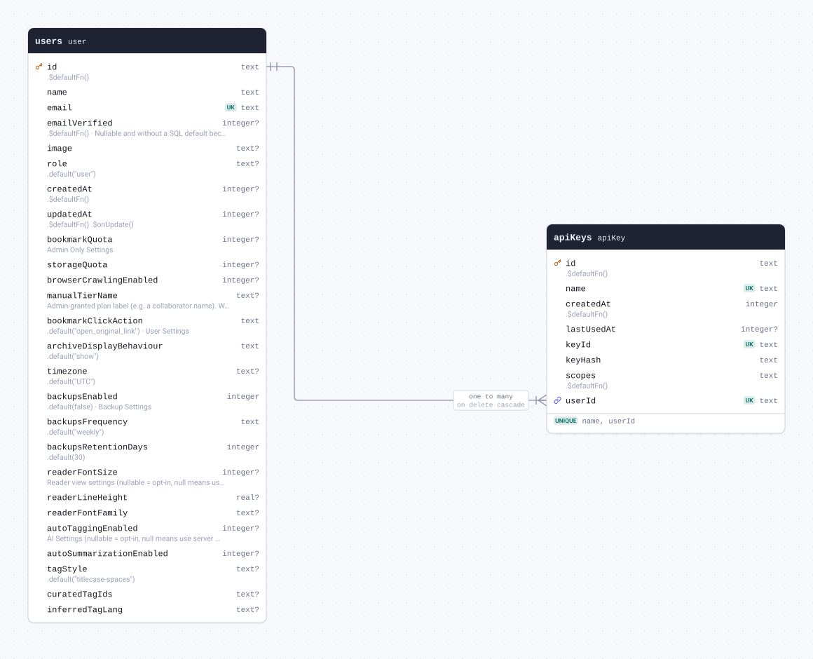

| Column       | Type      | Constraints                         | Default         | Description |
| ------------ | --------- | ----------------------------------- | --------------- | ----------- |
| `id`         | `text`    | PK NOT NULL                         | `.$defaultFn()` |             |
| `name`       | `text`    | NOT NULL                            |                 |             |
| `createdAt`  | `integer` | NOT NULL                            | `.$defaultFn()` |             |
| `lastUsedAt` | `integer` | NULL                                |                 |             |
| `keyId`      | `text`    | UNIQUE NOT NULL                     |                 |             |
| `keyHash`    | `text`    | NOT NULL                            |                 |             |
| `scopes`     | `text`    | NOT NULL                            | `.$defaultFn()` |             |
| `userId`     | `text`    | NOT NULL → [users.id](#table-users) |                 |             |

#### Definition

```sql
CREATE TABLE `apiKey` (
	`id` text PRIMARY KEY,
	`name` text NOT NULL,
	`createdAt` integer NOT NULL,
	`lastUsedAt` integer,
	`keyId` text NOT NULL UNIQUE,
	`keyHash` text NOT NULL,
	`scopes` text NOT NULL,
	`userId` text NOT NULL,
	CONSTRAINT `fk_apiKey_userId_user_id_fk` FOREIGN KEY (`userId`) REFERENCES `user`(`id`) ON DELETE CASCADE,
	CONSTRAINT `apiKey_name_userId_unique` UNIQUE(`name`,`userId`)
);
```

#### Indexes

- UNIQUE `name`, `userId`

#### References

- `userId` → [users.id](#table-users) (many to one, on delete cascade)

<details>
<summary>Queries and their SQL</summary>

**Select**: Every row of apiKeys.

```ts
db.select().from(apiKeys);
```

```sql
select "id", "name", "createdAt", "lastUsedAt", "keyId", "keyHash", "scopes", "userId"
from "apiKey"
```

**Count**: How many rows apiKeys has.

```ts
db.select({ count: count() }).from(apiKeys);
```

```sql
select count(*)
from "apiKey"
```

**Find many**: The rows of apiKeys, through the relational query API.

```ts
db.query.apiKeys.findMany();
```

```sql
select "d0"."id" as "id", "d0"."name" as "name", "d0"."createdAt" as "createdAt", "d0"."lastUsedAt" as "lastUsedAt", "d0"."keyId" as "keyId", "d0"."keyHash" as "keyHash", "d0"."scopes" as "scopes", "d0"."userId" as "userId"
from "apiKey" as "d0"
```

**Find by primary key**: One row of apiKeys, through the relational query API.

```ts
db.query.apiKeys.findFirst({ where: { id: "id" } });
```

```sql
select "d0"."id" as "id", "d0"."name" as "name", "d0"."createdAt" as "createdAt", "d0"."lastUsedAt" as "lastUsedAt", "d0"."keyId" as "keyId", "d0"."keyHash" as "keyHash", "d0"."scopes" as "scopes", "d0"."userId" as "userId"
from "apiKey" as "d0"
where "d0"."id" = ?
limit ?
-- params: ["id",1]
```

**Insert**: Adds a row to apiKeys, giving the columns that have no default.

```ts
db.insert(apiKeys).values({ name: "name", keyId: "keyId", keyHash: "keyHash", userId: "userId" });
```

```sql
insert into "apiKey" ("id", "name", "createdAt", "lastUsedAt", "keyId", "keyHash", "scopes", "userId")
values (?, ?, ?, null, ?, ?, ?, ?)
-- params: ["a1y072p1po5vvxfanj4cx2lp","name",1767225600,"keyId","keyHash","[\"fullaccess\"]","userId"]
```

**Update**: Changes a row of apiKeys, found by its primary key.

```ts
db.update(apiKeys).set({ name: "name" }).where(eq(apiKeys.id, "id"));
```

```sql
update "apiKey"
set "name" = ?
where "apiKey"."id" = ?
-- params: ["name","id"]
```

**Delete**: Deletes a row of apiKeys, found by its primary key.

```ts
db.delete(apiKeys).where(eq(apiKeys.id, "id"));
```

```sql
delete from "apiKey"
where "apiKey"."id" = ?
-- params: ["id"]
```

</details>

<a id="table-bookmarks"></a>

### bookmarks

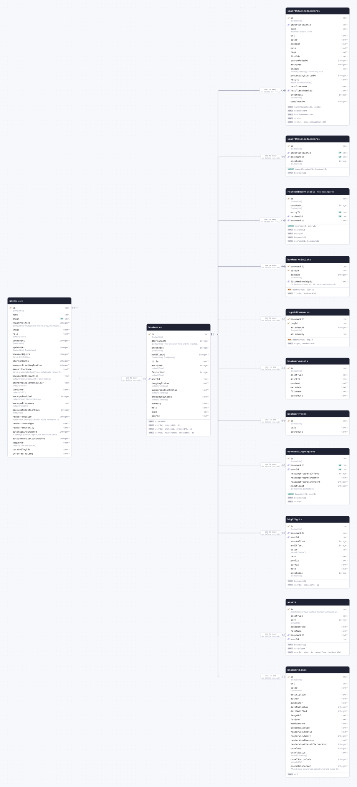

| Column                      | Type      | Constraints                                            | Default                        | Description                                                                                                                                                                                                                                                                                                                                                                                                                                                                                                                                             |
| --------------------------- | --------- | ------------------------------------------------------ | ------------------------------ | ------------------------------------------------------------------------------------------------------------------------------------------------------------------------------------------------------------------------------------------------------------------------------------------------------------------------------------------------------------------------------------------------------------------------------------------------------------------------------------------------------------------------------------------------------- |
| `id`                        | `text`    | PK NOT NULL → [bookmarkLinks.id](#table-bookmarkLinks) | `.$defaultFn()`                |                                                                                                                                                                                                                                                                                                                                                                                                                                                                                                                                                         |
| `dbCreatedAt` (`createdAt`) | `integer` | NOT NULL                                               | `.$defaultFn()`                | The `createdAt` field and the `createdAt` column intentionally don't match. Re-saving an existing bookmark bumps it back to the top of the list, so the timestamp everything sorts and filters on is now "when was this last saved" and lives in the `lastSavedAt` column. It keeps the `createdAt` field name because that's what the API has always exposed and what every query already orders by. The immutable "when did this row first appear" timestamp stays in the original `createdAt` column, and is exposed to clients as `firstCreatedAt`. |
| `createdAt` (`lastSavedAt`) | `integer` | NOT NULL                                               | `.$defaultFn()`                |                                                                                                                                                                                                                                                                                                                                                                                                                                                                                                                                                         |
| `modifiedAt`                | `integer` | NULL                                                   | `.$defaultFn()` `.$onUpdate()` |                                                                                                                                                                                                                                                                                                                                                                                                                                                                                                                                                         |
| `title`                     | `text`    | NULL                                                   |                                |                                                                                                                                                                                                                                                                                                                                                                                                                                                                                                                                                         |
| `archived`                  | `integer` | NOT NULL                                               | `.default(false)`              |                                                                                                                                                                                                                                                                                                                                                                                                                                                                                                                                                         |
| `favourited`                | `integer` | NOT NULL                                               | `.default(false)`              |                                                                                                                                                                                                                                                                                                                                                                                                                                                                                                                                                         |
| `userId`                    | `text`    | NOT NULL → [users.id](#table-users)                    |                                |                                                                                                                                                                                                                                                                                                                                                                                                                                                                                                                                                         |
| `taggingStatus`             | `text`    | NULL                                                   | `.default("pending")`          |                                                                                                                                                                                                                                                                                                                                                                                                                                                                                                                                                         |
| `summarizationStatus`       | `text`    | NULL                                                   | `.default("pending")`          |                                                                                                                                                                                                                                                                                                                                                                                                                                                                                                                                                         |
| `embeddingStatus`           | `text`    | NULL                                                   | `.default("pending")`          |                                                                                                                                                                                                                                                                                                                                                                                                                                                                                                                                                         |
| `summary`                   | `text`    | NULL                                                   |                                |                                                                                                                                                                                                                                                                                                                                                                                                                                                                                                                                                         |
| `note`                      | `text`    | NULL                                                   |                                |                                                                                                                                                                                                                                                                                                                                                                                                                                                                                                                                                         |
| `type`                      | `text`    | NOT NULL                                               |                                |                                                                                                                                                                                                                                                                                                                                                                                                                                                                                                                                                         |
| `source`                    | `text`    | NULL                                                   |                                |                                                                                                                                                                                                                                                                                                                                                                                                                                                                                                                                                         |

#### Definition

```sql
CREATE TABLE `bookmarks` (
	`id` text PRIMARY KEY,
	`createdAt` integer NOT NULL,
	`lastSavedAt` integer NOT NULL,
	`modifiedAt` integer,
	`title` text,
	`archived` integer DEFAULT false NOT NULL,
	`favourited` integer DEFAULT false NOT NULL,
	`userId` text NOT NULL,
	`taggingStatus` text DEFAULT 'pending',
	`summarizationStatus` text DEFAULT 'pending',
	`embeddingStatus` text DEFAULT 'pending',
	`summary` text,
	`note` text,
	`type` text NOT NULL,
	`source` text,
	CONSTRAINT `fk_bookmarks_userId_user_id_fk` FOREIGN KEY (`userId`) REFERENCES `user`(`id`) ON DELETE CASCADE
);

CREATE INDEX `bookmarks_lastSavedAt_idx` ON `bookmarks` (`lastSavedAt`);

CREATE INDEX `bookmarks_userId_lastSavedAt_id_idx` ON `bookmarks` (`userId`,`lastSavedAt`,`id`);

CREATE INDEX `bookmarks_userId_archived_lastSavedAt_id_idx` ON `bookmarks` (`userId`,`archived`,`lastSavedAt`,`id`);

CREATE INDEX `bookmarks_userId_favourited_lastSavedAt_id_idx` ON `bookmarks` (`userId`,`favourited`,`lastSavedAt`,`id`);
```

#### Indexes

- INDEX `createdAt`
- INDEX `userId`, `createdAt`, `id`
- INDEX `userId`, `archived`, `createdAt`, `id`
- INDEX `userId`, `favourited`, `createdAt`, `id`

#### References

- `userId` → [users.id](#table-users) (many to one, on delete cascade)
- `id` → [bookmarkLinks.id](#table-bookmarkLinks) (one to one, defineRelations, no foreign key)
- `id` → [bookmarkTexts.id](#table-bookmarkTexts) (one to one, defineRelations, no foreign key)
- `id` → [bookmarkAssets.id](#table-bookmarkAssets) (one to one, defineRelations, no foreign key)

#### Referenced by

- `id` → [bookmarkLinks.id](#table-bookmarkLinks) (one to one, on delete cascade)
- `id` → [assets.bookmarkId](#table-assets) (one to many, on delete cascade)
- `id` → [highlights.bookmarkId](#table-highlights) (one to many, on delete cascade)
- `id` → [userReadingProgress.bookmarkId](#table-userReadingProgress) (one to many, on delete cascade)
- `id` → [bookmarkTexts.id](#table-bookmarkTexts) (one to one, on delete cascade)
- `id` → [bookmarkAssets.id](#table-bookmarkAssets) (one to one, on delete cascade)
- `id` → [tagsOnBookmarks.bookmarkId](#table-tagsOnBookmarks) (one to many, on delete cascade)
- `id` → [bookmarksInLists.bookmarkId](#table-bookmarksInLists) (one to many, on delete cascade)
- `id` → [rssFeedImportsTable.bookmarkId](#table-rssFeedImportsTable) (one to many, on delete set null)
- `id` → [importSessionBookmarks.bookmarkId](#table-importSessionBookmarks) (one to many, on delete cascade)
- `id` → [importStagingBookmarks.resultBookmarkId](#table-importStagingBookmarks) (one to many, on delete set null)

<details>
<summary>Queries and their SQL</summary>

**Select**: Every row of bookmarks.

```ts
db.select().from(bookmarks);
```

```sql
select "id", "createdAt", "lastSavedAt", "modifiedAt", "title", "archived", "favourited", "userId", "taggingStatus", "summarizationStatus", "embeddingStatus", "summary", "note", "type", "source"
from "bookmarks"
```

**Count**: How many rows bookmarks has.

```ts
db.select({ count: count() }).from(bookmarks);
```

```sql
select count(*)
from "bookmarks"
```

**Find many**: The rows of bookmarks, through the relational query API.

```ts
db.query.bookmarks.findMany();
```

```sql
select "d0"."id" as "id", "d0"."createdAt" as "dbCreatedAt", "d0"."lastSavedAt" as "createdAt", "d0"."modifiedAt" as "modifiedAt", "d0"."title" as "title", "d0"."archived" as "archived", "d0"."favourited" as "favourited", "d0"."userId" as "userId", "d0"."taggingStatus" as "taggingStatus", "d0"."summarizationStatus" as "summarizationStatus", "d0"."embeddingStatus" as "embeddingStatus", "d0"."summary" as "summary", "d0"."note" as "note", "d0"."type" as "type", "d0"."source" as "source"
from "bookmarks" as "d0"
```

**Find by primary key**: One row of bookmarks, through the relational query API.

```ts
db.query.bookmarks.findFirst({ where: { id: "id" } });
```

```sql
select "d0"."id" as "id", "d0"."createdAt" as "dbCreatedAt", "d0"."lastSavedAt" as "createdAt", "d0"."modifiedAt" as "modifiedAt", "d0"."title" as "title", "d0"."archived" as "archived", "d0"."favourited" as "favourited", "d0"."userId" as "userId", "d0"."taggingStatus" as "taggingStatus", "d0"."summarizationStatus" as "summarizationStatus", "d0"."embeddingStatus" as "embeddingStatus", "d0"."summary" as "summary", "d0"."note" as "note", "d0"."type" as "type", "d0"."source" as "source"
from "bookmarks" as "d0"
where "d0"."id" = ?
limit ?
-- params: ["id",1]
```

**Insert**: Adds a row to bookmarks, giving the columns that have no default.

```ts
db.insert(bookmarks).values({ userId: "userId", type: "type" });
```

```sql
insert into "bookmarks" ("id", "createdAt", "lastSavedAt", "modifiedAt", "title", "archived", "favourited", "userId", "taggingStatus", "summarizationStatus", "embeddingStatus", "summary", "note", "type", "source")
values (?, ?, ?, ?, null, ?, ?, ?, ?, ?, ?, null, null, ?, null)
-- params: ["aztu2jec31atwp87vvqkkfnw",1767225600,1767225600,1767225600,0,0,"userId","pending","pending","pending","type"]
```

**Update**: Changes a row of bookmarks, found by its primary key.

```ts
db.update(bookmarks).set({ dbCreatedAt: 1 }).where(eq(bookmarks.id, "id"));
```

```sql
update "bookmarks"
set "createdAt" = ?, "modifiedAt" = ?
where "bookmarks"."id" = ?
-- params: [1,1767225600,"id"]
```

**Delete**: Deletes a row of bookmarks, found by its primary key.

```ts
db.delete(bookmarks).where(eq(bookmarks.id, "id"));
```

```sql
delete from "bookmarks"
where "bookmarks"."id" = ?
-- params: ["id"]
```

</details>

<a id="table-bookmarkLinks"></a>

### bookmarkLinks

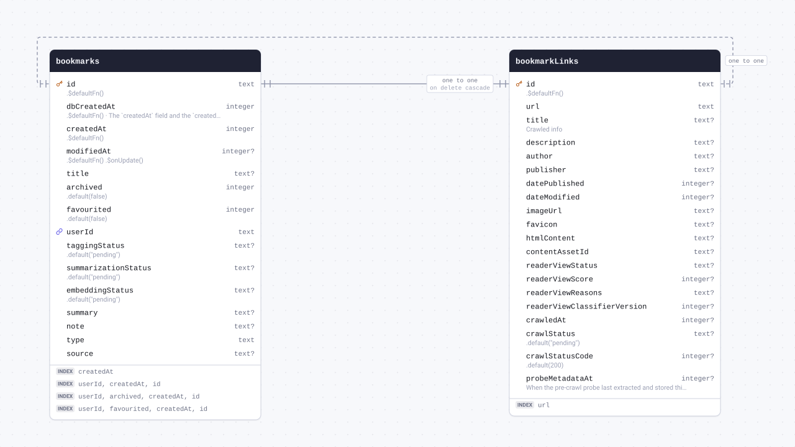

| Column                        | Type      | Constraints                                    | Default               | Description                                                                                                      |
| ----------------------------- | --------- | ---------------------------------------------- | --------------------- | ---------------------------------------------------------------------------------------------------------------- |
| `id`                          | `text`    | PK NOT NULL → [bookmarks.id](#table-bookmarks) | `.$defaultFn()`       |                                                                                                                  |
| `url`                         | `text`    | NOT NULL                                       |                       |                                                                                                                  |
| `title`                       | `text`    | NULL                                           |                       | Crawled info                                                                                                     |
| `description`                 | `text`    | NULL                                           |                       |                                                                                                                  |
| `author`                      | `text`    | NULL                                           |                       |                                                                                                                  |
| `publisher`                   | `text`    | NULL                                           |                       |                                                                                                                  |
| `datePublished`               | `integer` | NULL                                           |                       |                                                                                                                  |
| `dateModified`                | `integer` | NULL                                           |                       |                                                                                                                  |
| `imageUrl`                    | `text`    | NULL                                           |                       |                                                                                                                  |
| `favicon`                     | `text`    | NULL                                           |                       |                                                                                                                  |
| `htmlContent`                 | `text`    | NULL                                           |                       |                                                                                                                  |
| `contentAssetId`              | `text`    | NULL                                           |                       |                                                                                                                  |
| `readerViewStatus`            | `text`    | NULL                                           |                       |                                                                                                                  |
| `readerViewScore`             | `integer` | NULL                                           |                       |                                                                                                                  |
| `readerViewReasons`           | `text`    | NULL                                           |                       |                                                                                                                  |
| `readerViewClassifierVersion` | `integer` | NULL                                           |                       |                                                                                                                  |
| `crawledAt`                   | `integer` | NULL                                           |                       |                                                                                                                  |
| `crawlStatus`                 | `text`    | NULL                                           | `.default("pending")` |                                                                                                                  |
| `crawlStatusCode`             | `integer` | NULL                                           | `.default(200)`       |                                                                                                                  |
| `probeMetadataAt`             | `integer` | NULL                                           |                       | When the pre-crawl probe last extracted and stored this link's metadata. Lets crawl retries skip re-fetching it. |

#### Definition

```sql
CREATE TABLE `bookmarkLinks` (
	`id` text PRIMARY KEY,
	`url` text NOT NULL,
	`title` text,
	`description` text,
	`author` text,
	`publisher` text,
	`datePublished` integer,
	`dateModified` integer,
	`imageUrl` text,
	`favicon` text,
	`htmlContent` text,
	`contentAssetId` text,
	`readerViewStatus` text,
	`readerViewScore` integer,
	`readerViewReasons` text,
	`readerViewClassifierVersion` integer,
	`crawledAt` integer,
	`crawlStatus` text DEFAULT 'pending',
	`crawlStatusCode` integer DEFAULT 200,
	`probeMetadataAt` integer,
	CONSTRAINT `fk_bookmarkLinks_id_bookmarks_id_fk` FOREIGN KEY (`id`) REFERENCES `bookmarks`(`id`) ON DELETE CASCADE
);

CREATE INDEX `bookmarkLinks_url_idx` ON `bookmarkLinks` (`url`);
```

#### Indexes

- INDEX `url`

#### References

- `id` → [bookmarks.id](#table-bookmarks) (one to one, on delete cascade)

#### Referenced by

- `id` → [bookmarks.id](#table-bookmarks) (one to one, defineRelations)

<details>
<summary>Queries and their SQL</summary>

**Select**: Every row of bookmarkLinks.

```ts
db.select().from(bookmarkLinks);
```

```sql
select "id", "url", "title", "description", "author", "publisher", "datePublished", "dateModified", "imageUrl", "favicon", "htmlContent", "contentAssetId", "readerViewStatus", "readerViewScore", "readerViewReasons", "readerViewClassifierVersion", "crawledAt", "crawlStatus", "crawlStatusCode", "probeMetadataAt"
from "bookmarkLinks"
```

**Count**: How many rows bookmarkLinks has.

```ts
db.select({ count: count() }).from(bookmarkLinks);
```

```sql
select count(*)
from "bookmarkLinks"
```

**Find many**: The rows of bookmarkLinks, through the relational query API.

```ts
db.query.bookmarkLinks.findMany();
```

```sql
select "d0"."id" as "id", "d0"."url" as "url", "d0"."title" as "title", "d0"."description" as "description", "d0"."author" as "author", "d0"."publisher" as "publisher", "d0"."datePublished" as "datePublished", "d0"."dateModified" as "dateModified", "d0"."imageUrl" as "imageUrl", "d0"."favicon" as "favicon", "d0"."htmlContent" as "htmlContent", "d0"."contentAssetId" as "contentAssetId", "d0"."readerViewStatus" as "readerViewStatus", "d0"."readerViewScore" as "readerViewScore", "d0"."readerViewReasons" as "readerViewReasons", "d0"."readerViewClassifierVersion" as "readerViewClassifierVersion", "d0"."crawledAt" as "crawledAt", "d0"."crawlStatus" as "crawlStatus", "d0"."crawlStatusCode" as "crawlStatusCode", "d0"."probeMetadataAt" as "probeMetadataAt"
from "bookmarkLinks" as "d0"
```

**Find by primary key**: One row of bookmarkLinks, through the relational query API.

```ts
db.query.bookmarkLinks.findFirst({ where: { id: "id" } });
```

```sql
select "d0"."id" as "id", "d0"."url" as "url", "d0"."title" as "title", "d0"."description" as "description", "d0"."author" as "author", "d0"."publisher" as "publisher", "d0"."datePublished" as "datePublished", "d0"."dateModified" as "dateModified", "d0"."imageUrl" as "imageUrl", "d0"."favicon" as "favicon", "d0"."htmlContent" as "htmlContent", "d0"."contentAssetId" as "contentAssetId", "d0"."readerViewStatus" as "readerViewStatus", "d0"."readerViewScore" as "readerViewScore", "d0"."readerViewReasons" as "readerViewReasons", "d0"."readerViewClassifierVersion" as "readerViewClassifierVersion", "d0"."crawledAt" as "crawledAt", "d0"."crawlStatus" as "crawlStatus", "d0"."crawlStatusCode" as "crawlStatusCode", "d0"."probeMetadataAt" as "probeMetadataAt"
from "bookmarkLinks" as "d0"
where "d0"."id" = ?
limit ?
-- params: ["id",1]
```

**Insert**: Adds a row to bookmarkLinks, giving the columns that have no default.

```ts
db.insert(bookmarkLinks).values({ url: "url" });
```

```sql
insert into "bookmarkLinks" ("id", "url", "title", "description", "author", "publisher", "datePublished", "dateModified", "imageUrl", "favicon", "htmlContent", "contentAssetId", "readerViewStatus", "readerViewScore", "readerViewReasons", "readerViewClassifierVersion", "crawledAt", "crawlStatus", "crawlStatusCode", "probeMetadataAt")
values (?, ?, null, null, null, null, null, null, null, null, null, null, null, null, null, null, null, ?, ?, null)
-- params: ["awr9j6sbmkk5arnn0pkvd39s","url","pending",200]
```

**Update**: Changes a row of bookmarkLinks, found by its primary key.

```ts
db.update(bookmarkLinks).set({ url: "url" }).where(eq(bookmarkLinks.id, "id"));
```

```sql
update "bookmarkLinks"
set "url" = ?
where "bookmarkLinks"."id" = ?
-- params: ["url","id"]
```

**Delete**: Deletes a row of bookmarkLinks, found by its primary key.

```ts
db.delete(bookmarkLinks).where(eq(bookmarkLinks.id, "id"));
```

```sql
delete from "bookmarkLinks"
where "bookmarkLinks"."id" = ?
-- params: ["id"]
```

</details>

<a id="table-assets"></a>

### assets

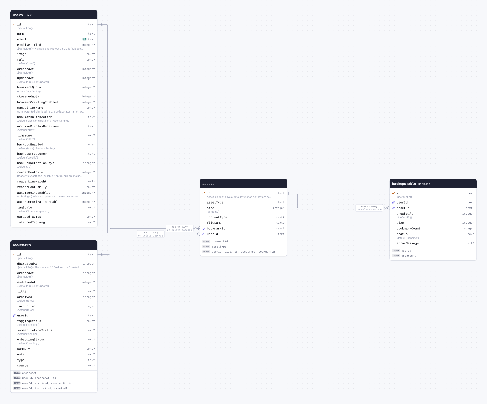

| Column        | Type      | Constraints                             | Default       | Description                                                                 |
| ------------- | --------- | --------------------------------------- | ------------- | --------------------------------------------------------------------------- |
| `id`          | `text`    | PK NOT NULL                             |               | Asset ids don't have a default function as they are generated by the caller |
| `assetType`   | `text`    | NOT NULL                                |               |                                                                             |
| `size`        | `integer` | NOT NULL                                | `.default(0)` |                                                                             |
| `contentType` | `text`    | NULL                                    |               |                                                                             |
| `fileName`    | `text`    | NULL                                    |               |                                                                             |
| `bookmarkId`  | `text`    | NULL → [bookmarks.id](#table-bookmarks) |               |                                                                             |
| `userId`      | `text`    | NOT NULL → [users.id](#table-users)     |               |                                                                             |

#### Definition

```sql
CREATE TABLE `assets` (
	`id` text PRIMARY KEY,
	`assetType` text NOT NULL,
	`size` integer DEFAULT 0 NOT NULL,
	`contentType` text,
	`fileName` text,
	`bookmarkId` text,
	`userId` text NOT NULL,
	CONSTRAINT `fk_assets_bookmarkId_bookmarks_id_fk` FOREIGN KEY (`bookmarkId`) REFERENCES `bookmarks`(`id`) ON DELETE CASCADE,
	CONSTRAINT `fk_assets_userId_user_id_fk` FOREIGN KEY (`userId`) REFERENCES `user`(`id`) ON DELETE CASCADE
);

CREATE INDEX `assets_bookmarkId_idx` ON `assets` (`bookmarkId`);

CREATE INDEX `assets_assetType_idx` ON `assets` (`assetType`);

CREATE INDEX `assets_userId_size_idx` ON `assets` (`userId`,`size`,`id`,`assetType`,`bookmarkId`);
```

#### Indexes

- INDEX `bookmarkId`
- INDEX `assetType`
- INDEX `userId`, `size`, `id`, `assetType`, `bookmarkId`

#### References

- `bookmarkId` → [bookmarks.id](#table-bookmarks) (many to one, on delete cascade)
- `userId` → [users.id](#table-users) (many to one, on delete cascade)

#### Referenced by

- `id` → [backupsTable.assetId](#table-backupsTable) (one to many, on delete cascade)

<details>
<summary>Queries and their SQL</summary>

**Select**: Every row of assets.

```ts
db.select().from(assets);
```

```sql
select "id", "assetType", "size", "contentType", "fileName", "bookmarkId", "userId"
from "assets"
```

**Count**: How many rows assets has.

```ts
db.select({ count: count() }).from(assets);
```

```sql
select count(*)
from "assets"
```

**Find many**: The rows of assets, through the relational query API.

```ts
db.query.assets.findMany();
```

```sql
select "d0"."id" as "id", "d0"."assetType" as "assetType", "d0"."size" as "size", "d0"."contentType" as "contentType", "d0"."fileName" as "fileName", "d0"."bookmarkId" as "bookmarkId", "d0"."userId" as "userId"
from "assets" as "d0"
```

**Find by primary key**: One row of assets, through the relational query API.

```ts
db.query.assets.findFirst({ where: { id: "id" } });
```

```sql
select "d0"."id" as "id", "d0"."assetType" as "assetType", "d0"."size" as "size", "d0"."contentType" as "contentType", "d0"."fileName" as "fileName", "d0"."bookmarkId" as "bookmarkId", "d0"."userId" as "userId"
from "assets" as "d0"
where "d0"."id" = ?
limit ?
-- params: ["id",1]
```

**Insert**: Adds a row to assets, giving the columns that have no default.

```ts
db.insert(assets).values({ id: "id", assetType: "assetType", userId: "userId" });
```

```sql
insert into "assets" ("id", "assetType", "size", "contentType", "fileName", "bookmarkId", "userId")
values (?, ?, ?, null, null, null, ?)
-- params: ["id","assetType",0,"userId"]
```

**Update**: Changes a row of assets, found by its primary key.

```ts
db.update(assets).set({ assetType: "assetType" }).where(eq(assets.id, "id"));
```

```sql
update "assets"
set "assetType" = ?
where "assets"."id" = ?
-- params: ["assetType","id"]
```

**Delete**: Deletes a row of assets, found by its primary key.

```ts
db.delete(assets).where(eq(assets.id, "id"));
```

```sql
delete from "assets"
where "assets"."id" = ?
-- params: ["id"]
```

</details>

<a id="table-highlights"></a>

### highlights

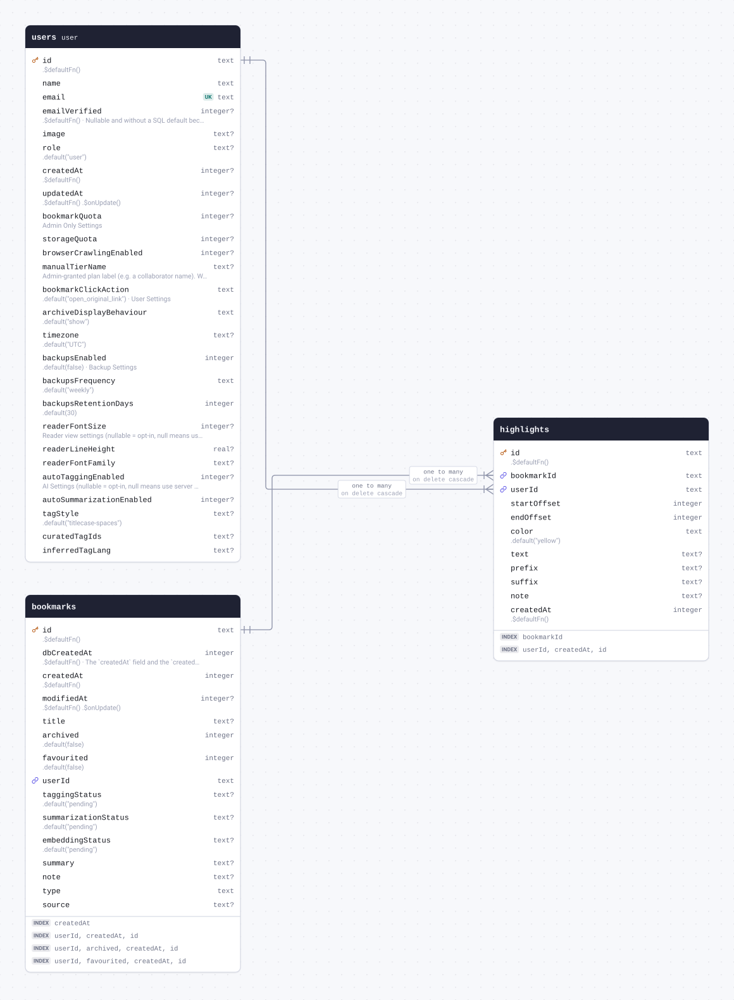

| Column        | Type      | Constraints                                 | Default              | Description |
| ------------- | --------- | ------------------------------------------- | -------------------- | ----------- |
| `id`          | `text`    | PK NOT NULL                                 | `.$defaultFn()`      |             |
| `bookmarkId`  | `text`    | NOT NULL → [bookmarks.id](#table-bookmarks) |                      |             |
| `userId`      | `text`    | NOT NULL → [users.id](#table-users)         |                      |             |
| `startOffset` | `integer` | NOT NULL                                    |                      |             |
| `endOffset`   | `integer` | NOT NULL                                    |                      |             |
| `color`       | `text`    | NOT NULL                                    | `.default("yellow")` |             |
| `text`        | `text`    | NULL                                        |                      |             |
| `prefix`      | `text`    | NULL                                        |                      |             |
| `suffix`      | `text`    | NULL                                        |                      |             |
| `note`        | `text`    | NULL                                        |                      |             |
| `createdAt`   | `integer` | NOT NULL                                    | `.$defaultFn()`      |             |

#### Definition

```sql
CREATE TABLE `highlights` (
	`id` text PRIMARY KEY,
	`bookmarkId` text NOT NULL,
	`userId` text NOT NULL,
	`startOffset` integer NOT NULL,
	`endOffset` integer NOT NULL,
	`color` text DEFAULT 'yellow' NOT NULL,
	`text` text,
	`prefix` text,
	`suffix` text,
	`note` text,
	`createdAt` integer NOT NULL,
	CONSTRAINT `fk_highlights_bookmarkId_bookmarks_id_fk` FOREIGN KEY (`bookmarkId`) REFERENCES `bookmarks`(`id`) ON DELETE CASCADE,
	CONSTRAINT `fk_highlights_userId_user_id_fk` FOREIGN KEY (`userId`) REFERENCES `user`(`id`) ON DELETE CASCADE
);

CREATE INDEX `highlights_bookmarkId_idx` ON `highlights` (`bookmarkId`);

CREATE INDEX `highlights_userId_createdAt_id_idx` ON `highlights` (`userId`,`createdAt`,`id`);
```

#### Indexes

- INDEX `bookmarkId`
- INDEX `userId`, `createdAt`, `id`

#### References

- `bookmarkId` → [bookmarks.id](#table-bookmarks) (many to one, on delete cascade)
- `userId` → [users.id](#table-users) (many to one, on delete cascade)

<details>
<summary>Queries and their SQL</summary>

**Select**: Every row of highlights.

```ts
db.select().from(highlights);
```

```sql
select "id", "bookmarkId", "userId", "startOffset", "endOffset", "color", "text", "prefix", "suffix", "note", "createdAt"
from "highlights"
```

**Count**: How many rows highlights has.

```ts
db.select({ count: count() }).from(highlights);
```

```sql
select count(*)
from "highlights"
```

**Find many**: The rows of highlights, through the relational query API.

```ts
db.query.highlights.findMany();
```

```sql
select "d0"."id" as "id", "d0"."bookmarkId" as "bookmarkId", "d0"."userId" as "userId", "d0"."startOffset" as "startOffset", "d0"."endOffset" as "endOffset", "d0"."color" as "color", "d0"."text" as "text", "d0"."prefix" as "prefix", "d0"."suffix" as "suffix", "d0"."note" as "note", "d0"."createdAt" as "createdAt"
from "highlights" as "d0"
```

**Find by primary key**: One row of highlights, through the relational query API.

```ts
db.query.highlights.findFirst({ where: { id: "id" } });
```

```sql
select "d0"."id" as "id", "d0"."bookmarkId" as "bookmarkId", "d0"."userId" as "userId", "d0"."startOffset" as "startOffset", "d0"."endOffset" as "endOffset", "d0"."color" as "color", "d0"."text" as "text", "d0"."prefix" as "prefix", "d0"."suffix" as "suffix", "d0"."note" as "note", "d0"."createdAt" as "createdAt"
from "highlights" as "d0"
where "d0"."id" = ?
limit ?
-- params: ["id",1]
```

**Insert**: Adds a row to highlights, giving the columns that have no default.

```ts
db.insert(highlights).values({
  bookmarkId: "bookmarkId",
  userId: "userId",
  startOffset: 1,
  endOffset: 1,
});
```

```sql
insert into "highlights" ("id", "bookmarkId", "userId", "startOffset", "endOffset", "color", "text", "prefix", "suffix", "note", "createdAt")
values (?, ?, ?, ?, ?, ?, null, null, null, null, ?)
-- params: ["aiibm78wuk3zknu2kqwplb4k","bookmarkId","userId",1,1,"yellow",1767225600]
```

**Update**: Changes a row of highlights, found by its primary key.

```ts
db.update(highlights).set({ bookmarkId: "bookmarkId" }).where(eq(highlights.id, "id"));
```

```sql
update "highlights"
set "bookmarkId" = ?
where "highlights"."id" = ?
-- params: ["bookmarkId","id"]
```

**Delete**: Deletes a row of highlights, found by its primary key.

```ts
db.delete(highlights).where(eq(highlights.id, "id"));
```

```sql
delete from "highlights"
where "highlights"."id" = ?
-- params: ["id"]
```

</details>

<a id="table-userReadingProgress"></a>

### userReadingProgress

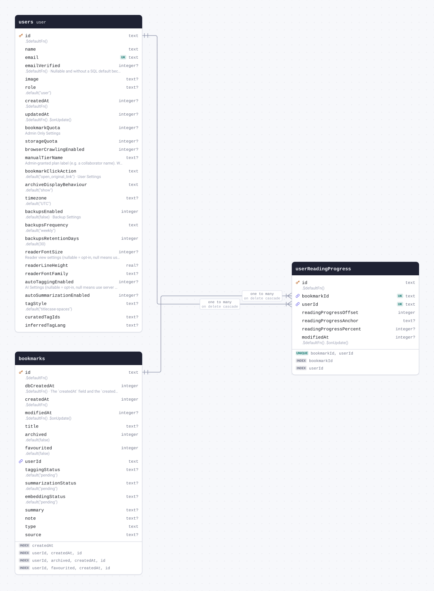

| Column                   | Type      | Constraints                                 | Default                        | Description |
| ------------------------ | --------- | ------------------------------------------- | ------------------------------ | ----------- |
| `id`                     | `text`    | PK NOT NULL                                 | `.$defaultFn()`                |             |
| `bookmarkId`             | `text`    | NOT NULL → [bookmarks.id](#table-bookmarks) |                                |             |
| `userId`                 | `text`    | NOT NULL → [users.id](#table-users)         |                                |             |
| `readingProgressOffset`  | `integer` | NOT NULL                                    |                                |             |
| `readingProgressAnchor`  | `text`    | NULL                                        |                                |             |
| `readingProgressPercent` | `integer` | NULL                                        |                                |             |
| `modifiedAt`             | `integer` | NULL                                        | `.$defaultFn()` `.$onUpdate()` |             |

#### Definition

```sql
CREATE TABLE `userReadingProgress` (
	`id` text PRIMARY KEY,
	`bookmarkId` text NOT NULL,
	`userId` text NOT NULL,
	`readingProgressOffset` integer NOT NULL,
	`readingProgressAnchor` text,
	`readingProgressPercent` integer,
	`modifiedAt` integer,
	CONSTRAINT `fk_userReadingProgress_bookmarkId_bookmarks_id_fk` FOREIGN KEY (`bookmarkId`) REFERENCES `bookmarks`(`id`) ON DELETE CASCADE,
	CONSTRAINT `fk_userReadingProgress_userId_user_id_fk` FOREIGN KEY (`userId`) REFERENCES `user`(`id`) ON DELETE CASCADE,
	CONSTRAINT `userReadingProgress_bookmarkId_userId_unique` UNIQUE(`bookmarkId`,`userId`)
);

CREATE INDEX `userReadingProgress_bookmarkId_idx` ON `userReadingProgress` (`bookmarkId`);

CREATE INDEX `userReadingProgress_userId_idx` ON `userReadingProgress` (`userId`);
```

#### Indexes

- UNIQUE `bookmarkId`, `userId`
- INDEX `bookmarkId`
- INDEX `userId`

#### References

- `bookmarkId` → [bookmarks.id](#table-bookmarks) (many to one, on delete cascade)
- `userId` → [users.id](#table-users) (many to one, on delete cascade)

<details>
<summary>Queries and their SQL</summary>

**Select**: Every row of userReadingProgress.

```ts
db.select().from(userReadingProgress);
```

```sql
select "id", "bookmarkId", "userId", "readingProgressOffset", "readingProgressAnchor", "readingProgressPercent", "modifiedAt"
from "userReadingProgress"
```

**Count**: How many rows userReadingProgress has.

```ts
db.select({ count: count() }).from(userReadingProgress);
```

```sql
select count(*)
from "userReadingProgress"
```

**Find many**: The rows of userReadingProgress, through the relational query API.

```ts
db.query.userReadingProgress.findMany();
```

```sql
select "d0"."id" as "id", "d0"."bookmarkId" as "bookmarkId", "d0"."userId" as "userId", "d0"."readingProgressOffset" as "readingProgressOffset", "d0"."readingProgressAnchor" as "readingProgressAnchor", "d0"."readingProgressPercent" as "readingProgressPercent", "d0"."modifiedAt" as "modifiedAt"
from "userReadingProgress" as "d0"
```

**Find by primary key**: One row of userReadingProgress, through the relational query API.

```ts
db.query.userReadingProgress.findFirst({ where: { id: "id" } });
```

```sql
select "d0"."id" as "id", "d0"."bookmarkId" as "bookmarkId", "d0"."userId" as "userId", "d0"."readingProgressOffset" as "readingProgressOffset", "d0"."readingProgressAnchor" as "readingProgressAnchor", "d0"."readingProgressPercent" as "readingProgressPercent", "d0"."modifiedAt" as "modifiedAt"
from "userReadingProgress" as "d0"
where "d0"."id" = ?
limit ?
-- params: ["id",1]
```

**Insert**: Adds a row to userReadingProgress, giving the columns that have no default.

```ts
db.insert(userReadingProgress).values({
  bookmarkId: "bookmarkId",
  userId: "userId",
  readingProgressOffset: 1,
});
```

```sql
insert into "userReadingProgress" ("id", "bookmarkId", "userId", "readingProgressOffset", "readingProgressAnchor", "readingProgressPercent", "modifiedAt")
values (?, ?, ?, ?, null, null, ?)
-- params: ["aren6dnin4o3cp8tah84w9gc","bookmarkId","userId",1,1767225600]
```

**Update**: Changes a row of userReadingProgress, found by its primary key.

```ts
db.update(userReadingProgress)
  .set({ bookmarkId: "bookmarkId" })
  .where(eq(userReadingProgress.id, "id"));
```

```sql
update "userReadingProgress"
set "bookmarkId" = ?, "modifiedAt" = ?
where "userReadingProgress"."id" = ?
-- params: ["bookmarkId",1767225600,"id"]
```

**Delete**: Deletes a row of userReadingProgress, found by its primary key.

```ts
db.delete(userReadingProgress).where(eq(userReadingProgress.id, "id"));
```

```sql
delete from "userReadingProgress"
where "userReadingProgress"."id" = ?
-- params: ["id"]
```

</details>

<a id="table-bookmarkTexts"></a>

### bookmarkTexts

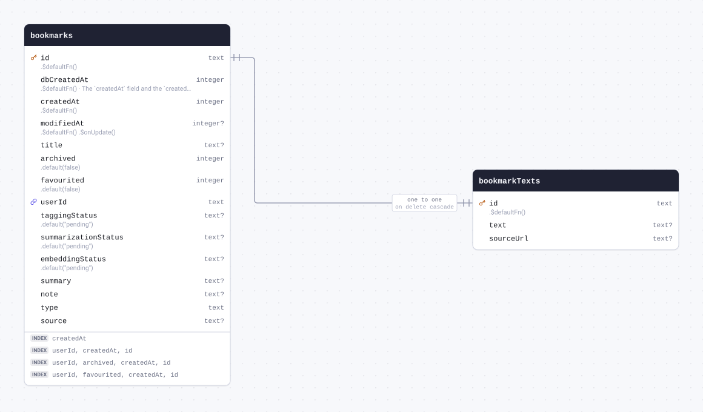

| Column      | Type   | Constraints                                    | Default         | Description |
| ----------- | ------ | ---------------------------------------------- | --------------- | ----------- |
| `id`        | `text` | PK NOT NULL → [bookmarks.id](#table-bookmarks) | `.$defaultFn()` |             |
| `text`      | `text` | NULL                                           |                 |             |
| `sourceUrl` | `text` | NULL                                           |                 |             |

#### Definition

```sql
CREATE TABLE `bookmarkTexts` (
	`id` text PRIMARY KEY,
	`text` text,
	`sourceUrl` text,
	CONSTRAINT `fk_bookmarkTexts_id_bookmarks_id_fk` FOREIGN KEY (`id`) REFERENCES `bookmarks`(`id`) ON DELETE CASCADE
);
```

#### References

- `id` → [bookmarks.id](#table-bookmarks) (one to one, on delete cascade)

#### Referenced by

- `id` → [bookmarks.id](#table-bookmarks) (one to one, defineRelations)

<details>
<summary>Queries and their SQL</summary>

**Select**: Every row of bookmarkTexts.

```ts
db.select().from(bookmarkTexts);
```

```sql
select "id", "text", "sourceUrl"
from "bookmarkTexts"
```

**Count**: How many rows bookmarkTexts has.

```ts
db.select({ count: count() }).from(bookmarkTexts);
```

```sql
select count(*)
from "bookmarkTexts"
```

**Find many**: The rows of bookmarkTexts, through the relational query API.

```ts
db.query.bookmarkTexts.findMany();
```

```sql
select "d0"."id" as "id", "d0"."text" as "text", "d0"."sourceUrl" as "sourceUrl"
from "bookmarkTexts" as "d0"
```

**Find by primary key**: One row of bookmarkTexts, through the relational query API.

```ts
db.query.bookmarkTexts.findFirst({ where: { id: "id" } });
```

```sql
select "d0"."id" as "id", "d0"."text" as "text", "d0"."sourceUrl" as "sourceUrl"
from "bookmarkTexts" as "d0"
where "d0"."id" = ?
limit ?
-- params: ["id",1]
```

**Insert**: Adds a row to bookmarkTexts, giving the columns that have no default.

```ts
db.insert(bookmarkTexts).values({});
```

```sql
insert into "bookmarkTexts" ("id", "text", "sourceUrl")
values (?, null, null)
-- params: ["amhmbppt7of60qfb1yt17g7w"]
```

**Update**: Changes a row of bookmarkTexts, found by its primary key.

```ts
db.update(bookmarkTexts).set({ text: "text" }).where(eq(bookmarkTexts.id, "id"));
```

```sql
update "bookmarkTexts"
set "text" = ?
where "bookmarkTexts"."id" = ?
-- params: ["text","id"]
```

**Delete**: Deletes a row of bookmarkTexts, found by its primary key.

```ts
db.delete(bookmarkTexts).where(eq(bookmarkTexts.id, "id"));
```

```sql
delete from "bookmarkTexts"
where "bookmarkTexts"."id" = ?
-- params: ["id"]
```

</details>

<a id="table-bookmarkAssets"></a>

### bookmarkAssets

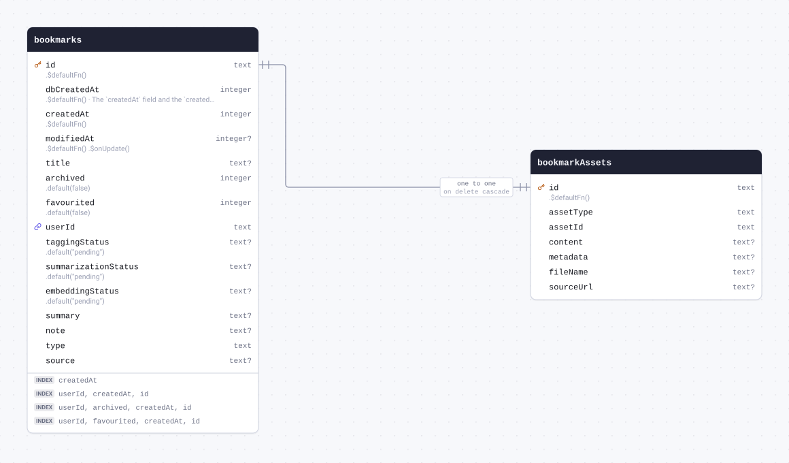

| Column      | Type   | Constraints                                    | Default         | Description |
| ----------- | ------ | ---------------------------------------------- | --------------- | ----------- |
| `id`        | `text` | PK NOT NULL → [bookmarks.id](#table-bookmarks) | `.$defaultFn()` |             |
| `assetType` | `text` | NOT NULL                                       |                 |             |
| `assetId`   | `text` | NOT NULL                                       |                 |             |
| `content`   | `text` | NULL                                           |                 |             |
| `metadata`  | `text` | NULL                                           |                 |             |
| `fileName`  | `text` | NULL                                           |                 |             |
| `sourceUrl` | `text` | NULL                                           |                 |             |

#### Definition

```sql
CREATE TABLE `bookmarkAssets` (
	`id` text PRIMARY KEY,
	`assetType` text NOT NULL,
	`assetId` text NOT NULL,
	`content` text,
	`metadata` text,
	`fileName` text,
	`sourceUrl` text,
	CONSTRAINT `fk_bookmarkAssets_id_bookmarks_id_fk` FOREIGN KEY (`id`) REFERENCES `bookmarks`(`id`) ON DELETE CASCADE
);
```

#### References

- `id` → [bookmarks.id](#table-bookmarks) (one to one, on delete cascade)

#### Referenced by

- `id` → [bookmarks.id](#table-bookmarks) (one to one, defineRelations)

<details>
<summary>Queries and their SQL</summary>

**Select**: Every row of bookmarkAssets.

```ts
db.select().from(bookmarkAssets);
```

```sql
select "id", "assetType", "assetId", "content", "metadata", "fileName", "sourceUrl"
from "bookmarkAssets"
```

**Count**: How many rows bookmarkAssets has.

```ts
db.select({ count: count() }).from(bookmarkAssets);
```

```sql
select count(*)
from "bookmarkAssets"
```

**Find many**: The rows of bookmarkAssets, through the relational query API.

```ts
db.query.bookmarkAssets.findMany();
```

```sql
select "d0"."id" as "id", "d0"."assetType" as "assetType", "d0"."assetId" as "assetId", "d0"."content" as "content", "d0"."metadata" as "metadata", "d0"."fileName" as "fileName", "d0"."sourceUrl" as "sourceUrl"
from "bookmarkAssets" as "d0"
```

**Find by primary key**: One row of bookmarkAssets, through the relational query API.

```ts
db.query.bookmarkAssets.findFirst({ where: { id: "id" } });
```

```sql
select "d0"."id" as "id", "d0"."assetType" as "assetType", "d0"."assetId" as "assetId", "d0"."content" as "content", "d0"."metadata" as "metadata", "d0"."fileName" as "fileName", "d0"."sourceUrl" as "sourceUrl"
from "bookmarkAssets" as "d0"
where "d0"."id" = ?
limit ?
-- params: ["id",1]
```

**Insert**: Adds a row to bookmarkAssets, giving the columns that have no default.

```ts
db.insert(bookmarkAssets).values({ assetType: "assetType", assetId: "assetId" });
```

```sql
insert into "bookmarkAssets" ("id", "assetType", "assetId", "content", "metadata", "fileName", "sourceUrl")
values (?, ?, ?, null, null, null, null)
-- params: ["asoz7djzkpoz2szpkmkcvum6","assetType","assetId"]
```

**Update**: Changes a row of bookmarkAssets, found by its primary key.

```ts
db.update(bookmarkAssets).set({ assetType: "assetType" }).where(eq(bookmarkAssets.id, "id"));
```

```sql
update "bookmarkAssets"
set "assetType" = ?
where "bookmarkAssets"."id" = ?
-- params: ["assetType","id"]
```

**Delete**: Deletes a row of bookmarkAssets, found by its primary key.

```ts
db.delete(bookmarkAssets).where(eq(bookmarkAssets.id, "id"));
```

```sql
delete from "bookmarkAssets"
where "bookmarkAssets"."id" = ?
-- params: ["id"]
```

</details>

<a id="table-bookmarkTags"></a>

### bookmarkTags

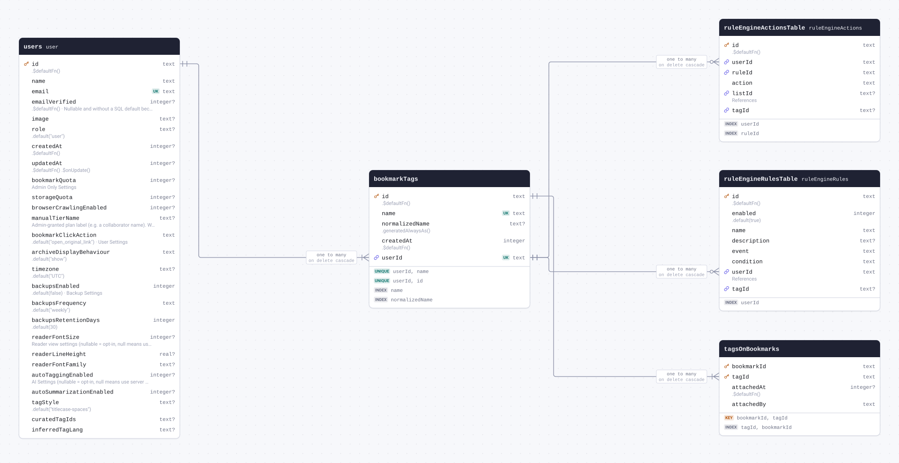

| Column           | Type      | Constraints                         | Default                | Description |
| ---------------- | --------- | ----------------------------------- | ---------------------- | ----------- |
| `id`             | `text`    | PK NOT NULL                         | `.$defaultFn()`        |             |
| `name`           | `text`    | NOT NULL                            |                        |             |
| `normalizedName` | `text`    | NULL                                | `.generatedAlwaysAs()` |             |
| `createdAt`      | `integer` | NOT NULL                            | `.$defaultFn()`        |             |
| `userId`         | `text`    | NOT NULL → [users.id](#table-users) |                        |             |

#### Definition

```sql
CREATE TABLE `bookmarkTags` (
	`id` text PRIMARY KEY,
	`name` text NOT NULL,
	`normalizedName` text GENERATED ALWAYS AS (lower(replace(replace(replace("name", ' ', ''), '-', ''), '_', ''))) VIRTUAL,
	`createdAt` integer NOT NULL,
	`userId` text NOT NULL,
	CONSTRAINT `fk_bookmarkTags_userId_user_id_fk` FOREIGN KEY (`userId`) REFERENCES `user`(`id`) ON DELETE CASCADE,
	CONSTRAINT `bookmarkTags_userId_name_unique` UNIQUE(`userId`,`name`),
	CONSTRAINT `bookmarkTags_userId_id_idx` UNIQUE(`userId`,`id`)
);

CREATE INDEX `bookmarkTags_name_idx` ON `bookmarkTags` (`name`);

CREATE INDEX `bookmarkTags_normalizedName_idx` ON `bookmarkTags` (`normalizedName`);
```

#### Indexes

- UNIQUE `userId`, `name`
- UNIQUE `userId`, `id`
- INDEX `name`
- INDEX `normalizedName`

#### References

- `userId` → [users.id](#table-users) (many to one, on delete cascade)

#### Referenced by

- `id` → [tagsOnBookmarks.tagId](#table-tagsOnBookmarks) (one to many, on delete cascade)
- `userId` → [ruleEngineRulesTable.userId](#table-ruleEngineRulesTable) (one to many, on delete cascade)
- `userId` → [ruleEngineActionsTable.userId](#table-ruleEngineActionsTable) (one to many, on delete cascade)

<details>
<summary>Queries and their SQL</summary>

**Select**: Every row of bookmarkTags.

```ts
db.select().from(bookmarkTags);
```

```sql
select "id", "name", "normalizedName", "createdAt", "userId"
from "bookmarkTags"
```

**Count**: How many rows bookmarkTags has.

```ts
db.select({ count: count() }).from(bookmarkTags);
```

```sql
select count(*)
from "bookmarkTags"
```

**Find many**: The rows of bookmarkTags, through the relational query API.

```ts
db.query.bookmarkTags.findMany();
```

```sql
select "d0"."id" as "id", "d0"."name" as "name", "d0"."normalizedName" as "normalizedName", "d0"."createdAt" as "createdAt", "d0"."userId" as "userId"
from "bookmarkTags" as "d0"
```

**Find by primary key**: One row of bookmarkTags, through the relational query API.

```ts
db.query.bookmarkTags.findFirst({ where: { id: "id" } });
```

```sql
select "d0"."id" as "id", "d0"."name" as "name", "d0"."normalizedName" as "normalizedName", "d0"."createdAt" as "createdAt", "d0"."userId" as "userId"
from "bookmarkTags" as "d0"
where "d0"."id" = ?
limit ?
-- params: ["id",1]
```

**Insert**: Adds a row to bookmarkTags, giving the columns that have no default.

```ts
db.insert(bookmarkTags).values({ name: "name", userId: "userId" });
```

```sql
insert into "bookmarkTags" ("id", "name", "createdAt", "userId")
values (?, ?, ?, ?)
-- params: ["a8h9gqtrnxvexntjc2sbpfmm","name",1767225600,"userId"]
```

**Update**: Changes a row of bookmarkTags, found by its primary key.

```ts
db.update(bookmarkTags).set({ name: "name" }).where(eq(bookmarkTags.id, "id"));
```

```sql
update "bookmarkTags"
set "name" = ?
where "bookmarkTags"."id" = ?
-- params: ["name","id"]
```

**Delete**: Deletes a row of bookmarkTags, found by its primary key.

```ts
db.delete(bookmarkTags).where(eq(bookmarkTags.id, "id"));
```

```sql
delete from "bookmarkTags"
where "bookmarkTags"."id" = ?
-- params: ["id"]
```

</details>

<a id="table-tagsOnBookmarks"></a>

### tagsOnBookmarks

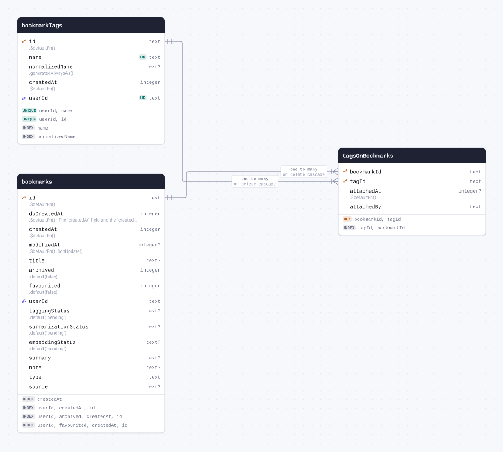

| Column       | Type      | Constraints                                          | Default         | Description |
| ------------ | --------- | ---------------------------------------------------- | --------------- | ----------- |
| `bookmarkId` | `text`    | PK NOT NULL → [bookmarks.id](#table-bookmarks)       |                 |             |
| `tagId`      | `text`    | PK NOT NULL → [bookmarkTags.id](#table-bookmarkTags) |                 |             |
| `attachedAt` | `integer` | NULL                                                 | `.$defaultFn()` |             |
| `attachedBy` | `text`    | NOT NULL                                             |                 |             |

#### Definition

```sql
CREATE TABLE `tagsOnBookmarks` (
	`bookmarkId` text NOT NULL,
	`tagId` text NOT NULL,
	`attachedAt` integer,
	`attachedBy` text NOT NULL,
	CONSTRAINT `tagsOnBookmarks_pk` PRIMARY KEY(`bookmarkId`, `tagId`),
	CONSTRAINT `fk_tagsOnBookmarks_bookmarkId_bookmarks_id_fk` FOREIGN KEY (`bookmarkId`) REFERENCES `bookmarks`(`id`) ON DELETE CASCADE,
	CONSTRAINT `fk_tagsOnBookmarks_tagId_bookmarkTags_id_fk` FOREIGN KEY (`tagId`) REFERENCES `bookmarkTags`(`id`) ON DELETE CASCADE
);

CREATE INDEX `tagsOnBookmarks_tagId_bookmarkId_idx` ON `tagsOnBookmarks` (`tagId`,`bookmarkId`);
```

#### Indexes

- PRIMARY KEY `bookmarkId`, `tagId`
- INDEX `tagId`, `bookmarkId`

#### References

- `bookmarkId` → [bookmarks.id](#table-bookmarks) (many to one, on delete cascade)
- `tagId` → [bookmarkTags.id](#table-bookmarkTags) (many to one, on delete cascade)

<details>
<summary>Queries and their SQL</summary>

**Select**: Every row of tagsOnBookmarks.

```ts
db.select().from(tagsOnBookmarks);
```

```sql
select "bookmarkId", "tagId", "attachedAt", "attachedBy"
from "tagsOnBookmarks"
```

**Count**: How many rows tagsOnBookmarks has.

```ts
db.select({ count: count() }).from(tagsOnBookmarks);
```

```sql
select count(*)
from "tagsOnBookmarks"
```

**Find many**: The rows of tagsOnBookmarks, through the relational query API.

```ts
db.query.tagsOnBookmarks.findMany();
```

```sql
select "d0"."bookmarkId" as "bookmarkId", "d0"."tagId" as "tagId", "d0"."attachedAt" as "attachedAt", "d0"."attachedBy" as "attachedBy"
from "tagsOnBookmarks" as "d0"
```

**Find by primary key**: One row of tagsOnBookmarks, through the relational query API.

```ts
db.query.tagsOnBookmarks.findFirst({ where: { bookmarkId: "bookmarkId", tagId: "tagId" } });
```

```sql
select "d0"."bookmarkId" as "bookmarkId", "d0"."tagId" as "tagId", "d0"."attachedAt" as "attachedAt", "d0"."attachedBy" as "attachedBy"
from "tagsOnBookmarks" as "d0"
where (("d0"."bookmarkId" = ?) and ("d0"."tagId" = ?))
limit ?
-- params: ["bookmarkId","tagId",1]
```

**Insert**: Adds a row to tagsOnBookmarks, giving the columns that have no default.

```ts
db.insert(tagsOnBookmarks).values({
  bookmarkId: "bookmarkId",
  tagId: "tagId",
  attachedBy: "attachedBy",
});
```

```sql
insert into "tagsOnBookmarks" ("bookmarkId", "tagId", "attachedAt", "attachedBy")
values (?, ?, ?, ?)
-- params: ["bookmarkId","tagId",1767225600,"attachedBy"]
```

**Update**: Changes a row of tagsOnBookmarks, found by its primary key.

```ts
db.update(tagsOnBookmarks)
  .set({ attachedAt: 1 })
  .where(and(eq(tagsOnBookmarks.bookmarkId, "bookmarkId"), eq(tagsOnBookmarks.tagId, "tagId")));
```

```sql
update "tagsOnBookmarks"
set "attachedAt" = ?
where (("tagsOnBookmarks"."bookmarkId" = ?) and ("tagsOnBookmarks"."tagId" = ?))
-- params: [1,"bookmarkId","tagId"]
```

**Delete**: Deletes a row of tagsOnBookmarks, found by its primary key.

```ts
db.delete(tagsOnBookmarks).where(
  and(eq(tagsOnBookmarks.bookmarkId, "bookmarkId"), eq(tagsOnBookmarks.tagId, "tagId")),
);
```

```sql
delete from "tagsOnBookmarks"
where (("tagsOnBookmarks"."bookmarkId" = ?) and ("tagsOnBookmarks"."tagId" = ?))
-- params: ["bookmarkId","tagId"]
```

</details>

<a id="table-bookmarkLists"></a>

### bookmarkLists

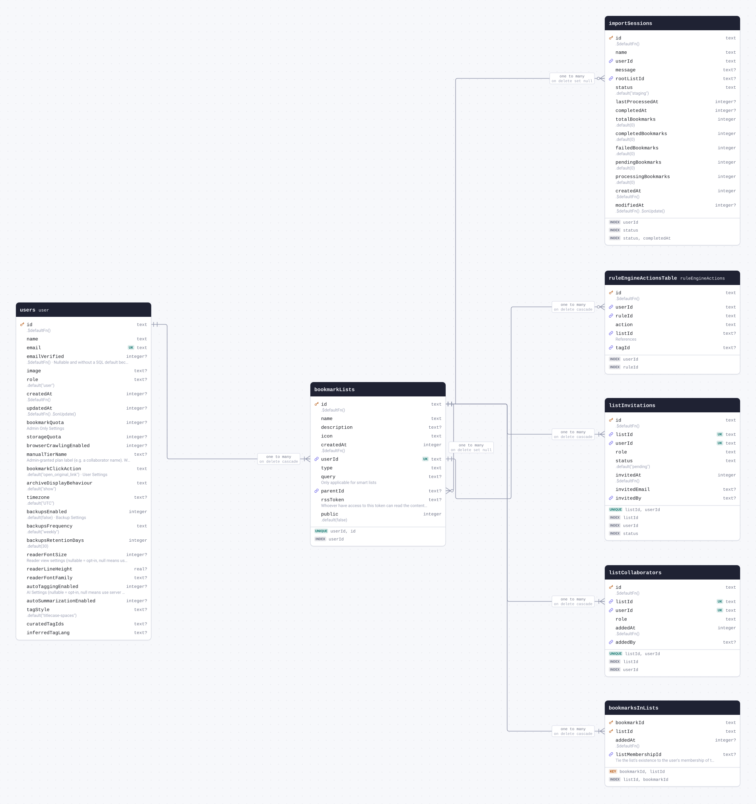

| Column        | Type      | Constraints                                     | Default           | Description                                                         |
| ------------- | --------- | ----------------------------------------------- | ----------------- | ------------------------------------------------------------------- |
| `id`          | `text`    | PK NOT NULL                                     | `.$defaultFn()`   |                                                                     |
| `name`        | `text`    | NOT NULL                                        |                   |                                                                     |
| `description` | `text`    | NULL                                            |                   |                                                                     |
| `icon`        | `text`    | NOT NULL                                        |                   |                                                                     |
| `createdAt`   | `integer` | NOT NULL                                        | `.$defaultFn()`   |                                                                     |
| `userId`      | `text`    | NOT NULL → [users.id](#table-users)             |                   |                                                                     |
| `type`        | `text`    | NOT NULL                                        |                   |                                                                     |
| `query`       | `text`    | NULL                                            |                   | Only applicable for smart lists                                     |
| `parentId`    | `text`    | NULL → [bookmarkLists.id](#table-bookmarkLists) |                   |                                                                     |
| `rssToken`    | `text`    | NULL                                            |                   | Whoever have access to this token can read the content of this list |
| `public`      | `integer` | NOT NULL                                        | `.default(false)` |                                                                     |

#### Definition

```sql
CREATE TABLE `bookmarkLists` (
	`id` text PRIMARY KEY,
	`name` text NOT NULL,
	`description` text,
	`icon` text NOT NULL,
	`createdAt` integer NOT NULL,
	`userId` text NOT NULL,
	`type` text NOT NULL,
	`query` text,
	`parentId` text,
	`rssToken` text,
	`public` integer DEFAULT false NOT NULL,
	CONSTRAINT `fk_bookmarkLists_userId_user_id_fk` FOREIGN KEY (`userId`) REFERENCES `user`(`id`) ON DELETE CASCADE,
	CONSTRAINT `fk_bookmarkLists_parentId_bookmarkLists_id_fk` FOREIGN KEY (`parentId`) REFERENCES `bookmarkLists`(`id`) ON DELETE SET NULL,
	CONSTRAINT `bookmarkLists_userId_id_idx` UNIQUE(`userId`,`id`)
);

CREATE INDEX `bookmarkLists_userId_idx` ON `bookmarkLists` (`userId`);
```

#### Indexes

- INDEX `userId`
- UNIQUE `userId`, `id`

#### References

- `userId` → [users.id](#table-users) (many to one, on delete cascade)
- `parentId` → [bookmarkLists.id](#table-bookmarkLists) (many to one, on delete set null)

#### Referenced by

- `id` → [bookmarkLists.parentId](#table-bookmarkLists) (one to many, on delete set null)
- `id` → [bookmarksInLists.listId](#table-bookmarksInLists) (one to many, on delete cascade)
- `id` → [listCollaborators.listId](#table-listCollaborators) (one to many, on delete cascade)
- `id` → [listInvitations.listId](#table-listInvitations) (one to many, on delete cascade)
- `userId` → [ruleEngineActionsTable.userId](#table-ruleEngineActionsTable) (one to many, on delete cascade)
- `id` → [importSessions.rootListId](#table-importSessions) (one to many, on delete set null)

<details>
<summary>Queries and their SQL</summary>

**Select**: Every row of bookmarkLists.

```ts
db.select().from(bookmarkLists);
```

```sql
select "id", "name", "description", "icon", "createdAt", "userId", "type", "query", "parentId", "rssToken", "public"
from "bookmarkLists"
```

**Count**: How many rows bookmarkLists has.

```ts
db.select({ count: count() }).from(bookmarkLists);
```

```sql
select count(*)
from "bookmarkLists"
```

**Find many**: The rows of bookmarkLists, through the relational query API.

```ts
db.query.bookmarkLists.findMany();
```

```sql
select "d0"."id" as "id", "d0"."name" as "name", "d0"."description" as "description", "d0"."icon" as "icon", "d0"."createdAt" as "createdAt", "d0"."userId" as "userId", "d0"."type" as "type", "d0"."query" as "query", "d0"."parentId" as "parentId", "d0"."rssToken" as "rssToken", "d0"."public" as "public"
from "bookmarkLists" as "d0"
```

**Find by primary key**: One row of bookmarkLists, through the relational query API.

```ts
db.query.bookmarkLists.findFirst({ where: { id: "id" } });
```

```sql
select "d0"."id" as "id", "d0"."name" as "name", "d0"."description" as "description", "d0"."icon" as "icon", "d0"."createdAt" as "createdAt", "d0"."userId" as "userId", "d0"."type" as "type", "d0"."query" as "query", "d0"."parentId" as "parentId", "d0"."rssToken" as "rssToken", "d0"."public" as "public"
from "bookmarkLists" as "d0"
where "d0"."id" = ?
limit ?
-- params: ["id",1]
```

**Insert**: Adds a row to bookmarkLists, giving the columns that have no default.

```ts
db.insert(bookmarkLists).values({ name: "name", icon: "icon", userId: "userId", type: "type" });
```

```sql
insert into "bookmarkLists" ("id", "name", "description", "icon", "createdAt", "userId", "type", "query", "parentId", "rssToken", "public")
values (?, ?, null, ?, ?, ?, ?, null, null, null, ?)
-- params: ["awjsd8itfoj8xmyobmxlzt5b","name","icon",1767225600,"userId","type",0]
```

**Update**: Changes a row of bookmarkLists, found by its primary key.

```ts
db.update(bookmarkLists).set({ name: "name" }).where(eq(bookmarkLists.id, "id"));
```

```sql
update "bookmarkLists"
set "name" = ?
where "bookmarkLists"."id" = ?
-- params: ["name","id"]
```

**Delete**: Deletes a row of bookmarkLists, found by its primary key.

```ts
db.delete(bookmarkLists).where(eq(bookmarkLists.id, "id"));
```

```sql
delete from "bookmarkLists"
where "bookmarkLists"."id" = ?
-- params: ["id"]
```

</details>

<a id="table-bookmarksInLists"></a>

### bookmarksInLists

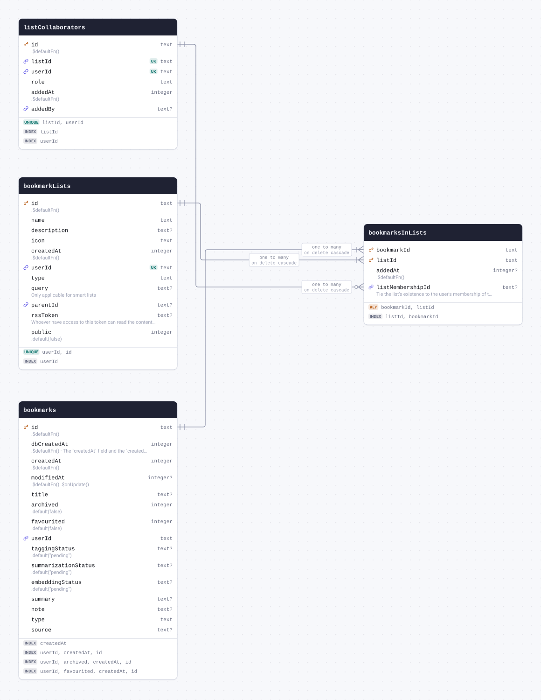

| Column             | Type      | Constraints                                             | Default         | Description                                                     |
| ------------------ | --------- | ------------------------------------------------------- | --------------- | --------------------------------------------------------------- |
| `bookmarkId`       | `text`    | PK NOT NULL → [bookmarks.id](#table-bookmarks)          |                 |                                                                 |
| `listId`           | `text`    | PK NOT NULL → [bookmarkLists.id](#table-bookmarkLists)  |                 |                                                                 |
| `addedAt`          | `integer` | NULL                                                    | `.$defaultFn()` |                                                                 |
| `listMembershipId` | `text`    | NULL → [listCollaborators.id](#table-listCollaborators) |                 | Tie the list's existence to the user's membership of this list. |

#### Definition

```sql
CREATE TABLE `bookmarksInLists` (
	`bookmarkId` text NOT NULL,
	`listId` text NOT NULL,
	`addedAt` integer,
	`listMembershipId` text,
	CONSTRAINT `bookmarksInLists_pk` PRIMARY KEY(`bookmarkId`, `listId`),
	CONSTRAINT `fk_bookmarksInLists_bookmarkId_bookmarks_id_fk` FOREIGN KEY (`bookmarkId`) REFERENCES `bookmarks`(`id`) ON DELETE CASCADE,
	CONSTRAINT `fk_bookmarksInLists_listId_bookmarkLists_id_fk` FOREIGN KEY (`listId`) REFERENCES `bookmarkLists`(`id`) ON DELETE CASCADE,
	CONSTRAINT `fk_bookmarksInLists_listMembershipId_listCollaborators_id_fk` FOREIGN KEY (`listMembershipId`) REFERENCES `listCollaborators`(`id`) ON DELETE CASCADE
);

CREATE INDEX `bookmarksInLists_listId_bookmarkId_idx` ON `bookmarksInLists` (`listId`,`bookmarkId`);
```

#### Indexes

- PRIMARY KEY `bookmarkId`, `listId`
- INDEX `listId`, `bookmarkId`

#### References

- `bookmarkId` → [bookmarks.id](#table-bookmarks) (many to one, on delete cascade)
- `listId` → [bookmarkLists.id](#table-bookmarkLists) (many to one, on delete cascade)
- `listMembershipId` → [listCollaborators.id](#table-listCollaborators) (many to one, on delete cascade)

<details>
<summary>Queries and their SQL</summary>

**Select**: Every row of bookmarksInLists.

```ts
db.select().from(bookmarksInLists);
```

```sql
select "bookmarkId", "listId", "addedAt", "listMembershipId"
from "bookmarksInLists"
```

**Count**: How many rows bookmarksInLists has.

```ts
db.select({ count: count() }).from(bookmarksInLists);
```

```sql
select count(*)
from "bookmarksInLists"
```

**Find many**: The rows of bookmarksInLists, through the relational query API.

```ts
db.query.bookmarksInLists.findMany();
```

```sql
select "d0"."bookmarkId" as "bookmarkId", "d0"."listId" as "listId", "d0"."addedAt" as "addedAt", "d0"."listMembershipId" as "listMembershipId"
from "bookmarksInLists" as "d0"
```

**Find by primary key**: One row of bookmarksInLists, through the relational query API.

```ts
db.query.bookmarksInLists.findFirst({ where: { bookmarkId: "bookmarkId", listId: "listId" } });
```

```sql
select "d0"."bookmarkId" as "bookmarkId", "d0"."listId" as "listId", "d0"."addedAt" as "addedAt", "d0"."listMembershipId" as "listMembershipId"
from "bookmarksInLists" as "d0"
where (("d0"."bookmarkId" = ?) and ("d0"."listId" = ?))
limit ?
-- params: ["bookmarkId","listId",1]
```

**Insert**: Adds a row to bookmarksInLists, giving the columns that have no default.

```ts
db.insert(bookmarksInLists).values({ bookmarkId: "bookmarkId", listId: "listId" });
```

```sql
insert into "bookmarksInLists" ("bookmarkId", "listId", "addedAt", "listMembershipId")
values (?, ?, ?, null)
-- params: ["bookmarkId","listId",1767225600]
```

**Update**: Changes a row of bookmarksInLists, found by its primary key.

```ts
db.update(bookmarksInLists)
  .set({ addedAt: 1 })
  .where(and(eq(bookmarksInLists.bookmarkId, "bookmarkId"), eq(bookmarksInLists.listId, "listId")));
```

```sql
update "bookmarksInLists"
set "addedAt" = ?
where (("bookmarksInLists"."bookmarkId" = ?) and ("bookmarksInLists"."listId" = ?))
-- params: [1,"bookmarkId","listId"]
```

**Delete**: Deletes a row of bookmarksInLists, found by its primary key.

```ts
db.delete(bookmarksInLists).where(
  and(eq(bookmarksInLists.bookmarkId, "bookmarkId"), eq(bookmarksInLists.listId, "listId")),
);
```

```sql
delete from "bookmarksInLists"
where (("bookmarksInLists"."bookmarkId" = ?) and ("bookmarksInLists"."listId" = ?))
-- params: ["bookmarkId","listId"]
```

</details>

<a id="table-listCollaborators"></a>

### listCollaborators

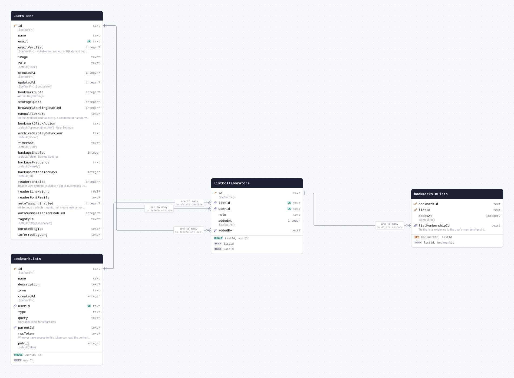

| Column                  | Type      | Constraints                                         | Default         | Description |
| ----------------------- | --------- | --------------------------------------------------- | --------------- | ----------- |
| `id`                    | `text`    | PK NOT NULL                                         | `.$defaultFn()` |             |
| `listId`                | `text`    | NOT NULL → [bookmarkLists.id](#table-bookmarkLists) |                 |             |
| `userId`                | `text`    | NOT NULL → [users.id](#table-users)                 |                 |             |
| `role`                  | `text`    | NOT NULL                                            |                 |             |
| `addedAt` (`createdAt`) | `integer` | NOT NULL                                            | `.$defaultFn()` |             |
| `addedBy`               | `text`    | NULL → [users.id](#table-users)                     |                 |             |

#### Definition

```sql
CREATE TABLE `listCollaborators` (
	`id` text PRIMARY KEY,
	`listId` text NOT NULL,
	`userId` text NOT NULL,
	`role` text NOT NULL,
	`createdAt` integer NOT NULL,
	`addedBy` text,
	CONSTRAINT `fk_listCollaborators_listId_bookmarkLists_id_fk` FOREIGN KEY (`listId`) REFERENCES `bookmarkLists`(`id`) ON DELETE CASCADE,
	CONSTRAINT `fk_listCollaborators_userId_user_id_fk` FOREIGN KEY (`userId`) REFERENCES `user`(`id`) ON DELETE CASCADE,
	CONSTRAINT `fk_listCollaborators_addedBy_user_id_fk` FOREIGN KEY (`addedBy`) REFERENCES `user`(`id`) ON DELETE SET NULL,
	CONSTRAINT `listCollaborators_listId_userId_unique` UNIQUE(`listId`,`userId`)
);

CREATE INDEX `listCollaborators_listId_idx` ON `listCollaborators` (`listId`);

CREATE INDEX `listCollaborators_userId_idx` ON `listCollaborators` (`userId`);
```

#### Indexes

- UNIQUE `listId`, `userId`
- INDEX `listId`
- INDEX `userId`

#### References

- `listId` → [bookmarkLists.id](#table-bookmarkLists) (many to one, on delete cascade)
- `userId` → [users.id](#table-users) (many to one, on delete cascade)
- `addedBy` → [users.id](#table-users) (many to one, on delete set null)

#### Referenced by

- `id` → [bookmarksInLists.listMembershipId](#table-bookmarksInLists) (one to many, on delete cascade)

<details>
<summary>Queries and their SQL</summary>

**Select**: Every row of listCollaborators.

```ts
db.select().from(listCollaborators);
```

```sql
select "id", "listId", "userId", "role", "createdAt", "addedBy"
from "listCollaborators"
```

**Count**: How many rows listCollaborators has.

```ts
db.select({ count: count() }).from(listCollaborators);
```

```sql
select count(*)
from "listCollaborators"
```

**Find many**: The rows of listCollaborators, through the relational query API.

```ts
db.query.listCollaborators.findMany();
```

```sql
select "d0"."id" as "id", "d0"."listId" as "listId", "d0"."userId" as "userId", "d0"."role" as "role", "d0"."createdAt" as "addedAt", "d0"."addedBy" as "addedBy"
from "listCollaborators" as "d0"
```

**Find by primary key**: One row of listCollaborators, through the relational query API.

```ts
db.query.listCollaborators.findFirst({ where: { id: "id" } });
```

```sql
select "d0"."id" as "id", "d0"."listId" as "listId", "d0"."userId" as "userId", "d0"."role" as "role", "d0"."createdAt" as "addedAt", "d0"."addedBy" as "addedBy"
from "listCollaborators" as "d0"
where "d0"."id" = ?
limit ?
-- params: ["id",1]
```

**Insert**: Adds a row to listCollaborators, giving the columns that have no default.

```ts
db.insert(listCollaborators).values({ listId: "listId", userId: "userId", role: "role" });
```

```sql
insert into "listCollaborators" ("id", "listId", "userId", "role", "createdAt", "addedBy")
values (?, ?, ?, ?, ?, null)
-- params: ["awri6pep104rms0ko7it64u6","listId","userId","role",1767225600]
```

**Update**: Changes a row of listCollaborators, found by its primary key.

```ts
db.update(listCollaborators).set({ listId: "listId" }).where(eq(listCollaborators.id, "id"));
```

```sql
update "listCollaborators"
set "listId" = ?
where "listCollaborators"."id" = ?
-- params: ["listId","id"]
```

**Delete**: Deletes a row of listCollaborators, found by its primary key.

```ts
db.delete(listCollaborators).where(eq(listCollaborators.id, "id"));
```

```sql
delete from "listCollaborators"
where "listCollaborators"."id" = ?
-- params: ["id"]
```

</details>

<a id="table-listInvitations"></a>

### listInvitations

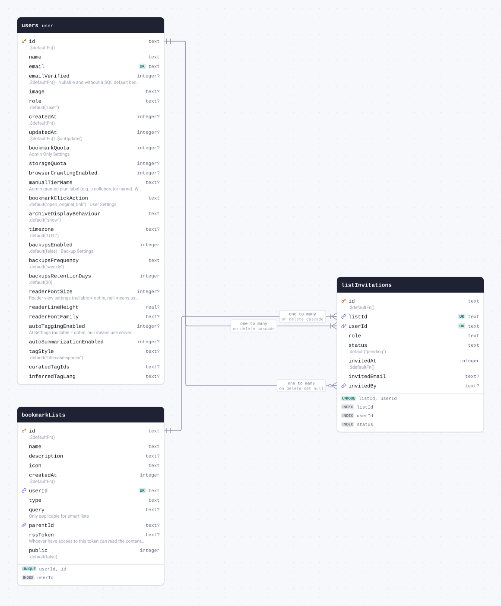

| Column         | Type      | Constraints                                         | Default               | Description |
| -------------- | --------- | --------------------------------------------------- | --------------------- | ----------- |
| `id`           | `text`    | PK NOT NULL                                         | `.$defaultFn()`       |             |
| `listId`       | `text`    | NOT NULL → [bookmarkLists.id](#table-bookmarkLists) |                       |             |
| `userId`       | `text`    | NOT NULL → [users.id](#table-users)                 |                       |             |
| `role`         | `text`    | NOT NULL                                            |                       |             |
| `status`       | `text`    | NOT NULL                                            | `.default("pending")` |             |
| `invitedAt`    | `integer` | NOT NULL                                            | `.$defaultFn()`       |             |
| `invitedEmail` | `text`    | NULL                                                |                       |             |
| `invitedBy`    | `text`    | NULL → [users.id](#table-users)                     |                       |             |

#### Definition

```sql
CREATE TABLE `listInvitations` (
	`id` text PRIMARY KEY,
	`listId` text NOT NULL,
	`userId` text NOT NULL,
	`role` text NOT NULL,
	`status` text DEFAULT 'pending' NOT NULL,
	`invitedAt` integer NOT NULL,
	`invitedEmail` text,
	`invitedBy` text,
	CONSTRAINT `fk_listInvitations_listId_bookmarkLists_id_fk` FOREIGN KEY (`listId`) REFERENCES `bookmarkLists`(`id`) ON DELETE CASCADE,
	CONSTRAINT `fk_listInvitations_userId_user_id_fk` FOREIGN KEY (`userId`) REFERENCES `user`(`id`) ON DELETE CASCADE,
	CONSTRAINT `fk_listInvitations_invitedBy_user_id_fk` FOREIGN KEY (`invitedBy`) REFERENCES `user`(`id`) ON DELETE SET NULL,
	CONSTRAINT `listInvitations_listId_userId_unique` UNIQUE(`listId`,`userId`)
);

CREATE INDEX `listInvitations_listId_idx` ON `listInvitations` (`listId`);

CREATE INDEX `listInvitations_userId_idx` ON `listInvitations` (`userId`);

CREATE INDEX `listInvitations_status_idx` ON `listInvitations` (`status`);
```

#### Indexes

- UNIQUE `listId`, `userId`
- INDEX `listId`
- INDEX `userId`
- INDEX `status`

#### References

- `listId` → [bookmarkLists.id](#table-bookmarkLists) (many to one, on delete cascade)
- `userId` → [users.id](#table-users) (many to one, on delete cascade)
- `invitedBy` → [users.id](#table-users) (many to one, on delete set null)

<details>
<summary>Queries and their SQL</summary>

**Select**: Every row of listInvitations.

```ts
db.select().from(listInvitations);
```

```sql
select "id", "listId", "userId", "role", "status", "invitedAt", "invitedEmail", "invitedBy"
from "listInvitations"
```

**Count**: How many rows listInvitations has.

```ts
db.select({ count: count() }).from(listInvitations);
```

```sql
select count(*)
from "listInvitations"
```

**Find many**: The rows of listInvitations, through the relational query API.

```ts
db.query.listInvitations.findMany();
```

```sql
select "d0"."id" as "id", "d0"."listId" as "listId", "d0"."userId" as "userId", "d0"."role" as "role", "d0"."status" as "status", "d0"."invitedAt" as "invitedAt", "d0"."invitedEmail" as "invitedEmail", "d0"."invitedBy" as "invitedBy"
from "listInvitations" as "d0"
```

**Find by primary key**: One row of listInvitations, through the relational query API.

```ts
db.query.listInvitations.findFirst({ where: { id: "id" } });
```

```sql
select "d0"."id" as "id", "d0"."listId" as "listId", "d0"."userId" as "userId", "d0"."role" as "role", "d0"."status" as "status", "d0"."invitedAt" as "invitedAt", "d0"."invitedEmail" as "invitedEmail", "d0"."invitedBy" as "invitedBy"
from "listInvitations" as "d0"
where "d0"."id" = ?
limit ?
-- params: ["id",1]
```

**Insert**: Adds a row to listInvitations, giving the columns that have no default.

```ts
db.insert(listInvitations).values({ listId: "listId", userId: "userId", role: "role" });
```

```sql
insert into "listInvitations" ("id", "listId", "userId", "role", "status", "invitedAt", "invitedEmail", "invitedBy")
values (?, ?, ?, ?, ?, ?, null, null)
-- params: ["altm5zebz63drxlsqwy586p4","listId","userId","role","pending",1767225600]
```

**Update**: Changes a row of listInvitations, found by its primary key.

```ts
db.update(listInvitations).set({ listId: "listId" }).where(eq(listInvitations.id, "id"));
```

```sql
update "listInvitations"
set "listId" = ?
where "listInvitations"."id" = ?
-- params: ["listId","id"]
```

**Delete**: Deletes a row of listInvitations, found by its primary key.

```ts
db.delete(listInvitations).where(eq(listInvitations.id, "id"));
```

```sql
delete from "listInvitations"
where "listInvitations"."id" = ?
-- params: ["id"]
```

</details>

<a id="table-customPrompts"></a>

### customPrompts

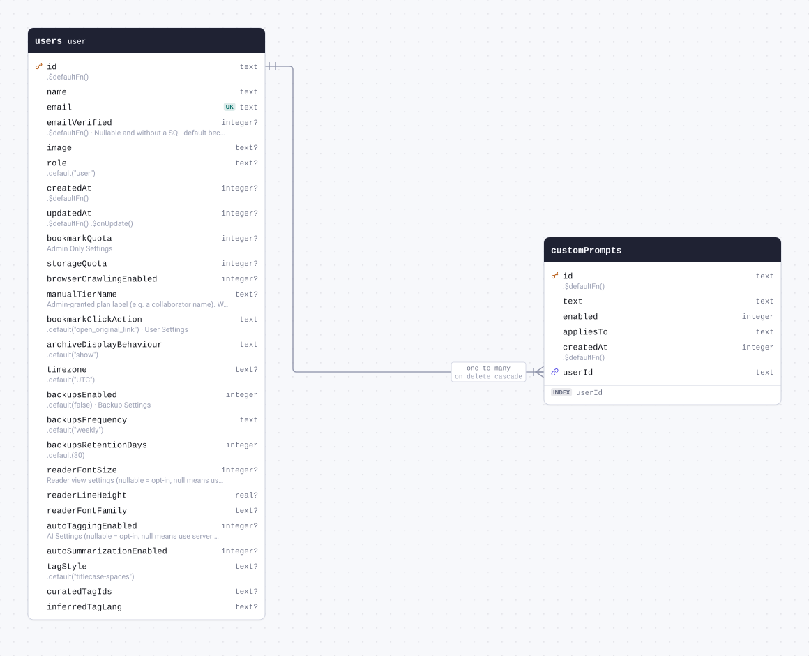

| Column      | Type      | Constraints                         | Default         | Description |
| ----------- | --------- | ----------------------------------- | --------------- | ----------- |
| `id`        | `text`    | PK NOT NULL                         | `.$defaultFn()` |             |
| `text`      | `text`    | NOT NULL                            |                 |             |
| `enabled`   | `integer` | NOT NULL                            |                 |             |
| `appliesTo` | `text`    | NOT NULL                            |                 |             |
| `createdAt` | `integer` | NOT NULL                            | `.$defaultFn()` |             |
| `userId`    | `text`    | NOT NULL → [users.id](#table-users) |                 |             |

#### Definition

```sql
CREATE TABLE `customPrompts` (
	`id` text PRIMARY KEY,
	`text` text NOT NULL,
	`enabled` integer NOT NULL,
	`appliesTo` text NOT NULL,
	`createdAt` integer NOT NULL,
	`userId` text NOT NULL,
	CONSTRAINT `fk_customPrompts_userId_user_id_fk` FOREIGN KEY (`userId`) REFERENCES `user`(`id`) ON DELETE CASCADE
);

CREATE INDEX `customPrompts_userId_idx` ON `customPrompts` (`userId`);
```

#### Indexes

- INDEX `userId`

#### References

- `userId` → [users.id](#table-users) (many to one, on delete cascade)

<details>
<summary>Queries and their SQL</summary>

**Select**: Every row of customPrompts.

```ts
db.select().from(customPrompts);
```

```sql
select "id", "text", "enabled", "appliesTo", "createdAt", "userId"
from "customPrompts"
```

**Count**: How many rows customPrompts has.

```ts
db.select({ count: count() }).from(customPrompts);
```

```sql
select count(*)
from "customPrompts"
```

**Find many**: The rows of customPrompts, through the relational query API.

```ts
db.query.customPrompts.findMany();
```

```sql
select "d0"."id" as "id", "d0"."text" as "text", "d0"."enabled" as "enabled", "d0"."appliesTo" as "appliesTo", "d0"."createdAt" as "createdAt", "d0"."userId" as "userId"
from "customPrompts" as "d0"
```

**Find by primary key**: One row of customPrompts, through the relational query API.

```ts
db.query.customPrompts.findFirst({ where: { id: "id" } });
```

```sql
select "d0"."id" as "id", "d0"."text" as "text", "d0"."enabled" as "enabled", "d0"."appliesTo" as "appliesTo", "d0"."createdAt" as "createdAt", "d0"."userId" as "userId"
from "customPrompts" as "d0"
where "d0"."id" = ?
limit ?
-- params: ["id",1]
```

**Insert**: Adds a row to customPrompts, giving the columns that have no default.

```ts
db.insert(customPrompts).values({
  text: "text",
  enabled: 1,
  appliesTo: "appliesTo",
  userId: "userId",
});
```

```sql
insert into "customPrompts" ("id", "text", "enabled", "appliesTo", "createdAt", "userId")
values (?, ?, ?, ?, ?, ?)
-- params: ["a4babtdkoz87akkyaycmmkgq","text",1,"appliesTo",1767225600,"userId"]
```

**Update**: Changes a row of customPrompts, found by its primary key.

```ts
db.update(customPrompts).set({ text: "text" }).where(eq(customPrompts.id, "id"));
```

```sql
update "customPrompts"
set "text" = ?
where "customPrompts"."id" = ?
-- params: ["text","id"]
```

**Delete**: Deletes a row of customPrompts, found by its primary key.

```ts
db.delete(customPrompts).where(eq(customPrompts.id, "id"));
```

```sql
delete from "customPrompts"
where "customPrompts"."id" = ?
-- params: ["id"]
```

</details>

<a id="table-chatSessions"></a>

### chatSessions

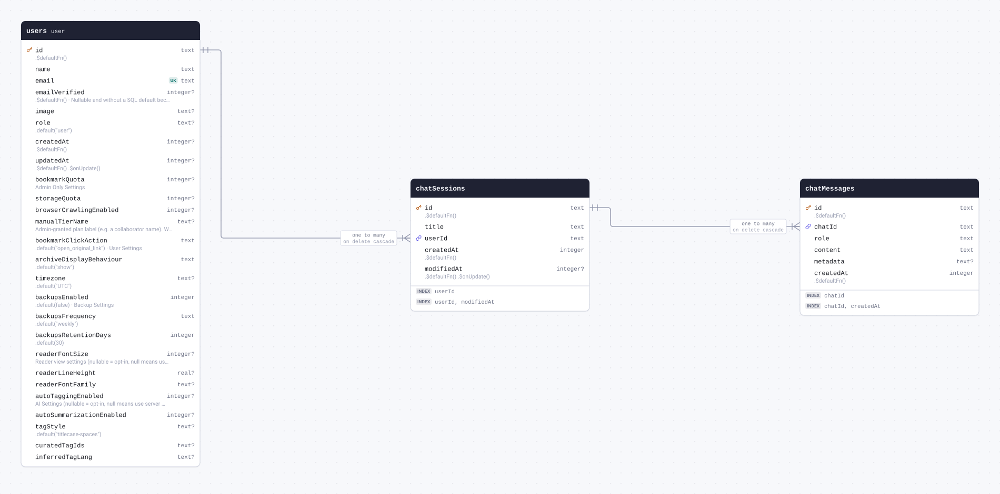

| Column       | Type      | Constraints                         | Default                        | Description |
| ------------ | --------- | ----------------------------------- | ------------------------------ | ----------- |
| `id`         | `text`    | PK NOT NULL                         | `.$defaultFn()`                |             |
| `title`      | `text`    | NOT NULL                            |                                |             |
| `userId`     | `text`    | NOT NULL → [users.id](#table-users) |                                |             |
| `createdAt`  | `integer` | NOT NULL                            | `.$defaultFn()`                |             |
| `modifiedAt` | `integer` | NULL                                | `.$defaultFn()` `.$onUpdate()` |             |

#### Definition

```sql
CREATE TABLE `chatSessions` (
	`id` text PRIMARY KEY,
	`title` text NOT NULL,
	`userId` text NOT NULL,
	`createdAt` integer NOT NULL,
	`modifiedAt` integer,
	CONSTRAINT `fk_chatSessions_userId_user_id_fk` FOREIGN KEY (`userId`) REFERENCES `user`(`id`) ON DELETE CASCADE
);

CREATE INDEX `chatSessions_userId_idx` ON `chatSessions` (`userId`);

CREATE INDEX `chatSessions_userId_modifiedAt_idx` ON `chatSessions` (`userId`,`modifiedAt`);
```

#### Indexes

- INDEX `userId`
- INDEX `userId`, `modifiedAt`

#### References

- `userId` → [users.id](#table-users) (many to one, on delete cascade)

#### Referenced by

- `id` → [chatMessages.chatId](#table-chatMessages) (one to many, on delete cascade)

<details>
<summary>Queries and their SQL</summary>

**Select**: Every row of chatSessions.

```ts
db.select().from(chatSessions);
```

```sql
select "id", "title", "userId", "createdAt", "modifiedAt"
from "chatSessions"
```

**Count**: How many rows chatSessions has.

```ts
db.select({ count: count() }).from(chatSessions);
```

```sql
select count(*)
from "chatSessions"
```

**Find many**: The rows of chatSessions, through the relational query API.

```ts
db.query.chatSessions.findMany();
```

```sql
select "d0"."id" as "id", "d0"."title" as "title", "d0"."userId" as "userId", "d0"."createdAt" as "createdAt", "d0"."modifiedAt" as "modifiedAt"
from "chatSessions" as "d0"
```

**Find by primary key**: One row of chatSessions, through the relational query API.

```ts
db.query.chatSessions.findFirst({ where: { id: "id" } });
```

```sql
select "d0"."id" as "id", "d0"."title" as "title", "d0"."userId" as "userId", "d0"."createdAt" as "createdAt", "d0"."modifiedAt" as "modifiedAt"
from "chatSessions" as "d0"
where "d0"."id" = ?
limit ?
-- params: ["id",1]
```

**Insert**: Adds a row to chatSessions, giving the columns that have no default.

```ts
db.insert(chatSessions).values({ title: "title", userId: "userId" });
```

```sql
insert into "chatSessions" ("id", "title", "userId", "createdAt", "modifiedAt")
values (?, ?, ?, ?, ?)
-- params: ["awx47qrmpc2961vn263gbpwb","title","userId",1767225600000,1767225600000]
```

**Update**: Changes a row of chatSessions, found by its primary key.

```ts
db.update(chatSessions).set({ title: "title" }).where(eq(chatSessions.id, "id"));
```

```sql
update "chatSessions"
set "title" = ?, "modifiedAt" = ?
where "chatSessions"."id" = ?
-- params: ["title",1767225600000,"id"]
```

**Delete**: Deletes a row of chatSessions, found by its primary key.

```ts
db.delete(chatSessions).where(eq(chatSessions.id, "id"));
```

```sql
delete from "chatSessions"
where "chatSessions"."id" = ?
-- params: ["id"]
```

</details>

<a id="table-chatMessages"></a>

### chatMessages

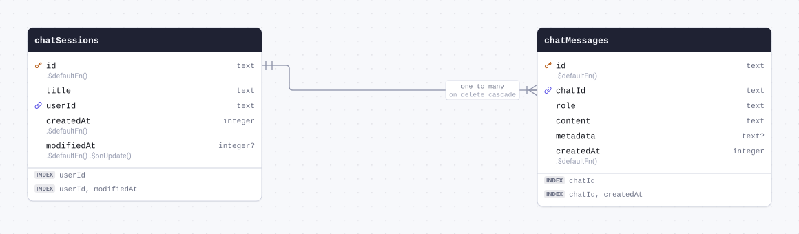

| Column      | Type      | Constraints                                       | Default         | Description |
| ----------- | --------- | ------------------------------------------------- | --------------- | ----------- |
| `id`        | `text`    | PK NOT NULL                                       | `.$defaultFn()` |             |
| `chatId`    | `text`    | NOT NULL → [chatSessions.id](#table-chatSessions) |                 |             |
| `role`      | `text`    | NOT NULL                                          |                 |             |
| `content`   | `text`    | NOT NULL                                          |                 |             |
| `metadata`  | `text`    | NULL                                              |                 |             |
| `createdAt` | `integer` | NOT NULL                                          | `.$defaultFn()` |             |

#### Definition

```sql
CREATE TABLE `chatMessages` (
	`id` text PRIMARY KEY,
	`chatId` text NOT NULL,
	`role` text NOT NULL,
	`content` text NOT NULL,
	`metadata` text,
	`createdAt` integer NOT NULL,
	CONSTRAINT `fk_chatMessages_chatId_chatSessions_id_fk` FOREIGN KEY (`chatId`) REFERENCES `chatSessions`(`id`) ON DELETE CASCADE
);

CREATE INDEX `chatMessages_chatId_idx` ON `chatMessages` (`chatId`);

CREATE INDEX `chatMessages_chatId_createdAt_idx` ON `chatMessages` (`chatId`,`createdAt`);
```

#### Indexes

- INDEX `chatId`
- INDEX `chatId`, `createdAt`

#### References

- `chatId` → [chatSessions.id](#table-chatSessions) (many to one, on delete cascade)

<details>
<summary>Queries and their SQL</summary>

**Select**: Every row of chatMessages.

```ts
db.select().from(chatMessages);
```

```sql
select "id", "chatId", "role", "content", "metadata", "createdAt"
from "chatMessages"
```

**Count**: How many rows chatMessages has.

```ts
db.select({ count: count() }).from(chatMessages);
```

```sql
select count(*)
from "chatMessages"
```

**Find many**: The rows of chatMessages, through the relational query API.

```ts
db.query.chatMessages.findMany();
```

```sql
select "d0"."id" as "id", "d0"."chatId" as "chatId", "d0"."role" as "role", "d0"."content" as "content", "d0"."metadata" as "metadata", "d0"."createdAt" as "createdAt"
from "chatMessages" as "d0"
```

**Find by primary key**: One row of chatMessages, through the relational query API.

```ts
db.query.chatMessages.findFirst({ where: { id: "id" } });
```

```sql
select "d0"."id" as "id", "d0"."chatId" as "chatId", "d0"."role" as "role", "d0"."content" as "content", "d0"."metadata" as "metadata", "d0"."createdAt" as "createdAt"
from "chatMessages" as "d0"
where "d0"."id" = ?
limit ?
-- params: ["id",1]
```

**Insert**: Adds a row to chatMessages, giving the columns that have no default.

```ts
db.insert(chatMessages).values({ chatId: "chatId", role: "role", content: "content" });
```

```sql
insert into "chatMessages" ("id", "chatId", "role", "content", "metadata", "createdAt")
values (?, ?, ?, ?, null, ?)
-- params: ["a4kxq7hu75kyzymwra35lbgf","chatId","role","content",1767225600000]
```

**Update**: Changes a row of chatMessages, found by its primary key.

```ts
db.update(chatMessages).set({ chatId: "chatId" }).where(eq(chatMessages.id, "id"));
```

```sql
update "chatMessages"
set "chatId" = ?
where "chatMessages"."id" = ?
-- params: ["chatId","id"]
```

**Delete**: Deletes a row of chatMessages, found by its primary key.

```ts
db.delete(chatMessages).where(eq(chatMessages.id, "id"));
```

```sql
delete from "chatMessages"
where "chatMessages"."id" = ?
-- params: ["id"]
```

</details>

<a id="table-rssFeedsTable"></a>

### rssFeedsTable

Table `rssFeeds`.

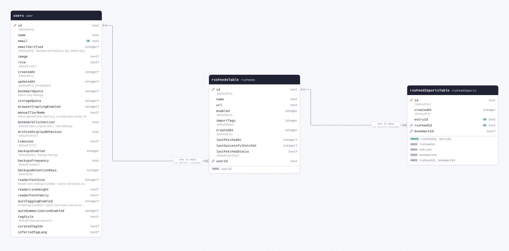

| Column                  | Type      | Constraints                         | Default               | Description |
| ----------------------- | --------- | ----------------------------------- | --------------------- | ----------- |
| `id`                    | `text`    | PK NOT NULL                         | `.$defaultFn()`       |             |
| `name`                  | `text`    | NOT NULL                            |                       |             |
| `url`                   | `text`    | NOT NULL                            |                       |             |
| `enabled`               | `integer` | NOT NULL                            | `.default(true)`      |             |
| `importTags`            | `integer` | NOT NULL                            | `.default(false)`     |             |
| `createdAt`             | `integer` | NOT NULL                            | `.$defaultFn()`       |             |
| `lastFetchedAt`         | `integer` | NULL                                |                       |             |
| `lastSuccessfulFetchAt` | `integer` | NULL                                |                       |             |
| `lastFetchedStatus`     | `text`    | NULL                                | `.default("pending")` |             |
| `userId`                | `text`    | NOT NULL → [users.id](#table-users) |                       |             |

#### Definition

```sql
CREATE TABLE `rssFeeds` (
	`id` text PRIMARY KEY,
	`name` text NOT NULL,
	`url` text NOT NULL,
	`enabled` integer DEFAULT true NOT NULL,
	`importTags` integer DEFAULT false NOT NULL,
	`createdAt` integer NOT NULL,
	`lastFetchedAt` integer,
	`lastSuccessfulFetchAt` integer,
	`lastFetchedStatus` text DEFAULT 'pending',
	`userId` text NOT NULL,
	CONSTRAINT `fk_rssFeeds_userId_user_id_fk` FOREIGN KEY (`userId`) REFERENCES `user`(`id`) ON DELETE CASCADE
);

CREATE INDEX `rssFeeds_userId_idx` ON `rssFeeds` (`userId`);
```

#### Indexes

- INDEX `userId`

#### References

- `userId` → [users.id](#table-users) (many to one, on delete cascade)

#### Referenced by

- `id` → [rssFeedImportsTable.rssFeedId](#table-rssFeedImportsTable) (one to many, on delete cascade)

<details>
<summary>Queries and their SQL</summary>

**Select**: Every row of rssFeedsTable.

```ts
db.select().from(rssFeedsTable);
```

```sql
select "id", "name", "url", "enabled", "importTags", "createdAt", "lastFetchedAt", "lastSuccessfulFetchAt", "lastFetchedStatus", "userId"
from "rssFeeds"
```

**Count**: How many rows rssFeedsTable has.

```ts
db.select({ count: count() }).from(rssFeedsTable);
```

```sql
select count(*)
from "rssFeeds"
```

**Find many**: The rows of rssFeedsTable, through the relational query API.

```ts
db.query.rssFeedsTable.findMany();
```

```sql
select "d0"."id" as "id", "d0"."name" as "name", "d0"."url" as "url", "d0"."enabled" as "enabled", "d0"."importTags" as "importTags", "d0"."createdAt" as "createdAt", "d0"."lastFetchedAt" as "lastFetchedAt", "d0"."lastSuccessfulFetchAt" as "lastSuccessfulFetchAt", "d0"."lastFetchedStatus" as "lastFetchedStatus", "d0"."userId" as "userId"
from "rssFeeds" as "d0"
```

**Find by primary key**: One row of rssFeedsTable, through the relational query API.

```ts
db.query.rssFeedsTable.findFirst({ where: { id: "id" } });
```

```sql
select "d0"."id" as "id", "d0"."name" as "name", "d0"."url" as "url", "d0"."enabled" as "enabled", "d0"."importTags" as "importTags", "d0"."createdAt" as "createdAt", "d0"."lastFetchedAt" as "lastFetchedAt", "d0"."lastSuccessfulFetchAt" as "lastSuccessfulFetchAt", "d0"."lastFetchedStatus" as "lastFetchedStatus", "d0"."userId" as "userId"
from "rssFeeds" as "d0"
where "d0"."id" = ?
limit ?
-- params: ["id",1]
```

**Insert**: Adds a row to rssFeedsTable, giving the columns that have no default.

```ts
db.insert(rssFeedsTable).values({ name: "name", url: "url", userId: "userId" });
```

```sql
insert into "rssFeeds" ("id", "name", "url", "enabled", "importTags", "createdAt", "lastFetchedAt", "lastSuccessfulFetchAt", "lastFetchedStatus", "userId")
values (?, ?, ?, ?, ?, ?, null, null, ?, ?)
-- params: ["ak73daen00i44h9agoe69cji","name","url",1,0,1767225600,"pending","userId"]
```

**Update**: Changes a row of rssFeedsTable, found by its primary key.

```ts
db.update(rssFeedsTable).set({ name: "name" }).where(eq(rssFeedsTable.id, "id"));
```

```sql
update "rssFeeds"
set "name" = ?
where "rssFeeds"."id" = ?
-- params: ["name","id"]
```

**Delete**: Deletes a row of rssFeedsTable, found by its primary key.

```ts
db.delete(rssFeedsTable).where(eq(rssFeedsTable.id, "id"));
```

```sql
delete from "rssFeeds"
where "rssFeeds"."id" = ?
-- params: ["id"]
```

</details>

<a id="table-webhooksTable"></a>

### webhooksTable

Table `webhooks`.

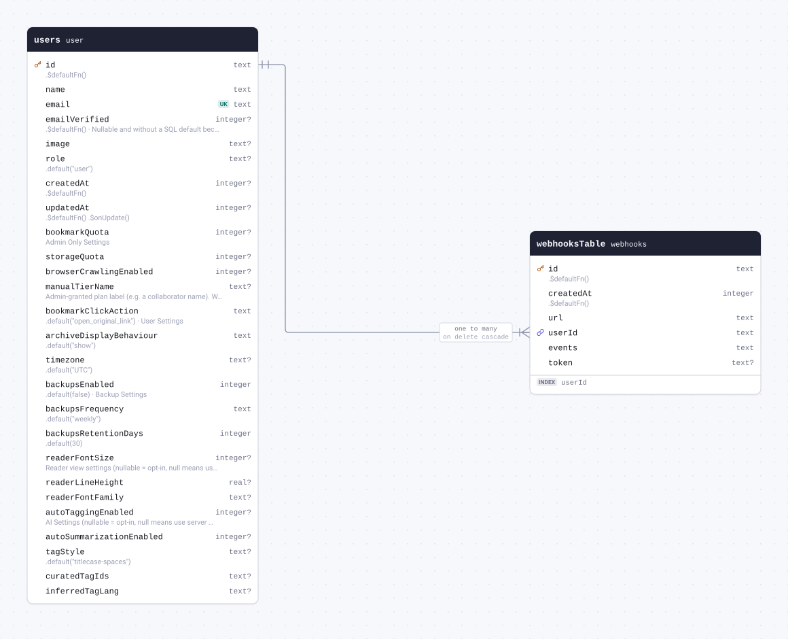

| Column      | Type      | Constraints                         | Default         | Description |
| ----------- | --------- | ----------------------------------- | --------------- | ----------- |
| `id`        | `text`    | PK NOT NULL                         | `.$defaultFn()` |             |
| `createdAt` | `integer` | NOT NULL                            | `.$defaultFn()` |             |
| `url`       | `text`    | NOT NULL                            |                 |             |
| `userId`    | `text`    | NOT NULL → [users.id](#table-users) |                 |             |
| `events`    | `text`    | NOT NULL                            |                 |             |
| `token`     | `text`    | NULL                                |                 |             |

#### Definition

```sql
CREATE TABLE `webhooks` (
	`id` text PRIMARY KEY,
	`createdAt` integer NOT NULL,
	`url` text NOT NULL,
	`userId` text NOT NULL,
	`events` text NOT NULL,
	`token` text,
	CONSTRAINT `fk_webhooks_userId_user_id_fk` FOREIGN KEY (`userId`) REFERENCES `user`(`id`) ON DELETE CASCADE
);

CREATE INDEX `webhooks_userId_idx` ON `webhooks` (`userId`);
```

#### Indexes

- INDEX `userId`

#### References

- `userId` → [users.id](#table-users) (many to one, on delete cascade)

<details>
<summary>Queries and their SQL</summary>

**Select**: Every row of webhooksTable.

```ts
db.select().from(webhooksTable);
```

```sql
select "id", "createdAt", "url", "userId", "events", "token"
from "webhooks"
```

**Count**: How many rows webhooksTable has.

```ts
db.select({ count: count() }).from(webhooksTable);
```

```sql
select count(*)
from "webhooks"
```

**Find many**: The rows of webhooksTable, through the relational query API.

```ts
db.query.webhooksTable.findMany();
```

```sql
select "d0"."id" as "id", "d0"."createdAt" as "createdAt", "d0"."url" as "url", "d0"."userId" as "userId", "d0"."events" as "events", "d0"."token" as "token"
from "webhooks" as "d0"
```

**Find by primary key**: One row of webhooksTable, through the relational query API.

```ts
db.query.webhooksTable.findFirst({ where: { id: "id" } });
```

```sql
select "d0"."id" as "id", "d0"."createdAt" as "createdAt", "d0"."url" as "url", "d0"."userId" as "userId", "d0"."events" as "events", "d0"."token" as "token"
from "webhooks" as "d0"
where "d0"."id" = ?
limit ?
-- params: ["id",1]
```

**Insert**: Adds a row to webhooksTable, giving the columns that have no default.

```ts
db.insert(webhooksTable).values({ url: "url", userId: "userId", events: "events" });
```

```sql
insert into "webhooks" ("id", "createdAt", "url", "userId", "events", "token")
values (?, ?, ?, ?, ?, null)
-- params: ["am933xq2w3vu8ri7xncxtg4z",1767225600,"url","userId","\"events\""]
```

**Update**: Changes a row of webhooksTable, found by its primary key.

```ts
db.update(webhooksTable).set({ createdAt: 1 }).where(eq(webhooksTable.id, "id"));
```

```sql
update "webhooks"
set "createdAt" = ?
where "webhooks"."id" = ?
-- params: [1,"id"]
```

**Delete**: Deletes a row of webhooksTable, found by its primary key.

```ts
db.delete(webhooksTable).where(eq(webhooksTable.id, "id"));
```

```sql
delete from "webhooks"
where "webhooks"."id" = ?
-- params: ["id"]
```

</details>

<a id="table-rssFeedImportsTable"></a>

### rssFeedImportsTable

Table `rssFeedImports`.

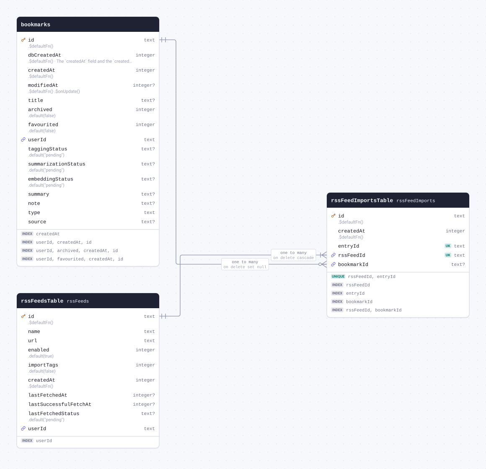

| Column       | Type      | Constraints                                         | Default         | Description |
| ------------ | --------- | --------------------------------------------------- | --------------- | ----------- |
| `id`         | `text`    | PK NOT NULL                                         | `.$defaultFn()` |             |
| `createdAt`  | `integer` | NOT NULL                                            | `.$defaultFn()` |             |
| `entryId`    | `text`    | NOT NULL                                            |                 |             |
| `rssFeedId`  | `text`    | NOT NULL → [rssFeedsTable.id](#table-rssFeedsTable) |                 |             |
| `bookmarkId` | `text`    | NULL → [bookmarks.id](#table-bookmarks)             |                 |             |

#### Definition

```sql
CREATE TABLE `rssFeedImports` (
	`id` text PRIMARY KEY,
	`createdAt` integer NOT NULL,
	`entryId` text NOT NULL,
	`rssFeedId` text NOT NULL,
	`bookmarkId` text,
	CONSTRAINT `fk_rssFeedImports_rssFeedId_rssFeeds_id_fk` FOREIGN KEY (`rssFeedId`) REFERENCES `rssFeeds`(`id`) ON DELETE CASCADE,
	CONSTRAINT `fk_rssFeedImports_bookmarkId_bookmarks_id_fk` FOREIGN KEY (`bookmarkId`) REFERENCES `bookmarks`(`id`) ON DELETE SET NULL,
	CONSTRAINT `rssFeedImports_rssFeedId_entryId_unique` UNIQUE(`rssFeedId`,`entryId`)
);

CREATE INDEX `rssFeedImports_feedIdIdx_idx` ON `rssFeedImports` (`rssFeedId`);

CREATE INDEX `rssFeedImports_entryIdIdx_idx` ON `rssFeedImports` (`entryId`);

CREATE INDEX `rssFeedImports_bookmarkId_idx` ON `rssFeedImports` (`bookmarkId`);

CREATE INDEX `rssFeedImports_rssFeedId_bookmarkId_idx` ON `rssFeedImports` (`rssFeedId`,`bookmarkId`);
```

#### Indexes

- INDEX `rssFeedId`
- INDEX `entryId`
- UNIQUE `rssFeedId`, `entryId`
- INDEX `bookmarkId`
- INDEX `rssFeedId`, `bookmarkId`

#### References

- `rssFeedId` → [rssFeedsTable.id](#table-rssFeedsTable) (many to one, on delete cascade)
- `bookmarkId` → [bookmarks.id](#table-bookmarks) (many to one, on delete set null)

<details>
<summary>Queries and their SQL</summary>

**Select**: Every row of rssFeedImportsTable.

```ts
db.select().from(rssFeedImportsTable);
```

```sql
select "id", "createdAt", "entryId", "rssFeedId", "bookmarkId"
from "rssFeedImports"
```

**Count**: How many rows rssFeedImportsTable has.

```ts
db.select({ count: count() }).from(rssFeedImportsTable);
```

```sql
select count(*)
from "rssFeedImports"
```

**Find many**: The rows of rssFeedImportsTable, through the relational query API.

```ts
db.query.rssFeedImportsTable.findMany();
```

```sql
select "d0"."id" as "id", "d0"."createdAt" as "createdAt", "d0"."entryId" as "entryId", "d0"."rssFeedId" as "rssFeedId", "d0"."bookmarkId" as "bookmarkId"
from "rssFeedImports" as "d0"
```

**Find by primary key**: One row of rssFeedImportsTable, through the relational query API.

```ts
db.query.rssFeedImportsTable.findFirst({ where: { id: "id" } });
```

```sql
select "d0"."id" as "id", "d0"."createdAt" as "createdAt", "d0"."entryId" as "entryId", "d0"."rssFeedId" as "rssFeedId", "d0"."bookmarkId" as "bookmarkId"
from "rssFeedImports" as "d0"
where "d0"."id" = ?
limit ?
-- params: ["id",1]
```

**Insert**: Adds a row to rssFeedImportsTable, giving the columns that have no default.

```ts
db.insert(rssFeedImportsTable).values({ entryId: "entryId", rssFeedId: "rssFeedId" });
```

```sql
insert into "rssFeedImports" ("id", "createdAt", "entryId", "rssFeedId", "bookmarkId")
values (?, ?, ?, ?, null)
-- params: ["answih29m51jxaely266sj9x",1767225600,"entryId","rssFeedId"]
```

**Update**: Changes a row of rssFeedImportsTable, found by its primary key.

```ts
db.update(rssFeedImportsTable).set({ createdAt: 1 }).where(eq(rssFeedImportsTable.id, "id"));
```

```sql
update "rssFeedImports"
set "createdAt" = ?
where "rssFeedImports"."id" = ?
-- params: [1,"id"]
```

**Delete**: Deletes a row of rssFeedImportsTable, found by its primary key.

```ts
db.delete(rssFeedImportsTable).where(eq(rssFeedImportsTable.id, "id"));
```

```sql
delete from "rssFeedImports"
where "rssFeedImports"."id" = ?
-- params: ["id"]
```

</details>

<a id="table-backupsTable"></a>

### backupsTable

Table `backups`.

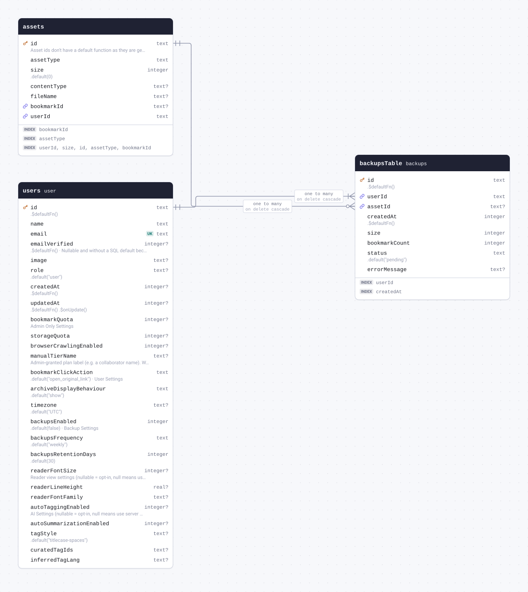

| Column          | Type      | Constraints                         | Default               | Description |
| --------------- | --------- | ----------------------------------- | --------------------- | ----------- |
| `id`            | `text`    | PK NOT NULL                         | `.$defaultFn()`       |             |
| `userId`        | `text`    | NOT NULL → [users.id](#table-users) |                       |             |
| `assetId`       | `text`    | NULL → [assets.id](#table-assets)   |                       |             |
| `createdAt`     | `integer` | NOT NULL                            | `.$defaultFn()`       |             |
| `size`          | `integer` | NOT NULL                            |                       |             |
| `bookmarkCount` | `integer` | NOT NULL                            |                       |             |
| `status`        | `text`    | NOT NULL                            | `.default("pending")` |             |
| `errorMessage`  | `text`    | NULL                                |                       |             |

#### Definition

```sql
CREATE TABLE `backups` (
	`id` text PRIMARY KEY,
	`userId` text NOT NULL,
	`assetId` text,
	`createdAt` integer NOT NULL,
	`size` integer NOT NULL,
	`bookmarkCount` integer NOT NULL,
	`status` text DEFAULT 'pending' NOT NULL,
	`errorMessage` text,
	CONSTRAINT `fk_backups_userId_user_id_fk` FOREIGN KEY (`userId`) REFERENCES `user`(`id`) ON DELETE CASCADE,
	CONSTRAINT `fk_backups_assetId_assets_id_fk` FOREIGN KEY (`assetId`) REFERENCES `assets`(`id`) ON DELETE CASCADE
);

CREATE INDEX `backups_userId_idx` ON `backups` (`userId`);

CREATE INDEX `backups_createdAt_idx` ON `backups` (`createdAt`);
```

#### Indexes

- INDEX `userId`
- INDEX `createdAt`

#### References

- `userId` → [users.id](#table-users) (many to one, on delete cascade)
- `assetId` → [assets.id](#table-assets) (many to one, on delete cascade)

<details>
<summary>Queries and their SQL</summary>

**Select**: Every row of backupsTable.

```ts
db.select().from(backupsTable);
```

```sql
select "id", "userId", "assetId", "createdAt", "size", "bookmarkCount", "status", "errorMessage"
from "backups"
```

**Count**: How many rows backupsTable has.

```ts
db.select({ count: count() }).from(backupsTable);
```

```sql
select count(*)
from "backups"
```

**Find many**: The rows of backupsTable, through the relational query API.

```ts
db.query.backupsTable.findMany();
```

```sql
select "d0"."id" as "id", "d0"."userId" as "userId", "d0"."assetId" as "assetId", "d0"."createdAt" as "createdAt", "d0"."size" as "size", "d0"."bookmarkCount" as "bookmarkCount", "d0"."status" as "status", "d0"."errorMessage" as "errorMessage"
from "backups" as "d0"
```

**Find by primary key**: One row of backupsTable, through the relational query API.

```ts
db.query.backupsTable.findFirst({ where: { id: "id" } });
```

```sql
select "d0"."id" as "id", "d0"."userId" as "userId", "d0"."assetId" as "assetId", "d0"."createdAt" as "createdAt", "d0"."size" as "size", "d0"."bookmarkCount" as "bookmarkCount", "d0"."status" as "status", "d0"."errorMessage" as "errorMessage"
from "backups" as "d0"
where "d0"."id" = ?
limit ?
-- params: ["id",1]
```

**Insert**: Adds a row to backupsTable, giving the columns that have no default.

```ts
db.insert(backupsTable).values({ userId: "userId", size: 1, bookmarkCount: 1 });
```

```sql
insert into "backups" ("id", "userId", "assetId", "createdAt", "size", "bookmarkCount", "status", "errorMessage")
values (?, ?, null, ?, ?, ?, ?, null)
-- params: ["ahxrv2d8v5qa9c32wl3tlbml","userId",1767225600,1,1,"pending"]
```

**Update**: Changes a row of backupsTable, found by its primary key.

```ts
db.update(backupsTable).set({ userId: "userId" }).where(eq(backupsTable.id, "id"));
```

```sql
update "backups"
set "userId" = ?
where "backups"."id" = ?
-- params: ["userId","id"]
```

**Delete**: Deletes a row of backupsTable, found by its primary key.

```ts
db.delete(backupsTable).where(eq(backupsTable.id, "id"));
```

```sql
delete from "backups"
where "backups"."id" = ?
-- params: ["id"]
```

</details>

<a id="table-config"></a>

### config

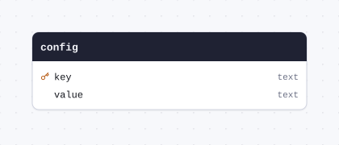

| Column  | Type   | Constraints | Default | Description |
| ------- | ------ | ----------- | ------- | ----------- |
| `key`   | `text` | PK NOT NULL |         |             |
| `value` | `text` | NOT NULL    |         |             |

#### Definition

```sql
CREATE TABLE `config` (
	`key` text PRIMARY KEY,
	`value` text NOT NULL
);
```

<details>
<summary>Queries and their SQL</summary>

**Select**: Every row of config.

```ts
db.select().from(config);
```

```sql
select "key", "value"
from "config"
```

**Count**: How many rows config has.

```ts
db.select({ count: count() }).from(config);
```

```sql
select count(*)
from "config"
```

**Find many**: The rows of config, through the relational query API.

```ts
db.query.config.findMany();
```

```sql
select "d0"."key" as "key", "d0"."value" as "value"
from "config" as "d0"
```

**Find by primary key**: One row of config, through the relational query API.

```ts
db.query.config.findFirst({ where: { key: "key" } });
```

```sql
select "d0"."key" as "key", "d0"."value" as "value"
from "config" as "d0"
where "d0"."key" = ?
limit ?
-- params: ["key",1]
```

**Insert**: Adds a row to config, giving the columns that have no default.

```ts
db.insert(config).values({ key: "key", value: "value" });
```

```sql
insert into "config" ("key", "value")
values (?, ?)
-- params: ["key","value"]
```

**Update**: Changes a row of config, found by its primary key.

```ts
db.update(config).set({ value: "value" }).where(eq(config.key, "key"));
```

```sql
update "config"
set "value" = ?
where "config"."key" = ?
-- params: ["value","key"]
```

**Delete**: Deletes a row of config, found by its primary key.

```ts
db.delete(config).where(eq(config.key, "key"));
```

```sql
delete from "config"
where "config"."key" = ?
-- params: ["key"]
```

</details>

<a id="table-ruleEngineRulesTable"></a>

### ruleEngineRulesTable

Table `ruleEngineRules`.

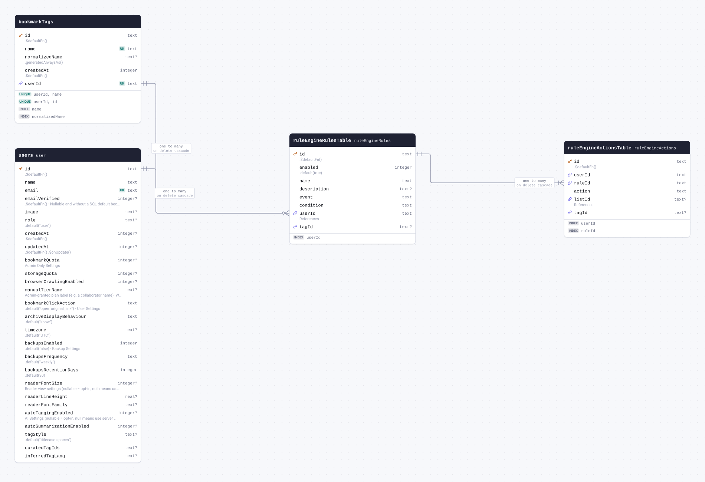

| Column        | Type      | Constraints                         | Default          | Description |
| ------------- | --------- | ----------------------------------- | ---------------- | ----------- |
| `id`          | `text`    | PK NOT NULL                         | `.$defaultFn()`  |             |
| `enabled`     | `integer` | NOT NULL                            | `.default(true)` |             |
| `name`        | `text`    | NOT NULL                            |                  |             |
| `description` | `text`    | NULL                                |                  |             |
| `event`       | `text`    | NOT NULL                            |                  |             |
| `condition`   | `text`    | NOT NULL                            |                  |             |
| `userId`      | `text`    | NOT NULL → [users.id](#table-users) |                  | References  |
| `tagId`       | `text`    | NULL                                |                  |             |

#### Definition

```sql
CREATE TABLE `ruleEngineRules` (
	`id` text PRIMARY KEY,
	`enabled` integer DEFAULT true NOT NULL,
	`name` text NOT NULL,
	`description` text,
	`event` text NOT NULL,
	`condition` text NOT NULL,
	`userId` text NOT NULL,
	`tagId` text,
	CONSTRAINT `fk_ruleEngineRules_userId_user_id_fk` FOREIGN KEY (`userId`) REFERENCES `user`(`id`) ON DELETE CASCADE,
	CONSTRAINT `ruleEngineRules_userId_tagId_fk` FOREIGN KEY (`userId`,`tagId`) REFERENCES `bookmarkTags`(`userId`,`id`) ON DELETE CASCADE
);

CREATE INDEX `ruleEngine_userId_idx` ON `ruleEngineRules` (`userId`);
```

#### Indexes

- INDEX `userId`

#### References

- `userId` → [users.id](#table-users) (many to one, on delete cascade)
- `userId` → [bookmarkTags.userId](#table-bookmarkTags) (many to one, on delete cascade)

#### Referenced by

- `id` → [ruleEngineActionsTable.ruleId](#table-ruleEngineActionsTable) (one to many, on delete cascade)

<details>
<summary>Queries and their SQL</summary>

**Select**: Every row of ruleEngineRulesTable.

```ts
db.select().from(ruleEngineRulesTable);
```

```sql
select "id", "enabled", "name", "description", "event", "condition", "userId", "tagId"
from "ruleEngineRules"
```

**Count**: How many rows ruleEngineRulesTable has.

```ts
db.select({ count: count() }).from(ruleEngineRulesTable);
```

```sql
select count(*)
from "ruleEngineRules"
```

**Find many**: The rows of ruleEngineRulesTable, through the relational query API.

```ts
db.query.ruleEngineRulesTable.findMany();
```

```sql
select "d0"."id" as "id", "d0"."enabled" as "enabled", "d0"."name" as "name", "d0"."description" as "description", "d0"."event" as "event", "d0"."condition" as "condition", "d0"."userId" as "userId", "d0"."tagId" as "tagId"
from "ruleEngineRules" as "d0"
```

**Find by primary key**: One row of ruleEngineRulesTable, through the relational query API.

```ts
db.query.ruleEngineRulesTable.findFirst({ where: { id: "id" } });
```

```sql
select "d0"."id" as "id", "d0"."enabled" as "enabled", "d0"."name" as "name", "d0"."description" as "description", "d0"."event" as "event", "d0"."condition" as "condition", "d0"."userId" as "userId", "d0"."tagId" as "tagId"
from "ruleEngineRules" as "d0"
where "d0"."id" = ?
limit ?
-- params: ["id",1]
```

**Insert**: Adds a row to ruleEngineRulesTable, giving the columns that have no default.

```ts
db.insert(ruleEngineRulesTable).values({
  name: "name",
  event: "event",
  condition: "condition",
  userId: "userId",
});
```

```sql
insert into "ruleEngineRules" ("id", "enabled", "name", "description", "event", "condition", "userId", "tagId")
values (?, ?, ?, null, ?, ?, ?, null)
-- params: ["ab7pljdqmkhr2nzcjg57jsxp",1,"name","event","condition","userId"]
```

**Update**: Changes a row of ruleEngineRulesTable, found by its primary key.

```ts
db.update(ruleEngineRulesTable).set({ enabled: 1 }).where(eq(ruleEngineRulesTable.id, "id"));
```

```sql
update "ruleEngineRules"
set "enabled" = ?
where "ruleEngineRules"."id" = ?
-- params: [1,"id"]
```

**Delete**: Deletes a row of ruleEngineRulesTable, found by its primary key.

```ts
db.delete(ruleEngineRulesTable).where(eq(ruleEngineRulesTable.id, "id"));
```

```sql
delete from "ruleEngineRules"
where "ruleEngineRules"."id" = ?
-- params: ["id"]
```

</details>

<a id="table-ruleEngineActionsTable"></a>

### ruleEngineActionsTable

Table `ruleEngineActions`.

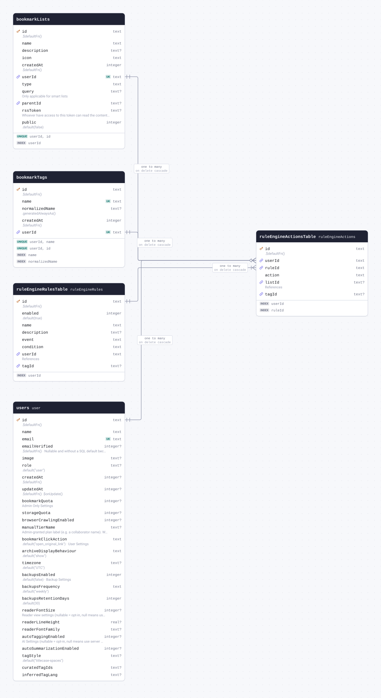

| Column   | Type   | Constraints                                                       | Default         | Description |
| -------- | ------ | ----------------------------------------------------------------- | --------------- | ----------- |
| `id`     | `text` | PK NOT NULL                                                       | `.$defaultFn()` |             |
| `userId` | `text` | NOT NULL → [users.id](#table-users)                               |                 |             |
| `ruleId` | `text` | NOT NULL → [ruleEngineRulesTable.id](#table-ruleEngineRulesTable) |                 |             |
| `action` | `text` | NOT NULL                                                          |                 |             |
| `listId` | `text` | NULL                                                              |                 | References  |
| `tagId`  | `text` | NULL                                                              |                 |             |

#### Definition

```sql
CREATE TABLE `ruleEngineActions` (
	`id` text PRIMARY KEY,
	`userId` text NOT NULL,
	`ruleId` text NOT NULL,
	`action` text NOT NULL,
	`listId` text,
	`tagId` text,
	CONSTRAINT `fk_ruleEngineActions_userId_user_id_fk` FOREIGN KEY (`userId`) REFERENCES `user`(`id`) ON DELETE CASCADE,
	CONSTRAINT `fk_ruleEngineActions_ruleId_ruleEngineRules_id_fk` FOREIGN KEY (`ruleId`) REFERENCES `ruleEngineRules`(`id`) ON DELETE CASCADE,
	CONSTRAINT `ruleEngineActions_userId_tagId_fk` FOREIGN KEY (`userId`,`tagId`) REFERENCES `bookmarkTags`(`userId`,`id`) ON DELETE CASCADE,
	CONSTRAINT `ruleEngineActions_userId_listId_fk` FOREIGN KEY (`userId`,`listId`) REFERENCES `bookmarkLists`(`userId`,`id`) ON DELETE CASCADE
);

CREATE INDEX `ruleEngineActions_userId_idx` ON `ruleEngineActions` (`userId`);

CREATE INDEX `ruleEngineActions_ruleId_idx` ON `ruleEngineActions` (`ruleId`);
```

#### Indexes

- INDEX `userId`
- INDEX `ruleId`

#### References

- `userId` → [users.id](#table-users) (many to one, on delete cascade)
- `ruleId` → [ruleEngineRulesTable.id](#table-ruleEngineRulesTable) (many to one, on delete cascade)
- `userId` → [bookmarkTags.userId](#table-bookmarkTags) (many to one, on delete cascade)
- `userId` → [bookmarkLists.userId](#table-bookmarkLists) (many to one, on delete cascade)

<details>
<summary>Queries and their SQL</summary>

**Select**: Every row of ruleEngineActionsTable.

```ts
db.select().from(ruleEngineActionsTable);
```

```sql
select "id", "userId", "ruleId", "action", "listId", "tagId"
from "ruleEngineActions"
```

**Count**: How many rows ruleEngineActionsTable has.

```ts
db.select({ count: count() }).from(ruleEngineActionsTable);
```

```sql
select count(*)
from "ruleEngineActions"
```

**Find many**: The rows of ruleEngineActionsTable, through the relational query API.

```ts
db.query.ruleEngineActionsTable.findMany();
```

```sql
select "d0"."id" as "id", "d0"."userId" as "userId", "d0"."ruleId" as "ruleId", "d0"."action" as "action", "d0"."listId" as "listId", "d0"."tagId" as "tagId"
from "ruleEngineActions" as "d0"
```

**Find by primary key**: One row of ruleEngineActionsTable, through the relational query API.

```ts
db.query.ruleEngineActionsTable.findFirst({ where: { id: "id" } });
```

```sql
select "d0"."id" as "id", "d0"."userId" as "userId", "d0"."ruleId" as "ruleId", "d0"."action" as "action", "d0"."listId" as "listId", "d0"."tagId" as "tagId"
from "ruleEngineActions" as "d0"
where "d0"."id" = ?
limit ?
-- params: ["id",1]
```

**Insert**: Adds a row to ruleEngineActionsTable, giving the columns that have no default.

```ts
db.insert(ruleEngineActionsTable).values({ userId: "userId", ruleId: "ruleId", action: "action" });
```

```sql
insert into "ruleEngineActions" ("id", "userId", "ruleId", "action", "listId", "tagId")
values (?, ?, ?, ?, null, null)
-- params: ["ajibqgxnqw8l3ig6ube8r8ws","userId","ruleId","action"]
```

**Update**: Changes a row of ruleEngineActionsTable, found by its primary key.

```ts
db.update(ruleEngineActionsTable)
  .set({ userId: "userId" })
  .where(eq(ruleEngineActionsTable.id, "id"));
```

```sql
update "ruleEngineActions"
set "userId" = ?
where "ruleEngineActions"."id" = ?
-- params: ["userId","id"]
```

**Delete**: Deletes a row of ruleEngineActionsTable, found by its primary key.

```ts
db.delete(ruleEngineActionsTable).where(eq(ruleEngineActionsTable.id, "id"));
```

```sql
delete from "ruleEngineActions"
where "ruleEngineActions"."id" = ?
-- params: ["id"]
```

</details>

<a id="table-invites"></a>

### invites

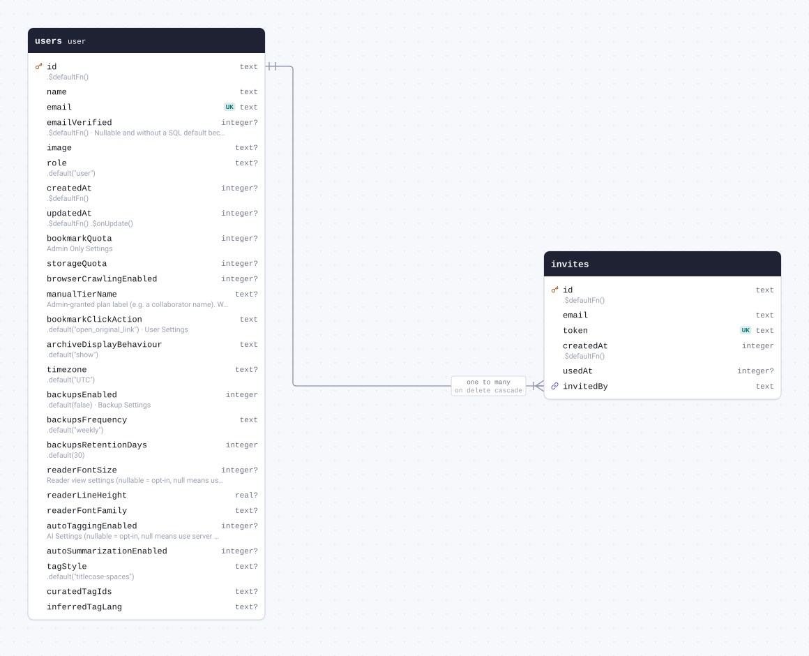

| Column      | Type      | Constraints                         | Default         | Description |
| ----------- | --------- | ----------------------------------- | --------------- | ----------- |
| `id`        | `text`    | PK NOT NULL                         | `.$defaultFn()` |             |
| `email`     | `text`    | NOT NULL                            |                 |             |
| `token`     | `text`    | UNIQUE NOT NULL                     |                 |             |
| `createdAt` | `integer` | NOT NULL                            | `.$defaultFn()` |             |
| `usedAt`    | `integer` | NULL                                |                 |             |
| `invitedBy` | `text`    | NOT NULL → [users.id](#table-users) |                 |             |

#### Definition

```sql
CREATE TABLE `invites` (
	`id` text PRIMARY KEY,
	`email` text NOT NULL,
	`token` text NOT NULL UNIQUE,
	`createdAt` integer NOT NULL,
	`usedAt` integer,
	`invitedBy` text NOT NULL,
	CONSTRAINT `fk_invites_invitedBy_user_id_fk` FOREIGN KEY (`invitedBy`) REFERENCES `user`(`id`) ON DELETE CASCADE
);
```

#### References

- `invitedBy` → [users.id](#table-users) (many to one, on delete cascade)

<details>
<summary>Queries and their SQL</summary>

**Select**: Every row of invites.

```ts
db.select().from(invites);
```

```sql
select "id", "email", "token", "createdAt", "usedAt", "invitedBy"
from "invites"
```

**Count**: How many rows invites has.

```ts
db.select({ count: count() }).from(invites);
```

```sql
select count(*)
from "invites"
```

**Find many**: The rows of invites, through the relational query API.

```ts
db.query.invites.findMany();
```

```sql
select "d0"."id" as "id", "d0"."email" as "email", "d0"."token" as "token", "d0"."createdAt" as "createdAt", "d0"."usedAt" as "usedAt", "d0"."invitedBy" as "invitedBy"
from "invites" as "d0"
```

**Find by primary key**: One row of invites, through the relational query API.

```ts
db.query.invites.findFirst({ where: { id: "id" } });
```

```sql
select "d0"."id" as "id", "d0"."email" as "email", "d0"."token" as "token", "d0"."createdAt" as "createdAt", "d0"."usedAt" as "usedAt", "d0"."invitedBy" as "invitedBy"
from "invites" as "d0"
where "d0"."id" = ?
limit ?
-- params: ["id",1]
```

**Insert**: Adds a row to invites, giving the columns that have no default.

```ts
db.insert(invites).values({ email: "email", token: "token", invitedBy: "invitedBy" });
```

```sql
insert into "invites" ("id", "email", "token", "createdAt", "usedAt", "invitedBy")
values (?, ?, ?, ?, null, ?)
-- params: ["aatlgpdcuye9z74sad2itb5k","email","token",1767225600,"invitedBy"]
```

**Update**: Changes a row of invites, found by its primary key.

```ts
db.update(invites).set({ email: "email" }).where(eq(invites.id, "id"));
```

```sql
update "invites"
set "email" = ?
where "invites"."id" = ?
-- params: ["email","id"]
```

**Delete**: Deletes a row of invites, found by its primary key.

```ts
db.delete(invites).where(eq(invites.id, "id"));
```

```sql
delete from "invites"
where "invites"."id" = ?
-- params: ["id"]
```

</details>

<a id="table-subscriptions"></a>

### subscriptions

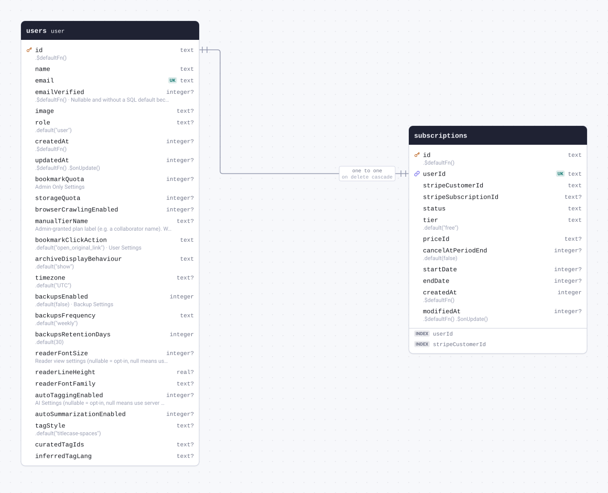

| Column                 | Type      | Constraints                                | Default                        | Description |
| ---------------------- | --------- | ------------------------------------------ | ------------------------------ | ----------- |
| `id`                   | `text`    | PK NOT NULL                                | `.$defaultFn()`                |             |
| `userId`               | `text`    | UNIQUE NOT NULL → [users.id](#table-users) |                                |             |
| `stripeCustomerId`     | `text`    | NOT NULL                                   |                                |             |
| `stripeSubscriptionId` | `text`    | NULL                                       |                                |             |
| `status`               | `text`    | NOT NULL                                   |                                |             |
| `tier`                 | `text`    | NOT NULL                                   | `.default("free")`             |             |
| `priceId`              | `text`    | NULL                                       |                                |             |
| `cancelAtPeriodEnd`    | `integer` | NULL                                       | `.default(false)`              |             |
| `startDate`            | `integer` | NULL                                       |                                |             |
| `endDate`              | `integer` | NULL                                       |                                |             |
| `createdAt`            | `integer` | NOT NULL                                   | `.$defaultFn()`                |             |
| `modifiedAt`           | `integer` | NULL                                       | `.$defaultFn()` `.$onUpdate()` |             |

#### Definition

```sql
CREATE TABLE `subscriptions` (
	`id` text PRIMARY KEY,
	`userId` text NOT NULL UNIQUE,
	`stripeCustomerId` text NOT NULL,
	`stripeSubscriptionId` text,
	`status` text NOT NULL,
	`tier` text DEFAULT 'free' NOT NULL,
	`priceId` text,
	`cancelAtPeriodEnd` integer DEFAULT false,
	`startDate` integer,
	`endDate` integer,
	`createdAt` integer NOT NULL,
	`modifiedAt` integer,
	CONSTRAINT `fk_subscriptions_userId_user_id_fk` FOREIGN KEY (`userId`) REFERENCES `user`(`id`) ON DELETE CASCADE
);

CREATE INDEX `subscriptions_userId_idx` ON `subscriptions` (`userId`);

CREATE INDEX `subscriptions_stripeCustomerId_idx` ON `subscriptions` (`stripeCustomerId`);
```

#### Indexes

- INDEX `userId`
- INDEX `stripeCustomerId`

#### References

- `userId` → [users.id](#table-users) (one to one, on delete cascade)

<details>
<summary>Queries and their SQL</summary>

**Select**: Every row of subscriptions.

```ts
db.select().from(subscriptions);
```

```sql
select "id", "userId", "stripeCustomerId", "stripeSubscriptionId", "status", "tier", "priceId", "cancelAtPeriodEnd", "startDate", "endDate", "createdAt", "modifiedAt"
from "subscriptions"
```

**Count**: How many rows subscriptions has.

```ts
db.select({ count: count() }).from(subscriptions);
```

```sql
select count(*)
from "subscriptions"
```

**Find many**: The rows of subscriptions, through the relational query API.

```ts
db.query.subscriptions.findMany();
```

```sql
select "d0"."id" as "id", "d0"."userId" as "userId", "d0"."stripeCustomerId" as "stripeCustomerId", "d0"."stripeSubscriptionId" as "stripeSubscriptionId", "d0"."status" as "status", "d0"."tier" as "tier", "d0"."priceId" as "priceId", "d0"."cancelAtPeriodEnd" as "cancelAtPeriodEnd", "d0"."startDate" as "startDate", "d0"."endDate" as "endDate", "d0"."createdAt" as "createdAt", "d0"."modifiedAt" as "modifiedAt"
from "subscriptions" as "d0"
```

**Find by primary key**: One row of subscriptions, through the relational query API.

```ts
db.query.subscriptions.findFirst({ where: { id: "id" } });
```

```sql
select "d0"."id" as "id", "d0"."userId" as "userId", "d0"."stripeCustomerId" as "stripeCustomerId", "d0"."stripeSubscriptionId" as "stripeSubscriptionId", "d0"."status" as "status", "d0"."tier" as "tier", "d0"."priceId" as "priceId", "d0"."cancelAtPeriodEnd" as "cancelAtPeriodEnd", "d0"."startDate" as "startDate", "d0"."endDate" as "endDate", "d0"."createdAt" as "createdAt", "d0"."modifiedAt" as "modifiedAt"
from "subscriptions" as "d0"
where "d0"."id" = ?
limit ?
-- params: ["id",1]
```

**Insert**: Adds a row to subscriptions, giving the columns that have no default.

```ts
db.insert(subscriptions).values({
  userId: "userId",
  stripeCustomerId: "stripeCustomerId",
  status: "status",
});
```

```sql
insert into "subscriptions" ("id", "userId", "stripeCustomerId", "stripeSubscriptionId", "status", "tier", "priceId", "cancelAtPeriodEnd", "startDate", "endDate", "createdAt", "modifiedAt")
values (?, ?, ?, null, ?, ?, null, ?, null, null, ?, ?)
-- params: ["au8zmyhsmjfapl32prhl5euv","userId","stripeCustomerId","status","free",0,1767225600,1767225600]
```

**Update**: Changes a row of subscriptions, found by its primary key.

```ts
db.update(subscriptions).set({ userId: "userId" }).where(eq(subscriptions.id, "id"));
```

```sql
update "subscriptions"
set "userId" = ?, "modifiedAt" = ?
where "subscriptions"."id" = ?
-- params: ["userId",1767225600,"id"]
```

**Delete**: Deletes a row of subscriptions, found by its primary key.

```ts
db.delete(subscriptions).where(eq(subscriptions.id, "id"));
```

```sql
delete from "subscriptions"
where "subscriptions"."id" = ?
-- params: ["id"]
```

</details>

<a id="table-inAppSubscriptions"></a>

### inAppSubscriptions

Subscriptions purchased through the mobile app stores (App Store / Google Play). These are managed by RevenueCat, which is the source of truth; this table mirrors the state of the configured RevenueCat entitlement.

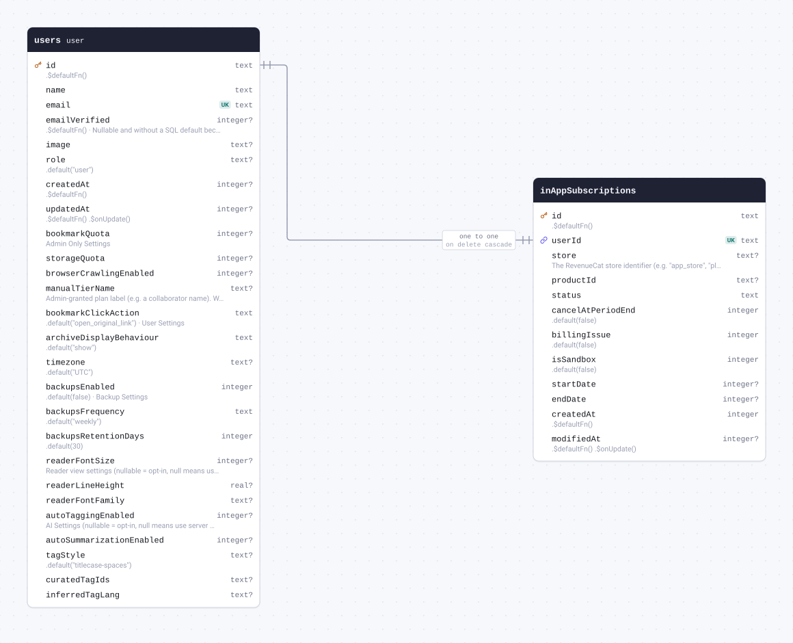

| Column              | Type      | Constraints                                | Default                        | Description                                                       |
| ------------------- | --------- | ------------------------------------------ | ------------------------------ | ----------------------------------------------------------------- |
| `id`                | `text`    | PK NOT NULL                                | `.$defaultFn()`                |                                                                   |
| `userId`            | `text`    | UNIQUE NOT NULL → [users.id](#table-users) |                                |                                                                   |
| `store`             | `text`    | NULL                                       |                                | The RevenueCat store identifier (e.g. "app_store", "play_store"). |
| `productId`         | `text`    | NULL                                       |                                |                                                                   |
| `status`            | `text`    | NOT NULL                                   |                                |                                                                   |
| `cancelAtPeriodEnd` | `integer` | NOT NULL                                   | `.default(false)`              |                                                                   |
| `billingIssue`      | `integer` | NOT NULL                                   | `.default(false)`              |                                                                   |
| `isSandbox`         | `integer` | NOT NULL                                   | `.default(false)`              |                                                                   |
| `startDate`         | `integer` | NULL                                       |                                |                                                                   |
| `endDate`           | `integer` | NULL                                       |                                |                                                                   |
| `createdAt`         | `integer` | NOT NULL                                   | `.$defaultFn()`                |                                                                   |
| `modifiedAt`        | `integer` | NULL                                       | `.$defaultFn()` `.$onUpdate()` |                                                                   |

#### Definition

```sql
CREATE TABLE `inAppSubscriptions` (
	`id` text PRIMARY KEY,
	`userId` text NOT NULL UNIQUE,
	`store` text,
	`productId` text,
	`status` text NOT NULL,
	`cancelAtPeriodEnd` integer DEFAULT false NOT NULL,
	`billingIssue` integer DEFAULT false NOT NULL,
	`isSandbox` integer DEFAULT false NOT NULL,
	`startDate` integer,
	`endDate` integer,
	`createdAt` integer NOT NULL,
	`modifiedAt` integer,
	CONSTRAINT `fk_inAppSubscriptions_userId_user_id_fk` FOREIGN KEY (`userId`) REFERENCES `user`(`id`) ON DELETE CASCADE
);
```

#### References

- `userId` → [users.id](#table-users) (one to one, on delete cascade)

<details>
<summary>Queries and their SQL</summary>

**Select**: Every row of inAppSubscriptions.

```ts
db.select().from(inAppSubscriptions);
```

```sql
select "id", "userId", "store", "productId", "status", "cancelAtPeriodEnd", "billingIssue", "isSandbox", "startDate", "endDate", "createdAt", "modifiedAt"
from "inAppSubscriptions"
```

**Count**: How many rows inAppSubscriptions has.

```ts
db.select({ count: count() }).from(inAppSubscriptions);
```

```sql
select count(*)
from "inAppSubscriptions"
```

**Find many**: The rows of inAppSubscriptions, through the relational query API.

```ts
db.query.inAppSubscriptions.findMany();
```

```sql
select "d0"."id" as "id", "d0"."userId" as "userId", "d0"."store" as "store", "d0"."productId" as "productId", "d0"."status" as "status", "d0"."cancelAtPeriodEnd" as "cancelAtPeriodEnd", "d0"."billingIssue" as "billingIssue", "d0"."isSandbox" as "isSandbox", "d0"."startDate" as "startDate", "d0"."endDate" as "endDate", "d0"."createdAt" as "createdAt", "d0"."modifiedAt" as "modifiedAt"
from "inAppSubscriptions" as "d0"
```

**Find by primary key**: One row of inAppSubscriptions, through the relational query API.

```ts
db.query.inAppSubscriptions.findFirst({ where: { id: "id" } });
```

```sql
select "d0"."id" as "id", "d0"."userId" as "userId", "d0"."store" as "store", "d0"."productId" as "productId", "d0"."status" as "status", "d0"."cancelAtPeriodEnd" as "cancelAtPeriodEnd", "d0"."billingIssue" as "billingIssue", "d0"."isSandbox" as "isSandbox", "d0"."startDate" as "startDate", "d0"."endDate" as "endDate", "d0"."createdAt" as "createdAt", "d0"."modifiedAt" as "modifiedAt"
from "inAppSubscriptions" as "d0"
where "d0"."id" = ?
limit ?
-- params: ["id",1]
```

**Insert**: Adds a row to inAppSubscriptions, giving the columns that have no default.

```ts
db.insert(inAppSubscriptions).values({ userId: "userId", status: "status" });
```

```sql
insert into "inAppSubscriptions" ("id", "userId", "store", "productId", "status", "cancelAtPeriodEnd", "billingIssue", "isSandbox", "startDate", "endDate", "createdAt", "modifiedAt")
values (?, ?, null, null, ?, ?, ?, ?, null, null, ?, ?)
-- params: ["a4d54h46kf204aenkzl5sk63","userId","status",0,0,0,1767225600,1767225600]
```

**Update**: Changes a row of inAppSubscriptions, found by its primary key.

```ts
db.update(inAppSubscriptions).set({ userId: "userId" }).where(eq(inAppSubscriptions.id, "id"));
```

```sql
update "inAppSubscriptions"
set "userId" = ?, "modifiedAt" = ?
where "inAppSubscriptions"."id" = ?
-- params: ["userId",1767225600,"id"]
```

**Delete**: Deletes a row of inAppSubscriptions, found by its primary key.

```ts
db.delete(inAppSubscriptions).where(eq(inAppSubscriptions.id, "id"));
```

```sql
delete from "inAppSubscriptions"
where "inAppSubscriptions"."id" = ?
-- params: ["id"]
```

</details>

<a id="table-importSessions"></a>

### importSessions

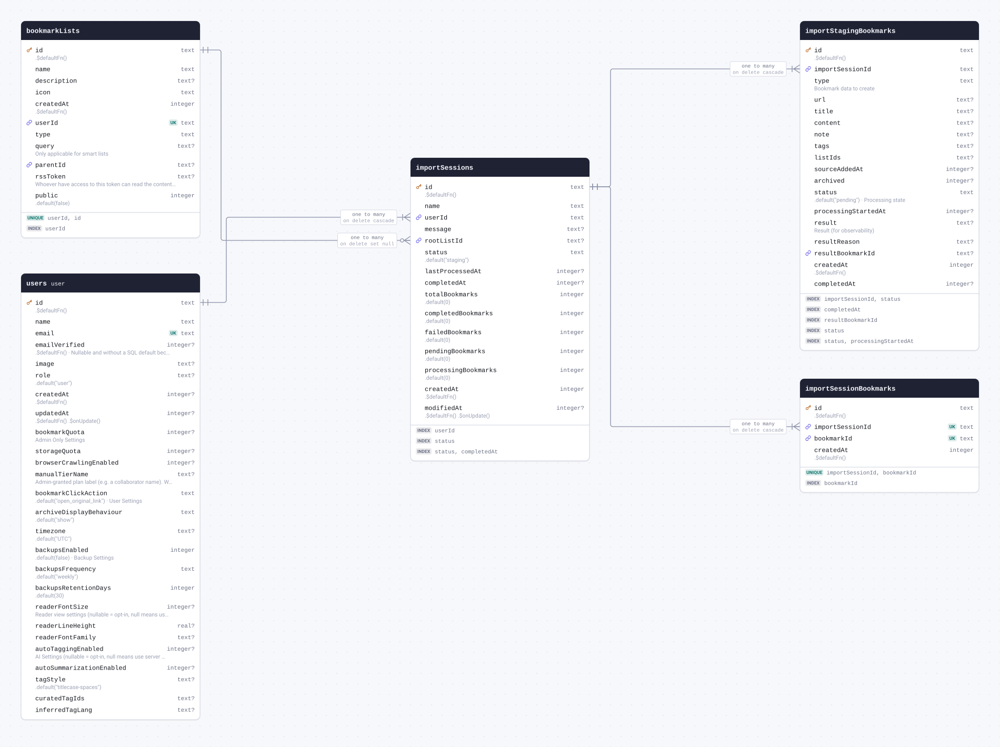

| Column                | Type      | Constraints                                     | Default                        | Description |
| --------------------- | --------- | ----------------------------------------------- | ------------------------------ | ----------- |
| `id`                  | `text`    | PK NOT NULL                                     | `.$defaultFn()`                |             |
| `name`                | `text`    | NOT NULL                                        |                                |             |
| `userId`              | `text`    | NOT NULL → [users.id](#table-users)             |                                |             |
| `message`             | `text`    | NULL                                            |                                |             |
| `rootListId`          | `text`    | NULL → [bookmarkLists.id](#table-bookmarkLists) |                                |             |
| `status`              | `text`    | NOT NULL                                        | `.default("staging")`          |             |
| `lastProcessedAt`     | `integer` | NULL                                            |                                |             |
| `completedAt`         | `integer` | NULL                                            |                                |             |
| `totalBookmarks`      | `integer` | NOT NULL                                        | `.default(0)`                  |             |
| `completedBookmarks`  | `integer` | NOT NULL                                        | `.default(0)`                  |             |
| `failedBookmarks`     | `integer` | NOT NULL                                        | `.default(0)`                  |             |
| `pendingBookmarks`    | `integer` | NOT NULL                                        | `.default(0)`                  |             |
| `processingBookmarks` | `integer` | NOT NULL                                        | `.default(0)`                  |             |
| `createdAt`           | `integer` | NOT NULL                                        | `.$defaultFn()`                |             |
| `modifiedAt`          | `integer` | NULL                                            | `.$defaultFn()` `.$onUpdate()` |             |

#### Definition

```sql
CREATE TABLE `importSessions` (
	`id` text PRIMARY KEY,
	`name` text NOT NULL,
	`userId` text NOT NULL,
	`message` text,
	`rootListId` text,
	`status` text DEFAULT 'staging' NOT NULL,
	`lastProcessedAt` integer,
	`completedAt` integer,
	`totalBookmarks` integer DEFAULT 0 NOT NULL,
	`completedBookmarks` integer DEFAULT 0 NOT NULL,
	`failedBookmarks` integer DEFAULT 0 NOT NULL,
	`pendingBookmarks` integer DEFAULT 0 NOT NULL,
	`processingBookmarks` integer DEFAULT 0 NOT NULL,
	`createdAt` integer NOT NULL,
	`modifiedAt` integer,
	CONSTRAINT `fk_importSessions_userId_user_id_fk` FOREIGN KEY (`userId`) REFERENCES `user`(`id`) ON DELETE CASCADE,
	CONSTRAINT `fk_importSessions_rootListId_bookmarkLists_id_fk` FOREIGN KEY (`rootListId`) REFERENCES `bookmarkLists`(`id`) ON DELETE SET NULL
);

CREATE INDEX `importSessions_userId_idx` ON `importSessions` (`userId`);

CREATE INDEX `importSessions_status_idx` ON `importSessions` (`status`);

CREATE INDEX `importSessions_status_completedAt_idx` ON `importSessions` (`status`,`completedAt`);
```

#### Indexes

- INDEX `userId`
- INDEX `status`
- INDEX `status`, `completedAt`

#### References

- `userId` → [users.id](#table-users) (many to one, on delete cascade)
- `rootListId` → [bookmarkLists.id](#table-bookmarkLists) (many to one, on delete set null)

#### Referenced by

- `id` → [importSessionBookmarks.importSessionId](#table-importSessionBookmarks) (one to many, on delete cascade)
- `id` → [importStagingBookmarks.importSessionId](#table-importStagingBookmarks) (one to many, on delete cascade)

<details>
<summary>Queries and their SQL</summary>

**Select**: Every row of importSessions.

```ts
db.select().from(importSessions);
```

```sql
select "id", "name", "userId", "message", "rootListId", "status", "lastProcessedAt", "completedAt", "totalBookmarks", "completedBookmarks", "failedBookmarks", "pendingBookmarks", "processingBookmarks", "createdAt", "modifiedAt"
from "importSessions"
```

**Count**: How many rows importSessions has.

```ts
db.select({ count: count() }).from(importSessions);
```

```sql
select count(*)
from "importSessions"
```

**Find many**: The rows of importSessions, through the relational query API.

```ts
db.query.importSessions.findMany();
```

```sql
select "d0"."id" as "id", "d0"."name" as "name", "d0"."userId" as "userId", "d0"."message" as "message", "d0"."rootListId" as "rootListId", "d0"."status" as "status", "d0"."lastProcessedAt" as "lastProcessedAt", "d0"."completedAt" as "completedAt", "d0"."totalBookmarks" as "totalBookmarks", "d0"."completedBookmarks" as "completedBookmarks", "d0"."failedBookmarks" as "failedBookmarks", "d0"."pendingBookmarks" as "pendingBookmarks", "d0"."processingBookmarks" as "processingBookmarks", "d0"."createdAt" as "createdAt", "d0"."modifiedAt" as "modifiedAt"
from "importSessions" as "d0"
```

**Find by primary key**: One row of importSessions, through the relational query API.

```ts
db.query.importSessions.findFirst({ where: { id: "id" } });
```

```sql
select "d0"."id" as "id", "d0"."name" as "name", "d0"."userId" as "userId", "d0"."message" as "message", "d0"."rootListId" as "rootListId", "d0"."status" as "status", "d0"."lastProcessedAt" as "lastProcessedAt", "d0"."completedAt" as "completedAt", "d0"."totalBookmarks" as "totalBookmarks", "d0"."completedBookmarks" as "completedBookmarks", "d0"."failedBookmarks" as "failedBookmarks", "d0"."pendingBookmarks" as "pendingBookmarks", "d0"."processingBookmarks" as "processingBookmarks", "d0"."createdAt" as "createdAt", "d0"."modifiedAt" as "modifiedAt"
from "importSessions" as "d0"
where "d0"."id" = ?
limit ?
-- params: ["id",1]
```

**Insert**: Adds a row to importSessions, giving the columns that have no default.

```ts
db.insert(importSessions).values({ name: "name", userId: "userId" });
```

```sql
insert into "importSessions" ("id", "name", "userId", "message", "rootListId", "status", "lastProcessedAt", "completedAt", "totalBookmarks", "completedBookmarks", "failedBookmarks", "pendingBookmarks", "processingBookmarks", "createdAt", "modifiedAt")
values (?, ?, ?, null, null, ?, null, null, ?, ?, ?, ?, ?, ?, ?)
-- params: ["afto4yoekyej0je1xghcx3bt","name","userId","staging",0,0,0,0,0,1767225600,1767225600]
```

**Update**: Changes a row of importSessions, found by its primary key.

```ts
db.update(importSessions).set({ name: "name" }).where(eq(importSessions.id, "id"));
```

```sql
update "importSessions"
set "name" = ?, "modifiedAt" = ?
where "importSessions"."id" = ?
-- params: ["name",1767225600,"id"]
```

**Delete**: Deletes a row of importSessions, found by its primary key.

```ts
db.delete(importSessions).where(eq(importSessions.id, "id"));
```

```sql
delete from "importSessions"
where "importSessions"."id" = ?
-- params: ["id"]
```

</details>

<a id="table-importSessionBookmarks"></a>

### importSessionBookmarks

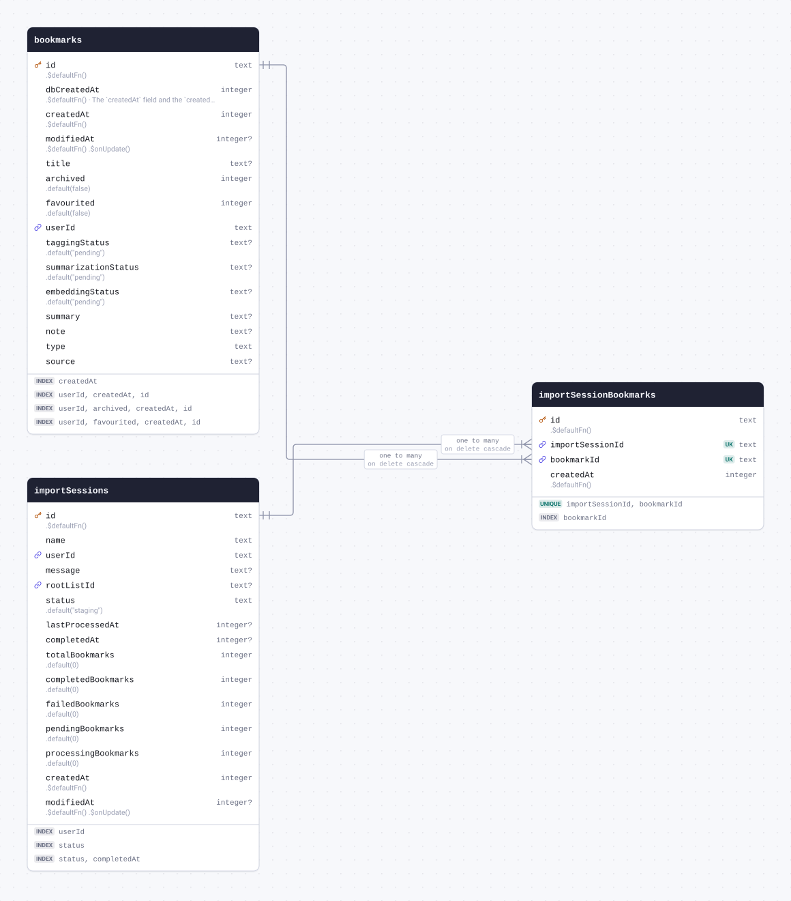

| Column            | Type      | Constraints                                           | Default         | Description |
| ----------------- | --------- | ----------------------------------------------------- | --------------- | ----------- |
| `id`              | `text`    | PK NOT NULL                                           | `.$defaultFn()` |             |
| `importSessionId` | `text`    | NOT NULL → [importSessions.id](#table-importSessions) |                 |             |
| `bookmarkId`      | `text`    | NOT NULL → [bookmarks.id](#table-bookmarks)           |                 |             |
| `createdAt`       | `integer` | NOT NULL                                              | `.$defaultFn()` |             |

#### Definition

```sql
CREATE TABLE `importSessionBookmarks` (
	`id` text PRIMARY KEY,
	`importSessionId` text NOT NULL,
	`bookmarkId` text NOT NULL,
	`createdAt` integer NOT NULL,
	CONSTRAINT `fk_importSessionBookmarks_importSessionId_importSessions_id_fk` FOREIGN KEY (`importSessionId`) REFERENCES `importSessions`(`id`) ON DELETE CASCADE,
	CONSTRAINT `fk_importSessionBookmarks_bookmarkId_bookmarks_id_fk` FOREIGN KEY (`bookmarkId`) REFERENCES `bookmarks`(`id`) ON DELETE CASCADE,
	CONSTRAINT `importSessionBookmarks_importSessionId_bookmarkId_unique` UNIQUE(`importSessionId`,`bookmarkId`)
);

CREATE INDEX `importSessionBookmarks_bookmarkId_idx` ON `importSessionBookmarks` (`bookmarkId`);
```

#### Indexes

- INDEX `bookmarkId`
- UNIQUE `importSessionId`, `bookmarkId`

#### References

- `importSessionId` → [importSessions.id](#table-importSessions) (many to one, on delete cascade)
- `bookmarkId` → [bookmarks.id](#table-bookmarks) (many to one, on delete cascade)

<details>
<summary>Queries and their SQL</summary>

**Select**: Every row of importSessionBookmarks.

```ts
db.select().from(importSessionBookmarks);
```

```sql
select "id", "importSessionId", "bookmarkId", "createdAt"
from "importSessionBookmarks"
```

**Count**: How many rows importSessionBookmarks has.

```ts
db.select({ count: count() }).from(importSessionBookmarks);
```

```sql
select count(*)
from "importSessionBookmarks"
```

**Find many**: The rows of importSessionBookmarks, through the relational query API.

```ts
db.query.importSessionBookmarks.findMany();
```

```sql
select "d0"."id" as "id", "d0"."importSessionId" as "importSessionId", "d0"."bookmarkId" as "bookmarkId", "d0"."createdAt" as "createdAt"
from "importSessionBookmarks" as "d0"
```

**Find by primary key**: One row of importSessionBookmarks, through the relational query API.

```ts
db.query.importSessionBookmarks.findFirst({ where: { id: "id" } });
```

```sql
select "d0"."id" as "id", "d0"."importSessionId" as "importSessionId", "d0"."bookmarkId" as "bookmarkId", "d0"."createdAt" as "createdAt"
from "importSessionBookmarks" as "d0"
where "d0"."id" = ?
limit ?
-- params: ["id",1]
```

**Insert**: Adds a row to importSessionBookmarks, giving the columns that have no default.

```ts
db.insert(importSessionBookmarks).values({
  importSessionId: "importSessionId",
  bookmarkId: "bookmarkId",
});
```

```sql
insert into "importSessionBookmarks" ("id", "importSessionId", "bookmarkId", "createdAt")
values (?, ?, ?, ?)
-- params: ["a2zqozwfgne1fzdkq03bemw2","importSessionId","bookmarkId",1767225600]
```

**Update**: Changes a row of importSessionBookmarks, found by its primary key.

```ts
db.update(importSessionBookmarks)
  .set({ importSessionId: "importSessionId" })
  .where(eq(importSessionBookmarks.id, "id"));
```

```sql
update "importSessionBookmarks"
set "importSessionId" = ?
where "importSessionBookmarks"."id" = ?
-- params: ["importSessionId","id"]
```

**Delete**: Deletes a row of importSessionBookmarks, found by its primary key.

```ts
db.delete(importSessionBookmarks).where(eq(importSessionBookmarks.id, "id"));
```

```sql
delete from "importSessionBookmarks"
where "importSessionBookmarks"."id" = ?
-- params: ["id"]
```

</details>

<a id="table-importStagingBookmarks"></a>

### importStagingBookmarks

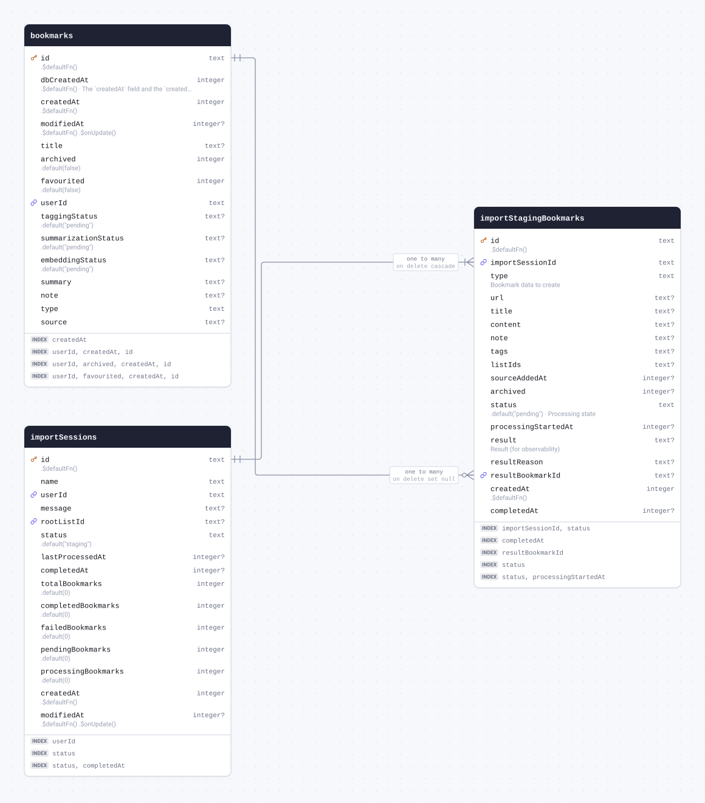

| Column                | Type      | Constraints                                           | Default               | Description                |
| --------------------- | --------- | ----------------------------------------------------- | --------------------- | -------------------------- |
| `id`                  | `text`    | PK NOT NULL                                           | `.$defaultFn()`       |                            |
| `importSessionId`     | `text`    | NOT NULL → [importSessions.id](#table-importSessions) |                       |                            |
| `type`                | `text`    | NOT NULL                                              |                       | Bookmark data to create    |
| `url`                 | `text`    | NULL                                                  |                       |                            |
| `title`               | `text`    | NULL                                                  |                       |                            |
| `content`             | `text`    | NULL                                                  |                       |                            |
| `note`                | `text`    | NULL                                                  |                       |                            |
| `tags`                | `text`    | NULL                                                  |                       |                            |
| `listIds`             | `text`    | NULL                                                  |                       |                            |
| `sourceAddedAt`       | `integer` | NULL                                                  |                       |                            |
| `archived`            | `integer` | NULL                                                  |                       |                            |
| `status`              | `text`    | NOT NULL                                              | `.default("pending")` | Processing state           |
| `processingStartedAt` | `integer` | NULL                                                  |                       |                            |
| `result`              | `text`    | NULL                                                  |                       | Result (for observability) |
| `resultReason`        | `text`    | NULL                                                  |                       |                            |
| `resultBookmarkId`    | `text`    | NULL → [bookmarks.id](#table-bookmarks)               |                       |                            |
| `createdAt`           | `integer` | NOT NULL                                              | `.$defaultFn()`       |                            |
| `completedAt`         | `integer` | NULL                                                  |                       |                            |

#### Definition

```sql
CREATE TABLE `importStagingBookmarks` (
	`id` text PRIMARY KEY,
	`importSessionId` text NOT NULL,
	`type` text NOT NULL,
	`url` text,
	`title` text,
	`content` text,
	`note` text,
	`tags` text,
	`listIds` text,
	`sourceAddedAt` integer,
	`archived` integer,
	`status` text DEFAULT 'pending' NOT NULL,
	`processingStartedAt` integer,
	`result` text,
	`resultReason` text,
	`resultBookmarkId` text,
	`createdAt` integer NOT NULL,
	`completedAt` integer,
	CONSTRAINT `fk_importStagingBookmarks_importSessionId_importSessions_id_fk` FOREIGN KEY (`importSessionId`) REFERENCES `importSessions`(`id`) ON DELETE CASCADE,
	CONSTRAINT `fk_importStagingBookmarks_resultBookmarkId_bookmarks_id_fk` FOREIGN KEY (`resultBookmarkId`) REFERENCES `bookmarks`(`id`) ON DELETE SET NULL
);

CREATE INDEX `importStaging_session_status_idx` ON `importStagingBookmarks` (`importSessionId`,`status`);

CREATE INDEX `importStaging_completedAt_idx` ON `importStagingBookmarks` (`completedAt`);

CREATE INDEX `importStaging_resultBookmarkId_idx` ON `importStagingBookmarks` (`resultBookmarkId`);

CREATE INDEX `importStaging_status_idx` ON `importStagingBookmarks` (`status`);

CREATE INDEX `importStaging_status_processingStartedAt_idx` ON `importStagingBookmarks` (`status`,`processingStartedAt`);
```

#### Indexes

- INDEX `importSessionId`, `status`
- INDEX `completedAt`
- INDEX `resultBookmarkId`
- INDEX `status`
- INDEX `status`, `processingStartedAt`

#### References

- `importSessionId` → [importSessions.id](#table-importSessions) (many to one, on delete cascade)
- `resultBookmarkId` → [bookmarks.id](#table-bookmarks) (many to one, on delete set null)

<details>
<summary>Queries and their SQL</summary>

**Select**: Every row of importStagingBookmarks.

```ts
db.select().from(importStagingBookmarks);
```

```sql
select "id", "importSessionId", "type", "url", "title", "content", "note", "tags", "listIds", "sourceAddedAt", "archived", "status", "processingStartedAt", "result", "resultReason", "resultBookmarkId", "createdAt", "completedAt"
from "importStagingBookmarks"
```

**Count**: How many rows importStagingBookmarks has.

```ts
db.select({ count: count() }).from(importStagingBookmarks);
```

```sql
select count(*)
from "importStagingBookmarks"
```

**Find many**: The rows of importStagingBookmarks, through the relational query API.

```ts
db.query.importStagingBookmarks.findMany();
```

```sql
select "d0"."id" as "id", "d0"."importSessionId" as "importSessionId", "d0"."type" as "type", "d0"."url" as "url", "d0"."title" as "title", "d0"."content" as "content", "d0"."note" as "note", "d0"."tags" as "tags", "d0"."listIds" as "listIds", "d0"."sourceAddedAt" as "sourceAddedAt", "d0"."archived" as "archived", "d0"."status" as "status", "d0"."processingStartedAt" as "processingStartedAt", "d0"."result" as "result", "d0"."resultReason" as "resultReason", "d0"."resultBookmarkId" as "resultBookmarkId", "d0"."createdAt" as "createdAt", "d0"."completedAt" as "completedAt"
from "importStagingBookmarks" as "d0"
```

**Find by primary key**: One row of importStagingBookmarks, through the relational query API.

```ts
db.query.importStagingBookmarks.findFirst({ where: { id: "id" } });
```

```sql
select "d0"."id" as "id", "d0"."importSessionId" as "importSessionId", "d0"."type" as "type", "d0"."url" as "url", "d0"."title" as "title", "d0"."content" as "content", "d0"."note" as "note", "d0"."tags" as "tags", "d0"."listIds" as "listIds", "d0"."sourceAddedAt" as "sourceAddedAt", "d0"."archived" as "archived", "d0"."status" as "status", "d0"."processingStartedAt" as "processingStartedAt", "d0"."result" as "result", "d0"."resultReason" as "resultReason", "d0"."resultBookmarkId" as "resultBookmarkId", "d0"."createdAt" as "createdAt", "d0"."completedAt" as "completedAt"
from "importStagingBookmarks" as "d0"
where "d0"."id" = ?
limit ?
-- params: ["id",1]
```

**Insert**: Adds a row to importStagingBookmarks, giving the columns that have no default.

```ts
db.insert(importStagingBookmarks).values({ importSessionId: "importSessionId", type: "type" });
```

```sql
insert into "importStagingBookmarks" ("id", "importSessionId", "type", "url", "title", "content", "note", "tags", "listIds", "sourceAddedAt", "archived", "status", "processingStartedAt", "result", "resultReason", "resultBookmarkId", "createdAt", "completedAt")
values (?, ?, ?, null, null, null, null, null, null, null, null, ?, null, null, null, null, ?, null)
-- params: ["a1bmu83ezkdnnv81xpjb5t1m","importSessionId","type","pending",1767225600]
```

**Update**: Changes a row of importStagingBookmarks, found by its primary key.

```ts
db.update(importStagingBookmarks)
  .set({ importSessionId: "importSessionId" })
  .where(eq(importStagingBookmarks.id, "id"));
```

```sql
update "importStagingBookmarks"
set "importSessionId" = ?
where "importStagingBookmarks"."id" = ?
-- params: ["importSessionId","id"]
```

**Delete**: Deletes a row of importStagingBookmarks, found by its primary key.

```ts
db.delete(importStagingBookmarks).where(eq(importStagingBookmarks.id, "id"));
```

```sql
delete from "importStagingBookmarks"
where "importStagingBookmarks"."id" = ?
-- params: ["id"]
```

</details>
