# Schema docs

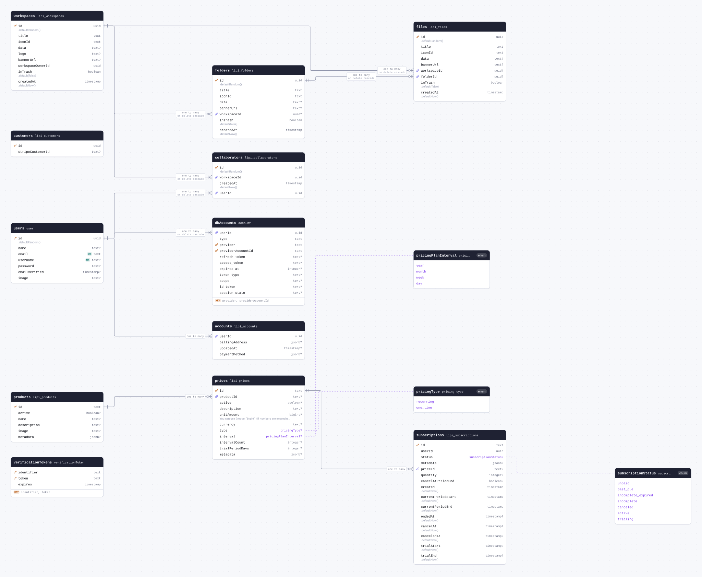

<details>
<summary>The whole schema as SQL</summary>

```sql
CREATE TYPE "pricing_plan_interval" AS ENUM('year', 'month', 'week', 'day');

CREATE TYPE "pricing_type" AS ENUM('recurring', 'one_time');

CREATE TYPE "subscription_status" AS ENUM('unpaid', 'past_due', 'incomplete_expired', 'incomplete', 'canceled', 'active', 'trialing');

CREATE TABLE "lipi_accounts" (
	"user_id" uuid NOT NULL,
	"billing_address" jsonb,
	"updated_at" timestamp with time zone,
	"payment_method" jsonb
);

CREATE TABLE "lipi_collaborators" (
	"id" uuid PRIMARY KEY DEFAULT gen_random_uuid(),
	"workspace_id" uuid NOT NULL,
	"created_at" timestamp with time zone DEFAULT now() NOT NULL,
	"user_id" uuid NOT NULL
);

CREATE TABLE "lipi_customers" (
	"id" uuid PRIMARY KEY,
	"stripe_customer_id" text
);

CREATE TABLE "lipi_files" (
	"id" uuid PRIMARY KEY DEFAULT gen_random_uuid(),
	"title" text NOT NULL,
	"icon_id" text NOT NULL,
	"data" text,
	"banner_url" text,
	"workspace_id" uuid,
	"folder_id" uuid,
	"in_trash" boolean DEFAULT false NOT NULL,
	"created_at" timestamp with time zone DEFAULT now() NOT NULL
);

CREATE TABLE "lipi_folders" (
	"id" uuid PRIMARY KEY DEFAULT gen_random_uuid(),
	"title" text NOT NULL,
	"icon_id" text NOT NULL,
	"data" text,
	"banner_url" text,
	"workspace_id" uuid,
	"in_trash" boolean DEFAULT false NOT NULL,
	"created_at" timestamp with time zone DEFAULT now() NOT NULL
);

CREATE TABLE "lipi_prices" (
	"id" text PRIMARY KEY,
	"product_id" text,
	"active" boolean,
	"description" text,
	"unit_amount" bigint,
	"currency" text,
	"type" "pricing_type",
	"interval" "pricing_plan_interval",
	"interval_count" integer,
	"trial_period_days" integer,
	"metadata" jsonb
);

CREATE TABLE "lipi_products" (
	"id" text PRIMARY KEY,
	"active" boolean,
	"name" text,
	"description" text,
	"image" text,
	"metadata" jsonb
);

CREATE TABLE "lipi_subscriptions" (
	"id" text PRIMARY KEY,
	"user_id" uuid NOT NULL,
	"status" "subscription_status",
	"metadata" jsonb,
	"price_id" text,
	"quantity" integer,
	"cancel_at_period_end" boolean,
	"created" timestamp with time zone DEFAULT now() NOT NULL,
	"current_period_start" timestamp with time zone DEFAULT now() NOT NULL,
	"current_period_end" timestamp with time zone DEFAULT now() NOT NULL,
	"ended_at" timestamp with time zone DEFAULT now(),
	"cancel_at" timestamp with time zone DEFAULT now(),
	"canceled_at" timestamp with time zone DEFAULT now(),
	"trial_start" timestamp with time zone DEFAULT now(),
	"trial_end" timestamp with time zone DEFAULT now()
);

CREATE TABLE "lipi_workspaces" (
	"id" uuid PRIMARY KEY DEFAULT gen_random_uuid(),
	"title" text NOT NULL,
	"icon_id" text NOT NULL,
	"data" text,
	"logo" text,
	"banner_url" text,
	"workspace_owner_id" uuid NOT NULL,
	"in_trash" boolean DEFAULT false NOT NULL,
	"created_at" timestamp with time zone DEFAULT now() NOT NULL
);

CREATE TABLE "account" (
	"userId" uuid NOT NULL,
	"type" text NOT NULL,
	"provider" text,
	"providerAccountId" text,
	"refresh_token" text,
	"access_token" text,
	"expires_at" integer,
	"token_type" text,
	"scope" text,
	"id_token" text,
	"session_state" text,
	CONSTRAINT "account_pkey" PRIMARY KEY("provider","providerAccountId")
);

CREATE TABLE "user" (
	"id" uuid PRIMARY KEY DEFAULT gen_random_uuid(),
	"name" text,
	"email" text NOT NULL UNIQUE,
	"username" text UNIQUE,
	"password" text,
	"emailVerified" timestamp,
	"image" text
);

CREATE TABLE "verificationToken" (
	"identifier" text,
	"token" text,
	"expires" timestamp NOT NULL,
	CONSTRAINT "verificationToken_pkey" PRIMARY KEY("identifier","token")
);

ALTER TABLE "lipi_accounts" ADD CONSTRAINT "lipi_accounts_user_id_user_id_fkey" FOREIGN KEY ("user_id") REFERENCES "user"("id");

ALTER TABLE "lipi_collaborators" ADD CONSTRAINT "lipi_collaborators_workspace_id_lipi_workspaces_id_fkey" FOREIGN KEY ("workspace_id") REFERENCES "lipi_workspaces"("id") ON DELETE CASCADE;

ALTER TABLE "lipi_collaborators" ADD CONSTRAINT "lipi_collaborators_user_id_user_id_fkey" FOREIGN KEY ("user_id") REFERENCES "user"("id") ON DELETE CASCADE;

ALTER TABLE "lipi_files" ADD CONSTRAINT "lipi_files_workspace_id_lipi_workspaces_id_fkey" FOREIGN KEY ("workspace_id") REFERENCES "lipi_workspaces"("id") ON DELETE CASCADE;

ALTER TABLE "lipi_files" ADD CONSTRAINT "lipi_files_folder_id_lipi_folders_id_fkey" FOREIGN KEY ("folder_id") REFERENCES "lipi_folders"("id") ON DELETE CASCADE;

ALTER TABLE "lipi_folders" ADD CONSTRAINT "lipi_folders_workspace_id_lipi_workspaces_id_fkey" FOREIGN KEY ("workspace_id") REFERENCES "lipi_workspaces"("id") ON DELETE CASCADE;

ALTER TABLE "lipi_prices" ADD CONSTRAINT "lipi_prices_product_id_lipi_products_id_fkey" FOREIGN KEY ("product_id") REFERENCES "lipi_products"("id");

ALTER TABLE "lipi_subscriptions" ADD CONSTRAINT "lipi_subscriptions_price_id_lipi_prices_id_fkey" FOREIGN KEY ("price_id") REFERENCES "lipi_prices"("id");

ALTER TABLE "account" ADD CONSTRAINT "account_userId_user_id_fkey" FOREIGN KEY ("userId") REFERENCES "user"("id") ON DELETE CASCADE;
```

</details>

## Contents

| Table                                           | Name in the database | Description |
| ----------------------------------------------- | -------------------- | ----------- |
| [workspaces](#table-workspaces)                 | `lipi_workspaces`    |             |
| [folders](#table-folders)                       | `lipi_folders`       |             |
| [files](#table-files)                           | `lipi_files`         |             |
| [accounts](#table-accounts)                     | `lipi_accounts`      |             |
| [customers](#table-customers)                   | `lipi_customers`     |             |
| [prices](#table-prices)                         | `lipi_prices`        |             |
| [products](#table-products)                     | `lipi_products`      |             |
| [subscriptions](#table-subscriptions)           | `lipi_subscriptions` |             |
| [collaborators](#table-collaborators)           | `lipi_collaborators` |             |
| [users](#table-users)                           | `user`               |             |
| [dbAccounts](#table-dbAccounts)                 | `account`            |             |
| [verificationTokens](#table-verificationTokens) | `verificationToken`  |             |

| Enum                                             | Name in the database    | Description |
| ------------------------------------------------ | ----------------------- | ----------- |
| [subscriptionStatus](#enum-subscriptionStatus)   | `subscription_status`   |             |
| [pricingType](#enum-pricingType)                 | `pricing_type`          |             |
| [pricingPlanInterval](#enum-pricingPlanInterval) | `pricing_plan_interval` |             |

## Tables

<a id="table-workspaces"></a>

### workspaces

Table `lipi_workspaces`.

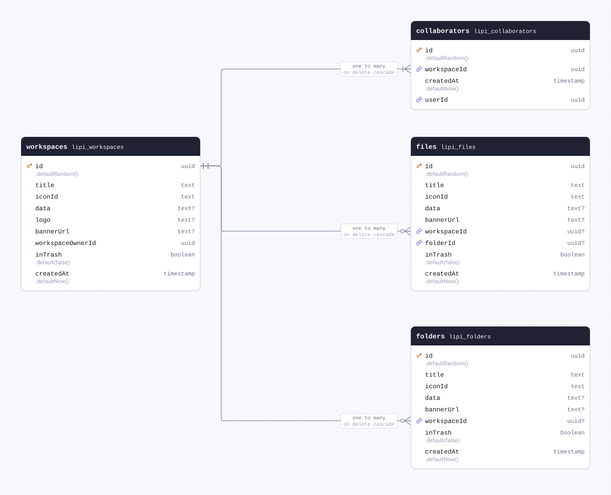

| Column                                    | Type        | Constraints | Default            | Description |
| ----------------------------------------- | ----------- | ----------- | ------------------ | ----------- |
| `id`                                      | `uuid`      | PK NOT NULL | `.defaultRandom()` |             |
| `title`                                   | `text`      | NOT NULL    |                    |             |
| `iconId` (`icon_id`)                      | `text`      | NOT NULL    |                    |             |
| `data`                                    | `text`      | NULL        |                    |             |
| `logo`                                    | `text`      | NULL        |                    |             |
| `bannerUrl` (`banner_url`)                | `text`      | NULL        |                    |             |
| `workspaceOwnerId` (`workspace_owner_id`) | `uuid`      | NOT NULL    |                    |             |
| `inTrash` (`in_trash`)                    | `boolean`   | NOT NULL    | `.default(false)`  |             |
| `createdAt` (`created_at`)                | `timestamp` | NOT NULL    | `.defaultNow()`    |             |

#### Definition

```sql
CREATE TABLE "lipi_workspaces" (
	"id" uuid PRIMARY KEY DEFAULT gen_random_uuid(),
	"title" text NOT NULL,
	"icon_id" text NOT NULL,
	"data" text,
	"logo" text,
	"banner_url" text,
	"workspace_owner_id" uuid NOT NULL,
	"in_trash" boolean DEFAULT false NOT NULL,
	"created_at" timestamp with time zone DEFAULT now() NOT NULL
);
```

#### Referenced by

- `id` → [folders.workspaceId](#table-folders) (one to many, on delete cascade)
- `id` → [files.workspaceId](#table-files) (one to many, on delete cascade)
- `id` → [collaborators.workspaceId](#table-collaborators) (one to many, on delete cascade)

<details>
<summary>Queries and their SQL</summary>

**Select**: Every row of workspaces.

```ts
db.select().from(workspaces);
```

```sql
select "id", "title", "icon_id", "data", "logo", "banner_url", "workspace_owner_id", "in_trash", "created_at"
from "lipi_workspaces"
```

**Count**: How many rows workspaces has.

```ts
db.select({ count: count() }).from(workspaces);
```

```sql
select count(*)
from "lipi_workspaces"
```

**Find many**: The rows of workspaces, through the relational query API.

```ts
db.query.workspaces.findMany();
```

```sql
select "d0"."id" as "id", "d0"."title" as "title", "d0"."icon_id" as "iconId", "d0"."data" as "data", "d0"."logo" as "logo", "d0"."banner_url" as "bannerUrl", "d0"."workspace_owner_id" as "workspaceOwnerId", "d0"."in_trash" as "inTrash", "d0"."created_at" as "createdAt"
from "lipi_workspaces" as "d0"
```

**Find by primary key**: One row of workspaces, through the relational query API.

```ts
db.query.workspaces.findFirst({ where: { id: "00000000-0000-0000-0000-000000000000" } });
```

```sql
select "d0"."id" as "id", "d0"."title" as "title", "d0"."icon_id" as "iconId", "d0"."data" as "data", "d0"."logo" as "logo", "d0"."banner_url" as "bannerUrl", "d0"."workspace_owner_id" as "workspaceOwnerId", "d0"."in_trash" as "inTrash", "d0"."created_at" as "createdAt"
from "lipi_workspaces" as "d0"
where "d0"."id" = $1
limit $2
-- params: ["00000000-0000-0000-0000-000000000000",1]
```

**Insert**: Adds a row to workspaces, giving the columns that have no default.

```ts
db.insert(workspaces).values({
  title: "title",
  iconId: "iconId",
  workspaceOwnerId: "00000000-0000-0000-0000-000000000000",
});
```

```sql
insert into "lipi_workspaces" ("id", "title", "icon_id", "data", "logo", "banner_url", "workspace_owner_id", "in_trash", "created_at")
values (default, $1, $2, default, default, default, $3, default, default)
-- params: ["title","iconId","00000000-0000-0000-0000-000000000000"]
```

**Update**: Changes a row of workspaces, found by its primary key.

```ts
db.update(workspaces)
  .set({ title: "title" })
  .where(eq(workspaces.id, "00000000-0000-0000-0000-000000000000"));
```

```sql
update "lipi_workspaces"
set "title" = $1
where "lipi_workspaces"."id" = $2
-- params: ["title","00000000-0000-0000-0000-000000000000"]
```

**Delete**: Deletes a row of workspaces, found by its primary key.

```ts
db.delete(workspaces).where(eq(workspaces.id, "00000000-0000-0000-0000-000000000000"));
```

```sql
delete from "lipi_workspaces"
where "lipi_workspaces"."id" = $1
-- params: ["00000000-0000-0000-0000-000000000000"]
```

</details>

<a id="table-folders"></a>

### folders

Table `lipi_folders`.

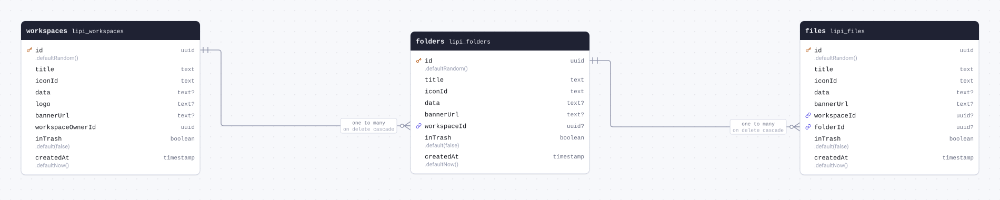

| Column                         | Type        | Constraints                               | Default            | Description |
| ------------------------------ | ----------- | ----------------------------------------- | ------------------ | ----------- |
| `id`                           | `uuid`      | PK NOT NULL                               | `.defaultRandom()` |             |
| `title`                        | `text`      | NOT NULL                                  |                    |             |
| `iconId` (`icon_id`)           | `text`      | NOT NULL                                  |                    |             |
| `data`                         | `text`      | NULL                                      |                    |             |
| `bannerUrl` (`banner_url`)     | `text`      | NULL                                      |                    |             |
| `workspaceId` (`workspace_id`) | `uuid`      | NULL → [workspaces.id](#table-workspaces) |                    |             |
| `inTrash` (`in_trash`)         | `boolean`   | NOT NULL                                  | `.default(false)`  |             |
| `createdAt` (`created_at`)     | `timestamp` | NOT NULL                                  | `.defaultNow()`    |             |

#### Definition

```sql
CREATE TABLE "lipi_folders" (
	"id" uuid PRIMARY KEY DEFAULT gen_random_uuid(),
	"title" text NOT NULL,
	"icon_id" text NOT NULL,
	"data" text,
	"banner_url" text,
	"workspace_id" uuid,
	"in_trash" boolean DEFAULT false NOT NULL,
	"created_at" timestamp with time zone DEFAULT now() NOT NULL
);

ALTER TABLE "lipi_folders" ADD CONSTRAINT "lipi_folders_workspace_id_lipi_workspaces_id_fkey" FOREIGN KEY ("workspace_id") REFERENCES "lipi_workspaces"("id") ON DELETE CASCADE;
```

#### References

- `workspaceId` → [workspaces.id](#table-workspaces) (many to one, on delete cascade)

#### Referenced by

- `id` → [files.folderId](#table-files) (one to many, on delete cascade)

<details>
<summary>Queries and their SQL</summary>

**Select**: Every row of folders.

```ts
db.select().from(folders);
```

```sql
select "id", "title", "icon_id", "data", "banner_url", "workspace_id", "in_trash", "created_at"
from "lipi_folders"
```

**Count**: How many rows folders has.

```ts
db.select({ count: count() }).from(folders);
```

```sql
select count(*)
from "lipi_folders"
```

**Find many**: The rows of folders, through the relational query API.

```ts
db.query.folders.findMany();
```

```sql
select "d0"."id" as "id", "d0"."title" as "title", "d0"."icon_id" as "iconId", "d0"."data" as "data", "d0"."banner_url" as "bannerUrl", "d0"."workspace_id" as "workspaceId", "d0"."in_trash" as "inTrash", "d0"."created_at" as "createdAt"
from "lipi_folders" as "d0"
```

**Find by primary key**: One row of folders, through the relational query API.

```ts
db.query.folders.findFirst({ where: { id: "00000000-0000-0000-0000-000000000000" } });
```

```sql
select "d0"."id" as "id", "d0"."title" as "title", "d0"."icon_id" as "iconId", "d0"."data" as "data", "d0"."banner_url" as "bannerUrl", "d0"."workspace_id" as "workspaceId", "d0"."in_trash" as "inTrash", "d0"."created_at" as "createdAt"
from "lipi_folders" as "d0"
where "d0"."id" = $1
limit $2
-- params: ["00000000-0000-0000-0000-000000000000",1]
```

**Insert**: Adds a row to folders, giving the columns that have no default.

```ts
db.insert(folders).values({ title: "title", iconId: "iconId" });
```

```sql
insert into "lipi_folders" ("id", "title", "icon_id", "data", "banner_url", "workspace_id", "in_trash", "created_at")
values (default, $1, $2, default, default, default, default, default)
-- params: ["title","iconId"]
```

**Update**: Changes a row of folders, found by its primary key.

```ts
db.update(folders)
  .set({ title: "title" })
  .where(eq(folders.id, "00000000-0000-0000-0000-000000000000"));
```

```sql
update "lipi_folders"
set "title" = $1
where "lipi_folders"."id" = $2
-- params: ["title","00000000-0000-0000-0000-000000000000"]
```

**Delete**: Deletes a row of folders, found by its primary key.

```ts
db.delete(folders).where(eq(folders.id, "00000000-0000-0000-0000-000000000000"));
```

```sql
delete from "lipi_folders"
where "lipi_folders"."id" = $1
-- params: ["00000000-0000-0000-0000-000000000000"]
```

</details>

<a id="table-files"></a>

### files

Table `lipi_files`.

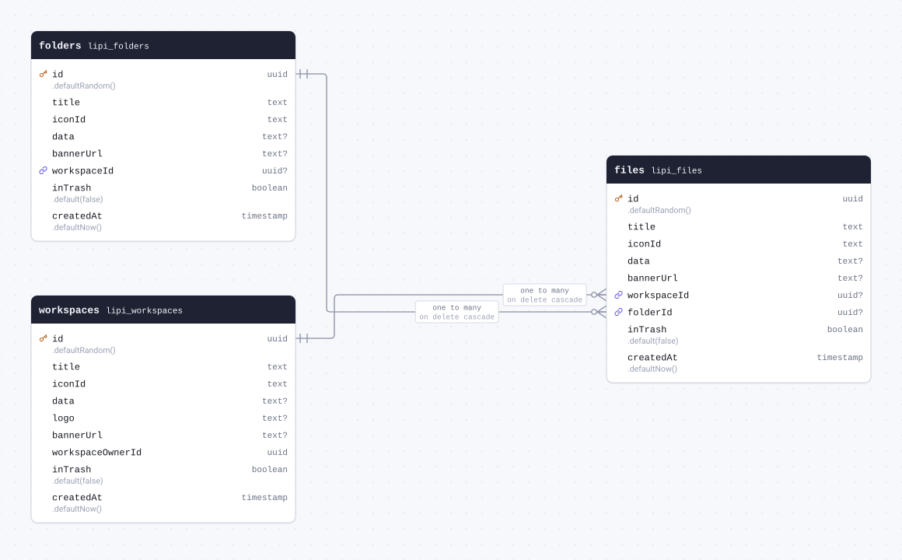

| Column                         | Type        | Constraints                               | Default            | Description |
| ------------------------------ | ----------- | ----------------------------------------- | ------------------ | ----------- |
| `id`                           | `uuid`      | PK NOT NULL                               | `.defaultRandom()` |             |
| `title`                        | `text`      | NOT NULL                                  |                    |             |
| `iconId` (`icon_id`)           | `text`      | NOT NULL                                  |                    |             |
| `data`                         | `text`      | NULL                                      |                    |             |
| `bannerUrl` (`banner_url`)     | `text`      | NULL                                      |                    |             |
| `workspaceId` (`workspace_id`) | `uuid`      | NULL → [workspaces.id](#table-workspaces) |                    |             |
| `folderId` (`folder_id`)       | `uuid`      | NULL → [folders.id](#table-folders)       |                    |             |
| `inTrash` (`in_trash`)         | `boolean`   | NOT NULL                                  | `.default(false)`  |             |
| `createdAt` (`created_at`)     | `timestamp` | NOT NULL                                  | `.defaultNow()`    |             |

#### Definition

```sql
CREATE TABLE "lipi_files" (
	"id" uuid PRIMARY KEY DEFAULT gen_random_uuid(),
	"title" text NOT NULL,
	"icon_id" text NOT NULL,
	"data" text,
	"banner_url" text,
	"workspace_id" uuid,
	"folder_id" uuid,
	"in_trash" boolean DEFAULT false NOT NULL,
	"created_at" timestamp with time zone DEFAULT now() NOT NULL
);

ALTER TABLE "lipi_files" ADD CONSTRAINT "lipi_files_workspace_id_lipi_workspaces_id_fkey" FOREIGN KEY ("workspace_id") REFERENCES "lipi_workspaces"("id") ON DELETE CASCADE;

ALTER TABLE "lipi_files" ADD CONSTRAINT "lipi_files_folder_id_lipi_folders_id_fkey" FOREIGN KEY ("folder_id") REFERENCES "lipi_folders"("id") ON DELETE CASCADE;
```

#### References

- `workspaceId` → [workspaces.id](#table-workspaces) (many to one, on delete cascade)
- `folderId` → [folders.id](#table-folders) (many to one, on delete cascade)

<details>
<summary>Queries and their SQL</summary>

**Select**: Every row of files.

```ts
db.select().from(files);
```

```sql
select "id", "title", "icon_id", "data", "banner_url", "workspace_id", "folder_id", "in_trash", "created_at"
from "lipi_files"
```

**Count**: How many rows files has.

```ts
db.select({ count: count() }).from(files);
```

```sql
select count(*)
from "lipi_files"
```

**Find many**: The rows of files, through the relational query API.

```ts
db.query.files.findMany();
```

```sql
select "d0"."id" as "id", "d0"."title" as "title", "d0"."icon_id" as "iconId", "d0"."data" as "data", "d0"."banner_url" as "bannerUrl", "d0"."workspace_id" as "workspaceId", "d0"."folder_id" as "folderId", "d0"."in_trash" as "inTrash", "d0"."created_at" as "createdAt"
from "lipi_files" as "d0"
```

**Find by primary key**: One row of files, through the relational query API.

```ts
db.query.files.findFirst({ where: { id: "00000000-0000-0000-0000-000000000000" } });
```

```sql
select "d0"."id" as "id", "d0"."title" as "title", "d0"."icon_id" as "iconId", "d0"."data" as "data", "d0"."banner_url" as "bannerUrl", "d0"."workspace_id" as "workspaceId", "d0"."folder_id" as "folderId", "d0"."in_trash" as "inTrash", "d0"."created_at" as "createdAt"
from "lipi_files" as "d0"
where "d0"."id" = $1
limit $2
-- params: ["00000000-0000-0000-0000-000000000000",1]
```

**Insert**: Adds a row to files, giving the columns that have no default.

```ts
db.insert(files).values({ title: "title", iconId: "iconId" });
```

```sql
insert into "lipi_files" ("id", "title", "icon_id", "data", "banner_url", "workspace_id", "folder_id", "in_trash", "created_at")
values (default, $1, $2, default, default, default, default, default, default)
-- params: ["title","iconId"]
```

**Update**: Changes a row of files, found by its primary key.

```ts
db.update(files)
  .set({ title: "title" })
  .where(eq(files.id, "00000000-0000-0000-0000-000000000000"));
```

```sql
update "lipi_files"
set "title" = $1
where "lipi_files"."id" = $2
-- params: ["title","00000000-0000-0000-0000-000000000000"]
```

**Delete**: Deletes a row of files, found by its primary key.

```ts
db.delete(files).where(eq(files.id, "00000000-0000-0000-0000-000000000000"));
```

```sql
delete from "lipi_files"
where "lipi_files"."id" = $1
-- params: ["00000000-0000-0000-0000-000000000000"]
```

</details>

<a id="table-accounts"></a>

### accounts

Table `lipi_accounts`.

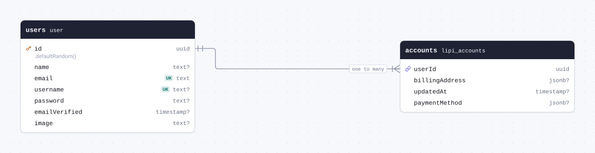

| Column                               | Type        | Constraints                         | Default | Description |
| ------------------------------------ | ----------- | ----------------------------------- | ------- | ----------- |
| `userId` (`user_id`)                 | `uuid`      | NOT NULL → [users.id](#table-users) |         |             |
| `billingAddress` (`billing_address`) | `jsonb`     | NULL                                |         |             |
| `updatedAt` (`updated_at`)           | `timestamp` | NULL                                |         |             |
| `paymentMethod` (`payment_method`)   | `jsonb`     | NULL                                |         |             |

#### Definition

```sql
CREATE TABLE "lipi_accounts" (
	"user_id" uuid NOT NULL,
	"billing_address" jsonb,
	"updated_at" timestamp with time zone,
	"payment_method" jsonb
);

ALTER TABLE "lipi_accounts" ADD CONSTRAINT "lipi_accounts_user_id_user_id_fkey" FOREIGN KEY ("user_id") REFERENCES "user"("id");
```

#### References

- `userId` → [users.id](#table-users) (many to one)

<details>
<summary>Queries and their SQL</summary>

**Select**: Every row of accounts.

```ts
db.select().from(accounts);
```

```sql
select "user_id", "billing_address", "updated_at", "payment_method"
from "lipi_accounts"
```

**Count**: How many rows accounts has.

```ts
db.select({ count: count() }).from(accounts);
```

```sql
select count(*)
from "lipi_accounts"
```

**Find many**: The rows of accounts, through the relational query API.

```ts
db.query.accounts.findMany();
```

```sql
select "d0"."user_id" as "userId", "d0"."billing_address" as "billingAddress", "d0"."updated_at" as "updatedAt", "d0"."payment_method" as "paymentMethod"
from "lipi_accounts" as "d0"
```

**Insert**: Adds a row to accounts, giving the columns that have no default.

```ts
db.insert(accounts).values({ userId: "00000000-0000-0000-0000-000000000000" });
```

```sql
insert into "lipi_accounts" ("user_id", "billing_address", "updated_at", "payment_method")
values ($1, default, default, default)
-- params: ["00000000-0000-0000-0000-000000000000"]
```

</details>

<a id="table-customers"></a>

### customers

Table `lipi_customers`.

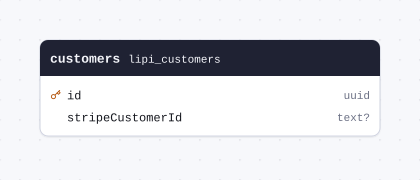

| Column                                    | Type   | Constraints | Default | Description |
| ----------------------------------------- | ------ | ----------- | ------- | ----------- |
| `id`                                      | `uuid` | PK NOT NULL |         |             |
| `stripeCustomerId` (`stripe_customer_id`) | `text` | NULL        |         |             |

#### Definition

```sql
CREATE TABLE "lipi_customers" (
	"id" uuid PRIMARY KEY,
	"stripe_customer_id" text
);
```

<details>
<summary>Queries and their SQL</summary>

**Select**: Every row of customers.

```ts
db.select().from(customers);
```

```sql
select "id", "stripe_customer_id"
from "lipi_customers"
```

**Count**: How many rows customers has.

```ts
db.select({ count: count() }).from(customers);
```

```sql
select count(*)
from "lipi_customers"
```

**Find many**: The rows of customers, through the relational query API.

```ts
db.query.customers.findMany();
```

```sql
select "d0"."id" as "id", "d0"."stripe_customer_id" as "stripeCustomerId"
from "lipi_customers" as "d0"
```

**Find by primary key**: One row of customers, through the relational query API.

```ts
db.query.customers.findFirst({ where: { id: "00000000-0000-0000-0000-000000000000" } });
```

```sql
select "d0"."id" as "id", "d0"."stripe_customer_id" as "stripeCustomerId"
from "lipi_customers" as "d0"
where "d0"."id" = $1
limit $2
-- params: ["00000000-0000-0000-0000-000000000000",1]
```

**Insert**: Adds a row to customers, giving the columns that have no default.

```ts
db.insert(customers).values({ id: "00000000-0000-0000-0000-000000000000" });
```

```sql
insert into "lipi_customers" ("id", "stripe_customer_id")
values ($1, default)
-- params: ["00000000-0000-0000-0000-000000000000"]
```

**Update**: Changes a row of customers, found by its primary key.

```ts
db.update(customers)
  .set({ stripeCustomerId: "stripeCustomerId" })
  .where(eq(customers.id, "00000000-0000-0000-0000-000000000000"));
```

```sql
update "lipi_customers"
set "stripe_customer_id" = $1
where "lipi_customers"."id" = $2
-- params: ["stripeCustomerId","00000000-0000-0000-0000-000000000000"]
```

**Delete**: Deletes a row of customers, found by its primary key.

```ts
db.delete(customers).where(eq(customers.id, "00000000-0000-0000-0000-000000000000"));
```

```sql
delete from "lipi_customers"
where "lipi_customers"."id" = $1
-- params: ["00000000-0000-0000-0000-000000000000"]
```

</details>

<a id="table-prices"></a>

### prices

Table `lipi_prices`.

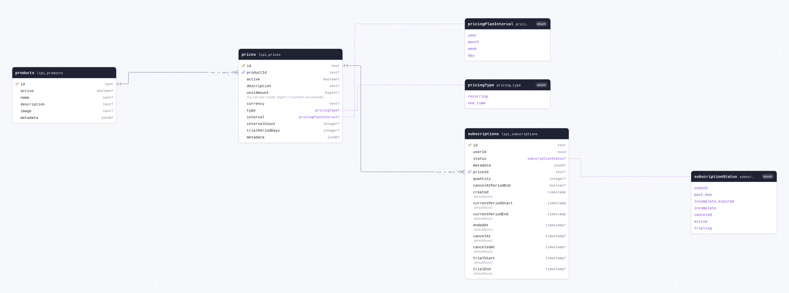

| Column                                  | Type                                               | Constraints                           | Default | Description                                                                   |
| --------------------------------------- | -------------------------------------------------- | ------------------------------------- | ------- | ----------------------------------------------------------------------------- |
| `id`                                    | `text`                                             | PK NOT NULL                           |         |                                                                               |
| `productId` (`product_id`)              | `text`                                             | NULL → [products.id](#table-products) |         |                                                                               |
| `active`                                | `boolean`                                          | NULL                                  |         |                                                                               |
| `description`                           | `text`                                             | NULL                                  |         |                                                                               |
| `unitAmount` (`unit_amount`)            | `bigint`                                           | NULL                                  |         | You can use { mode: "bigint" } if numbers are exceeding js number limitations |
| `currency`                              | `text`                                             | NULL                                  |         |                                                                               |
| `type`                                  | [`pricingType`](#enum-pricingType)                 | NULL                                  |         |                                                                               |
| `interval`                              | [`pricingPlanInterval`](#enum-pricingPlanInterval) | NULL                                  |         |                                                                               |
| `intervalCount` (`interval_count`)      | `integer`                                          | NULL                                  |         |                                                                               |
| `trialPeriodDays` (`trial_period_days`) | `integer`                                          | NULL                                  |         |                                                                               |
| `metadata`                              | `jsonb`                                            | NULL                                  |         |                                                                               |

#### Definition

```sql
CREATE TABLE "lipi_prices" (
	"id" text PRIMARY KEY,
	"product_id" text,
	"active" boolean,
	"description" text,
	"unit_amount" bigint,
	"currency" text,
	"type" "pricing_type",
	"interval" "pricing_plan_interval",
	"interval_count" integer,
	"trial_period_days" integer,
	"metadata" jsonb
);

ALTER TABLE "lipi_prices" ADD CONSTRAINT "lipi_prices_product_id_lipi_products_id_fkey" FOREIGN KEY ("product_id") REFERENCES "lipi_products"("id");
```

#### References

- `productId` → [products.id](#table-products) (many to one)

#### Referenced by

- `id` → [subscriptions.priceId](#table-subscriptions) (one to many)

<details>
<summary>Queries and their SQL</summary>

**Select**: Every row of prices.

```ts
db.select().from(prices);
```

```sql
select "id", "product_id", "active", "description", "unit_amount", "currency", "type", "interval", "interval_count", "trial_period_days", "metadata"
from "lipi_prices"
```

**Count**: How many rows prices has.

```ts
db.select({ count: count() }).from(prices);
```

```sql
select count(*)
from "lipi_prices"
```

**Find many**: The rows of prices, through the relational query API.

```ts
db.query.prices.findMany();
```

```sql
select "d0"."id" as "id", "d0"."product_id" as "productId", "d0"."active" as "active", "d0"."description" as "description", "d0"."unit_amount" as "unitAmount", "d0"."currency" as "currency", "d0"."type" as "type", "d0"."interval" as "interval", "d0"."interval_count" as "intervalCount", "d0"."trial_period_days" as "trialPeriodDays", "d0"."metadata" as "metadata"
from "lipi_prices" as "d0"
```

**Find by primary key**: One row of prices, through the relational query API.

```ts
db.query.prices.findFirst({ where: { id: "id" } });
```

```sql
select "d0"."id" as "id", "d0"."product_id" as "productId", "d0"."active" as "active", "d0"."description" as "description", "d0"."unit_amount" as "unitAmount", "d0"."currency" as "currency", "d0"."type" as "type", "d0"."interval" as "interval", "d0"."interval_count" as "intervalCount", "d0"."trial_period_days" as "trialPeriodDays", "d0"."metadata" as "metadata"
from "lipi_prices" as "d0"
where "d0"."id" = $1
limit $2
-- params: ["id",1]
```

**Insert**: Adds a row to prices, giving the columns that have no default.

```ts
db.insert(prices).values({ id: "id" });
```

```sql
insert into "lipi_prices" ("id", "product_id", "active", "description", "unit_amount", "currency", "type", "interval", "interval_count", "trial_period_days", "metadata")
values ($1, default, default, default, default, default, default, default, default, default, default)
-- params: ["id"]
```

**Update**: Changes a row of prices, found by its primary key.

```ts
db.update(prices).set({ productId: "productId" }).where(eq(prices.id, "id"));
```

```sql
update "lipi_prices"
set "product_id" = $1
where "lipi_prices"."id" = $2
-- params: ["productId","id"]
```

**Delete**: Deletes a row of prices, found by its primary key.

```ts
db.delete(prices).where(eq(prices.id, "id"));
```

```sql
delete from "lipi_prices"
where "lipi_prices"."id" = $1
-- params: ["id"]
```

</details>

<a id="table-products"></a>

### products

Table `lipi_products`.

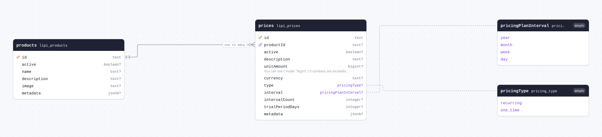

| Column        | Type      | Constraints | Default | Description |
| ------------- | --------- | ----------- | ------- | ----------- |
| `id`          | `text`    | PK NOT NULL |         |             |
| `active`      | `boolean` | NULL        |         |             |
| `name`        | `text`    | NULL        |         |             |
| `description` | `text`    | NULL        |         |             |
| `image`       | `text`    | NULL        |         |             |
| `metadata`    | `jsonb`   | NULL        |         |             |

#### Definition

```sql
CREATE TABLE "lipi_products" (
	"id" text PRIMARY KEY,
	"active" boolean,
	"name" text,
	"description" text,
	"image" text,
	"metadata" jsonb
);
```

#### Referenced by

- `id` → [prices.productId](#table-prices) (one to many)

<details>
<summary>Queries and their SQL</summary>

**Select**: Every row of products.

```ts
db.select().from(products);
```

```sql
select "id", "active", "name", "description", "image", "metadata"
from "lipi_products"
```

**Count**: How many rows products has.

```ts
db.select({ count: count() }).from(products);
```

```sql
select count(*)
from "lipi_products"
```

**Find many**: The rows of products, through the relational query API.

```ts
db.query.products.findMany();
```

```sql
select "d0"."id" as "id", "d0"."active" as "active", "d0"."name" as "name", "d0"."description" as "description", "d0"."image" as "image", "d0"."metadata" as "metadata"
from "lipi_products" as "d0"
```

**Find by primary key**: One row of products, through the relational query API.

```ts
db.query.products.findFirst({ where: { id: "id" } });
```

```sql
select "d0"."id" as "id", "d0"."active" as "active", "d0"."name" as "name", "d0"."description" as "description", "d0"."image" as "image", "d0"."metadata" as "metadata"
from "lipi_products" as "d0"
where "d0"."id" = $1
limit $2
-- params: ["id",1]
```

**Insert**: Adds a row to products, giving the columns that have no default.

```ts
db.insert(products).values({ id: "id" });
```

```sql
insert into "lipi_products" ("id", "active", "name", "description", "image", "metadata")
values ($1, default, default, default, default, default)
-- params: ["id"]
```

**Update**: Changes a row of products, found by its primary key.

```ts
db.update(products).set({ active: true }).where(eq(products.id, "id"));
```

```sql
update "lipi_products"
set "active" = $1
where "lipi_products"."id" = $2
-- params: [true,"id"]
```

**Delete**: Deletes a row of products, found by its primary key.

```ts
db.delete(products).where(eq(products.id, "id"));
```

```sql
delete from "lipi_products"
where "lipi_products"."id" = $1
-- params: ["id"]
```

</details>

<a id="table-subscriptions"></a>

### subscriptions

Table `lipi_subscriptions`.

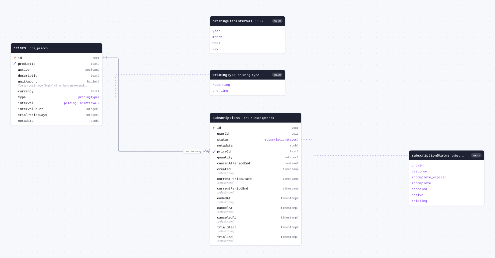

| Column                                        | Type                                             | Constraints                       | Default         | Description |
| --------------------------------------------- | ------------------------------------------------ | --------------------------------- | --------------- | ----------- |
| `id`                                          | `text`                                           | PK NOT NULL                       |                 |             |
| `userId` (`user_id`)                          | `uuid`                                           | NOT NULL                          |                 |             |
| `status`                                      | [`subscriptionStatus`](#enum-subscriptionStatus) | NULL                              |                 |             |
| `metadata`                                    | `jsonb`                                          | NULL                              |                 |             |
| `priceId` (`price_id`)                        | `text`                                           | NULL → [prices.id](#table-prices) |                 |             |
| `quantity`                                    | `integer`                                        | NULL                              |                 |             |
| `cancelAtPeriodEnd` (`cancel_at_period_end`)  | `boolean`                                        | NULL                              |                 |             |
| `created`                                     | `timestamp`                                      | NOT NULL                          | `.defaultNow()` |             |
| `currentPeriodStart` (`current_period_start`) | `timestamp`                                      | NOT NULL                          | `.defaultNow()` |             |
| `currentPeriodEnd` (`current_period_end`)     | `timestamp`                                      | NOT NULL                          | `.defaultNow()` |             |
| `endedAt` (`ended_at`)                        | `timestamp`                                      | NULL                              | `.defaultNow()` |             |
| `cancelAt` (`cancel_at`)                      | `timestamp`                                      | NULL                              | `.defaultNow()` |             |
| `canceledAt` (`canceled_at`)                  | `timestamp`                                      | NULL                              | `.defaultNow()` |             |
| `trialStart` (`trial_start`)                  | `timestamp`                                      | NULL                              | `.defaultNow()` |             |
| `trialEnd` (`trial_end`)                      | `timestamp`                                      | NULL                              | `.defaultNow()` |             |

#### Definition

```sql
CREATE TABLE "lipi_subscriptions" (
	"id" text PRIMARY KEY,
	"user_id" uuid NOT NULL,
	"status" "subscription_status",
	"metadata" jsonb,
	"price_id" text,
	"quantity" integer,
	"cancel_at_period_end" boolean,
	"created" timestamp with time zone DEFAULT now() NOT NULL,
	"current_period_start" timestamp with time zone DEFAULT now() NOT NULL,
	"current_period_end" timestamp with time zone DEFAULT now() NOT NULL,
	"ended_at" timestamp with time zone DEFAULT now(),
	"cancel_at" timestamp with time zone DEFAULT now(),
	"canceled_at" timestamp with time zone DEFAULT now(),
	"trial_start" timestamp with time zone DEFAULT now(),
	"trial_end" timestamp with time zone DEFAULT now()
);

ALTER TABLE "lipi_subscriptions" ADD CONSTRAINT "lipi_subscriptions_price_id_lipi_prices_id_fkey" FOREIGN KEY ("price_id") REFERENCES "lipi_prices"("id");
```

#### References

- `priceId` → [prices.id](#table-prices) (many to one)

<details>
<summary>Queries and their SQL</summary>

**Select**: Every row of subscriptions.

```ts
db.select().from(subscriptions);
```

```sql
select "id", "user_id", "status", "metadata", "price_id", "quantity", "cancel_at_period_end", "created", "current_period_start", "current_period_end", "ended_at", "cancel_at", "canceled_at", "trial_start", "trial_end"
from "lipi_subscriptions"
```

**Count**: How many rows subscriptions has.

```ts
db.select({ count: count() }).from(subscriptions);
```

```sql
select count(*)
from "lipi_subscriptions"
```

**Find many**: The rows of subscriptions, through the relational query API.

```ts
db.query.subscriptions.findMany();
```

```sql
select "d0"."id" as "id", "d0"."user_id" as "userId", "d0"."status" as "status", "d0"."metadata" as "metadata", "d0"."price_id" as "priceId", "d0"."quantity" as "quantity", "d0"."cancel_at_period_end" as "cancelAtPeriodEnd", "d0"."created" as "created", "d0"."current_period_start" as "currentPeriodStart", "d0"."current_period_end" as "currentPeriodEnd", "d0"."ended_at" as "endedAt", "d0"."cancel_at" as "cancelAt", "d0"."canceled_at" as "canceledAt", "d0"."trial_start" as "trialStart", "d0"."trial_end" as "trialEnd"
from "lipi_subscriptions" as "d0"
```

**Find by primary key**: One row of subscriptions, through the relational query API.

```ts
db.query.subscriptions.findFirst({ where: { id: "id" } });
```

```sql
select "d0"."id" as "id", "d0"."user_id" as "userId", "d0"."status" as "status", "d0"."metadata" as "metadata", "d0"."price_id" as "priceId", "d0"."quantity" as "quantity", "d0"."cancel_at_period_end" as "cancelAtPeriodEnd", "d0"."created" as "created", "d0"."current_period_start" as "currentPeriodStart", "d0"."current_period_end" as "currentPeriodEnd", "d0"."ended_at" as "endedAt", "d0"."cancel_at" as "cancelAt", "d0"."canceled_at" as "canceledAt", "d0"."trial_start" as "trialStart", "d0"."trial_end" as "trialEnd"
from "lipi_subscriptions" as "d0"
where "d0"."id" = $1
limit $2
-- params: ["id",1]
```

**Insert**: Adds a row to subscriptions, giving the columns that have no default.

```ts
db.insert(subscriptions).values({ id: "id", userId: "00000000-0000-0000-0000-000000000000" });
```

```sql
insert into "lipi_subscriptions" ("id", "user_id", "status", "metadata", "price_id", "quantity", "cancel_at_period_end", "created", "current_period_start", "current_period_end", "ended_at", "cancel_at", "canceled_at", "trial_start", "trial_end")
values ($1, $2, default, default, default, default, default, default, default, default, default, default, default, default, default)
-- params: ["id","00000000-0000-0000-0000-000000000000"]
```

**Update**: Changes a row of subscriptions, found by its primary key.

```ts
db.update(subscriptions)
  .set({ userId: "00000000-0000-0000-0000-000000000000" })
  .where(eq(subscriptions.id, "id"));
```

```sql
update "lipi_subscriptions"
set "user_id" = $1
where "lipi_subscriptions"."id" = $2
-- params: ["00000000-0000-0000-0000-000000000000","id"]
```

**Delete**: Deletes a row of subscriptions, found by its primary key.

```ts
db.delete(subscriptions).where(eq(subscriptions.id, "id"));
```

```sql
delete from "lipi_subscriptions"
where "lipi_subscriptions"."id" = $1
-- params: ["id"]
```

</details>

<a id="table-collaborators"></a>

### collaborators

Table `lipi_collaborators`.

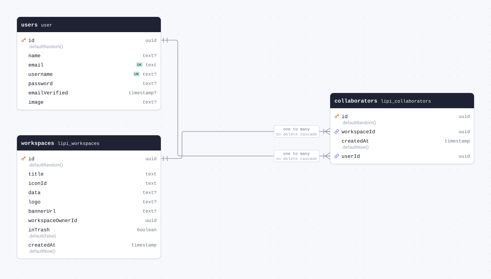

| Column                         | Type        | Constraints                                   | Default            | Description |
| ------------------------------ | ----------- | --------------------------------------------- | ------------------ | ----------- |
| `id`                           | `uuid`      | PK NOT NULL                                   | `.defaultRandom()` |             |
| `workspaceId` (`workspace_id`) | `uuid`      | NOT NULL → [workspaces.id](#table-workspaces) |                    |             |
| `createdAt` (`created_at`)     | `timestamp` | NOT NULL                                      | `.defaultNow()`    |             |
| `userId` (`user_id`)           | `uuid`      | NOT NULL → [users.id](#table-users)           |                    |             |

#### Definition

```sql
CREATE TABLE "lipi_collaborators" (
	"id" uuid PRIMARY KEY DEFAULT gen_random_uuid(),
	"workspace_id" uuid NOT NULL,
	"created_at" timestamp with time zone DEFAULT now() NOT NULL,
	"user_id" uuid NOT NULL
);

ALTER TABLE "lipi_collaborators" ADD CONSTRAINT "lipi_collaborators_workspace_id_lipi_workspaces_id_fkey" FOREIGN KEY ("workspace_id") REFERENCES "lipi_workspaces"("id") ON DELETE CASCADE;

ALTER TABLE "lipi_collaborators" ADD CONSTRAINT "lipi_collaborators_user_id_user_id_fkey" FOREIGN KEY ("user_id") REFERENCES "user"("id") ON DELETE CASCADE;
```

#### References

- `workspaceId` → [workspaces.id](#table-workspaces) (many to one, on delete cascade)
- `userId` → [users.id](#table-users) (many to one, on delete cascade)

<details>
<summary>Queries and their SQL</summary>

**Select**: Every row of collaborators.

```ts
db.select().from(collaborators);
```

```sql
select "id", "workspace_id", "created_at", "user_id"
from "lipi_collaborators"
```

**Count**: How many rows collaborators has.

```ts
db.select({ count: count() }).from(collaborators);
```

```sql
select count(*)
from "lipi_collaborators"
```

**Find many**: The rows of collaborators, through the relational query API.

```ts
db.query.collaborators.findMany();
```

```sql
select "d0"."id" as "id", "d0"."workspace_id" as "workspaceId", "d0"."created_at" as "createdAt", "d0"."user_id" as "userId"
from "lipi_collaborators" as "d0"
```

**Find by primary key**: One row of collaborators, through the relational query API.

```ts
db.query.collaborators.findFirst({ where: { id: "00000000-0000-0000-0000-000000000000" } });
```

```sql
select "d0"."id" as "id", "d0"."workspace_id" as "workspaceId", "d0"."created_at" as "createdAt", "d0"."user_id" as "userId"
from "lipi_collaborators" as "d0"
where "d0"."id" = $1
limit $2
-- params: ["00000000-0000-0000-0000-000000000000",1]
```

**Insert**: Adds a row to collaborators, giving the columns that have no default.

```ts
db.insert(collaborators).values({
  workspaceId: "00000000-0000-0000-0000-000000000000",
  userId: "00000000-0000-0000-0000-000000000000",
});
```

```sql
insert into "lipi_collaborators" ("id", "workspace_id", "created_at", "user_id")
values (default, $1, default, $2)
-- params: ["00000000-0000-0000-0000-000000000000","00000000-0000-0000-0000-000000000000"]
```

**Update**: Changes a row of collaborators, found by its primary key.

```ts
db.update(collaborators)
  .set({ workspaceId: "00000000-0000-0000-0000-000000000000" })
  .where(eq(collaborators.id, "00000000-0000-0000-0000-000000000000"));
```

```sql
update "lipi_collaborators"
set "workspace_id" = $1
where "lipi_collaborators"."id" = $2
-- params: ["00000000-0000-0000-0000-000000000000","00000000-0000-0000-0000-000000000000"]
```

**Delete**: Deletes a row of collaborators, found by its primary key.

```ts
db.delete(collaborators).where(eq(collaborators.id, "00000000-0000-0000-0000-000000000000"));
```

```sql
delete from "lipi_collaborators"
where "lipi_collaborators"."id" = $1
-- params: ["00000000-0000-0000-0000-000000000000"]
```

</details>

<a id="table-users"></a>

### users

Table `user`.

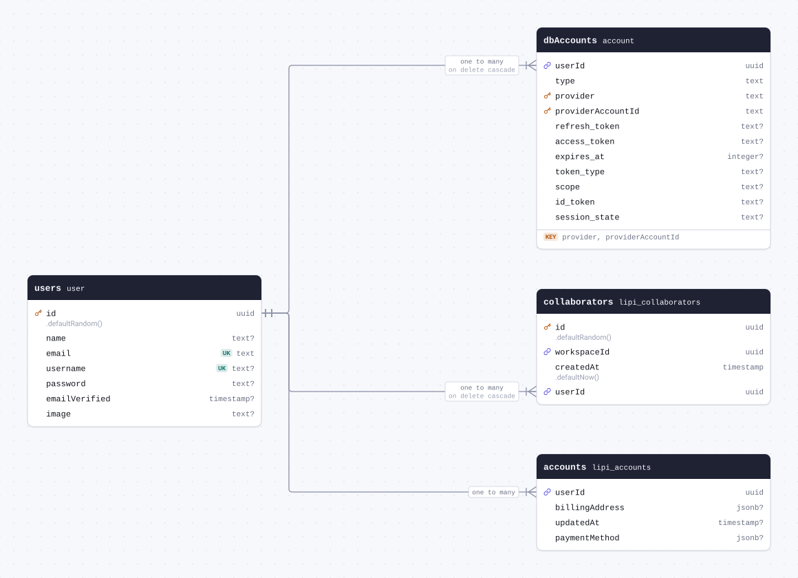

| Column          | Type        | Constraints     | Default            | Description |
| --------------- | ----------- | --------------- | ------------------ | ----------- |
| `id`            | `uuid`      | PK NOT NULL     | `.defaultRandom()` |             |
| `name`          | `text`      | NULL            |                    |             |
| `email`         | `text`      | UNIQUE NOT NULL |                    |             |
| `username`      | `text`      | UNIQUE NULL     |                    |             |
| `password`      | `text`      | NULL            |                    |             |
| `emailVerified` | `timestamp` | NULL            |                    |             |
| `image`         | `text`      | NULL            |                    |             |

#### Definition

```sql
CREATE TABLE "user" (
	"id" uuid PRIMARY KEY DEFAULT gen_random_uuid(),
	"name" text,
	"email" text NOT NULL UNIQUE,
	"username" text UNIQUE,
	"password" text,
	"emailVerified" timestamp,
	"image" text
);
```

#### Referenced by

- `id` → [accounts.userId](#table-accounts) (one to many)
- `id` → [collaborators.userId](#table-collaborators) (one to many, on delete cascade)
- `id` → [dbAccounts.userId](#table-dbAccounts) (one to many, on delete cascade)

<details>
<summary>Queries and their SQL</summary>

**Select**: Every row of users.

```ts
db.select().from(users);
```

```sql
select "id", "name", "email", "username", "password", "emailVerified", "image"
from "user"
```

**Count**: How many rows users has.

```ts
db.select({ count: count() }).from(users);
```

```sql
select count(*)
from "user"
```

**Find many**: The rows of users, through the relational query API.

```ts
db.query.users.findMany();
```

```sql
select "d0"."id" as "id", "d0"."name" as "name", "d0"."email" as "email", "d0"."username" as "username", "d0"."password" as "password", "d0"."emailVerified" as "emailVerified", "d0"."image" as "image"
from "user" as "d0"
```

**Find by primary key**: One row of users, through the relational query API.

```ts
db.query.users.findFirst({ where: { id: "00000000-0000-0000-0000-000000000000" } });
```

```sql
select "d0"."id" as "id", "d0"."name" as "name", "d0"."email" as "email", "d0"."username" as "username", "d0"."password" as "password", "d0"."emailVerified" as "emailVerified", "d0"."image" as "image"
from "user" as "d0"
where "d0"."id" = $1
limit $2
-- params: ["00000000-0000-0000-0000-000000000000",1]
```

**Insert**: Adds a row to users, giving the columns that have no default.

```ts
db.insert(users).values({ email: "email" });
```

```sql
insert into "user" ("id", "name", "email", "username", "password", "emailVerified", "image")
values (default, default, $1, default, default, default, default)
-- params: ["email"]
```

**Update**: Changes a row of users, found by its primary key.

```ts
db.update(users).set({ name: "name" }).where(eq(users.id, "00000000-0000-0000-0000-000000000000"));
```

```sql
update "user"
set "name" = $1
where "user"."id" = $2
-- params: ["name","00000000-0000-0000-0000-000000000000"]
```

**Delete**: Deletes a row of users, found by its primary key.

```ts
db.delete(users).where(eq(users.id, "00000000-0000-0000-0000-000000000000"));
```

```sql
delete from "user"
where "user"."id" = $1
-- params: ["00000000-0000-0000-0000-000000000000"]
```

</details>

<a id="table-dbAccounts"></a>

### dbAccounts

Table `account`.

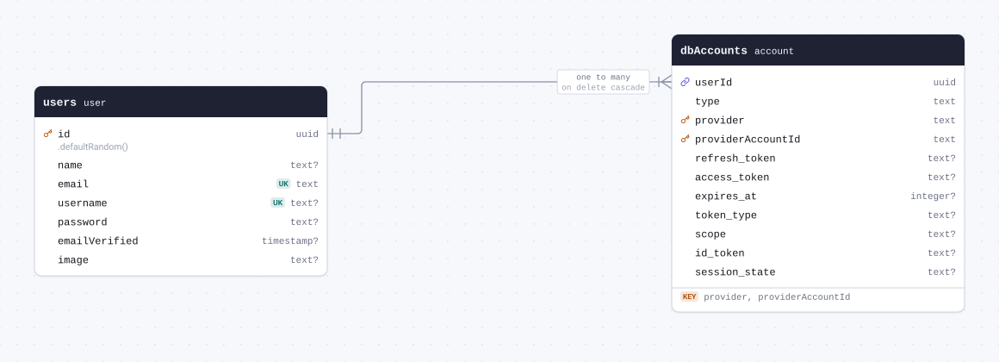

| Column              | Type      | Constraints                         | Default | Description |
| ------------------- | --------- | ----------------------------------- | ------- | ----------- |
| `userId`            | `uuid`    | NOT NULL → [users.id](#table-users) |         |             |
| `type`              | `text`    | NOT NULL                            |         |             |
| `provider`          | `text`    | PK NOT NULL                         |         |             |
| `providerAccountId` | `text`    | PK NOT NULL                         |         |             |
| `refresh_token`     | `text`    | NULL                                |         |             |
| `access_token`      | `text`    | NULL                                |         |             |
| `expires_at`        | `integer` | NULL                                |         |             |
| `token_type`        | `text`    | NULL                                |         |             |
| `scope`             | `text`    | NULL                                |         |             |
| `id_token`          | `text`    | NULL                                |         |             |
| `session_state`     | `text`    | NULL                                |         |             |

#### Definition

```sql
CREATE TABLE "account" (
	"userId" uuid NOT NULL,
	"type" text NOT NULL,
	"provider" text,
	"providerAccountId" text,
	"refresh_token" text,
	"access_token" text,
	"expires_at" integer,
	"token_type" text,
	"scope" text,
	"id_token" text,
	"session_state" text,
	CONSTRAINT "account_pkey" PRIMARY KEY("provider","providerAccountId")
);

ALTER TABLE "account" ADD CONSTRAINT "account_userId_user_id_fkey" FOREIGN KEY ("userId") REFERENCES "user"("id") ON DELETE CASCADE;
```

#### Indexes

- PRIMARY KEY `provider`, `providerAccountId`

#### References

- `userId` → [users.id](#table-users) (many to one, on delete cascade)

<details>
<summary>Queries and their SQL</summary>

**Select**: Every row of dbAccounts.

```ts
db.select().from(dbAccounts);
```

```sql
select "userId", "type", "provider", "providerAccountId", "refresh_token", "access_token", "expires_at", "token_type", "scope", "id_token", "session_state"
from "account"
```

**Count**: How many rows dbAccounts has.

```ts
db.select({ count: count() }).from(dbAccounts);
```

```sql
select count(*)
from "account"
```

**Find many**: The rows of dbAccounts, through the relational query API.

```ts
db.query.dbAccounts.findMany();
```

```sql
select "d0"."userId" as "userId", "d0"."type" as "type", "d0"."provider" as "provider", "d0"."providerAccountId" as "providerAccountId", "d0"."refresh_token" as "refresh_token", "d0"."access_token" as "access_token", "d0"."expires_at" as "expires_at", "d0"."token_type" as "token_type", "d0"."scope" as "scope", "d0"."id_token" as "id_token", "d0"."session_state" as "session_state"
from "account" as "d0"
```

**Find by primary key**: One row of dbAccounts, through the relational query API.

```ts
db.query.dbAccounts.findFirst({
  where: { provider: "provider", providerAccountId: "providerAccountId" },
});
```

```sql
select "d0"."userId" as "userId", "d0"."type" as "type", "d0"."provider" as "provider", "d0"."providerAccountId" as "providerAccountId", "d0"."refresh_token" as "refresh_token", "d0"."access_token" as "access_token", "d0"."expires_at" as "expires_at", "d0"."token_type" as "token_type", "d0"."scope" as "scope", "d0"."id_token" as "id_token", "d0"."session_state" as "session_state"
from "account" as "d0"
where (("d0"."provider" = $1) and ("d0"."providerAccountId" = $2))
limit $3
-- params: ["provider","providerAccountId",1]
```

**Insert**: Adds a row to dbAccounts, giving the columns that have no default.

```ts
db.insert(dbAccounts).values({
  userId: "00000000-0000-0000-0000-000000000000",
  type: "type",
  provider: "provider",
  providerAccountId: "providerAccountId",
});
```

```sql
insert into "account" ("userId", "type", "provider", "providerAccountId", "refresh_token", "access_token", "expires_at", "token_type", "scope", "id_token", "session_state")
values ($1, $2, $3, $4, default, default, default, default, default, default, default)
-- params: ["00000000-0000-0000-0000-000000000000","type","provider","providerAccountId"]
```

**Update**: Changes a row of dbAccounts, found by its primary key.

```ts
db.update(dbAccounts)
  .set({ userId: "00000000-0000-0000-0000-000000000000" })
  .where(
    and(eq(dbAccounts.provider, "provider"), eq(dbAccounts.providerAccountId, "providerAccountId")),
  );
```

```sql
update "account"
set "userId" = $1
where (("account"."provider" = $2) and ("account"."providerAccountId" = $3))
-- params: ["00000000-0000-0000-0000-000000000000","provider","providerAccountId"]
```

**Delete**: Deletes a row of dbAccounts, found by its primary key.

```ts
db.delete(dbAccounts).where(
  and(eq(dbAccounts.provider, "provider"), eq(dbAccounts.providerAccountId, "providerAccountId")),
);
```

```sql
delete from "account"
where (("account"."provider" = $1) and ("account"."providerAccountId" = $2))
-- params: ["provider","providerAccountId"]
```

</details>

<a id="table-verificationTokens"></a>

### verificationTokens

Table `verificationToken`.

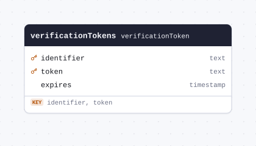

| Column       | Type        | Constraints | Default | Description |
| ------------ | ----------- | ----------- | ------- | ----------- |
| `identifier` | `text`      | PK NOT NULL |         |             |
| `token`      | `text`      | PK NOT NULL |         |             |
| `expires`    | `timestamp` | NOT NULL    |         |             |

#### Definition

```sql
CREATE TABLE "verificationToken" (
	"identifier" text,
	"token" text,
	"expires" timestamp NOT NULL,
	CONSTRAINT "verificationToken_pkey" PRIMARY KEY("identifier","token")
);
```

#### Indexes

- PRIMARY KEY `identifier`, `token`

<details>
<summary>Queries and their SQL</summary>

**Select**: Every row of verificationTokens.

```ts
db.select().from(verificationTokens);
```

```sql
select "identifier", "token", "expires"
from "verificationToken"
```

**Count**: How many rows verificationTokens has.

```ts
db.select({ count: count() }).from(verificationTokens);
```

```sql
select count(*)
from "verificationToken"
```

**Find many**: The rows of verificationTokens, through the relational query API.

```ts
db.query.verificationTokens.findMany();
```

```sql
select "d0"."identifier" as "identifier", "d0"."token" as "token", "d0"."expires" as "expires"
from "verificationToken" as "d0"
```

**Find by primary key**: One row of verificationTokens, through the relational query API.

```ts
db.query.verificationTokens.findFirst({ where: { identifier: "identifier", token: "token" } });
```

```sql
select "d0"."identifier" as "identifier", "d0"."token" as "token", "d0"."expires" as "expires"
from "verificationToken" as "d0"
where (("d0"."identifier" = $1) and ("d0"."token" = $2))
limit $3
-- params: ["identifier","token",1]
```

**Insert**: Adds a row to verificationTokens, giving the columns that have no default.

```ts
db.insert(verificationTokens).values({
  identifier: "identifier",
  token: "token",
  expires: new Date("2026-01-01T00:00:00.000Z"),
});
```

```sql
insert into "verificationToken" ("identifier", "token", "expires")
values ($1, $2, $3)
-- params: ["identifier","token","2026-01-01T00:00:00.000Z"]
```

**Update**: Changes a row of verificationTokens, found by its primary key.

```ts
db.update(verificationTokens)
  .set({ expires: new Date("2026-01-01T00:00:00.000Z") })
  .where(
    and(eq(verificationTokens.identifier, "identifier"), eq(verificationTokens.token, "token")),
  );
```

```sql
update "verificationToken"
set "expires" = $1
where (("verificationToken"."identifier" = $2) and ("verificationToken"."token" = $3))
-- params: ["2026-01-01T00:00:00.000Z","identifier","token"]
```

**Delete**: Deletes a row of verificationTokens, found by its primary key.

```ts
db.delete(verificationTokens).where(
  and(eq(verificationTokens.identifier, "identifier"), eq(verificationTokens.token, "token")),
);
```

```sql
delete from "verificationToken"
where (("verificationToken"."identifier" = $1) and ("verificationToken"."token" = $2))
-- params: ["identifier","token"]
```

</details>

## Enums

<a id="enum-subscriptionStatus"></a>

### subscriptionStatus

Type `subscription_status`.

- `unpaid`
- `past_due`
- `incomplete_expired`
- `incomplete`
- `canceled`
- `active`
- `trialing`

#### Definition

```sql
CREATE TYPE "subscription_status" AS ENUM('unpaid', 'past_due', 'incomplete_expired', 'incomplete', 'canceled', 'active', 'trialing');
```

<a id="enum-pricingType"></a>

### pricingType

Type `pricing_type`.

- `recurring`
- `one_time`

#### Definition

```sql
CREATE TYPE "pricing_type" AS ENUM('recurring', 'one_time');
```

<a id="enum-pricingPlanInterval"></a>

### pricingPlanInterval

Type `pricing_plan_interval`.

- `year`
- `month`
- `week`
- `day`

#### Definition

```sql
CREATE TYPE "pricing_plan_interval" AS ENUM('year', 'month', 'week', 'day');
```
