# Schema docs

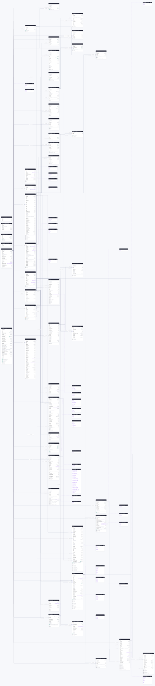

<details>
<summary>The whole schema as SQL</summary>

```sql
CREATE TYPE "account_type" AS ENUM('depository', 'credit', 'other_asset', 'loan', 'other_liability');

CREATE TYPE "accounting_provider" AS ENUM('xero', 'quickbooks', 'fortnox');

CREATE TYPE "accounting_sync_status" AS ENUM('synced', 'failed', 'pending', 'partial');

CREATE TYPE "accounting_sync_type" AS ENUM('auto', 'manual');

CREATE TYPE "activity_source" AS ENUM('system', 'user');

CREATE TYPE "activity_status" AS ENUM('unread', 'read', 'archived');

CREATE TYPE "activity_type" AS ENUM('transactions_enriched', 'transactions_created', 'invoice_paid', 'inbox_new', 'inbox_auto_matched', 'inbox_needs_review', 'inbox_cross_currency_matched', 'invoice_overdue', 'invoice_sent', 'inbox_match_confirmed', 'invoice_refunded', 'recurring_series_started', 'recurring_series_completed', 'recurring_series_paused', 'recurring_invoice_upcoming', 'document_uploaded', 'document_processed', 'invoice_duplicated', 'invoice_scheduled', 'invoice_reminder_sent', 'invoice_cancelled', 'invoice_created', 'draft_invoice_created', 'tracker_entry_created', 'tracker_project_created', 'transactions_categorized', 'transactions_assigned', 'transaction_attachment_created', 'transaction_category_created', 'transactions_exported', 'customer_created', 'insight_ready');

CREATE TYPE "bank_providers" AS ENUM('gocardless', 'plaid', 'teller', 'enablebanking');

CREATE TYPE "connection_status" AS ENUM('disconnected', 'connected', 'unknown');

CREATE TYPE "document_processing_status" AS ENUM('pending', 'processing', 'completed', 'failed');

CREATE TYPE "inbox_account_providers" AS ENUM('gmail', 'outlook');

CREATE TYPE "inbox_account_status" AS ENUM('connected', 'disconnected');

CREATE TYPE "inbox_blocklist_type" AS ENUM('email', 'domain');

CREATE TYPE "inbox_status" AS ENUM('processing', 'pending', 'archived', 'new', 'analyzing', 'suggested_match', 'no_match', 'done', 'deleted', 'other');

CREATE TYPE "inbox_type" AS ENUM('invoice', 'expense', 'other');

CREATE TYPE "insight_period_type" AS ENUM('weekly', 'monthly', 'quarterly', 'yearly');

CREATE TYPE "insight_status" AS ENUM('pending', 'generating', 'completed', 'failed');

CREATE TYPE "institution_status" AS ENUM('active', 'removed');

CREATE TYPE "invoice_delivery_type" AS ENUM('create', 'create_and_send', 'scheduled');

CREATE TYPE "invoice_recurring_end_type" AS ENUM('never', 'on_date', 'after_count');

CREATE TYPE "invoice_recurring_frequency" AS ENUM('weekly', 'biweekly', 'monthly_date', 'monthly_weekday', 'monthly_last_day', 'quarterly', 'semi_annual', 'annual', 'custom');

CREATE TYPE "invoice_recurring_status" AS ENUM('active', 'paused', 'completed', 'canceled');

CREATE TYPE "invoice_size" AS ENUM('a4', 'letter');

CREATE TYPE "invoice_status" AS ENUM('draft', 'overdue', 'paid', 'unpaid', 'canceled', 'scheduled', 'refunded');

CREATE TYPE "plans" AS ENUM('trial', 'starter', 'pro');

CREATE TYPE "platform_provider" AS ENUM('slack', 'telegram', 'whatsapp', 'sendblue');

CREATE TYPE "reportTypes" AS ENUM('profit', 'revenue', 'burn_rate', 'expense', 'monthly_revenue', 'revenue_forecast', 'runway', 'category_expenses');

CREATE TYPE "subscription_status" AS ENUM('active', 'past_due', 'trialing');

CREATE TYPE "teamRoles" AS ENUM('owner', 'member');

CREATE TYPE "trackerStatus" AS ENUM('in_progress', 'completed');

CREATE TYPE "transaction_frequency" AS ENUM('weekly', 'biweekly', 'monthly', 'semi_monthly', 'annually', 'irregular', 'unknown');

CREATE TYPE "transactionMethods" AS ENUM('payment', 'card_purchase', 'card_atm', 'transfer', 'other', 'unknown', 'ach', 'interest', 'deposit', 'wire', 'fee');

CREATE TYPE "transactionStatus" AS ENUM('posted', 'pending', 'excluded', 'completed', 'archived', 'exported');

CREATE TABLE "accounting_sync_records" (
	"id" uuid PRIMARY KEY DEFAULT gen_random_uuid(),
	"transaction_id" uuid NOT NULL,
	"team_id" uuid NOT NULL,
	"provider" "accounting_provider" NOT NULL,
	"provider_tenant_id" text NOT NULL,
	"provider_transaction_id" text,
	"synced_attachment_mapping" jsonb DEFAULT '{}' NOT NULL,
	"synced_at" timestamp with time zone DEFAULT now() NOT NULL,
	"sync_type" "accounting_sync_type",
	"status" "accounting_sync_status" DEFAULT 'synced'::"accounting_sync_status" NOT NULL,
	"error_message" text,
	"error_code" text,
	"provider_entity_type" text,
	"created_at" timestamp with time zone DEFAULT now() NOT NULL,
	CONSTRAINT "accounting_sync_records_transaction_provider_key" UNIQUE("transaction_id","provider")
);

ALTER TABLE "accounting_sync_records" ENABLE ROW LEVEL SECURITY;

CREATE TABLE "activities" (
	"id" uuid PRIMARY KEY DEFAULT gen_random_uuid(),
	"created_at" timestamp with time zone DEFAULT now() NOT NULL,
	"team_id" uuid NOT NULL,
	"user_id" uuid,
	"type" "activity_type" NOT NULL,
	"priority" smallint DEFAULT 5,
	"group_id" uuid,
	"source" "activity_source" NOT NULL,
	"metadata" jsonb NOT NULL,
	"status" "activity_status" DEFAULT 'unread'::"activity_status" NOT NULL,
	"last_used_at" timestamp with time zone
);

CREATE TABLE "api_keys" (
	"id" uuid PRIMARY KEY DEFAULT gen_random_uuid(),
	"key_encrypted" text NOT NULL,
	"name" text NOT NULL,
	"created_at" timestamp with time zone DEFAULT now() NOT NULL,
	"user_id" uuid NOT NULL,
	"team_id" uuid NOT NULL,
	"key_hash" text CONSTRAINT "api_keys_key_unique" UNIQUE,
	"scopes" text[] DEFAULT '{}'::text[] NOT NULL,
	"last_used_at" timestamp with time zone
);

CREATE TABLE "apps" (
	"id" uuid PRIMARY KEY DEFAULT gen_random_uuid(),
	"team_id" uuid DEFAULT gen_random_uuid(),
	"config" jsonb,
	"created_at" timestamp with time zone DEFAULT now(),
	"app_id" text NOT NULL,
	"created_by" uuid DEFAULT gen_random_uuid(),
	"settings" jsonb,
	CONSTRAINT "unique_app_id_team_id" UNIQUE("team_id","app_id")
);

ALTER TABLE "apps" ENABLE ROW LEVEL SECURITY;

CREATE TABLE "bank_accounts" (
	"id" uuid PRIMARY KEY DEFAULT gen_random_uuid(),
	"created_at" timestamp with time zone DEFAULT now() NOT NULL,
	"created_by" uuid NOT NULL,
	"team_id" uuid NOT NULL,
	"name" text,
	"currency" text,
	"bank_connection_id" uuid,
	"enabled" boolean DEFAULT true NOT NULL,
	"account_id" text NOT NULL,
	"balance" numeric(10,2) DEFAULT '0',
	"manual" boolean DEFAULT false,
	"type" "account_type",
	"base_currency" text,
	"baseBalance" numeric(10,2),
	"error_details" text,
	"error_retries" smallint,
	"account_reference" text,
	"iban" text,
	"subtype" text,
	"bic" text,
	"routing_number" text,
	"wire_routing_number" text,
	"account_number" text,
	"sort_code" text,
	"availableBalance" numeric(10,2),
	"creditLimit" numeric(10,2)
);

ALTER TABLE "bank_accounts" ENABLE ROW LEVEL SECURITY;

CREATE TABLE "bank_connections" (
	"id" uuid PRIMARY KEY DEFAULT gen_random_uuid(),
	"created_at" timestamp with time zone DEFAULT now() NOT NULL,
	"institution_id" text NOT NULL,
	"expires_at" timestamp with time zone,
	"team_id" uuid NOT NULL,
	"name" text NOT NULL,
	"logo_url" text,
	"access_token" text,
	"enrollment_id" text,
	"provider" "bank_providers" NOT NULL,
	"last_accessed" timestamp with time zone,
	"reference_id" text,
	"status" "connection_status" DEFAULT 'connected'::"connection_status",
	"error_details" text,
	"error_retries" smallint DEFAULT '0',
	CONSTRAINT "unique_bank_connections" UNIQUE("institution_id","team_id")
);

ALTER TABLE "bank_connections" ENABLE ROW LEVEL SECURITY;

CREATE TABLE "customer_tags" (
	"id" uuid PRIMARY KEY DEFAULT gen_random_uuid(),
	"created_at" timestamp with time zone DEFAULT now() NOT NULL,
	"customer_id" uuid NOT NULL,
	"team_id" uuid NOT NULL,
	"tag_id" uuid NOT NULL,
	CONSTRAINT "unique_customer_tag" UNIQUE("customer_id","tag_id")
);

ALTER TABLE "customer_tags" ENABLE ROW LEVEL SECURITY;

CREATE TABLE "customers" (
	"id" uuid PRIMARY KEY DEFAULT gen_random_uuid(),
	"created_at" timestamp with time zone DEFAULT now() NOT NULL,
	"name" text NOT NULL,
	"email" text NOT NULL,
	"billingEmail" text,
	"country" text,
	"address_line_1" text,
	"address_line_2" text,
	"city" text,
	"state" text,
	"zip" text,
	"note" text,
	"team_id" uuid DEFAULT gen_random_uuid() NOT NULL,
	"website" text,
	"phone" text,
	"vat_number" text,
	"country_code" text,
	"token" text DEFAULT '' NOT NULL,
	"contact" text,
	"status" text DEFAULT 'active',
	"preferred_currency" text,
	"default_payment_terms" integer,
	"is_archived" boolean DEFAULT false,
	"source" text DEFAULT 'manual',
	"external_id" text,
	"logo_url" text,
	"description" text,
	"industry" text,
	"company_type" text,
	"employee_count" text,
	"founded_year" integer,
	"estimated_revenue" text,
	"funding_stage" text,
	"total_funding" text,
	"headquarters_location" text,
	"timezone" text,
	"linkedin_url" text,
	"twitter_url" text,
	"instagram_url" text,
	"facebook_url" text,
	"ceo_name" text,
	"finance_contact" text,
	"finance_contact_email" text,
	"primary_language" text,
	"fiscal_year_end" text,
	"enrichment_status" text,
	"enriched_at" timestamp with time zone,
	"portal_enabled" boolean DEFAULT false,
	"portal_id" text,
	"fts" tsvector GENERATED ALWAYS AS (
				to_tsvector(
					'english'::regconfig,
					COALESCE(name, ''::text) || ' ' ||
					COALESCE(contact, ''::text) || ' ' ||
					COALESCE(phone, ''::text) || ' ' ||
					COALESCE(email, ''::text) || ' ' ||
					COALESCE(address_line_1, ''::text) || ' ' ||
					COALESCE(address_line_2, ''::text) || ' ' ||
					COALESCE(city, ''::text) || ' ' ||
					COALESCE(state, ''::text) || ' ' ||
					COALESCE(zip, ''::text) || ' ' ||
					COALESCE(country, ''::text)
				)
			) STORED NOT NULL
);

ALTER TABLE "customers" ENABLE ROW LEVEL SECURITY;

CREATE TABLE "document_tag_assignments" (
	"document_id" uuid,
	"tag_id" uuid,
	"team_id" uuid NOT NULL,
	CONSTRAINT "document_tag_assignments_pkey" PRIMARY KEY("document_id","tag_id"),
	CONSTRAINT "document_tag_assignments_unique" UNIQUE("document_id","tag_id")
);

ALTER TABLE "document_tag_assignments" ENABLE ROW LEVEL SECURITY;

CREATE TABLE "document_tag_embeddings" (
	"slug" text PRIMARY KEY,
	"embedding" vector(768),
	"name" text NOT NULL,
	"model" text DEFAULT 'gemini-embedding-001' NOT NULL
);

ALTER TABLE "document_tag_embeddings" ENABLE ROW LEVEL SECURITY;

CREATE TABLE "document_tags" (
	"id" uuid PRIMARY KEY DEFAULT gen_random_uuid(),
	"created_at" timestamp with time zone DEFAULT now() NOT NULL,
	"name" text NOT NULL,
	"slug" text NOT NULL,
	"team_id" uuid NOT NULL,
	CONSTRAINT "unique_slug_per_team" UNIQUE("slug","team_id")
);

ALTER TABLE "document_tags" ENABLE ROW LEVEL SECURITY;

CREATE TABLE "documents" (
	"id" uuid PRIMARY KEY DEFAULT gen_random_uuid(),
	"name" text,
	"created_at" timestamp with time zone DEFAULT now(),
	"metadata" jsonb,
	"path_tokens" text[],
	"team_id" uuid,
	"parent_id" text,
	"object_id" uuid,
	"owner_id" uuid,
	"tag" text,
	"title" text,
	"body" text,
	"fts" tsvector GENERATED ALWAYS AS (to_tsvector('english'::regconfig, ((title || ' '::text) || body))) STORED NOT NULL,
	"summary" text,
	"content" text,
	"date" date,
	"language" text,
	"processing_status" "document_processing_status" DEFAULT 'pending'::"document_processing_status",
	"fts_simple" tsvector,
	"fts_english" tsvector,
	"fts_language" tsvector
);

ALTER TABLE "documents" ENABLE ROW LEVEL SECURITY;

CREATE TABLE "exchange_rates" (
	"id" uuid PRIMARY KEY DEFAULT gen_random_uuid(),
	"base" text,
	"rate" numeric(10,2),
	"target" text,
	"updated_at" timestamp with time zone,
	CONSTRAINT "unique_rate" UNIQUE("base","target")
);

ALTER TABLE "exchange_rates" ENABLE ROW LEVEL SECURITY;

CREATE TABLE "inbox" (
	"id" uuid PRIMARY KEY DEFAULT gen_random_uuid(),
	"created_at" timestamp with time zone DEFAULT now() NOT NULL,
	"team_id" uuid,
	"file_path" text[],
	"file_name" text,
	"transaction_id" uuid,
	"amount" numeric(10,2),
	"currency" text,
	"content_type" text,
	"size" bigint,
	"attachment_id" uuid,
	"date" date,
	"forwarded_to" text,
	"reference_id" text CONSTRAINT "inbox_reference_id_key" UNIQUE,
	"meta" json,
	"status" "inbox_status" DEFAULT 'new'::"inbox_status",
	"website" text,
	"sender_email" text,
	"display_name" text,
	"fts" tsvector GENERATED ALWAYS AS (generate_inbox_fts(display_name, extract_product_names((meta -> 'products'::text)))) STORED NOT NULL,
	"type" "inbox_type",
	"description" text,
	"base_amount" numeric(10,2),
	"base_currency" text,
	"tax_amount" numeric(10,2),
	"tax_rate" numeric(10,2),
	"tax_type" text,
	"inbox_account_id" uuid,
	"invoice_number" text,
	"grouped_inbox_id" uuid
);

ALTER TABLE "inbox" ENABLE ROW LEVEL SECURITY;

CREATE TABLE "inbox_accounts" (
	"id" uuid PRIMARY KEY DEFAULT gen_random_uuid(),
	"created_at" timestamp with time zone DEFAULT now() NOT NULL,
	"email" text NOT NULL CONSTRAINT "inbox_accounts_email_key" UNIQUE,
	"access_token" text NOT NULL,
	"refresh_token" text NOT NULL,
	"team_id" uuid NOT NULL,
	"last_accessed" timestamp with time zone NOT NULL,
	"provider" "inbox_account_providers" NOT NULL,
	"external_id" text NOT NULL CONSTRAINT "inbox_accounts_external_id_key" UNIQUE,
	"expiry_date" timestamp with time zone NOT NULL,
	"schedule_id" text,
	"status" "inbox_account_status" DEFAULT 'connected'::"inbox_account_status" NOT NULL,
	"error_message" text
);

ALTER TABLE "inbox_accounts" ENABLE ROW LEVEL SECURITY;

CREATE TABLE "inbox_blocklist" (
	"id" uuid PRIMARY KEY DEFAULT gen_random_uuid(),
	"created_at" timestamp with time zone DEFAULT now() NOT NULL,
	"team_id" uuid NOT NULL,
	"type" "inbox_blocklist_type" NOT NULL,
	"value" text NOT NULL,
	CONSTRAINT "inbox_blocklist_team_id_type_value_key" UNIQUE("team_id","type","value")
);

ALTER TABLE "inbox_blocklist" ENABLE ROW LEVEL SECURITY;

CREATE TABLE "insight_user_status" (
	"insight_id" uuid,
	"user_id" uuid,
	"read_at" timestamp with time zone,
	"dismissed_at" timestamp with time zone,
	"created_at" timestamp with time zone DEFAULT now() NOT NULL,
	"updated_at" timestamp with time zone DEFAULT now() NOT NULL,
	CONSTRAINT "insight_user_status_pkey" PRIMARY KEY("insight_id","user_id")
);

ALTER TABLE "insight_user_status" ENABLE ROW LEVEL SECURITY;

CREATE TABLE "insights" (
	"id" uuid PRIMARY KEY DEFAULT gen_random_uuid(),
	"team_id" uuid NOT NULL,
	"period_type" "insight_period_type" NOT NULL,
	"period_start" timestamp with time zone NOT NULL,
	"period_end" timestamp with time zone NOT NULL,
	"period_year" smallint NOT NULL,
	"period_number" smallint NOT NULL,
	"status" "insight_status" DEFAULT 'pending'::"insight_status" NOT NULL,
	"selected_metrics" jsonb,
	"all_metrics" jsonb,
	"anomalies" jsonb,
	"expense_anomalies" jsonb,
	"milestones" jsonb,
	"activity" jsonb,
	"currency" varchar(3) NOT NULL,
	"title" text,
	"content" jsonb,
	"predictions" jsonb,
	"audio_path" text,
	"generated_at" timestamp with time zone,
	"created_at" timestamp with time zone DEFAULT now() NOT NULL,
	"updated_at" timestamp with time zone DEFAULT now() NOT NULL,
	CONSTRAINT "insights_team_period_unique" UNIQUE("team_id","period_type","period_year","period_number")
);

ALTER TABLE "insights" ENABLE ROW LEVEL SECURITY;

CREATE TABLE "institutions" (
	"id" text PRIMARY KEY,
	"name" text NOT NULL,
	"logo" text,
	"provider" "bank_providers" NOT NULL,
	"countries" text[] NOT NULL,
	"available_history" integer,
	"maximum_consent_validity" integer,
	"popularity" integer DEFAULT 0 NOT NULL,
	"type" text,
	"status" "institution_status" DEFAULT 'active'::"institution_status" NOT NULL,
	"created_at" timestamp with time zone DEFAULT now() NOT NULL,
	"updated_at" timestamp with time zone DEFAULT now() NOT NULL
);

CREATE TABLE "invoice_comments" (
	"id" uuid PRIMARY KEY DEFAULT gen_random_uuid(),
	"created_at" timestamp with time zone DEFAULT now() NOT NULL
);

CREATE TABLE "invoice_products" (
	"id" uuid PRIMARY KEY DEFAULT gen_random_uuid(),
	"created_at" timestamp with time zone DEFAULT now() NOT NULL,
	"updated_at" timestamp with time zone DEFAULT now(),
	"team_id" uuid NOT NULL,
	"created_by" uuid,
	"name" text NOT NULL,
	"description" text,
	"price" numeric(10,2),
	"currency" text,
	"unit" text,
	"tax_rate" numeric(10,2),
	"isActive" boolean DEFAULT true NOT NULL,
	"usage_count" integer DEFAULT 0 NOT NULL,
	"last_used_at" timestamp with time zone,
	"fts" tsvector GENERATED ALWAYS AS (
          to_tsvector(
            'english',
            (
              (COALESCE(name, ''::text) || ' '::text) || COALESCE(description, ''::text)
            )
          )
        ) STORED NOT NULL,
	CONSTRAINT "invoice_products_team_name_currency_price_unique" UNIQUE("team_id","name","currency","price")
);

ALTER TABLE "invoice_products" ENABLE ROW LEVEL SECURITY;

CREATE TABLE "invoice_recurring" (
	"id" uuid PRIMARY KEY DEFAULT gen_random_uuid(),
	"created_at" timestamp with time zone DEFAULT now() NOT NULL,
	"updated_at" timestamp with time zone DEFAULT now(),
	"team_id" uuid NOT NULL,
	"user_id" uuid NOT NULL,
	"customer_id" uuid,
	"frequency" "invoice_recurring_frequency" NOT NULL,
	"frequency_day" integer,
	"frequency_week" integer,
	"frequency_interval" integer,
	"end_type" "invoice_recurring_end_type" NOT NULL,
	"end_date" timestamp with time zone,
	"end_count" integer,
	"status" "invoice_recurring_status" DEFAULT 'active'::"invoice_recurring_status" NOT NULL,
	"invoices_generated" integer DEFAULT 0 NOT NULL,
	"consecutive_failures" integer DEFAULT 0 NOT NULL,
	"next_scheduled_at" timestamp with time zone,
	"last_generated_at" timestamp with time zone,
	"timezone" text NOT NULL,
	"due_date_offset" integer DEFAULT 30 NOT NULL,
	"amount" numeric(10,2),
	"currency" text,
	"line_items" jsonb,
	"template" jsonb,
	"payment_details" jsonb,
	"from_details" jsonb,
	"note_details" jsonb,
	"customer_name" text,
	"vat" numeric(10,2),
	"tax" numeric(10,2),
	"discount" numeric(10,2),
	"subtotal" numeric(10,2),
	"top_block" jsonb,
	"bottom_block" jsonb,
	"template_id" uuid,
	"upcoming_notification_sent_at" timestamp with time zone
);

ALTER TABLE "invoice_recurring" ENABLE ROW LEVEL SECURITY;

CREATE TABLE "invoice_templates" (
	"id" uuid PRIMARY KEY DEFAULT gen_random_uuid(),
	"created_at" timestamp with time zone DEFAULT now() NOT NULL,
	"team_id" uuid NOT NULL,
	"name" text DEFAULT 'Default' NOT NULL,
	"is_default" boolean DEFAULT false,
	"customer_label" text,
	"from_label" text,
	"invoice_no_label" text,
	"issue_date_label" text,
	"due_date_label" text,
	"description_label" text,
	"price_label" text,
	"quantity_label" text,
	"total_label" text,
	"vat_label" text,
	"tax_label" text,
	"payment_label" text,
	"note_label" text,
	"logo_url" text,
	"currency" text,
	"payment_details" jsonb,
	"from_details" jsonb,
	"note_details" jsonb,
	"size" "invoice_size" DEFAULT 'a4'::"invoice_size",
	"date_format" text,
	"include_vat" boolean,
	"include_tax" boolean,
	"tax_rate" numeric(10,2),
	"delivery_type" "invoice_delivery_type" DEFAULT 'create'::"invoice_delivery_type" NOT NULL,
	"discount_label" text,
	"include_discount" boolean,
	"include_decimals" boolean,
	"include_qr" boolean,
	"total_summary_label" text,
	"title" text,
	"vat_rate" numeric(10,2),
	"include_units" boolean,
	"subtotal_label" text,
	"include_pdf" boolean,
	"send_copy" boolean,
	"include_line_item_tax" boolean DEFAULT false,
	"line_item_tax_label" text,
	"payment_enabled" boolean DEFAULT false,
	"payment_terms_days" integer DEFAULT 30,
	"email_subject" text,
	"email_heading" text,
	"email_body" text,
	"email_button_text" text
);

ALTER TABLE "invoice_templates" ENABLE ROW LEVEL SECURITY;

CREATE TABLE "invoices" (
	"id" uuid PRIMARY KEY DEFAULT gen_random_uuid(),
	"created_at" timestamp with time zone DEFAULT now() NOT NULL,
	"updated_at" timestamp with time zone DEFAULT now(),
	"due_date" timestamp with time zone,
	"invoice_number" text,
	"customer_id" uuid,
	"amount" numeric(10,2),
	"currency" text,
	"line_items" jsonb,
	"payment_details" jsonb,
	"customer_details" jsonb,
	"company_datails" jsonb,
	"note" text,
	"internal_note" text,
	"team_id" uuid NOT NULL,
	"paid_at" timestamp with time zone,
	"fts" tsvector GENERATED ALWAYS AS (
        to_tsvector(
          'english',
          (
            (COALESCE((amount)::text, ''::text) || ' '::text) || COALESCE(invoice_number, ''::text)
          )
        )
      ) STORED NOT NULL,
	"vat" numeric(10,2),
	"tax" numeric(10,2),
	"url" text,
	"file_path" text[],
	"status" "invoice_status" DEFAULT 'draft'::"invoice_status" NOT NULL,
	"viewed_at" timestamp with time zone,
	"from_details" jsonb,
	"issue_date" timestamp with time zone,
	"template" jsonb,
	"note_details" jsonb,
	"customer_name" text,
	"token" text DEFAULT '' NOT NULL,
	"sent_to" text,
	"reminder_sent_at" timestamp with time zone,
	"discount" numeric(10,2),
	"file_size" bigint,
	"user_id" uuid,
	"subtotal" numeric(10,2),
	"top_block" jsonb,
	"bottom_block" jsonb,
	"sent_at" timestamp with time zone,
	"scheduled_at" timestamp with time zone,
	"scheduled_job_id" text CONSTRAINT "invoices_scheduled_job_id_key" UNIQUE,
	"template_id" uuid,
	"payment_intent_id" text,
	"refunded_at" timestamp with time zone,
	"invoice_recurring_id" uuid,
	"recurring_sequence" integer
);

ALTER TABLE "invoices" ENABLE ROW LEVEL SECURITY;

CREATE TABLE "notification_settings" (
	"id" uuid PRIMARY KEY DEFAULT gen_random_uuid(),
	"user_id" uuid NOT NULL,
	"team_id" uuid NOT NULL,
	"notification_type" text NOT NULL,
	"channel" text NOT NULL,
	"enabled" boolean DEFAULT true NOT NULL,
	"created_at" timestamp with time zone DEFAULT now() NOT NULL,
	"updated_at" timestamp with time zone DEFAULT now() NOT NULL,
	CONSTRAINT "notification_settings_user_team_type_channel_key" UNIQUE("user_id","team_id","notification_type","channel")
);

ALTER TABLE "notification_settings" ENABLE ROW LEVEL SECURITY;

CREATE TABLE "oauth_access_tokens" (
	"id" uuid PRIMARY KEY DEFAULT gen_random_uuid(),
	"token" text NOT NULL UNIQUE,
	"refresh_token" text UNIQUE,
	"application_id" uuid NOT NULL,
	"user_id" uuid NOT NULL,
	"team_id" uuid NOT NULL,
	"scopes" text[] NOT NULL,
	"expires_at" timestamp with time zone NOT NULL,
	"refresh_token_expires_at" timestamp with time zone,
	"created_at" timestamp with time zone DEFAULT now() NOT NULL,
	"last_used_at" timestamp with time zone,
	"revoked" boolean DEFAULT false,
	"revoked_at" timestamp with time zone
);

CREATE TABLE "oauth_applications" (
	"id" uuid PRIMARY KEY DEFAULT gen_random_uuid(),
	"name" text NOT NULL,
	"slug" text NOT NULL UNIQUE,
	"description" text,
	"overview" text,
	"developer_name" text,
	"logo_url" text,
	"website" text,
	"install_url" text,
	"screenshots" text[] DEFAULT '{}'::text[],
	"redirect_uris" text[] NOT NULL,
	"client_id" text NOT NULL UNIQUE,
	"client_secret" text,
	"scopes" text[] DEFAULT '{}'::text[] NOT NULL,
	"team_id" uuid,
	"created_by" uuid,
	"created_at" timestamp with time zone DEFAULT now() NOT NULL,
	"updated_at" timestamp with time zone DEFAULT now() NOT NULL,
	"is_public" boolean DEFAULT false,
	"active" boolean DEFAULT true,
	"status" text DEFAULT 'draft'
);

ALTER TABLE "oauth_applications" ENABLE ROW LEVEL SECURITY;

CREATE TABLE "oauth_authorization_codes" (
	"id" uuid PRIMARY KEY DEFAULT gen_random_uuid(),
	"code" text NOT NULL UNIQUE,
	"application_id" uuid NOT NULL,
	"user_id" uuid NOT NULL,
	"team_id" uuid NOT NULL,
	"scopes" text[] NOT NULL,
	"redirect_uri" text NOT NULL,
	"expires_at" timestamp with time zone NOT NULL,
	"created_at" timestamp with time zone DEFAULT now() NOT NULL,
	"used" boolean DEFAULT false,
	"code_challenge" text,
	"code_challenge_method" text
);

CREATE TABLE "platform_identities" (
	"id" uuid PRIMARY KEY DEFAULT gen_random_uuid(),
	"provider" "platform_provider" NOT NULL,
	"team_id" uuid NOT NULL,
	"user_id" uuid NOT NULL,
	"external_user_id" text NOT NULL,
	"external_team_id" text DEFAULT '' NOT NULL,
	"external_channel_id" text,
	"metadata" jsonb,
	"created_at" timestamp with time zone DEFAULT now(),
	"updated_at" timestamp with time zone DEFAULT now(),
	CONSTRAINT "platform_identities_provider_external_unique" UNIQUE("provider","external_team_id","external_user_id")
);

ALTER TABLE "platform_identities" ENABLE ROW LEVEL SECURITY;

CREATE TABLE "platform_link_tokens" (
	"id" uuid PRIMARY KEY DEFAULT gen_random_uuid(),
	"code" text NOT NULL CONSTRAINT "platform_link_tokens_code_unique" UNIQUE,
	"provider" "platform_provider" NOT NULL,
	"team_id" uuid NOT NULL,
	"user_id" uuid NOT NULL,
	"expires_at" timestamp with time zone NOT NULL,
	"used_at" timestamp with time zone,
	"metadata" jsonb,
	"created_at" timestamp with time zone DEFAULT now()
);

ALTER TABLE "platform_link_tokens" ENABLE ROW LEVEL SECURITY;

CREATE TABLE "provider_notification_batches" (
	"id" uuid PRIMARY KEY DEFAULT gen_random_uuid(),
	"batch_key" text NOT NULL CONSTRAINT "provider_notification_batches_batch_key_unique" UNIQUE,
	"platform_identity_id" uuid NOT NULL,
	"team_id" uuid NOT NULL,
	"user_id" uuid NOT NULL,
	"provider" "platform_provider" NOT NULL,
	"event_family" text NOT NULL,
	"payload" jsonb NOT NULL,
	"notification_context" jsonb,
	"window_ends_at" timestamp with time zone NOT NULL,
	"sent_at" timestamp with time zone,
	"created_at" timestamp with time zone DEFAULT now(),
	"updated_at" timestamp with time zone DEFAULT now()
);

ALTER TABLE "provider_notification_batches" ENABLE ROW LEVEL SECURITY;

CREATE TABLE "reports" (
	"id" uuid PRIMARY KEY DEFAULT gen_random_uuid(),
	"created_at" timestamp with time zone DEFAULT now() NOT NULL,
	"link_id" text,
	"team_id" uuid,
	"short_link" text,
	"from" timestamp with time zone,
	"to" timestamp with time zone,
	"type" "reportTypes",
	"expire_at" timestamp with time zone,
	"currency" text,
	"created_by" uuid
);

ALTER TABLE "reports" ENABLE ROW LEVEL SECURITY;

CREATE TABLE "short_links" (
	"id" uuid PRIMARY KEY DEFAULT gen_random_uuid(),
	"short_id" text NOT NULL CONSTRAINT "short_links_short_id_unique" UNIQUE,
	"url" text NOT NULL,
	"type" text,
	"size" numeric(10,2),
	"mime_type" text,
	"file_name" text,
	"team_id" uuid NOT NULL,
	"user_id" uuid NOT NULL,
	"expires_at" timestamp with time zone,
	"created_at" timestamp with time zone DEFAULT now() NOT NULL
);

ALTER TABLE "short_links" ENABLE ROW LEVEL SECURITY;

CREATE TABLE "tags" (
	"id" uuid PRIMARY KEY DEFAULT gen_random_uuid(),
	"created_at" timestamp with time zone DEFAULT now() NOT NULL,
	"team_id" uuid NOT NULL,
	"name" text NOT NULL,
	CONSTRAINT "unique_tag_name" UNIQUE("team_id","name")
);

ALTER TABLE "tags" ENABLE ROW LEVEL SECURITY;

CREATE TABLE "teams" (
	"id" uuid PRIMARY KEY DEFAULT gen_random_uuid(),
	"created_at" timestamp with time zone DEFAULT now() NOT NULL,
	"name" text,
	"logo_url" text,
	"inbox_id" text DEFAULT 'generate_inbox(10)' CONSTRAINT "teams_inbox_id_key" UNIQUE,
	"email" text,
	"inbox_email" text,
	"inbox_forwarding" boolean DEFAULT true,
	"base_currency" text,
	"country_code" text,
	"fiscal_year_start_month" smallint,
	"document_classification" boolean DEFAULT false,
	"flags" text[],
	"canceled_at" timestamp with time zone,
	"plan" "plans" DEFAULT 'trial'::"plans" NOT NULL,
	"subscription_status" "subscription_status",
	"export_settings" jsonb,
	"stripe_account_id" text,
	"stripe_connect_status" text,
	"company_type" text,
	"heard_about" text
);

ALTER TABLE "teams" ENABLE ROW LEVEL SECURITY;

CREATE TABLE "tracker_entries" (
	"id" uuid PRIMARY KEY DEFAULT gen_random_uuid(),
	"created_at" timestamp with time zone DEFAULT now() NOT NULL,
	"duration" bigint,
	"project_id" uuid,
	"start" timestamp with time zone,
	"stop" timestamp with time zone,
	"assigned_id" uuid,
	"team_id" uuid,
	"description" text,
	"rate" numeric(10,2),
	"currency" text,
	"billed" boolean DEFAULT false,
	"date" date DEFAULT now()
);

ALTER TABLE "tracker_entries" ENABLE ROW LEVEL SECURITY;

CREATE TABLE "tracker_project_tags" (
	"id" uuid PRIMARY KEY DEFAULT gen_random_uuid(),
	"created_at" timestamp with time zone DEFAULT now() NOT NULL,
	"tracker_project_id" uuid NOT NULL,
	"tag_id" uuid NOT NULL,
	"team_id" uuid NOT NULL,
	CONSTRAINT "unique_project_tag" UNIQUE("tracker_project_id","tag_id")
);

ALTER TABLE "tracker_project_tags" ENABLE ROW LEVEL SECURITY;

CREATE TABLE "tracker_projects" (
	"id" uuid PRIMARY KEY DEFAULT gen_random_uuid(),
	"created_at" timestamp with time zone DEFAULT now() NOT NULL,
	"team_id" uuid,
	"rate" numeric(10,2),
	"currency" text,
	"status" "trackerStatus" DEFAULT 'in_progress'::"trackerStatus" NOT NULL,
	"description" text,
	"name" text NOT NULL,
	"billable" boolean DEFAULT false,
	"estimate" bigint,
	"customer_id" uuid,
	"fts" tsvector GENERATED ALWAYS AS (
          to_tsvector(
            'english'::regconfig,
            (
              (COALESCE(name, ''::text) || ' '::text) || COALESCE(description, ''::text)
            )
          )
        ) STORED NOT NULL
);

ALTER TABLE "tracker_projects" ENABLE ROW LEVEL SECURITY;

CREATE TABLE "tracker_reports" (
	"id" uuid PRIMARY KEY DEFAULT gen_random_uuid(),
	"created_at" timestamp with time zone DEFAULT now() NOT NULL,
	"link_id" text,
	"short_link" text,
	"team_id" uuid DEFAULT gen_random_uuid(),
	"project_id" uuid DEFAULT gen_random_uuid(),
	"created_by" uuid
);

ALTER TABLE "tracker_reports" ENABLE ROW LEVEL SECURITY;

CREATE TABLE "transaction_attachments" (
	"id" uuid PRIMARY KEY DEFAULT gen_random_uuid(),
	"created_at" timestamp with time zone DEFAULT now() NOT NULL,
	"type" text,
	"transaction_id" uuid,
	"team_id" uuid,
	"size" bigint,
	"name" text,
	"path" text[]
);

ALTER TABLE "transaction_attachments" ENABLE ROW LEVEL SECURITY;

CREATE TABLE "transaction_categories" (
	"id" uuid DEFAULT gen_random_uuid() NOT NULL UNIQUE,
	"name" text NOT NULL,
	"team_id" uuid,
	"color" text,
	"created_at" timestamp with time zone DEFAULT now(),
	"system" boolean DEFAULT false,
	"slug" text,
	"tax_rate" numeric(10,2),
	"tax_type" text,
	"tax_reporting_code" text,
	"excluded" boolean DEFAULT false,
	"description" text,
	"parent_id" uuid,
	CONSTRAINT "transaction_categories_pkey" PRIMARY KEY("team_id","slug"),
	CONSTRAINT "unique_team_slug" UNIQUE("team_id","slug")
);

ALTER TABLE "transaction_categories" ENABLE ROW LEVEL SECURITY;

CREATE TABLE "transaction_category_embeddings" (
	"name" text PRIMARY KEY,
	"embedding" vector(768),
	"model" text DEFAULT 'gemini-embedding-001' NOT NULL,
	"system" boolean DEFAULT false NOT NULL,
	"created_at" timestamp with time zone DEFAULT now() NOT NULL,
	"updated_at" timestamp with time zone DEFAULT now() NOT NULL
);

ALTER TABLE "transaction_category_embeddings" ENABLE ROW LEVEL SECURITY;

CREATE TABLE "transaction_enrichments" (
	"id" uuid PRIMARY KEY DEFAULT gen_random_uuid(),
	"created_at" timestamp with time zone DEFAULT now() NOT NULL,
	"name" text,
	"team_id" uuid,
	"category_slug" text,
	"system" boolean DEFAULT false,
	CONSTRAINT "unique_team_name" UNIQUE("name","team_id")
);

ALTER TABLE "transaction_enrichments" ENABLE ROW LEVEL SECURITY;

CREATE TABLE "transaction_match_suggestions" (
	"id" uuid PRIMARY KEY DEFAULT gen_random_uuid(),
	"created_at" timestamp with time zone DEFAULT now() NOT NULL,
	"updated_at" timestamp with time zone DEFAULT now() NOT NULL,
	"team_id" uuid NOT NULL,
	"inbox_id" uuid NOT NULL,
	"transaction_id" uuid NOT NULL,
	"confidence_score" numeric(4,3) NOT NULL,
	"amount_score" numeric(4,3),
	"currency_score" numeric(4,3),
	"date_score" numeric(4,3),
	"name_score" numeric(4,3),
	"match_type" text NOT NULL,
	"match_details" jsonb,
	"status" text DEFAULT 'pending' NOT NULL,
	"user_action_at" timestamp with time zone,
	"user_id" uuid,
	CONSTRAINT "transaction_match_suggestions_unique" UNIQUE("inbox_id","transaction_id")
);

CREATE TABLE "transaction_tags" (
	"id" uuid PRIMARY KEY DEFAULT gen_random_uuid(),
	"created_at" timestamp with time zone DEFAULT now() NOT NULL,
	"team_id" uuid NOT NULL,
	"tag_id" uuid NOT NULL,
	"transaction_id" uuid NOT NULL,
	CONSTRAINT "unique_tag" UNIQUE("tag_id","transaction_id")
);

ALTER TABLE "transaction_tags" ENABLE ROW LEVEL SECURITY;

CREATE TABLE "transactions" (
	"id" uuid PRIMARY KEY DEFAULT gen_random_uuid(),
	"created_at" timestamp with time zone DEFAULT now() NOT NULL,
	"date" date NOT NULL,
	"name" text NOT NULL,
	"method" "transactionMethods" NOT NULL,
	"amount" numeric(10,2) NOT NULL,
	"currency" text NOT NULL,
	"team_id" uuid NOT NULL,
	"assigned_id" uuid,
	"note" varchar,
	"bank_account_id" uuid,
	"internal_id" text NOT NULL CONSTRAINT "transactions_internal_id_key" UNIQUE,
	"status" "transactionStatus" DEFAULT 'posted'::"transactionStatus",
	"balance" numeric(10,2),
	"manual" boolean DEFAULT false,
	"notified" boolean DEFAULT false,
	"internal" boolean DEFAULT false,
	"description" text,
	"category_slug" text,
	"baseAmount" numeric(10,2),
	"counterparty_name" text,
	"base_currency" text,
	"tax_amount" numeric(10,2),
	"tax_rate" numeric(10,2),
	"tax_type" text,
	"recurring" boolean,
	"frequency" "transaction_frequency",
	"merchant_name" text,
	"enrichment_completed" boolean DEFAULT false,
	"fts_vector" tsvector GENERATED ALWAYS AS (
				to_tsvector(
					'english',
					(
						(COALESCE(name, ''::text) || ' '::text) || COALESCE(description, ''::text)
					)
				)
			) STORED NOT NULL
);

ALTER TABLE "transactions" ENABLE ROW LEVEL SECURITY;

CREATE TABLE "user_invites" (
	"id" uuid PRIMARY KEY DEFAULT gen_random_uuid(),
	"created_at" timestamp with time zone DEFAULT now() NOT NULL,
	"team_id" uuid,
	"email" text,
	"role" "teamRoles",
	"code" text DEFAULT 'nanoid(24)' CONSTRAINT "user_invites_code_key" UNIQUE,
	"invited_by" uuid,
	CONSTRAINT "unique_team_invite" UNIQUE("team_id","email")
);

ALTER TABLE "user_invites" ENABLE ROW LEVEL SECURITY;

CREATE TABLE "users" (
	"id" uuid PRIMARY KEY,
	"full_name" text,
	"avatar_url" text,
	"email" text,
	"team_id" uuid,
	"created_at" timestamp with time zone DEFAULT now(),
	"locale" text DEFAULT 'en',
	"week_starts_on_monday" boolean DEFAULT false,
	"timezone" text,
	"timezone_auto_sync" boolean DEFAULT true,
	"time_format" numeric DEFAULT '24',
	"date_format" text
);

ALTER TABLE "users" ENABLE ROW LEVEL SECURITY;

CREATE TABLE "auth.users" (
	"instance_id" uuid,
	"id" uuid,
	"aud" varchar(255),
	"role" varchar(255),
	"email" varchar(255) CONSTRAINT "users_email_partial_key" UNIQUE,
	"encrypted_password" varchar(255),
	"email_confirmed_at" timestamp with time zone,
	"invited_at" timestamp with time zone,
	"confirmation_token" varchar(255) CONSTRAINT "confirmation_token_idx" UNIQUE,
	"confirmation_sent_at" timestamp with time zone,
	"recovery_token" varchar(255) CONSTRAINT "recovery_token_idx" UNIQUE,
	"recovery_sent_at" timestamp with time zone,
	"email_change_token_new" varchar(255) CONSTRAINT "email_change_token_new_idx" UNIQUE,
	"email_change" varchar(255),
	"email_change_sent_at" timestamp with time zone,
	"last_sign_in_at" timestamp with time zone,
	"raw_app_meta_data" jsonb,
	"raw_user_meta_data" jsonb,
	"is_super_admin" boolean,
	"created_at" timestamp with time zone,
	"updated_at" timestamp with time zone,
	"phone" text DEFAULT null CONSTRAINT "users_phone_key" UNIQUE,
	"phone_confirmed_at" timestamp with time zone,
	"phone_change" text DEFAULT '',
	"phone_change_token" varchar(255) DEFAULT '',
	"phone_change_sent_at" timestamp with time zone,
	"confirmed_at" timestamp with time zone GENERATED ALWAYS AS (LEAST(email_confirmed_at, phone_confirmed_at)) STORED,
	"email_change_token_current" varchar(255) DEFAULT '' CONSTRAINT "email_change_token_current_idx" UNIQUE,
	"email_change_confirm_status" smallint DEFAULT 0,
	"banned_until" timestamp with time zone,
	"reauthentication_token" varchar(255) DEFAULT '' CONSTRAINT "reauthentication_token_idx" UNIQUE,
	"reauthentication_sent_at" timestamp with time zone,
	"is_sso_user" boolean DEFAULT false NOT NULL,
	"deleted_at" timestamp with time zone,
	"is_anonymous" boolean DEFAULT false NOT NULL,
	CONSTRAINT "users_pkey" PRIMARY KEY("id"),
	CONSTRAINT "users_email_change_confirm_status_check" CHECK (((email_change_confirm_status >= 0) AND (email_change_confirm_status <= 2)))
);

CREATE TABLE "users_on_team" (
	"user_id" uuid,
	"team_id" uuid,
	"id" uuid DEFAULT gen_random_uuid(),
	"role" "teamRoles",
	"created_at" timestamp with time zone DEFAULT now(),
	CONSTRAINT "members_pkey" PRIMARY KEY("user_id","team_id","id")
);

ALTER TABLE "users_on_team" ENABLE ROW LEVEL SECURITY;

CREATE INDEX "idx_accounting_sync_transaction" ON "accounting_sync_records" ("transaction_id");

CREATE INDEX "idx_accounting_sync_team_provider" ON "accounting_sync_records" ("team_id","provider");

CREATE INDEX "idx_accounting_sync_status" ON "accounting_sync_records" ("team_id","status");

CREATE INDEX "activities_notifications_idx" ON "activities" ("team_id","priority","status","created_at" DESC NULLS LAST);

CREATE INDEX "activities_insights_idx" ON "activities" ("team_id","type","source","created_at" DESC NULLS LAST);

CREATE INDEX "activities_metadata_gin_idx" ON "activities" USING gin ("metadata");

CREATE INDEX "activities_group_id_idx" ON "activities" ("group_id");

CREATE INDEX "activities_insights_group_idx" ON "activities" ("team_id","group_id","type","created_at" DESC NULLS LAST);

CREATE INDEX "api_keys_key_idx" ON "api_keys" ("key_hash" text_ops);

CREATE INDEX "api_keys_user_id_idx" ON "api_keys" ("user_id" uuid_ops);

CREATE INDEX "api_keys_team_id_idx" ON "api_keys" ("team_id" uuid_ops);

CREATE INDEX "bank_accounts_bank_connection_id_idx" ON "bank_accounts" ("bank_connection_id" uuid_ops);

CREATE INDEX "bank_accounts_created_by_idx" ON "bank_accounts" ("created_by" uuid_ops);

CREATE INDEX "bank_accounts_team_id_idx" ON "bank_accounts" ("team_id" uuid_ops);

CREATE INDEX "bank_connections_team_id_idx" ON "bank_connections" ("team_id" uuid_ops);

CREATE INDEX "customers_fts" ON "customers" USING gin ("fts" tsvector_ops);

CREATE INDEX "idx_customers_status" ON "customers" ("status");

CREATE INDEX "idx_customers_is_archived" ON "customers" ("is_archived");

CREATE INDEX "idx_customers_enrichment_status" ON "customers" ("enrichment_status");

CREATE INDEX "idx_customers_website" ON "customers" ("website");

CREATE INDEX "idx_customers_industry" ON "customers" ("industry");

CREATE INDEX "customers_team_id_idx" ON "customers" ("team_id");

CREATE INDEX "customers_team_created_at_idx" ON "customers" ("team_id","created_at");

CREATE INDEX "idx_document_tag_assignments_document_id" ON "document_tag_assignments" ("document_id" uuid_ops);

CREATE INDEX "idx_document_tag_assignments_tag_id" ON "document_tag_assignments" ("tag_id" uuid_ops);

CREATE INDEX "documents_name_idx" ON "documents" ("name" text_ops);

CREATE INDEX "documents_team_id_idx" ON "documents" ("team_id" uuid_ops);

CREATE INDEX "documents_team_id_parent_id_idx" ON "documents" ("team_id" text_ops,"parent_id" text_ops);

CREATE INDEX "documents_team_id_created_at_idx" ON "documents" ("team_id" uuid_ops,"created_at" DESC NULLS LAST);

CREATE INDEX "documents_team_id_date_idx" ON "documents" ("team_id" uuid_ops,"date");

CREATE INDEX "documents_team_id_name_idx" ON "documents" ("team_id" uuid_ops,"name" text_ops);

CREATE INDEX "idx_documents_fts_english" ON "documents" USING gin ("fts_english" tsvector_ops);

CREATE INDEX "idx_documents_fts_language" ON "documents" USING gin ("fts_language" tsvector_ops);

CREATE INDEX "idx_documents_fts_simple" ON "documents" USING gin ("fts_simple" tsvector_ops);

CREATE INDEX "idx_gin_documents_title" ON "documents" USING gin ("title" gin_trgm_ops);

CREATE INDEX "idx_gin_documents_name" ON "documents" USING gin ("name" gin_trgm_ops);

CREATE INDEX "exchange_rates_base_target_idx" ON "exchange_rates" ("base" text_ops,"target" text_ops);

CREATE INDEX "inbox_attachment_id_idx" ON "inbox" ("attachment_id" uuid_ops);

CREATE INDEX "inbox_created_at_idx" ON "inbox" ("created_at" timestamptz_ops);

CREATE INDEX "inbox_team_id_idx" ON "inbox" ("team_id" uuid_ops);

CREATE INDEX "inbox_transaction_id_idx" ON "inbox" ("transaction_id" uuid_ops);

CREATE INDEX "inbox_inbox_account_id_idx" ON "inbox" ("inbox_account_id" uuid_ops);

CREATE INDEX "inbox_invoice_number_idx" ON "inbox" ("invoice_number" text_ops);

CREATE INDEX "inbox_grouped_inbox_id_idx" ON "inbox" ("grouped_inbox_id" uuid_ops);

CREATE INDEX "idx_inbox_display_name_trgm" ON "inbox" USING gin ("display_name" gin_trgm_ops);

CREATE INDEX "inbox_team_status_created_at_idx" ON "inbox" ("team_id","status","created_at");

CREATE INDEX "insight_user_status_user_idx" ON "insight_user_status" ("user_id");

CREATE INDEX "insight_user_status_insight_idx" ON "insight_user_status" ("insight_id");

CREATE INDEX "insights_team_id_idx" ON "insights" ("team_id");

CREATE INDEX "insights_team_period_type_idx" ON "insights" ("team_id","period_type","generated_at" DESC NULLS LAST);

CREATE INDEX "institutions_country_idx" ON "institutions" USING gin ("countries");

CREATE INDEX "institutions_name_trgm_idx" ON "institutions" USING gin ("name" gin_trgm_ops);

CREATE INDEX "institutions_status_idx" ON "institutions" ("status");

CREATE INDEX "invoice_products_team_id_idx" ON "invoice_products" ("team_id");

CREATE INDEX "invoice_products_created_by_idx" ON "invoice_products" ("created_by");

CREATE INDEX "invoice_products_fts_idx" ON "invoice_products" USING gin ("fts");

CREATE INDEX "invoice_products_name_idx" ON "invoice_products" ("name");

CREATE INDEX "invoice_products_usage_count_idx" ON "invoice_products" ("usage_count");

CREATE INDEX "invoice_products_last_used_at_idx" ON "invoice_products" ("last_used_at");

CREATE INDEX "invoice_products_team_active_idx" ON "invoice_products" ("team_id","isActive");

CREATE INDEX "invoice_recurring_team_id_idx" ON "invoice_recurring" ("team_id" uuid_ops);

CREATE INDEX "invoice_recurring_next_scheduled_at_idx" ON "invoice_recurring" ("next_scheduled_at" timestamptz_ops);

CREATE INDEX "invoice_recurring_status_idx" ON "invoice_recurring" ("status");

CREATE INDEX "invoice_recurring_active_scheduled_idx" ON "invoice_recurring" ("next_scheduled_at" timestamptz_ops) WHERE status = 'active';

CREATE INDEX "idx_invoice_templates_team_id" ON "invoice_templates" ("team_id");

CREATE INDEX "invoices_created_at_idx" ON "invoices" ("created_at" timestamptz_ops);

CREATE INDEX "invoices_fts" ON "invoices" USING gin ("fts" tsvector_ops);

CREATE INDEX "invoices_team_id_idx" ON "invoices" ("team_id" uuid_ops);

CREATE INDEX "invoices_template_id_idx" ON "invoices" ("template_id" uuid_ops);

CREATE INDEX "invoices_team_sent_at_idx" ON "invoices" ("team_id","sent_at");

CREATE INDEX "invoices_team_status_paid_at_idx" ON "invoices" ("team_id","status","paid_at");

CREATE INDEX "invoices_invoice_recurring_id_idx" ON "invoices" ("invoice_recurring_id" uuid_ops);

CREATE UNIQUE INDEX "invoices_recurring_sequence_unique_idx" ON "invoices" ("invoice_recurring_id","recurring_sequence") WHERE invoice_recurring_id IS NOT NULL;

CREATE INDEX "invoices_team_due_date_idx" ON "invoices" ("team_id","due_date" DESC NULLS LAST) WHERE due_date IS NOT NULL;

CREATE INDEX "invoices_team_status_due_date_idx" ON "invoices" ("team_id","status","due_date" DESC NULLS LAST);

CREATE INDEX "invoices_team_customer_id_idx" ON "invoices" ("team_id","customer_id") WHERE customer_id IS NOT NULL;

CREATE INDEX "invoices_customer_id_idx" ON "invoices" ("customer_id") WHERE customer_id IS NOT NULL;

CREATE INDEX "invoices_team_created_at_idx" ON "invoices" ("team_id","created_at");

CREATE INDEX "notification_settings_user_team_idx" ON "notification_settings" ("user_id","team_id");

CREATE INDEX "notification_settings_type_channel_idx" ON "notification_settings" ("notification_type","channel");

CREATE INDEX "oauth_access_tokens_token_idx" ON "oauth_access_tokens" ("token" text_ops);

CREATE INDEX "oauth_access_tokens_refresh_token_idx" ON "oauth_access_tokens" ("refresh_token" text_ops);

CREATE INDEX "oauth_access_tokens_application_id_idx" ON "oauth_access_tokens" ("application_id" uuid_ops);

CREATE INDEX "oauth_access_tokens_user_id_idx" ON "oauth_access_tokens" ("user_id" uuid_ops);

CREATE INDEX "oauth_applications_team_id_idx" ON "oauth_applications" ("team_id" uuid_ops);

CREATE INDEX "oauth_applications_client_id_idx" ON "oauth_applications" ("client_id" text_ops);

CREATE INDEX "oauth_applications_slug_idx" ON "oauth_applications" ("slug" text_ops);

CREATE INDEX "oauth_authorization_codes_code_idx" ON "oauth_authorization_codes" ("code" text_ops);

CREATE INDEX "oauth_authorization_codes_application_id_idx" ON "oauth_authorization_codes" ("application_id" uuid_ops);

CREATE INDEX "oauth_authorization_codes_user_id_idx" ON "oauth_authorization_codes" ("user_id" uuid_ops);

CREATE INDEX "platform_identities_provider_external_idx" ON "platform_identities" ("provider","external_team_id","external_user_id");

CREATE INDEX "platform_identities_team_id_idx" ON "platform_identities" ("team_id");

CREATE INDEX "platform_identities_user_id_idx" ON "platform_identities" ("user_id");

CREATE INDEX "platform_link_tokens_code_idx" ON "platform_link_tokens" ("code");

CREATE INDEX "platform_link_tokens_team_id_idx" ON "platform_link_tokens" ("team_id");

CREATE INDEX "platform_link_tokens_user_id_idx" ON "platform_link_tokens" ("user_id");

CREATE INDEX "provider_notification_batches_due_idx" ON "provider_notification_batches" ("sent_at","window_ends_at");

CREATE INDEX "provider_notification_batches_identity_idx" ON "provider_notification_batches" ("platform_identity_id");

CREATE INDEX "provider_notification_batches_team_id_idx" ON "provider_notification_batches" ("team_id");

CREATE INDEX "reports_team_id_idx" ON "reports" ("team_id" uuid_ops);

CREATE INDEX "short_links_short_id_idx" ON "short_links" ("short_id" text_ops);

CREATE INDEX "short_links_team_id_idx" ON "short_links" ("team_id" uuid_ops);

CREATE INDEX "short_links_user_id_idx" ON "short_links" ("user_id" uuid_ops);

CREATE INDEX "tags_team_id_idx" ON "tags" ("team_id" uuid_ops);

CREATE INDEX "tracker_entries_team_id_idx" ON "tracker_entries" ("team_id" uuid_ops);

CREATE INDEX "tracker_entries_team_date_idx" ON "tracker_entries" ("team_id","date");

CREATE INDEX "tracker_project_tags_team_id_idx" ON "tracker_project_tags" ("team_id" uuid_ops);

CREATE INDEX "tracker_project_tags_tracker_project_id_tag_id_team_id_idx" ON "tracker_project_tags" ("tracker_project_id" uuid_ops,"tag_id" uuid_ops,"team_id" uuid_ops);

CREATE INDEX "tracker_projects_fts" ON "tracker_projects" USING gin ("fts" tsvector_ops);

CREATE INDEX "tracker_projects_team_id_idx" ON "tracker_projects" ("team_id" uuid_ops);

CREATE INDEX "tracker_reports_team_id_idx" ON "tracker_reports" ("team_id" uuid_ops);

CREATE INDEX "transaction_attachments_team_id_idx" ON "transaction_attachments" ("team_id" uuid_ops);

CREATE INDEX "transaction_attachments_transaction_id_idx" ON "transaction_attachments" ("transaction_id" uuid_ops);

CREATE INDEX "transaction_categories_team_id_idx" ON "transaction_categories" ("team_id" uuid_ops);

CREATE INDEX "transaction_categories_parent_id_idx" ON "transaction_categories" ("parent_id" uuid_ops);

CREATE INDEX "transaction_category_embeddings_system_idx" ON "transaction_category_embeddings" ("system" bool_ops);

CREATE INDEX "transaction_enrichments_category_slug_team_id_idx" ON "transaction_enrichments" ("category_slug" text_ops,"team_id" uuid_ops);

CREATE INDEX "transaction_match_suggestions_inbox_id_idx" ON "transaction_match_suggestions" ("inbox_id" uuid_ops);

CREATE INDEX "transaction_match_suggestions_transaction_id_idx" ON "transaction_match_suggestions" ("transaction_id" uuid_ops);

CREATE INDEX "transaction_match_suggestions_team_id_idx" ON "transaction_match_suggestions" ("team_id" uuid_ops);

CREATE INDEX "transaction_match_suggestions_status_idx" ON "transaction_match_suggestions" ("status" text_ops);

CREATE INDEX "transaction_match_suggestions_confidence_idx" ON "transaction_match_suggestions" ("confidence_score" DESC NULLS LAST);

CREATE INDEX "transaction_match_suggestions_lookup_idx" ON "transaction_match_suggestions" ("transaction_id" uuid_ops,"team_id" uuid_ops,"status" text_ops);

CREATE INDEX "transaction_match_suggestions_team_status_created_idx" ON "transaction_match_suggestions" ("team_id" uuid_ops,"status" text_ops,"created_at" DESC NULLS LAST);

CREATE INDEX "transaction_tags_tag_id_idx" ON "transaction_tags" ("tag_id" uuid_ops);

CREATE INDEX "transaction_tags_team_id_idx" ON "transaction_tags" ("team_id" uuid_ops);

CREATE INDEX "transaction_tags_transaction_id_tag_id_team_id_idx" ON "transaction_tags" ("transaction_id" uuid_ops,"tag_id" uuid_ops,"team_id" uuid_ops);

CREATE INDEX "idx_transactions_date" ON "transactions" ("date" date_ops);

CREATE INDEX "idx_transactions_fts" ON "transactions" USING gin ("fts_vector" tsvector_ops);

CREATE INDEX "idx_transactions_fts_vector" ON "transactions" USING gin ("fts_vector" tsvector_ops);

CREATE INDEX "idx_transactions_id" ON "transactions" ("id" uuid_ops);

CREATE INDEX "idx_transactions_name" ON "transactions" ("name" text_ops);

CREATE INDEX "idx_transactions_merchant_name_trgm" ON "transactions" USING gin ("merchant_name" gin_trgm_ops);

CREATE INDEX "idx_transactions_team_id_date_name" ON "transactions" ("team_id" date_ops,"date" date_ops,"name" uuid_ops);

CREATE INDEX "idx_transactions_team_id_name" ON "transactions" ("team_id" uuid_ops,"name" uuid_ops);

CREATE INDEX "idx_trgm_name" ON "transactions" USING gist ("name" gist_trgm_ops);

CREATE INDEX "transactions_assigned_id_idx" ON "transactions" ("assigned_id" uuid_ops);

CREATE INDEX "transactions_bank_account_id_idx" ON "transactions" ("bank_account_id" uuid_ops);

CREATE INDEX "transactions_category_slug_idx" ON "transactions" ("category_slug" text_ops);

CREATE INDEX "transactions_team_id_date_currency_bank_account_id_category_idx" ON "transactions" ("team_id" enum_ops,"date" date_ops,"currency" text_ops,"bank_account_id" date_ops);

CREATE INDEX "transactions_team_id_idx" ON "transactions" ("team_id" uuid_ops);

CREATE INDEX "idx_transactions_reports" ON "transactions" ("team_id" uuid_ops,"date" date_ops,"category_slug" text_ops) WHERE internal = false AND status != 'excluded';

CREATE INDEX "user_invites_team_id_idx" ON "user_invites" ("team_id" uuid_ops);

CREATE INDEX "users_team_id_idx" ON "users" ("team_id" uuid_ops);

CREATE INDEX "users_instance_id_email_idx" ON "auth.users" ("instance_id",lower((email)::text));

CREATE INDEX "users_instance_id_idx" ON "auth.users" ("instance_id");

CREATE INDEX "users_is_anonymous_idx" ON "auth.users" ("is_anonymous");

CREATE INDEX "users_on_team_team_id_idx" ON "users_on_team" ("team_id" uuid_ops);

CREATE INDEX "users_on_team_user_id_idx" ON "users_on_team" ("user_id" uuid_ops);

ALTER TABLE "accounting_sync_records" ADD CONSTRAINT "accounting_sync_records_transaction_id_fkey" FOREIGN KEY ("transaction_id") REFERENCES "transactions"("id") ON DELETE CASCADE;

ALTER TABLE "accounting_sync_records" ADD CONSTRAINT "accounting_sync_records_team_id_fkey" FOREIGN KEY ("team_id") REFERENCES "teams"("id") ON DELETE CASCADE;

ALTER TABLE "activities" ADD CONSTRAINT "activities_team_id_fkey" FOREIGN KEY ("team_id") REFERENCES "teams"("id") ON DELETE CASCADE;

ALTER TABLE "activities" ADD CONSTRAINT "activities_user_id_fkey" FOREIGN KEY ("user_id") REFERENCES "users"("id") ON DELETE SET NULL;

ALTER TABLE "api_keys" ADD CONSTRAINT "api_keys_user_id_fkey" FOREIGN KEY ("user_id") REFERENCES "users"("id") ON DELETE CASCADE;

ALTER TABLE "api_keys" ADD CONSTRAINT "api_keys_team_id_fkey" FOREIGN KEY ("team_id") REFERENCES "teams"("id") ON DELETE CASCADE;

ALTER TABLE "apps" ADD CONSTRAINT "apps_created_by_fkey" FOREIGN KEY ("created_by") REFERENCES "users"("id") ON DELETE CASCADE;

ALTER TABLE "apps" ADD CONSTRAINT "integrations_team_id_fkey" FOREIGN KEY ("team_id") REFERENCES "teams"("id") ON DELETE CASCADE;

ALTER TABLE "bank_accounts" ADD CONSTRAINT "bank_accounts_bank_connection_id_fkey" FOREIGN KEY ("bank_connection_id") REFERENCES "bank_connections"("id") ON DELETE CASCADE;

ALTER TABLE "bank_accounts" ADD CONSTRAINT "bank_accounts_created_by_fkey" FOREIGN KEY ("created_by") REFERENCES "users"("id") ON DELETE CASCADE;

ALTER TABLE "bank_accounts" ADD CONSTRAINT "public_bank_accounts_team_id_fkey" FOREIGN KEY ("team_id") REFERENCES "teams"("id") ON DELETE CASCADE;

ALTER TABLE "bank_connections" ADD CONSTRAINT "bank_connections_team_id_fkey" FOREIGN KEY ("team_id") REFERENCES "teams"("id") ON DELETE CASCADE;

ALTER TABLE "customer_tags" ADD CONSTRAINT "customer_tags_customer_id_fkey" FOREIGN KEY ("customer_id") REFERENCES "customers"("id") ON DELETE CASCADE;

ALTER TABLE "customer_tags" ADD CONSTRAINT "customer_tags_tag_id_fkey" FOREIGN KEY ("tag_id") REFERENCES "tags"("id") ON DELETE CASCADE;

ALTER TABLE "customer_tags" ADD CONSTRAINT "customer_tags_team_id_fkey" FOREIGN KEY ("team_id") REFERENCES "teams"("id") ON DELETE CASCADE;

ALTER TABLE "customers" ADD CONSTRAINT "customers_team_id_fkey" FOREIGN KEY ("team_id") REFERENCES "teams"("id") ON DELETE CASCADE;

ALTER TABLE "document_tag_assignments" ADD CONSTRAINT "document_tag_assignments_document_id_fkey" FOREIGN KEY ("document_id") REFERENCES "documents"("id") ON DELETE CASCADE;

ALTER TABLE "document_tag_assignments" ADD CONSTRAINT "document_tag_assignments_tag_id_fkey" FOREIGN KEY ("tag_id") REFERENCES "document_tags"("id") ON DELETE CASCADE;

ALTER TABLE "document_tag_assignments" ADD CONSTRAINT "document_tag_assignments_team_id_fkey" FOREIGN KEY ("team_id") REFERENCES "teams"("id") ON DELETE CASCADE;

ALTER TABLE "document_tags" ADD CONSTRAINT "document_tags_team_id_fkey" FOREIGN KEY ("team_id") REFERENCES "teams"("id") ON DELETE CASCADE;

ALTER TABLE "documents" ADD CONSTRAINT "documents_created_by_fkey" FOREIGN KEY ("owner_id") REFERENCES "users"("id") ON DELETE SET NULL;

ALTER TABLE "documents" ADD CONSTRAINT "storage_team_id_fkey" FOREIGN KEY ("team_id") REFERENCES "teams"("id") ON DELETE CASCADE;

ALTER TABLE "inbox" ADD CONSTRAINT "inbox_attachment_id_fkey" FOREIGN KEY ("attachment_id") REFERENCES "transaction_attachments"("id") ON DELETE SET NULL;

ALTER TABLE "inbox" ADD CONSTRAINT "public_inbox_team_id_fkey" FOREIGN KEY ("team_id") REFERENCES "teams"("id") ON DELETE CASCADE;

ALTER TABLE "inbox" ADD CONSTRAINT "public_inbox_transaction_id_fkey" FOREIGN KEY ("transaction_id") REFERENCES "transactions"("id") ON DELETE SET NULL;

ALTER TABLE "inbox" ADD CONSTRAINT "inbox_inbox_account_id_fkey" FOREIGN KEY ("inbox_account_id") REFERENCES "inbox_accounts"("id") ON DELETE SET NULL;

ALTER TABLE "inbox_accounts" ADD CONSTRAINT "inbox_accounts_team_id_fkey" FOREIGN KEY ("team_id") REFERENCES "teams"("id") ON DELETE CASCADE;

ALTER TABLE "inbox_blocklist" ADD CONSTRAINT "inbox_blocklist_team_id_fkey" FOREIGN KEY ("team_id") REFERENCES "teams"("id") ON DELETE CASCADE;

ALTER TABLE "insight_user_status" ADD CONSTRAINT "insight_user_status_insight_id_insights_id_fkey" FOREIGN KEY ("insight_id") REFERENCES "insights"("id") ON DELETE CASCADE;

ALTER TABLE "insight_user_status" ADD CONSTRAINT "insight_user_status_user_id_users_id_fkey" FOREIGN KEY ("user_id") REFERENCES "users"("id") ON DELETE CASCADE;

ALTER TABLE "insights" ADD CONSTRAINT "insights_team_id_teams_id_fkey" FOREIGN KEY ("team_id") REFERENCES "teams"("id") ON DELETE CASCADE;

ALTER TABLE "invoice_products" ADD CONSTRAINT "invoice_products_team_id_fkey" FOREIGN KEY ("team_id") REFERENCES "teams"("id") ON DELETE CASCADE;

ALTER TABLE "invoice_products" ADD CONSTRAINT "invoice_products_created_by_fkey" FOREIGN KEY ("created_by") REFERENCES "users"("id") ON DELETE SET NULL;

ALTER TABLE "invoice_recurring" ADD CONSTRAINT "invoice_recurring_team_id_fkey" FOREIGN KEY ("team_id") REFERENCES "teams"("id") ON DELETE CASCADE;

ALTER TABLE "invoice_recurring" ADD CONSTRAINT "invoice_recurring_user_id_fkey" FOREIGN KEY ("user_id") REFERENCES "users"("id") ON DELETE CASCADE;

ALTER TABLE "invoice_recurring" ADD CONSTRAINT "invoice_recurring_customer_id_fkey" FOREIGN KEY ("customer_id") REFERENCES "customers"("id") ON DELETE SET NULL;

ALTER TABLE "invoice_recurring" ADD CONSTRAINT "invoice_recurring_template_id_fkey" FOREIGN KEY ("template_id") REFERENCES "invoice_templates"("id") ON DELETE SET NULL;

ALTER TABLE "invoice_templates" ADD CONSTRAINT "invoice_settings_team_id_fkey" FOREIGN KEY ("team_id") REFERENCES "teams"("id") ON DELETE CASCADE;

ALTER TABLE "invoices" ADD CONSTRAINT "invoices_created_by_fkey" FOREIGN KEY ("user_id") REFERENCES "users"("id") ON DELETE CASCADE;

ALTER TABLE "invoices" ADD CONSTRAINT "invoices_customer_id_fkey" FOREIGN KEY ("customer_id") REFERENCES "customers"("id") ON DELETE SET NULL;

ALTER TABLE "invoices" ADD CONSTRAINT "invoices_team_id_fkey" FOREIGN KEY ("team_id") REFERENCES "teams"("id") ON DELETE CASCADE;

ALTER TABLE "invoices" ADD CONSTRAINT "invoices_template_id_fkey" FOREIGN KEY ("template_id") REFERENCES "invoice_templates"("id") ON DELETE SET NULL;

ALTER TABLE "invoices" ADD CONSTRAINT "invoices_invoice_recurring_id_fkey" FOREIGN KEY ("invoice_recurring_id") REFERENCES "invoice_recurring"("id") ON DELETE SET NULL;

ALTER TABLE "notification_settings" ADD CONSTRAINT "notification_settings_user_id_fkey" FOREIGN KEY ("user_id") REFERENCES "users"("id") ON DELETE CASCADE;

ALTER TABLE "notification_settings" ADD CONSTRAINT "notification_settings_team_id_fkey" FOREIGN KEY ("team_id") REFERENCES "teams"("id") ON DELETE CASCADE;

ALTER TABLE "oauth_access_tokens" ADD CONSTRAINT "oauth_access_tokens_application_id_fkey" FOREIGN KEY ("application_id") REFERENCES "oauth_applications"("id") ON DELETE CASCADE;

ALTER TABLE "oauth_access_tokens" ADD CONSTRAINT "oauth_access_tokens_user_id_fkey" FOREIGN KEY ("user_id") REFERENCES "users"("id") ON DELETE CASCADE;

ALTER TABLE "oauth_access_tokens" ADD CONSTRAINT "oauth_access_tokens_team_id_fkey" FOREIGN KEY ("team_id") REFERENCES "teams"("id") ON DELETE CASCADE;

ALTER TABLE "oauth_applications" ADD CONSTRAINT "oauth_applications_team_id_fkey" FOREIGN KEY ("team_id") REFERENCES "teams"("id") ON DELETE CASCADE;

ALTER TABLE "oauth_applications" ADD CONSTRAINT "oauth_applications_created_by_fkey" FOREIGN KEY ("created_by") REFERENCES "users"("id") ON DELETE CASCADE;

ALTER TABLE "oauth_authorization_codes" ADD CONSTRAINT "oauth_authorization_codes_application_id_fkey" FOREIGN KEY ("application_id") REFERENCES "oauth_applications"("id") ON DELETE CASCADE;

ALTER TABLE "oauth_authorization_codes" ADD CONSTRAINT "oauth_authorization_codes_user_id_fkey" FOREIGN KEY ("user_id") REFERENCES "users"("id") ON DELETE CASCADE;

ALTER TABLE "oauth_authorization_codes" ADD CONSTRAINT "oauth_authorization_codes_team_id_fkey" FOREIGN KEY ("team_id") REFERENCES "teams"("id") ON DELETE CASCADE;

ALTER TABLE "platform_identities" ADD CONSTRAINT "platform_identities_team_id_fkey" FOREIGN KEY ("team_id") REFERENCES "teams"("id") ON DELETE CASCADE;

ALTER TABLE "platform_identities" ADD CONSTRAINT "platform_identities_user_id_fkey" FOREIGN KEY ("user_id") REFERENCES "users"("id") ON DELETE CASCADE;

ALTER TABLE "platform_link_tokens" ADD CONSTRAINT "platform_link_tokens_team_id_fkey" FOREIGN KEY ("team_id") REFERENCES "teams"("id") ON DELETE CASCADE;

ALTER TABLE "platform_link_tokens" ADD CONSTRAINT "platform_link_tokens_user_id_fkey" FOREIGN KEY ("user_id") REFERENCES "users"("id") ON DELETE CASCADE;

ALTER TABLE "provider_notification_batches" ADD CONSTRAINT "provider_notification_batches_identity_id_fkey" FOREIGN KEY ("platform_identity_id") REFERENCES "platform_identities"("id") ON DELETE CASCADE;

ALTER TABLE "provider_notification_batches" ADD CONSTRAINT "provider_notification_batches_team_id_fkey" FOREIGN KEY ("team_id") REFERENCES "teams"("id") ON DELETE CASCADE;

ALTER TABLE "provider_notification_batches" ADD CONSTRAINT "provider_notification_batches_user_id_fkey" FOREIGN KEY ("user_id") REFERENCES "users"("id") ON DELETE CASCADE;

ALTER TABLE "reports" ADD CONSTRAINT "public_reports_created_by_fkey" FOREIGN KEY ("created_by") REFERENCES "users"("id") ON DELETE CASCADE;

ALTER TABLE "reports" ADD CONSTRAINT "reports_team_id_fkey" FOREIGN KEY ("team_id") REFERENCES "teams"("id") ON DELETE CASCADE;

ALTER TABLE "short_links" ADD CONSTRAINT "short_links_user_id_fkey" FOREIGN KEY ("user_id") REFERENCES "users"("id") ON DELETE CASCADE;

ALTER TABLE "short_links" ADD CONSTRAINT "short_links_team_id_fkey" FOREIGN KEY ("team_id") REFERENCES "teams"("id") ON DELETE CASCADE;

ALTER TABLE "tags" ADD CONSTRAINT "tags_team_id_fkey" FOREIGN KEY ("team_id") REFERENCES "teams"("id") ON DELETE CASCADE;

ALTER TABLE "tracker_entries" ADD CONSTRAINT "tracker_entries_assigned_id_fkey" FOREIGN KEY ("assigned_id") REFERENCES "users"("id") ON DELETE SET NULL;

ALTER TABLE "tracker_entries" ADD CONSTRAINT "tracker_entries_project_id_fkey" FOREIGN KEY ("project_id") REFERENCES "tracker_projects"("id") ON DELETE CASCADE;

ALTER TABLE "tracker_entries" ADD CONSTRAINT "tracker_entries_team_id_fkey" FOREIGN KEY ("team_id") REFERENCES "teams"("id") ON DELETE CASCADE;

ALTER TABLE "tracker_project_tags" ADD CONSTRAINT "project_tags_tag_id_fkey" FOREIGN KEY ("tag_id") REFERENCES "tags"("id") ON DELETE CASCADE;

ALTER TABLE "tracker_project_tags" ADD CONSTRAINT "project_tags_tracker_project_id_fkey" FOREIGN KEY ("tracker_project_id") REFERENCES "tracker_projects"("id") ON DELETE CASCADE;

ALTER TABLE "tracker_project_tags" ADD CONSTRAINT "tracker_project_tags_team_id_fkey" FOREIGN KEY ("team_id") REFERENCES "teams"("id") ON DELETE CASCADE;

ALTER TABLE "tracker_projects" ADD CONSTRAINT "tracker_projects_customer_id_fkey" FOREIGN KEY ("customer_id") REFERENCES "customers"("id") ON DELETE CASCADE;

ALTER TABLE "tracker_projects" ADD CONSTRAINT "tracker_projects_team_id_fkey" FOREIGN KEY ("team_id") REFERENCES "teams"("id") ON DELETE CASCADE;

ALTER TABLE "tracker_reports" ADD CONSTRAINT "public_tracker_reports_created_by_fkey" FOREIGN KEY ("created_by") REFERENCES "users"("id") ON DELETE CASCADE;

ALTER TABLE "tracker_reports" ADD CONSTRAINT "public_tracker_reports_project_id_fkey" FOREIGN KEY ("project_id") REFERENCES "tracker_projects"("id") ON DELETE CASCADE ON UPDATE CASCADE;

ALTER TABLE "tracker_reports" ADD CONSTRAINT "tracker_reports_team_id_fkey" FOREIGN KEY ("team_id") REFERENCES "teams"("id") ON DELETE CASCADE ON UPDATE CASCADE;

ALTER TABLE "transaction_attachments" ADD CONSTRAINT "public_transaction_attachments_team_id_fkey" FOREIGN KEY ("team_id") REFERENCES "teams"("id") ON DELETE CASCADE;

ALTER TABLE "transaction_attachments" ADD CONSTRAINT "public_transaction_attachments_transaction_id_fkey" FOREIGN KEY ("transaction_id") REFERENCES "transactions"("id") ON DELETE SET NULL;

ALTER TABLE "transaction_categories" ADD CONSTRAINT "transaction_categories_team_id_fkey" FOREIGN KEY ("team_id") REFERENCES "teams"("id") ON DELETE CASCADE;

ALTER TABLE "transaction_categories" ADD CONSTRAINT "transaction_categories_parent_id_fkey" FOREIGN KEY ("parent_id") REFERENCES "transaction_categories"("id") ON DELETE SET NULL;

ALTER TABLE "transaction_enrichments" ADD CONSTRAINT "transaction_enrichments_category_slug_team_id_fkey" FOREIGN KEY ("team_id","category_slug") REFERENCES "transaction_categories"("team_id","slug") ON DELETE CASCADE;

ALTER TABLE "transaction_enrichments" ADD CONSTRAINT "transaction_enrichments_team_id_fkey" FOREIGN KEY ("team_id") REFERENCES "teams"("id") ON DELETE CASCADE;

ALTER TABLE "transaction_match_suggestions" ADD CONSTRAINT "transaction_match_suggestions_inbox_id_fkey" FOREIGN KEY ("inbox_id") REFERENCES "inbox"("id") ON DELETE CASCADE;

ALTER TABLE "transaction_match_suggestions" ADD CONSTRAINT "transaction_match_suggestions_transaction_id_fkey" FOREIGN KEY ("transaction_id") REFERENCES "transactions"("id") ON DELETE CASCADE;

ALTER TABLE "transaction_match_suggestions" ADD CONSTRAINT "transaction_match_suggestions_team_id_fkey" FOREIGN KEY ("team_id") REFERENCES "teams"("id") ON DELETE CASCADE;

ALTER TABLE "transaction_match_suggestions" ADD CONSTRAINT "transaction_match_suggestions_user_id_fkey" FOREIGN KEY ("user_id") REFERENCES "users"("id") ON DELETE SET NULL;

ALTER TABLE "transaction_tags" ADD CONSTRAINT "transaction_tags_tag_id_fkey" FOREIGN KEY ("tag_id") REFERENCES "tags"("id") ON DELETE CASCADE;

ALTER TABLE "transaction_tags" ADD CONSTRAINT "transaction_tags_team_id_fkey" FOREIGN KEY ("team_id") REFERENCES "teams"("id") ON DELETE CASCADE;

ALTER TABLE "transaction_tags" ADD CONSTRAINT "transaction_tags_transaction_id_fkey" FOREIGN KEY ("transaction_id") REFERENCES "transactions"("id") ON DELETE CASCADE;

ALTER TABLE "transactions" ADD CONSTRAINT "public_transactions_assigned_id_fkey" FOREIGN KEY ("assigned_id") REFERENCES "users"("id") ON DELETE SET NULL;

ALTER TABLE "transactions" ADD CONSTRAINT "public_transactions_team_id_fkey" FOREIGN KEY ("team_id") REFERENCES "teams"("id") ON DELETE CASCADE;

ALTER TABLE "transactions" ADD CONSTRAINT "transactions_bank_account_id_fkey" FOREIGN KEY ("bank_account_id") REFERENCES "bank_accounts"("id") ON DELETE CASCADE;

ALTER TABLE "transactions" ADD CONSTRAINT "transactions_category_slug_team_id_fkey" FOREIGN KEY ("team_id","category_slug") REFERENCES "transaction_categories"("team_id","slug");

ALTER TABLE "user_invites" ADD CONSTRAINT "public_user_invites_team_id_fkey" FOREIGN KEY ("team_id") REFERENCES "teams"("id") ON DELETE CASCADE;

ALTER TABLE "user_invites" ADD CONSTRAINT "user_invites_invited_by_fkey" FOREIGN KEY ("invited_by") REFERENCES "users"("id") ON DELETE CASCADE;

ALTER TABLE "users" ADD CONSTRAINT "users_id_fkey" FOREIGN KEY ("id") REFERENCES "users"("id") ON DELETE CASCADE;

ALTER TABLE "users" ADD CONSTRAINT "users_team_id_fkey" FOREIGN KEY ("team_id") REFERENCES "teams"("id") ON DELETE SET NULL;

ALTER TABLE "users_on_team" ADD CONSTRAINT "users_on_team_team_id_fkey" FOREIGN KEY ("team_id") REFERENCES "teams"("id") ON DELETE CASCADE ON UPDATE CASCADE;

ALTER TABLE "users_on_team" ADD CONSTRAINT "users_on_team_user_id_fkey" FOREIGN KEY ("user_id") REFERENCES "users"("id") ON DELETE CASCADE;

CREATE POLICY "Team members can view their sync records" ON "accounting_sync_records" AS PERMISSIVE FOR SELECT TO public;

CREATE POLICY "Team members can insert sync records" ON "accounting_sync_records" AS PERMISSIVE FOR INSERT TO public WITH CHECK ((team_id IN ( SELECT private.get_teams_for_authenticated_user() AS get_teams_for_authenticated_user)));

CREATE POLICY "Team members can update sync records" ON "accounting_sync_records" AS PERMISSIVE FOR UPDATE TO public;

CREATE POLICY "Apps can be deleted by a member of the team" ON "apps" AS PERMISSIVE FOR DELETE TO public USING ((team_id IN ( SELECT private.get_teams_for_authenticated_user() AS get_teams_for_authenticated_user)));

CREATE POLICY "Apps can be inserted by a member of the team" ON "apps" AS PERMISSIVE FOR INSERT TO public;

CREATE POLICY "Apps can be selected by a member of the team" ON "apps" AS PERMISSIVE FOR SELECT TO public;

CREATE POLICY "Apps can be updated by a member of the team" ON "apps" AS PERMISSIVE FOR UPDATE TO public;

CREATE POLICY "Bank Accounts can be created by a member of the team" ON "bank_accounts" AS PERMISSIVE FOR INSERT TO public WITH CHECK ((team_id IN ( SELECT private.get_teams_for_authenticated_user() AS get_teams_for_authenticated_user)));

CREATE POLICY "Bank Accounts can be deleted by a member of the team" ON "bank_accounts" AS PERMISSIVE FOR DELETE TO public;

CREATE POLICY "Bank Accounts can be selected by a member of the team" ON "bank_accounts" AS PERMISSIVE FOR SELECT TO public;

CREATE POLICY "Bank Accounts can be updated by a member of the team" ON "bank_accounts" AS PERMISSIVE FOR UPDATE TO public;

CREATE POLICY "Bank Connections can be created by a member of the team" ON "bank_connections" AS PERMISSIVE FOR INSERT TO public WITH CHECK ((team_id IN ( SELECT private.get_teams_for_authenticated_user() AS get_teams_for_authenticated_user)));

CREATE POLICY "Bank Connections can be deleted by a member of the team" ON "bank_connections" AS PERMISSIVE FOR DELETE TO public;

CREATE POLICY "Bank Connections can be selected by a member of the team" ON "bank_connections" AS PERMISSIVE FOR SELECT TO public;

CREATE POLICY "Bank Connections can be updated by a member of the team" ON "bank_connections" AS PERMISSIVE FOR UPDATE TO public;

CREATE POLICY "Tags can be handled by a member of the team" ON "customer_tags" AS PERMISSIVE FOR ALL TO public USING ((team_id IN ( SELECT private.get_teams_for_authenticated_user() AS get_teams_for_authenticated_user)));

CREATE POLICY "Customers can be handled by members of the team" ON "customers" AS PERMISSIVE FOR ALL TO public USING ((team_id IN ( SELECT private.get_teams_for_authenticated_user() AS get_teams_for_authenticated_user)));

CREATE POLICY "Tags can be handled by a member of the team" ON "document_tag_assignments" AS PERMISSIVE FOR ALL TO public USING ((team_id IN ( SELECT private.get_teams_for_authenticated_user() AS get_teams_for_authenticated_user)));

CREATE POLICY "Enable insert for authenticated users only" ON "document_tag_embeddings" AS PERMISSIVE FOR INSERT TO "authenticated" WITH CHECK (true);

CREATE POLICY "Tags can be handled by a member of the team" ON "document_tags" AS PERMISSIVE FOR ALL TO public USING ((team_id IN ( SELECT private.get_teams_for_authenticated_user() AS get_teams_for_authenticated_user)));

CREATE POLICY "Documents can be deleted by a member of the team" ON "documents" AS PERMISSIVE FOR ALL TO public USING ((team_id IN ( SELECT private.get_teams_for_authenticated_user() AS get_teams_for_authenticated_user)));

CREATE POLICY "Documents can be selected by a member of the team" ON "documents" AS PERMISSIVE FOR ALL TO public;

CREATE POLICY "Documents can be updated by a member of the team" ON "documents" AS PERMISSIVE FOR UPDATE TO public;

CREATE POLICY "Enable insert for authenticated users only" ON "documents" AS PERMISSIVE FOR INSERT TO "authenticated";

CREATE POLICY "Enable read access for authenticated users" ON "exchange_rates" AS PERMISSIVE FOR SELECT TO public USING (true);

CREATE POLICY "Inbox can be deleted by a member of the team" ON "inbox" AS PERMISSIVE FOR DELETE TO public USING ((team_id IN ( SELECT private.get_teams_for_authenticated_user() AS get_teams_for_authenticated_user)));

CREATE POLICY "Inbox can be selected by a member of the team" ON "inbox" AS PERMISSIVE FOR SELECT TO public;

CREATE POLICY "Inbox can be updated by a member of the team" ON "inbox" AS PERMISSIVE FOR UPDATE TO public;

CREATE POLICY "Inbox accounts can be deleted by a member of the team" ON "inbox_accounts" AS PERMISSIVE FOR DELETE TO public USING ((team_id IN ( SELECT private.get_teams_for_authenticated_user() AS get_teams_for_authenticated_user)));

CREATE POLICY "Inbox accounts can be selected by a member of the team" ON "inbox_accounts" AS PERMISSIVE FOR SELECT TO public;

CREATE POLICY "Inbox accounts can be updated by a member of the team" ON "inbox_accounts" AS PERMISSIVE FOR UPDATE TO public;

CREATE POLICY "Inbox blocklist can be deleted by a member of the team" ON "inbox_blocklist" AS PERMISSIVE FOR DELETE TO public USING ((team_id IN ( SELECT private.get_teams_for_authenticated_user() AS get_teams_for_authenticated_user)));

CREATE POLICY "Inbox blocklist can be inserted by a member of the team" ON "inbox_blocklist" AS PERMISSIVE FOR INSERT TO public WITH CHECK ((team_id IN ( SELECT private.get_teams_for_authenticated_user() AS get_teams_for_authenticated_user)));

CREATE POLICY "Inbox blocklist can be selected by a member of the team" ON "inbox_blocklist" AS PERMISSIVE FOR SELECT TO public USING ((team_id IN ( SELECT private.get_teams_for_authenticated_user() AS get_teams_for_authenticated_user)));

CREATE POLICY "Users can manage their own insight status" ON "insight_user_status" AS PERMISSIVE FOR ALL TO public;

CREATE POLICY "Team members can view their insights" ON "insights" AS PERMISSIVE FOR SELECT TO public;

CREATE POLICY "Enable read access for team members" ON "invoice_products" AS PERMISSIVE FOR SELECT TO public USING (team_id = (select auth.jwt() ->> 'team_id')::uuid);

CREATE POLICY "Enable insert access for team members" ON "invoice_products" AS PERMISSIVE FOR INSERT TO public WITH CHECK (team_id = (select auth.jwt() ->> 'team_id')::uuid);

CREATE POLICY "Enable update access for team members" ON "invoice_products" AS PERMISSIVE FOR UPDATE TO public USING (team_id = (select auth.jwt() ->> 'team_id')::uuid);

CREATE POLICY "Enable delete access for team members" ON "invoice_products" AS PERMISSIVE FOR DELETE TO public USING (team_id = (select auth.jwt() ->> 'team_id')::uuid);

CREATE POLICY "Invoice recurring can be handled by a member of the team" ON "invoice_recurring" AS PERMISSIVE FOR ALL TO public USING ((team_id IN ( SELECT private.get_teams_for_authenticated_user() AS get_teams_for_authenticated_user)));

CREATE POLICY "Invoice templates can be handled by a member of the team" ON "invoice_templates" AS PERMISSIVE FOR ALL TO public USING ((team_id IN ( SELECT private.get_teams_for_authenticated_user() AS get_teams_for_authenticated_user)));

CREATE POLICY "Invoices can be handled by a member of the team" ON "invoices" AS PERMISSIVE FOR ALL TO public USING ((team_id IN ( SELECT private.get_teams_for_authenticated_user() AS get_teams_for_authenticated_user)));

CREATE POLICY "Users can manage their own notification settings" ON "notification_settings" AS PERMISSIVE FOR ALL TO public USING ((user_id = auth.uid()));

CREATE POLICY "OAuth applications can be managed by team members" ON "oauth_applications" AS PERMISSIVE FOR ALL TO public USING ((team_id IN ( SELECT private.get_teams_for_authenticated_user() AS get_teams_for_authenticated_user)));

CREATE POLICY "Platform identities can be created by a member of the team" ON "platform_identities" AS PERMISSIVE FOR INSERT TO "authenticated" WITH CHECK ((team_id IN ( SELECT private.get_teams_for_authenticated_user() AS get_teams_for_authenticated_user)));

CREATE POLICY "Platform identities can be selected by a member of the team" ON "platform_identities" AS PERMISSIVE FOR SELECT TO "authenticated" USING ((team_id IN ( SELECT private.get_teams_for_authenticated_user() AS get_teams_for_authenticated_user)));

CREATE POLICY "Platform identities can be updated by a member of the team" ON "platform_identities" AS PERMISSIVE FOR UPDATE TO "authenticated" USING ((team_id IN ( SELECT private.get_teams_for_authenticated_user() AS get_teams_for_authenticated_user)));

CREATE POLICY "Platform identities can be deleted by a member of the team" ON "platform_identities" AS PERMISSIVE FOR DELETE TO "authenticated" USING ((team_id IN ( SELECT private.get_teams_for_authenticated_user() AS get_teams_for_authenticated_user)));

CREATE POLICY "Platform link tokens can be created by a member of the team" ON "platform_link_tokens" AS PERMISSIVE FOR INSERT TO "authenticated" WITH CHECK ((team_id IN ( SELECT private.get_teams_for_authenticated_user() AS get_teams_for_authenticated_user)));

CREATE POLICY "Platform link tokens can be selected by a member of the team" ON "platform_link_tokens" AS PERMISSIVE FOR SELECT TO "authenticated" USING ((team_id IN ( SELECT private.get_teams_for_authenticated_user() AS get_teams_for_authenticated_user)));

CREATE POLICY "Platform link tokens can be updated by a member of the team" ON "platform_link_tokens" AS PERMISSIVE FOR UPDATE TO "authenticated" USING ((team_id IN ( SELECT private.get_teams_for_authenticated_user() AS get_teams_for_authenticated_user)));

CREATE POLICY "Platform link tokens can be deleted by a member of the team" ON "platform_link_tokens" AS PERMISSIVE FOR DELETE TO "authenticated" USING ((team_id IN ( SELECT private.get_teams_for_authenticated_user() AS get_teams_for_authenticated_user)));

CREATE POLICY "Provider notification batches can be created by a member of the team" ON "provider_notification_batches" AS PERMISSIVE FOR INSERT TO "authenticated" WITH CHECK ((team_id IN ( SELECT private.get_teams_for_authenticated_user() AS get_teams_for_authenticated_user)));

CREATE POLICY "Provider notification batches can be selected by a member of the team" ON "provider_notification_batches" AS PERMISSIVE FOR SELECT TO "authenticated" USING ((team_id IN ( SELECT private.get_teams_for_authenticated_user() AS get_teams_for_authenticated_user)));

CREATE POLICY "Provider notification batches can be updated by a member of the team" ON "provider_notification_batches" AS PERMISSIVE FOR UPDATE TO "authenticated" USING ((team_id IN ( SELECT private.get_teams_for_authenticated_user() AS get_teams_for_authenticated_user)));

CREATE POLICY "Provider notification batches can be deleted by a member of the team" ON "provider_notification_batches" AS PERMISSIVE FOR DELETE TO "authenticated" USING ((team_id IN ( SELECT private.get_teams_for_authenticated_user() AS get_teams_for_authenticated_user)));

CREATE POLICY "Reports can be created by a member of the team" ON "reports" AS PERMISSIVE FOR INSERT TO public WITH CHECK ((team_id IN ( SELECT private.get_teams_for_authenticated_user() AS get_teams_for_authenticated_user)));

CREATE POLICY "Reports can be deleted by a member of the team" ON "reports" AS PERMISSIVE FOR DELETE TO public;

CREATE POLICY "Reports can be selected by a member of the team" ON "reports" AS PERMISSIVE FOR SELECT TO public;

CREATE POLICY "Reports can be updated by member of team" ON "reports" AS PERMISSIVE FOR UPDATE TO public;

CREATE POLICY "Short links can be created by a member of the team" ON "short_links" AS PERMISSIVE FOR INSERT TO "authenticated" WITH CHECK ((team_id IN ( SELECT private.get_teams_for_authenticated_user() AS get_teams_for_authenticated_user)));

CREATE POLICY "Short links can be selected by a member of the team" ON "short_links" AS PERMISSIVE FOR SELECT TO "authenticated" USING ((team_id IN ( SELECT private.get_teams_for_authenticated_user() AS get_teams_for_authenticated_user)));

CREATE POLICY "Short links can be updated by a member of the team" ON "short_links" AS PERMISSIVE FOR UPDATE TO "authenticated" USING ((team_id IN ( SELECT private.get_teams_for_authenticated_user() AS get_teams_for_authenticated_user)));

CREATE POLICY "Short links can be deleted by a member of the team" ON "short_links" AS PERMISSIVE FOR DELETE TO "authenticated" USING ((team_id IN ( SELECT private.get_teams_for_authenticated_user() AS get_teams_for_authenticated_user)));

CREATE POLICY "Tags can be handled by a member of the team" ON "tags" AS PERMISSIVE FOR ALL TO public USING ((team_id IN ( SELECT private.get_teams_for_authenticated_user() AS get_teams_for_authenticated_user)));

CREATE POLICY "Enable insert for authenticated users only" ON "teams" AS PERMISSIVE FOR INSERT TO "authenticated" WITH CHECK (true);

CREATE POLICY "Invited users can select team if they are invited." ON "teams" AS PERMISSIVE FOR SELECT TO public;

CREATE POLICY "Teams can be deleted by a member of the team" ON "teams" AS PERMISSIVE FOR DELETE TO public;

CREATE POLICY "Teams can be selected by a member of the team" ON "teams" AS PERMISSIVE FOR SELECT TO public;

CREATE POLICY "Teams can be updated by a member of the team" ON "teams" AS PERMISSIVE FOR UPDATE TO public;

CREATE POLICY "Entries can be created by a member of the team" ON "tracker_entries" AS PERMISSIVE FOR INSERT TO "authenticated" WITH CHECK ((team_id IN ( SELECT private.get_teams_for_authenticated_user() AS get_teams_for_authenticated_user)));

CREATE POLICY "Entries can be deleted by a member of the team" ON "tracker_entries" AS PERMISSIVE FOR DELETE TO "authenticated";

CREATE POLICY "Entries can be selected by a member of the team" ON "tracker_entries" AS PERMISSIVE FOR SELECT TO "authenticated";

CREATE POLICY "Entries can be updated by a member of the team" ON "tracker_entries" AS PERMISSIVE FOR UPDATE TO "authenticated";

CREATE POLICY "Tags can be handled by a member of the team" ON "tracker_project_tags" AS PERMISSIVE FOR ALL TO public USING ((team_id IN ( SELECT private.get_teams_for_authenticated_user() AS get_teams_for_authenticated_user)));

CREATE POLICY "Projects can be created by a member of the team" ON "tracker_projects" AS PERMISSIVE FOR INSERT TO "authenticated" WITH CHECK ((team_id IN ( SELECT private.get_teams_for_authenticated_user() AS get_teams_for_authenticated_user)));

CREATE POLICY "Projects can be deleted by a member of the team" ON "tracker_projects" AS PERMISSIVE FOR DELETE TO "authenticated";

CREATE POLICY "Projects can be selected by a member of the team" ON "tracker_projects" AS PERMISSIVE FOR SELECT TO "authenticated";

CREATE POLICY "Projects can be updated by a member of the team" ON "tracker_projects" AS PERMISSIVE FOR UPDATE TO "authenticated";

CREATE POLICY "Reports can be handled by a member of the team" ON "tracker_reports" AS PERMISSIVE FOR ALL TO public USING ((team_id IN ( SELECT private.get_teams_for_authenticated_user() AS get_teams_for_authenticated_user)));

CREATE POLICY "Transaction Attachments can be created by a member of the team" ON "transaction_attachments" AS PERMISSIVE FOR INSERT TO public WITH CHECK ((team_id IN ( SELECT private.get_teams_for_authenticated_user() AS get_teams_for_authenticated_user)));

CREATE POLICY "Transaction Attachments can be deleted by a member of the team" ON "transaction_attachments" AS PERMISSIVE FOR DELETE TO public;

CREATE POLICY "Transaction Attachments can be selected by a member of the team" ON "transaction_attachments" AS PERMISSIVE FOR SELECT TO public;

CREATE POLICY "Transaction Attachments can be updated by a member of the team" ON "transaction_attachments" AS PERMISSIVE FOR UPDATE TO public;

CREATE POLICY "Users on team can manage categories" ON "transaction_categories" AS PERMISSIVE FOR ALL TO public USING ((team_id IN ( SELECT private.get_teams_for_authenticated_user() AS get_teams_for_authenticated_user)));

CREATE POLICY "Enable read access for authenticated users" ON "transaction_category_embeddings" AS PERMISSIVE FOR SELECT TO "authenticated" USING (true);

CREATE POLICY "Enable insert for authenticated users only" ON "transaction_category_embeddings" AS PERMISSIVE FOR INSERT TO "authenticated" WITH CHECK (true);

CREATE POLICY "Enable update for authenticated users only" ON "transaction_category_embeddings" AS PERMISSIVE FOR UPDATE TO "authenticated" USING (true);

CREATE POLICY "Enable insert for authenticated users only" ON "transaction_enrichments" AS PERMISSIVE FOR INSERT TO "authenticated" WITH CHECK (true);

CREATE POLICY "Enable update for authenticated users only" ON "transaction_enrichments" AS PERMISSIVE FOR UPDATE TO "authenticated";

CREATE POLICY "Transaction Tags can be handled by a member of the team" ON "transaction_tags" AS PERMISSIVE FOR ALL TO public USING ((team_id IN ( SELECT private.get_teams_for_authenticated_user() AS get_teams_for_authenticated_user)));

CREATE POLICY "Transactions can be created by a member of the team" ON "transactions" AS PERMISSIVE FOR INSERT TO public WITH CHECK ((team_id IN ( SELECT private.get_teams_for_authenticated_user() AS get_teams_for_authenticated_user)));

CREATE POLICY "Transactions can be deleted by a member of the team" ON "transactions" AS PERMISSIVE FOR DELETE TO public;

CREATE POLICY "Transactions can be selected by a member of the team" ON "transactions" AS PERMISSIVE FOR SELECT TO public;

CREATE POLICY "Transactions can be updated by a member of the team" ON "transactions" AS PERMISSIVE FOR UPDATE TO public;

CREATE POLICY "Enable select for users based on email" ON "user_invites" AS PERMISSIVE FOR SELECT TO public USING (((auth.jwt() ->> 'email'::text) = email));

CREATE POLICY "User Invites can be created by a member of the team" ON "user_invites" AS PERMISSIVE FOR INSERT TO public;

CREATE POLICY "User Invites can be deleted by a member of the team" ON "user_invites" AS PERMISSIVE FOR DELETE TO public;

CREATE POLICY "User Invites can be deleted by invited email" ON "user_invites" AS PERMISSIVE FOR DELETE TO public;

CREATE POLICY "User Invites can be selected by a member of the team" ON "user_invites" AS PERMISSIVE FOR SELECT TO public;

CREATE POLICY "User Invites can be updated by a member of the team" ON "user_invites" AS PERMISSIVE FOR UPDATE TO public;

CREATE POLICY "Users can insert their own profile." ON "users" AS PERMISSIVE FOR INSERT TO public WITH CHECK ((auth.uid() = id));

CREATE POLICY "Users can select their own profile." ON "users" AS PERMISSIVE FOR SELECT TO public;

CREATE POLICY "Users can select users if they are in the same team" ON "users" AS PERMISSIVE FOR SELECT TO "authenticated";

CREATE POLICY "Users can update own profile." ON "users" AS PERMISSIVE FOR UPDATE TO public;

CREATE POLICY "Enable insert for authenticated users only" ON "users_on_team" AS PERMISSIVE FOR INSERT TO "authenticated" WITH CHECK (true);

CREATE POLICY "Enable updates for users on team" ON "users_on_team" AS PERMISSIVE FOR UPDATE TO "authenticated";

CREATE POLICY "Select for current user teams" ON "users_on_team" AS PERMISSIVE FOR SELECT TO "authenticated";

CREATE POLICY "Users on team can be deleted by a member of the team" ON "users_on_team" AS PERMISSIVE FOR DELETE TO public;
```

</details>

## Contents

| Table                                                                 | Name in the database              | Description                                                                                                                                                              |
| --------------------------------------------------------------------- | --------------------------------- | ------------------------------------------------------------------------------------------------------------------------------------------------------------------------ |
| [documentTagEmbeddings](#table-documentTagEmbeddings)                 | `document_tag_embeddings`         |                                                                                                                                                                          |
| [transactionCategoryEmbeddings](#table-transactionCategoryEmbeddings) | `transaction_category_embeddings` |                                                                                                                                                                          |
| [transactions](#table-transactions)                                   | `transactions`                    |                                                                                                                                                                          |
| [trackerEntries](#table-trackerEntries)                               | `tracker_entries`                 |                                                                                                                                                                          |
| [customerTags](#table-customerTags)                                   | `customer_tags`                   |                                                                                                                                                                          |
| [inboxAccounts](#table-inboxAccounts)                                 | `inbox_accounts`                  |                                                                                                                                                                          |
| [bankAccounts](#table-bankAccounts)                                   | `bank_accounts`                   |                                                                                                                                                                          |
| [invoiceRecurring](#table-invoiceRecurring)                           | `invoice_recurring`               |                                                                                                                                                                          |
| [invoices](#table-invoices)                                           | `invoices`                        |                                                                                                                                                                          |
| [customers](#table-customers)                                         | `customers`                       |                                                                                                                                                                          |
| [exchangeRates](#table-exchangeRates)                                 | `exchange_rates`                  |                                                                                                                                                                          |
| [tags](#table-tags)                                                   | `tags`                            |                                                                                                                                                                          |
| [trackerReports](#table-trackerReports)                               | `tracker_reports`                 |                                                                                                                                                                          |
| [invoiceComments](#table-invoiceComments)                             | `invoice_comments`                |                                                                                                                                                                          |
| [trackerProjectTags](#table-trackerProjectTags)                       | `tracker_project_tags`            |                                                                                                                                                                          |
| [reports](#table-reports)                                             | `reports`                         |                                                                                                                                                                          |
| [institutions](#table-institutions)                                   | `institutions`                    |                                                                                                                                                                          |
| [bankConnections](#table-bankConnections)                             | `bank_connections`                |                                                                                                                                                                          |
| [userInvites](#table-userInvites)                                     | `user_invites`                    |                                                                                                                                                                          |
| [documentTags](#table-documentTags)                                   | `document_tags`                   |                                                                                                                                                                          |
| [transactionTags](#table-transactionTags)                             | `transaction_tags`                |                                                                                                                                                                          |
| [transactionAttachments](#table-transactionAttachments)               | `transaction_attachments`         |                                                                                                                                                                          |
| [teams](#table-teams)                                                 | `teams`                           |                                                                                                                                                                          |
| [documents](#table-documents)                                         | `documents`                       |                                                                                                                                                                          |
| [apps](#table-apps)                                                   | `apps`                            |                                                                                                                                                                          |
| [platformIdentities](#table-platformIdentities)                       | `platform_identities`             |                                                                                                                                                                          |
| [platformLinkTokens](#table-platformLinkTokens)                       | `platform_link_tokens`            |                                                                                                                                                                          |
| [providerNotificationBatches](#table-providerNotificationBatches)     | `provider_notification_batches`   |                                                                                                                                                                          |
| [invoiceTemplates](#table-invoiceTemplates)                           | `invoice_templates`               |                                                                                                                                                                          |
| [invoiceProducts](#table-invoiceProducts)                             | `invoice_products`                |                                                                                                                                                                          |
| [transactionEnrichments](#table-transactionEnrichments)               | `transaction_enrichments`         |                                                                                                                                                                          |
| [users](#table-users)                                                 | `users`                           |                                                                                                                                                                          |
| [trackerProjects](#table-trackerProjects)                             | `tracker_projects`                |                                                                                                                                                                          |
| [inbox](#table-inbox)                                                 | `inbox`                           |                                                                                                                                                                          |
| [inboxBlocklist](#table-inboxBlocklist)                               | `inbox_blocklist`                 |                                                                                                                                                                          |
| [transactionMatchSuggestions](#table-transactionMatchSuggestions)     | `transaction_match_suggestions`   |                                                                                                                                                                          |
| [documentTagAssignments](#table-documentTagAssignments)               | `document_tag_assignments`        |                                                                                                                                                                          |
| [usersOnTeam](#table-usersOnTeam)                                     | `users_on_team`                   |                                                                                                                                                                          |
| [transactionCategories](#table-transactionCategories)                 | `transaction_categories`          |                                                                                                                                                                          |
| [usersInAuth](#table-usersInAuth)                                     | `auth.users`                      |                                                                                                                                                                          |
| [shortLinks](#table-shortLinks)                                       | `short_links`                     |                                                                                                                                                                          |
| [apiKeys](#table-apiKeys)                                             | `api_keys`                        |                                                                                                                                                                          |
| [oauthApplications](#table-oauthApplications)                         | `oauth_applications`              | Relations OAuth Applications                                                                                                                                             |
| [oauthAuthorizationCodes](#table-oauthAuthorizationCodes)             | `oauth_authorization_codes`       | OAuth Authorization Codes                                                                                                                                                |
| [oauthAccessTokens](#table-oauthAccessTokens)                         | `oauth_access_tokens`             | OAuth Access Tokens                                                                                                                                                      |
| [activities](#table-activities)                                       | `activities`                      |                                                                                                                                                                          |
| [notificationSettings](#table-notificationSettings)                   | `notification_settings`           |                                                                                                                                                                          |
| [accountingSyncRecords](#table-accountingSyncRecords)                 | `accounting_sync_records`         | Accounting Sync Records Tracks which transactions have been synced to which accounting providers Supports multiple providers per transaction (Xero AND QuickBooks, etc.) |
| [insights](#table-insights)                                           | `insights`                        |                                                                                                                                                                          |
| [insightUserStatus](#table-insightUserStatus)                         | `insight_user_status`             | Per-user insight interaction tracking (read/dismiss state)                                                                                                               |

| Enum                                                                 | Name in the database          | Description |
| -------------------------------------------------------------------- | ----------------------------- | ----------- |
| [accountTypeEnum](#enum-accountTypeEnum)                             | `account_type`                |             |
| [bankProvidersEnum](#enum-bankProvidersEnum)                         | `bank_providers`              |             |
| [connectionStatusEnum](#enum-connectionStatusEnum)                   | `connection_status`           |             |
| [institutionStatusEnum](#enum-institutionStatusEnum)                 | `institution_status`          |             |
| [documentProcessingStatusEnum](#enum-documentProcessingStatusEnum)   | `document_processing_status`  |             |
| [inboxAccountProvidersEnum](#enum-inboxAccountProvidersEnum)         | `inbox_account_providers`     |             |
| [inboxAccountStatusEnum](#enum-inboxAccountStatusEnum)               | `inbox_account_status`        |             |
| [accountingProviderEnum](#enum-accountingProviderEnum)               | `accounting_provider`         |             |
| [accountingSyncStatusEnum](#enum-accountingSyncStatusEnum)           | `accounting_sync_status`      |             |
| [accountingSyncTypeEnum](#enum-accountingSyncTypeEnum)               | `accounting_sync_type`        |             |
| [inboxStatusEnum](#enum-inboxStatusEnum)                             | `inbox_status`                |             |
| [inboxTypeEnum](#enum-inboxTypeEnum)                                 | `inbox_type`                  |             |
| [inboxBlocklistTypeEnum](#enum-inboxBlocklistTypeEnum)               | `inbox_blocklist_type`        |             |
| [invoiceDeliveryTypeEnum](#enum-invoiceDeliveryTypeEnum)             | `invoice_delivery_type`       |             |
| [invoiceSizeEnum](#enum-invoiceSizeEnum)                             | `invoice_size`                |             |
| [invoiceStatusEnum](#enum-invoiceStatusEnum)                         | `invoice_status`              |             |
| [invoiceRecurringFrequencyEnum](#enum-invoiceRecurringFrequencyEnum) | `invoice_recurring_frequency` |             |
| [invoiceRecurringEndTypeEnum](#enum-invoiceRecurringEndTypeEnum)     | `invoice_recurring_end_type`  |             |
| [invoiceRecurringStatusEnum](#enum-invoiceRecurringStatusEnum)       | `invoice_recurring_status`    |             |
| [plansEnum](#enum-plansEnum)                                         | `plans`                       |             |
| [subscriptionStatusEnum](#enum-subscriptionStatusEnum)               | `subscription_status`         |             |
| [reportTypesEnum](#enum-reportTypesEnum)                             | `reportTypes`                 |             |
| [teamRolesEnum](#enum-teamRolesEnum)                                 | `teamRoles`                   |             |
| [trackerStatusEnum](#enum-trackerStatusEnum)                         | `trackerStatus`               |             |
| [transactionMethodsEnum](#enum-transactionMethodsEnum)               | `transactionMethods`          |             |
| [transactionStatusEnum](#enum-transactionStatusEnum)                 | `transactionStatus`           |             |
| [transactionFrequencyEnum](#enum-transactionFrequencyEnum)           | `transaction_frequency`       |             |
| [activityTypeEnum](#enum-activityTypeEnum)                           | `activity_type`               |             |
| [activitySourceEnum](#enum-activitySourceEnum)                       | `activity_source`             |             |
| [activityStatusEnum](#enum-activityStatusEnum)                       | `activity_status`             |             |
| [insightPeriodTypeEnum](#enum-insightPeriodTypeEnum)                 | `insight_period_type`         |             |
| [insightStatusEnum](#enum-insightStatusEnum)                         | `insight_status`              |             |
| [platformProviderEnum](#enum-platformProviderEnum)                   | `platform_provider`           |             |

## Tables

<a id="table-documentTagEmbeddings"></a>

### documentTagEmbeddings

Table `document_tag_embeddings`.

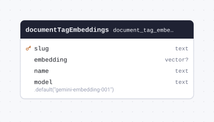

| Column      | Type     | Constraints | Default                            | Description |
| ----------- | -------- | ----------- | ---------------------------------- | ----------- |
| `slug`      | `text`   | PK NOT NULL |                                    |             |
| `embedding` | `vector` | NULL        |                                    |             |
| `name`      | `text`   | NOT NULL    |                                    |             |
| `model`     | `text`   | NOT NULL    | `.default("gemini-embedding-001")` |             |

#### Definition

```sql
CREATE TABLE "document_tag_embeddings" (
	"slug" text PRIMARY KEY,
	"embedding" vector(768),
	"name" text NOT NULL,
	"model" text DEFAULT 'gemini-embedding-001' NOT NULL
);

ALTER TABLE "document_tag_embeddings" ENABLE ROW LEVEL SECURITY;
```

<details>
<summary>Queries and their SQL</summary>

**Select**: Every row of documentTagEmbeddings.

```ts
db.select().from(documentTagEmbeddings);
```

```sql
select "slug", "embedding", "name", "model"
from "document_tag_embeddings"
```

**Count**: How many rows documentTagEmbeddings has.

```ts
db.select({ count: count() }).from(documentTagEmbeddings);
```

```sql
select count(*)
from "document_tag_embeddings"
```

**Find many**: The rows of documentTagEmbeddings, through the relational query API.

```ts
db.query.documentTagEmbeddings.findMany();
```

```sql
select "d0"."slug" as "slug", "d0"."embedding" as "embedding", "d0"."name" as "name", "d0"."model" as "model"
from "document_tag_embeddings" as "d0"
```

**Find by primary key**: One row of documentTagEmbeddings, through the relational query API.

```ts
db.query.documentTagEmbeddings.findFirst({ where: { slug: "slug" } });
```

```sql
select "d0"."slug" as "slug", "d0"."embedding" as "embedding", "d0"."name" as "name", "d0"."model" as "model"
from "document_tag_embeddings" as "d0"
where "d0"."slug" = $1
limit $2
-- params: ["slug",1]
```

**Insert**: Adds a row to documentTagEmbeddings, giving the columns that have no default.

```ts
db.insert(documentTagEmbeddings).values({ slug: "slug", name: "name" });
```

```sql
insert into "document_tag_embeddings" ("slug", "embedding", "name", "model")
values ($1, default, $2, default)
-- params: ["slug","name"]
```

**Update**: Changes a row of documentTagEmbeddings, found by its primary key.

```ts
db.update(documentTagEmbeddings)
  .set({ embedding: "embedding" })
  .where(eq(documentTagEmbeddings.slug, "slug"));
```

```sql
update "document_tag_embeddings"
set "embedding" = $1
where "document_tag_embeddings"."slug" = $2
-- params: ["\"embedding\"","slug"]
```

**Delete**: Deletes a row of documentTagEmbeddings, found by its primary key.

```ts
db.delete(documentTagEmbeddings).where(eq(documentTagEmbeddings.slug, "slug"));
```

```sql
delete from "document_tag_embeddings"
where "document_tag_embeddings"."slug" = $1
-- params: ["slug"]
```

</details>

<a id="table-transactionCategoryEmbeddings"></a>

### transactionCategoryEmbeddings

Table `transaction_category_embeddings`.

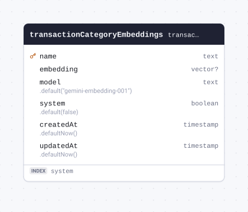

| Column                     | Type        | Constraints | Default                            | Description |
| -------------------------- | ----------- | ----------- | ---------------------------------- | ----------- |
| `name`                     | `text`      | PK NOT NULL |                                    |             |
| `embedding`                | `vector`    | NULL        |                                    |             |
| `model`                    | `text`      | NOT NULL    | `.default("gemini-embedding-001")` |             |
| `system`                   | `boolean`   | NOT NULL    | `.default(false)`                  |             |
| `createdAt` (`created_at`) | `timestamp` | NOT NULL    | `.defaultNow()`                    |             |
| `updatedAt` (`updated_at`) | `timestamp` | NOT NULL    | `.defaultNow()`                    |             |

#### Definition

```sql
CREATE TABLE "transaction_category_embeddings" (
	"name" text PRIMARY KEY,
	"embedding" vector(768),
	"model" text DEFAULT 'gemini-embedding-001' NOT NULL,
	"system" boolean DEFAULT false NOT NULL,
	"created_at" timestamp with time zone DEFAULT now() NOT NULL,
	"updated_at" timestamp with time zone DEFAULT now() NOT NULL
);

ALTER TABLE "transaction_category_embeddings" ENABLE ROW LEVEL SECURITY;

CREATE INDEX "transaction_category_embeddings_system_idx" ON "transaction_category_embeddings" ("system" bool_ops);
```

#### Indexes

- INDEX `system`

<details>
<summary>Queries and their SQL</summary>

**Select**: Every row of transactionCategoryEmbeddings.

```ts
db.select().from(transactionCategoryEmbeddings);
```

```sql
select "name", "embedding", "model", "system", "created_at", "updated_at"
from "transaction_category_embeddings"
```

**Count**: How many rows transactionCategoryEmbeddings has.

```ts
db.select({ count: count() }).from(transactionCategoryEmbeddings);
```

```sql
select count(*)
from "transaction_category_embeddings"
```

**Find many**: The rows of transactionCategoryEmbeddings, through the relational query API.

```ts
db.query.transactionCategoryEmbeddings.findMany();
```

```sql
select "d0"."name" as "name", "d0"."embedding" as "embedding", "d0"."model" as "model", "d0"."system" as "system", "d0"."created_at" as "createdAt", "d0"."updated_at" as "updatedAt"
from "transaction_category_embeddings" as "d0"
```

**Find by primary key**: One row of transactionCategoryEmbeddings, through the relational query API.

```ts
db.query.transactionCategoryEmbeddings.findFirst({ where: { name: "name" } });
```

```sql
select "d0"."name" as "name", "d0"."embedding" as "embedding", "d0"."model" as "model", "d0"."system" as "system", "d0"."created_at" as "createdAt", "d0"."updated_at" as "updatedAt"
from "transaction_category_embeddings" as "d0"
where "d0"."name" = $1
limit $2
-- params: ["name",1]
```

**Insert**: Adds a row to transactionCategoryEmbeddings, giving the columns that have no default.

```ts
db.insert(transactionCategoryEmbeddings).values({ name: "name" });
```

```sql
insert into "transaction_category_embeddings" ("name", "embedding", "model", "system", "created_at", "updated_at")
values ($1, default, default, default, default, default)
-- params: ["name"]
```

**Update**: Changes a row of transactionCategoryEmbeddings, found by its primary key.

```ts
db.update(transactionCategoryEmbeddings)
  .set({ embedding: "embedding" })
  .where(eq(transactionCategoryEmbeddings.name, "name"));
```

```sql
update "transaction_category_embeddings"
set "embedding" = $1
where "transaction_category_embeddings"."name" = $2
-- params: ["\"embedding\"","name"]
```

**Delete**: Deletes a row of transactionCategoryEmbeddings, found by its primary key.

```ts
db.delete(transactionCategoryEmbeddings).where(eq(transactionCategoryEmbeddings.name, "name"));
```

```sql
delete from "transaction_category_embeddings"
where "transaction_category_embeddings"."name" = $1
-- params: ["name"]
```

</details>

<a id="table-transactions"></a>

### transactions

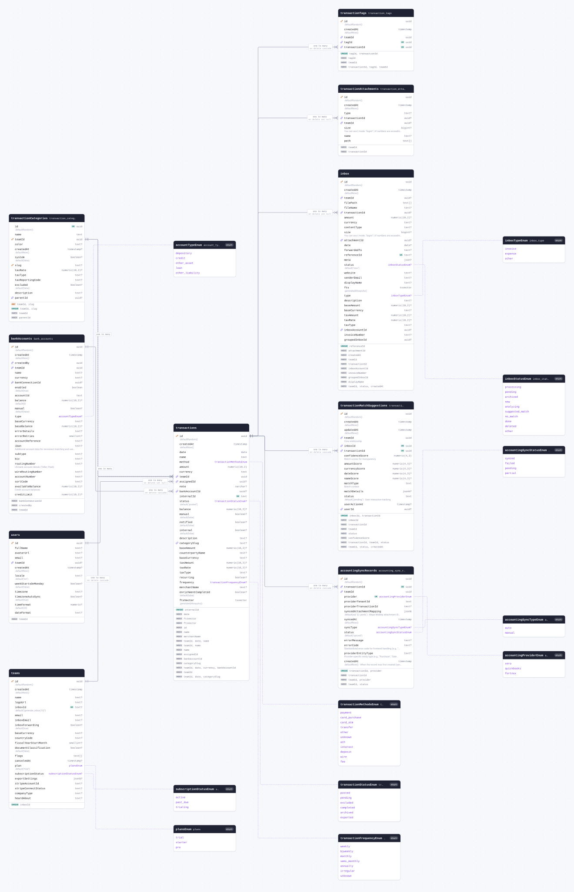

| Column                                         | Type                                                         | Constraints                                   | Default                | Description |
| ---------------------------------------------- | ------------------------------------------------------------ | --------------------------------------------- | ---------------------- | ----------- |
| `id`                                           | `uuid`                                                       | PK NOT NULL                                   | `.defaultRandom()`     |             |
| `createdAt` (`created_at`)                     | `timestamp`                                                  | NOT NULL                                      | `.defaultNow()`        |             |
| `date`                                         | `date`                                                       | NOT NULL                                      |                        |             |
| `name`                                         | `text`                                                       | NOT NULL                                      |                        |             |
| `method`                                       | [`transactionMethodsEnum`](#enum-transactionMethodsEnum)     | NOT NULL                                      |                        |             |
| `amount`                                       | `numeric(10,2)`                                              | NOT NULL                                      |                        |             |
| `currency`                                     | `text`                                                       | NOT NULL                                      |                        |             |
| `teamId` (`team_id`)                           | `uuid`                                                       | NOT NULL → [teams.id](#table-teams)           |                        |             |
| `assignedId` (`assigned_id`)                   | `uuid`                                                       | NULL → [users.id](#table-users)               |                        |             |
| `note`                                         | `varchar`                                                    | NULL                                          |                        |             |
| `bankAccountId` (`bank_account_id`)            | `uuid`                                                       | NULL → [bankAccounts.id](#table-bankAccounts) |                        |             |
| `internalId` (`internal_id`)                   | `text`                                                       | NOT NULL                                      |                        |             |
| `status`                                       | [`transactionStatusEnum`](#enum-transactionStatusEnum)       | NULL                                          | `.default("posted")`   |             |
| `balance`                                      | `numeric(10,2)`                                              | NULL                                          |                        |             |
| `manual`                                       | `boolean`                                                    | NULL                                          | `.default(false)`      |             |
| `notified`                                     | `boolean`                                                    | NULL                                          | `.default(false)`      |             |
| `internal`                                     | `boolean`                                                    | NULL                                          | `.default(false)`      |             |
| `description`                                  | `text`                                                       | NULL                                          |                        |             |
| `categorySlug` (`category_slug`)               | `text`                                                       | NULL                                          |                        |             |
| `baseAmount`                                   | `numeric(10,2)`                                              | NULL                                          |                        |             |
| `counterpartyName` (`counterparty_name`)       | `text`                                                       | NULL                                          |                        |             |
| `baseCurrency` (`base_currency`)               | `text`                                                       | NULL                                          |                        |             |
| `taxAmount` (`tax_amount`)                     | `numeric(10,2)`                                              | NULL                                          |                        |             |
| `taxRate` (`tax_rate`)                         | `numeric(10,2)`                                              | NULL                                          |                        |             |
| `taxType` (`tax_type`)                         | `text`                                                       | NULL                                          |                        |             |
| `recurring`                                    | `boolean`                                                    | NULL                                          |                        |             |
| `frequency`                                    | [`transactionFrequencyEnum`](#enum-transactionFrequencyEnum) | NULL                                          |                        |             |
| `merchantName` (`merchant_name`)               | `text`                                                       | NULL                                          |                        |             |
| `enrichmentCompleted` (`enrichment_completed`) | `boolean`                                                    | NULL                                          | `.default(false)`      |             |
| `ftsVector` (`fts_vector`)                     | `tsvector`                                                   | NOT NULL                                      | `.generatedAlwaysAs()` |             |

#### Definition

```sql
CREATE TABLE "transactions" (
	"id" uuid PRIMARY KEY DEFAULT gen_random_uuid(),
	"created_at" timestamp with time zone DEFAULT now() NOT NULL,
	"date" date NOT NULL,
	"name" text NOT NULL,
	"method" "transactionMethods" NOT NULL,
	"amount" numeric(10,2) NOT NULL,
	"currency" text NOT NULL,
	"team_id" uuid NOT NULL,
	"assigned_id" uuid,
	"note" varchar,
	"bank_account_id" uuid,
	"internal_id" text NOT NULL CONSTRAINT "transactions_internal_id_key" UNIQUE,
	"status" "transactionStatus" DEFAULT 'posted'::"transactionStatus",
	"balance" numeric(10,2),
	"manual" boolean DEFAULT false,
	"notified" boolean DEFAULT false,
	"internal" boolean DEFAULT false,
	"description" text,
	"category_slug" text,
	"baseAmount" numeric(10,2),
	"counterparty_name" text,
	"base_currency" text,
	"tax_amount" numeric(10,2),
	"tax_rate" numeric(10,2),
	"tax_type" text,
	"recurring" boolean,
	"frequency" "transaction_frequency",
	"merchant_name" text,
	"enrichment_completed" boolean DEFAULT false,
	"fts_vector" tsvector GENERATED ALWAYS AS (
				to_tsvector(
					'english',
					(
						(COALESCE(name, ''::text) || ' '::text) || COALESCE(description, ''::text)
					)
				)
			) STORED NOT NULL
);

ALTER TABLE "transactions" ENABLE ROW LEVEL SECURITY;

CREATE INDEX "idx_transactions_date" ON "transactions" ("date" date_ops);

CREATE INDEX "idx_transactions_fts" ON "transactions" USING gin ("fts_vector" tsvector_ops);

CREATE INDEX "idx_transactions_fts_vector" ON "transactions" USING gin ("fts_vector" tsvector_ops);

CREATE INDEX "idx_transactions_id" ON "transactions" ("id" uuid_ops);

CREATE INDEX "idx_transactions_name" ON "transactions" ("name" text_ops);

CREATE INDEX "idx_transactions_merchant_name_trgm" ON "transactions" USING gin ("merchant_name" gin_trgm_ops);

CREATE INDEX "idx_transactions_team_id_date_name" ON "transactions" ("team_id" date_ops,"date" date_ops,"name" uuid_ops);

CREATE INDEX "idx_transactions_team_id_name" ON "transactions" ("team_id" uuid_ops,"name" uuid_ops);

CREATE INDEX "idx_trgm_name" ON "transactions" USING gist ("name" gist_trgm_ops);

CREATE INDEX "transactions_assigned_id_idx" ON "transactions" ("assigned_id" uuid_ops);

CREATE INDEX "transactions_bank_account_id_idx" ON "transactions" ("bank_account_id" uuid_ops);

CREATE INDEX "transactions_category_slug_idx" ON "transactions" ("category_slug" text_ops);

CREATE INDEX "transactions_team_id_date_currency_bank_account_id_category_idx" ON "transactions" ("team_id" enum_ops,"date" date_ops,"currency" text_ops,"bank_account_id" date_ops);

CREATE INDEX "transactions_team_id_idx" ON "transactions" ("team_id" uuid_ops);

CREATE INDEX "idx_transactions_reports" ON "transactions" ("team_id" uuid_ops,"date" date_ops,"category_slug" text_ops) WHERE internal = false AND status != 'excluded';

ALTER TABLE "transactions" ADD CONSTRAINT "public_transactions_assigned_id_fkey" FOREIGN KEY ("assigned_id") REFERENCES "users"("id") ON DELETE SET NULL;

ALTER TABLE "transactions" ADD CONSTRAINT "public_transactions_team_id_fkey" FOREIGN KEY ("team_id") REFERENCES "teams"("id") ON DELETE CASCADE;

ALTER TABLE "transactions" ADD CONSTRAINT "transactions_bank_account_id_fkey" FOREIGN KEY ("bank_account_id") REFERENCES "bank_accounts"("id") ON DELETE CASCADE;

ALTER TABLE "transactions" ADD CONSTRAINT "transactions_category_slug_team_id_fkey" FOREIGN KEY ("team_id","category_slug") REFERENCES "transaction_categories"("team_id","slug");
```

#### Indexes

- INDEX `date`
- INDEX `ftsVector`
- INDEX `ftsVector`
- INDEX `id`
- INDEX `name`
- INDEX `merchantName`
- INDEX `teamId`, `date`, `name`
- INDEX `teamId`, `name`
- INDEX `name`
- INDEX `assignedId`
- INDEX `bankAccountId`
- INDEX `categorySlug`
- INDEX `teamId`, `date`, `currency`, `bankAccountId`
- INDEX `teamId`
- INDEX `teamId`, `date`, `categorySlug`
- UNIQUE `internalId`

#### References

- `assignedId` → [users.id](#table-users) (many to one, on delete set null)
- `teamId` → [teams.id](#table-teams) (many to one, on delete cascade)
- `bankAccountId` → [bankAccounts.id](#table-bankAccounts) (many to one, on delete cascade)
- `teamId` → [transactionCategories.teamId](#table-transactionCategories) (many to one)
- `teamId` → [transactionCategories.teamId](#table-transactionCategories) (many to one, defineRelations, no foreign key)

#### Referenced by

- `id` → [transactionTags.transactionId](#table-transactionTags) (one to many, on delete cascade)
- `id` → [transactionAttachments.transactionId](#table-transactionAttachments) (one to many, on delete set null)
- `id` → [inbox.transactionId](#table-inbox) (one to many, on delete set null)
- `id` → [transactionMatchSuggestions.transactionId](#table-transactionMatchSuggestions) (one to many, on delete cascade)
- `id` → [accountingSyncRecords.transactionId](#table-accountingSyncRecords) (one to many, on delete cascade)

<details>
<summary>Queries and their SQL</summary>

**Select**: Every row of transactions.

```ts
db.select().from(transactions);
```

```sql
select "id", "created_at", "date", "name", "method", "amount", "currency", "team_id", "assigned_id", "note", "bank_account_id", "internal_id", "status", "balance", "manual", "notified", "internal", "description", "category_slug", "baseAmount", "counterparty_name", "base_currency", "tax_amount", "tax_rate", "tax_type", "recurring", "frequency", "merchant_name", "enrichment_completed", "fts_vector"
from "transactions"
```

**Count**: How many rows transactions has.

```ts
db.select({ count: count() }).from(transactions);
```

```sql
select count(*)
from "transactions"
```

**Find many**: The rows of transactions, through the relational query API.

```ts
db.query.transactions.findMany();
```

```sql
select "d0"."id" as "id", "d0"."created_at" as "createdAt", "d0"."date" as "date", "d0"."name" as "name", "d0"."method" as "method", "d0"."amount" as "amount", "d0"."currency" as "currency", "d0"."team_id" as "teamId", "d0"."assigned_id" as "assignedId", "d0"."note" as "note", "d0"."bank_account_id" as "bankAccountId", "d0"."internal_id" as "internalId", "d0"."status" as "status", "d0"."balance" as "balance", "d0"."manual" as "manual", "d0"."notified" as "notified", "d0"."internal" as "internal", "d0"."description" as "description", "d0"."category_slug" as "categorySlug", "d0"."baseAmount" as "baseAmount", "d0"."counterparty_name" as "counterpartyName", "d0"."base_currency" as "baseCurrency", "d0"."tax_amount" as "taxAmount", "d0"."tax_rate" as "taxRate", "d0"."tax_type" as "taxType", "d0"."recurring" as "recurring", "d0"."frequency" as "frequency", "d0"."merchant_name" as "merchantName", "d0"."enrichment_completed" as "enrichmentCompleted", "d0"."fts_vector" as "ftsVector"
from "transactions" as "d0"
```

**Find by primary key**: One row of transactions, through the relational query API.

```ts
db.query.transactions.findFirst({ where: { id: "00000000-0000-0000-0000-000000000000" } });
```

```sql
select "d0"."id" as "id", "d0"."created_at" as "createdAt", "d0"."date" as "date", "d0"."name" as "name", "d0"."method" as "method", "d0"."amount" as "amount", "d0"."currency" as "currency", "d0"."team_id" as "teamId", "d0"."assigned_id" as "assignedId", "d0"."note" as "note", "d0"."bank_account_id" as "bankAccountId", "d0"."internal_id" as "internalId", "d0"."status" as "status", "d0"."balance" as "balance", "d0"."manual" as "manual", "d0"."notified" as "notified", "d0"."internal" as "internal", "d0"."description" as "description", "d0"."category_slug" as "categorySlug", "d0"."baseAmount" as "baseAmount", "d0"."counterparty_name" as "counterpartyName", "d0"."base_currency" as "baseCurrency", "d0"."tax_amount" as "taxAmount", "d0"."tax_rate" as "taxRate", "d0"."tax_type" as "taxType", "d0"."recurring" as "recurring", "d0"."frequency" as "frequency", "d0"."merchant_name" as "merchantName", "d0"."enrichment_completed" as "enrichmentCompleted", "d0"."fts_vector" as "ftsVector"
from "transactions" as "d0"
where "d0"."id" = $1
limit $2
-- params: ["00000000-0000-0000-0000-000000000000",1]
```

**Insert**: Adds a row to transactions, giving the columns that have no default.

```ts
db.insert(transactions).values({
  date: new Date("2026-01-01T00:00:00.000Z"),
  name: "name",
  method: "payment",
  amount: "amount",
  currency: "currency",
  teamId: "00000000-0000-0000-0000-000000000000",
  internalId: "internalId",
});
```

```sql
insert into "transactions" ("id", "created_at", "date", "name", "method", "amount", "currency", "team_id", "assigned_id", "note", "bank_account_id", "internal_id", "status", "balance", "manual", "notified", "internal", "description", "category_slug", "baseAmount", "counterparty_name", "base_currency", "tax_amount", "tax_rate", "tax_type", "recurring", "frequency", "merchant_name", "enrichment_completed")
values (default, default, $1, $2, $3, $4, $5, $6, default, default, default, $7, default, default, default, default, default, default, default, default, default, default, default, default, default, default, default, default, default)
-- params: ["2026-01-01T00:00:00.000Z","name","payment","amount","currency","00000000-0000-0000-0000-000000000000","internalId"]
```

**Update**: Changes a row of transactions, found by its primary key.

```ts
db.update(transactions)
  .set({ createdAt: new Date("2026-01-01T00:00:00.000Z") })
  .where(eq(transactions.id, "00000000-0000-0000-0000-000000000000"));
```

```sql
update "transactions"
set "created_at" = $1
where "transactions"."id" = $2
-- params: ["2026-01-01T00:00:00.000Z","00000000-0000-0000-0000-000000000000"]
```

**Delete**: Deletes a row of transactions, found by its primary key.

```ts
db.delete(transactions).where(eq(transactions.id, "00000000-0000-0000-0000-000000000000"));
```

```sql
delete from "transactions"
where "transactions"."id" = $1
-- params: ["00000000-0000-0000-0000-000000000000"]
```

</details>

<a id="table-trackerEntries"></a>

### trackerEntries

Table `tracker_entries`.

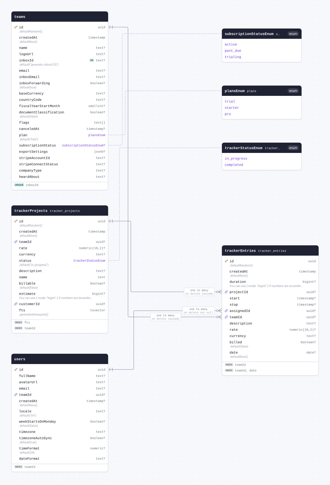

| Column                       | Type            | Constraints                                         | Default            | Description                                                                   |
| ---------------------------- | --------------- | --------------------------------------------------- | ------------------ | ----------------------------------------------------------------------------- |
| `id`                         | `uuid`          | PK NOT NULL                                         | `.defaultRandom()` |                                                                               |
| `createdAt` (`created_at`)   | `timestamp`     | NOT NULL                                            | `.defaultNow()`    |                                                                               |
| `duration`                   | `bigint`        | NULL                                                |                    | You can use { mode: "bigint" } if numbers are exceeding js number limitations |
| `projectId` (`project_id`)   | `uuid`          | NULL → [trackerProjects.id](#table-trackerProjects) |                    |                                                                               |
| `start`                      | `timestamp`     | NULL                                                |                    |                                                                               |
| `stop`                       | `timestamp`     | NULL                                                |                    |                                                                               |
| `assignedId` (`assigned_id`) | `uuid`          | NULL → [users.id](#table-users)                     |                    |                                                                               |
| `teamId` (`team_id`)         | `uuid`          | NULL → [teams.id](#table-teams)                     |                    |                                                                               |
| `description`                | `text`          | NULL                                                |                    |                                                                               |
| `rate`                       | `numeric(10,2)` | NULL                                                |                    |                                                                               |
| `currency`                   | `text`          | NULL                                                |                    |                                                                               |
| `billed`                     | `boolean`       | NULL                                                | `.default(false)`  |                                                                               |
| `date`                       | `date`          | NULL                                                | `.defaultNow()`    |                                                                               |

#### Definition

```sql
CREATE TABLE "tracker_entries" (
	"id" uuid PRIMARY KEY DEFAULT gen_random_uuid(),
	"created_at" timestamp with time zone DEFAULT now() NOT NULL,
	"duration" bigint,
	"project_id" uuid,
	"start" timestamp with time zone,
	"stop" timestamp with time zone,
	"assigned_id" uuid,
	"team_id" uuid,
	"description" text,
	"rate" numeric(10,2),
	"currency" text,
	"billed" boolean DEFAULT false,
	"date" date DEFAULT now()
);

ALTER TABLE "tracker_entries" ENABLE ROW LEVEL SECURITY;

CREATE INDEX "tracker_entries_team_id_idx" ON "tracker_entries" ("team_id" uuid_ops);

CREATE INDEX "tracker_entries_team_date_idx" ON "tracker_entries" ("team_id","date");

ALTER TABLE "tracker_entries" ADD CONSTRAINT "tracker_entries_assigned_id_fkey" FOREIGN KEY ("assigned_id") REFERENCES "users"("id") ON DELETE SET NULL;

ALTER TABLE "tracker_entries" ADD CONSTRAINT "tracker_entries_project_id_fkey" FOREIGN KEY ("project_id") REFERENCES "tracker_projects"("id") ON DELETE CASCADE;

ALTER TABLE "tracker_entries" ADD CONSTRAINT "tracker_entries_team_id_fkey" FOREIGN KEY ("team_id") REFERENCES "teams"("id") ON DELETE CASCADE;
```

#### Indexes

- INDEX `teamId`
- INDEX `teamId`, `date`

#### References

- `assignedId` → [users.id](#table-users) (many to one, on delete set null)
- `projectId` → [trackerProjects.id](#table-trackerProjects) (many to one, on delete cascade)
- `teamId` → [teams.id](#table-teams) (many to one, on delete cascade)

<details>
<summary>Queries and their SQL</summary>

**Select**: Every row of trackerEntries.

```ts
db.select().from(trackerEntries);
```

```sql
select "id", "created_at", "duration", "project_id", "start", "stop", "assigned_id", "team_id", "description", "rate", "currency", "billed", "date"
from "tracker_entries"
```

**Count**: How many rows trackerEntries has.

```ts
db.select({ count: count() }).from(trackerEntries);
```

```sql
select count(*)
from "tracker_entries"
```

**Find many**: The rows of trackerEntries, through the relational query API.

```ts
db.query.trackerEntries.findMany();
```

```sql
select "d0"."id" as "id", "d0"."created_at" as "createdAt", "d0"."duration" as "duration", "d0"."project_id" as "projectId", "d0"."start" as "start", "d0"."stop" as "stop", "d0"."assigned_id" as "assignedId", "d0"."team_id" as "teamId", "d0"."description" as "description", "d0"."rate" as "rate", "d0"."currency" as "currency", "d0"."billed" as "billed", "d0"."date" as "date"
from "tracker_entries" as "d0"
```

**Find by primary key**: One row of trackerEntries, through the relational query API.

```ts
db.query.trackerEntries.findFirst({ where: { id: "00000000-0000-0000-0000-000000000000" } });
```

```sql
select "d0"."id" as "id", "d0"."created_at" as "createdAt", "d0"."duration" as "duration", "d0"."project_id" as "projectId", "d0"."start" as "start", "d0"."stop" as "stop", "d0"."assigned_id" as "assignedId", "d0"."team_id" as "teamId", "d0"."description" as "description", "d0"."rate" as "rate", "d0"."currency" as "currency", "d0"."billed" as "billed", "d0"."date" as "date"
from "tracker_entries" as "d0"
where "d0"."id" = $1
limit $2
-- params: ["00000000-0000-0000-0000-000000000000",1]
```

**Insert**: Adds a row to trackerEntries, giving the columns that have no default.

```ts
db.insert(trackerEntries).values({});
```

```sql
insert into "tracker_entries" ("id", "created_at", "duration", "project_id", "start", "stop", "assigned_id", "team_id", "description", "rate", "currency", "billed", "date")
values (default, default, default, default, default, default, default, default, default, default, default, default, default)
```

**Update**: Changes a row of trackerEntries, found by its primary key.

```ts
db.update(trackerEntries)
  .set({ createdAt: new Date("2026-01-01T00:00:00.000Z") })
  .where(eq(trackerEntries.id, "00000000-0000-0000-0000-000000000000"));
```

```sql
update "tracker_entries"
set "created_at" = $1
where "tracker_entries"."id" = $2
-- params: ["2026-01-01T00:00:00.000Z","00000000-0000-0000-0000-000000000000"]
```

**Delete**: Deletes a row of trackerEntries, found by its primary key.

```ts
db.delete(trackerEntries).where(eq(trackerEntries.id, "00000000-0000-0000-0000-000000000000"));
```

```sql
delete from "tracker_entries"
where "tracker_entries"."id" = $1
-- params: ["00000000-0000-0000-0000-000000000000"]
```

</details>

<a id="table-customerTags"></a>

### customerTags

Table `customer_tags`.

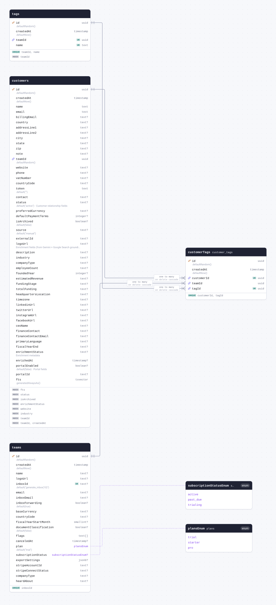

| Column                       | Type        | Constraints                                 | Default            | Description |
| ---------------------------- | ----------- | ------------------------------------------- | ------------------ | ----------- |
| `id`                         | `uuid`      | PK NOT NULL                                 | `.defaultRandom()` |             |
| `createdAt` (`created_at`)   | `timestamp` | NOT NULL                                    | `.defaultNow()`    |             |
| `customerId` (`customer_id`) | `uuid`      | NOT NULL → [customers.id](#table-customers) |                    |             |
| `teamId` (`team_id`)         | `uuid`      | NOT NULL → [teams.id](#table-teams)         |                    |             |
| `tagId` (`tag_id`)           | `uuid`      | NOT NULL → [tags.id](#table-tags)           |                    |             |

#### Definition

```sql
CREATE TABLE "customer_tags" (
	"id" uuid PRIMARY KEY DEFAULT gen_random_uuid(),
	"created_at" timestamp with time zone DEFAULT now() NOT NULL,
	"customer_id" uuid NOT NULL,
	"team_id" uuid NOT NULL,
	"tag_id" uuid NOT NULL,
	CONSTRAINT "unique_customer_tag" UNIQUE("customer_id","tag_id")
);

ALTER TABLE "customer_tags" ENABLE ROW LEVEL SECURITY;

ALTER TABLE "customer_tags" ADD CONSTRAINT "customer_tags_customer_id_fkey" FOREIGN KEY ("customer_id") REFERENCES "customers"("id") ON DELETE CASCADE;

ALTER TABLE "customer_tags" ADD CONSTRAINT "customer_tags_tag_id_fkey" FOREIGN KEY ("tag_id") REFERENCES "tags"("id") ON DELETE CASCADE;

ALTER TABLE "customer_tags" ADD CONSTRAINT "customer_tags_team_id_fkey" FOREIGN KEY ("team_id") REFERENCES "teams"("id") ON DELETE CASCADE;
```

#### Indexes

- UNIQUE `customerId`, `tagId`

#### References

- `customerId` → [customers.id](#table-customers) (many to one, on delete cascade)
- `tagId` → [tags.id](#table-tags) (many to one, on delete cascade)
- `teamId` → [teams.id](#table-teams) (many to one, on delete cascade)

<details>
<summary>Queries and their SQL</summary>

**Select**: Every row of customerTags.

```ts
db.select().from(customerTags);
```

```sql
select "id", "created_at", "customer_id", "team_id", "tag_id"
from "customer_tags"
```

**Count**: How many rows customerTags has.

```ts
db.select({ count: count() }).from(customerTags);
```

```sql
select count(*)
from "customer_tags"
```

**Find many**: The rows of customerTags, through the relational query API.

```ts
db.query.customerTags.findMany();
```

```sql
select "d0"."id" as "id", "d0"."created_at" as "createdAt", "d0"."customer_id" as "customerId", "d0"."team_id" as "teamId", "d0"."tag_id" as "tagId"
from "customer_tags" as "d0"
```

**Find by primary key**: One row of customerTags, through the relational query API.

```ts
db.query.customerTags.findFirst({ where: { id: "00000000-0000-0000-0000-000000000000" } });
```

```sql
select "d0"."id" as "id", "d0"."created_at" as "createdAt", "d0"."customer_id" as "customerId", "d0"."team_id" as "teamId", "d0"."tag_id" as "tagId"
from "customer_tags" as "d0"
where "d0"."id" = $1
limit $2
-- params: ["00000000-0000-0000-0000-000000000000",1]
```

**Insert**: Adds a row to customerTags, giving the columns that have no default.

```ts
db.insert(customerTags).values({
  customerId: "00000000-0000-0000-0000-000000000000",
  teamId: "00000000-0000-0000-0000-000000000000",
  tagId: "00000000-0000-0000-0000-000000000000",
});
```

```sql
insert into "customer_tags" ("id", "created_at", "customer_id", "team_id", "tag_id")
values (default, default, $1, $2, $3)
-- params: ["00000000-0000-0000-0000-000000000000","00000000-0000-0000-0000-000000000000","00000000-0000-0000-0000-000000000000"]
```

**Update**: Changes a row of customerTags, found by its primary key.

```ts
db.update(customerTags)
  .set({ createdAt: new Date("2026-01-01T00:00:00.000Z") })
  .where(eq(customerTags.id, "00000000-0000-0000-0000-000000000000"));
```

```sql
update "customer_tags"
set "created_at" = $1
where "customer_tags"."id" = $2
-- params: ["2026-01-01T00:00:00.000Z","00000000-0000-0000-0000-000000000000"]
```

**Delete**: Deletes a row of customerTags, found by its primary key.

```ts
db.delete(customerTags).where(eq(customerTags.id, "00000000-0000-0000-0000-000000000000"));
```

```sql
delete from "customer_tags"
where "customer_tags"."id" = $1
-- params: ["00000000-0000-0000-0000-000000000000"]
```

</details>

<a id="table-inboxAccounts"></a>

### inboxAccounts

Table `inbox_accounts`.

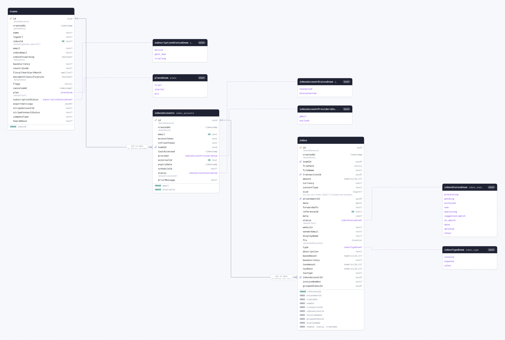

| Column                           | Type                                                           | Constraints                         | Default                 | Description |
| -------------------------------- | -------------------------------------------------------------- | ----------------------------------- | ----------------------- | ----------- |
| `id`                             | `uuid`                                                         | PK NOT NULL                         | `.defaultRandom()`      |             |
| `createdAt` (`created_at`)       | `timestamp`                                                    | NOT NULL                            | `.defaultNow()`         |             |
| `email`                          | `text`                                                         | NOT NULL                            |                         |             |
| `accessToken` (`access_token`)   | `text`                                                         | NOT NULL                            |                         |             |
| `refreshToken` (`refresh_token`) | `text`                                                         | NOT NULL                            |                         |             |
| `teamId` (`team_id`)             | `uuid`                                                         | NOT NULL → [teams.id](#table-teams) |                         |             |
| `lastAccessed` (`last_accessed`) | `timestamp`                                                    | NOT NULL                            |                         |             |
| `provider`                       | [`inboxAccountProvidersEnum`](#enum-inboxAccountProvidersEnum) | NOT NULL                            |                         |             |
| `externalId` (`external_id`)     | `text`                                                         | NOT NULL                            |                         |             |
| `expiryDate` (`expiry_date`)     | `timestamp`                                                    | NOT NULL                            |                         |             |
| `scheduleId` (`schedule_id`)     | `text`                                                         | NULL                                |                         |             |
| `status`                         | [`inboxAccountStatusEnum`](#enum-inboxAccountStatusEnum)       | NOT NULL                            | `.default("connected")` |             |
| `errorMessage` (`error_message`) | `text`                                                         | NULL                                |                         |             |

#### Definition

```sql
CREATE TABLE "inbox_accounts" (
	"id" uuid PRIMARY KEY DEFAULT gen_random_uuid(),
	"created_at" timestamp with time zone DEFAULT now() NOT NULL,
	"email" text NOT NULL CONSTRAINT "inbox_accounts_email_key" UNIQUE,
	"access_token" text NOT NULL,
	"refresh_token" text NOT NULL,
	"team_id" uuid NOT NULL,
	"last_accessed" timestamp with time zone NOT NULL,
	"provider" "inbox_account_providers" NOT NULL,
	"external_id" text NOT NULL CONSTRAINT "inbox_accounts_external_id_key" UNIQUE,
	"expiry_date" timestamp with time zone NOT NULL,
	"schedule_id" text,
	"status" "inbox_account_status" DEFAULT 'connected'::"inbox_account_status" NOT NULL,
	"error_message" text
);

ALTER TABLE "inbox_accounts" ENABLE ROW LEVEL SECURITY;

ALTER TABLE "inbox_accounts" ADD CONSTRAINT "inbox_accounts_team_id_fkey" FOREIGN KEY ("team_id") REFERENCES "teams"("id") ON DELETE CASCADE;
```

#### Indexes

- UNIQUE `email`
- UNIQUE `externalId`

#### References

- `teamId` → [teams.id](#table-teams) (many to one, on delete cascade)

#### Referenced by

- `id` → [inbox.inboxAccountId](#table-inbox) (one to many, on delete set null)

<details>
<summary>Queries and their SQL</summary>

**Select**: Every row of inboxAccounts.

```ts
db.select().from(inboxAccounts);
```

```sql
select "id", "created_at", "email", "access_token", "refresh_token", "team_id", "last_accessed", "provider", "external_id", "expiry_date", "schedule_id", "status", "error_message"
from "inbox_accounts"
```

**Count**: How many rows inboxAccounts has.

```ts
db.select({ count: count() }).from(inboxAccounts);
```

```sql
select count(*)
from "inbox_accounts"
```

**Find many**: The rows of inboxAccounts, through the relational query API.

```ts
db.query.inboxAccounts.findMany();
```

```sql
select "d0"."id" as "id", "d0"."created_at" as "createdAt", "d0"."email" as "email", "d0"."access_token" as "accessToken", "d0"."refresh_token" as "refreshToken", "d0"."team_id" as "teamId", "d0"."last_accessed" as "lastAccessed", "d0"."provider" as "provider", "d0"."external_id" as "externalId", "d0"."expiry_date" as "expiryDate", "d0"."schedule_id" as "scheduleId", "d0"."status" as "status", "d0"."error_message" as "errorMessage"
from "inbox_accounts" as "d0"
```

**Find by primary key**: One row of inboxAccounts, through the relational query API.

```ts
db.query.inboxAccounts.findFirst({ where: { id: "00000000-0000-0000-0000-000000000000" } });
```

```sql
select "d0"."id" as "id", "d0"."created_at" as "createdAt", "d0"."email" as "email", "d0"."access_token" as "accessToken", "d0"."refresh_token" as "refreshToken", "d0"."team_id" as "teamId", "d0"."last_accessed" as "lastAccessed", "d0"."provider" as "provider", "d0"."external_id" as "externalId", "d0"."expiry_date" as "expiryDate", "d0"."schedule_id" as "scheduleId", "d0"."status" as "status", "d0"."error_message" as "errorMessage"
from "inbox_accounts" as "d0"
where "d0"."id" = $1
limit $2
-- params: ["00000000-0000-0000-0000-000000000000",1]
```

**Insert**: Adds a row to inboxAccounts, giving the columns that have no default.

```ts
db.insert(inboxAccounts).values({
  email: "email",
  accessToken: "accessToken",
  refreshToken: "refreshToken",
  teamId: "00000000-0000-0000-0000-000000000000",
  lastAccessed: new Date("2026-01-01T00:00:00.000Z"),
  provider: "gmail",
  externalId: "externalId",
  expiryDate: new Date("2026-01-01T00:00:00.000Z"),
});
```

```sql
insert into "inbox_accounts" ("id", "created_at", "email", "access_token", "refresh_token", "team_id", "last_accessed", "provider", "external_id", "expiry_date", "schedule_id", "status", "error_message")
values (default, default, $1, $2, $3, $4, $5, $6, $7, $8, default, default, default)
-- params: ["email","accessToken","refreshToken","00000000-0000-0000-0000-000000000000","2026-01-01T00:00:00.000Z","gmail","externalId","2026-01-01T00:00:00.000Z"]
```

**Update**: Changes a row of inboxAccounts, found by its primary key.

```ts
db.update(inboxAccounts)
  .set({ createdAt: new Date("2026-01-01T00:00:00.000Z") })
  .where(eq(inboxAccounts.id, "00000000-0000-0000-0000-000000000000"));
```

```sql
update "inbox_accounts"
set "created_at" = $1
where "inbox_accounts"."id" = $2
-- params: ["2026-01-01T00:00:00.000Z","00000000-0000-0000-0000-000000000000"]
```

**Delete**: Deletes a row of inboxAccounts, found by its primary key.

```ts
db.delete(inboxAccounts).where(eq(inboxAccounts.id, "00000000-0000-0000-0000-000000000000"));
```

```sql
delete from "inbox_accounts"
where "inbox_accounts"."id" = $1
-- params: ["00000000-0000-0000-0000-000000000000"]
```

</details>

<a id="table-bankAccounts"></a>

### bankAccounts

Table `bank_accounts`.

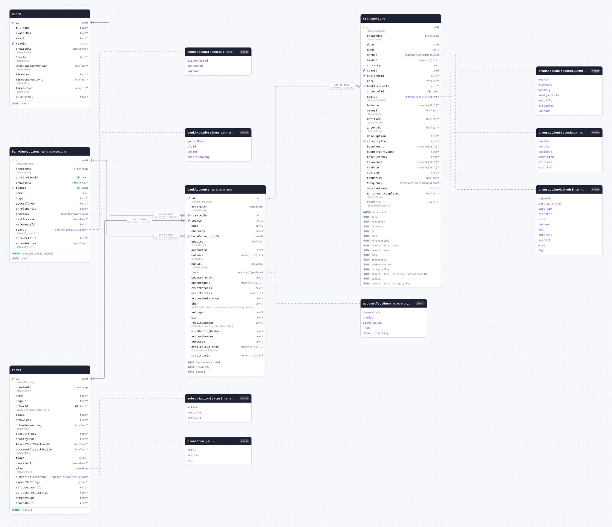

| Column                                      | Type                                       | Constraints                                         | Default            | Description                                                     |
| ------------------------------------------- | ------------------------------------------ | --------------------------------------------------- | ------------------ | --------------------------------------------------------------- |
| `id`                                        | `uuid`                                     | PK NOT NULL                                         | `.defaultRandom()` |                                                                 |
| `createdAt` (`created_at`)                  | `timestamp`                                | NOT NULL                                            | `.defaultNow()`    |                                                                 |
| `createdBy` (`created_by`)                  | `uuid`                                     | NOT NULL → [users.id](#table-users)                 |                    |                                                                 |
| `teamId` (`team_id`)                        | `uuid`                                     | NOT NULL → [teams.id](#table-teams)                 |                    |                                                                 |
| `name`                                      | `text`                                     | NULL                                                |                    |                                                                 |
| `currency`                                  | `text`                                     | NULL                                                |                    |                                                                 |
| `bankConnectionId` (`bank_connection_id`)   | `uuid`                                     | NULL → [bankConnections.id](#table-bankConnections) |                    |                                                                 |
| `enabled`                                   | `boolean`                                  | NOT NULL                                            | `.default(true)`   |                                                                 |
| `accountId` (`account_id`)                  | `text`                                     | NOT NULL                                            |                    |                                                                 |
| `balance`                                   | `numeric(10,2)`                            | NULL                                                | `.default(0)`      |                                                                 |
| `manual`                                    | `boolean`                                  | NULL                                                | `.default(false)`  |                                                                 |
| `type`                                      | [`accountTypeEnum`](#enum-accountTypeEnum) | NULL                                                |                    |                                                                 |
| `baseCurrency` (`base_currency`)            | `text`                                     | NULL                                                |                    |                                                                 |
| `baseBalance`                               | `numeric(10,2)`                            | NULL                                                |                    |                                                                 |
| `errorDetails` (`error_details`)            | `text`                                     | NULL                                                |                    |                                                                 |
| `errorRetries` (`error_retries`)            | `smallint`                                 | NULL                                                |                    |                                                                 |
| `accountReference` (`account_reference`)    | `text`                                     | NULL                                                |                    |                                                                 |
| `iban`                                      | `text`                                     | NULL                                                |                    | Additional account data for reconnect matching and user display |
| `subtype`                                   | `text`                                     | NULL                                                |                    |                                                                 |
| `bic`                                       | `text`                                     | NULL                                                |                    |                                                                 |
| `routingNumber` (`routing_number`)          | `text`                                     | NULL                                                |                    | US bank account details (Teller, Plaid)                         |
| `wireRoutingNumber` (`wire_routing_number`) | `text`                                     | NULL                                                |                    |                                                                 |
| `accountNumber` (`account_number`)          | `text`                                     | NULL                                                |                    |                                                                 |
| `sortCode` (`sort_code`)                    | `text`                                     | NULL                                                |                    |                                                                 |
| `availableBalance`                          | `numeric(10,2)`                            | NULL                                                |                    | Credit account balances                                         |
| `creditLimit`                               | `numeric(10,2)`                            | NULL                                                |                    |                                                                 |

#### Definition

```sql
CREATE TABLE "bank_accounts" (
	"id" uuid PRIMARY KEY DEFAULT gen_random_uuid(),
	"created_at" timestamp with time zone DEFAULT now() NOT NULL,
	"created_by" uuid NOT NULL,
	"team_id" uuid NOT NULL,
	"name" text,
	"currency" text,
	"bank_connection_id" uuid,
	"enabled" boolean DEFAULT true NOT NULL,
	"account_id" text NOT NULL,
	"balance" numeric(10,2) DEFAULT '0',
	"manual" boolean DEFAULT false,
	"type" "account_type",
	"base_currency" text,
	"baseBalance" numeric(10,2),
	"error_details" text,
	"error_retries" smallint,
	"account_reference" text,
	"iban" text,
	"subtype" text,
	"bic" text,
	"routing_number" text,
	"wire_routing_number" text,
	"account_number" text,
	"sort_code" text,
	"availableBalance" numeric(10,2),
	"creditLimit" numeric(10,2)
);

ALTER TABLE "bank_accounts" ENABLE ROW LEVEL SECURITY;

CREATE INDEX "bank_accounts_bank_connection_id_idx" ON "bank_accounts" ("bank_connection_id" uuid_ops);

CREATE INDEX "bank_accounts_created_by_idx" ON "bank_accounts" ("created_by" uuid_ops);

CREATE INDEX "bank_accounts_team_id_idx" ON "bank_accounts" ("team_id" uuid_ops);

ALTER TABLE "bank_accounts" ADD CONSTRAINT "bank_accounts_bank_connection_id_fkey" FOREIGN KEY ("bank_connection_id") REFERENCES "bank_connections"("id") ON DELETE CASCADE;

ALTER TABLE "bank_accounts" ADD CONSTRAINT "bank_accounts_created_by_fkey" FOREIGN KEY ("created_by") REFERENCES "users"("id") ON DELETE CASCADE;

ALTER TABLE "bank_accounts" ADD CONSTRAINT "public_bank_accounts_team_id_fkey" FOREIGN KEY ("team_id") REFERENCES "teams"("id") ON DELETE CASCADE;
```

#### Indexes

- INDEX `bankConnectionId`
- INDEX `createdBy`
- INDEX `teamId`

#### References

- `bankConnectionId` → [bankConnections.id](#table-bankConnections) (many to one, on delete cascade)
- `createdBy` → [users.id](#table-users) (many to one, on delete cascade)
- `teamId` → [teams.id](#table-teams) (many to one, on delete cascade)

#### Referenced by

- `id` → [transactions.bankAccountId](#table-transactions) (one to many, on delete cascade)

<details>
<summary>Queries and their SQL</summary>

**Select**: Every row of bankAccounts.

```ts
db.select().from(bankAccounts);
```

```sql
select "id", "created_at", "created_by", "team_id", "name", "currency", "bank_connection_id", "enabled", "account_id", "balance", "manual", "type", "base_currency", "baseBalance", "error_details", "error_retries", "account_reference", "iban", "subtype", "bic", "routing_number", "wire_routing_number", "account_number", "sort_code", "availableBalance", "creditLimit"
from "bank_accounts"
```

**Count**: How many rows bankAccounts has.

```ts
db.select({ count: count() }).from(bankAccounts);
```

```sql
select count(*)
from "bank_accounts"
```

**Find many**: The rows of bankAccounts, through the relational query API.

```ts
db.query.bankAccounts.findMany();
```

```sql
select "d0"."id" as "id", "d0"."created_at" as "createdAt", "d0"."created_by" as "createdBy", "d0"."team_id" as "teamId", "d0"."name" as "name", "d0"."currency" as "currency", "d0"."bank_connection_id" as "bankConnectionId", "d0"."enabled" as "enabled", "d0"."account_id" as "accountId", "d0"."balance" as "balance", "d0"."manual" as "manual", "d0"."type" as "type", "d0"."base_currency" as "baseCurrency", "d0"."baseBalance" as "baseBalance", "d0"."error_details" as "errorDetails", "d0"."error_retries" as "errorRetries", "d0"."account_reference" as "accountReference", "d0"."iban" as "iban", "d0"."subtype" as "subtype", "d0"."bic" as "bic", "d0"."routing_number" as "routingNumber", "d0"."wire_routing_number" as "wireRoutingNumber", "d0"."account_number" as "accountNumber", "d0"."sort_code" as "sortCode", "d0"."availableBalance" as "availableBalance", "d0"."creditLimit" as "creditLimit"
from "bank_accounts" as "d0"
```

**Find by primary key**: One row of bankAccounts, through the relational query API.

```ts
db.query.bankAccounts.findFirst({ where: { id: "00000000-0000-0000-0000-000000000000" } });
```

```sql
select "d0"."id" as "id", "d0"."created_at" as "createdAt", "d0"."created_by" as "createdBy", "d0"."team_id" as "teamId", "d0"."name" as "name", "d0"."currency" as "currency", "d0"."bank_connection_id" as "bankConnectionId", "d0"."enabled" as "enabled", "d0"."account_id" as "accountId", "d0"."balance" as "balance", "d0"."manual" as "manual", "d0"."type" as "type", "d0"."base_currency" as "baseCurrency", "d0"."baseBalance" as "baseBalance", "d0"."error_details" as "errorDetails", "d0"."error_retries" as "errorRetries", "d0"."account_reference" as "accountReference", "d0"."iban" as "iban", "d0"."subtype" as "subtype", "d0"."bic" as "bic", "d0"."routing_number" as "routingNumber", "d0"."wire_routing_number" as "wireRoutingNumber", "d0"."account_number" as "accountNumber", "d0"."sort_code" as "sortCode", "d0"."availableBalance" as "availableBalance", "d0"."creditLimit" as "creditLimit"
from "bank_accounts" as "d0"
where "d0"."id" = $1
limit $2
-- params: ["00000000-0000-0000-0000-000000000000",1]
```

**Insert**: Adds a row to bankAccounts, giving the columns that have no default.

```ts
db.insert(bankAccounts).values({
  createdBy: "00000000-0000-0000-0000-000000000000",
  teamId: "00000000-0000-0000-0000-000000000000",
  accountId: "accountId",
});
```

```sql
insert into "bank_accounts" ("id", "created_at", "created_by", "team_id", "name", "currency", "bank_connection_id", "enabled", "account_id", "balance", "manual", "type", "base_currency", "baseBalance", "error_details", "error_retries", "account_reference", "iban", "subtype", "bic", "routing_number", "wire_routing_number", "account_number", "sort_code", "availableBalance", "creditLimit")
values (default, default, $1, $2, default, default, default, default, $3, default, default, default, default, default, default, default, default, default, default, default, default, default, default, default, default, default)
-- params: ["00000000-0000-0000-0000-000000000000","00000000-0000-0000-0000-000000000000","accountId"]
```

**Update**: Changes a row of bankAccounts, found by its primary key.

```ts
db.update(bankAccounts)
  .set({ createdAt: new Date("2026-01-01T00:00:00.000Z") })
  .where(eq(bankAccounts.id, "00000000-0000-0000-0000-000000000000"));
```

```sql
update "bank_accounts"
set "created_at" = $1
where "bank_accounts"."id" = $2
-- params: ["2026-01-01T00:00:00.000Z","00000000-0000-0000-0000-000000000000"]
```

**Delete**: Deletes a row of bankAccounts, found by its primary key.

```ts
db.delete(bankAccounts).where(eq(bankAccounts.id, "00000000-0000-0000-0000-000000000000"));
```

```sql
delete from "bank_accounts"
where "bank_accounts"."id" = $1
-- params: ["00000000-0000-0000-0000-000000000000"]
```

</details>

<a id="table-invoiceRecurring"></a>

### invoiceRecurring

Table `invoice_recurring`.

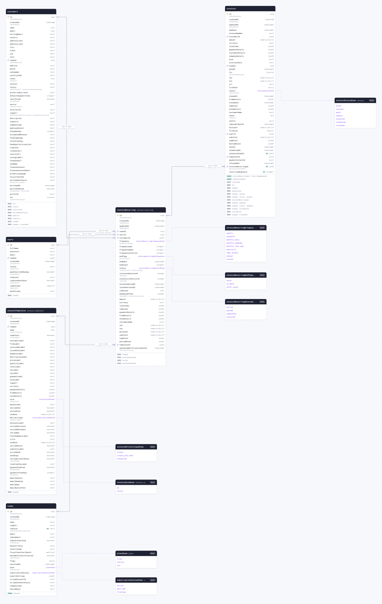

| Column                                                         | Type                                                                   | Constraints                                           | Default              | Description           |
| -------------------------------------------------------------- | ---------------------------------------------------------------------- | ----------------------------------------------------- | -------------------- | --------------------- |
| `id`                                                           | `uuid`                                                                 | PK NOT NULL                                           | `.defaultRandom()`   |                       |
| `createdAt` (`created_at`)                                     | `timestamp`                                                            | NOT NULL                                              | `.defaultNow()`      |                       |
| `updatedAt` (`updated_at`)                                     | `timestamp`                                                            | NULL                                                  | `.defaultNow()`      |                       |
| `teamId` (`team_id`)                                           | `uuid`                                                                 | NOT NULL → [teams.id](#table-teams)                   |                      |                       |
| `userId` (`user_id`)                                           | `uuid`                                                                 | NOT NULL → [users.id](#table-users)                   |                      |                       |
| `customerId` (`customer_id`)                                   | `uuid`                                                                 | NULL → [customers.id](#table-customers)               |                      |                       |
| `frequency`                                                    | [`invoiceRecurringFrequencyEnum`](#enum-invoiceRecurringFrequencyEnum) | NOT NULL                                              |                      | Frequency settings    |
| `frequencyDay` (`frequency_day`)                               | `integer`                                                              | NULL                                                  |                      |                       |
| `frequencyWeek` (`frequency_week`)                             | `integer`                                                              | NULL                                                  |                      |                       |
| `frequencyInterval` (`frequency_interval`)                     | `integer`                                                              | NULL                                                  |                      |                       |
| `endType` (`end_type`)                                         | [`invoiceRecurringEndTypeEnum`](#enum-invoiceRecurringEndTypeEnum)     | NOT NULL                                              |                      | End conditions        |
| `endDate` (`end_date`)                                         | `timestamp`                                                            | NULL                                                  |                      |                       |
| `endCount` (`end_count`)                                       | `integer`                                                              | NULL                                                  |                      |                       |
| `status`                                                       | [`invoiceRecurringStatusEnum`](#enum-invoiceRecurringStatusEnum)       | NOT NULL                                              | `.default("active")` | Status tracking       |
| `invoicesGenerated` (`invoices_generated`)                     | `integer`                                                              | NOT NULL                                              | `.default(0)`        |                       |
| `consecutiveFailures` (`consecutive_failures`)                 | `integer`                                                              | NOT NULL                                              | `.default(0)`        |                       |
| `nextScheduledAt` (`next_scheduled_at`)                        | `timestamp`                                                            | NULL                                                  |                      |                       |
| `lastGeneratedAt` (`last_generated_at`)                        | `timestamp`                                                            | NULL                                                  |                      |                       |
| `timezone`                                                     | `text`                                                                 | NOT NULL                                              |                      |                       |
| `dueDateOffset` (`due_date_offset`)                            | `integer`                                                              | NOT NULL                                              | `.default(30)`       | Invoice template data |
| `amount`                                                       | `numeric(10,2)`                                                        | NULL                                                  |                      |                       |
| `currency`                                                     | `text`                                                                 | NULL                                                  |                      |                       |
| `lineItems` (`line_items`)                                     | `jsonb`                                                                | NULL                                                  |                      |                       |
| `template`                                                     | `jsonb`                                                                | NULL                                                  |                      |                       |
| `paymentDetails` (`payment_details`)                           | `jsonb`                                                                | NULL                                                  |                      |                       |
| `fromDetails` (`from_details`)                                 | `jsonb`                                                                | NULL                                                  |                      |                       |
| `noteDetails` (`note_details`)                                 | `jsonb`                                                                | NULL                                                  |                      |                       |
| `customerName` (`customer_name`)                               | `text`                                                                 | NULL                                                  |                      |                       |
| `vat`                                                          | `numeric(10,2)`                                                        | NULL                                                  |                      |                       |
| `tax`                                                          | `numeric(10,2)`                                                        | NULL                                                  |                      |                       |
| `discount`                                                     | `numeric(10,2)`                                                        | NULL                                                  |                      |                       |
| `subtotal`                                                     | `numeric(10,2)`                                                        | NULL                                                  |                      |                       |
| `topBlock` (`top_block`)                                       | `jsonb`                                                                | NULL                                                  |                      |                       |
| `bottomBlock` (`bottom_block`)                                 | `jsonb`                                                                | NULL                                                  |                      |                       |
| `templateId` (`template_id`)                                   | `uuid`                                                                 | NULL → [invoiceTemplates.id](#table-invoiceTemplates) |                      |                       |
| `upcomingNotificationSentAt` (`upcoming_notification_sent_at`) | `timestamp`                                                            | NULL                                                  |                      | Notification tracking |

#### Definition

```sql
CREATE TABLE "invoice_recurring" (
	"id" uuid PRIMARY KEY DEFAULT gen_random_uuid(),
	"created_at" timestamp with time zone DEFAULT now() NOT NULL,
	"updated_at" timestamp with time zone DEFAULT now(),
	"team_id" uuid NOT NULL,
	"user_id" uuid NOT NULL,
	"customer_id" uuid,
	"frequency" "invoice_recurring_frequency" NOT NULL,
	"frequency_day" integer,
	"frequency_week" integer,
	"frequency_interval" integer,
	"end_type" "invoice_recurring_end_type" NOT NULL,
	"end_date" timestamp with time zone,
	"end_count" integer,
	"status" "invoice_recurring_status" DEFAULT 'active'::"invoice_recurring_status" NOT NULL,
	"invoices_generated" integer DEFAULT 0 NOT NULL,
	"consecutive_failures" integer DEFAULT 0 NOT NULL,
	"next_scheduled_at" timestamp with time zone,
	"last_generated_at" timestamp with time zone,
	"timezone" text NOT NULL,
	"due_date_offset" integer DEFAULT 30 NOT NULL,
	"amount" numeric(10,2),
	"currency" text,
	"line_items" jsonb,
	"template" jsonb,
	"payment_details" jsonb,
	"from_details" jsonb,
	"note_details" jsonb,
	"customer_name" text,
	"vat" numeric(10,2),
	"tax" numeric(10,2),
	"discount" numeric(10,2),
	"subtotal" numeric(10,2),
	"top_block" jsonb,
	"bottom_block" jsonb,
	"template_id" uuid,
	"upcoming_notification_sent_at" timestamp with time zone
);

ALTER TABLE "invoice_recurring" ENABLE ROW LEVEL SECURITY;

CREATE INDEX "invoice_recurring_team_id_idx" ON "invoice_recurring" ("team_id" uuid_ops);

CREATE INDEX "invoice_recurring_next_scheduled_at_idx" ON "invoice_recurring" ("next_scheduled_at" timestamptz_ops);

CREATE INDEX "invoice_recurring_status_idx" ON "invoice_recurring" ("status");

CREATE INDEX "invoice_recurring_active_scheduled_idx" ON "invoice_recurring" ("next_scheduled_at" timestamptz_ops) WHERE status = 'active';

ALTER TABLE "invoice_recurring" ADD CONSTRAINT "invoice_recurring_team_id_fkey" FOREIGN KEY ("team_id") REFERENCES "teams"("id") ON DELETE CASCADE;

ALTER TABLE "invoice_recurring" ADD CONSTRAINT "invoice_recurring_user_id_fkey" FOREIGN KEY ("user_id") REFERENCES "users"("id") ON DELETE CASCADE;

ALTER TABLE "invoice_recurring" ADD CONSTRAINT "invoice_recurring_customer_id_fkey" FOREIGN KEY ("customer_id") REFERENCES "customers"("id") ON DELETE SET NULL;

ALTER TABLE "invoice_recurring" ADD CONSTRAINT "invoice_recurring_template_id_fkey" FOREIGN KEY ("template_id") REFERENCES "invoice_templates"("id") ON DELETE SET NULL;
```

#### Indexes

- INDEX `teamId`
- INDEX `nextScheduledAt`
- INDEX `status`
- INDEX `nextScheduledAt`

#### References

- `teamId` → [teams.id](#table-teams) (many to one, on delete cascade)
- `userId` → [users.id](#table-users) (many to one, on delete cascade)
- `customerId` → [customers.id](#table-customers) (many to one, on delete set null)
- `templateId` → [invoiceTemplates.id](#table-invoiceTemplates) (many to one, on delete set null)

#### Referenced by

- `id` → [invoices.invoiceRecurringId](#table-invoices) (one to many, on delete set null)

<details>
<summary>Queries and their SQL</summary>

**Select**: Every row of invoiceRecurring.

```ts
db.select().from(invoiceRecurring);
```

```sql
select "id", "created_at", "updated_at", "team_id", "user_id", "customer_id", "frequency", "frequency_day", "frequency_week", "frequency_interval", "end_type", "end_date", "end_count", "status", "invoices_generated", "consecutive_failures", "next_scheduled_at", "last_generated_at", "timezone", "due_date_offset", "amount", "currency", "line_items", "template", "payment_details", "from_details", "note_details", "customer_name", "vat", "tax", "discount", "subtotal", "top_block", "bottom_block", "template_id", "upcoming_notification_sent_at"
from "invoice_recurring"
```

**Count**: How many rows invoiceRecurring has.

```ts
db.select({ count: count() }).from(invoiceRecurring);
```

```sql
select count(*)
from "invoice_recurring"
```

**Find many**: The rows of invoiceRecurring, through the relational query API.

```ts
db.query.invoiceRecurring.findMany();
```

```sql
select "d0"."id" as "id", "d0"."created_at" as "createdAt", "d0"."updated_at" as "updatedAt", "d0"."team_id" as "teamId", "d0"."user_id" as "userId", "d0"."customer_id" as "customerId", "d0"."frequency" as "frequency", "d0"."frequency_day" as "frequencyDay", "d0"."frequency_week" as "frequencyWeek", "d0"."frequency_interval" as "frequencyInterval", "d0"."end_type" as "endType", "d0"."end_date" as "endDate", "d0"."end_count" as "endCount", "d0"."status" as "status", "d0"."invoices_generated" as "invoicesGenerated", "d0"."consecutive_failures" as "consecutiveFailures", "d0"."next_scheduled_at" as "nextScheduledAt", "d0"."last_generated_at" as "lastGeneratedAt", "d0"."timezone" as "timezone", "d0"."due_date_offset" as "dueDateOffset", "d0"."amount" as "amount", "d0"."currency" as "currency", "d0"."line_items" as "lineItems", "d0"."template" as "template", "d0"."payment_details" as "paymentDetails", "d0"."from_details" as "fromDetails", "d0"."note_details" as "noteDetails", "d0"."customer_name" as "customerName", "d0"."vat" as "vat", "d0"."tax" as "tax", "d0"."discount" as "discount", "d0"."subtotal" as "subtotal", "d0"."top_block" as "topBlock", "d0"."bottom_block" as "bottomBlock", "d0"."template_id" as "templateId", "d0"."upcoming_notification_sent_at" as "upcomingNotificationSentAt"
from "invoice_recurring" as "d0"
```

**Find by primary key**: One row of invoiceRecurring, through the relational query API.

```ts
db.query.invoiceRecurring.findFirst({ where: { id: "00000000-0000-0000-0000-000000000000" } });
```

```sql
select "d0"."id" as "id", "d0"."created_at" as "createdAt", "d0"."updated_at" as "updatedAt", "d0"."team_id" as "teamId", "d0"."user_id" as "userId", "d0"."customer_id" as "customerId", "d0"."frequency" as "frequency", "d0"."frequency_day" as "frequencyDay", "d0"."frequency_week" as "frequencyWeek", "d0"."frequency_interval" as "frequencyInterval", "d0"."end_type" as "endType", "d0"."end_date" as "endDate", "d0"."end_count" as "endCount", "d0"."status" as "status", "d0"."invoices_generated" as "invoicesGenerated", "d0"."consecutive_failures" as "consecutiveFailures", "d0"."next_scheduled_at" as "nextScheduledAt", "d0"."last_generated_at" as "lastGeneratedAt", "d0"."timezone" as "timezone", "d0"."due_date_offset" as "dueDateOffset", "d0"."amount" as "amount", "d0"."currency" as "currency", "d0"."line_items" as "lineItems", "d0"."template" as "template", "d0"."payment_details" as "paymentDetails", "d0"."from_details" as "fromDetails", "d0"."note_details" as "noteDetails", "d0"."customer_name" as "customerName", "d0"."vat" as "vat", "d0"."tax" as "tax", "d0"."discount" as "discount", "d0"."subtotal" as "subtotal", "d0"."top_block" as "topBlock", "d0"."bottom_block" as "bottomBlock", "d0"."template_id" as "templateId", "d0"."upcoming_notification_sent_at" as "upcomingNotificationSentAt"
from "invoice_recurring" as "d0"
where "d0"."id" = $1
limit $2
-- params: ["00000000-0000-0000-0000-000000000000",1]
```

**Insert**: Adds a row to invoiceRecurring, giving the columns that have no default.

```ts
db.insert(invoiceRecurring).values({
  teamId: "00000000-0000-0000-0000-000000000000",
  userId: "00000000-0000-0000-0000-000000000000",
  frequency: "weekly",
  endType: "never",
  timezone: "timezone",
});
```

```sql
insert into "invoice_recurring" ("id", "created_at", "updated_at", "team_id", "user_id", "customer_id", "frequency", "frequency_day", "frequency_week", "frequency_interval", "end_type", "end_date", "end_count", "status", "invoices_generated", "consecutive_failures", "next_scheduled_at", "last_generated_at", "timezone", "due_date_offset", "amount", "currency", "line_items", "template", "payment_details", "from_details", "note_details", "customer_name", "vat", "tax", "discount", "subtotal", "top_block", "bottom_block", "template_id", "upcoming_notification_sent_at")
values (default, default, default, $1, $2, default, $3, default, default, default, $4, default, default, default, default, default, default, default, $5, default, default, default, default, default, default, default, default, default, default, default, default, default, default, default, default, default)
-- params: ["00000000-0000-0000-0000-000000000000","00000000-0000-0000-0000-000000000000","weekly","never","timezone"]
```

**Update**: Changes a row of invoiceRecurring, found by its primary key.

```ts
db.update(invoiceRecurring)
  .set({ createdAt: new Date("2026-01-01T00:00:00.000Z") })
  .where(eq(invoiceRecurring.id, "00000000-0000-0000-0000-000000000000"));
```

```sql
update "invoice_recurring"
set "created_at" = $1
where "invoice_recurring"."id" = $2
-- params: ["2026-01-01T00:00:00.000Z","00000000-0000-0000-0000-000000000000"]
```

**Delete**: Deletes a row of invoiceRecurring, found by its primary key.

```ts
db.delete(invoiceRecurring).where(eq(invoiceRecurring.id, "00000000-0000-0000-0000-000000000000"));
```

```sql
delete from "invoice_recurring"
where "invoice_recurring"."id" = $1
-- params: ["00000000-0000-0000-0000-000000000000"]
```

</details>

<a id="table-invoices"></a>

### invoices

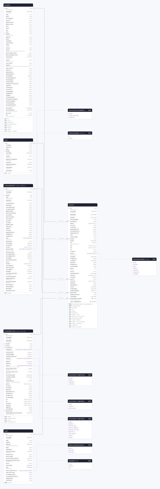

| Column                                        | Type                                           | Constraints                                           | Default                | Description              |
| --------------------------------------------- | ---------------------------------------------- | ----------------------------------------------------- | ---------------------- | ------------------------ |
| `id`                                          | `uuid`                                         | PK NOT NULL                                           | `.defaultRandom()`     |                          |
| `createdAt` (`created_at`)                    | `timestamp`                                    | NOT NULL                                              | `.defaultNow()`        |                          |
| `updatedAt` (`updated_at`)                    | `timestamp`                                    | NULL                                                  | `.defaultNow()`        |                          |
| `dueDate` (`due_date`)                        | `timestamp`                                    | NULL                                                  |                        |                          |
| `invoiceNumber` (`invoice_number`)            | `text`                                         | NULL                                                  |                        |                          |
| `customerId` (`customer_id`)                  | `uuid`                                         | NULL → [customers.id](#table-customers)               |                        |                          |
| `amount`                                      | `numeric(10,2)`                                | NULL                                                  |                        |                          |
| `currency`                                    | `text`                                         | NULL                                                  |                        |                          |
| `lineItems` (`line_items`)                    | `jsonb`                                        | NULL                                                  |                        |                          |
| `paymentDetails` (`payment_details`)          | `jsonb`                                        | NULL                                                  |                        |                          |
| `customerDetails` (`customer_details`)        | `jsonb`                                        | NULL                                                  |                        |                          |
| `companyDatails` (`company_datails`)          | `jsonb`                                        | NULL                                                  |                        |                          |
| `note`                                        | `text`                                         | NULL                                                  |                        |                          |
| `internalNote` (`internal_note`)              | `text`                                         | NULL                                                  |                        |                          |
| `teamId` (`team_id`)                          | `uuid`                                         | NOT NULL → [teams.id](#table-teams)                   |                        |                          |
| `paidAt` (`paid_at`)                          | `timestamp`                                    | NULL                                                  |                        |                          |
| `fts`                                         | `tsvector`                                     | NOT NULL                                              | `.generatedAlwaysAs()` |                          |
| `vat`                                         | `numeric(10,2)`                                | NULL                                                  |                        |                          |
| `tax`                                         | `numeric(10,2)`                                | NULL                                                  |                        |                          |
| `url`                                         | `text`                                         | NULL                                                  |                        |                          |
| `filePath` (`file_path`)                      | `text[]`                                       | NULL                                                  |                        |                          |
| `status`                                      | [`invoiceStatusEnum`](#enum-invoiceStatusEnum) | NOT NULL                                              | `.default("draft")`    |                          |
| `viewedAt` (`viewed_at`)                      | `timestamp`                                    | NULL                                                  |                        |                          |
| `fromDetails` (`from_details`)                | `jsonb`                                        | NULL                                                  |                        |                          |
| `issueDate` (`issue_date`)                    | `timestamp`                                    | NULL                                                  |                        |                          |
| `template`                                    | `jsonb`                                        | NULL                                                  |                        |                          |
| `noteDetails` (`note_details`)                | `jsonb`                                        | NULL                                                  |                        |                          |
| `customerName` (`customer_name`)              | `text`                                         | NULL                                                  |                        |                          |
| `token`                                       | `text`                                         | NOT NULL                                              | `.default("")`         |                          |
| `sentTo` (`sent_to`)                          | `text`                                         | NULL                                                  |                        |                          |
| `reminderSentAt` (`reminder_sent_at`)         | `timestamp`                                    | NULL                                                  |                        |                          |
| `discount`                                    | `numeric(10,2)`                                | NULL                                                  |                        |                          |
| `fileSize` (`file_size`)                      | `bigint`                                       | NULL                                                  |                        |                          |
| `userId` (`user_id`)                          | `uuid`                                         | NULL → [users.id](#table-users)                       |                        |                          |
| `subtotal`                                    | `numeric(10,2)`                                | NULL                                                  |                        |                          |
| `topBlock` (`top_block`)                      | `jsonb`                                        | NULL                                                  |                        |                          |
| `bottomBlock` (`bottom_block`)                | `jsonb`                                        | NULL                                                  |                        |                          |
| `sentAt` (`sent_at`)                          | `timestamp`                                    | NULL                                                  |                        |                          |
| `scheduledAt` (`scheduled_at`)                | `timestamp`                                    | NULL                                                  |                        |                          |
| `scheduledJobId` (`scheduled_job_id`)         | `text`                                         | NULL                                                  |                        |                          |
| `templateId` (`template_id`)                  | `uuid`                                         | NULL → [invoiceTemplates.id](#table-invoiceTemplates) |                        |                          |
| `paymentIntentId` (`payment_intent_id`)       | `text`                                         | NULL                                                  |                        |                          |
| `refundedAt` (`refunded_at`)                  | `timestamp`                                    | NULL                                                  |                        |                          |
| `invoiceRecurringId` (`invoice_recurring_id`) | `uuid`                                         | NULL → [invoiceRecurring.id](#table-invoiceRecurring) |                        | Recurring invoice fields |
| `recurringSequence` (`recurring_sequence`)    | `integer`                                      | NULL                                                  |                        |                          |

#### Definition

```sql
CREATE TABLE "invoices" (
	"id" uuid PRIMARY KEY DEFAULT gen_random_uuid(),
	"created_at" timestamp with time zone DEFAULT now() NOT NULL,
	"updated_at" timestamp with time zone DEFAULT now(),
	"due_date" timestamp with time zone,
	"invoice_number" text,
	"customer_id" uuid,
	"amount" numeric(10,2),
	"currency" text,
	"line_items" jsonb,
	"payment_details" jsonb,
	"customer_details" jsonb,
	"company_datails" jsonb,
	"note" text,
	"internal_note" text,
	"team_id" uuid NOT NULL,
	"paid_at" timestamp with time zone,
	"fts" tsvector GENERATED ALWAYS AS (
        to_tsvector(
          'english',
          (
            (COALESCE((amount)::text, ''::text) || ' '::text) || COALESCE(invoice_number, ''::text)
          )
        )
      ) STORED NOT NULL,
	"vat" numeric(10,2),
	"tax" numeric(10,2),
	"url" text,
	"file_path" text[],
	"status" "invoice_status" DEFAULT 'draft'::"invoice_status" NOT NULL,
	"viewed_at" timestamp with time zone,
	"from_details" jsonb,
	"issue_date" timestamp with time zone,
	"template" jsonb,
	"note_details" jsonb,
	"customer_name" text,
	"token" text DEFAULT '' NOT NULL,
	"sent_to" text,
	"reminder_sent_at" timestamp with time zone,
	"discount" numeric(10,2),
	"file_size" bigint,
	"user_id" uuid,
	"subtotal" numeric(10,2),
	"top_block" jsonb,
	"bottom_block" jsonb,
	"sent_at" timestamp with time zone,
	"scheduled_at" timestamp with time zone,
	"scheduled_job_id" text CONSTRAINT "invoices_scheduled_job_id_key" UNIQUE,
	"template_id" uuid,
	"payment_intent_id" text,
	"refunded_at" timestamp with time zone,
	"invoice_recurring_id" uuid,
	"recurring_sequence" integer
);

ALTER TABLE "invoices" ENABLE ROW LEVEL SECURITY;

CREATE INDEX "invoices_created_at_idx" ON "invoices" ("created_at" timestamptz_ops);

CREATE INDEX "invoices_fts" ON "invoices" USING gin ("fts" tsvector_ops);

CREATE INDEX "invoices_team_id_idx" ON "invoices" ("team_id" uuid_ops);

CREATE INDEX "invoices_template_id_idx" ON "invoices" ("template_id" uuid_ops);

CREATE INDEX "invoices_team_sent_at_idx" ON "invoices" ("team_id","sent_at");

CREATE INDEX "invoices_team_status_paid_at_idx" ON "invoices" ("team_id","status","paid_at");

CREATE INDEX "invoices_invoice_recurring_id_idx" ON "invoices" ("invoice_recurring_id" uuid_ops);

CREATE UNIQUE INDEX "invoices_recurring_sequence_unique_idx" ON "invoices" ("invoice_recurring_id","recurring_sequence") WHERE invoice_recurring_id IS NOT NULL;

CREATE INDEX "invoices_team_due_date_idx" ON "invoices" ("team_id","due_date" DESC NULLS LAST) WHERE due_date IS NOT NULL;

CREATE INDEX "invoices_team_status_due_date_idx" ON "invoices" ("team_id","status","due_date" DESC NULLS LAST);

CREATE INDEX "invoices_team_customer_id_idx" ON "invoices" ("team_id","customer_id") WHERE customer_id IS NOT NULL;

CREATE INDEX "invoices_customer_id_idx" ON "invoices" ("customer_id") WHERE customer_id IS NOT NULL;

CREATE INDEX "invoices_team_created_at_idx" ON "invoices" ("team_id","created_at");

ALTER TABLE "invoices" ADD CONSTRAINT "invoices_created_by_fkey" FOREIGN KEY ("user_id") REFERENCES "users"("id") ON DELETE CASCADE;

ALTER TABLE "invoices" ADD CONSTRAINT "invoices_customer_id_fkey" FOREIGN KEY ("customer_id") REFERENCES "customers"("id") ON DELETE SET NULL;

ALTER TABLE "invoices" ADD CONSTRAINT "invoices_team_id_fkey" FOREIGN KEY ("team_id") REFERENCES "teams"("id") ON DELETE CASCADE;

ALTER TABLE "invoices" ADD CONSTRAINT "invoices_template_id_fkey" FOREIGN KEY ("template_id") REFERENCES "invoice_templates"("id") ON DELETE SET NULL;

ALTER TABLE "invoices" ADD CONSTRAINT "invoices_invoice_recurring_id_fkey" FOREIGN KEY ("invoice_recurring_id") REFERENCES "invoice_recurring"("id") ON DELETE SET NULL;
```

#### Indexes

- INDEX `createdAt`
- INDEX `fts`
- INDEX `teamId`
- INDEX `templateId`
- INDEX `teamId`, `sentAt`
- INDEX `teamId`, `status`, `paidAt`
- INDEX `invoiceRecurringId`
- UNIQUE `invoiceRecurringId`, `recurringSequence`
- UNIQUE `scheduledJobId`
- INDEX `teamId`, `dueDate`
- INDEX `teamId`, `status`, `dueDate`
- INDEX `teamId`, `customerId`
- INDEX `customerId`
- INDEX `teamId`, `createdAt`

#### References

- `userId` → [users.id](#table-users) (many to one, on delete cascade)
- `customerId` → [customers.id](#table-customers) (many to one, on delete set null)
- `teamId` → [teams.id](#table-teams) (many to one, on delete cascade)
- `templateId` → [invoiceTemplates.id](#table-invoiceTemplates) (many to one, on delete set null)
- `invoiceRecurringId` → [invoiceRecurring.id](#table-invoiceRecurring) (many to one, on delete set null)

<details>
<summary>Queries and their SQL</summary>

**Select**: Every row of invoices.

```ts
db.select().from(invoices);
```

```sql
select "id", "created_at", "updated_at", "due_date", "invoice_number", "customer_id", "amount", "currency", "line_items", "payment_details", "customer_details", "company_datails", "note", "internal_note", "team_id", "paid_at", "fts", "vat", "tax", "url", "file_path", "status", "viewed_at", "from_details", "issue_date", "template", "note_details", "customer_name", "token", "sent_to", "reminder_sent_at", "discount", "file_size", "user_id", "subtotal", "top_block", "bottom_block", "sent_at", "scheduled_at", "scheduled_job_id", "template_id", "payment_intent_id", "refunded_at", "invoice_recurring_id", "recurring_sequence"
from "invoices"
```

**Count**: How many rows invoices has.

```ts
db.select({ count: count() }).from(invoices);
```

```sql
select count(*)
from "invoices"
```

**Find many**: The rows of invoices, through the relational query API.

```ts
db.query.invoices.findMany();
```

```sql
select "d0"."id" as "id", "d0"."created_at" as "createdAt", "d0"."updated_at" as "updatedAt", "d0"."due_date" as "dueDate", "d0"."invoice_number" as "invoiceNumber", "d0"."customer_id" as "customerId", "d0"."amount" as "amount", "d0"."currency" as "currency", "d0"."line_items" as "lineItems", "d0"."payment_details" as "paymentDetails", "d0"."customer_details" as "customerDetails", "d0"."company_datails" as "companyDatails", "d0"."note" as "note", "d0"."internal_note" as "internalNote", "d0"."team_id" as "teamId", "d0"."paid_at" as "paidAt", "d0"."fts" as "fts", "d0"."vat" as "vat", "d0"."tax" as "tax", "d0"."url" as "url", "d0"."file_path" as "filePath", "d0"."status" as "status", "d0"."viewed_at" as "viewedAt", "d0"."from_details" as "fromDetails", "d0"."issue_date" as "issueDate", "d0"."template" as "template", "d0"."note_details" as "noteDetails", "d0"."customer_name" as "customerName", "d0"."token" as "token", "d0"."sent_to" as "sentTo", "d0"."reminder_sent_at" as "reminderSentAt", "d0"."discount" as "discount", "d0"."file_size" as "fileSize", "d0"."user_id" as "userId", "d0"."subtotal" as "subtotal", "d0"."top_block" as "topBlock", "d0"."bottom_block" as "bottomBlock", "d0"."sent_at" as "sentAt", "d0"."scheduled_at" as "scheduledAt", "d0"."scheduled_job_id" as "scheduledJobId", "d0"."template_id" as "templateId", "d0"."payment_intent_id" as "paymentIntentId", "d0"."refunded_at" as "refundedAt", "d0"."invoice_recurring_id" as "invoiceRecurringId", "d0"."recurring_sequence" as "recurringSequence"
from "invoices" as "d0"
```

**Find by primary key**: One row of invoices, through the relational query API.

```ts
db.query.invoices.findFirst({ where: { id: "00000000-0000-0000-0000-000000000000" } });
```

```sql
select "d0"."id" as "id", "d0"."created_at" as "createdAt", "d0"."updated_at" as "updatedAt", "d0"."due_date" as "dueDate", "d0"."invoice_number" as "invoiceNumber", "d0"."customer_id" as "customerId", "d0"."amount" as "amount", "d0"."currency" as "currency", "d0"."line_items" as "lineItems", "d0"."payment_details" as "paymentDetails", "d0"."customer_details" as "customerDetails", "d0"."company_datails" as "companyDatails", "d0"."note" as "note", "d0"."internal_note" as "internalNote", "d0"."team_id" as "teamId", "d0"."paid_at" as "paidAt", "d0"."fts" as "fts", "d0"."vat" as "vat", "d0"."tax" as "tax", "d0"."url" as "url", "d0"."file_path" as "filePath", "d0"."status" as "status", "d0"."viewed_at" as "viewedAt", "d0"."from_details" as "fromDetails", "d0"."issue_date" as "issueDate", "d0"."template" as "template", "d0"."note_details" as "noteDetails", "d0"."customer_name" as "customerName", "d0"."token" as "token", "d0"."sent_to" as "sentTo", "d0"."reminder_sent_at" as "reminderSentAt", "d0"."discount" as "discount", "d0"."file_size" as "fileSize", "d0"."user_id" as "userId", "d0"."subtotal" as "subtotal", "d0"."top_block" as "topBlock", "d0"."bottom_block" as "bottomBlock", "d0"."sent_at" as "sentAt", "d0"."scheduled_at" as "scheduledAt", "d0"."scheduled_job_id" as "scheduledJobId", "d0"."template_id" as "templateId", "d0"."payment_intent_id" as "paymentIntentId", "d0"."refunded_at" as "refundedAt", "d0"."invoice_recurring_id" as "invoiceRecurringId", "d0"."recurring_sequence" as "recurringSequence"
from "invoices" as "d0"
where "d0"."id" = $1
limit $2
-- params: ["00000000-0000-0000-0000-000000000000",1]
```

**Insert**: Adds a row to invoices, giving the columns that have no default.

```ts
db.insert(invoices).values({ teamId: "00000000-0000-0000-0000-000000000000" });
```

```sql
insert into "invoices" ("id", "created_at", "updated_at", "due_date", "invoice_number", "customer_id", "amount", "currency", "line_items", "payment_details", "customer_details", "company_datails", "note", "internal_note", "team_id", "paid_at", "vat", "tax", "url", "file_path", "status", "viewed_at", "from_details", "issue_date", "template", "note_details", "customer_name", "token", "sent_to", "reminder_sent_at", "discount", "file_size", "user_id", "subtotal", "top_block", "bottom_block", "sent_at", "scheduled_at", "scheduled_job_id", "template_id", "payment_intent_id", "refunded_at", "invoice_recurring_id", "recurring_sequence")
values (default, default, default, default, default, default, default, default, default, default, default, default, default, default, $1, default, default, default, default, default, default, default, default, default, default, default, default, default, default, default, default, default, default, default, default, default, default, default, default, default, default, default, default, default)
-- params: ["00000000-0000-0000-0000-000000000000"]
```

**Update**: Changes a row of invoices, found by its primary key.

```ts
db.update(invoices)
  .set({ createdAt: new Date("2026-01-01T00:00:00.000Z") })
  .where(eq(invoices.id, "00000000-0000-0000-0000-000000000000"));
```

```sql
update "invoices"
set "created_at" = $1
where "invoices"."id" = $2
-- params: ["2026-01-01T00:00:00.000Z","00000000-0000-0000-0000-000000000000"]
```

**Delete**: Deletes a row of invoices, found by its primary key.

```ts
db.delete(invoices).where(eq(invoices.id, "00000000-0000-0000-0000-000000000000"));
```

```sql
delete from "invoices"
where "invoices"."id" = $1
-- params: ["00000000-0000-0000-0000-000000000000"]
```

</details>

<a id="table-customers"></a>

### customers

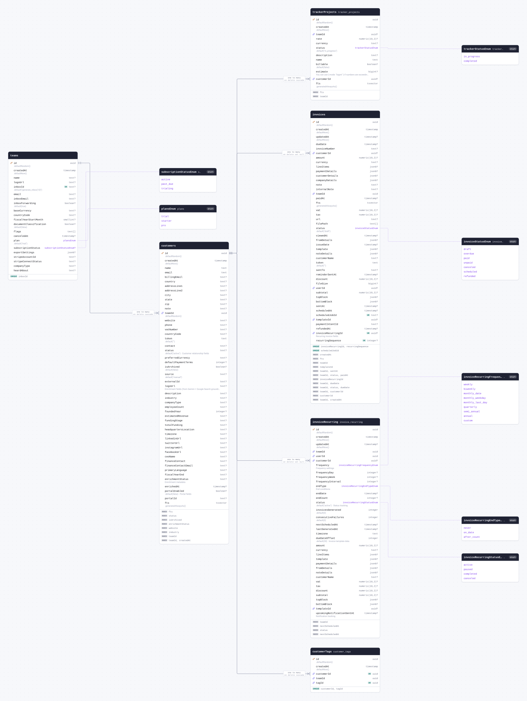

| Column                                           | Type        | Constraints                         | Default                | Description                                               |
| ------------------------------------------------ | ----------- | ----------------------------------- | ---------------------- | --------------------------------------------------------- |
| `id`                                             | `uuid`      | PK NOT NULL                         | `.defaultRandom()`     |                                                           |
| `createdAt` (`created_at`)                       | `timestamp` | NOT NULL                            | `.defaultNow()`        |                                                           |
| `name`                                           | `text`      | NOT NULL                            |                        |                                                           |
| `email`                                          | `text`      | NOT NULL                            |                        |                                                           |
| `billingEmail`                                   | `text`      | NULL                                |                        |                                                           |
| `country`                                        | `text`      | NULL                                |                        |                                                           |
| `addressLine1` (`address_line_1`)                | `text`      | NULL                                |                        |                                                           |
| `addressLine2` (`address_line_2`)                | `text`      | NULL                                |                        |                                                           |
| `city`                                           | `text`      | NULL                                |                        |                                                           |
| `state`                                          | `text`      | NULL                                |                        |                                                           |
| `zip`                                            | `text`      | NULL                                |                        |                                                           |
| `note`                                           | `text`      | NULL                                |                        |                                                           |
| `teamId` (`team_id`)                             | `uuid`      | NOT NULL → [teams.id](#table-teams) | `.defaultRandom()`     |                                                           |
| `website`                                        | `text`      | NULL                                |                        |                                                           |
| `phone`                                          | `text`      | NULL                                |                        |                                                           |
| `vatNumber` (`vat_number`)                       | `text`      | NULL                                |                        |                                                           |
| `countryCode` (`country_code`)                   | `text`      | NULL                                |                        |                                                           |
| `token`                                          | `text`      | NOT NULL                            | `.default("")`         |                                                           |
| `contact`                                        | `text`      | NULL                                |                        |                                                           |
| `status`                                         | `text`      | NULL                                | `.default("active")`   | Customer relationship fields                              |
| `preferredCurrency` (`preferred_currency`)       | `text`      | NULL                                |                        |                                                           |
| `defaultPaymentTerms` (`default_payment_terms`)  | `integer`   | NULL                                |                        |                                                           |
| `isArchived` (`is_archived`)                     | `boolean`   | NULL                                | `.default(false)`      |                                                           |
| `source`                                         | `text`      | NULL                                | `.default("manual")`   |                                                           |
| `externalId` (`external_id`)                     | `text`      | NULL                                |                        |                                                           |
| `logoUrl` (`logo_url`)                           | `text`      | NULL                                |                        | Enrichment fields (from Gemini + Google Search grounding) |
| `description`                                    | `text`      | NULL                                |                        |                                                           |
| `industry`                                       | `text`      | NULL                                |                        |                                                           |
| `companyType` (`company_type`)                   | `text`      | NULL                                |                        |                                                           |
| `employeeCount` (`employee_count`)               | `text`      | NULL                                |                        |                                                           |
| `foundedYear` (`founded_year`)                   | `integer`   | NULL                                |                        |                                                           |
| `estimatedRevenue` (`estimated_revenue`)         | `text`      | NULL                                |                        |                                                           |
| `fundingStage` (`funding_stage`)                 | `text`      | NULL                                |                        |                                                           |
| `totalFunding` (`total_funding`)                 | `text`      | NULL                                |                        |                                                           |
| `headquartersLocation` (`headquarters_location`) | `text`      | NULL                                |                        |                                                           |
| `timezone`                                       | `text`      | NULL                                |                        |                                                           |
| `linkedinUrl` (`linkedin_url`)                   | `text`      | NULL                                |                        |                                                           |
| `twitterUrl` (`twitter_url`)                     | `text`      | NULL                                |                        |                                                           |
| `instagramUrl` (`instagram_url`)                 | `text`      | NULL                                |                        |                                                           |
| `facebookUrl` (`facebook_url`)                   | `text`      | NULL                                |                        |                                                           |
| `ceoName` (`ceo_name`)                           | `text`      | NULL                                |                        |                                                           |
| `financeContact` (`finance_contact`)             | `text`      | NULL                                |                        |                                                           |
| `financeContactEmail` (`finance_contact_email`)  | `text`      | NULL                                |                        |                                                           |
| `primaryLanguage` (`primary_language`)           | `text`      | NULL                                |                        |                                                           |
| `fiscalYearEnd` (`fiscal_year_end`)              | `text`      | NULL                                |                        |                                                           |
| `enrichmentStatus` (`enrichment_status`)         | `text`      | NULL                                |                        | Enrichment metadata                                       |
| `enrichedAt` (`enriched_at`)                     | `timestamp` | NULL                                |                        |                                                           |
| `portalEnabled` (`portal_enabled`)               | `boolean`   | NULL                                | `.default(false)`      | Portal fields                                             |
| `portalId` (`portal_id`)                         | `text`      | NULL                                |                        |                                                           |
| `fts`                                            | `tsvector`  | NOT NULL                            | `.generatedAlwaysAs()` |                                                           |

#### Definition

```sql
CREATE TABLE "customers" (
	"id" uuid PRIMARY KEY DEFAULT gen_random_uuid(),
	"created_at" timestamp with time zone DEFAULT now() NOT NULL,
	"name" text NOT NULL,
	"email" text NOT NULL,
	"billingEmail" text,
	"country" text,
	"address_line_1" text,
	"address_line_2" text,
	"city" text,
	"state" text,
	"zip" text,
	"note" text,
	"team_id" uuid DEFAULT gen_random_uuid() NOT NULL,
	"website" text,
	"phone" text,
	"vat_number" text,
	"country_code" text,
	"token" text DEFAULT '' NOT NULL,
	"contact" text,
	"status" text DEFAULT 'active',
	"preferred_currency" text,
	"default_payment_terms" integer,
	"is_archived" boolean DEFAULT false,
	"source" text DEFAULT 'manual',
	"external_id" text,
	"logo_url" text,
	"description" text,
	"industry" text,
	"company_type" text,
	"employee_count" text,
	"founded_year" integer,
	"estimated_revenue" text,
	"funding_stage" text,
	"total_funding" text,
	"headquarters_location" text,
	"timezone" text,
	"linkedin_url" text,
	"twitter_url" text,
	"instagram_url" text,
	"facebook_url" text,
	"ceo_name" text,
	"finance_contact" text,
	"finance_contact_email" text,
	"primary_language" text,
	"fiscal_year_end" text,
	"enrichment_status" text,
	"enriched_at" timestamp with time zone,
	"portal_enabled" boolean DEFAULT false,
	"portal_id" text,
	"fts" tsvector GENERATED ALWAYS AS (
				to_tsvector(
					'english'::regconfig,
					COALESCE(name, ''::text) || ' ' ||
					COALESCE(contact, ''::text) || ' ' ||
					COALESCE(phone, ''::text) || ' ' ||
					COALESCE(email, ''::text) || ' ' ||
					COALESCE(address_line_1, ''::text) || ' ' ||
					COALESCE(address_line_2, ''::text) || ' ' ||
					COALESCE(city, ''::text) || ' ' ||
					COALESCE(state, ''::text) || ' ' ||
					COALESCE(zip, ''::text) || ' ' ||
					COALESCE(country, ''::text)
				)
			) STORED NOT NULL
);

ALTER TABLE "customers" ENABLE ROW LEVEL SECURITY;

CREATE INDEX "customers_fts" ON "customers" USING gin ("fts" tsvector_ops);

CREATE INDEX "idx_customers_status" ON "customers" ("status");

CREATE INDEX "idx_customers_is_archived" ON "customers" ("is_archived");

CREATE INDEX "idx_customers_enrichment_status" ON "customers" ("enrichment_status");

CREATE INDEX "idx_customers_website" ON "customers" ("website");

CREATE INDEX "idx_customers_industry" ON "customers" ("industry");

CREATE INDEX "customers_team_id_idx" ON "customers" ("team_id");

CREATE INDEX "customers_team_created_at_idx" ON "customers" ("team_id","created_at");

ALTER TABLE "customers" ADD CONSTRAINT "customers_team_id_fkey" FOREIGN KEY ("team_id") REFERENCES "teams"("id") ON DELETE CASCADE;
```

#### Indexes

- INDEX `fts`
- INDEX `status`
- INDEX `isArchived`
- INDEX `enrichmentStatus`
- INDEX `website`
- INDEX `industry`
- INDEX `teamId`
- INDEX `teamId`, `createdAt`

#### References

- `teamId` → [teams.id](#table-teams) (many to one, on delete cascade)

#### Referenced by

- `id` → [customerTags.customerId](#table-customerTags) (one to many, on delete cascade)
- `id` → [invoiceRecurring.customerId](#table-invoiceRecurring) (one to many, on delete set null)
- `id` → [invoices.customerId](#table-invoices) (one to many, on delete set null)
- `id` → [trackerProjects.customerId](#table-trackerProjects) (one to many, on delete cascade)

<details>
<summary>Queries and their SQL</summary>

**Select**: Every row of customers.

```ts
db.select().from(customers);
```

```sql
select "id", "created_at", "name", "email", "billingEmail", "country", "address_line_1", "address_line_2", "city", "state", "zip", "note", "team_id", "website", "phone", "vat_number", "country_code", "token", "contact", "status", "preferred_currency", "default_payment_terms", "is_archived", "source", "external_id", "logo_url", "description", "industry", "company_type", "employee_count", "founded_year", "estimated_revenue", "funding_stage", "total_funding", "headquarters_location", "timezone", "linkedin_url", "twitter_url", "instagram_url", "facebook_url", "ceo_name", "finance_contact", "finance_contact_email", "primary_language", "fiscal_year_end", "enrichment_status", "enriched_at", "portal_enabled", "portal_id", "fts"
from "customers"
```

**Count**: How many rows customers has.

```ts
db.select({ count: count() }).from(customers);
```

```sql
select count(*)
from "customers"
```

**Find many**: The rows of customers, through the relational query API.

```ts
db.query.customers.findMany();
```

```sql
select "d0"."id" as "id", "d0"."created_at" as "createdAt", "d0"."name" as "name", "d0"."email" as "email", "d0"."billingEmail" as "billingEmail", "d0"."country" as "country", "d0"."address_line_1" as "addressLine1", "d0"."address_line_2" as "addressLine2", "d0"."city" as "city", "d0"."state" as "state", "d0"."zip" as "zip", "d0"."note" as "note", "d0"."team_id" as "teamId", "d0"."website" as "website", "d0"."phone" as "phone", "d0"."vat_number" as "vatNumber", "d0"."country_code" as "countryCode", "d0"."token" as "token", "d0"."contact" as "contact", "d0"."status" as "status", "d0"."preferred_currency" as "preferredCurrency", "d0"."default_payment_terms" as "defaultPaymentTerms", "d0"."is_archived" as "isArchived", "d0"."source" as "source", "d0"."external_id" as "externalId", "d0"."logo_url" as "logoUrl", "d0"."description" as "description", "d0"."industry" as "industry", "d0"."company_type" as "companyType", "d0"."employee_count" as "employeeCount", "d0"."founded_year" as "foundedYear", "d0"."estimated_revenue" as "estimatedRevenue", "d0"."funding_stage" as "fundingStage", "d0"."total_funding" as "totalFunding", "d0"."headquarters_location" as "headquartersLocation", "d0"."timezone" as "timezone", "d0"."linkedin_url" as "linkedinUrl", "d0"."twitter_url" as "twitterUrl", "d0"."instagram_url" as "instagramUrl", "d0"."facebook_url" as "facebookUrl", "d0"."ceo_name" as "ceoName", "d0"."finance_contact" as "financeContact", "d0"."finance_contact_email" as "financeContactEmail", "d0"."primary_language" as "primaryLanguage", "d0"."fiscal_year_end" as "fiscalYearEnd", "d0"."enrichment_status" as "enrichmentStatus", "d0"."enriched_at" as "enrichedAt", "d0"."portal_enabled" as "portalEnabled", "d0"."portal_id" as "portalId", "d0"."fts" as "fts"
from "customers" as "d0"
```

**Find by primary key**: One row of customers, through the relational query API.

```ts
db.query.customers.findFirst({ where: { id: "00000000-0000-0000-0000-000000000000" } });
```

```sql
select "d0"."id" as "id", "d0"."created_at" as "createdAt", "d0"."name" as "name", "d0"."email" as "email", "d0"."billingEmail" as "billingEmail", "d0"."country" as "country", "d0"."address_line_1" as "addressLine1", "d0"."address_line_2" as "addressLine2", "d0"."city" as "city", "d0"."state" as "state", "d0"."zip" as "zip", "d0"."note" as "note", "d0"."team_id" as "teamId", "d0"."website" as "website", "d0"."phone" as "phone", "d0"."vat_number" as "vatNumber", "d0"."country_code" as "countryCode", "d0"."token" as "token", "d0"."contact" as "contact", "d0"."status" as "status", "d0"."preferred_currency" as "preferredCurrency", "d0"."default_payment_terms" as "defaultPaymentTerms", "d0"."is_archived" as "isArchived", "d0"."source" as "source", "d0"."external_id" as "externalId", "d0"."logo_url" as "logoUrl", "d0"."description" as "description", "d0"."industry" as "industry", "d0"."company_type" as "companyType", "d0"."employee_count" as "employeeCount", "d0"."founded_year" as "foundedYear", "d0"."estimated_revenue" as "estimatedRevenue", "d0"."funding_stage" as "fundingStage", "d0"."total_funding" as "totalFunding", "d0"."headquarters_location" as "headquartersLocation", "d0"."timezone" as "timezone", "d0"."linkedin_url" as "linkedinUrl", "d0"."twitter_url" as "twitterUrl", "d0"."instagram_url" as "instagramUrl", "d0"."facebook_url" as "facebookUrl", "d0"."ceo_name" as "ceoName", "d0"."finance_contact" as "financeContact", "d0"."finance_contact_email" as "financeContactEmail", "d0"."primary_language" as "primaryLanguage", "d0"."fiscal_year_end" as "fiscalYearEnd", "d0"."enrichment_status" as "enrichmentStatus", "d0"."enriched_at" as "enrichedAt", "d0"."portal_enabled" as "portalEnabled", "d0"."portal_id" as "portalId", "d0"."fts" as "fts"
from "customers" as "d0"
where "d0"."id" = $1
limit $2
-- params: ["00000000-0000-0000-0000-000000000000",1]
```

**Insert**: Adds a row to customers, giving the columns that have no default.

```ts
db.insert(customers).values({ name: "name", email: "email" });
```

```sql
insert into "customers" ("id", "created_at", "name", "email", "billingEmail", "country", "address_line_1", "address_line_2", "city", "state", "zip", "note", "team_id", "website", "phone", "vat_number", "country_code", "token", "contact", "status", "preferred_currency", "default_payment_terms", "is_archived", "source", "external_id", "logo_url", "description", "industry", "company_type", "employee_count", "founded_year", "estimated_revenue", "funding_stage", "total_funding", "headquarters_location", "timezone", "linkedin_url", "twitter_url", "instagram_url", "facebook_url", "ceo_name", "finance_contact", "finance_contact_email", "primary_language", "fiscal_year_end", "enrichment_status", "enriched_at", "portal_enabled", "portal_id")
values (default, default, $1, $2, default, default, default, default, default, default, default, default, default, default, default, default, default, default, default, default, default, default, default, default, default, default, default, default, default, default, default, default, default, default, default, default, default, default, default, default, default, default, default, default, default, default, default, default, default)
-- params: ["name","email"]
```

**Update**: Changes a row of customers, found by its primary key.

```ts
db.update(customers)
  .set({ createdAt: new Date("2026-01-01T00:00:00.000Z") })
  .where(eq(customers.id, "00000000-0000-0000-0000-000000000000"));
```

```sql
update "customers"
set "created_at" = $1
where "customers"."id" = $2
-- params: ["2026-01-01T00:00:00.000Z","00000000-0000-0000-0000-000000000000"]
```

**Delete**: Deletes a row of customers, found by its primary key.

```ts
db.delete(customers).where(eq(customers.id, "00000000-0000-0000-0000-000000000000"));
```

```sql
delete from "customers"
where "customers"."id" = $1
-- params: ["00000000-0000-0000-0000-000000000000"]
```

</details>

<a id="table-exchangeRates"></a>

### exchangeRates

Table `exchange_rates`.

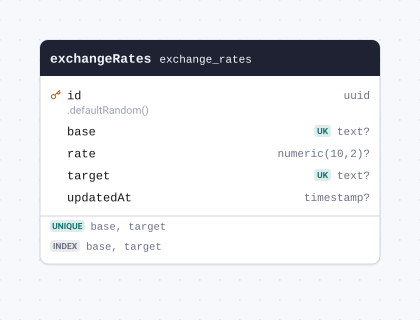

| Column                     | Type            | Constraints | Default            | Description |
| -------------------------- | --------------- | ----------- | ------------------ | ----------- |
| `id`                       | `uuid`          | PK NOT NULL | `.defaultRandom()` |             |
| `base`                     | `text`          | NULL        |                    |             |
| `rate`                     | `numeric(10,2)` | NULL        |                    |             |
| `target`                   | `text`          | NULL        |                    |             |
| `updatedAt` (`updated_at`) | `timestamp`     | NULL        |                    |             |

#### Definition

```sql
CREATE TABLE "exchange_rates" (
	"id" uuid PRIMARY KEY DEFAULT gen_random_uuid(),
	"base" text,
	"rate" numeric(10,2),
	"target" text,
	"updated_at" timestamp with time zone,
	CONSTRAINT "unique_rate" UNIQUE("base","target")
);

ALTER TABLE "exchange_rates" ENABLE ROW LEVEL SECURITY;

CREATE INDEX "exchange_rates_base_target_idx" ON "exchange_rates" ("base" text_ops,"target" text_ops);
```

#### Indexes

- INDEX `base`, `target`
- UNIQUE `base`, `target`

<details>
<summary>Queries and their SQL</summary>

**Select**: Every row of exchangeRates.

```ts
db.select().from(exchangeRates);
```

```sql
select "id", "base", "rate", "target", "updated_at"
from "exchange_rates"
```

**Count**: How many rows exchangeRates has.

```ts
db.select({ count: count() }).from(exchangeRates);
```

```sql
select count(*)
from "exchange_rates"
```

**Find many**: The rows of exchangeRates, through the relational query API.

```ts
db.query.exchangeRates.findMany();
```

```sql
select "d0"."id" as "id", "d0"."base" as "base", "d0"."rate" as "rate", "d0"."target" as "target", "d0"."updated_at" as "updatedAt"
from "exchange_rates" as "d0"
```

**Find by primary key**: One row of exchangeRates, through the relational query API.

```ts
db.query.exchangeRates.findFirst({ where: { id: "00000000-0000-0000-0000-000000000000" } });
```

```sql
select "d0"."id" as "id", "d0"."base" as "base", "d0"."rate" as "rate", "d0"."target" as "target", "d0"."updated_at" as "updatedAt"
from "exchange_rates" as "d0"
where "d0"."id" = $1
limit $2
-- params: ["00000000-0000-0000-0000-000000000000",1]
```

**Insert**: Adds a row to exchangeRates, giving the columns that have no default.

```ts
db.insert(exchangeRates).values({});
```

```sql
insert into "exchange_rates" ("id", "base", "rate", "target", "updated_at")
values (default, default, default, default, default)
```

**Update**: Changes a row of exchangeRates, found by its primary key.

```ts
db.update(exchangeRates)
  .set({ base: "base" })
  .where(eq(exchangeRates.id, "00000000-0000-0000-0000-000000000000"));
```

```sql
update "exchange_rates"
set "base" = $1
where "exchange_rates"."id" = $2
-- params: ["base","00000000-0000-0000-0000-000000000000"]
```

**Delete**: Deletes a row of exchangeRates, found by its primary key.

```ts
db.delete(exchangeRates).where(eq(exchangeRates.id, "00000000-0000-0000-0000-000000000000"));
```

```sql
delete from "exchange_rates"
where "exchange_rates"."id" = $1
-- params: ["00000000-0000-0000-0000-000000000000"]
```

</details>

<a id="table-tags"></a>

### tags

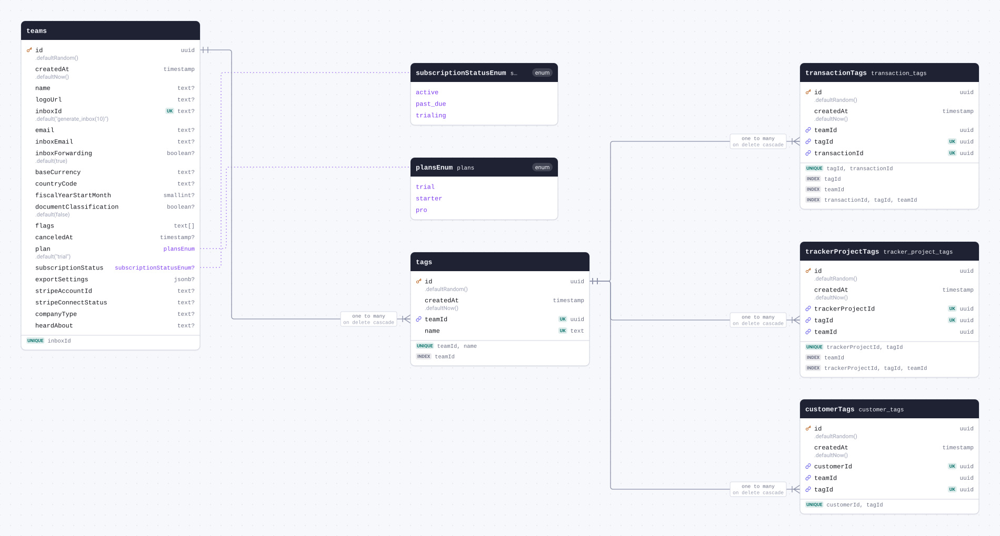

| Column                     | Type        | Constraints                         | Default            | Description |
| -------------------------- | ----------- | ----------------------------------- | ------------------ | ----------- |
| `id`                       | `uuid`      | PK NOT NULL                         | `.defaultRandom()` |             |
| `createdAt` (`created_at`) | `timestamp` | NOT NULL                            | `.defaultNow()`    |             |
| `teamId` (`team_id`)       | `uuid`      | NOT NULL → [teams.id](#table-teams) |                    |             |
| `name`                     | `text`      | NOT NULL                            |                    |             |

#### Definition

```sql
CREATE TABLE "tags" (
	"id" uuid PRIMARY KEY DEFAULT gen_random_uuid(),
	"created_at" timestamp with time zone DEFAULT now() NOT NULL,
	"team_id" uuid NOT NULL,
	"name" text NOT NULL,
	CONSTRAINT "unique_tag_name" UNIQUE("team_id","name")
);

ALTER TABLE "tags" ENABLE ROW LEVEL SECURITY;

CREATE INDEX "tags_team_id_idx" ON "tags" ("team_id" uuid_ops);

ALTER TABLE "tags" ADD CONSTRAINT "tags_team_id_fkey" FOREIGN KEY ("team_id") REFERENCES "teams"("id") ON DELETE CASCADE;
```

#### Indexes

- INDEX `teamId`
- UNIQUE `teamId`, `name`

#### References

- `teamId` → [teams.id](#table-teams) (many to one, on delete cascade)

#### Referenced by

- `id` → [customerTags.tagId](#table-customerTags) (one to many, on delete cascade)
- `id` → [trackerProjectTags.tagId](#table-trackerProjectTags) (one to many, on delete cascade)
- `id` → [transactionTags.tagId](#table-transactionTags) (one to many, on delete cascade)

<details>
<summary>Queries and their SQL</summary>

**Select**: Every row of tags.

```ts
db.select().from(tags);
```

```sql
select "id", "created_at", "team_id", "name"
from "tags"
```

**Count**: How many rows tags has.

```ts
db.select({ count: count() }).from(tags);
```

```sql
select count(*)
from "tags"
```

**Find many**: The rows of tags, through the relational query API.

```ts
db.query.tags.findMany();
```

```sql
select "d0"."id" as "id", "d0"."created_at" as "createdAt", "d0"."team_id" as "teamId", "d0"."name" as "name"
from "tags" as "d0"
```

**Find by primary key**: One row of tags, through the relational query API.

```ts
db.query.tags.findFirst({ where: { id: "00000000-0000-0000-0000-000000000000" } });
```

```sql
select "d0"."id" as "id", "d0"."created_at" as "createdAt", "d0"."team_id" as "teamId", "d0"."name" as "name"
from "tags" as "d0"
where "d0"."id" = $1
limit $2
-- params: ["00000000-0000-0000-0000-000000000000",1]
```

**Insert**: Adds a row to tags, giving the columns that have no default.

```ts
db.insert(tags).values({ teamId: "00000000-0000-0000-0000-000000000000", name: "name" });
```

```sql
insert into "tags" ("id", "created_at", "team_id", "name")
values (default, default, $1, $2)
-- params: ["00000000-0000-0000-0000-000000000000","name"]
```

**Update**: Changes a row of tags, found by its primary key.

```ts
db.update(tags)
  .set({ createdAt: new Date("2026-01-01T00:00:00.000Z") })
  .where(eq(tags.id, "00000000-0000-0000-0000-000000000000"));
```

```sql
update "tags"
set "created_at" = $1
where "tags"."id" = $2
-- params: ["2026-01-01T00:00:00.000Z","00000000-0000-0000-0000-000000000000"]
```

**Delete**: Deletes a row of tags, found by its primary key.

```ts
db.delete(tags).where(eq(tags.id, "00000000-0000-0000-0000-000000000000"));
```

```sql
delete from "tags"
where "tags"."id" = $1
-- params: ["00000000-0000-0000-0000-000000000000"]
```

</details>

<a id="table-trackerReports"></a>

### trackerReports

Table `tracker_reports`.

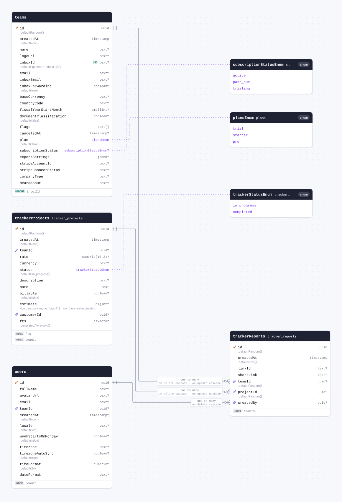

| Column                     | Type        | Constraints                                         | Default            | Description |
| -------------------------- | ----------- | --------------------------------------------------- | ------------------ | ----------- |
| `id`                       | `uuid`      | PK NOT NULL                                         | `.defaultRandom()` |             |
| `createdAt` (`created_at`) | `timestamp` | NOT NULL                                            | `.defaultNow()`    |             |
| `linkId` (`link_id`)       | `text`      | NULL                                                |                    |             |
| `shortLink` (`short_link`) | `text`      | NULL                                                |                    |             |
| `teamId` (`team_id`)       | `uuid`      | NULL → [teams.id](#table-teams)                     | `.defaultRandom()` |             |
| `projectId` (`project_id`) | `uuid`      | NULL → [trackerProjects.id](#table-trackerProjects) | `.defaultRandom()` |             |
| `createdBy` (`created_by`) | `uuid`      | NULL → [users.id](#table-users)                     |                    |             |

#### Definition

```sql
CREATE TABLE "tracker_reports" (
	"id" uuid PRIMARY KEY DEFAULT gen_random_uuid(),
	"created_at" timestamp with time zone DEFAULT now() NOT NULL,
	"link_id" text,
	"short_link" text,
	"team_id" uuid DEFAULT gen_random_uuid(),
	"project_id" uuid DEFAULT gen_random_uuid(),
	"created_by" uuid
);

ALTER TABLE "tracker_reports" ENABLE ROW LEVEL SECURITY;

CREATE INDEX "tracker_reports_team_id_idx" ON "tracker_reports" ("team_id" uuid_ops);

ALTER TABLE "tracker_reports" ADD CONSTRAINT "public_tracker_reports_created_by_fkey" FOREIGN KEY ("created_by") REFERENCES "users"("id") ON DELETE CASCADE;

ALTER TABLE "tracker_reports" ADD CONSTRAINT "public_tracker_reports_project_id_fkey" FOREIGN KEY ("project_id") REFERENCES "tracker_projects"("id") ON DELETE CASCADE ON UPDATE CASCADE;

ALTER TABLE "tracker_reports" ADD CONSTRAINT "tracker_reports_team_id_fkey" FOREIGN KEY ("team_id") REFERENCES "teams"("id") ON DELETE CASCADE ON UPDATE CASCADE;
```

#### Indexes

- INDEX `teamId`

#### References

- `createdBy` → [users.id](#table-users) (many to one, on delete cascade)
- `projectId` → [trackerProjects.id](#table-trackerProjects) (many to one, on delete cascade, on update cascade)
- `teamId` → [teams.id](#table-teams) (many to one, on delete cascade, on update cascade)

<details>
<summary>Queries and their SQL</summary>

**Select**: Every row of trackerReports.

```ts
db.select().from(trackerReports);
```

```sql
select "id", "created_at", "link_id", "short_link", "team_id", "project_id", "created_by"
from "tracker_reports"
```

**Count**: How many rows trackerReports has.

```ts
db.select({ count: count() }).from(trackerReports);
```

```sql
select count(*)
from "tracker_reports"
```

**Find many**: The rows of trackerReports, through the relational query API.

```ts
db.query.trackerReports.findMany();
```

```sql
select "d0"."id" as "id", "d0"."created_at" as "createdAt", "d0"."link_id" as "linkId", "d0"."short_link" as "shortLink", "d0"."team_id" as "teamId", "d0"."project_id" as "projectId", "d0"."created_by" as "createdBy"
from "tracker_reports" as "d0"
```

**Find by primary key**: One row of trackerReports, through the relational query API.

```ts
db.query.trackerReports.findFirst({ where: { id: "00000000-0000-0000-0000-000000000000" } });
```

```sql
select "d0"."id" as "id", "d0"."created_at" as "createdAt", "d0"."link_id" as "linkId", "d0"."short_link" as "shortLink", "d0"."team_id" as "teamId", "d0"."project_id" as "projectId", "d0"."created_by" as "createdBy"
from "tracker_reports" as "d0"
where "d0"."id" = $1
limit $2
-- params: ["00000000-0000-0000-0000-000000000000",1]
```

**Insert**: Adds a row to trackerReports, giving the columns that have no default.

```ts
db.insert(trackerReports).values({});
```

```sql
insert into "tracker_reports" ("id", "created_at", "link_id", "short_link", "team_id", "project_id", "created_by")
values (default, default, default, default, default, default, default)
```

**Update**: Changes a row of trackerReports, found by its primary key.

```ts
db.update(trackerReports)
  .set({ createdAt: new Date("2026-01-01T00:00:00.000Z") })
  .where(eq(trackerReports.id, "00000000-0000-0000-0000-000000000000"));
```

```sql
update "tracker_reports"
set "created_at" = $1
where "tracker_reports"."id" = $2
-- params: ["2026-01-01T00:00:00.000Z","00000000-0000-0000-0000-000000000000"]
```

**Delete**: Deletes a row of trackerReports, found by its primary key.

```ts
db.delete(trackerReports).where(eq(trackerReports.id, "00000000-0000-0000-0000-000000000000"));
```

```sql
delete from "tracker_reports"
where "tracker_reports"."id" = $1
-- params: ["00000000-0000-0000-0000-000000000000"]
```

</details>

<a id="table-invoiceComments"></a>

### invoiceComments

Table `invoice_comments`.

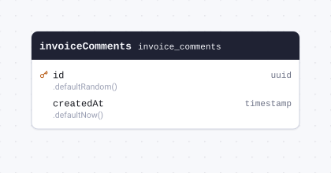

| Column                     | Type        | Constraints | Default            | Description |
| -------------------------- | ----------- | ----------- | ------------------ | ----------- |
| `id`                       | `uuid`      | PK NOT NULL | `.defaultRandom()` |             |
| `createdAt` (`created_at`) | `timestamp` | NOT NULL    | `.defaultNow()`    |             |

#### Definition

```sql
CREATE TABLE "invoice_comments" (
	"id" uuid PRIMARY KEY DEFAULT gen_random_uuid(),
	"created_at" timestamp with time zone DEFAULT now() NOT NULL
);
```

<details>
<summary>Queries and their SQL</summary>

**Select**: Every row of invoiceComments.

```ts
db.select().from(invoiceComments);
```

```sql
select "id", "created_at"
from "invoice_comments"
```

**Count**: How many rows invoiceComments has.

```ts
db.select({ count: count() }).from(invoiceComments);
```

```sql
select count(*)
from "invoice_comments"
```

**Find many**: The rows of invoiceComments, through the relational query API.

```ts
db.query.invoiceComments.findMany();
```

```sql
select "d0"."id" as "id", "d0"."created_at" as "createdAt"
from "invoice_comments" as "d0"
```

**Find by primary key**: One row of invoiceComments, through the relational query API.

```ts
db.query.invoiceComments.findFirst({ where: { id: "00000000-0000-0000-0000-000000000000" } });
```

```sql
select "d0"."id" as "id", "d0"."created_at" as "createdAt"
from "invoice_comments" as "d0"
where "d0"."id" = $1
limit $2
-- params: ["00000000-0000-0000-0000-000000000000",1]
```

**Insert**: Adds a row to invoiceComments, giving the columns that have no default.

```ts
db.insert(invoiceComments).values({});
```

```sql
insert into "invoice_comments" ("id", "created_at")
values (default, default)
```

**Update**: Changes a row of invoiceComments, found by its primary key.

```ts
db.update(invoiceComments)
  .set({ createdAt: new Date("2026-01-01T00:00:00.000Z") })
  .where(eq(invoiceComments.id, "00000000-0000-0000-0000-000000000000"));
```

```sql
update "invoice_comments"
set "created_at" = $1
where "invoice_comments"."id" = $2
-- params: ["2026-01-01T00:00:00.000Z","00000000-0000-0000-0000-000000000000"]
```

**Delete**: Deletes a row of invoiceComments, found by its primary key.

```ts
db.delete(invoiceComments).where(eq(invoiceComments.id, "00000000-0000-0000-0000-000000000000"));
```

```sql
delete from "invoice_comments"
where "invoice_comments"."id" = $1
-- params: ["00000000-0000-0000-0000-000000000000"]
```

</details>

<a id="table-trackerProjectTags"></a>

### trackerProjectTags

Table `tracker_project_tags`.

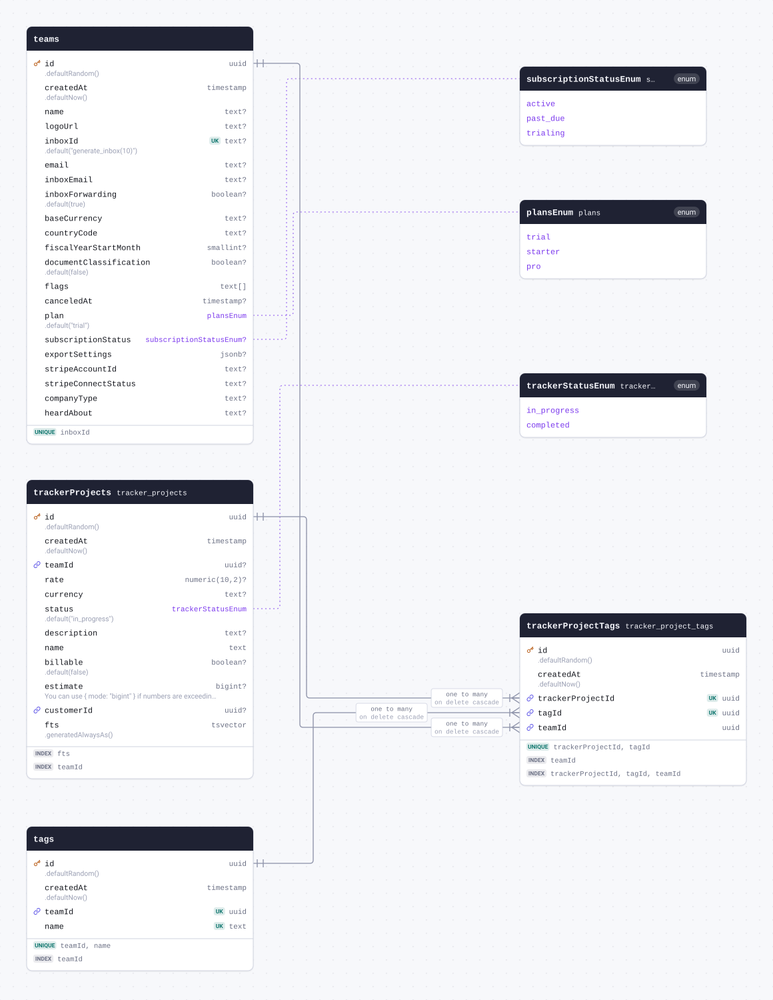

| Column                                    | Type        | Constraints                                             | Default            | Description |
| ----------------------------------------- | ----------- | ------------------------------------------------------- | ------------------ | ----------- |
| `id`                                      | `uuid`      | PK NOT NULL                                             | `.defaultRandom()` |             |
| `createdAt` (`created_at`)                | `timestamp` | NOT NULL                                                | `.defaultNow()`    |             |
| `trackerProjectId` (`tracker_project_id`) | `uuid`      | NOT NULL → [trackerProjects.id](#table-trackerProjects) |                    |             |
| `tagId` (`tag_id`)                        | `uuid`      | NOT NULL → [tags.id](#table-tags)                       |                    |             |
| `teamId` (`team_id`)                      | `uuid`      | NOT NULL → [teams.id](#table-teams)                     |                    |             |

#### Definition

```sql
CREATE TABLE "tracker_project_tags" (
	"id" uuid PRIMARY KEY DEFAULT gen_random_uuid(),
	"created_at" timestamp with time zone DEFAULT now() NOT NULL,
	"tracker_project_id" uuid NOT NULL,
	"tag_id" uuid NOT NULL,
	"team_id" uuid NOT NULL,
	CONSTRAINT "unique_project_tag" UNIQUE("tracker_project_id","tag_id")
);

ALTER TABLE "tracker_project_tags" ENABLE ROW LEVEL SECURITY;

CREATE INDEX "tracker_project_tags_team_id_idx" ON "tracker_project_tags" ("team_id" uuid_ops);

CREATE INDEX "tracker_project_tags_tracker_project_id_tag_id_team_id_idx" ON "tracker_project_tags" ("tracker_project_id" uuid_ops,"tag_id" uuid_ops,"team_id" uuid_ops);

ALTER TABLE "tracker_project_tags" ADD CONSTRAINT "project_tags_tag_id_fkey" FOREIGN KEY ("tag_id") REFERENCES "tags"("id") ON DELETE CASCADE;

ALTER TABLE "tracker_project_tags" ADD CONSTRAINT "project_tags_tracker_project_id_fkey" FOREIGN KEY ("tracker_project_id") REFERENCES "tracker_projects"("id") ON DELETE CASCADE;

ALTER TABLE "tracker_project_tags" ADD CONSTRAINT "tracker_project_tags_team_id_fkey" FOREIGN KEY ("team_id") REFERENCES "teams"("id") ON DELETE CASCADE;
```

#### Indexes

- INDEX `teamId`
- INDEX `trackerProjectId`, `tagId`, `teamId`
- UNIQUE `trackerProjectId`, `tagId`

#### References

- `tagId` → [tags.id](#table-tags) (many to one, on delete cascade)
- `trackerProjectId` → [trackerProjects.id](#table-trackerProjects) (many to one, on delete cascade)
- `teamId` → [teams.id](#table-teams) (many to one, on delete cascade)

<details>
<summary>Queries and their SQL</summary>

**Select**: Every row of trackerProjectTags.

```ts
db.select().from(trackerProjectTags);
```

```sql
select "id", "created_at", "tracker_project_id", "tag_id", "team_id"
from "tracker_project_tags"
```

**Count**: How many rows trackerProjectTags has.

```ts
db.select({ count: count() }).from(trackerProjectTags);
```

```sql
select count(*)
from "tracker_project_tags"
```

**Find many**: The rows of trackerProjectTags, through the relational query API.

```ts
db.query.trackerProjectTags.findMany();
```

```sql
select "d0"."id" as "id", "d0"."created_at" as "createdAt", "d0"."tracker_project_id" as "trackerProjectId", "d0"."tag_id" as "tagId", "d0"."team_id" as "teamId"
from "tracker_project_tags" as "d0"
```

**Find by primary key**: One row of trackerProjectTags, through the relational query API.

```ts
db.query.trackerProjectTags.findFirst({ where: { id: "00000000-0000-0000-0000-000000000000" } });
```

```sql
select "d0"."id" as "id", "d0"."created_at" as "createdAt", "d0"."tracker_project_id" as "trackerProjectId", "d0"."tag_id" as "tagId", "d0"."team_id" as "teamId"
from "tracker_project_tags" as "d0"
where "d0"."id" = $1
limit $2
-- params: ["00000000-0000-0000-0000-000000000000",1]
```

**Insert**: Adds a row to trackerProjectTags, giving the columns that have no default.

```ts
db.insert(trackerProjectTags).values({
  trackerProjectId: "00000000-0000-0000-0000-000000000000",
  tagId: "00000000-0000-0000-0000-000000000000",
  teamId: "00000000-0000-0000-0000-000000000000",
});
```

```sql
insert into "tracker_project_tags" ("id", "created_at", "tracker_project_id", "tag_id", "team_id")
values (default, default, $1, $2, $3)
-- params: ["00000000-0000-0000-0000-000000000000","00000000-0000-0000-0000-000000000000","00000000-0000-0000-0000-000000000000"]
```

**Update**: Changes a row of trackerProjectTags, found by its primary key.

```ts
db.update(trackerProjectTags)
  .set({ createdAt: new Date("2026-01-01T00:00:00.000Z") })
  .where(eq(trackerProjectTags.id, "00000000-0000-0000-0000-000000000000"));
```

```sql
update "tracker_project_tags"
set "created_at" = $1
where "tracker_project_tags"."id" = $2
-- params: ["2026-01-01T00:00:00.000Z","00000000-0000-0000-0000-000000000000"]
```

**Delete**: Deletes a row of trackerProjectTags, found by its primary key.

```ts
db.delete(trackerProjectTags).where(
  eq(trackerProjectTags.id, "00000000-0000-0000-0000-000000000000"),
);
```

```sql
delete from "tracker_project_tags"
where "tracker_project_tags"."id" = $1
-- params: ["00000000-0000-0000-0000-000000000000"]
```

</details>

<a id="table-reports"></a>

### reports

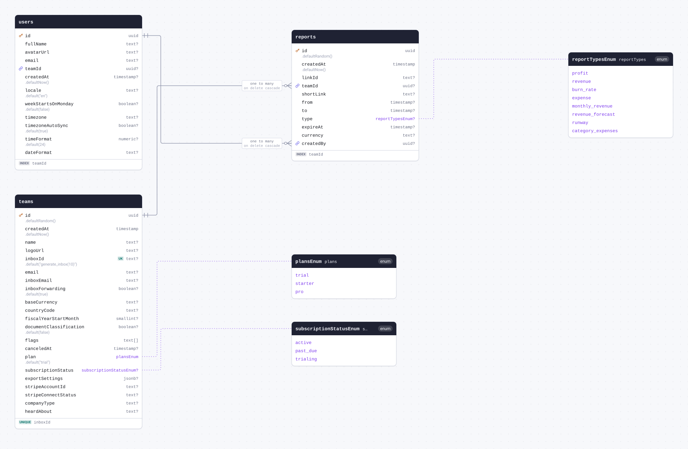

| Column                     | Type                                       | Constraints                     | Default            | Description |
| -------------------------- | ------------------------------------------ | ------------------------------- | ------------------ | ----------- |
| `id`                       | `uuid`                                     | PK NOT NULL                     | `.defaultRandom()` |             |
| `createdAt` (`created_at`) | `timestamp`                                | NOT NULL                        | `.defaultNow()`    |             |
| `linkId` (`link_id`)       | `text`                                     | NULL                            |                    |             |
| `teamId` (`team_id`)       | `uuid`                                     | NULL → [teams.id](#table-teams) |                    |             |
| `shortLink` (`short_link`) | `text`                                     | NULL                            |                    |             |
| `from`                     | `timestamp`                                | NULL                            |                    |             |
| `to`                       | `timestamp`                                | NULL                            |                    |             |
| `type`                     | [`reportTypesEnum`](#enum-reportTypesEnum) | NULL                            |                    |             |
| `expireAt` (`expire_at`)   | `timestamp`                                | NULL                            |                    |             |
| `currency`                 | `text`                                     | NULL                            |                    |             |
| `createdBy` (`created_by`) | `uuid`                                     | NULL → [users.id](#table-users) |                    |             |

#### Definition

```sql
CREATE TABLE "reports" (
	"id" uuid PRIMARY KEY DEFAULT gen_random_uuid(),
	"created_at" timestamp with time zone DEFAULT now() NOT NULL,
	"link_id" text,
	"team_id" uuid,
	"short_link" text,
	"from" timestamp with time zone,
	"to" timestamp with time zone,
	"type" "reportTypes",
	"expire_at" timestamp with time zone,
	"currency" text,
	"created_by" uuid
);

ALTER TABLE "reports" ENABLE ROW LEVEL SECURITY;

CREATE INDEX "reports_team_id_idx" ON "reports" ("team_id" uuid_ops);

ALTER TABLE "reports" ADD CONSTRAINT "public_reports_created_by_fkey" FOREIGN KEY ("created_by") REFERENCES "users"("id") ON DELETE CASCADE;

ALTER TABLE "reports" ADD CONSTRAINT "reports_team_id_fkey" FOREIGN KEY ("team_id") REFERENCES "teams"("id") ON DELETE CASCADE;
```

#### Indexes

- INDEX `teamId`

#### References

- `createdBy` → [users.id](#table-users) (many to one, on delete cascade)
- `teamId` → [teams.id](#table-teams) (many to one, on delete cascade)

<details>
<summary>Queries and their SQL</summary>

**Select**: Every row of reports.

```ts
db.select().from(reports);
```

```sql
select "id", "created_at", "link_id", "team_id", "short_link", "from", "to", "type", "expire_at", "currency", "created_by"
from "reports"
```

**Count**: How many rows reports has.

```ts
db.select({ count: count() }).from(reports);
```

```sql
select count(*)
from "reports"
```

**Find many**: The rows of reports, through the relational query API.

```ts
db.query.reports.findMany();
```

```sql
select "d0"."id" as "id", "d0"."created_at" as "createdAt", "d0"."link_id" as "linkId", "d0"."team_id" as "teamId", "d0"."short_link" as "shortLink", "d0"."from" as "from", "d0"."to" as "to", "d0"."type" as "type", "d0"."expire_at" as "expireAt", "d0"."currency" as "currency", "d0"."created_by" as "createdBy"
from "reports" as "d0"
```

**Find by primary key**: One row of reports, through the relational query API.

```ts
db.query.reports.findFirst({ where: { id: "00000000-0000-0000-0000-000000000000" } });
```

```sql
select "d0"."id" as "id", "d0"."created_at" as "createdAt", "d0"."link_id" as "linkId", "d0"."team_id" as "teamId", "d0"."short_link" as "shortLink", "d0"."from" as "from", "d0"."to" as "to", "d0"."type" as "type", "d0"."expire_at" as "expireAt", "d0"."currency" as "currency", "d0"."created_by" as "createdBy"
from "reports" as "d0"
where "d0"."id" = $1
limit $2
-- params: ["00000000-0000-0000-0000-000000000000",1]
```

**Insert**: Adds a row to reports, giving the columns that have no default.

```ts
db.insert(reports).values({});
```

```sql
insert into "reports" ("id", "created_at", "link_id", "team_id", "short_link", "from", "to", "type", "expire_at", "currency", "created_by")
values (default, default, default, default, default, default, default, default, default, default, default)
```

**Update**: Changes a row of reports, found by its primary key.

```ts
db.update(reports)
  .set({ createdAt: new Date("2026-01-01T00:00:00.000Z") })
  .where(eq(reports.id, "00000000-0000-0000-0000-000000000000"));
```

```sql
update "reports"
set "created_at" = $1
where "reports"."id" = $2
-- params: ["2026-01-01T00:00:00.000Z","00000000-0000-0000-0000-000000000000"]
```

**Delete**: Deletes a row of reports, found by its primary key.

```ts
db.delete(reports).where(eq(reports.id, "00000000-0000-0000-0000-000000000000"));
```

```sql
delete from "reports"
where "reports"."id" = $1
-- params: ["00000000-0000-0000-0000-000000000000"]
```

</details>

<a id="table-institutions"></a>

### institutions

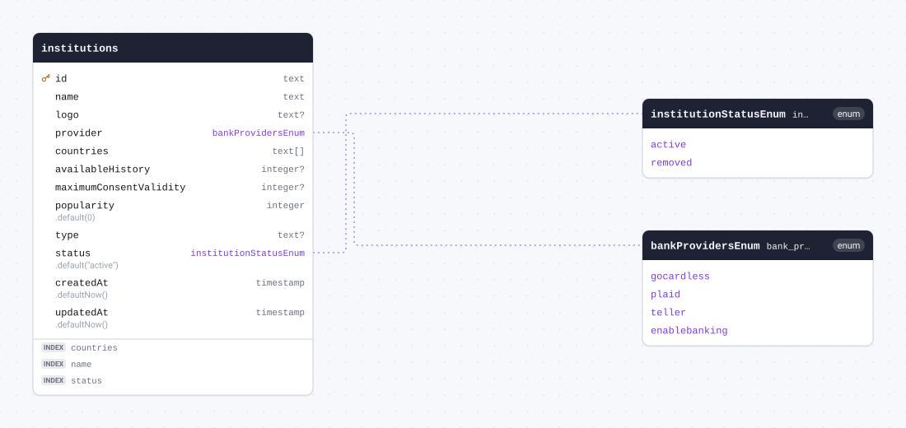

| Column                                                | Type                                                   | Constraints | Default              | Description |
| ----------------------------------------------------- | ------------------------------------------------------ | ----------- | -------------------- | ----------- |
| `id`                                                  | `text`                                                 | PK NOT NULL |                      |             |
| `name`                                                | `text`                                                 | NOT NULL    |                      |             |
| `logo`                                                | `text`                                                 | NULL        |                      |             |
| `provider`                                            | [`bankProvidersEnum`](#enum-bankProvidersEnum)         | NOT NULL    |                      |             |
| `countries`                                           | `text[]`                                               | NOT NULL    |                      |             |
| `availableHistory` (`available_history`)              | `integer`                                              | NULL        |                      |             |
| `maximumConsentValidity` (`maximum_consent_validity`) | `integer`                                              | NULL        |                      |             |
| `popularity`                                          | `integer`                                              | NOT NULL    | `.default(0)`        |             |
| `type`                                                | `text`                                                 | NULL        |                      |             |
| `status`                                              | [`institutionStatusEnum`](#enum-institutionStatusEnum) | NOT NULL    | `.default("active")` |             |
| `createdAt` (`created_at`)                            | `timestamp`                                            | NOT NULL    | `.defaultNow()`      |             |
| `updatedAt` (`updated_at`)                            | `timestamp`                                            | NOT NULL    | `.defaultNow()`      |             |

#### Definition

```sql
CREATE TABLE "institutions" (
	"id" text PRIMARY KEY,
	"name" text NOT NULL,
	"logo" text,
	"provider" "bank_providers" NOT NULL,
	"countries" text[] NOT NULL,
	"available_history" integer,
	"maximum_consent_validity" integer,
	"popularity" integer DEFAULT 0 NOT NULL,
	"type" text,
	"status" "institution_status" DEFAULT 'active'::"institution_status" NOT NULL,
	"created_at" timestamp with time zone DEFAULT now() NOT NULL,
	"updated_at" timestamp with time zone DEFAULT now() NOT NULL
);

CREATE INDEX "institutions_country_idx" ON "institutions" USING gin ("countries");

CREATE INDEX "institutions_name_trgm_idx" ON "institutions" USING gin ("name" gin_trgm_ops);

CREATE INDEX "institutions_status_idx" ON "institutions" ("status");
```

#### Indexes

- INDEX `countries`
- INDEX `name`
- INDEX `status`

<details>
<summary>Queries and their SQL</summary>

**Select**: Every row of institutions.

```ts
db.select().from(institutions);
```

```sql
select "id", "name", "logo", "provider", "countries", "available_history", "maximum_consent_validity", "popularity", "type", "status", "created_at", "updated_at"
from "institutions"
```

**Count**: How many rows institutions has.

```ts
db.select({ count: count() }).from(institutions);
```

```sql
select count(*)
from "institutions"
```

**Find many**: The rows of institutions, through the relational query API.

```ts
db.query.institutions.findMany();
```

```sql
select "d0"."id" as "id", "d0"."name" as "name", "d0"."logo" as "logo", "d0"."provider" as "provider", "d0"."countries" as "countries", "d0"."available_history" as "availableHistory", "d0"."maximum_consent_validity" as "maximumConsentValidity", "d0"."popularity" as "popularity", "d0"."type" as "type", "d0"."status" as "status", "d0"."created_at" as "createdAt", "d0"."updated_at" as "updatedAt"
from "institutions" as "d0"
```

**Find by primary key**: One row of institutions, through the relational query API.

```ts
db.query.institutions.findFirst({ where: { id: "id" } });
```

```sql
select "d0"."id" as "id", "d0"."name" as "name", "d0"."logo" as "logo", "d0"."provider" as "provider", "d0"."countries" as "countries", "d0"."available_history" as "availableHistory", "d0"."maximum_consent_validity" as "maximumConsentValidity", "d0"."popularity" as "popularity", "d0"."type" as "type", "d0"."status" as "status", "d0"."created_at" as "createdAt", "d0"."updated_at" as "updatedAt"
from "institutions" as "d0"
where "d0"."id" = $1
limit $2
-- params: ["id",1]
```

**Insert**: Adds a row to institutions, giving the columns that have no default.

```ts
db.insert(institutions).values({
  id: "id",
  name: "name",
  provider: "gocardless",
  countries: "countries",
});
```

```sql
insert into "institutions" ("id", "name", "logo", "provider", "countries", "available_history", "maximum_consent_validity", "popularity", "type", "status", "created_at", "updated_at")
values ($1, $2, default, $3, $4, default, default, default, default, default, default, default)
-- params: ["id","name","gocardless","countries"]
```

**Update**: Changes a row of institutions, found by its primary key.

```ts
db.update(institutions).set({ name: "name" }).where(eq(institutions.id, "id"));
```

```sql
update "institutions"
set "name" = $1
where "institutions"."id" = $2
-- params: ["name","id"]
```

**Delete**: Deletes a row of institutions, found by its primary key.

```ts
db.delete(institutions).where(eq(institutions.id, "id"));
```

```sql
delete from "institutions"
where "institutions"."id" = $1
-- params: ["id"]
```

</details>

<a id="table-bankConnections"></a>

### bankConnections

Table `bank_connections`.

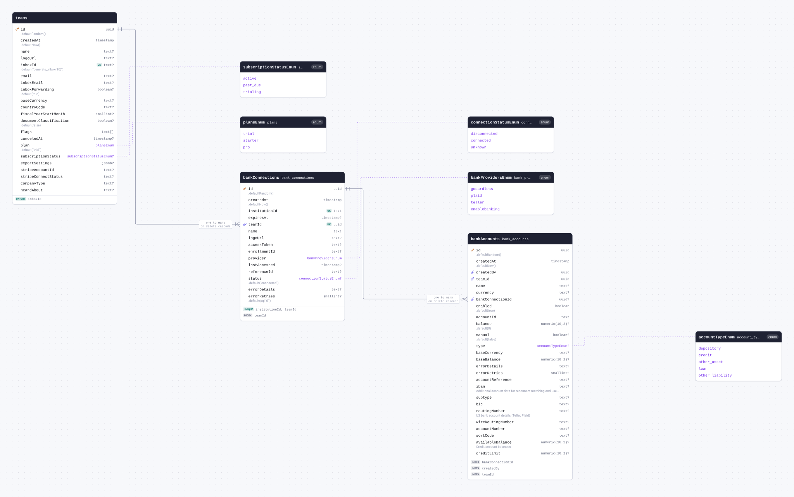

| Column                             | Type                                                 | Constraints                         | Default                 | Description |
| ---------------------------------- | ---------------------------------------------------- | ----------------------------------- | ----------------------- | ----------- |
| `id`                               | `uuid`                                               | PK NOT NULL                         | `.defaultRandom()`      |             |
| `createdAt` (`created_at`)         | `timestamp`                                          | NOT NULL                            | `.defaultNow()`         |             |
| `institutionId` (`institution_id`) | `text`                                               | NOT NULL                            |                         |             |
| `expiresAt` (`expires_at`)         | `timestamp`                                          | NULL                                |                         |             |
| `teamId` (`team_id`)               | `uuid`                                               | NOT NULL → [teams.id](#table-teams) |                         |             |
| `name`                             | `text`                                               | NOT NULL                            |                         |             |
| `logoUrl` (`logo_url`)             | `text`                                               | NULL                                |                         |             |
| `accessToken` (`access_token`)     | `text`                                               | NULL                                |                         |             |
| `enrollmentId` (`enrollment_id`)   | `text`                                               | NULL                                |                         |             |
| `provider`                         | [`bankProvidersEnum`](#enum-bankProvidersEnum)       | NOT NULL                            |                         |             |
| `lastAccessed` (`last_accessed`)   | `timestamp`                                          | NULL                                |                         |             |
| `referenceId` (`reference_id`)     | `text`                                               | NULL                                |                         |             |
| `status`                           | [`connectionStatusEnum`](#enum-connectionStatusEnum) | NULL                                | `.default("connected")` |             |
| `errorDetails` (`error_details`)   | `text`                                               | NULL                                |                         |             |
| `errorRetries` (`error_retries`)   | `smallint`                                           | NULL                                | ``.default(sql`'0'`)``  |             |

#### Definition

```sql
CREATE TABLE "bank_connections" (
	"id" uuid PRIMARY KEY DEFAULT gen_random_uuid(),
	"created_at" timestamp with time zone DEFAULT now() NOT NULL,
	"institution_id" text NOT NULL,
	"expires_at" timestamp with time zone,
	"team_id" uuid NOT NULL,
	"name" text NOT NULL,
	"logo_url" text,
	"access_token" text,
	"enrollment_id" text,
	"provider" "bank_providers" NOT NULL,
	"last_accessed" timestamp with time zone,
	"reference_id" text,
	"status" "connection_status" DEFAULT 'connected'::"connection_status",
	"error_details" text,
	"error_retries" smallint DEFAULT '0',
	CONSTRAINT "unique_bank_connections" UNIQUE("institution_id","team_id")
);

ALTER TABLE "bank_connections" ENABLE ROW LEVEL SECURITY;

CREATE INDEX "bank_connections_team_id_idx" ON "bank_connections" ("team_id" uuid_ops);

ALTER TABLE "bank_connections" ADD CONSTRAINT "bank_connections_team_id_fkey" FOREIGN KEY ("team_id") REFERENCES "teams"("id") ON DELETE CASCADE;
```

#### Indexes

- INDEX `teamId`
- UNIQUE `institutionId`, `teamId`

#### References

- `teamId` → [teams.id](#table-teams) (many to one, on delete cascade)

#### Referenced by

- `id` → [bankAccounts.bankConnectionId](#table-bankAccounts) (one to many, on delete cascade)

<details>
<summary>Queries and their SQL</summary>

**Select**: Every row of bankConnections.

```ts
db.select().from(bankConnections);
```

```sql
select "id", "created_at", "institution_id", "expires_at", "team_id", "name", "logo_url", "access_token", "enrollment_id", "provider", "last_accessed", "reference_id", "status", "error_details", "error_retries"
from "bank_connections"
```

**Count**: How many rows bankConnections has.

```ts
db.select({ count: count() }).from(bankConnections);
```

```sql
select count(*)
from "bank_connections"
```

**Find many**: The rows of bankConnections, through the relational query API.

```ts
db.query.bankConnections.findMany();
```

```sql
select "d0"."id" as "id", "d0"."created_at" as "createdAt", "d0"."institution_id" as "institutionId", "d0"."expires_at" as "expiresAt", "d0"."team_id" as "teamId", "d0"."name" as "name", "d0"."logo_url" as "logoUrl", "d0"."access_token" as "accessToken", "d0"."enrollment_id" as "enrollmentId", "d0"."provider" as "provider", "d0"."last_accessed" as "lastAccessed", "d0"."reference_id" as "referenceId", "d0"."status" as "status", "d0"."error_details" as "errorDetails", "d0"."error_retries" as "errorRetries"
from "bank_connections" as "d0"
```

**Find by primary key**: One row of bankConnections, through the relational query API.

```ts
db.query.bankConnections.findFirst({ where: { id: "00000000-0000-0000-0000-000000000000" } });
```

```sql
select "d0"."id" as "id", "d0"."created_at" as "createdAt", "d0"."institution_id" as "institutionId", "d0"."expires_at" as "expiresAt", "d0"."team_id" as "teamId", "d0"."name" as "name", "d0"."logo_url" as "logoUrl", "d0"."access_token" as "accessToken", "d0"."enrollment_id" as "enrollmentId", "d0"."provider" as "provider", "d0"."last_accessed" as "lastAccessed", "d0"."reference_id" as "referenceId", "d0"."status" as "status", "d0"."error_details" as "errorDetails", "d0"."error_retries" as "errorRetries"
from "bank_connections" as "d0"
where "d0"."id" = $1
limit $2
-- params: ["00000000-0000-0000-0000-000000000000",1]
```

**Insert**: Adds a row to bankConnections, giving the columns that have no default.

```ts
db.insert(bankConnections).values({
  institutionId: "institutionId",
  teamId: "00000000-0000-0000-0000-000000000000",
  name: "name",
  provider: "gocardless",
});
```

```sql
insert into "bank_connections" ("id", "created_at", "institution_id", "expires_at", "team_id", "name", "logo_url", "access_token", "enrollment_id", "provider", "last_accessed", "reference_id", "status", "error_details", "error_retries")
values (default, default, $1, default, $2, $3, default, default, default, $4, default, default, default, default, default)
-- params: ["institutionId","00000000-0000-0000-0000-000000000000","name","gocardless"]
```

**Update**: Changes a row of bankConnections, found by its primary key.

```ts
db.update(bankConnections)
  .set({ createdAt: new Date("2026-01-01T00:00:00.000Z") })
  .where(eq(bankConnections.id, "00000000-0000-0000-0000-000000000000"));
```

```sql
update "bank_connections"
set "created_at" = $1
where "bank_connections"."id" = $2
-- params: ["2026-01-01T00:00:00.000Z","00000000-0000-0000-0000-000000000000"]
```

**Delete**: Deletes a row of bankConnections, found by its primary key.

```ts
db.delete(bankConnections).where(eq(bankConnections.id, "00000000-0000-0000-0000-000000000000"));
```

```sql
delete from "bank_connections"
where "bank_connections"."id" = $1
-- params: ["00000000-0000-0000-0000-000000000000"]
```

</details>

<a id="table-userInvites"></a>

### userInvites

Table `user_invites`.

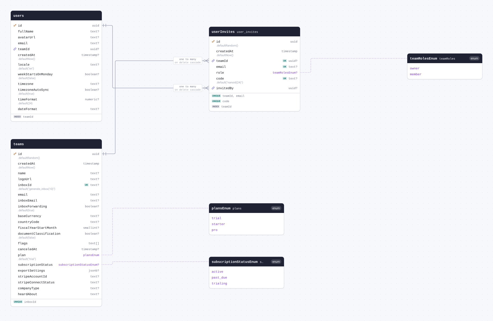

| Column                     | Type                                   | Constraints                     | Default                  | Description |
| -------------------------- | -------------------------------------- | ------------------------------- | ------------------------ | ----------- |
| `id`                       | `uuid`                                 | PK NOT NULL                     | `.defaultRandom()`       |             |
| `createdAt` (`created_at`) | `timestamp`                            | NOT NULL                        | `.defaultNow()`          |             |
| `teamId` (`team_id`)       | `uuid`                                 | NULL → [teams.id](#table-teams) |                          |             |
| `email`                    | `text`                                 | NULL                            |                          |             |
| `role`                     | [`teamRolesEnum`](#enum-teamRolesEnum) | NULL                            |                          |             |
| `code`                     | `text`                                 | NULL                            | `.default("nanoid(24)")` |             |
| `invitedBy` (`invited_by`) | `uuid`                                 | NULL → [users.id](#table-users) |                          |             |

#### Definition

```sql
CREATE TABLE "user_invites" (
	"id" uuid PRIMARY KEY DEFAULT gen_random_uuid(),
	"created_at" timestamp with time zone DEFAULT now() NOT NULL,
	"team_id" uuid,
	"email" text,
	"role" "teamRoles",
	"code" text DEFAULT 'nanoid(24)' CONSTRAINT "user_invites_code_key" UNIQUE,
	"invited_by" uuid,
	CONSTRAINT "unique_team_invite" UNIQUE("team_id","email")
);

ALTER TABLE "user_invites" ENABLE ROW LEVEL SECURITY;

CREATE INDEX "user_invites_team_id_idx" ON "user_invites" ("team_id" uuid_ops);

ALTER TABLE "user_invites" ADD CONSTRAINT "public_user_invites_team_id_fkey" FOREIGN KEY ("team_id") REFERENCES "teams"("id") ON DELETE CASCADE;

ALTER TABLE "user_invites" ADD CONSTRAINT "user_invites_invited_by_fkey" FOREIGN KEY ("invited_by") REFERENCES "users"("id") ON DELETE CASCADE;
```

#### Indexes

- INDEX `teamId`
- UNIQUE `teamId`, `email`
- UNIQUE `code`

#### References

- `teamId` → [teams.id](#table-teams) (many to one, on delete cascade)
- `invitedBy` → [users.id](#table-users) (many to one, on delete cascade)

<details>
<summary>Queries and their SQL</summary>

**Select**: Every row of userInvites.

```ts
db.select().from(userInvites);
```

```sql
select "id", "created_at", "team_id", "email", "role", "code", "invited_by"
from "user_invites"
```

**Count**: How many rows userInvites has.

```ts
db.select({ count: count() }).from(userInvites);
```

```sql
select count(*)
from "user_invites"
```

**Find many**: The rows of userInvites, through the relational query API.

```ts
db.query.userInvites.findMany();
```

```sql
select "d0"."id" as "id", "d0"."created_at" as "createdAt", "d0"."team_id" as "teamId", "d0"."email" as "email", "d0"."role" as "role", "d0"."code" as "code", "d0"."invited_by" as "invitedBy"
from "user_invites" as "d0"
```

**Find by primary key**: One row of userInvites, through the relational query API.

```ts
db.query.userInvites.findFirst({ where: { id: "00000000-0000-0000-0000-000000000000" } });
```

```sql
select "d0"."id" as "id", "d0"."created_at" as "createdAt", "d0"."team_id" as "teamId", "d0"."email" as "email", "d0"."role" as "role", "d0"."code" as "code", "d0"."invited_by" as "invitedBy"
from "user_invites" as "d0"
where "d0"."id" = $1
limit $2
-- params: ["00000000-0000-0000-0000-000000000000",1]
```

**Insert**: Adds a row to userInvites, giving the columns that have no default.

```ts
db.insert(userInvites).values({});
```

```sql
insert into "user_invites" ("id", "created_at", "team_id", "email", "role", "code", "invited_by")
values (default, default, default, default, default, default, default)
```

**Update**: Changes a row of userInvites, found by its primary key.

```ts
db.update(userInvites)
  .set({ createdAt: new Date("2026-01-01T00:00:00.000Z") })
  .where(eq(userInvites.id, "00000000-0000-0000-0000-000000000000"));
```

```sql
update "user_invites"
set "created_at" = $1
where "user_invites"."id" = $2
-- params: ["2026-01-01T00:00:00.000Z","00000000-0000-0000-0000-000000000000"]
```

**Delete**: Deletes a row of userInvites, found by its primary key.

```ts
db.delete(userInvites).where(eq(userInvites.id, "00000000-0000-0000-0000-000000000000"));
```

```sql
delete from "user_invites"
where "user_invites"."id" = $1
-- params: ["00000000-0000-0000-0000-000000000000"]
```

</details>

<a id="table-documentTags"></a>

### documentTags

Table `document_tags`.

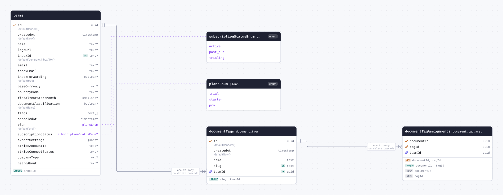

| Column                     | Type        | Constraints                         | Default            | Description |
| -------------------------- | ----------- | ----------------------------------- | ------------------ | ----------- |
| `id`                       | `uuid`      | PK NOT NULL                         | `.defaultRandom()` |             |
| `createdAt` (`created_at`) | `timestamp` | NOT NULL                            | `.defaultNow()`    |             |
| `name`                     | `text`      | NOT NULL                            |                    |             |
| `slug`                     | `text`      | NOT NULL                            |                    |             |
| `teamId` (`team_id`)       | `uuid`      | NOT NULL → [teams.id](#table-teams) |                    |             |

#### Definition

```sql
CREATE TABLE "document_tags" (
	"id" uuid PRIMARY KEY DEFAULT gen_random_uuid(),
	"created_at" timestamp with time zone DEFAULT now() NOT NULL,
	"name" text NOT NULL,
	"slug" text NOT NULL,
	"team_id" uuid NOT NULL,
	CONSTRAINT "unique_slug_per_team" UNIQUE("slug","team_id")
);

ALTER TABLE "document_tags" ENABLE ROW LEVEL SECURITY;

ALTER TABLE "document_tags" ADD CONSTRAINT "document_tags_team_id_fkey" FOREIGN KEY ("team_id") REFERENCES "teams"("id") ON DELETE CASCADE;
```

#### Indexes

- UNIQUE `slug`, `teamId`

#### References

- `teamId` → [teams.id](#table-teams) (many to one, on delete cascade)

#### Referenced by

- `id` → [documentTagAssignments.tagId](#table-documentTagAssignments) (one to many, on delete cascade)

<details>
<summary>Queries and their SQL</summary>

**Select**: Every row of documentTags.

```ts
db.select().from(documentTags);
```

```sql
select "id", "created_at", "name", "slug", "team_id"
from "document_tags"
```

**Count**: How many rows documentTags has.

```ts
db.select({ count: count() }).from(documentTags);
```

```sql
select count(*)
from "document_tags"
```

**Find many**: The rows of documentTags, through the relational query API.

```ts
db.query.documentTags.findMany();
```

```sql
select "d0"."id" as "id", "d0"."created_at" as "createdAt", "d0"."name" as "name", "d0"."slug" as "slug", "d0"."team_id" as "teamId"
from "document_tags" as "d0"
```

**Find by primary key**: One row of documentTags, through the relational query API.

```ts
db.query.documentTags.findFirst({ where: { id: "00000000-0000-0000-0000-000000000000" } });
```

```sql
select "d0"."id" as "id", "d0"."created_at" as "createdAt", "d0"."name" as "name", "d0"."slug" as "slug", "d0"."team_id" as "teamId"
from "document_tags" as "d0"
where "d0"."id" = $1
limit $2
-- params: ["00000000-0000-0000-0000-000000000000",1]
```

**Insert**: Adds a row to documentTags, giving the columns that have no default.

```ts
db.insert(documentTags).values({
  name: "name",
  slug: "slug",
  teamId: "00000000-0000-0000-0000-000000000000",
});
```

```sql
insert into "document_tags" ("id", "created_at", "name", "slug", "team_id")
values (default, default, $1, $2, $3)
-- params: ["name","slug","00000000-0000-0000-0000-000000000000"]
```

**Update**: Changes a row of documentTags, found by its primary key.

```ts
db.update(documentTags)
  .set({ createdAt: new Date("2026-01-01T00:00:00.000Z") })
  .where(eq(documentTags.id, "00000000-0000-0000-0000-000000000000"));
```

```sql
update "document_tags"
set "created_at" = $1
where "document_tags"."id" = $2
-- params: ["2026-01-01T00:00:00.000Z","00000000-0000-0000-0000-000000000000"]
```

**Delete**: Deletes a row of documentTags, found by its primary key.

```ts
db.delete(documentTags).where(eq(documentTags.id, "00000000-0000-0000-0000-000000000000"));
```

```sql
delete from "document_tags"
where "document_tags"."id" = $1
-- params: ["00000000-0000-0000-0000-000000000000"]
```

</details>

<a id="table-transactionTags"></a>

### transactionTags

Table `transaction_tags`.

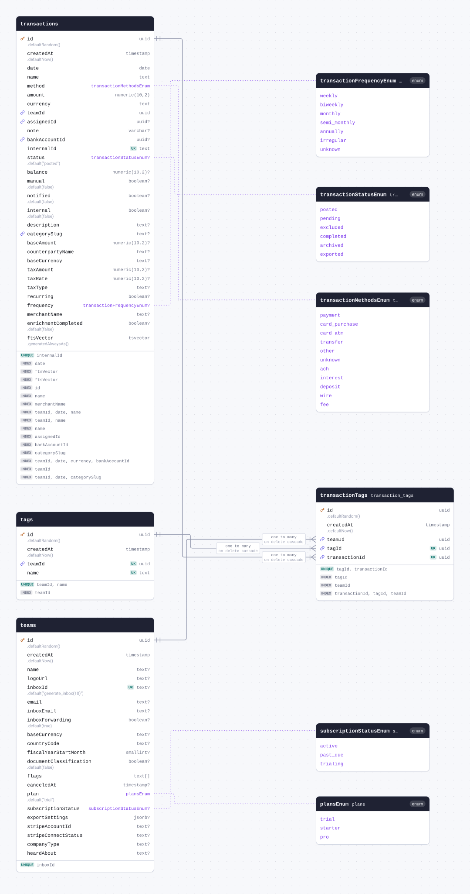

| Column                             | Type        | Constraints                                       | Default            | Description |
| ---------------------------------- | ----------- | ------------------------------------------------- | ------------------ | ----------- |
| `id`                               | `uuid`      | PK NOT NULL                                       | `.defaultRandom()` |             |
| `createdAt` (`created_at`)         | `timestamp` | NOT NULL                                          | `.defaultNow()`    |             |
| `teamId` (`team_id`)               | `uuid`      | NOT NULL → [teams.id](#table-teams)               |                    |             |
| `tagId` (`tag_id`)                 | `uuid`      | NOT NULL → [tags.id](#table-tags)                 |                    |             |
| `transactionId` (`transaction_id`) | `uuid`      | NOT NULL → [transactions.id](#table-transactions) |                    |             |

#### Definition

```sql
CREATE TABLE "transaction_tags" (
	"id" uuid PRIMARY KEY DEFAULT gen_random_uuid(),
	"created_at" timestamp with time zone DEFAULT now() NOT NULL,
	"team_id" uuid NOT NULL,
	"tag_id" uuid NOT NULL,
	"transaction_id" uuid NOT NULL,
	CONSTRAINT "unique_tag" UNIQUE("tag_id","transaction_id")
);

ALTER TABLE "transaction_tags" ENABLE ROW LEVEL SECURITY;

CREATE INDEX "transaction_tags_tag_id_idx" ON "transaction_tags" ("tag_id" uuid_ops);

CREATE INDEX "transaction_tags_team_id_idx" ON "transaction_tags" ("team_id" uuid_ops);

CREATE INDEX "transaction_tags_transaction_id_tag_id_team_id_idx" ON "transaction_tags" ("transaction_id" uuid_ops,"tag_id" uuid_ops,"team_id" uuid_ops);

ALTER TABLE "transaction_tags" ADD CONSTRAINT "transaction_tags_tag_id_fkey" FOREIGN KEY ("tag_id") REFERENCES "tags"("id") ON DELETE CASCADE;

ALTER TABLE "transaction_tags" ADD CONSTRAINT "transaction_tags_team_id_fkey" FOREIGN KEY ("team_id") REFERENCES "teams"("id") ON DELETE CASCADE;

ALTER TABLE "transaction_tags" ADD CONSTRAINT "transaction_tags_transaction_id_fkey" FOREIGN KEY ("transaction_id") REFERENCES "transactions"("id") ON DELETE CASCADE;
```

#### Indexes

- INDEX `tagId`
- INDEX `teamId`
- INDEX `transactionId`, `tagId`, `teamId`
- UNIQUE `tagId`, `transactionId`

#### References

- `tagId` → [tags.id](#table-tags) (many to one, on delete cascade)
- `teamId` → [teams.id](#table-teams) (many to one, on delete cascade)
- `transactionId` → [transactions.id](#table-transactions) (many to one, on delete cascade)

<details>
<summary>Queries and their SQL</summary>

**Select**: Every row of transactionTags.

```ts
db.select().from(transactionTags);
```

```sql
select "id", "created_at", "team_id", "tag_id", "transaction_id"
from "transaction_tags"
```

**Count**: How many rows transactionTags has.

```ts
db.select({ count: count() }).from(transactionTags);
```

```sql
select count(*)
from "transaction_tags"
```

**Find many**: The rows of transactionTags, through the relational query API.

```ts
db.query.transactionTags.findMany();
```

```sql
select "d0"."id" as "id", "d0"."created_at" as "createdAt", "d0"."team_id" as "teamId", "d0"."tag_id" as "tagId", "d0"."transaction_id" as "transactionId"
from "transaction_tags" as "d0"
```

**Find by primary key**: One row of transactionTags, through the relational query API.

```ts
db.query.transactionTags.findFirst({ where: { id: "00000000-0000-0000-0000-000000000000" } });
```

```sql
select "d0"."id" as "id", "d0"."created_at" as "createdAt", "d0"."team_id" as "teamId", "d0"."tag_id" as "tagId", "d0"."transaction_id" as "transactionId"
from "transaction_tags" as "d0"
where "d0"."id" = $1
limit $2
-- params: ["00000000-0000-0000-0000-000000000000",1]
```

**Insert**: Adds a row to transactionTags, giving the columns that have no default.

```ts
db.insert(transactionTags).values({
  teamId: "00000000-0000-0000-0000-000000000000",
  tagId: "00000000-0000-0000-0000-000000000000",
  transactionId: "00000000-0000-0000-0000-000000000000",
});
```

```sql
insert into "transaction_tags" ("id", "created_at", "team_id", "tag_id", "transaction_id")
values (default, default, $1, $2, $3)
-- params: ["00000000-0000-0000-0000-000000000000","00000000-0000-0000-0000-000000000000","00000000-0000-0000-0000-000000000000"]
```

**Update**: Changes a row of transactionTags, found by its primary key.

```ts
db.update(transactionTags)
  .set({ createdAt: new Date("2026-01-01T00:00:00.000Z") })
  .where(eq(transactionTags.id, "00000000-0000-0000-0000-000000000000"));
```

```sql
update "transaction_tags"
set "created_at" = $1
where "transaction_tags"."id" = $2
-- params: ["2026-01-01T00:00:00.000Z","00000000-0000-0000-0000-000000000000"]
```

**Delete**: Deletes a row of transactionTags, found by its primary key.

```ts
db.delete(transactionTags).where(eq(transactionTags.id, "00000000-0000-0000-0000-000000000000"));
```

```sql
delete from "transaction_tags"
where "transaction_tags"."id" = $1
-- params: ["00000000-0000-0000-0000-000000000000"]
```

</details>

<a id="table-transactionAttachments"></a>

### transactionAttachments

Table `transaction_attachments`.

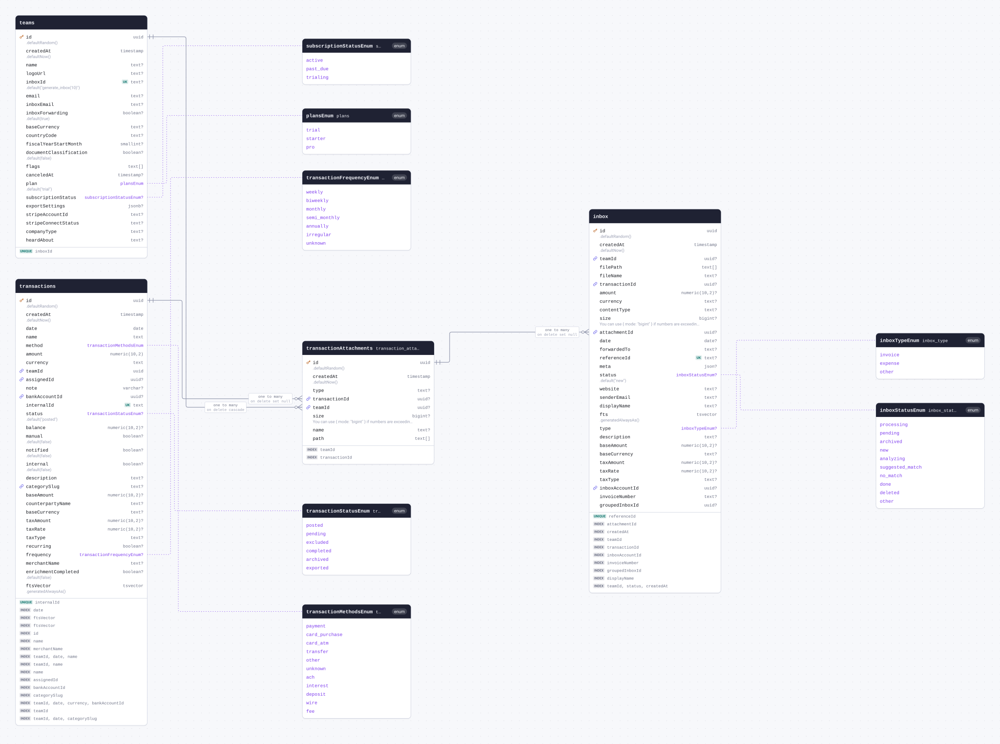

| Column                             | Type        | Constraints                                   | Default            | Description                                                                   |
| ---------------------------------- | ----------- | --------------------------------------------- | ------------------ | ----------------------------------------------------------------------------- |
| `id`                               | `uuid`      | PK NOT NULL                                   | `.defaultRandom()` |                                                                               |
| `createdAt` (`created_at`)         | `timestamp` | NOT NULL                                      | `.defaultNow()`    |                                                                               |
| `type`                             | `text`      | NULL                                          |                    |                                                                               |
| `transactionId` (`transaction_id`) | `uuid`      | NULL → [transactions.id](#table-transactions) |                    |                                                                               |
| `teamId` (`team_id`)               | `uuid`      | NULL → [teams.id](#table-teams)               |                    |                                                                               |
| `size`                             | `bigint`    | NULL                                          |                    | You can use { mode: "bigint" } if numbers are exceeding js number limitations |
| `name`                             | `text`      | NULL                                          |                    |                                                                               |
| `path`                             | `text[]`    | NULL                                          |                    |                                                                               |

#### Definition

```sql
CREATE TABLE "transaction_attachments" (
	"id" uuid PRIMARY KEY DEFAULT gen_random_uuid(),
	"created_at" timestamp with time zone DEFAULT now() NOT NULL,
	"type" text,
	"transaction_id" uuid,
	"team_id" uuid,
	"size" bigint,
	"name" text,
	"path" text[]
);

ALTER TABLE "transaction_attachments" ENABLE ROW LEVEL SECURITY;

CREATE INDEX "transaction_attachments_team_id_idx" ON "transaction_attachments" ("team_id" uuid_ops);

CREATE INDEX "transaction_attachments_transaction_id_idx" ON "transaction_attachments" ("transaction_id" uuid_ops);

ALTER TABLE "transaction_attachments" ADD CONSTRAINT "public_transaction_attachments_team_id_fkey" FOREIGN KEY ("team_id") REFERENCES "teams"("id") ON DELETE CASCADE;

ALTER TABLE "transaction_attachments" ADD CONSTRAINT "public_transaction_attachments_transaction_id_fkey" FOREIGN KEY ("transaction_id") REFERENCES "transactions"("id") ON DELETE SET NULL;
```

#### Indexes

- INDEX `teamId`
- INDEX `transactionId`

#### References

- `teamId` → [teams.id](#table-teams) (many to one, on delete cascade)
- `transactionId` → [transactions.id](#table-transactions) (many to one, on delete set null)

#### Referenced by

- `id` → [inbox.attachmentId](#table-inbox) (one to many, on delete set null)

<details>
<summary>Queries and their SQL</summary>

**Select**: Every row of transactionAttachments.

```ts
db.select().from(transactionAttachments);
```

```sql
select "id", "created_at", "type", "transaction_id", "team_id", "size", "name", "path"
from "transaction_attachments"
```

**Count**: How many rows transactionAttachments has.

```ts
db.select({ count: count() }).from(transactionAttachments);
```

```sql
select count(*)
from "transaction_attachments"
```

**Find many**: The rows of transactionAttachments, through the relational query API.

```ts
db.query.transactionAttachments.findMany();
```

```sql
select "d0"."id" as "id", "d0"."created_at" as "createdAt", "d0"."type" as "type", "d0"."transaction_id" as "transactionId", "d0"."team_id" as "teamId", "d0"."size" as "size", "d0"."name" as "name", "d0"."path" as "path"
from "transaction_attachments" as "d0"
```

**Find by primary key**: One row of transactionAttachments, through the relational query API.

```ts
db.query.transactionAttachments.findFirst({
  where: { id: "00000000-0000-0000-0000-000000000000" },
});
```

```sql
select "d0"."id" as "id", "d0"."created_at" as "createdAt", "d0"."type" as "type", "d0"."transaction_id" as "transactionId", "d0"."team_id" as "teamId", "d0"."size" as "size", "d0"."name" as "name", "d0"."path" as "path"
from "transaction_attachments" as "d0"
where "d0"."id" = $1
limit $2
-- params: ["00000000-0000-0000-0000-000000000000",1]
```

**Insert**: Adds a row to transactionAttachments, giving the columns that have no default.

```ts
db.insert(transactionAttachments).values({});
```

```sql
insert into "transaction_attachments" ("id", "created_at", "type", "transaction_id", "team_id", "size", "name", "path")
values (default, default, default, default, default, default, default, default)
```

**Update**: Changes a row of transactionAttachments, found by its primary key.

```ts
db.update(transactionAttachments)
  .set({ createdAt: new Date("2026-01-01T00:00:00.000Z") })
  .where(eq(transactionAttachments.id, "00000000-0000-0000-0000-000000000000"));
```

```sql
update "transaction_attachments"
set "created_at" = $1
where "transaction_attachments"."id" = $2
-- params: ["2026-01-01T00:00:00.000Z","00000000-0000-0000-0000-000000000000"]
```

**Delete**: Deletes a row of transactionAttachments, found by its primary key.

```ts
db.delete(transactionAttachments).where(
  eq(transactionAttachments.id, "00000000-0000-0000-0000-000000000000"),
);
```

```sql
delete from "transaction_attachments"
where "transaction_attachments"."id" = $1
-- params: ["00000000-0000-0000-0000-000000000000"]
```

</details>

<a id="table-teams"></a>

### teams

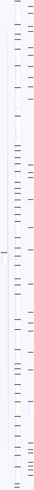

| Column                                               | Type                                                     | Constraints | Default                          | Description |
| ---------------------------------------------------- | -------------------------------------------------------- | ----------- | -------------------------------- | ----------- |
| `id`                                                 | `uuid`                                                   | PK NOT NULL | `.defaultRandom()`               |             |
| `createdAt` (`created_at`)                           | `timestamp`                                              | NOT NULL    | `.defaultNow()`                  |             |
| `name`                                               | `text`                                                   | NULL        |                                  |             |
| `logoUrl` (`logo_url`)                               | `text`                                                   | NULL        |                                  |             |
| `inboxId` (`inbox_id`)                               | `text`                                                   | NULL        | `.default("generate_inbox(10)")` |             |
| `email`                                              | `text`                                                   | NULL        |                                  |             |
| `inboxEmail` (`inbox_email`)                         | `text`                                                   | NULL        |                                  |             |
| `inboxForwarding` (`inbox_forwarding`)               | `boolean`                                                | NULL        | `.default(true)`                 |             |
| `baseCurrency` (`base_currency`)                     | `text`                                                   | NULL        |                                  |             |
| `countryCode` (`country_code`)                       | `text`                                                   | NULL        |                                  |             |
| `fiscalYearStartMonth` (`fiscal_year_start_month`)   | `smallint`                                               | NULL        |                                  |             |
| `documentClassification` (`document_classification`) | `boolean`                                                | NULL        | `.default(false)`                |             |
| `flags`                                              | `text[]`                                                 | NULL        |                                  |             |
| `canceledAt` (`canceled_at`)                         | `timestamp`                                              | NULL        |                                  |             |
| `plan`                                               | [`plansEnum`](#enum-plansEnum)                           | NOT NULL    | `.default("trial")`              |             |
| `subscriptionStatus` (`subscription_status`)         | [`subscriptionStatusEnum`](#enum-subscriptionStatusEnum) | NULL        |                                  |             |
| `exportSettings` (`export_settings`)                 | `jsonb`                                                  | NULL        |                                  |             |
| `stripeAccountId` (`stripe_account_id`)              | `text`                                                   | NULL        |                                  |             |
| `stripeConnectStatus` (`stripe_connect_status`)      | `text`                                                   | NULL        |                                  |             |
| `companyType` (`company_type`)                       | `text`                                                   | NULL        |                                  |             |
| `heardAbout` (`heard_about`)                         | `text`                                                   | NULL        |                                  |             |

#### Definition

```sql
CREATE TABLE "teams" (
	"id" uuid PRIMARY KEY DEFAULT gen_random_uuid(),
	"created_at" timestamp with time zone DEFAULT now() NOT NULL,
	"name" text,
	"logo_url" text,
	"inbox_id" text DEFAULT 'generate_inbox(10)' CONSTRAINT "teams_inbox_id_key" UNIQUE,
	"email" text,
	"inbox_email" text,
	"inbox_forwarding" boolean DEFAULT true,
	"base_currency" text,
	"country_code" text,
	"fiscal_year_start_month" smallint,
	"document_classification" boolean DEFAULT false,
	"flags" text[],
	"canceled_at" timestamp with time zone,
	"plan" "plans" DEFAULT 'trial'::"plans" NOT NULL,
	"subscription_status" "subscription_status",
	"export_settings" jsonb,
	"stripe_account_id" text,
	"stripe_connect_status" text,
	"company_type" text,
	"heard_about" text
);

ALTER TABLE "teams" ENABLE ROW LEVEL SECURITY;
```

#### Indexes

- UNIQUE `inboxId`

#### Referenced by

- `id` → [transactions.teamId](#table-transactions) (one to many, on delete cascade)
- `id` → [trackerEntries.teamId](#table-trackerEntries) (one to many, on delete cascade)
- `id` → [customerTags.teamId](#table-customerTags) (one to many, on delete cascade)
- `id` → [inboxAccounts.teamId](#table-inboxAccounts) (one to many, on delete cascade)
- `id` → [bankAccounts.teamId](#table-bankAccounts) (one to many, on delete cascade)
- `id` → [invoiceRecurring.teamId](#table-invoiceRecurring) (one to many, on delete cascade)
- `id` → [invoices.teamId](#table-invoices) (one to many, on delete cascade)
- `id` → [customers.teamId](#table-customers) (one to many, on delete cascade)
- `id` → [tags.teamId](#table-tags) (one to many, on delete cascade)
- `id` → [trackerReports.teamId](#table-trackerReports) (one to many, on delete cascade, on update cascade)
- `id` → [trackerProjectTags.teamId](#table-trackerProjectTags) (one to many, on delete cascade)
- `id` → [reports.teamId](#table-reports) (one to many, on delete cascade)
- `id` → [bankConnections.teamId](#table-bankConnections) (one to many, on delete cascade)
- `id` → [userInvites.teamId](#table-userInvites) (one to many, on delete cascade)
- `id` → [documentTags.teamId](#table-documentTags) (one to many, on delete cascade)
- `id` → [transactionTags.teamId](#table-transactionTags) (one to many, on delete cascade)
- `id` → [transactionAttachments.teamId](#table-transactionAttachments) (one to many, on delete cascade)
- `id` → [documents.teamId](#table-documents) (one to many, on delete cascade)
- `id` → [apps.teamId](#table-apps) (one to many, on delete cascade)
- `id` → [platformIdentities.teamId](#table-platformIdentities) (one to many, on delete cascade)
- `id` → [platformLinkTokens.teamId](#table-platformLinkTokens) (one to many, on delete cascade)
- `id` → [providerNotificationBatches.teamId](#table-providerNotificationBatches) (one to many, on delete cascade)
- `id` → [invoiceTemplates.teamId](#table-invoiceTemplates) (one to many, on delete cascade)
- `id` → [invoiceProducts.teamId](#table-invoiceProducts) (one to many, on delete cascade)
- `id` → [transactionEnrichments.teamId](#table-transactionEnrichments) (one to many, on delete cascade)
- `id` → [users.teamId](#table-users) (one to many, on delete set null)
- `id` → [trackerProjects.teamId](#table-trackerProjects) (one to many, on delete cascade)
- `id` → [inbox.teamId](#table-inbox) (one to many, on delete cascade)
- `id` → [inboxBlocklist.teamId](#table-inboxBlocklist) (one to many, on delete cascade)
- `id` → [transactionMatchSuggestions.teamId](#table-transactionMatchSuggestions) (one to many, on delete cascade)
- `id` → [documentTagAssignments.teamId](#table-documentTagAssignments) (one to many, on delete cascade)
- `id` → [usersOnTeam.teamId](#table-usersOnTeam) (one to many, on delete cascade, on update cascade)
- `id` → [transactionCategories.teamId](#table-transactionCategories) (one to many, on delete cascade)
- `id` → [shortLinks.teamId](#table-shortLinks) (one to many, on delete cascade)
- `id` → [apiKeys.teamId](#table-apiKeys) (one to many, on delete cascade)
- `id` → [oauthApplications.teamId](#table-oauthApplications) (one to many, on delete cascade)
- `id` → [oauthAuthorizationCodes.teamId](#table-oauthAuthorizationCodes) (one to many, on delete cascade)
- `id` → [oauthAccessTokens.teamId](#table-oauthAccessTokens) (one to many, on delete cascade)
- `id` → [activities.teamId](#table-activities) (one to many, on delete cascade)
- `id` → [notificationSettings.teamId](#table-notificationSettings) (one to many, on delete cascade)
- `id` → [accountingSyncRecords.teamId](#table-accountingSyncRecords) (one to many, on delete cascade)
- `id` → [insights.teamId](#table-insights) (one to many, on delete cascade)

<details>
<summary>Queries and their SQL</summary>

**Select**: Every row of teams.

```ts
db.select().from(teams);
```

```sql
select "id", "created_at", "name", "logo_url", "inbox_id", "email", "inbox_email", "inbox_forwarding", "base_currency", "country_code", "fiscal_year_start_month", "document_classification", "flags", "canceled_at", "plan", "subscription_status", "export_settings", "stripe_account_id", "stripe_connect_status", "company_type", "heard_about"
from "teams"
```

**Count**: How many rows teams has.

```ts
db.select({ count: count() }).from(teams);
```

```sql
select count(*)
from "teams"
```

**Find many**: The rows of teams, through the relational query API.

```ts
db.query.teams.findMany();
```

```sql
select "d0"."id" as "id", "d0"."created_at" as "createdAt", "d0"."name" as "name", "d0"."logo_url" as "logoUrl", "d0"."inbox_id" as "inboxId", "d0"."email" as "email", "d0"."inbox_email" as "inboxEmail", "d0"."inbox_forwarding" as "inboxForwarding", "d0"."base_currency" as "baseCurrency", "d0"."country_code" as "countryCode", "d0"."fiscal_year_start_month" as "fiscalYearStartMonth", "d0"."document_classification" as "documentClassification", "d0"."flags" as "flags", "d0"."canceled_at" as "canceledAt", "d0"."plan" as "plan", "d0"."subscription_status" as "subscriptionStatus", "d0"."export_settings" as "exportSettings", "d0"."stripe_account_id" as "stripeAccountId", "d0"."stripe_connect_status" as "stripeConnectStatus", "d0"."company_type" as "companyType", "d0"."heard_about" as "heardAbout"
from "teams" as "d0"
```

**Find by primary key**: One row of teams, through the relational query API.

```ts
db.query.teams.findFirst({ where: { id: "00000000-0000-0000-0000-000000000000" } });
```

```sql
select "d0"."id" as "id", "d0"."created_at" as "createdAt", "d0"."name" as "name", "d0"."logo_url" as "logoUrl", "d0"."inbox_id" as "inboxId", "d0"."email" as "email", "d0"."inbox_email" as "inboxEmail", "d0"."inbox_forwarding" as "inboxForwarding", "d0"."base_currency" as "baseCurrency", "d0"."country_code" as "countryCode", "d0"."fiscal_year_start_month" as "fiscalYearStartMonth", "d0"."document_classification" as "documentClassification", "d0"."flags" as "flags", "d0"."canceled_at" as "canceledAt", "d0"."plan" as "plan", "d0"."subscription_status" as "subscriptionStatus", "d0"."export_settings" as "exportSettings", "d0"."stripe_account_id" as "stripeAccountId", "d0"."stripe_connect_status" as "stripeConnectStatus", "d0"."company_type" as "companyType", "d0"."heard_about" as "heardAbout"
from "teams" as "d0"
where "d0"."id" = $1
limit $2
-- params: ["00000000-0000-0000-0000-000000000000",1]
```

**Insert**: Adds a row to teams, giving the columns that have no default.

```ts
db.insert(teams).values({});
```

```sql
insert into "teams" ("id", "created_at", "name", "logo_url", "inbox_id", "email", "inbox_email", "inbox_forwarding", "base_currency", "country_code", "fiscal_year_start_month", "document_classification", "flags", "canceled_at", "plan", "subscription_status", "export_settings", "stripe_account_id", "stripe_connect_status", "company_type", "heard_about")
values (default, default, default, default, default, default, default, default, default, default, default, default, default, default, default, default, default, default, default, default, default)
```

**Update**: Changes a row of teams, found by its primary key.

```ts
db.update(teams)
  .set({ createdAt: new Date("2026-01-01T00:00:00.000Z") })
  .where(eq(teams.id, "00000000-0000-0000-0000-000000000000"));
```

```sql
update "teams"
set "created_at" = $1
where "teams"."id" = $2
-- params: ["2026-01-01T00:00:00.000Z","00000000-0000-0000-0000-000000000000"]
```

**Delete**: Deletes a row of teams, found by its primary key.

```ts
db.delete(teams).where(eq(teams.id, "00000000-0000-0000-0000-000000000000"));
```

```sql
delete from "teams"
where "teams"."id" = $1
-- params: ["00000000-0000-0000-0000-000000000000"]
```

</details>

<a id="table-documents"></a>

### documents

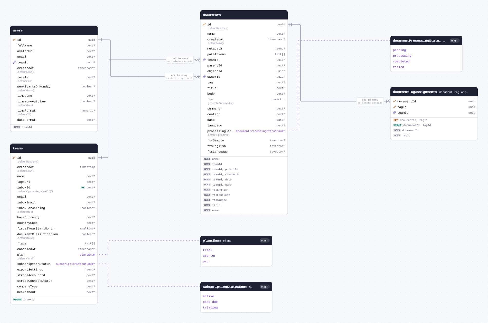

| Column                                   | Type                                                                 | Constraints                     | Default                | Description |
| ---------------------------------------- | -------------------------------------------------------------------- | ------------------------------- | ---------------------- | ----------- |
| `id`                                     | `uuid`                                                               | PK NOT NULL                     | `.defaultRandom()`     |             |
| `name`                                   | `text`                                                               | NULL                            |                        |             |
| `createdAt` (`created_at`)               | `timestamp`                                                          | NULL                            | `.defaultNow()`        |             |
| `metadata`                               | `jsonb`                                                              | NULL                            |                        |             |
| `pathTokens` (`path_tokens`)             | `text[]`                                                             | NULL                            |                        |             |
| `teamId` (`team_id`)                     | `uuid`                                                               | NULL → [teams.id](#table-teams) |                        |             |
| `parentId` (`parent_id`)                 | `text`                                                               | NULL                            |                        |             |
| `objectId` (`object_id`)                 | `uuid`                                                               | NULL                            |                        |             |
| `ownerId` (`owner_id`)                   | `uuid`                                                               | NULL → [users.id](#table-users) |                        |             |
| `tag`                                    | `text`                                                               | NULL                            |                        |             |
| `title`                                  | `text`                                                               | NULL                            |                        |             |
| `body`                                   | `text`                                                               | NULL                            |                        |             |
| `fts`                                    | `tsvector`                                                           | NOT NULL                        | `.generatedAlwaysAs()` |             |
| `summary`                                | `text`                                                               | NULL                            |                        |             |
| `content`                                | `text`                                                               | NULL                            |                        |             |
| `date`                                   | `date`                                                               | NULL                            |                        |             |
| `language`                               | `text`                                                               | NULL                            |                        |             |
| `processingStatus` (`processing_status`) | [`documentProcessingStatusEnum`](#enum-documentProcessingStatusEnum) | NULL                            | `.default("pending")`  |             |
| `ftsSimple` (`fts_simple`)               | `tsvector`                                                           | NULL                            |                        |             |
| `ftsEnglish` (`fts_english`)             | `tsvector`                                                           | NULL                            |                        |             |
| `ftsLanguage` (`fts_language`)           | `tsvector`                                                           | NULL                            |                        |             |

#### Definition

```sql
CREATE TABLE "documents" (
	"id" uuid PRIMARY KEY DEFAULT gen_random_uuid(),
	"name" text,
	"created_at" timestamp with time zone DEFAULT now(),
	"metadata" jsonb,
	"path_tokens" text[],
	"team_id" uuid,
	"parent_id" text,
	"object_id" uuid,
	"owner_id" uuid,
	"tag" text,
	"title" text,
	"body" text,
	"fts" tsvector GENERATED ALWAYS AS (to_tsvector('english'::regconfig, ((title || ' '::text) || body))) STORED NOT NULL,
	"summary" text,
	"content" text,
	"date" date,
	"language" text,
	"processing_status" "document_processing_status" DEFAULT 'pending'::"document_processing_status",
	"fts_simple" tsvector,
	"fts_english" tsvector,
	"fts_language" tsvector
);

ALTER TABLE "documents" ENABLE ROW LEVEL SECURITY;

CREATE INDEX "documents_name_idx" ON "documents" ("name" text_ops);

CREATE INDEX "documents_team_id_idx" ON "documents" ("team_id" uuid_ops);

CREATE INDEX "documents_team_id_parent_id_idx" ON "documents" ("team_id" text_ops,"parent_id" text_ops);

CREATE INDEX "documents_team_id_created_at_idx" ON "documents" ("team_id" uuid_ops,"created_at" DESC NULLS LAST);

CREATE INDEX "documents_team_id_date_idx" ON "documents" ("team_id" uuid_ops,"date");

CREATE INDEX "documents_team_id_name_idx" ON "documents" ("team_id" uuid_ops,"name" text_ops);

CREATE INDEX "idx_documents_fts_english" ON "documents" USING gin ("fts_english" tsvector_ops);

CREATE INDEX "idx_documents_fts_language" ON "documents" USING gin ("fts_language" tsvector_ops);

CREATE INDEX "idx_documents_fts_simple" ON "documents" USING gin ("fts_simple" tsvector_ops);

CREATE INDEX "idx_gin_documents_title" ON "documents" USING gin ("title" gin_trgm_ops);

CREATE INDEX "idx_gin_documents_name" ON "documents" USING gin ("name" gin_trgm_ops);

ALTER TABLE "documents" ADD CONSTRAINT "documents_created_by_fkey" FOREIGN KEY ("owner_id") REFERENCES "users"("id") ON DELETE SET NULL;

ALTER TABLE "documents" ADD CONSTRAINT "storage_team_id_fkey" FOREIGN KEY ("team_id") REFERENCES "teams"("id") ON DELETE CASCADE;
```

#### Indexes

- INDEX `name`
- INDEX `teamId`
- INDEX `teamId`, `parentId`
- INDEX `teamId`, `createdAt`
- INDEX `teamId`, `date`
- INDEX `teamId`, `name`
- INDEX `ftsEnglish`
- INDEX `ftsLanguage`
- INDEX `ftsSimple`
- INDEX `title`
- INDEX `name`

#### References

- `ownerId` → [users.id](#table-users) (many to one, on delete set null)
- `teamId` → [teams.id](#table-teams) (many to one, on delete cascade)

#### Referenced by

- `id` → [documentTagAssignments.documentId](#table-documentTagAssignments) (one to many, on delete cascade)

<details>
<summary>Queries and their SQL</summary>

**Select**: Every row of documents.

```ts
db.select().from(documents);
```

```sql
select "id", "name", "created_at", "metadata", "path_tokens", "team_id", "parent_id", "object_id", "owner_id", "tag", "title", "body", "fts", "summary", "content", "date", "language", "processing_status", "fts_simple", "fts_english", "fts_language"
from "documents"
```

**Count**: How many rows documents has.

```ts
db.select({ count: count() }).from(documents);
```

```sql
select count(*)
from "documents"
```

**Find many**: The rows of documents, through the relational query API.

```ts
db.query.documents.findMany();
```

```sql
select "d0"."id" as "id", "d0"."name" as "name", "d0"."created_at" as "createdAt", "d0"."metadata" as "metadata", "d0"."path_tokens" as "pathTokens", "d0"."team_id" as "teamId", "d0"."parent_id" as "parentId", "d0"."object_id" as "objectId", "d0"."owner_id" as "ownerId", "d0"."tag" as "tag", "d0"."title" as "title", "d0"."body" as "body", "d0"."fts" as "fts", "d0"."summary" as "summary", "d0"."content" as "content", "d0"."date" as "date", "d0"."language" as "language", "d0"."processing_status" as "processingStatus", "d0"."fts_simple" as "ftsSimple", "d0"."fts_english" as "ftsEnglish", "d0"."fts_language" as "ftsLanguage"
from "documents" as "d0"
```

**Find by primary key**: One row of documents, through the relational query API.

```ts
db.query.documents.findFirst({ where: { id: "00000000-0000-0000-0000-000000000000" } });
```

```sql
select "d0"."id" as "id", "d0"."name" as "name", "d0"."created_at" as "createdAt", "d0"."metadata" as "metadata", "d0"."path_tokens" as "pathTokens", "d0"."team_id" as "teamId", "d0"."parent_id" as "parentId", "d0"."object_id" as "objectId", "d0"."owner_id" as "ownerId", "d0"."tag" as "tag", "d0"."title" as "title", "d0"."body" as "body", "d0"."fts" as "fts", "d0"."summary" as "summary", "d0"."content" as "content", "d0"."date" as "date", "d0"."language" as "language", "d0"."processing_status" as "processingStatus", "d0"."fts_simple" as "ftsSimple", "d0"."fts_english" as "ftsEnglish", "d0"."fts_language" as "ftsLanguage"
from "documents" as "d0"
where "d0"."id" = $1
limit $2
-- params: ["00000000-0000-0000-0000-000000000000",1]
```

**Insert**: Adds a row to documents, giving the columns that have no default.

```ts
db.insert(documents).values({});
```

```sql
insert into "documents" ("id", "name", "created_at", "metadata", "path_tokens", "team_id", "parent_id", "object_id", "owner_id", "tag", "title", "body", "summary", "content", "date", "language", "processing_status", "fts_simple", "fts_english", "fts_language")
values (default, default, default, default, default, default, default, default, default, default, default, default, default, default, default, default, default, default, default, default)
```

**Update**: Changes a row of documents, found by its primary key.

```ts
db.update(documents)
  .set({ name: "name" })
  .where(eq(documents.id, "00000000-0000-0000-0000-000000000000"));
```

```sql
update "documents"
set "name" = $1
where "documents"."id" = $2
-- params: ["name","00000000-0000-0000-0000-000000000000"]
```

**Delete**: Deletes a row of documents, found by its primary key.

```ts
db.delete(documents).where(eq(documents.id, "00000000-0000-0000-0000-000000000000"));
```

```sql
delete from "documents"
where "documents"."id" = $1
-- params: ["00000000-0000-0000-0000-000000000000"]
```

</details>

<a id="table-apps"></a>

### apps

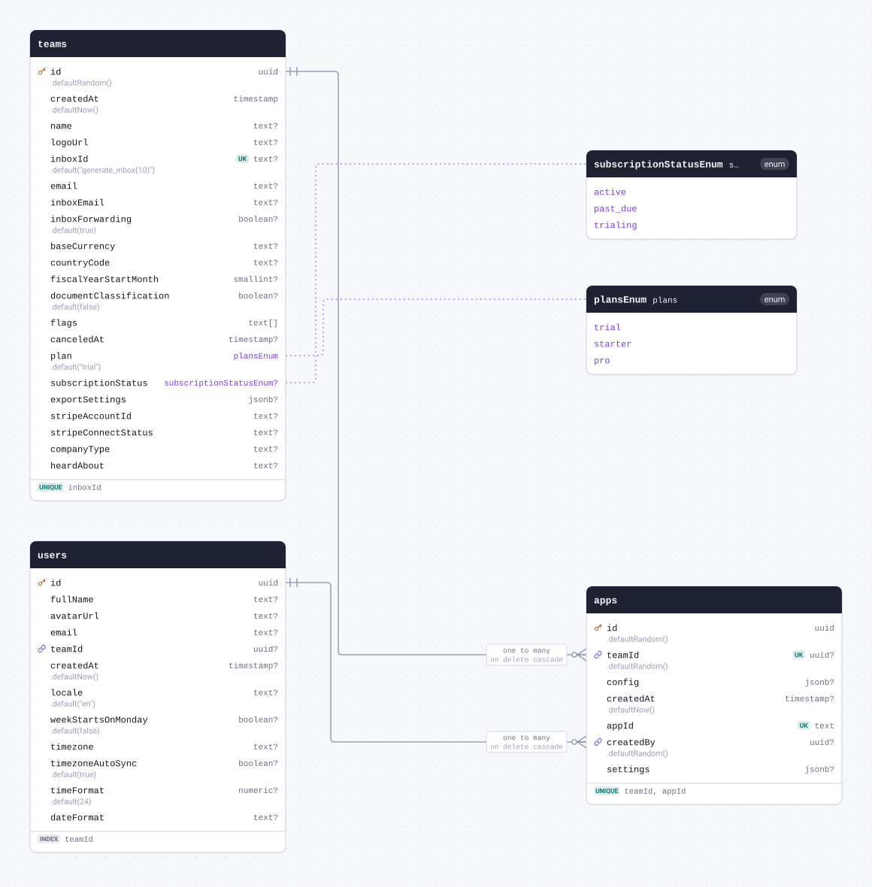

| Column                     | Type        | Constraints                     | Default            | Description |
| -------------------------- | ----------- | ------------------------------- | ------------------ | ----------- |
| `id`                       | `uuid`      | PK NOT NULL                     | `.defaultRandom()` |             |
| `teamId` (`team_id`)       | `uuid`      | NULL → [teams.id](#table-teams) | `.defaultRandom()` |             |
| `config`                   | `jsonb`     | NULL                            |                    |             |
| `createdAt` (`created_at`) | `timestamp` | NULL                            | `.defaultNow()`    |             |
| `appId` (`app_id`)         | `text`      | NOT NULL                        |                    |             |
| `createdBy` (`created_by`) | `uuid`      | NULL → [users.id](#table-users) | `.defaultRandom()` |             |
| `settings`                 | `jsonb`     | NULL                            |                    |             |

#### Definition

```sql
CREATE TABLE "apps" (
	"id" uuid PRIMARY KEY DEFAULT gen_random_uuid(),
	"team_id" uuid DEFAULT gen_random_uuid(),
	"config" jsonb,
	"created_at" timestamp with time zone DEFAULT now(),
	"app_id" text NOT NULL,
	"created_by" uuid DEFAULT gen_random_uuid(),
	"settings" jsonb,
	CONSTRAINT "unique_app_id_team_id" UNIQUE("team_id","app_id")
);

ALTER TABLE "apps" ENABLE ROW LEVEL SECURITY;

ALTER TABLE "apps" ADD CONSTRAINT "apps_created_by_fkey" FOREIGN KEY ("created_by") REFERENCES "users"("id") ON DELETE CASCADE;

ALTER TABLE "apps" ADD CONSTRAINT "integrations_team_id_fkey" FOREIGN KEY ("team_id") REFERENCES "teams"("id") ON DELETE CASCADE;
```

#### Indexes

- UNIQUE `teamId`, `appId`

#### References

- `createdBy` → [users.id](#table-users) (many to one, on delete cascade)
- `teamId` → [teams.id](#table-teams) (many to one, on delete cascade)

<details>
<summary>Queries and their SQL</summary>

**Select**: Every row of apps.

```ts
db.select().from(apps);
```

```sql
select "id", "team_id", "config", "created_at", "app_id", "created_by", "settings"
from "apps"
```

**Count**: How many rows apps has.

```ts
db.select({ count: count() }).from(apps);
```

```sql
select count(*)
from "apps"
```

**Find many**: The rows of apps, through the relational query API.

```ts
db.query.apps.findMany();
```

```sql
select "d0"."id" as "id", "d0"."team_id" as "teamId", "d0"."config" as "config", "d0"."created_at" as "createdAt", "d0"."app_id" as "appId", "d0"."created_by" as "createdBy", "d0"."settings" as "settings"
from "apps" as "d0"
```

**Find by primary key**: One row of apps, through the relational query API.

```ts
db.query.apps.findFirst({ where: { id: "00000000-0000-0000-0000-000000000000" } });
```

```sql
select "d0"."id" as "id", "d0"."team_id" as "teamId", "d0"."config" as "config", "d0"."created_at" as "createdAt", "d0"."app_id" as "appId", "d0"."created_by" as "createdBy", "d0"."settings" as "settings"
from "apps" as "d0"
where "d0"."id" = $1
limit $2
-- params: ["00000000-0000-0000-0000-000000000000",1]
```

**Insert**: Adds a row to apps, giving the columns that have no default.

```ts
db.insert(apps).values({ appId: "appId" });
```

```sql
insert into "apps" ("id", "team_id", "config", "created_at", "app_id", "created_by", "settings")
values (default, default, default, default, $1, default, default)
-- params: ["appId"]
```

**Update**: Changes a row of apps, found by its primary key.

```ts
db.update(apps)
  .set({ teamId: "00000000-0000-0000-0000-000000000000" })
  .where(eq(apps.id, "00000000-0000-0000-0000-000000000000"));
```

```sql
update "apps"
set "team_id" = $1
where "apps"."id" = $2
-- params: ["00000000-0000-0000-0000-000000000000","00000000-0000-0000-0000-000000000000"]
```

**Delete**: Deletes a row of apps, found by its primary key.

```ts
db.delete(apps).where(eq(apps.id, "00000000-0000-0000-0000-000000000000"));
```

```sql
delete from "apps"
where "apps"."id" = $1
-- params: ["00000000-0000-0000-0000-000000000000"]
```

</details>

<a id="table-platformIdentities"></a>

### platformIdentities

Table `platform_identities`.

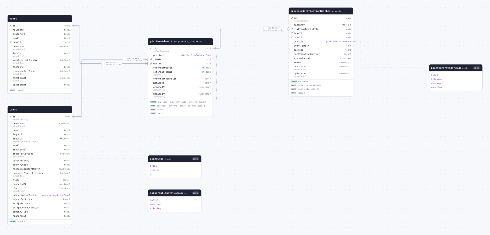

| Column                                      | Type                                                 | Constraints                         | Default            | Description |
| ------------------------------------------- | ---------------------------------------------------- | ----------------------------------- | ------------------ | ----------- |
| `id`                                        | `uuid`                                               | PK NOT NULL                         | `.defaultRandom()` |             |
| `provider`                                  | [`platformProviderEnum`](#enum-platformProviderEnum) | NOT NULL                            |                    |             |
| `teamId` (`team_id`)                        | `uuid`                                               | NOT NULL → [teams.id](#table-teams) |                    |             |
| `userId` (`user_id`)                        | `uuid`                                               | NOT NULL → [users.id](#table-users) |                    |             |
| `externalUserId` (`external_user_id`)       | `text`                                               | NOT NULL                            |                    |             |
| `externalTeamId` (`external_team_id`)       | `text`                                               | NOT NULL                            | `.default("")`     |             |
| `externalChannelId` (`external_channel_id`) | `text`                                               | NULL                                |                    |             |
| `metadata`                                  | `jsonb`                                              | NULL                                |                    |             |
| `createdAt` (`created_at`)                  | `timestamp`                                          | NULL                                | `.defaultNow()`    |             |
| `updatedAt` (`updated_at`)                  | `timestamp`                                          | NULL                                | `.defaultNow()`    |             |

#### Definition

```sql
CREATE TABLE "platform_identities" (
	"id" uuid PRIMARY KEY DEFAULT gen_random_uuid(),
	"provider" "platform_provider" NOT NULL,
	"team_id" uuid NOT NULL,
	"user_id" uuid NOT NULL,
	"external_user_id" text NOT NULL,
	"external_team_id" text DEFAULT '' NOT NULL,
	"external_channel_id" text,
	"metadata" jsonb,
	"created_at" timestamp with time zone DEFAULT now(),
	"updated_at" timestamp with time zone DEFAULT now(),
	CONSTRAINT "platform_identities_provider_external_unique" UNIQUE("provider","external_team_id","external_user_id")
);

ALTER TABLE "platform_identities" ENABLE ROW LEVEL SECURITY;

CREATE INDEX "platform_identities_provider_external_idx" ON "platform_identities" ("provider","external_team_id","external_user_id");

CREATE INDEX "platform_identities_team_id_idx" ON "platform_identities" ("team_id");

CREATE INDEX "platform_identities_user_id_idx" ON "platform_identities" ("user_id");

ALTER TABLE "platform_identities" ADD CONSTRAINT "platform_identities_team_id_fkey" FOREIGN KEY ("team_id") REFERENCES "teams"("id") ON DELETE CASCADE;

ALTER TABLE "platform_identities" ADD CONSTRAINT "platform_identities_user_id_fkey" FOREIGN KEY ("user_id") REFERENCES "users"("id") ON DELETE CASCADE;
```

#### Indexes

- INDEX `provider`, `externalTeamId`, `externalUserId`
- INDEX `teamId`
- INDEX `userId`
- UNIQUE `provider`, `externalTeamId`, `externalUserId`

#### References

- `teamId` → [teams.id](#table-teams) (many to one, on delete cascade)
- `userId` → [users.id](#table-users) (many to one, on delete cascade)

#### Referenced by

- `id` → [providerNotificationBatches.platformIdentityId](#table-providerNotificationBatches) (one to many, on delete cascade)

<details>
<summary>Queries and their SQL</summary>

**Select**: Every row of platformIdentities.

```ts
db.select().from(platformIdentities);
```

```sql
select "id", "provider", "team_id", "user_id", "external_user_id", "external_team_id", "external_channel_id", "metadata", "created_at", "updated_at"
from "platform_identities"
```

**Count**: How many rows platformIdentities has.

```ts
db.select({ count: count() }).from(platformIdentities);
```

```sql
select count(*)
from "platform_identities"
```

**Find many**: The rows of platformIdentities, through the relational query API.

```ts
db.query.platformIdentities.findMany();
```

```sql
select "d0"."id" as "id", "d0"."provider" as "provider", "d0"."team_id" as "teamId", "d0"."user_id" as "userId", "d0"."external_user_id" as "externalUserId", "d0"."external_team_id" as "externalTeamId", "d0"."external_channel_id" as "externalChannelId", "d0"."metadata" as "metadata", "d0"."created_at" as "createdAt", "d0"."updated_at" as "updatedAt"
from "platform_identities" as "d0"
```

**Find by primary key**: One row of platformIdentities, through the relational query API.

```ts
db.query.platformIdentities.findFirst({ where: { id: "00000000-0000-0000-0000-000000000000" } });
```

```sql
select "d0"."id" as "id", "d0"."provider" as "provider", "d0"."team_id" as "teamId", "d0"."user_id" as "userId", "d0"."external_user_id" as "externalUserId", "d0"."external_team_id" as "externalTeamId", "d0"."external_channel_id" as "externalChannelId", "d0"."metadata" as "metadata", "d0"."created_at" as "createdAt", "d0"."updated_at" as "updatedAt"
from "platform_identities" as "d0"
where "d0"."id" = $1
limit $2
-- params: ["00000000-0000-0000-0000-000000000000",1]
```

**Insert**: Adds a row to platformIdentities, giving the columns that have no default.

```ts
db.insert(platformIdentities).values({
  provider: "slack",
  teamId: "00000000-0000-0000-0000-000000000000",
  userId: "00000000-0000-0000-0000-000000000000",
  externalUserId: "externalUserId",
});
```

```sql
insert into "platform_identities" ("id", "provider", "team_id", "user_id", "external_user_id", "external_team_id", "external_channel_id", "metadata", "created_at", "updated_at")
values (default, $1, $2, $3, $4, default, default, default, default, default)
-- params: ["slack","00000000-0000-0000-0000-000000000000","00000000-0000-0000-0000-000000000000","externalUserId"]
```

**Update**: Changes a row of platformIdentities, found by its primary key.

```ts
db.update(platformIdentities)
  .set({ provider: "slack" })
  .where(eq(platformIdentities.id, "00000000-0000-0000-0000-000000000000"));
```

```sql
update "platform_identities"
set "provider" = $1
where "platform_identities"."id" = $2
-- params: ["slack","00000000-0000-0000-0000-000000000000"]
```

**Delete**: Deletes a row of platformIdentities, found by its primary key.

```ts
db.delete(platformIdentities).where(
  eq(platformIdentities.id, "00000000-0000-0000-0000-000000000000"),
);
```

```sql
delete from "platform_identities"
where "platform_identities"."id" = $1
-- params: ["00000000-0000-0000-0000-000000000000"]
```

</details>

<a id="table-platformLinkTokens"></a>

### platformLinkTokens

Table `platform_link_tokens`.

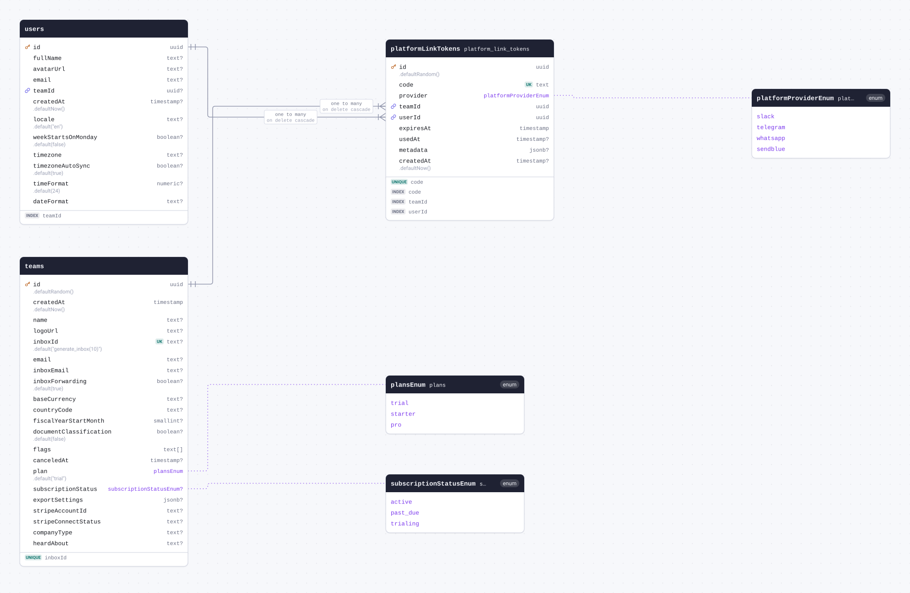

| Column                     | Type                                                 | Constraints                         | Default            | Description |
| -------------------------- | ---------------------------------------------------- | ----------------------------------- | ------------------ | ----------- |
| `id`                       | `uuid`                                               | PK NOT NULL                         | `.defaultRandom()` |             |
| `code`                     | `text`                                               | NOT NULL                            |                    |             |
| `provider`                 | [`platformProviderEnum`](#enum-platformProviderEnum) | NOT NULL                            |                    |             |
| `teamId` (`team_id`)       | `uuid`                                               | NOT NULL → [teams.id](#table-teams) |                    |             |
| `userId` (`user_id`)       | `uuid`                                               | NOT NULL → [users.id](#table-users) |                    |             |
| `expiresAt` (`expires_at`) | `timestamp`                                          | NOT NULL                            |                    |             |
| `usedAt` (`used_at`)       | `timestamp`                                          | NULL                                |                    |             |
| `metadata`                 | `jsonb`                                              | NULL                                |                    |             |
| `createdAt` (`created_at`) | `timestamp`                                          | NULL                                | `.defaultNow()`    |             |

#### Definition

```sql
CREATE TABLE "platform_link_tokens" (
	"id" uuid PRIMARY KEY DEFAULT gen_random_uuid(),
	"code" text NOT NULL CONSTRAINT "platform_link_tokens_code_unique" UNIQUE,
	"provider" "platform_provider" NOT NULL,
	"team_id" uuid NOT NULL,
	"user_id" uuid NOT NULL,
	"expires_at" timestamp with time zone NOT NULL,
	"used_at" timestamp with time zone,
	"metadata" jsonb,
	"created_at" timestamp with time zone DEFAULT now()
);

ALTER TABLE "platform_link_tokens" ENABLE ROW LEVEL SECURITY;

CREATE INDEX "platform_link_tokens_code_idx" ON "platform_link_tokens" ("code");

CREATE INDEX "platform_link_tokens_team_id_idx" ON "platform_link_tokens" ("team_id");

CREATE INDEX "platform_link_tokens_user_id_idx" ON "platform_link_tokens" ("user_id");

ALTER TABLE "platform_link_tokens" ADD CONSTRAINT "platform_link_tokens_team_id_fkey" FOREIGN KEY ("team_id") REFERENCES "teams"("id") ON DELETE CASCADE;

ALTER TABLE "platform_link_tokens" ADD CONSTRAINT "platform_link_tokens_user_id_fkey" FOREIGN KEY ("user_id") REFERENCES "users"("id") ON DELETE CASCADE;
```

#### Indexes

- INDEX `code`
- INDEX `teamId`
- INDEX `userId`
- UNIQUE `code`

#### References

- `teamId` → [teams.id](#table-teams) (many to one, on delete cascade)
- `userId` → [users.id](#table-users) (many to one, on delete cascade)

<details>
<summary>Queries and their SQL</summary>

**Select**: Every row of platformLinkTokens.

```ts
db.select().from(platformLinkTokens);
```

```sql
select "id", "code", "provider", "team_id", "user_id", "expires_at", "used_at", "metadata", "created_at"
from "platform_link_tokens"
```

**Count**: How many rows platformLinkTokens has.

```ts
db.select({ count: count() }).from(platformLinkTokens);
```

```sql
select count(*)
from "platform_link_tokens"
```

**Find many**: The rows of platformLinkTokens, through the relational query API.

```ts
db.query.platformLinkTokens.findMany();
```

```sql
select "d0"."id" as "id", "d0"."code" as "code", "d0"."provider" as "provider", "d0"."team_id" as "teamId", "d0"."user_id" as "userId", "d0"."expires_at" as "expiresAt", "d0"."used_at" as "usedAt", "d0"."metadata" as "metadata", "d0"."created_at" as "createdAt"
from "platform_link_tokens" as "d0"
```

**Find by primary key**: One row of platformLinkTokens, through the relational query API.

```ts
db.query.platformLinkTokens.findFirst({ where: { id: "00000000-0000-0000-0000-000000000000" } });
```

```sql
select "d0"."id" as "id", "d0"."code" as "code", "d0"."provider" as "provider", "d0"."team_id" as "teamId", "d0"."user_id" as "userId", "d0"."expires_at" as "expiresAt", "d0"."used_at" as "usedAt", "d0"."metadata" as "metadata", "d0"."created_at" as "createdAt"
from "platform_link_tokens" as "d0"
where "d0"."id" = $1
limit $2
-- params: ["00000000-0000-0000-0000-000000000000",1]
```

**Insert**: Adds a row to platformLinkTokens, giving the columns that have no default.

```ts
db.insert(platformLinkTokens).values({
  code: "code",
  provider: "slack",
  teamId: "00000000-0000-0000-0000-000000000000",
  userId: "00000000-0000-0000-0000-000000000000",
  expiresAt: new Date("2026-01-01T00:00:00.000Z"),
});
```

```sql
insert into "platform_link_tokens" ("id", "code", "provider", "team_id", "user_id", "expires_at", "used_at", "metadata", "created_at")
values (default, $1, $2, $3, $4, $5, default, default, default)
-- params: ["code","slack","00000000-0000-0000-0000-000000000000","00000000-0000-0000-0000-000000000000","2026-01-01T00:00:00.000Z"]
```

**Update**: Changes a row of platformLinkTokens, found by its primary key.

```ts
db.update(platformLinkTokens)
  .set({ code: "code" })
  .where(eq(platformLinkTokens.id, "00000000-0000-0000-0000-000000000000"));
```

```sql
update "platform_link_tokens"
set "code" = $1
where "platform_link_tokens"."id" = $2
-- params: ["code","00000000-0000-0000-0000-000000000000"]
```

**Delete**: Deletes a row of platformLinkTokens, found by its primary key.

```ts
db.delete(platformLinkTokens).where(
  eq(platformLinkTokens.id, "00000000-0000-0000-0000-000000000000"),
);
```

```sql
delete from "platform_link_tokens"
where "platform_link_tokens"."id" = $1
-- params: ["00000000-0000-0000-0000-000000000000"]
```

</details>

<a id="table-providerNotificationBatches"></a>

### providerNotificationBatches

Table `provider_notification_batches`.

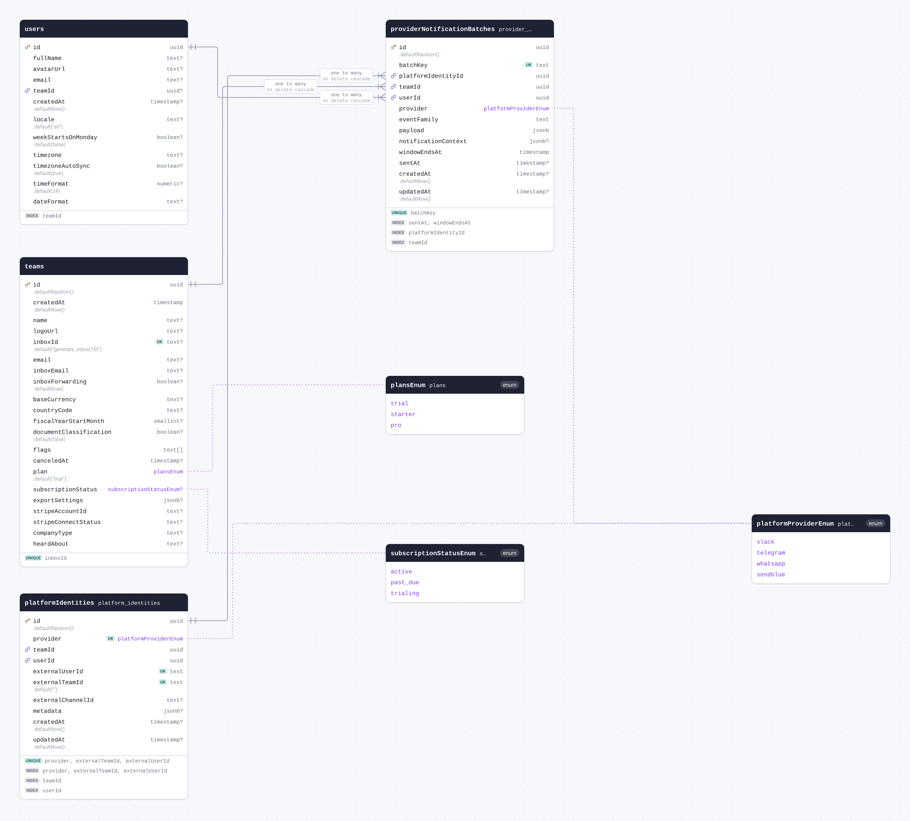

| Column                                         | Type                                                 | Constraints                                                   | Default            | Description |
| ---------------------------------------------- | ---------------------------------------------------- | ------------------------------------------------------------- | ------------------ | ----------- |
| `id`                                           | `uuid`                                               | PK NOT NULL                                                   | `.defaultRandom()` |             |
| `batchKey` (`batch_key`)                       | `text`                                               | NOT NULL                                                      |                    |             |
| `platformIdentityId` (`platform_identity_id`)  | `uuid`                                               | NOT NULL → [platformIdentities.id](#table-platformIdentities) |                    |             |
| `teamId` (`team_id`)                           | `uuid`                                               | NOT NULL → [teams.id](#table-teams)                           |                    |             |
| `userId` (`user_id`)                           | `uuid`                                               | NOT NULL → [users.id](#table-users)                           |                    |             |
| `provider`                                     | [`platformProviderEnum`](#enum-platformProviderEnum) | NOT NULL                                                      |                    |             |
| `eventFamily` (`event_family`)                 | `text`                                               | NOT NULL                                                      |                    |             |
| `payload`                                      | `jsonb`                                              | NOT NULL                                                      |                    |             |
| `notificationContext` (`notification_context`) | `jsonb`                                              | NULL                                                          |                    |             |
| `windowEndsAt` (`window_ends_at`)              | `timestamp`                                          | NOT NULL                                                      |                    |             |
| `sentAt` (`sent_at`)                           | `timestamp`                                          | NULL                                                          |                    |             |
| `createdAt` (`created_at`)                     | `timestamp`                                          | NULL                                                          | `.defaultNow()`    |             |
| `updatedAt` (`updated_at`)                     | `timestamp`                                          | NULL                                                          | `.defaultNow()`    |             |

#### Definition

```sql
CREATE TABLE "provider_notification_batches" (
	"id" uuid PRIMARY KEY DEFAULT gen_random_uuid(),
	"batch_key" text NOT NULL CONSTRAINT "provider_notification_batches_batch_key_unique" UNIQUE,
	"platform_identity_id" uuid NOT NULL,
	"team_id" uuid NOT NULL,
	"user_id" uuid NOT NULL,
	"provider" "platform_provider" NOT NULL,
	"event_family" text NOT NULL,
	"payload" jsonb NOT NULL,
	"notification_context" jsonb,
	"window_ends_at" timestamp with time zone NOT NULL,
	"sent_at" timestamp with time zone,
	"created_at" timestamp with time zone DEFAULT now(),
	"updated_at" timestamp with time zone DEFAULT now()
);

ALTER TABLE "provider_notification_batches" ENABLE ROW LEVEL SECURITY;

CREATE INDEX "provider_notification_batches_due_idx" ON "provider_notification_batches" ("sent_at","window_ends_at");

CREATE INDEX "provider_notification_batches_identity_idx" ON "provider_notification_batches" ("platform_identity_id");

CREATE INDEX "provider_notification_batches_team_id_idx" ON "provider_notification_batches" ("team_id");

ALTER TABLE "provider_notification_batches" ADD CONSTRAINT "provider_notification_batches_identity_id_fkey" FOREIGN KEY ("platform_identity_id") REFERENCES "platform_identities"("id") ON DELETE CASCADE;

ALTER TABLE "provider_notification_batches" ADD CONSTRAINT "provider_notification_batches_team_id_fkey" FOREIGN KEY ("team_id") REFERENCES "teams"("id") ON DELETE CASCADE;

ALTER TABLE "provider_notification_batches" ADD CONSTRAINT "provider_notification_batches_user_id_fkey" FOREIGN KEY ("user_id") REFERENCES "users"("id") ON DELETE CASCADE;
```

#### Indexes

- INDEX `sentAt`, `windowEndsAt`
- INDEX `platformIdentityId`
- INDEX `teamId`
- UNIQUE `batchKey`

#### References

- `platformIdentityId` → [platformIdentities.id](#table-platformIdentities) (many to one, on delete cascade)
- `teamId` → [teams.id](#table-teams) (many to one, on delete cascade)
- `userId` → [users.id](#table-users) (many to one, on delete cascade)

<details>
<summary>Queries and their SQL</summary>

**Select**: Every row of providerNotificationBatches.

```ts
db.select().from(providerNotificationBatches);
```

```sql
select "id", "batch_key", "platform_identity_id", "team_id", "user_id", "provider", "event_family", "payload", "notification_context", "window_ends_at", "sent_at", "created_at", "updated_at"
from "provider_notification_batches"
```

**Count**: How many rows providerNotificationBatches has.

```ts
db.select({ count: count() }).from(providerNotificationBatches);
```

```sql
select count(*)
from "provider_notification_batches"
```

**Find many**: The rows of providerNotificationBatches, through the relational query API.

```ts
db.query.providerNotificationBatches.findMany();
```

```sql
select "d0"."id" as "id", "d0"."batch_key" as "batchKey", "d0"."platform_identity_id" as "platformIdentityId", "d0"."team_id" as "teamId", "d0"."user_id" as "userId", "d0"."provider" as "provider", "d0"."event_family" as "eventFamily", "d0"."payload" as "payload", "d0"."notification_context" as "notificationContext", "d0"."window_ends_at" as "windowEndsAt", "d0"."sent_at" as "sentAt", "d0"."created_at" as "createdAt", "d0"."updated_at" as "updatedAt"
from "provider_notification_batches" as "d0"
```

**Find by primary key**: One row of providerNotificationBatches, through the relational query API.

```ts
db.query.providerNotificationBatches.findFirst({
  where: { id: "00000000-0000-0000-0000-000000000000" },
});
```

```sql
select "d0"."id" as "id", "d0"."batch_key" as "batchKey", "d0"."platform_identity_id" as "platformIdentityId", "d0"."team_id" as "teamId", "d0"."user_id" as "userId", "d0"."provider" as "provider", "d0"."event_family" as "eventFamily", "d0"."payload" as "payload", "d0"."notification_context" as "notificationContext", "d0"."window_ends_at" as "windowEndsAt", "d0"."sent_at" as "sentAt", "d0"."created_at" as "createdAt", "d0"."updated_at" as "updatedAt"
from "provider_notification_batches" as "d0"
where "d0"."id" = $1
limit $2
-- params: ["00000000-0000-0000-0000-000000000000",1]
```

**Insert**: Adds a row to providerNotificationBatches, giving the columns that have no default.

```ts
db.insert(providerNotificationBatches).values({
  batchKey: "batchKey",
  platformIdentityId: "00000000-0000-0000-0000-000000000000",
  teamId: "00000000-0000-0000-0000-000000000000",
  userId: "00000000-0000-0000-0000-000000000000",
  provider: "slack",
  eventFamily: "eventFamily",
  payload: {},
  windowEndsAt: new Date("2026-01-01T00:00:00.000Z"),
});
```

```sql
insert into "provider_notification_batches" ("id", "batch_key", "platform_identity_id", "team_id", "user_id", "provider", "event_family", "payload", "notification_context", "window_ends_at", "sent_at", "created_at", "updated_at")
values (default, $1, $2, $3, $4, $5, $6, $7, default, $8, default, default, default)
-- params: ["batchKey","00000000-0000-0000-0000-000000000000","00000000-0000-0000-0000-000000000000","00000000-0000-0000-0000-000000000000","slack","eventFamily",{},"2026-01-01T00:00:00.000Z"]
```

**Update**: Changes a row of providerNotificationBatches, found by its primary key.

```ts
db.update(providerNotificationBatches)
  .set({ batchKey: "batchKey" })
  .where(eq(providerNotificationBatches.id, "00000000-0000-0000-0000-000000000000"));
```

```sql
update "provider_notification_batches"
set "batch_key" = $1
where "provider_notification_batches"."id" = $2
-- params: ["batchKey","00000000-0000-0000-0000-000000000000"]
```

**Delete**: Deletes a row of providerNotificationBatches, found by its primary key.

```ts
db.delete(providerNotificationBatches).where(
  eq(providerNotificationBatches.id, "00000000-0000-0000-0000-000000000000"),
);
```

```sql
delete from "provider_notification_batches"
where "provider_notification_batches"."id" = $1
-- params: ["00000000-0000-0000-0000-000000000000"]
```

</details>

<a id="table-invoiceTemplates"></a>

### invoiceTemplates

Table `invoice_templates`.

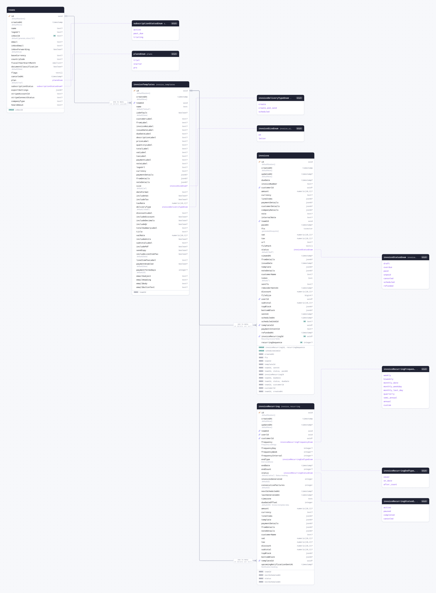

| Column                                         | Type                                                       | Constraints                         | Default               | Description |
| ---------------------------------------------- | ---------------------------------------------------------- | ----------------------------------- | --------------------- | ----------- |
| `id`                                           | `uuid`                                                     | PK NOT NULL                         | `.defaultRandom()`    |             |
| `createdAt` (`created_at`)                     | `timestamp`                                                | NOT NULL                            | `.defaultNow()`       |             |
| `teamId` (`team_id`)                           | `uuid`                                                     | NOT NULL → [teams.id](#table-teams) |                       |             |
| `name`                                         | `text`                                                     | NOT NULL                            | `.default("Default")` |             |
| `isDefault` (`is_default`)                     | `boolean`                                                  | NULL                                | `.default(false)`     |             |
| `customerLabel` (`customer_label`)             | `text`                                                     | NULL                                |                       |             |
| `fromLabel` (`from_label`)                     | `text`                                                     | NULL                                |                       |             |
| `invoiceNoLabel` (`invoice_no_label`)          | `text`                                                     | NULL                                |                       |             |
| `issueDateLabel` (`issue_date_label`)          | `text`                                                     | NULL                                |                       |             |
| `dueDateLabel` (`due_date_label`)              | `text`                                                     | NULL                                |                       |             |
| `descriptionLabel` (`description_label`)       | `text`                                                     | NULL                                |                       |             |
| `priceLabel` (`price_label`)                   | `text`                                                     | NULL                                |                       |             |
| `quantityLabel` (`quantity_label`)             | `text`                                                     | NULL                                |                       |             |
| `totalLabel` (`total_label`)                   | `text`                                                     | NULL                                |                       |             |
| `vatLabel` (`vat_label`)                       | `text`                                                     | NULL                                |                       |             |
| `taxLabel` (`tax_label`)                       | `text`                                                     | NULL                                |                       |             |
| `paymentLabel` (`payment_label`)               | `text`                                                     | NULL                                |                       |             |
| `noteLabel` (`note_label`)                     | `text`                                                     | NULL                                |                       |             |
| `logoUrl` (`logo_url`)                         | `text`                                                     | NULL                                |                       |             |
| `currency`                                     | `text`                                                     | NULL                                |                       |             |
| `paymentDetails` (`payment_details`)           | `jsonb`                                                    | NULL                                |                       |             |
| `fromDetails` (`from_details`)                 | `jsonb`                                                    | NULL                                |                       |             |
| `noteDetails` (`note_details`)                 | `jsonb`                                                    | NULL                                |                       |             |
| `size`                                         | [`invoiceSizeEnum`](#enum-invoiceSizeEnum)                 | NULL                                | `.default("a4")`      |             |
| `dateFormat` (`date_format`)                   | `text`                                                     | NULL                                |                       |             |
| `includeVat` (`include_vat`)                   | `boolean`                                                  | NULL                                |                       |             |
| `includeTax` (`include_tax`)                   | `boolean`                                                  | NULL                                |                       |             |
| `taxRate` (`tax_rate`)                         | `numeric(10,2)`                                            | NULL                                |                       |             |
| `deliveryType` (`delivery_type`)               | [`invoiceDeliveryTypeEnum`](#enum-invoiceDeliveryTypeEnum) | NOT NULL                            | `.default("create")`  |             |
| `discountLabel` (`discount_label`)             | `text`                                                     | NULL                                |                       |             |
| `includeDiscount` (`include_discount`)         | `boolean`                                                  | NULL                                |                       |             |
| `includeDecimals` (`include_decimals`)         | `boolean`                                                  | NULL                                |                       |             |
| `includeQr` (`include_qr`)                     | `boolean`                                                  | NULL                                |                       |             |
| `totalSummaryLabel` (`total_summary_label`)    | `text`                                                     | NULL                                |                       |             |
| `title`                                        | `text`                                                     | NULL                                |                       |             |
| `vatRate` (`vat_rate`)                         | `numeric(10,2)`                                            | NULL                                |                       |             |
| `includeUnits` (`include_units`)               | `boolean`                                                  | NULL                                |                       |             |
| `subtotalLabel` (`subtotal_label`)             | `text`                                                     | NULL                                |                       |             |
| `includePdf` (`include_pdf`)                   | `boolean`                                                  | NULL                                |                       |             |
| `sendCopy` (`send_copy`)                       | `boolean`                                                  | NULL                                |                       |             |
| `includeLineItemTax` (`include_line_item_tax`) | `boolean`                                                  | NULL                                | `.default(false)`     |             |
| `lineItemTaxLabel` (`line_item_tax_label`)     | `text`                                                     | NULL                                |                       |             |
| `paymentEnabled` (`payment_enabled`)           | `boolean`                                                  | NULL                                | `.default(false)`     |             |
| `paymentTermsDays` (`payment_terms_days`)      | `integer`                                                  | NULL                                | `.default(30)`        |             |
| `emailSubject` (`email_subject`)               | `text`                                                     | NULL                                |                       |             |
| `emailHeading` (`email_heading`)               | `text`                                                     | NULL                                |                       |             |
| `emailBody` (`email_body`)                     | `text`                                                     | NULL                                |                       |             |
| `emailButtonText` (`email_button_text`)        | `text`                                                     | NULL                                |                       |             |

#### Definition

```sql
CREATE TABLE "invoice_templates" (
	"id" uuid PRIMARY KEY DEFAULT gen_random_uuid(),
	"created_at" timestamp with time zone DEFAULT now() NOT NULL,
	"team_id" uuid NOT NULL,
	"name" text DEFAULT 'Default' NOT NULL,
	"is_default" boolean DEFAULT false,
	"customer_label" text,
	"from_label" text,
	"invoice_no_label" text,
	"issue_date_label" text,
	"due_date_label" text,
	"description_label" text,
	"price_label" text,
	"quantity_label" text,
	"total_label" text,
	"vat_label" text,
	"tax_label" text,
	"payment_label" text,
	"note_label" text,
	"logo_url" text,
	"currency" text,
	"payment_details" jsonb,
	"from_details" jsonb,
	"note_details" jsonb,
	"size" "invoice_size" DEFAULT 'a4'::"invoice_size",
	"date_format" text,
	"include_vat" boolean,
	"include_tax" boolean,
	"tax_rate" numeric(10,2),
	"delivery_type" "invoice_delivery_type" DEFAULT 'create'::"invoice_delivery_type" NOT NULL,
	"discount_label" text,
	"include_discount" boolean,
	"include_decimals" boolean,
	"include_qr" boolean,
	"total_summary_label" text,
	"title" text,
	"vat_rate" numeric(10,2),
	"include_units" boolean,
	"subtotal_label" text,
	"include_pdf" boolean,
	"send_copy" boolean,
	"include_line_item_tax" boolean DEFAULT false,
	"line_item_tax_label" text,
	"payment_enabled" boolean DEFAULT false,
	"payment_terms_days" integer DEFAULT 30,
	"email_subject" text,
	"email_heading" text,
	"email_body" text,
	"email_button_text" text
);

ALTER TABLE "invoice_templates" ENABLE ROW LEVEL SECURITY;

CREATE INDEX "idx_invoice_templates_team_id" ON "invoice_templates" ("team_id");

ALTER TABLE "invoice_templates" ADD CONSTRAINT "invoice_settings_team_id_fkey" FOREIGN KEY ("team_id") REFERENCES "teams"("id") ON DELETE CASCADE;
```

#### Indexes

- INDEX `teamId`

#### References

- `teamId` → [teams.id](#table-teams) (many to one, on delete cascade)

#### Referenced by

- `id` → [invoiceRecurring.templateId](#table-invoiceRecurring) (one to many, on delete set null)
- `id` → [invoices.templateId](#table-invoices) (one to many, on delete set null)

<details>
<summary>Queries and their SQL</summary>

**Select**: Every row of invoiceTemplates.

```ts
db.select().from(invoiceTemplates);
```

```sql
select "id", "created_at", "team_id", "name", "is_default", "customer_label", "from_label", "invoice_no_label", "issue_date_label", "due_date_label", "description_label", "price_label", "quantity_label", "total_label", "vat_label", "tax_label", "payment_label", "note_label", "logo_url", "currency", "payment_details", "from_details", "note_details", "size", "date_format", "include_vat", "include_tax", "tax_rate", "delivery_type", "discount_label", "include_discount", "include_decimals", "include_qr", "total_summary_label", "title", "vat_rate", "include_units", "subtotal_label", "include_pdf", "send_copy", "include_line_item_tax", "line_item_tax_label", "payment_enabled", "payment_terms_days", "email_subject", "email_heading", "email_body", "email_button_text"
from "invoice_templates"
```

**Count**: How many rows invoiceTemplates has.

```ts
db.select({ count: count() }).from(invoiceTemplates);
```

```sql
select count(*)
from "invoice_templates"
```

**Find many**: The rows of invoiceTemplates, through the relational query API.

```ts
db.query.invoiceTemplates.findMany();
```

```sql
select "d0"."id" as "id", "d0"."created_at" as "createdAt", "d0"."team_id" as "teamId", "d0"."name" as "name", "d0"."is_default" as "isDefault", "d0"."customer_label" as "customerLabel", "d0"."from_label" as "fromLabel", "d0"."invoice_no_label" as "invoiceNoLabel", "d0"."issue_date_label" as "issueDateLabel", "d0"."due_date_label" as "dueDateLabel", "d0"."description_label" as "descriptionLabel", "d0"."price_label" as "priceLabel", "d0"."quantity_label" as "quantityLabel", "d0"."total_label" as "totalLabel", "d0"."vat_label" as "vatLabel", "d0"."tax_label" as "taxLabel", "d0"."payment_label" as "paymentLabel", "d0"."note_label" as "noteLabel", "d0"."logo_url" as "logoUrl", "d0"."currency" as "currency", "d0"."payment_details" as "paymentDetails", "d0"."from_details" as "fromDetails", "d0"."note_details" as "noteDetails", "d0"."size" as "size", "d0"."date_format" as "dateFormat", "d0"."include_vat" as "includeVat", "d0"."include_tax" as "includeTax", "d0"."tax_rate" as "taxRate", "d0"."delivery_type" as "deliveryType", "d0"."discount_label" as "discountLabel", "d0"."include_discount" as "includeDiscount", "d0"."include_decimals" as "includeDecimals", "d0"."include_qr" as "includeQr", "d0"."total_summary_label" as "totalSummaryLabel", "d0"."title" as "title", "d0"."vat_rate" as "vatRate", "d0"."include_units" as "includeUnits", "d0"."subtotal_label" as "subtotalLabel", "d0"."include_pdf" as "includePdf", "d0"."send_copy" as "sendCopy", "d0"."include_line_item_tax" as "includeLineItemTax", "d0"."line_item_tax_label" as "lineItemTaxLabel", "d0"."payment_enabled" as "paymentEnabled", "d0"."payment_terms_days" as "paymentTermsDays", "d0"."email_subject" as "emailSubject", "d0"."email_heading" as "emailHeading", "d0"."email_body" as "emailBody", "d0"."email_button_text" as "emailButtonText"
from "invoice_templates" as "d0"
```

**Find by primary key**: One row of invoiceTemplates, through the relational query API.

```ts
db.query.invoiceTemplates.findFirst({ where: { id: "00000000-0000-0000-0000-000000000000" } });
```

```sql
select "d0"."id" as "id", "d0"."created_at" as "createdAt", "d0"."team_id" as "teamId", "d0"."name" as "name", "d0"."is_default" as "isDefault", "d0"."customer_label" as "customerLabel", "d0"."from_label" as "fromLabel", "d0"."invoice_no_label" as "invoiceNoLabel", "d0"."issue_date_label" as "issueDateLabel", "d0"."due_date_label" as "dueDateLabel", "d0"."description_label" as "descriptionLabel", "d0"."price_label" as "priceLabel", "d0"."quantity_label" as "quantityLabel", "d0"."total_label" as "totalLabel", "d0"."vat_label" as "vatLabel", "d0"."tax_label" as "taxLabel", "d0"."payment_label" as "paymentLabel", "d0"."note_label" as "noteLabel", "d0"."logo_url" as "logoUrl", "d0"."currency" as "currency", "d0"."payment_details" as "paymentDetails", "d0"."from_details" as "fromDetails", "d0"."note_details" as "noteDetails", "d0"."size" as "size", "d0"."date_format" as "dateFormat", "d0"."include_vat" as "includeVat", "d0"."include_tax" as "includeTax", "d0"."tax_rate" as "taxRate", "d0"."delivery_type" as "deliveryType", "d0"."discount_label" as "discountLabel", "d0"."include_discount" as "includeDiscount", "d0"."include_decimals" as "includeDecimals", "d0"."include_qr" as "includeQr", "d0"."total_summary_label" as "totalSummaryLabel", "d0"."title" as "title", "d0"."vat_rate" as "vatRate", "d0"."include_units" as "includeUnits", "d0"."subtotal_label" as "subtotalLabel", "d0"."include_pdf" as "includePdf", "d0"."send_copy" as "sendCopy", "d0"."include_line_item_tax" as "includeLineItemTax", "d0"."line_item_tax_label" as "lineItemTaxLabel", "d0"."payment_enabled" as "paymentEnabled", "d0"."payment_terms_days" as "paymentTermsDays", "d0"."email_subject" as "emailSubject", "d0"."email_heading" as "emailHeading", "d0"."email_body" as "emailBody", "d0"."email_button_text" as "emailButtonText"
from "invoice_templates" as "d0"
where "d0"."id" = $1
limit $2
-- params: ["00000000-0000-0000-0000-000000000000",1]
```

**Insert**: Adds a row to invoiceTemplates, giving the columns that have no default.

```ts
db.insert(invoiceTemplates).values({ teamId: "00000000-0000-0000-0000-000000000000" });
```

```sql
insert into "invoice_templates" ("id", "created_at", "team_id", "name", "is_default", "customer_label", "from_label", "invoice_no_label", "issue_date_label", "due_date_label", "description_label", "price_label", "quantity_label", "total_label", "vat_label", "tax_label", "payment_label", "note_label", "logo_url", "currency", "payment_details", "from_details", "note_details", "size", "date_format", "include_vat", "include_tax", "tax_rate", "delivery_type", "discount_label", "include_discount", "include_decimals", "include_qr", "total_summary_label", "title", "vat_rate", "include_units", "subtotal_label", "include_pdf", "send_copy", "include_line_item_tax", "line_item_tax_label", "payment_enabled", "payment_terms_days", "email_subject", "email_heading", "email_body", "email_button_text")
values (default, default, $1, default, default, default, default, default, default, default, default, default, default, default, default, default, default, default, default, default, default, default, default, default, default, default, default, default, default, default, default, default, default, default, default, default, default, default, default, default, default, default, default, default, default, default, default, default)
-- params: ["00000000-0000-0000-0000-000000000000"]
```

**Update**: Changes a row of invoiceTemplates, found by its primary key.

```ts
db.update(invoiceTemplates)
  .set({ createdAt: new Date("2026-01-01T00:00:00.000Z") })
  .where(eq(invoiceTemplates.id, "00000000-0000-0000-0000-000000000000"));
```

```sql
update "invoice_templates"
set "created_at" = $1
where "invoice_templates"."id" = $2
-- params: ["2026-01-01T00:00:00.000Z","00000000-0000-0000-0000-000000000000"]
```

**Delete**: Deletes a row of invoiceTemplates, found by its primary key.

```ts
db.delete(invoiceTemplates).where(eq(invoiceTemplates.id, "00000000-0000-0000-0000-000000000000"));
```

```sql
delete from "invoice_templates"
where "invoice_templates"."id" = $1
-- params: ["00000000-0000-0000-0000-000000000000"]
```

</details>

<a id="table-invoiceProducts"></a>

### invoiceProducts

Table `invoice_products`.

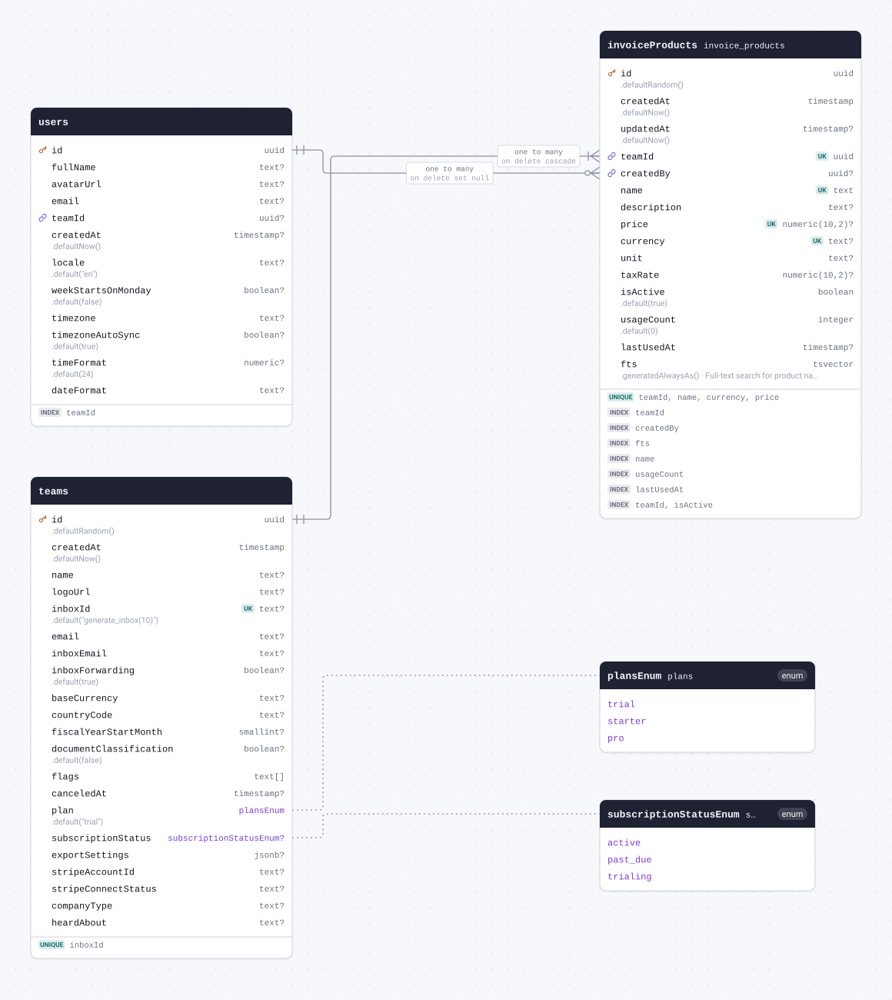

| Column                        | Type            | Constraints                         | Default                | Description                                         |
| ----------------------------- | --------------- | ----------------------------------- | ---------------------- | --------------------------------------------------- |
| `id`                          | `uuid`          | PK NOT NULL                         | `.defaultRandom()`     |                                                     |
| `createdAt` (`created_at`)    | `timestamp`     | NOT NULL                            | `.defaultNow()`        |                                                     |
| `updatedAt` (`updated_at`)    | `timestamp`     | NULL                                | `.defaultNow()`        |                                                     |
| `teamId` (`team_id`)          | `uuid`          | NOT NULL → [teams.id](#table-teams) |                        |                                                     |
| `createdBy` (`created_by`)    | `uuid`          | NULL → [users.id](#table-users)     |                        |                                                     |
| `name`                        | `text`          | NOT NULL                            |                        |                                                     |
| `description`                 | `text`          | NULL                                |                        |                                                     |
| `price`                       | `numeric(10,2)` | NULL                                |                        |                                                     |
| `currency`                    | `text`          | NULL                                |                        |                                                     |
| `unit`                        | `text`          | NULL                                |                        |                                                     |
| `taxRate` (`tax_rate`)        | `numeric(10,2)` | NULL                                |                        |                                                     |
| `isActive`                    | `boolean`       | NOT NULL                            | `.default(true)`       |                                                     |
| `usageCount` (`usage_count`)  | `integer`       | NOT NULL                            | `.default(0)`          |                                                     |
| `lastUsedAt` (`last_used_at`) | `timestamp`     | NULL                                |                        |                                                     |
| `fts`                         | `tsvector`      | NOT NULL                            | `.generatedAlwaysAs()` | Full-text search for product names and descriptions |

#### Definition

```sql
CREATE TABLE "invoice_products" (
	"id" uuid PRIMARY KEY DEFAULT gen_random_uuid(),
	"created_at" timestamp with time zone DEFAULT now() NOT NULL,
	"updated_at" timestamp with time zone DEFAULT now(),
	"team_id" uuid NOT NULL,
	"created_by" uuid,
	"name" text NOT NULL,
	"description" text,
	"price" numeric(10,2),
	"currency" text,
	"unit" text,
	"tax_rate" numeric(10,2),
	"isActive" boolean DEFAULT true NOT NULL,
	"usage_count" integer DEFAULT 0 NOT NULL,
	"last_used_at" timestamp with time zone,
	"fts" tsvector GENERATED ALWAYS AS (
          to_tsvector(
            'english',
            (
              (COALESCE(name, ''::text) || ' '::text) || COALESCE(description, ''::text)
            )
          )
        ) STORED NOT NULL,
	CONSTRAINT "invoice_products_team_name_currency_price_unique" UNIQUE("team_id","name","currency","price")
);

ALTER TABLE "invoice_products" ENABLE ROW LEVEL SECURITY;

CREATE INDEX "invoice_products_team_id_idx" ON "invoice_products" ("team_id");

CREATE INDEX "invoice_products_created_by_idx" ON "invoice_products" ("created_by");

CREATE INDEX "invoice_products_fts_idx" ON "invoice_products" USING gin ("fts");

CREATE INDEX "invoice_products_name_idx" ON "invoice_products" ("name");

CREATE INDEX "invoice_products_usage_count_idx" ON "invoice_products" ("usage_count");

CREATE INDEX "invoice_products_last_used_at_idx" ON "invoice_products" ("last_used_at");

CREATE INDEX "invoice_products_team_active_idx" ON "invoice_products" ("team_id","isActive");

ALTER TABLE "invoice_products" ADD CONSTRAINT "invoice_products_team_id_fkey" FOREIGN KEY ("team_id") REFERENCES "teams"("id") ON DELETE CASCADE;

ALTER TABLE "invoice_products" ADD CONSTRAINT "invoice_products_created_by_fkey" FOREIGN KEY ("created_by") REFERENCES "users"("id") ON DELETE SET NULL;
```

#### Indexes

- INDEX `teamId`
- INDEX `createdBy`
- INDEX `fts`
- INDEX `name`
- INDEX `usageCount`
- INDEX `lastUsedAt`
- INDEX `teamId`, `isActive`
- UNIQUE `teamId`, `name`, `currency`, `price`

#### References

- `teamId` → [teams.id](#table-teams) (many to one, on delete cascade)
- `createdBy` → [users.id](#table-users) (many to one, on delete set null)

<details>
<summary>Queries and their SQL</summary>

**Select**: Every row of invoiceProducts.

```ts
db.select().from(invoiceProducts);
```

```sql
select "id", "created_at", "updated_at", "team_id", "created_by", "name", "description", "price", "currency", "unit", "tax_rate", "isActive", "usage_count", "last_used_at", "fts"
from "invoice_products"
```

**Count**: How many rows invoiceProducts has.

```ts
db.select({ count: count() }).from(invoiceProducts);
```

```sql
select count(*)
from "invoice_products"
```

**Find many**: The rows of invoiceProducts, through the relational query API.

```ts
db.query.invoiceProducts.findMany();
```

```sql
select "d0"."id" as "id", "d0"."created_at" as "createdAt", "d0"."updated_at" as "updatedAt", "d0"."team_id" as "teamId", "d0"."created_by" as "createdBy", "d0"."name" as "name", "d0"."description" as "description", "d0"."price" as "price", "d0"."currency" as "currency", "d0"."unit" as "unit", "d0"."tax_rate" as "taxRate", "d0"."isActive" as "isActive", "d0"."usage_count" as "usageCount", "d0"."last_used_at" as "lastUsedAt", "d0"."fts" as "fts"
from "invoice_products" as "d0"
```

**Find by primary key**: One row of invoiceProducts, through the relational query API.

```ts
db.query.invoiceProducts.findFirst({ where: { id: "00000000-0000-0000-0000-000000000000" } });
```

```sql
select "d0"."id" as "id", "d0"."created_at" as "createdAt", "d0"."updated_at" as "updatedAt", "d0"."team_id" as "teamId", "d0"."created_by" as "createdBy", "d0"."name" as "name", "d0"."description" as "description", "d0"."price" as "price", "d0"."currency" as "currency", "d0"."unit" as "unit", "d0"."tax_rate" as "taxRate", "d0"."isActive" as "isActive", "d0"."usage_count" as "usageCount", "d0"."last_used_at" as "lastUsedAt", "d0"."fts" as "fts"
from "invoice_products" as "d0"
where "d0"."id" = $1
limit $2
-- params: ["00000000-0000-0000-0000-000000000000",1]
```

**Insert**: Adds a row to invoiceProducts, giving the columns that have no default.

```ts
db.insert(invoiceProducts).values({ teamId: "00000000-0000-0000-0000-000000000000", name: "name" });
```

```sql
insert into "invoice_products" ("id", "created_at", "updated_at", "team_id", "created_by", "name", "description", "price", "currency", "unit", "tax_rate", "isActive", "usage_count", "last_used_at")
values (default, default, default, $1, default, $2, default, default, default, default, default, default, default, default)
-- params: ["00000000-0000-0000-0000-000000000000","name"]
```

**Update**: Changes a row of invoiceProducts, found by its primary key.

```ts
db.update(invoiceProducts)
  .set({ createdAt: new Date("2026-01-01T00:00:00.000Z") })
  .where(eq(invoiceProducts.id, "00000000-0000-0000-0000-000000000000"));
```

```sql
update "invoice_products"
set "created_at" = $1
where "invoice_products"."id" = $2
-- params: ["2026-01-01T00:00:00.000Z","00000000-0000-0000-0000-000000000000"]
```

**Delete**: Deletes a row of invoiceProducts, found by its primary key.

```ts
db.delete(invoiceProducts).where(eq(invoiceProducts.id, "00000000-0000-0000-0000-000000000000"));
```

```sql
delete from "invoice_products"
where "invoice_products"."id" = $1
-- params: ["00000000-0000-0000-0000-000000000000"]
```

</details>

<a id="table-transactionEnrichments"></a>

### transactionEnrichments

Table `transaction_enrichments`.

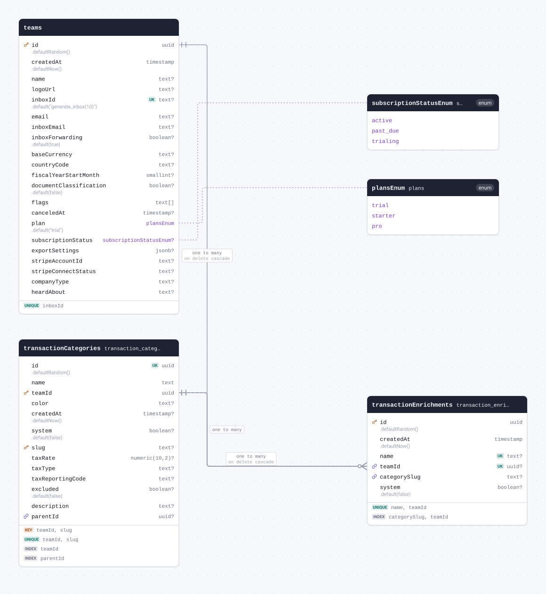

| Column                           | Type        | Constraints                                                         | Default            | Description |
| -------------------------------- | ----------- | ------------------------------------------------------------------- | ------------------ | ----------- |
| `id`                             | `uuid`      | PK NOT NULL                                                         | `.defaultRandom()` |             |
| `createdAt` (`created_at`)       | `timestamp` | NOT NULL                                                            | `.defaultNow()`    |             |
| `name`                           | `text`      | NULL                                                                |                    |             |
| `teamId` (`team_id`)             | `uuid`      | NULL → [transactionCategories.teamId](#table-transactionCategories) |                    |             |
| `categorySlug` (`category_slug`) | `text`      | NULL                                                                |                    |             |
| `system`                         | `boolean`   | NULL                                                                | `.default(false)`  |             |

#### Definition

```sql
CREATE TABLE "transaction_enrichments" (
	"id" uuid PRIMARY KEY DEFAULT gen_random_uuid(),
	"created_at" timestamp with time zone DEFAULT now() NOT NULL,
	"name" text,
	"team_id" uuid,
	"category_slug" text,
	"system" boolean DEFAULT false,
	CONSTRAINT "unique_team_name" UNIQUE("name","team_id")
);

ALTER TABLE "transaction_enrichments" ENABLE ROW LEVEL SECURITY;

CREATE INDEX "transaction_enrichments_category_slug_team_id_idx" ON "transaction_enrichments" ("category_slug" text_ops,"team_id" uuid_ops);

ALTER TABLE "transaction_enrichments" ADD CONSTRAINT "transaction_enrichments_category_slug_team_id_fkey" FOREIGN KEY ("team_id","category_slug") REFERENCES "transaction_categories"("team_id","slug") ON DELETE CASCADE;

ALTER TABLE "transaction_enrichments" ADD CONSTRAINT "transaction_enrichments_team_id_fkey" FOREIGN KEY ("team_id") REFERENCES "teams"("id") ON DELETE CASCADE;
```

#### Indexes

- INDEX `categorySlug`, `teamId`
- UNIQUE `name`, `teamId`

#### References

- `teamId` → [transactionCategories.teamId](#table-transactionCategories) (many to one, on delete cascade)
- `teamId` → [teams.id](#table-teams) (many to one, on delete cascade)
- `teamId` → [transactionCategories.teamId](#table-transactionCategories) (many to one, defineRelations, no foreign key)

<details>
<summary>Queries and their SQL</summary>

**Select**: Every row of transactionEnrichments.

```ts
db.select().from(transactionEnrichments);
```

```sql
select "id", "created_at", "name", "team_id", "category_slug", "system"
from "transaction_enrichments"
```

**Count**: How many rows transactionEnrichments has.

```ts
db.select({ count: count() }).from(transactionEnrichments);
```

```sql
select count(*)
from "transaction_enrichments"
```

**Find many**: The rows of transactionEnrichments, through the relational query API.

```ts
db.query.transactionEnrichments.findMany();
```

```sql
select "d0"."id" as "id", "d0"."created_at" as "createdAt", "d0"."name" as "name", "d0"."team_id" as "teamId", "d0"."category_slug" as "categorySlug", "d0"."system" as "system"
from "transaction_enrichments" as "d0"
```

**Find by primary key**: One row of transactionEnrichments, through the relational query API.

```ts
db.query.transactionEnrichments.findFirst({
  where: { id: "00000000-0000-0000-0000-000000000000" },
});
```

```sql
select "d0"."id" as "id", "d0"."created_at" as "createdAt", "d0"."name" as "name", "d0"."team_id" as "teamId", "d0"."category_slug" as "categorySlug", "d0"."system" as "system"
from "transaction_enrichments" as "d0"
where "d0"."id" = $1
limit $2
-- params: ["00000000-0000-0000-0000-000000000000",1]
```

**Insert**: Adds a row to transactionEnrichments, giving the columns that have no default.

```ts
db.insert(transactionEnrichments).values({});
```

```sql
insert into "transaction_enrichments" ("id", "created_at", "name", "team_id", "category_slug", "system")
values (default, default, default, default, default, default)
```

**Update**: Changes a row of transactionEnrichments, found by its primary key.

```ts
db.update(transactionEnrichments)
  .set({ createdAt: new Date("2026-01-01T00:00:00.000Z") })
  .where(eq(transactionEnrichments.id, "00000000-0000-0000-0000-000000000000"));
```

```sql
update "transaction_enrichments"
set "created_at" = $1
where "transaction_enrichments"."id" = $2
-- params: ["2026-01-01T00:00:00.000Z","00000000-0000-0000-0000-000000000000"]
```

**Delete**: Deletes a row of transactionEnrichments, found by its primary key.

```ts
db.delete(transactionEnrichments).where(
  eq(transactionEnrichments.id, "00000000-0000-0000-0000-000000000000"),
);
```

```sql
delete from "transaction_enrichments"
where "transaction_enrichments"."id" = $1
-- params: ["00000000-0000-0000-0000-000000000000"]
```

</details>

<a id="table-users"></a>

### users

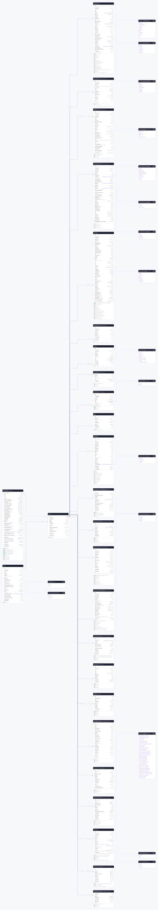

| Column                                         | Type        | Constraints                            | Default           | Description |
| ---------------------------------------------- | ----------- | -------------------------------------- | ----------------- | ----------- |
| `id`                                           | `uuid`      | PK NOT NULL → [users.id](#table-users) |                   |             |
| `fullName` (`full_name`)                       | `text`      | NULL                                   |                   |             |
| `avatarUrl` (`avatar_url`)                     | `text`      | NULL                                   |                   |             |
| `email`                                        | `text`      | NULL                                   |                   |             |
| `teamId` (`team_id`)                           | `uuid`      | NULL → [teams.id](#table-teams)        |                   |             |
| `createdAt` (`created_at`)                     | `timestamp` | NULL                                   | `.defaultNow()`   |             |
| `locale`                                       | `text`      | NULL                                   | `.default("en")`  |             |
| `weekStartsOnMonday` (`week_starts_on_monday`) | `boolean`   | NULL                                   | `.default(false)` |             |
| `timezone`                                     | `text`      | NULL                                   |                   |             |
| `timezoneAutoSync` (`timezone_auto_sync`)      | `boolean`   | NULL                                   | `.default(true)`  |             |
| `timeFormat` (`time_format`)                   | `numeric`   | NULL                                   | `.default(24)`    |             |
| `dateFormat` (`date_format`)                   | `text`      | NULL                                   |                   |             |

#### Definition

```sql
CREATE TABLE "users" (
	"id" uuid PRIMARY KEY,
	"full_name" text,
	"avatar_url" text,
	"email" text,
	"team_id" uuid,
	"created_at" timestamp with time zone DEFAULT now(),
	"locale" text DEFAULT 'en',
	"week_starts_on_monday" boolean DEFAULT false,
	"timezone" text,
	"timezone_auto_sync" boolean DEFAULT true,
	"time_format" numeric DEFAULT '24',
	"date_format" text
);

ALTER TABLE "users" ENABLE ROW LEVEL SECURITY;

CREATE INDEX "users_team_id_idx" ON "users" ("team_id" uuid_ops);

ALTER TABLE "users" ADD CONSTRAINT "users_id_fkey" FOREIGN KEY ("id") REFERENCES "users"("id") ON DELETE CASCADE;

ALTER TABLE "users" ADD CONSTRAINT "users_team_id_fkey" FOREIGN KEY ("team_id") REFERENCES "teams"("id") ON DELETE SET NULL;
```

#### Indexes

- INDEX `teamId`

#### References

- `id` → [users.id](#table-users) (one to one, on delete cascade)
- `teamId` → [teams.id](#table-teams) (many to one, on delete set null)
- `id` → [usersInAuth.id](#table-usersInAuth) (one to one, defineRelations, no foreign key)

#### Referenced by

- `id` → [transactions.assignedId](#table-transactions) (one to many, on delete set null)
- `id` → [trackerEntries.assignedId](#table-trackerEntries) (one to many, on delete set null)
- `id` → [bankAccounts.createdBy](#table-bankAccounts) (one to many, on delete cascade)
- `id` → [invoiceRecurring.userId](#table-invoiceRecurring) (one to many, on delete cascade)
- `id` → [invoices.userId](#table-invoices) (one to many, on delete cascade)
- `id` → [trackerReports.createdBy](#table-trackerReports) (one to many, on delete cascade)
- `id` → [reports.createdBy](#table-reports) (one to many, on delete cascade)
- `id` → [userInvites.invitedBy](#table-userInvites) (one to many, on delete cascade)
- `id` → [documents.ownerId](#table-documents) (one to many, on delete set null)
- `id` → [apps.createdBy](#table-apps) (one to many, on delete cascade)
- `id` → [platformIdentities.userId](#table-platformIdentities) (one to many, on delete cascade)
- `id` → [platformLinkTokens.userId](#table-platformLinkTokens) (one to many, on delete cascade)
- `id` → [providerNotificationBatches.userId](#table-providerNotificationBatches) (one to many, on delete cascade)
- `id` → [invoiceProducts.createdBy](#table-invoiceProducts) (one to many, on delete set null)
- `id` → [users.id](#table-users) (one to one, on delete cascade)
- `id` → [transactionMatchSuggestions.userId](#table-transactionMatchSuggestions) (one to many, on delete set null)
- `id` → [usersOnTeam.userId](#table-usersOnTeam) (one to many, on delete cascade)
- `id` → [shortLinks.userId](#table-shortLinks) (one to many, on delete cascade)
- `id` → [apiKeys.userId](#table-apiKeys) (one to many, on delete cascade)
- `id` → [oauthApplications.createdBy](#table-oauthApplications) (one to many, on delete cascade)
- `id` → [oauthAuthorizationCodes.userId](#table-oauthAuthorizationCodes) (one to many, on delete cascade)
- `id` → [oauthAccessTokens.userId](#table-oauthAccessTokens) (one to many, on delete cascade)
- `id` → [activities.userId](#table-activities) (one to many, on delete set null)
- `id` → [notificationSettings.userId](#table-notificationSettings) (one to many, on delete cascade)
- `id` → [insightUserStatus.userId](#table-insightUserStatus) (one to many, on delete cascade)

<details>
<summary>Queries and their SQL</summary>

**Select**: Every row of users.

```ts
db.select().from(users);
```

```sql
select "id", "full_name", "avatar_url", "email", "team_id", "created_at", "locale", "week_starts_on_monday", "timezone", "timezone_auto_sync", "time_format", "date_format"
from "users"
```

**Count**: How many rows users has.

```ts
db.select({ count: count() }).from(users);
```

```sql
select count(*)
from "users"
```

**Find many**: The rows of users, through the relational query API.

```ts
db.query.users.findMany();
```

```sql
select "d0"."id" as "id", "d0"."full_name" as "fullName", "d0"."avatar_url" as "avatarUrl", "d0"."email" as "email", "d0"."team_id" as "teamId", "d0"."created_at" as "createdAt", "d0"."locale" as "locale", "d0"."week_starts_on_monday" as "weekStartsOnMonday", "d0"."timezone" as "timezone", "d0"."timezone_auto_sync" as "timezoneAutoSync", "d0"."time_format" as "timeFormat", "d0"."date_format" as "dateFormat"
from "users" as "d0"
```

**Find by primary key**: One row of users, through the relational query API.

```ts
db.query.users.findFirst({ where: { id: "00000000-0000-0000-0000-000000000000" } });
```

```sql
select "d0"."id" as "id", "d0"."full_name" as "fullName", "d0"."avatar_url" as "avatarUrl", "d0"."email" as "email", "d0"."team_id" as "teamId", "d0"."created_at" as "createdAt", "d0"."locale" as "locale", "d0"."week_starts_on_monday" as "weekStartsOnMonday", "d0"."timezone" as "timezone", "d0"."timezone_auto_sync" as "timezoneAutoSync", "d0"."time_format" as "timeFormat", "d0"."date_format" as "dateFormat"
from "users" as "d0"
where "d0"."id" = $1
limit $2
-- params: ["00000000-0000-0000-0000-000000000000",1]
```

**Insert**: Adds a row to users, giving the columns that have no default.

```ts
db.insert(users).values({ id: "00000000-0000-0000-0000-000000000000" });
```

```sql
insert into "users" ("id", "full_name", "avatar_url", "email", "team_id", "created_at", "locale", "week_starts_on_monday", "timezone", "timezone_auto_sync", "time_format", "date_format")
values ($1, default, default, default, default, default, default, default, default, default, default, default)
-- params: ["00000000-0000-0000-0000-000000000000"]
```

**Update**: Changes a row of users, found by its primary key.

```ts
db.update(users)
  .set({ fullName: "fullName" })
  .where(eq(users.id, "00000000-0000-0000-0000-000000000000"));
```

```sql
update "users"
set "full_name" = $1
where "users"."id" = $2
-- params: ["fullName","00000000-0000-0000-0000-000000000000"]
```

**Delete**: Deletes a row of users, found by its primary key.

```ts
db.delete(users).where(eq(users.id, "00000000-0000-0000-0000-000000000000"));
```

```sql
delete from "users"
where "users"."id" = $1
-- params: ["00000000-0000-0000-0000-000000000000"]
```

</details>

<a id="table-trackerProjects"></a>

### trackerProjects

Table `tracker_projects`.

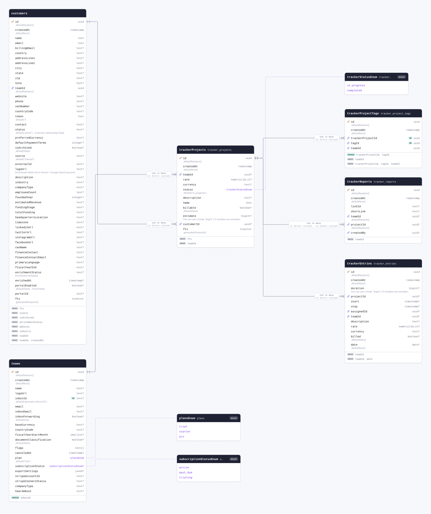

| Column                       | Type                                           | Constraints                             | Default                   | Description                                                                   |
| ---------------------------- | ---------------------------------------------- | --------------------------------------- | ------------------------- | ----------------------------------------------------------------------------- |
| `id`                         | `uuid`                                         | PK NOT NULL                             | `.defaultRandom()`        |                                                                               |
| `createdAt` (`created_at`)   | `timestamp`                                    | NOT NULL                                | `.defaultNow()`           |                                                                               |
| `teamId` (`team_id`)         | `uuid`                                         | NULL → [teams.id](#table-teams)         |                           |                                                                               |
| `rate`                       | `numeric(10,2)`                                | NULL                                    |                           |                                                                               |
| `currency`                   | `text`                                         | NULL                                    |                           |                                                                               |
| `status`                     | [`trackerStatusEnum`](#enum-trackerStatusEnum) | NOT NULL                                | `.default("in_progress")` |                                                                               |
| `description`                | `text`                                         | NULL                                    |                           |                                                                               |
| `name`                       | `text`                                         | NOT NULL                                |                           |                                                                               |
| `billable`                   | `boolean`                                      | NULL                                    | `.default(false)`         |                                                                               |
| `estimate`                   | `bigint`                                       | NULL                                    |                           | You can use { mode: "bigint" } if numbers are exceeding js number limitations |
| `customerId` (`customer_id`) | `uuid`                                         | NULL → [customers.id](#table-customers) |                           |                                                                               |
| `fts`                        | `tsvector`                                     | NOT NULL                                | `.generatedAlwaysAs()`    |                                                                               |

#### Definition

```sql
CREATE TABLE "tracker_projects" (
	"id" uuid PRIMARY KEY DEFAULT gen_random_uuid(),
	"created_at" timestamp with time zone DEFAULT now() NOT NULL,
	"team_id" uuid,
	"rate" numeric(10,2),
	"currency" text,
	"status" "trackerStatus" DEFAULT 'in_progress'::"trackerStatus" NOT NULL,
	"description" text,
	"name" text NOT NULL,
	"billable" boolean DEFAULT false,
	"estimate" bigint,
	"customer_id" uuid,
	"fts" tsvector GENERATED ALWAYS AS (
          to_tsvector(
            'english'::regconfig,
            (
              (COALESCE(name, ''::text) || ' '::text) || COALESCE(description, ''::text)
            )
          )
        ) STORED NOT NULL
);

ALTER TABLE "tracker_projects" ENABLE ROW LEVEL SECURITY;

CREATE INDEX "tracker_projects_fts" ON "tracker_projects" USING gin ("fts" tsvector_ops);

CREATE INDEX "tracker_projects_team_id_idx" ON "tracker_projects" ("team_id" uuid_ops);

ALTER TABLE "tracker_projects" ADD CONSTRAINT "tracker_projects_customer_id_fkey" FOREIGN KEY ("customer_id") REFERENCES "customers"("id") ON DELETE CASCADE;

ALTER TABLE "tracker_projects" ADD CONSTRAINT "tracker_projects_team_id_fkey" FOREIGN KEY ("team_id") REFERENCES "teams"("id") ON DELETE CASCADE;
```

#### Indexes

- INDEX `fts`
- INDEX `teamId`

#### References

- `customerId` → [customers.id](#table-customers) (many to one, on delete cascade)
- `teamId` → [teams.id](#table-teams) (many to one, on delete cascade)

#### Referenced by

- `id` → [trackerEntries.projectId](#table-trackerEntries) (one to many, on delete cascade)
- `id` → [trackerReports.projectId](#table-trackerReports) (one to many, on delete cascade, on update cascade)
- `id` → [trackerProjectTags.trackerProjectId](#table-trackerProjectTags) (one to many, on delete cascade)

<details>
<summary>Queries and their SQL</summary>

**Select**: Every row of trackerProjects.

```ts
db.select().from(trackerProjects);
```

```sql
select "id", "created_at", "team_id", "rate", "currency", "status", "description", "name", "billable", "estimate", "customer_id", "fts"
from "tracker_projects"
```

**Count**: How many rows trackerProjects has.

```ts
db.select({ count: count() }).from(trackerProjects);
```

```sql
select count(*)
from "tracker_projects"
```

**Find many**: The rows of trackerProjects, through the relational query API.

```ts
db.query.trackerProjects.findMany();
```

```sql
select "d0"."id" as "id", "d0"."created_at" as "createdAt", "d0"."team_id" as "teamId", "d0"."rate" as "rate", "d0"."currency" as "currency", "d0"."status" as "status", "d0"."description" as "description", "d0"."name" as "name", "d0"."billable" as "billable", "d0"."estimate" as "estimate", "d0"."customer_id" as "customerId", "d0"."fts" as "fts"
from "tracker_projects" as "d0"
```

**Find by primary key**: One row of trackerProjects, through the relational query API.

```ts
db.query.trackerProjects.findFirst({ where: { id: "00000000-0000-0000-0000-000000000000" } });
```

```sql
select "d0"."id" as "id", "d0"."created_at" as "createdAt", "d0"."team_id" as "teamId", "d0"."rate" as "rate", "d0"."currency" as "currency", "d0"."status" as "status", "d0"."description" as "description", "d0"."name" as "name", "d0"."billable" as "billable", "d0"."estimate" as "estimate", "d0"."customer_id" as "customerId", "d0"."fts" as "fts"
from "tracker_projects" as "d0"
where "d0"."id" = $1
limit $2
-- params: ["00000000-0000-0000-0000-000000000000",1]
```

**Insert**: Adds a row to trackerProjects, giving the columns that have no default.

```ts
db.insert(trackerProjects).values({ name: "name" });
```

```sql
insert into "tracker_projects" ("id", "created_at", "team_id", "rate", "currency", "status", "description", "name", "billable", "estimate", "customer_id")
values (default, default, default, default, default, default, default, $1, default, default, default)
-- params: ["name"]
```

**Update**: Changes a row of trackerProjects, found by its primary key.

```ts
db.update(trackerProjects)
  .set({ createdAt: new Date("2026-01-01T00:00:00.000Z") })
  .where(eq(trackerProjects.id, "00000000-0000-0000-0000-000000000000"));
```

```sql
update "tracker_projects"
set "created_at" = $1
where "tracker_projects"."id" = $2
-- params: ["2026-01-01T00:00:00.000Z","00000000-0000-0000-0000-000000000000"]
```

**Delete**: Deletes a row of trackerProjects, found by its primary key.

```ts
db.delete(trackerProjects).where(eq(trackerProjects.id, "00000000-0000-0000-0000-000000000000"));
```

```sql
delete from "tracker_projects"
where "tracker_projects"."id" = $1
-- params: ["00000000-0000-0000-0000-000000000000"]
```

</details>

<a id="table-inbox"></a>

### inbox

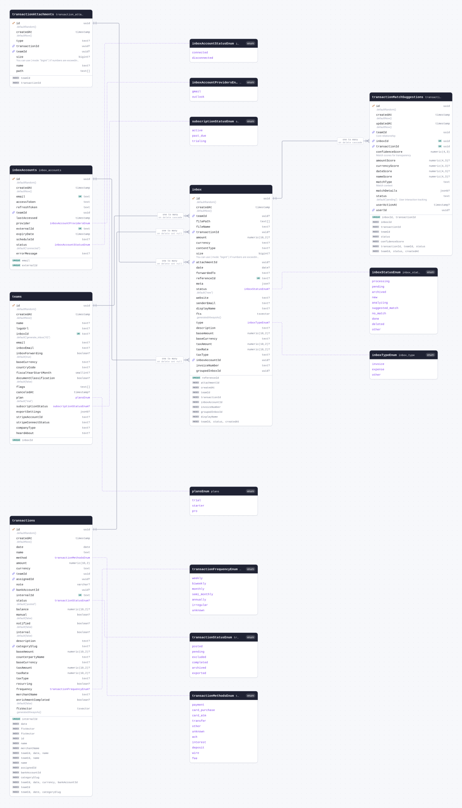

| Column                                | Type                                       | Constraints                                                       | Default                | Description                                                                   |
| ------------------------------------- | ------------------------------------------ | ----------------------------------------------------------------- | ---------------------- | ----------------------------------------------------------------------------- |
| `id`                                  | `uuid`                                     | PK NOT NULL                                                       | `.defaultRandom()`     |                                                                               |
| `createdAt` (`created_at`)            | `timestamp`                                | NOT NULL                                                          | `.defaultNow()`        |                                                                               |
| `teamId` (`team_id`)                  | `uuid`                                     | NULL → [teams.id](#table-teams)                                   |                        |                                                                               |
| `filePath` (`file_path`)              | `text[]`                                   | NULL                                                              |                        |                                                                               |
| `fileName` (`file_name`)              | `text`                                     | NULL                                                              |                        |                                                                               |
| `transactionId` (`transaction_id`)    | `uuid`                                     | NULL → [transactions.id](#table-transactions)                     |                        |                                                                               |
| `amount`                              | `numeric(10,2)`                            | NULL                                                              |                        |                                                                               |
| `currency`                            | `text`                                     | NULL                                                              |                        |                                                                               |
| `contentType` (`content_type`)        | `text`                                     | NULL                                                              |                        |                                                                               |
| `size`                                | `bigint`                                   | NULL                                                              |                        | You can use { mode: "bigint" } if numbers are exceeding js number limitations |
| `attachmentId` (`attachment_id`)      | `uuid`                                     | NULL → [transactionAttachments.id](#table-transactionAttachments) |                        |                                                                               |
| `date`                                | `date`                                     | NULL                                                              |                        |                                                                               |
| `forwardedTo` (`forwarded_to`)        | `text`                                     | NULL                                                              |                        |                                                                               |
| `referenceId` (`reference_id`)        | `text`                                     | NULL                                                              |                        |                                                                               |
| `meta`                                | `json`                                     | NULL                                                              |                        |                                                                               |
| `status`                              | [`inboxStatusEnum`](#enum-inboxStatusEnum) | NULL                                                              | `.default("new")`      |                                                                               |
| `website`                             | `text`                                     | NULL                                                              |                        |                                                                               |
| `senderEmail` (`sender_email`)        | `text`                                     | NULL                                                              |                        |                                                                               |
| `displayName` (`display_name`)        | `text`                                     | NULL                                                              |                        |                                                                               |
| `fts`                                 | `tsvector`                                 | NOT NULL                                                          | `.generatedAlwaysAs()` |                                                                               |
| `type`                                | [`inboxTypeEnum`](#enum-inboxTypeEnum)     | NULL                                                              |                        |                                                                               |
| `description`                         | `text`                                     | NULL                                                              |                        |                                                                               |
| `baseAmount` (`base_amount`)          | `numeric(10,2)`                            | NULL                                                              |                        |                                                                               |
| `baseCurrency` (`base_currency`)      | `text`                                     | NULL                                                              |                        |                                                                               |
| `taxAmount` (`tax_amount`)            | `numeric(10,2)`                            | NULL                                                              |                        |                                                                               |
| `taxRate` (`tax_rate`)                | `numeric(10,2)`                            | NULL                                                              |                        |                                                                               |
| `taxType` (`tax_type`)                | `text`                                     | NULL                                                              |                        |                                                                               |
| `inboxAccountId` (`inbox_account_id`) | `uuid`                                     | NULL → [inboxAccounts.id](#table-inboxAccounts)                   |                        |                                                                               |
| `invoiceNumber` (`invoice_number`)    | `text`                                     | NULL                                                              |                        |                                                                               |
| `groupedInboxId` (`grouped_inbox_id`) | `uuid`                                     | NULL                                                              |                        |                                                                               |

#### Definition

```sql
CREATE TABLE "inbox" (
	"id" uuid PRIMARY KEY DEFAULT gen_random_uuid(),
	"created_at" timestamp with time zone DEFAULT now() NOT NULL,
	"team_id" uuid,
	"file_path" text[],
	"file_name" text,
	"transaction_id" uuid,
	"amount" numeric(10,2),
	"currency" text,
	"content_type" text,
	"size" bigint,
	"attachment_id" uuid,
	"date" date,
	"forwarded_to" text,
	"reference_id" text CONSTRAINT "inbox_reference_id_key" UNIQUE,
	"meta" json,
	"status" "inbox_status" DEFAULT 'new'::"inbox_status",
	"website" text,
	"sender_email" text,
	"display_name" text,
	"fts" tsvector GENERATED ALWAYS AS (generate_inbox_fts(display_name, extract_product_names((meta -> 'products'::text)))) STORED NOT NULL,
	"type" "inbox_type",
	"description" text,
	"base_amount" numeric(10,2),
	"base_currency" text,
	"tax_amount" numeric(10,2),
	"tax_rate" numeric(10,2),
	"tax_type" text,
	"inbox_account_id" uuid,
	"invoice_number" text,
	"grouped_inbox_id" uuid
);

ALTER TABLE "inbox" ENABLE ROW LEVEL SECURITY;

CREATE INDEX "inbox_attachment_id_idx" ON "inbox" ("attachment_id" uuid_ops);

CREATE INDEX "inbox_created_at_idx" ON "inbox" ("created_at" timestamptz_ops);

CREATE INDEX "inbox_team_id_idx" ON "inbox" ("team_id" uuid_ops);

CREATE INDEX "inbox_transaction_id_idx" ON "inbox" ("transaction_id" uuid_ops);

CREATE INDEX "inbox_inbox_account_id_idx" ON "inbox" ("inbox_account_id" uuid_ops);

CREATE INDEX "inbox_invoice_number_idx" ON "inbox" ("invoice_number" text_ops);

CREATE INDEX "inbox_grouped_inbox_id_idx" ON "inbox" ("grouped_inbox_id" uuid_ops);

CREATE INDEX "idx_inbox_display_name_trgm" ON "inbox" USING gin ("display_name" gin_trgm_ops);

CREATE INDEX "inbox_team_status_created_at_idx" ON "inbox" ("team_id","status","created_at");

ALTER TABLE "inbox" ADD CONSTRAINT "inbox_attachment_id_fkey" FOREIGN KEY ("attachment_id") REFERENCES "transaction_attachments"("id") ON DELETE SET NULL;

ALTER TABLE "inbox" ADD CONSTRAINT "public_inbox_team_id_fkey" FOREIGN KEY ("team_id") REFERENCES "teams"("id") ON DELETE CASCADE;

ALTER TABLE "inbox" ADD CONSTRAINT "public_inbox_transaction_id_fkey" FOREIGN KEY ("transaction_id") REFERENCES "transactions"("id") ON DELETE SET NULL;

ALTER TABLE "inbox" ADD CONSTRAINT "inbox_inbox_account_id_fkey" FOREIGN KEY ("inbox_account_id") REFERENCES "inbox_accounts"("id") ON DELETE SET NULL;
```

#### Indexes

- INDEX `attachmentId`
- INDEX `createdAt`
- INDEX `teamId`
- INDEX `transactionId`
- INDEX `inboxAccountId`
- INDEX `invoiceNumber`
- INDEX `groupedInboxId`
- INDEX `displayName`
- INDEX `teamId`, `status`, `createdAt`
- UNIQUE `referenceId`

#### References

- `attachmentId` → [transactionAttachments.id](#table-transactionAttachments) (many to one, on delete set null)
- `teamId` → [teams.id](#table-teams) (many to one, on delete cascade)
- `transactionId` → [transactions.id](#table-transactions) (many to one, on delete set null)
- `inboxAccountId` → [inboxAccounts.id](#table-inboxAccounts) (many to one, on delete set null)

#### Referenced by

- `id` → [transactionMatchSuggestions.inboxId](#table-transactionMatchSuggestions) (one to many, on delete cascade)

<details>
<summary>Queries and their SQL</summary>

**Select**: Every row of inbox.

```ts
db.select().from(inbox);
```

```sql
select "id", "created_at", "team_id", "file_path", "file_name", "transaction_id", "amount", "currency", "content_type", "size", "attachment_id", "date", "forwarded_to", "reference_id", "meta", "status", "website", "sender_email", "display_name", "fts", "type", "description", "base_amount", "base_currency", "tax_amount", "tax_rate", "tax_type", "inbox_account_id", "invoice_number", "grouped_inbox_id"
from "inbox"
```

**Count**: How many rows inbox has.

```ts
db.select({ count: count() }).from(inbox);
```

```sql
select count(*)
from "inbox"
```

**Find many**: The rows of inbox, through the relational query API.

```ts
db.query.inbox.findMany();
```

```sql
select "d0"."id" as "id", "d0"."created_at" as "createdAt", "d0"."team_id" as "teamId", "d0"."file_path" as "filePath", "d0"."file_name" as "fileName", "d0"."transaction_id" as "transactionId", "d0"."amount" as "amount", "d0"."currency" as "currency", "d0"."content_type" as "contentType", "d0"."size" as "size", "d0"."attachment_id" as "attachmentId", "d0"."date" as "date", "d0"."forwarded_to" as "forwardedTo", "d0"."reference_id" as "referenceId", "d0"."meta" as "meta", "d0"."status" as "status", "d0"."website" as "website", "d0"."sender_email" as "senderEmail", "d0"."display_name" as "displayName", "d0"."fts" as "fts", "d0"."type" as "type", "d0"."description" as "description", "d0"."base_amount" as "baseAmount", "d0"."base_currency" as "baseCurrency", "d0"."tax_amount" as "taxAmount", "d0"."tax_rate" as "taxRate", "d0"."tax_type" as "taxType", "d0"."inbox_account_id" as "inboxAccountId", "d0"."invoice_number" as "invoiceNumber", "d0"."grouped_inbox_id" as "groupedInboxId"
from "inbox" as "d0"
```

**Find by primary key**: One row of inbox, through the relational query API.

```ts
db.query.inbox.findFirst({ where: { id: "00000000-0000-0000-0000-000000000000" } });
```

```sql
select "d0"."id" as "id", "d0"."created_at" as "createdAt", "d0"."team_id" as "teamId", "d0"."file_path" as "filePath", "d0"."file_name" as "fileName", "d0"."transaction_id" as "transactionId", "d0"."amount" as "amount", "d0"."currency" as "currency", "d0"."content_type" as "contentType", "d0"."size" as "size", "d0"."attachment_id" as "attachmentId", "d0"."date" as "date", "d0"."forwarded_to" as "forwardedTo", "d0"."reference_id" as "referenceId", "d0"."meta" as "meta", "d0"."status" as "status", "d0"."website" as "website", "d0"."sender_email" as "senderEmail", "d0"."display_name" as "displayName", "d0"."fts" as "fts", "d0"."type" as "type", "d0"."description" as "description", "d0"."base_amount" as "baseAmount", "d0"."base_currency" as "baseCurrency", "d0"."tax_amount" as "taxAmount", "d0"."tax_rate" as "taxRate", "d0"."tax_type" as "taxType", "d0"."inbox_account_id" as "inboxAccountId", "d0"."invoice_number" as "invoiceNumber", "d0"."grouped_inbox_id" as "groupedInboxId"
from "inbox" as "d0"
where "d0"."id" = $1
limit $2
-- params: ["00000000-0000-0000-0000-000000000000",1]
```

**Insert**: Adds a row to inbox, giving the columns that have no default.

```ts
db.insert(inbox).values({});
```

```sql
insert into "inbox" ("id", "created_at", "team_id", "file_path", "file_name", "transaction_id", "amount", "currency", "content_type", "size", "attachment_id", "date", "forwarded_to", "reference_id", "meta", "status", "website", "sender_email", "display_name", "type", "description", "base_amount", "base_currency", "tax_amount", "tax_rate", "tax_type", "inbox_account_id", "invoice_number", "grouped_inbox_id")
values (default, default, default, default, default, default, default, default, default, default, default, default, default, default, default, default, default, default, default, default, default, default, default, default, default, default, default, default, default)
```

**Update**: Changes a row of inbox, found by its primary key.

```ts
db.update(inbox)
  .set({ createdAt: new Date("2026-01-01T00:00:00.000Z") })
  .where(eq(inbox.id, "00000000-0000-0000-0000-000000000000"));
```

```sql
update "inbox"
set "created_at" = $1
where "inbox"."id" = $2
-- params: ["2026-01-01T00:00:00.000Z","00000000-0000-0000-0000-000000000000"]
```

**Delete**: Deletes a row of inbox, found by its primary key.

```ts
db.delete(inbox).where(eq(inbox.id, "00000000-0000-0000-0000-000000000000"));
```

```sql
delete from "inbox"
where "inbox"."id" = $1
-- params: ["00000000-0000-0000-0000-000000000000"]
```

</details>

<a id="table-inboxBlocklist"></a>

### inboxBlocklist

Table `inbox_blocklist`.

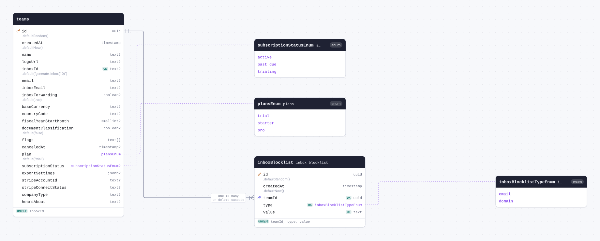

| Column                     | Type                                                     | Constraints                         | Default            | Description |
| -------------------------- | -------------------------------------------------------- | ----------------------------------- | ------------------ | ----------- |
| `id`                       | `uuid`                                                   | PK NOT NULL                         | `.defaultRandom()` |             |
| `createdAt` (`created_at`) | `timestamp`                                              | NOT NULL                            | `.defaultNow()`    |             |
| `teamId` (`team_id`)       | `uuid`                                                   | NOT NULL → [teams.id](#table-teams) |                    |             |
| `type`                     | [`inboxBlocklistTypeEnum`](#enum-inboxBlocklistTypeEnum) | NOT NULL                            |                    |             |
| `value`                    | `text`                                                   | NOT NULL                            |                    |             |

#### Definition

```sql
CREATE TABLE "inbox_blocklist" (
	"id" uuid PRIMARY KEY DEFAULT gen_random_uuid(),
	"created_at" timestamp with time zone DEFAULT now() NOT NULL,
	"team_id" uuid NOT NULL,
	"type" "inbox_blocklist_type" NOT NULL,
	"value" text NOT NULL,
	CONSTRAINT "inbox_blocklist_team_id_type_value_key" UNIQUE("team_id","type","value")
);

ALTER TABLE "inbox_blocklist" ENABLE ROW LEVEL SECURITY;

ALTER TABLE "inbox_blocklist" ADD CONSTRAINT "inbox_blocklist_team_id_fkey" FOREIGN KEY ("team_id") REFERENCES "teams"("id") ON DELETE CASCADE;
```

#### Indexes

- UNIQUE `teamId`, `type`, `value`

#### References

- `teamId` → [teams.id](#table-teams) (many to one, on delete cascade)

<details>
<summary>Queries and their SQL</summary>

**Select**: Every row of inboxBlocklist.

```ts
db.select().from(inboxBlocklist);
```

```sql
select "id", "created_at", "team_id", "type", "value"
from "inbox_blocklist"
```

**Count**: How many rows inboxBlocklist has.

```ts
db.select({ count: count() }).from(inboxBlocklist);
```

```sql
select count(*)
from "inbox_blocklist"
```

**Find many**: The rows of inboxBlocklist, through the relational query API.

```ts
db.query.inboxBlocklist.findMany();
```

```sql
select "d0"."id" as "id", "d0"."created_at" as "createdAt", "d0"."team_id" as "teamId", "d0"."type" as "type", "d0"."value" as "value"
from "inbox_blocklist" as "d0"
```

**Find by primary key**: One row of inboxBlocklist, through the relational query API.

```ts
db.query.inboxBlocklist.findFirst({ where: { id: "00000000-0000-0000-0000-000000000000" } });
```

```sql
select "d0"."id" as "id", "d0"."created_at" as "createdAt", "d0"."team_id" as "teamId", "d0"."type" as "type", "d0"."value" as "value"
from "inbox_blocklist" as "d0"
where "d0"."id" = $1
limit $2
-- params: ["00000000-0000-0000-0000-000000000000",1]
```

**Insert**: Adds a row to inboxBlocklist, giving the columns that have no default.

```ts
db.insert(inboxBlocklist).values({
  teamId: "00000000-0000-0000-0000-000000000000",
  type: "email",
  value: "value",
});
```

```sql
insert into "inbox_blocklist" ("id", "created_at", "team_id", "type", "value")
values (default, default, $1, $2, $3)
-- params: ["00000000-0000-0000-0000-000000000000","email","value"]
```

**Update**: Changes a row of inboxBlocklist, found by its primary key.

```ts
db.update(inboxBlocklist)
  .set({ createdAt: new Date("2026-01-01T00:00:00.000Z") })
  .where(eq(inboxBlocklist.id, "00000000-0000-0000-0000-000000000000"));
```

```sql
update "inbox_blocklist"
set "created_at" = $1
where "inbox_blocklist"."id" = $2
-- params: ["2026-01-01T00:00:00.000Z","00000000-0000-0000-0000-000000000000"]
```

**Delete**: Deletes a row of inboxBlocklist, found by its primary key.

```ts
db.delete(inboxBlocklist).where(eq(inboxBlocklist.id, "00000000-0000-0000-0000-000000000000"));
```

```sql
delete from "inbox_blocklist"
where "inbox_blocklist"."id" = $1
-- params: ["00000000-0000-0000-0000-000000000000"]
```

</details>

<a id="table-transactionMatchSuggestions"></a>

### transactionMatchSuggestions

Table `transaction_match_suggestions`.

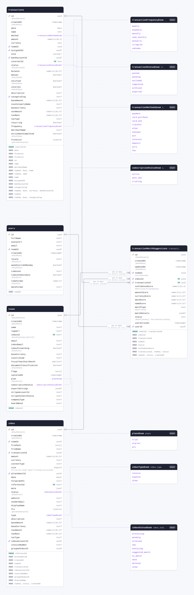

| Column                                 | Type           | Constraints                                       | Default               | Description                   |
| -------------------------------------- | -------------- | ------------------------------------------------- | --------------------- | ----------------------------- |
| `id`                                   | `uuid`         | PK NOT NULL                                       | `.defaultRandom()`    |                               |
| `createdAt` (`created_at`)             | `timestamp`    | NOT NULL                                          | `.defaultNow()`       |                               |
| `updatedAt` (`updated_at`)             | `timestamp`    | NOT NULL                                          | `.defaultNow()`       |                               |
| `teamId` (`team_id`)                   | `uuid`         | NOT NULL → [teams.id](#table-teams)               |                       | Core relationship             |
| `inboxId` (`inbox_id`)                 | `uuid`         | NOT NULL → [inbox.id](#table-inbox)               |                       |                               |
| `transactionId` (`transaction_id`)     | `uuid`         | NOT NULL → [transactions.id](#table-transactions) |                       |                               |
| `confidenceScore` (`confidence_score`) | `numeric(4,3)` | NOT NULL                                          |                       | Match scores for transparency |
| `amountScore` (`amount_score`)         | `numeric(4,3)` | NULL                                              |                       |                               |
| `currencyScore` (`currency_score`)     | `numeric(4,3)` | NULL                                              |                       |                               |
| `dateScore` (`date_score`)             | `numeric(4,3)` | NULL                                              |                       |                               |
| `nameScore` (`name_score`)             | `numeric(4,3)` | NULL                                              |                       |                               |
| `matchType` (`match_type`)             | `text`         | NOT NULL                                          |                       | Match context                 |
| `matchDetails` (`match_details`)       | `jsonb`        | NULL                                              |                       |                               |
| `status`                               | `text`         | NOT NULL                                          | `.default("pending")` | User interaction tracking     |
| `userActionAt` (`user_action_at`)      | `timestamp`    | NULL                                              |                       |                               |
| `userId` (`user_id`)                   | `uuid`         | NULL → [users.id](#table-users)                   |                       |                               |

#### Definition

```sql
CREATE TABLE "transaction_match_suggestions" (
	"id" uuid PRIMARY KEY DEFAULT gen_random_uuid(),
	"created_at" timestamp with time zone DEFAULT now() NOT NULL,
	"updated_at" timestamp with time zone DEFAULT now() NOT NULL,
	"team_id" uuid NOT NULL,
	"inbox_id" uuid NOT NULL,
	"transaction_id" uuid NOT NULL,
	"confidence_score" numeric(4,3) NOT NULL,
	"amount_score" numeric(4,3),
	"currency_score" numeric(4,3),
	"date_score" numeric(4,3),
	"name_score" numeric(4,3),
	"match_type" text NOT NULL,
	"match_details" jsonb,
	"status" text DEFAULT 'pending' NOT NULL,
	"user_action_at" timestamp with time zone,
	"user_id" uuid,
	CONSTRAINT "transaction_match_suggestions_unique" UNIQUE("inbox_id","transaction_id")
);

CREATE INDEX "transaction_match_suggestions_inbox_id_idx" ON "transaction_match_suggestions" ("inbox_id" uuid_ops);

CREATE INDEX "transaction_match_suggestions_transaction_id_idx" ON "transaction_match_suggestions" ("transaction_id" uuid_ops);

CREATE INDEX "transaction_match_suggestions_team_id_idx" ON "transaction_match_suggestions" ("team_id" uuid_ops);

CREATE INDEX "transaction_match_suggestions_status_idx" ON "transaction_match_suggestions" ("status" text_ops);

CREATE INDEX "transaction_match_suggestions_confidence_idx" ON "transaction_match_suggestions" ("confidence_score" DESC NULLS LAST);

CREATE INDEX "transaction_match_suggestions_lookup_idx" ON "transaction_match_suggestions" ("transaction_id" uuid_ops,"team_id" uuid_ops,"status" text_ops);

CREATE INDEX "transaction_match_suggestions_team_status_created_idx" ON "transaction_match_suggestions" ("team_id" uuid_ops,"status" text_ops,"created_at" DESC NULLS LAST);

ALTER TABLE "transaction_match_suggestions" ADD CONSTRAINT "transaction_match_suggestions_inbox_id_fkey" FOREIGN KEY ("inbox_id") REFERENCES "inbox"("id") ON DELETE CASCADE;

ALTER TABLE "transaction_match_suggestions" ADD CONSTRAINT "transaction_match_suggestions_transaction_id_fkey" FOREIGN KEY ("transaction_id") REFERENCES "transactions"("id") ON DELETE CASCADE;

ALTER TABLE "transaction_match_suggestions" ADD CONSTRAINT "transaction_match_suggestions_team_id_fkey" FOREIGN KEY ("team_id") REFERENCES "teams"("id") ON DELETE CASCADE;

ALTER TABLE "transaction_match_suggestions" ADD CONSTRAINT "transaction_match_suggestions_user_id_fkey" FOREIGN KEY ("user_id") REFERENCES "users"("id") ON DELETE SET NULL;
```

#### Indexes

- INDEX `inboxId`
- INDEX `transactionId`
- INDEX `teamId`
- INDEX `status`
- INDEX `confidenceScore`
- INDEX `transactionId`, `teamId`, `status`
- INDEX `teamId`, `status`, `createdAt`
- UNIQUE `inboxId`, `transactionId`

#### References

- `inboxId` → [inbox.id](#table-inbox) (many to one, on delete cascade)
- `transactionId` → [transactions.id](#table-transactions) (many to one, on delete cascade)
- `teamId` → [teams.id](#table-teams) (many to one, on delete cascade)
- `userId` → [users.id](#table-users) (many to one, on delete set null)

<details>
<summary>Queries and their SQL</summary>

**Select**: Every row of transactionMatchSuggestions.

```ts
db.select().from(transactionMatchSuggestions);
```

```sql
select "id", "created_at", "updated_at", "team_id", "inbox_id", "transaction_id", "confidence_score", "amount_score", "currency_score", "date_score", "name_score", "match_type", "match_details", "status", "user_action_at", "user_id"
from "transaction_match_suggestions"
```

**Count**: How many rows transactionMatchSuggestions has.

```ts
db.select({ count: count() }).from(transactionMatchSuggestions);
```

```sql
select count(*)
from "transaction_match_suggestions"
```

**Find many**: The rows of transactionMatchSuggestions, through the relational query API.

```ts
db.query.transactionMatchSuggestions.findMany();
```

```sql
select "d0"."id" as "id", "d0"."created_at" as "createdAt", "d0"."updated_at" as "updatedAt", "d0"."team_id" as "teamId", "d0"."inbox_id" as "inboxId", "d0"."transaction_id" as "transactionId", "d0"."confidence_score" as "confidenceScore", "d0"."amount_score" as "amountScore", "d0"."currency_score" as "currencyScore", "d0"."date_score" as "dateScore", "d0"."name_score" as "nameScore", "d0"."match_type" as "matchType", "d0"."match_details" as "matchDetails", "d0"."status" as "status", "d0"."user_action_at" as "userActionAt", "d0"."user_id" as "userId"
from "transaction_match_suggestions" as "d0"
```

**Find by primary key**: One row of transactionMatchSuggestions, through the relational query API.

```ts
db.query.transactionMatchSuggestions.findFirst({
  where: { id: "00000000-0000-0000-0000-000000000000" },
});
```

```sql
select "d0"."id" as "id", "d0"."created_at" as "createdAt", "d0"."updated_at" as "updatedAt", "d0"."team_id" as "teamId", "d0"."inbox_id" as "inboxId", "d0"."transaction_id" as "transactionId", "d0"."confidence_score" as "confidenceScore", "d0"."amount_score" as "amountScore", "d0"."currency_score" as "currencyScore", "d0"."date_score" as "dateScore", "d0"."name_score" as "nameScore", "d0"."match_type" as "matchType", "d0"."match_details" as "matchDetails", "d0"."status" as "status", "d0"."user_action_at" as "userActionAt", "d0"."user_id" as "userId"
from "transaction_match_suggestions" as "d0"
where "d0"."id" = $1
limit $2
-- params: ["00000000-0000-0000-0000-000000000000",1]
```

**Insert**: Adds a row to transactionMatchSuggestions, giving the columns that have no default.

```ts
db.insert(transactionMatchSuggestions).values({
  teamId: "00000000-0000-0000-0000-000000000000",
  inboxId: "00000000-0000-0000-0000-000000000000",
  transactionId: "00000000-0000-0000-0000-000000000000",
  confidenceScore: "confidenceScore",
  matchType: "matchType",
});
```

```sql
insert into "transaction_match_suggestions" ("id", "created_at", "updated_at", "team_id", "inbox_id", "transaction_id", "confidence_score", "amount_score", "currency_score", "date_score", "name_score", "match_type", "match_details", "status", "user_action_at", "user_id")
values (default, default, default, $1, $2, $3, $4, default, default, default, default, $5, default, default, default, default)
-- params: ["00000000-0000-0000-0000-000000000000","00000000-0000-0000-0000-000000000000","00000000-0000-0000-0000-000000000000","confidenceScore","matchType"]
```

**Update**: Changes a row of transactionMatchSuggestions, found by its primary key.

```ts
db.update(transactionMatchSuggestions)
  .set({ createdAt: new Date("2026-01-01T00:00:00.000Z") })
  .where(eq(transactionMatchSuggestions.id, "00000000-0000-0000-0000-000000000000"));
```

```sql
update "transaction_match_suggestions"
set "created_at" = $1
where "transaction_match_suggestions"."id" = $2
-- params: ["2026-01-01T00:00:00.000Z","00000000-0000-0000-0000-000000000000"]
```

**Delete**: Deletes a row of transactionMatchSuggestions, found by its primary key.

```ts
db.delete(transactionMatchSuggestions).where(
  eq(transactionMatchSuggestions.id, "00000000-0000-0000-0000-000000000000"),
);
```

```sql
delete from "transaction_match_suggestions"
where "transaction_match_suggestions"."id" = $1
-- params: ["00000000-0000-0000-0000-000000000000"]
```

</details>

<a id="table-documentTagAssignments"></a>

### documentTagAssignments

Table `document_tag_assignments`.

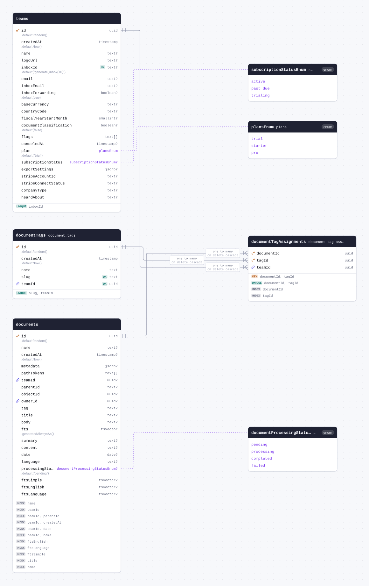

| Column                       | Type   | Constraints                                          | Default | Description |
| ---------------------------- | ------ | ---------------------------------------------------- | ------- | ----------- |
| `documentId` (`document_id`) | `uuid` | PK NOT NULL → [documents.id](#table-documents)       |         |             |
| `tagId` (`tag_id`)           | `uuid` | PK NOT NULL → [documentTags.id](#table-documentTags) |         |             |
| `teamId` (`team_id`)         | `uuid` | NOT NULL → [teams.id](#table-teams)                  |         |             |

#### Definition

```sql
CREATE TABLE "document_tag_assignments" (
	"document_id" uuid,
	"tag_id" uuid,
	"team_id" uuid NOT NULL,
	CONSTRAINT "document_tag_assignments_pkey" PRIMARY KEY("document_id","tag_id"),
	CONSTRAINT "document_tag_assignments_unique" UNIQUE("document_id","tag_id")
);

ALTER TABLE "document_tag_assignments" ENABLE ROW LEVEL SECURITY;

CREATE INDEX "idx_document_tag_assignments_document_id" ON "document_tag_assignments" ("document_id" uuid_ops);

CREATE INDEX "idx_document_tag_assignments_tag_id" ON "document_tag_assignments" ("tag_id" uuid_ops);

ALTER TABLE "document_tag_assignments" ADD CONSTRAINT "document_tag_assignments_document_id_fkey" FOREIGN KEY ("document_id") REFERENCES "documents"("id") ON DELETE CASCADE;

ALTER TABLE "document_tag_assignments" ADD CONSTRAINT "document_tag_assignments_tag_id_fkey" FOREIGN KEY ("tag_id") REFERENCES "document_tags"("id") ON DELETE CASCADE;

ALTER TABLE "document_tag_assignments" ADD CONSTRAINT "document_tag_assignments_team_id_fkey" FOREIGN KEY ("team_id") REFERENCES "teams"("id") ON DELETE CASCADE;
```

#### Indexes

- INDEX `documentId`
- INDEX `tagId`
- PRIMARY KEY `documentId`, `tagId`
- UNIQUE `documentId`, `tagId`

#### References

- `documentId` → [documents.id](#table-documents) (many to one, on delete cascade)
- `tagId` → [documentTags.id](#table-documentTags) (many to one, on delete cascade)
- `teamId` → [teams.id](#table-teams) (many to one, on delete cascade)

<details>
<summary>Queries and their SQL</summary>

**Select**: Every row of documentTagAssignments.

```ts
db.select().from(documentTagAssignments);
```

```sql
select "document_id", "tag_id", "team_id"
from "document_tag_assignments"
```

**Count**: How many rows documentTagAssignments has.

```ts
db.select({ count: count() }).from(documentTagAssignments);
```

```sql
select count(*)
from "document_tag_assignments"
```

**Find many**: The rows of documentTagAssignments, through the relational query API.

```ts
db.query.documentTagAssignments.findMany();
```

```sql
select "d0"."document_id" as "documentId", "d0"."tag_id" as "tagId", "d0"."team_id" as "teamId"
from "document_tag_assignments" as "d0"
```

**Find by primary key**: One row of documentTagAssignments, through the relational query API.

```ts
db.query.documentTagAssignments.findFirst({
  where: {
    documentId: "00000000-0000-0000-0000-000000000000",
    tagId: "00000000-0000-0000-0000-000000000000",
  },
});
```

```sql
select "d0"."document_id" as "documentId", "d0"."tag_id" as "tagId", "d0"."team_id" as "teamId"
from "document_tag_assignments" as "d0"
where (("d0"."document_id" = $1) and ("d0"."tag_id" = $2))
limit $3
-- params: ["00000000-0000-0000-0000-000000000000","00000000-0000-0000-0000-000000000000",1]
```

**Insert**: Adds a row to documentTagAssignments, giving the columns that have no default.

```ts
db.insert(documentTagAssignments).values({
  documentId: "00000000-0000-0000-0000-000000000000",
  tagId: "00000000-0000-0000-0000-000000000000",
  teamId: "00000000-0000-0000-0000-000000000000",
});
```

```sql
insert into "document_tag_assignments" ("document_id", "tag_id", "team_id")
values ($1, $2, $3)
-- params: ["00000000-0000-0000-0000-000000000000","00000000-0000-0000-0000-000000000000","00000000-0000-0000-0000-000000000000"]
```

**Update**: Changes a row of documentTagAssignments, found by its primary key.

```ts
db.update(documentTagAssignments)
  .set({ teamId: "00000000-0000-0000-0000-000000000000" })
  .where(
    and(
      eq(documentTagAssignments.documentId, "00000000-0000-0000-0000-000000000000"),
      eq(documentTagAssignments.tagId, "00000000-0000-0000-0000-000000000000"),
    ),
  );
```

```sql
update "document_tag_assignments"
set "team_id" = $1
where (("document_tag_assignments"."document_id" = $2) and ("document_tag_assignments"."tag_id" = $3))
-- params: ["00000000-0000-0000-0000-000000000000","00000000-0000-0000-0000-000000000000","00000000-0000-0000-0000-000000000000"]
```

**Delete**: Deletes a row of documentTagAssignments, found by its primary key.

```ts
db.delete(documentTagAssignments).where(
  and(
    eq(documentTagAssignments.documentId, "00000000-0000-0000-0000-000000000000"),
    eq(documentTagAssignments.tagId, "00000000-0000-0000-0000-000000000000"),
  ),
);
```

```sql
delete from "document_tag_assignments"
where (("document_tag_assignments"."document_id" = $1) and ("document_tag_assignments"."tag_id" = $2))
-- params: ["00000000-0000-0000-0000-000000000000","00000000-0000-0000-0000-000000000000"]
```

</details>

<a id="table-usersOnTeam"></a>

### usersOnTeam

Table `users_on_team`.

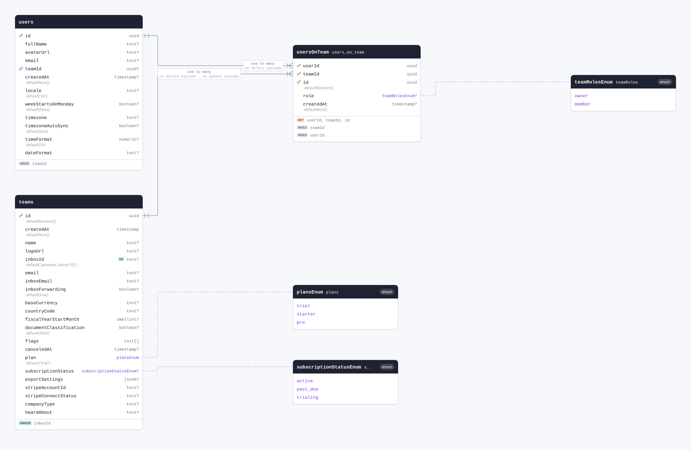

| Column                     | Type                                   | Constraints                            | Default            | Description |
| -------------------------- | -------------------------------------- | -------------------------------------- | ------------------ | ----------- |
| `userId` (`user_id`)       | `uuid`                                 | PK NOT NULL → [users.id](#table-users) |                    |             |
| `teamId` (`team_id`)       | `uuid`                                 | PK NOT NULL → [teams.id](#table-teams) |                    |             |
| `id`                       | `uuid`                                 | PK NOT NULL                            | `.defaultRandom()` |             |
| `role`                     | [`teamRolesEnum`](#enum-teamRolesEnum) | NULL                                   |                    |             |
| `createdAt` (`created_at`) | `timestamp`                            | NULL                                   | `.defaultNow()`    |             |

#### Definition

```sql
CREATE TABLE "users_on_team" (
	"user_id" uuid,
	"team_id" uuid,
	"id" uuid DEFAULT gen_random_uuid(),
	"role" "teamRoles",
	"created_at" timestamp with time zone DEFAULT now(),
	CONSTRAINT "members_pkey" PRIMARY KEY("user_id","team_id","id")
);

ALTER TABLE "users_on_team" ENABLE ROW LEVEL SECURITY;

CREATE INDEX "users_on_team_team_id_idx" ON "users_on_team" ("team_id" uuid_ops);

CREATE INDEX "users_on_team_user_id_idx" ON "users_on_team" ("user_id" uuid_ops);

ALTER TABLE "users_on_team" ADD CONSTRAINT "users_on_team_team_id_fkey" FOREIGN KEY ("team_id") REFERENCES "teams"("id") ON DELETE CASCADE ON UPDATE CASCADE;

ALTER TABLE "users_on_team" ADD CONSTRAINT "users_on_team_user_id_fkey" FOREIGN KEY ("user_id") REFERENCES "users"("id") ON DELETE CASCADE;
```

#### Indexes

- INDEX `teamId`
- INDEX `userId`
- PRIMARY KEY `userId`, `teamId`, `id`

#### References

- `teamId` → [teams.id](#table-teams) (many to one, on delete cascade, on update cascade)
- `userId` → [users.id](#table-users) (many to one, on delete cascade)

<details>
<summary>Queries and their SQL</summary>

**Select**: Every row of usersOnTeam.

```ts
db.select().from(usersOnTeam);
```

```sql
select "user_id", "team_id", "id", "role", "created_at"
from "users_on_team"
```

**Count**: How many rows usersOnTeam has.

```ts
db.select({ count: count() }).from(usersOnTeam);
```

```sql
select count(*)
from "users_on_team"
```

**Find many**: The rows of usersOnTeam, through the relational query API.

```ts
db.query.usersOnTeam.findMany();
```

```sql
select "d0"."user_id" as "userId", "d0"."team_id" as "teamId", "d0"."id" as "id", "d0"."role" as "role", "d0"."created_at" as "createdAt"
from "users_on_team" as "d0"
```

**Find by primary key**: One row of usersOnTeam, through the relational query API.

```ts
db.query.usersOnTeam.findFirst({
  where: {
    userId: "00000000-0000-0000-0000-000000000000",
    teamId: "00000000-0000-0000-0000-000000000000",
    id: "00000000-0000-0000-0000-000000000000",
  },
});
```

```sql
select "d0"."user_id" as "userId", "d0"."team_id" as "teamId", "d0"."id" as "id", "d0"."role" as "role", "d0"."created_at" as "createdAt"
from "users_on_team" as "d0"
where (("d0"."user_id" = $1) and ("d0"."team_id" = $2) and ("d0"."id" = $3))
limit $4
-- params: ["00000000-0000-0000-0000-000000000000","00000000-0000-0000-0000-000000000000","00000000-0000-0000-0000-000000000000",1]
```

**Insert**: Adds a row to usersOnTeam, giving the columns that have no default.

```ts
db.insert(usersOnTeam).values({
  userId: "00000000-0000-0000-0000-000000000000",
  teamId: "00000000-0000-0000-0000-000000000000",
});
```

```sql
insert into "users_on_team" ("user_id", "team_id", "id", "role", "created_at")
values ($1, $2, default, default, default)
-- params: ["00000000-0000-0000-0000-000000000000","00000000-0000-0000-0000-000000000000"]
```

**Update**: Changes a row of usersOnTeam, found by its primary key.

```ts
db.update(usersOnTeam)
  .set({ role: "owner" })
  .where(
    and(
      eq(usersOnTeam.userId, "00000000-0000-0000-0000-000000000000"),
      eq(usersOnTeam.teamId, "00000000-0000-0000-0000-000000000000"),
      eq(usersOnTeam.id, "00000000-0000-0000-0000-000000000000"),
    ),
  );
```

```sql
update "users_on_team"
set "role" = $1
where (("users_on_team"."user_id" = $2) and ("users_on_team"."team_id" = $3) and ("users_on_team"."id" = $4))
-- params: ["owner","00000000-0000-0000-0000-000000000000","00000000-0000-0000-0000-000000000000","00000000-0000-0000-0000-000000000000"]
```

**Delete**: Deletes a row of usersOnTeam, found by its primary key.

```ts
db.delete(usersOnTeam).where(
  and(
    eq(usersOnTeam.userId, "00000000-0000-0000-0000-000000000000"),
    eq(usersOnTeam.teamId, "00000000-0000-0000-0000-000000000000"),
    eq(usersOnTeam.id, "00000000-0000-0000-0000-000000000000"),
  ),
);
```

```sql
delete from "users_on_team"
where (("users_on_team"."user_id" = $1) and ("users_on_team"."team_id" = $2) and ("users_on_team"."id" = $3))
-- params: ["00000000-0000-0000-0000-000000000000","00000000-0000-0000-0000-000000000000","00000000-0000-0000-0000-000000000000"]
```

</details>

<a id="table-transactionCategories"></a>

### transactionCategories

Table `transaction_categories`.

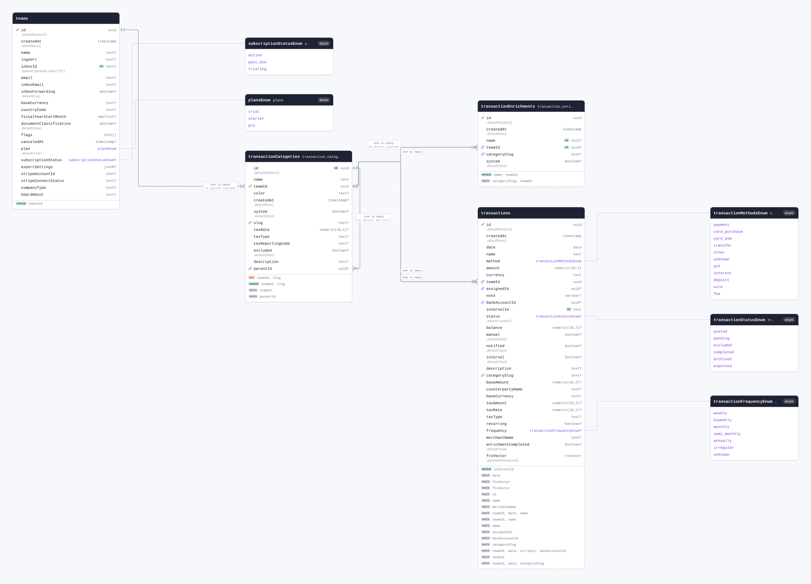

| Column                                    | Type            | Constraints                                                     | Default            | Description |
| ----------------------------------------- | --------------- | --------------------------------------------------------------- | ------------------ | ----------- |
| `id`                                      | `uuid`          | UNIQUE NOT NULL                                                 | `.defaultRandom()` |             |
| `name`                                    | `text`          | NOT NULL                                                        |                    |             |
| `teamId` (`team_id`)                      | `uuid`          | PK NOT NULL → [teams.id](#table-teams)                          |                    |             |
| `color`                                   | `text`          | NULL                                                            |                    |             |
| `createdAt` (`created_at`)                | `timestamp`     | NULL                                                            | `.defaultNow()`    |             |
| `system`                                  | `boolean`       | NULL                                                            | `.default(false)`  |             |
| `slug`                                    | `text`          | PK NULL                                                         |                    |             |
| `taxRate` (`tax_rate`)                    | `numeric(10,2)` | NULL                                                            |                    |             |
| `taxType` (`tax_type`)                    | `text`          | NULL                                                            |                    |             |
| `taxReportingCode` (`tax_reporting_code`) | `text`          | NULL                                                            |                    |             |
| `excluded`                                | `boolean`       | NULL                                                            | `.default(false)`  |             |
| `description`                             | `text`          | NULL                                                            |                    |             |
| `parentId` (`parent_id`)                  | `uuid`          | NULL → [transactionCategories.id](#table-transactionCategories) |                    |             |

#### Definition

```sql
CREATE TABLE "transaction_categories" (
	"id" uuid DEFAULT gen_random_uuid() NOT NULL UNIQUE,
	"name" text NOT NULL,
	"team_id" uuid,
	"color" text,
	"created_at" timestamp with time zone DEFAULT now(),
	"system" boolean DEFAULT false,
	"slug" text,
	"tax_rate" numeric(10,2),
	"tax_type" text,
	"tax_reporting_code" text,
	"excluded" boolean DEFAULT false,
	"description" text,
	"parent_id" uuid,
	CONSTRAINT "transaction_categories_pkey" PRIMARY KEY("team_id","slug"),
	CONSTRAINT "unique_team_slug" UNIQUE("team_id","slug")
);

ALTER TABLE "transaction_categories" ENABLE ROW LEVEL SECURITY;

CREATE INDEX "transaction_categories_team_id_idx" ON "transaction_categories" ("team_id" uuid_ops);

CREATE INDEX "transaction_categories_parent_id_idx" ON "transaction_categories" ("parent_id" uuid_ops);

ALTER TABLE "transaction_categories" ADD CONSTRAINT "transaction_categories_team_id_fkey" FOREIGN KEY ("team_id") REFERENCES "teams"("id") ON DELETE CASCADE;

ALTER TABLE "transaction_categories" ADD CONSTRAINT "transaction_categories_parent_id_fkey" FOREIGN KEY ("parent_id") REFERENCES "transaction_categories"("id") ON DELETE SET NULL;
```

#### Indexes

- INDEX `teamId`
- INDEX `parentId`
- PRIMARY KEY `teamId`, `slug`
- UNIQUE `teamId`, `slug`

#### References

- `teamId` → [teams.id](#table-teams) (many to one, on delete cascade)
- `parentId` → [transactionCategories.id](#table-transactionCategories) (many to one, on delete set null)

#### Referenced by

- `teamId` → [transactions.teamId](#table-transactions) (one to many)
- `teamId` → [transactionEnrichments.teamId](#table-transactionEnrichments) (one to many, on delete cascade)
- `id` → [transactionCategories.parentId](#table-transactionCategories) (one to many, on delete set null)
- `teamId` → [transactions.teamId](#table-transactions) (one to many, defineRelations)
- `teamId` → [transactionEnrichments.teamId](#table-transactionEnrichments) (one to many, defineRelations)

<details>
<summary>Queries and their SQL</summary>

**Select**: Every row of transactionCategories.

```ts
db.select().from(transactionCategories);
```

```sql
select "id", "name", "team_id", "color", "created_at", "system", "slug", "tax_rate", "tax_type", "tax_reporting_code", "excluded", "description", "parent_id"
from "transaction_categories"
```

**Count**: How many rows transactionCategories has.

```ts
db.select({ count: count() }).from(transactionCategories);
```

```sql
select count(*)
from "transaction_categories"
```

**Find many**: The rows of transactionCategories, through the relational query API.

```ts
db.query.transactionCategories.findMany();
```

```sql
select "d0"."id" as "id", "d0"."name" as "name", "d0"."team_id" as "teamId", "d0"."color" as "color", "d0"."created_at" as "createdAt", "d0"."system" as "system", "d0"."slug" as "slug", "d0"."tax_rate" as "taxRate", "d0"."tax_type" as "taxType", "d0"."tax_reporting_code" as "taxReportingCode", "d0"."excluded" as "excluded", "d0"."description" as "description", "d0"."parent_id" as "parentId"
from "transaction_categories" as "d0"
```

**Find by primary key**: One row of transactionCategories, through the relational query API.

```ts
db.query.transactionCategories.findFirst({
  where: { teamId: "00000000-0000-0000-0000-000000000000", slug: "slug" },
});
```

```sql
select "d0"."id" as "id", "d0"."name" as "name", "d0"."team_id" as "teamId", "d0"."color" as "color", "d0"."created_at" as "createdAt", "d0"."system" as "system", "d0"."slug" as "slug", "d0"."tax_rate" as "taxRate", "d0"."tax_type" as "taxType", "d0"."tax_reporting_code" as "taxReportingCode", "d0"."excluded" as "excluded", "d0"."description" as "description", "d0"."parent_id" as "parentId"
from "transaction_categories" as "d0"
where (("d0"."team_id" = $1) and ("d0"."slug" = $2))
limit $3
-- params: ["00000000-0000-0000-0000-000000000000","slug",1]
```

**Insert**: Adds a row to transactionCategories, giving the columns that have no default.

```ts
db.insert(transactionCategories).values({
  name: "name",
  teamId: "00000000-0000-0000-0000-000000000000",
});
```

```sql
insert into "transaction_categories" ("id", "name", "team_id", "color", "created_at", "system", "slug", "tax_rate", "tax_type", "tax_reporting_code", "excluded", "description", "parent_id")
values (default, $1, $2, default, default, default, default, default, default, default, default, default, default)
-- params: ["name","00000000-0000-0000-0000-000000000000"]
```

**Update**: Changes a row of transactionCategories, found by its primary key.

```ts
db.update(transactionCategories)
  .set({ id: "00000000-0000-0000-0000-000000000000" })
  .where(
    and(
      eq(transactionCategories.teamId, "00000000-0000-0000-0000-000000000000"),
      eq(transactionCategories.slug, "slug"),
    ),
  );
```

```sql
update "transaction_categories"
set "id" = $1
where (("transaction_categories"."team_id" = $2) and ("transaction_categories"."slug" = $3))
-- params: ["00000000-0000-0000-0000-000000000000","00000000-0000-0000-0000-000000000000","slug"]
```

**Delete**: Deletes a row of transactionCategories, found by its primary key.

```ts
db.delete(transactionCategories).where(
  and(
    eq(transactionCategories.teamId, "00000000-0000-0000-0000-000000000000"),
    eq(transactionCategories.slug, "slug"),
  ),
);
```

```sql
delete from "transaction_categories"
where (("transaction_categories"."team_id" = $1) and ("transaction_categories"."slug" = $2))
-- params: ["00000000-0000-0000-0000-000000000000","slug"]
```

</details>

<a id="table-usersInAuth"></a>

### usersInAuth

Table `auth.users`.

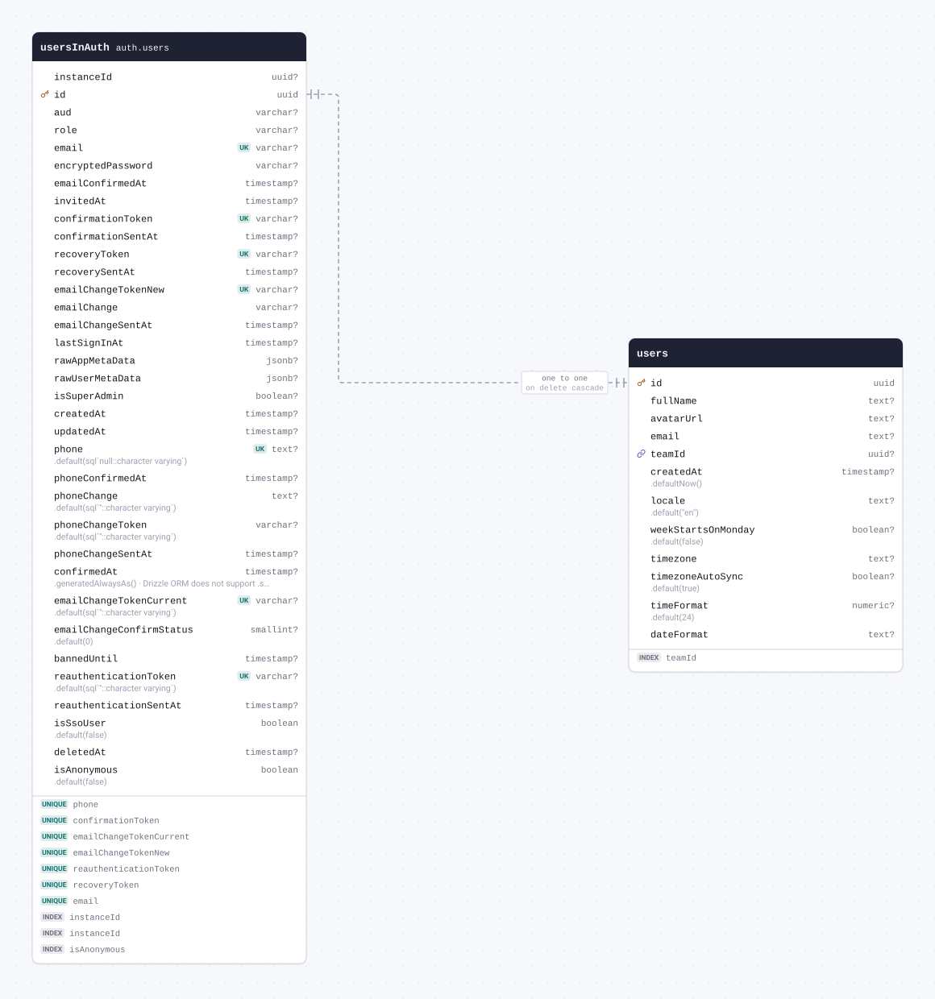

| Column                                                     | Type        | Constraints | Default                                    | Description                                                                 |
| ---------------------------------------------------------- | ----------- | ----------- | ------------------------------------------ | --------------------------------------------------------------------------- |
| `instanceId` (`instance_id`)                               | `uuid`      | NULL        |                                            |                                                                             |
| `id`                                                       | `uuid`      | PK NOT NULL |                                            |                                                                             |
| `aud`                                                      | `varchar`   | NULL        |                                            |                                                                             |
| `role`                                                     | `varchar`   | NULL        |                                            |                                                                             |
| `email`                                                    | `varchar`   | NULL        |                                            |                                                                             |
| `encryptedPassword` (`encrypted_password`)                 | `varchar`   | NULL        |                                            |                                                                             |
| `emailConfirmedAt` (`email_confirmed_at`)                  | `timestamp` | NULL        |                                            |                                                                             |
| `invitedAt` (`invited_at`)                                 | `timestamp` | NULL        |                                            |                                                                             |
| `confirmationToken` (`confirmation_token`)                 | `varchar`   | NULL        |                                            |                                                                             |
| `confirmationSentAt` (`confirmation_sent_at`)              | `timestamp` | NULL        |                                            |                                                                             |
| `recoveryToken` (`recovery_token`)                         | `varchar`   | NULL        |                                            |                                                                             |
| `recoverySentAt` (`recovery_sent_at`)                      | `timestamp` | NULL        |                                            |                                                                             |
| `emailChangeTokenNew` (`email_change_token_new`)           | `varchar`   | NULL        |                                            |                                                                             |
| `emailChange` (`email_change`)                             | `varchar`   | NULL        |                                            |                                                                             |
| `emailChangeSentAt` (`email_change_sent_at`)               | `timestamp` | NULL        |                                            |                                                                             |
| `lastSignInAt` (`last_sign_in_at`)                         | `timestamp` | NULL        |                                            |                                                                             |
| `rawAppMetaData` (`raw_app_meta_data`)                     | `jsonb`     | NULL        |                                            |                                                                             |
| `rawUserMetaData` (`raw_user_meta_data`)                   | `jsonb`     | NULL        |                                            |                                                                             |
| `isSuperAdmin` (`is_super_admin`)                          | `boolean`   | NULL        |                                            |                                                                             |
| `createdAt` (`created_at`)                                 | `timestamp` | NULL        |                                            |                                                                             |
| `updatedAt` (`updated_at`)                                 | `timestamp` | NULL        |                                            |                                                                             |
| `phone`                                                    | `text`      | NULL        | ``.default(sql`null::character varying`)`` |                                                                             |
| `phoneConfirmedAt` (`phone_confirmed_at`)                  | `timestamp` | NULL        |                                            |                                                                             |
| `phoneChange` (`phone_change`)                             | `text`      | NULL        | ``.default(sql`''::character varying`)``   |                                                                             |
| `phoneChangeToken` (`phone_change_token`)                  | `varchar`   | NULL        | ``.default(sql`''::character varying`)``   |                                                                             |
| `phoneChangeSentAt` (`phone_change_sent_at`)               | `timestamp` | NULL        |                                            |                                                                             |
| `confirmedAt` (`confirmed_at`)                             | `timestamp` | NULL        | `.generatedAlwaysAs()`                     | Drizzle ORM does not support .stored() for generated columns, so we omit it |
| `emailChangeTokenCurrent` (`email_change_token_current`)   | `varchar`   | NULL        | ``.default(sql`''::character varying`)``   |                                                                             |
| `emailChangeConfirmStatus` (`email_change_confirm_status`) | `smallint`  | NULL        | `.default(0)`                              |                                                                             |
| `bannedUntil` (`banned_until`)                             | `timestamp` | NULL        |                                            |                                                                             |
| `reauthenticationToken` (`reauthentication_token`)         | `varchar`   | NULL        | ``.default(sql`''::character varying`)``   |                                                                             |
| `reauthenticationSentAt` (`reauthentication_sent_at`)      | `timestamp` | NULL        |                                            |                                                                             |
| `isSsoUser` (`is_sso_user`)                                | `boolean`   | NOT NULL    | `.default(false)`                          |                                                                             |
| `deletedAt` (`deleted_at`)                                 | `timestamp` | NULL        |                                            |                                                                             |
| `isAnonymous` (`is_anonymous`)                             | `boolean`   | NOT NULL    | `.default(false)`                          |                                                                             |

#### Definition

```sql
CREATE TABLE "auth.users" (
	"instance_id" uuid,
	"id" uuid,
	"aud" varchar(255),
	"role" varchar(255),
	"email" varchar(255) CONSTRAINT "users_email_partial_key" UNIQUE,
	"encrypted_password" varchar(255),
	"email_confirmed_at" timestamp with time zone,
	"invited_at" timestamp with time zone,
	"confirmation_token" varchar(255) CONSTRAINT "confirmation_token_idx" UNIQUE,
	"confirmation_sent_at" timestamp with time zone,
	"recovery_token" varchar(255) CONSTRAINT "recovery_token_idx" UNIQUE,
	"recovery_sent_at" timestamp with time zone,
	"email_change_token_new" varchar(255) CONSTRAINT "email_change_token_new_idx" UNIQUE,
	"email_change" varchar(255),
	"email_change_sent_at" timestamp with time zone,
	"last_sign_in_at" timestamp with time zone,
	"raw_app_meta_data" jsonb,
	"raw_user_meta_data" jsonb,
	"is_super_admin" boolean,
	"created_at" timestamp with time zone,
	"updated_at" timestamp with time zone,
	"phone" text DEFAULT null CONSTRAINT "users_phone_key" UNIQUE,
	"phone_confirmed_at" timestamp with time zone,
	"phone_change" text DEFAULT '',
	"phone_change_token" varchar(255) DEFAULT '',
	"phone_change_sent_at" timestamp with time zone,
	"confirmed_at" timestamp with time zone GENERATED ALWAYS AS (LEAST(email_confirmed_at, phone_confirmed_at)) STORED,
	"email_change_token_current" varchar(255) DEFAULT '' CONSTRAINT "email_change_token_current_idx" UNIQUE,
	"email_change_confirm_status" smallint DEFAULT 0,
	"banned_until" timestamp with time zone,
	"reauthentication_token" varchar(255) DEFAULT '' CONSTRAINT "reauthentication_token_idx" UNIQUE,
	"reauthentication_sent_at" timestamp with time zone,
	"is_sso_user" boolean DEFAULT false NOT NULL,
	"deleted_at" timestamp with time zone,
	"is_anonymous" boolean DEFAULT false NOT NULL,
	CONSTRAINT "users_pkey" PRIMARY KEY("id"),
	CONSTRAINT "users_email_change_confirm_status_check" CHECK (((email_change_confirm_status >= 0) AND (email_change_confirm_status <= 2)))
);

CREATE INDEX "users_instance_id_email_idx" ON "auth.users" ("instance_id",lower((email)::text));

CREATE INDEX "users_instance_id_idx" ON "auth.users" ("instance_id");

CREATE INDEX "users_is_anonymous_idx" ON "auth.users" ("is_anonymous");
```

#### Indexes

- UNIQUE `phone`
- UNIQUE `confirmationToken`
- UNIQUE `emailChangeTokenCurrent`
- UNIQUE `emailChangeTokenNew`
- UNIQUE `reauthenticationToken`
- UNIQUE `recoveryToken`
- UNIQUE `email`
- INDEX `instanceId`
- INDEX `instanceId`
- INDEX `isAnonymous`

#### Referenced by

- `id` → [users.id](#table-users) (one to one, defineRelations)

<details>
<summary>Queries and their SQL</summary>

**Select**: Every row of usersInAuth.

```ts
db.select().from(usersInAuth);
```

```sql
select "instance_id", "id", "aud", "role", "email", "encrypted_password", "email_confirmed_at", "invited_at", "confirmation_token", "confirmation_sent_at", "recovery_token", "recovery_sent_at", "email_change_token_new", "email_change", "email_change_sent_at", "last_sign_in_at", "raw_app_meta_data", "raw_user_meta_data", "is_super_admin", "created_at", "updated_at", "phone", "phone_confirmed_at", "phone_change", "phone_change_token", "phone_change_sent_at", "confirmed_at", "email_change_token_current", "email_change_confirm_status", "banned_until", "reauthentication_token", "reauthentication_sent_at", "is_sso_user", "deleted_at", "is_anonymous"
from "auth.users"
```

**Count**: How many rows usersInAuth has.

```ts
db.select({ count: count() }).from(usersInAuth);
```

```sql
select count(*)
from "auth.users"
```

**Find many**: The rows of usersInAuth, through the relational query API.

```ts
db.query.usersInAuth.findMany();
```

```sql
select "d0"."instance_id" as "instanceId", "d0"."id" as "id", "d0"."aud" as "aud", "d0"."role" as "role", "d0"."email" as "email", "d0"."encrypted_password" as "encryptedPassword", "d0"."email_confirmed_at" as "emailConfirmedAt", "d0"."invited_at" as "invitedAt", "d0"."confirmation_token" as "confirmationToken", "d0"."confirmation_sent_at" as "confirmationSentAt", "d0"."recovery_token" as "recoveryToken", "d0"."recovery_sent_at" as "recoverySentAt", "d0"."email_change_token_new" as "emailChangeTokenNew", "d0"."email_change" as "emailChange", "d0"."email_change_sent_at" as "emailChangeSentAt", "d0"."last_sign_in_at" as "lastSignInAt", "d0"."raw_app_meta_data" as "rawAppMetaData", "d0"."raw_user_meta_data" as "rawUserMetaData", "d0"."is_super_admin" as "isSuperAdmin", "d0"."created_at" as "createdAt", "d0"."updated_at" as "updatedAt", "d0"."phone" as "phone", "d0"."phone_confirmed_at" as "phoneConfirmedAt", "d0"."phone_change" as "phoneChange", "d0"."phone_change_token" as "phoneChangeToken", "d0"."phone_change_sent_at" as "phoneChangeSentAt", "d0"."confirmed_at" as "confirmedAt", "d0"."email_change_token_current" as "emailChangeTokenCurrent", "d0"."email_change_confirm_status" as "emailChangeConfirmStatus", "d0"."banned_until" as "bannedUntil", "d0"."reauthentication_token" as "reauthenticationToken", "d0"."reauthentication_sent_at" as "reauthenticationSentAt", "d0"."is_sso_user" as "isSsoUser", "d0"."deleted_at" as "deletedAt", "d0"."is_anonymous" as "isAnonymous"
from "auth.users" as "d0"
```

**Find by primary key**: One row of usersInAuth, through the relational query API.

```ts
db.query.usersInAuth.findFirst({ where: { id: "00000000-0000-0000-0000-000000000000" } });
```

```sql
select "d0"."instance_id" as "instanceId", "d0"."id" as "id", "d0"."aud" as "aud", "d0"."role" as "role", "d0"."email" as "email", "d0"."encrypted_password" as "encryptedPassword", "d0"."email_confirmed_at" as "emailConfirmedAt", "d0"."invited_at" as "invitedAt", "d0"."confirmation_token" as "confirmationToken", "d0"."confirmation_sent_at" as "confirmationSentAt", "d0"."recovery_token" as "recoveryToken", "d0"."recovery_sent_at" as "recoverySentAt", "d0"."email_change_token_new" as "emailChangeTokenNew", "d0"."email_change" as "emailChange", "d0"."email_change_sent_at" as "emailChangeSentAt", "d0"."last_sign_in_at" as "lastSignInAt", "d0"."raw_app_meta_data" as "rawAppMetaData", "d0"."raw_user_meta_data" as "rawUserMetaData", "d0"."is_super_admin" as "isSuperAdmin", "d0"."created_at" as "createdAt", "d0"."updated_at" as "updatedAt", "d0"."phone" as "phone", "d0"."phone_confirmed_at" as "phoneConfirmedAt", "d0"."phone_change" as "phoneChange", "d0"."phone_change_token" as "phoneChangeToken", "d0"."phone_change_sent_at" as "phoneChangeSentAt", "d0"."confirmed_at" as "confirmedAt", "d0"."email_change_token_current" as "emailChangeTokenCurrent", "d0"."email_change_confirm_status" as "emailChangeConfirmStatus", "d0"."banned_until" as "bannedUntil", "d0"."reauthentication_token" as "reauthenticationToken", "d0"."reauthentication_sent_at" as "reauthenticationSentAt", "d0"."is_sso_user" as "isSsoUser", "d0"."deleted_at" as "deletedAt", "d0"."is_anonymous" as "isAnonymous"
from "auth.users" as "d0"
where "d0"."id" = $1
limit $2
-- params: ["00000000-0000-0000-0000-000000000000",1]
```

**Insert**: Adds a row to usersInAuth, giving the columns that have no default.

```ts
db.insert(usersInAuth).values({ id: "00000000-0000-0000-0000-000000000000" });
```

```sql
insert into "auth.users" ("instance_id", "id", "aud", "role", "email", "encrypted_password", "email_confirmed_at", "invited_at", "confirmation_token", "confirmation_sent_at", "recovery_token", "recovery_sent_at", "email_change_token_new", "email_change", "email_change_sent_at", "last_sign_in_at", "raw_app_meta_data", "raw_user_meta_data", "is_super_admin", "created_at", "updated_at", "phone", "phone_confirmed_at", "phone_change", "phone_change_token", "phone_change_sent_at", "email_change_token_current", "email_change_confirm_status", "banned_until", "reauthentication_token", "reauthentication_sent_at", "is_sso_user", "deleted_at", "is_anonymous")
values (default, $1, default, default, default, default, default, default, default, default, default, default, default, default, default, default, default, default, default, default, default, default, default, default, default, default, default, default, default, default, default, default, default, default)
-- params: ["00000000-0000-0000-0000-000000000000"]
```

**Update**: Changes a row of usersInAuth, found by its primary key.

```ts
db.update(usersInAuth)
  .set({ instanceId: "00000000-0000-0000-0000-000000000000" })
  .where(eq(usersInAuth.id, "00000000-0000-0000-0000-000000000000"));
```

```sql
update "auth.users"
set "instance_id" = $1
where "auth.users"."id" = $2
-- params: ["00000000-0000-0000-0000-000000000000","00000000-0000-0000-0000-000000000000"]
```

**Delete**: Deletes a row of usersInAuth, found by its primary key.

```ts
db.delete(usersInAuth).where(eq(usersInAuth.id, "00000000-0000-0000-0000-000000000000"));
```

```sql
delete from "auth.users"
where "auth.users"."id" = $1
-- params: ["00000000-0000-0000-0000-000000000000"]
```

</details>

<a id="table-shortLinks"></a>

### shortLinks

Table `short_links`.

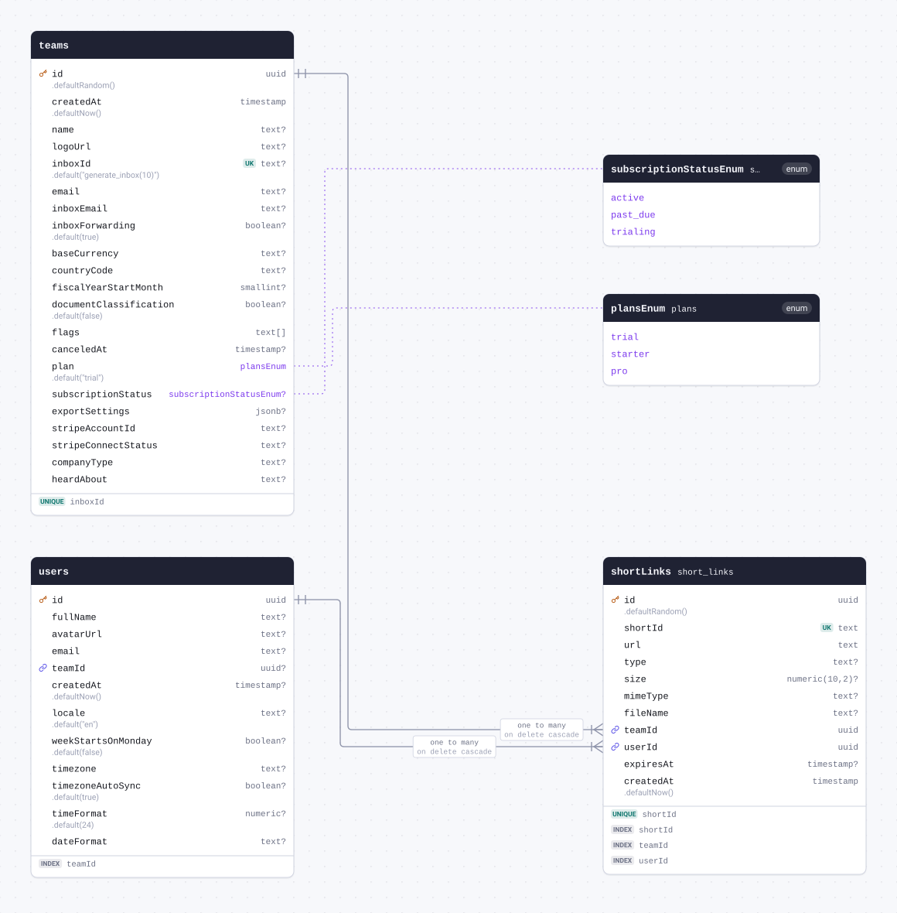

| Column                     | Type            | Constraints                         | Default            | Description |
| -------------------------- | --------------- | ----------------------------------- | ------------------ | ----------- |
| `id`                       | `uuid`          | PK NOT NULL                         | `.defaultRandom()` |             |
| `shortId` (`short_id`)     | `text`          | NOT NULL                            |                    |             |
| `url`                      | `text`          | NOT NULL                            |                    |             |
| `type`                     | `text`          | NULL                                |                    |             |
| `size`                     | `numeric(10,2)` | NULL                                |                    |             |
| `mimeType` (`mime_type`)   | `text`          | NULL                                |                    |             |
| `fileName` (`file_name`)   | `text`          | NULL                                |                    |             |
| `teamId` (`team_id`)       | `uuid`          | NOT NULL → [teams.id](#table-teams) |                    |             |
| `userId` (`user_id`)       | `uuid`          | NOT NULL → [users.id](#table-users) |                    |             |
| `expiresAt` (`expires_at`) | `timestamp`     | NULL                                |                    |             |
| `createdAt` (`created_at`) | `timestamp`     | NOT NULL                            | `.defaultNow()`    |             |

#### Definition

```sql
CREATE TABLE "short_links" (
	"id" uuid PRIMARY KEY DEFAULT gen_random_uuid(),
	"short_id" text NOT NULL CONSTRAINT "short_links_short_id_unique" UNIQUE,
	"url" text NOT NULL,
	"type" text,
	"size" numeric(10,2),
	"mime_type" text,
	"file_name" text,
	"team_id" uuid NOT NULL,
	"user_id" uuid NOT NULL,
	"expires_at" timestamp with time zone,
	"created_at" timestamp with time zone DEFAULT now() NOT NULL
);

ALTER TABLE "short_links" ENABLE ROW LEVEL SECURITY;

CREATE INDEX "short_links_short_id_idx" ON "short_links" ("short_id" text_ops);

CREATE INDEX "short_links_team_id_idx" ON "short_links" ("team_id" uuid_ops);

CREATE INDEX "short_links_user_id_idx" ON "short_links" ("user_id" uuid_ops);

ALTER TABLE "short_links" ADD CONSTRAINT "short_links_user_id_fkey" FOREIGN KEY ("user_id") REFERENCES "users"("id") ON DELETE CASCADE;

ALTER TABLE "short_links" ADD CONSTRAINT "short_links_team_id_fkey" FOREIGN KEY ("team_id") REFERENCES "teams"("id") ON DELETE CASCADE;
```

#### Indexes

- INDEX `shortId`
- INDEX `teamId`
- INDEX `userId`
- UNIQUE `shortId`

#### References

- `userId` → [users.id](#table-users) (many to one, on delete cascade)
- `teamId` → [teams.id](#table-teams) (many to one, on delete cascade)

<details>
<summary>Queries and their SQL</summary>

**Select**: Every row of shortLinks.

```ts
db.select().from(shortLinks);
```

```sql
select "id", "short_id", "url", "type", "size", "mime_type", "file_name", "team_id", "user_id", "expires_at", "created_at"
from "short_links"
```

**Count**: How many rows shortLinks has.

```ts
db.select({ count: count() }).from(shortLinks);
```

```sql
select count(*)
from "short_links"
```

**Find many**: The rows of shortLinks, through the relational query API.

```ts
db.query.shortLinks.findMany();
```

```sql
select "d0"."id" as "id", "d0"."short_id" as "shortId", "d0"."url" as "url", "d0"."type" as "type", "d0"."size" as "size", "d0"."mime_type" as "mimeType", "d0"."file_name" as "fileName", "d0"."team_id" as "teamId", "d0"."user_id" as "userId", "d0"."expires_at" as "expiresAt", "d0"."created_at" as "createdAt"
from "short_links" as "d0"
```

**Find by primary key**: One row of shortLinks, through the relational query API.

```ts
db.query.shortLinks.findFirst({ where: { id: "00000000-0000-0000-0000-000000000000" } });
```

```sql
select "d0"."id" as "id", "d0"."short_id" as "shortId", "d0"."url" as "url", "d0"."type" as "type", "d0"."size" as "size", "d0"."mime_type" as "mimeType", "d0"."file_name" as "fileName", "d0"."team_id" as "teamId", "d0"."user_id" as "userId", "d0"."expires_at" as "expiresAt", "d0"."created_at" as "createdAt"
from "short_links" as "d0"
where "d0"."id" = $1
limit $2
-- params: ["00000000-0000-0000-0000-000000000000",1]
```

**Insert**: Adds a row to shortLinks, giving the columns that have no default.

```ts
db.insert(shortLinks).values({
  shortId: "shortId",
  url: "url",
  teamId: "00000000-0000-0000-0000-000000000000",
  userId: "00000000-0000-0000-0000-000000000000",
});
```

```sql
insert into "short_links" ("id", "short_id", "url", "type", "size", "mime_type", "file_name", "team_id", "user_id", "expires_at", "created_at")
values (default, $1, $2, default, default, default, default, $3, $4, default, default)
-- params: ["shortId","url","00000000-0000-0000-0000-000000000000","00000000-0000-0000-0000-000000000000"]
```

**Update**: Changes a row of shortLinks, found by its primary key.

```ts
db.update(shortLinks)
  .set({ shortId: "shortId" })
  .where(eq(shortLinks.id, "00000000-0000-0000-0000-000000000000"));
```

```sql
update "short_links"
set "short_id" = $1
where "short_links"."id" = $2
-- params: ["shortId","00000000-0000-0000-0000-000000000000"]
```

**Delete**: Deletes a row of shortLinks, found by its primary key.

```ts
db.delete(shortLinks).where(eq(shortLinks.id, "00000000-0000-0000-0000-000000000000"));
```

```sql
delete from "short_links"
where "short_links"."id" = $1
-- params: ["00000000-0000-0000-0000-000000000000"]
```

</details>

<a id="table-apiKeys"></a>

### apiKeys

Table `api_keys`.

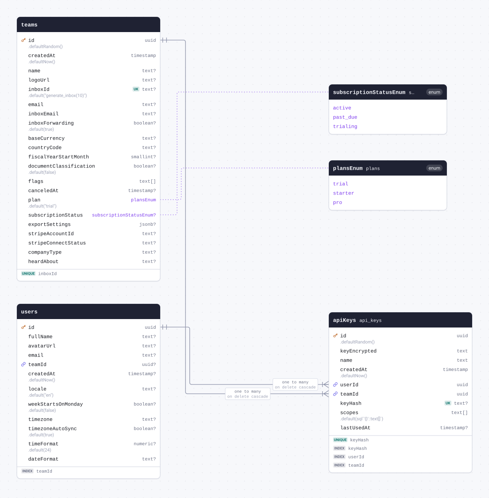

| Column                           | Type        | Constraints                         | Default                         | Description |
| -------------------------------- | ----------- | ----------------------------------- | ------------------------------- | ----------- |
| `id`                             | `uuid`      | PK NOT NULL                         | `.defaultRandom()`              |             |
| `keyEncrypted` (`key_encrypted`) | `text`      | NOT NULL                            |                                 |             |
| `name`                           | `text`      | NOT NULL                            |                                 |             |
| `createdAt` (`created_at`)       | `timestamp` | NOT NULL                            | `.defaultNow()`                 |             |
| `userId` (`user_id`)             | `uuid`      | NOT NULL → [users.id](#table-users) |                                 |             |
| `teamId` (`team_id`)             | `uuid`      | NOT NULL → [teams.id](#table-teams) |                                 |             |
| `keyHash` (`key_hash`)           | `text`      | NULL                                |                                 |             |
| `scopes`                         | `text[]`    | NOT NULL                            | ``.default(sql`'{}'::text[]`)`` |             |
| `lastUsedAt` (`last_used_at`)    | `timestamp` | NULL                                |                                 |             |

#### Definition

```sql
CREATE TABLE "api_keys" (
	"id" uuid PRIMARY KEY DEFAULT gen_random_uuid(),
	"key_encrypted" text NOT NULL,
	"name" text NOT NULL,
	"created_at" timestamp with time zone DEFAULT now() NOT NULL,
	"user_id" uuid NOT NULL,
	"team_id" uuid NOT NULL,
	"key_hash" text CONSTRAINT "api_keys_key_unique" UNIQUE,
	"scopes" text[] DEFAULT '{}'::text[] NOT NULL,
	"last_used_at" timestamp with time zone
);

CREATE INDEX "api_keys_key_idx" ON "api_keys" ("key_hash" text_ops);

CREATE INDEX "api_keys_user_id_idx" ON "api_keys" ("user_id" uuid_ops);

CREATE INDEX "api_keys_team_id_idx" ON "api_keys" ("team_id" uuid_ops);

ALTER TABLE "api_keys" ADD CONSTRAINT "api_keys_user_id_fkey" FOREIGN KEY ("user_id") REFERENCES "users"("id") ON DELETE CASCADE;

ALTER TABLE "api_keys" ADD CONSTRAINT "api_keys_team_id_fkey" FOREIGN KEY ("team_id") REFERENCES "teams"("id") ON DELETE CASCADE;
```

#### Indexes

- INDEX `keyHash`
- INDEX `userId`
- INDEX `teamId`
- UNIQUE `keyHash`

#### References

- `userId` → [users.id](#table-users) (many to one, on delete cascade)
- `teamId` → [teams.id](#table-teams) (many to one, on delete cascade)

<details>
<summary>Queries and their SQL</summary>

**Select**: Every row of apiKeys.

```ts
db.select().from(apiKeys);
```

```sql
select "id", "key_encrypted", "name", "created_at", "user_id", "team_id", "key_hash", "scopes", "last_used_at"
from "api_keys"
```

**Count**: How many rows apiKeys has.

```ts
db.select({ count: count() }).from(apiKeys);
```

```sql
select count(*)
from "api_keys"
```

**Find many**: The rows of apiKeys, through the relational query API.

```ts
db.query.apiKeys.findMany();
```

```sql
select "d0"."id" as "id", "d0"."key_encrypted" as "keyEncrypted", "d0"."name" as "name", "d0"."created_at" as "createdAt", "d0"."user_id" as "userId", "d0"."team_id" as "teamId", "d0"."key_hash" as "keyHash", "d0"."scopes" as "scopes", "d0"."last_used_at" as "lastUsedAt"
from "api_keys" as "d0"
```

**Find by primary key**: One row of apiKeys, through the relational query API.

```ts
db.query.apiKeys.findFirst({ where: { id: "00000000-0000-0000-0000-000000000000" } });
```

```sql
select "d0"."id" as "id", "d0"."key_encrypted" as "keyEncrypted", "d0"."name" as "name", "d0"."created_at" as "createdAt", "d0"."user_id" as "userId", "d0"."team_id" as "teamId", "d0"."key_hash" as "keyHash", "d0"."scopes" as "scopes", "d0"."last_used_at" as "lastUsedAt"
from "api_keys" as "d0"
where "d0"."id" = $1
limit $2
-- params: ["00000000-0000-0000-0000-000000000000",1]
```

**Insert**: Adds a row to apiKeys, giving the columns that have no default.

```ts
db.insert(apiKeys).values({
  keyEncrypted: "keyEncrypted",
  name: "name",
  userId: "00000000-0000-0000-0000-000000000000",
  teamId: "00000000-0000-0000-0000-000000000000",
});
```

```sql
insert into "api_keys" ("id", "key_encrypted", "name", "created_at", "user_id", "team_id", "key_hash", "scopes", "last_used_at")
values (default, $1, $2, default, $3, $4, default, default, default)
-- params: ["keyEncrypted","name","00000000-0000-0000-0000-000000000000","00000000-0000-0000-0000-000000000000"]
```

**Update**: Changes a row of apiKeys, found by its primary key.

```ts
db.update(apiKeys)
  .set({ keyEncrypted: "keyEncrypted" })
  .where(eq(apiKeys.id, "00000000-0000-0000-0000-000000000000"));
```

```sql
update "api_keys"
set "key_encrypted" = $1
where "api_keys"."id" = $2
-- params: ["keyEncrypted","00000000-0000-0000-0000-000000000000"]
```

**Delete**: Deletes a row of apiKeys, found by its primary key.

```ts
db.delete(apiKeys).where(eq(apiKeys.id, "00000000-0000-0000-0000-000000000000"));
```

```sql
delete from "api_keys"
where "api_keys"."id" = $1
-- params: ["00000000-0000-0000-0000-000000000000"]
```

</details>

<a id="table-oauthApplications"></a>

### oauthApplications

Table `oauth_applications`. Relations OAuth Applications

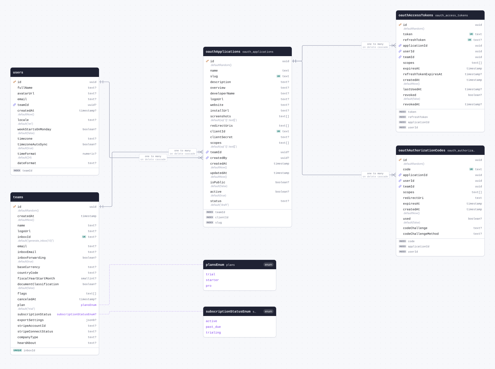

| Column                             | Type        | Constraints                     | Default                         | Description |
| ---------------------------------- | ----------- | ------------------------------- | ------------------------------- | ----------- |
| `id`                               | `uuid`      | PK NOT NULL                     | `.defaultRandom()`              |             |
| `name`                             | `text`      | NOT NULL                        |                                 |             |
| `slug`                             | `text`      | UNIQUE NOT NULL                 |                                 |             |
| `description`                      | `text`      | NULL                            |                                 |             |
| `overview`                         | `text`      | NULL                            |                                 |             |
| `developerName` (`developer_name`) | `text`      | NULL                            |                                 |             |
| `logoUrl` (`logo_url`)             | `text`      | NULL                            |                                 |             |
| `website`                          | `text`      | NULL                            |                                 |             |
| `installUrl` (`install_url`)       | `text`      | NULL                            |                                 |             |
| `screenshots`                      | `text[]`    | NULL                            | ``.default(sql`'{}'::text[]`)`` |             |
| `redirectUris` (`redirect_uris`)   | `text[]`    | NOT NULL                        |                                 |             |
| `clientId` (`client_id`)           | `text`      | UNIQUE NOT NULL                 |                                 |             |
| `clientSecret` (`client_secret`)   | `text`      | NULL                            |                                 |             |
| `scopes`                           | `text[]`    | NOT NULL                        | ``.default(sql`'{}'::text[]`)`` |             |
| `teamId` (`team_id`)               | `uuid`      | NULL → [teams.id](#table-teams) |                                 |             |
| `createdBy` (`created_by`)         | `uuid`      | NULL → [users.id](#table-users) |                                 |             |
| `createdAt` (`created_at`)         | `timestamp` | NOT NULL                        | `.defaultNow()`                 |             |
| `updatedAt` (`updated_at`)         | `timestamp` | NOT NULL                        | `.defaultNow()`                 |             |
| `isPublic` (`is_public`)           | `boolean`   | NULL                            | `.default(false)`               |             |
| `active`                           | `boolean`   | NULL                            | `.default(true)`                |             |
| `status`                           | `text`      | NULL                            | `.default("draft")`             |             |

#### Definition

```sql
CREATE TABLE "oauth_applications" (
	"id" uuid PRIMARY KEY DEFAULT gen_random_uuid(),
	"name" text NOT NULL,
	"slug" text NOT NULL UNIQUE,
	"description" text,
	"overview" text,
	"developer_name" text,
	"logo_url" text,
	"website" text,
	"install_url" text,
	"screenshots" text[] DEFAULT '{}'::text[],
	"redirect_uris" text[] NOT NULL,
	"client_id" text NOT NULL UNIQUE,
	"client_secret" text,
	"scopes" text[] DEFAULT '{}'::text[] NOT NULL,
	"team_id" uuid,
	"created_by" uuid,
	"created_at" timestamp with time zone DEFAULT now() NOT NULL,
	"updated_at" timestamp with time zone DEFAULT now() NOT NULL,
	"is_public" boolean DEFAULT false,
	"active" boolean DEFAULT true,
	"status" text DEFAULT 'draft'
);

ALTER TABLE "oauth_applications" ENABLE ROW LEVEL SECURITY;

CREATE INDEX "oauth_applications_team_id_idx" ON "oauth_applications" ("team_id" uuid_ops);

CREATE INDEX "oauth_applications_client_id_idx" ON "oauth_applications" ("client_id" text_ops);

CREATE INDEX "oauth_applications_slug_idx" ON "oauth_applications" ("slug" text_ops);

ALTER TABLE "oauth_applications" ADD CONSTRAINT "oauth_applications_team_id_fkey" FOREIGN KEY ("team_id") REFERENCES "teams"("id") ON DELETE CASCADE;

ALTER TABLE "oauth_applications" ADD CONSTRAINT "oauth_applications_created_by_fkey" FOREIGN KEY ("created_by") REFERENCES "users"("id") ON DELETE CASCADE;
```

#### Indexes

- INDEX `teamId`
- INDEX `clientId`
- INDEX `slug`

#### References

- `teamId` → [teams.id](#table-teams) (many to one, on delete cascade)
- `createdBy` → [users.id](#table-users) (many to one, on delete cascade)

#### Referenced by

- `id` → [oauthAuthorizationCodes.applicationId](#table-oauthAuthorizationCodes) (one to many, on delete cascade)
- `id` → [oauthAccessTokens.applicationId](#table-oauthAccessTokens) (one to many, on delete cascade)

<details>
<summary>Queries and their SQL</summary>

**Select**: Every row of oauthApplications.

```ts
db.select().from(oauthApplications);
```

```sql
select "id", "name", "slug", "description", "overview", "developer_name", "logo_url", "website", "install_url", "screenshots", "redirect_uris", "client_id", "client_secret", "scopes", "team_id", "created_by", "created_at", "updated_at", "is_public", "active", "status"
from "oauth_applications"
```

**Count**: How many rows oauthApplications has.

```ts
db.select({ count: count() }).from(oauthApplications);
```

```sql
select count(*)
from "oauth_applications"
```

**Find many**: The rows of oauthApplications, through the relational query API.

```ts
db.query.oauthApplications.findMany();
```

```sql
select "d0"."id" as "id", "d0"."name" as "name", "d0"."slug" as "slug", "d0"."description" as "description", "d0"."overview" as "overview", "d0"."developer_name" as "developerName", "d0"."logo_url" as "logoUrl", "d0"."website" as "website", "d0"."install_url" as "installUrl", "d0"."screenshots" as "screenshots", "d0"."redirect_uris" as "redirectUris", "d0"."client_id" as "clientId", "d0"."client_secret" as "clientSecret", "d0"."scopes" as "scopes", "d0"."team_id" as "teamId", "d0"."created_by" as "createdBy", "d0"."created_at" as "createdAt", "d0"."updated_at" as "updatedAt", "d0"."is_public" as "isPublic", "d0"."active" as "active", "d0"."status" as "status"
from "oauth_applications" as "d0"
```

**Find by primary key**: One row of oauthApplications, through the relational query API.

```ts
db.query.oauthApplications.findFirst({ where: { id: "00000000-0000-0000-0000-000000000000" } });
```

```sql
select "d0"."id" as "id", "d0"."name" as "name", "d0"."slug" as "slug", "d0"."description" as "description", "d0"."overview" as "overview", "d0"."developer_name" as "developerName", "d0"."logo_url" as "logoUrl", "d0"."website" as "website", "d0"."install_url" as "installUrl", "d0"."screenshots" as "screenshots", "d0"."redirect_uris" as "redirectUris", "d0"."client_id" as "clientId", "d0"."client_secret" as "clientSecret", "d0"."scopes" as "scopes", "d0"."team_id" as "teamId", "d0"."created_by" as "createdBy", "d0"."created_at" as "createdAt", "d0"."updated_at" as "updatedAt", "d0"."is_public" as "isPublic", "d0"."active" as "active", "d0"."status" as "status"
from "oauth_applications" as "d0"
where "d0"."id" = $1
limit $2
-- params: ["00000000-0000-0000-0000-000000000000",1]
```

**Insert**: Adds a row to oauthApplications, giving the columns that have no default.

```ts
db.insert(oauthApplications).values({
  name: "name",
  slug: "slug",
  redirectUris: "redirectUris",
  clientId: "clientId",
});
```

```sql
insert into "oauth_applications" ("id", "name", "slug", "description", "overview", "developer_name", "logo_url", "website", "install_url", "screenshots", "redirect_uris", "client_id", "client_secret", "scopes", "team_id", "created_by", "created_at", "updated_at", "is_public", "active", "status")
values (default, $1, $2, default, default, default, default, default, default, default, $3, $4, default, default, default, default, default, default, default, default, default)
-- params: ["name","slug","redirectUris","clientId"]
```

**Update**: Changes a row of oauthApplications, found by its primary key.

```ts
db.update(oauthApplications)
  .set({ name: "name" })
  .where(eq(oauthApplications.id, "00000000-0000-0000-0000-000000000000"));
```

```sql
update "oauth_applications"
set "name" = $1
where "oauth_applications"."id" = $2
-- params: ["name","00000000-0000-0000-0000-000000000000"]
```

**Delete**: Deletes a row of oauthApplications, found by its primary key.

```ts
db.delete(oauthApplications).where(
  eq(oauthApplications.id, "00000000-0000-0000-0000-000000000000"),
);
```

```sql
delete from "oauth_applications"
where "oauth_applications"."id" = $1
-- params: ["00000000-0000-0000-0000-000000000000"]
```

</details>

<a id="table-oauthAuthorizationCodes"></a>

### oauthAuthorizationCodes

Table `oauth_authorization_codes`. OAuth Authorization Codes

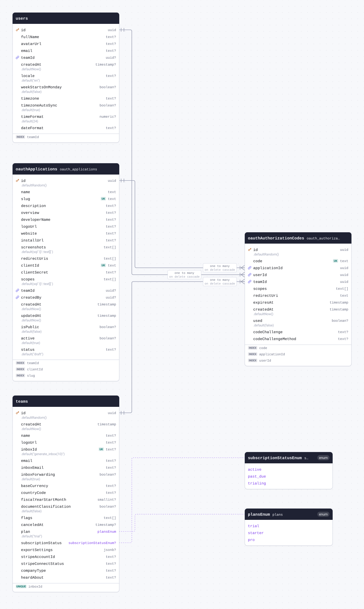

| Column                                          | Type        | Constraints                                                 | Default            | Description |
| ----------------------------------------------- | ----------- | ----------------------------------------------------------- | ------------------ | ----------- |
| `id`                                            | `uuid`      | PK NOT NULL                                                 | `.defaultRandom()` |             |
| `code`                                          | `text`      | UNIQUE NOT NULL                                             |                    |             |
| `applicationId` (`application_id`)              | `uuid`      | NOT NULL → [oauthApplications.id](#table-oauthApplications) |                    |             |
| `userId` (`user_id`)                            | `uuid`      | NOT NULL → [users.id](#table-users)                         |                    |             |
| `teamId` (`team_id`)                            | `uuid`      | NOT NULL → [teams.id](#table-teams)                         |                    |             |
| `scopes`                                        | `text[]`    | NOT NULL                                                    |                    |             |
| `redirectUri` (`redirect_uri`)                  | `text`      | NOT NULL                                                    |                    |             |
| `expiresAt` (`expires_at`)                      | `timestamp` | NOT NULL                                                    |                    |             |
| `createdAt` (`created_at`)                      | `timestamp` | NOT NULL                                                    | `.defaultNow()`    |             |
| `used`                                          | `boolean`   | NULL                                                        | `.default(false)`  |             |
| `codeChallenge` (`code_challenge`)              | `text`      | NULL                                                        |                    |             |
| `codeChallengeMethod` (`code_challenge_method`) | `text`      | NULL                                                        |                    |             |

#### Definition

```sql
CREATE TABLE "oauth_authorization_codes" (
	"id" uuid PRIMARY KEY DEFAULT gen_random_uuid(),
	"code" text NOT NULL UNIQUE,
	"application_id" uuid NOT NULL,
	"user_id" uuid NOT NULL,
	"team_id" uuid NOT NULL,
	"scopes" text[] NOT NULL,
	"redirect_uri" text NOT NULL,
	"expires_at" timestamp with time zone NOT NULL,
	"created_at" timestamp with time zone DEFAULT now() NOT NULL,
	"used" boolean DEFAULT false,
	"code_challenge" text,
	"code_challenge_method" text
);

CREATE INDEX "oauth_authorization_codes_code_idx" ON "oauth_authorization_codes" ("code" text_ops);

CREATE INDEX "oauth_authorization_codes_application_id_idx" ON "oauth_authorization_codes" ("application_id" uuid_ops);

CREATE INDEX "oauth_authorization_codes_user_id_idx" ON "oauth_authorization_codes" ("user_id" uuid_ops);

ALTER TABLE "oauth_authorization_codes" ADD CONSTRAINT "oauth_authorization_codes_application_id_fkey" FOREIGN KEY ("application_id") REFERENCES "oauth_applications"("id") ON DELETE CASCADE;

ALTER TABLE "oauth_authorization_codes" ADD CONSTRAINT "oauth_authorization_codes_user_id_fkey" FOREIGN KEY ("user_id") REFERENCES "users"("id") ON DELETE CASCADE;

ALTER TABLE "oauth_authorization_codes" ADD CONSTRAINT "oauth_authorization_codes_team_id_fkey" FOREIGN KEY ("team_id") REFERENCES "teams"("id") ON DELETE CASCADE;
```

#### Indexes

- INDEX `code`
- INDEX `applicationId`
- INDEX `userId`

#### References

- `applicationId` → [oauthApplications.id](#table-oauthApplications) (many to one, on delete cascade)
- `userId` → [users.id](#table-users) (many to one, on delete cascade)
- `teamId` → [teams.id](#table-teams) (many to one, on delete cascade)

<details>
<summary>Queries and their SQL</summary>

**Select**: Every row of oauthAuthorizationCodes.

```ts
db.select().from(oauthAuthorizationCodes);
```

```sql
select "id", "code", "application_id", "user_id", "team_id", "scopes", "redirect_uri", "expires_at", "created_at", "used", "code_challenge", "code_challenge_method"
from "oauth_authorization_codes"
```

**Count**: How many rows oauthAuthorizationCodes has.

```ts
db.select({ count: count() }).from(oauthAuthorizationCodes);
```

```sql
select count(*)
from "oauth_authorization_codes"
```

**Find many**: The rows of oauthAuthorizationCodes, through the relational query API.

```ts
db.query.oauthAuthorizationCodes.findMany();
```

```sql
select "d0"."id" as "id", "d0"."code" as "code", "d0"."application_id" as "applicationId", "d0"."user_id" as "userId", "d0"."team_id" as "teamId", "d0"."scopes" as "scopes", "d0"."redirect_uri" as "redirectUri", "d0"."expires_at" as "expiresAt", "d0"."created_at" as "createdAt", "d0"."used" as "used", "d0"."code_challenge" as "codeChallenge", "d0"."code_challenge_method" as "codeChallengeMethod"
from "oauth_authorization_codes" as "d0"
```

**Find by primary key**: One row of oauthAuthorizationCodes, through the relational query API.

```ts
db.query.oauthAuthorizationCodes.findFirst({
  where: { id: "00000000-0000-0000-0000-000000000000" },
});
```

```sql
select "d0"."id" as "id", "d0"."code" as "code", "d0"."application_id" as "applicationId", "d0"."user_id" as "userId", "d0"."team_id" as "teamId", "d0"."scopes" as "scopes", "d0"."redirect_uri" as "redirectUri", "d0"."expires_at" as "expiresAt", "d0"."created_at" as "createdAt", "d0"."used" as "used", "d0"."code_challenge" as "codeChallenge", "d0"."code_challenge_method" as "codeChallengeMethod"
from "oauth_authorization_codes" as "d0"
where "d0"."id" = $1
limit $2
-- params: ["00000000-0000-0000-0000-000000000000",1]
```

**Insert**: Adds a row to oauthAuthorizationCodes, giving the columns that have no default.

```ts
db.insert(oauthAuthorizationCodes).values({
  code: "code",
  applicationId: "00000000-0000-0000-0000-000000000000",
  userId: "00000000-0000-0000-0000-000000000000",
  teamId: "00000000-0000-0000-0000-000000000000",
  scopes: "scopes",
  redirectUri: "redirectUri",
  expiresAt: new Date("2026-01-01T00:00:00.000Z"),
});
```

```sql
insert into "oauth_authorization_codes" ("id", "code", "application_id", "user_id", "team_id", "scopes", "redirect_uri", "expires_at", "created_at", "used", "code_challenge", "code_challenge_method")
values (default, $1, $2, $3, $4, $5, $6, $7, default, default, default, default)
-- params: ["code","00000000-0000-0000-0000-000000000000","00000000-0000-0000-0000-000000000000","00000000-0000-0000-0000-000000000000","scopes","redirectUri","2026-01-01T00:00:00.000Z"]
```

**Update**: Changes a row of oauthAuthorizationCodes, found by its primary key.

```ts
db.update(oauthAuthorizationCodes)
  .set({ code: "code" })
  .where(eq(oauthAuthorizationCodes.id, "00000000-0000-0000-0000-000000000000"));
```

```sql
update "oauth_authorization_codes"
set "code" = $1
where "oauth_authorization_codes"."id" = $2
-- params: ["code","00000000-0000-0000-0000-000000000000"]
```

**Delete**: Deletes a row of oauthAuthorizationCodes, found by its primary key.

```ts
db.delete(oauthAuthorizationCodes).where(
  eq(oauthAuthorizationCodes.id, "00000000-0000-0000-0000-000000000000"),
);
```

```sql
delete from "oauth_authorization_codes"
where "oauth_authorization_codes"."id" = $1
-- params: ["00000000-0000-0000-0000-000000000000"]
```

</details>

<a id="table-oauthAccessTokens"></a>

### oauthAccessTokens

Table `oauth_access_tokens`. OAuth Access Tokens

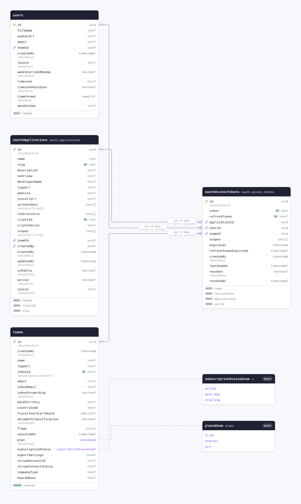

| Column                                               | Type        | Constraints                                                 | Default            | Description |
| ---------------------------------------------------- | ----------- | ----------------------------------------------------------- | ------------------ | ----------- |
| `id`                                                 | `uuid`      | PK NOT NULL                                                 | `.defaultRandom()` |             |
| `token`                                              | `text`      | UNIQUE NOT NULL                                             |                    |             |
| `refreshToken` (`refresh_token`)                     | `text`      | UNIQUE NULL                                                 |                    |             |
| `applicationId` (`application_id`)                   | `uuid`      | NOT NULL → [oauthApplications.id](#table-oauthApplications) |                    |             |
| `userId` (`user_id`)                                 | `uuid`      | NOT NULL → [users.id](#table-users)                         |                    |             |
| `teamId` (`team_id`)                                 | `uuid`      | NOT NULL → [teams.id](#table-teams)                         |                    |             |
| `scopes`                                             | `text[]`    | NOT NULL                                                    |                    |             |
| `expiresAt` (`expires_at`)                           | `timestamp` | NOT NULL                                                    |                    |             |
| `refreshTokenExpiresAt` (`refresh_token_expires_at`) | `timestamp` | NULL                                                        |                    |             |
| `createdAt` (`created_at`)                           | `timestamp` | NOT NULL                                                    | `.defaultNow()`    |             |
| `lastUsedAt` (`last_used_at`)                        | `timestamp` | NULL                                                        |                    |             |
| `revoked`                                            | `boolean`   | NULL                                                        | `.default(false)`  |             |
| `revokedAt` (`revoked_at`)                           | `timestamp` | NULL                                                        |                    |             |

#### Definition

```sql
CREATE TABLE "oauth_access_tokens" (
	"id" uuid PRIMARY KEY DEFAULT gen_random_uuid(),
	"token" text NOT NULL UNIQUE,
	"refresh_token" text UNIQUE,
	"application_id" uuid NOT NULL,
	"user_id" uuid NOT NULL,
	"team_id" uuid NOT NULL,
	"scopes" text[] NOT NULL,
	"expires_at" timestamp with time zone NOT NULL,
	"refresh_token_expires_at" timestamp with time zone,
	"created_at" timestamp with time zone DEFAULT now() NOT NULL,
	"last_used_at" timestamp with time zone,
	"revoked" boolean DEFAULT false,
	"revoked_at" timestamp with time zone
);

CREATE INDEX "oauth_access_tokens_token_idx" ON "oauth_access_tokens" ("token" text_ops);

CREATE INDEX "oauth_access_tokens_refresh_token_idx" ON "oauth_access_tokens" ("refresh_token" text_ops);

CREATE INDEX "oauth_access_tokens_application_id_idx" ON "oauth_access_tokens" ("application_id" uuid_ops);

CREATE INDEX "oauth_access_tokens_user_id_idx" ON "oauth_access_tokens" ("user_id" uuid_ops);

ALTER TABLE "oauth_access_tokens" ADD CONSTRAINT "oauth_access_tokens_application_id_fkey" FOREIGN KEY ("application_id") REFERENCES "oauth_applications"("id") ON DELETE CASCADE;

ALTER TABLE "oauth_access_tokens" ADD CONSTRAINT "oauth_access_tokens_user_id_fkey" FOREIGN KEY ("user_id") REFERENCES "users"("id") ON DELETE CASCADE;

ALTER TABLE "oauth_access_tokens" ADD CONSTRAINT "oauth_access_tokens_team_id_fkey" FOREIGN KEY ("team_id") REFERENCES "teams"("id") ON DELETE CASCADE;
```

#### Indexes

- INDEX `token`
- INDEX `refreshToken`
- INDEX `applicationId`
- INDEX `userId`

#### References

- `applicationId` → [oauthApplications.id](#table-oauthApplications) (many to one, on delete cascade)
- `userId` → [users.id](#table-users) (many to one, on delete cascade)
- `teamId` → [teams.id](#table-teams) (many to one, on delete cascade)

<details>
<summary>Queries and their SQL</summary>

**Select**: Every row of oauthAccessTokens.

```ts
db.select().from(oauthAccessTokens);
```

```sql
select "id", "token", "refresh_token", "application_id", "user_id", "team_id", "scopes", "expires_at", "refresh_token_expires_at", "created_at", "last_used_at", "revoked", "revoked_at"
from "oauth_access_tokens"
```

**Count**: How many rows oauthAccessTokens has.

```ts
db.select({ count: count() }).from(oauthAccessTokens);
```

```sql
select count(*)
from "oauth_access_tokens"
```

**Find many**: The rows of oauthAccessTokens, through the relational query API.

```ts
db.query.oauthAccessTokens.findMany();
```

```sql
select "d0"."id" as "id", "d0"."token" as "token", "d0"."refresh_token" as "refreshToken", "d0"."application_id" as "applicationId", "d0"."user_id" as "userId", "d0"."team_id" as "teamId", "d0"."scopes" as "scopes", "d0"."expires_at" as "expiresAt", "d0"."refresh_token_expires_at" as "refreshTokenExpiresAt", "d0"."created_at" as "createdAt", "d0"."last_used_at" as "lastUsedAt", "d0"."revoked" as "revoked", "d0"."revoked_at" as "revokedAt"
from "oauth_access_tokens" as "d0"
```

**Find by primary key**: One row of oauthAccessTokens, through the relational query API.

```ts
db.query.oauthAccessTokens.findFirst({ where: { id: "00000000-0000-0000-0000-000000000000" } });
```

```sql
select "d0"."id" as "id", "d0"."token" as "token", "d0"."refresh_token" as "refreshToken", "d0"."application_id" as "applicationId", "d0"."user_id" as "userId", "d0"."team_id" as "teamId", "d0"."scopes" as "scopes", "d0"."expires_at" as "expiresAt", "d0"."refresh_token_expires_at" as "refreshTokenExpiresAt", "d0"."created_at" as "createdAt", "d0"."last_used_at" as "lastUsedAt", "d0"."revoked" as "revoked", "d0"."revoked_at" as "revokedAt"
from "oauth_access_tokens" as "d0"
where "d0"."id" = $1
limit $2
-- params: ["00000000-0000-0000-0000-000000000000",1]
```

**Insert**: Adds a row to oauthAccessTokens, giving the columns that have no default.

```ts
db.insert(oauthAccessTokens).values({
  token: "token",
  applicationId: "00000000-0000-0000-0000-000000000000",
  userId: "00000000-0000-0000-0000-000000000000",
  teamId: "00000000-0000-0000-0000-000000000000",
  scopes: "scopes",
  expiresAt: new Date("2026-01-01T00:00:00.000Z"),
});
```

```sql
insert into "oauth_access_tokens" ("id", "token", "refresh_token", "application_id", "user_id", "team_id", "scopes", "expires_at", "refresh_token_expires_at", "created_at", "last_used_at", "revoked", "revoked_at")
values (default, $1, default, $2, $3, $4, $5, $6, default, default, default, default, default)
-- params: ["token","00000000-0000-0000-0000-000000000000","00000000-0000-0000-0000-000000000000","00000000-0000-0000-0000-000000000000","scopes","2026-01-01T00:00:00.000Z"]
```

**Update**: Changes a row of oauthAccessTokens, found by its primary key.

```ts
db.update(oauthAccessTokens)
  .set({ token: "token" })
  .where(eq(oauthAccessTokens.id, "00000000-0000-0000-0000-000000000000"));
```

```sql
update "oauth_access_tokens"
set "token" = $1
where "oauth_access_tokens"."id" = $2
-- params: ["token","00000000-0000-0000-0000-000000000000"]
```

**Delete**: Deletes a row of oauthAccessTokens, found by its primary key.

```ts
db.delete(oauthAccessTokens).where(
  eq(oauthAccessTokens.id, "00000000-0000-0000-0000-000000000000"),
);
```

```sql
delete from "oauth_access_tokens"
where "oauth_access_tokens"."id" = $1
-- params: ["00000000-0000-0000-0000-000000000000"]
```

</details>

<a id="table-activities"></a>

### activities

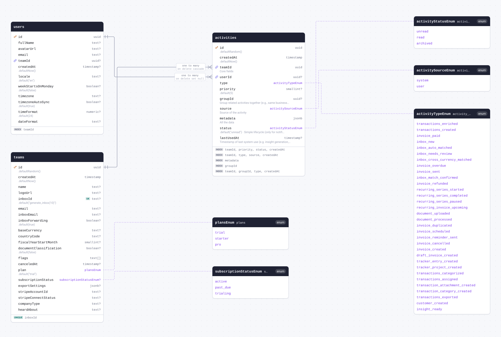

| Column                        | Type                                             | Constraints                         | Default              | Description                                                                         |
| ----------------------------- | ------------------------------------------------ | ----------------------------------- | -------------------- | ----------------------------------------------------------------------------------- |
| `id`                          | `uuid`                                           | PK NOT NULL                         | `.defaultRandom()`   |                                                                                     |
| `createdAt` (`created_at`)    | `timestamp`                                      | NOT NULL                            | `.defaultNow()`      |                                                                                     |
| `teamId` (`team_id`)          | `uuid`                                           | NOT NULL → [teams.id](#table-teams) |                      | Core fields                                                                         |
| `userId` (`user_id`)          | `uuid`                                           | NULL → [users.id](#table-users)     |                      |                                                                                     |
| `type`                        | [`activityTypeEnum`](#enum-activityTypeEnum)     | NOT NULL                            |                      |                                                                                     |
| `priority`                    | `smallint`                                       | NULL                                | `.default(5)`        |                                                                                     |
| `groupId` (`group_id`)        | `uuid`                                           | NULL                                |                      | Group related activities together (e.g., same business event across multiple users) |
| `source`                      | [`activitySourceEnum`](#enum-activitySourceEnum) | NOT NULL                            |                      | Source of the activity                                                              |
| `metadata`                    | `jsonb`                                          | NOT NULL                            |                      | All the data                                                                        |
| `status`                      | [`activityStatusEnum`](#enum-activityStatusEnum) | NOT NULL                            | `.default("unread")` | Simple lifecycle (only for notifications)                                           |
| `lastUsedAt` (`last_used_at`) | `timestamp`                                      | NULL                                |                      | Timestamp of last system use (e.g. insight generation, digest inclusion)            |

#### Definition

```sql
CREATE TABLE "activities" (
	"id" uuid PRIMARY KEY DEFAULT gen_random_uuid(),
	"created_at" timestamp with time zone DEFAULT now() NOT NULL,
	"team_id" uuid NOT NULL,
	"user_id" uuid,
	"type" "activity_type" NOT NULL,
	"priority" smallint DEFAULT 5,
	"group_id" uuid,
	"source" "activity_source" NOT NULL,
	"metadata" jsonb NOT NULL,
	"status" "activity_status" DEFAULT 'unread'::"activity_status" NOT NULL,
	"last_used_at" timestamp with time zone
);

CREATE INDEX "activities_notifications_idx" ON "activities" ("team_id","priority","status","created_at" DESC NULLS LAST);

CREATE INDEX "activities_insights_idx" ON "activities" ("team_id","type","source","created_at" DESC NULLS LAST);

CREATE INDEX "activities_metadata_gin_idx" ON "activities" USING gin ("metadata");

CREATE INDEX "activities_group_id_idx" ON "activities" ("group_id");

CREATE INDEX "activities_insights_group_idx" ON "activities" ("team_id","group_id","type","created_at" DESC NULLS LAST);

ALTER TABLE "activities" ADD CONSTRAINT "activities_team_id_fkey" FOREIGN KEY ("team_id") REFERENCES "teams"("id") ON DELETE CASCADE;

ALTER TABLE "activities" ADD CONSTRAINT "activities_user_id_fkey" FOREIGN KEY ("user_id") REFERENCES "users"("id") ON DELETE SET NULL;
```

#### Indexes

- INDEX `teamId`, `priority`, `status`, `createdAt`
- INDEX `teamId`, `type`, `source`, `createdAt`
- INDEX `metadata`
- INDEX `groupId`
- INDEX `teamId`, `groupId`, `type`, `createdAt`

#### References

- `teamId` → [teams.id](#table-teams) (many to one, on delete cascade)
- `userId` → [users.id](#table-users) (many to one, on delete set null)

<details>
<summary>Queries and their SQL</summary>

**Select**: Every row of activities.

```ts
db.select().from(activities);
```

```sql
select "id", "created_at", "team_id", "user_id", "type", "priority", "group_id", "source", "metadata", "status", "last_used_at"
from "activities"
```

**Count**: How many rows activities has.

```ts
db.select({ count: count() }).from(activities);
```

```sql
select count(*)
from "activities"
```

**Find many**: The rows of activities, through the relational query API.

```ts
db.query.activities.findMany();
```

```sql
select "d0"."id" as "id", "d0"."created_at" as "createdAt", "d0"."team_id" as "teamId", "d0"."user_id" as "userId", "d0"."type" as "type", "d0"."priority" as "priority", "d0"."group_id" as "groupId", "d0"."source" as "source", "d0"."metadata" as "metadata", "d0"."status" as "status", "d0"."last_used_at" as "lastUsedAt"
from "activities" as "d0"
```

**Find by primary key**: One row of activities, through the relational query API.

```ts
db.query.activities.findFirst({ where: { id: "00000000-0000-0000-0000-000000000000" } });
```

```sql
select "d0"."id" as "id", "d0"."created_at" as "createdAt", "d0"."team_id" as "teamId", "d0"."user_id" as "userId", "d0"."type" as "type", "d0"."priority" as "priority", "d0"."group_id" as "groupId", "d0"."source" as "source", "d0"."metadata" as "metadata", "d0"."status" as "status", "d0"."last_used_at" as "lastUsedAt"
from "activities" as "d0"
where "d0"."id" = $1
limit $2
-- params: ["00000000-0000-0000-0000-000000000000",1]
```

**Insert**: Adds a row to activities, giving the columns that have no default.

```ts
db.insert(activities).values({
  teamId: "00000000-0000-0000-0000-000000000000",
  type: "transactions_enriched",
  source: "system",
  metadata: {},
});
```

```sql
insert into "activities" ("id", "created_at", "team_id", "user_id", "type", "priority", "group_id", "source", "metadata", "status", "last_used_at")
values (default, default, $1, default, $2, default, default, $3, $4, default, default)
-- params: ["00000000-0000-0000-0000-000000000000","transactions_enriched","system",{}]
```

**Update**: Changes a row of activities, found by its primary key.

```ts
db.update(activities)
  .set({ createdAt: new Date("2026-01-01T00:00:00.000Z") })
  .where(eq(activities.id, "00000000-0000-0000-0000-000000000000"));
```

```sql
update "activities"
set "created_at" = $1
where "activities"."id" = $2
-- params: ["2026-01-01T00:00:00.000Z","00000000-0000-0000-0000-000000000000"]
```

**Delete**: Deletes a row of activities, found by its primary key.

```ts
db.delete(activities).where(eq(activities.id, "00000000-0000-0000-0000-000000000000"));
```

```sql
delete from "activities"
where "activities"."id" = $1
-- params: ["00000000-0000-0000-0000-000000000000"]
```

</details>

<a id="table-notificationSettings"></a>

### notificationSettings

Table `notification_settings`.

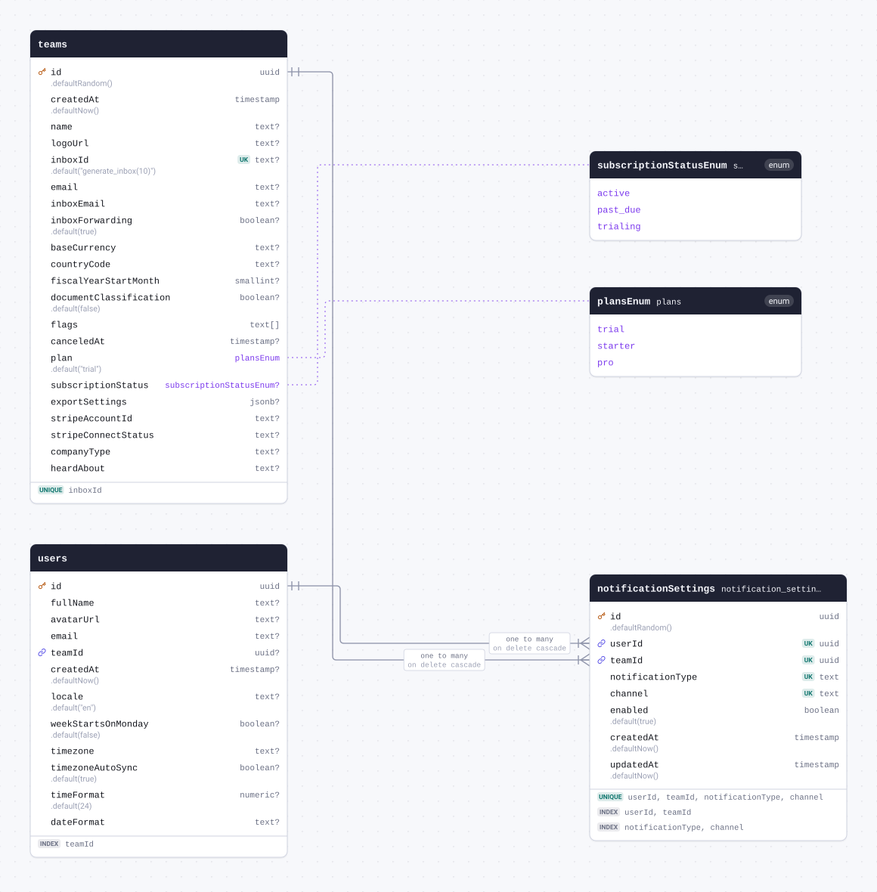

| Column                                   | Type        | Constraints                         | Default            | Description |
| ---------------------------------------- | ----------- | ----------------------------------- | ------------------ | ----------- |
| `id`                                     | `uuid`      | PK NOT NULL                         | `.defaultRandom()` |             |
| `userId` (`user_id`)                     | `uuid`      | NOT NULL → [users.id](#table-users) |                    |             |
| `teamId` (`team_id`)                     | `uuid`      | NOT NULL → [teams.id](#table-teams) |                    |             |
| `notificationType` (`notification_type`) | `text`      | NOT NULL                            |                    |             |
| `channel`                                | `text`      | NOT NULL                            |                    |             |
| `enabled`                                | `boolean`   | NOT NULL                            | `.default(true)`   |             |
| `createdAt` (`created_at`)               | `timestamp` | NOT NULL                            | `.defaultNow()`    |             |
| `updatedAt` (`updated_at`)               | `timestamp` | NOT NULL                            | `.defaultNow()`    |             |

#### Definition

```sql
CREATE TABLE "notification_settings" (
	"id" uuid PRIMARY KEY DEFAULT gen_random_uuid(),
	"user_id" uuid NOT NULL,
	"team_id" uuid NOT NULL,
	"notification_type" text NOT NULL,
	"channel" text NOT NULL,
	"enabled" boolean DEFAULT true NOT NULL,
	"created_at" timestamp with time zone DEFAULT now() NOT NULL,
	"updated_at" timestamp with time zone DEFAULT now() NOT NULL,
	CONSTRAINT "notification_settings_user_team_type_channel_key" UNIQUE("user_id","team_id","notification_type","channel")
);

ALTER TABLE "notification_settings" ENABLE ROW LEVEL SECURITY;

CREATE INDEX "notification_settings_user_team_idx" ON "notification_settings" ("user_id","team_id");

CREATE INDEX "notification_settings_type_channel_idx" ON "notification_settings" ("notification_type","channel");

ALTER TABLE "notification_settings" ADD CONSTRAINT "notification_settings_user_id_fkey" FOREIGN KEY ("user_id") REFERENCES "users"("id") ON DELETE CASCADE;

ALTER TABLE "notification_settings" ADD CONSTRAINT "notification_settings_team_id_fkey" FOREIGN KEY ("team_id") REFERENCES "teams"("id") ON DELETE CASCADE;
```

#### Indexes

- UNIQUE `userId`, `teamId`, `notificationType`, `channel`
- INDEX `userId`, `teamId`
- INDEX `notificationType`, `channel`

#### References

- `userId` → [users.id](#table-users) (many to one, on delete cascade)
- `teamId` → [teams.id](#table-teams) (many to one, on delete cascade)

<details>
<summary>Queries and their SQL</summary>

**Select**: Every row of notificationSettings.

```ts
db.select().from(notificationSettings);
```

```sql
select "id", "user_id", "team_id", "notification_type", "channel", "enabled", "created_at", "updated_at"
from "notification_settings"
```

**Count**: How many rows notificationSettings has.

```ts
db.select({ count: count() }).from(notificationSettings);
```

```sql
select count(*)
from "notification_settings"
```

**Find many**: The rows of notificationSettings, through the relational query API.

```ts
db.query.notificationSettings.findMany();
```

```sql
select "d0"."id" as "id", "d0"."user_id" as "userId", "d0"."team_id" as "teamId", "d0"."notification_type" as "notificationType", "d0"."channel" as "channel", "d0"."enabled" as "enabled", "d0"."created_at" as "createdAt", "d0"."updated_at" as "updatedAt"
from "notification_settings" as "d0"
```

**Find by primary key**: One row of notificationSettings, through the relational query API.

```ts
db.query.notificationSettings.findFirst({ where: { id: "00000000-0000-0000-0000-000000000000" } });
```

```sql
select "d0"."id" as "id", "d0"."user_id" as "userId", "d0"."team_id" as "teamId", "d0"."notification_type" as "notificationType", "d0"."channel" as "channel", "d0"."enabled" as "enabled", "d0"."created_at" as "createdAt", "d0"."updated_at" as "updatedAt"
from "notification_settings" as "d0"
where "d0"."id" = $1
limit $2
-- params: ["00000000-0000-0000-0000-000000000000",1]
```

**Insert**: Adds a row to notificationSettings, giving the columns that have no default.

```ts
db.insert(notificationSettings).values({
  userId: "00000000-0000-0000-0000-000000000000",
  teamId: "00000000-0000-0000-0000-000000000000",
  notificationType: "notificationType",
  channel: "channel",
});
```

```sql
insert into "notification_settings" ("id", "user_id", "team_id", "notification_type", "channel", "enabled", "created_at", "updated_at")
values (default, $1, $2, $3, $4, default, default, default)
-- params: ["00000000-0000-0000-0000-000000000000","00000000-0000-0000-0000-000000000000","notificationType","channel"]
```

**Update**: Changes a row of notificationSettings, found by its primary key.

```ts
db.update(notificationSettings)
  .set({ userId: "00000000-0000-0000-0000-000000000000" })
  .where(eq(notificationSettings.id, "00000000-0000-0000-0000-000000000000"));
```

```sql
update "notification_settings"
set "user_id" = $1
where "notification_settings"."id" = $2
-- params: ["00000000-0000-0000-0000-000000000000","00000000-0000-0000-0000-000000000000"]
```

**Delete**: Deletes a row of notificationSettings, found by its primary key.

```ts
db.delete(notificationSettings).where(
  eq(notificationSettings.id, "00000000-0000-0000-0000-000000000000"),
);
```

```sql
delete from "notification_settings"
where "notification_settings"."id" = $1
-- params: ["00000000-0000-0000-0000-000000000000"]
```

</details>

<a id="table-accountingSyncRecords"></a>

### accountingSyncRecords

Table `accounting_sync_records`. Accounting Sync Records Tracks which transactions have been synced to which accounting providers Supports multiple providers per transaction (Xero AND QuickBooks, etc.)

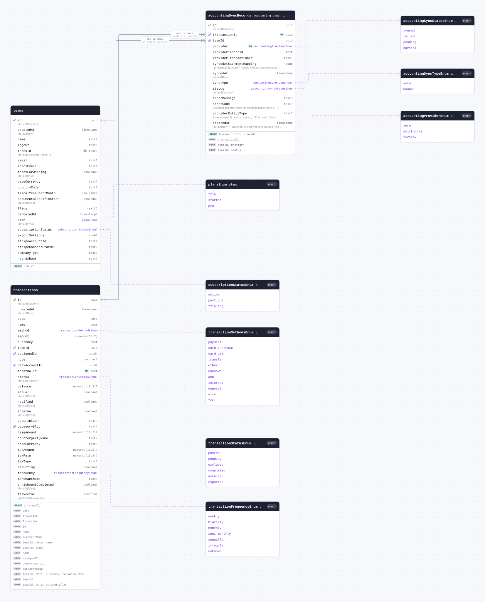

| Column                                                  | Type                                                         | Constraints                                       | Default                        | Description                                                                                                                          |
| ------------------------------------------------------- | ------------------------------------------------------------ | ------------------------------------------------- | ------------------------------ | ------------------------------------------------------------------------------------------------------------------------------------ |
| `id`                                                    | `uuid`                                                       | PK NOT NULL                                       | `.defaultRandom()`             |                                                                                                                                      |
| `transactionId` (`transaction_id`)                      | `uuid`                                                       | NOT NULL → [transactions.id](#table-transactions) |                                |                                                                                                                                      |
| `teamId` (`team_id`)                                    | `uuid`                                                       | NOT NULL → [teams.id](#table-teams)               |                                |                                                                                                                                      |
| `provider`                                              | [`accountingProviderEnum`](#enum-accountingProviderEnum)     | NOT NULL                                          |                                |                                                                                                                                      |
| `providerTenantId` (`provider_tenant_id`)               | `text`                                                       | NOT NULL                                          |                                |                                                                                                                                      |
| `providerTransactionId` (`provider_transaction_id`)     | `text`                                                       | NULL                                              |                                |                                                                                                                                      |
| `syncedAttachmentMapping` (`synced_attachment_mapping`) | `jsonb`                                                      | NOT NULL                                          | ``.default(sql`'{}'::jsonb`)`` | Maps Midday attachment IDs to provider attachment IDs for sync tracking Format: { "midday-attachment-id": "provider-attachment-id" } |
| `syncedAt` (`synced_at`)                                | `timestamp`                                                  | NOT NULL                                          | `.defaultNow()`                |                                                                                                                                      |
| `syncType` (`sync_type`)                                | [`accountingSyncTypeEnum`](#enum-accountingSyncTypeEnum)     | NULL                                              |                                |                                                                                                                                      |
| `status`                                                | [`accountingSyncStatusEnum`](#enum-accountingSyncStatusEnum) | NOT NULL                                          | `.default("synced")`           |                                                                                                                                      |
| `errorMessage` (`error_message`)                        | `text`                                                       | NULL                                              |                                |                                                                                                                                      |
| `errorCode` (`error_code`)                              | `text`                                                       | NULL                                              |                                | Standardized error code for frontend handling (e.g., "ATTACHMENT_UNSUPPORTED_TYPE", "AUTH_EXPIRED")                                  |
| `providerEntityType` (`provider_entity_type`)           | `text`                                                       | NULL                                              |                                | Provider-specific entity type (e.g., "Purchase", "SalesReceipt", "Voucher", "BankTransaction")                                       |
| `createdAt` (`created_at`)                              | `timestamp`                                                  | NOT NULL                                          | `.defaultNow()`                | When the record was first created (synced_at gets updated on every sync)                                                             |

#### Definition

```sql
CREATE TABLE "accounting_sync_records" (
	"id" uuid PRIMARY KEY DEFAULT gen_random_uuid(),
	"transaction_id" uuid NOT NULL,
	"team_id" uuid NOT NULL,
	"provider" "accounting_provider" NOT NULL,
	"provider_tenant_id" text NOT NULL,
	"provider_transaction_id" text,
	"synced_attachment_mapping" jsonb DEFAULT '{}' NOT NULL,
	"synced_at" timestamp with time zone DEFAULT now() NOT NULL,
	"sync_type" "accounting_sync_type",
	"status" "accounting_sync_status" DEFAULT 'synced'::"accounting_sync_status" NOT NULL,
	"error_message" text,
	"error_code" text,
	"provider_entity_type" text,
	"created_at" timestamp with time zone DEFAULT now() NOT NULL,
	CONSTRAINT "accounting_sync_records_transaction_provider_key" UNIQUE("transaction_id","provider")
);

ALTER TABLE "accounting_sync_records" ENABLE ROW LEVEL SECURITY;

CREATE INDEX "idx_accounting_sync_transaction" ON "accounting_sync_records" ("transaction_id");

CREATE INDEX "idx_accounting_sync_team_provider" ON "accounting_sync_records" ("team_id","provider");

CREATE INDEX "idx_accounting_sync_status" ON "accounting_sync_records" ("team_id","status");

ALTER TABLE "accounting_sync_records" ADD CONSTRAINT "accounting_sync_records_transaction_id_fkey" FOREIGN KEY ("transaction_id") REFERENCES "transactions"("id") ON DELETE CASCADE;

ALTER TABLE "accounting_sync_records" ADD CONSTRAINT "accounting_sync_records_team_id_fkey" FOREIGN KEY ("team_id") REFERENCES "teams"("id") ON DELETE CASCADE;
```

#### Indexes

- INDEX `transactionId`
- INDEX `teamId`, `provider`
- INDEX `teamId`, `status`
- UNIQUE `transactionId`, `provider`

#### References

- `transactionId` → [transactions.id](#table-transactions) (many to one, on delete cascade)
- `teamId` → [teams.id](#table-teams) (many to one, on delete cascade)

<details>
<summary>Queries and their SQL</summary>

**Select**: Every row of accountingSyncRecords.

```ts
db.select().from(accountingSyncRecords);
```

```sql
select "id", "transaction_id", "team_id", "provider", "provider_tenant_id", "provider_transaction_id", "synced_attachment_mapping", "synced_at", "sync_type", "status", "error_message", "error_code", "provider_entity_type", "created_at"
from "accounting_sync_records"
```

**Count**: How many rows accountingSyncRecords has.

```ts
db.select({ count: count() }).from(accountingSyncRecords);
```

```sql
select count(*)
from "accounting_sync_records"
```

**Find many**: The rows of accountingSyncRecords, through the relational query API.

```ts
db.query.accountingSyncRecords.findMany();
```

```sql
select "d0"."id" as "id", "d0"."transaction_id" as "transactionId", "d0"."team_id" as "teamId", "d0"."provider" as "provider", "d0"."provider_tenant_id" as "providerTenantId", "d0"."provider_transaction_id" as "providerTransactionId", "d0"."synced_attachment_mapping" as "syncedAttachmentMapping", "d0"."synced_at" as "syncedAt", "d0"."sync_type" as "syncType", "d0"."status" as "status", "d0"."error_message" as "errorMessage", "d0"."error_code" as "errorCode", "d0"."provider_entity_type" as "providerEntityType", "d0"."created_at" as "createdAt"
from "accounting_sync_records" as "d0"
```

**Find by primary key**: One row of accountingSyncRecords, through the relational query API.

```ts
db.query.accountingSyncRecords.findFirst({ where: { id: "00000000-0000-0000-0000-000000000000" } });
```

```sql
select "d0"."id" as "id", "d0"."transaction_id" as "transactionId", "d0"."team_id" as "teamId", "d0"."provider" as "provider", "d0"."provider_tenant_id" as "providerTenantId", "d0"."provider_transaction_id" as "providerTransactionId", "d0"."synced_attachment_mapping" as "syncedAttachmentMapping", "d0"."synced_at" as "syncedAt", "d0"."sync_type" as "syncType", "d0"."status" as "status", "d0"."error_message" as "errorMessage", "d0"."error_code" as "errorCode", "d0"."provider_entity_type" as "providerEntityType", "d0"."created_at" as "createdAt"
from "accounting_sync_records" as "d0"
where "d0"."id" = $1
limit $2
-- params: ["00000000-0000-0000-0000-000000000000",1]
```

**Insert**: Adds a row to accountingSyncRecords, giving the columns that have no default.

```ts
db.insert(accountingSyncRecords).values({
  transactionId: "00000000-0000-0000-0000-000000000000",
  teamId: "00000000-0000-0000-0000-000000000000",
  provider: "xero",
  providerTenantId: "providerTenantId",
});
```

```sql
insert into "accounting_sync_records" ("id", "transaction_id", "team_id", "provider", "provider_tenant_id", "provider_transaction_id", "synced_attachment_mapping", "synced_at", "sync_type", "status", "error_message", "error_code", "provider_entity_type", "created_at")
values (default, $1, $2, $3, $4, default, default, default, default, default, default, default, default, default)
-- params: ["00000000-0000-0000-0000-000000000000","00000000-0000-0000-0000-000000000000","xero","providerTenantId"]
```

**Update**: Changes a row of accountingSyncRecords, found by its primary key.

```ts
db.update(accountingSyncRecords)
  .set({ transactionId: "00000000-0000-0000-0000-000000000000" })
  .where(eq(accountingSyncRecords.id, "00000000-0000-0000-0000-000000000000"));
```

```sql
update "accounting_sync_records"
set "transaction_id" = $1
where "accounting_sync_records"."id" = $2
-- params: ["00000000-0000-0000-0000-000000000000","00000000-0000-0000-0000-000000000000"]
```

**Delete**: Deletes a row of accountingSyncRecords, found by its primary key.

```ts
db.delete(accountingSyncRecords).where(
  eq(accountingSyncRecords.id, "00000000-0000-0000-0000-000000000000"),
);
```

```sql
delete from "accounting_sync_records"
where "accounting_sync_records"."id" = $1
-- params: ["00000000-0000-0000-0000-000000000000"]
```

</details>

<a id="table-insights"></a>

### insights

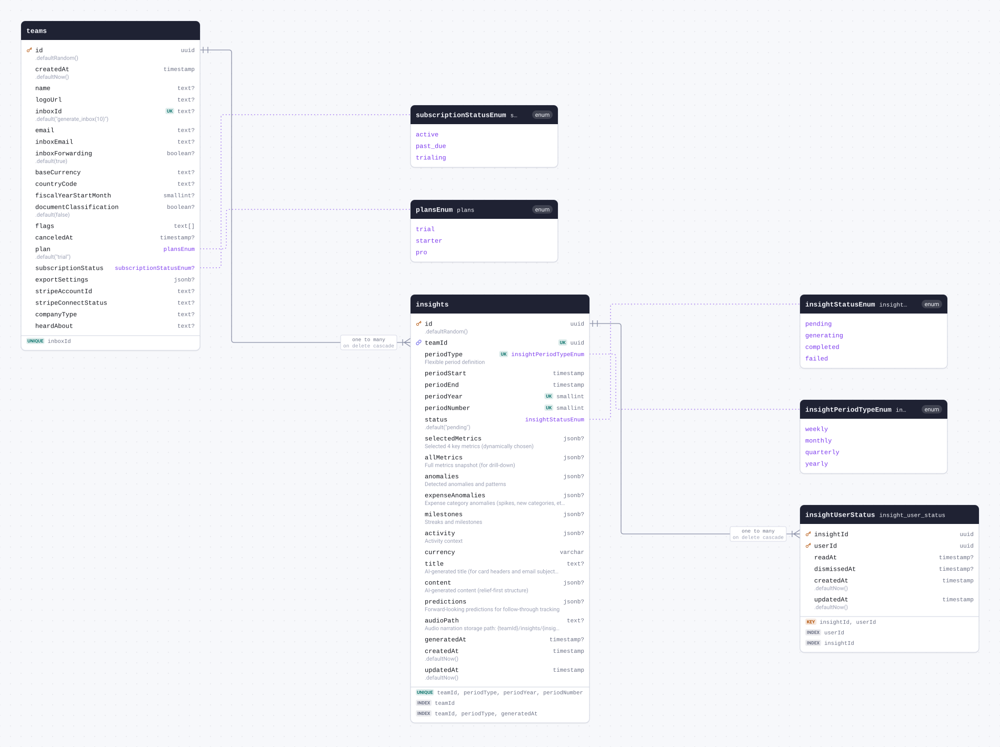

| Column                                   | Type                                                   | Constraints                         | Default               | Description                                                     |
| ---------------------------------------- | ------------------------------------------------------ | ----------------------------------- | --------------------- | --------------------------------------------------------------- |
| `id`                                     | `uuid`                                                 | PK NOT NULL                         | `.defaultRandom()`    |                                                                 |
| `teamId` (`team_id`)                     | `uuid`                                                 | NOT NULL → [teams.id](#table-teams) |                       |                                                                 |
| `periodType` (`period_type`)             | [`insightPeriodTypeEnum`](#enum-insightPeriodTypeEnum) | NOT NULL                            |                       | Flexible period definition                                      |
| `periodStart` (`period_start`)           | `timestamp`                                            | NOT NULL                            |                       |                                                                 |
| `periodEnd` (`period_end`)               | `timestamp`                                            | NOT NULL                            |                       |                                                                 |
| `periodYear` (`period_year`)             | `smallint`                                             | NOT NULL                            |                       |                                                                 |
| `periodNumber` (`period_number`)         | `smallint`                                             | NOT NULL                            |                       |                                                                 |
| `status`                                 | [`insightStatusEnum`](#enum-insightStatusEnum)         | NOT NULL                            | `.default("pending")` |                                                                 |
| `selectedMetrics` (`selected_metrics`)   | `jsonb`                                                | NULL                                |                       | Selected 4 key metrics (dynamically chosen)                     |
| `allMetrics` (`all_metrics`)             | `jsonb`                                                | NULL                                |                       | Full metrics snapshot (for drill-down)                          |
| `anomalies`                              | `jsonb`                                                | NULL                                |                       | Detected anomalies and patterns                                 |
| `expenseAnomalies` (`expense_anomalies`) | `jsonb`                                                | NULL                                |                       | Expense category anomalies (spikes, new categories, etc.)       |
| `milestones`                             | `jsonb`                                                | NULL                                |                       | Streaks and milestones                                          |
| `activity`                               | `jsonb`                                                | NULL                                |                       | Activity context                                                |
| `currency`                               | `varchar`                                              | NOT NULL                            |                       |                                                                 |
| `title`                                  | `text`                                                 | NULL                                |                       | AI-generated title (for card headers and email subjects)        |
| `content`                                | `jsonb`                                                | NULL                                |                       | AI-generated content (relief-first structure)                   |
| `predictions`                            | `jsonb`                                                | NULL                                |                       | Forward-looking predictions for follow-through tracking         |
| `audioPath` (`audio_path`)               | `text`                                                 | NULL                                |                       | Audio narration storage path: {teamId}/insights/{insightId}.mp3 |
| `generatedAt` (`generated_at`)           | `timestamp`                                            | NULL                                |                       |                                                                 |
| `createdAt` (`created_at`)               | `timestamp`                                            | NOT NULL                            | `.defaultNow()`       |                                                                 |
| `updatedAt` (`updated_at`)               | `timestamp`                                            | NOT NULL                            | `.defaultNow()`       |                                                                 |

#### Definition

```sql
CREATE TABLE "insights" (
	"id" uuid PRIMARY KEY DEFAULT gen_random_uuid(),
	"team_id" uuid NOT NULL,
	"period_type" "insight_period_type" NOT NULL,
	"period_start" timestamp with time zone NOT NULL,
	"period_end" timestamp with time zone NOT NULL,
	"period_year" smallint NOT NULL,
	"period_number" smallint NOT NULL,
	"status" "insight_status" DEFAULT 'pending'::"insight_status" NOT NULL,
	"selected_metrics" jsonb,
	"all_metrics" jsonb,
	"anomalies" jsonb,
	"expense_anomalies" jsonb,
	"milestones" jsonb,
	"activity" jsonb,
	"currency" varchar(3) NOT NULL,
	"title" text,
	"content" jsonb,
	"predictions" jsonb,
	"audio_path" text,
	"generated_at" timestamp with time zone,
	"created_at" timestamp with time zone DEFAULT now() NOT NULL,
	"updated_at" timestamp with time zone DEFAULT now() NOT NULL,
	CONSTRAINT "insights_team_period_unique" UNIQUE("team_id","period_type","period_year","period_number")
);

ALTER TABLE "insights" ENABLE ROW LEVEL SECURITY;

CREATE INDEX "insights_team_id_idx" ON "insights" ("team_id");

CREATE INDEX "insights_team_period_type_idx" ON "insights" ("team_id","period_type","generated_at" DESC NULLS LAST);

ALTER TABLE "insights" ADD CONSTRAINT "insights_team_id_teams_id_fkey" FOREIGN KEY ("team_id") REFERENCES "teams"("id") ON DELETE CASCADE;
```

#### Indexes

- UNIQUE `teamId`, `periodType`, `periodYear`, `periodNumber`
- INDEX `teamId`
- INDEX `teamId`, `periodType`, `generatedAt`

#### References

- `teamId` → [teams.id](#table-teams) (many to one, on delete cascade)

#### Referenced by

- `id` → [insightUserStatus.insightId](#table-insightUserStatus) (one to many, on delete cascade)

<details>
<summary>Queries and their SQL</summary>

**Select**: Every row of insights.

```ts
db.select().from(insights);
```

```sql
select "id", "team_id", "period_type", "period_start", "period_end", "period_year", "period_number", "status", "selected_metrics", "all_metrics", "anomalies", "expense_anomalies", "milestones", "activity", "currency", "title", "content", "predictions", "audio_path", "generated_at", "created_at", "updated_at"
from "insights"
```

**Count**: How many rows insights has.

```ts
db.select({ count: count() }).from(insights);
```

```sql
select count(*)
from "insights"
```

**Find many**: The rows of insights, through the relational query API.

```ts
db.query.insights.findMany();
```

```sql
select "d0"."id" as "id", "d0"."team_id" as "teamId", "d0"."period_type" as "periodType", "d0"."period_start" as "periodStart", "d0"."period_end" as "periodEnd", "d0"."period_year" as "periodYear", "d0"."period_number" as "periodNumber", "d0"."status" as "status", "d0"."selected_metrics" as "selectedMetrics", "d0"."all_metrics" as "allMetrics", "d0"."anomalies" as "anomalies", "d0"."expense_anomalies" as "expenseAnomalies", "d0"."milestones" as "milestones", "d0"."activity" as "activity", "d0"."currency" as "currency", "d0"."title" as "title", "d0"."content" as "content", "d0"."predictions" as "predictions", "d0"."audio_path" as "audioPath", "d0"."generated_at" as "generatedAt", "d0"."created_at" as "createdAt", "d0"."updated_at" as "updatedAt"
from "insights" as "d0"
```

**Find by primary key**: One row of insights, through the relational query API.

```ts
db.query.insights.findFirst({ where: { id: "00000000-0000-0000-0000-000000000000" } });
```

```sql
select "d0"."id" as "id", "d0"."team_id" as "teamId", "d0"."period_type" as "periodType", "d0"."period_start" as "periodStart", "d0"."period_end" as "periodEnd", "d0"."period_year" as "periodYear", "d0"."period_number" as "periodNumber", "d0"."status" as "status", "d0"."selected_metrics" as "selectedMetrics", "d0"."all_metrics" as "allMetrics", "d0"."anomalies" as "anomalies", "d0"."expense_anomalies" as "expenseAnomalies", "d0"."milestones" as "milestones", "d0"."activity" as "activity", "d0"."currency" as "currency", "d0"."title" as "title", "d0"."content" as "content", "d0"."predictions" as "predictions", "d0"."audio_path" as "audioPath", "d0"."generated_at" as "generatedAt", "d0"."created_at" as "createdAt", "d0"."updated_at" as "updatedAt"
from "insights" as "d0"
where "d0"."id" = $1
limit $2
-- params: ["00000000-0000-0000-0000-000000000000",1]
```

**Insert**: Adds a row to insights, giving the columns that have no default.

```ts
db.insert(insights).values({
  teamId: "00000000-0000-0000-0000-000000000000",
  periodType: "weekly",
  periodStart: new Date("2026-01-01T00:00:00.000Z"),
  periodEnd: new Date("2026-01-01T00:00:00.000Z"),
  periodYear: 1,
  periodNumber: 1,
  currency: "currency",
});
```

```sql
insert into "insights" ("id", "team_id", "period_type", "period_start", "period_end", "period_year", "period_number", "status", "selected_metrics", "all_metrics", "anomalies", "expense_anomalies", "milestones", "activity", "currency", "title", "content", "predictions", "audio_path", "generated_at", "created_at", "updated_at")
values (default, $1, $2, $3, $4, $5, $6, default, default, default, default, default, default, default, $7, default, default, default, default, default, default, default)
-- params: ["00000000-0000-0000-0000-000000000000","weekly","2026-01-01T00:00:00.000Z","2026-01-01T00:00:00.000Z",1,1,"currency"]
```

**Update**: Changes a row of insights, found by its primary key.

```ts
db.update(insights)
  .set({ teamId: "00000000-0000-0000-0000-000000000000" })
  .where(eq(insights.id, "00000000-0000-0000-0000-000000000000"));
```

```sql
update "insights"
set "team_id" = $1
where "insights"."id" = $2
-- params: ["00000000-0000-0000-0000-000000000000","00000000-0000-0000-0000-000000000000"]
```

**Delete**: Deletes a row of insights, found by its primary key.

```ts
db.delete(insights).where(eq(insights.id, "00000000-0000-0000-0000-000000000000"));
```

```sql
delete from "insights"
where "insights"."id" = $1
-- params: ["00000000-0000-0000-0000-000000000000"]
```

</details>

<a id="table-insightUserStatus"></a>

### insightUserStatus

Table `insight_user_status`. Per-user insight interaction tracking (read/dismiss state)


| Column                         | Type        | Constraints                                  | Default         | Description |
| ------------------------------ | ----------- | -------------------------------------------- | --------------- | ----------- |
| `insightId` (`insight_id`)     | `uuid`      | PK NOT NULL → [insights.id](#table-insights) |                 |             |
| `userId` (`user_id`)           | `uuid`      | PK NOT NULL → [users.id](#table-users)       |                 |             |
| `readAt` (`read_at`)           | `timestamp` | NULL                                         |                 |             |
| `dismissedAt` (`dismissed_at`) | `timestamp` | NULL                                         |                 |             |
| `createdAt` (`created_at`)     | `timestamp` | NOT NULL                                     | `.defaultNow()` |             |
| `updatedAt` (`updated_at`)     | `timestamp` | NOT NULL                                     | `.defaultNow()` |             |

#### Definition

```sql
CREATE TABLE "insight_user_status" (
	"insight_id" uuid,
	"user_id" uuid,
	"read_at" timestamp with time zone,
	"dismissed_at" timestamp with time zone,
	"created_at" timestamp with time zone DEFAULT now() NOT NULL,
	"updated_at" timestamp with time zone DEFAULT now() NOT NULL,
	CONSTRAINT "insight_user_status_pkey" PRIMARY KEY("insight_id","user_id")
);

ALTER TABLE "insight_user_status" ENABLE ROW LEVEL SECURITY;

CREATE INDEX "insight_user_status_user_idx" ON "insight_user_status" ("user_id");

CREATE INDEX "insight_user_status_insight_idx" ON "insight_user_status" ("insight_id");

ALTER TABLE "insight_user_status" ADD CONSTRAINT "insight_user_status_insight_id_insights_id_fkey" FOREIGN KEY ("insight_id") REFERENCES "insights"("id") ON DELETE CASCADE;

ALTER TABLE "insight_user_status" ADD CONSTRAINT "insight_user_status_user_id_users_id_fkey" FOREIGN KEY ("user_id") REFERENCES "users"("id") ON DELETE CASCADE;
```

#### Indexes

- PRIMARY KEY `insightId`, `userId`
- INDEX `userId`
- INDEX `insightId`

#### References

- `insightId` → [insights.id](#table-insights) (many to one, on delete cascade)
- `userId` → [users.id](#table-users) (many to one, on delete cascade)

<details>
<summary>Queries and their SQL</summary>

**Select**: Every row of insightUserStatus.

```ts
db.select().from(insightUserStatus);
```

```sql
select "insight_id", "user_id", "read_at", "dismissed_at", "created_at", "updated_at"
from "insight_user_status"
```

**Count**: How many rows insightUserStatus has.

```ts
db.select({ count: count() }).from(insightUserStatus);
```

```sql
select count(*)
from "insight_user_status"
```

**Find many**: The rows of insightUserStatus, through the relational query API.

```ts
db.query.insightUserStatus.findMany();
```

```sql
select "d0"."insight_id" as "insightId", "d0"."user_id" as "userId", "d0"."read_at" as "readAt", "d0"."dismissed_at" as "dismissedAt", "d0"."created_at" as "createdAt", "d0"."updated_at" as "updatedAt"
from "insight_user_status" as "d0"
```

**Find by primary key**: One row of insightUserStatus, through the relational query API.

```ts
db.query.insightUserStatus.findFirst({
  where: {
    insightId: "00000000-0000-0000-0000-000000000000",
    userId: "00000000-0000-0000-0000-000000000000",
  },
});
```

```sql
select "d0"."insight_id" as "insightId", "d0"."user_id" as "userId", "d0"."read_at" as "readAt", "d0"."dismissed_at" as "dismissedAt", "d0"."created_at" as "createdAt", "d0"."updated_at" as "updatedAt"
from "insight_user_status" as "d0"
where (("d0"."insight_id" = $1) and ("d0"."user_id" = $2))
limit $3
-- params: ["00000000-0000-0000-0000-000000000000","00000000-0000-0000-0000-000000000000",1]
```

**Insert**: Adds a row to insightUserStatus, giving the columns that have no default.

```ts
db.insert(insightUserStatus).values({
  insightId: "00000000-0000-0000-0000-000000000000",
  userId: "00000000-0000-0000-0000-000000000000",
});
```

```sql
insert into "insight_user_status" ("insight_id", "user_id", "read_at", "dismissed_at", "created_at", "updated_at")
values ($1, $2, default, default, default, default)
-- params: ["00000000-0000-0000-0000-000000000000","00000000-0000-0000-0000-000000000000"]
```

**Update**: Changes a row of insightUserStatus, found by its primary key.

```ts
db.update(insightUserStatus)
  .set({ readAt: new Date("2026-01-01T00:00:00.000Z") })
  .where(
    and(
      eq(insightUserStatus.insightId, "00000000-0000-0000-0000-000000000000"),
      eq(insightUserStatus.userId, "00000000-0000-0000-0000-000000000000"),
    ),
  );
```

```sql
update "insight_user_status"
set "read_at" = $1
where (("insight_user_status"."insight_id" = $2) and ("insight_user_status"."user_id" = $3))
-- params: ["2026-01-01T00:00:00.000Z","00000000-0000-0000-0000-000000000000","00000000-0000-0000-0000-000000000000"]
```

**Delete**: Deletes a row of insightUserStatus, found by its primary key.

```ts
db.delete(insightUserStatus).where(
  and(
    eq(insightUserStatus.insightId, "00000000-0000-0000-0000-000000000000"),
    eq(insightUserStatus.userId, "00000000-0000-0000-0000-000000000000"),
  ),
);
```

```sql
delete from "insight_user_status"
where (("insight_user_status"."insight_id" = $1) and ("insight_user_status"."user_id" = $2))
-- params: ["00000000-0000-0000-0000-000000000000","00000000-0000-0000-0000-000000000000"]
```

</details>

## Enums

<a id="enum-accountTypeEnum"></a>

### accountTypeEnum

Type `account_type`.

- `depository`
- `credit`
- `other_asset`
- `loan`
- `other_liability`

#### Definition

```sql
CREATE TYPE "account_type" AS ENUM('depository', 'credit', 'other_asset', 'loan', 'other_liability');
```

<a id="enum-bankProvidersEnum"></a>

### bankProvidersEnum

Type `bank_providers`.

- `gocardless`
- `plaid`
- `teller`
- `enablebanking`

#### Definition

```sql
CREATE TYPE "bank_providers" AS ENUM('gocardless', 'plaid', 'teller', 'enablebanking');
```

<a id="enum-connectionStatusEnum"></a>

### connectionStatusEnum

Type `connection_status`.

- `disconnected`
- `connected`
- `unknown`

#### Definition

```sql
CREATE TYPE "connection_status" AS ENUM('disconnected', 'connected', 'unknown');
```

<a id="enum-institutionStatusEnum"></a>

### institutionStatusEnum

Type `institution_status`.

- `active`
- `removed`

#### Definition

```sql
CREATE TYPE "institution_status" AS ENUM('active', 'removed');
```

<a id="enum-documentProcessingStatusEnum"></a>

### documentProcessingStatusEnum

Type `document_processing_status`.

- `pending`
- `processing`
- `completed`
- `failed`

#### Definition

```sql
CREATE TYPE "document_processing_status" AS ENUM('pending', 'processing', 'completed', 'failed');
```

<a id="enum-inboxAccountProvidersEnum"></a>

### inboxAccountProvidersEnum

Type `inbox_account_providers`.

- `gmail`
- `outlook`

#### Definition

```sql
CREATE TYPE "inbox_account_providers" AS ENUM('gmail', 'outlook');
```

<a id="enum-inboxAccountStatusEnum"></a>

### inboxAccountStatusEnum

Type `inbox_account_status`.

- `connected`
- `disconnected`

#### Definition

```sql
CREATE TYPE "inbox_account_status" AS ENUM('connected', 'disconnected');
```

<a id="enum-accountingProviderEnum"></a>

### accountingProviderEnum

Type `accounting_provider`.

- `xero`
- `quickbooks`
- `fortnox`

#### Definition

```sql
CREATE TYPE "accounting_provider" AS ENUM('xero', 'quickbooks', 'fortnox');
```

<a id="enum-accountingSyncStatusEnum"></a>

### accountingSyncStatusEnum

Type `accounting_sync_status`.

- `synced`
- `failed`
- `pending`
- `partial`

#### Definition

```sql
CREATE TYPE "accounting_sync_status" AS ENUM('synced', 'failed', 'pending', 'partial');
```

<a id="enum-accountingSyncTypeEnum"></a>

### accountingSyncTypeEnum

Type `accounting_sync_type`.

- `auto`
- `manual`

#### Definition

```sql
CREATE TYPE "accounting_sync_type" AS ENUM('auto', 'manual');
```

<a id="enum-inboxStatusEnum"></a>

### inboxStatusEnum

Type `inbox_status`.

- `processing`
- `pending`
- `archived`
- `new`
- `analyzing`
- `suggested_match`
- `no_match`
- `done`
- `deleted`
- `other`

#### Definition

```sql
CREATE TYPE "inbox_status" AS ENUM('processing', 'pending', 'archived', 'new', 'analyzing', 'suggested_match', 'no_match', 'done', 'deleted', 'other');
```

<a id="enum-inboxTypeEnum"></a>

### inboxTypeEnum

Type `inbox_type`.

- `invoice`
- `expense`
- `other`

#### Definition

```sql
CREATE TYPE "inbox_type" AS ENUM('invoice', 'expense', 'other');
```

<a id="enum-inboxBlocklistTypeEnum"></a>

### inboxBlocklistTypeEnum

Type `inbox_blocklist_type`.

- `email`
- `domain`

#### Definition

```sql
CREATE TYPE "inbox_blocklist_type" AS ENUM('email', 'domain');
```

<a id="enum-invoiceDeliveryTypeEnum"></a>

### invoiceDeliveryTypeEnum

Type `invoice_delivery_type`.

- `create`
- `create_and_send`
- `scheduled`

#### Definition

```sql
CREATE TYPE "invoice_delivery_type" AS ENUM('create', 'create_and_send', 'scheduled');
```

<a id="enum-invoiceSizeEnum"></a>

### invoiceSizeEnum

Type `invoice_size`.

- `a4`
- `letter`

#### Definition

```sql
CREATE TYPE "invoice_size" AS ENUM('a4', 'letter');
```

<a id="enum-invoiceStatusEnum"></a>

### invoiceStatusEnum

Type `invoice_status`.

- `draft`
- `overdue`
- `paid`
- `unpaid`
- `canceled`
- `scheduled`
- `refunded`

#### Definition

```sql
CREATE TYPE "invoice_status" AS ENUM('draft', 'overdue', 'paid', 'unpaid', 'canceled', 'scheduled', 'refunded');
```

<a id="enum-invoiceRecurringFrequencyEnum"></a>

### invoiceRecurringFrequencyEnum

Type `invoice_recurring_frequency`.

- `weekly`
- `biweekly`
- `monthly_date`
- `monthly_weekday`
- `monthly_last_day`
- `quarterly`
- `semi_annual`
- `annual`
- `custom`

#### Definition

```sql
CREATE TYPE "invoice_recurring_frequency" AS ENUM('weekly', 'biweekly', 'monthly_date', 'monthly_weekday', 'monthly_last_day', 'quarterly', 'semi_annual', 'annual', 'custom');
```

<a id="enum-invoiceRecurringEndTypeEnum"></a>

### invoiceRecurringEndTypeEnum

Type `invoice_recurring_end_type`.

- `never`
- `on_date`
- `after_count`

#### Definition

```sql
CREATE TYPE "invoice_recurring_end_type" AS ENUM('never', 'on_date', 'after_count');
```

<a id="enum-invoiceRecurringStatusEnum"></a>

### invoiceRecurringStatusEnum

Type `invoice_recurring_status`.

- `active`
- `paused`
- `completed`
- `canceled`

#### Definition

```sql
CREATE TYPE "invoice_recurring_status" AS ENUM('active', 'paused', 'completed', 'canceled');
```

<a id="enum-plansEnum"></a>

### plansEnum

Type `plans`.

- `trial`
- `starter`
- `pro`

#### Definition

```sql
CREATE TYPE "plans" AS ENUM('trial', 'starter', 'pro');
```

<a id="enum-subscriptionStatusEnum"></a>

### subscriptionStatusEnum

Type `subscription_status`.

- `active`
- `past_due`
- `trialing`

#### Definition

```sql
CREATE TYPE "subscription_status" AS ENUM('active', 'past_due', 'trialing');
```

<a id="enum-reportTypesEnum"></a>

### reportTypesEnum

Type `reportTypes`.

- `profit`
- `revenue`
- `burn_rate`
- `expense`
- `monthly_revenue`
- `revenue_forecast`
- `runway`
- `category_expenses`

#### Definition

```sql
CREATE TYPE "reportTypes" AS ENUM('profit', 'revenue', 'burn_rate', 'expense', 'monthly_revenue', 'revenue_forecast', 'runway', 'category_expenses');
```

<a id="enum-teamRolesEnum"></a>

### teamRolesEnum

Type `teamRoles`.

- `owner`
- `member`

#### Definition

```sql
CREATE TYPE "teamRoles" AS ENUM('owner', 'member');
```

<a id="enum-trackerStatusEnum"></a>

### trackerStatusEnum

Type `trackerStatus`.

- `in_progress`
- `completed`

#### Definition

```sql
CREATE TYPE "trackerStatus" AS ENUM('in_progress', 'completed');
```

<a id="enum-transactionMethodsEnum"></a>

### transactionMethodsEnum

Type `transactionMethods`.

- `payment`
- `card_purchase`
- `card_atm`
- `transfer`
- `other`
- `unknown`
- `ach`
- `interest`
- `deposit`
- `wire`
- `fee`

#### Definition

```sql
CREATE TYPE "transactionMethods" AS ENUM('payment', 'card_purchase', 'card_atm', 'transfer', 'other', 'unknown', 'ach', 'interest', 'deposit', 'wire', 'fee');
```

<a id="enum-transactionStatusEnum"></a>

### transactionStatusEnum

Type `transactionStatus`.

- `posted`
- `pending`
- `excluded`
- `completed`
- `archived`
- `exported`

#### Definition

```sql
CREATE TYPE "transactionStatus" AS ENUM('posted', 'pending', 'excluded', 'completed', 'archived', 'exported');
```

<a id="enum-transactionFrequencyEnum"></a>

### transactionFrequencyEnum

Type `transaction_frequency`.

- `weekly`
- `biweekly`
- `monthly`
- `semi_monthly`
- `annually`
- `irregular`
- `unknown`

#### Definition

```sql
CREATE TYPE "transaction_frequency" AS ENUM('weekly', 'biweekly', 'monthly', 'semi_monthly', 'annually', 'irregular', 'unknown');
```

<a id="enum-activityTypeEnum"></a>

### activityTypeEnum

Type `activity_type`.

- `transactions_enriched`
- `transactions_created`
- `invoice_paid`
- `inbox_new`
- `inbox_auto_matched`
- `inbox_needs_review`
- `inbox_cross_currency_matched`
- `invoice_overdue`
- `invoice_sent`
- `inbox_match_confirmed`
- `invoice_refunded`
- `recurring_series_started`
- `recurring_series_completed`
- `recurring_series_paused`
- `recurring_invoice_upcoming`
- `document_uploaded`
- `document_processed`
- `invoice_duplicated`
- `invoice_scheduled`
- `invoice_reminder_sent`
- `invoice_cancelled`
- `invoice_created`
- `draft_invoice_created`
- `tracker_entry_created`
- `tracker_project_created`
- `transactions_categorized`
- `transactions_assigned`
- `transaction_attachment_created`
- `transaction_category_created`
- `transactions_exported`
- `customer_created`
- `insight_ready`

#### Definition

```sql
CREATE TYPE "activity_type" AS ENUM('transactions_enriched', 'transactions_created', 'invoice_paid', 'inbox_new', 'inbox_auto_matched', 'inbox_needs_review', 'inbox_cross_currency_matched', 'invoice_overdue', 'invoice_sent', 'inbox_match_confirmed', 'invoice_refunded', 'recurring_series_started', 'recurring_series_completed', 'recurring_series_paused', 'recurring_invoice_upcoming', 'document_uploaded', 'document_processed', 'invoice_duplicated', 'invoice_scheduled', 'invoice_reminder_sent', 'invoice_cancelled', 'invoice_created', 'draft_invoice_created', 'tracker_entry_created', 'tracker_project_created', 'transactions_categorized', 'transactions_assigned', 'transaction_attachment_created', 'transaction_category_created', 'transactions_exported', 'customer_created', 'insight_ready');
```

<a id="enum-activitySourceEnum"></a>

### activitySourceEnum

Type `activity_source`.

- `system`
- `user`

#### Definition

```sql
CREATE TYPE "activity_source" AS ENUM('system', 'user');
```

<a id="enum-activityStatusEnum"></a>

### activityStatusEnum

Type `activity_status`.

- `unread`
- `read`
- `archived`

#### Definition

```sql
CREATE TYPE "activity_status" AS ENUM('unread', 'read', 'archived');
```

<a id="enum-insightPeriodTypeEnum"></a>

### insightPeriodTypeEnum

Type `insight_period_type`.

- `weekly`
- `monthly`
- `quarterly`
- `yearly`

#### Definition

```sql
CREATE TYPE "insight_period_type" AS ENUM('weekly', 'monthly', 'quarterly', 'yearly');
```

<a id="enum-insightStatusEnum"></a>

### insightStatusEnum

Type `insight_status`.

- `pending`
- `generating`
- `completed`
- `failed`

#### Definition

```sql
CREATE TYPE "insight_status" AS ENUM('pending', 'generating', 'completed', 'failed');
```

<a id="enum-platformProviderEnum"></a>

### platformProviderEnum

Type `platform_provider`.

- `slack`
- `telegram`
- `whatsapp`
- `sendblue`

#### Definition

```sql
CREATE TYPE "platform_provider" AS ENUM('slack', 'telegram', 'whatsapp', 'sendblue');
```
