# Schema docs

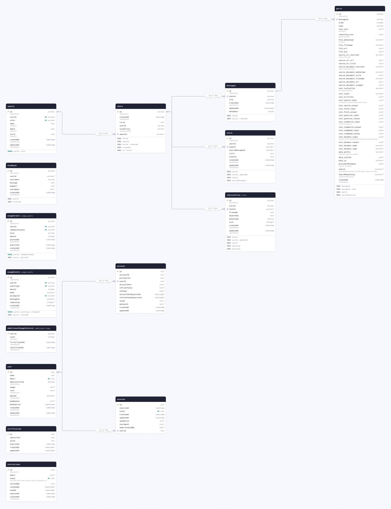

<details>
<summary>The whole schema as SQL</summary>

```sql
CREATE TABLE "account" (
	"id" text PRIMARY KEY,
	"account_id" text NOT NULL,
	"provider_id" text NOT NULL,
	"user_id" text NOT NULL,
	"access_token" text,
	"refresh_token" text,
	"id_token" text,
	"access_token_expires_at" timestamp,
	"refresh_token_expires_at" timestamp,
	"scope" text,
	"password" text,
	"created_at" timestamp NOT NULL,
	"updated_at" timestamp NOT NULL
);

CREATE TABLE "additional_usage_interest" (
	"user_id" varchar(255) PRIMARY KEY,
	"count" integer DEFAULT 1 NOT NULL,
	"first_clicked_at" timestamp DEFAULT now() NOT NULL,
	"last_clicked_at" timestamp DEFAULT now() NOT NULL
);

ALTER TABLE "additional_usage_interest" ENABLE ROW LEVEL SECURITY;

CREATE TABLE "chats" (
	"id" varchar(191) PRIMARY KEY,
	"created_at" timestamp DEFAULT now() NOT NULL,
	"title" text NOT NULL,
	"user_id" varchar(255) NOT NULL,
	"visibility" varchar(256) DEFAULT 'private' NOT NULL,
	"space_id" varchar(191)
);

ALTER TABLE "chats" ENABLE ROW LEVEL SECURITY;

CREATE TABLE "feedback" (
	"id" varchar(191) PRIMARY KEY,
	"user_id" varchar(255),
	"sentiment" varchar(256) NOT NULL,
	"message" text NOT NULL,
	"page_url" text NOT NULL,
	"user_agent" text,
	"created_at" timestamp DEFAULT now() NOT NULL
);

ALTER TABLE "feedback" ENABLE ROW LEVEL SECURITY;

CREATE TABLE "invitations" (
	"id" text PRIMARY KEY,
	"email" text,
	"token" text NOT NULL UNIQUE,
	"invited_by" text NOT NULL,
	"revoked_at" timestamp,
	"used_at" timestamp,
	"expires_at" timestamp NOT NULL,
	"created_at" timestamp DEFAULT now() NOT NULL
);

CREATE TABLE "files" (
	"id" varchar(191) PRIMARY KEY,
	"user_id" varchar(255) NOT NULL,
	"chat_id" varchar(191),
	"filename" text NOT NULL,
	"object_key" text NOT NULL,
	"media_type" varchar(256) NOT NULL,
	"size" integer,
	"created_at" timestamp DEFAULT now() NOT NULL,
	"updated_at" timestamp DEFAULT now() NOT NULL
);

ALTER TABLE "files" ENABLE ROW LEVEL SECURITY;

CREATE TABLE "messages" (
	"id" varchar(191) PRIMARY KEY,
	"chat_id" varchar(191) NOT NULL,
	"role" varchar(256) NOT NULL,
	"created_at" timestamp DEFAULT now() NOT NULL,
	"updated_at" timestamp,
	"metadata" jsonb
);

ALTER TABLE "messages" ENABLE ROW LEVEL SECURITY;

CREATE TABLE "notes" (
	"id" varchar(191) PRIMARY KEY,
	"user_id" varchar(255) NOT NULL,
	"chat_id" varchar(191),
	"source_message_id" varchar(191),
	"title" text NOT NULL,
	"content" text NOT NULL,
	"created_at" timestamp DEFAULT now() NOT NULL,
	"updated_at" timestamp DEFAULT now() NOT NULL
);

ALTER TABLE "notes" ENABLE ROW LEVEL SECURITY;

CREATE TABLE "parts" (
	"id" varchar(191) PRIMARY KEY,
	"message_id" varchar(191) NOT NULL,
	"order" integer NOT NULL,
	"type" varchar(256) NOT NULL,
	"text_text" text,
	"reasoning_text" text,
	"file_media_type" varchar(256),
	"file_filename" varchar(1024),
	"file_url" text,
	"file_key" text,
	"source_url_source_id" varchar(256),
	"source_url_url" text,
	"source_url_title" text,
	"source_document_source_id" varchar(256),
	"source_document_media_type" varchar(256),
	"source_document_title" text,
	"source_document_filename" varchar(1024),
	"source_document_url" text,
	"source_document_snippet" text,
	"tool_tool_call_id" varchar(256),
	"tool_state" varchar(256),
	"tool_error_text" text,
	"tool_search_input" json,
	"tool_search_output" json,
	"tool_fetch_input" json,
	"tool_fetch_output" json,
	"tool_question_input" json,
	"tool_question_output" json,
	"tool_todoWrite_input" json,
	"tool_todoWrite_output" json,
	"tool_todoRead_input" json,
	"tool_todoRead_output" json,
	"tool_dynamic_input" json,
	"tool_dynamic_output" json,
	"tool_dynamic_name" varchar(256),
	"tool_dynamic_type" varchar(256),
	"data_prefix" varchar(256),
	"data_content" json,
	"data_id" varchar(256),
	"provider_metadata" json,
	"search" tsvector GENERATED ALWAYS AS (to_tsvector('simple', left(coalesce(text_text, ''), 100000))) STORED,
	"search_reasoning" tsvector GENERATED ALWAYS AS (to_tsvector('simple', left(coalesce(reasoning_text, ''), 100000))) STORED,
	"created_at" timestamp DEFAULT now() NOT NULL,
	CONSTRAINT "text_text_required" CHECK ((type != 'text' OR text_text IS NOT NULL)),
	CONSTRAINT "reasoning_text_required" CHECK ((type != 'reasoning' OR reasoning_text IS NOT NULL)),
	CONSTRAINT "file_fields_required" CHECK ((type != 'file' OR (file_media_type IS NOT NULL AND file_filename IS NOT NULL AND (file_key IS NOT NULL OR file_url IS NOT NULL)))),
	CONSTRAINT "tool_state_valid" CHECK ((tool_state IS NULL OR tool_state IN ('input-streaming', 'input-available', 'output-available', 'output-error'))),
	CONSTRAINT "tool_fields_required" CHECK ((type NOT LIKE 'tool-%' OR (tool_tool_call_id IS NOT NULL AND tool_state IS NOT NULL)))
);

ALTER TABLE "parts" ENABLE ROW LEVEL SECURITY;

CREATE TABLE "session" (
	"id" text PRIMARY KEY,
	"expires_at" timestamp NOT NULL,
	"token" text NOT NULL UNIQUE,
	"created_at" timestamp NOT NULL,
	"updated_at" timestamp NOT NULL,
	"ip_address" text,
	"user_agent" text,
	"impersonated_by" text,
	"user_id" text NOT NULL
);

CREATE TABLE "spaces" (
	"id" varchar(191) PRIMARY KEY,
	"user_id" varchar(255) NOT NULL,
	"color" varchar(16) NOT NULL,
	"name" text DEFAULT '' NOT NULL,
	"about" text DEFAULT '' NOT NULL,
	"style" text DEFAULT '' NOT NULL,
	"created_at" timestamp DEFAULT now() NOT NULL,
	"updated_at" timestamp DEFAULT now() NOT NULL
);

ALTER TABLE "spaces" ENABLE ROW LEVEL SECURITY;

CREATE TABLE "usage_events" (
	"id" varchar(191) PRIMARY KEY,
	"user_id" varchar(255) NOT NULL,
	"event_type" varchar(256) NOT NULL,
	"amount" integer NOT NULL,
	"mode" varchar(256),
	"attempt_id" varchar(191) NOT NULL,
	"message_id" varchar(191),
	"remaining" integer,
	"created_at" timestamp DEFAULT now() NOT NULL
);

ALTER TABLE "usage_events" ENABLE ROW LEVEL SECURITY;

CREATE TABLE "usage_grants" (
	"id" varchar(191) PRIMARY KEY,
	"user_id" varchar(255) NOT NULL,
	"idempotency_key" varchar(256) NOT NULL,
	"kind" varchar(256) NOT NULL,
	"amount" integer NOT NULL,
	"granted_at" timestamp DEFAULT now() NOT NULL,
	"expires_at" timestamp NOT NULL,
	"created_at" timestamp DEFAULT now() NOT NULL
);

ALTER TABLE "usage_grants" ENABLE ROW LEVEL SECURITY;

CREATE TABLE "user" (
	"id" text PRIMARY KEY,
	"name" text NOT NULL,
	"email" text NOT NULL UNIQUE,
	"email_verified" boolean DEFAULT false NOT NULL,
	"image" text,
	"role" text DEFAULT 'user',
	"banned" boolean DEFAULT false,
	"ban_reason" text,
	"ban_expires" timestamp,
	"created_at" timestamp DEFAULT now() NOT NULL,
	"updated_at" timestamp DEFAULT now() NOT NULL
);

CREATE TABLE "verification" (
	"id" text PRIMARY KEY,
	"identifier" text NOT NULL,
	"value" text NOT NULL,
	"expires_at" timestamp NOT NULL,
	"created_at" timestamp,
	"updated_at" timestamp
);

CREATE INDEX "chats_user_id_idx" ON "chats" ("user_id");

CREATE INDEX "chats_space_id_idx" ON "chats" ("space_id");

CREATE INDEX "chats_user_id_created_at_idx" ON "chats" ("user_id","created_at" DESC NULLS LAST);

CREATE INDEX "chats_created_at_idx" ON "chats" ("created_at" DESC NULLS LAST);

CREATE INDEX "chats_id_user_id_idx" ON "chats" ("id","user_id");

CREATE INDEX "feedback_user_id_idx" ON "feedback" ("user_id");

CREATE INDEX "feedback_created_at_idx" ON "feedback" ("created_at");

CREATE INDEX "files_user_id_idx" ON "files" ("user_id");

CREATE INDEX "files_user_id_updated_at_idx" ON "files" ("user_id","updated_at" DESC NULLS LAST);

CREATE INDEX "files_chat_id_idx" ON "files" ("chat_id");

CREATE INDEX "files_media_type_idx" ON "files" ("media_type");

CREATE INDEX "files_object_key_idx" ON "files" ("object_key");

CREATE INDEX "messages_chat_id_idx" ON "messages" ("chat_id");

CREATE INDEX "messages_chat_id_created_at_idx" ON "messages" ("chat_id","created_at");

CREATE INDEX "notes_user_id_idx" ON "notes" ("user_id");

CREATE INDEX "notes_user_id_updated_at_idx" ON "notes" ("user_id","updated_at" DESC NULLS LAST);

CREATE INDEX "notes_chat_id_idx" ON "notes" ("chat_id");

CREATE INDEX "notes_source_message_id_idx" ON "notes" ("source_message_id");

CREATE INDEX "parts_message_id_idx" ON "parts" ("message_id");

CREATE INDEX "parts_message_id_order_idx" ON "parts" ("message_id","order");

CREATE INDEX "parts_search_idx" ON "parts" USING gin ("search");

CREATE INDEX "parts_search_reasoning_idx" ON "parts" USING gin ("search_reasoning");

CREATE UNIQUE INDEX "spaces_user_id_color_idx" ON "spaces" ("user_id","color");

CREATE UNIQUE INDEX "usage_events_user_type_attempt_idx" ON "usage_events" ("user_id","event_type","attempt_id");

CREATE INDEX "usage_events_user_created_idx" ON "usage_events" ("user_id","created_at");

CREATE UNIQUE INDEX "usage_grants_user_idempotency_idx" ON "usage_grants" ("user_id","idempotency_key");

CREATE INDEX "usage_grants_user_expires_idx" ON "usage_grants" ("user_id","expires_at");

ALTER TABLE "account" ADD CONSTRAINT "account_user_id_user_id_fkey" FOREIGN KEY ("user_id") REFERENCES "user"("id") ON DELETE CASCADE;

ALTER TABLE "chats" ADD CONSTRAINT "chats_space_id_spaces_id_fkey" FOREIGN KEY ("space_id") REFERENCES "spaces"("id") ON DELETE SET NULL;

ALTER TABLE "files" ADD CONSTRAINT "files_chat_id_chats_id_fkey" FOREIGN KEY ("chat_id") REFERENCES "chats"("id") ON DELETE SET NULL;

ALTER TABLE "messages" ADD CONSTRAINT "messages_chat_id_chats_id_fkey" FOREIGN KEY ("chat_id") REFERENCES "chats"("id") ON DELETE CASCADE;

ALTER TABLE "notes" ADD CONSTRAINT "notes_chat_id_chats_id_fkey" FOREIGN KEY ("chat_id") REFERENCES "chats"("id") ON DELETE SET NULL;

ALTER TABLE "parts" ADD CONSTRAINT "parts_message_id_messages_id_fkey" FOREIGN KEY ("message_id") REFERENCES "messages"("id") ON DELETE CASCADE;

ALTER TABLE "session" ADD CONSTRAINT "session_user_id_user_id_fkey" FOREIGN KEY ("user_id") REFERENCES "user"("id") ON DELETE CASCADE;

CREATE POLICY "users_write_own_additional_usage_interest" ON "additional_usage_interest" AS PERMISSIVE FOR ALL TO public USING (user_id = (select current_setting('app.current_user_id', true))) WITH CHECK (user_id = (select current_setting('app.current_user_id', true)));

CREATE POLICY "users_manage_own_chats" ON "chats" AS PERMISSIVE FOR ALL TO public USING (user_id = (select current_setting('app.current_user_id', true))) WITH CHECK (user_id = (select current_setting('app.current_user_id', true)));

CREATE POLICY "public_chats_readable" ON "chats" AS PERMISSIVE FOR SELECT TO public USING (visibility = 'public');

CREATE POLICY "feedback_select_policy" ON "feedback" AS PERMISSIVE FOR SELECT TO public USING (true);

CREATE POLICY "anyone_can_insert_feedback" ON "feedback" AS PERMISSIVE FOR INSERT TO public WITH CHECK (true);

CREATE POLICY "users_anonymize_own_feedback" ON "feedback" AS PERMISSIVE FOR UPDATE TO public USING (user_id = (select current_setting('app.current_user_id', true))) WITH CHECK (user_id IS NULL);

CREATE POLICY "users_manage_own_files" ON "files" AS PERMISSIVE FOR ALL TO public USING (user_id = (select current_setting('app.current_user_id', true))) WITH CHECK (user_id = (select current_setting('app.current_user_id', true)));

CREATE POLICY "users_manage_chat_messages" ON "messages" AS PERMISSIVE FOR ALL TO public USING (EXISTS (
        SELECT 1 FROM "chats"
        WHERE "chats".id = chat_id
        AND "chats".user_id = current_setting('app.current_user_id', true)
      )) WITH CHECK (EXISTS (
        SELECT 1 FROM "chats"
        WHERE "chats".id = chat_id
        AND "chats".user_id = current_setting('app.current_user_id', true)
      ));

CREATE POLICY "public_chat_messages_readable" ON "messages" AS PERMISSIVE FOR SELECT TO public USING (EXISTS (
        SELECT 1 FROM "chats"
        WHERE "chats".id = chat_id
        AND "chats".visibility = 'public'
      ));

CREATE POLICY "users_manage_own_notes" ON "notes" AS PERMISSIVE FOR ALL TO public USING (user_id = (select current_setting('app.current_user_id', true))) WITH CHECK (user_id = (select current_setting('app.current_user_id', true)));

CREATE POLICY "users_manage_message_parts" ON "parts" AS PERMISSIVE FOR ALL TO public USING (EXISTS (
        SELECT 1 FROM "messages"
        INNER JOIN "chats" ON "chats".id = "messages".chat_id
        WHERE "messages".id = message_id
        AND "chats".user_id = current_setting('app.current_user_id', true)
      )) WITH CHECK (EXISTS (
        SELECT 1 FROM "messages"
        INNER JOIN "chats" ON "chats".id = "messages".chat_id
        WHERE "messages".id = message_id
        AND "chats".user_id = current_setting('app.current_user_id', true)
      ));

CREATE POLICY "public_chat_parts_readable" ON "parts" AS PERMISSIVE FOR SELECT TO public USING (EXISTS (
        SELECT 1 FROM "messages"
        INNER JOIN "chats" ON "chats".id = "messages".chat_id
        WHERE "messages".id = message_id
        AND "chats".visibility = 'public'
      ));

CREATE POLICY "users_manage_own_spaces" ON "spaces" AS PERMISSIVE FOR ALL TO public USING (user_id = (select current_setting('app.current_user_id', true))) WITH CHECK (user_id = (select current_setting('app.current_user_id', true)));

CREATE POLICY "users_read_own_usage_events" ON "usage_events" AS PERMISSIVE FOR SELECT TO public USING (user_id = (select current_setting('app.current_user_id', true)));

CREATE POLICY "users_insert_own_usage_events" ON "usage_events" AS PERMISSIVE FOR INSERT TO public WITH CHECK (user_id = (select current_setting('app.current_user_id', true)));

CREATE POLICY "users_read_own_usage_grants" ON "usage_grants" AS PERMISSIVE FOR SELECT TO public USING (user_id = (select current_setting('app.current_user_id', true)));

CREATE POLICY "users_insert_own_usage_grants" ON "usage_grants" AS PERMISSIVE FOR INSERT TO public WITH CHECK (user_id = (select current_setting('app.current_user_id', true)));
```

</details>

## Contents

| Table                                                     | Name in the database        | Description                                                                                                                                                                                                                                                                                      |
| --------------------------------------------------------- | --------------------------- | ------------------------------------------------------------------------------------------------------------------------------------------------------------------------------------------------------------------------------------------------------------------------------------------------ |
| [spaces](#table-spaces)                                   | `spaces`                    | Spaces table                                                                                                                                                                                                                                                                                     |
| [chats](#table-chats)                                     | `chats`                     | Chats table                                                                                                                                                                                                                                                                                      |
| [messages](#table-messages)                               | `messages`                  | Messages table (simplified)                                                                                                                                                                                                                                                                      |
| [parts](#table-parts)                                     | `parts`                     | Parts table                                                                                                                                                                                                                                                                                      |
| [notes](#table-notes)                                     | `notes`                     | Notes table                                                                                                                                                                                                                                                                                      |
| [libraryFiles](#table-libraryFiles)                       | `files`                     | Library files table                                                                                                                                                                                                                                                                              |
| [feedback](#table-feedback)                               | `feedback`                  | Feedback table                                                                                                                                                                                                                                                                                   |
| [usageGrants](#table-usageGrants)                         | `usage_grants`              | Usage grants are the durable authority for allowances. Redis remains the runtime authority for spend and remaining usage.                                                                                                                                                                        |
| [usageEvents](#table-usageEvents)                         | `usage_events`              | Usage events are best-effort analytics. They must never be used to rebuild balances or decide whether a request is allowed.                                                                                                                                                                      |
| [additionalUsageInterest](#table-additionalUsageInterest) | `additional_usage_interest` |                                                                                                                                                                                                                                                                                                  |
| [user](#table-user)                                       | `user`                      | Better Auth core tables (`user`, `session`, `account`, `verification`) stored in the application's own Postgres via Better Auth's Drizzle adapter. Column names follow Better Auth's canonical Postgres schema; the admin plugin adds `role`, `banned`, `banReason`, and `banExpires` to `user`. |
| [session](#table-session)                                 | `session`                   |                                                                                                                                                                                                                                                                                                  |
| [account](#table-account)                                 | `account`                   |                                                                                                                                                                                                                                                                                                  |
| [verification](#table-verification)                       | `verification`              |                                                                                                                                                                                                                                                                                                  |
| [invitations](#table-invitations)                         | `invitations`               | Invitation tokens used when `AUTH_SIGNUP_MODE=invite`. An invitation is redeemable when it is neither revoked, expired, nor already used.                                                                                                                                                        |

## Tables

<a id="table-spaces"></a>

### spaces

Spaces table

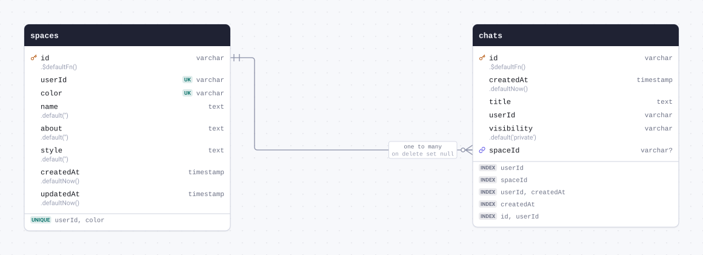

| Column                     | Type        | Constraints | Default         | Description |
| -------------------------- | ----------- | ----------- | --------------- | ----------- |
| `id`                       | `varchar`   | PK NOT NULL | `.$defaultFn()` |             |
| `userId` (`user_id`)       | `varchar`   | NOT NULL    |                 |             |
| `color`                    | `varchar`   | NOT NULL    |                 |             |
| `name`                     | `text`      | NOT NULL    | `.default('')`  |             |
| `about`                    | `text`      | NOT NULL    | `.default('')`  |             |
| `style`                    | `text`      | NOT NULL    | `.default('')`  |             |
| `createdAt` (`created_at`) | `timestamp` | NOT NULL    | `.defaultNow()` |             |
| `updatedAt` (`updated_at`) | `timestamp` | NOT NULL    | `.defaultNow()` |             |

#### Definition

```sql
CREATE TABLE "spaces" (
	"id" varchar(191) PRIMARY KEY,
	"user_id" varchar(255) NOT NULL,
	"color" varchar(16) NOT NULL,
	"name" text DEFAULT '' NOT NULL,
	"about" text DEFAULT '' NOT NULL,
	"style" text DEFAULT '' NOT NULL,
	"created_at" timestamp DEFAULT now() NOT NULL,
	"updated_at" timestamp DEFAULT now() NOT NULL
);

ALTER TABLE "spaces" ENABLE ROW LEVEL SECURITY;

CREATE UNIQUE INDEX "spaces_user_id_color_idx" ON "spaces" ("user_id","color");
```

#### Indexes

- UNIQUE `userId`, `color`

#### Referenced by

- `id` → [chats.spaceId](#table-chats) (one to many, on delete set null)

<details>
<summary>Queries and their SQL</summary>

**Select**: Every row of spaces.

```ts
db.select().from(spaces);
```

```sql
select "id", "user_id", "color", "name", "about", "style", "created_at", "updated_at"
from "spaces"
```

**Count**: How many rows spaces has.

```ts
db.select({ count: count() }).from(spaces);
```

```sql
select count(*)
from "spaces"
```

**Find many**: The rows of spaces, through the relational query API.

```ts
db.query.spaces.findMany();
```

```sql
select "d0"."id" as "id", "d0"."user_id" as "userId", "d0"."color" as "color", "d0"."name" as "name", "d0"."about" as "about", "d0"."style" as "style", "d0"."created_at" as "createdAt", "d0"."updated_at" as "updatedAt"
from "spaces" as "d0"
```

**Find by primary key**: One row of spaces, through the relational query API.

```ts
db.query.spaces.findFirst({ where: { id: "id" } });
```

```sql
select "d0"."id" as "id", "d0"."user_id" as "userId", "d0"."color" as "color", "d0"."name" as "name", "d0"."about" as "about", "d0"."style" as "style", "d0"."created_at" as "createdAt", "d0"."updated_at" as "updatedAt"
from "spaces" as "d0"
where "d0"."id" = $1
limit $2
-- params: ["id",1]
```

**Insert**: Adds a row to spaces, giving the columns that have no default.

```ts
db.insert(spaces).values({ userId: "userId", color: "color" });
```

```sql
insert into "spaces" ("id", "user_id", "color", "name", "about", "style", "created_at", "updated_at")
values ($1, $2, $3, default, default, default, default, default)
-- params: ["aauyl8ca800v38uhc8wq0jek","userId","color"]
```

**Update**: Changes a row of spaces, found by its primary key.

```ts
db.update(spaces).set({ userId: "userId" }).where(eq(spaces.id, "id"));
```

```sql
update "spaces"
set "user_id" = $1
where "spaces"."id" = $2
-- params: ["userId","id"]
```

**Delete**: Deletes a row of spaces, found by its primary key.

```ts
db.delete(spaces).where(eq(spaces.id, "id"));
```

```sql
delete from "spaces"
where "spaces"."id" = $1
-- params: ["id"]
```

</details>

<a id="table-chats"></a>

### chats

Chats table

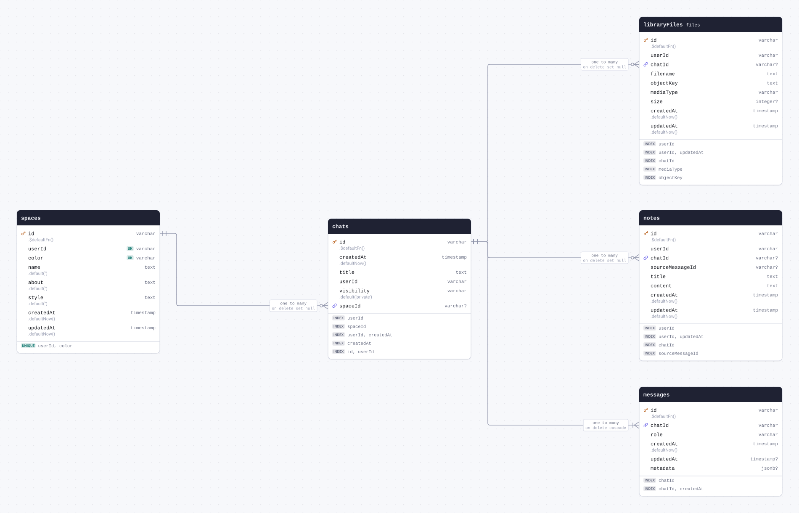

| Column                     | Type        | Constraints                       | Default               | Description |
| -------------------------- | ----------- | --------------------------------- | --------------------- | ----------- |
| `id`                       | `varchar`   | PK NOT NULL                       | `.$defaultFn()`       |             |
| `createdAt` (`created_at`) | `timestamp` | NOT NULL                          | `.defaultNow()`       |             |
| `title`                    | `text`      | NOT NULL                          |                       |             |
| `userId` (`user_id`)       | `varchar`   | NOT NULL                          |                       |             |
| `visibility`               | `varchar`   | NOT NULL                          | `.default('private')` |             |
| `spaceId` (`space_id`)     | `varchar`   | NULL → [spaces.id](#table-spaces) |                       |             |

#### Definition

```sql
CREATE TABLE "chats" (
	"id" varchar(191) PRIMARY KEY,
	"created_at" timestamp DEFAULT now() NOT NULL,
	"title" text NOT NULL,
	"user_id" varchar(255) NOT NULL,
	"visibility" varchar(256) DEFAULT 'private' NOT NULL,
	"space_id" varchar(191)
);

ALTER TABLE "chats" ENABLE ROW LEVEL SECURITY;

CREATE INDEX "chats_user_id_idx" ON "chats" ("user_id");

CREATE INDEX "chats_space_id_idx" ON "chats" ("space_id");

CREATE INDEX "chats_user_id_created_at_idx" ON "chats" ("user_id","created_at" DESC NULLS LAST);

CREATE INDEX "chats_created_at_idx" ON "chats" ("created_at" DESC NULLS LAST);

CREATE INDEX "chats_id_user_id_idx" ON "chats" ("id","user_id");

ALTER TABLE "chats" ADD CONSTRAINT "chats_space_id_spaces_id_fkey" FOREIGN KEY ("space_id") REFERENCES "spaces"("id") ON DELETE SET NULL;
```

#### Indexes

- INDEX `userId`
- INDEX `spaceId`
- INDEX `userId`, `createdAt`
- INDEX `createdAt`
- INDEX `id`, `userId`

#### References

- `spaceId` → [spaces.id](#table-spaces) (many to one, on delete set null)

#### Referenced by

- `id` → [messages.chatId](#table-messages) (one to many, on delete cascade)
- `id` → [notes.chatId](#table-notes) (one to many, on delete set null)
- `id` → [libraryFiles.chatId](#table-libraryFiles) (one to many, on delete set null)

<details>
<summary>Queries and their SQL</summary>

**Select**: Every row of chats.

```ts
db.select().from(chats);
```

```sql
select "id", "created_at", "title", "user_id", "visibility", "space_id"
from "chats"
```

**Count**: How many rows chats has.

```ts
db.select({ count: count() }).from(chats);
```

```sql
select count(*)
from "chats"
```

**Find many**: The rows of chats, through the relational query API.

```ts
db.query.chats.findMany();
```

```sql
select "d0"."id" as "id", "d0"."created_at" as "createdAt", "d0"."title" as "title", "d0"."user_id" as "userId", "d0"."visibility" as "visibility", "d0"."space_id" as "spaceId"
from "chats" as "d0"
```

**Find by primary key**: One row of chats, through the relational query API.

```ts
db.query.chats.findFirst({ where: { id: "id" } });
```

```sql
select "d0"."id" as "id", "d0"."created_at" as "createdAt", "d0"."title" as "title", "d0"."user_id" as "userId", "d0"."visibility" as "visibility", "d0"."space_id" as "spaceId"
from "chats" as "d0"
where "d0"."id" = $1
limit $2
-- params: ["id",1]
```

**Insert**: Adds a row to chats, giving the columns that have no default.

```ts
db.insert(chats).values({ title: "title", userId: "userId" });
```

```sql
insert into "chats" ("id", "created_at", "title", "user_id", "visibility", "space_id")
values ($1, default, $2, $3, default, default)
-- params: ["a3zlcfqwha1jfl7z8mtleoga","title","userId"]
```

**Update**: Changes a row of chats, found by its primary key.

```ts
db.update(chats)
  .set({ createdAt: new Date("2026-01-01T00:00:00.000Z") })
  .where(eq(chats.id, "id"));
```

```sql
update "chats"
set "created_at" = $1
where "chats"."id" = $2
-- params: ["2026-01-01T00:00:00.000Z","id"]
```

**Delete**: Deletes a row of chats, found by its primary key.

```ts
db.delete(chats).where(eq(chats.id, "id"));
```

```sql
delete from "chats"
where "chats"."id" = $1
-- params: ["id"]
```

</details>

<a id="table-messages"></a>

### messages

Messages table (simplified)

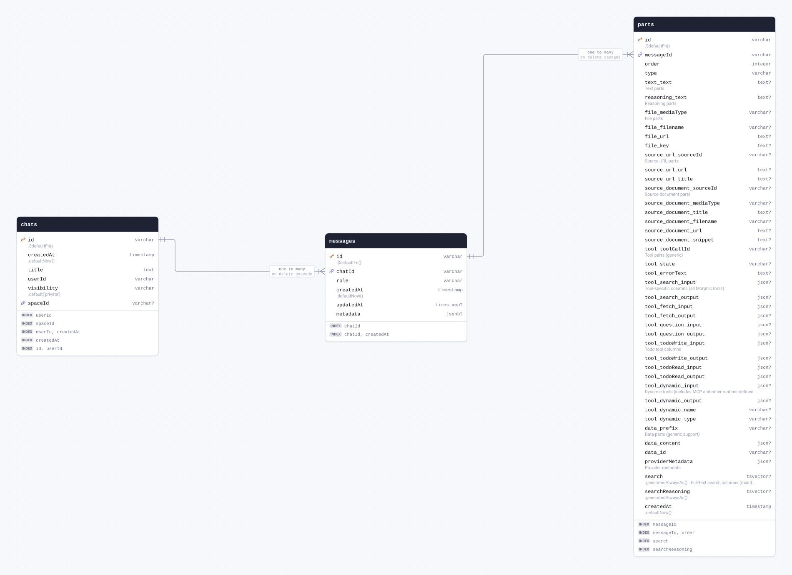

| Column                     | Type        | Constraints                         | Default         | Description |
| -------------------------- | ----------- | ----------------------------------- | --------------- | ----------- |
| `id`                       | `varchar`   | PK NOT NULL                         | `.$defaultFn()` |             |
| `chatId` (`chat_id`)       | `varchar`   | NOT NULL → [chats.id](#table-chats) |                 |             |
| `role`                     | `varchar`   | NOT NULL                            |                 |             |
| `createdAt` (`created_at`) | `timestamp` | NOT NULL                            | `.defaultNow()` |             |
| `updatedAt` (`updated_at`) | `timestamp` | NULL                                |                 |             |
| `metadata`                 | `jsonb`     | NULL                                |                 |             |

#### Definition

```sql
CREATE TABLE "messages" (
	"id" varchar(191) PRIMARY KEY,
	"chat_id" varchar(191) NOT NULL,
	"role" varchar(256) NOT NULL,
	"created_at" timestamp DEFAULT now() NOT NULL,
	"updated_at" timestamp,
	"metadata" jsonb
);

ALTER TABLE "messages" ENABLE ROW LEVEL SECURITY;

CREATE INDEX "messages_chat_id_idx" ON "messages" ("chat_id");

CREATE INDEX "messages_chat_id_created_at_idx" ON "messages" ("chat_id","created_at");

ALTER TABLE "messages" ADD CONSTRAINT "messages_chat_id_chats_id_fkey" FOREIGN KEY ("chat_id") REFERENCES "chats"("id") ON DELETE CASCADE;
```

#### Indexes

- INDEX `chatId`
- INDEX `chatId`, `createdAt`

#### References

- `chatId` → [chats.id](#table-chats) (many to one, on delete cascade)

#### Referenced by

- `id` → [parts.messageId](#table-parts) (one to many, on delete cascade)

<details>
<summary>Queries and their SQL</summary>

**Select**: Every row of messages.

```ts
db.select().from(messages);
```

```sql
select "id", "chat_id", "role", "created_at", "updated_at", "metadata"
from "messages"
```

**Count**: How many rows messages has.

```ts
db.select({ count: count() }).from(messages);
```

```sql
select count(*)
from "messages"
```

**Find many**: The rows of messages, through the relational query API.

```ts
db.query.messages.findMany();
```

```sql
select "d0"."id" as "id", "d0"."chat_id" as "chatId", "d0"."role" as "role", "d0"."created_at" as "createdAt", "d0"."updated_at" as "updatedAt", "d0"."metadata" as "metadata"
from "messages" as "d0"
```

**Find by primary key**: One row of messages, through the relational query API.

```ts
db.query.messages.findFirst({ where: { id: "id" } });
```

```sql
select "d0"."id" as "id", "d0"."chat_id" as "chatId", "d0"."role" as "role", "d0"."created_at" as "createdAt", "d0"."updated_at" as "updatedAt", "d0"."metadata" as "metadata"
from "messages" as "d0"
where "d0"."id" = $1
limit $2
-- params: ["id",1]
```

**Insert**: Adds a row to messages, giving the columns that have no default.

```ts
db.insert(messages).values({ chatId: "chatId", role: "role" });
```

```sql
insert into "messages" ("id", "chat_id", "role", "created_at", "updated_at", "metadata")
values ($1, $2, $3, default, default, default)
-- params: ["a2awqignxz8d7ps7fky604rl","chatId","role"]
```

**Update**: Changes a row of messages, found by its primary key.

```ts
db.update(messages).set({ chatId: "chatId" }).where(eq(messages.id, "id"));
```

```sql
update "messages"
set "chat_id" = $1
where "messages"."id" = $2
-- params: ["chatId","id"]
```

**Delete**: Deletes a row of messages, found by its primary key.

```ts
db.delete(messages).where(eq(messages.id, "id"));
```

```sql
delete from "messages"
where "messages"."id" = $1
-- params: ["id"]
```

</details>

<a id="table-parts"></a>

### parts

Parts table

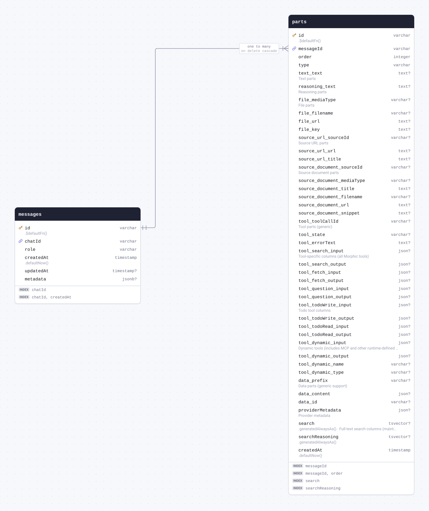

| Column                                                     | Type        | Constraints                               | Default                | Description                                                                                                                                                                                                                                                                                                                                 |
| ---------------------------------------------------------- | ----------- | ----------------------------------------- | ---------------------- | ------------------------------------------------------------------------------------------------------------------------------------------------------------------------------------------------------------------------------------------------------------------------------------------------------------------------------------------- |
| `id`                                                       | `varchar`   | PK NOT NULL                               | `.$defaultFn()`        |                                                                                                                                                                                                                                                                                                                                             |
| `messageId` (`message_id`)                                 | `varchar`   | NOT NULL → [messages.id](#table-messages) |                        |                                                                                                                                                                                                                                                                                                                                             |
| `order`                                                    | `integer`   | NOT NULL                                  |                        |                                                                                                                                                                                                                                                                                                                                             |
| `type`                                                     | `varchar`   | NOT NULL                                  |                        |                                                                                                                                                                                                                                                                                                                                             |
| `text_text`                                                | `text`      | NULL                                      |                        | Text parts                                                                                                                                                                                                                                                                                                                                  |
| `reasoning_text`                                           | `text`      | NULL                                      |                        | Reasoning parts                                                                                                                                                                                                                                                                                                                             |
| `file_mediaType` (`file_media_type`)                       | `varchar`   | NULL                                      |                        | File parts                                                                                                                                                                                                                                                                                                                                  |
| `file_filename`                                            | `varchar`   | NULL                                      |                        |                                                                                                                                                                                                                                                                                                                                             |
| `file_url`                                                 | `text`      | NULL                                      |                        |                                                                                                                                                                                                                                                                                                                                             |
| `file_key`                                                 | `text`      | NULL                                      |                        |                                                                                                                                                                                                                                                                                                                                             |
| `source_url_sourceId` (`source_url_source_id`)             | `varchar`   | NULL                                      |                        | Source URL parts                                                                                                                                                                                                                                                                                                                            |
| `source_url_url`                                           | `text`      | NULL                                      |                        |                                                                                                                                                                                                                                                                                                                                             |
| `source_url_title`                                         | `text`      | NULL                                      |                        |                                                                                                                                                                                                                                                                                                                                             |
| `source_document_sourceId` (`source_document_source_id`)   | `varchar`   | NULL                                      |                        | Source document parts                                                                                                                                                                                                                                                                                                                       |
| `source_document_mediaType` (`source_document_media_type`) | `varchar`   | NULL                                      |                        |                                                                                                                                                                                                                                                                                                                                             |
| `source_document_title`                                    | `text`      | NULL                                      |                        |                                                                                                                                                                                                                                                                                                                                             |
| `source_document_filename`                                 | `varchar`   | NULL                                      |                        |                                                                                                                                                                                                                                                                                                                                             |
| `source_document_url`                                      | `text`      | NULL                                      |                        |                                                                                                                                                                                                                                                                                                                                             |
| `source_document_snippet`                                  | `text`      | NULL                                      |                        |                                                                                                                                                                                                                                                                                                                                             |
| `tool_toolCallId` (`tool_tool_call_id`)                    | `varchar`   | NULL                                      |                        | Tool parts (generic)                                                                                                                                                                                                                                                                                                                        |
| `tool_state`                                               | `varchar`   | NULL                                      |                        |                                                                                                                                                                                                                                                                                                                                             |
| `tool_errorText` (`tool_error_text`)                       | `text`      | NULL                                      |                        |                                                                                                                                                                                                                                                                                                                                             |
| `tool_search_input`                                        | `json`      | NULL                                      |                        | Tool-specific columns (all Morphic tools)                                                                                                                                                                                                                                                                                                   |
| `tool_search_output`                                       | `json`      | NULL                                      |                        |                                                                                                                                                                                                                                                                                                                                             |
| `tool_fetch_input`                                         | `json`      | NULL                                      |                        |                                                                                                                                                                                                                                                                                                                                             |
| `tool_fetch_output`                                        | `json`      | NULL                                      |                        |                                                                                                                                                                                                                                                                                                                                             |
| `tool_question_input`                                      | `json`      | NULL                                      |                        |                                                                                                                                                                                                                                                                                                                                             |
| `tool_question_output`                                     | `json`      | NULL                                      |                        |                                                                                                                                                                                                                                                                                                                                             |
| `tool_todoWrite_input`                                     | `json`      | NULL                                      |                        | Todo tool columns                                                                                                                                                                                                                                                                                                                           |
| `tool_todoWrite_output`                                    | `json`      | NULL                                      |                        |                                                                                                                                                                                                                                                                                                                                             |
| `tool_todoRead_input`                                      | `json`      | NULL                                      |                        |                                                                                                                                                                                                                                                                                                                                             |
| `tool_todoRead_output`                                     | `json`      | NULL                                      |                        |                                                                                                                                                                                                                                                                                                                                             |
| `tool_dynamic_input`                                       | `json`      | NULL                                      |                        | Dynamic tools (includes MCP and other runtime-defined tools)                                                                                                                                                                                                                                                                                |
| `tool_dynamic_output`                                      | `json`      | NULL                                      |                        |                                                                                                                                                                                                                                                                                                                                             |
| `tool_dynamic_name`                                        | `varchar`   | NULL                                      |                        |                                                                                                                                                                                                                                                                                                                                             |
| `tool_dynamic_type`                                        | `varchar`   | NULL                                      |                        |                                                                                                                                                                                                                                                                                                                                             |
| `data_prefix`                                              | `varchar`   | NULL                                      |                        | Data parts (generic support)                                                                                                                                                                                                                                                                                                                |
| `data_content`                                             | `json`      | NULL                                      |                        |                                                                                                                                                                                                                                                                                                                                             |
| `data_id`                                                  | `varchar`   | NULL                                      |                        |                                                                                                                                                                                                                                                                                                                                             |
| `providerMetadata` (`provider_metadata`)                   | `json`      | NULL                                      |                        | Provider metadata                                                                                                                                                                                                                                                                                                                           |
| `search`                                                   | `tsvector`  | NULL                                      | `.generatedAlwaysAs()` | Full-text search columns (maintained by Postgres, used by history search). Input is capped at 100k characters: Postgres errors on any tsvector over 1MB ("string is too long for tsvector"), which would otherwise abort migration 0020 on existing rows and fail inserts of oversized parts. Worst-case vector size at this cap is ~220KB. |
| `searchReasoning` (`search_reasoning`)                     | `tsvector`  | NULL                                      | `.generatedAlwaysAs()` |                                                                                                                                                                                                                                                                                                                                             |
| `createdAt` (`created_at`)                                 | `timestamp` | NOT NULL                                  | `.defaultNow()`        |                                                                                                                                                                                                                                                                                                                                             |

#### Definition

```sql
CREATE TABLE "parts" (
	"id" varchar(191) PRIMARY KEY,
	"message_id" varchar(191) NOT NULL,
	"order" integer NOT NULL,
	"type" varchar(256) NOT NULL,
	"text_text" text,
	"reasoning_text" text,
	"file_media_type" varchar(256),
	"file_filename" varchar(1024),
	"file_url" text,
	"file_key" text,
	"source_url_source_id" varchar(256),
	"source_url_url" text,
	"source_url_title" text,
	"source_document_source_id" varchar(256),
	"source_document_media_type" varchar(256),
	"source_document_title" text,
	"source_document_filename" varchar(1024),
	"source_document_url" text,
	"source_document_snippet" text,
	"tool_tool_call_id" varchar(256),
	"tool_state" varchar(256),
	"tool_error_text" text,
	"tool_search_input" json,
	"tool_search_output" json,
	"tool_fetch_input" json,
	"tool_fetch_output" json,
	"tool_question_input" json,
	"tool_question_output" json,
	"tool_todoWrite_input" json,
	"tool_todoWrite_output" json,
	"tool_todoRead_input" json,
	"tool_todoRead_output" json,
	"tool_dynamic_input" json,
	"tool_dynamic_output" json,
	"tool_dynamic_name" varchar(256),
	"tool_dynamic_type" varchar(256),
	"data_prefix" varchar(256),
	"data_content" json,
	"data_id" varchar(256),
	"provider_metadata" json,
	"search" tsvector GENERATED ALWAYS AS (to_tsvector('simple', left(coalesce(text_text, ''), 100000))) STORED,
	"search_reasoning" tsvector GENERATED ALWAYS AS (to_tsvector('simple', left(coalesce(reasoning_text, ''), 100000))) STORED,
	"created_at" timestamp DEFAULT now() NOT NULL,
	CONSTRAINT "text_text_required" CHECK ((type != 'text' OR text_text IS NOT NULL)),
	CONSTRAINT "reasoning_text_required" CHECK ((type != 'reasoning' OR reasoning_text IS NOT NULL)),
	CONSTRAINT "file_fields_required" CHECK ((type != 'file' OR (file_media_type IS NOT NULL AND file_filename IS NOT NULL AND (file_key IS NOT NULL OR file_url IS NOT NULL)))),
	CONSTRAINT "tool_state_valid" CHECK ((tool_state IS NULL OR tool_state IN ('input-streaming', 'input-available', 'output-available', 'output-error'))),
	CONSTRAINT "tool_fields_required" CHECK ((type NOT LIKE 'tool-%' OR (tool_tool_call_id IS NOT NULL AND tool_state IS NOT NULL)))
);

ALTER TABLE "parts" ENABLE ROW LEVEL SECURITY;

CREATE INDEX "parts_message_id_idx" ON "parts" ("message_id");

CREATE INDEX "parts_message_id_order_idx" ON "parts" ("message_id","order");

CREATE INDEX "parts_search_idx" ON "parts" USING gin ("search");

CREATE INDEX "parts_search_reasoning_idx" ON "parts" USING gin ("search_reasoning");

ALTER TABLE "parts" ADD CONSTRAINT "parts_message_id_messages_id_fkey" FOREIGN KEY ("message_id") REFERENCES "messages"("id") ON DELETE CASCADE;
```

#### Indexes

- INDEX `messageId`
- INDEX `messageId`, `order`
- INDEX `search`
- INDEX `searchReasoning`

#### References

- `messageId` → [messages.id](#table-messages) (many to one, on delete cascade)

<details>
<summary>Queries and their SQL</summary>

**Select**: Every row of parts.

```ts
db.select().from(parts);
```

```sql
select "id", "message_id", "order", "type", "text_text", "reasoning_text", "file_media_type", "file_filename", "file_url", "file_key", "source_url_source_id", "source_url_url", "source_url_title", "source_document_source_id", "source_document_media_type", "source_document_title", "source_document_filename", "source_document_url", "source_document_snippet", "tool_tool_call_id", "tool_state", "tool_error_text", "tool_search_input", "tool_search_output", "tool_fetch_input", "tool_fetch_output", "tool_question_input", "tool_question_output", "tool_todoWrite_input", "tool_todoWrite_output", "tool_todoRead_input", "tool_todoRead_output", "tool_dynamic_input", "tool_dynamic_output", "tool_dynamic_name", "tool_dynamic_type", "data_prefix", "data_content", "data_id", "provider_metadata", "search", "search_reasoning", "created_at"
from "parts"
```

**Count**: How many rows parts has.

```ts
db.select({ count: count() }).from(parts);
```

```sql
select count(*)
from "parts"
```

**Find many**: The rows of parts, through the relational query API.

```ts
db.query.parts.findMany();
```

```sql
select "d0"."id" as "id", "d0"."message_id" as "messageId", "d0"."order" as "order", "d0"."type" as "type", "d0"."text_text" as "text_text", "d0"."reasoning_text" as "reasoning_text", "d0"."file_media_type" as "file_mediaType", "d0"."file_filename" as "file_filename", "d0"."file_url" as "file_url", "d0"."file_key" as "file_key", "d0"."source_url_source_id" as "source_url_sourceId", "d0"."source_url_url" as "source_url_url", "d0"."source_url_title" as "source_url_title", "d0"."source_document_source_id" as "source_document_sourceId", "d0"."source_document_media_type" as "source_document_mediaType", "d0"."source_document_title" as "source_document_title", "d0"."source_document_filename" as "source_document_filename", "d0"."source_document_url" as "source_document_url", "d0"."source_document_snippet" as "source_document_snippet", "d0"."tool_tool_call_id" as "tool_toolCallId", "d0"."tool_state" as "tool_state", "d0"."tool_error_text" as "tool_errorText", "d0"."tool_search_input" as "tool_search_input", "d0"."tool_search_output" as "tool_search_output", "d0"."tool_fetch_input" as "tool_fetch_input", "d0"."tool_fetch_output" as "tool_fetch_output", "d0"."tool_question_input" as "tool_question_input", "d0"."tool_question_output" as "tool_question_output", "d0"."tool_todoWrite_input" as "tool_todoWrite_input", "d0"."tool_todoWrite_output" as "tool_todoWrite_output", "d0"."tool_todoRead_input" as "tool_todoRead_input", "d0"."tool_todoRead_output" as "tool_todoRead_output", "d0"."tool_dynamic_input" as "tool_dynamic_input", "d0"."tool_dynamic_output" as "tool_dynamic_output", "d0"."tool_dynamic_name" as "tool_dynamic_name", "d0"."tool_dynamic_type" as "tool_dynamic_type", "d0"."data_prefix" as "data_prefix", "d0"."data_content" as "data_content", "d0"."data_id" as "data_id", "d0"."provider_metadata" as "providerMetadata", "d0"."search" as "search", "d0"."search_reasoning" as "searchReasoning", "d0"."created_at" as "createdAt"
from "parts" as "d0"
```

**Find by primary key**: One row of parts, through the relational query API.

```ts
db.query.parts.findFirst({ where: { id: "id" } });
```

```sql
select "d0"."id" as "id", "d0"."message_id" as "messageId", "d0"."order" as "order", "d0"."type" as "type", "d0"."text_text" as "text_text", "d0"."reasoning_text" as "reasoning_text", "d0"."file_media_type" as "file_mediaType", "d0"."file_filename" as "file_filename", "d0"."file_url" as "file_url", "d0"."file_key" as "file_key", "d0"."source_url_source_id" as "source_url_sourceId", "d0"."source_url_url" as "source_url_url", "d0"."source_url_title" as "source_url_title", "d0"."source_document_source_id" as "source_document_sourceId", "d0"."source_document_media_type" as "source_document_mediaType", "d0"."source_document_title" as "source_document_title", "d0"."source_document_filename" as "source_document_filename", "d0"."source_document_url" as "source_document_url", "d0"."source_document_snippet" as "source_document_snippet", "d0"."tool_tool_call_id" as "tool_toolCallId", "d0"."tool_state" as "tool_state", "d0"."tool_error_text" as "tool_errorText", "d0"."tool_search_input" as "tool_search_input", "d0"."tool_search_output" as "tool_search_output", "d0"."tool_fetch_input" as "tool_fetch_input", "d0"."tool_fetch_output" as "tool_fetch_output", "d0"."tool_question_input" as "tool_question_input", "d0"."tool_question_output" as "tool_question_output", "d0"."tool_todoWrite_input" as "tool_todoWrite_input", "d0"."tool_todoWrite_output" as "tool_todoWrite_output", "d0"."tool_todoRead_input" as "tool_todoRead_input", "d0"."tool_todoRead_output" as "tool_todoRead_output", "d0"."tool_dynamic_input" as "tool_dynamic_input", "d0"."tool_dynamic_output" as "tool_dynamic_output", "d0"."tool_dynamic_name" as "tool_dynamic_name", "d0"."tool_dynamic_type" as "tool_dynamic_type", "d0"."data_prefix" as "data_prefix", "d0"."data_content" as "data_content", "d0"."data_id" as "data_id", "d0"."provider_metadata" as "providerMetadata", "d0"."search" as "search", "d0"."search_reasoning" as "searchReasoning", "d0"."created_at" as "createdAt"
from "parts" as "d0"
where "d0"."id" = $1
limit $2
-- params: ["id",1]
```

**Insert**: Adds a row to parts, giving the columns that have no default.

```ts
db.insert(parts).values({ messageId: "messageId", order: 1, type: "type" });
```

```sql
insert into "parts" ("id", "message_id", "order", "type", "text_text", "reasoning_text", "file_media_type", "file_filename", "file_url", "file_key", "source_url_source_id", "source_url_url", "source_url_title", "source_document_source_id", "source_document_media_type", "source_document_title", "source_document_filename", "source_document_url", "source_document_snippet", "tool_tool_call_id", "tool_state", "tool_error_text", "tool_search_input", "tool_search_output", "tool_fetch_input", "tool_fetch_output", "tool_question_input", "tool_question_output", "tool_todoWrite_input", "tool_todoWrite_output", "tool_todoRead_input", "tool_todoRead_output", "tool_dynamic_input", "tool_dynamic_output", "tool_dynamic_name", "tool_dynamic_type", "data_prefix", "data_content", "data_id", "provider_metadata", "created_at")
values ($1, $2, $3, $4, default, default, default, default, default, default, default, default, default, default, default, default, default, default, default, default, default, default, default, default, default, default, default, default, default, default, default, default, default, default, default, default, default, default, default, default, default)
-- params: ["as6zedtqe7gj7cqr8xznrovo","messageId",1,"type"]
```

**Update**: Changes a row of parts, found by its primary key.

```ts
db.update(parts).set({ messageId: "messageId" }).where(eq(parts.id, "id"));
```

```sql
update "parts"
set "message_id" = $1
where "parts"."id" = $2
-- params: ["messageId","id"]
```

**Delete**: Deletes a row of parts, found by its primary key.

```ts
db.delete(parts).where(eq(parts.id, "id"));
```

```sql
delete from "parts"
where "parts"."id" = $1
-- params: ["id"]
```

</details>

<a id="table-notes"></a>

### notes

Notes table

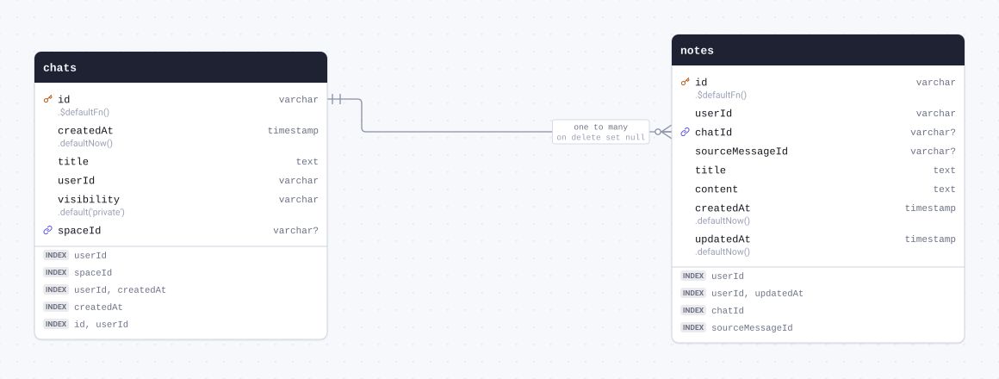

| Column                                  | Type        | Constraints                     | Default         | Description |
| --------------------------------------- | ----------- | ------------------------------- | --------------- | ----------- |
| `id`                                    | `varchar`   | PK NOT NULL                     | `.$defaultFn()` |             |
| `userId` (`user_id`)                    | `varchar`   | NOT NULL                        |                 |             |
| `chatId` (`chat_id`)                    | `varchar`   | NULL → [chats.id](#table-chats) |                 |             |
| `sourceMessageId` (`source_message_id`) | `varchar`   | NULL                            |                 |             |
| `title`                                 | `text`      | NOT NULL                        |                 |             |
| `content`                               | `text`      | NOT NULL                        |                 |             |
| `createdAt` (`created_at`)              | `timestamp` | NOT NULL                        | `.defaultNow()` |             |
| `updatedAt` (`updated_at`)              | `timestamp` | NOT NULL                        | `.defaultNow()` |             |

#### Definition

```sql
CREATE TABLE "notes" (
	"id" varchar(191) PRIMARY KEY,
	"user_id" varchar(255) NOT NULL,
	"chat_id" varchar(191),
	"source_message_id" varchar(191),
	"title" text NOT NULL,
	"content" text NOT NULL,
	"created_at" timestamp DEFAULT now() NOT NULL,
	"updated_at" timestamp DEFAULT now() NOT NULL
);

ALTER TABLE "notes" ENABLE ROW LEVEL SECURITY;

CREATE INDEX "notes_user_id_idx" ON "notes" ("user_id");

CREATE INDEX "notes_user_id_updated_at_idx" ON "notes" ("user_id","updated_at" DESC NULLS LAST);

CREATE INDEX "notes_chat_id_idx" ON "notes" ("chat_id");

CREATE INDEX "notes_source_message_id_idx" ON "notes" ("source_message_id");

ALTER TABLE "notes" ADD CONSTRAINT "notes_chat_id_chats_id_fkey" FOREIGN KEY ("chat_id") REFERENCES "chats"("id") ON DELETE SET NULL;
```

#### Indexes

- INDEX `userId`
- INDEX `userId`, `updatedAt`
- INDEX `chatId`
- INDEX `sourceMessageId`

#### References

- `chatId` → [chats.id](#table-chats) (many to one, on delete set null)

<details>
<summary>Queries and their SQL</summary>

**Select**: Every row of notes.

```ts
db.select().from(notes);
```

```sql
select "id", "user_id", "chat_id", "source_message_id", "title", "content", "created_at", "updated_at"
from "notes"
```

**Count**: How many rows notes has.

```ts
db.select({ count: count() }).from(notes);
```

```sql
select count(*)
from "notes"
```

**Find many**: The rows of notes, through the relational query API.

```ts
db.query.notes.findMany();
```

```sql
select "d0"."id" as "id", "d0"."user_id" as "userId", "d0"."chat_id" as "chatId", "d0"."source_message_id" as "sourceMessageId", "d0"."title" as "title", "d0"."content" as "content", "d0"."created_at" as "createdAt", "d0"."updated_at" as "updatedAt"
from "notes" as "d0"
```

**Find by primary key**: One row of notes, through the relational query API.

```ts
db.query.notes.findFirst({ where: { id: "id" } });
```

```sql
select "d0"."id" as "id", "d0"."user_id" as "userId", "d0"."chat_id" as "chatId", "d0"."source_message_id" as "sourceMessageId", "d0"."title" as "title", "d0"."content" as "content", "d0"."created_at" as "createdAt", "d0"."updated_at" as "updatedAt"
from "notes" as "d0"
where "d0"."id" = $1
limit $2
-- params: ["id",1]
```

**Insert**: Adds a row to notes, giving the columns that have no default.

```ts
db.insert(notes).values({ userId: "userId", title: "title", content: "content" });
```

```sql
insert into "notes" ("id", "user_id", "chat_id", "source_message_id", "title", "content", "created_at", "updated_at")
values ($1, $2, default, default, $3, $4, default, default)
-- params: ["a1y072p1po5vvxfanj4cx2lp","userId","title","content"]
```

**Update**: Changes a row of notes, found by its primary key.

```ts
db.update(notes).set({ userId: "userId" }).where(eq(notes.id, "id"));
```

```sql
update "notes"
set "user_id" = $1
where "notes"."id" = $2
-- params: ["userId","id"]
```

**Delete**: Deletes a row of notes, found by its primary key.

```ts
db.delete(notes).where(eq(notes.id, "id"));
```

```sql
delete from "notes"
where "notes"."id" = $1
-- params: ["id"]
```

</details>

<a id="table-libraryFiles"></a>

### libraryFiles

Table `files`. Library files table

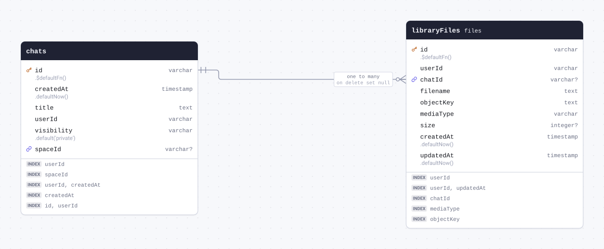

| Column                     | Type        | Constraints                     | Default         | Description |
| -------------------------- | ----------- | ------------------------------- | --------------- | ----------- |
| `id`                       | `varchar`   | PK NOT NULL                     | `.$defaultFn()` |             |
| `userId` (`user_id`)       | `varchar`   | NOT NULL                        |                 |             |
| `chatId` (`chat_id`)       | `varchar`   | NULL → [chats.id](#table-chats) |                 |             |
| `filename`                 | `text`      | NOT NULL                        |                 |             |
| `objectKey` (`object_key`) | `text`      | NOT NULL                        |                 |             |
| `mediaType` (`media_type`) | `varchar`   | NOT NULL                        |                 |             |
| `size`                     | `integer`   | NULL                            |                 |             |
| `createdAt` (`created_at`) | `timestamp` | NOT NULL                        | `.defaultNow()` |             |
| `updatedAt` (`updated_at`) | `timestamp` | NOT NULL                        | `.defaultNow()` |             |

#### Definition

```sql
CREATE TABLE "files" (
	"id" varchar(191) PRIMARY KEY,
	"user_id" varchar(255) NOT NULL,
	"chat_id" varchar(191),
	"filename" text NOT NULL,
	"object_key" text NOT NULL,
	"media_type" varchar(256) NOT NULL,
	"size" integer,
	"created_at" timestamp DEFAULT now() NOT NULL,
	"updated_at" timestamp DEFAULT now() NOT NULL
);

ALTER TABLE "files" ENABLE ROW LEVEL SECURITY;

CREATE INDEX "files_user_id_idx" ON "files" ("user_id");

CREATE INDEX "files_user_id_updated_at_idx" ON "files" ("user_id","updated_at" DESC NULLS LAST);

CREATE INDEX "files_chat_id_idx" ON "files" ("chat_id");

CREATE INDEX "files_media_type_idx" ON "files" ("media_type");

CREATE INDEX "files_object_key_idx" ON "files" ("object_key");

ALTER TABLE "files" ADD CONSTRAINT "files_chat_id_chats_id_fkey" FOREIGN KEY ("chat_id") REFERENCES "chats"("id") ON DELETE SET NULL;
```

#### Indexes

- INDEX `userId`
- INDEX `userId`, `updatedAt`
- INDEX `chatId`
- INDEX `mediaType`
- INDEX `objectKey`

#### References

- `chatId` → [chats.id](#table-chats) (many to one, on delete set null)

<details>
<summary>Queries and their SQL</summary>

**Select**: Every row of libraryFiles.

```ts
db.select().from(libraryFiles);
```

```sql
select "id", "user_id", "chat_id", "filename", "object_key", "media_type", "size", "created_at", "updated_at"
from "files"
```

**Count**: How many rows libraryFiles has.

```ts
db.select({ count: count() }).from(libraryFiles);
```

```sql
select count(*)
from "files"
```

**Find many**: The rows of libraryFiles, through the relational query API.

```ts
db.query.libraryFiles.findMany();
```

```sql
select "d0"."id" as "id", "d0"."user_id" as "userId", "d0"."chat_id" as "chatId", "d0"."filename" as "filename", "d0"."object_key" as "objectKey", "d0"."media_type" as "mediaType", "d0"."size" as "size", "d0"."created_at" as "createdAt", "d0"."updated_at" as "updatedAt"
from "files" as "d0"
```

**Find by primary key**: One row of libraryFiles, through the relational query API.

```ts
db.query.libraryFiles.findFirst({ where: { id: "id" } });
```

```sql
select "d0"."id" as "id", "d0"."user_id" as "userId", "d0"."chat_id" as "chatId", "d0"."filename" as "filename", "d0"."object_key" as "objectKey", "d0"."media_type" as "mediaType", "d0"."size" as "size", "d0"."created_at" as "createdAt", "d0"."updated_at" as "updatedAt"
from "files" as "d0"
where "d0"."id" = $1
limit $2
-- params: ["id",1]
```

**Insert**: Adds a row to libraryFiles, giving the columns that have no default.

```ts
db.insert(libraryFiles).values({
  userId: "userId",
  filename: "filename",
  objectKey: "objectKey",
  mediaType: "mediaType",
});
```

```sql
insert into "files" ("id", "user_id", "chat_id", "filename", "object_key", "media_type", "size", "created_at", "updated_at")
values ($1, $2, default, $3, $4, $5, default, default, default)
-- params: ["aztu2jec31atwp87vvqkkfnw","userId","filename","objectKey","mediaType"]
```

**Update**: Changes a row of libraryFiles, found by its primary key.

```ts
db.update(libraryFiles).set({ userId: "userId" }).where(eq(libraryFiles.id, "id"));
```

```sql
update "files"
set "user_id" = $1
where "files"."id" = $2
-- params: ["userId","id"]
```

**Delete**: Deletes a row of libraryFiles, found by its primary key.

```ts
db.delete(libraryFiles).where(eq(libraryFiles.id, "id"));
```

```sql
delete from "files"
where "files"."id" = $1
-- params: ["id"]
```

</details>

<a id="table-feedback"></a>

### feedback

Feedback table

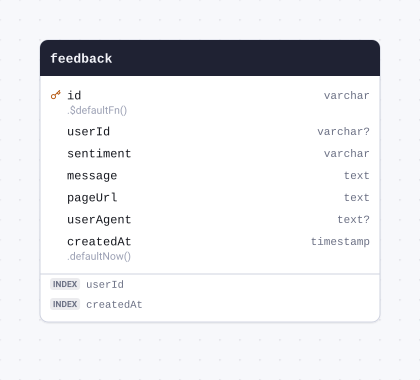

| Column                     | Type        | Constraints | Default         | Description |
| -------------------------- | ----------- | ----------- | --------------- | ----------- |
| `id`                       | `varchar`   | PK NOT NULL | `.$defaultFn()` |             |
| `userId` (`user_id`)       | `varchar`   | NULL        |                 |             |
| `sentiment`                | `varchar`   | NOT NULL    |                 |             |
| `message`                  | `text`      | NOT NULL    |                 |             |
| `pageUrl` (`page_url`)     | `text`      | NOT NULL    |                 |             |
| `userAgent` (`user_agent`) | `text`      | NULL        |                 |             |
| `createdAt` (`created_at`) | `timestamp` | NOT NULL    | `.defaultNow()` |             |

#### Definition

```sql
CREATE TABLE "feedback" (
	"id" varchar(191) PRIMARY KEY,
	"user_id" varchar(255),
	"sentiment" varchar(256) NOT NULL,
	"message" text NOT NULL,
	"page_url" text NOT NULL,
	"user_agent" text,
	"created_at" timestamp DEFAULT now() NOT NULL
);

ALTER TABLE "feedback" ENABLE ROW LEVEL SECURITY;

CREATE INDEX "feedback_user_id_idx" ON "feedback" ("user_id");

CREATE INDEX "feedback_created_at_idx" ON "feedback" ("created_at");
```

#### Indexes

- INDEX `userId`
- INDEX `createdAt`

<details>
<summary>Queries and their SQL</summary>

**Select**: Every row of feedback.

```ts
db.select().from(feedback);
```

```sql
select "id", "user_id", "sentiment", "message", "page_url", "user_agent", "created_at"
from "feedback"
```

**Count**: How many rows feedback has.

```ts
db.select({ count: count() }).from(feedback);
```

```sql
select count(*)
from "feedback"
```

**Find many**: The rows of feedback, through the relational query API.

```ts
db.query.feedback.findMany();
```

```sql
select "d0"."id" as "id", "d0"."user_id" as "userId", "d0"."sentiment" as "sentiment", "d0"."message" as "message", "d0"."page_url" as "pageUrl", "d0"."user_agent" as "userAgent", "d0"."created_at" as "createdAt"
from "feedback" as "d0"
```

**Find by primary key**: One row of feedback, through the relational query API.

```ts
db.query.feedback.findFirst({ where: { id: "id" } });
```

```sql
select "d0"."id" as "id", "d0"."user_id" as "userId", "d0"."sentiment" as "sentiment", "d0"."message" as "message", "d0"."page_url" as "pageUrl", "d0"."user_agent" as "userAgent", "d0"."created_at" as "createdAt"
from "feedback" as "d0"
where "d0"."id" = $1
limit $2
-- params: ["id",1]
```

**Insert**: Adds a row to feedback, giving the columns that have no default.

```ts
db.insert(feedback).values({ sentiment: "sentiment", message: "message", pageUrl: "pageUrl" });
```

```sql
insert into "feedback" ("id", "user_id", "sentiment", "message", "page_url", "user_agent", "created_at")
values ($1, default, $2, $3, $4, default, default)
-- params: ["awr9j6sbmkk5arnn0pkvd39s","sentiment","message","pageUrl"]
```

**Update**: Changes a row of feedback, found by its primary key.

```ts
db.update(feedback).set({ userId: "userId" }).where(eq(feedback.id, "id"));
```

```sql
update "feedback"
set "user_id" = $1
where "feedback"."id" = $2
-- params: ["userId","id"]
```

**Delete**: Deletes a row of feedback, found by its primary key.

```ts
db.delete(feedback).where(eq(feedback.id, "id"));
```

```sql
delete from "feedback"
where "feedback"."id" = $1
-- params: ["id"]
```

</details>

<a id="table-usageGrants"></a>

### usageGrants

Table `usage_grants`. Usage grants are the durable authority for allowances. Redis remains the runtime authority for spend and remaining usage.

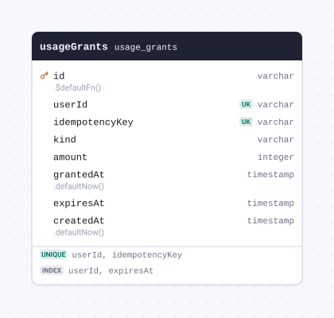

| Column                               | Type        | Constraints | Default         | Description |
| ------------------------------------ | ----------- | ----------- | --------------- | ----------- |
| `id`                                 | `varchar`   | PK NOT NULL | `.$defaultFn()` |             |
| `userId` (`user_id`)                 | `varchar`   | NOT NULL    |                 |             |
| `idempotencyKey` (`idempotency_key`) | `varchar`   | NOT NULL    |                 |             |
| `kind`                               | `varchar`   | NOT NULL    |                 |             |
| `amount`                             | `integer`   | NOT NULL    |                 |             |
| `grantedAt` (`granted_at`)           | `timestamp` | NOT NULL    | `.defaultNow()` |             |
| `expiresAt` (`expires_at`)           | `timestamp` | NOT NULL    |                 |             |
| `createdAt` (`created_at`)           | `timestamp` | NOT NULL    | `.defaultNow()` |             |

#### Definition

```sql
CREATE TABLE "usage_grants" (
	"id" varchar(191) PRIMARY KEY,
	"user_id" varchar(255) NOT NULL,
	"idempotency_key" varchar(256) NOT NULL,
	"kind" varchar(256) NOT NULL,
	"amount" integer NOT NULL,
	"granted_at" timestamp DEFAULT now() NOT NULL,
	"expires_at" timestamp NOT NULL,
	"created_at" timestamp DEFAULT now() NOT NULL
);

ALTER TABLE "usage_grants" ENABLE ROW LEVEL SECURITY;

CREATE UNIQUE INDEX "usage_grants_user_idempotency_idx" ON "usage_grants" ("user_id","idempotency_key");

CREATE INDEX "usage_grants_user_expires_idx" ON "usage_grants" ("user_id","expires_at");
```

#### Indexes

- UNIQUE `userId`, `idempotencyKey`
- INDEX `userId`, `expiresAt`

<details>
<summary>Queries and their SQL</summary>

**Select**: Every row of usageGrants.

```ts
db.select().from(usageGrants);
```

```sql
select "id", "user_id", "idempotency_key", "kind", "amount", "granted_at", "expires_at", "created_at"
from "usage_grants"
```

**Count**: How many rows usageGrants has.

```ts
db.select({ count: count() }).from(usageGrants);
```

```sql
select count(*)
from "usage_grants"
```

**Find many**: The rows of usageGrants, through the relational query API.

```ts
db.query.usageGrants.findMany();
```

```sql
select "d0"."id" as "id", "d0"."user_id" as "userId", "d0"."idempotency_key" as "idempotencyKey", "d0"."kind" as "kind", "d0"."amount" as "amount", "d0"."granted_at" as "grantedAt", "d0"."expires_at" as "expiresAt", "d0"."created_at" as "createdAt"
from "usage_grants" as "d0"
```

**Find by primary key**: One row of usageGrants, through the relational query API.

```ts
db.query.usageGrants.findFirst({ where: { id: "id" } });
```

```sql
select "d0"."id" as "id", "d0"."user_id" as "userId", "d0"."idempotency_key" as "idempotencyKey", "d0"."kind" as "kind", "d0"."amount" as "amount", "d0"."granted_at" as "grantedAt", "d0"."expires_at" as "expiresAt", "d0"."created_at" as "createdAt"
from "usage_grants" as "d0"
where "d0"."id" = $1
limit $2
-- params: ["id",1]
```

**Insert**: Adds a row to usageGrants, giving the columns that have no default.

```ts
db.insert(usageGrants).values({
  userId: "userId",
  idempotencyKey: "idempotencyKey",
  kind: "kind",
  amount: 1,
  expiresAt: new Date("2026-01-01T00:00:00.000Z"),
});
```

```sql
insert into "usage_grants" ("id", "user_id", "idempotency_key", "kind", "amount", "granted_at", "expires_at", "created_at")
values ($1, $2, $3, $4, $5, default, $6, default)
-- params: ["aiibm78wuk3zknu2kqwplb4k","userId","idempotencyKey","kind",1,"2026-01-01T00:00:00.000Z"]
```

**Update**: Changes a row of usageGrants, found by its primary key.

```ts
db.update(usageGrants).set({ userId: "userId" }).where(eq(usageGrants.id, "id"));
```

```sql
update "usage_grants"
set "user_id" = $1
where "usage_grants"."id" = $2
-- params: ["userId","id"]
```

**Delete**: Deletes a row of usageGrants, found by its primary key.

```ts
db.delete(usageGrants).where(eq(usageGrants.id, "id"));
```

```sql
delete from "usage_grants"
where "usage_grants"."id" = $1
-- params: ["id"]
```

</details>

<a id="table-usageEvents"></a>

### usageEvents

Table `usage_events`. Usage events are best-effort analytics. They must never be used to rebuild balances or decide whether a request is allowed.

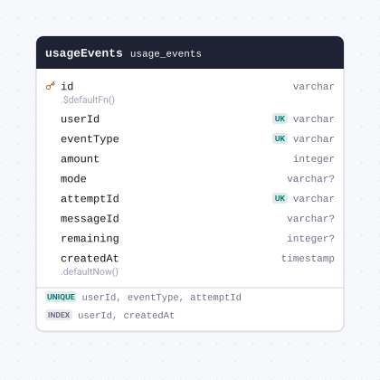

| Column                     | Type        | Constraints | Default         | Description |
| -------------------------- | ----------- | ----------- | --------------- | ----------- |
| `id`                       | `varchar`   | PK NOT NULL | `.$defaultFn()` |             |
| `userId` (`user_id`)       | `varchar`   | NOT NULL    |                 |             |
| `eventType` (`event_type`) | `varchar`   | NOT NULL    |                 |             |
| `amount`                   | `integer`   | NOT NULL    |                 |             |
| `mode`                     | `varchar`   | NULL        |                 |             |
| `attemptId` (`attempt_id`) | `varchar`   | NOT NULL    |                 |             |
| `messageId` (`message_id`) | `varchar`   | NULL        |                 |             |
| `remaining`                | `integer`   | NULL        |                 |             |
| `createdAt` (`created_at`) | `timestamp` | NOT NULL    | `.defaultNow()` |             |

#### Definition

```sql
CREATE TABLE "usage_events" (
	"id" varchar(191) PRIMARY KEY,
	"user_id" varchar(255) NOT NULL,
	"event_type" varchar(256) NOT NULL,
	"amount" integer NOT NULL,
	"mode" varchar(256),
	"attempt_id" varchar(191) NOT NULL,
	"message_id" varchar(191),
	"remaining" integer,
	"created_at" timestamp DEFAULT now() NOT NULL
);

ALTER TABLE "usage_events" ENABLE ROW LEVEL SECURITY;

CREATE UNIQUE INDEX "usage_events_user_type_attempt_idx" ON "usage_events" ("user_id","event_type","attempt_id");

CREATE INDEX "usage_events_user_created_idx" ON "usage_events" ("user_id","created_at");
```

#### Indexes

- UNIQUE `userId`, `eventType`, `attemptId`
- INDEX `userId`, `createdAt`

<details>
<summary>Queries and their SQL</summary>

**Select**: Every row of usageEvents.

```ts
db.select().from(usageEvents);
```

```sql
select "id", "user_id", "event_type", "amount", "mode", "attempt_id", "message_id", "remaining", "created_at"
from "usage_events"
```

**Count**: How many rows usageEvents has.

```ts
db.select({ count: count() }).from(usageEvents);
```

```sql
select count(*)
from "usage_events"
```

**Find many**: The rows of usageEvents, through the relational query API.

```ts
db.query.usageEvents.findMany();
```

```sql
select "d0"."id" as "id", "d0"."user_id" as "userId", "d0"."event_type" as "eventType", "d0"."amount" as "amount", "d0"."mode" as "mode", "d0"."attempt_id" as "attemptId", "d0"."message_id" as "messageId", "d0"."remaining" as "remaining", "d0"."created_at" as "createdAt"
from "usage_events" as "d0"
```

**Find by primary key**: One row of usageEvents, through the relational query API.

```ts
db.query.usageEvents.findFirst({ where: { id: "id" } });
```

```sql
select "d0"."id" as "id", "d0"."user_id" as "userId", "d0"."event_type" as "eventType", "d0"."amount" as "amount", "d0"."mode" as "mode", "d0"."attempt_id" as "attemptId", "d0"."message_id" as "messageId", "d0"."remaining" as "remaining", "d0"."created_at" as "createdAt"
from "usage_events" as "d0"
where "d0"."id" = $1
limit $2
-- params: ["id",1]
```

**Insert**: Adds a row to usageEvents, giving the columns that have no default.

```ts
db.insert(usageEvents).values({
  userId: "userId",
  eventType: "eventType",
  amount: 1,
  attemptId: "attemptId",
});
```

```sql
insert into "usage_events" ("id", "user_id", "event_type", "amount", "mode", "attempt_id", "message_id", "remaining", "created_at")
values ($1, $2, $3, $4, default, $5, default, default, default)
-- params: ["aren6dnin4o3cp8tah84w9gc","userId","eventType",1,"attemptId"]
```

**Update**: Changes a row of usageEvents, found by its primary key.

```ts
db.update(usageEvents).set({ userId: "userId" }).where(eq(usageEvents.id, "id"));
```

```sql
update "usage_events"
set "user_id" = $1
where "usage_events"."id" = $2
-- params: ["userId","id"]
```

**Delete**: Deletes a row of usageEvents, found by its primary key.

```ts
db.delete(usageEvents).where(eq(usageEvents.id, "id"));
```

```sql
delete from "usage_events"
where "usage_events"."id" = $1
-- params: ["id"]
```

</details>

<a id="table-additionalUsageInterest"></a>

### additionalUsageInterest

Table `additional_usage_interest`.

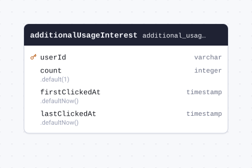

| Column                                | Type        | Constraints | Default         | Description |
| ------------------------------------- | ----------- | ----------- | --------------- | ----------- |
| `userId` (`user_id`)                  | `varchar`   | PK NOT NULL |                 |             |
| `count`                               | `integer`   | NOT NULL    | `.default(1)`   |             |
| `firstClickedAt` (`first_clicked_at`) | `timestamp` | NOT NULL    | `.defaultNow()` |             |
| `lastClickedAt` (`last_clicked_at`)   | `timestamp` | NOT NULL    | `.defaultNow()` |             |

#### Definition

```sql
CREATE TABLE "additional_usage_interest" (
	"user_id" varchar(255) PRIMARY KEY,
	"count" integer DEFAULT 1 NOT NULL,
	"first_clicked_at" timestamp DEFAULT now() NOT NULL,
	"last_clicked_at" timestamp DEFAULT now() NOT NULL
);

ALTER TABLE "additional_usage_interest" ENABLE ROW LEVEL SECURITY;
```

<details>
<summary>Queries and their SQL</summary>

**Select**: Every row of additionalUsageInterest.

```ts
db.select().from(additionalUsageInterest);
```

```sql
select "user_id", "count", "first_clicked_at", "last_clicked_at"
from "additional_usage_interest"
```

**Count**: How many rows additionalUsageInterest has.

```ts
db.select({ count: count() }).from(additionalUsageInterest);
```

```sql
select count(*)
from "additional_usage_interest"
```

**Find many**: The rows of additionalUsageInterest, through the relational query API.

```ts
db.query.additionalUsageInterest.findMany();
```

```sql
select "d0"."user_id" as "userId", "d0"."count" as "count", "d0"."first_clicked_at" as "firstClickedAt", "d0"."last_clicked_at" as "lastClickedAt"
from "additional_usage_interest" as "d0"
```

**Find by primary key**: One row of additionalUsageInterest, through the relational query API.

```ts
db.query.additionalUsageInterest.findFirst({ where: { userId: "userId" } });
```

```sql
select "d0"."user_id" as "userId", "d0"."count" as "count", "d0"."first_clicked_at" as "firstClickedAt", "d0"."last_clicked_at" as "lastClickedAt"
from "additional_usage_interest" as "d0"
where "d0"."user_id" = $1
limit $2
-- params: ["userId",1]
```

**Insert**: Adds a row to additionalUsageInterest, giving the columns that have no default.

```ts
db.insert(additionalUsageInterest).values({ userId: "userId" });
```

```sql
insert into "additional_usage_interest" ("user_id", "count", "first_clicked_at", "last_clicked_at")
values ($1, default, default, default)
-- params: ["userId"]
```

**Update**: Changes a row of additionalUsageInterest, found by its primary key.

```ts
db.update(additionalUsageInterest)
  .set({ count: 1 })
  .where(eq(additionalUsageInterest.userId, "userId"));
```

```sql
update "additional_usage_interest"
set "count" = $1
where "additional_usage_interest"."user_id" = $2
-- params: [1,"userId"]
```

**Delete**: Deletes a row of additionalUsageInterest, found by its primary key.

```ts
db.delete(additionalUsageInterest).where(eq(additionalUsageInterest.userId, "userId"));
```

```sql
delete from "additional_usage_interest"
where "additional_usage_interest"."user_id" = $1
-- params: ["userId"]
```

</details>

<a id="table-user"></a>

### user

Better Auth core tables (`user`, `session`, `account`, `verification`) stored in the application's own Postgres via Better Auth's Drizzle adapter. Column names follow Better Auth's canonical Postgres schema; the admin plugin adds `role`, `banned`, `banReason`, and `banExpires` to `user`.

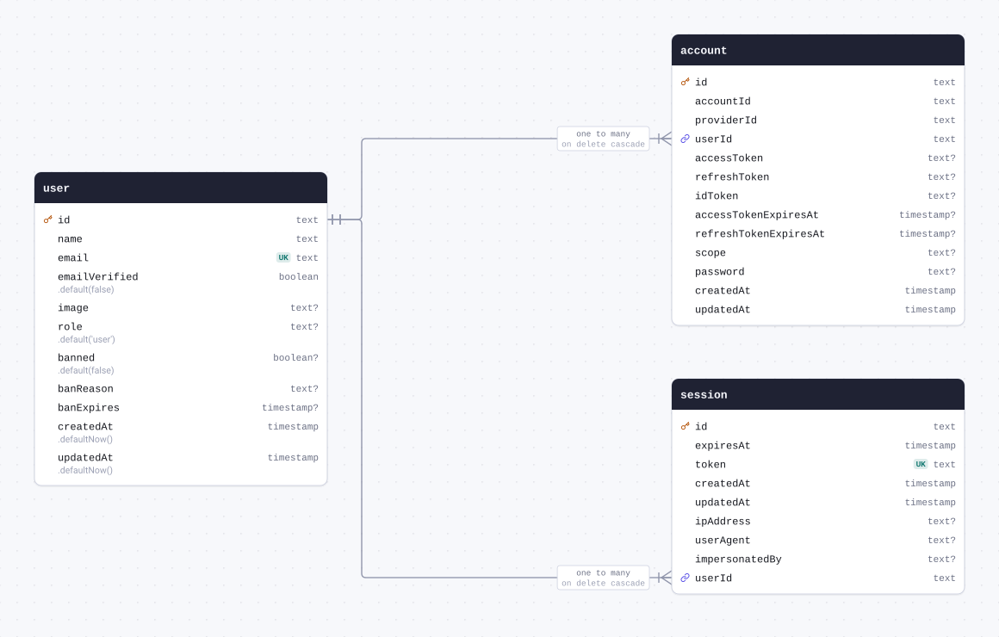

| Column                             | Type        | Constraints     | Default            | Description |
| ---------------------------------- | ----------- | --------------- | ------------------ | ----------- |
| `id`                               | `text`      | PK NOT NULL     |                    |             |
| `name`                             | `text`      | NOT NULL        |                    |             |
| `email`                            | `text`      | UNIQUE NOT NULL |                    |             |
| `emailVerified` (`email_verified`) | `boolean`   | NOT NULL        | `.default(false)`  |             |
| `image`                            | `text`      | NULL            |                    |             |
| `role`                             | `text`      | NULL            | `.default('user')` |             |
| `banned`                           | `boolean`   | NULL            | `.default(false)`  |             |
| `banReason` (`ban_reason`)         | `text`      | NULL            |                    |             |
| `banExpires` (`ban_expires`)       | `timestamp` | NULL            |                    |             |
| `createdAt` (`created_at`)         | `timestamp` | NOT NULL        | `.defaultNow()`    |             |
| `updatedAt` (`updated_at`)         | `timestamp` | NOT NULL        | `.defaultNow()`    |             |

#### Definition

```sql
CREATE TABLE "user" (
	"id" text PRIMARY KEY,
	"name" text NOT NULL,
	"email" text NOT NULL UNIQUE,
	"email_verified" boolean DEFAULT false NOT NULL,
	"image" text,
	"role" text DEFAULT 'user',
	"banned" boolean DEFAULT false,
	"ban_reason" text,
	"ban_expires" timestamp,
	"created_at" timestamp DEFAULT now() NOT NULL,
	"updated_at" timestamp DEFAULT now() NOT NULL
);
```

#### Referenced by

- `id` → [session.userId](#table-session) (one to many, on delete cascade)
- `id` → [account.userId](#table-account) (one to many, on delete cascade)

<details>
<summary>Queries and their SQL</summary>

**Select**: Every row of user.

```ts
db.select().from(user);
```

```sql
select "id", "name", "email", "email_verified", "image", "role", "banned", "ban_reason", "ban_expires", "created_at", "updated_at"
from "user"
```

**Count**: How many rows user has.

```ts
db.select({ count: count() }).from(user);
```

```sql
select count(*)
from "user"
```

**Find many**: The rows of user, through the relational query API.

```ts
db.query.user.findMany();
```

```sql
select "d0"."id" as "id", "d0"."name" as "name", "d0"."email" as "email", "d0"."email_verified" as "emailVerified", "d0"."image" as "image", "d0"."role" as "role", "d0"."banned" as "banned", "d0"."ban_reason" as "banReason", "d0"."ban_expires" as "banExpires", "d0"."created_at" as "createdAt", "d0"."updated_at" as "updatedAt"
from "user" as "d0"
```

**Find by primary key**: One row of user, through the relational query API.

```ts
db.query.user.findFirst({ where: { id: "id" } });
```

```sql
select "d0"."id" as "id", "d0"."name" as "name", "d0"."email" as "email", "d0"."email_verified" as "emailVerified", "d0"."image" as "image", "d0"."role" as "role", "d0"."banned" as "banned", "d0"."ban_reason" as "banReason", "d0"."ban_expires" as "banExpires", "d0"."created_at" as "createdAt", "d0"."updated_at" as "updatedAt"
from "user" as "d0"
where "d0"."id" = $1
limit $2
-- params: ["id",1]
```

**Insert**: Adds a row to user, giving the columns that have no default.

```ts
db.insert(user).values({ id: "id", name: "name", email: "email" });
```

```sql
insert into "user" ("id", "name", "email", "email_verified", "image", "role", "banned", "ban_reason", "ban_expires", "created_at", "updated_at")
values ($1, $2, $3, default, default, default, default, default, default, default, default)
-- params: ["id","name","email"]
```

**Update**: Changes a row of user, found by its primary key.

```ts
db.update(user).set({ name: "name" }).where(eq(user.id, "id"));
```

```sql
update "user"
set "name" = $1
where "user"."id" = $2
-- params: ["name","id"]
```

**Delete**: Deletes a row of user, found by its primary key.

```ts
db.delete(user).where(eq(user.id, "id"));
```

```sql
delete from "user"
where "user"."id" = $1
-- params: ["id"]
```

</details>

<a id="table-session"></a>

### session

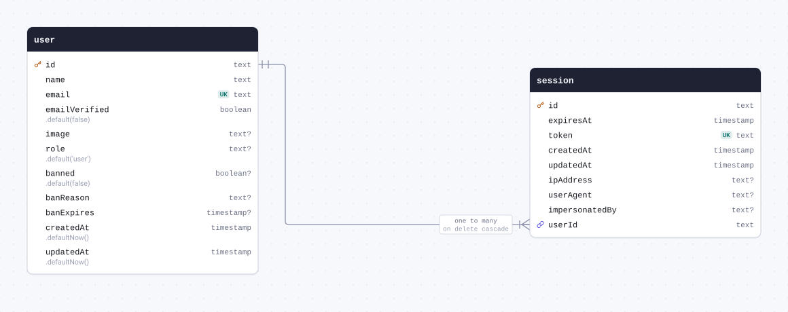

| Column                               | Type        | Constraints                       | Default | Description |
| ------------------------------------ | ----------- | --------------------------------- | ------- | ----------- |
| `id`                                 | `text`      | PK NOT NULL                       |         |             |
| `expiresAt` (`expires_at`)           | `timestamp` | NOT NULL                          |         |             |
| `token`                              | `text`      | UNIQUE NOT NULL                   |         |             |
| `createdAt` (`created_at`)           | `timestamp` | NOT NULL                          |         |             |
| `updatedAt` (`updated_at`)           | `timestamp` | NOT NULL                          |         |             |
| `ipAddress` (`ip_address`)           | `text`      | NULL                              |         |             |
| `userAgent` (`user_agent`)           | `text`      | NULL                              |         |             |
| `impersonatedBy` (`impersonated_by`) | `text`      | NULL                              |         |             |
| `userId` (`user_id`)                 | `text`      | NOT NULL → [user.id](#table-user) |         |             |

#### Definition

```sql
CREATE TABLE "session" (
	"id" text PRIMARY KEY,
	"expires_at" timestamp NOT NULL,
	"token" text NOT NULL UNIQUE,
	"created_at" timestamp NOT NULL,
	"updated_at" timestamp NOT NULL,
	"ip_address" text,
	"user_agent" text,
	"impersonated_by" text,
	"user_id" text NOT NULL
);

ALTER TABLE "session" ADD CONSTRAINT "session_user_id_user_id_fkey" FOREIGN KEY ("user_id") REFERENCES "user"("id") ON DELETE CASCADE;
```

#### References

- `userId` → [user.id](#table-user) (many to one, on delete cascade)

<details>
<summary>Queries and their SQL</summary>

**Select**: Every row of session.

```ts
db.select().from(session);
```

```sql
select "id", "expires_at", "token", "created_at", "updated_at", "ip_address", "user_agent", "impersonated_by", "user_id"
from "session"
```

**Count**: How many rows session has.

```ts
db.select({ count: count() }).from(session);
```

```sql
select count(*)
from "session"
```

**Find many**: The rows of session, through the relational query API.

```ts
db.query.session.findMany();
```

```sql
select "d0"."id" as "id", "d0"."expires_at" as "expiresAt", "d0"."token" as "token", "d0"."created_at" as "createdAt", "d0"."updated_at" as "updatedAt", "d0"."ip_address" as "ipAddress", "d0"."user_agent" as "userAgent", "d0"."impersonated_by" as "impersonatedBy", "d0"."user_id" as "userId"
from "session" as "d0"
```

**Find by primary key**: One row of session, through the relational query API.

```ts
db.query.session.findFirst({ where: { id: "id" } });
```

```sql
select "d0"."id" as "id", "d0"."expires_at" as "expiresAt", "d0"."token" as "token", "d0"."created_at" as "createdAt", "d0"."updated_at" as "updatedAt", "d0"."ip_address" as "ipAddress", "d0"."user_agent" as "userAgent", "d0"."impersonated_by" as "impersonatedBy", "d0"."user_id" as "userId"
from "session" as "d0"
where "d0"."id" = $1
limit $2
-- params: ["id",1]
```

**Insert**: Adds a row to session, giving the columns that have no default.

```ts
db.insert(session).values({
  id: "id",
  expiresAt: new Date("2026-01-01T00:00:00.000Z"),
  token: "token",
  createdAt: new Date("2026-01-01T00:00:00.000Z"),
  updatedAt: new Date("2026-01-01T00:00:00.000Z"),
  userId: "userId",
});
```

```sql
insert into "session" ("id", "expires_at", "token", "created_at", "updated_at", "ip_address", "user_agent", "impersonated_by", "user_id")
values ($1, $2, $3, $4, $5, default, default, default, $6)
-- params: ["id","2026-01-01T00:00:00.000Z","token","2026-01-01T00:00:00.000Z","2026-01-01T00:00:00.000Z","userId"]
```

**Update**: Changes a row of session, found by its primary key.

```ts
db.update(session)
  .set({ expiresAt: new Date("2026-01-01T00:00:00.000Z") })
  .where(eq(session.id, "id"));
```

```sql
update "session"
set "expires_at" = $1
where "session"."id" = $2
-- params: ["2026-01-01T00:00:00.000Z","id"]
```

**Delete**: Deletes a row of session, found by its primary key.

```ts
db.delete(session).where(eq(session.id, "id"));
```

```sql
delete from "session"
where "session"."id" = $1
-- params: ["id"]
```

</details>

<a id="table-account"></a>

### account

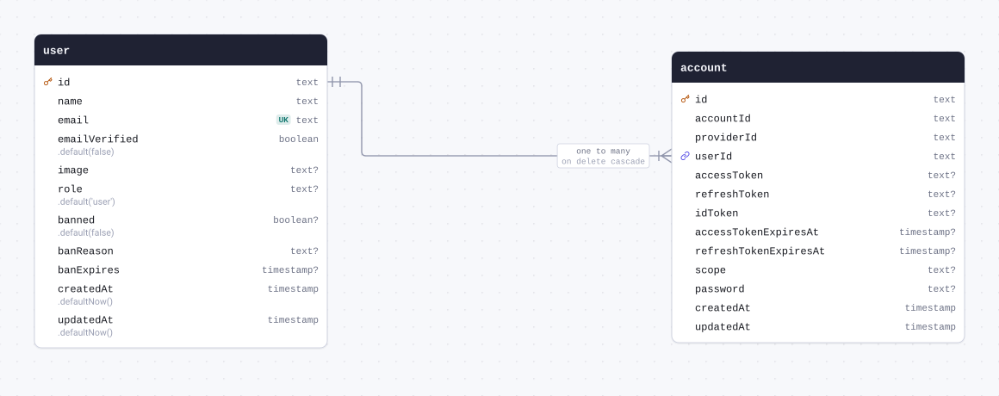

| Column                                               | Type        | Constraints                       | Default | Description |
| ---------------------------------------------------- | ----------- | --------------------------------- | ------- | ----------- |
| `id`                                                 | `text`      | PK NOT NULL                       |         |             |
| `accountId` (`account_id`)                           | `text`      | NOT NULL                          |         |             |
| `providerId` (`provider_id`)                         | `text`      | NOT NULL                          |         |             |
| `userId` (`user_id`)                                 | `text`      | NOT NULL → [user.id](#table-user) |         |             |
| `accessToken` (`access_token`)                       | `text`      | NULL                              |         |             |
| `refreshToken` (`refresh_token`)                     | `text`      | NULL                              |         |             |
| `idToken` (`id_token`)                               | `text`      | NULL                              |         |             |
| `accessTokenExpiresAt` (`access_token_expires_at`)   | `timestamp` | NULL                              |         |             |
| `refreshTokenExpiresAt` (`refresh_token_expires_at`) | `timestamp` | NULL                              |         |             |
| `scope`                                              | `text`      | NULL                              |         |             |
| `password`                                           | `text`      | NULL                              |         |             |
| `createdAt` (`created_at`)                           | `timestamp` | NOT NULL                          |         |             |
| `updatedAt` (`updated_at`)                           | `timestamp` | NOT NULL                          |         |             |

#### Definition

```sql
CREATE TABLE "account" (
	"id" text PRIMARY KEY,
	"account_id" text NOT NULL,
	"provider_id" text NOT NULL,
	"user_id" text NOT NULL,
	"access_token" text,
	"refresh_token" text,
	"id_token" text,
	"access_token_expires_at" timestamp,
	"refresh_token_expires_at" timestamp,
	"scope" text,
	"password" text,
	"created_at" timestamp NOT NULL,
	"updated_at" timestamp NOT NULL
);

ALTER TABLE "account" ADD CONSTRAINT "account_user_id_user_id_fkey" FOREIGN KEY ("user_id") REFERENCES "user"("id") ON DELETE CASCADE;
```

#### References

- `userId` → [user.id](#table-user) (many to one, on delete cascade)

<details>
<summary>Queries and their SQL</summary>

**Select**: Every row of account.

```ts
db.select().from(account);
```

```sql
select "id", "account_id", "provider_id", "user_id", "access_token", "refresh_token", "id_token", "access_token_expires_at", "refresh_token_expires_at", "scope", "password", "created_at", "updated_at"
from "account"
```

**Count**: How many rows account has.

```ts
db.select({ count: count() }).from(account);
```

```sql
select count(*)
from "account"
```

**Find many**: The rows of account, through the relational query API.

```ts
db.query.account.findMany();
```

```sql
select "d0"."id" as "id", "d0"."account_id" as "accountId", "d0"."provider_id" as "providerId", "d0"."user_id" as "userId", "d0"."access_token" as "accessToken", "d0"."refresh_token" as "refreshToken", "d0"."id_token" as "idToken", "d0"."access_token_expires_at" as "accessTokenExpiresAt", "d0"."refresh_token_expires_at" as "refreshTokenExpiresAt", "d0"."scope" as "scope", "d0"."password" as "password", "d0"."created_at" as "createdAt", "d0"."updated_at" as "updatedAt"
from "account" as "d0"
```

**Find by primary key**: One row of account, through the relational query API.

```ts
db.query.account.findFirst({ where: { id: "id" } });
```

```sql
select "d0"."id" as "id", "d0"."account_id" as "accountId", "d0"."provider_id" as "providerId", "d0"."user_id" as "userId", "d0"."access_token" as "accessToken", "d0"."refresh_token" as "refreshToken", "d0"."id_token" as "idToken", "d0"."access_token_expires_at" as "accessTokenExpiresAt", "d0"."refresh_token_expires_at" as "refreshTokenExpiresAt", "d0"."scope" as "scope", "d0"."password" as "password", "d0"."created_at" as "createdAt", "d0"."updated_at" as "updatedAt"
from "account" as "d0"
where "d0"."id" = $1
limit $2
-- params: ["id",1]
```

**Insert**: Adds a row to account, giving the columns that have no default.

```ts
db.insert(account).values({
  id: "id",
  accountId: "accountId",
  providerId: "providerId",
  userId: "userId",
  createdAt: new Date("2026-01-01T00:00:00.000Z"),
  updatedAt: new Date("2026-01-01T00:00:00.000Z"),
});
```

```sql
insert into "account" ("id", "account_id", "provider_id", "user_id", "access_token", "refresh_token", "id_token", "access_token_expires_at", "refresh_token_expires_at", "scope", "password", "created_at", "updated_at")
values ($1, $2, $3, $4, default, default, default, default, default, default, default, $5, $6)
-- params: ["id","accountId","providerId","userId","2026-01-01T00:00:00.000Z","2026-01-01T00:00:00.000Z"]
```

**Update**: Changes a row of account, found by its primary key.

```ts
db.update(account).set({ accountId: "accountId" }).where(eq(account.id, "id"));
```

```sql
update "account"
set "account_id" = $1
where "account"."id" = $2
-- params: ["accountId","id"]
```

**Delete**: Deletes a row of account, found by its primary key.

```ts
db.delete(account).where(eq(account.id, "id"));
```

```sql
delete from "account"
where "account"."id" = $1
-- params: ["id"]
```

</details>

<a id="table-verification"></a>

### verification

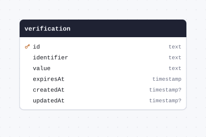

| Column                     | Type        | Constraints | Default | Description |
| -------------------------- | ----------- | ----------- | ------- | ----------- |
| `id`                       | `text`      | PK NOT NULL |         |             |
| `identifier`               | `text`      | NOT NULL    |         |             |
| `value`                    | `text`      | NOT NULL    |         |             |
| `expiresAt` (`expires_at`) | `timestamp` | NOT NULL    |         |             |
| `createdAt` (`created_at`) | `timestamp` | NULL        |         |             |
| `updatedAt` (`updated_at`) | `timestamp` | NULL        |         |             |

#### Definition

```sql
CREATE TABLE "verification" (
	"id" text PRIMARY KEY,
	"identifier" text NOT NULL,
	"value" text NOT NULL,
	"expires_at" timestamp NOT NULL,
	"created_at" timestamp,
	"updated_at" timestamp
);
```

<details>
<summary>Queries and their SQL</summary>

**Select**: Every row of verification.

```ts
db.select().from(verification);
```

```sql
select "id", "identifier", "value", "expires_at", "created_at", "updated_at"
from "verification"
```

**Count**: How many rows verification has.

```ts
db.select({ count: count() }).from(verification);
```

```sql
select count(*)
from "verification"
```

**Find many**: The rows of verification, through the relational query API.

```ts
db.query.verification.findMany();
```

```sql
select "d0"."id" as "id", "d0"."identifier" as "identifier", "d0"."value" as "value", "d0"."expires_at" as "expiresAt", "d0"."created_at" as "createdAt", "d0"."updated_at" as "updatedAt"
from "verification" as "d0"
```

**Find by primary key**: One row of verification, through the relational query API.

```ts
db.query.verification.findFirst({ where: { id: "id" } });
```

```sql
select "d0"."id" as "id", "d0"."identifier" as "identifier", "d0"."value" as "value", "d0"."expires_at" as "expiresAt", "d0"."created_at" as "createdAt", "d0"."updated_at" as "updatedAt"
from "verification" as "d0"
where "d0"."id" = $1
limit $2
-- params: ["id",1]
```

**Insert**: Adds a row to verification, giving the columns that have no default.

```ts
db.insert(verification).values({
  id: "id",
  identifier: "identifier",
  value: "value",
  expiresAt: new Date("2026-01-01T00:00:00.000Z"),
});
```

```sql
insert into "verification" ("id", "identifier", "value", "expires_at", "created_at", "updated_at")
values ($1, $2, $3, $4, default, default)
-- params: ["id","identifier","value","2026-01-01T00:00:00.000Z"]
```

**Update**: Changes a row of verification, found by its primary key.

```ts
db.update(verification).set({ identifier: "identifier" }).where(eq(verification.id, "id"));
```

```sql
update "verification"
set "identifier" = $1
where "verification"."id" = $2
-- params: ["identifier","id"]
```

**Delete**: Deletes a row of verification, found by its primary key.

```ts
db.delete(verification).where(eq(verification.id, "id"));
```

```sql
delete from "verification"
where "verification"."id" = $1
-- params: ["id"]
```

</details>

<a id="table-invitations"></a>

### invitations

Invitation tokens used when `AUTH_SIGNUP_MODE=invite`. An invitation is redeemable when it is neither revoked, expired, nor already used.

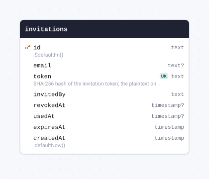

| Column                     | Type        | Constraints     | Default         | Description                                                                                                         |
| -------------------------- | ----------- | --------------- | --------------- | ------------------------------------------------------------------------------------------------------------------- |
| `id`                       | `text`      | PK NOT NULL     | `.$defaultFn()` |                                                                                                                     |
| `email`                    | `text`      | NULL            |                 |                                                                                                                     |
| `token`                    | `text`      | UNIQUE NOT NULL |                 | SHA-256 hash of the invitation token; the plaintext only exists in the link returned to the admin at creation time. |
| `invitedBy` (`invited_by`) | `text`      | NOT NULL        |                 |                                                                                                                     |
| `revokedAt` (`revoked_at`) | `timestamp` | NULL            |                 |                                                                                                                     |
| `usedAt` (`used_at`)       | `timestamp` | NULL            |                 |                                                                                                                     |
| `expiresAt` (`expires_at`) | `timestamp` | NOT NULL        |                 |                                                                                                                     |
| `createdAt` (`created_at`) | `timestamp` | NOT NULL        | `.defaultNow()` |                                                                                                                     |

#### Definition

```sql
CREATE TABLE "invitations" (
	"id" text PRIMARY KEY,
	"email" text,
	"token" text NOT NULL UNIQUE,
	"invited_by" text NOT NULL,
	"revoked_at" timestamp,
	"used_at" timestamp,
	"expires_at" timestamp NOT NULL,
	"created_at" timestamp DEFAULT now() NOT NULL
);
```

<details>
<summary>Queries and their SQL</summary>

**Select**: Every row of invitations.

```ts
db.select().from(invitations);
```

```sql
select "id", "email", "token", "invited_by", "revoked_at", "used_at", "expires_at", "created_at"
from "invitations"
```

**Count**: How many rows invitations has.

```ts
db.select({ count: count() }).from(invitations);
```

```sql
select count(*)
from "invitations"
```

**Find many**: The rows of invitations, through the relational query API.

```ts
db.query.invitations.findMany();
```

```sql
select "d0"."id" as "id", "d0"."email" as "email", "d0"."token" as "token", "d0"."invited_by" as "invitedBy", "d0"."revoked_at" as "revokedAt", "d0"."used_at" as "usedAt", "d0"."expires_at" as "expiresAt", "d0"."created_at" as "createdAt"
from "invitations" as "d0"
```

**Find by primary key**: One row of invitations, through the relational query API.

```ts
db.query.invitations.findFirst({ where: { id: "id" } });
```

```sql
select "d0"."id" as "id", "d0"."email" as "email", "d0"."token" as "token", "d0"."invited_by" as "invitedBy", "d0"."revoked_at" as "revokedAt", "d0"."used_at" as "usedAt", "d0"."expires_at" as "expiresAt", "d0"."created_at" as "createdAt"
from "invitations" as "d0"
where "d0"."id" = $1
limit $2
-- params: ["id",1]
```

**Insert**: Adds a row to invitations, giving the columns that have no default.

```ts
db.insert(invitations).values({
  token: "token",
  invitedBy: "invitedBy",
  expiresAt: new Date("2026-01-01T00:00:00.000Z"),
});
```

```sql
insert into "invitations" ("id", "email", "token", "invited_by", "revoked_at", "used_at", "expires_at", "created_at")
values ($1, default, $2, $3, default, default, $4, default)
-- params: ["amhmbppt7of60qfb1yt17g7w","token","invitedBy","2026-01-01T00:00:00.000Z"]
```

**Update**: Changes a row of invitations, found by its primary key.

```ts
db.update(invitations).set({ email: "email" }).where(eq(invitations.id, "id"));
```

```sql
update "invitations"
set "email" = $1
where "invitations"."id" = $2
-- params: ["email","id"]
```

**Delete**: Deletes a row of invitations, found by its primary key.

```ts
db.delete(invitations).where(eq(invitations.id, "id"));
```

```sql
delete from "invitations"
where "invitations"."id" = $1
-- params: ["id"]
```

</details>
