# Schema docs

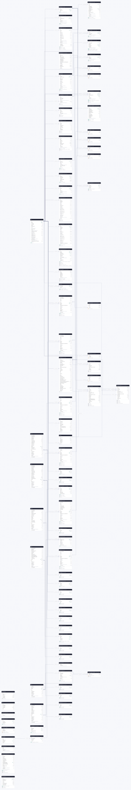

<details>
<summary>The whole schema as SQL</summary>

```sql
CREATE TABLE `account` (
	`id` integer PRIMARY KEY,
	`account_id` text NOT NULL,
	`provider_id` text NOT NULL,
	`user_id` integer NOT NULL,
	`access_token` text,
	`refresh_token` text,
	`id_token` text,
	`access_token_expires_at` integer,
	`refresh_token_expires_at` integer,
	`scope` text,
	`password` text,
	`created_at` integer NOT NULL,
	`updated_at` integer NOT NULL,
	CONSTRAINT `fk_account_user_id_user_id_fk` FOREIGN KEY (`user_id`) REFERENCES `user`(`id`) ON DELETE CASCADE
);

CREATE TABLE `achievement` (
	`id` integer PRIMARY KEY,
	`name` text NOT NULL,
	`description` text NOT NULL,
	`code_name` text NOT NULL UNIQUE,
	`media_type` text NOT NULL,
	`value` text
);

CREATE TABLE `achievement_tier` (
	`id` integer PRIMARY KEY,
	`achievement_id` integer NOT NULL,
	`difficulty` text NOT NULL,
	`criteria` text NOT NULL,
	`rarity` real,
	CONSTRAINT `fk_achievement_tier_achievement_id_achievement_id_fk` FOREIGN KEY (`achievement_id`) REFERENCES `achievement`(`id`) ON DELETE CASCADE,
	CONSTRAINT "achievement_tier_criteria_json_check" CHECK(json_valid("criteria")),
	CONSTRAINT "achievement_tier_rarity_range_check" CHECK("rarity" IS NULL OR ("rarity" >= 0 AND "rarity" <= 100))
);

CREATE TABLE `anime` (
	`backdrop_path` text,
	`original_name` text,
	`last_air_date` text,
	`homepage` text,
	`created_by` text,
	`duration` integer NOT NULL,
	`total_seasons` integer NOT NULL,
	`total_episodes` integer NOT NULL,
	`origin_country` text,
	`prod_status` text,
	`vote_average` real,
	`vote_count` real,
	`popularity` real,
	`season_to_air` integer,
	`episode_to_air` integer,
	`next_episode_to_air` text,
	`api_id` integer NOT NULL UNIQUE,
	`id` integer PRIMARY KEY,
	`name` text NOT NULL,
	`release_date` text,
	`synopsis` text,
	`image_cover` text NOT NULL,
	`lock_status` integer DEFAULT false NOT NULL,
	`added_at` text DEFAULT (CURRENT_TIMESTAMP),
	`last_api_update` text
);

CREATE TABLE `anime_actors` (
	`id` integer PRIMARY KEY,
	`media_id` integer NOT NULL,
	`name` text NOT NULL,
	CONSTRAINT `fk_anime_actors_media_id_anime_id_fk` FOREIGN KEY (`media_id`) REFERENCES `anime`(`id`) ON DELETE CASCADE
);

CREATE TABLE `anime_episodes_per_season` (
	`id` integer PRIMARY KEY,
	`media_id` integer NOT NULL,
	`season` integer NOT NULL,
	`episodes` integer NOT NULL,
	CONSTRAINT `fk_anime_episodes_per_season_media_id_anime_id_fk` FOREIGN KEY (`media_id`) REFERENCES `anime`(`id`) ON DELETE CASCADE
);

CREATE TABLE `anime_genre` (
	`id` integer PRIMARY KEY,
	`media_id` integer NOT NULL,
	`name` text NOT NULL,
	CONSTRAINT `fk_anime_genre_media_id_anime_id_fk` FOREIGN KEY (`media_id`) REFERENCES `anime`(`id`) ON DELETE CASCADE
);

CREATE TABLE `anime_list` (
	`current_season` integer NOT NULL,
	`current_episode` integer NOT NULL,
	`redo` integer DEFAULT 0 NOT NULL,
	`total` integer DEFAULT 0 NOT NULL,
	`id` integer PRIMARY KEY,
	`user_id` integer NOT NULL,
	`media_id` integer NOT NULL,
	`status` text NOT NULL,
	`release_notifications_enabled` integer DEFAULT true NOT NULL,
	`favorite` integer DEFAULT false NOT NULL,
	`comment` text,
	`rating` real,
	`custom_cover` text,
	`added_at` text DEFAULT (CURRENT_TIMESTAMP),
	`last_updated` text,
	CONSTRAINT `fk_anime_list_user_id_user_id_fk` FOREIGN KEY (`user_id`) REFERENCES `user`(`id`) ON DELETE CASCADE,
	CONSTRAINT `fk_anime_list_media_id_anime_id_fk` FOREIGN KEY (`media_id`) REFERENCES `anime`(`id`),
	CONSTRAINT "anime_list_rating_check" CHECK("rating" IS NULL OR ("rating" >= 0 AND "rating" <= 10)),
	CONSTRAINT "anime_list_favorite_check" CHECK("favorite" IN (0, 1)),
	CONSTRAINT "anime_list_redo_check" CHECK("redo" >= 0)
);

CREATE TABLE `anime_list_seasons` (
	`rating` real,
	`season` integer NOT NULL,
	`redo` integer DEFAULT 0 NOT NULL,
	`list_id` integer NOT NULL,
	CONSTRAINT `anime_list_seasons_pk` PRIMARY KEY(`list_id`, `season`),
	CONSTRAINT `fk_anime_list_seasons_list_id_anime_list_id_fk` FOREIGN KEY (`list_id`) REFERENCES `anime_list`(`id`) ON DELETE CASCADE,
	CONSTRAINT "anime_list_seasons_season_check" CHECK("season" >= 1),
	CONSTRAINT "anime_list_seasons_redo_check" CHECK("redo" >= 0 AND "redo" <= 100),
	CONSTRAINT "anime_list_seasons_rating_check" CHECK("rating" IS NULL OR ("rating" >= 0 AND "rating" <= 10))
);

CREATE TABLE `anime_network` (
	`id` integer PRIMARY KEY,
	`media_id` integer NOT NULL,
	`name` text NOT NULL,
	CONSTRAINT `fk_anime_network_media_id_anime_id_fk` FOREIGN KEY (`media_id`) REFERENCES `anime`(`id`) ON DELETE CASCADE
);

CREATE TABLE `anime_tags` (
	`id` integer PRIMARY KEY,
	`user_id` integer NOT NULL,
	`media_id` integer NOT NULL,
	`tag_id` integer NOT NULL,
	CONSTRAINT `fk_anime_tags_user_id_user_id_fk` FOREIGN KEY (`user_id`) REFERENCES `user`(`id`) ON DELETE CASCADE,
	CONSTRAINT `fk_anime_tags_media_id_anime_id_fk` FOREIGN KEY (`media_id`) REFERENCES `anime`(`id`) ON DELETE CASCADE,
	CONSTRAINT `fk_anime_tags_tag_id_media_tags_id_fk` FOREIGN KEY (`tag_id`) REFERENCES `media_tags`(`id`) ON DELETE CASCADE
);

CREATE TABLE `api_call_rollup` (
	`id` integer PRIMARY KEY AUTOINCREMENT,
	`provider` text NOT NULL,
	`bucket_start_ms` integer NOT NULL,
	`bucket_start` text NOT NULL,
	`total` integer NOT NULL,
	`errors` integer NOT NULL,
	`duration_ms_total` integer NOT NULL,
	`max_second_burst` integer NOT NULL,
	`status_counts` text NOT NULL,
	CONSTRAINT "api_call_rollup_counts_nonnegative_check" CHECK(
        "total" >= 0 AND "errors" >= 0 AND "duration_ms_total" >= 0
        AND "max_second_burst" >= 0
    ),
	CONSTRAINT "api_call_rollup_errors_not_above_total_check" CHECK("errors" <= "total"),
	CONSTRAINT "api_call_rollup_status_counts_json_check" CHECK(json_valid("status_counts"))
);

CREATE TABLE `api_tokens` (
	`id` integer PRIMARY KEY,
	`provider` text NOT NULL,
	`access_token` text NOT NULL,
	`expires_at` integer NOT NULL
);

CREATE TABLE `books` (
	`pages` integer NOT NULL,
	`language` text,
	`publishers` text,
	`api_id` text NOT NULL UNIQUE,
	`id` integer PRIMARY KEY,
	`name` text NOT NULL,
	`release_date` text,
	`synopsis` text,
	`image_cover` text NOT NULL,
	`lock_status` integer DEFAULT false NOT NULL,
	`added_at` text DEFAULT (CURRENT_TIMESTAMP),
	`last_api_update` text
);

CREATE TABLE `books_authors` (
	`id` integer PRIMARY KEY,
	`media_id` integer NOT NULL,
	`name` text NOT NULL,
	CONSTRAINT `fk_books_authors_media_id_books_id_fk` FOREIGN KEY (`media_id`) REFERENCES `books`(`id`) ON DELETE CASCADE
);

CREATE TABLE `books_genre` (
	`id` integer PRIMARY KEY,
	`media_id` integer NOT NULL,
	`name` text NOT NULL,
	CONSTRAINT `fk_books_genre_media_id_books_id_fk` FOREIGN KEY (`media_id`) REFERENCES `books`(`id`) ON DELETE CASCADE
);

CREATE TABLE `books_list` (
	`actual_page` integer,
	`redo` integer DEFAULT 0 NOT NULL,
	`total` integer DEFAULT 0 NOT NULL,
	`id` integer PRIMARY KEY,
	`user_id` integer NOT NULL,
	`media_id` integer NOT NULL,
	`status` text NOT NULL,
	`release_notifications_enabled` integer DEFAULT true NOT NULL,
	`favorite` integer DEFAULT false NOT NULL,
	`comment` text,
	`rating` real,
	`custom_cover` text,
	`added_at` text DEFAULT (CURRENT_TIMESTAMP),
	`last_updated` text,
	CONSTRAINT `fk_books_list_user_id_user_id_fk` FOREIGN KEY (`user_id`) REFERENCES `user`(`id`) ON DELETE CASCADE,
	CONSTRAINT `fk_books_list_media_id_books_id_fk` FOREIGN KEY (`media_id`) REFERENCES `books`(`id`),
	CONSTRAINT "books_list_rating_check" CHECK("rating" IS NULL OR ("rating" >= 0 AND "rating" <= 10)),
	CONSTRAINT "books_list_favorite_check" CHECK("favorite" IN (0, 1))
);

CREATE TABLE `books_tags` (
	`id` integer PRIMARY KEY,
	`user_id` integer NOT NULL,
	`media_id` integer NOT NULL,
	`tag_id` integer NOT NULL,
	CONSTRAINT `fk_books_tags_user_id_user_id_fk` FOREIGN KEY (`user_id`) REFERENCES `user`(`id`) ON DELETE CASCADE,
	CONSTRAINT `fk_books_tags_media_id_books_id_fk` FOREIGN KEY (`media_id`) REFERENCES `books`(`id`) ON DELETE CASCADE,
	CONSTRAINT `fk_books_tags_tag_id_media_tags_id_fk` FOREIGN KEY (`tag_id`) REFERENCES `media_tags`(`id`) ON DELETE CASCADE
);

CREATE TABLE `collection_items` (
	`id` integer PRIMARY KEY AUTOINCREMENT,
	`collection_id` integer NOT NULL,
	`annotation` text,
	`media_id` integer NOT NULL,
	`order_index` integer NOT NULL,
	`media_type` text NOT NULL,
	`created_at` text DEFAULT (CURRENT_TIMESTAMP) NOT NULL,
	CONSTRAINT `fk_collection_items_collection_id_collections_id_fk` FOREIGN KEY (`collection_id`) REFERENCES `collections`(`id`) ON DELETE CASCADE,
	CONSTRAINT "collection_items_order_nonnegative_check" CHECK("order_index" >= 0)
);

CREATE TABLE `collection_likes` (
	`id` integer PRIMARY KEY AUTOINCREMENT,
	`user_id` integer NOT NULL,
	`collection_id` integer NOT NULL,
	`created_at` text DEFAULT (CURRENT_TIMESTAMP) NOT NULL,
	CONSTRAINT `fk_collection_likes_user_id_user_id_fk` FOREIGN KEY (`user_id`) REFERENCES `user`(`id`) ON DELETE CASCADE,
	CONSTRAINT `fk_collection_likes_collection_id_collections_id_fk` FOREIGN KEY (`collection_id`) REFERENCES `collections`(`id`) ON DELETE CASCADE
);

CREATE TABLE `collections` (
	`id` integer PRIMARY KEY AUTOINCREMENT,
	`owner_id` integer NOT NULL,
	`profile_position` integer,
	`title` text NOT NULL,
	`description` text,
	`view_count` integer DEFAULT 0 NOT NULL,
	`like_count` integer DEFAULT 0 NOT NULL,
	`copied_count` integer DEFAULT 0 NOT NULL,
	`ordered` integer DEFAULT false NOT NULL,
	`privacy` text DEFAULT 'private' NOT NULL,
	`created_at` text DEFAULT (CURRENT_TIMESTAMP) NOT NULL,
	`updated_at` text,
	CONSTRAINT `fk_collections_owner_id_user_id_fk` FOREIGN KEY (`owner_id`) REFERENCES `user`(`id`) ON DELETE CASCADE,
	CONSTRAINT "collections_profile_position_check" CHECK("profile_position" > 0),
	CONSTRAINT "collections_ordered_check" CHECK("ordered" IN (0, 1)),
	CONSTRAINT "collections_counters_nonnegative_check" CHECK("view_count" >= 0 AND "like_count" >= 0 AND "copied_count" >= 0)
);

CREATE TABLE `daily_mediadle` (
	`id` integer PRIMARY KEY,
	`media_type` text NOT NULL,
	`media_id` integer NOT NULL,
	`date` text NOT NULL,
	`pixelation_levels` integer DEFAULT 5 NOT NULL,
	CONSTRAINT "daily_mediadle_pixelation_levels_positive_check" CHECK("pixelation_levels" > 0)
);

CREATE TABLE `smart_views` (
	`id` integer PRIMARY KEY AUTOINCREMENT,
	`user_id` integer NOT NULL,
	`profile_position` integer,
	`spec` text NOT NULL,
	`created_at` text DEFAULT (CURRENT_TIMESTAMP) NOT NULL,
	`updated_at` text DEFAULT (CURRENT_TIMESTAMP) NOT NULL,
	CONSTRAINT `fk_smart_views_user_id_user_id_fk` FOREIGN KEY (`user_id`) REFERENCES `user`(`id`) ON DELETE CASCADE,
	CONSTRAINT "smart_views_spec_json_check" CHECK(json_valid("spec")),
	CONSTRAINT "smart_views_profile_position_check" CHECK("profile_position" > 0)
);

CREATE TABLE `feature_requests` (
	`id` integer PRIMARY KEY AUTOINCREMENT,
	`title` text NOT NULL,
	`admin_comment` text,
	`description` text NOT NULL,
	`status` text DEFAULT 'Under Consideration' NOT NULL,
	`created_by` integer,
	`created_at` text DEFAULT (CURRENT_TIMESTAMP) NOT NULL,
	CONSTRAINT `fk_feature_requests_created_by_user_id_fk` FOREIGN KEY (`created_by`) REFERENCES `user`(`id`) ON DELETE SET NULL
);

CREATE TABLE `feature_votes` (
	`id` integer PRIMARY KEY AUTOINCREMENT,
	`user_id` integer NOT NULL,
	`feature_id` integer NOT NULL,
	`created_at` text DEFAULT (CURRENT_TIMESTAMP) NOT NULL,
	CONSTRAINT `fk_feature_votes_user_id_user_id_fk` FOREIGN KEY (`user_id`) REFERENCES `user`(`id`) ON DELETE CASCADE,
	CONSTRAINT `fk_feature_votes_feature_id_feature_requests_id_fk` FOREIGN KEY (`feature_id`) REFERENCES `feature_requests`(`id`) ON DELETE CASCADE
);

CREATE TABLE `followers` (
	`follower_id` integer NOT NULL,
	`followed_id` integer NOT NULL,
	`status` text DEFAULT 'accepted' NOT NULL,
	CONSTRAINT `fk_followers_follower_id_user_id_fk` FOREIGN KEY (`follower_id`) REFERENCES `user`(`id`) ON DELETE CASCADE,
	CONSTRAINT `fk_followers_followed_id_user_id_fk` FOREIGN KEY (`followed_id`) REFERENCES `user`(`id`) ON DELETE CASCADE,
	CONSTRAINT "followers_not_self_check" CHECK("follower_id" <> "followed_id")
);

CREATE TABLE `games` (
	`backdrop_image_id` text,
	`game_engine` text,
	`game_modes` text,
	`player_perspective` text,
	`vote_average` real,
	`vote_count` real,
	`igdb_url` text,
	`hltb_main_time` real,
	`hltb_last_checked_at` text,
	`hltb_main_and_extra_time` real,
	`hltb_total_complete_time` real,
	`steam_api_id` text,
	`collection_id` integer,
	`api_id` integer NOT NULL UNIQUE,
	`id` integer PRIMARY KEY,
	`name` text NOT NULL,
	`release_date` text,
	`synopsis` text,
	`image_cover` text NOT NULL,
	`lock_status` integer DEFAULT false NOT NULL,
	`added_at` text DEFAULT (CURRENT_TIMESTAMP),
	`last_api_update` text
);

CREATE TABLE `games_companies` (
	`id` integer PRIMARY KEY,
	`media_id` integer NOT NULL,
	`name` text NOT NULL,
	`publisher` integer DEFAULT false NOT NULL,
	`developer` integer DEFAULT false NOT NULL,
	CONSTRAINT `fk_games_companies_media_id_games_id_fk` FOREIGN KEY (`media_id`) REFERENCES `games`(`id`) ON DELETE CASCADE
);

CREATE TABLE `games_genre` (
	`id` integer PRIMARY KEY,
	`media_id` integer NOT NULL,
	`name` text NOT NULL,
	CONSTRAINT `fk_games_genre_media_id_games_id_fk` FOREIGN KEY (`media_id`) REFERENCES `games`(`id`) ON DELETE CASCADE
);

CREATE TABLE `games_list` (
	`playtime` integer DEFAULT 0,
	`platform` text,
	`id` integer PRIMARY KEY,
	`user_id` integer NOT NULL,
	`media_id` integer NOT NULL,
	`status` text NOT NULL,
	`release_notifications_enabled` integer DEFAULT true NOT NULL,
	`favorite` integer DEFAULT false NOT NULL,
	`comment` text,
	`rating` real,
	`custom_cover` text,
	`added_at` text DEFAULT (CURRENT_TIMESTAMP),
	`last_updated` text,
	CONSTRAINT `fk_games_list_user_id_user_id_fk` FOREIGN KEY (`user_id`) REFERENCES `user`(`id`) ON DELETE CASCADE,
	CONSTRAINT `fk_games_list_media_id_games_id_fk` FOREIGN KEY (`media_id`) REFERENCES `games`(`id`),
	CONSTRAINT "games_list_rating_check" CHECK("rating" IS NULL OR ("rating" >= 0 AND "rating" <= 10)),
	CONSTRAINT "games_list_favorite_check" CHECK("favorite" IN (0, 1))
);

CREATE TABLE `games_platforms` (
	`id` integer PRIMARY KEY,
	`media_id` integer NOT NULL,
	`name` text NOT NULL,
	CONSTRAINT `fk_games_platforms_media_id_games_id_fk` FOREIGN KEY (`media_id`) REFERENCES `games`(`id`) ON DELETE CASCADE
);

CREATE TABLE `games_tags` (
	`id` integer PRIMARY KEY,
	`user_id` integer NOT NULL,
	`media_id` integer NOT NULL,
	`tag_id` integer NOT NULL,
	CONSTRAINT `fk_games_tags_user_id_user_id_fk` FOREIGN KEY (`user_id`) REFERENCES `user`(`id`) ON DELETE CASCADE,
	CONSTRAINT `fk_games_tags_media_id_games_id_fk` FOREIGN KEY (`media_id`) REFERENCES `games`(`id`) ON DELETE CASCADE,
	CONSTRAINT `fk_games_tags_tag_id_media_tags_id_fk` FOREIGN KEY (`tag_id`) REFERENCES `media_tags`(`id`) ON DELETE CASCADE
);

CREATE TABLE `import_items` (
	`id` integer PRIMARY KEY AUTOINCREMENT,
	`job_id` integer NOT NULL,
	`name` text,
	`release_date` text,
	`status_reason` text,
	`external_api_id` text,
	`row_number` integer NOT NULL,
	`matched_media_id` integer,
	`media_type` text,
	`payload_json` text NOT NULL,
	`external_api_source` text,
	`status` text DEFAULT 'queued' NOT NULL,
	`created_at` text DEFAULT (CURRENT_TIMESTAMP) NOT NULL,
	`updated_at` text DEFAULT (CURRENT_TIMESTAMP) NOT NULL,
	CONSTRAINT `fk_import_items_job_id_import_jobs_id_fk` FOREIGN KEY (`job_id`) REFERENCES `import_jobs`(`id`) ON DELETE CASCADE,
	CONSTRAINT "import_items_row_positive_check" CHECK("row_number" >= 1),
	CONSTRAINT "import_items_payload_json_check" CHECK(json_valid("payload_json"))
);

CREATE TABLE `import_jobs` (
	`id` integer PRIMARY KEY AUTOINCREMENT,
	`user_id` integer NOT NULL,
	`error` text,
	`source` text NOT NULL,
	`total_count` integer DEFAULT 0 NOT NULL,
	`failed_count` integer DEFAULT 0 NOT NULL,
	`skipped_count` integer DEFAULT 0 NOT NULL,
	`completed_count` integer DEFAULT 0 NOT NULL,
	`processed_count` integer DEFAULT 0 NOT NULL,
	`status` text DEFAULT 'parsing' NOT NULL,
	`created_at` text DEFAULT (CURRENT_TIMESTAMP) NOT NULL,
	`updated_at` text DEFAULT (CURRENT_TIMESTAMP) NOT NULL,
	`started_at` text,
	`finished_at` text,
	`next_attempt_at` text,
	CONSTRAINT `fk_import_jobs_user_id_user_id_fk` FOREIGN KEY (`user_id`) REFERENCES `user`(`id`) ON DELETE CASCADE,
	CONSTRAINT "import_jobs_counts_nonnegative_check" CHECK(
        "total_count" >= 0 AND "failed_count" >= 0 AND "skipped_count" >= 0
        AND "completed_count" >= 0 AND "processed_count" >= 0
    )
);

CREATE TABLE `inactive_account_deletion` (
	`id` integer PRIMARY KEY AUTOINCREMENT,
	`deleted_at` text,
	`user_id` integer NOT NULL,
	`username` text NOT NULL,
	`resurrected_at` text,
	`warning_sent_at` text,
	`last_email_error` text,
	`last_seen_at` text NOT NULL,
	`warning_token_hash` text,
	`last_email_attempt_at` text,
	`deletion_scheduled_at` text NOT NULL,
	`status` text NOT NULL,
	`email_retry_count` integer DEFAULT 0 NOT NULL,
	`created_at` text DEFAULT (CURRENT_TIMESTAMP) NOT NULL,
	`updated_at` text DEFAULT (CURRENT_TIMESTAMP) NOT NULL,
	CONSTRAINT "inactive_account_deletion_retry_count_nonnegative_check" CHECK("email_retry_count" >= 0)
);

CREATE TABLE `jwks` (
	`id` integer PRIMARY KEY,
	`public_key` text NOT NULL,
	`private_key` text NOT NULL,
	`created_at` integer NOT NULL,
	`expires_at` integer,
	`alg` text,
	`crv` text
);

CREATE TABLE `manga` (
	`original_name` text,
	`chapters` integer,
	`prod_status` text,
	`site_url` text,
	`end_date` text,
	`volumes` integer,
	`vote_average` real,
	`vote_count` real,
	`popularity` real,
	`publishers` text,
	`api_id` integer NOT NULL UNIQUE,
	`id` integer PRIMARY KEY,
	`name` text NOT NULL,
	`release_date` text,
	`synopsis` text,
	`image_cover` text NOT NULL,
	`lock_status` integer DEFAULT false NOT NULL,
	`added_at` text DEFAULT (CURRENT_TIMESTAMP),
	`last_api_update` text
);

CREATE TABLE `manga_authors` (
	`id` integer PRIMARY KEY,
	`media_id` integer NOT NULL,
	`name` text NOT NULL,
	CONSTRAINT `fk_manga_authors_media_id_manga_id_fk` FOREIGN KEY (`media_id`) REFERENCES `manga`(`id`) ON DELETE CASCADE
);

CREATE TABLE `manga_genre` (
	`id` integer PRIMARY KEY,
	`media_id` integer NOT NULL,
	`name` text NOT NULL,
	CONSTRAINT `fk_manga_genre_media_id_manga_id_fk` FOREIGN KEY (`media_id`) REFERENCES `manga`(`id`) ON DELETE CASCADE
);

CREATE TABLE `manga_list` (
	`current_chapter` integer NOT NULL,
	`redo` integer DEFAULT 0 NOT NULL,
	`total` integer DEFAULT 0 NOT NULL,
	`id` integer PRIMARY KEY,
	`user_id` integer NOT NULL,
	`media_id` integer NOT NULL,
	`status` text NOT NULL,
	`release_notifications_enabled` integer DEFAULT true NOT NULL,
	`favorite` integer DEFAULT false NOT NULL,
	`comment` text,
	`rating` real,
	`custom_cover` text,
	`added_at` text DEFAULT (CURRENT_TIMESTAMP),
	`last_updated` text,
	CONSTRAINT `fk_manga_list_user_id_user_id_fk` FOREIGN KEY (`user_id`) REFERENCES `user`(`id`) ON DELETE CASCADE,
	CONSTRAINT `fk_manga_list_media_id_manga_id_fk` FOREIGN KEY (`media_id`) REFERENCES `manga`(`id`),
	CONSTRAINT "manga_list_rating_check" CHECK("rating" IS NULL OR ("rating" >= 0 AND "rating" <= 10)),
	CONSTRAINT "manga_list_favorite_check" CHECK("favorite" IN (0, 1))
);

CREATE TABLE `manga_tags` (
	`id` integer PRIMARY KEY,
	`user_id` integer NOT NULL,
	`media_id` integer NOT NULL,
	`tag_id` integer NOT NULL,
	CONSTRAINT `fk_manga_tags_user_id_user_id_fk` FOREIGN KEY (`user_id`) REFERENCES `user`(`id`) ON DELETE CASCADE,
	CONSTRAINT `fk_manga_tags_media_id_manga_id_fk` FOREIGN KEY (`media_id`) REFERENCES `manga`(`id`) ON DELETE CASCADE,
	CONSTRAINT `fk_manga_tags_tag_id_media_tags_id_fk` FOREIGN KEY (`tag_id`) REFERENCES `media_tags`(`id`) ON DELETE CASCADE
);

CREATE TABLE `mcp_revocation` (
	`user_id` integer NOT NULL,
	`client_id` text NOT NULL,
	`revoked_at` integer NOT NULL,
	CONSTRAINT `mcp_revocation_pk` PRIMARY KEY(`user_id`, `client_id`),
	CONSTRAINT `fk_mcp_revocation_user_id_user_id_fk` FOREIGN KEY (`user_id`) REFERENCES `user`(`id`) ON DELETE CASCADE,
	CONSTRAINT `fk_mcp_revocation_client_id_oauth_client_client_id_fk` FOREIGN KEY (`client_id`) REFERENCES `oauth_client`(`client_id`) ON DELETE CASCADE
);

CREATE TABLE `media_notifications` (
	`id` integer PRIMARY KEY,
	`user_id` integer NOT NULL,
	`name` text NOT NULL,
	`media_id` integer NOT NULL,
	`media_type` text NOT NULL,
	`season` integer,
	`episode` integer,
	`is_season_finale` integer,
	`release_date` text,
	`read` integer DEFAULT false NOT NULL,
	`created_at` text DEFAULT (CURRENT_TIMESTAMP) NOT NULL,
	CONSTRAINT `fk_media_notifications_user_id_user_id_fk` FOREIGN KEY (`user_id`) REFERENCES `user`(`id`) ON DELETE CASCADE,
	CONSTRAINT "media_notifications_season_finale_check" CHECK("is_season_finale" IS NULL OR "is_season_finale" IN (0, 1))
);

CREATE TABLE `media_refresh_log` (
	`id` integer PRIMARY KEY AUTOINCREMENT,
	`user_id` integer NOT NULL,
	`media_type` text NOT NULL,
	`api_id` text NOT NULL,
	`refreshed_at` text DEFAULT (CURRENT_TIMESTAMP) NOT NULL,
	CONSTRAINT `fk_media_refresh_log_user_id_user_id_fk` FOREIGN KEY (`user_id`) REFERENCES `user`(`id`) ON DELETE CASCADE
);

CREATE TABLE `media_tags` (
	`id` integer PRIMARY KEY AUTOINCREMENT,
	`user_id` integer NOT NULL,
	`media_type` text NOT NULL,
	`name` text NOT NULL,
	CONSTRAINT `fk_media_tags_user_id_user_id_fk` FOREIGN KEY (`user_id`) REFERENCES `user`(`id`) ON DELETE CASCADE
);

CREATE TABLE `mediadle_stats` (
	`id` integer PRIMARY KEY,
	`user_id` integer NOT NULL,
	`media_type` text NOT NULL,
	`total_played` integer,
	`total_won` integer,
	`average_attempts` real,
	`streak` integer,
	`best_streak` integer,
	CONSTRAINT `fk_mediadle_stats_user_id_user_id_fk` FOREIGN KEY (`user_id`) REFERENCES `user`(`id`) ON DELETE CASCADE,
	CONSTRAINT "mediadle_stats_nonnegative_check" CHECK(
        ("total_played" IS NULL OR "total_played" >= 0)
        AND ("total_won" IS NULL OR "total_won" >= 0)
        AND ("average_attempts" IS NULL OR "average_attempts" >= 0)
        AND ("streak" IS NULL OR "streak" >= 0)
        AND ("best_streak" IS NULL OR "best_streak" >= 0)
    ),
	CONSTRAINT "mediadle_stats_wins_not_above_played_check" CHECK(
        "total_won" IS NULL OR "total_played" IS NULL OR "total_won" <= "total_played"
    )
);

CREATE TABLE `movies` (
	`backdrop_path` text,
	`original_name` text,
	`homepage` text,
	`duration` integer NOT NULL,
	`original_language` text,
	`vote_average` real,
	`vote_count` real,
	`popularity` real,
	`budget` real,
	`revenue` real,
	`tagline` text,
	`api_id` integer NOT NULL UNIQUE,
	`collection_id` integer,
	`director_name` text,
	`compositor_name` text,
	`id` integer PRIMARY KEY,
	`name` text NOT NULL,
	`release_date` text,
	`synopsis` text,
	`image_cover` text NOT NULL,
	`lock_status` integer DEFAULT false NOT NULL,
	`added_at` text DEFAULT (CURRENT_TIMESTAMP),
	`last_api_update` text
);

CREATE TABLE `movies_actors` (
	`id` integer PRIMARY KEY,
	`media_id` integer NOT NULL,
	`name` text NOT NULL,
	CONSTRAINT `fk_movies_actors_media_id_movies_id_fk` FOREIGN KEY (`media_id`) REFERENCES `movies`(`id`) ON DELETE CASCADE
);

CREATE TABLE `movies_genre` (
	`id` integer PRIMARY KEY,
	`media_id` integer NOT NULL,
	`name` text NOT NULL,
	CONSTRAINT `fk_movies_genre_media_id_movies_id_fk` FOREIGN KEY (`media_id`) REFERENCES `movies`(`id`) ON DELETE CASCADE
);

CREATE TABLE `movies_list` (
	`redo` integer DEFAULT 0 NOT NULL,
	`total` integer DEFAULT 0 NOT NULL,
	`id` integer PRIMARY KEY,
	`user_id` integer NOT NULL,
	`media_id` integer NOT NULL,
	`status` text NOT NULL,
	`release_notifications_enabled` integer DEFAULT true NOT NULL,
	`favorite` integer DEFAULT false NOT NULL,
	`comment` text,
	`rating` real,
	`custom_cover` text,
	`added_at` text DEFAULT (CURRENT_TIMESTAMP),
	`last_updated` text,
	CONSTRAINT `fk_movies_list_user_id_user_id_fk` FOREIGN KEY (`user_id`) REFERENCES `user`(`id`) ON DELETE CASCADE,
	CONSTRAINT `fk_movies_list_media_id_movies_id_fk` FOREIGN KEY (`media_id`) REFERENCES `movies`(`id`),
	CONSTRAINT "movies_list_rating_check" CHECK("rating" IS NULL OR ("rating" >= 0 AND "rating" <= 10)),
	CONSTRAINT "movies_list_favorite_check" CHECK("favorite" IN (0, 1))
);

CREATE TABLE `movies_tags` (
	`id` integer PRIMARY KEY,
	`user_id` integer NOT NULL,
	`media_id` integer NOT NULL,
	`tag_id` integer NOT NULL,
	CONSTRAINT `fk_movies_tags_user_id_user_id_fk` FOREIGN KEY (`user_id`) REFERENCES `user`(`id`) ON DELETE CASCADE,
	CONSTRAINT `fk_movies_tags_media_id_movies_id_fk` FOREIGN KEY (`media_id`) REFERENCES `movies`(`id`) ON DELETE CASCADE,
	CONSTRAINT `fk_movies_tags_tag_id_media_tags_id_fk` FOREIGN KEY (`tag_id`) REFERENCES `media_tags`(`id`) ON DELETE CASCADE
);

CREATE TABLE `oauth_access_token` (
	`id` integer PRIMARY KEY,
	`token` text NOT NULL UNIQUE,
	`client_id` text NOT NULL,
	`session_id` integer,
	`user_id` integer,
	`reference_id` text,
	`authorization_code_id` text,
	`resources` text,
	`requested_user_info_claims` text,
	`refresh_id` integer,
	`expires_at` integer NOT NULL,
	`created_at` integer NOT NULL,
	`revoked` integer,
	`confirmation` text,
	`scopes` text NOT NULL,
	CONSTRAINT `fk_oauth_access_token_client_id_oauth_client_client_id_fk` FOREIGN KEY (`client_id`) REFERENCES `oauth_client`(`client_id`) ON DELETE CASCADE,
	CONSTRAINT `fk_oauth_access_token_session_id_session_id_fk` FOREIGN KEY (`session_id`) REFERENCES `session`(`id`) ON DELETE SET NULL,
	CONSTRAINT `fk_oauth_access_token_user_id_user_id_fk` FOREIGN KEY (`user_id`) REFERENCES `user`(`id`) ON DELETE CASCADE,
	CONSTRAINT `fk_oauth_access_token_refresh_id_oauth_refresh_token_id_fk` FOREIGN KEY (`refresh_id`) REFERENCES `oauth_refresh_token`(`id`) ON DELETE CASCADE
);

CREATE TABLE `oauth_client` (
	`id` integer PRIMARY KEY,
	`client_id` text NOT NULL UNIQUE,
	`client_secret` text,
	`client_discovery_id` text,
	`disabled` integer DEFAULT false,
	`skip_consent` integer,
	`enable_end_session` integer,
	`subject_type` text,
	`scopes` text,
	`client_credentials_scopes` text DEFAULT '[]',
	`user_id` integer,
	`created_at` integer,
	`updated_at` integer,
	`name` text,
	`uri` text,
	`icon` text,
	`contacts` text,
	`tos` text,
	`policy` text,
	`software_id` text,
	`software_version` text,
	`software_statement` text,
	`redirect_uris` text NOT NULL,
	`post_logout_redirect_uris` text,
	`backchannel_logout_uri` text,
	`backchannel_logout_session_required` integer,
	`token_endpoint_auth_method` text,
	`application_type` text,
	`jwks` text,
	`jwks_uri` text,
	`grant_types` text,
	`response_types` text,
	`require_pkce` integer,
	`dpop_bound_access_tokens` integer DEFAULT false,
	`reference_id` text,
	`metadata` text,
	CONSTRAINT `fk_oauth_client_user_id_user_id_fk` FOREIGN KEY (`user_id`) REFERENCES `user`(`id`) ON DELETE CASCADE
);

CREATE TABLE `oauth_client_assertion` (
	`id` text PRIMARY KEY,
	`expires_at` integer NOT NULL
);

CREATE TABLE `oauth_client_resource` (
	`id` integer PRIMARY KEY,
	`client_id` text NOT NULL,
	`resource_id` text NOT NULL,
	`metadata` text,
	`created_at` integer,
	CONSTRAINT `fk_oauth_client_resource_client_id_oauth_client_client_id_fk` FOREIGN KEY (`client_id`) REFERENCES `oauth_client`(`client_id`) ON DELETE CASCADE,
	CONSTRAINT `fk_oauth_client_resource_resource_id_oauth_resource_identifier_fk` FOREIGN KEY (`resource_id`) REFERENCES `oauth_resource`(`identifier`) ON DELETE CASCADE
);

CREATE TABLE `oauth_consent` (
	`id` integer PRIMARY KEY,
	`client_id` text NOT NULL,
	`user_id` integer,
	`reference_id` text,
	`resources` text,
	`requested_user_info_claims` text,
	`scopes` text NOT NULL,
	`created_at` integer NOT NULL,
	`updated_at` integer NOT NULL,
	CONSTRAINT `fk_oauth_consent_client_id_oauth_client_client_id_fk` FOREIGN KEY (`client_id`) REFERENCES `oauth_client`(`client_id`) ON DELETE CASCADE,
	CONSTRAINT `fk_oauth_consent_user_id_user_id_fk` FOREIGN KEY (`user_id`) REFERENCES `user`(`id`) ON DELETE CASCADE
);

CREATE TABLE `oauth_refresh_token` (
	`id` integer PRIMARY KEY,
	`token` text NOT NULL UNIQUE,
	`client_id` text NOT NULL,
	`session_id` integer,
	`user_id` integer NOT NULL,
	`reference_id` text,
	`authorization_code_id` text,
	`resources` text,
	`requested_user_info_claims` text,
	`expires_at` integer NOT NULL,
	`created_at` integer NOT NULL,
	`revoked` integer,
	`rotated_at` integer,
	`rotation_replay_response` text,
	`rotation_replay_expires_at` integer,
	`auth_time` integer,
	`confirmation` text,
	`scopes` text NOT NULL,
	CONSTRAINT `fk_oauth_refresh_token_client_id_oauth_client_client_id_fk` FOREIGN KEY (`client_id`) REFERENCES `oauth_client`(`client_id`) ON DELETE CASCADE,
	CONSTRAINT `fk_oauth_refresh_token_session_id_session_id_fk` FOREIGN KEY (`session_id`) REFERENCES `session`(`id`) ON DELETE SET NULL,
	CONSTRAINT `fk_oauth_refresh_token_user_id_user_id_fk` FOREIGN KEY (`user_id`) REFERENCES `user`(`id`) ON DELETE CASCADE
);

CREATE TABLE `oauth_resource` (
	`id` integer PRIMARY KEY,
	`identifier` text NOT NULL UNIQUE,
	`name` text NOT NULL,
	`access_token_ttl` integer,
	`refresh_token_ttl` integer,
	`signing_algorithm` text,
	`signing_key_id` text,
	`allowed_scopes` text,
	`custom_claims` text,
	`dpop_bound_access_tokens_required` integer DEFAULT false,
	`disabled` integer DEFAULT false,
	`created_at` integer,
	`updated_at` integer,
	`policy_version` integer DEFAULT 1,
	`metadata` text
);

CREATE TABLE `profile_custom` (
	`id` integer PRIMARY KEY,
	`user_id` integer NOT NULL,
	`key` text NOT NULL,
	`value` text NOT NULL,
	`created_at` text DEFAULT (CURRENT_TIMESTAMP) NOT NULL,
	`updated_at` text DEFAULT (CURRENT_TIMESTAMP) NOT NULL,
	CONSTRAINT `fk_profile_custom_user_id_user_id_fk` FOREIGN KEY (`user_id`) REFERENCES `user`(`id`) ON DELETE CASCADE,
	CONSTRAINT "profile_custom_value_json_check" CHECK(json_valid("value"))
);

CREATE TABLE `series` (
	`backdrop_path` text,
	`original_name` text,
	`last_air_date` text,
	`homepage` text,
	`created_by` text,
	`duration` integer NOT NULL,
	`total_seasons` integer NOT NULL,
	`total_episodes` integer NOT NULL,
	`origin_country` text,
	`prod_status` text,
	`vote_average` real,
	`vote_count` real,
	`popularity` real,
	`api_id` integer NOT NULL UNIQUE,
	`episode_to_air` integer,
	`season_to_air` integer,
	`next_episode_to_air` text,
	`id` integer PRIMARY KEY,
	`name` text NOT NULL,
	`release_date` text,
	`synopsis` text,
	`image_cover` text NOT NULL,
	`lock_status` integer DEFAULT false NOT NULL,
	`added_at` text DEFAULT (CURRENT_TIMESTAMP),
	`last_api_update` text
);

CREATE TABLE `series_actors` (
	`id` integer PRIMARY KEY,
	`media_id` integer NOT NULL,
	`name` text NOT NULL,
	CONSTRAINT `fk_series_actors_media_id_series_id_fk` FOREIGN KEY (`media_id`) REFERENCES `series`(`id`) ON DELETE CASCADE
);

CREATE TABLE `series_episodes_per_season` (
	`id` integer PRIMARY KEY,
	`media_id` integer NOT NULL,
	`season` integer NOT NULL,
	`episodes` integer NOT NULL,
	CONSTRAINT `fk_series_episodes_per_season_media_id_series_id_fk` FOREIGN KEY (`media_id`) REFERENCES `series`(`id`) ON DELETE CASCADE
);

CREATE TABLE `series_genre` (
	`id` integer PRIMARY KEY,
	`media_id` integer NOT NULL,
	`name` text NOT NULL,
	CONSTRAINT `fk_series_genre_media_id_series_id_fk` FOREIGN KEY (`media_id`) REFERENCES `series`(`id`) ON DELETE CASCADE
);

CREATE TABLE `series_list` (
	`current_season` integer NOT NULL,
	`current_episode` integer NOT NULL,
	`redo` integer DEFAULT 0 NOT NULL,
	`total` integer DEFAULT 0 NOT NULL,
	`id` integer PRIMARY KEY,
	`user_id` integer NOT NULL,
	`media_id` integer NOT NULL,
	`status` text NOT NULL,
	`release_notifications_enabled` integer DEFAULT true NOT NULL,
	`favorite` integer DEFAULT false NOT NULL,
	`comment` text,
	`rating` real,
	`custom_cover` text,
	`added_at` text DEFAULT (CURRENT_TIMESTAMP),
	`last_updated` text,
	CONSTRAINT `fk_series_list_user_id_user_id_fk` FOREIGN KEY (`user_id`) REFERENCES `user`(`id`) ON DELETE CASCADE,
	CONSTRAINT `fk_series_list_media_id_series_id_fk` FOREIGN KEY (`media_id`) REFERENCES `series`(`id`),
	CONSTRAINT "series_list_rating_check" CHECK("rating" IS NULL OR ("rating" >= 0 AND "rating" <= 10)),
	CONSTRAINT "series_list_favorite_check" CHECK("favorite" IN (0, 1)),
	CONSTRAINT "series_list_redo_check" CHECK("redo" >= 0)
);

CREATE TABLE `series_list_seasons` (
	`rating` real,
	`season` integer NOT NULL,
	`redo` integer DEFAULT 0 NOT NULL,
	`list_id` integer NOT NULL,
	CONSTRAINT `series_list_seasons_pk` PRIMARY KEY(`list_id`, `season`),
	CONSTRAINT `fk_series_list_seasons_list_id_series_list_id_fk` FOREIGN KEY (`list_id`) REFERENCES `series_list`(`id`) ON DELETE CASCADE,
	CONSTRAINT "series_list_seasons_season_check" CHECK("season" >= 1),
	CONSTRAINT "series_list_seasons_redo_check" CHECK("redo" >= 0 AND "redo" <= 100),
	CONSTRAINT "series_list_seasons_rating_check" CHECK("rating" IS NULL OR ("rating" >= 0 AND "rating" <= 10))
);

CREATE TABLE `series_network` (
	`id` integer PRIMARY KEY,
	`media_id` integer NOT NULL,
	`name` text NOT NULL,
	CONSTRAINT `fk_series_network_media_id_series_id_fk` FOREIGN KEY (`media_id`) REFERENCES `series`(`id`) ON DELETE CASCADE
);

CREATE TABLE `series_tags` (
	`id` integer PRIMARY KEY,
	`user_id` integer NOT NULL,
	`media_id` integer NOT NULL,
	`tag_id` integer NOT NULL,
	CONSTRAINT `fk_series_tags_user_id_user_id_fk` FOREIGN KEY (`user_id`) REFERENCES `user`(`id`) ON DELETE CASCADE,
	CONSTRAINT `fk_series_tags_media_id_series_id_fk` FOREIGN KEY (`media_id`) REFERENCES `series`(`id`) ON DELETE CASCADE,
	CONSTRAINT `fk_series_tags_tag_id_media_tags_id_fk` FOREIGN KEY (`tag_id`) REFERENCES `media_tags`(`id`) ON DELETE CASCADE
);

CREATE TABLE `session` (
	`id` integer PRIMARY KEY,
	`expires_at` integer NOT NULL,
	`token` text NOT NULL UNIQUE,
	`created_at` integer NOT NULL,
	`updated_at` integer NOT NULL,
	`ip_address` text,
	`user_agent` text,
	`user_id` integer NOT NULL,
	CONSTRAINT `fk_session_user_id_user_id_fk` FOREIGN KEY (`user_id`) REFERENCES `user`(`id`) ON DELETE CASCADE
);

CREATE TABLE `social_notifications` (
	`id` integer PRIMARY KEY,
	`actor_id` integer NOT NULL,
	`user_id` integer NOT NULL,
	`feature_request_id` integer,
	`type` text NOT NULL,
	`read` integer DEFAULT false NOT NULL,
	`created_at` text DEFAULT (CURRENT_TIMESTAMP) NOT NULL,
	CONSTRAINT `fk_social_notifications_actor_id_user_id_fk` FOREIGN KEY (`actor_id`) REFERENCES `user`(`id`) ON DELETE CASCADE,
	CONSTRAINT `fk_social_notifications_user_id_user_id_fk` FOREIGN KEY (`user_id`) REFERENCES `user`(`id`) ON DELETE CASCADE,
	CONSTRAINT `fk_social_notifications_feature_request_id_feature_requests_id_fk` FOREIGN KEY (`feature_request_id`) REFERENCES `feature_requests`(`id`) ON DELETE CASCADE
);

CREATE TABLE `task_history` (
	`id` integer PRIMARY KEY AUTOINCREMENT,
	`task_id` text NOT NULL,
	`user_id` integer,
	`status` text NOT NULL,
	`error_message` text,
	`task_name` text NOT NULL,
	`triggered_by` text NOT NULL,
	`logs` text NOT NULL,
	`started_at` text NOT NULL,
	`finished_at` text NOT NULL,
	CONSTRAINT `fk_task_history_user_id_user_id_fk` FOREIGN KEY (`user_id`) REFERENCES `user`(`id`) ON DELETE CASCADE,
	CONSTRAINT "task_history_logs_json_check" CHECK(json_valid("logs"))
);

CREATE TABLE `user` (
	`id` integer PRIMARY KEY,
	`name` text NOT NULL,
	`email` text NOT NULL UNIQUE,
	`created_at` text NOT NULL,
	`updated_at` text NOT NULL,
	`image` text,
	`profile_views` integer DEFAULT 0 NOT NULL,
	`role` text DEFAULT 'user' NOT NULL,
	`email_verified` integer NOT NULL,
	`privacy` text DEFAULT 'restricted' NOT NULL,
	`hide_aggregate_ratings` integer DEFAULT false NOT NULL,
	`grid_list_view` integer DEFAULT true NOT NULL,
	`show_onboarding` integer DEFAULT true NOT NULL,
	`show_update_modal` integer DEFAULT true NOT NULL,
	`background_image` text DEFAULT 'default.jpg' NOT NULL,
	`rating_system` text DEFAULT 'score' NOT NULL,
	`search_selector` text DEFAULT 'tmdb' NOT NULL,
	`auto_move_completed_tv_to_on_hold` integer DEFAULT true NOT NULL
);

CREATE TABLE `user_achievement` (
	`id` integer PRIMARY KEY,
	`user_id` integer NOT NULL,
	`tier_id` integer NOT NULL,
	`progress` real,
	`count` real,
	`completed` integer,
	`completed_at` text,
	`last_calculated_at` text,
	CONSTRAINT `fk_user_achievement_user_id_user_id_fk` FOREIGN KEY (`user_id`) REFERENCES `user`(`id`) ON DELETE CASCADE,
	CONSTRAINT `fk_user_achievement_tier_id_achievement_tier_id_fk` FOREIGN KEY (`tier_id`) REFERENCES `achievement_tier`(`id`) ON DELETE CASCADE,
	CONSTRAINT "user_achievement_progress_range_check" CHECK("progress" IS NULL OR ("progress" >= 0 AND "progress" <= 100)),
	CONSTRAINT "user_achievement_count_nonnegative_check" CHECK("count" IS NULL OR "count" >= 0),
	CONSTRAINT "user_achievement_completed_check" CHECK("completed" IS NULL OR "completed" IN (0, 1)),
	CONSTRAINT "user_achievement_completed_at_check" CHECK("completed" IS NULL OR "completed" = 0 OR "completed_at" IS NOT NULL)
);

CREATE TABLE `user_media_monthly_activity` (
	`id` integer PRIMARY KEY,
	`user_id` integer NOT NULL,
	`media_id` integer NOT NULL,
	`month_bucket` text NOT NULL,
	`progress_gained` real NOT NULL,
	`media_type` text NOT NULL,
	`redo_gained` integer DEFAULT 0 NOT NULL,
	`last_activity_at` text DEFAULT (CURRENT_TIMESTAMP) NOT NULL,
	`hidden` integer DEFAULT false NOT NULL,
	`had_completion` integer DEFAULT false NOT NULL,
	CONSTRAINT `fk_user_media_monthly_activity_user_id_user_id_fk` FOREIGN KEY (`user_id`) REFERENCES `user`(`id`) ON DELETE CASCADE,
	CONSTRAINT "user_media_monthly_activity_redo_nonnegative_check" CHECK("redo_gained" >= 0),
	CONSTRAINT "user_media_monthly_activity_progress_nonnegative_check" CHECK("progress_gained" >= 0)
);

CREATE TABLE `user_media_settings` (
	`id` integer PRIMARY KEY,
	`user_id` integer NOT NULL,
	`media_type` text NOT NULL,
	`time_spent` integer DEFAULT 0 NOT NULL,
	`views` integer DEFAULT 0 NOT NULL,
	`active` integer NOT NULL,
	`total_entries` integer DEFAULT 0 NOT NULL,
	`total_redo` integer DEFAULT 0 NOT NULL,
	`entries_rated` integer DEFAULT 0 NOT NULL,
	`sum_entries_rated` integer DEFAULT 0 NOT NULL,
	`entries_commented` integer DEFAULT 0 NOT NULL,
	`entries_favorites` integer DEFAULT 0 NOT NULL,
	`total_specific` integer DEFAULT 0 NOT NULL,
	`status_counts` text DEFAULT '{}' NOT NULL,
	`release_notifications_enabled` integer DEFAULT true NOT NULL,
	CONSTRAINT `fk_user_media_settings_user_id_user_id_fk` FOREIGN KEY (`user_id`) REFERENCES `user`(`id`) ON DELETE CASCADE,
	CONSTRAINT "user_media_settings_counters_nonnegative_check" CHECK(
        "time_spent" >= 0 AND "views" >= 0 AND "total_entries" >= 0
        AND "total_redo" >= 0 AND "entries_rated" >= 0
        AND "sum_entries_rated" >= 0 AND "entries_commented" >= 0
        AND "entries_favorites" >= 0 AND "total_specific" >= 0
    ),
	CONSTRAINT "user_media_settings_status_counts_json_check" CHECK(json_valid("status_counts"))
);

CREATE TABLE `user_media_stats_history` (
	`id` integer PRIMARY KEY,
	`user_id` integer NOT NULL,
	`media_type` text NOT NULL,
	`time_spent` integer DEFAULT 0 NOT NULL,
	`views` integer DEFAULT 0 NOT NULL,
	`active` integer NOT NULL,
	`total_entries` integer DEFAULT 0 NOT NULL,
	`total_redo` integer DEFAULT 0 NOT NULL,
	`entries_rated` integer DEFAULT 0 NOT NULL,
	`sum_entries_rated` integer DEFAULT 0 NOT NULL,
	`entries_commented` integer DEFAULT 0 NOT NULL,
	`entries_favorites` integer DEFAULT 0 NOT NULL,
	`total_specific` integer DEFAULT 0 NOT NULL,
	`status_counts` text DEFAULT '{}' NOT NULL,
	`timestamp` text DEFAULT (CURRENT_TIMESTAMP) NOT NULL,
	`media_id` integer NOT NULL,
	CONSTRAINT `fk_user_media_stats_history_user_id_user_id_fk` FOREIGN KEY (`user_id`) REFERENCES `user`(`id`) ON DELETE CASCADE,
	CONSTRAINT "user_media_stats_history_status_counts_json_check" CHECK(json_valid("status_counts"))
);

CREATE TABLE `user_media_update` (
	`id` integer PRIMARY KEY,
	`user_id` integer NOT NULL,
	`media_id` integer NOT NULL,
	`media_name` text NOT NULL,
	`media_type` text NOT NULL,
	`update_type` text NOT NULL,
	`payload` text,
	`timestamp` text DEFAULT (CURRENT_TIMESTAMP) NOT NULL,
	CONSTRAINT `fk_user_media_update_user_id_user_id_fk` FOREIGN KEY (`user_id`) REFERENCES `user`(`id`) ON DELETE CASCADE
);

CREATE TABLE `user_mediadle_progress` (
	`id` integer PRIMARY KEY,
	`user_id` integer NOT NULL,
	`daily_mediadle_id` integer NOT NULL,
	`attempts` integer DEFAULT 0 NOT NULL,
	`completed` integer DEFAULT false NOT NULL,
	`succeeded` integer DEFAULT false NOT NULL,
	`completion_time` text,
	CONSTRAINT `fk_user_mediadle_progress_user_id_user_id_fk` FOREIGN KEY (`user_id`) REFERENCES `user`(`id`) ON DELETE CASCADE,
	CONSTRAINT `fk_user_mediadle_progress_daily_mediadle_id_daily_mediadle_id_fk` FOREIGN KEY (`daily_mediadle_id`) REFERENCES `daily_mediadle`(`id`),
	CONSTRAINT "user_mediadle_progress_attempts_nonnegative_check" CHECK("attempts" >= 0),
	CONSTRAINT "user_mediadle_progress_success_completed_check" CHECK("succeeded" <= "completed")
);

CREATE TABLE `verification` (
	`id` integer PRIMARY KEY,
	`identifier` text NOT NULL,
	`value` text NOT NULL,
	`expires_at` integer NOT NULL,
	`created_at` integer,
	`updated_at` integer
);

CREATE TABLE `which_came_first_media` (
	`media_id` integer NOT NULL,
	`release_date` text NOT NULL,
	`media_type` text NOT NULL,
	CONSTRAINT `which_came_first_media_pk` PRIMARY KEY(`media_type`, `media_id`)
);

CREATE TABLE `which_came_first_rounds` (
	`id` integer PRIMARY KEY,
	`run_id` integer NOT NULL,
	`round_number` integer NOT NULL,
	`left_media_id` integer NOT NULL,
	`left_release_date` text NOT NULL,
	`right_media_id` integer NOT NULL,
	`right_release_date` text NOT NULL,
	`correct` integer,
	`selected_side` text,
	`left_media_type` text NOT NULL,
	`right_media_type` text NOT NULL,
	`answered_at` text,
	`created_at` text DEFAULT (CURRENT_TIMESTAMP) NOT NULL,
	CONSTRAINT `fk_which_came_first_rounds_run_id_which_came_first_runs_id_fk` FOREIGN KEY (`run_id`) REFERENCES `which_came_first_runs`(`id`) ON DELETE CASCADE,
	CONSTRAINT "wcf_round_number_positive_check" CHECK("round_number" >= 1),
	CONSTRAINT "wcf_round_selected_side_check" CHECK("selected_side" IS NULL OR "selected_side" IN ('left', 'right')),
	CONSTRAINT "wcf_round_answer_consistency_check" CHECK(
        ("answered_at" IS NULL AND "selected_side" IS NULL AND "correct" IS NULL)
        OR ("answered_at" IS NOT NULL AND "selected_side" IS NOT NULL AND "correct" IS NOT NULL)
    )
);

CREATE TABLE `which_came_first_runs` (
	`id` integer PRIMARY KEY,
	`user_id` integer NOT NULL,
	`completed_at` text,
	`score` integer DEFAULT 0 NOT NULL,
	`started_at` text DEFAULT (CURRENT_TIMESTAMP) NOT NULL,
	`selected_media_types` text NOT NULL,
	`status` text DEFAULT 'active' NOT NULL,
	CONSTRAINT `fk_which_came_first_runs_user_id_user_id_fk` FOREIGN KEY (`user_id`) REFERENCES `user`(`id`) ON DELETE CASCADE,
	CONSTRAINT "wcf_runs_score_nonnegative_check" CHECK("score" >= 0),
	CONSTRAINT "wcf_runs_selected_media_types_json_check" CHECK(json_valid("selected_media_types"))
);

CREATE TABLE `year_recap_release` (
	`year` integer PRIMARY KEY,
	`mode` text DEFAULT 'automatic' NOT NULL,
	`updated_at` text DEFAULT (CURRENT_TIMESTAMP) NOT NULL,
	CONSTRAINT "year_recap_release_mode_check" CHECK("mode" IN ('automatic', 'enabled', 'disabled'))
);

CREATE INDEX `account_user_id_idx` ON `account` (`user_id`);

CREATE UNIQUE INDEX `achievement_difficulty_unique_idx` ON `achievement_tier` (`achievement_id`,`difficulty`);

CREATE UNIQUE INDEX `ux_anime_actors_media_name` ON `anime_actors` (`media_id`,`name`);

CREATE INDEX `ix_anime_actors_name_media` ON `anime_actors` (`name`,`media_id`);

CREATE UNIQUE INDEX `ux_anime_episodes_per_season_media_season` ON `anime_episodes_per_season` (`media_id`,`season`);

CREATE UNIQUE INDEX `ux_anime_genre_media_name` ON `anime_genre` (`media_id`,`name`);

CREATE INDEX `ix_anime_genre_name_media` ON `anime_genre` (`name`,`media_id`);

CREATE UNIQUE INDEX `ux_anime_list_user_media` ON `anime_list` (`user_id`,`media_id`);

CREATE INDEX `ix_anime_list_media_id` ON `anime_list` (`media_id`);

CREATE INDEX `ix_anime_list_user_media_rated` ON `anime_list` (`user_id`,`media_id`) WHERE "anime_list"."rating" IS NOT NULL;

CREATE INDEX `ix_anime_list_media_user_rated` ON `anime_list` (`media_id`,`user_id`) WHERE "anime_list"."rating" IS NOT NULL;

CREATE UNIQUE INDEX `ux_anime_network_media_name` ON `anime_network` (`media_id`,`name`);

CREATE INDEX `ix_anime_network_name_media` ON `anime_network` (`name`,`media_id`);

CREATE UNIQUE INDEX `ux_anime_tags_user_media_tag` ON `anime_tags` (`user_id`,`media_id`,`tag_id`);

CREATE INDEX `ix_anime_tags_user_tag_media` ON `anime_tags` (`user_id`,`tag_id`,`media_id`);

CREATE INDEX `ix_api_call_rollup_provider` ON `api_call_rollup` (`provider`);

CREATE INDEX `ix_api_call_rollup_bucket_start` ON `api_call_rollup` (`bucket_start`);

CREATE UNIQUE INDEX `ux_api_call_rollup_bucket_provider` ON `api_call_rollup` (`bucket_start_ms`,`provider`);

CREATE UNIQUE INDEX `api_tokens_provider_unique` ON `api_tokens` (`provider`);

CREATE UNIQUE INDEX `ux_books_authors_media_name` ON `books_authors` (`media_id`,`name`);

CREATE INDEX `ix_books_authors_name_media` ON `books_authors` (`name`,`media_id`);

CREATE UNIQUE INDEX `ux_books_genre_media_name` ON `books_genre` (`media_id`,`name`);

CREATE INDEX `ix_books_genre_name_media` ON `books_genre` (`name`,`media_id`);

CREATE UNIQUE INDEX `ux_books_list_user_media` ON `books_list` (`user_id`,`media_id`);

CREATE INDEX `ix_books_list_media_id` ON `books_list` (`media_id`);

CREATE INDEX `ix_books_list_user_media_rated` ON `books_list` (`user_id`,`media_id`) WHERE "books_list"."rating" IS NOT NULL;

CREATE INDEX `ix_books_list_media_user_rated` ON `books_list` (`media_id`,`user_id`) WHERE "books_list"."rating" IS NOT NULL;

CREATE UNIQUE INDEX `ux_books_tags_user_media_tag` ON `books_tags` (`user_id`,`media_id`,`tag_id`);

CREATE INDEX `ix_books_tags_user_tag_media` ON `books_tags` (`user_id`,`tag_id`,`media_id`);

CREATE UNIQUE INDEX `ux_collection_items_collection_order` ON `collection_items` (`collection_id`,`order_index`);

CREATE UNIQUE INDEX `ux_collection_items_collection_media` ON `collection_items` (`collection_id`,`media_type`,`media_id`);

CREATE INDEX `ix_collection_items_media_type_media_collection` ON `collection_items` (`media_type`,`media_id`,`collection_id`);

CREATE INDEX `ix_collection_likes_user_id` ON `collection_likes` (`user_id`);

CREATE UNIQUE INDEX `ux_collection_likes_collection_user` ON `collection_likes` (`collection_id`,`user_id`);

CREATE INDEX `ix_collections_privacy` ON `collections` (`privacy`);

CREATE INDEX `ix_collections_owner_id` ON `collections` (`owner_id`);

CREATE UNIQUE INDEX `ux_collections_owner_profile_position` ON `collections` (`owner_id`,`profile_position`);

CREATE UNIQUE INDEX `ux_daily_mediadle_type_date` ON `daily_mediadle` (`media_type`,`date`);

CREATE INDEX `ix_smart_views_user_id` ON `smart_views` (`user_id`);

CREATE UNIQUE INDEX `ux_smart_views_user_profile_position` ON `smart_views` (`user_id`,`profile_position`);

CREATE INDEX `ix_feature_requests_status` ON `feature_requests` (`status`);

CREATE INDEX `ix_feature_requests_created_at` ON `feature_requests` (`created_at`);

CREATE INDEX `ix_feature_votes_user_id` ON `feature_votes` (`user_id`);

CREATE UNIQUE INDEX `ux_feature_votes_feature_user` ON `feature_votes` (`feature_id`,`user_id`);

CREATE UNIQUE INDEX `ux_followers_follower_followed` ON `followers` (`follower_id`,`followed_id`);

CREATE INDEX `ix_followers_followed_status_follower` ON `followers` (`followed_id`,`status`,`follower_id`);

CREATE UNIQUE INDEX `ux_games_companies_media_name_roles` ON `games_companies` (`media_id`,`name`,`publisher`,`developer`);

CREATE INDEX `ix_games_companies_name_media` ON `games_companies` (`name`,`media_id`);

CREATE UNIQUE INDEX `ux_games_genre_media_name` ON `games_genre` (`media_id`,`name`);

CREATE INDEX `ix_games_genre_name_media` ON `games_genre` (`name`,`media_id`);

CREATE UNIQUE INDEX `ux_games_list_user_media` ON `games_list` (`user_id`,`media_id`);

CREATE INDEX `ix_games_list_media_id` ON `games_list` (`media_id`);

CREATE INDEX `ix_games_list_user_media_rated` ON `games_list` (`user_id`,`media_id`) WHERE "games_list"."rating" IS NOT NULL;

CREATE INDEX `ix_games_list_media_user_rated` ON `games_list` (`media_id`,`user_id`) WHERE "games_list"."rating" IS NOT NULL;

CREATE UNIQUE INDEX `ux_games_platforms_media_name` ON `games_platforms` (`media_id`,`name`);

CREATE INDEX `ix_games_platforms_name_media` ON `games_platforms` (`name`,`media_id`);

CREATE UNIQUE INDEX `ux_games_tags_user_media_tag` ON `games_tags` (`user_id`,`media_id`,`tag_id`);

CREATE INDEX `ix_games_tags_user_tag_media` ON `games_tags` (`user_id`,`tag_id`,`media_id`);

CREATE INDEX `ix_import_items_job_status_media_type` ON `import_items` (`job_id`,`status`,`media_type`);

CREATE UNIQUE INDEX `ux_import_items_job_row` ON `import_items` (`job_id`,`row_number`);

CREATE INDEX `ix_import_jobs_user_created_at` ON `import_jobs` (`user_id`,`created_at`);

CREATE INDEX `ix_import_jobs_status_created_at` ON `import_jobs` (`status`,`created_at`);

CREATE INDEX `ix_import_jobs_status_next_attempt_at` ON `import_jobs` (`status`,`next_attempt_at`);

CREATE UNIQUE INDEX `ux_import_jobs_user_active` ON `import_jobs` (`user_id`) WHERE "import_jobs"."status" IN ('parsing', 'queued', 'processing');

CREATE INDEX `ix_inactive_account_deletion_user_id` ON `inactive_account_deletion` (`user_id`);

CREATE INDEX `ix_inactive_account_deletion_status` ON `inactive_account_deletion` (`status`);

CREATE INDEX `ix_inactive_account_deletion_deletion_scheduled_at` ON `inactive_account_deletion` (`deletion_scheduled_at`);

CREATE UNIQUE INDEX `ux_inactive_account_deletion_warning_token_hash` ON `inactive_account_deletion` (`warning_token_hash`);

CREATE UNIQUE INDEX `ux_manga_authors_media_name` ON `manga_authors` (`media_id`,`name`);

CREATE INDEX `ix_manga_authors_name_media` ON `manga_authors` (`name`,`media_id`);

CREATE UNIQUE INDEX `ux_manga_genre_media_name` ON `manga_genre` (`media_id`,`name`);

CREATE INDEX `ix_manga_genre_name_media` ON `manga_genre` (`name`,`media_id`);

CREATE UNIQUE INDEX `ux_manga_list_user_media` ON `manga_list` (`user_id`,`media_id`);

CREATE INDEX `ix_manga_list_media_id` ON `manga_list` (`media_id`);

CREATE INDEX `ix_manga_list_user_media_rated` ON `manga_list` (`user_id`,`media_id`) WHERE "manga_list"."rating" IS NOT NULL;

CREATE INDEX `ix_manga_list_media_user_rated` ON `manga_list` (`media_id`,`user_id`) WHERE "manga_list"."rating" IS NOT NULL;

CREATE UNIQUE INDEX `ux_manga_tags_user_media_tag` ON `manga_tags` (`user_id`,`media_id`,`tag_id`);

CREATE INDEX `ix_manga_tags_user_tag_media` ON `manga_tags` (`user_id`,`tag_id`,`media_id`);

CREATE INDEX `ix_media_notifications_user_created_at` ON `media_notifications` (`user_id`,`created_at`);

CREATE INDEX `ix_media_notifications_media_user_created_at` ON `media_notifications` (`media_type`,`media_id`,`user_id`,`created_at`);

CREATE INDEX `ix_media_notifications_user_unread` ON `media_notifications` (`user_id`) WHERE "media_notifications"."read" = 0;

CREATE INDEX `ix_media_refresh_log_user_id` ON `media_refresh_log` (`user_id`);

CREATE INDEX `ix_media_refresh_log_refreshed_at` ON `media_refresh_log` (`refreshed_at`);

CREATE INDEX `ix_media_refresh_log_media_type` ON `media_refresh_log` (`media_type`);

CREATE UNIQUE INDEX `ux_media_tags_user_type_name` ON `media_tags` (`user_id`,`media_type`,`name`);

CREATE UNIQUE INDEX `ux_mediadle_stats_user_type` ON `mediadle_stats` (`user_id`,`media_type`);

CREATE UNIQUE INDEX `ux_movies_actors_media_name` ON `movies_actors` (`media_id`,`name`);

CREATE INDEX `ix_movies_actors_name_media` ON `movies_actors` (`name`,`media_id`);

CREATE UNIQUE INDEX `ux_movies_genre_media_name` ON `movies_genre` (`media_id`,`name`);

CREATE INDEX `ix_movies_genre_name_media` ON `movies_genre` (`name`,`media_id`);

CREATE UNIQUE INDEX `ux_movies_list_user_media` ON `movies_list` (`user_id`,`media_id`);

CREATE INDEX `ix_movies_list_media_id` ON `movies_list` (`media_id`);

CREATE INDEX `ix_movies_list_user_media_rated` ON `movies_list` (`user_id`,`media_id`) WHERE "movies_list"."rating" IS NOT NULL;

CREATE INDEX `ix_movies_list_media_user_rated` ON `movies_list` (`media_id`,`user_id`) WHERE "movies_list"."rating" IS NOT NULL;

CREATE UNIQUE INDEX `ux_movies_tags_user_media_tag` ON `movies_tags` (`user_id`,`media_id`,`tag_id`);

CREATE INDEX `ix_movies_tags_user_tag_media` ON `movies_tags` (`user_id`,`tag_id`,`media_id`);

CREATE INDEX `oauthAccessToken_userId_idx` ON `oauth_access_token` (`user_id`);

CREATE INDEX `oauthAccessToken_clientId_idx` ON `oauth_access_token` (`client_id`);

CREATE INDEX `oauthAccessToken_sessionId_idx` ON `oauth_access_token` (`session_id`);

CREATE INDEX `oauthAccessToken_refreshId_idx` ON `oauth_access_token` (`refresh_id`);

CREATE INDEX `oauthAccessToken_authorizationCodeId_idx` ON `oauth_access_token` (`authorization_code_id`);

CREATE INDEX `oauthClient_userId_idx` ON `oauth_client` (`user_id`);

CREATE INDEX `oauthClientResource_clientId_idx` ON `oauth_client_resource` (`client_id`);

CREATE INDEX `oauthClientResource_resourceId_idx` ON `oauth_client_resource` (`resource_id`);

CREATE UNIQUE INDEX `oauthClientResource_clientId_resourceId_uidx` ON `oauth_client_resource` (`client_id`,`resource_id`);

CREATE INDEX `oauthConsent_clientId_idx` ON `oauth_consent` (`client_id`);

CREATE INDEX `oauthConsent_userId_idx` ON `oauth_consent` (`user_id`);

CREATE INDEX `oauthRefreshToken_userId_idx` ON `oauth_refresh_token` (`user_id`);

CREATE INDEX `oauthRefreshToken_clientId_idx` ON `oauth_refresh_token` (`client_id`);

CREATE INDEX `oauthRefreshToken_sessionId_idx` ON `oauth_refresh_token` (`session_id`);

CREATE INDEX `oauthRefreshToken_authorizationCodeId_idx` ON `oauth_refresh_token` (`authorization_code_id`);

CREATE UNIQUE INDEX `ux_profile_custom_user_id_key` ON `profile_custom` (`user_id`,`key`);

CREATE UNIQUE INDEX `ux_series_actors_media_name` ON `series_actors` (`media_id`,`name`);

CREATE INDEX `ix_series_actors_name_media` ON `series_actors` (`name`,`media_id`);

CREATE UNIQUE INDEX `ux_series_episodes_per_season_media_season` ON `series_episodes_per_season` (`media_id`,`season`);

CREATE UNIQUE INDEX `ux_series_genre_media_name` ON `series_genre` (`media_id`,`name`);

CREATE INDEX `ix_series_genre_name_media` ON `series_genre` (`name`,`media_id`);

CREATE UNIQUE INDEX `ux_series_list_user_media` ON `series_list` (`user_id`,`media_id`);

CREATE INDEX `ix_series_list_media_id` ON `series_list` (`media_id`);

CREATE INDEX `ix_series_list_user_media_rated` ON `series_list` (`user_id`,`media_id`) WHERE "series_list"."rating" IS NOT NULL;

CREATE INDEX `ix_series_list_media_user_rated` ON `series_list` (`media_id`,`user_id`) WHERE "series_list"."rating" IS NOT NULL;

CREATE UNIQUE INDEX `ux_series_network_media_name` ON `series_network` (`media_id`,`name`);

CREATE INDEX `ix_series_network_name_media` ON `series_network` (`name`,`media_id`);

CREATE UNIQUE INDEX `ux_series_tags_user_media_tag` ON `series_tags` (`user_id`,`media_id`,`tag_id`);

CREATE INDEX `ix_series_tags_user_tag_media` ON `series_tags` (`user_id`,`tag_id`,`media_id`);

CREATE INDEX `session_user_id_idx` ON `session` (`user_id`);

CREATE UNIQUE INDEX `social_notif_unique` ON `social_notifications` (`user_id`,`actor_id`,`type`) WHERE "social_notifications"."feature_request_id" IS NULL;

CREATE UNIQUE INDEX `social_feature_notif_unique` ON `social_notifications` (`user_id`,`actor_id`,`type`,`feature_request_id`) WHERE "social_notifications"."feature_request_id" IS NOT NULL;

CREATE INDEX `ix_social_notifications_user_created_at` ON `social_notifications` (`user_id`,`created_at`);

CREATE INDEX `ix_social_notifications_user_unread` ON `social_notifications` (`user_id`) WHERE "social_notifications"."read" = 0;

CREATE INDEX `ix_task_history_task_id` ON `task_history` (`task_id`);

CREATE INDEX `ix_task_history_status` ON `task_history` (`status`);

CREATE INDEX `ix_task_history_user_id` ON `task_history` (`user_id`);

CREATE UNIQUE INDEX `user_name_unique` ON `user` (`name`);

CREATE UNIQUE INDEX `user_achievement_user_tier_unique_idx` ON `user_achievement` (`user_id`,`tier_id`);

CREATE INDEX `ix_user_achievement_tier_user` ON `user_achievement` (`tier_id`,`user_id`);

CREATE INDEX `ix_user_achievement_user_completed_at` ON `user_achievement` (`user_id`,`completed_at`) WHERE "user_achievement"."completed" = 1;

CREATE INDEX `ix_user_achievement_completed_tier` ON `user_achievement` (`tier_id`) WHERE "user_achievement"."completed" = 1;

CREATE INDEX `ix_user_media_monthly_activity_media_id` ON `user_media_monthly_activity` (`media_id`);

CREATE INDEX `ix_user_media_monthly_activity_media_type` ON `user_media_monthly_activity` (`media_type`);

CREATE INDEX `ix_user_media_monthly_activity_month_bucket` ON `user_media_monthly_activity` (`month_bucket`);

CREATE INDEX `ix_user_media_monthly_activity_user_last_activity` ON `user_media_monthly_activity` (`user_id`,`last_activity_at`);

CREATE UNIQUE INDEX `ux_user_media_monthly_activity_bucket` ON `user_media_monthly_activity` (`user_id`,`media_id`,`media_type`,`month_bucket`);

CREATE INDEX `ix_user_media_monthly_activity_user_month_type_activity` ON `user_media_monthly_activity` (`user_id`,`month_bucket`,`media_type`,`last_activity_at`);

CREATE INDEX `ix_user_media_settings_media_type` ON `user_media_settings` (`media_type`);

CREATE UNIQUE INDEX `ux_user_id_media_type` ON `user_media_settings` (`user_id`,`media_type`);

CREATE INDEX `ix_user_media_stats_history_user_id` ON `user_media_stats_history` (`user_id`);

CREATE INDEX `ix_user_media_stats_history_media_type` ON `user_media_stats_history` (`media_type`);

CREATE INDEX `ix_user_media_stats_history_timestamp` ON `user_media_stats_history` (`timestamp`);

CREATE INDEX `ix_user_media_update_media_type_media_id` ON `user_media_update` (`media_type`,`media_id`);

CREATE INDEX `ix_user_media_update_user_timestamp` ON `user_media_update` (`user_id`,`timestamp`);

CREATE INDEX `ix_user_media_update_user_media_kind_timestamp` ON `user_media_update` (`user_id`,`media_type`,`media_id`,`update_type`,`timestamp`);

CREATE INDEX `ix_user_media_update_timestamp` ON `user_media_update` (`timestamp`);

CREATE UNIQUE INDEX `ux_user_mediadle_progress_user_daily` ON `user_mediadle_progress` (`user_id`,`daily_mediadle_id`);

CREATE INDEX `verification_identifier_idx` ON `verification` (`identifier`);

CREATE INDEX `ix_wcf_media_type_release_date` ON `which_came_first_media` (`media_type`,`release_date`);

CREATE INDEX `ix_wcf_round_run_answered` ON `which_came_first_rounds` (`run_id`,`answered_at`);

CREATE UNIQUE INDEX `uq_wcf_round_run_number` ON `which_came_first_rounds` (`run_id`,`round_number`);

CREATE UNIQUE INDEX `ux_wcf_round_run_unanswered` ON `which_came_first_rounds` (`run_id`) WHERE "which_came_first_rounds"."answered_at" IS NULL;

CREATE INDEX `ix_wcf_runs_user_status` ON `which_came_first_runs` (`user_id`,`status`);

CREATE INDEX `ix_wcf_runs_user_completed` ON `which_came_first_runs` (`user_id`,`completed_at`);

CREATE UNIQUE INDEX `ux_wcf_runs_user_active` ON `which_came_first_runs` (`user_id`) WHERE "which_came_first_runs"."status" = 'active';
```

</details>

## Contents

| Table                                                       | Name in the database          | Description                                                                                  |
| ----------------------------------------------------------- | ----------------------------- | -------------------------------------------------------------------------------------------- |
| [user](#table-user)                                         | `user`                        |                                                                                              |
| [session](#table-session)                                   | `session`                     |                                                                                              |
| [account](#table-account)                                   | `account`                     |                                                                                              |
| [verification](#table-verification)                         | `verification`                |                                                                                              |
| [jwks](#table-jwks)                                         | `jwks`                        |                                                                                              |
| [oauthClient](#table-oauthClient)                           | `oauth_client`                |                                                                                              |
| [oauthResource](#table-oauthResource)                       | `oauth_resource`              |                                                                                              |
| [oauthClientResource](#table-oauthClientResource)           | `oauth_client_resource`       |                                                                                              |
| [oauthRefreshToken](#table-oauthRefreshToken)               | `oauth_refresh_token`         |                                                                                              |
| [oauthAccessToken](#table-oauthAccessToken)                 | `oauth_access_token`          |                                                                                              |
| [oauthConsent](#table-oauthConsent)                         | `oauth_consent`               |                                                                                              |
| [oauthClientAssertion](#table-oauthClientAssertion)         | `oauth_client_assertion`      |                                                                                              |
| [mcpRevocation](#table-mcpRevocation)                       | `mcp_revocation`              |                                                                                              |
| [followers](#table-followers)                               | `followers`                   |                                                                                              |
| [userMediaUpdate](#table-userMediaUpdate)                   | `user_media_update`           |                                                                                              |
| [userMediaMonthlyActivity](#table-userMediaMonthlyActivity) | `user_media_monthly_activity` |                                                                                              |
| [userMediaSettings](#table-userMediaSettings)               | `user_media_settings`         |                                                                                              |
| [userMediaStatsHistory](#table-userMediaStatsHistory)       | `user_media_stats_history`    |                                                                                              |
| [profileCustom](#table-profileCustom)                       | `profile_custom`              |                                                                                              |
| [apiTokens](#table-apiTokens)                               | `api_tokens`                  |                                                                                              |
| [series](#table-series)                                     | `series`                      |                                                                                              |
| [seriesList](#table-seriesList)                             | `series_list`                 |                                                                                              |
| [seriesListSeasons](#table-seriesListSeasons)               | `series_list_seasons`         |                                                                                              |
| [seriesGenre](#table-seriesGenre)                           | `series_genre`                |                                                                                              |
| [seriesActors](#table-seriesActors)                         | `series_actors`               |                                                                                              |
| [seriesNetwork](#table-seriesNetwork)                       | `series_network`              |                                                                                              |
| [seriesEpisodesPerSeason](#table-seriesEpisodesPerSeason)   | `series_episodes_per_season`  |                                                                                              |
| [seriesTags](#table-seriesTags)                             | `series_tags`                 |                                                                                              |
| [anime](#table-anime)                                       | `anime`                       |                                                                                              |
| [animeList](#table-animeList)                               | `anime_list`                  |                                                                                              |
| [animeListSeasons](#table-animeListSeasons)                 | `anime_list_seasons`          |                                                                                              |
| [animeGenre](#table-animeGenre)                             | `anime_genre`                 |                                                                                              |
| [animeActors](#table-animeActors)                           | `anime_actors`                |                                                                                              |
| [animeNetwork](#table-animeNetwork)                         | `anime_network`               |                                                                                              |
| [animeEpisodesPerSeason](#table-animeEpisodesPerSeason)     | `anime_episodes_per_season`   |                                                                                              |
| [animeTags](#table-animeTags)                               | `anime_tags`                  |                                                                                              |
| [movies](#table-movies)                                     | `movies`                      |                                                                                              |
| [moviesList](#table-moviesList)                             | `movies_list`                 |                                                                                              |
| [moviesGenre](#table-moviesGenre)                           | `movies_genre`                |                                                                                              |
| [moviesActors](#table-moviesActors)                         | `movies_actors`               |                                                                                              |
| [moviesTags](#table-moviesTags)                             | `movies_tags`                 |                                                                                              |
| [games](#table-games)                                       | `games`                       |                                                                                              |
| [gamesList](#table-gamesList)                               | `games_list`                  |                                                                                              |
| [gamesGenre](#table-gamesGenre)                             | `games_genre`                 |                                                                                              |
| [gamesPlatforms](#table-gamesPlatforms)                     | `games_platforms`             |                                                                                              |
| [gamesCompanies](#table-gamesCompanies)                     | `games_companies`             |                                                                                              |
| [gamesTags](#table-gamesTags)                               | `games_tags`                  |                                                                                              |
| [books](#table-books)                                       | `books`                       |                                                                                              |
| [booksList](#table-booksList)                               | `books_list`                  |                                                                                              |
| [booksGenre](#table-booksGenre)                             | `books_genre`                 |                                                                                              |
| [booksAuthors](#table-booksAuthors)                         | `books_authors`               |                                                                                              |
| [booksTags](#table-booksTags)                               | `books_tags`                  |                                                                                              |
| [manga](#table-manga)                                       | `manga`                       |                                                                                              |
| [mangaList](#table-mangaList)                               | `manga_list`                  |                                                                                              |
| [mangaGenre](#table-mangaGenre)                             | `manga_genre`                 |                                                                                              |
| [mangaAuthors](#table-mangaAuthors)                         | `manga_authors`               |                                                                                              |
| [mangaTags](#table-mangaTags)                               | `manga_tags`                  |                                                                                              |
| [dailyMediadle](#table-dailyMediadle)                       | `daily_mediadle`              |                                                                                              |
| [mediadleStats](#table-mediadleStats)                       | `mediadle_stats`              |                                                                                              |
| [userMediadleProgress](#table-userMediadleProgress)         | `user_mediadle_progress`      |                                                                                              |
| [whichCameFirstMedia](#table-whichCameFirstMedia)           | `which_came_first_media`      |                                                                                              |
| [whichCameFirstRuns](#table-whichCameFirstRuns)             | `which_came_first_runs`       |                                                                                              |
| [whichCameFirstRounds](#table-whichCameFirstRounds)         | `which_came_first_rounds`     |                                                                                              |
| [achievement](#table-achievement)                           | `achievement`                 |                                                                                              |
| [achievementTier](#table-achievementTier)                   | `achievement_tier`            |                                                                                              |
| [userAchievement](#table-userAchievement)                   | `user_achievement`            |                                                                                              |
| [socialNotifications](#table-socialNotifications)           | `social_notifications`        |                                                                                              |
| [mediaNotifications](#table-mediaNotifications)             | `media_notifications`         |                                                                                              |
| [taskHistory](#table-taskHistory)                           | `task_history`                |                                                                                              |
| [yearRecapRelease](#table-yearRecapRelease)                 | `year_recap_release`          |                                                                                              |
| [inactiveAccountDeletion](#table-inactiveAccountDeletion)   | `inactive_account_deletion`   |                                                                                              |
| [mediaRefreshLog](#table-mediaRefreshLog)                   | `media_refresh_log`           |                                                                                              |
| [apiCallRollup](#table-apiCallRollup)                       | `api_call_rollup`             |                                                                                              |
| [featureRequests](#table-featureRequests)                   | `feature_requests`            |                                                                                              |
| [featureVotes](#table-featureVotes)                         | `feature_votes`               |                                                                                              |
| [collections](#table-collections)                           | `collections`                 |                                                                                              |
| [collectionItems](#table-collectionItems)                   | `collection_items`            |                                                                                              |
| [collectionLikes](#table-collectionLikes)                   | `collection_likes`            |                                                                                              |
| [importJobs](#table-importJobs)                             | `import_jobs`                 |                                                                                              |
| [importItems](#table-importItems)                           | `import_items`                |                                                                                              |
| [dynamicLists](#table-dynamicLists)                         | `smart_views`                 | Keep the existing SQLite table and constraints so renaming the feature preserves saved data. |
| [mediaTags](#table-mediaTags)                               | `media_tags`                  |                                                                                              |

## Tables

<a id="table-user"></a>

### user

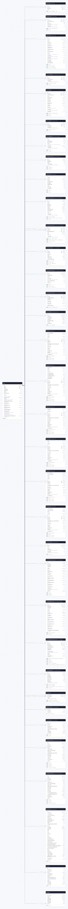

| Column                                                              | Type      | Constraints     | Default                            | Description |
| ------------------------------------------------------------------- | --------- | --------------- | ---------------------------------- | ----------- |
| `id`                                                                | `integer` | PK NOT NULL     |                                    |             |
| `name`                                                              | `text`    | NOT NULL        |                                    |             |
| `email`                                                             | `text`    | UNIQUE NOT NULL |                                    |             |
| `createdAt` (`created_at`)                                          | `text`    | NOT NULL        |                                    |             |
| `updatedAt` (`updated_at`)                                          | `text`    | NOT NULL        |                                    |             |
| `image`                                                             | `text`    | NULL            |                                    |             |
| `profileViews` (`profile_views`)                                    | `integer` | NOT NULL        | `.default(0)`                      |             |
| `role`                                                              | `text`    | NOT NULL        | `.default(RoleType.USER)`          |             |
| `emailVerified` (`email_verified`)                                  | `integer` | NOT NULL        |                                    |             |
| `privacy`                                                           | `text`    | NOT NULL        | `.default(PrivacyType.RESTRICTED)` |             |
| `hideAggregateRatings` (`hide_aggregate_ratings`)                   | `integer` | NOT NULL        | `.default(false)`                  |             |
| `gridListView` (`grid_list_view`)                                   | `integer` | NOT NULL        | `.default(true)`                   |             |
| `showOnboarding` (`show_onboarding`)                                | `integer` | NOT NULL        | `.default(true)`                   |             |
| `showUpdateModal` (`show_update_modal`)                             | `integer` | NOT NULL        | `.default(true)`                   |             |
| `backgroundImage` (`background_image`)                              | `text`    | NOT NULL        | `.default("default.jpg")`          |             |
| `ratingSystem` (`rating_system`)                                    | `text`    | NOT NULL        | `.default(RatingSystemType.SCORE)` |             |
| `searchSelector` (`search_selector`)                                | `text`    | NOT NULL        | `.default(ApiProviderType.TMDB)`   |             |
| `autoMoveCompletedTvToOnHold` (`auto_move_completed_tv_to_on_hold`) | `integer` | NOT NULL        | `.default(true)`                   |             |

#### Definition

```sql
CREATE TABLE `user` (
	`id` integer PRIMARY KEY,
	`name` text NOT NULL,
	`email` text NOT NULL UNIQUE,
	`created_at` text NOT NULL,
	`updated_at` text NOT NULL,
	`image` text,
	`profile_views` integer DEFAULT 0 NOT NULL,
	`role` text DEFAULT 'user' NOT NULL,
	`email_verified` integer NOT NULL,
	`privacy` text DEFAULT 'restricted' NOT NULL,
	`hide_aggregate_ratings` integer DEFAULT false NOT NULL,
	`grid_list_view` integer DEFAULT true NOT NULL,
	`show_onboarding` integer DEFAULT true NOT NULL,
	`show_update_modal` integer DEFAULT true NOT NULL,
	`background_image` text DEFAULT 'default.jpg' NOT NULL,
	`rating_system` text DEFAULT 'score' NOT NULL,
	`search_selector` text DEFAULT 'tmdb' NOT NULL,
	`auto_move_completed_tv_to_on_hold` integer DEFAULT true NOT NULL
);

CREATE UNIQUE INDEX `user_name_unique` ON `user` (`name`);
```

#### Indexes

- UNIQUE `name`

#### Referenced by

- `id` → [session.userId](#table-session) (one to many, on delete cascade)
- `id` → [account.userId](#table-account) (one to many, on delete cascade)
- `id` → [oauthClient.userId](#table-oauthClient) (one to many, on delete cascade)
- `id` → [oauthRefreshToken.userId](#table-oauthRefreshToken) (one to many, on delete cascade)
- `id` → [oauthAccessToken.userId](#table-oauthAccessToken) (one to many, on delete cascade)
- `id` → [oauthConsent.userId](#table-oauthConsent) (one to many, on delete cascade)
- `id` → [mcpRevocation.userId](#table-mcpRevocation) (one to many, on delete cascade)
- `id` → [followers.followerId](#table-followers) (one to many, on delete cascade)
- `id` → [followers.followedId](#table-followers) (one to many, on delete cascade)
- `id` → [userMediaUpdate.userId](#table-userMediaUpdate) (one to many, on delete cascade)
- `id` → [userMediaMonthlyActivity.userId](#table-userMediaMonthlyActivity) (one to many, on delete cascade)
- `id` → [userMediaSettings.userId](#table-userMediaSettings) (one to many, on delete cascade)
- `id` → [userMediaStatsHistory.userId](#table-userMediaStatsHistory) (one to many, on delete cascade)
- `id` → [profileCustom.userId](#table-profileCustom) (one to many, on delete cascade)
- `id` → [seriesList.userId](#table-seriesList) (one to many, on delete cascade)
- `id` → [seriesTags.userId](#table-seriesTags) (one to many, on delete cascade)
- `id` → [animeList.userId](#table-animeList) (one to many, on delete cascade)
- `id` → [animeTags.userId](#table-animeTags) (one to many, on delete cascade)
- `id` → [moviesList.userId](#table-moviesList) (one to many, on delete cascade)
- `id` → [moviesTags.userId](#table-moviesTags) (one to many, on delete cascade)
- `id` → [gamesList.userId](#table-gamesList) (one to many, on delete cascade)
- `id` → [gamesTags.userId](#table-gamesTags) (one to many, on delete cascade)
- `id` → [booksList.userId](#table-booksList) (one to many, on delete cascade)
- `id` → [booksTags.userId](#table-booksTags) (one to many, on delete cascade)
- `id` → [mangaList.userId](#table-mangaList) (one to many, on delete cascade)
- `id` → [mangaTags.userId](#table-mangaTags) (one to many, on delete cascade)
- `id` → [mediadleStats.userId](#table-mediadleStats) (one to many, on delete cascade)
- `id` → [userMediadleProgress.userId](#table-userMediadleProgress) (one to many, on delete cascade)
- `id` → [whichCameFirstRuns.userId](#table-whichCameFirstRuns) (one to one, on delete cascade)
- `id` → [userAchievement.userId](#table-userAchievement) (one to many, on delete cascade)
- `id` → [socialNotifications.actorId](#table-socialNotifications) (one to many, on delete cascade)
- `id` → [socialNotifications.userId](#table-socialNotifications) (one to many, on delete cascade)
- `id` → [mediaNotifications.userId](#table-mediaNotifications) (one to many, on delete cascade)
- `id` → [taskHistory.userId](#table-taskHistory) (one to many, on delete cascade)
- `id` → [mediaRefreshLog.userId](#table-mediaRefreshLog) (one to many, on delete cascade)
- `id` → [featureRequests.createdBy](#table-featureRequests) (one to many, on delete set null)
- `id` → [featureVotes.userId](#table-featureVotes) (one to many, on delete cascade)
- `id` → [collections.ownerId](#table-collections) (one to many, on delete cascade)
- `id` → [collectionLikes.userId](#table-collectionLikes) (one to many, on delete cascade)
- `id` → [importJobs.userId](#table-importJobs) (one to one, on delete cascade)
- `id` → [dynamicLists.userId](#table-dynamicLists) (one to many, on delete cascade)
- `id` → [mediaTags.userId](#table-mediaTags) (one to many, on delete cascade)

<details>
<summary>Queries and their SQL</summary>

**Select**: Every row of user.

```ts
db.select().from(user);
```

```sql
select "id", "name", "email", "created_at", "updated_at", "image", "profile_views", "role", "email_verified", "privacy", "hide_aggregate_ratings", "grid_list_view", "show_onboarding", "show_update_modal", "background_image", "rating_system", "search_selector", "auto_move_completed_tv_to_on_hold"
from "user"
```

**Count**: How many rows user has.

```ts
db.select({ count: count() }).from(user);
```

```sql
select count(*)
from "user"
```

**Find many**: The rows of user, through the relational query API.

```ts
db.query.user.findMany();
```

```sql
select "d0"."id" as "id", "d0"."name" as "name", "d0"."email" as "email", "d0"."created_at" as "createdAt", "d0"."updated_at" as "updatedAt", "d0"."image" as "image", "d0"."profile_views" as "profileViews", "d0"."role" as "role", "d0"."email_verified" as "emailVerified", "d0"."privacy" as "privacy", "d0"."hide_aggregate_ratings" as "hideAggregateRatings", "d0"."grid_list_view" as "gridListView", "d0"."show_onboarding" as "showOnboarding", "d0"."show_update_modal" as "showUpdateModal", "d0"."background_image" as "backgroundImage", "d0"."rating_system" as "ratingSystem", "d0"."search_selector" as "searchSelector", "d0"."auto_move_completed_tv_to_on_hold" as "autoMoveCompletedTvToOnHold"
from "user" as "d0"
```

**Find by primary key**: One row of user, through the relational query API.

```ts
db.query.user.findFirst({ where: { id: 1 } });
```

```sql
select "d0"."id" as "id", "d0"."name" as "name", "d0"."email" as "email", "d0"."created_at" as "createdAt", "d0"."updated_at" as "updatedAt", "d0"."image" as "image", "d0"."profile_views" as "profileViews", "d0"."role" as "role", "d0"."email_verified" as "emailVerified", "d0"."privacy" as "privacy", "d0"."hide_aggregate_ratings" as "hideAggregateRatings", "d0"."grid_list_view" as "gridListView", "d0"."show_onboarding" as "showOnboarding", "d0"."show_update_modal" as "showUpdateModal", "d0"."background_image" as "backgroundImage", "d0"."rating_system" as "ratingSystem", "d0"."search_selector" as "searchSelector", "d0"."auto_move_completed_tv_to_on_hold" as "autoMoveCompletedTvToOnHold"
from "user" as "d0"
where "d0"."id" = ?
limit ?
-- params: [1,1]
```

**Insert**: Adds a row to user, giving the columns that have no default.

```ts
db.insert(user).values({
  id: 1,
  name: "name",
  email: "email",
  createdAt: "createdAt",
  updatedAt: "updatedAt",
  emailVerified: 1,
});
```

```sql
insert into "user" ("id", "name", "email", "created_at", "updated_at", "image", "profile_views", "role", "email_verified", "privacy", "hide_aggregate_ratings", "grid_list_view", "show_onboarding", "show_update_modal", "background_image", "rating_system", "search_selector", "auto_move_completed_tv_to_on_hold")
values (?, ?, ?, ?, ?, null, ?, ?, ?, ?, ?, ?, ?, ?, ?, ?, ?, ?)
-- params: [1,"name","email","createdAt","updatedAt",0,"user",1,"restricted",0,1,1,1,"default.jpg","score","tmdb",1]
```

**Update**: Changes a row of user, found by its primary key.

```ts
db.update(user).set({ name: "name" }).where(eq(user.id, 1));
```

```sql
update "user"
set "name" = ?
where "user"."id" = ?
-- params: ["name",1]
```

**Delete**: Deletes a row of user, found by its primary key.

```ts
db.delete(user).where(eq(user.id, 1));
```

```sql
delete from "user"
where "user"."id" = ?
-- params: [1]
```

</details>

<a id="table-session"></a>

### session

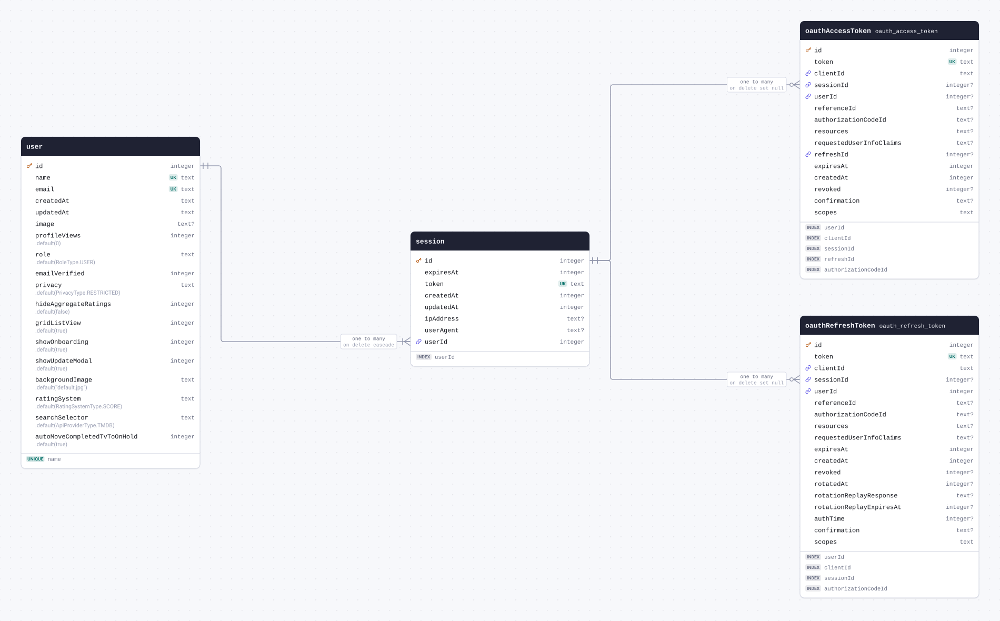

| Column                     | Type      | Constraints                       | Default | Description |
| -------------------------- | --------- | --------------------------------- | ------- | ----------- |
| `id`                       | `integer` | PK NOT NULL                       |         |             |
| `expiresAt` (`expires_at`) | `integer` | NOT NULL                          |         |             |
| `token`                    | `text`    | UNIQUE NOT NULL                   |         |             |
| `createdAt` (`created_at`) | `integer` | NOT NULL                          |         |             |
| `updatedAt` (`updated_at`) | `integer` | NOT NULL                          |         |             |
| `ipAddress` (`ip_address`) | `text`    | NULL                              |         |             |
| `userAgent` (`user_agent`) | `text`    | NULL                              |         |             |
| `userId` (`user_id`)       | `integer` | NOT NULL → [user.id](#table-user) |         |             |

#### Definition

```sql
CREATE TABLE `session` (
	`id` integer PRIMARY KEY,
	`expires_at` integer NOT NULL,
	`token` text NOT NULL UNIQUE,
	`created_at` integer NOT NULL,
	`updated_at` integer NOT NULL,
	`ip_address` text,
	`user_agent` text,
	`user_id` integer NOT NULL,
	CONSTRAINT `fk_session_user_id_user_id_fk` FOREIGN KEY (`user_id`) REFERENCES `user`(`id`) ON DELETE CASCADE
);

CREATE INDEX `session_user_id_idx` ON `session` (`user_id`);
```

#### Indexes

- INDEX `userId`

#### References

- `userId` → [user.id](#table-user) (many to one, on delete cascade)

#### Referenced by

- `id` → [oauthRefreshToken.sessionId](#table-oauthRefreshToken) (one to many, on delete set null)
- `id` → [oauthAccessToken.sessionId](#table-oauthAccessToken) (one to many, on delete set null)

<details>
<summary>Queries and their SQL</summary>

**Select**: Every row of session.

```ts
db.select().from(session);
```

```sql
select "id", "expires_at", "token", "created_at", "updated_at", "ip_address", "user_agent", "user_id"
from "session"
```

**Count**: How many rows session has.

```ts
db.select({ count: count() }).from(session);
```

```sql
select count(*)
from "session"
```

**Find many**: The rows of session, through the relational query API.

```ts
db.query.session.findMany();
```

```sql
select "d0"."id" as "id", "d0"."expires_at" as "expiresAt", "d0"."token" as "token", "d0"."created_at" as "createdAt", "d0"."updated_at" as "updatedAt", "d0"."ip_address" as "ipAddress", "d0"."user_agent" as "userAgent", "d0"."user_id" as "userId"
from "session" as "d0"
```

**Find by primary key**: One row of session, through the relational query API.

```ts
db.query.session.findFirst({ where: { id: 1 } });
```

```sql
select "d0"."id" as "id", "d0"."expires_at" as "expiresAt", "d0"."token" as "token", "d0"."created_at" as "createdAt", "d0"."updated_at" as "updatedAt", "d0"."ip_address" as "ipAddress", "d0"."user_agent" as "userAgent", "d0"."user_id" as "userId"
from "session" as "d0"
where "d0"."id" = ?
limit ?
-- params: [1,1]
```

**Insert**: Adds a row to session, giving the columns that have no default.

```ts
db.insert(session).values({
  id: 1,
  expiresAt: 1,
  token: "token",
  createdAt: 1,
  updatedAt: 1,
  userId: 1,
});
```

```sql
insert into "session" ("id", "expires_at", "token", "created_at", "updated_at", "ip_address", "user_agent", "user_id")
values (?, ?, ?, ?, ?, null, null, ?)
-- params: [1,1,"token",1,1,1]
```

**Update**: Changes a row of session, found by its primary key.

```ts
db.update(session).set({ expiresAt: 1 }).where(eq(session.id, 1));
```

```sql
update "session"
set "expires_at" = ?
where "session"."id" = ?
-- params: [1,1]
```

**Delete**: Deletes a row of session, found by its primary key.

```ts
db.delete(session).where(eq(session.id, 1));
```

```sql
delete from "session"
where "session"."id" = ?
-- params: [1]
```

</details>

<a id="table-account"></a>

### account

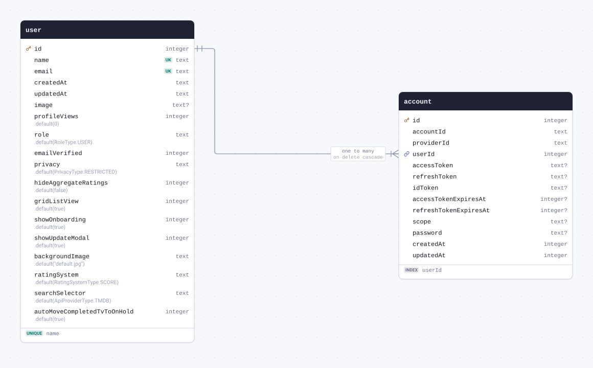

| Column                                               | Type      | Constraints                       | Default | Description |
| ---------------------------------------------------- | --------- | --------------------------------- | ------- | ----------- |
| `id`                                                 | `integer` | PK NOT NULL                       |         |             |
| `accountId` (`account_id`)                           | `text`    | NOT NULL                          |         |             |
| `providerId` (`provider_id`)                         | `text`    | NOT NULL                          |         |             |
| `userId` (`user_id`)                                 | `integer` | NOT NULL → [user.id](#table-user) |         |             |
| `accessToken` (`access_token`)                       | `text`    | NULL                              |         |             |
| `refreshToken` (`refresh_token`)                     | `text`    | NULL                              |         |             |
| `idToken` (`id_token`)                               | `text`    | NULL                              |         |             |
| `accessTokenExpiresAt` (`access_token_expires_at`)   | `integer` | NULL                              |         |             |
| `refreshTokenExpiresAt` (`refresh_token_expires_at`) | `integer` | NULL                              |         |             |
| `scope`                                              | `text`    | NULL                              |         |             |
| `password`                                           | `text`    | NULL                              |         |             |
| `createdAt` (`created_at`)                           | `integer` | NOT NULL                          |         |             |
| `updatedAt` (`updated_at`)                           | `integer` | NOT NULL                          |         |             |

#### Definition

```sql
CREATE TABLE `account` (
	`id` integer PRIMARY KEY,
	`account_id` text NOT NULL,
	`provider_id` text NOT NULL,
	`user_id` integer NOT NULL,
	`access_token` text,
	`refresh_token` text,
	`id_token` text,
	`access_token_expires_at` integer,
	`refresh_token_expires_at` integer,
	`scope` text,
	`password` text,
	`created_at` integer NOT NULL,
	`updated_at` integer NOT NULL,
	CONSTRAINT `fk_account_user_id_user_id_fk` FOREIGN KEY (`user_id`) REFERENCES `user`(`id`) ON DELETE CASCADE
);

CREATE INDEX `account_user_id_idx` ON `account` (`user_id`);
```

#### Indexes

- INDEX `userId`

#### References

- `userId` → [user.id](#table-user) (many to one, on delete cascade)

<details>
<summary>Queries and their SQL</summary>

**Select**: Every row of account.

```ts
db.select().from(account);
```

```sql
select "id", "account_id", "provider_id", "user_id", "access_token", "refresh_token", "id_token", "access_token_expires_at", "refresh_token_expires_at", "scope", "password", "created_at", "updated_at"
from "account"
```

**Count**: How many rows account has.

```ts
db.select({ count: count() }).from(account);
```

```sql
select count(*)
from "account"
```

**Find many**: The rows of account, through the relational query API.

```ts
db.query.account.findMany();
```

```sql
select "d0"."id" as "id", "d0"."account_id" as "accountId", "d0"."provider_id" as "providerId", "d0"."user_id" as "userId", "d0"."access_token" as "accessToken", "d0"."refresh_token" as "refreshToken", "d0"."id_token" as "idToken", "d0"."access_token_expires_at" as "accessTokenExpiresAt", "d0"."refresh_token_expires_at" as "refreshTokenExpiresAt", "d0"."scope" as "scope", "d0"."password" as "password", "d0"."created_at" as "createdAt", "d0"."updated_at" as "updatedAt"
from "account" as "d0"
```

**Find by primary key**: One row of account, through the relational query API.

```ts
db.query.account.findFirst({ where: { id: 1 } });
```

```sql
select "d0"."id" as "id", "d0"."account_id" as "accountId", "d0"."provider_id" as "providerId", "d0"."user_id" as "userId", "d0"."access_token" as "accessToken", "d0"."refresh_token" as "refreshToken", "d0"."id_token" as "idToken", "d0"."access_token_expires_at" as "accessTokenExpiresAt", "d0"."refresh_token_expires_at" as "refreshTokenExpiresAt", "d0"."scope" as "scope", "d0"."password" as "password", "d0"."created_at" as "createdAt", "d0"."updated_at" as "updatedAt"
from "account" as "d0"
where "d0"."id" = ?
limit ?
-- params: [1,1]
```

**Insert**: Adds a row to account, giving the columns that have no default.

```ts
db.insert(account).values({
  id: 1,
  accountId: "accountId",
  providerId: "providerId",
  userId: 1,
  createdAt: 1,
  updatedAt: 1,
});
```

```sql
insert into "account" ("id", "account_id", "provider_id", "user_id", "access_token", "refresh_token", "id_token", "access_token_expires_at", "refresh_token_expires_at", "scope", "password", "created_at", "updated_at")
values (?, ?, ?, ?, null, null, null, null, null, null, null, ?, ?)
-- params: [1,"accountId","providerId",1,1,1]
```

**Update**: Changes a row of account, found by its primary key.

```ts
db.update(account).set({ accountId: "accountId" }).where(eq(account.id, 1));
```

```sql
update "account"
set "account_id" = ?
where "account"."id" = ?
-- params: ["accountId",1]
```

**Delete**: Deletes a row of account, found by its primary key.

```ts
db.delete(account).where(eq(account.id, 1));
```

```sql
delete from "account"
where "account"."id" = ?
-- params: [1]
```

</details>

<a id="table-verification"></a>

### verification

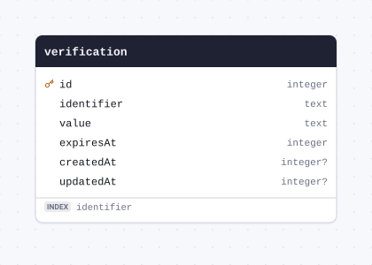

| Column                     | Type      | Constraints | Default | Description |
| -------------------------- | --------- | ----------- | ------- | ----------- |
| `id`                       | `integer` | PK NOT NULL |         |             |
| `identifier`               | `text`    | NOT NULL    |         |             |
| `value`                    | `text`    | NOT NULL    |         |             |
| `expiresAt` (`expires_at`) | `integer` | NOT NULL    |         |             |
| `createdAt` (`created_at`) | `integer` | NULL        |         |             |
| `updatedAt` (`updated_at`) | `integer` | NULL        |         |             |

#### Definition

```sql
CREATE TABLE `verification` (
	`id` integer PRIMARY KEY,
	`identifier` text NOT NULL,
	`value` text NOT NULL,
	`expires_at` integer NOT NULL,
	`created_at` integer,
	`updated_at` integer
);

CREATE INDEX `verification_identifier_idx` ON `verification` (`identifier`);
```

#### Indexes

- INDEX `identifier`

<details>
<summary>Queries and their SQL</summary>

**Select**: Every row of verification.

```ts
db.select().from(verification);
```

```sql
select "id", "identifier", "value", "expires_at", "created_at", "updated_at"
from "verification"
```

**Count**: How many rows verification has.

```ts
db.select({ count: count() }).from(verification);
```

```sql
select count(*)
from "verification"
```

**Find many**: The rows of verification, through the relational query API.

```ts
db.query.verification.findMany();
```

```sql
select "d0"."id" as "id", "d0"."identifier" as "identifier", "d0"."value" as "value", "d0"."expires_at" as "expiresAt", "d0"."created_at" as "createdAt", "d0"."updated_at" as "updatedAt"
from "verification" as "d0"
```

**Find by primary key**: One row of verification, through the relational query API.

```ts
db.query.verification.findFirst({ where: { id: 1 } });
```

```sql
select "d0"."id" as "id", "d0"."identifier" as "identifier", "d0"."value" as "value", "d0"."expires_at" as "expiresAt", "d0"."created_at" as "createdAt", "d0"."updated_at" as "updatedAt"
from "verification" as "d0"
where "d0"."id" = ?
limit ?
-- params: [1,1]
```

**Insert**: Adds a row to verification, giving the columns that have no default.

```ts
db.insert(verification).values({ id: 1, identifier: "identifier", value: "value", expiresAt: 1 });
```

```sql
insert into "verification" ("id", "identifier", "value", "expires_at", "created_at", "updated_at")
values (?, ?, ?, ?, null, null)
-- params: [1,"identifier","value",1]
```

**Update**: Changes a row of verification, found by its primary key.

```ts
db.update(verification).set({ identifier: "identifier" }).where(eq(verification.id, 1));
```

```sql
update "verification"
set "identifier" = ?
where "verification"."id" = ?
-- params: ["identifier",1]
```

**Delete**: Deletes a row of verification, found by its primary key.

```ts
db.delete(verification).where(eq(verification.id, 1));
```

```sql
delete from "verification"
where "verification"."id" = ?
-- params: [1]
```

</details>

<a id="table-jwks"></a>

### jwks

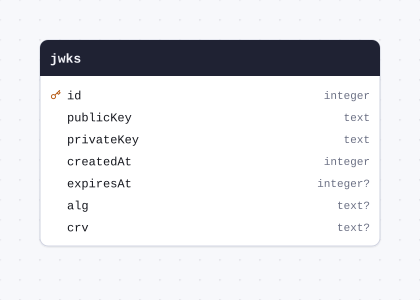

| Column                       | Type      | Constraints | Default | Description |
| ---------------------------- | --------- | ----------- | ------- | ----------- |
| `id`                         | `integer` | PK NOT NULL |         |             |
| `publicKey` (`public_key`)   | `text`    | NOT NULL    |         |             |
| `privateKey` (`private_key`) | `text`    | NOT NULL    |         |             |
| `createdAt` (`created_at`)   | `integer` | NOT NULL    |         |             |
| `expiresAt` (`expires_at`)   | `integer` | NULL        |         |             |
| `alg`                        | `text`    | NULL        |         |             |
| `crv`                        | `text`    | NULL        |         |             |

#### Definition

```sql
CREATE TABLE `jwks` (
	`id` integer PRIMARY KEY,
	`public_key` text NOT NULL,
	`private_key` text NOT NULL,
	`created_at` integer NOT NULL,
	`expires_at` integer,
	`alg` text,
	`crv` text
);
```

<details>
<summary>Queries and their SQL</summary>

**Select**: Every row of jwks.

```ts
db.select().from(jwks);
```

```sql
select "id", "public_key", "private_key", "created_at", "expires_at", "alg", "crv"
from "jwks"
```

**Count**: How many rows jwks has.

```ts
db.select({ count: count() }).from(jwks);
```

```sql
select count(*)
from "jwks"
```

**Find many**: The rows of jwks, through the relational query API.

```ts
db.query.jwks.findMany();
```

```sql
select "d0"."id" as "id", "d0"."public_key" as "publicKey", "d0"."private_key" as "privateKey", "d0"."created_at" as "createdAt", "d0"."expires_at" as "expiresAt", "d0"."alg" as "alg", "d0"."crv" as "crv"
from "jwks" as "d0"
```

**Find by primary key**: One row of jwks, through the relational query API.

```ts
db.query.jwks.findFirst({ where: { id: 1 } });
```

```sql
select "d0"."id" as "id", "d0"."public_key" as "publicKey", "d0"."private_key" as "privateKey", "d0"."created_at" as "createdAt", "d0"."expires_at" as "expiresAt", "d0"."alg" as "alg", "d0"."crv" as "crv"
from "jwks" as "d0"
where "d0"."id" = ?
limit ?
-- params: [1,1]
```

**Insert**: Adds a row to jwks, giving the columns that have no default.

```ts
db.insert(jwks).values({ id: 1, publicKey: "publicKey", privateKey: "privateKey", createdAt: 1 });
```

```sql
insert into "jwks" ("id", "public_key", "private_key", "created_at", "expires_at", "alg", "crv")
values (?, ?, ?, ?, null, null, null)
-- params: [1,"publicKey","privateKey",1]
```

**Update**: Changes a row of jwks, found by its primary key.

```ts
db.update(jwks).set({ publicKey: "publicKey" }).where(eq(jwks.id, 1));
```

```sql
update "jwks"
set "public_key" = ?
where "jwks"."id" = ?
-- params: ["publicKey",1]
```

**Delete**: Deletes a row of jwks, found by its primary key.

```ts
db.delete(jwks).where(eq(jwks.id, 1));
```

```sql
delete from "jwks"
where "jwks"."id" = ?
-- params: [1]
```

</details>

<a id="table-oauthClient"></a>

### oauthClient

Table `oauth_client`.

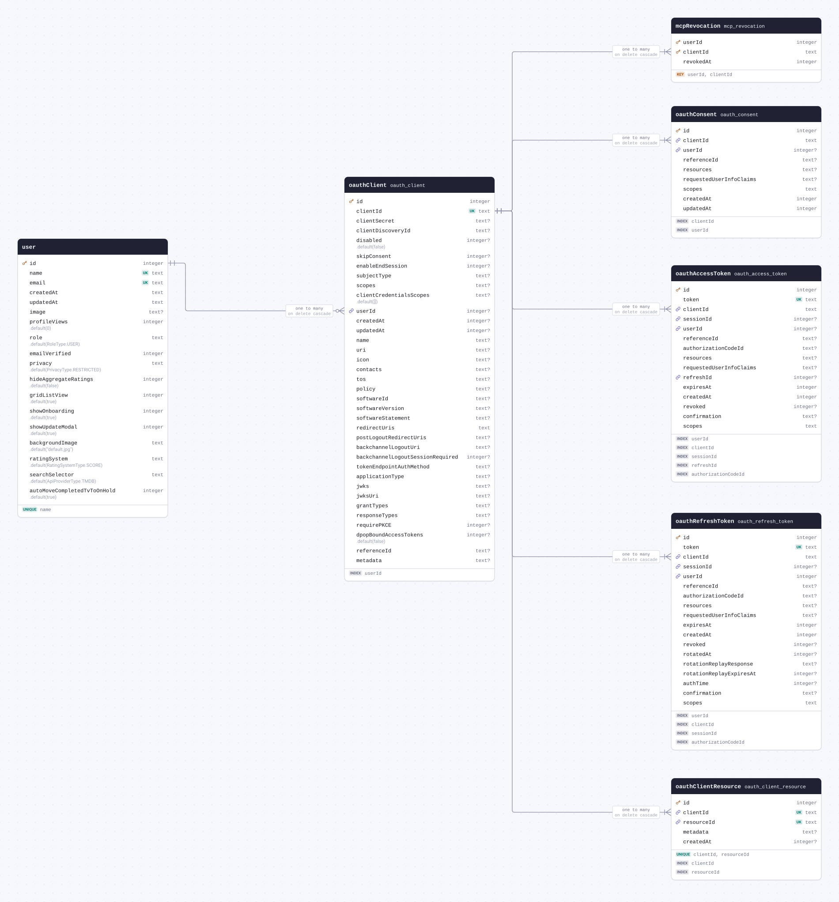

| Column                                                                     | Type      | Constraints                   | Default           | Description |
| -------------------------------------------------------------------------- | --------- | ----------------------------- | ----------------- | ----------- |
| `id`                                                                       | `integer` | PK NOT NULL                   |                   |             |
| `clientId` (`client_id`)                                                   | `text`    | UNIQUE NOT NULL               |                   |             |
| `clientSecret` (`client_secret`)                                           | `text`    | NULL                          |                   |             |
| `clientDiscoveryId` (`client_discovery_id`)                                | `text`    | NULL                          |                   |             |
| `disabled`                                                                 | `integer` | NULL                          | `.default(false)` |             |
| `skipConsent` (`skip_consent`)                                             | `integer` | NULL                          |                   |             |
| `enableEndSession` (`enable_end_session`)                                  | `integer` | NULL                          |                   |             |
| `subjectType` (`subject_type`)                                             | `text`    | NULL                          |                   |             |
| `scopes`                                                                   | `text`    | NULL                          |                   |             |
| `clientCredentialsScopes` (`client_credentials_scopes`)                    | `text`    | NULL                          | `.default([])`    |             |
| `userId` (`user_id`)                                                       | `integer` | NULL → [user.id](#table-user) |                   |             |
| `createdAt` (`created_at`)                                                 | `integer` | NULL                          |                   |             |
| `updatedAt` (`updated_at`)                                                 | `integer` | NULL                          |                   |             |
| `name`                                                                     | `text`    | NULL                          |                   |             |
| `uri`                                                                      | `text`    | NULL                          |                   |             |
| `icon`                                                                     | `text`    | NULL                          |                   |             |
| `contacts`                                                                 | `text`    | NULL                          |                   |             |
| `tos`                                                                      | `text`    | NULL                          |                   |             |
| `policy`                                                                   | `text`    | NULL                          |                   |             |
| `softwareId` (`software_id`)                                               | `text`    | NULL                          |                   |             |
| `softwareVersion` (`software_version`)                                     | `text`    | NULL                          |                   |             |
| `softwareStatement` (`software_statement`)                                 | `text`    | NULL                          |                   |             |
| `redirectUris` (`redirect_uris`)                                           | `text`    | NOT NULL                      |                   |             |
| `postLogoutRedirectUris` (`post_logout_redirect_uris`)                     | `text`    | NULL                          |                   |             |
| `backchannelLogoutUri` (`backchannel_logout_uri`)                          | `text`    | NULL                          |                   |             |
| `backchannelLogoutSessionRequired` (`backchannel_logout_session_required`) | `integer` | NULL                          |                   |             |
| `tokenEndpointAuthMethod` (`token_endpoint_auth_method`)                   | `text`    | NULL                          |                   |             |
| `applicationType` (`application_type`)                                     | `text`    | NULL                          |                   |             |
| `jwks`                                                                     | `text`    | NULL                          |                   |             |
| `jwksUri` (`jwks_uri`)                                                     | `text`    | NULL                          |                   |             |
| `grantTypes` (`grant_types`)                                               | `text`    | NULL                          |                   |             |
| `responseTypes` (`response_types`)                                         | `text`    | NULL                          |                   |             |
| `requirePKCE` (`require_pkce`)                                             | `integer` | NULL                          |                   |             |
| `dpopBoundAccessTokens` (`dpop_bound_access_tokens`)                       | `integer` | NULL                          | `.default(false)` |             |
| `referenceId` (`reference_id`)                                             | `text`    | NULL                          |                   |             |
| `metadata`                                                                 | `text`    | NULL                          |                   |             |

#### Definition

```sql
CREATE TABLE `oauth_client` (
	`id` integer PRIMARY KEY,
	`client_id` text NOT NULL UNIQUE,
	`client_secret` text,
	`client_discovery_id` text,
	`disabled` integer DEFAULT false,
	`skip_consent` integer,
	`enable_end_session` integer,
	`subject_type` text,
	`scopes` text,
	`client_credentials_scopes` text DEFAULT '[]',
	`user_id` integer,
	`created_at` integer,
	`updated_at` integer,
	`name` text,
	`uri` text,
	`icon` text,
	`contacts` text,
	`tos` text,
	`policy` text,
	`software_id` text,
	`software_version` text,
	`software_statement` text,
	`redirect_uris` text NOT NULL,
	`post_logout_redirect_uris` text,
	`backchannel_logout_uri` text,
	`backchannel_logout_session_required` integer,
	`token_endpoint_auth_method` text,
	`application_type` text,
	`jwks` text,
	`jwks_uri` text,
	`grant_types` text,
	`response_types` text,
	`require_pkce` integer,
	`dpop_bound_access_tokens` integer DEFAULT false,
	`reference_id` text,
	`metadata` text,
	CONSTRAINT `fk_oauth_client_user_id_user_id_fk` FOREIGN KEY (`user_id`) REFERENCES `user`(`id`) ON DELETE CASCADE
);

CREATE INDEX `oauthClient_userId_idx` ON `oauth_client` (`user_id`);
```

#### Indexes

- INDEX `userId`

#### References

- `userId` → [user.id](#table-user) (many to one, on delete cascade)

#### Referenced by

- `clientId` → [oauthClientResource.clientId](#table-oauthClientResource) (one to many, on delete cascade)
- `clientId` → [oauthRefreshToken.clientId](#table-oauthRefreshToken) (one to many, on delete cascade)
- `clientId` → [oauthAccessToken.clientId](#table-oauthAccessToken) (one to many, on delete cascade)
- `clientId` → [oauthConsent.clientId](#table-oauthConsent) (one to many, on delete cascade)
- `clientId` → [mcpRevocation.clientId](#table-mcpRevocation) (one to many, on delete cascade)

<details>
<summary>Queries and their SQL</summary>

**Select**: Every row of oauthClient.

```ts
db.select().from(oauthClient);
```

```sql
select "id", "client_id", "client_secret", "client_discovery_id", "disabled", "skip_consent", "enable_end_session", "subject_type", "scopes", "client_credentials_scopes", "user_id", "created_at", "updated_at", "name", "uri", "icon", "contacts", "tos", "policy", "software_id", "software_version", "software_statement", "redirect_uris", "post_logout_redirect_uris", "backchannel_logout_uri", "backchannel_logout_session_required", "token_endpoint_auth_method", "application_type", "jwks", "jwks_uri", "grant_types", "response_types", "require_pkce", "dpop_bound_access_tokens", "reference_id", "metadata"
from "oauth_client"
```

**Count**: How many rows oauthClient has.

```ts
db.select({ count: count() }).from(oauthClient);
```

```sql
select count(*)
from "oauth_client"
```

**Find many**: The rows of oauthClient, through the relational query API.

```ts
db.query.oauthClient.findMany();
```

```sql
select "d0"."id" as "id", "d0"."client_id" as "clientId", "d0"."client_secret" as "clientSecret", "d0"."client_discovery_id" as "clientDiscoveryId", "d0"."disabled" as "disabled", "d0"."skip_consent" as "skipConsent", "d0"."enable_end_session" as "enableEndSession", "d0"."subject_type" as "subjectType", "d0"."scopes" as "scopes", "d0"."client_credentials_scopes" as "clientCredentialsScopes", "d0"."user_id" as "userId", "d0"."created_at" as "createdAt", "d0"."updated_at" as "updatedAt", "d0"."name" as "name", "d0"."uri" as "uri", "d0"."icon" as "icon", "d0"."contacts" as "contacts", "d0"."tos" as "tos", "d0"."policy" as "policy", "d0"."software_id" as "softwareId", "d0"."software_version" as "softwareVersion", "d0"."software_statement" as "softwareStatement", "d0"."redirect_uris" as "redirectUris", "d0"."post_logout_redirect_uris" as "postLogoutRedirectUris", "d0"."backchannel_logout_uri" as "backchannelLogoutUri", "d0"."backchannel_logout_session_required" as "backchannelLogoutSessionRequired", "d0"."token_endpoint_auth_method" as "tokenEndpointAuthMethod", "d0"."application_type" as "applicationType", "d0"."jwks" as "jwks", "d0"."jwks_uri" as "jwksUri", "d0"."grant_types" as "grantTypes", "d0"."response_types" as "responseTypes", "d0"."require_pkce" as "requirePKCE", "d0"."dpop_bound_access_tokens" as "dpopBoundAccessTokens", "d0"."reference_id" as "referenceId", "d0"."metadata" as "metadata"
from "oauth_client" as "d0"
```

**Find by primary key**: One row of oauthClient, through the relational query API.

```ts
db.query.oauthClient.findFirst({ where: { id: 1 } });
```

```sql
select "d0"."id" as "id", "d0"."client_id" as "clientId", "d0"."client_secret" as "clientSecret", "d0"."client_discovery_id" as "clientDiscoveryId", "d0"."disabled" as "disabled", "d0"."skip_consent" as "skipConsent", "d0"."enable_end_session" as "enableEndSession", "d0"."subject_type" as "subjectType", "d0"."scopes" as "scopes", "d0"."client_credentials_scopes" as "clientCredentialsScopes", "d0"."user_id" as "userId", "d0"."created_at" as "createdAt", "d0"."updated_at" as "updatedAt", "d0"."name" as "name", "d0"."uri" as "uri", "d0"."icon" as "icon", "d0"."contacts" as "contacts", "d0"."tos" as "tos", "d0"."policy" as "policy", "d0"."software_id" as "softwareId", "d0"."software_version" as "softwareVersion", "d0"."software_statement" as "softwareStatement", "d0"."redirect_uris" as "redirectUris", "d0"."post_logout_redirect_uris" as "postLogoutRedirectUris", "d0"."backchannel_logout_uri" as "backchannelLogoutUri", "d0"."backchannel_logout_session_required" as "backchannelLogoutSessionRequired", "d0"."token_endpoint_auth_method" as "tokenEndpointAuthMethod", "d0"."application_type" as "applicationType", "d0"."jwks" as "jwks", "d0"."jwks_uri" as "jwksUri", "d0"."grant_types" as "grantTypes", "d0"."response_types" as "responseTypes", "d0"."require_pkce" as "requirePKCE", "d0"."dpop_bound_access_tokens" as "dpopBoundAccessTokens", "d0"."reference_id" as "referenceId", "d0"."metadata" as "metadata"
from "oauth_client" as "d0"
where "d0"."id" = ?
limit ?
-- params: [1,1]
```

**Insert**: Adds a row to oauthClient, giving the columns that have no default.

```ts
db.insert(oauthClient).values({ id: 1, clientId: "clientId", redirectUris: "redirectUris" });
```

```sql
insert into "oauth_client" ("id", "client_id", "client_secret", "client_discovery_id", "disabled", "skip_consent", "enable_end_session", "subject_type", "scopes", "client_credentials_scopes", "user_id", "created_at", "updated_at", "name", "uri", "icon", "contacts", "tos", "policy", "software_id", "software_version", "software_statement", "redirect_uris", "post_logout_redirect_uris", "backchannel_logout_uri", "backchannel_logout_session_required", "token_endpoint_auth_method", "application_type", "jwks", "jwks_uri", "grant_types", "response_types", "require_pkce", "dpop_bound_access_tokens", "reference_id", "metadata")
values (?, ?, null, null, ?, null, null, null, null, ?, null, null, null, null, null, null, null, null, null, null, null, null, ?, null, null, null, null, null, null, null, null, null, null, ?, null, null)
-- params: [1,"clientId",0,"[]","redirectUris",0]
```

**Update**: Changes a row of oauthClient, found by its primary key.

```ts
db.update(oauthClient).set({ clientId: "clientId" }).where(eq(oauthClient.id, 1));
```

```sql
update "oauth_client"
set "client_id" = ?
where "oauth_client"."id" = ?
-- params: ["clientId",1]
```

**Delete**: Deletes a row of oauthClient, found by its primary key.

```ts
db.delete(oauthClient).where(eq(oauthClient.id, 1));
```

```sql
delete from "oauth_client"
where "oauth_client"."id" = ?
-- params: [1]
```

</details>

<a id="table-oauthResource"></a>

### oauthResource

Table `oauth_resource`.

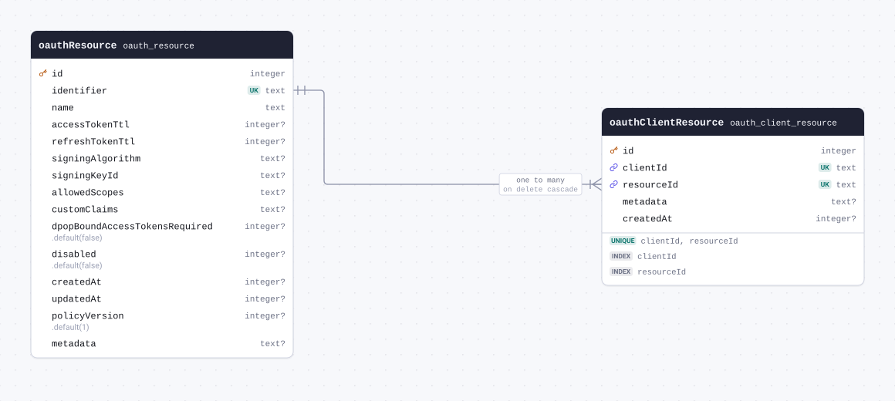

| Column                                                                | Type      | Constraints     | Default           | Description |
| --------------------------------------------------------------------- | --------- | --------------- | ----------------- | ----------- |
| `id`                                                                  | `integer` | PK NOT NULL     |                   |             |
| `identifier`                                                          | `text`    | UNIQUE NOT NULL |                   |             |
| `name`                                                                | `text`    | NOT NULL        |                   |             |
| `accessTokenTtl` (`access_token_ttl`)                                 | `integer` | NULL            |                   |             |
| `refreshTokenTtl` (`refresh_token_ttl`)                               | `integer` | NULL            |                   |             |
| `signingAlgorithm` (`signing_algorithm`)                              | `text`    | NULL            |                   |             |
| `signingKeyId` (`signing_key_id`)                                     | `text`    | NULL            |                   |             |
| `allowedScopes` (`allowed_scopes`)                                    | `text`    | NULL            |                   |             |
| `customClaims` (`custom_claims`)                                      | `text`    | NULL            |                   |             |
| `dpopBoundAccessTokensRequired` (`dpop_bound_access_tokens_required`) | `integer` | NULL            | `.default(false)` |             |
| `disabled`                                                            | `integer` | NULL            | `.default(false)` |             |
| `createdAt` (`created_at`)                                            | `integer` | NULL            |                   |             |
| `updatedAt` (`updated_at`)                                            | `integer` | NULL            |                   |             |
| `policyVersion` (`policy_version`)                                    | `integer` | NULL            | `.default(1)`     |             |
| `metadata`                                                            | `text`    | NULL            |                   |             |

#### Definition

```sql
CREATE TABLE `oauth_resource` (
	`id` integer PRIMARY KEY,
	`identifier` text NOT NULL UNIQUE,
	`name` text NOT NULL,
	`access_token_ttl` integer,
	`refresh_token_ttl` integer,
	`signing_algorithm` text,
	`signing_key_id` text,
	`allowed_scopes` text,
	`custom_claims` text,
	`dpop_bound_access_tokens_required` integer DEFAULT false,
	`disabled` integer DEFAULT false,
	`created_at` integer,
	`updated_at` integer,
	`policy_version` integer DEFAULT 1,
	`metadata` text
);
```

#### Referenced by

- `identifier` → [oauthClientResource.resourceId](#table-oauthClientResource) (one to many, on delete cascade)

<details>
<summary>Queries and their SQL</summary>

**Select**: Every row of oauthResource.

```ts
db.select().from(oauthResource);
```

```sql
select "id", "identifier", "name", "access_token_ttl", "refresh_token_ttl", "signing_algorithm", "signing_key_id", "allowed_scopes", "custom_claims", "dpop_bound_access_tokens_required", "disabled", "created_at", "updated_at", "policy_version", "metadata"
from "oauth_resource"
```

**Count**: How many rows oauthResource has.

```ts
db.select({ count: count() }).from(oauthResource);
```

```sql
select count(*)
from "oauth_resource"
```

**Find many**: The rows of oauthResource, through the relational query API.

```ts
db.query.oauthResource.findMany();
```

```sql
select "d0"."id" as "id", "d0"."identifier" as "identifier", "d0"."name" as "name", "d0"."access_token_ttl" as "accessTokenTtl", "d0"."refresh_token_ttl" as "refreshTokenTtl", "d0"."signing_algorithm" as "signingAlgorithm", "d0"."signing_key_id" as "signingKeyId", "d0"."allowed_scopes" as "allowedScopes", "d0"."custom_claims" as "customClaims", "d0"."dpop_bound_access_tokens_required" as "dpopBoundAccessTokensRequired", "d0"."disabled" as "disabled", "d0"."created_at" as "createdAt", "d0"."updated_at" as "updatedAt", "d0"."policy_version" as "policyVersion", "d0"."metadata" as "metadata"
from "oauth_resource" as "d0"
```

**Find by primary key**: One row of oauthResource, through the relational query API.

```ts
db.query.oauthResource.findFirst({ where: { id: 1 } });
```

```sql
select "d0"."id" as "id", "d0"."identifier" as "identifier", "d0"."name" as "name", "d0"."access_token_ttl" as "accessTokenTtl", "d0"."refresh_token_ttl" as "refreshTokenTtl", "d0"."signing_algorithm" as "signingAlgorithm", "d0"."signing_key_id" as "signingKeyId", "d0"."allowed_scopes" as "allowedScopes", "d0"."custom_claims" as "customClaims", "d0"."dpop_bound_access_tokens_required" as "dpopBoundAccessTokensRequired", "d0"."disabled" as "disabled", "d0"."created_at" as "createdAt", "d0"."updated_at" as "updatedAt", "d0"."policy_version" as "policyVersion", "d0"."metadata" as "metadata"
from "oauth_resource" as "d0"
where "d0"."id" = ?
limit ?
-- params: [1,1]
```

**Insert**: Adds a row to oauthResource, giving the columns that have no default.

```ts
db.insert(oauthResource).values({ id: 1, identifier: "identifier", name: "name" });
```

```sql
insert into "oauth_resource" ("id", "identifier", "name", "access_token_ttl", "refresh_token_ttl", "signing_algorithm", "signing_key_id", "allowed_scopes", "custom_claims", "dpop_bound_access_tokens_required", "disabled", "created_at", "updated_at", "policy_version", "metadata")
values (?, ?, ?, null, null, null, null, null, null, ?, ?, null, null, ?, null)
-- params: [1,"identifier","name",0,0,1]
```

**Update**: Changes a row of oauthResource, found by its primary key.

```ts
db.update(oauthResource).set({ identifier: "identifier" }).where(eq(oauthResource.id, 1));
```

```sql
update "oauth_resource"
set "identifier" = ?
where "oauth_resource"."id" = ?
-- params: ["identifier",1]
```

**Delete**: Deletes a row of oauthResource, found by its primary key.

```ts
db.delete(oauthResource).where(eq(oauthResource.id, 1));
```

```sql
delete from "oauth_resource"
where "oauth_resource"."id" = ?
-- params: [1]
```

</details>

<a id="table-oauthClientResource"></a>

### oauthClientResource

Table `oauth_client_resource`.

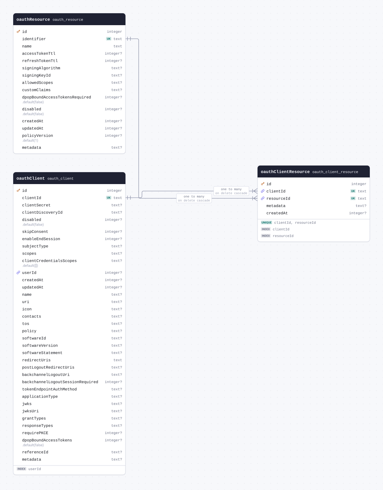

| Column                       | Type      | Constraints                                                 | Default | Description |
| ---------------------------- | --------- | ----------------------------------------------------------- | ------- | ----------- |
| `id`                         | `integer` | PK NOT NULL                                                 |         |             |
| `clientId` (`client_id`)     | `text`    | NOT NULL → [oauthClient.clientId](#table-oauthClient)       |         |             |
| `resourceId` (`resource_id`) | `text`    | NOT NULL → [oauthResource.identifier](#table-oauthResource) |         |             |
| `metadata`                   | `text`    | NULL                                                        |         |             |
| `createdAt` (`created_at`)   | `integer` | NULL                                                        |         |             |

#### Definition

```sql
CREATE TABLE `oauth_client_resource` (
	`id` integer PRIMARY KEY,
	`client_id` text NOT NULL,
	`resource_id` text NOT NULL,
	`metadata` text,
	`created_at` integer,
	CONSTRAINT `fk_oauth_client_resource_client_id_oauth_client_client_id_fk` FOREIGN KEY (`client_id`) REFERENCES `oauth_client`(`client_id`) ON DELETE CASCADE,
	CONSTRAINT `fk_oauth_client_resource_resource_id_oauth_resource_identifier_fk` FOREIGN KEY (`resource_id`) REFERENCES `oauth_resource`(`identifier`) ON DELETE CASCADE
);

CREATE INDEX `oauthClientResource_clientId_idx` ON `oauth_client_resource` (`client_id`);

CREATE INDEX `oauthClientResource_resourceId_idx` ON `oauth_client_resource` (`resource_id`);

CREATE UNIQUE INDEX `oauthClientResource_clientId_resourceId_uidx` ON `oauth_client_resource` (`client_id`,`resource_id`);
```

#### Indexes

- INDEX `clientId`
- INDEX `resourceId`
- UNIQUE `clientId`, `resourceId`

#### References

- `clientId` → [oauthClient.clientId](#table-oauthClient) (many to one, on delete cascade)
- `resourceId` → [oauthResource.identifier](#table-oauthResource) (many to one, on delete cascade)

<details>
<summary>Queries and their SQL</summary>

**Select**: Every row of oauthClientResource.

```ts
db.select().from(oauthClientResource);
```

```sql
select "id", "client_id", "resource_id", "metadata", "created_at"
from "oauth_client_resource"
```

**Count**: How many rows oauthClientResource has.

```ts
db.select({ count: count() }).from(oauthClientResource);
```

```sql
select count(*)
from "oauth_client_resource"
```

**Find many**: The rows of oauthClientResource, through the relational query API.

```ts
db.query.oauthClientResource.findMany();
```

```sql
select "d0"."id" as "id", "d0"."client_id" as "clientId", "d0"."resource_id" as "resourceId", "d0"."metadata" as "metadata", "d0"."created_at" as "createdAt"
from "oauth_client_resource" as "d0"
```

**Find by primary key**: One row of oauthClientResource, through the relational query API.

```ts
db.query.oauthClientResource.findFirst({ where: { id: 1 } });
```

```sql
select "d0"."id" as "id", "d0"."client_id" as "clientId", "d0"."resource_id" as "resourceId", "d0"."metadata" as "metadata", "d0"."created_at" as "createdAt"
from "oauth_client_resource" as "d0"
where "d0"."id" = ?
limit ?
-- params: [1,1]
```

**Insert**: Adds a row to oauthClientResource, giving the columns that have no default.

```ts
db.insert(oauthClientResource).values({ id: 1, clientId: "clientId", resourceId: "resourceId" });
```

```sql
insert into "oauth_client_resource" ("id", "client_id", "resource_id", "metadata", "created_at")
values (?, ?, ?, null, null)
-- params: [1,"clientId","resourceId"]
```

**Update**: Changes a row of oauthClientResource, found by its primary key.

```ts
db.update(oauthClientResource).set({ clientId: "clientId" }).where(eq(oauthClientResource.id, 1));
```

```sql
update "oauth_client_resource"
set "client_id" = ?
where "oauth_client_resource"."id" = ?
-- params: ["clientId",1]
```

**Delete**: Deletes a row of oauthClientResource, found by its primary key.

```ts
db.delete(oauthClientResource).where(eq(oauthClientResource.id, 1));
```

```sql
delete from "oauth_client_resource"
where "oauth_client_resource"."id" = ?
-- params: [1]
```

</details>

<a id="table-oauthRefreshToken"></a>

### oauthRefreshToken

Table `oauth_refresh_token`.

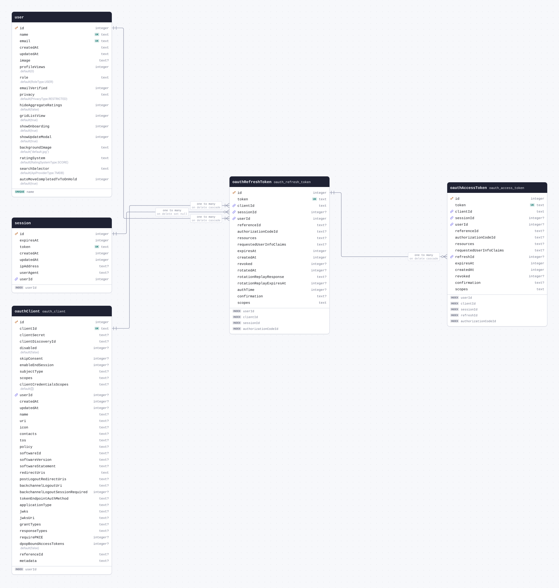

| Column                                                   | Type      | Constraints                                           | Default | Description |
| -------------------------------------------------------- | --------- | ----------------------------------------------------- | ------- | ----------- |
| `id`                                                     | `integer` | PK NOT NULL                                           |         |             |
| `token`                                                  | `text`    | UNIQUE NOT NULL                                       |         |             |
| `clientId` (`client_id`)                                 | `text`    | NOT NULL → [oauthClient.clientId](#table-oauthClient) |         |             |
| `sessionId` (`session_id`)                               | `integer` | NULL → [session.id](#table-session)                   |         |             |
| `userId` (`user_id`)                                     | `integer` | NOT NULL → [user.id](#table-user)                     |         |             |
| `referenceId` (`reference_id`)                           | `text`    | NULL                                                  |         |             |
| `authorizationCodeId` (`authorization_code_id`)          | `text`    | NULL                                                  |         |             |
| `resources`                                              | `text`    | NULL                                                  |         |             |
| `requestedUserInfoClaims` (`requested_user_info_claims`) | `text`    | NULL                                                  |         |             |
| `expiresAt` (`expires_at`)                               | `integer` | NOT NULL                                              |         |             |
| `createdAt` (`created_at`)                               | `integer` | NOT NULL                                              |         |             |
| `revoked`                                                | `integer` | NULL                                                  |         |             |
| `rotatedAt` (`rotated_at`)                               | `integer` | NULL                                                  |         |             |
| `rotationReplayResponse` (`rotation_replay_response`)    | `text`    | NULL                                                  |         |             |
| `rotationReplayExpiresAt` (`rotation_replay_expires_at`) | `integer` | NULL                                                  |         |             |
| `authTime` (`auth_time`)                                 | `integer` | NULL                                                  |         |             |
| `confirmation`                                           | `text`    | NULL                                                  |         |             |
| `scopes`                                                 | `text`    | NOT NULL                                              |         |             |

#### Definition

```sql
CREATE TABLE `oauth_refresh_token` (
	`id` integer PRIMARY KEY,
	`token` text NOT NULL UNIQUE,
	`client_id` text NOT NULL,
	`session_id` integer,
	`user_id` integer NOT NULL,
	`reference_id` text,
	`authorization_code_id` text,
	`resources` text,
	`requested_user_info_claims` text,
	`expires_at` integer NOT NULL,
	`created_at` integer NOT NULL,
	`revoked` integer,
	`rotated_at` integer,
	`rotation_replay_response` text,
	`rotation_replay_expires_at` integer,
	`auth_time` integer,
	`confirmation` text,
	`scopes` text NOT NULL,
	CONSTRAINT `fk_oauth_refresh_token_client_id_oauth_client_client_id_fk` FOREIGN KEY (`client_id`) REFERENCES `oauth_client`(`client_id`) ON DELETE CASCADE,
	CONSTRAINT `fk_oauth_refresh_token_session_id_session_id_fk` FOREIGN KEY (`session_id`) REFERENCES `session`(`id`) ON DELETE SET NULL,
	CONSTRAINT `fk_oauth_refresh_token_user_id_user_id_fk` FOREIGN KEY (`user_id`) REFERENCES `user`(`id`) ON DELETE CASCADE
);

CREATE INDEX `oauthRefreshToken_userId_idx` ON `oauth_refresh_token` (`user_id`);

CREATE INDEX `oauthRefreshToken_clientId_idx` ON `oauth_refresh_token` (`client_id`);

CREATE INDEX `oauthRefreshToken_sessionId_idx` ON `oauth_refresh_token` (`session_id`);

CREATE INDEX `oauthRefreshToken_authorizationCodeId_idx` ON `oauth_refresh_token` (`authorization_code_id`);
```

#### Indexes

- INDEX `userId`
- INDEX `clientId`
- INDEX `sessionId`
- INDEX `authorizationCodeId`

#### References

- `clientId` → [oauthClient.clientId](#table-oauthClient) (many to one, on delete cascade)
- `sessionId` → [session.id](#table-session) (many to one, on delete set null)
- `userId` → [user.id](#table-user) (many to one, on delete cascade)

#### Referenced by

- `id` → [oauthAccessToken.refreshId](#table-oauthAccessToken) (one to many, on delete cascade)

<details>
<summary>Queries and their SQL</summary>

**Select**: Every row of oauthRefreshToken.

```ts
db.select().from(oauthRefreshToken);
```

```sql
select "id", "token", "client_id", "session_id", "user_id", "reference_id", "authorization_code_id", "resources", "requested_user_info_claims", "expires_at", "created_at", "revoked", "rotated_at", "rotation_replay_response", "rotation_replay_expires_at", "auth_time", "confirmation", "scopes"
from "oauth_refresh_token"
```

**Count**: How many rows oauthRefreshToken has.

```ts
db.select({ count: count() }).from(oauthRefreshToken);
```

```sql
select count(*)
from "oauth_refresh_token"
```

**Find many**: The rows of oauthRefreshToken, through the relational query API.

```ts
db.query.oauthRefreshToken.findMany();
```

```sql
select "d0"."id" as "id", "d0"."token" as "token", "d0"."client_id" as "clientId", "d0"."session_id" as "sessionId", "d0"."user_id" as "userId", "d0"."reference_id" as "referenceId", "d0"."authorization_code_id" as "authorizationCodeId", "d0"."resources" as "resources", "d0"."requested_user_info_claims" as "requestedUserInfoClaims", "d0"."expires_at" as "expiresAt", "d0"."created_at" as "createdAt", "d0"."revoked" as "revoked", "d0"."rotated_at" as "rotatedAt", "d0"."rotation_replay_response" as "rotationReplayResponse", "d0"."rotation_replay_expires_at" as "rotationReplayExpiresAt", "d0"."auth_time" as "authTime", "d0"."confirmation" as "confirmation", "d0"."scopes" as "scopes"
from "oauth_refresh_token" as "d0"
```

**Find by primary key**: One row of oauthRefreshToken, through the relational query API.

```ts
db.query.oauthRefreshToken.findFirst({ where: { id: 1 } });
```

```sql
select "d0"."id" as "id", "d0"."token" as "token", "d0"."client_id" as "clientId", "d0"."session_id" as "sessionId", "d0"."user_id" as "userId", "d0"."reference_id" as "referenceId", "d0"."authorization_code_id" as "authorizationCodeId", "d0"."resources" as "resources", "d0"."requested_user_info_claims" as "requestedUserInfoClaims", "d0"."expires_at" as "expiresAt", "d0"."created_at" as "createdAt", "d0"."revoked" as "revoked", "d0"."rotated_at" as "rotatedAt", "d0"."rotation_replay_response" as "rotationReplayResponse", "d0"."rotation_replay_expires_at" as "rotationReplayExpiresAt", "d0"."auth_time" as "authTime", "d0"."confirmation" as "confirmation", "d0"."scopes" as "scopes"
from "oauth_refresh_token" as "d0"
where "d0"."id" = ?
limit ?
-- params: [1,1]
```

**Insert**: Adds a row to oauthRefreshToken, giving the columns that have no default.

```ts
db.insert(oauthRefreshToken).values({
  id: 1,
  token: "token",
  clientId: "clientId",
  userId: 1,
  expiresAt: 1,
  createdAt: 1,
  scopes: "scopes",
});
```

```sql
insert into "oauth_refresh_token" ("id", "token", "client_id", "session_id", "user_id", "reference_id", "authorization_code_id", "resources", "requested_user_info_claims", "expires_at", "created_at", "revoked", "rotated_at", "rotation_replay_response", "rotation_replay_expires_at", "auth_time", "confirmation", "scopes")
values (?, ?, ?, null, ?, null, null, null, null, ?, ?, null, null, null, null, null, null, ?)
-- params: [1,"token","clientId",1,1,1,"scopes"]
```

**Update**: Changes a row of oauthRefreshToken, found by its primary key.

```ts
db.update(oauthRefreshToken).set({ token: "token" }).where(eq(oauthRefreshToken.id, 1));
```

```sql
update "oauth_refresh_token"
set "token" = ?
where "oauth_refresh_token"."id" = ?
-- params: ["token",1]
```

**Delete**: Deletes a row of oauthRefreshToken, found by its primary key.

```ts
db.delete(oauthRefreshToken).where(eq(oauthRefreshToken.id, 1));
```

```sql
delete from "oauth_refresh_token"
where "oauth_refresh_token"."id" = ?
-- params: [1]
```

</details>

<a id="table-oauthAccessToken"></a>

### oauthAccessToken

Table `oauth_access_token`.

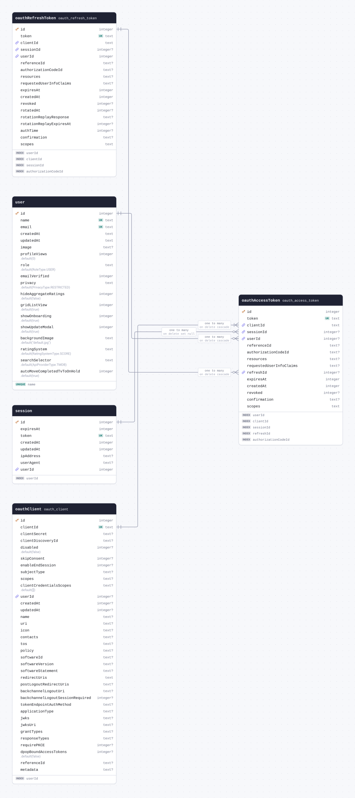

| Column                                                   | Type      | Constraints                                             | Default | Description |
| -------------------------------------------------------- | --------- | ------------------------------------------------------- | ------- | ----------- |
| `id`                                                     | `integer` | PK NOT NULL                                             |         |             |
| `token`                                                  | `text`    | UNIQUE NOT NULL                                         |         |             |
| `clientId` (`client_id`)                                 | `text`    | NOT NULL → [oauthClient.clientId](#table-oauthClient)   |         |             |
| `sessionId` (`session_id`)                               | `integer` | NULL → [session.id](#table-session)                     |         |             |
| `userId` (`user_id`)                                     | `integer` | NULL → [user.id](#table-user)                           |         |             |
| `referenceId` (`reference_id`)                           | `text`    | NULL                                                    |         |             |
| `authorizationCodeId` (`authorization_code_id`)          | `text`    | NULL                                                    |         |             |
| `resources`                                              | `text`    | NULL                                                    |         |             |
| `requestedUserInfoClaims` (`requested_user_info_claims`) | `text`    | NULL                                                    |         |             |
| `refreshId` (`refresh_id`)                               | `integer` | NULL → [oauthRefreshToken.id](#table-oauthRefreshToken) |         |             |
| `expiresAt` (`expires_at`)                               | `integer` | NOT NULL                                                |         |             |
| `createdAt` (`created_at`)                               | `integer` | NOT NULL                                                |         |             |
| `revoked`                                                | `integer` | NULL                                                    |         |             |
| `confirmation`                                           | `text`    | NULL                                                    |         |             |
| `scopes`                                                 | `text`    | NOT NULL                                                |         |             |

#### Definition

```sql
CREATE TABLE `oauth_access_token` (
	`id` integer PRIMARY KEY,
	`token` text NOT NULL UNIQUE,
	`client_id` text NOT NULL,
	`session_id` integer,
	`user_id` integer,
	`reference_id` text,
	`authorization_code_id` text,
	`resources` text,
	`requested_user_info_claims` text,
	`refresh_id` integer,
	`expires_at` integer NOT NULL,
	`created_at` integer NOT NULL,
	`revoked` integer,
	`confirmation` text,
	`scopes` text NOT NULL,
	CONSTRAINT `fk_oauth_access_token_client_id_oauth_client_client_id_fk` FOREIGN KEY (`client_id`) REFERENCES `oauth_client`(`client_id`) ON DELETE CASCADE,
	CONSTRAINT `fk_oauth_access_token_session_id_session_id_fk` FOREIGN KEY (`session_id`) REFERENCES `session`(`id`) ON DELETE SET NULL,
	CONSTRAINT `fk_oauth_access_token_user_id_user_id_fk` FOREIGN KEY (`user_id`) REFERENCES `user`(`id`) ON DELETE CASCADE,
	CONSTRAINT `fk_oauth_access_token_refresh_id_oauth_refresh_token_id_fk` FOREIGN KEY (`refresh_id`) REFERENCES `oauth_refresh_token`(`id`) ON DELETE CASCADE
);

CREATE INDEX `oauthAccessToken_userId_idx` ON `oauth_access_token` (`user_id`);

CREATE INDEX `oauthAccessToken_clientId_idx` ON `oauth_access_token` (`client_id`);

CREATE INDEX `oauthAccessToken_sessionId_idx` ON `oauth_access_token` (`session_id`);

CREATE INDEX `oauthAccessToken_refreshId_idx` ON `oauth_access_token` (`refresh_id`);

CREATE INDEX `oauthAccessToken_authorizationCodeId_idx` ON `oauth_access_token` (`authorization_code_id`);
```

#### Indexes

- INDEX `userId`
- INDEX `clientId`
- INDEX `sessionId`
- INDEX `refreshId`
- INDEX `authorizationCodeId`

#### References

- `clientId` → [oauthClient.clientId](#table-oauthClient) (many to one, on delete cascade)
- `sessionId` → [session.id](#table-session) (many to one, on delete set null)
- `userId` → [user.id](#table-user) (many to one, on delete cascade)
- `refreshId` → [oauthRefreshToken.id](#table-oauthRefreshToken) (many to one, on delete cascade)

<details>
<summary>Queries and their SQL</summary>

**Select**: Every row of oauthAccessToken.

```ts
db.select().from(oauthAccessToken);
```

```sql
select "id", "token", "client_id", "session_id", "user_id", "reference_id", "authorization_code_id", "resources", "requested_user_info_claims", "refresh_id", "expires_at", "created_at", "revoked", "confirmation", "scopes"
from "oauth_access_token"
```

**Count**: How many rows oauthAccessToken has.

```ts
db.select({ count: count() }).from(oauthAccessToken);
```

```sql
select count(*)
from "oauth_access_token"
```

**Find many**: The rows of oauthAccessToken, through the relational query API.

```ts
db.query.oauthAccessToken.findMany();
```

```sql
select "d0"."id" as "id", "d0"."token" as "token", "d0"."client_id" as "clientId", "d0"."session_id" as "sessionId", "d0"."user_id" as "userId", "d0"."reference_id" as "referenceId", "d0"."authorization_code_id" as "authorizationCodeId", "d0"."resources" as "resources", "d0"."requested_user_info_claims" as "requestedUserInfoClaims", "d0"."refresh_id" as "refreshId", "d0"."expires_at" as "expiresAt", "d0"."created_at" as "createdAt", "d0"."revoked" as "revoked", "d0"."confirmation" as "confirmation", "d0"."scopes" as "scopes"
from "oauth_access_token" as "d0"
```

**Find by primary key**: One row of oauthAccessToken, through the relational query API.

```ts
db.query.oauthAccessToken.findFirst({ where: { id: 1 } });
```

```sql
select "d0"."id" as "id", "d0"."token" as "token", "d0"."client_id" as "clientId", "d0"."session_id" as "sessionId", "d0"."user_id" as "userId", "d0"."reference_id" as "referenceId", "d0"."authorization_code_id" as "authorizationCodeId", "d0"."resources" as "resources", "d0"."requested_user_info_claims" as "requestedUserInfoClaims", "d0"."refresh_id" as "refreshId", "d0"."expires_at" as "expiresAt", "d0"."created_at" as "createdAt", "d0"."revoked" as "revoked", "d0"."confirmation" as "confirmation", "d0"."scopes" as "scopes"
from "oauth_access_token" as "d0"
where "d0"."id" = ?
limit ?
-- params: [1,1]
```

**Insert**: Adds a row to oauthAccessToken, giving the columns that have no default.

```ts
db.insert(oauthAccessToken).values({
  id: 1,
  token: "token",
  clientId: "clientId",
  expiresAt: 1,
  createdAt: 1,
  scopes: "scopes",
});
```

```sql
insert into "oauth_access_token" ("id", "token", "client_id", "session_id", "user_id", "reference_id", "authorization_code_id", "resources", "requested_user_info_claims", "refresh_id", "expires_at", "created_at", "revoked", "confirmation", "scopes")
values (?, ?, ?, null, null, null, null, null, null, null, ?, ?, null, null, ?)
-- params: [1,"token","clientId",1,1,"scopes"]
```

**Update**: Changes a row of oauthAccessToken, found by its primary key.

```ts
db.update(oauthAccessToken).set({ token: "token" }).where(eq(oauthAccessToken.id, 1));
```

```sql
update "oauth_access_token"
set "token" = ?
where "oauth_access_token"."id" = ?
-- params: ["token",1]
```

**Delete**: Deletes a row of oauthAccessToken, found by its primary key.

```ts
db.delete(oauthAccessToken).where(eq(oauthAccessToken.id, 1));
```

```sql
delete from "oauth_access_token"
where "oauth_access_token"."id" = ?
-- params: [1]
```

</details>

<a id="table-oauthConsent"></a>

### oauthConsent

Table `oauth_consent`.

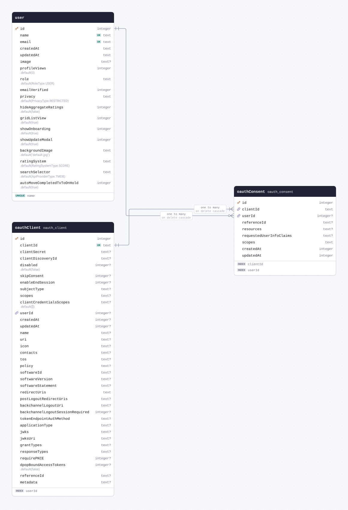

| Column                                                   | Type      | Constraints                                           | Default | Description |
| -------------------------------------------------------- | --------- | ----------------------------------------------------- | ------- | ----------- |
| `id`                                                     | `integer` | PK NOT NULL                                           |         |             |
| `clientId` (`client_id`)                                 | `text`    | NOT NULL → [oauthClient.clientId](#table-oauthClient) |         |             |
| `userId` (`user_id`)                                     | `integer` | NULL → [user.id](#table-user)                         |         |             |
| `referenceId` (`reference_id`)                           | `text`    | NULL                                                  |         |             |
| `resources`                                              | `text`    | NULL                                                  |         |             |
| `requestedUserInfoClaims` (`requested_user_info_claims`) | `text`    | NULL                                                  |         |             |
| `scopes`                                                 | `text`    | NOT NULL                                              |         |             |
| `createdAt` (`created_at`)                               | `integer` | NOT NULL                                              |         |             |
| `updatedAt` (`updated_at`)                               | `integer` | NOT NULL                                              |         |             |

#### Definition

```sql
CREATE TABLE `oauth_consent` (
	`id` integer PRIMARY KEY,
	`client_id` text NOT NULL,
	`user_id` integer,
	`reference_id` text,
	`resources` text,
	`requested_user_info_claims` text,
	`scopes` text NOT NULL,
	`created_at` integer NOT NULL,
	`updated_at` integer NOT NULL,
	CONSTRAINT `fk_oauth_consent_client_id_oauth_client_client_id_fk` FOREIGN KEY (`client_id`) REFERENCES `oauth_client`(`client_id`) ON DELETE CASCADE,
	CONSTRAINT `fk_oauth_consent_user_id_user_id_fk` FOREIGN KEY (`user_id`) REFERENCES `user`(`id`) ON DELETE CASCADE
);

CREATE INDEX `oauthConsent_clientId_idx` ON `oauth_consent` (`client_id`);

CREATE INDEX `oauthConsent_userId_idx` ON `oauth_consent` (`user_id`);
```

#### Indexes

- INDEX `clientId`
- INDEX `userId`

#### References

- `clientId` → [oauthClient.clientId](#table-oauthClient) (many to one, on delete cascade)
- `userId` → [user.id](#table-user) (many to one, on delete cascade)

<details>
<summary>Queries and their SQL</summary>

**Select**: Every row of oauthConsent.

```ts
db.select().from(oauthConsent);
```

```sql
select "id", "client_id", "user_id", "reference_id", "resources", "requested_user_info_claims", "scopes", "created_at", "updated_at"
from "oauth_consent"
```

**Count**: How many rows oauthConsent has.

```ts
db.select({ count: count() }).from(oauthConsent);
```

```sql
select count(*)
from "oauth_consent"
```

**Find many**: The rows of oauthConsent, through the relational query API.

```ts
db.query.oauthConsent.findMany();
```

```sql
select "d0"."id" as "id", "d0"."client_id" as "clientId", "d0"."user_id" as "userId", "d0"."reference_id" as "referenceId", "d0"."resources" as "resources", "d0"."requested_user_info_claims" as "requestedUserInfoClaims", "d0"."scopes" as "scopes", "d0"."created_at" as "createdAt", "d0"."updated_at" as "updatedAt"
from "oauth_consent" as "d0"
```

**Find by primary key**: One row of oauthConsent, through the relational query API.

```ts
db.query.oauthConsent.findFirst({ where: { id: 1 } });
```

```sql
select "d0"."id" as "id", "d0"."client_id" as "clientId", "d0"."user_id" as "userId", "d0"."reference_id" as "referenceId", "d0"."resources" as "resources", "d0"."requested_user_info_claims" as "requestedUserInfoClaims", "d0"."scopes" as "scopes", "d0"."created_at" as "createdAt", "d0"."updated_at" as "updatedAt"
from "oauth_consent" as "d0"
where "d0"."id" = ?
limit ?
-- params: [1,1]
```

**Insert**: Adds a row to oauthConsent, giving the columns that have no default.

```ts
db.insert(oauthConsent).values({
  id: 1,
  clientId: "clientId",
  scopes: "scopes",
  createdAt: 1,
  updatedAt: 1,
});
```

```sql
insert into "oauth_consent" ("id", "client_id", "user_id", "reference_id", "resources", "requested_user_info_claims", "scopes", "created_at", "updated_at")
values (?, ?, null, null, null, null, ?, ?, ?)
-- params: [1,"clientId","scopes",1,1]
```

**Update**: Changes a row of oauthConsent, found by its primary key.

```ts
db.update(oauthConsent).set({ clientId: "clientId" }).where(eq(oauthConsent.id, 1));
```

```sql
update "oauth_consent"
set "client_id" = ?
where "oauth_consent"."id" = ?
-- params: ["clientId",1]
```

**Delete**: Deletes a row of oauthConsent, found by its primary key.

```ts
db.delete(oauthConsent).where(eq(oauthConsent.id, 1));
```

```sql
delete from "oauth_consent"
where "oauth_consent"."id" = ?
-- params: [1]
```

</details>

<a id="table-oauthClientAssertion"></a>

### oauthClientAssertion

Table `oauth_client_assertion`.

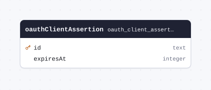

| Column                     | Type      | Constraints | Default | Description |
| -------------------------- | --------- | ----------- | ------- | ----------- |
| `id`                       | `text`    | PK NOT NULL |         |             |
| `expiresAt` (`expires_at`) | `integer` | NOT NULL    |         |             |

#### Definition

```sql
CREATE TABLE `oauth_client_assertion` (
	`id` text PRIMARY KEY,
	`expires_at` integer NOT NULL
);
```

<details>
<summary>Queries and their SQL</summary>

**Select**: Every row of oauthClientAssertion.

```ts
db.select().from(oauthClientAssertion);
```

```sql
select "id", "expires_at"
from "oauth_client_assertion"
```

**Count**: How many rows oauthClientAssertion has.

```ts
db.select({ count: count() }).from(oauthClientAssertion);
```

```sql
select count(*)
from "oauth_client_assertion"
```

**Find many**: The rows of oauthClientAssertion, through the relational query API.

```ts
db.query.oauthClientAssertion.findMany();
```

```sql
select "d0"."id" as "id", "d0"."expires_at" as "expiresAt"
from "oauth_client_assertion" as "d0"
```

**Find by primary key**: One row of oauthClientAssertion, through the relational query API.

```ts
db.query.oauthClientAssertion.findFirst({ where: { id: "id" } });
```

```sql
select "d0"."id" as "id", "d0"."expires_at" as "expiresAt"
from "oauth_client_assertion" as "d0"
where "d0"."id" = ?
limit ?
-- params: ["id",1]
```

**Insert**: Adds a row to oauthClientAssertion, giving the columns that have no default.

```ts
db.insert(oauthClientAssertion).values({ id: "id", expiresAt: 1 });
```

```sql
insert into "oauth_client_assertion" ("id", "expires_at")
values (?, ?)
-- params: ["id",1]
```

**Update**: Changes a row of oauthClientAssertion, found by its primary key.

```ts
db.update(oauthClientAssertion).set({ expiresAt: 1 }).where(eq(oauthClientAssertion.id, "id"));
```

```sql
update "oauth_client_assertion"
set "expires_at" = ?
where "oauth_client_assertion"."id" = ?
-- params: [1,"id"]
```

**Delete**: Deletes a row of oauthClientAssertion, found by its primary key.

```ts
db.delete(oauthClientAssertion).where(eq(oauthClientAssertion.id, "id"));
```

```sql
delete from "oauth_client_assertion"
where "oauth_client_assertion"."id" = ?
-- params: ["id"]
```

</details>

<a id="table-mcpRevocation"></a>

### mcpRevocation

Table `mcp_revocation`.

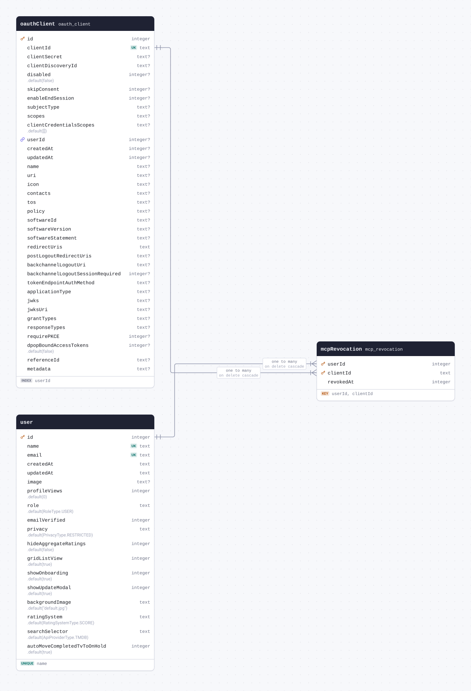

| Column                     | Type      | Constraints                                              | Default | Description |
| -------------------------- | --------- | -------------------------------------------------------- | ------- | ----------- |
| `userId` (`user_id`)       | `integer` | PK NOT NULL → [user.id](#table-user)                     |         |             |
| `clientId` (`client_id`)   | `text`    | PK NOT NULL → [oauthClient.clientId](#table-oauthClient) |         |             |
| `revokedAt` (`revoked_at`) | `integer` | NOT NULL                                                 |         |             |

#### Definition

```sql
CREATE TABLE `mcp_revocation` (
	`user_id` integer NOT NULL,
	`client_id` text NOT NULL,
	`revoked_at` integer NOT NULL,
	CONSTRAINT `mcp_revocation_pk` PRIMARY KEY(`user_id`, `client_id`),
	CONSTRAINT `fk_mcp_revocation_user_id_user_id_fk` FOREIGN KEY (`user_id`) REFERENCES `user`(`id`) ON DELETE CASCADE,
	CONSTRAINT `fk_mcp_revocation_client_id_oauth_client_client_id_fk` FOREIGN KEY (`client_id`) REFERENCES `oauth_client`(`client_id`) ON DELETE CASCADE
);
```

#### Indexes

- PRIMARY KEY `userId`, `clientId`

#### References

- `userId` → [user.id](#table-user) (many to one, on delete cascade)
- `clientId` → [oauthClient.clientId](#table-oauthClient) (many to one, on delete cascade)

<details>
<summary>Queries and their SQL</summary>

**Select**: Every row of mcpRevocation.

```ts
db.select().from(mcpRevocation);
```

```sql
select "user_id", "client_id", "revoked_at"
from "mcp_revocation"
```

**Count**: How many rows mcpRevocation has.

```ts
db.select({ count: count() }).from(mcpRevocation);
```

```sql
select count(*)
from "mcp_revocation"
```

**Find many**: The rows of mcpRevocation, through the relational query API.

```ts
db.query.mcpRevocation.findMany();
```

```sql
select "d0"."user_id" as "userId", "d0"."client_id" as "clientId", "d0"."revoked_at" as "revokedAt"
from "mcp_revocation" as "d0"
```

**Find by primary key**: One row of mcpRevocation, through the relational query API.

```ts
db.query.mcpRevocation.findFirst({ where: { userId: 1, clientId: "clientId" } });
```

```sql
select "d0"."user_id" as "userId", "d0"."client_id" as "clientId", "d0"."revoked_at" as "revokedAt"
from "mcp_revocation" as "d0"
where (("d0"."user_id" = ?) and ("d0"."client_id" = ?))
limit ?
-- params: [1,"clientId",1]
```

**Insert**: Adds a row to mcpRevocation, giving the columns that have no default.

```ts
db.insert(mcpRevocation).values({ userId: 1, clientId: "clientId", revokedAt: 1 });
```

```sql
insert into "mcp_revocation" ("user_id", "client_id", "revoked_at")
values (?, ?, ?)
-- params: [1,"clientId",1]
```

**Update**: Changes a row of mcpRevocation, found by its primary key.

```ts
db.update(mcpRevocation)
  .set({ revokedAt: 1 })
  .where(and(eq(mcpRevocation.userId, 1), eq(mcpRevocation.clientId, "clientId")));
```

```sql
update "mcp_revocation"
set "revoked_at" = ?
where (("mcp_revocation"."user_id" = ?) and ("mcp_revocation"."client_id" = ?))
-- params: [1,1,"clientId"]
```

**Delete**: Deletes a row of mcpRevocation, found by its primary key.

```ts
db.delete(mcpRevocation).where(
  and(eq(mcpRevocation.userId, 1), eq(mcpRevocation.clientId, "clientId")),
);
```

```sql
delete from "mcp_revocation"
where (("mcp_revocation"."user_id" = ?) and ("mcp_revocation"."client_id" = ?))
-- params: [1,"clientId"]
```

</details>

<a id="table-followers"></a>

### followers

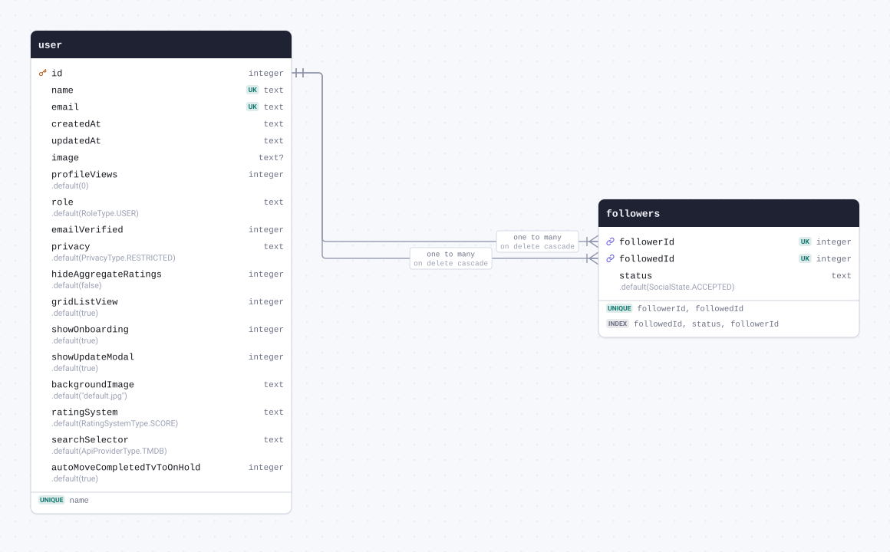

| Column                       | Type      | Constraints                       | Default                          | Description |
| ---------------------------- | --------- | --------------------------------- | -------------------------------- | ----------- |
| `followerId` (`follower_id`) | `integer` | NOT NULL → [user.id](#table-user) |                                  |             |
| `followedId` (`followed_id`) | `integer` | NOT NULL → [user.id](#table-user) |                                  |             |
| `status`                     | `text`    | NOT NULL                          | `.default(SocialState.ACCEPTED)` |             |

#### Definition

```sql
CREATE TABLE `followers` (
	`follower_id` integer NOT NULL,
	`followed_id` integer NOT NULL,
	`status` text DEFAULT 'accepted' NOT NULL,
	CONSTRAINT `fk_followers_follower_id_user_id_fk` FOREIGN KEY (`follower_id`) REFERENCES `user`(`id`) ON DELETE CASCADE,
	CONSTRAINT `fk_followers_followed_id_user_id_fk` FOREIGN KEY (`followed_id`) REFERENCES `user`(`id`) ON DELETE CASCADE,
	CONSTRAINT "followers_not_self_check" CHECK("follower_id" <> "followed_id")
);

CREATE UNIQUE INDEX `ux_followers_follower_followed` ON `followers` (`follower_id`,`followed_id`);

CREATE INDEX `ix_followers_followed_status_follower` ON `followers` (`followed_id`,`status`,`follower_id`);
```

#### Indexes

- UNIQUE `followerId`, `followedId`
- INDEX `followedId`, `status`, `followerId`

#### References

- `followerId` → [user.id](#table-user) (many to one, on delete cascade)
- `followedId` → [user.id](#table-user) (many to one, on delete cascade)

<details>
<summary>Queries and their SQL</summary>

**Select**: Every row of followers.

```ts
db.select().from(followers);
```

```sql
select "follower_id", "followed_id", "status"
from "followers"
```

**Count**: How many rows followers has.

```ts
db.select({ count: count() }).from(followers);
```

```sql
select count(*)
from "followers"
```

**Find many**: The rows of followers, through the relational query API.

```ts
db.query.followers.findMany();
```

```sql
select "d0"."follower_id" as "followerId", "d0"."followed_id" as "followedId", "d0"."status" as "status"
from "followers" as "d0"
```

**Insert**: Adds a row to followers, giving the columns that have no default.

```ts
db.insert(followers).values({ followerId: 1, followedId: 1 });
```

```sql
insert into "followers" ("follower_id", "followed_id", "status")
values (?, ?, ?)
-- params: [1,1,"accepted"]
```

</details>

<a id="table-userMediaUpdate"></a>

### userMediaUpdate

Table `user_media_update`.

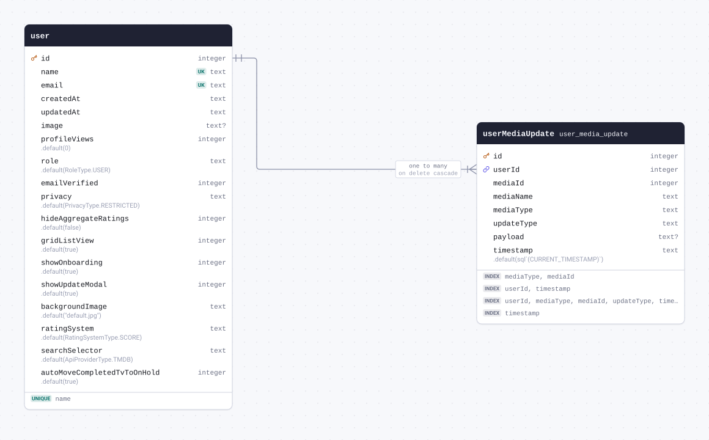

| Column                       | Type      | Constraints                       | Default                                | Description |
| ---------------------------- | --------- | --------------------------------- | -------------------------------------- | ----------- |
| `id`                         | `integer` | PK NOT NULL                       |                                        |             |
| `userId` (`user_id`)         | `integer` | NOT NULL → [user.id](#table-user) |                                        |             |
| `mediaId` (`media_id`)       | `integer` | NOT NULL                          |                                        |             |
| `mediaName` (`media_name`)   | `text`    | NOT NULL                          |                                        |             |
| `mediaType` (`media_type`)   | `text`    | NOT NULL                          |                                        |             |
| `updateType` (`update_type`) | `text`    | NOT NULL                          |                                        |             |
| `payload`                    | `text`    | NULL                              |                                        |             |
| `timestamp`                  | `text`    | NOT NULL                          | ``.default(sql`(CURRENT_TIMESTAMP)`)`` |             |

#### Definition

```sql
CREATE TABLE `user_media_update` (
	`id` integer PRIMARY KEY,
	`user_id` integer NOT NULL,
	`media_id` integer NOT NULL,
	`media_name` text NOT NULL,
	`media_type` text NOT NULL,
	`update_type` text NOT NULL,
	`payload` text,
	`timestamp` text DEFAULT (CURRENT_TIMESTAMP) NOT NULL,
	CONSTRAINT `fk_user_media_update_user_id_user_id_fk` FOREIGN KEY (`user_id`) REFERENCES `user`(`id`) ON DELETE CASCADE
);

CREATE INDEX `ix_user_media_update_media_type_media_id` ON `user_media_update` (`media_type`,`media_id`);

CREATE INDEX `ix_user_media_update_user_timestamp` ON `user_media_update` (`user_id`,`timestamp`);

CREATE INDEX `ix_user_media_update_user_media_kind_timestamp` ON `user_media_update` (`user_id`,`media_type`,`media_id`,`update_type`,`timestamp`);

CREATE INDEX `ix_user_media_update_timestamp` ON `user_media_update` (`timestamp`);
```

#### Indexes

- INDEX `mediaType`, `mediaId`
- INDEX `userId`, `timestamp`
- INDEX `userId`, `mediaType`, `mediaId`, `updateType`, `timestamp`
- INDEX `timestamp`

#### References

- `userId` → [user.id](#table-user) (many to one, on delete cascade)

<details>
<summary>Queries and their SQL</summary>

**Select**: Every row of userMediaUpdate.

```ts
db.select().from(userMediaUpdate);
```

```sql
select "id", "user_id", "media_id", "media_name", "media_type", "update_type", "payload", "timestamp"
from "user_media_update"
```

**Count**: How many rows userMediaUpdate has.

```ts
db.select({ count: count() }).from(userMediaUpdate);
```

```sql
select count(*)
from "user_media_update"
```

**Find many**: The rows of userMediaUpdate, through the relational query API.

```ts
db.query.userMediaUpdate.findMany();
```

```sql
select "d0"."id" as "id", "d0"."user_id" as "userId", "d0"."media_id" as "mediaId", "d0"."media_name" as "mediaName", "d0"."media_type" as "mediaType", "d0"."update_type" as "updateType", "d0"."payload" as "payload", "d0"."timestamp" as "timestamp"
from "user_media_update" as "d0"
```

**Find by primary key**: One row of userMediaUpdate, through the relational query API.

```ts
db.query.userMediaUpdate.findFirst({ where: { id: 1 } });
```

```sql
select "d0"."id" as "id", "d0"."user_id" as "userId", "d0"."media_id" as "mediaId", "d0"."media_name" as "mediaName", "d0"."media_type" as "mediaType", "d0"."update_type" as "updateType", "d0"."payload" as "payload", "d0"."timestamp" as "timestamp"
from "user_media_update" as "d0"
where "d0"."id" = ?
limit ?
-- params: [1,1]
```

**Insert**: Adds a row to userMediaUpdate, giving the columns that have no default.

```ts
db.insert(userMediaUpdate).values({
  id: 1,
  userId: 1,
  mediaId: 1,
  mediaName: "mediaName",
  mediaType: "mediaType",
  updateType: "updateType",
});
```

```sql
insert into "user_media_update" ("id", "user_id", "media_id", "media_name", "media_type", "update_type", "payload", "timestamp")
values (?, ?, ?, ?, ?, ?, null, (CURRENT_TIMESTAMP))
-- params: [1,1,1,"mediaName","mediaType","updateType"]
```

**Update**: Changes a row of userMediaUpdate, found by its primary key.

```ts
db.update(userMediaUpdate).set({ userId: 1 }).where(eq(userMediaUpdate.id, 1));
```

```sql
update "user_media_update"
set "user_id" = ?
where "user_media_update"."id" = ?
-- params: [1,1]
```

**Delete**: Deletes a row of userMediaUpdate, found by its primary key.

```ts
db.delete(userMediaUpdate).where(eq(userMediaUpdate.id, 1));
```

```sql
delete from "user_media_update"
where "user_media_update"."id" = ?
-- params: [1]
```

</details>

<a id="table-userMediaMonthlyActivity"></a>

### userMediaMonthlyActivity

Table `user_media_monthly_activity`.

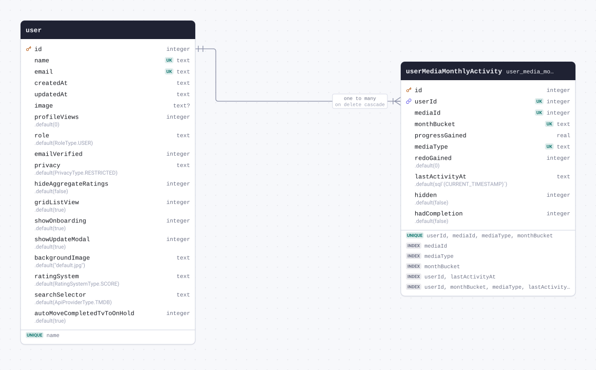

| Column                                | Type      | Constraints                       | Default                                | Description |
| ------------------------------------- | --------- | --------------------------------- | -------------------------------------- | ----------- |
| `id`                                  | `integer` | PK NOT NULL                       |                                        |             |
| `userId` (`user_id`)                  | `integer` | NOT NULL → [user.id](#table-user) |                                        |             |
| `mediaId` (`media_id`)                | `integer` | NOT NULL                          |                                        |             |
| `monthBucket` (`month_bucket`)        | `text`    | NOT NULL                          |                                        |             |
| `progressGained` (`progress_gained`)  | `real`    | NOT NULL                          |                                        |             |
| `mediaType` (`media_type`)            | `text`    | NOT NULL                          |                                        |             |
| `redoGained` (`redo_gained`)          | `integer` | NOT NULL                          | `.default(0)`                          |             |
| `lastActivityAt` (`last_activity_at`) | `text`    | NOT NULL                          | ``.default(sql`(CURRENT_TIMESTAMP)`)`` |             |
| `hidden`                              | `integer` | NOT NULL                          | `.default(false)`                      |             |
| `hadCompletion` (`had_completion`)    | `integer` | NOT NULL                          | `.default(false)`                      |             |

#### Definition

```sql
CREATE TABLE `user_media_monthly_activity` (
	`id` integer PRIMARY KEY,
	`user_id` integer NOT NULL,
	`media_id` integer NOT NULL,
	`month_bucket` text NOT NULL,
	`progress_gained` real NOT NULL,
	`media_type` text NOT NULL,
	`redo_gained` integer DEFAULT 0 NOT NULL,
	`last_activity_at` text DEFAULT (CURRENT_TIMESTAMP) NOT NULL,
	`hidden` integer DEFAULT false NOT NULL,
	`had_completion` integer DEFAULT false NOT NULL,
	CONSTRAINT `fk_user_media_monthly_activity_user_id_user_id_fk` FOREIGN KEY (`user_id`) REFERENCES `user`(`id`) ON DELETE CASCADE,
	CONSTRAINT "user_media_monthly_activity_redo_nonnegative_check" CHECK("redo_gained" >= 0),
	CONSTRAINT "user_media_monthly_activity_progress_nonnegative_check" CHECK("progress_gained" >= 0)
);

CREATE INDEX `ix_user_media_monthly_activity_media_id` ON `user_media_monthly_activity` (`media_id`);

CREATE INDEX `ix_user_media_monthly_activity_media_type` ON `user_media_monthly_activity` (`media_type`);

CREATE INDEX `ix_user_media_monthly_activity_month_bucket` ON `user_media_monthly_activity` (`month_bucket`);

CREATE INDEX `ix_user_media_monthly_activity_user_last_activity` ON `user_media_monthly_activity` (`user_id`,`last_activity_at`);

CREATE UNIQUE INDEX `ux_user_media_monthly_activity_bucket` ON `user_media_monthly_activity` (`user_id`,`media_id`,`media_type`,`month_bucket`);

CREATE INDEX `ix_user_media_monthly_activity_user_month_type_activity` ON `user_media_monthly_activity` (`user_id`,`month_bucket`,`media_type`,`last_activity_at`);
```

#### Indexes

- INDEX `mediaId`
- INDEX `mediaType`
- INDEX `monthBucket`
- INDEX `userId`, `lastActivityAt`
- UNIQUE `userId`, `mediaId`, `mediaType`, `monthBucket`
- INDEX `userId`, `monthBucket`, `mediaType`, `lastActivityAt`

#### References

- `userId` → [user.id](#table-user) (many to one, on delete cascade)

<details>
<summary>Queries and their SQL</summary>

**Select**: Every row of userMediaMonthlyActivity.

```ts
db.select().from(userMediaMonthlyActivity);
```

```sql
select "id", "user_id", "media_id", "month_bucket", "progress_gained", "media_type", "redo_gained", "last_activity_at", "hidden", "had_completion"
from "user_media_monthly_activity"
```

**Count**: How many rows userMediaMonthlyActivity has.

```ts
db.select({ count: count() }).from(userMediaMonthlyActivity);
```

```sql
select count(*)
from "user_media_monthly_activity"
```

**Find many**: The rows of userMediaMonthlyActivity, through the relational query API.

```ts
db.query.userMediaMonthlyActivity.findMany();
```

```sql
select "d0"."id" as "id", "d0"."user_id" as "userId", "d0"."media_id" as "mediaId", "d0"."month_bucket" as "monthBucket", "d0"."progress_gained" as "progressGained", "d0"."media_type" as "mediaType", "d0"."redo_gained" as "redoGained", "d0"."last_activity_at" as "lastActivityAt", "d0"."hidden" as "hidden", "d0"."had_completion" as "hadCompletion"
from "user_media_monthly_activity" as "d0"
```

**Find by primary key**: One row of userMediaMonthlyActivity, through the relational query API.

```ts
db.query.userMediaMonthlyActivity.findFirst({ where: { id: 1 } });
```

```sql
select "d0"."id" as "id", "d0"."user_id" as "userId", "d0"."media_id" as "mediaId", "d0"."month_bucket" as "monthBucket", "d0"."progress_gained" as "progressGained", "d0"."media_type" as "mediaType", "d0"."redo_gained" as "redoGained", "d0"."last_activity_at" as "lastActivityAt", "d0"."hidden" as "hidden", "d0"."had_completion" as "hadCompletion"
from "user_media_monthly_activity" as "d0"
where "d0"."id" = ?
limit ?
-- params: [1,1]
```

**Insert**: Adds a row to userMediaMonthlyActivity, giving the columns that have no default.

```ts
db.insert(userMediaMonthlyActivity).values({
  id: 1,
  userId: 1,
  mediaId: 1,
  monthBucket: "monthBucket",
  progressGained: 1,
  mediaType: "mediaType",
});
```

```sql
insert into "user_media_monthly_activity" ("id", "user_id", "media_id", "month_bucket", "progress_gained", "media_type", "redo_gained", "last_activity_at", "hidden", "had_completion")
values (?, ?, ?, ?, ?, ?, ?, (CURRENT_TIMESTAMP), ?, ?)
-- params: [1,1,1,"monthBucket",1,"mediaType",0,0,0]
```

**Update**: Changes a row of userMediaMonthlyActivity, found by its primary key.

```ts
db.update(userMediaMonthlyActivity).set({ userId: 1 }).where(eq(userMediaMonthlyActivity.id, 1));
```

```sql
update "user_media_monthly_activity"
set "user_id" = ?
where "user_media_monthly_activity"."id" = ?
-- params: [1,1]
```

**Delete**: Deletes a row of userMediaMonthlyActivity, found by its primary key.

```ts
db.delete(userMediaMonthlyActivity).where(eq(userMediaMonthlyActivity.id, 1));
```

```sql
delete from "user_media_monthly_activity"
where "user_media_monthly_activity"."id" = ?
-- params: [1]
```

</details>

<a id="table-userMediaSettings"></a>

### userMediaSettings

Table `user_media_settings`.

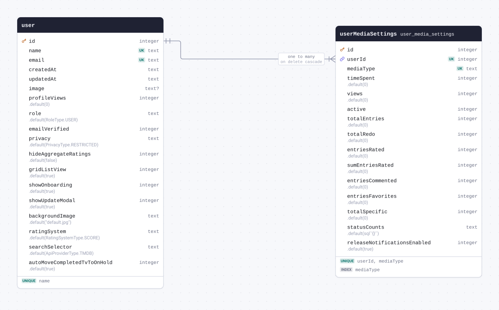

| Column                                                          | Type      | Constraints                       | Default                 | Description |
| --------------------------------------------------------------- | --------- | --------------------------------- | ----------------------- | ----------- |
| `id`                                                            | `integer` | PK NOT NULL                       |                         |             |
| `userId` (`user_id`)                                            | `integer` | NOT NULL → [user.id](#table-user) |                         |             |
| `mediaType` (`media_type`)                                      | `text`    | NOT NULL                          |                         |             |
| `timeSpent` (`time_spent`)                                      | `integer` | NOT NULL                          | `.default(0)`           |             |
| `views`                                                         | `integer` | NOT NULL                          | `.default(0)`           |             |
| `active`                                                        | `integer` | NOT NULL                          |                         |             |
| `totalEntries` (`total_entries`)                                | `integer` | NOT NULL                          | `.default(0)`           |             |
| `totalRedo` (`total_redo`)                                      | `integer` | NOT NULL                          | `.default(0)`           |             |
| `entriesRated` (`entries_rated`)                                | `integer` | NOT NULL                          | `.default(0)`           |             |
| `sumEntriesRated` (`sum_entries_rated`)                         | `integer` | NOT NULL                          | `.default(0)`           |             |
| `entriesCommented` (`entries_commented`)                        | `integer` | NOT NULL                          | `.default(0)`           |             |
| `entriesFavorites` (`entries_favorites`)                        | `integer` | NOT NULL                          | `.default(0)`           |             |
| `totalSpecific` (`total_specific`)                              | `integer` | NOT NULL                          | `.default(0)`           |             |
| `statusCounts` (`status_counts`)                                | `text`    | NOT NULL                          | ``.default(sql`'{}'`)`` |             |
| `releaseNotificationsEnabled` (`release_notifications_enabled`) | `integer` | NOT NULL                          | `.default(true)`        |             |

#### Definition

```sql
CREATE TABLE `user_media_settings` (
	`id` integer PRIMARY KEY,
	`user_id` integer NOT NULL,
	`media_type` text NOT NULL,
	`time_spent` integer DEFAULT 0 NOT NULL,
	`views` integer DEFAULT 0 NOT NULL,
	`active` integer NOT NULL,
	`total_entries` integer DEFAULT 0 NOT NULL,
	`total_redo` integer DEFAULT 0 NOT NULL,
	`entries_rated` integer DEFAULT 0 NOT NULL,
	`sum_entries_rated` integer DEFAULT 0 NOT NULL,
	`entries_commented` integer DEFAULT 0 NOT NULL,
	`entries_favorites` integer DEFAULT 0 NOT NULL,
	`total_specific` integer DEFAULT 0 NOT NULL,
	`status_counts` text DEFAULT '{}' NOT NULL,
	`release_notifications_enabled` integer DEFAULT true NOT NULL,
	CONSTRAINT `fk_user_media_settings_user_id_user_id_fk` FOREIGN KEY (`user_id`) REFERENCES `user`(`id`) ON DELETE CASCADE,
	CONSTRAINT "user_media_settings_counters_nonnegative_check" CHECK(
        "time_spent" >= 0 AND "views" >= 0 AND "total_entries" >= 0
        AND "total_redo" >= 0 AND "entries_rated" >= 0
        AND "sum_entries_rated" >= 0 AND "entries_commented" >= 0
        AND "entries_favorites" >= 0 AND "total_specific" >= 0
    ),
	CONSTRAINT "user_media_settings_status_counts_json_check" CHECK(json_valid("status_counts"))
);

CREATE INDEX `ix_user_media_settings_media_type` ON `user_media_settings` (`media_type`);

CREATE UNIQUE INDEX `ux_user_id_media_type` ON `user_media_settings` (`user_id`,`media_type`);
```

#### Indexes

- INDEX `mediaType`
- UNIQUE `userId`, `mediaType`

#### References

- `userId` → [user.id](#table-user) (many to one, on delete cascade)

<details>
<summary>Queries and their SQL</summary>

**Select**: Every row of userMediaSettings.

```ts
db.select().from(userMediaSettings);
```

```sql
select "id", "user_id", "media_type", "time_spent", "views", "active", "total_entries", "total_redo", "entries_rated", "sum_entries_rated", "entries_commented", "entries_favorites", "total_specific", "status_counts", "release_notifications_enabled"
from "user_media_settings"
```

**Count**: How many rows userMediaSettings has.

```ts
db.select({ count: count() }).from(userMediaSettings);
```

```sql
select count(*)
from "user_media_settings"
```

**Find many**: The rows of userMediaSettings, through the relational query API.

```ts
db.query.userMediaSettings.findMany();
```

```sql
select "d0"."id" as "id", "d0"."user_id" as "userId", "d0"."media_type" as "mediaType", "d0"."time_spent" as "timeSpent", "d0"."views" as "views", "d0"."active" as "active", "d0"."total_entries" as "totalEntries", "d0"."total_redo" as "totalRedo", "d0"."entries_rated" as "entriesRated", "d0"."sum_entries_rated" as "sumEntriesRated", "d0"."entries_commented" as "entriesCommented", "d0"."entries_favorites" as "entriesFavorites", "d0"."total_specific" as "totalSpecific", "d0"."status_counts" as "statusCounts", "d0"."release_notifications_enabled" as "releaseNotificationsEnabled"
from "user_media_settings" as "d0"
```

**Find by primary key**: One row of userMediaSettings, through the relational query API.

```ts
db.query.userMediaSettings.findFirst({ where: { id: 1 } });
```

```sql
select "d0"."id" as "id", "d0"."user_id" as "userId", "d0"."media_type" as "mediaType", "d0"."time_spent" as "timeSpent", "d0"."views" as "views", "d0"."active" as "active", "d0"."total_entries" as "totalEntries", "d0"."total_redo" as "totalRedo", "d0"."entries_rated" as "entriesRated", "d0"."sum_entries_rated" as "sumEntriesRated", "d0"."entries_commented" as "entriesCommented", "d0"."entries_favorites" as "entriesFavorites", "d0"."total_specific" as "totalSpecific", "d0"."status_counts" as "statusCounts", "d0"."release_notifications_enabled" as "releaseNotificationsEnabled"
from "user_media_settings" as "d0"
where "d0"."id" = ?
limit ?
-- params: [1,1]
```

**Insert**: Adds a row to userMediaSettings, giving the columns that have no default.

```ts
db.insert(userMediaSettings).values({ id: 1, userId: 1, mediaType: "mediaType", active: 1 });
```

```sql
insert into "user_media_settings" ("id", "user_id", "media_type", "time_spent", "views", "active", "total_entries", "total_redo", "entries_rated", "sum_entries_rated", "entries_commented", "entries_favorites", "total_specific", "status_counts", "release_notifications_enabled")
values (?, ?, ?, ?, ?, ?, ?, ?, ?, ?, ?, ?, ?, '{}', ?)
-- params: [1,1,"mediaType",0,0,1,0,0,0,0,0,0,0,1]
```

**Update**: Changes a row of userMediaSettings, found by its primary key.

```ts
db.update(userMediaSettings).set({ userId: 1 }).where(eq(userMediaSettings.id, 1));
```

```sql
update "user_media_settings"
set "user_id" = ?
where "user_media_settings"."id" = ?
-- params: [1,1]
```

**Delete**: Deletes a row of userMediaSettings, found by its primary key.

```ts
db.delete(userMediaSettings).where(eq(userMediaSettings.id, 1));
```

```sql
delete from "user_media_settings"
where "user_media_settings"."id" = ?
-- params: [1]
```

</details>

<a id="table-userMediaStatsHistory"></a>

### userMediaStatsHistory

Table `user_media_stats_history`.

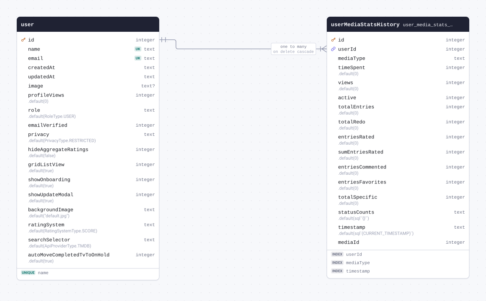

| Column                                   | Type      | Constraints                       | Default                                | Description |
| ---------------------------------------- | --------- | --------------------------------- | -------------------------------------- | ----------- |
| `id`                                     | `integer` | PK NOT NULL                       |                                        |             |
| `userId` (`user_id`)                     | `integer` | NOT NULL → [user.id](#table-user) |                                        |             |
| `mediaType` (`media_type`)               | `text`    | NOT NULL                          |                                        |             |
| `timeSpent` (`time_spent`)               | `integer` | NOT NULL                          | `.default(0)`                          |             |
| `views`                                  | `integer` | NOT NULL                          | `.default(0)`                          |             |
| `active`                                 | `integer` | NOT NULL                          |                                        |             |
| `totalEntries` (`total_entries`)         | `integer` | NOT NULL                          | `.default(0)`                          |             |
| `totalRedo` (`total_redo`)               | `integer` | NOT NULL                          | `.default(0)`                          |             |
| `entriesRated` (`entries_rated`)         | `integer` | NOT NULL                          | `.default(0)`                          |             |
| `sumEntriesRated` (`sum_entries_rated`)  | `integer` | NOT NULL                          | `.default(0)`                          |             |
| `entriesCommented` (`entries_commented`) | `integer` | NOT NULL                          | `.default(0)`                          |             |
| `entriesFavorites` (`entries_favorites`) | `integer` | NOT NULL                          | `.default(0)`                          |             |
| `totalSpecific` (`total_specific`)       | `integer` | NOT NULL                          | `.default(0)`                          |             |
| `statusCounts` (`status_counts`)         | `text`    | NOT NULL                          | ``.default(sql`'{}'`)``                |             |
| `timestamp`                              | `text`    | NOT NULL                          | ``.default(sql`(CURRENT_TIMESTAMP)`)`` |             |
| `mediaId` (`media_id`)                   | `integer` | NOT NULL                          |                                        |             |

#### Definition

```sql
CREATE TABLE `user_media_stats_history` (
	`id` integer PRIMARY KEY,
	`user_id` integer NOT NULL,
	`media_type` text NOT NULL,
	`time_spent` integer DEFAULT 0 NOT NULL,
	`views` integer DEFAULT 0 NOT NULL,
	`active` integer NOT NULL,
	`total_entries` integer DEFAULT 0 NOT NULL,
	`total_redo` integer DEFAULT 0 NOT NULL,
	`entries_rated` integer DEFAULT 0 NOT NULL,
	`sum_entries_rated` integer DEFAULT 0 NOT NULL,
	`entries_commented` integer DEFAULT 0 NOT NULL,
	`entries_favorites` integer DEFAULT 0 NOT NULL,
	`total_specific` integer DEFAULT 0 NOT NULL,
	`status_counts` text DEFAULT '{}' NOT NULL,
	`timestamp` text DEFAULT (CURRENT_TIMESTAMP) NOT NULL,
	`media_id` integer NOT NULL,
	CONSTRAINT `fk_user_media_stats_history_user_id_user_id_fk` FOREIGN KEY (`user_id`) REFERENCES `user`(`id`) ON DELETE CASCADE,
	CONSTRAINT "user_media_stats_history_status_counts_json_check" CHECK(json_valid("status_counts"))
);

CREATE INDEX `ix_user_media_stats_history_user_id` ON `user_media_stats_history` (`user_id`);

CREATE INDEX `ix_user_media_stats_history_media_type` ON `user_media_stats_history` (`media_type`);

CREATE INDEX `ix_user_media_stats_history_timestamp` ON `user_media_stats_history` (`timestamp`);
```

#### Indexes

- INDEX `userId`
- INDEX `mediaType`
- INDEX `timestamp`

#### References

- `userId` → [user.id](#table-user) (many to one, on delete cascade)

<details>
<summary>Queries and their SQL</summary>

**Select**: Every row of userMediaStatsHistory.

```ts
db.select().from(userMediaStatsHistory);
```

```sql
select "id", "user_id", "media_type", "time_spent", "views", "active", "total_entries", "total_redo", "entries_rated", "sum_entries_rated", "entries_commented", "entries_favorites", "total_specific", "status_counts", "timestamp", "media_id"
from "user_media_stats_history"
```

**Count**: How many rows userMediaStatsHistory has.

```ts
db.select({ count: count() }).from(userMediaStatsHistory);
```

```sql
select count(*)
from "user_media_stats_history"
```

**Find many**: The rows of userMediaStatsHistory, through the relational query API.

```ts
db.query.userMediaStatsHistory.findMany();
```

```sql
select "d0"."id" as "id", "d0"."user_id" as "userId", "d0"."media_type" as "mediaType", "d0"."time_spent" as "timeSpent", "d0"."views" as "views", "d0"."active" as "active", "d0"."total_entries" as "totalEntries", "d0"."total_redo" as "totalRedo", "d0"."entries_rated" as "entriesRated", "d0"."sum_entries_rated" as "sumEntriesRated", "d0"."entries_commented" as "entriesCommented", "d0"."entries_favorites" as "entriesFavorites", "d0"."total_specific" as "totalSpecific", "d0"."status_counts" as "statusCounts", "d0"."timestamp" as "timestamp", "d0"."media_id" as "mediaId"
from "user_media_stats_history" as "d0"
```

**Find by primary key**: One row of userMediaStatsHistory, through the relational query API.

```ts
db.query.userMediaStatsHistory.findFirst({ where: { id: 1 } });
```

```sql
select "d0"."id" as "id", "d0"."user_id" as "userId", "d0"."media_type" as "mediaType", "d0"."time_spent" as "timeSpent", "d0"."views" as "views", "d0"."active" as "active", "d0"."total_entries" as "totalEntries", "d0"."total_redo" as "totalRedo", "d0"."entries_rated" as "entriesRated", "d0"."sum_entries_rated" as "sumEntriesRated", "d0"."entries_commented" as "entriesCommented", "d0"."entries_favorites" as "entriesFavorites", "d0"."total_specific" as "totalSpecific", "d0"."status_counts" as "statusCounts", "d0"."timestamp" as "timestamp", "d0"."media_id" as "mediaId"
from "user_media_stats_history" as "d0"
where "d0"."id" = ?
limit ?
-- params: [1,1]
```

**Insert**: Adds a row to userMediaStatsHistory, giving the columns that have no default.

```ts
db.insert(userMediaStatsHistory).values({
  id: 1,
  userId: 1,
  mediaType: "mediaType",
  active: 1,
  mediaId: 1,
});
```

```sql
insert into "user_media_stats_history" ("id", "user_id", "media_type", "time_spent", "views", "active", "total_entries", "total_redo", "entries_rated", "sum_entries_rated", "entries_commented", "entries_favorites", "total_specific", "status_counts", "timestamp", "media_id")
values (?, ?, ?, ?, ?, ?, ?, ?, ?, ?, ?, ?, ?, '{}', (CURRENT_TIMESTAMP), ?)
-- params: [1,1,"mediaType",0,0,1,0,0,0,0,0,0,0,1]
```

**Update**: Changes a row of userMediaStatsHistory, found by its primary key.

```ts
db.update(userMediaStatsHistory).set({ userId: 1 }).where(eq(userMediaStatsHistory.id, 1));
```

```sql
update "user_media_stats_history"
set "user_id" = ?
where "user_media_stats_history"."id" = ?
-- params: [1,1]
```

**Delete**: Deletes a row of userMediaStatsHistory, found by its primary key.

```ts
db.delete(userMediaStatsHistory).where(eq(userMediaStatsHistory.id, 1));
```

```sql
delete from "user_media_stats_history"
where "user_media_stats_history"."id" = ?
-- params: [1]
```

</details>

<a id="table-profileCustom"></a>

### profileCustom

Table `profile_custom`.

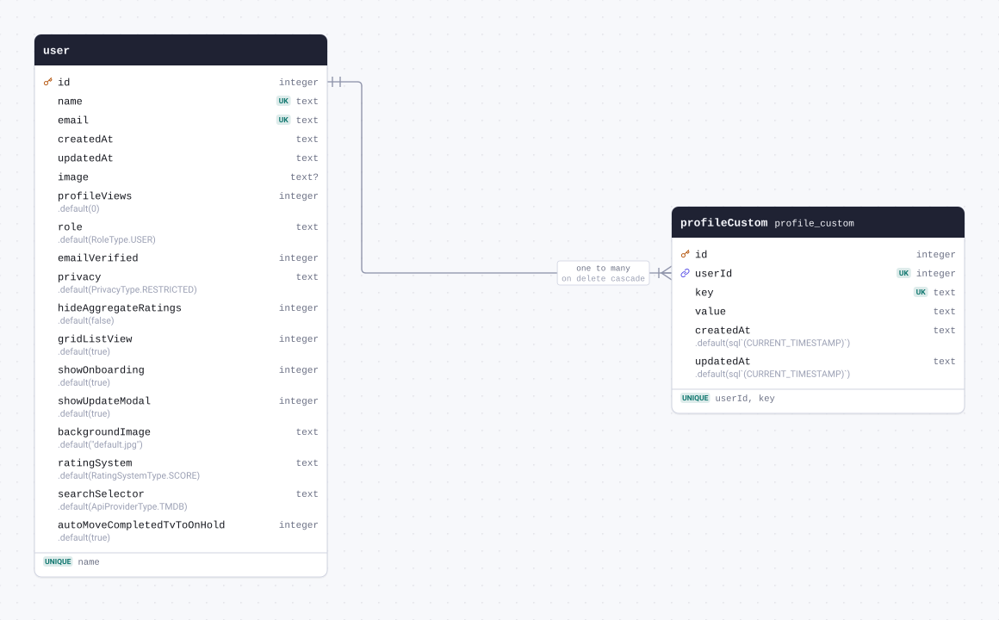

| Column                     | Type      | Constraints                       | Default                                | Description |
| -------------------------- | --------- | --------------------------------- | -------------------------------------- | ----------- |
| `id`                       | `integer` | PK NOT NULL                       |                                        |             |
| `userId` (`user_id`)       | `integer` | NOT NULL → [user.id](#table-user) |                                        |             |
| `key`                      | `text`    | NOT NULL                          |                                        |             |
| `value`                    | `text`    | NOT NULL                          |                                        |             |
| `createdAt` (`created_at`) | `text`    | NOT NULL                          | ``.default(sql`(CURRENT_TIMESTAMP)`)`` |             |
| `updatedAt` (`updated_at`) | `text`    | NOT NULL                          | ``.default(sql`(CURRENT_TIMESTAMP)`)`` |             |

#### Definition

```sql
CREATE TABLE `profile_custom` (
	`id` integer PRIMARY KEY,
	`user_id` integer NOT NULL,
	`key` text NOT NULL,
	`value` text NOT NULL,
	`created_at` text DEFAULT (CURRENT_TIMESTAMP) NOT NULL,
	`updated_at` text DEFAULT (CURRENT_TIMESTAMP) NOT NULL,
	CONSTRAINT `fk_profile_custom_user_id_user_id_fk` FOREIGN KEY (`user_id`) REFERENCES `user`(`id`) ON DELETE CASCADE,
	CONSTRAINT "profile_custom_value_json_check" CHECK(json_valid("value"))
);

CREATE UNIQUE INDEX `ux_profile_custom_user_id_key` ON `profile_custom` (`user_id`,`key`);
```

#### Indexes

- UNIQUE `userId`, `key`

#### References

- `userId` → [user.id](#table-user) (many to one, on delete cascade)

<details>
<summary>Queries and their SQL</summary>

**Select**: Every row of profileCustom.

```ts
db.select().from(profileCustom);
```

```sql
select "id", "user_id", "key", "value", "created_at", "updated_at"
from "profile_custom"
```

**Count**: How many rows profileCustom has.

```ts
db.select({ count: count() }).from(profileCustom);
```

```sql
select count(*)
from "profile_custom"
```

**Find many**: The rows of profileCustom, through the relational query API.

```ts
db.query.profileCustom.findMany();
```

```sql
select "d0"."id" as "id", "d0"."user_id" as "userId", "d0"."key" as "key", "d0"."value" as "value", "d0"."created_at" as "createdAt", "d0"."updated_at" as "updatedAt"
from "profile_custom" as "d0"
```

**Find by primary key**: One row of profileCustom, through the relational query API.

```ts
db.query.profileCustom.findFirst({ where: { id: 1 } });
```

```sql
select "d0"."id" as "id", "d0"."user_id" as "userId", "d0"."key" as "key", "d0"."value" as "value", "d0"."created_at" as "createdAt", "d0"."updated_at" as "updatedAt"
from "profile_custom" as "d0"
where "d0"."id" = ?
limit ?
-- params: [1,1]
```

**Insert**: Adds a row to profileCustom, giving the columns that have no default.

```ts
db.insert(profileCustom).values({ id: 1, userId: 1, key: "key", value: "value" });
```

```sql
insert into "profile_custom" ("id", "user_id", "key", "value", "created_at", "updated_at")
values (?, ?, ?, ?, (CURRENT_TIMESTAMP), (CURRENT_TIMESTAMP))
-- params: [1,1,"key","\"value\""]
```

**Update**: Changes a row of profileCustom, found by its primary key.

```ts
db.update(profileCustom).set({ userId: 1 }).where(eq(profileCustom.id, 1));
```

```sql
update "profile_custom"
set "user_id" = ?
where "profile_custom"."id" = ?
-- params: [1,1]
```

**Delete**: Deletes a row of profileCustom, found by its primary key.

```ts
db.delete(profileCustom).where(eq(profileCustom.id, 1));
```

```sql
delete from "profile_custom"
where "profile_custom"."id" = ?
-- params: [1]
```

</details>

<a id="table-apiTokens"></a>

### apiTokens

Table `api_tokens`.

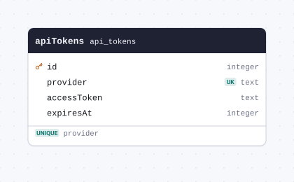

| Column                         | Type      | Constraints | Default | Description |
| ------------------------------ | --------- | ----------- | ------- | ----------- |
| `id`                           | `integer` | PK NOT NULL |         |             |
| `provider`                     | `text`    | NOT NULL    |         |             |
| `accessToken` (`access_token`) | `text`    | NOT NULL    |         |             |
| `expiresAt` (`expires_at`)     | `integer` | NOT NULL    |         |             |

#### Definition

```sql
CREATE TABLE `api_tokens` (
	`id` integer PRIMARY KEY,
	`provider` text NOT NULL,
	`access_token` text NOT NULL,
	`expires_at` integer NOT NULL
);

CREATE UNIQUE INDEX `api_tokens_provider_unique` ON `api_tokens` (`provider`);
```

#### Indexes

- UNIQUE `provider`

<details>
<summary>Queries and their SQL</summary>

**Select**: Every row of apiTokens.

```ts
db.select().from(apiTokens);
```

```sql
select "id", "provider", "access_token", "expires_at"
from "api_tokens"
```

**Count**: How many rows apiTokens has.

```ts
db.select({ count: count() }).from(apiTokens);
```

```sql
select count(*)
from "api_tokens"
```

**Find many**: The rows of apiTokens, through the relational query API.

```ts
db.query.apiTokens.findMany();
```

```sql
select "d0"."id" as "id", "d0"."provider" as "provider", "d0"."access_token" as "accessToken", "d0"."expires_at" as "expiresAt"
from "api_tokens" as "d0"
```

**Find by primary key**: One row of apiTokens, through the relational query API.

```ts
db.query.apiTokens.findFirst({ where: { id: 1 } });
```

```sql
select "d0"."id" as "id", "d0"."provider" as "provider", "d0"."access_token" as "accessToken", "d0"."expires_at" as "expiresAt"
from "api_tokens" as "d0"
where "d0"."id" = ?
limit ?
-- params: [1,1]
```

**Insert**: Adds a row to apiTokens, giving the columns that have no default.

```ts
db.insert(apiTokens).values({
  id: 1,
  provider: "provider",
  accessToken: "accessToken",
  expiresAt: 1,
});
```

```sql
insert into "api_tokens" ("id", "provider", "access_token", "expires_at")
values (?, ?, ?, ?)
-- params: [1,"provider","accessToken",1]
```

**Update**: Changes a row of apiTokens, found by its primary key.

```ts
db.update(apiTokens).set({ provider: "provider" }).where(eq(apiTokens.id, 1));
```

```sql
update "api_tokens"
set "provider" = ?
where "api_tokens"."id" = ?
-- params: ["provider",1]
```

**Delete**: Deletes a row of apiTokens, found by its primary key.

```ts
db.delete(apiTokens).where(eq(apiTokens.id, 1));
```

```sql
delete from "api_tokens"
where "api_tokens"."id" = ?
-- params: [1]
```

</details>

<a id="table-series"></a>

### series

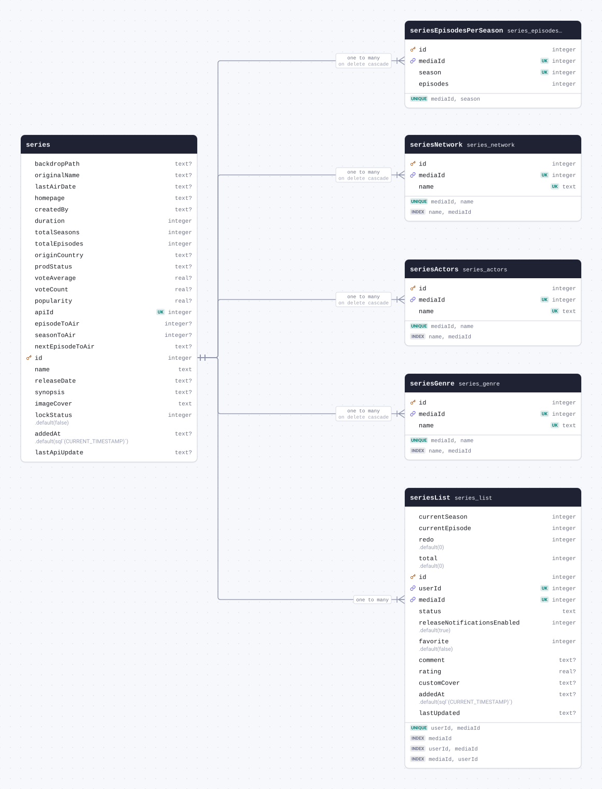

| Column                                     | Type      | Constraints     | Default                                | Description |
| ------------------------------------------ | --------- | --------------- | -------------------------------------- | ----------- |
| `backdropPath` (`backdrop_path`)           | `text`    | NULL            |                                        |             |
| `originalName` (`original_name`)           | `text`    | NULL            |                                        |             |
| `lastAirDate` (`last_air_date`)            | `text`    | NULL            |                                        |             |
| `homepage`                                 | `text`    | NULL            |                                        |             |
| `createdBy` (`created_by`)                 | `text`    | NULL            |                                        |             |
| `duration`                                 | `integer` | NOT NULL        |                                        |             |
| `totalSeasons` (`total_seasons`)           | `integer` | NOT NULL        |                                        |             |
| `totalEpisodes` (`total_episodes`)         | `integer` | NOT NULL        |                                        |             |
| `originCountry` (`origin_country`)         | `text`    | NULL            |                                        |             |
| `prodStatus` (`prod_status`)               | `text`    | NULL            |                                        |             |
| `voteAverage` (`vote_average`)             | `real`    | NULL            |                                        |             |
| `voteCount` (`vote_count`)                 | `real`    | NULL            |                                        |             |
| `popularity`                               | `real`    | NULL            |                                        |             |
| `apiId` (`api_id`)                         | `integer` | UNIQUE NOT NULL |                                        |             |
| `episodeToAir` (`episode_to_air`)          | `integer` | NULL            |                                        |             |
| `seasonToAir` (`season_to_air`)            | `integer` | NULL            |                                        |             |
| `nextEpisodeToAir` (`next_episode_to_air`) | `text`    | NULL            |                                        |             |
| `id`                                       | `integer` | PK NOT NULL     |                                        |             |
| `name`                                     | `text`    | NOT NULL        |                                        |             |
| `releaseDate` (`release_date`)             | `text`    | NULL            |                                        |             |
| `synopsis`                                 | `text`    | NULL            |                                        |             |
| `imageCover` (`image_cover`)               | `text`    | NOT NULL        |                                        |             |
| `lockStatus` (`lock_status`)               | `integer` | NOT NULL        | `.default(false)`                      |             |
| `addedAt` (`added_at`)                     | `text`    | NULL            | ``.default(sql`(CURRENT_TIMESTAMP)`)`` |             |
| `lastApiUpdate` (`last_api_update`)        | `text`    | NULL            |                                        |             |

#### Definition

```sql
CREATE TABLE `series` (
	`backdrop_path` text,
	`original_name` text,
	`last_air_date` text,
	`homepage` text,
	`created_by` text,
	`duration` integer NOT NULL,
	`total_seasons` integer NOT NULL,
	`total_episodes` integer NOT NULL,
	`origin_country` text,
	`prod_status` text,
	`vote_average` real,
	`vote_count` real,
	`popularity` real,
	`api_id` integer NOT NULL UNIQUE,
	`episode_to_air` integer,
	`season_to_air` integer,
	`next_episode_to_air` text,
	`id` integer PRIMARY KEY,
	`name` text NOT NULL,
	`release_date` text,
	`synopsis` text,
	`image_cover` text NOT NULL,
	`lock_status` integer DEFAULT false NOT NULL,
	`added_at` text DEFAULT (CURRENT_TIMESTAMP),
	`last_api_update` text
);
```

#### Referenced by

- `id` → [seriesList.mediaId](#table-seriesList) (one to many)
- `id` → [seriesGenre.mediaId](#table-seriesGenre) (one to many, on delete cascade)
- `id` → [seriesActors.mediaId](#table-seriesActors) (one to many, on delete cascade)
- `id` → [seriesNetwork.mediaId](#table-seriesNetwork) (one to many, on delete cascade)
- `id` → [seriesEpisodesPerSeason.mediaId](#table-seriesEpisodesPerSeason) (one to many, on delete cascade)
- `id` → [seriesTags.mediaId](#table-seriesTags) (one to many, on delete cascade)

<details>
<summary>Queries and their SQL</summary>

**Select**: Every row of series.

```ts
db.select().from(series);
```

```sql
select "backdrop_path", "original_name", "last_air_date", "homepage", "created_by", "duration", "total_seasons", "total_episodes", "origin_country", "prod_status", "vote_average", "vote_count", "popularity", "api_id", "episode_to_air", "season_to_air", "next_episode_to_air", "id", "name", "release_date", "synopsis", "image_cover", "lock_status", "added_at", "last_api_update"
from "series"
```

**Count**: How many rows series has.

```ts
db.select({ count: count() }).from(series);
```

```sql
select count(*)
from "series"
```

**Find many**: The rows of series, through the relational query API.

```ts
db.query.series.findMany();
```

```sql
select "d0"."backdrop_path" as "backdropPath", "d0"."original_name" as "originalName", "d0"."last_air_date" as "lastAirDate", "d0"."homepage" as "homepage", "d0"."created_by" as "createdBy", "d0"."duration" as "duration", "d0"."total_seasons" as "totalSeasons", "d0"."total_episodes" as "totalEpisodes", "d0"."origin_country" as "originCountry", "d0"."prod_status" as "prodStatus", "d0"."vote_average" as "voteAverage", "d0"."vote_count" as "voteCount", "d0"."popularity" as "popularity", "d0"."api_id" as "apiId", "d0"."episode_to_air" as "episodeToAir", "d0"."season_to_air" as "seasonToAir", "d0"."next_episode_to_air" as "nextEpisodeToAir", "d0"."id" as "id", "d0"."name" as "name", "d0"."release_date" as "releaseDate", "d0"."synopsis" as "synopsis", "d0"."image_cover" as "imageCover", "d0"."lock_status" as "lockStatus", "d0"."added_at" as "addedAt", "d0"."last_api_update" as "lastApiUpdate"
from "series" as "d0"
```

**Find by primary key**: One row of series, through the relational query API.

```ts
db.query.series.findFirst({ where: { id: 1 } });
```

```sql
select "d0"."backdrop_path" as "backdropPath", "d0"."original_name" as "originalName", "d0"."last_air_date" as "lastAirDate", "d0"."homepage" as "homepage", "d0"."created_by" as "createdBy", "d0"."duration" as "duration", "d0"."total_seasons" as "totalSeasons", "d0"."total_episodes" as "totalEpisodes", "d0"."origin_country" as "originCountry", "d0"."prod_status" as "prodStatus", "d0"."vote_average" as "voteAverage", "d0"."vote_count" as "voteCount", "d0"."popularity" as "popularity", "d0"."api_id" as "apiId", "d0"."episode_to_air" as "episodeToAir", "d0"."season_to_air" as "seasonToAir", "d0"."next_episode_to_air" as "nextEpisodeToAir", "d0"."id" as "id", "d0"."name" as "name", "d0"."release_date" as "releaseDate", "d0"."synopsis" as "synopsis", "d0"."image_cover" as "imageCover", "d0"."lock_status" as "lockStatus", "d0"."added_at" as "addedAt", "d0"."last_api_update" as "lastApiUpdate"
from "series" as "d0"
where "d0"."id" = ?
limit ?
-- params: [1,1]
```

**Insert**: Adds a row to series, giving the columns that have no default.

```ts
db.insert(series).values({
  duration: 1,
  totalSeasons: 1,
  totalEpisodes: 1,
  apiId: 1,
  id: 1,
  name: "name",
  imageCover: "imageCover",
});
```

```sql
insert into "series" ("backdrop_path", "original_name", "last_air_date", "homepage", "created_by", "duration", "total_seasons", "total_episodes", "origin_country", "prod_status", "vote_average", "vote_count", "popularity", "api_id", "episode_to_air", "season_to_air", "next_episode_to_air", "id", "name", "release_date", "synopsis", "image_cover", "lock_status", "added_at", "last_api_update")
values (null, null, null, null, null, ?, ?, ?, null, null, null, null, null, ?, null, null, null, ?, ?, null, null, ?, ?, (CURRENT_TIMESTAMP), null)
-- params: [1,1,1,1,1,"name","imageCover",0]
```

**Update**: Changes a row of series, found by its primary key.

```ts
db.update(series).set({ backdropPath: "backdropPath" }).where(eq(series.id, 1));
```

```sql
update "series"
set "backdrop_path" = ?
where "series"."id" = ?
-- params: ["backdropPath",1]
```

**Delete**: Deletes a row of series, found by its primary key.

```ts
db.delete(series).where(eq(series.id, 1));
```

```sql
delete from "series"
where "series"."id" = ?
-- params: [1]
```

</details>

<a id="table-seriesList"></a>

### seriesList

Table `series_list`.

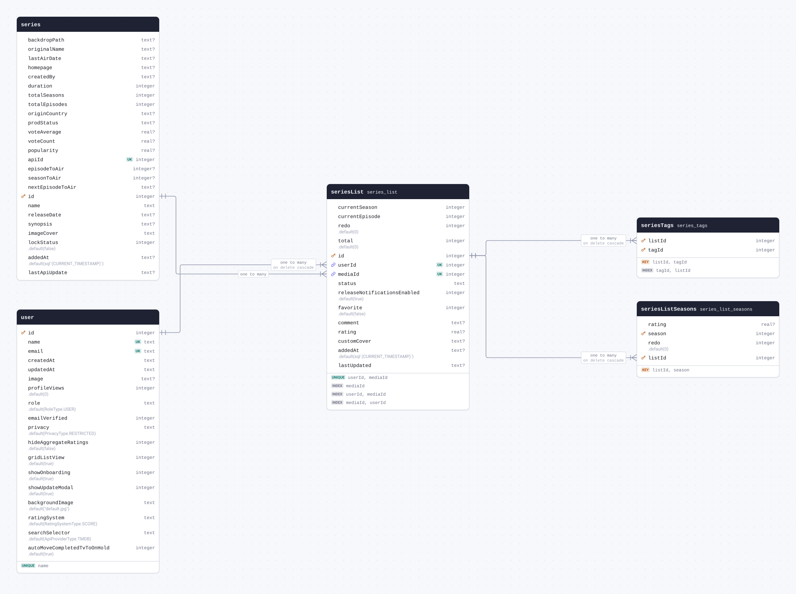

| Column                                                          | Type      | Constraints                           | Default                                | Description |
| --------------------------------------------------------------- | --------- | ------------------------------------- | -------------------------------------- | ----------- |
| `currentSeason` (`current_season`)                              | `integer` | NOT NULL                              |                                        |             |
| `currentEpisode` (`current_episode`)                            | `integer` | NOT NULL                              |                                        |             |
| `redo`                                                          | `integer` | NOT NULL                              | `.default(0)`                          |             |
| `total`                                                         | `integer` | NOT NULL                              | `.default(0)`                          |             |
| `id`                                                            | `integer` | PK NOT NULL                           |                                        |             |
| `userId` (`user_id`)                                            | `integer` | NOT NULL → [user.id](#table-user)     |                                        |             |
| `mediaId` (`media_id`)                                          | `integer` | NOT NULL → [series.id](#table-series) |                                        |             |
| `status`                                                        | `text`    | NOT NULL                              |                                        |             |
| `releaseNotificationsEnabled` (`release_notifications_enabled`) | `integer` | NOT NULL                              | `.default(true)`                       |             |
| `favorite`                                                      | `integer` | NOT NULL                              | `.default(false)`                      |             |
| `comment`                                                       | `text`    | NULL                                  |                                        |             |
| `rating`                                                        | `real`    | NULL                                  |                                        |             |
| `customCover` (`custom_cover`)                                  | `text`    | NULL                                  |                                        |             |
| `addedAt` (`added_at`)                                          | `text`    | NULL                                  | ``.default(sql`(CURRENT_TIMESTAMP)`)`` |             |
| `lastUpdated` (`last_updated`)                                  | `text`    | NULL                                  |                                        |             |

#### Definition

```sql
CREATE TABLE `series_list` (
	`current_season` integer NOT NULL,
	`current_episode` integer NOT NULL,
	`redo` integer DEFAULT 0 NOT NULL,
	`total` integer DEFAULT 0 NOT NULL,
	`id` integer PRIMARY KEY,
	`user_id` integer NOT NULL,
	`media_id` integer NOT NULL,
	`status` text NOT NULL,
	`release_notifications_enabled` integer DEFAULT true NOT NULL,
	`favorite` integer DEFAULT false NOT NULL,
	`comment` text,
	`rating` real,
	`custom_cover` text,
	`added_at` text DEFAULT (CURRENT_TIMESTAMP),
	`last_updated` text,
	CONSTRAINT `fk_series_list_user_id_user_id_fk` FOREIGN KEY (`user_id`) REFERENCES `user`(`id`) ON DELETE CASCADE,
	CONSTRAINT `fk_series_list_media_id_series_id_fk` FOREIGN KEY (`media_id`) REFERENCES `series`(`id`),
	CONSTRAINT "series_list_rating_check" CHECK("rating" IS NULL OR ("rating" >= 0 AND "rating" <= 10)),
	CONSTRAINT "series_list_favorite_check" CHECK("favorite" IN (0, 1)),
	CONSTRAINT "series_list_redo_check" CHECK("redo" >= 0)
);

CREATE UNIQUE INDEX `ux_series_list_user_media` ON `series_list` (`user_id`,`media_id`);

CREATE INDEX `ix_series_list_media_id` ON `series_list` (`media_id`);

CREATE INDEX `ix_series_list_user_media_rated` ON `series_list` (`user_id`,`media_id`) WHERE "series_list"."rating" IS NOT NULL;

CREATE INDEX `ix_series_list_media_user_rated` ON `series_list` (`media_id`,`user_id`) WHERE "series_list"."rating" IS NOT NULL;
```

#### Indexes

- UNIQUE `userId`, `mediaId`
- INDEX `mediaId`
- INDEX `userId`, `mediaId`
- INDEX `mediaId`, `userId`

#### References

- `userId` → [user.id](#table-user) (many to one, on delete cascade)
- `mediaId` → [series.id](#table-series) (many to one)

#### Referenced by

- `id` → [seriesListSeasons.listId](#table-seriesListSeasons) (one to many, on delete cascade)

<details>
<summary>Queries and their SQL</summary>

**Select**: Every row of seriesList.

```ts
db.select().from(seriesList);
```

```sql
select "current_season", "current_episode", "redo", "total", "id", "user_id", "media_id", "status", "release_notifications_enabled", "favorite", "comment", "rating", "custom_cover", "added_at", "last_updated"
from "series_list"
```

**Count**: How many rows seriesList has.

```ts
db.select({ count: count() }).from(seriesList);
```

```sql
select count(*)
from "series_list"
```

**Find many**: The rows of seriesList, through the relational query API.

```ts
db.query.seriesList.findMany();
```

```sql
select "d0"."current_season" as "currentSeason", "d0"."current_episode" as "currentEpisode", "d0"."redo" as "redo", "d0"."total" as "total", "d0"."id" as "id", "d0"."user_id" as "userId", "d0"."media_id" as "mediaId", "d0"."status" as "status", "d0"."release_notifications_enabled" as "releaseNotificationsEnabled", "d0"."favorite" as "favorite", "d0"."comment" as "comment", "d0"."rating" as "rating", "d0"."custom_cover" as "customCover", "d0"."added_at" as "addedAt", "d0"."last_updated" as "lastUpdated"
from "series_list" as "d0"
```

**Find by primary key**: One row of seriesList, through the relational query API.

```ts
db.query.seriesList.findFirst({ where: { id: 1 } });
```

```sql
select "d0"."current_season" as "currentSeason", "d0"."current_episode" as "currentEpisode", "d0"."redo" as "redo", "d0"."total" as "total", "d0"."id" as "id", "d0"."user_id" as "userId", "d0"."media_id" as "mediaId", "d0"."status" as "status", "d0"."release_notifications_enabled" as "releaseNotificationsEnabled", "d0"."favorite" as "favorite", "d0"."comment" as "comment", "d0"."rating" as "rating", "d0"."custom_cover" as "customCover", "d0"."added_at" as "addedAt", "d0"."last_updated" as "lastUpdated"
from "series_list" as "d0"
where "d0"."id" = ?
limit ?
-- params: [1,1]
```

**Insert**: Adds a row to seriesList, giving the columns that have no default.

```ts
db.insert(seriesList).values({
  currentSeason: 1,
  currentEpisode: 1,
  id: 1,
  userId: 1,
  mediaId: 1,
  status: "status",
});
```

```sql
insert into "series_list" ("current_season", "current_episode", "redo", "total", "id", "user_id", "media_id", "status", "release_notifications_enabled", "favorite", "comment", "rating", "custom_cover", "added_at", "last_updated")
values (?, ?, ?, ?, ?, ?, ?, ?, ?, ?, null, null, null, (CURRENT_TIMESTAMP), null)
-- params: [1,1,0,0,1,1,1,"status",1,0]
```

**Update**: Changes a row of seriesList, found by its primary key.

```ts
db.update(seriesList).set({ currentSeason: 1 }).where(eq(seriesList.id, 1));
```

```sql
update "series_list"
set "current_season" = ?
where "series_list"."id" = ?
-- params: [1,1]
```

**Delete**: Deletes a row of seriesList, found by its primary key.

```ts
db.delete(seriesList).where(eq(seriesList.id, 1));
```

```sql
delete from "series_list"
where "series_list"."id" = ?
-- params: [1]
```

</details>

<a id="table-seriesListSeasons"></a>

### seriesListSeasons

Table `series_list_seasons`.


| Column               | Type      | Constraints                                      | Default       | Description |
| -------------------- | --------- | ------------------------------------------------ | ------------- | ----------- |
| `rating`             | `real`    | NULL                                             |               |             |
| `season`             | `integer` | PK NOT NULL                                      |               |             |
| `redo`               | `integer` | NOT NULL                                         | `.default(0)` |             |
| `listId` (`list_id`) | `integer` | PK NOT NULL → [seriesList.id](#table-seriesList) |               |             |

#### Definition

```sql
CREATE TABLE `series_list_seasons` (
	`rating` real,
	`season` integer NOT NULL,
	`redo` integer DEFAULT 0 NOT NULL,
	`list_id` integer NOT NULL,
	CONSTRAINT `series_list_seasons_pk` PRIMARY KEY(`list_id`, `season`),
	CONSTRAINT `fk_series_list_seasons_list_id_series_list_id_fk` FOREIGN KEY (`list_id`) REFERENCES `series_list`(`id`) ON DELETE CASCADE,
	CONSTRAINT "series_list_seasons_season_check" CHECK("season" >= 1),
	CONSTRAINT "series_list_seasons_redo_check" CHECK("redo" >= 0 AND "redo" <= 100),
	CONSTRAINT "series_list_seasons_rating_check" CHECK("rating" IS NULL OR ("rating" >= 0 AND "rating" <= 10))
);
```

#### Indexes

- PRIMARY KEY `listId`, `season`

#### References

- `listId` → [seriesList.id](#table-seriesList) (many to one, on delete cascade)

<details>
<summary>Queries and their SQL</summary>

**Select**: Every row of seriesListSeasons.

```ts
db.select().from(seriesListSeasons);
```

```sql
select "rating", "season", "redo", "list_id"
from "series_list_seasons"
```

**Count**: How many rows seriesListSeasons has.

```ts
db.select({ count: count() }).from(seriesListSeasons);
```

```sql
select count(*)
from "series_list_seasons"
```

**Find many**: The rows of seriesListSeasons, through the relational query API.

```ts
db.query.seriesListSeasons.findMany();
```

```sql
select "d0"."rating" as "rating", "d0"."season" as "season", "d0"."redo" as "redo", "d0"."list_id" as "listId"
from "series_list_seasons" as "d0"
```

**Find by primary key**: One row of seriesListSeasons, through the relational query API.

```ts
db.query.seriesListSeasons.findFirst({ where: { season: 1, listId: 1 } });
```

```sql
select "d0"."rating" as "rating", "d0"."season" as "season", "d0"."redo" as "redo", "d0"."list_id" as "listId"
from "series_list_seasons" as "d0"
where (("d0"."season" = ?) and ("d0"."list_id" = ?))
limit ?
-- params: [1,1,1]
```

**Insert**: Adds a row to seriesListSeasons, giving the columns that have no default.

```ts
db.insert(seriesListSeasons).values({ season: 1, listId: 1 });
```

```sql
insert into "series_list_seasons" ("rating", "season", "redo", "list_id")
values (null, ?, ?, ?)
-- params: [1,0,1]
```

**Update**: Changes a row of seriesListSeasons, found by its primary key.

```ts
db.update(seriesListSeasons)
  .set({ rating: 1 })
  .where(and(eq(seriesListSeasons.season, 1), eq(seriesListSeasons.listId, 1)));
```

```sql
update "series_list_seasons"
set "rating" = ?
where (("series_list_seasons"."season" = ?) and ("series_list_seasons"."list_id" = ?))
-- params: [1,1,1]
```

**Delete**: Deletes a row of seriesListSeasons, found by its primary key.

```ts
db.delete(seriesListSeasons).where(
  and(eq(seriesListSeasons.season, 1), eq(seriesListSeasons.listId, 1)),
);
```

```sql
delete from "series_list_seasons"
where (("series_list_seasons"."season" = ?) and ("series_list_seasons"."list_id" = ?))
-- params: [1,1]
```

</details>

<a id="table-seriesGenre"></a>

### seriesGenre

Table `series_genre`.


| Column                 | Type      | Constraints                           | Default | Description |
| ---------------------- | --------- | ------------------------------------- | ------- | ----------- |
| `id`                   | `integer` | PK NOT NULL                           |         |             |
| `mediaId` (`media_id`) | `integer` | NOT NULL → [series.id](#table-series) |         |             |
| `name`                 | `text`    | NOT NULL                              |         |             |

#### Definition

```sql
CREATE TABLE `series_genre` (
	`id` integer PRIMARY KEY,
	`media_id` integer NOT NULL,
	`name` text NOT NULL,
	CONSTRAINT `fk_series_genre_media_id_series_id_fk` FOREIGN KEY (`media_id`) REFERENCES `series`(`id`) ON DELETE CASCADE
);

CREATE UNIQUE INDEX `ux_series_genre_media_name` ON `series_genre` (`media_id`,`name`);

CREATE INDEX `ix_series_genre_name_media` ON `series_genre` (`name`,`media_id`);
```

#### Indexes

- UNIQUE `mediaId`, `name`
- INDEX `name`, `mediaId`

#### References

- `mediaId` → [series.id](#table-series) (many to one, on delete cascade)

<details>
<summary>Queries and their SQL</summary>

**Select**: Every row of seriesGenre.

```ts
db.select().from(seriesGenre);
```

```sql
select "id", "media_id", "name"
from "series_genre"
```

**Count**: How many rows seriesGenre has.

```ts
db.select({ count: count() }).from(seriesGenre);
```

```sql
select count(*)
from "series_genre"
```

**Find many**: The rows of seriesGenre, through the relational query API.

```ts
db.query.seriesGenre.findMany();
```

```sql
select "d0"."id" as "id", "d0"."media_id" as "mediaId", "d0"."name" as "name"
from "series_genre" as "d0"
```

**Find by primary key**: One row of seriesGenre, through the relational query API.

```ts
db.query.seriesGenre.findFirst({ where: { id: 1 } });
```

```sql
select "d0"."id" as "id", "d0"."media_id" as "mediaId", "d0"."name" as "name"
from "series_genre" as "d0"
where "d0"."id" = ?
limit ?
-- params: [1,1]
```

**Insert**: Adds a row to seriesGenre, giving the columns that have no default.

```ts
db.insert(seriesGenre).values({ id: 1, mediaId: 1, name: "name" });
```

```sql
insert into "series_genre" ("id", "media_id", "name")
values (?, ?, ?)
-- params: [1,1,"name"]
```

**Update**: Changes a row of seriesGenre, found by its primary key.

```ts
db.update(seriesGenre).set({ mediaId: 1 }).where(eq(seriesGenre.id, 1));
```

```sql
update "series_genre"
set "media_id" = ?
where "series_genre"."id" = ?
-- params: [1,1]
```

**Delete**: Deletes a row of seriesGenre, found by its primary key.

```ts
db.delete(seriesGenre).where(eq(seriesGenre.id, 1));
```

```sql
delete from "series_genre"
where "series_genre"."id" = ?
-- params: [1]
```

</details>

<a id="table-seriesActors"></a>

### seriesActors

Table `series_actors`.


| Column                 | Type      | Constraints                           | Default | Description |
| ---------------------- | --------- | ------------------------------------- | ------- | ----------- |
| `id`                   | `integer` | PK NOT NULL                           |         |             |
| `mediaId` (`media_id`) | `integer` | NOT NULL → [series.id](#table-series) |         |             |
| `name`                 | `text`    | NOT NULL                              |         |             |

#### Definition

```sql
CREATE TABLE `series_actors` (
	`id` integer PRIMARY KEY,
	`media_id` integer NOT NULL,
	`name` text NOT NULL,
	CONSTRAINT `fk_series_actors_media_id_series_id_fk` FOREIGN KEY (`media_id`) REFERENCES `series`(`id`) ON DELETE CASCADE
);

CREATE UNIQUE INDEX `ux_series_actors_media_name` ON `series_actors` (`media_id`,`name`);

CREATE INDEX `ix_series_actors_name_media` ON `series_actors` (`name`,`media_id`);
```

#### Indexes

- UNIQUE `mediaId`, `name`
- INDEX `name`, `mediaId`

#### References

- `mediaId` → [series.id](#table-series) (many to one, on delete cascade)

<details>
<summary>Queries and their SQL</summary>

**Select**: Every row of seriesActors.

```ts
db.select().from(seriesActors);
```

```sql
select "id", "media_id", "name"
from "series_actors"
```

**Count**: How many rows seriesActors has.

```ts
db.select({ count: count() }).from(seriesActors);
```

```sql
select count(*)
from "series_actors"
```

**Find many**: The rows of seriesActors, through the relational query API.

```ts
db.query.seriesActors.findMany();
```

```sql
select "d0"."id" as "id", "d0"."media_id" as "mediaId", "d0"."name" as "name"
from "series_actors" as "d0"
```

**Find by primary key**: One row of seriesActors, through the relational query API.

```ts
db.query.seriesActors.findFirst({ where: { id: 1 } });
```

```sql
select "d0"."id" as "id", "d0"."media_id" as "mediaId", "d0"."name" as "name"
from "series_actors" as "d0"
where "d0"."id" = ?
limit ?
-- params: [1,1]
```

**Insert**: Adds a row to seriesActors, giving the columns that have no default.

```ts
db.insert(seriesActors).values({ id: 1, mediaId: 1, name: "name" });
```

```sql
insert into "series_actors" ("id", "media_id", "name")
values (?, ?, ?)
-- params: [1,1,"name"]
```

**Update**: Changes a row of seriesActors, found by its primary key.

```ts
db.update(seriesActors).set({ mediaId: 1 }).where(eq(seriesActors.id, 1));
```

```sql
update "series_actors"
set "media_id" = ?
where "series_actors"."id" = ?
-- params: [1,1]
```

**Delete**: Deletes a row of seriesActors, found by its primary key.

```ts
db.delete(seriesActors).where(eq(seriesActors.id, 1));
```

```sql
delete from "series_actors"
where "series_actors"."id" = ?
-- params: [1]
```

</details>

<a id="table-seriesNetwork"></a>

### seriesNetwork

Table `series_network`.

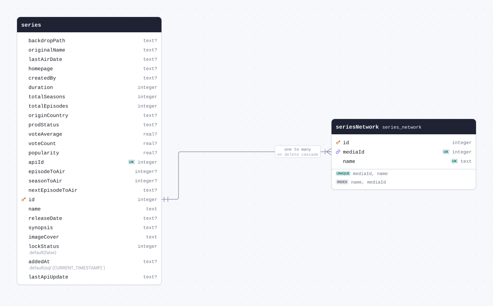

| Column                 | Type      | Constraints                           | Default | Description |
| ---------------------- | --------- | ------------------------------------- | ------- | ----------- |
| `id`                   | `integer` | PK NOT NULL                           |         |             |
| `mediaId` (`media_id`) | `integer` | NOT NULL → [series.id](#table-series) |         |             |
| `name`                 | `text`    | NOT NULL                              |         |             |

#### Definition

```sql
CREATE TABLE `series_network` (
	`id` integer PRIMARY KEY,
	`media_id` integer NOT NULL,
	`name` text NOT NULL,
	CONSTRAINT `fk_series_network_media_id_series_id_fk` FOREIGN KEY (`media_id`) REFERENCES `series`(`id`) ON DELETE CASCADE
);

CREATE UNIQUE INDEX `ux_series_network_media_name` ON `series_network` (`media_id`,`name`);

CREATE INDEX `ix_series_network_name_media` ON `series_network` (`name`,`media_id`);
```

#### Indexes

- UNIQUE `mediaId`, `name`
- INDEX `name`, `mediaId`

#### References

- `mediaId` → [series.id](#table-series) (many to one, on delete cascade)

<details>
<summary>Queries and their SQL</summary>

**Select**: Every row of seriesNetwork.

```ts
db.select().from(seriesNetwork);
```

```sql
select "id", "media_id", "name"
from "series_network"
```

**Count**: How many rows seriesNetwork has.

```ts
db.select({ count: count() }).from(seriesNetwork);
```

```sql
select count(*)
from "series_network"
```

**Find many**: The rows of seriesNetwork, through the relational query API.

```ts
db.query.seriesNetwork.findMany();
```

```sql
select "d0"."id" as "id", "d0"."media_id" as "mediaId", "d0"."name" as "name"
from "series_network" as "d0"
```

**Find by primary key**: One row of seriesNetwork, through the relational query API.

```ts
db.query.seriesNetwork.findFirst({ where: { id: 1 } });
```

```sql
select "d0"."id" as "id", "d0"."media_id" as "mediaId", "d0"."name" as "name"
from "series_network" as "d0"
where "d0"."id" = ?
limit ?
-- params: [1,1]
```

**Insert**: Adds a row to seriesNetwork, giving the columns that have no default.

```ts
db.insert(seriesNetwork).values({ id: 1, mediaId: 1, name: "name" });
```

```sql
insert into "series_network" ("id", "media_id", "name")
values (?, ?, ?)
-- params: [1,1,"name"]
```

**Update**: Changes a row of seriesNetwork, found by its primary key.

```ts
db.update(seriesNetwork).set({ mediaId: 1 }).where(eq(seriesNetwork.id, 1));
```

```sql
update "series_network"
set "media_id" = ?
where "series_network"."id" = ?
-- params: [1,1]
```

**Delete**: Deletes a row of seriesNetwork, found by its primary key.

```ts
db.delete(seriesNetwork).where(eq(seriesNetwork.id, 1));
```

```sql
delete from "series_network"
where "series_network"."id" = ?
-- params: [1]
```

</details>

<a id="table-seriesEpisodesPerSeason"></a>

### seriesEpisodesPerSeason

Table `series_episodes_per_season`.


| Column                 | Type      | Constraints                           | Default | Description |
| ---------------------- | --------- | ------------------------------------- | ------- | ----------- |
| `id`                   | `integer` | PK NOT NULL                           |         |             |
| `mediaId` (`media_id`) | `integer` | NOT NULL → [series.id](#table-series) |         |             |
| `season`               | `integer` | NOT NULL                              |         |             |
| `episodes`             | `integer` | NOT NULL                              |         |             |

#### Definition

```sql
CREATE TABLE `series_episodes_per_season` (
	`id` integer PRIMARY KEY,
	`media_id` integer NOT NULL,
	`season` integer NOT NULL,
	`episodes` integer NOT NULL,
	CONSTRAINT `fk_series_episodes_per_season_media_id_series_id_fk` FOREIGN KEY (`media_id`) REFERENCES `series`(`id`) ON DELETE CASCADE
);

CREATE UNIQUE INDEX `ux_series_episodes_per_season_media_season` ON `series_episodes_per_season` (`media_id`,`season`);
```

#### Indexes

- UNIQUE `mediaId`, `season`

#### References

- `mediaId` → [series.id](#table-series) (many to one, on delete cascade)

<details>
<summary>Queries and their SQL</summary>

**Select**: Every row of seriesEpisodesPerSeason.

```ts
db.select().from(seriesEpisodesPerSeason);
```

```sql
select "id", "media_id", "season", "episodes"
from "series_episodes_per_season"
```

**Count**: How many rows seriesEpisodesPerSeason has.

```ts
db.select({ count: count() }).from(seriesEpisodesPerSeason);
```

```sql
select count(*)
from "series_episodes_per_season"
```

**Find many**: The rows of seriesEpisodesPerSeason, through the relational query API.

```ts
db.query.seriesEpisodesPerSeason.findMany();
```

```sql
select "d0"."id" as "id", "d0"."media_id" as "mediaId", "d0"."season" as "season", "d0"."episodes" as "episodes"
from "series_episodes_per_season" as "d0"
```

**Find by primary key**: One row of seriesEpisodesPerSeason, through the relational query API.

```ts
db.query.seriesEpisodesPerSeason.findFirst({ where: { id: 1 } });
```

```sql
select "d0"."id" as "id", "d0"."media_id" as "mediaId", "d0"."season" as "season", "d0"."episodes" as "episodes"
from "series_episodes_per_season" as "d0"
where "d0"."id" = ?
limit ?
-- params: [1,1]
```

**Insert**: Adds a row to seriesEpisodesPerSeason, giving the columns that have no default.

```ts
db.insert(seriesEpisodesPerSeason).values({ id: 1, mediaId: 1, season: 1, episodes: 1 });
```

```sql
insert into "series_episodes_per_season" ("id", "media_id", "season", "episodes")
values (?, ?, ?, ?)
-- params: [1,1,1,1]
```

**Update**: Changes a row of seriesEpisodesPerSeason, found by its primary key.

```ts
db.update(seriesEpisodesPerSeason).set({ mediaId: 1 }).where(eq(seriesEpisodesPerSeason.id, 1));
```

```sql
update "series_episodes_per_season"
set "media_id" = ?
where "series_episodes_per_season"."id" = ?
-- params: [1,1]
```

**Delete**: Deletes a row of seriesEpisodesPerSeason, found by its primary key.

```ts
db.delete(seriesEpisodesPerSeason).where(eq(seriesEpisodesPerSeason.id, 1));
```

```sql
delete from "series_episodes_per_season"
where "series_episodes_per_season"."id" = ?
-- params: [1]
```

</details>

<a id="table-seriesTags"></a>

### seriesTags

Table `series_tags`.

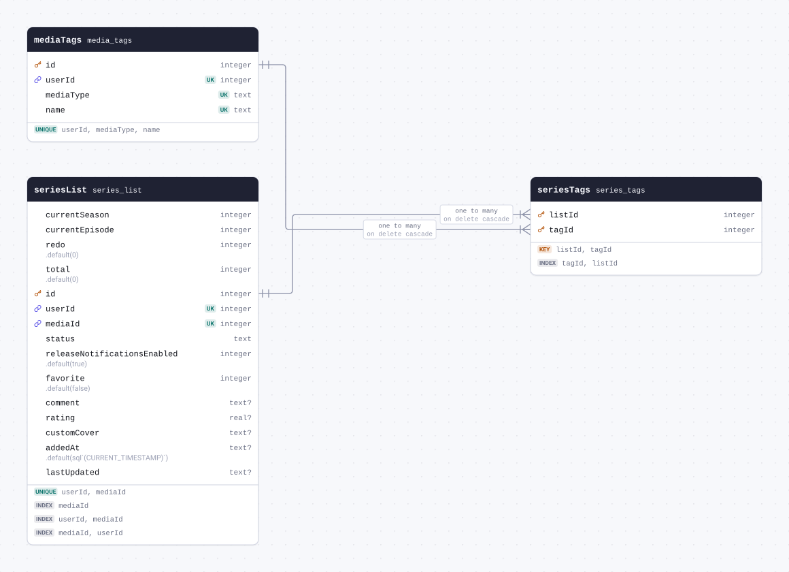

| Column                 | Type      | Constraints                                 | Default | Description |
| ---------------------- | --------- | ------------------------------------------- | ------- | ----------- |
| `id`                   | `integer` | PK NOT NULL                                 |         |             |
| `userId` (`user_id`)   | `integer` | NOT NULL → [user.id](#table-user)           |         |             |
| `mediaId` (`media_id`) | `integer` | NOT NULL → [series.id](#table-series)       |         |             |
| `tagId` (`tag_id`)     | `integer` | NOT NULL → [mediaTags.id](#table-mediaTags) |         |             |

#### Definition

```sql
CREATE TABLE `series_tags` (
	`id` integer PRIMARY KEY,
	`user_id` integer NOT NULL,
	`media_id` integer NOT NULL,
	`tag_id` integer NOT NULL,
	CONSTRAINT `fk_series_tags_user_id_user_id_fk` FOREIGN KEY (`user_id`) REFERENCES `user`(`id`) ON DELETE CASCADE,
	CONSTRAINT `fk_series_tags_media_id_series_id_fk` FOREIGN KEY (`media_id`) REFERENCES `series`(`id`) ON DELETE CASCADE,
	CONSTRAINT `fk_series_tags_tag_id_media_tags_id_fk` FOREIGN KEY (`tag_id`) REFERENCES `media_tags`(`id`) ON DELETE CASCADE
);

CREATE UNIQUE INDEX `ux_series_tags_user_media_tag` ON `series_tags` (`user_id`,`media_id`,`tag_id`);

CREATE INDEX `ix_series_tags_user_tag_media` ON `series_tags` (`user_id`,`tag_id`,`media_id`);
```

#### Indexes

- UNIQUE `userId`, `mediaId`, `tagId`
- INDEX `userId`, `tagId`, `mediaId`

#### References

- `userId` → [user.id](#table-user) (many to one, on delete cascade)
- `mediaId` → [series.id](#table-series) (many to one, on delete cascade)
- `tagId` → [mediaTags.id](#table-mediaTags) (many to one, on delete cascade)

<details>
<summary>Queries and their SQL</summary>

**Select**: Every row of seriesTags.

```ts
db.select().from(seriesTags);
```

```sql
select "id", "user_id", "media_id", "tag_id"
from "series_tags"
```

**Count**: How many rows seriesTags has.

```ts
db.select({ count: count() }).from(seriesTags);
```

```sql
select count(*)
from "series_tags"
```

**Find many**: The rows of seriesTags, through the relational query API.

```ts
db.query.seriesTags.findMany();
```

```sql
select "d0"."id" as "id", "d0"."user_id" as "userId", "d0"."media_id" as "mediaId", "d0"."tag_id" as "tagId"
from "series_tags" as "d0"
```

**Find by primary key**: One row of seriesTags, through the relational query API.

```ts
db.query.seriesTags.findFirst({ where: { id: 1 } });
```

```sql
select "d0"."id" as "id", "d0"."user_id" as "userId", "d0"."media_id" as "mediaId", "d0"."tag_id" as "tagId"
from "series_tags" as "d0"
where "d0"."id" = ?
limit ?
-- params: [1,1]
```

**Insert**: Adds a row to seriesTags, giving the columns that have no default.

```ts
db.insert(seriesTags).values({ id: 1, userId: 1, mediaId: 1, tagId: 1 });
```

```sql
insert into "series_tags" ("id", "user_id", "media_id", "tag_id")
values (?, ?, ?, ?)
-- params: [1,1,1,1]
```

**Update**: Changes a row of seriesTags, found by its primary key.

```ts
db.update(seriesTags).set({ userId: 1 }).where(eq(seriesTags.id, 1));
```

```sql
update "series_tags"
set "user_id" = ?
where "series_tags"."id" = ?
-- params: [1,1]
```

**Delete**: Deletes a row of seriesTags, found by its primary key.

```ts
db.delete(seriesTags).where(eq(seriesTags.id, 1));
```

```sql
delete from "series_tags"
where "series_tags"."id" = ?
-- params: [1]
```

</details>

<a id="table-anime"></a>

### anime

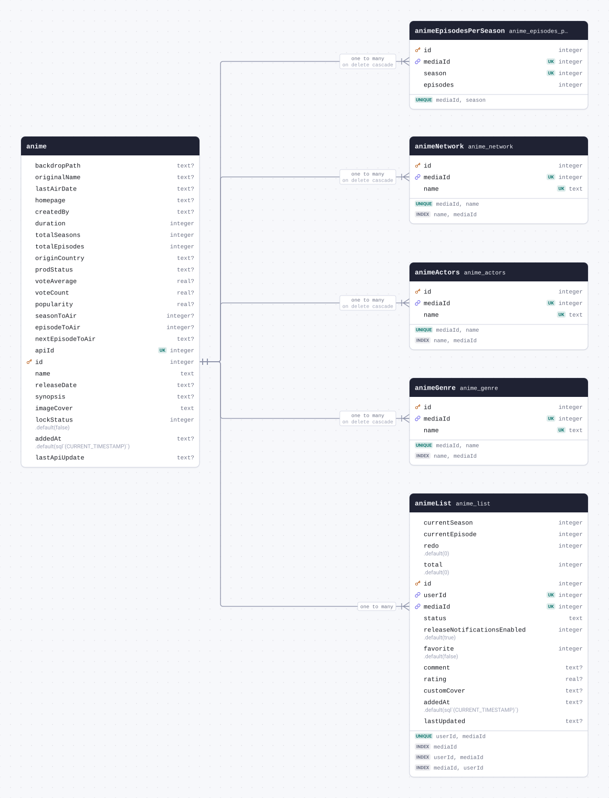

| Column                                     | Type      | Constraints     | Default                                | Description |
| ------------------------------------------ | --------- | --------------- | -------------------------------------- | ----------- |
| `backdropPath` (`backdrop_path`)           | `text`    | NULL            |                                        |             |
| `originalName` (`original_name`)           | `text`    | NULL            |                                        |             |
| `lastAirDate` (`last_air_date`)            | `text`    | NULL            |                                        |             |
| `homepage`                                 | `text`    | NULL            |                                        |             |
| `createdBy` (`created_by`)                 | `text`    | NULL            |                                        |             |
| `duration`                                 | `integer` | NOT NULL        |                                        |             |
| `totalSeasons` (`total_seasons`)           | `integer` | NOT NULL        |                                        |             |
| `totalEpisodes` (`total_episodes`)         | `integer` | NOT NULL        |                                        |             |
| `originCountry` (`origin_country`)         | `text`    | NULL            |                                        |             |
| `prodStatus` (`prod_status`)               | `text`    | NULL            |                                        |             |
| `voteAverage` (`vote_average`)             | `real`    | NULL            |                                        |             |
| `voteCount` (`vote_count`)                 | `real`    | NULL            |                                        |             |
| `popularity`                               | `real`    | NULL            |                                        |             |
| `seasonToAir` (`season_to_air`)            | `integer` | NULL            |                                        |             |
| `episodeToAir` (`episode_to_air`)          | `integer` | NULL            |                                        |             |
| `nextEpisodeToAir` (`next_episode_to_air`) | `text`    | NULL            |                                        |             |
| `apiId` (`api_id`)                         | `integer` | UNIQUE NOT NULL |                                        |             |
| `id`                                       | `integer` | PK NOT NULL     |                                        |             |
| `name`                                     | `text`    | NOT NULL        |                                        |             |
| `releaseDate` (`release_date`)             | `text`    | NULL            |                                        |             |
| `synopsis`                                 | `text`    | NULL            |                                        |             |
| `imageCover` (`image_cover`)               | `text`    | NOT NULL        |                                        |             |
| `lockStatus` (`lock_status`)               | `integer` | NOT NULL        | `.default(false)`                      |             |
| `addedAt` (`added_at`)                     | `text`    | NULL            | ``.default(sql`(CURRENT_TIMESTAMP)`)`` |             |
| `lastApiUpdate` (`last_api_update`)        | `text`    | NULL            |                                        |             |

#### Definition

```sql
CREATE TABLE `anime` (
	`backdrop_path` text,
	`original_name` text,
	`last_air_date` text,
	`homepage` text,
	`created_by` text,
	`duration` integer NOT NULL,
	`total_seasons` integer NOT NULL,
	`total_episodes` integer NOT NULL,
	`origin_country` text,
	`prod_status` text,
	`vote_average` real,
	`vote_count` real,
	`popularity` real,
	`season_to_air` integer,
	`episode_to_air` integer,
	`next_episode_to_air` text,
	`api_id` integer NOT NULL UNIQUE,
	`id` integer PRIMARY KEY,
	`name` text NOT NULL,
	`release_date` text,
	`synopsis` text,
	`image_cover` text NOT NULL,
	`lock_status` integer DEFAULT false NOT NULL,
	`added_at` text DEFAULT (CURRENT_TIMESTAMP),
	`last_api_update` text
);
```

#### Referenced by

- `id` → [animeList.mediaId](#table-animeList) (one to many)
- `id` → [animeGenre.mediaId](#table-animeGenre) (one to many, on delete cascade)
- `id` → [animeActors.mediaId](#table-animeActors) (one to many, on delete cascade)
- `id` → [animeNetwork.mediaId](#table-animeNetwork) (one to many, on delete cascade)
- `id` → [animeEpisodesPerSeason.mediaId](#table-animeEpisodesPerSeason) (one to many, on delete cascade)
- `id` → [animeTags.mediaId](#table-animeTags) (one to many, on delete cascade)

<details>
<summary>Queries and their SQL</summary>

**Select**: Every row of anime.

```ts
db.select().from(anime);
```

```sql
select "backdrop_path", "original_name", "last_air_date", "homepage", "created_by", "duration", "total_seasons", "total_episodes", "origin_country", "prod_status", "vote_average", "vote_count", "popularity", "season_to_air", "episode_to_air", "next_episode_to_air", "api_id", "id", "name", "release_date", "synopsis", "image_cover", "lock_status", "added_at", "last_api_update"
from "anime"
```

**Count**: How many rows anime has.

```ts
db.select({ count: count() }).from(anime);
```

```sql
select count(*)
from "anime"
```

**Find many**: The rows of anime, through the relational query API.

```ts
db.query.anime.findMany();
```

```sql
select "d0"."backdrop_path" as "backdropPath", "d0"."original_name" as "originalName", "d0"."last_air_date" as "lastAirDate", "d0"."homepage" as "homepage", "d0"."created_by" as "createdBy", "d0"."duration" as "duration", "d0"."total_seasons" as "totalSeasons", "d0"."total_episodes" as "totalEpisodes", "d0"."origin_country" as "originCountry", "d0"."prod_status" as "prodStatus", "d0"."vote_average" as "voteAverage", "d0"."vote_count" as "voteCount", "d0"."popularity" as "popularity", "d0"."season_to_air" as "seasonToAir", "d0"."episode_to_air" as "episodeToAir", "d0"."next_episode_to_air" as "nextEpisodeToAir", "d0"."api_id" as "apiId", "d0"."id" as "id", "d0"."name" as "name", "d0"."release_date" as "releaseDate", "d0"."synopsis" as "synopsis", "d0"."image_cover" as "imageCover", "d0"."lock_status" as "lockStatus", "d0"."added_at" as "addedAt", "d0"."last_api_update" as "lastApiUpdate"
from "anime" as "d0"
```

**Find by primary key**: One row of anime, through the relational query API.

```ts
db.query.anime.findFirst({ where: { id: 1 } });
```

```sql
select "d0"."backdrop_path" as "backdropPath", "d0"."original_name" as "originalName", "d0"."last_air_date" as "lastAirDate", "d0"."homepage" as "homepage", "d0"."created_by" as "createdBy", "d0"."duration" as "duration", "d0"."total_seasons" as "totalSeasons", "d0"."total_episodes" as "totalEpisodes", "d0"."origin_country" as "originCountry", "d0"."prod_status" as "prodStatus", "d0"."vote_average" as "voteAverage", "d0"."vote_count" as "voteCount", "d0"."popularity" as "popularity", "d0"."season_to_air" as "seasonToAir", "d0"."episode_to_air" as "episodeToAir", "d0"."next_episode_to_air" as "nextEpisodeToAir", "d0"."api_id" as "apiId", "d0"."id" as "id", "d0"."name" as "name", "d0"."release_date" as "releaseDate", "d0"."synopsis" as "synopsis", "d0"."image_cover" as "imageCover", "d0"."lock_status" as "lockStatus", "d0"."added_at" as "addedAt", "d0"."last_api_update" as "lastApiUpdate"
from "anime" as "d0"
where "d0"."id" = ?
limit ?
-- params: [1,1]
```

**Insert**: Adds a row to anime, giving the columns that have no default.

```ts
db.insert(anime).values({
  duration: 1,
  totalSeasons: 1,
  totalEpisodes: 1,
  apiId: 1,
  id: 1,
  name: "name",
  imageCover: "imageCover",
});
```

```sql
insert into "anime" ("backdrop_path", "original_name", "last_air_date", "homepage", "created_by", "duration", "total_seasons", "total_episodes", "origin_country", "prod_status", "vote_average", "vote_count", "popularity", "season_to_air", "episode_to_air", "next_episode_to_air", "api_id", "id", "name", "release_date", "synopsis", "image_cover", "lock_status", "added_at", "last_api_update")
values (null, null, null, null, null, ?, ?, ?, null, null, null, null, null, null, null, null, ?, ?, ?, null, null, ?, ?, (CURRENT_TIMESTAMP), null)
-- params: [1,1,1,1,1,"name","imageCover",0]
```

**Update**: Changes a row of anime, found by its primary key.

```ts
db.update(anime).set({ backdropPath: "backdropPath" }).where(eq(anime.id, 1));
```

```sql
update "anime"
set "backdrop_path" = ?
where "anime"."id" = ?
-- params: ["backdropPath",1]
```

**Delete**: Deletes a row of anime, found by its primary key.

```ts
db.delete(anime).where(eq(anime.id, 1));
```

```sql
delete from "anime"
where "anime"."id" = ?
-- params: [1]
```

</details>

<a id="table-animeList"></a>

### animeList

Table `anime_list`.


| Column                                                          | Type      | Constraints                         | Default                                | Description |
| --------------------------------------------------------------- | --------- | ----------------------------------- | -------------------------------------- | ----------- |
| `currentSeason` (`current_season`)                              | `integer` | NOT NULL                            |                                        |             |
| `currentEpisode` (`current_episode`)                            | `integer` | NOT NULL                            |                                        |             |
| `redo`                                                          | `integer` | NOT NULL                            | `.default(0)`                          |             |
| `total`                                                         | `integer` | NOT NULL                            | `.default(0)`                          |             |
| `id`                                                            | `integer` | PK NOT NULL                         |                                        |             |
| `userId` (`user_id`)                                            | `integer` | NOT NULL → [user.id](#table-user)   |                                        |             |
| `mediaId` (`media_id`)                                          | `integer` | NOT NULL → [anime.id](#table-anime) |                                        |             |
| `status`                                                        | `text`    | NOT NULL                            |                                        |             |
| `releaseNotificationsEnabled` (`release_notifications_enabled`) | `integer` | NOT NULL                            | `.default(true)`                       |             |
| `favorite`                                                      | `integer` | NOT NULL                            | `.default(false)`                      |             |
| `comment`                                                       | `text`    | NULL                                |                                        |             |
| `rating`                                                        | `real`    | NULL                                |                                        |             |
| `customCover` (`custom_cover`)                                  | `text`    | NULL                                |                                        |             |
| `addedAt` (`added_at`)                                          | `text`    | NULL                                | ``.default(sql`(CURRENT_TIMESTAMP)`)`` |             |
| `lastUpdated` (`last_updated`)                                  | `text`    | NULL                                |                                        |             |

#### Definition

```sql
CREATE TABLE `anime_list` (
	`current_season` integer NOT NULL,
	`current_episode` integer NOT NULL,
	`redo` integer DEFAULT 0 NOT NULL,
	`total` integer DEFAULT 0 NOT NULL,
	`id` integer PRIMARY KEY,
	`user_id` integer NOT NULL,
	`media_id` integer NOT NULL,
	`status` text NOT NULL,
	`release_notifications_enabled` integer DEFAULT true NOT NULL,
	`favorite` integer DEFAULT false NOT NULL,
	`comment` text,
	`rating` real,
	`custom_cover` text,
	`added_at` text DEFAULT (CURRENT_TIMESTAMP),
	`last_updated` text,
	CONSTRAINT `fk_anime_list_user_id_user_id_fk` FOREIGN KEY (`user_id`) REFERENCES `user`(`id`) ON DELETE CASCADE,
	CONSTRAINT `fk_anime_list_media_id_anime_id_fk` FOREIGN KEY (`media_id`) REFERENCES `anime`(`id`),
	CONSTRAINT "anime_list_rating_check" CHECK("rating" IS NULL OR ("rating" >= 0 AND "rating" <= 10)),
	CONSTRAINT "anime_list_favorite_check" CHECK("favorite" IN (0, 1)),
	CONSTRAINT "anime_list_redo_check" CHECK("redo" >= 0)
);

CREATE UNIQUE INDEX `ux_anime_list_user_media` ON `anime_list` (`user_id`,`media_id`);

CREATE INDEX `ix_anime_list_media_id` ON `anime_list` (`media_id`);

CREATE INDEX `ix_anime_list_user_media_rated` ON `anime_list` (`user_id`,`media_id`) WHERE "anime_list"."rating" IS NOT NULL;

CREATE INDEX `ix_anime_list_media_user_rated` ON `anime_list` (`media_id`,`user_id`) WHERE "anime_list"."rating" IS NOT NULL;
```

#### Indexes

- UNIQUE `userId`, `mediaId`
- INDEX `mediaId`
- INDEX `userId`, `mediaId`
- INDEX `mediaId`, `userId`

#### References

- `userId` → [user.id](#table-user) (many to one, on delete cascade)
- `mediaId` → [anime.id](#table-anime) (many to one)

#### Referenced by

- `id` → [animeListSeasons.listId](#table-animeListSeasons) (one to many, on delete cascade)

<details>
<summary>Queries and their SQL</summary>

**Select**: Every row of animeList.

```ts
db.select().from(animeList);
```

```sql
select "current_season", "current_episode", "redo", "total", "id", "user_id", "media_id", "status", "release_notifications_enabled", "favorite", "comment", "rating", "custom_cover", "added_at", "last_updated"
from "anime_list"
```

**Count**: How many rows animeList has.

```ts
db.select({ count: count() }).from(animeList);
```

```sql
select count(*)
from "anime_list"
```

**Find many**: The rows of animeList, through the relational query API.

```ts
db.query.animeList.findMany();
```

```sql
select "d0"."current_season" as "currentSeason", "d0"."current_episode" as "currentEpisode", "d0"."redo" as "redo", "d0"."total" as "total", "d0"."id" as "id", "d0"."user_id" as "userId", "d0"."media_id" as "mediaId", "d0"."status" as "status", "d0"."release_notifications_enabled" as "releaseNotificationsEnabled", "d0"."favorite" as "favorite", "d0"."comment" as "comment", "d0"."rating" as "rating", "d0"."custom_cover" as "customCover", "d0"."added_at" as "addedAt", "d0"."last_updated" as "lastUpdated"
from "anime_list" as "d0"
```

**Find by primary key**: One row of animeList, through the relational query API.

```ts
db.query.animeList.findFirst({ where: { id: 1 } });
```

```sql
select "d0"."current_season" as "currentSeason", "d0"."current_episode" as "currentEpisode", "d0"."redo" as "redo", "d0"."total" as "total", "d0"."id" as "id", "d0"."user_id" as "userId", "d0"."media_id" as "mediaId", "d0"."status" as "status", "d0"."release_notifications_enabled" as "releaseNotificationsEnabled", "d0"."favorite" as "favorite", "d0"."comment" as "comment", "d0"."rating" as "rating", "d0"."custom_cover" as "customCover", "d0"."added_at" as "addedAt", "d0"."last_updated" as "lastUpdated"
from "anime_list" as "d0"
where "d0"."id" = ?
limit ?
-- params: [1,1]
```

**Insert**: Adds a row to animeList, giving the columns that have no default.

```ts
db.insert(animeList).values({
  currentSeason: 1,
  currentEpisode: 1,
  id: 1,
  userId: 1,
  mediaId: 1,
  status: "status",
});
```

```sql
insert into "anime_list" ("current_season", "current_episode", "redo", "total", "id", "user_id", "media_id", "status", "release_notifications_enabled", "favorite", "comment", "rating", "custom_cover", "added_at", "last_updated")
values (?, ?, ?, ?, ?, ?, ?, ?, ?, ?, null, null, null, (CURRENT_TIMESTAMP), null)
-- params: [1,1,0,0,1,1,1,"status",1,0]
```

**Update**: Changes a row of animeList, found by its primary key.

```ts
db.update(animeList).set({ currentSeason: 1 }).where(eq(animeList.id, 1));
```

```sql
update "anime_list"
set "current_season" = ?
where "anime_list"."id" = ?
-- params: [1,1]
```

**Delete**: Deletes a row of animeList, found by its primary key.

```ts
db.delete(animeList).where(eq(animeList.id, 1));
```

```sql
delete from "anime_list"
where "anime_list"."id" = ?
-- params: [1]
```

</details>

<a id="table-animeListSeasons"></a>

### animeListSeasons

Table `anime_list_seasons`.

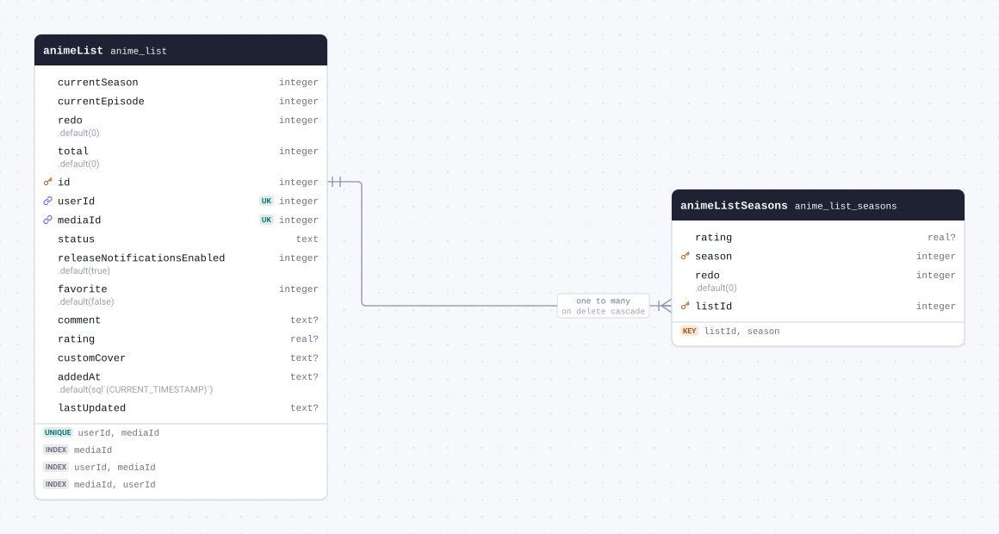

| Column               | Type      | Constraints                                    | Default       | Description |
| -------------------- | --------- | ---------------------------------------------- | ------------- | ----------- |
| `rating`             | `real`    | NULL                                           |               |             |
| `season`             | `integer` | PK NOT NULL                                    |               |             |
| `redo`               | `integer` | NOT NULL                                       | `.default(0)` |             |
| `listId` (`list_id`) | `integer` | PK NOT NULL → [animeList.id](#table-animeList) |               |             |

#### Definition

```sql
CREATE TABLE `anime_list_seasons` (
	`rating` real,
	`season` integer NOT NULL,
	`redo` integer DEFAULT 0 NOT NULL,
	`list_id` integer NOT NULL,
	CONSTRAINT `anime_list_seasons_pk` PRIMARY KEY(`list_id`, `season`),
	CONSTRAINT `fk_anime_list_seasons_list_id_anime_list_id_fk` FOREIGN KEY (`list_id`) REFERENCES `anime_list`(`id`) ON DELETE CASCADE,
	CONSTRAINT "anime_list_seasons_season_check" CHECK("season" >= 1),
	CONSTRAINT "anime_list_seasons_redo_check" CHECK("redo" >= 0 AND "redo" <= 100),
	CONSTRAINT "anime_list_seasons_rating_check" CHECK("rating" IS NULL OR ("rating" >= 0 AND "rating" <= 10))
);
```

#### Indexes

- PRIMARY KEY `listId`, `season`

#### References

- `listId` → [animeList.id](#table-animeList) (many to one, on delete cascade)

<details>
<summary>Queries and their SQL</summary>

**Select**: Every row of animeListSeasons.

```ts
db.select().from(animeListSeasons);
```

```sql
select "rating", "season", "redo", "list_id"
from "anime_list_seasons"
```

**Count**: How many rows animeListSeasons has.

```ts
db.select({ count: count() }).from(animeListSeasons);
```

```sql
select count(*)
from "anime_list_seasons"
```

**Find many**: The rows of animeListSeasons, through the relational query API.

```ts
db.query.animeListSeasons.findMany();
```

```sql
select "d0"."rating" as "rating", "d0"."season" as "season", "d0"."redo" as "redo", "d0"."list_id" as "listId"
from "anime_list_seasons" as "d0"
```

**Find by primary key**: One row of animeListSeasons, through the relational query API.

```ts
db.query.animeListSeasons.findFirst({ where: { season: 1, listId: 1 } });
```

```sql
select "d0"."rating" as "rating", "d0"."season" as "season", "d0"."redo" as "redo", "d0"."list_id" as "listId"
from "anime_list_seasons" as "d0"
where (("d0"."season" = ?) and ("d0"."list_id" = ?))
limit ?
-- params: [1,1,1]
```

**Insert**: Adds a row to animeListSeasons, giving the columns that have no default.

```ts
db.insert(animeListSeasons).values({ season: 1, listId: 1 });
```

```sql
insert into "anime_list_seasons" ("rating", "season", "redo", "list_id")
values (null, ?, ?, ?)
-- params: [1,0,1]
```

**Update**: Changes a row of animeListSeasons, found by its primary key.

```ts
db.update(animeListSeasons)
  .set({ rating: 1 })
  .where(and(eq(animeListSeasons.season, 1), eq(animeListSeasons.listId, 1)));
```

```sql
update "anime_list_seasons"
set "rating" = ?
where (("anime_list_seasons"."season" = ?) and ("anime_list_seasons"."list_id" = ?))
-- params: [1,1,1]
```

**Delete**: Deletes a row of animeListSeasons, found by its primary key.

```ts
db.delete(animeListSeasons).where(
  and(eq(animeListSeasons.season, 1), eq(animeListSeasons.listId, 1)),
);
```

```sql
delete from "anime_list_seasons"
where (("anime_list_seasons"."season" = ?) and ("anime_list_seasons"."list_id" = ?))
-- params: [1,1]
```

</details>

<a id="table-animeGenre"></a>

### animeGenre

Table `anime_genre`.


| Column                 | Type      | Constraints                         | Default | Description |
| ---------------------- | --------- | ----------------------------------- | ------- | ----------- |
| `id`                   | `integer` | PK NOT NULL                         |         |             |
| `mediaId` (`media_id`) | `integer` | NOT NULL → [anime.id](#table-anime) |         |             |
| `name`                 | `text`    | NOT NULL                            |         |             |

#### Definition

```sql
CREATE TABLE `anime_genre` (
	`id` integer PRIMARY KEY,
	`media_id` integer NOT NULL,
	`name` text NOT NULL,
	CONSTRAINT `fk_anime_genre_media_id_anime_id_fk` FOREIGN KEY (`media_id`) REFERENCES `anime`(`id`) ON DELETE CASCADE
);

CREATE UNIQUE INDEX `ux_anime_genre_media_name` ON `anime_genre` (`media_id`,`name`);

CREATE INDEX `ix_anime_genre_name_media` ON `anime_genre` (`name`,`media_id`);
```

#### Indexes

- UNIQUE `mediaId`, `name`
- INDEX `name`, `mediaId`

#### References

- `mediaId` → [anime.id](#table-anime) (many to one, on delete cascade)

<details>
<summary>Queries and their SQL</summary>

**Select**: Every row of animeGenre.

```ts
db.select().from(animeGenre);
```

```sql
select "id", "media_id", "name"
from "anime_genre"
```

**Count**: How many rows animeGenre has.

```ts
db.select({ count: count() }).from(animeGenre);
```

```sql
select count(*)
from "anime_genre"
```

**Find many**: The rows of animeGenre, through the relational query API.

```ts
db.query.animeGenre.findMany();
```

```sql
select "d0"."id" as "id", "d0"."media_id" as "mediaId", "d0"."name" as "name"
from "anime_genre" as "d0"
```

**Find by primary key**: One row of animeGenre, through the relational query API.

```ts
db.query.animeGenre.findFirst({ where: { id: 1 } });
```

```sql
select "d0"."id" as "id", "d0"."media_id" as "mediaId", "d0"."name" as "name"
from "anime_genre" as "d0"
where "d0"."id" = ?
limit ?
-- params: [1,1]
```

**Insert**: Adds a row to animeGenre, giving the columns that have no default.

```ts
db.insert(animeGenre).values({ id: 1, mediaId: 1, name: "name" });
```

```sql
insert into "anime_genre" ("id", "media_id", "name")
values (?, ?, ?)
-- params: [1,1,"name"]
```

**Update**: Changes a row of animeGenre, found by its primary key.

```ts
db.update(animeGenre).set({ mediaId: 1 }).where(eq(animeGenre.id, 1));
```

```sql
update "anime_genre"
set "media_id" = ?
where "anime_genre"."id" = ?
-- params: [1,1]
```

**Delete**: Deletes a row of animeGenre, found by its primary key.

```ts
db.delete(animeGenre).where(eq(animeGenre.id, 1));
```

```sql
delete from "anime_genre"
where "anime_genre"."id" = ?
-- params: [1]
```

</details>

<a id="table-animeActors"></a>

### animeActors

Table `anime_actors`.

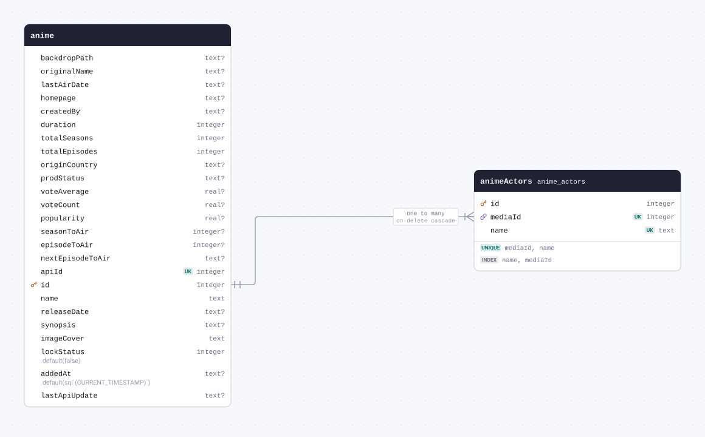

| Column                 | Type      | Constraints                         | Default | Description |
| ---------------------- | --------- | ----------------------------------- | ------- | ----------- |
| `id`                   | `integer` | PK NOT NULL                         |         |             |
| `mediaId` (`media_id`) | `integer` | NOT NULL → [anime.id](#table-anime) |         |             |
| `name`                 | `text`    | NOT NULL                            |         |             |

#### Definition

```sql
CREATE TABLE `anime_actors` (
	`id` integer PRIMARY KEY,
	`media_id` integer NOT NULL,
	`name` text NOT NULL,
	CONSTRAINT `fk_anime_actors_media_id_anime_id_fk` FOREIGN KEY (`media_id`) REFERENCES `anime`(`id`) ON DELETE CASCADE
);

CREATE UNIQUE INDEX `ux_anime_actors_media_name` ON `anime_actors` (`media_id`,`name`);

CREATE INDEX `ix_anime_actors_name_media` ON `anime_actors` (`name`,`media_id`);
```

#### Indexes

- UNIQUE `mediaId`, `name`
- INDEX `name`, `mediaId`

#### References

- `mediaId` → [anime.id](#table-anime) (many to one, on delete cascade)

<details>
<summary>Queries and their SQL</summary>

**Select**: Every row of animeActors.

```ts
db.select().from(animeActors);
```

```sql
select "id", "media_id", "name"
from "anime_actors"
```

**Count**: How many rows animeActors has.

```ts
db.select({ count: count() }).from(animeActors);
```

```sql
select count(*)
from "anime_actors"
```

**Find many**: The rows of animeActors, through the relational query API.

```ts
db.query.animeActors.findMany();
```

```sql
select "d0"."id" as "id", "d0"."media_id" as "mediaId", "d0"."name" as "name"
from "anime_actors" as "d0"
```

**Find by primary key**: One row of animeActors, through the relational query API.

```ts
db.query.animeActors.findFirst({ where: { id: 1 } });
```

```sql
select "d0"."id" as "id", "d0"."media_id" as "mediaId", "d0"."name" as "name"
from "anime_actors" as "d0"
where "d0"."id" = ?
limit ?
-- params: [1,1]
```

**Insert**: Adds a row to animeActors, giving the columns that have no default.

```ts
db.insert(animeActors).values({ id: 1, mediaId: 1, name: "name" });
```

```sql
insert into "anime_actors" ("id", "media_id", "name")
values (?, ?, ?)
-- params: [1,1,"name"]
```

**Update**: Changes a row of animeActors, found by its primary key.

```ts
db.update(animeActors).set({ mediaId: 1 }).where(eq(animeActors.id, 1));
```

```sql
update "anime_actors"
set "media_id" = ?
where "anime_actors"."id" = ?
-- params: [1,1]
```

**Delete**: Deletes a row of animeActors, found by its primary key.

```ts
db.delete(animeActors).where(eq(animeActors.id, 1));
```

```sql
delete from "anime_actors"
where "anime_actors"."id" = ?
-- params: [1]
```

</details>

<a id="table-animeNetwork"></a>

### animeNetwork

Table `anime_network`.


| Column                 | Type      | Constraints                         | Default | Description |
| ---------------------- | --------- | ----------------------------------- | ------- | ----------- |
| `id`                   | `integer` | PK NOT NULL                         |         |             |
| `mediaId` (`media_id`) | `integer` | NOT NULL → [anime.id](#table-anime) |         |             |
| `name`                 | `text`    | NOT NULL                            |         |             |

#### Definition

```sql
CREATE TABLE `anime_network` (
	`id` integer PRIMARY KEY,
	`media_id` integer NOT NULL,
	`name` text NOT NULL,
	CONSTRAINT `fk_anime_network_media_id_anime_id_fk` FOREIGN KEY (`media_id`) REFERENCES `anime`(`id`) ON DELETE CASCADE
);

CREATE UNIQUE INDEX `ux_anime_network_media_name` ON `anime_network` (`media_id`,`name`);

CREATE INDEX `ix_anime_network_name_media` ON `anime_network` (`name`,`media_id`);
```

#### Indexes

- UNIQUE `mediaId`, `name`
- INDEX `name`, `mediaId`

#### References

- `mediaId` → [anime.id](#table-anime) (many to one, on delete cascade)

<details>
<summary>Queries and their SQL</summary>

**Select**: Every row of animeNetwork.

```ts
db.select().from(animeNetwork);
```

```sql
select "id", "media_id", "name"
from "anime_network"
```

**Count**: How many rows animeNetwork has.

```ts
db.select({ count: count() }).from(animeNetwork);
```

```sql
select count(*)
from "anime_network"
```

**Find many**: The rows of animeNetwork, through the relational query API.

```ts
db.query.animeNetwork.findMany();
```

```sql
select "d0"."id" as "id", "d0"."media_id" as "mediaId", "d0"."name" as "name"
from "anime_network" as "d0"
```

**Find by primary key**: One row of animeNetwork, through the relational query API.

```ts
db.query.animeNetwork.findFirst({ where: { id: 1 } });
```

```sql
select "d0"."id" as "id", "d0"."media_id" as "mediaId", "d0"."name" as "name"
from "anime_network" as "d0"
where "d0"."id" = ?
limit ?
-- params: [1,1]
```

**Insert**: Adds a row to animeNetwork, giving the columns that have no default.

```ts
db.insert(animeNetwork).values({ id: 1, mediaId: 1, name: "name" });
```

```sql
insert into "anime_network" ("id", "media_id", "name")
values (?, ?, ?)
-- params: [1,1,"name"]
```

**Update**: Changes a row of animeNetwork, found by its primary key.

```ts
db.update(animeNetwork).set({ mediaId: 1 }).where(eq(animeNetwork.id, 1));
```

```sql
update "anime_network"
set "media_id" = ?
where "anime_network"."id" = ?
-- params: [1,1]
```

**Delete**: Deletes a row of animeNetwork, found by its primary key.

```ts
db.delete(animeNetwork).where(eq(animeNetwork.id, 1));
```

```sql
delete from "anime_network"
where "anime_network"."id" = ?
-- params: [1]
```

</details>

<a id="table-animeEpisodesPerSeason"></a>

### animeEpisodesPerSeason

Table `anime_episodes_per_season`.

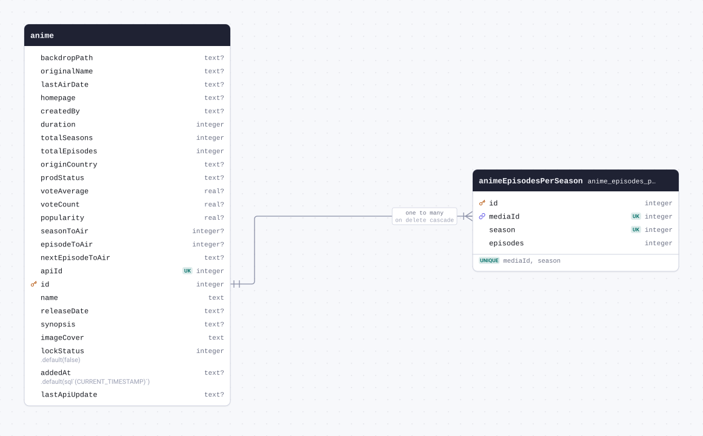

| Column                 | Type      | Constraints                         | Default | Description |
| ---------------------- | --------- | ----------------------------------- | ------- | ----------- |
| `id`                   | `integer` | PK NOT NULL                         |         |             |
| `mediaId` (`media_id`) | `integer` | NOT NULL → [anime.id](#table-anime) |         |             |
| `season`               | `integer` | NOT NULL                            |         |             |
| `episodes`             | `integer` | NOT NULL                            |         |             |

#### Definition

```sql
CREATE TABLE `anime_episodes_per_season` (
	`id` integer PRIMARY KEY,
	`media_id` integer NOT NULL,
	`season` integer NOT NULL,
	`episodes` integer NOT NULL,
	CONSTRAINT `fk_anime_episodes_per_season_media_id_anime_id_fk` FOREIGN KEY (`media_id`) REFERENCES `anime`(`id`) ON DELETE CASCADE
);

CREATE UNIQUE INDEX `ux_anime_episodes_per_season_media_season` ON `anime_episodes_per_season` (`media_id`,`season`);
```

#### Indexes

- UNIQUE `mediaId`, `season`

#### References

- `mediaId` → [anime.id](#table-anime) (many to one, on delete cascade)

<details>
<summary>Queries and their SQL</summary>

**Select**: Every row of animeEpisodesPerSeason.

```ts
db.select().from(animeEpisodesPerSeason);
```

```sql
select "id", "media_id", "season", "episodes"
from "anime_episodes_per_season"
```

**Count**: How many rows animeEpisodesPerSeason has.

```ts
db.select({ count: count() }).from(animeEpisodesPerSeason);
```

```sql
select count(*)
from "anime_episodes_per_season"
```

**Find many**: The rows of animeEpisodesPerSeason, through the relational query API.

```ts
db.query.animeEpisodesPerSeason.findMany();
```

```sql
select "d0"."id" as "id", "d0"."media_id" as "mediaId", "d0"."season" as "season", "d0"."episodes" as "episodes"
from "anime_episodes_per_season" as "d0"
```

**Find by primary key**: One row of animeEpisodesPerSeason, through the relational query API.

```ts
db.query.animeEpisodesPerSeason.findFirst({ where: { id: 1 } });
```

```sql
select "d0"."id" as "id", "d0"."media_id" as "mediaId", "d0"."season" as "season", "d0"."episodes" as "episodes"
from "anime_episodes_per_season" as "d0"
where "d0"."id" = ?
limit ?
-- params: [1,1]
```

**Insert**: Adds a row to animeEpisodesPerSeason, giving the columns that have no default.

```ts
db.insert(animeEpisodesPerSeason).values({ id: 1, mediaId: 1, season: 1, episodes: 1 });
```

```sql
insert into "anime_episodes_per_season" ("id", "media_id", "season", "episodes")
values (?, ?, ?, ?)
-- params: [1,1,1,1]
```

**Update**: Changes a row of animeEpisodesPerSeason, found by its primary key.

```ts
db.update(animeEpisodesPerSeason).set({ mediaId: 1 }).where(eq(animeEpisodesPerSeason.id, 1));
```

```sql
update "anime_episodes_per_season"
set "media_id" = ?
where "anime_episodes_per_season"."id" = ?
-- params: [1,1]
```

**Delete**: Deletes a row of animeEpisodesPerSeason, found by its primary key.

```ts
db.delete(animeEpisodesPerSeason).where(eq(animeEpisodesPerSeason.id, 1));
```

```sql
delete from "anime_episodes_per_season"
where "anime_episodes_per_season"."id" = ?
-- params: [1]
```

</details>

<a id="table-animeTags"></a>

### animeTags

Table `anime_tags`.


| Column                 | Type      | Constraints                                 | Default | Description |
| ---------------------- | --------- | ------------------------------------------- | ------- | ----------- |
| `id`                   | `integer` | PK NOT NULL                                 |         |             |
| `userId` (`user_id`)   | `integer` | NOT NULL → [user.id](#table-user)           |         |             |
| `mediaId` (`media_id`) | `integer` | NOT NULL → [anime.id](#table-anime)         |         |             |
| `tagId` (`tag_id`)     | `integer` | NOT NULL → [mediaTags.id](#table-mediaTags) |         |             |

#### Definition

```sql
CREATE TABLE `anime_tags` (
	`id` integer PRIMARY KEY,
	`user_id` integer NOT NULL,
	`media_id` integer NOT NULL,
	`tag_id` integer NOT NULL,
	CONSTRAINT `fk_anime_tags_user_id_user_id_fk` FOREIGN KEY (`user_id`) REFERENCES `user`(`id`) ON DELETE CASCADE,
	CONSTRAINT `fk_anime_tags_media_id_anime_id_fk` FOREIGN KEY (`media_id`) REFERENCES `anime`(`id`) ON DELETE CASCADE,
	CONSTRAINT `fk_anime_tags_tag_id_media_tags_id_fk` FOREIGN KEY (`tag_id`) REFERENCES `media_tags`(`id`) ON DELETE CASCADE
);

CREATE UNIQUE INDEX `ux_anime_tags_user_media_tag` ON `anime_tags` (`user_id`,`media_id`,`tag_id`);

CREATE INDEX `ix_anime_tags_user_tag_media` ON `anime_tags` (`user_id`,`tag_id`,`media_id`);
```

#### Indexes

- UNIQUE `userId`, `mediaId`, `tagId`
- INDEX `userId`, `tagId`, `mediaId`

#### References

- `userId` → [user.id](#table-user) (many to one, on delete cascade)
- `mediaId` → [anime.id](#table-anime) (many to one, on delete cascade)
- `tagId` → [mediaTags.id](#table-mediaTags) (many to one, on delete cascade)

<details>
<summary>Queries and their SQL</summary>

**Select**: Every row of animeTags.

```ts
db.select().from(animeTags);
```

```sql
select "id", "user_id", "media_id", "tag_id"
from "anime_tags"
```

**Count**: How many rows animeTags has.

```ts
db.select({ count: count() }).from(animeTags);
```

```sql
select count(*)
from "anime_tags"
```

**Find many**: The rows of animeTags, through the relational query API.

```ts
db.query.animeTags.findMany();
```

```sql
select "d0"."id" as "id", "d0"."user_id" as "userId", "d0"."media_id" as "mediaId", "d0"."tag_id" as "tagId"
from "anime_tags" as "d0"
```

**Find by primary key**: One row of animeTags, through the relational query API.

```ts
db.query.animeTags.findFirst({ where: { id: 1 } });
```

```sql
select "d0"."id" as "id", "d0"."user_id" as "userId", "d0"."media_id" as "mediaId", "d0"."tag_id" as "tagId"
from "anime_tags" as "d0"
where "d0"."id" = ?
limit ?
-- params: [1,1]
```

**Insert**: Adds a row to animeTags, giving the columns that have no default.

```ts
db.insert(animeTags).values({ id: 1, userId: 1, mediaId: 1, tagId: 1 });
```

```sql
insert into "anime_tags" ("id", "user_id", "media_id", "tag_id")
values (?, ?, ?, ?)
-- params: [1,1,1,1]
```

**Update**: Changes a row of animeTags, found by its primary key.

```ts
db.update(animeTags).set({ userId: 1 }).where(eq(animeTags.id, 1));
```

```sql
update "anime_tags"
set "user_id" = ?
where "anime_tags"."id" = ?
-- params: [1,1]
```

**Delete**: Deletes a row of animeTags, found by its primary key.

```ts
db.delete(animeTags).where(eq(animeTags.id, 1));
```

```sql
delete from "anime_tags"
where "anime_tags"."id" = ?
-- params: [1]
```

</details>

<a id="table-movies"></a>

### movies

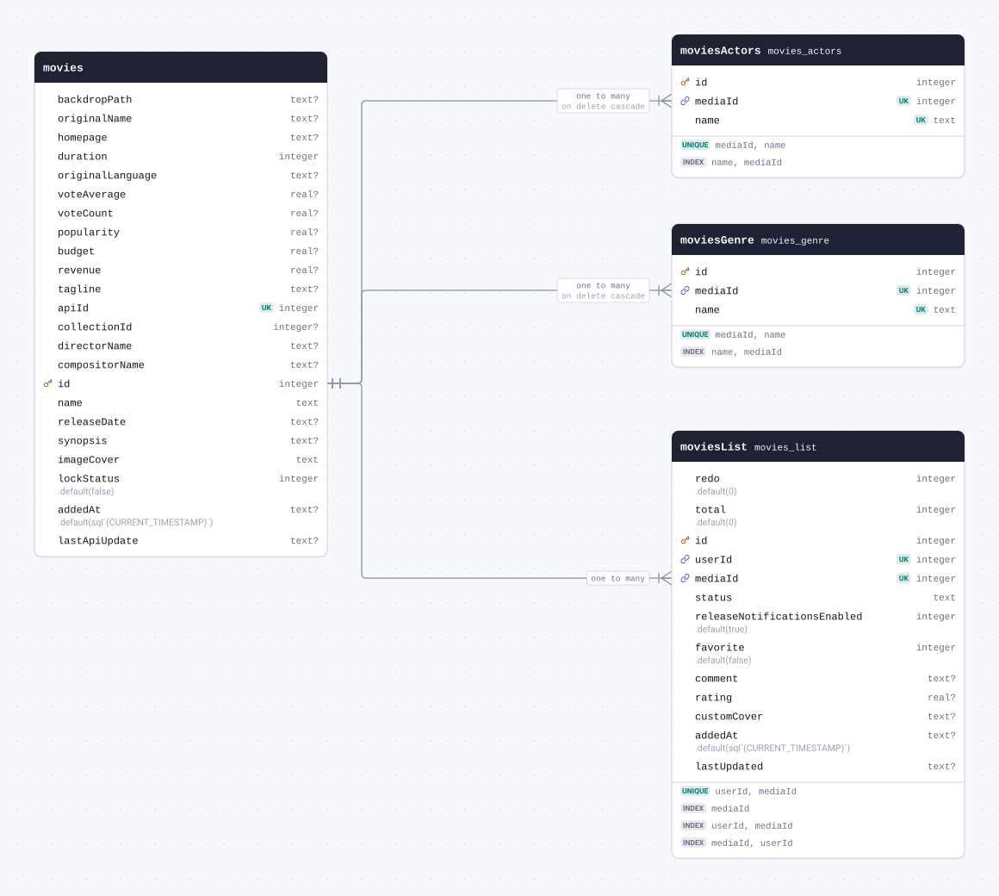

| Column                                   | Type      | Constraints     | Default                                | Description |
| ---------------------------------------- | --------- | --------------- | -------------------------------------- | ----------- |
| `backdropPath` (`backdrop_path`)         | `text`    | NULL            |                                        |             |
| `originalName` (`original_name`)         | `text`    | NULL            |                                        |             |
| `homepage`                               | `text`    | NULL            |                                        |             |
| `duration`                               | `integer` | NOT NULL        |                                        |             |
| `originalLanguage` (`original_language`) | `text`    | NULL            |                                        |             |
| `voteAverage` (`vote_average`)           | `real`    | NULL            |                                        |             |
| `voteCount` (`vote_count`)               | `real`    | NULL            |                                        |             |
| `popularity`                             | `real`    | NULL            |                                        |             |
| `budget`                                 | `real`    | NULL            |                                        |             |
| `revenue`                                | `real`    | NULL            |                                        |             |
| `tagline`                                | `text`    | NULL            |                                        |             |
| `apiId` (`api_id`)                       | `integer` | UNIQUE NOT NULL |                                        |             |
| `collectionId` (`collection_id`)         | `integer` | NULL            |                                        |             |
| `directorName` (`director_name`)         | `text`    | NULL            |                                        |             |
| `compositorName` (`compositor_name`)     | `text`    | NULL            |                                        |             |
| `id`                                     | `integer` | PK NOT NULL     |                                        |             |
| `name`                                   | `text`    | NOT NULL        |                                        |             |
| `releaseDate` (`release_date`)           | `text`    | NULL            |                                        |             |
| `synopsis`                               | `text`    | NULL            |                                        |             |
| `imageCover` (`image_cover`)             | `text`    | NOT NULL        |                                        |             |
| `lockStatus` (`lock_status`)             | `integer` | NOT NULL        | `.default(false)`                      |             |
| `addedAt` (`added_at`)                   | `text`    | NULL            | ``.default(sql`(CURRENT_TIMESTAMP)`)`` |             |
| `lastApiUpdate` (`last_api_update`)      | `text`    | NULL            |                                        |             |

#### Definition

```sql
CREATE TABLE `movies` (
	`backdrop_path` text,
	`original_name` text,
	`homepage` text,
	`duration` integer NOT NULL,
	`original_language` text,
	`vote_average` real,
	`vote_count` real,
	`popularity` real,
	`budget` real,
	`revenue` real,
	`tagline` text,
	`api_id` integer NOT NULL UNIQUE,
	`collection_id` integer,
	`director_name` text,
	`compositor_name` text,
	`id` integer PRIMARY KEY,
	`name` text NOT NULL,
	`release_date` text,
	`synopsis` text,
	`image_cover` text NOT NULL,
	`lock_status` integer DEFAULT false NOT NULL,
	`added_at` text DEFAULT (CURRENT_TIMESTAMP),
	`last_api_update` text
);
```

#### Referenced by

- `id` → [moviesList.mediaId](#table-moviesList) (one to many)
- `id` → [moviesGenre.mediaId](#table-moviesGenre) (one to many, on delete cascade)
- `id` → [moviesActors.mediaId](#table-moviesActors) (one to many, on delete cascade)
- `id` → [moviesTags.mediaId](#table-moviesTags) (one to many, on delete cascade)

<details>
<summary>Queries and their SQL</summary>

**Select**: Every row of movies.

```ts
db.select().from(movies);
```

```sql
select "backdrop_path", "original_name", "homepage", "duration", "original_language", "vote_average", "vote_count", "popularity", "budget", "revenue", "tagline", "api_id", "collection_id", "director_name", "compositor_name", "id", "name", "release_date", "synopsis", "image_cover", "lock_status", "added_at", "last_api_update"
from "movies"
```

**Count**: How many rows movies has.

```ts
db.select({ count: count() }).from(movies);
```

```sql
select count(*)
from "movies"
```

**Find many**: The rows of movies, through the relational query API.

```ts
db.query.movies.findMany();
```

```sql
select "d0"."backdrop_path" as "backdropPath", "d0"."original_name" as "originalName", "d0"."homepage" as "homepage", "d0"."duration" as "duration", "d0"."original_language" as "originalLanguage", "d0"."vote_average" as "voteAverage", "d0"."vote_count" as "voteCount", "d0"."popularity" as "popularity", "d0"."budget" as "budget", "d0"."revenue" as "revenue", "d0"."tagline" as "tagline", "d0"."api_id" as "apiId", "d0"."collection_id" as "collectionId", "d0"."director_name" as "directorName", "d0"."compositor_name" as "compositorName", "d0"."id" as "id", "d0"."name" as "name", "d0"."release_date" as "releaseDate", "d0"."synopsis" as "synopsis", "d0"."image_cover" as "imageCover", "d0"."lock_status" as "lockStatus", "d0"."added_at" as "addedAt", "d0"."last_api_update" as "lastApiUpdate"
from "movies" as "d0"
```

**Find by primary key**: One row of movies, through the relational query API.

```ts
db.query.movies.findFirst({ where: { id: 1 } });
```

```sql
select "d0"."backdrop_path" as "backdropPath", "d0"."original_name" as "originalName", "d0"."homepage" as "homepage", "d0"."duration" as "duration", "d0"."original_language" as "originalLanguage", "d0"."vote_average" as "voteAverage", "d0"."vote_count" as "voteCount", "d0"."popularity" as "popularity", "d0"."budget" as "budget", "d0"."revenue" as "revenue", "d0"."tagline" as "tagline", "d0"."api_id" as "apiId", "d0"."collection_id" as "collectionId", "d0"."director_name" as "directorName", "d0"."compositor_name" as "compositorName", "d0"."id" as "id", "d0"."name" as "name", "d0"."release_date" as "releaseDate", "d0"."synopsis" as "synopsis", "d0"."image_cover" as "imageCover", "d0"."lock_status" as "lockStatus", "d0"."added_at" as "addedAt", "d0"."last_api_update" as "lastApiUpdate"
from "movies" as "d0"
where "d0"."id" = ?
limit ?
-- params: [1,1]
```

**Insert**: Adds a row to movies, giving the columns that have no default.

```ts
db.insert(movies).values({ duration: 1, apiId: 1, id: 1, name: "name", imageCover: "imageCover" });
```

```sql
insert into "movies" ("backdrop_path", "original_name", "homepage", "duration", "original_language", "vote_average", "vote_count", "popularity", "budget", "revenue", "tagline", "api_id", "collection_id", "director_name", "compositor_name", "id", "name", "release_date", "synopsis", "image_cover", "lock_status", "added_at", "last_api_update")
values (null, null, null, ?, null, null, null, null, null, null, null, ?, null, null, null, ?, ?, null, null, ?, ?, (CURRENT_TIMESTAMP), null)
-- params: [1,1,1,"name","imageCover",0]
```

**Update**: Changes a row of movies, found by its primary key.

```ts
db.update(movies).set({ backdropPath: "backdropPath" }).where(eq(movies.id, 1));
```

```sql
update "movies"
set "backdrop_path" = ?
where "movies"."id" = ?
-- params: ["backdropPath",1]
```

**Delete**: Deletes a row of movies, found by its primary key.

```ts
db.delete(movies).where(eq(movies.id, 1));
```

```sql
delete from "movies"
where "movies"."id" = ?
-- params: [1]
```

</details>

<a id="table-moviesList"></a>

### moviesList

Table `movies_list`.

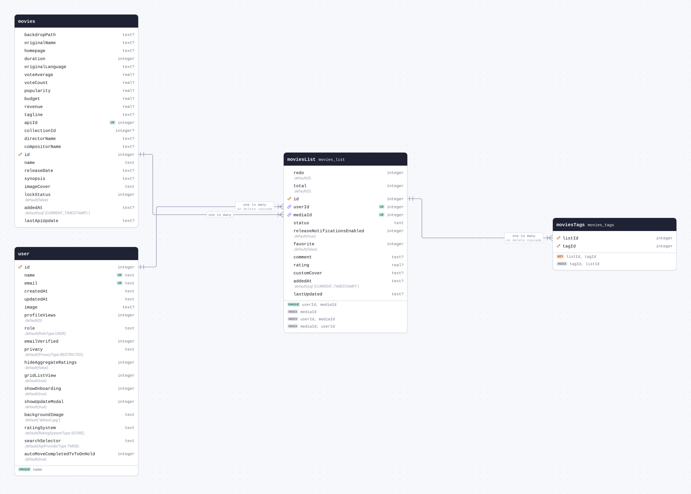

| Column                                                          | Type      | Constraints                           | Default                                | Description |
| --------------------------------------------------------------- | --------- | ------------------------------------- | -------------------------------------- | ----------- |
| `redo`                                                          | `integer` | NOT NULL                              | `.default(0)`                          |             |
| `total`                                                         | `integer` | NOT NULL                              | `.default(0)`                          |             |
| `id`                                                            | `integer` | PK NOT NULL                           |                                        |             |
| `userId` (`user_id`)                                            | `integer` | NOT NULL → [user.id](#table-user)     |                                        |             |
| `mediaId` (`media_id`)                                          | `integer` | NOT NULL → [movies.id](#table-movies) |                                        |             |
| `status`                                                        | `text`    | NOT NULL                              |                                        |             |
| `releaseNotificationsEnabled` (`release_notifications_enabled`) | `integer` | NOT NULL                              | `.default(true)`                       |             |
| `favorite`                                                      | `integer` | NOT NULL                              | `.default(false)`                      |             |
| `comment`                                                       | `text`    | NULL                                  |                                        |             |
| `rating`                                                        | `real`    | NULL                                  |                                        |             |
| `customCover` (`custom_cover`)                                  | `text`    | NULL                                  |                                        |             |
| `addedAt` (`added_at`)                                          | `text`    | NULL                                  | ``.default(sql`(CURRENT_TIMESTAMP)`)`` |             |
| `lastUpdated` (`last_updated`)                                  | `text`    | NULL                                  |                                        |             |

#### Definition

```sql
CREATE TABLE `movies_list` (
	`redo` integer DEFAULT 0 NOT NULL,
	`total` integer DEFAULT 0 NOT NULL,
	`id` integer PRIMARY KEY,
	`user_id` integer NOT NULL,
	`media_id` integer NOT NULL,
	`status` text NOT NULL,
	`release_notifications_enabled` integer DEFAULT true NOT NULL,
	`favorite` integer DEFAULT false NOT NULL,
	`comment` text,
	`rating` real,
	`custom_cover` text,
	`added_at` text DEFAULT (CURRENT_TIMESTAMP),
	`last_updated` text,
	CONSTRAINT `fk_movies_list_user_id_user_id_fk` FOREIGN KEY (`user_id`) REFERENCES `user`(`id`) ON DELETE CASCADE,
	CONSTRAINT `fk_movies_list_media_id_movies_id_fk` FOREIGN KEY (`media_id`) REFERENCES `movies`(`id`),
	CONSTRAINT "movies_list_rating_check" CHECK("rating" IS NULL OR ("rating" >= 0 AND "rating" <= 10)),
	CONSTRAINT "movies_list_favorite_check" CHECK("favorite" IN (0, 1))
);

CREATE UNIQUE INDEX `ux_movies_list_user_media` ON `movies_list` (`user_id`,`media_id`);

CREATE INDEX `ix_movies_list_media_id` ON `movies_list` (`media_id`);

CREATE INDEX `ix_movies_list_user_media_rated` ON `movies_list` (`user_id`,`media_id`) WHERE "movies_list"."rating" IS NOT NULL;

CREATE INDEX `ix_movies_list_media_user_rated` ON `movies_list` (`media_id`,`user_id`) WHERE "movies_list"."rating" IS NOT NULL;
```

#### Indexes

- UNIQUE `userId`, `mediaId`
- INDEX `mediaId`
- INDEX `userId`, `mediaId`
- INDEX `mediaId`, `userId`

#### References

- `userId` → [user.id](#table-user) (many to one, on delete cascade)
- `mediaId` → [movies.id](#table-movies) (many to one)

<details>
<summary>Queries and their SQL</summary>

**Select**: Every row of moviesList.

```ts
db.select().from(moviesList);
```

```sql
select "redo", "total", "id", "user_id", "media_id", "status", "release_notifications_enabled", "favorite", "comment", "rating", "custom_cover", "added_at", "last_updated"
from "movies_list"
```

**Count**: How many rows moviesList has.

```ts
db.select({ count: count() }).from(moviesList);
```

```sql
select count(*)
from "movies_list"
```

**Find many**: The rows of moviesList, through the relational query API.

```ts
db.query.moviesList.findMany();
```

```sql
select "d0"."redo" as "redo", "d0"."total" as "total", "d0"."id" as "id", "d0"."user_id" as "userId", "d0"."media_id" as "mediaId", "d0"."status" as "status", "d0"."release_notifications_enabled" as "releaseNotificationsEnabled", "d0"."favorite" as "favorite", "d0"."comment" as "comment", "d0"."rating" as "rating", "d0"."custom_cover" as "customCover", "d0"."added_at" as "addedAt", "d0"."last_updated" as "lastUpdated"
from "movies_list" as "d0"
```

**Find by primary key**: One row of moviesList, through the relational query API.

```ts
db.query.moviesList.findFirst({ where: { id: 1 } });
```

```sql
select "d0"."redo" as "redo", "d0"."total" as "total", "d0"."id" as "id", "d0"."user_id" as "userId", "d0"."media_id" as "mediaId", "d0"."status" as "status", "d0"."release_notifications_enabled" as "releaseNotificationsEnabled", "d0"."favorite" as "favorite", "d0"."comment" as "comment", "d0"."rating" as "rating", "d0"."custom_cover" as "customCover", "d0"."added_at" as "addedAt", "d0"."last_updated" as "lastUpdated"
from "movies_list" as "d0"
where "d0"."id" = ?
limit ?
-- params: [1,1]
```

**Insert**: Adds a row to moviesList, giving the columns that have no default.

```ts
db.insert(moviesList).values({ id: 1, userId: 1, mediaId: 1, status: "status" });
```

```sql
insert into "movies_list" ("redo", "total", "id", "user_id", "media_id", "status", "release_notifications_enabled", "favorite", "comment", "rating", "custom_cover", "added_at", "last_updated")
values (?, ?, ?, ?, ?, ?, ?, ?, null, null, null, (CURRENT_TIMESTAMP), null)
-- params: [0,0,1,1,1,"status",1,0]
```

**Update**: Changes a row of moviesList, found by its primary key.

```ts
db.update(moviesList).set({ redo: 1 }).where(eq(moviesList.id, 1));
```

```sql
update "movies_list"
set "redo" = ?
where "movies_list"."id" = ?
-- params: [1,1]
```

**Delete**: Deletes a row of moviesList, found by its primary key.

```ts
db.delete(moviesList).where(eq(moviesList.id, 1));
```

```sql
delete from "movies_list"
where "movies_list"."id" = ?
-- params: [1]
```

</details>

<a id="table-moviesGenre"></a>

### moviesGenre

Table `movies_genre`.


| Column                 | Type      | Constraints                           | Default | Description |
| ---------------------- | --------- | ------------------------------------- | ------- | ----------- |
| `id`                   | `integer` | PK NOT NULL                           |         |             |
| `mediaId` (`media_id`) | `integer` | NOT NULL → [movies.id](#table-movies) |         |             |
| `name`                 | `text`    | NOT NULL                              |         |             |

#### Definition

```sql
CREATE TABLE `movies_genre` (
	`id` integer PRIMARY KEY,
	`media_id` integer NOT NULL,
	`name` text NOT NULL,
	CONSTRAINT `fk_movies_genre_media_id_movies_id_fk` FOREIGN KEY (`media_id`) REFERENCES `movies`(`id`) ON DELETE CASCADE
);

CREATE UNIQUE INDEX `ux_movies_genre_media_name` ON `movies_genre` (`media_id`,`name`);

CREATE INDEX `ix_movies_genre_name_media` ON `movies_genre` (`name`,`media_id`);
```

#### Indexes

- UNIQUE `mediaId`, `name`
- INDEX `name`, `mediaId`

#### References

- `mediaId` → [movies.id](#table-movies) (many to one, on delete cascade)

<details>
<summary>Queries and their SQL</summary>

**Select**: Every row of moviesGenre.

```ts
db.select().from(moviesGenre);
```

```sql
select "id", "media_id", "name"
from "movies_genre"
```

**Count**: How many rows moviesGenre has.

```ts
db.select({ count: count() }).from(moviesGenre);
```

```sql
select count(*)
from "movies_genre"
```

**Find many**: The rows of moviesGenre, through the relational query API.

```ts
db.query.moviesGenre.findMany();
```

```sql
select "d0"."id" as "id", "d0"."media_id" as "mediaId", "d0"."name" as "name"
from "movies_genre" as "d0"
```

**Find by primary key**: One row of moviesGenre, through the relational query API.

```ts
db.query.moviesGenre.findFirst({ where: { id: 1 } });
```

```sql
select "d0"."id" as "id", "d0"."media_id" as "mediaId", "d0"."name" as "name"
from "movies_genre" as "d0"
where "d0"."id" = ?
limit ?
-- params: [1,1]
```

**Insert**: Adds a row to moviesGenre, giving the columns that have no default.

```ts
db.insert(moviesGenre).values({ id: 1, mediaId: 1, name: "name" });
```

```sql
insert into "movies_genre" ("id", "media_id", "name")
values (?, ?, ?)
-- params: [1,1,"name"]
```

**Update**: Changes a row of moviesGenre, found by its primary key.

```ts
db.update(moviesGenre).set({ mediaId: 1 }).where(eq(moviesGenre.id, 1));
```

```sql
update "movies_genre"
set "media_id" = ?
where "movies_genre"."id" = ?
-- params: [1,1]
```

**Delete**: Deletes a row of moviesGenre, found by its primary key.

```ts
db.delete(moviesGenre).where(eq(moviesGenre.id, 1));
```

```sql
delete from "movies_genre"
where "movies_genre"."id" = ?
-- params: [1]
```

</details>

<a id="table-moviesActors"></a>

### moviesActors

Table `movies_actors`.

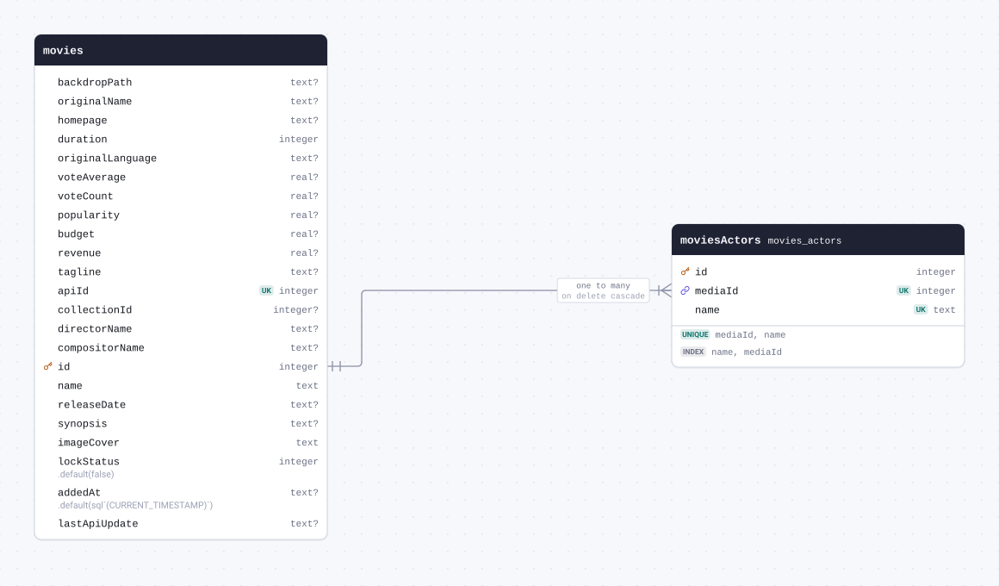

| Column                 | Type      | Constraints                           | Default | Description |
| ---------------------- | --------- | ------------------------------------- | ------- | ----------- |
| `id`                   | `integer` | PK NOT NULL                           |         |             |
| `mediaId` (`media_id`) | `integer` | NOT NULL → [movies.id](#table-movies) |         |             |
| `name`                 | `text`    | NOT NULL                              |         |             |

#### Definition

```sql
CREATE TABLE `movies_actors` (
	`id` integer PRIMARY KEY,
	`media_id` integer NOT NULL,
	`name` text NOT NULL,
	CONSTRAINT `fk_movies_actors_media_id_movies_id_fk` FOREIGN KEY (`media_id`) REFERENCES `movies`(`id`) ON DELETE CASCADE
);

CREATE UNIQUE INDEX `ux_movies_actors_media_name` ON `movies_actors` (`media_id`,`name`);

CREATE INDEX `ix_movies_actors_name_media` ON `movies_actors` (`name`,`media_id`);
```

#### Indexes

- UNIQUE `mediaId`, `name`
- INDEX `name`, `mediaId`

#### References

- `mediaId` → [movies.id](#table-movies) (many to one, on delete cascade)

<details>
<summary>Queries and their SQL</summary>

**Select**: Every row of moviesActors.

```ts
db.select().from(moviesActors);
```

```sql
select "id", "media_id", "name"
from "movies_actors"
```

**Count**: How many rows moviesActors has.

```ts
db.select({ count: count() }).from(moviesActors);
```

```sql
select count(*)
from "movies_actors"
```

**Find many**: The rows of moviesActors, through the relational query API.

```ts
db.query.moviesActors.findMany();
```

```sql
select "d0"."id" as "id", "d0"."media_id" as "mediaId", "d0"."name" as "name"
from "movies_actors" as "d0"
```

**Find by primary key**: One row of moviesActors, through the relational query API.

```ts
db.query.moviesActors.findFirst({ where: { id: 1 } });
```

```sql
select "d0"."id" as "id", "d0"."media_id" as "mediaId", "d0"."name" as "name"
from "movies_actors" as "d0"
where "d0"."id" = ?
limit ?
-- params: [1,1]
```

**Insert**: Adds a row to moviesActors, giving the columns that have no default.

```ts
db.insert(moviesActors).values({ id: 1, mediaId: 1, name: "name" });
```

```sql
insert into "movies_actors" ("id", "media_id", "name")
values (?, ?, ?)
-- params: [1,1,"name"]
```

**Update**: Changes a row of moviesActors, found by its primary key.

```ts
db.update(moviesActors).set({ mediaId: 1 }).where(eq(moviesActors.id, 1));
```

```sql
update "movies_actors"
set "media_id" = ?
where "movies_actors"."id" = ?
-- params: [1,1]
```

**Delete**: Deletes a row of moviesActors, found by its primary key.

```ts
db.delete(moviesActors).where(eq(moviesActors.id, 1));
```

```sql
delete from "movies_actors"
where "movies_actors"."id" = ?
-- params: [1]
```

</details>

<a id="table-moviesTags"></a>

### moviesTags

Table `movies_tags`.


| Column                 | Type      | Constraints                                 | Default | Description |
| ---------------------- | --------- | ------------------------------------------- | ------- | ----------- |
| `id`                   | `integer` | PK NOT NULL                                 |         |             |
| `userId` (`user_id`)   | `integer` | NOT NULL → [user.id](#table-user)           |         |             |
| `mediaId` (`media_id`) | `integer` | NOT NULL → [movies.id](#table-movies)       |         |             |
| `tagId` (`tag_id`)     | `integer` | NOT NULL → [mediaTags.id](#table-mediaTags) |         |             |

#### Definition

```sql
CREATE TABLE `movies_tags` (
	`id` integer PRIMARY KEY,
	`user_id` integer NOT NULL,
	`media_id` integer NOT NULL,
	`tag_id` integer NOT NULL,
	CONSTRAINT `fk_movies_tags_user_id_user_id_fk` FOREIGN KEY (`user_id`) REFERENCES `user`(`id`) ON DELETE CASCADE,
	CONSTRAINT `fk_movies_tags_media_id_movies_id_fk` FOREIGN KEY (`media_id`) REFERENCES `movies`(`id`) ON DELETE CASCADE,
	CONSTRAINT `fk_movies_tags_tag_id_media_tags_id_fk` FOREIGN KEY (`tag_id`) REFERENCES `media_tags`(`id`) ON DELETE CASCADE
);

CREATE UNIQUE INDEX `ux_movies_tags_user_media_tag` ON `movies_tags` (`user_id`,`media_id`,`tag_id`);

CREATE INDEX `ix_movies_tags_user_tag_media` ON `movies_tags` (`user_id`,`tag_id`,`media_id`);
```

#### Indexes

- UNIQUE `userId`, `mediaId`, `tagId`
- INDEX `userId`, `tagId`, `mediaId`

#### References

- `userId` → [user.id](#table-user) (many to one, on delete cascade)
- `mediaId` → [movies.id](#table-movies) (many to one, on delete cascade)
- `tagId` → [mediaTags.id](#table-mediaTags) (many to one, on delete cascade)

<details>
<summary>Queries and their SQL</summary>

**Select**: Every row of moviesTags.

```ts
db.select().from(moviesTags);
```

```sql
select "id", "user_id", "media_id", "tag_id"
from "movies_tags"
```

**Count**: How many rows moviesTags has.

```ts
db.select({ count: count() }).from(moviesTags);
```

```sql
select count(*)
from "movies_tags"
```

**Find many**: The rows of moviesTags, through the relational query API.

```ts
db.query.moviesTags.findMany();
```

```sql
select "d0"."id" as "id", "d0"."user_id" as "userId", "d0"."media_id" as "mediaId", "d0"."tag_id" as "tagId"
from "movies_tags" as "d0"
```

**Find by primary key**: One row of moviesTags, through the relational query API.

```ts
db.query.moviesTags.findFirst({ where: { id: 1 } });
```

```sql
select "d0"."id" as "id", "d0"."user_id" as "userId", "d0"."media_id" as "mediaId", "d0"."tag_id" as "tagId"
from "movies_tags" as "d0"
where "d0"."id" = ?
limit ?
-- params: [1,1]
```

**Insert**: Adds a row to moviesTags, giving the columns that have no default.

```ts
db.insert(moviesTags).values({ id: 1, userId: 1, mediaId: 1, tagId: 1 });
```

```sql
insert into "movies_tags" ("id", "user_id", "media_id", "tag_id")
values (?, ?, ?, ?)
-- params: [1,1,1,1]
```

**Update**: Changes a row of moviesTags, found by its primary key.

```ts
db.update(moviesTags).set({ userId: 1 }).where(eq(moviesTags.id, 1));
```

```sql
update "movies_tags"
set "user_id" = ?
where "movies_tags"."id" = ?
-- params: [1,1]
```

**Delete**: Deletes a row of moviesTags, found by its primary key.

```ts
db.delete(moviesTags).where(eq(moviesTags.id, 1));
```

```sql
delete from "movies_tags"
where "movies_tags"."id" = ?
-- params: [1]
```

</details>

<a id="table-games"></a>

### games

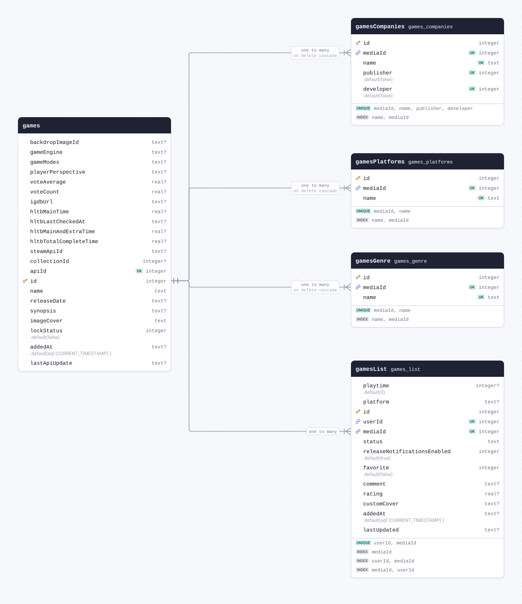

| Column                                               | Type      | Constraints     | Default                                | Description |
| ---------------------------------------------------- | --------- | --------------- | -------------------------------------- | ----------- |
| `backdropImageId` (`backdrop_image_id`)              | `text`    | NULL            |                                        |             |
| `gameEngine` (`game_engine`)                         | `text`    | NULL            |                                        |             |
| `gameModes` (`game_modes`)                           | `text`    | NULL            |                                        |             |
| `playerPerspective` (`player_perspective`)           | `text`    | NULL            |                                        |             |
| `voteAverage` (`vote_average`)                       | `real`    | NULL            |                                        |             |
| `voteCount` (`vote_count`)                           | `real`    | NULL            |                                        |             |
| `igdbUrl` (`igdb_url`)                               | `text`    | NULL            |                                        |             |
| `hltbMainTime` (`hltb_main_time`)                    | `real`    | NULL            |                                        |             |
| `hltbLastCheckedAt` (`hltb_last_checked_at`)         | `text`    | NULL            |                                        |             |
| `hltbMainAndExtraTime` (`hltb_main_and_extra_time`)  | `real`    | NULL            |                                        |             |
| `hltbTotalCompleteTime` (`hltb_total_complete_time`) | `real`    | NULL            |                                        |             |
| `steamApiId` (`steam_api_id`)                        | `text`    | NULL            |                                        |             |
| `collectionId` (`collection_id`)                     | `integer` | NULL            |                                        |             |
| `apiId` (`api_id`)                                   | `integer` | UNIQUE NOT NULL |                                        |             |
| `id`                                                 | `integer` | PK NOT NULL     |                                        |             |
| `name`                                               | `text`    | NOT NULL        |                                        |             |
| `releaseDate` (`release_date`)                       | `text`    | NULL            |                                        |             |
| `synopsis`                                           | `text`    | NULL            |                                        |             |
| `imageCover` (`image_cover`)                         | `text`    | NOT NULL        |                                        |             |
| `lockStatus` (`lock_status`)                         | `integer` | NOT NULL        | `.default(false)`                      |             |
| `addedAt` (`added_at`)                               | `text`    | NULL            | ``.default(sql`(CURRENT_TIMESTAMP)`)`` |             |
| `lastApiUpdate` (`last_api_update`)                  | `text`    | NULL            |                                        |             |

#### Definition

```sql
CREATE TABLE `games` (
	`backdrop_image_id` text,
	`game_engine` text,
	`game_modes` text,
	`player_perspective` text,
	`vote_average` real,
	`vote_count` real,
	`igdb_url` text,
	`hltb_main_time` real,
	`hltb_last_checked_at` text,
	`hltb_main_and_extra_time` real,
	`hltb_total_complete_time` real,
	`steam_api_id` text,
	`collection_id` integer,
	`api_id` integer NOT NULL UNIQUE,
	`id` integer PRIMARY KEY,
	`name` text NOT NULL,
	`release_date` text,
	`synopsis` text,
	`image_cover` text NOT NULL,
	`lock_status` integer DEFAULT false NOT NULL,
	`added_at` text DEFAULT (CURRENT_TIMESTAMP),
	`last_api_update` text
);
```

#### Referenced by

- `id` → [gamesList.mediaId](#table-gamesList) (one to many)
- `id` → [gamesGenre.mediaId](#table-gamesGenre) (one to many, on delete cascade)
- `id` → [gamesPlatforms.mediaId](#table-gamesPlatforms) (one to many, on delete cascade)
- `id` → [gamesCompanies.mediaId](#table-gamesCompanies) (one to many, on delete cascade)
- `id` → [gamesTags.mediaId](#table-gamesTags) (one to many, on delete cascade)

<details>
<summary>Queries and their SQL</summary>

**Select**: Every row of games.

```ts
db.select().from(games);
```

```sql
select "backdrop_image_id", "game_engine", "game_modes", "player_perspective", "vote_average", "vote_count", "igdb_url", "hltb_main_time", "hltb_last_checked_at", "hltb_main_and_extra_time", "hltb_total_complete_time", "steam_api_id", "collection_id", "api_id", "id", "name", "release_date", "synopsis", "image_cover", "lock_status", "added_at", "last_api_update"
from "games"
```

**Count**: How many rows games has.

```ts
db.select({ count: count() }).from(games);
```

```sql
select count(*)
from "games"
```

**Find many**: The rows of games, through the relational query API.

```ts
db.query.games.findMany();
```

```sql
select "d0"."backdrop_image_id" as "backdropImageId", "d0"."game_engine" as "gameEngine", "d0"."game_modes" as "gameModes", "d0"."player_perspective" as "playerPerspective", "d0"."vote_average" as "voteAverage", "d0"."vote_count" as "voteCount", "d0"."igdb_url" as "igdbUrl", "d0"."hltb_main_time" as "hltbMainTime", "d0"."hltb_last_checked_at" as "hltbLastCheckedAt", "d0"."hltb_main_and_extra_time" as "hltbMainAndExtraTime", "d0"."hltb_total_complete_time" as "hltbTotalCompleteTime", "d0"."steam_api_id" as "steamApiId", "d0"."collection_id" as "collectionId", "d0"."api_id" as "apiId", "d0"."id" as "id", "d0"."name" as "name", "d0"."release_date" as "releaseDate", "d0"."synopsis" as "synopsis", "d0"."image_cover" as "imageCover", "d0"."lock_status" as "lockStatus", "d0"."added_at" as "addedAt", "d0"."last_api_update" as "lastApiUpdate"
from "games" as "d0"
```

**Find by primary key**: One row of games, through the relational query API.

```ts
db.query.games.findFirst({ where: { id: 1 } });
```

```sql
select "d0"."backdrop_image_id" as "backdropImageId", "d0"."game_engine" as "gameEngine", "d0"."game_modes" as "gameModes", "d0"."player_perspective" as "playerPerspective", "d0"."vote_average" as "voteAverage", "d0"."vote_count" as "voteCount", "d0"."igdb_url" as "igdbUrl", "d0"."hltb_main_time" as "hltbMainTime", "d0"."hltb_last_checked_at" as "hltbLastCheckedAt", "d0"."hltb_main_and_extra_time" as "hltbMainAndExtraTime", "d0"."hltb_total_complete_time" as "hltbTotalCompleteTime", "d0"."steam_api_id" as "steamApiId", "d0"."collection_id" as "collectionId", "d0"."api_id" as "apiId", "d0"."id" as "id", "d0"."name" as "name", "d0"."release_date" as "releaseDate", "d0"."synopsis" as "synopsis", "d0"."image_cover" as "imageCover", "d0"."lock_status" as "lockStatus", "d0"."added_at" as "addedAt", "d0"."last_api_update" as "lastApiUpdate"
from "games" as "d0"
where "d0"."id" = ?
limit ?
-- params: [1,1]
```

**Insert**: Adds a row to games, giving the columns that have no default.

```ts
db.insert(games).values({ apiId: 1, id: 1, name: "name", imageCover: "imageCover" });
```

```sql
insert into "games" ("backdrop_image_id", "game_engine", "game_modes", "player_perspective", "vote_average", "vote_count", "igdb_url", "hltb_main_time", "hltb_last_checked_at", "hltb_main_and_extra_time", "hltb_total_complete_time", "steam_api_id", "collection_id", "api_id", "id", "name", "release_date", "synopsis", "image_cover", "lock_status", "added_at", "last_api_update")
values (null, null, null, null, null, null, null, null, null, null, null, null, null, ?, ?, ?, null, null, ?, ?, (CURRENT_TIMESTAMP), null)
-- params: [1,1,"name","imageCover",0]
```

**Update**: Changes a row of games, found by its primary key.

```ts
db.update(games).set({ backdropImageId: "backdropImageId" }).where(eq(games.id, 1));
```

```sql
update "games"
set "backdrop_image_id" = ?
where "games"."id" = ?
-- params: ["backdropImageId",1]
```

**Delete**: Deletes a row of games, found by its primary key.

```ts
db.delete(games).where(eq(games.id, 1));
```

```sql
delete from "games"
where "games"."id" = ?
-- params: [1]
```

</details>

<a id="table-gamesList"></a>

### gamesList

Table `games_list`.

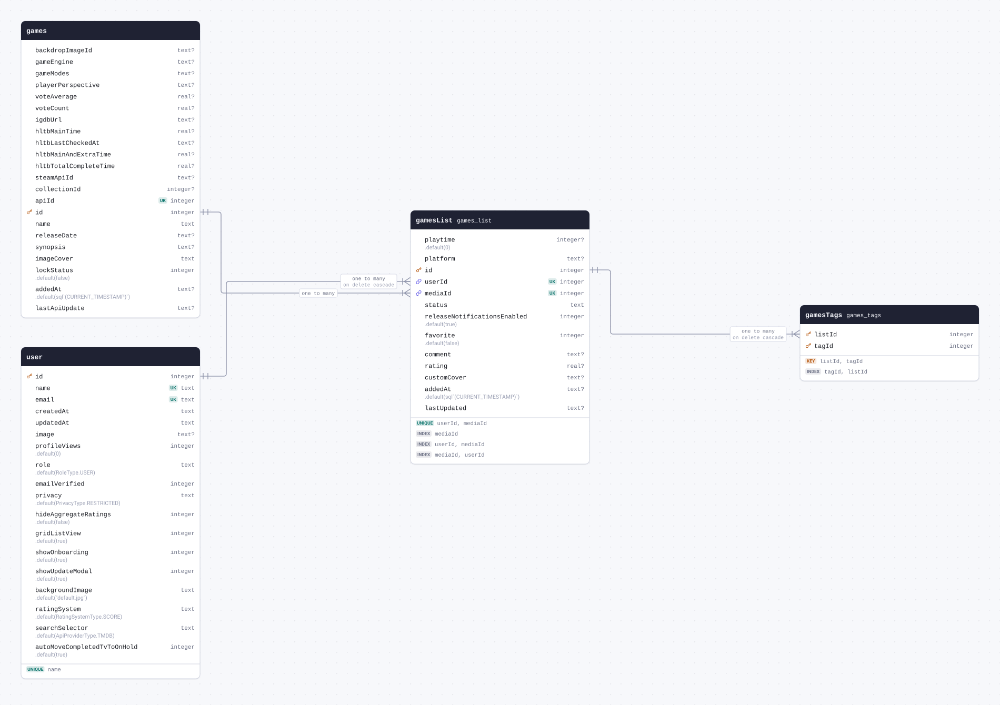

| Column                                                          | Type      | Constraints                         | Default                                | Description |
| --------------------------------------------------------------- | --------- | ----------------------------------- | -------------------------------------- | ----------- |
| `playtime`                                                      | `integer` | NULL                                | `.default(0)`                          |             |
| `platform`                                                      | `text`    | NULL                                |                                        |             |
| `id`                                                            | `integer` | PK NOT NULL                         |                                        |             |
| `userId` (`user_id`)                                            | `integer` | NOT NULL → [user.id](#table-user)   |                                        |             |
| `mediaId` (`media_id`)                                          | `integer` | NOT NULL → [games.id](#table-games) |                                        |             |
| `status`                                                        | `text`    | NOT NULL                            |                                        |             |
| `releaseNotificationsEnabled` (`release_notifications_enabled`) | `integer` | NOT NULL                            | `.default(true)`                       |             |
| `favorite`                                                      | `integer` | NOT NULL                            | `.default(false)`                      |             |
| `comment`                                                       | `text`    | NULL                                |                                        |             |
| `rating`                                                        | `real`    | NULL                                |                                        |             |
| `customCover` (`custom_cover`)                                  | `text`    | NULL                                |                                        |             |
| `addedAt` (`added_at`)                                          | `text`    | NULL                                | ``.default(sql`(CURRENT_TIMESTAMP)`)`` |             |
| `lastUpdated` (`last_updated`)                                  | `text`    | NULL                                |                                        |             |

#### Definition

```sql
CREATE TABLE `games_list` (
	`playtime` integer DEFAULT 0,
	`platform` text,
	`id` integer PRIMARY KEY,
	`user_id` integer NOT NULL,
	`media_id` integer NOT NULL,
	`status` text NOT NULL,
	`release_notifications_enabled` integer DEFAULT true NOT NULL,
	`favorite` integer DEFAULT false NOT NULL,
	`comment` text,
	`rating` real,
	`custom_cover` text,
	`added_at` text DEFAULT (CURRENT_TIMESTAMP),
	`last_updated` text,
	CONSTRAINT `fk_games_list_user_id_user_id_fk` FOREIGN KEY (`user_id`) REFERENCES `user`(`id`) ON DELETE CASCADE,
	CONSTRAINT `fk_games_list_media_id_games_id_fk` FOREIGN KEY (`media_id`) REFERENCES `games`(`id`),
	CONSTRAINT "games_list_rating_check" CHECK("rating" IS NULL OR ("rating" >= 0 AND "rating" <= 10)),
	CONSTRAINT "games_list_favorite_check" CHECK("favorite" IN (0, 1))
);

CREATE UNIQUE INDEX `ux_games_list_user_media` ON `games_list` (`user_id`,`media_id`);

CREATE INDEX `ix_games_list_media_id` ON `games_list` (`media_id`);

CREATE INDEX `ix_games_list_user_media_rated` ON `games_list` (`user_id`,`media_id`) WHERE "games_list"."rating" IS NOT NULL;

CREATE INDEX `ix_games_list_media_user_rated` ON `games_list` (`media_id`,`user_id`) WHERE "games_list"."rating" IS NOT NULL;
```

#### Indexes

- UNIQUE `userId`, `mediaId`
- INDEX `mediaId`
- INDEX `userId`, `mediaId`
- INDEX `mediaId`, `userId`

#### References

- `userId` → [user.id](#table-user) (many to one, on delete cascade)
- `mediaId` → [games.id](#table-games) (many to one)

<details>
<summary>Queries and their SQL</summary>

**Select**: Every row of gamesList.

```ts
db.select().from(gamesList);
```

```sql
select "playtime", "platform", "id", "user_id", "media_id", "status", "release_notifications_enabled", "favorite", "comment", "rating", "custom_cover", "added_at", "last_updated"
from "games_list"
```

**Count**: How many rows gamesList has.

```ts
db.select({ count: count() }).from(gamesList);
```

```sql
select count(*)
from "games_list"
```

**Find many**: The rows of gamesList, through the relational query API.

```ts
db.query.gamesList.findMany();
```

```sql
select "d0"."playtime" as "playtime", "d0"."platform" as "platform", "d0"."id" as "id", "d0"."user_id" as "userId", "d0"."media_id" as "mediaId", "d0"."status" as "status", "d0"."release_notifications_enabled" as "releaseNotificationsEnabled", "d0"."favorite" as "favorite", "d0"."comment" as "comment", "d0"."rating" as "rating", "d0"."custom_cover" as "customCover", "d0"."added_at" as "addedAt", "d0"."last_updated" as "lastUpdated"
from "games_list" as "d0"
```

**Find by primary key**: One row of gamesList, through the relational query API.

```ts
db.query.gamesList.findFirst({ where: { id: 1 } });
```

```sql
select "d0"."playtime" as "playtime", "d0"."platform" as "platform", "d0"."id" as "id", "d0"."user_id" as "userId", "d0"."media_id" as "mediaId", "d0"."status" as "status", "d0"."release_notifications_enabled" as "releaseNotificationsEnabled", "d0"."favorite" as "favorite", "d0"."comment" as "comment", "d0"."rating" as "rating", "d0"."custom_cover" as "customCover", "d0"."added_at" as "addedAt", "d0"."last_updated" as "lastUpdated"
from "games_list" as "d0"
where "d0"."id" = ?
limit ?
-- params: [1,1]
```

**Insert**: Adds a row to gamesList, giving the columns that have no default.

```ts
db.insert(gamesList).values({ id: 1, userId: 1, mediaId: 1, status: "status" });
```

```sql
insert into "games_list" ("playtime", "platform", "id", "user_id", "media_id", "status", "release_notifications_enabled", "favorite", "comment", "rating", "custom_cover", "added_at", "last_updated")
values (?, null, ?, ?, ?, ?, ?, ?, null, null, null, (CURRENT_TIMESTAMP), null)
-- params: [0,1,1,1,"status",1,0]
```

**Update**: Changes a row of gamesList, found by its primary key.

```ts
db.update(gamesList).set({ playtime: 1 }).where(eq(gamesList.id, 1));
```

```sql
update "games_list"
set "playtime" = ?
where "games_list"."id" = ?
-- params: [1,1]
```

**Delete**: Deletes a row of gamesList, found by its primary key.

```ts
db.delete(gamesList).where(eq(gamesList.id, 1));
```

```sql
delete from "games_list"
where "games_list"."id" = ?
-- params: [1]
```

</details>

<a id="table-gamesGenre"></a>

### gamesGenre

Table `games_genre`.


| Column                 | Type      | Constraints                         | Default | Description |
| ---------------------- | --------- | ----------------------------------- | ------- | ----------- |
| `id`                   | `integer` | PK NOT NULL                         |         |             |
| `mediaId` (`media_id`) | `integer` | NOT NULL → [games.id](#table-games) |         |             |
| `name`                 | `text`    | NOT NULL                            |         |             |

#### Definition

```sql
CREATE TABLE `games_genre` (
	`id` integer PRIMARY KEY,
	`media_id` integer NOT NULL,
	`name` text NOT NULL,
	CONSTRAINT `fk_games_genre_media_id_games_id_fk` FOREIGN KEY (`media_id`) REFERENCES `games`(`id`) ON DELETE CASCADE
);

CREATE UNIQUE INDEX `ux_games_genre_media_name` ON `games_genre` (`media_id`,`name`);

CREATE INDEX `ix_games_genre_name_media` ON `games_genre` (`name`,`media_id`);
```

#### Indexes

- UNIQUE `mediaId`, `name`
- INDEX `name`, `mediaId`

#### References

- `mediaId` → [games.id](#table-games) (many to one, on delete cascade)

<details>
<summary>Queries and their SQL</summary>

**Select**: Every row of gamesGenre.

```ts
db.select().from(gamesGenre);
```

```sql
select "id", "media_id", "name"
from "games_genre"
```

**Count**: How many rows gamesGenre has.

```ts
db.select({ count: count() }).from(gamesGenre);
```

```sql
select count(*)
from "games_genre"
```

**Find many**: The rows of gamesGenre, through the relational query API.

```ts
db.query.gamesGenre.findMany();
```

```sql
select "d0"."id" as "id", "d0"."media_id" as "mediaId", "d0"."name" as "name"
from "games_genre" as "d0"
```

**Find by primary key**: One row of gamesGenre, through the relational query API.

```ts
db.query.gamesGenre.findFirst({ where: { id: 1 } });
```

```sql
select "d0"."id" as "id", "d0"."media_id" as "mediaId", "d0"."name" as "name"
from "games_genre" as "d0"
where "d0"."id" = ?
limit ?
-- params: [1,1]
```

**Insert**: Adds a row to gamesGenre, giving the columns that have no default.

```ts
db.insert(gamesGenre).values({ id: 1, mediaId: 1, name: "name" });
```

```sql
insert into "games_genre" ("id", "media_id", "name")
values (?, ?, ?)
-- params: [1,1,"name"]
```

**Update**: Changes a row of gamesGenre, found by its primary key.

```ts
db.update(gamesGenre).set({ mediaId: 1 }).where(eq(gamesGenre.id, 1));
```

```sql
update "games_genre"
set "media_id" = ?
where "games_genre"."id" = ?
-- params: [1,1]
```

**Delete**: Deletes a row of gamesGenre, found by its primary key.

```ts
db.delete(gamesGenre).where(eq(gamesGenre.id, 1));
```

```sql
delete from "games_genre"
where "games_genre"."id" = ?
-- params: [1]
```

</details>

<a id="table-gamesPlatforms"></a>

### gamesPlatforms

Table `games_platforms`.

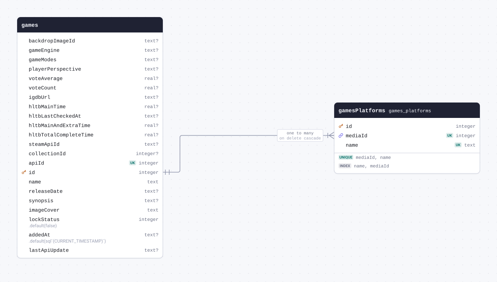

| Column                 | Type      | Constraints                         | Default | Description |
| ---------------------- | --------- | ----------------------------------- | ------- | ----------- |
| `id`                   | `integer` | PK NOT NULL                         |         |             |
| `mediaId` (`media_id`) | `integer` | NOT NULL → [games.id](#table-games) |         |             |
| `name`                 | `text`    | NOT NULL                            |         |             |

#### Definition

```sql
CREATE TABLE `games_platforms` (
	`id` integer PRIMARY KEY,
	`media_id` integer NOT NULL,
	`name` text NOT NULL,
	CONSTRAINT `fk_games_platforms_media_id_games_id_fk` FOREIGN KEY (`media_id`) REFERENCES `games`(`id`) ON DELETE CASCADE
);

CREATE UNIQUE INDEX `ux_games_platforms_media_name` ON `games_platforms` (`media_id`,`name`);

CREATE INDEX `ix_games_platforms_name_media` ON `games_platforms` (`name`,`media_id`);
```

#### Indexes

- UNIQUE `mediaId`, `name`
- INDEX `name`, `mediaId`

#### References

- `mediaId` → [games.id](#table-games) (many to one, on delete cascade)

<details>
<summary>Queries and their SQL</summary>

**Select**: Every row of gamesPlatforms.

```ts
db.select().from(gamesPlatforms);
```

```sql
select "id", "media_id", "name"
from "games_platforms"
```

**Count**: How many rows gamesPlatforms has.

```ts
db.select({ count: count() }).from(gamesPlatforms);
```

```sql
select count(*)
from "games_platforms"
```

**Find many**: The rows of gamesPlatforms, through the relational query API.

```ts
db.query.gamesPlatforms.findMany();
```

```sql
select "d0"."id" as "id", "d0"."media_id" as "mediaId", "d0"."name" as "name"
from "games_platforms" as "d0"
```

**Find by primary key**: One row of gamesPlatforms, through the relational query API.

```ts
db.query.gamesPlatforms.findFirst({ where: { id: 1 } });
```

```sql
select "d0"."id" as "id", "d0"."media_id" as "mediaId", "d0"."name" as "name"
from "games_platforms" as "d0"
where "d0"."id" = ?
limit ?
-- params: [1,1]
```

**Insert**: Adds a row to gamesPlatforms, giving the columns that have no default.

```ts
db.insert(gamesPlatforms).values({ id: 1, mediaId: 1, name: "name" });
```

```sql
insert into "games_platforms" ("id", "media_id", "name")
values (?, ?, ?)
-- params: [1,1,"name"]
```

**Update**: Changes a row of gamesPlatforms, found by its primary key.

```ts
db.update(gamesPlatforms).set({ mediaId: 1 }).where(eq(gamesPlatforms.id, 1));
```

```sql
update "games_platforms"
set "media_id" = ?
where "games_platforms"."id" = ?
-- params: [1,1]
```

**Delete**: Deletes a row of gamesPlatforms, found by its primary key.

```ts
db.delete(gamesPlatforms).where(eq(gamesPlatforms.id, 1));
```

```sql
delete from "games_platforms"
where "games_platforms"."id" = ?
-- params: [1]
```

</details>

<a id="table-gamesCompanies"></a>

### gamesCompanies

Table `games_companies`.

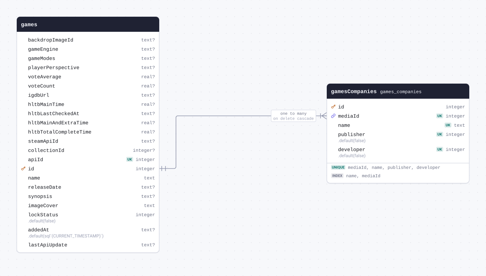

| Column                 | Type      | Constraints                         | Default           | Description |
| ---------------------- | --------- | ----------------------------------- | ----------------- | ----------- |
| `id`                   | `integer` | PK NOT NULL                         |                   |             |
| `mediaId` (`media_id`) | `integer` | NOT NULL → [games.id](#table-games) |                   |             |
| `name`                 | `text`    | NOT NULL                            |                   |             |
| `publisher`            | `integer` | NOT NULL                            | `.default(false)` |             |
| `developer`            | `integer` | NOT NULL                            | `.default(false)` |             |

#### Definition

```sql
CREATE TABLE `games_companies` (
	`id` integer PRIMARY KEY,
	`media_id` integer NOT NULL,
	`name` text NOT NULL,
	`publisher` integer DEFAULT false NOT NULL,
	`developer` integer DEFAULT false NOT NULL,
	CONSTRAINT `fk_games_companies_media_id_games_id_fk` FOREIGN KEY (`media_id`) REFERENCES `games`(`id`) ON DELETE CASCADE
);

CREATE UNIQUE INDEX `ux_games_companies_media_name_roles` ON `games_companies` (`media_id`,`name`,`publisher`,`developer`);

CREATE INDEX `ix_games_companies_name_media` ON `games_companies` (`name`,`media_id`);
```

#### Indexes

- UNIQUE `mediaId`, `name`, `publisher`, `developer`
- INDEX `name`, `mediaId`

#### References

- `mediaId` → [games.id](#table-games) (many to one, on delete cascade)

<details>
<summary>Queries and their SQL</summary>

**Select**: Every row of gamesCompanies.

```ts
db.select().from(gamesCompanies);
```

```sql
select "id", "media_id", "name", "publisher", "developer"
from "games_companies"
```

**Count**: How many rows gamesCompanies has.

```ts
db.select({ count: count() }).from(gamesCompanies);
```

```sql
select count(*)
from "games_companies"
```

**Find many**: The rows of gamesCompanies, through the relational query API.

```ts
db.query.gamesCompanies.findMany();
```

```sql
select "d0"."id" as "id", "d0"."media_id" as "mediaId", "d0"."name" as "name", "d0"."publisher" as "publisher", "d0"."developer" as "developer"
from "games_companies" as "d0"
```

**Find by primary key**: One row of gamesCompanies, through the relational query API.

```ts
db.query.gamesCompanies.findFirst({ where: { id: 1 } });
```

```sql
select "d0"."id" as "id", "d0"."media_id" as "mediaId", "d0"."name" as "name", "d0"."publisher" as "publisher", "d0"."developer" as "developer"
from "games_companies" as "d0"
where "d0"."id" = ?
limit ?
-- params: [1,1]
```

**Insert**: Adds a row to gamesCompanies, giving the columns that have no default.

```ts
db.insert(gamesCompanies).values({ id: 1, mediaId: 1, name: "name" });
```

```sql
insert into "games_companies" ("id", "media_id", "name", "publisher", "developer")
values (?, ?, ?, ?, ?)
-- params: [1,1,"name",0,0]
```

**Update**: Changes a row of gamesCompanies, found by its primary key.

```ts
db.update(gamesCompanies).set({ mediaId: 1 }).where(eq(gamesCompanies.id, 1));
```

```sql
update "games_companies"
set "media_id" = ?
where "games_companies"."id" = ?
-- params: [1,1]
```

**Delete**: Deletes a row of gamesCompanies, found by its primary key.

```ts
db.delete(gamesCompanies).where(eq(gamesCompanies.id, 1));
```

```sql
delete from "games_companies"
where "games_companies"."id" = ?
-- params: [1]
```

</details>

<a id="table-gamesTags"></a>

### gamesTags

Table `games_tags`.

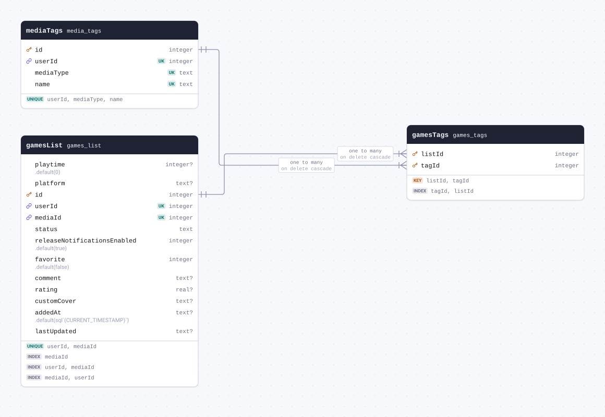

| Column                 | Type      | Constraints                                 | Default | Description |
| ---------------------- | --------- | ------------------------------------------- | ------- | ----------- |
| `id`                   | `integer` | PK NOT NULL                                 |         |             |
| `userId` (`user_id`)   | `integer` | NOT NULL → [user.id](#table-user)           |         |             |
| `mediaId` (`media_id`) | `integer` | NOT NULL → [games.id](#table-games)         |         |             |
| `tagId` (`tag_id`)     | `integer` | NOT NULL → [mediaTags.id](#table-mediaTags) |         |             |

#### Definition

```sql
CREATE TABLE `games_tags` (
	`id` integer PRIMARY KEY,
	`user_id` integer NOT NULL,
	`media_id` integer NOT NULL,
	`tag_id` integer NOT NULL,
	CONSTRAINT `fk_games_tags_user_id_user_id_fk` FOREIGN KEY (`user_id`) REFERENCES `user`(`id`) ON DELETE CASCADE,
	CONSTRAINT `fk_games_tags_media_id_games_id_fk` FOREIGN KEY (`media_id`) REFERENCES `games`(`id`) ON DELETE CASCADE,
	CONSTRAINT `fk_games_tags_tag_id_media_tags_id_fk` FOREIGN KEY (`tag_id`) REFERENCES `media_tags`(`id`) ON DELETE CASCADE
);

CREATE UNIQUE INDEX `ux_games_tags_user_media_tag` ON `games_tags` (`user_id`,`media_id`,`tag_id`);

CREATE INDEX `ix_games_tags_user_tag_media` ON `games_tags` (`user_id`,`tag_id`,`media_id`);
```

#### Indexes

- UNIQUE `userId`, `mediaId`, `tagId`
- INDEX `userId`, `tagId`, `mediaId`

#### References

- `userId` → [user.id](#table-user) (many to one, on delete cascade)
- `mediaId` → [games.id](#table-games) (many to one, on delete cascade)
- `tagId` → [mediaTags.id](#table-mediaTags) (many to one, on delete cascade)

<details>
<summary>Queries and their SQL</summary>

**Select**: Every row of gamesTags.

```ts
db.select().from(gamesTags);
```

```sql
select "id", "user_id", "media_id", "tag_id"
from "games_tags"
```

**Count**: How many rows gamesTags has.

```ts
db.select({ count: count() }).from(gamesTags);
```

```sql
select count(*)
from "games_tags"
```

**Find many**: The rows of gamesTags, through the relational query API.

```ts
db.query.gamesTags.findMany();
```

```sql
select "d0"."id" as "id", "d0"."user_id" as "userId", "d0"."media_id" as "mediaId", "d0"."tag_id" as "tagId"
from "games_tags" as "d0"
```

**Find by primary key**: One row of gamesTags, through the relational query API.

```ts
db.query.gamesTags.findFirst({ where: { id: 1 } });
```

```sql
select "d0"."id" as "id", "d0"."user_id" as "userId", "d0"."media_id" as "mediaId", "d0"."tag_id" as "tagId"
from "games_tags" as "d0"
where "d0"."id" = ?
limit ?
-- params: [1,1]
```

**Insert**: Adds a row to gamesTags, giving the columns that have no default.

```ts
db.insert(gamesTags).values({ id: 1, userId: 1, mediaId: 1, tagId: 1 });
```

```sql
insert into "games_tags" ("id", "user_id", "media_id", "tag_id")
values (?, ?, ?, ?)
-- params: [1,1,1,1]
```

**Update**: Changes a row of gamesTags, found by its primary key.

```ts
db.update(gamesTags).set({ userId: 1 }).where(eq(gamesTags.id, 1));
```

```sql
update "games_tags"
set "user_id" = ?
where "games_tags"."id" = ?
-- params: [1,1]
```

**Delete**: Deletes a row of gamesTags, found by its primary key.

```ts
db.delete(gamesTags).where(eq(gamesTags.id, 1));
```

```sql
delete from "games_tags"
where "games_tags"."id" = ?
-- params: [1]
```

</details>

<a id="table-books"></a>

### books

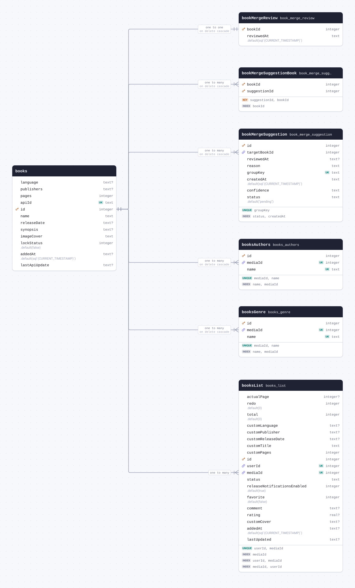

| Column                              | Type      | Constraints     | Default                                | Description |
| ----------------------------------- | --------- | --------------- | -------------------------------------- | ----------- |
| `pages`                             | `integer` | NOT NULL        |                                        |             |
| `language`                          | `text`    | NULL            |                                        |             |
| `publishers`                        | `text`    | NULL            |                                        |             |
| `apiId` (`api_id`)                  | `text`    | UNIQUE NOT NULL |                                        |             |
| `id`                                | `integer` | PK NOT NULL     |                                        |             |
| `name`                              | `text`    | NOT NULL        |                                        |             |
| `releaseDate` (`release_date`)      | `text`    | NULL            |                                        |             |
| `synopsis`                          | `text`    | NULL            |                                        |             |
| `imageCover` (`image_cover`)        | `text`    | NOT NULL        |                                        |             |
| `lockStatus` (`lock_status`)        | `integer` | NOT NULL        | `.default(false)`                      |             |
| `addedAt` (`added_at`)              | `text`    | NULL            | ``.default(sql`(CURRENT_TIMESTAMP)`)`` |             |
| `lastApiUpdate` (`last_api_update`) | `text`    | NULL            |                                        |             |

#### Definition

```sql
CREATE TABLE `books` (
	`pages` integer NOT NULL,
	`language` text,
	`publishers` text,
	`api_id` text NOT NULL UNIQUE,
	`id` integer PRIMARY KEY,
	`name` text NOT NULL,
	`release_date` text,
	`synopsis` text,
	`image_cover` text NOT NULL,
	`lock_status` integer DEFAULT false NOT NULL,
	`added_at` text DEFAULT (CURRENT_TIMESTAMP),
	`last_api_update` text
);
```

#### Referenced by

- `id` → [booksList.mediaId](#table-booksList) (one to many)
- `id` → [booksGenre.mediaId](#table-booksGenre) (one to many, on delete cascade)
- `id` → [booksAuthors.mediaId](#table-booksAuthors) (one to many, on delete cascade)
- `id` → [booksTags.mediaId](#table-booksTags) (one to many, on delete cascade)

<details>
<summary>Queries and their SQL</summary>

**Select**: Every row of books.

```ts
db.select().from(books);
```

```sql
select "pages", "language", "publishers", "api_id", "id", "name", "release_date", "synopsis", "image_cover", "lock_status", "added_at", "last_api_update"
from "books"
```

**Count**: How many rows books has.

```ts
db.select({ count: count() }).from(books);
```

```sql
select count(*)
from "books"
```

**Find many**: The rows of books, through the relational query API.

```ts
db.query.books.findMany();
```

```sql
select "d0"."pages" as "pages", "d0"."language" as "language", "d0"."publishers" as "publishers", "d0"."api_id" as "apiId", "d0"."id" as "id", "d0"."name" as "name", "d0"."release_date" as "releaseDate", "d0"."synopsis" as "synopsis", "d0"."image_cover" as "imageCover", "d0"."lock_status" as "lockStatus", "d0"."added_at" as "addedAt", "d0"."last_api_update" as "lastApiUpdate"
from "books" as "d0"
```

**Find by primary key**: One row of books, through the relational query API.

```ts
db.query.books.findFirst({ where: { id: 1 } });
```

```sql
select "d0"."pages" as "pages", "d0"."language" as "language", "d0"."publishers" as "publishers", "d0"."api_id" as "apiId", "d0"."id" as "id", "d0"."name" as "name", "d0"."release_date" as "releaseDate", "d0"."synopsis" as "synopsis", "d0"."image_cover" as "imageCover", "d0"."lock_status" as "lockStatus", "d0"."added_at" as "addedAt", "d0"."last_api_update" as "lastApiUpdate"
from "books" as "d0"
where "d0"."id" = ?
limit ?
-- params: [1,1]
```

**Insert**: Adds a row to books, giving the columns that have no default.

```ts
db.insert(books).values({
  pages: 1,
  apiId: "apiId",
  id: 1,
  name: "name",
  imageCover: "imageCover",
});
```

```sql
insert into "books" ("pages", "language", "publishers", "api_id", "id", "name", "release_date", "synopsis", "image_cover", "lock_status", "added_at", "last_api_update")
values (?, null, null, ?, ?, ?, null, null, ?, ?, (CURRENT_TIMESTAMP), null)
-- params: [1,"apiId",1,"name","imageCover",0]
```

**Update**: Changes a row of books, found by its primary key.

```ts
db.update(books).set({ pages: 1 }).where(eq(books.id, 1));
```

```sql
update "books"
set "pages" = ?
where "books"."id" = ?
-- params: [1,1]
```

**Delete**: Deletes a row of books, found by its primary key.

```ts
db.delete(books).where(eq(books.id, 1));
```

```sql
delete from "books"
where "books"."id" = ?
-- params: [1]
```

</details>

<a id="table-booksList"></a>

### booksList

Table `books_list`.

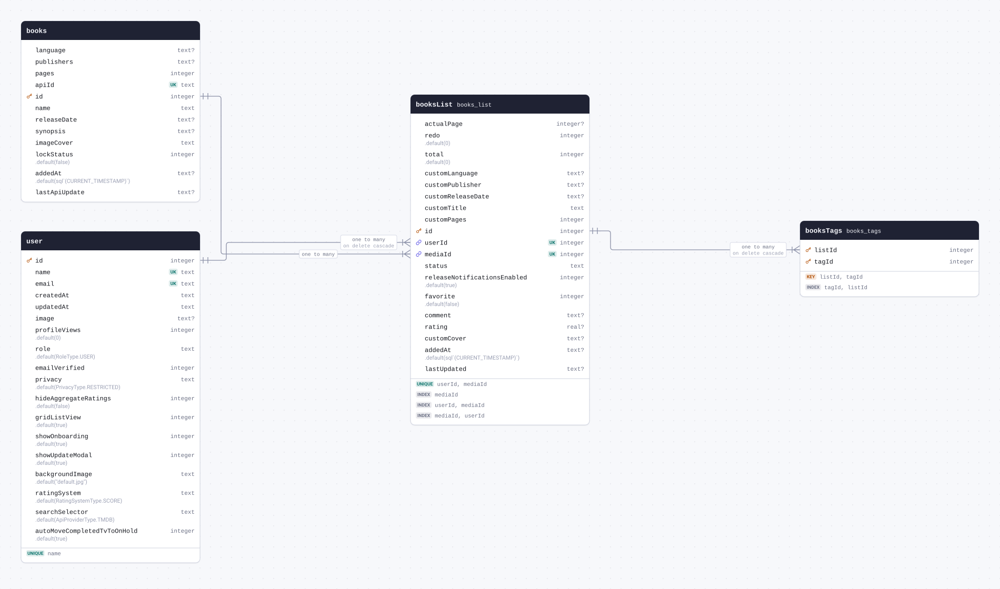

| Column                                                          | Type      | Constraints                         | Default                                | Description |
| --------------------------------------------------------------- | --------- | ----------------------------------- | -------------------------------------- | ----------- |
| `actualPage` (`actual_page`)                                    | `integer` | NULL                                |                                        |             |
| `redo`                                                          | `integer` | NOT NULL                            | `.default(0)`                          |             |
| `total`                                                         | `integer` | NOT NULL                            | `.default(0)`                          |             |
| `id`                                                            | `integer` | PK NOT NULL                         |                                        |             |
| `userId` (`user_id`)                                            | `integer` | NOT NULL → [user.id](#table-user)   |                                        |             |
| `mediaId` (`media_id`)                                          | `integer` | NOT NULL → [books.id](#table-books) |                                        |             |
| `status`                                                        | `text`    | NOT NULL                            |                                        |             |
| `releaseNotificationsEnabled` (`release_notifications_enabled`) | `integer` | NOT NULL                            | `.default(true)`                       |             |
| `favorite`                                                      | `integer` | NOT NULL                            | `.default(false)`                      |             |
| `comment`                                                       | `text`    | NULL                                |                                        |             |
| `rating`                                                        | `real`    | NULL                                |                                        |             |
| `customCover` (`custom_cover`)                                  | `text`    | NULL                                |                                        |             |
| `addedAt` (`added_at`)                                          | `text`    | NULL                                | ``.default(sql`(CURRENT_TIMESTAMP)`)`` |             |
| `lastUpdated` (`last_updated`)                                  | `text`    | NULL                                |                                        |             |

#### Definition

```sql
CREATE TABLE `books_list` (
	`actual_page` integer,
	`redo` integer DEFAULT 0 NOT NULL,
	`total` integer DEFAULT 0 NOT NULL,
	`id` integer PRIMARY KEY,
	`user_id` integer NOT NULL,
	`media_id` integer NOT NULL,
	`status` text NOT NULL,
	`release_notifications_enabled` integer DEFAULT true NOT NULL,
	`favorite` integer DEFAULT false NOT NULL,
	`comment` text,
	`rating` real,
	`custom_cover` text,
	`added_at` text DEFAULT (CURRENT_TIMESTAMP),
	`last_updated` text,
	CONSTRAINT `fk_books_list_user_id_user_id_fk` FOREIGN KEY (`user_id`) REFERENCES `user`(`id`) ON DELETE CASCADE,
	CONSTRAINT `fk_books_list_media_id_books_id_fk` FOREIGN KEY (`media_id`) REFERENCES `books`(`id`),
	CONSTRAINT "books_list_rating_check" CHECK("rating" IS NULL OR ("rating" >= 0 AND "rating" <= 10)),
	CONSTRAINT "books_list_favorite_check" CHECK("favorite" IN (0, 1))
);

CREATE UNIQUE INDEX `ux_books_list_user_media` ON `books_list` (`user_id`,`media_id`);

CREATE INDEX `ix_books_list_media_id` ON `books_list` (`media_id`);

CREATE INDEX `ix_books_list_user_media_rated` ON `books_list` (`user_id`,`media_id`) WHERE "books_list"."rating" IS NOT NULL;

CREATE INDEX `ix_books_list_media_user_rated` ON `books_list` (`media_id`,`user_id`) WHERE "books_list"."rating" IS NOT NULL;
```

#### Indexes

- UNIQUE `userId`, `mediaId`
- INDEX `mediaId`
- INDEX `userId`, `mediaId`
- INDEX `mediaId`, `userId`

#### References

- `userId` → [user.id](#table-user) (many to one, on delete cascade)
- `mediaId` → [books.id](#table-books) (many to one)

<details>
<summary>Queries and their SQL</summary>

**Select**: Every row of booksList.

```ts
db.select().from(booksList);
```

```sql
select "actual_page", "redo", "total", "id", "user_id", "media_id", "status", "release_notifications_enabled", "favorite", "comment", "rating", "custom_cover", "added_at", "last_updated"
from "books_list"
```

**Count**: How many rows booksList has.

```ts
db.select({ count: count() }).from(booksList);
```

```sql
select count(*)
from "books_list"
```

**Find many**: The rows of booksList, through the relational query API.

```ts
db.query.booksList.findMany();
```

```sql
select "d0"."actual_page" as "actualPage", "d0"."redo" as "redo", "d0"."total" as "total", "d0"."id" as "id", "d0"."user_id" as "userId", "d0"."media_id" as "mediaId", "d0"."status" as "status", "d0"."release_notifications_enabled" as "releaseNotificationsEnabled", "d0"."favorite" as "favorite", "d0"."comment" as "comment", "d0"."rating" as "rating", "d0"."custom_cover" as "customCover", "d0"."added_at" as "addedAt", "d0"."last_updated" as "lastUpdated"
from "books_list" as "d0"
```

**Find by primary key**: One row of booksList, through the relational query API.

```ts
db.query.booksList.findFirst({ where: { id: 1 } });
```

```sql
select "d0"."actual_page" as "actualPage", "d0"."redo" as "redo", "d0"."total" as "total", "d0"."id" as "id", "d0"."user_id" as "userId", "d0"."media_id" as "mediaId", "d0"."status" as "status", "d0"."release_notifications_enabled" as "releaseNotificationsEnabled", "d0"."favorite" as "favorite", "d0"."comment" as "comment", "d0"."rating" as "rating", "d0"."custom_cover" as "customCover", "d0"."added_at" as "addedAt", "d0"."last_updated" as "lastUpdated"
from "books_list" as "d0"
where "d0"."id" = ?
limit ?
-- params: [1,1]
```

**Insert**: Adds a row to booksList, giving the columns that have no default.

```ts
db.insert(booksList).values({ id: 1, userId: 1, mediaId: 1, status: "status" });
```

```sql
insert into "books_list" ("actual_page", "redo", "total", "id", "user_id", "media_id", "status", "release_notifications_enabled", "favorite", "comment", "rating", "custom_cover", "added_at", "last_updated")
values (null, ?, ?, ?, ?, ?, ?, ?, ?, null, null, null, (CURRENT_TIMESTAMP), null)
-- params: [0,0,1,1,1,"status",1,0]
```

**Update**: Changes a row of booksList, found by its primary key.

```ts
db.update(booksList).set({ actualPage: 1 }).where(eq(booksList.id, 1));
```

```sql
update "books_list"
set "actual_page" = ?
where "books_list"."id" = ?
-- params: [1,1]
```

**Delete**: Deletes a row of booksList, found by its primary key.

```ts
db.delete(booksList).where(eq(booksList.id, 1));
```

```sql
delete from "books_list"
where "books_list"."id" = ?
-- params: [1]
```

</details>

<a id="table-booksGenre"></a>

### booksGenre

Table `books_genre`.

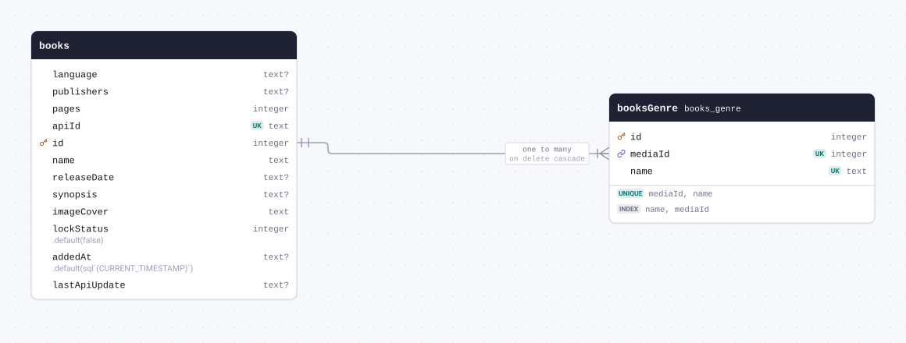

| Column                 | Type      | Constraints                         | Default | Description |
| ---------------------- | --------- | ----------------------------------- | ------- | ----------- |
| `id`                   | `integer` | PK NOT NULL                         |         |             |
| `mediaId` (`media_id`) | `integer` | NOT NULL → [books.id](#table-books) |         |             |
| `name`                 | `text`    | NOT NULL                            |         |             |

#### Definition

```sql
CREATE TABLE `books_genre` (
	`id` integer PRIMARY KEY,
	`media_id` integer NOT NULL,
	`name` text NOT NULL,
	CONSTRAINT `fk_books_genre_media_id_books_id_fk` FOREIGN KEY (`media_id`) REFERENCES `books`(`id`) ON DELETE CASCADE
);

CREATE UNIQUE INDEX `ux_books_genre_media_name` ON `books_genre` (`media_id`,`name`);

CREATE INDEX `ix_books_genre_name_media` ON `books_genre` (`name`,`media_id`);
```

#### Indexes

- UNIQUE `mediaId`, `name`
- INDEX `name`, `mediaId`

#### References

- `mediaId` → [books.id](#table-books) (many to one, on delete cascade)

<details>
<summary>Queries and their SQL</summary>

**Select**: Every row of booksGenre.

```ts
db.select().from(booksGenre);
```

```sql
select "id", "media_id", "name"
from "books_genre"
```

**Count**: How many rows booksGenre has.

```ts
db.select({ count: count() }).from(booksGenre);
```

```sql
select count(*)
from "books_genre"
```

**Find many**: The rows of booksGenre, through the relational query API.

```ts
db.query.booksGenre.findMany();
```

```sql
select "d0"."id" as "id", "d0"."media_id" as "mediaId", "d0"."name" as "name"
from "books_genre" as "d0"
```

**Find by primary key**: One row of booksGenre, through the relational query API.

```ts
db.query.booksGenre.findFirst({ where: { id: 1 } });
```

```sql
select "d0"."id" as "id", "d0"."media_id" as "mediaId", "d0"."name" as "name"
from "books_genre" as "d0"
where "d0"."id" = ?
limit ?
-- params: [1,1]
```

**Insert**: Adds a row to booksGenre, giving the columns that have no default.

```ts
db.insert(booksGenre).values({ id: 1, mediaId: 1, name: "name" });
```

```sql
insert into "books_genre" ("id", "media_id", "name")
values (?, ?, ?)
-- params: [1,1,"name"]
```

**Update**: Changes a row of booksGenre, found by its primary key.

```ts
db.update(booksGenre).set({ mediaId: 1 }).where(eq(booksGenre.id, 1));
```

```sql
update "books_genre"
set "media_id" = ?
where "books_genre"."id" = ?
-- params: [1,1]
```

**Delete**: Deletes a row of booksGenre, found by its primary key.

```ts
db.delete(booksGenre).where(eq(booksGenre.id, 1));
```

```sql
delete from "books_genre"
where "books_genre"."id" = ?
-- params: [1]
```

</details>

<a id="table-booksAuthors"></a>

### booksAuthors

Table `books_authors`.


| Column                 | Type      | Constraints                         | Default | Description |
| ---------------------- | --------- | ----------------------------------- | ------- | ----------- |
| `id`                   | `integer` | PK NOT NULL                         |         |             |
| `mediaId` (`media_id`) | `integer` | NOT NULL → [books.id](#table-books) |         |             |
| `name`                 | `text`    | NOT NULL                            |         |             |

#### Definition

```sql
CREATE TABLE `books_authors` (
	`id` integer PRIMARY KEY,
	`media_id` integer NOT NULL,
	`name` text NOT NULL,
	CONSTRAINT `fk_books_authors_media_id_books_id_fk` FOREIGN KEY (`media_id`) REFERENCES `books`(`id`) ON DELETE CASCADE
);

CREATE UNIQUE INDEX `ux_books_authors_media_name` ON `books_authors` (`media_id`,`name`);

CREATE INDEX `ix_books_authors_name_media` ON `books_authors` (`name`,`media_id`);
```

#### Indexes

- UNIQUE `mediaId`, `name`
- INDEX `name`, `mediaId`

#### References

- `mediaId` → [books.id](#table-books) (many to one, on delete cascade)

<details>
<summary>Queries and their SQL</summary>

**Select**: Every row of booksAuthors.

```ts
db.select().from(booksAuthors);
```

```sql
select "id", "media_id", "name"
from "books_authors"
```

**Count**: How many rows booksAuthors has.

```ts
db.select({ count: count() }).from(booksAuthors);
```

```sql
select count(*)
from "books_authors"
```

**Find many**: The rows of booksAuthors, through the relational query API.

```ts
db.query.booksAuthors.findMany();
```

```sql
select "d0"."id" as "id", "d0"."media_id" as "mediaId", "d0"."name" as "name"
from "books_authors" as "d0"
```

**Find by primary key**: One row of booksAuthors, through the relational query API.

```ts
db.query.booksAuthors.findFirst({ where: { id: 1 } });
```

```sql
select "d0"."id" as "id", "d0"."media_id" as "mediaId", "d0"."name" as "name"
from "books_authors" as "d0"
where "d0"."id" = ?
limit ?
-- params: [1,1]
```

**Insert**: Adds a row to booksAuthors, giving the columns that have no default.

```ts
db.insert(booksAuthors).values({ id: 1, mediaId: 1, name: "name" });
```

```sql
insert into "books_authors" ("id", "media_id", "name")
values (?, ?, ?)
-- params: [1,1,"name"]
```

**Update**: Changes a row of booksAuthors, found by its primary key.

```ts
db.update(booksAuthors).set({ mediaId: 1 }).where(eq(booksAuthors.id, 1));
```

```sql
update "books_authors"
set "media_id" = ?
where "books_authors"."id" = ?
-- params: [1,1]
```

**Delete**: Deletes a row of booksAuthors, found by its primary key.

```ts
db.delete(booksAuthors).where(eq(booksAuthors.id, 1));
```

```sql
delete from "books_authors"
where "books_authors"."id" = ?
-- params: [1]
```

</details>

<a id="table-booksTags"></a>

### booksTags

Table `books_tags`.

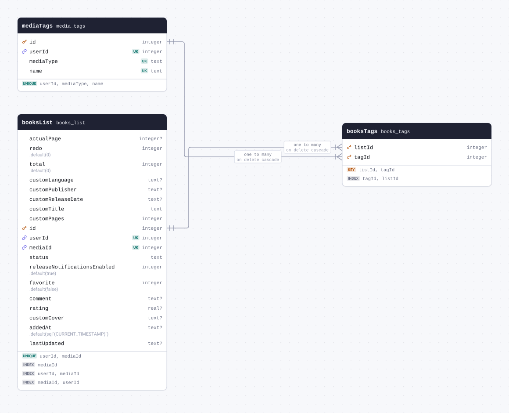

| Column                 | Type      | Constraints                                 | Default | Description |
| ---------------------- | --------- | ------------------------------------------- | ------- | ----------- |
| `id`                   | `integer` | PK NOT NULL                                 |         |             |
| `userId` (`user_id`)   | `integer` | NOT NULL → [user.id](#table-user)           |         |             |
| `mediaId` (`media_id`) | `integer` | NOT NULL → [books.id](#table-books)         |         |             |
| `tagId` (`tag_id`)     | `integer` | NOT NULL → [mediaTags.id](#table-mediaTags) |         |             |

#### Definition

```sql
CREATE TABLE `books_tags` (
	`id` integer PRIMARY KEY,
	`user_id` integer NOT NULL,
	`media_id` integer NOT NULL,
	`tag_id` integer NOT NULL,
	CONSTRAINT `fk_books_tags_user_id_user_id_fk` FOREIGN KEY (`user_id`) REFERENCES `user`(`id`) ON DELETE CASCADE,
	CONSTRAINT `fk_books_tags_media_id_books_id_fk` FOREIGN KEY (`media_id`) REFERENCES `books`(`id`) ON DELETE CASCADE,
	CONSTRAINT `fk_books_tags_tag_id_media_tags_id_fk` FOREIGN KEY (`tag_id`) REFERENCES `media_tags`(`id`) ON DELETE CASCADE
);

CREATE UNIQUE INDEX `ux_books_tags_user_media_tag` ON `books_tags` (`user_id`,`media_id`,`tag_id`);

CREATE INDEX `ix_books_tags_user_tag_media` ON `books_tags` (`user_id`,`tag_id`,`media_id`);
```

#### Indexes

- UNIQUE `userId`, `mediaId`, `tagId`
- INDEX `userId`, `tagId`, `mediaId`

#### References

- `userId` → [user.id](#table-user) (many to one, on delete cascade)
- `mediaId` → [books.id](#table-books) (many to one, on delete cascade)
- `tagId` → [mediaTags.id](#table-mediaTags) (many to one, on delete cascade)

<details>
<summary>Queries and their SQL</summary>

**Select**: Every row of booksTags.

```ts
db.select().from(booksTags);
```

```sql
select "id", "user_id", "media_id", "tag_id"
from "books_tags"
```

**Count**: How many rows booksTags has.

```ts
db.select({ count: count() }).from(booksTags);
```

```sql
select count(*)
from "books_tags"
```

**Find many**: The rows of booksTags, through the relational query API.

```ts
db.query.booksTags.findMany();
```

```sql
select "d0"."id" as "id", "d0"."user_id" as "userId", "d0"."media_id" as "mediaId", "d0"."tag_id" as "tagId"
from "books_tags" as "d0"
```

**Find by primary key**: One row of booksTags, through the relational query API.

```ts
db.query.booksTags.findFirst({ where: { id: 1 } });
```

```sql
select "d0"."id" as "id", "d0"."user_id" as "userId", "d0"."media_id" as "mediaId", "d0"."tag_id" as "tagId"
from "books_tags" as "d0"
where "d0"."id" = ?
limit ?
-- params: [1,1]
```

**Insert**: Adds a row to booksTags, giving the columns that have no default.

```ts
db.insert(booksTags).values({ id: 1, userId: 1, mediaId: 1, tagId: 1 });
```

```sql
insert into "books_tags" ("id", "user_id", "media_id", "tag_id")
values (?, ?, ?, ?)
-- params: [1,1,1,1]
```

**Update**: Changes a row of booksTags, found by its primary key.

```ts
db.update(booksTags).set({ userId: 1 }).where(eq(booksTags.id, 1));
```

```sql
update "books_tags"
set "user_id" = ?
where "books_tags"."id" = ?
-- params: [1,1]
```

**Delete**: Deletes a row of booksTags, found by its primary key.

```ts
db.delete(booksTags).where(eq(booksTags.id, 1));
```

```sql
delete from "books_tags"
where "books_tags"."id" = ?
-- params: [1]
```

</details>

<a id="table-manga"></a>

### manga

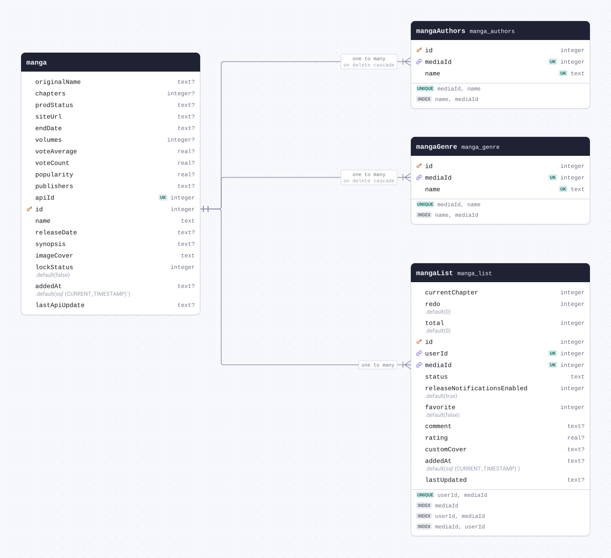

| Column                              | Type      | Constraints     | Default                                | Description |
| ----------------------------------- | --------- | --------------- | -------------------------------------- | ----------- |
| `originalName` (`original_name`)    | `text`    | NULL            |                                        |             |
| `chapters`                          | `integer` | NULL            |                                        |             |
| `prodStatus` (`prod_status`)        | `text`    | NULL            |                                        |             |
| `siteUrl` (`site_url`)              | `text`    | NULL            |                                        |             |
| `endDate` (`end_date`)              | `text`    | NULL            |                                        |             |
| `volumes`                           | `integer` | NULL            |                                        |             |
| `voteAverage` (`vote_average`)      | `real`    | NULL            |                                        |             |
| `voteCount` (`vote_count`)          | `real`    | NULL            |                                        |             |
| `popularity`                        | `real`    | NULL            |                                        |             |
| `publishers`                        | `text`    | NULL            |                                        |             |
| `apiId` (`api_id`)                  | `integer` | UNIQUE NOT NULL |                                        |             |
| `id`                                | `integer` | PK NOT NULL     |                                        |             |
| `name`                              | `text`    | NOT NULL        |                                        |             |
| `releaseDate` (`release_date`)      | `text`    | NULL            |                                        |             |
| `synopsis`                          | `text`    | NULL            |                                        |             |
| `imageCover` (`image_cover`)        | `text`    | NOT NULL        |                                        |             |
| `lockStatus` (`lock_status`)        | `integer` | NOT NULL        | `.default(false)`                      |             |
| `addedAt` (`added_at`)              | `text`    | NULL            | ``.default(sql`(CURRENT_TIMESTAMP)`)`` |             |
| `lastApiUpdate` (`last_api_update`) | `text`    | NULL            |                                        |             |

#### Definition

```sql
CREATE TABLE `manga` (
	`original_name` text,
	`chapters` integer,
	`prod_status` text,
	`site_url` text,
	`end_date` text,
	`volumes` integer,
	`vote_average` real,
	`vote_count` real,
	`popularity` real,
	`publishers` text,
	`api_id` integer NOT NULL UNIQUE,
	`id` integer PRIMARY KEY,
	`name` text NOT NULL,
	`release_date` text,
	`synopsis` text,
	`image_cover` text NOT NULL,
	`lock_status` integer DEFAULT false NOT NULL,
	`added_at` text DEFAULT (CURRENT_TIMESTAMP),
	`last_api_update` text
);
```

#### Referenced by

- `id` → [mangaList.mediaId](#table-mangaList) (one to many)
- `id` → [mangaGenre.mediaId](#table-mangaGenre) (one to many, on delete cascade)
- `id` → [mangaAuthors.mediaId](#table-mangaAuthors) (one to many, on delete cascade)
- `id` → [mangaTags.mediaId](#table-mangaTags) (one to many, on delete cascade)

<details>
<summary>Queries and their SQL</summary>

**Select**: Every row of manga.

```ts
db.select().from(manga);
```

```sql
select "original_name", "chapters", "prod_status", "site_url", "end_date", "volumes", "vote_average", "vote_count", "popularity", "publishers", "api_id", "id", "name", "release_date", "synopsis", "image_cover", "lock_status", "added_at", "last_api_update"
from "manga"
```

**Count**: How many rows manga has.

```ts
db.select({ count: count() }).from(manga);
```

```sql
select count(*)
from "manga"
```

**Find many**: The rows of manga, through the relational query API.

```ts
db.query.manga.findMany();
```

```sql
select "d0"."original_name" as "originalName", "d0"."chapters" as "chapters", "d0"."prod_status" as "prodStatus", "d0"."site_url" as "siteUrl", "d0"."end_date" as "endDate", "d0"."volumes" as "volumes", "d0"."vote_average" as "voteAverage", "d0"."vote_count" as "voteCount", "d0"."popularity" as "popularity", "d0"."publishers" as "publishers", "d0"."api_id" as "apiId", "d0"."id" as "id", "d0"."name" as "name", "d0"."release_date" as "releaseDate", "d0"."synopsis" as "synopsis", "d0"."image_cover" as "imageCover", "d0"."lock_status" as "lockStatus", "d0"."added_at" as "addedAt", "d0"."last_api_update" as "lastApiUpdate"
from "manga" as "d0"
```

**Find by primary key**: One row of manga, through the relational query API.

```ts
db.query.manga.findFirst({ where: { id: 1 } });
```

```sql
select "d0"."original_name" as "originalName", "d0"."chapters" as "chapters", "d0"."prod_status" as "prodStatus", "d0"."site_url" as "siteUrl", "d0"."end_date" as "endDate", "d0"."volumes" as "volumes", "d0"."vote_average" as "voteAverage", "d0"."vote_count" as "voteCount", "d0"."popularity" as "popularity", "d0"."publishers" as "publishers", "d0"."api_id" as "apiId", "d0"."id" as "id", "d0"."name" as "name", "d0"."release_date" as "releaseDate", "d0"."synopsis" as "synopsis", "d0"."image_cover" as "imageCover", "d0"."lock_status" as "lockStatus", "d0"."added_at" as "addedAt", "d0"."last_api_update" as "lastApiUpdate"
from "manga" as "d0"
where "d0"."id" = ?
limit ?
-- params: [1,1]
```

**Insert**: Adds a row to manga, giving the columns that have no default.

```ts
db.insert(manga).values({ apiId: 1, id: 1, name: "name", imageCover: "imageCover" });
```

```sql
insert into "manga" ("original_name", "chapters", "prod_status", "site_url", "end_date", "volumes", "vote_average", "vote_count", "popularity", "publishers", "api_id", "id", "name", "release_date", "synopsis", "image_cover", "lock_status", "added_at", "last_api_update")
values (null, null, null, null, null, null, null, null, null, null, ?, ?, ?, null, null, ?, ?, (CURRENT_TIMESTAMP), null)
-- params: [1,1,"name","imageCover",0]
```

**Update**: Changes a row of manga, found by its primary key.

```ts
db.update(manga).set({ originalName: "originalName" }).where(eq(manga.id, 1));
```

```sql
update "manga"
set "original_name" = ?
where "manga"."id" = ?
-- params: ["originalName",1]
```

**Delete**: Deletes a row of manga, found by its primary key.

```ts
db.delete(manga).where(eq(manga.id, 1));
```

```sql
delete from "manga"
where "manga"."id" = ?
-- params: [1]
```

</details>

<a id="table-mangaList"></a>

### mangaList

Table `manga_list`.

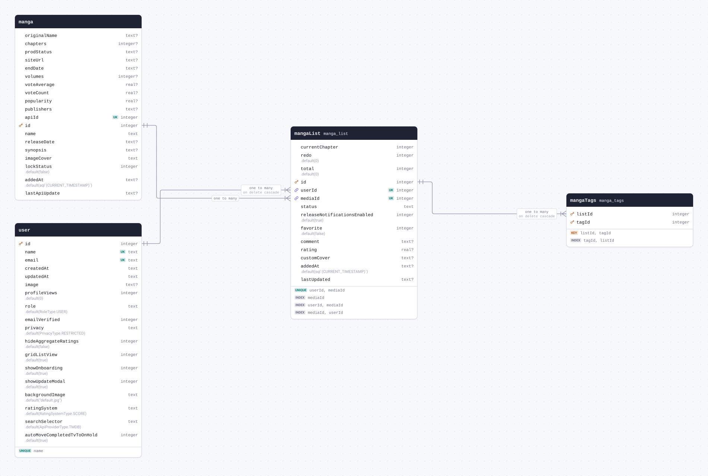

| Column                                                          | Type      | Constraints                         | Default                                | Description |
| --------------------------------------------------------------- | --------- | ----------------------------------- | -------------------------------------- | ----------- |
| `currentChapter` (`current_chapter`)                            | `integer` | NOT NULL                            |                                        |             |
| `redo`                                                          | `integer` | NOT NULL                            | `.default(0)`                          |             |
| `total`                                                         | `integer` | NOT NULL                            | `.default(0)`                          |             |
| `id`                                                            | `integer` | PK NOT NULL                         |                                        |             |
| `userId` (`user_id`)                                            | `integer` | NOT NULL → [user.id](#table-user)   |                                        |             |
| `mediaId` (`media_id`)                                          | `integer` | NOT NULL → [manga.id](#table-manga) |                                        |             |
| `status`                                                        | `text`    | NOT NULL                            |                                        |             |
| `releaseNotificationsEnabled` (`release_notifications_enabled`) | `integer` | NOT NULL                            | `.default(true)`                       |             |
| `favorite`                                                      | `integer` | NOT NULL                            | `.default(false)`                      |             |
| `comment`                                                       | `text`    | NULL                                |                                        |             |
| `rating`                                                        | `real`    | NULL                                |                                        |             |
| `customCover` (`custom_cover`)                                  | `text`    | NULL                                |                                        |             |
| `addedAt` (`added_at`)                                          | `text`    | NULL                                | ``.default(sql`(CURRENT_TIMESTAMP)`)`` |             |
| `lastUpdated` (`last_updated`)                                  | `text`    | NULL                                |                                        |             |

#### Definition

```sql
CREATE TABLE `manga_list` (
	`current_chapter` integer NOT NULL,
	`redo` integer DEFAULT 0 NOT NULL,
	`total` integer DEFAULT 0 NOT NULL,
	`id` integer PRIMARY KEY,
	`user_id` integer NOT NULL,
	`media_id` integer NOT NULL,
	`status` text NOT NULL,
	`release_notifications_enabled` integer DEFAULT true NOT NULL,
	`favorite` integer DEFAULT false NOT NULL,
	`comment` text,
	`rating` real,
	`custom_cover` text,
	`added_at` text DEFAULT (CURRENT_TIMESTAMP),
	`last_updated` text,
	CONSTRAINT `fk_manga_list_user_id_user_id_fk` FOREIGN KEY (`user_id`) REFERENCES `user`(`id`) ON DELETE CASCADE,
	CONSTRAINT `fk_manga_list_media_id_manga_id_fk` FOREIGN KEY (`media_id`) REFERENCES `manga`(`id`),
	CONSTRAINT "manga_list_rating_check" CHECK("rating" IS NULL OR ("rating" >= 0 AND "rating" <= 10)),
	CONSTRAINT "manga_list_favorite_check" CHECK("favorite" IN (0, 1))
);

CREATE UNIQUE INDEX `ux_manga_list_user_media` ON `manga_list` (`user_id`,`media_id`);

CREATE INDEX `ix_manga_list_media_id` ON `manga_list` (`media_id`);

CREATE INDEX `ix_manga_list_user_media_rated` ON `manga_list` (`user_id`,`media_id`) WHERE "manga_list"."rating" IS NOT NULL;

CREATE INDEX `ix_manga_list_media_user_rated` ON `manga_list` (`media_id`,`user_id`) WHERE "manga_list"."rating" IS NOT NULL;
```

#### Indexes

- UNIQUE `userId`, `mediaId`
- INDEX `mediaId`
- INDEX `userId`, `mediaId`
- INDEX `mediaId`, `userId`

#### References

- `userId` → [user.id](#table-user) (many to one, on delete cascade)
- `mediaId` → [manga.id](#table-manga) (many to one)

<details>
<summary>Queries and their SQL</summary>

**Select**: Every row of mangaList.

```ts
db.select().from(mangaList);
```

```sql
select "current_chapter", "redo", "total", "id", "user_id", "media_id", "status", "release_notifications_enabled", "favorite", "comment", "rating", "custom_cover", "added_at", "last_updated"
from "manga_list"
```

**Count**: How many rows mangaList has.

```ts
db.select({ count: count() }).from(mangaList);
```

```sql
select count(*)
from "manga_list"
```

**Find many**: The rows of mangaList, through the relational query API.

```ts
db.query.mangaList.findMany();
```

```sql
select "d0"."current_chapter" as "currentChapter", "d0"."redo" as "redo", "d0"."total" as "total", "d0"."id" as "id", "d0"."user_id" as "userId", "d0"."media_id" as "mediaId", "d0"."status" as "status", "d0"."release_notifications_enabled" as "releaseNotificationsEnabled", "d0"."favorite" as "favorite", "d0"."comment" as "comment", "d0"."rating" as "rating", "d0"."custom_cover" as "customCover", "d0"."added_at" as "addedAt", "d0"."last_updated" as "lastUpdated"
from "manga_list" as "d0"
```

**Find by primary key**: One row of mangaList, through the relational query API.

```ts
db.query.mangaList.findFirst({ where: { id: 1 } });
```

```sql
select "d0"."current_chapter" as "currentChapter", "d0"."redo" as "redo", "d0"."total" as "total", "d0"."id" as "id", "d0"."user_id" as "userId", "d0"."media_id" as "mediaId", "d0"."status" as "status", "d0"."release_notifications_enabled" as "releaseNotificationsEnabled", "d0"."favorite" as "favorite", "d0"."comment" as "comment", "d0"."rating" as "rating", "d0"."custom_cover" as "customCover", "d0"."added_at" as "addedAt", "d0"."last_updated" as "lastUpdated"
from "manga_list" as "d0"
where "d0"."id" = ?
limit ?
-- params: [1,1]
```

**Insert**: Adds a row to mangaList, giving the columns that have no default.

```ts
db.insert(mangaList).values({ currentChapter: 1, id: 1, userId: 1, mediaId: 1, status: "status" });
```

```sql
insert into "manga_list" ("current_chapter", "redo", "total", "id", "user_id", "media_id", "status", "release_notifications_enabled", "favorite", "comment", "rating", "custom_cover", "added_at", "last_updated")
values (?, ?, ?, ?, ?, ?, ?, ?, ?, null, null, null, (CURRENT_TIMESTAMP), null)
-- params: [1,0,0,1,1,1,"status",1,0]
```

**Update**: Changes a row of mangaList, found by its primary key.

```ts
db.update(mangaList).set({ currentChapter: 1 }).where(eq(mangaList.id, 1));
```

```sql
update "manga_list"
set "current_chapter" = ?
where "manga_list"."id" = ?
-- params: [1,1]
```

**Delete**: Deletes a row of mangaList, found by its primary key.

```ts
db.delete(mangaList).where(eq(mangaList.id, 1));
```

```sql
delete from "manga_list"
where "manga_list"."id" = ?
-- params: [1]
```

</details>

<a id="table-mangaGenre"></a>

### mangaGenre

Table `manga_genre`.

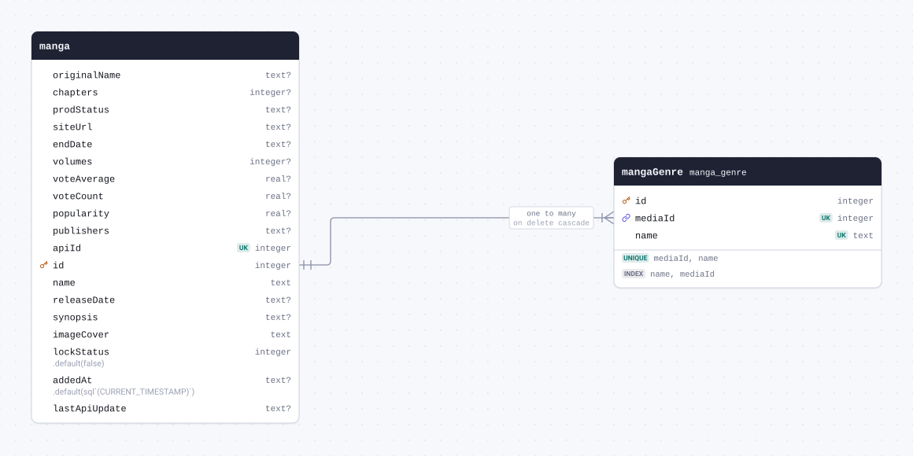

| Column                 | Type      | Constraints                         | Default | Description |
| ---------------------- | --------- | ----------------------------------- | ------- | ----------- |
| `id`                   | `integer` | PK NOT NULL                         |         |             |
| `mediaId` (`media_id`) | `integer` | NOT NULL → [manga.id](#table-manga) |         |             |
| `name`                 | `text`    | NOT NULL                            |         |             |

#### Definition

```sql
CREATE TABLE `manga_genre` (
	`id` integer PRIMARY KEY,
	`media_id` integer NOT NULL,
	`name` text NOT NULL,
	CONSTRAINT `fk_manga_genre_media_id_manga_id_fk` FOREIGN KEY (`media_id`) REFERENCES `manga`(`id`) ON DELETE CASCADE
);

CREATE UNIQUE INDEX `ux_manga_genre_media_name` ON `manga_genre` (`media_id`,`name`);

CREATE INDEX `ix_manga_genre_name_media` ON `manga_genre` (`name`,`media_id`);
```

#### Indexes

- UNIQUE `mediaId`, `name`
- INDEX `name`, `mediaId`

#### References

- `mediaId` → [manga.id](#table-manga) (many to one, on delete cascade)

<details>
<summary>Queries and their SQL</summary>

**Select**: Every row of mangaGenre.

```ts
db.select().from(mangaGenre);
```

```sql
select "id", "media_id", "name"
from "manga_genre"
```

**Count**: How many rows mangaGenre has.

```ts
db.select({ count: count() }).from(mangaGenre);
```

```sql
select count(*)
from "manga_genre"
```

**Find many**: The rows of mangaGenre, through the relational query API.

```ts
db.query.mangaGenre.findMany();
```

```sql
select "d0"."id" as "id", "d0"."media_id" as "mediaId", "d0"."name" as "name"
from "manga_genre" as "d0"
```

**Find by primary key**: One row of mangaGenre, through the relational query API.

```ts
db.query.mangaGenre.findFirst({ where: { id: 1 } });
```

```sql
select "d0"."id" as "id", "d0"."media_id" as "mediaId", "d0"."name" as "name"
from "manga_genre" as "d0"
where "d0"."id" = ?
limit ?
-- params: [1,1]
```

**Insert**: Adds a row to mangaGenre, giving the columns that have no default.

```ts
db.insert(mangaGenre).values({ id: 1, mediaId: 1, name: "name" });
```

```sql
insert into "manga_genre" ("id", "media_id", "name")
values (?, ?, ?)
-- params: [1,1,"name"]
```

**Update**: Changes a row of mangaGenre, found by its primary key.

```ts
db.update(mangaGenre).set({ mediaId: 1 }).where(eq(mangaGenre.id, 1));
```

```sql
update "manga_genre"
set "media_id" = ?
where "manga_genre"."id" = ?
-- params: [1,1]
```

**Delete**: Deletes a row of mangaGenre, found by its primary key.

```ts
db.delete(mangaGenre).where(eq(mangaGenre.id, 1));
```

```sql
delete from "manga_genre"
where "manga_genre"."id" = ?
-- params: [1]
```

</details>

<a id="table-mangaAuthors"></a>

### mangaAuthors

Table `manga_authors`.


| Column                 | Type      | Constraints                         | Default | Description |
| ---------------------- | --------- | ----------------------------------- | ------- | ----------- |
| `id`                   | `integer` | PK NOT NULL                         |         |             |
| `mediaId` (`media_id`) | `integer` | NOT NULL → [manga.id](#table-manga) |         |             |
| `name`                 | `text`    | NOT NULL                            |         |             |

#### Definition

```sql
CREATE TABLE `manga_authors` (
	`id` integer PRIMARY KEY,
	`media_id` integer NOT NULL,
	`name` text NOT NULL,
	CONSTRAINT `fk_manga_authors_media_id_manga_id_fk` FOREIGN KEY (`media_id`) REFERENCES `manga`(`id`) ON DELETE CASCADE
);

CREATE UNIQUE INDEX `ux_manga_authors_media_name` ON `manga_authors` (`media_id`,`name`);

CREATE INDEX `ix_manga_authors_name_media` ON `manga_authors` (`name`,`media_id`);
```

#### Indexes

- UNIQUE `mediaId`, `name`
- INDEX `name`, `mediaId`

#### References

- `mediaId` → [manga.id](#table-manga) (many to one, on delete cascade)

<details>
<summary>Queries and their SQL</summary>

**Select**: Every row of mangaAuthors.

```ts
db.select().from(mangaAuthors);
```

```sql
select "id", "media_id", "name"
from "manga_authors"
```

**Count**: How many rows mangaAuthors has.

```ts
db.select({ count: count() }).from(mangaAuthors);
```

```sql
select count(*)
from "manga_authors"
```

**Find many**: The rows of mangaAuthors, through the relational query API.

```ts
db.query.mangaAuthors.findMany();
```

```sql
select "d0"."id" as "id", "d0"."media_id" as "mediaId", "d0"."name" as "name"
from "manga_authors" as "d0"
```

**Find by primary key**: One row of mangaAuthors, through the relational query API.

```ts
db.query.mangaAuthors.findFirst({ where: { id: 1 } });
```

```sql
select "d0"."id" as "id", "d0"."media_id" as "mediaId", "d0"."name" as "name"
from "manga_authors" as "d0"
where "d0"."id" = ?
limit ?
-- params: [1,1]
```

**Insert**: Adds a row to mangaAuthors, giving the columns that have no default.

```ts
db.insert(mangaAuthors).values({ id: 1, mediaId: 1, name: "name" });
```

```sql
insert into "manga_authors" ("id", "media_id", "name")
values (?, ?, ?)
-- params: [1,1,"name"]
```

**Update**: Changes a row of mangaAuthors, found by its primary key.

```ts
db.update(mangaAuthors).set({ mediaId: 1 }).where(eq(mangaAuthors.id, 1));
```

```sql
update "manga_authors"
set "media_id" = ?
where "manga_authors"."id" = ?
-- params: [1,1]
```

**Delete**: Deletes a row of mangaAuthors, found by its primary key.

```ts
db.delete(mangaAuthors).where(eq(mangaAuthors.id, 1));
```

```sql
delete from "manga_authors"
where "manga_authors"."id" = ?
-- params: [1]
```

</details>

<a id="table-mangaTags"></a>

### mangaTags

Table `manga_tags`.

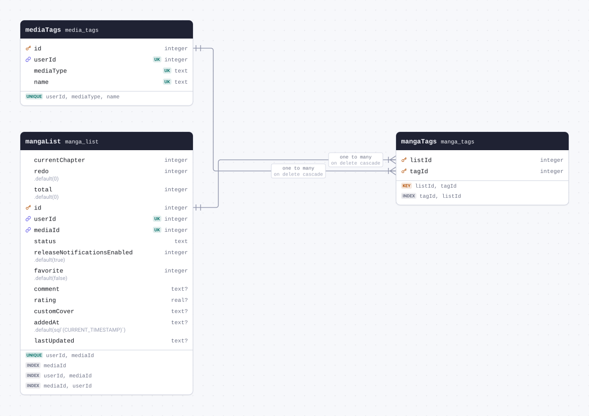

| Column                 | Type      | Constraints                                 | Default | Description |
| ---------------------- | --------- | ------------------------------------------- | ------- | ----------- |
| `id`                   | `integer` | PK NOT NULL                                 |         |             |
| `userId` (`user_id`)   | `integer` | NOT NULL → [user.id](#table-user)           |         |             |
| `mediaId` (`media_id`) | `integer` | NOT NULL → [manga.id](#table-manga)         |         |             |
| `tagId` (`tag_id`)     | `integer` | NOT NULL → [mediaTags.id](#table-mediaTags) |         |             |

#### Definition

```sql
CREATE TABLE `manga_tags` (
	`id` integer PRIMARY KEY,
	`user_id` integer NOT NULL,
	`media_id` integer NOT NULL,
	`tag_id` integer NOT NULL,
	CONSTRAINT `fk_manga_tags_user_id_user_id_fk` FOREIGN KEY (`user_id`) REFERENCES `user`(`id`) ON DELETE CASCADE,
	CONSTRAINT `fk_manga_tags_media_id_manga_id_fk` FOREIGN KEY (`media_id`) REFERENCES `manga`(`id`) ON DELETE CASCADE,
	CONSTRAINT `fk_manga_tags_tag_id_media_tags_id_fk` FOREIGN KEY (`tag_id`) REFERENCES `media_tags`(`id`) ON DELETE CASCADE
);

CREATE UNIQUE INDEX `ux_manga_tags_user_media_tag` ON `manga_tags` (`user_id`,`media_id`,`tag_id`);

CREATE INDEX `ix_manga_tags_user_tag_media` ON `manga_tags` (`user_id`,`tag_id`,`media_id`);
```

#### Indexes

- UNIQUE `userId`, `mediaId`, `tagId`
- INDEX `userId`, `tagId`, `mediaId`

#### References

- `userId` → [user.id](#table-user) (many to one, on delete cascade)
- `mediaId` → [manga.id](#table-manga) (many to one, on delete cascade)
- `tagId` → [mediaTags.id](#table-mediaTags) (many to one, on delete cascade)

<details>
<summary>Queries and their SQL</summary>

**Select**: Every row of mangaTags.

```ts
db.select().from(mangaTags);
```

```sql
select "id", "user_id", "media_id", "tag_id"
from "manga_tags"
```

**Count**: How many rows mangaTags has.

```ts
db.select({ count: count() }).from(mangaTags);
```

```sql
select count(*)
from "manga_tags"
```

**Find many**: The rows of mangaTags, through the relational query API.

```ts
db.query.mangaTags.findMany();
```

```sql
select "d0"."id" as "id", "d0"."user_id" as "userId", "d0"."media_id" as "mediaId", "d0"."tag_id" as "tagId"
from "manga_tags" as "d0"
```

**Find by primary key**: One row of mangaTags, through the relational query API.

```ts
db.query.mangaTags.findFirst({ where: { id: 1 } });
```

```sql
select "d0"."id" as "id", "d0"."user_id" as "userId", "d0"."media_id" as "mediaId", "d0"."tag_id" as "tagId"
from "manga_tags" as "d0"
where "d0"."id" = ?
limit ?
-- params: [1,1]
```

**Insert**: Adds a row to mangaTags, giving the columns that have no default.

```ts
db.insert(mangaTags).values({ id: 1, userId: 1, mediaId: 1, tagId: 1 });
```

```sql
insert into "manga_tags" ("id", "user_id", "media_id", "tag_id")
values (?, ?, ?, ?)
-- params: [1,1,1,1]
```

**Update**: Changes a row of mangaTags, found by its primary key.

```ts
db.update(mangaTags).set({ userId: 1 }).where(eq(mangaTags.id, 1));
```

```sql
update "manga_tags"
set "user_id" = ?
where "manga_tags"."id" = ?
-- params: [1,1]
```

**Delete**: Deletes a row of mangaTags, found by its primary key.

```ts
db.delete(mangaTags).where(eq(mangaTags.id, 1));
```

```sql
delete from "manga_tags"
where "manga_tags"."id" = ?
-- params: [1]
```

</details>

<a id="table-dailyMediadle"></a>

### dailyMediadle

Table `daily_mediadle`.

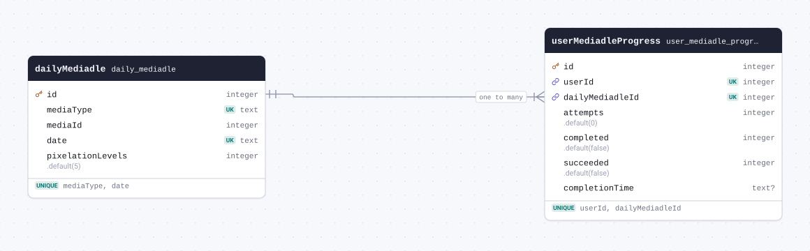

| Column                                   | Type      | Constraints | Default       | Description |
| ---------------------------------------- | --------- | ----------- | ------------- | ----------- |
| `id`                                     | `integer` | PK NOT NULL |               |             |
| `mediaType` (`media_type`)               | `text`    | NOT NULL    |               |             |
| `mediaId` (`media_id`)                   | `integer` | NOT NULL    |               |             |
| `date`                                   | `text`    | NOT NULL    |               |             |
| `pixelationLevels` (`pixelation_levels`) | `integer` | NOT NULL    | `.default(5)` |             |

#### Definition

```sql
CREATE TABLE `daily_mediadle` (
	`id` integer PRIMARY KEY,
	`media_type` text NOT NULL,
	`media_id` integer NOT NULL,
	`date` text NOT NULL,
	`pixelation_levels` integer DEFAULT 5 NOT NULL,
	CONSTRAINT "daily_mediadle_pixelation_levels_positive_check" CHECK("pixelation_levels" > 0)
);

CREATE UNIQUE INDEX `ux_daily_mediadle_type_date` ON `daily_mediadle` (`media_type`,`date`);
```

#### Indexes

- UNIQUE `mediaType`, `date`

#### Referenced by

- `id` → [userMediadleProgress.dailyMediadleId](#table-userMediadleProgress) (one to many)

<details>
<summary>Queries and their SQL</summary>

**Select**: Every row of dailyMediadle.

```ts
db.select().from(dailyMediadle);
```

```sql
select "id", "media_type", "media_id", "date", "pixelation_levels"
from "daily_mediadle"
```

**Count**: How many rows dailyMediadle has.

```ts
db.select({ count: count() }).from(dailyMediadle);
```

```sql
select count(*)
from "daily_mediadle"
```

**Find many**: The rows of dailyMediadle, through the relational query API.

```ts
db.query.dailyMediadle.findMany();
```

```sql
select "d0"."id" as "id", "d0"."media_type" as "mediaType", "d0"."media_id" as "mediaId", "d0"."date" as "date", "d0"."pixelation_levels" as "pixelationLevels"
from "daily_mediadle" as "d0"
```

**Find by primary key**: One row of dailyMediadle, through the relational query API.

```ts
db.query.dailyMediadle.findFirst({ where: { id: 1 } });
```

```sql
select "d0"."id" as "id", "d0"."media_type" as "mediaType", "d0"."media_id" as "mediaId", "d0"."date" as "date", "d0"."pixelation_levels" as "pixelationLevels"
from "daily_mediadle" as "d0"
where "d0"."id" = ?
limit ?
-- params: [1,1]
```

**Insert**: Adds a row to dailyMediadle, giving the columns that have no default.

```ts
db.insert(dailyMediadle).values({ id: 1, mediaType: "mediaType", mediaId: 1, date: "date" });
```

```sql
insert into "daily_mediadle" ("id", "media_type", "media_id", "date", "pixelation_levels")
values (?, ?, ?, ?, ?)
-- params: [1,"mediaType",1,"date",5]
```

**Update**: Changes a row of dailyMediadle, found by its primary key.

```ts
db.update(dailyMediadle).set({ mediaType: "mediaType" }).where(eq(dailyMediadle.id, 1));
```

```sql
update "daily_mediadle"
set "media_type" = ?
where "daily_mediadle"."id" = ?
-- params: ["mediaType",1]
```

**Delete**: Deletes a row of dailyMediadle, found by its primary key.

```ts
db.delete(dailyMediadle).where(eq(dailyMediadle.id, 1));
```

```sql
delete from "daily_mediadle"
where "daily_mediadle"."id" = ?
-- params: [1]
```

</details>

<a id="table-mediadleStats"></a>

### mediadleStats

Table `mediadle_stats`.

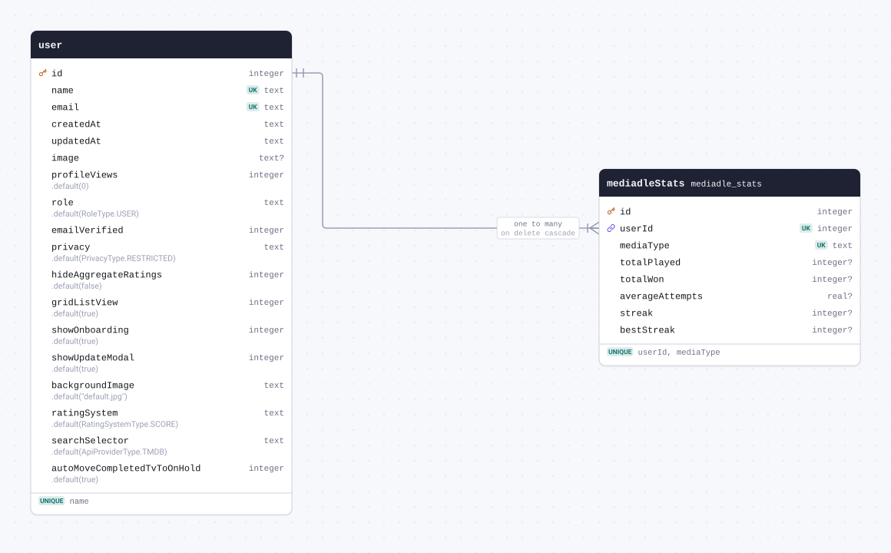

| Column                                 | Type      | Constraints                       | Default | Description |
| -------------------------------------- | --------- | --------------------------------- | ------- | ----------- |
| `id`                                   | `integer` | PK NOT NULL                       |         |             |
| `userId` (`user_id`)                   | `integer` | NOT NULL → [user.id](#table-user) |         |             |
| `mediaType` (`media_type`)             | `text`    | NOT NULL                          |         |             |
| `totalPlayed` (`total_played`)         | `integer` | NULL                              |         |             |
| `totalWon` (`total_won`)               | `integer` | NULL                              |         |             |
| `averageAttempts` (`average_attempts`) | `real`    | NULL                              |         |             |
| `streak`                               | `integer` | NULL                              |         |             |
| `bestStreak` (`best_streak`)           | `integer` | NULL                              |         |             |

#### Definition

```sql
CREATE TABLE `mediadle_stats` (
	`id` integer PRIMARY KEY,
	`user_id` integer NOT NULL,
	`media_type` text NOT NULL,
	`total_played` integer,
	`total_won` integer,
	`average_attempts` real,
	`streak` integer,
	`best_streak` integer,
	CONSTRAINT `fk_mediadle_stats_user_id_user_id_fk` FOREIGN KEY (`user_id`) REFERENCES `user`(`id`) ON DELETE CASCADE,
	CONSTRAINT "mediadle_stats_nonnegative_check" CHECK(
        ("total_played" IS NULL OR "total_played" >= 0)
        AND ("total_won" IS NULL OR "total_won" >= 0)
        AND ("average_attempts" IS NULL OR "average_attempts" >= 0)
        AND ("streak" IS NULL OR "streak" >= 0)
        AND ("best_streak" IS NULL OR "best_streak" >= 0)
    ),
	CONSTRAINT "mediadle_stats_wins_not_above_played_check" CHECK(
        "total_won" IS NULL OR "total_played" IS NULL OR "total_won" <= "total_played"
    )
);

CREATE UNIQUE INDEX `ux_mediadle_stats_user_type` ON `mediadle_stats` (`user_id`,`media_type`);
```

#### Indexes

- UNIQUE `userId`, `mediaType`

#### References

- `userId` → [user.id](#table-user) (many to one, on delete cascade)

<details>
<summary>Queries and their SQL</summary>

**Select**: Every row of mediadleStats.

```ts
db.select().from(mediadleStats);
```

```sql
select "id", "user_id", "media_type", "total_played", "total_won", "average_attempts", "streak", "best_streak"
from "mediadle_stats"
```

**Count**: How many rows mediadleStats has.

```ts
db.select({ count: count() }).from(mediadleStats);
```

```sql
select count(*)
from "mediadle_stats"
```

**Find many**: The rows of mediadleStats, through the relational query API.

```ts
db.query.mediadleStats.findMany();
```

```sql
select "d0"."id" as "id", "d0"."user_id" as "userId", "d0"."media_type" as "mediaType", "d0"."total_played" as "totalPlayed", "d0"."total_won" as "totalWon", "d0"."average_attempts" as "averageAttempts", "d0"."streak" as "streak", "d0"."best_streak" as "bestStreak"
from "mediadle_stats" as "d0"
```

**Find by primary key**: One row of mediadleStats, through the relational query API.

```ts
db.query.mediadleStats.findFirst({ where: { id: 1 } });
```

```sql
select "d0"."id" as "id", "d0"."user_id" as "userId", "d0"."media_type" as "mediaType", "d0"."total_played" as "totalPlayed", "d0"."total_won" as "totalWon", "d0"."average_attempts" as "averageAttempts", "d0"."streak" as "streak", "d0"."best_streak" as "bestStreak"
from "mediadle_stats" as "d0"
where "d0"."id" = ?
limit ?
-- params: [1,1]
```

**Insert**: Adds a row to mediadleStats, giving the columns that have no default.

```ts
db.insert(mediadleStats).values({ id: 1, userId: 1, mediaType: "mediaType" });
```

```sql
insert into "mediadle_stats" ("id", "user_id", "media_type", "total_played", "total_won", "average_attempts", "streak", "best_streak")
values (?, ?, ?, null, null, null, null, null)
-- params: [1,1,"mediaType"]
```

**Update**: Changes a row of mediadleStats, found by its primary key.

```ts
db.update(mediadleStats).set({ userId: 1 }).where(eq(mediadleStats.id, 1));
```

```sql
update "mediadle_stats"
set "user_id" = ?
where "mediadle_stats"."id" = ?
-- params: [1,1]
```

**Delete**: Deletes a row of mediadleStats, found by its primary key.

```ts
db.delete(mediadleStats).where(eq(mediadleStats.id, 1));
```

```sql
delete from "mediadle_stats"
where "mediadle_stats"."id" = ?
-- params: [1]
```

</details>

<a id="table-userMediadleProgress"></a>

### userMediadleProgress

Table `user_mediadle_progress`.

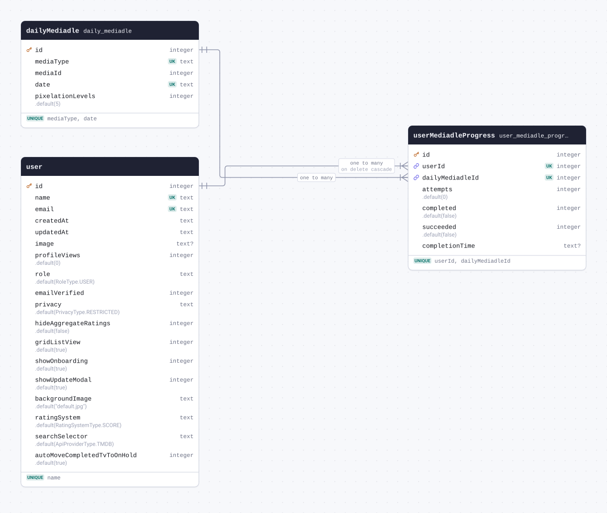

| Column                                  | Type      | Constraints                                         | Default           | Description |
| --------------------------------------- | --------- | --------------------------------------------------- | ----------------- | ----------- |
| `id`                                    | `integer` | PK NOT NULL                                         |                   |             |
| `userId` (`user_id`)                    | `integer` | NOT NULL → [user.id](#table-user)                   |                   |             |
| `dailyMediadleId` (`daily_mediadle_id`) | `integer` | NOT NULL → [dailyMediadle.id](#table-dailyMediadle) |                   |             |
| `attempts`                              | `integer` | NOT NULL                                            | `.default(0)`     |             |
| `completed`                             | `integer` | NOT NULL                                            | `.default(false)` |             |
| `succeeded`                             | `integer` | NOT NULL                                            | `.default(false)` |             |
| `completionTime` (`completion_time`)    | `text`    | NULL                                                |                   |             |

#### Definition

```sql
CREATE TABLE `user_mediadle_progress` (
	`id` integer PRIMARY KEY,
	`user_id` integer NOT NULL,
	`daily_mediadle_id` integer NOT NULL,
	`attempts` integer DEFAULT 0 NOT NULL,
	`completed` integer DEFAULT false NOT NULL,
	`succeeded` integer DEFAULT false NOT NULL,
	`completion_time` text,
	CONSTRAINT `fk_user_mediadle_progress_user_id_user_id_fk` FOREIGN KEY (`user_id`) REFERENCES `user`(`id`) ON DELETE CASCADE,
	CONSTRAINT `fk_user_mediadle_progress_daily_mediadle_id_daily_mediadle_id_fk` FOREIGN KEY (`daily_mediadle_id`) REFERENCES `daily_mediadle`(`id`),
	CONSTRAINT "user_mediadle_progress_attempts_nonnegative_check" CHECK("attempts" >= 0),
	CONSTRAINT "user_mediadle_progress_success_completed_check" CHECK("succeeded" <= "completed")
);

CREATE UNIQUE INDEX `ux_user_mediadle_progress_user_daily` ON `user_mediadle_progress` (`user_id`,`daily_mediadle_id`);
```

#### Indexes

- UNIQUE `userId`, `dailyMediadleId`

#### References

- `userId` → [user.id](#table-user) (many to one, on delete cascade)
- `dailyMediadleId` → [dailyMediadle.id](#table-dailyMediadle) (many to one)

<details>
<summary>Queries and their SQL</summary>

**Select**: Every row of userMediadleProgress.

```ts
db.select().from(userMediadleProgress);
```

```sql
select "id", "user_id", "daily_mediadle_id", "attempts", "completed", "succeeded", "completion_time"
from "user_mediadle_progress"
```

**Count**: How many rows userMediadleProgress has.

```ts
db.select({ count: count() }).from(userMediadleProgress);
```

```sql
select count(*)
from "user_mediadle_progress"
```

**Find many**: The rows of userMediadleProgress, through the relational query API.

```ts
db.query.userMediadleProgress.findMany();
```

```sql
select "d0"."id" as "id", "d0"."user_id" as "userId", "d0"."daily_mediadle_id" as "dailyMediadleId", "d0"."attempts" as "attempts", "d0"."completed" as "completed", "d0"."succeeded" as "succeeded", "d0"."completion_time" as "completionTime"
from "user_mediadle_progress" as "d0"
```

**Find by primary key**: One row of userMediadleProgress, through the relational query API.

```ts
db.query.userMediadleProgress.findFirst({ where: { id: 1 } });
```

```sql
select "d0"."id" as "id", "d0"."user_id" as "userId", "d0"."daily_mediadle_id" as "dailyMediadleId", "d0"."attempts" as "attempts", "d0"."completed" as "completed", "d0"."succeeded" as "succeeded", "d0"."completion_time" as "completionTime"
from "user_mediadle_progress" as "d0"
where "d0"."id" = ?
limit ?
-- params: [1,1]
```

**Insert**: Adds a row to userMediadleProgress, giving the columns that have no default.

```ts
db.insert(userMediadleProgress).values({ id: 1, userId: 1, dailyMediadleId: 1 });
```

```sql
insert into "user_mediadle_progress" ("id", "user_id", "daily_mediadle_id", "attempts", "completed", "succeeded", "completion_time")
values (?, ?, ?, ?, ?, ?, null)
-- params: [1,1,1,0,0,0]
```

**Update**: Changes a row of userMediadleProgress, found by its primary key.

```ts
db.update(userMediadleProgress).set({ userId: 1 }).where(eq(userMediadleProgress.id, 1));
```

```sql
update "user_mediadle_progress"
set "user_id" = ?
where "user_mediadle_progress"."id" = ?
-- params: [1,1]
```

**Delete**: Deletes a row of userMediadleProgress, found by its primary key.

```ts
db.delete(userMediadleProgress).where(eq(userMediadleProgress.id, 1));
```

```sql
delete from "user_mediadle_progress"
where "user_mediadle_progress"."id" = ?
-- params: [1]
```

</details>

<a id="table-whichCameFirstMedia"></a>

### whichCameFirstMedia

Table `which_came_first_media`.

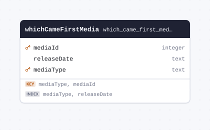

| Column                         | Type      | Constraints | Default | Description |
| ------------------------------ | --------- | ----------- | ------- | ----------- |
| `mediaId` (`media_id`)         | `integer` | PK NOT NULL |         |             |
| `releaseDate` (`release_date`) | `text`    | NOT NULL    |         |             |
| `mediaType` (`media_type`)     | `text`    | PK NOT NULL |         |             |

#### Definition

```sql
CREATE TABLE `which_came_first_media` (
	`media_id` integer NOT NULL,
	`release_date` text NOT NULL,
	`media_type` text NOT NULL,
	CONSTRAINT `which_came_first_media_pk` PRIMARY KEY(`media_type`, `media_id`)
);

CREATE INDEX `ix_wcf_media_type_release_date` ON `which_came_first_media` (`media_type`,`release_date`);
```

#### Indexes

- PRIMARY KEY `mediaType`, `mediaId`
- INDEX `mediaType`, `releaseDate`

<details>
<summary>Queries and their SQL</summary>

**Select**: Every row of whichCameFirstMedia.

```ts
db.select().from(whichCameFirstMedia);
```

```sql
select "media_id", "release_date", "media_type"
from "which_came_first_media"
```

**Count**: How many rows whichCameFirstMedia has.

```ts
db.select({ count: count() }).from(whichCameFirstMedia);
```

```sql
select count(*)
from "which_came_first_media"
```

**Find many**: The rows of whichCameFirstMedia, through the relational query API.

```ts
db.query.whichCameFirstMedia.findMany();
```

```sql
select "d0"."media_id" as "mediaId", "d0"."release_date" as "releaseDate", "d0"."media_type" as "mediaType"
from "which_came_first_media" as "d0"
```

**Find by primary key**: One row of whichCameFirstMedia, through the relational query API.

```ts
db.query.whichCameFirstMedia.findFirst({ where: { mediaId: 1, mediaType: "mediaType" } });
```

```sql
select "d0"."media_id" as "mediaId", "d0"."release_date" as "releaseDate", "d0"."media_type" as "mediaType"
from "which_came_first_media" as "d0"
where (("d0"."media_id" = ?) and ("d0"."media_type" = ?))
limit ?
-- params: [1,"mediaType",1]
```

**Insert**: Adds a row to whichCameFirstMedia, giving the columns that have no default.

```ts
db.insert(whichCameFirstMedia).values({
  mediaId: 1,
  releaseDate: "releaseDate",
  mediaType: "mediaType",
});
```

```sql
insert into "which_came_first_media" ("media_id", "release_date", "media_type")
values (?, ?, ?)
-- params: [1,"releaseDate","mediaType"]
```

**Update**: Changes a row of whichCameFirstMedia, found by its primary key.

```ts
db.update(whichCameFirstMedia)
  .set({ releaseDate: "releaseDate" })
  .where(and(eq(whichCameFirstMedia.mediaId, 1), eq(whichCameFirstMedia.mediaType, "mediaType")));
```

```sql
update "which_came_first_media"
set "release_date" = ?
where (("which_came_first_media"."media_id" = ?) and ("which_came_first_media"."media_type" = ?))
-- params: ["releaseDate",1,"mediaType"]
```

**Delete**: Deletes a row of whichCameFirstMedia, found by its primary key.

```ts
db.delete(whichCameFirstMedia).where(
  and(eq(whichCameFirstMedia.mediaId, 1), eq(whichCameFirstMedia.mediaType, "mediaType")),
);
```

```sql
delete from "which_came_first_media"
where (("which_came_first_media"."media_id" = ?) and ("which_came_first_media"."media_type" = ?))
-- params: [1,"mediaType"]
```

</details>

<a id="table-whichCameFirstRuns"></a>

### whichCameFirstRuns

Table `which_came_first_runs`.

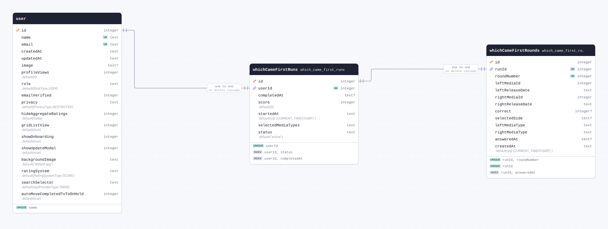

| Column                                        | Type      | Constraints                       | Default                                | Description |
| --------------------------------------------- | --------- | --------------------------------- | -------------------------------------- | ----------- |
| `id`                                          | `integer` | PK NOT NULL                       |                                        |             |
| `userId` (`user_id`)                          | `integer` | NOT NULL → [user.id](#table-user) |                                        |             |
| `completedAt` (`completed_at`)                | `text`    | NULL                              |                                        |             |
| `score`                                       | `integer` | NOT NULL                          | `.default(0)`                          |             |
| `startedAt` (`started_at`)                    | `text`    | NOT NULL                          | ``.default(sql`(CURRENT_TIMESTAMP)`)`` |             |
| `selectedMediaTypes` (`selected_media_types`) | `text`    | NOT NULL                          |                                        |             |
| `status`                                      | `text`    | NOT NULL                          | `.default("active")`                   |             |

#### Definition

```sql
CREATE TABLE `which_came_first_runs` (
	`id` integer PRIMARY KEY,
	`user_id` integer NOT NULL,
	`completed_at` text,
	`score` integer DEFAULT 0 NOT NULL,
	`started_at` text DEFAULT (CURRENT_TIMESTAMP) NOT NULL,
	`selected_media_types` text NOT NULL,
	`status` text DEFAULT 'active' NOT NULL,
	CONSTRAINT `fk_which_came_first_runs_user_id_user_id_fk` FOREIGN KEY (`user_id`) REFERENCES `user`(`id`) ON DELETE CASCADE,
	CONSTRAINT "wcf_runs_score_nonnegative_check" CHECK("score" >= 0),
	CONSTRAINT "wcf_runs_selected_media_types_json_check" CHECK(json_valid("selected_media_types"))
);

CREATE INDEX `ix_wcf_runs_user_status` ON `which_came_first_runs` (`user_id`,`status`);

CREATE INDEX `ix_wcf_runs_user_completed` ON `which_came_first_runs` (`user_id`,`completed_at`);

CREATE UNIQUE INDEX `ux_wcf_runs_user_active` ON `which_came_first_runs` (`user_id`) WHERE "which_came_first_runs"."status" = 'active';
```

#### Indexes

- INDEX `userId`, `status`
- INDEX `userId`, `completedAt`
- UNIQUE `userId`

#### References

- `userId` → [user.id](#table-user) (one to one, on delete cascade)

#### Referenced by

- `id` → [whichCameFirstRounds.runId](#table-whichCameFirstRounds) (one to one, on delete cascade)

<details>
<summary>Queries and their SQL</summary>

**Select**: Every row of whichCameFirstRuns.

```ts
db.select().from(whichCameFirstRuns);
```

```sql
select "id", "user_id", "completed_at", "score", "started_at", "selected_media_types", "status"
from "which_came_first_runs"
```

**Count**: How many rows whichCameFirstRuns has.

```ts
db.select({ count: count() }).from(whichCameFirstRuns);
```

```sql
select count(*)
from "which_came_first_runs"
```

**Find many**: The rows of whichCameFirstRuns, through the relational query API.

```ts
db.query.whichCameFirstRuns.findMany();
```

```sql
select "d0"."id" as "id", "d0"."user_id" as "userId", "d0"."completed_at" as "completedAt", "d0"."score" as "score", "d0"."started_at" as "startedAt", "d0"."selected_media_types" as "selectedMediaTypes", "d0"."status" as "status"
from "which_came_first_runs" as "d0"
```

**Find by primary key**: One row of whichCameFirstRuns, through the relational query API.

```ts
db.query.whichCameFirstRuns.findFirst({ where: { id: 1 } });
```

```sql
select "d0"."id" as "id", "d0"."user_id" as "userId", "d0"."completed_at" as "completedAt", "d0"."score" as "score", "d0"."started_at" as "startedAt", "d0"."selected_media_types" as "selectedMediaTypes", "d0"."status" as "status"
from "which_came_first_runs" as "d0"
where "d0"."id" = ?
limit ?
-- params: [1,1]
```

**Insert**: Adds a row to whichCameFirstRuns, giving the columns that have no default.

```ts
db.insert(whichCameFirstRuns).values({
  id: 1,
  userId: 1,
  selectedMediaTypes: "selectedMediaTypes",
});
```

```sql
insert into "which_came_first_runs" ("id", "user_id", "completed_at", "score", "started_at", "selected_media_types", "status")
values (?, ?, null, ?, (CURRENT_TIMESTAMP), ?, ?)
-- params: [1,1,0,"\"selectedMediaTypes\"","active"]
```

**Update**: Changes a row of whichCameFirstRuns, found by its primary key.

```ts
db.update(whichCameFirstRuns).set({ userId: 1 }).where(eq(whichCameFirstRuns.id, 1));
```

```sql
update "which_came_first_runs"
set "user_id" = ?
where "which_came_first_runs"."id" = ?
-- params: [1,1]
```

**Delete**: Deletes a row of whichCameFirstRuns, found by its primary key.

```ts
db.delete(whichCameFirstRuns).where(eq(whichCameFirstRuns.id, 1));
```

```sql
delete from "which_came_first_runs"
where "which_came_first_runs"."id" = ?
-- params: [1]
```

</details>

<a id="table-whichCameFirstRounds"></a>

### whichCameFirstRounds

Table `which_came_first_rounds`.


| Column                                    | Type      | Constraints                                                   | Default                                | Description |
| ----------------------------------------- | --------- | ------------------------------------------------------------- | -------------------------------------- | ----------- |
| `id`                                      | `integer` | PK NOT NULL                                                   |                                        |             |
| `runId` (`run_id`)                        | `integer` | NOT NULL → [whichCameFirstRuns.id](#table-whichCameFirstRuns) |                                        |             |
| `roundNumber` (`round_number`)            | `integer` | NOT NULL                                                      |                                        |             |
| `leftMediaId` (`left_media_id`)           | `integer` | NOT NULL                                                      |                                        |             |
| `leftReleaseDate` (`left_release_date`)   | `text`    | NOT NULL                                                      |                                        |             |
| `rightMediaId` (`right_media_id`)         | `integer` | NOT NULL                                                      |                                        |             |
| `rightReleaseDate` (`right_release_date`) | `text`    | NOT NULL                                                      |                                        |             |
| `correct`                                 | `integer` | NULL                                                          |                                        |             |
| `selectedSide` (`selected_side`)          | `text`    | NULL                                                          |                                        |             |
| `leftMediaType` (`left_media_type`)       | `text`    | NOT NULL                                                      |                                        |             |
| `rightMediaType` (`right_media_type`)     | `text`    | NOT NULL                                                      |                                        |             |
| `answeredAt` (`answered_at`)              | `text`    | NULL                                                          |                                        |             |
| `createdAt` (`created_at`)                | `text`    | NOT NULL                                                      | ``.default(sql`(CURRENT_TIMESTAMP)`)`` |             |

#### Definition

```sql
CREATE TABLE `which_came_first_rounds` (
	`id` integer PRIMARY KEY,
	`run_id` integer NOT NULL,
	`round_number` integer NOT NULL,
	`left_media_id` integer NOT NULL,
	`left_release_date` text NOT NULL,
	`right_media_id` integer NOT NULL,
	`right_release_date` text NOT NULL,
	`correct` integer,
	`selected_side` text,
	`left_media_type` text NOT NULL,
	`right_media_type` text NOT NULL,
	`answered_at` text,
	`created_at` text DEFAULT (CURRENT_TIMESTAMP) NOT NULL,
	CONSTRAINT `fk_which_came_first_rounds_run_id_which_came_first_runs_id_fk` FOREIGN KEY (`run_id`) REFERENCES `which_came_first_runs`(`id`) ON DELETE CASCADE,
	CONSTRAINT "wcf_round_number_positive_check" CHECK("round_number" >= 1),
	CONSTRAINT "wcf_round_selected_side_check" CHECK("selected_side" IS NULL OR "selected_side" IN ('left', 'right')),
	CONSTRAINT "wcf_round_answer_consistency_check" CHECK(
        ("answered_at" IS NULL AND "selected_side" IS NULL AND "correct" IS NULL)
        OR ("answered_at" IS NOT NULL AND "selected_side" IS NOT NULL AND "correct" IS NOT NULL)
    )
);

CREATE INDEX `ix_wcf_round_run_answered` ON `which_came_first_rounds` (`run_id`,`answered_at`);

CREATE UNIQUE INDEX `uq_wcf_round_run_number` ON `which_came_first_rounds` (`run_id`,`round_number`);

CREATE UNIQUE INDEX `ux_wcf_round_run_unanswered` ON `which_came_first_rounds` (`run_id`) WHERE "which_came_first_rounds"."answered_at" IS NULL;
```

#### Indexes

- INDEX `runId`, `answeredAt`
- UNIQUE `runId`, `roundNumber`
- UNIQUE `runId`

#### References

- `runId` → [whichCameFirstRuns.id](#table-whichCameFirstRuns) (one to one, on delete cascade)

<details>
<summary>Queries and their SQL</summary>

**Select**: Every row of whichCameFirstRounds.

```ts
db.select().from(whichCameFirstRounds);
```

```sql
select "id", "run_id", "round_number", "left_media_id", "left_release_date", "right_media_id", "right_release_date", "correct", "selected_side", "left_media_type", "right_media_type", "answered_at", "created_at"
from "which_came_first_rounds"
```

**Count**: How many rows whichCameFirstRounds has.

```ts
db.select({ count: count() }).from(whichCameFirstRounds);
```

```sql
select count(*)
from "which_came_first_rounds"
```

**Find many**: The rows of whichCameFirstRounds, through the relational query API.

```ts
db.query.whichCameFirstRounds.findMany();
```

```sql
select "d0"."id" as "id", "d0"."run_id" as "runId", "d0"."round_number" as "roundNumber", "d0"."left_media_id" as "leftMediaId", "d0"."left_release_date" as "leftReleaseDate", "d0"."right_media_id" as "rightMediaId", "d0"."right_release_date" as "rightReleaseDate", "d0"."correct" as "correct", "d0"."selected_side" as "selectedSide", "d0"."left_media_type" as "leftMediaType", "d0"."right_media_type" as "rightMediaType", "d0"."answered_at" as "answeredAt", "d0"."created_at" as "createdAt"
from "which_came_first_rounds" as "d0"
```

**Find by primary key**: One row of whichCameFirstRounds, through the relational query API.

```ts
db.query.whichCameFirstRounds.findFirst({ where: { id: 1 } });
```

```sql
select "d0"."id" as "id", "d0"."run_id" as "runId", "d0"."round_number" as "roundNumber", "d0"."left_media_id" as "leftMediaId", "d0"."left_release_date" as "leftReleaseDate", "d0"."right_media_id" as "rightMediaId", "d0"."right_release_date" as "rightReleaseDate", "d0"."correct" as "correct", "d0"."selected_side" as "selectedSide", "d0"."left_media_type" as "leftMediaType", "d0"."right_media_type" as "rightMediaType", "d0"."answered_at" as "answeredAt", "d0"."created_at" as "createdAt"
from "which_came_first_rounds" as "d0"
where "d0"."id" = ?
limit ?
-- params: [1,1]
```

**Insert**: Adds a row to whichCameFirstRounds, giving the columns that have no default.

```ts
db.insert(whichCameFirstRounds).values({
  id: 1,
  runId: 1,
  roundNumber: 1,
  leftMediaId: 1,
  leftReleaseDate: "leftReleaseDate",
  rightMediaId: 1,
  rightReleaseDate: "rightReleaseDate",
  leftMediaType: "leftMediaType",
  rightMediaType: "rightMediaType",
});
```

```sql
insert into "which_came_first_rounds" ("id", "run_id", "round_number", "left_media_id", "left_release_date", "right_media_id", "right_release_date", "correct", "selected_side", "left_media_type", "right_media_type", "answered_at", "created_at")
values (?, ?, ?, ?, ?, ?, ?, null, null, ?, ?, null, (CURRENT_TIMESTAMP))
-- params: [1,1,1,1,"leftReleaseDate",1,"rightReleaseDate","leftMediaType","rightMediaType"]
```

**Update**: Changes a row of whichCameFirstRounds, found by its primary key.

```ts
db.update(whichCameFirstRounds).set({ runId: 1 }).where(eq(whichCameFirstRounds.id, 1));
```

```sql
update "which_came_first_rounds"
set "run_id" = ?
where "which_came_first_rounds"."id" = ?
-- params: [1,1]
```

**Delete**: Deletes a row of whichCameFirstRounds, found by its primary key.

```ts
db.delete(whichCameFirstRounds).where(eq(whichCameFirstRounds.id, 1));
```

```sql
delete from "which_came_first_rounds"
where "which_came_first_rounds"."id" = ?
-- params: [1]
```

</details>

<a id="table-achievement"></a>

### achievement


| Column                     | Type      | Constraints     | Default | Description |
| -------------------------- | --------- | --------------- | ------- | ----------- |
| `id`                       | `integer` | PK NOT NULL     |         |             |
| `name`                     | `text`    | NOT NULL        |         |             |
| `description`              | `text`    | NOT NULL        |         |             |
| `codeName` (`code_name`)   | `text`    | UNIQUE NOT NULL |         |             |
| `mediaType` (`media_type`) | `text`    | NOT NULL        |         |             |
| `value`                    | `text`    | NULL            |         |             |

#### Definition

```sql
CREATE TABLE `achievement` (
	`id` integer PRIMARY KEY,
	`name` text NOT NULL,
	`description` text NOT NULL,
	`code_name` text NOT NULL UNIQUE,
	`media_type` text NOT NULL,
	`value` text
);
```

#### Referenced by

- `id` → [achievementTier.achievementId](#table-achievementTier) (one to many, on delete cascade)

<details>
<summary>Queries and their SQL</summary>

**Select**: Every row of achievement.

```ts
db.select().from(achievement);
```

```sql
select "id", "name", "description", "code_name", "media_type", "value"
from "achievement"
```

**Count**: How many rows achievement has.

```ts
db.select({ count: count() }).from(achievement);
```

```sql
select count(*)
from "achievement"
```

**Find many**: The rows of achievement, through the relational query API.

```ts
db.query.achievement.findMany();
```

```sql
select "d0"."id" as "id", "d0"."name" as "name", "d0"."description" as "description", "d0"."code_name" as "codeName", "d0"."media_type" as "mediaType", "d0"."value" as "value"
from "achievement" as "d0"
```

**Find by primary key**: One row of achievement, through the relational query API.

```ts
db.query.achievement.findFirst({ where: { id: 1 } });
```

```sql
select "d0"."id" as "id", "d0"."name" as "name", "d0"."description" as "description", "d0"."code_name" as "codeName", "d0"."media_type" as "mediaType", "d0"."value" as "value"
from "achievement" as "d0"
where "d0"."id" = ?
limit ?
-- params: [1,1]
```

**Insert**: Adds a row to achievement, giving the columns that have no default.

```ts
db.insert(achievement).values({
  id: 1,
  name: "name",
  description: "description",
  codeName: "codeName",
  mediaType: "mediaType",
});
```

```sql
insert into "achievement" ("id", "name", "description", "code_name", "media_type", "value")
values (?, ?, ?, ?, ?, null)
-- params: [1,"name","description","codeName","mediaType"]
```

**Update**: Changes a row of achievement, found by its primary key.

```ts
db.update(achievement).set({ name: "name" }).where(eq(achievement.id, 1));
```

```sql
update "achievement"
set "name" = ?
where "achievement"."id" = ?
-- params: ["name",1]
```

**Delete**: Deletes a row of achievement, found by its primary key.

```ts
db.delete(achievement).where(eq(achievement.id, 1));
```

```sql
delete from "achievement"
where "achievement"."id" = ?
-- params: [1]
```

</details>

<a id="table-achievementTier"></a>

### achievementTier

Table `achievement_tier`.


| Column                             | Type      | Constraints                                     | Default | Description |
| ---------------------------------- | --------- | ----------------------------------------------- | ------- | ----------- |
| `id`                               | `integer` | PK NOT NULL                                     |         |             |
| `achievementId` (`achievement_id`) | `integer` | NOT NULL → [achievement.id](#table-achievement) |         |             |
| `difficulty`                       | `text`    | NOT NULL                                        |         |             |
| `criteria`                         | `text`    | NOT NULL                                        |         |             |
| `rarity`                           | `real`    | NULL                                            |         |             |

#### Definition

```sql
CREATE TABLE `achievement_tier` (
	`id` integer PRIMARY KEY,
	`achievement_id` integer NOT NULL,
	`difficulty` text NOT NULL,
	`criteria` text NOT NULL,
	`rarity` real,
	CONSTRAINT `fk_achievement_tier_achievement_id_achievement_id_fk` FOREIGN KEY (`achievement_id`) REFERENCES `achievement`(`id`) ON DELETE CASCADE,
	CONSTRAINT "achievement_tier_criteria_json_check" CHECK(json_valid("criteria")),
	CONSTRAINT "achievement_tier_rarity_range_check" CHECK("rarity" IS NULL OR ("rarity" >= 0 AND "rarity" <= 100))
);

CREATE UNIQUE INDEX `achievement_difficulty_unique_idx` ON `achievement_tier` (`achievement_id`,`difficulty`);
```

#### Indexes

- UNIQUE `achievementId`, `difficulty`

#### References

- `achievementId` → [achievement.id](#table-achievement) (many to one, on delete cascade)

#### Referenced by

- `id` → [userAchievement.tierId](#table-userAchievement) (one to many, on delete cascade)

<details>
<summary>Queries and their SQL</summary>

**Select**: Every row of achievementTier.

```ts
db.select().from(achievementTier);
```

```sql
select "id", "achievement_id", "difficulty", "criteria", "rarity"
from "achievement_tier"
```

**Count**: How many rows achievementTier has.

```ts
db.select({ count: count() }).from(achievementTier);
```

```sql
select count(*)
from "achievement_tier"
```

**Find many**: The rows of achievementTier, through the relational query API.

```ts
db.query.achievementTier.findMany();
```

```sql
select "d0"."id" as "id", "d0"."achievement_id" as "achievementId", "d0"."difficulty" as "difficulty", "d0"."criteria" as "criteria", "d0"."rarity" as "rarity"
from "achievement_tier" as "d0"
```

**Find by primary key**: One row of achievementTier, through the relational query API.

```ts
db.query.achievementTier.findFirst({ where: { id: 1 } });
```

```sql
select "d0"."id" as "id", "d0"."achievement_id" as "achievementId", "d0"."difficulty" as "difficulty", "d0"."criteria" as "criteria", "d0"."rarity" as "rarity"
from "achievement_tier" as "d0"
where "d0"."id" = ?
limit ?
-- params: [1,1]
```

**Insert**: Adds a row to achievementTier, giving the columns that have no default.

```ts
db.insert(achievementTier).values({
  id: 1,
  achievementId: 1,
  difficulty: "difficulty",
  criteria: "criteria",
});
```

```sql
insert into "achievement_tier" ("id", "achievement_id", "difficulty", "criteria", "rarity")
values (?, ?, ?, ?, null)
-- params: [1,1,"difficulty","\"criteria\""]
```

**Update**: Changes a row of achievementTier, found by its primary key.

```ts
db.update(achievementTier).set({ achievementId: 1 }).where(eq(achievementTier.id, 1));
```

```sql
update "achievement_tier"
set "achievement_id" = ?
where "achievement_tier"."id" = ?
-- params: [1,1]
```

**Delete**: Deletes a row of achievementTier, found by its primary key.

```ts
db.delete(achievementTier).where(eq(achievementTier.id, 1));
```

```sql
delete from "achievement_tier"
where "achievement_tier"."id" = ?
-- params: [1]
```

</details>

<a id="table-userAchievement"></a>

### userAchievement

Table `user_achievement`.


| Column                                    | Type      | Constraints                                             | Default | Description |
| ----------------------------------------- | --------- | ------------------------------------------------------- | ------- | ----------- |
| `id`                                      | `integer` | PK NOT NULL                                             |         |             |
| `userId` (`user_id`)                      | `integer` | NOT NULL → [user.id](#table-user)                       |         |             |
| `tierId` (`tier_id`)                      | `integer` | NOT NULL → [achievementTier.id](#table-achievementTier) |         |             |
| `progress`                                | `real`    | NULL                                                    |         |             |
| `count`                                   | `real`    | NULL                                                    |         |             |
| `completed`                               | `integer` | NULL                                                    |         |             |
| `completedAt` (`completed_at`)            | `text`    | NULL                                                    |         |             |
| `lastCalculatedAt` (`last_calculated_at`) | `text`    | NULL                                                    |         |             |

#### Definition

```sql
CREATE TABLE `user_achievement` (
	`id` integer PRIMARY KEY,
	`user_id` integer NOT NULL,
	`tier_id` integer NOT NULL,
	`progress` real,
	`count` real,
	`completed` integer,
	`completed_at` text,
	`last_calculated_at` text,
	CONSTRAINT `fk_user_achievement_user_id_user_id_fk` FOREIGN KEY (`user_id`) REFERENCES `user`(`id`) ON DELETE CASCADE,
	CONSTRAINT `fk_user_achievement_tier_id_achievement_tier_id_fk` FOREIGN KEY (`tier_id`) REFERENCES `achievement_tier`(`id`) ON DELETE CASCADE,
	CONSTRAINT "user_achievement_progress_range_check" CHECK("progress" IS NULL OR ("progress" >= 0 AND "progress" <= 100)),
	CONSTRAINT "user_achievement_count_nonnegative_check" CHECK("count" IS NULL OR "count" >= 0),
	CONSTRAINT "user_achievement_completed_check" CHECK("completed" IS NULL OR "completed" IN (0, 1)),
	CONSTRAINT "user_achievement_completed_at_check" CHECK("completed" IS NULL OR "completed" = 0 OR "completed_at" IS NOT NULL)
);

CREATE UNIQUE INDEX `user_achievement_user_tier_unique_idx` ON `user_achievement` (`user_id`,`tier_id`);

CREATE INDEX `ix_user_achievement_tier_user` ON `user_achievement` (`tier_id`,`user_id`);

CREATE INDEX `ix_user_achievement_user_completed_at` ON `user_achievement` (`user_id`,`completed_at`) WHERE "user_achievement"."completed" = 1;

CREATE INDEX `ix_user_achievement_completed_tier` ON `user_achievement` (`tier_id`) WHERE "user_achievement"."completed" = 1;
```

#### Indexes

- UNIQUE `userId`, `tierId`
- INDEX `tierId`, `userId`
- INDEX `userId`, `completedAt`
- INDEX `tierId`

#### References

- `userId` → [user.id](#table-user) (many to one, on delete cascade)
- `tierId` → [achievementTier.id](#table-achievementTier) (many to one, on delete cascade)

<details>
<summary>Queries and their SQL</summary>

**Select**: Every row of userAchievement.

```ts
db.select().from(userAchievement);
```

```sql
select "id", "user_id", "tier_id", "progress", "count", "completed", "completed_at", "last_calculated_at"
from "user_achievement"
```

**Count**: How many rows userAchievement has.

```ts
db.select({ count: count() }).from(userAchievement);
```

```sql
select count(*)
from "user_achievement"
```

**Find many**: The rows of userAchievement, through the relational query API.

```ts
db.query.userAchievement.findMany();
```

```sql
select "d0"."id" as "id", "d0"."user_id" as "userId", "d0"."tier_id" as "tierId", "d0"."progress" as "progress", "d0"."count" as "count", "d0"."completed" as "completed", "d0"."completed_at" as "completedAt", "d0"."last_calculated_at" as "lastCalculatedAt"
from "user_achievement" as "d0"
```

**Find by primary key**: One row of userAchievement, through the relational query API.

```ts
db.query.userAchievement.findFirst({ where: { id: 1 } });
```

```sql
select "d0"."id" as "id", "d0"."user_id" as "userId", "d0"."tier_id" as "tierId", "d0"."progress" as "progress", "d0"."count" as "count", "d0"."completed" as "completed", "d0"."completed_at" as "completedAt", "d0"."last_calculated_at" as "lastCalculatedAt"
from "user_achievement" as "d0"
where "d0"."id" = ?
limit ?
-- params: [1,1]
```

**Insert**: Adds a row to userAchievement, giving the columns that have no default.

```ts
db.insert(userAchievement).values({ id: 1, userId: 1, tierId: 1 });
```

```sql
insert into "user_achievement" ("id", "user_id", "tier_id", "progress", "count", "completed", "completed_at", "last_calculated_at")
values (?, ?, ?, null, null, null, null, null)
-- params: [1,1,1]
```

**Update**: Changes a row of userAchievement, found by its primary key.

```ts
db.update(userAchievement).set({ userId: 1 }).where(eq(userAchievement.id, 1));
```

```sql
update "user_achievement"
set "user_id" = ?
where "user_achievement"."id" = ?
-- params: [1,1]
```

**Delete**: Deletes a row of userAchievement, found by its primary key.

```ts
db.delete(userAchievement).where(eq(userAchievement.id, 1));
```

```sql
delete from "user_achievement"
where "user_achievement"."id" = ?
-- params: [1]
```

</details>

<a id="table-socialNotifications"></a>

### socialNotifications

Table `social_notifications`.


| Column                                    | Type      | Constraints                                         | Default                                | Description |
| ----------------------------------------- | --------- | --------------------------------------------------- | -------------------------------------- | ----------- |
| `id`                                      | `integer` | PK NOT NULL                                         |                                        |             |
| `actorId` (`actor_id`)                    | `integer` | NOT NULL → [user.id](#table-user)                   |                                        |             |
| `userId` (`user_id`)                      | `integer` | NOT NULL → [user.id](#table-user)                   |                                        |             |
| `featureRequestId` (`feature_request_id`) | `integer` | NULL → [featureRequests.id](#table-featureRequests) |                                        |             |
| `type`                                    | `text`    | NOT NULL                                            |                                        |             |
| `read`                                    | `integer` | NOT NULL                                            | `.default(false)`                      |             |
| `createdAt` (`created_at`)                | `text`    | NOT NULL                                            | ``.default(sql`(CURRENT_TIMESTAMP)`)`` |             |

#### Definition

```sql
CREATE TABLE `social_notifications` (
	`id` integer PRIMARY KEY,
	`actor_id` integer NOT NULL,
	`user_id` integer NOT NULL,
	`feature_request_id` integer,
	`type` text NOT NULL,
	`read` integer DEFAULT false NOT NULL,
	`created_at` text DEFAULT (CURRENT_TIMESTAMP) NOT NULL,
	CONSTRAINT `fk_social_notifications_actor_id_user_id_fk` FOREIGN KEY (`actor_id`) REFERENCES `user`(`id`) ON DELETE CASCADE,
	CONSTRAINT `fk_social_notifications_user_id_user_id_fk` FOREIGN KEY (`user_id`) REFERENCES `user`(`id`) ON DELETE CASCADE,
	CONSTRAINT `fk_social_notifications_feature_request_id_feature_requests_id_fk` FOREIGN KEY (`feature_request_id`) REFERENCES `feature_requests`(`id`) ON DELETE CASCADE
);

CREATE UNIQUE INDEX `social_notif_unique` ON `social_notifications` (`user_id`,`actor_id`,`type`) WHERE "social_notifications"."feature_request_id" IS NULL;

CREATE UNIQUE INDEX `social_feature_notif_unique` ON `social_notifications` (`user_id`,`actor_id`,`type`,`feature_request_id`) WHERE "social_notifications"."feature_request_id" IS NOT NULL;

CREATE INDEX `ix_social_notifications_user_created_at` ON `social_notifications` (`user_id`,`created_at`);

CREATE INDEX `ix_social_notifications_user_unread` ON `social_notifications` (`user_id`) WHERE "social_notifications"."read" = 0;
```

#### Indexes

- UNIQUE `userId`, `actorId`, `type`
- UNIQUE `userId`, `actorId`, `type`, `featureRequestId`
- INDEX `userId`, `createdAt`
- INDEX `userId`

#### References

- `actorId` → [user.id](#table-user) (many to one, on delete cascade)
- `userId` → [user.id](#table-user) (many to one, on delete cascade)
- `featureRequestId` → [featureRequests.id](#table-featureRequests) (many to one, on delete cascade)

<details>
<summary>Queries and their SQL</summary>

**Select**: Every row of socialNotifications.

```ts
db.select().from(socialNotifications);
```

```sql
select "id", "actor_id", "user_id", "feature_request_id", "type", "read", "created_at"
from "social_notifications"
```

**Count**: How many rows socialNotifications has.

```ts
db.select({ count: count() }).from(socialNotifications);
```

```sql
select count(*)
from "social_notifications"
```

**Find many**: The rows of socialNotifications, through the relational query API.

```ts
db.query.socialNotifications.findMany();
```

```sql
select "d0"."id" as "id", "d0"."actor_id" as "actorId", "d0"."user_id" as "userId", "d0"."feature_request_id" as "featureRequestId", "d0"."type" as "type", "d0"."read" as "read", "d0"."created_at" as "createdAt"
from "social_notifications" as "d0"
```

**Find by primary key**: One row of socialNotifications, through the relational query API.

```ts
db.query.socialNotifications.findFirst({ where: { id: 1 } });
```

```sql
select "d0"."id" as "id", "d0"."actor_id" as "actorId", "d0"."user_id" as "userId", "d0"."feature_request_id" as "featureRequestId", "d0"."type" as "type", "d0"."read" as "read", "d0"."created_at" as "createdAt"
from "social_notifications" as "d0"
where "d0"."id" = ?
limit ?
-- params: [1,1]
```

**Insert**: Adds a row to socialNotifications, giving the columns that have no default.

```ts
db.insert(socialNotifications).values({ id: 1, actorId: 1, userId: 1, type: "type" });
```

```sql
insert into "social_notifications" ("id", "actor_id", "user_id", "feature_request_id", "type", "read", "created_at")
values (?, ?, ?, null, ?, ?, (CURRENT_TIMESTAMP))
-- params: [1,1,1,"type",0]
```

**Update**: Changes a row of socialNotifications, found by its primary key.

```ts
db.update(socialNotifications).set({ actorId: 1 }).where(eq(socialNotifications.id, 1));
```

```sql
update "social_notifications"
set "actor_id" = ?
where "social_notifications"."id" = ?
-- params: [1,1]
```

**Delete**: Deletes a row of socialNotifications, found by its primary key.

```ts
db.delete(socialNotifications).where(eq(socialNotifications.id, 1));
```

```sql
delete from "social_notifications"
where "social_notifications"."id" = ?
-- params: [1]
```

</details>

<a id="table-mediaNotifications"></a>

### mediaNotifications

Table `media_notifications`.


| Column                                | Type      | Constraints                       | Default                                | Description |
| ------------------------------------- | --------- | --------------------------------- | -------------------------------------- | ----------- |
| `id`                                  | `integer` | PK NOT NULL                       |                                        |             |
| `userId` (`user_id`)                  | `integer` | NOT NULL → [user.id](#table-user) |                                        |             |
| `name`                                | `text`    | NOT NULL                          |                                        |             |
| `mediaId` (`media_id`)                | `integer` | NOT NULL                          |                                        |             |
| `mediaType` (`media_type`)            | `text`    | NOT NULL                          |                                        |             |
| `season`                              | `integer` | NULL                              |                                        |             |
| `episode`                             | `integer` | NULL                              |                                        |             |
| `isSeasonFinale` (`is_season_finale`) | `integer` | NULL                              |                                        |             |
| `releaseDate` (`release_date`)        | `text`    | NULL                              |                                        |             |
| `read`                                | `integer` | NOT NULL                          | `.default(false)`                      |             |
| `createdAt` (`created_at`)            | `text`    | NOT NULL                          | ``.default(sql`(CURRENT_TIMESTAMP)`)`` |             |

#### Definition

```sql
CREATE TABLE `media_notifications` (
	`id` integer PRIMARY KEY,
	`user_id` integer NOT NULL,
	`name` text NOT NULL,
	`media_id` integer NOT NULL,
	`media_type` text NOT NULL,
	`season` integer,
	`episode` integer,
	`is_season_finale` integer,
	`release_date` text,
	`read` integer DEFAULT false NOT NULL,
	`created_at` text DEFAULT (CURRENT_TIMESTAMP) NOT NULL,
	CONSTRAINT `fk_media_notifications_user_id_user_id_fk` FOREIGN KEY (`user_id`) REFERENCES `user`(`id`) ON DELETE CASCADE,
	CONSTRAINT "media_notifications_season_finale_check" CHECK("is_season_finale" IS NULL OR "is_season_finale" IN (0, 1))
);

CREATE INDEX `ix_media_notifications_user_created_at` ON `media_notifications` (`user_id`,`created_at`);

CREATE INDEX `ix_media_notifications_media_user_created_at` ON `media_notifications` (`media_type`,`media_id`,`user_id`,`created_at`);

CREATE INDEX `ix_media_notifications_user_unread` ON `media_notifications` (`user_id`) WHERE "media_notifications"."read" = 0;
```

#### Indexes

- INDEX `userId`, `createdAt`
- INDEX `mediaType`, `mediaId`, `userId`, `createdAt`
- INDEX `userId`

#### References

- `userId` → [user.id](#table-user) (many to one, on delete cascade)

<details>
<summary>Queries and their SQL</summary>

**Select**: Every row of mediaNotifications.

```ts
db.select().from(mediaNotifications);
```

```sql
select "id", "user_id", "name", "media_id", "media_type", "season", "episode", "is_season_finale", "release_date", "read", "created_at"
from "media_notifications"
```

**Count**: How many rows mediaNotifications has.

```ts
db.select({ count: count() }).from(mediaNotifications);
```

```sql
select count(*)
from "media_notifications"
```

**Find many**: The rows of mediaNotifications, through the relational query API.

```ts
db.query.mediaNotifications.findMany();
```

```sql
select "d0"."id" as "id", "d0"."user_id" as "userId", "d0"."name" as "name", "d0"."media_id" as "mediaId", "d0"."media_type" as "mediaType", "d0"."season" as "season", "d0"."episode" as "episode", "d0"."is_season_finale" as "isSeasonFinale", "d0"."release_date" as "releaseDate", "d0"."read" as "read", "d0"."created_at" as "createdAt"
from "media_notifications" as "d0"
```

**Find by primary key**: One row of mediaNotifications, through the relational query API.

```ts
db.query.mediaNotifications.findFirst({ where: { id: 1 } });
```

```sql
select "d0"."id" as "id", "d0"."user_id" as "userId", "d0"."name" as "name", "d0"."media_id" as "mediaId", "d0"."media_type" as "mediaType", "d0"."season" as "season", "d0"."episode" as "episode", "d0"."is_season_finale" as "isSeasonFinale", "d0"."release_date" as "releaseDate", "d0"."read" as "read", "d0"."created_at" as "createdAt"
from "media_notifications" as "d0"
where "d0"."id" = ?
limit ?
-- params: [1,1]
```

**Insert**: Adds a row to mediaNotifications, giving the columns that have no default.

```ts
db.insert(mediaNotifications).values({
  id: 1,
  userId: 1,
  name: "name",
  mediaId: 1,
  mediaType: "mediaType",
});
```

```sql
insert into "media_notifications" ("id", "user_id", "name", "media_id", "media_type", "season", "episode", "is_season_finale", "release_date", "read", "created_at")
values (?, ?, ?, ?, ?, null, null, null, null, ?, (CURRENT_TIMESTAMP))
-- params: [1,1,"name",1,"mediaType",0]
```

**Update**: Changes a row of mediaNotifications, found by its primary key.

```ts
db.update(mediaNotifications).set({ userId: 1 }).where(eq(mediaNotifications.id, 1));
```

```sql
update "media_notifications"
set "user_id" = ?
where "media_notifications"."id" = ?
-- params: [1,1]
```

**Delete**: Deletes a row of mediaNotifications, found by its primary key.

```ts
db.delete(mediaNotifications).where(eq(mediaNotifications.id, 1));
```

```sql
delete from "media_notifications"
where "media_notifications"."id" = ?
-- params: [1]
```

</details>

<a id="table-taskHistory"></a>

### taskHistory

Table `task_history`.


| Column                           | Type      | Constraints                   | Default | Description |
| -------------------------------- | --------- | ----------------------------- | ------- | ----------- |
| `id`                             | `integer` | PK NOT NULL                   |         |             |
| `taskId` (`task_id`)             | `text`    | NOT NULL                      |         |             |
| `userId` (`user_id`)             | `integer` | NULL → [user.id](#table-user) |         |             |
| `status`                         | `text`    | NOT NULL                      |         |             |
| `errorMessage` (`error_message`) | `text`    | NULL                          |         |             |
| `taskName` (`task_name`)         | `text`    | NOT NULL                      |         |             |
| `triggeredBy` (`triggered_by`)   | `text`    | NOT NULL                      |         |             |
| `logs`                           | `text`    | NOT NULL                      |         |             |
| `startedAt` (`started_at`)       | `text`    | NOT NULL                      |         |             |
| `finishedAt` (`finished_at`)     | `text`    | NOT NULL                      |         |             |

#### Definition

```sql
CREATE TABLE `task_history` (
	`id` integer PRIMARY KEY AUTOINCREMENT,
	`task_id` text NOT NULL,
	`user_id` integer,
	`status` text NOT NULL,
	`error_message` text,
	`task_name` text NOT NULL,
	`triggered_by` text NOT NULL,
	`logs` text NOT NULL,
	`started_at` text NOT NULL,
	`finished_at` text NOT NULL,
	CONSTRAINT `fk_task_history_user_id_user_id_fk` FOREIGN KEY (`user_id`) REFERENCES `user`(`id`) ON DELETE CASCADE,
	CONSTRAINT "task_history_logs_json_check" CHECK(json_valid("logs"))
);

CREATE INDEX `ix_task_history_task_id` ON `task_history` (`task_id`);

CREATE INDEX `ix_task_history_status` ON `task_history` (`status`);

CREATE INDEX `ix_task_history_user_id` ON `task_history` (`user_id`);
```

#### Indexes

- INDEX `taskId`
- INDEX `status`
- INDEX `userId`

#### References

- `userId` → [user.id](#table-user) (many to one, on delete cascade)

<details>
<summary>Queries and their SQL</summary>

**Select**: Every row of taskHistory.

```ts
db.select().from(taskHistory);
```

```sql
select "id", "task_id", "user_id", "status", "error_message", "task_name", "triggered_by", "logs", "started_at", "finished_at"
from "task_history"
```

**Count**: How many rows taskHistory has.

```ts
db.select({ count: count() }).from(taskHistory);
```

```sql
select count(*)
from "task_history"
```

**Find many**: The rows of taskHistory, through the relational query API.

```ts
db.query.taskHistory.findMany();
```

```sql
select "d0"."id" as "id", "d0"."task_id" as "taskId", "d0"."user_id" as "userId", "d0"."status" as "status", "d0"."error_message" as "errorMessage", "d0"."task_name" as "taskName", "d0"."triggered_by" as "triggeredBy", "d0"."logs" as "logs", "d0"."started_at" as "startedAt", "d0"."finished_at" as "finishedAt"
from "task_history" as "d0"
```

**Find by primary key**: One row of taskHistory, through the relational query API.

```ts
db.query.taskHistory.findFirst({ where: { id: 1 } });
```

```sql
select "d0"."id" as "id", "d0"."task_id" as "taskId", "d0"."user_id" as "userId", "d0"."status" as "status", "d0"."error_message" as "errorMessage", "d0"."task_name" as "taskName", "d0"."triggered_by" as "triggeredBy", "d0"."logs" as "logs", "d0"."started_at" as "startedAt", "d0"."finished_at" as "finishedAt"
from "task_history" as "d0"
where "d0"."id" = ?
limit ?
-- params: [1,1]
```

**Insert**: Adds a row to taskHistory, giving the columns that have no default.

```ts
db.insert(taskHistory).values({
  id: 1,
  taskId: "taskId",
  status: "status",
  taskName: "taskName",
  triggeredBy: "triggeredBy",
  logs: "logs",
  startedAt: "startedAt",
  finishedAt: "finishedAt",
});
```

```sql
insert into "task_history" ("id", "task_id", "user_id", "status", "error_message", "task_name", "triggered_by", "logs", "started_at", "finished_at")
values (?, ?, null, ?, null, ?, ?, ?, ?, ?)
-- params: [1,"taskId","status","taskName","triggeredBy","\"logs\"","startedAt","finishedAt"]
```

**Update**: Changes a row of taskHistory, found by its primary key.

```ts
db.update(taskHistory).set({ taskId: "taskId" }).where(eq(taskHistory.id, 1));
```

```sql
update "task_history"
set "task_id" = ?
where "task_history"."id" = ?
-- params: ["taskId",1]
```

**Delete**: Deletes a row of taskHistory, found by its primary key.

```ts
db.delete(taskHistory).where(eq(taskHistory.id, 1));
```

```sql
delete from "task_history"
where "task_history"."id" = ?
-- params: [1]
```

</details>

<a id="table-yearRecapRelease"></a>

### yearRecapRelease

Table `year_recap_release`.


| Column                     | Type      | Constraints | Default                                | Description |
| -------------------------- | --------- | ----------- | -------------------------------------- | ----------- |
| `year`                     | `integer` | PK NOT NULL |                                        |             |
| `mode`                     | `text`    | NOT NULL    | `.default("automatic")`                |             |
| `updatedAt` (`updated_at`) | `text`    | NOT NULL    | ``.default(sql`(CURRENT_TIMESTAMP)`)`` |             |

#### Definition

```sql
CREATE TABLE `year_recap_release` (
	`year` integer PRIMARY KEY,
	`mode` text DEFAULT 'automatic' NOT NULL,
	`updated_at` text DEFAULT (CURRENT_TIMESTAMP) NOT NULL,
	CONSTRAINT "year_recap_release_mode_check" CHECK("mode" IN ('automatic', 'enabled', 'disabled'))
);
```

<details>
<summary>Queries and their SQL</summary>

**Select**: Every row of yearRecapRelease.

```ts
db.select().from(yearRecapRelease);
```

```sql
select "year", "mode", "updated_at"
from "year_recap_release"
```

**Count**: How many rows yearRecapRelease has.

```ts
db.select({ count: count() }).from(yearRecapRelease);
```

```sql
select count(*)
from "year_recap_release"
```

**Find many**: The rows of yearRecapRelease, through the relational query API.

```ts
db.query.yearRecapRelease.findMany();
```

```sql
select "d0"."year" as "year", "d0"."mode" as "mode", "d0"."updated_at" as "updatedAt"
from "year_recap_release" as "d0"
```

**Find by primary key**: One row of yearRecapRelease, through the relational query API.

```ts
db.query.yearRecapRelease.findFirst({ where: { year: 1 } });
```

```sql
select "d0"."year" as "year", "d0"."mode" as "mode", "d0"."updated_at" as "updatedAt"
from "year_recap_release" as "d0"
where "d0"."year" = ?
limit ?
-- params: [1,1]
```

**Insert**: Adds a row to yearRecapRelease, giving the columns that have no default.

```ts
db.insert(yearRecapRelease).values({ year: 1 });
```

```sql
insert into "year_recap_release" ("year", "mode", "updated_at")
values (?, ?, (CURRENT_TIMESTAMP))
-- params: [1,"automatic"]
```

**Update**: Changes a row of yearRecapRelease, found by its primary key.

```ts
db.update(yearRecapRelease).set({ mode: "mode" }).where(eq(yearRecapRelease.year, 1));
```

```sql
update "year_recap_release"
set "mode" = ?
where "year_recap_release"."year" = ?
-- params: ["mode",1]
```

**Delete**: Deletes a row of yearRecapRelease, found by its primary key.

```ts
db.delete(yearRecapRelease).where(eq(yearRecapRelease.year, 1));
```

```sql
delete from "year_recap_release"
where "year_recap_release"."year" = ?
-- params: [1]
```

</details>

<a id="table-inactiveAccountDeletion"></a>

### inactiveAccountDeletion

Table `inactive_account_deletion`.


| Column                                          | Type      | Constraints | Default                                | Description |
| ----------------------------------------------- | --------- | ----------- | -------------------------------------- | ----------- |
| `id`                                            | `integer` | PK NOT NULL |                                        |             |
| `deletedAt` (`deleted_at`)                      | `text`    | NULL        |                                        |             |
| `userId` (`user_id`)                            | `integer` | NOT NULL    |                                        |             |
| `username`                                      | `text`    | NOT NULL    |                                        |             |
| `resurrectedAt` (`resurrected_at`)              | `text`    | NULL        |                                        |             |
| `warningSentAt` (`warning_sent_at`)             | `text`    | NULL        |                                        |             |
| `lastEmailError` (`last_email_error`)           | `text`    | NULL        |                                        |             |
| `lastSeenAt` (`last_seen_at`)                   | `text`    | NOT NULL    |                                        |             |
| `warningTokenHash` (`warning_token_hash`)       | `text`    | NULL        |                                        |             |
| `lastEmailAttemptAt` (`last_email_attempt_at`)  | `text`    | NULL        |                                        |             |
| `deletionScheduledAt` (`deletion_scheduled_at`) | `text`    | NOT NULL    |                                        |             |
| `status`                                        | `text`    | NOT NULL    |                                        |             |
| `emailRetryCount` (`email_retry_count`)         | `integer` | NOT NULL    | `.default(0)`                          |             |
| `createdAt` (`created_at`)                      | `text`    | NOT NULL    | ``.default(sql`(CURRENT_TIMESTAMP)`)`` |             |
| `updatedAt` (`updated_at`)                      | `text`    | NOT NULL    | ``.default(sql`(CURRENT_TIMESTAMP)`)`` |             |

#### Definition

```sql
CREATE TABLE `inactive_account_deletion` (
	`id` integer PRIMARY KEY AUTOINCREMENT,
	`deleted_at` text,
	`user_id` integer NOT NULL,
	`username` text NOT NULL,
	`resurrected_at` text,
	`warning_sent_at` text,
	`last_email_error` text,
	`last_seen_at` text NOT NULL,
	`warning_token_hash` text,
	`last_email_attempt_at` text,
	`deletion_scheduled_at` text NOT NULL,
	`status` text NOT NULL,
	`email_retry_count` integer DEFAULT 0 NOT NULL,
	`created_at` text DEFAULT (CURRENT_TIMESTAMP) NOT NULL,
	`updated_at` text DEFAULT (CURRENT_TIMESTAMP) NOT NULL,
	CONSTRAINT "inactive_account_deletion_retry_count_nonnegative_check" CHECK("email_retry_count" >= 0)
);

CREATE INDEX `ix_inactive_account_deletion_user_id` ON `inactive_account_deletion` (`user_id`);

CREATE INDEX `ix_inactive_account_deletion_status` ON `inactive_account_deletion` (`status`);

CREATE INDEX `ix_inactive_account_deletion_deletion_scheduled_at` ON `inactive_account_deletion` (`deletion_scheduled_at`);

CREATE UNIQUE INDEX `ux_inactive_account_deletion_warning_token_hash` ON `inactive_account_deletion` (`warning_token_hash`);
```

#### Indexes

- INDEX `userId`
- INDEX `status`
- INDEX `deletionScheduledAt`
- UNIQUE `warningTokenHash`

<details>
<summary>Queries and their SQL</summary>

**Select**: Every row of inactiveAccountDeletion.

```ts
db.select().from(inactiveAccountDeletion);
```

```sql
select "id", "deleted_at", "user_id", "username", "resurrected_at", "warning_sent_at", "last_email_error", "last_seen_at", "warning_token_hash", "last_email_attempt_at", "deletion_scheduled_at", "status", "email_retry_count", "created_at", "updated_at"
from "inactive_account_deletion"
```

**Count**: How many rows inactiveAccountDeletion has.

```ts
db.select({ count: count() }).from(inactiveAccountDeletion);
```

```sql
select count(*)
from "inactive_account_deletion"
```

**Find many**: The rows of inactiveAccountDeletion, through the relational query API.

```ts
db.query.inactiveAccountDeletion.findMany();
```

```sql
select "d0"."id" as "id", "d0"."deleted_at" as "deletedAt", "d0"."user_id" as "userId", "d0"."username" as "username", "d0"."resurrected_at" as "resurrectedAt", "d0"."warning_sent_at" as "warningSentAt", "d0"."last_email_error" as "lastEmailError", "d0"."last_seen_at" as "lastSeenAt", "d0"."warning_token_hash" as "warningTokenHash", "d0"."last_email_attempt_at" as "lastEmailAttemptAt", "d0"."deletion_scheduled_at" as "deletionScheduledAt", "d0"."status" as "status", "d0"."email_retry_count" as "emailRetryCount", "d0"."created_at" as "createdAt", "d0"."updated_at" as "updatedAt"
from "inactive_account_deletion" as "d0"
```

**Find by primary key**: One row of inactiveAccountDeletion, through the relational query API.

```ts
db.query.inactiveAccountDeletion.findFirst({ where: { id: 1 } });
```

```sql
select "d0"."id" as "id", "d0"."deleted_at" as "deletedAt", "d0"."user_id" as "userId", "d0"."username" as "username", "d0"."resurrected_at" as "resurrectedAt", "d0"."warning_sent_at" as "warningSentAt", "d0"."last_email_error" as "lastEmailError", "d0"."last_seen_at" as "lastSeenAt", "d0"."warning_token_hash" as "warningTokenHash", "d0"."last_email_attempt_at" as "lastEmailAttemptAt", "d0"."deletion_scheduled_at" as "deletionScheduledAt", "d0"."status" as "status", "d0"."email_retry_count" as "emailRetryCount", "d0"."created_at" as "createdAt", "d0"."updated_at" as "updatedAt"
from "inactive_account_deletion" as "d0"
where "d0"."id" = ?
limit ?
-- params: [1,1]
```

**Insert**: Adds a row to inactiveAccountDeletion, giving the columns that have no default.

```ts
db.insert(inactiveAccountDeletion).values({
  id: 1,
  userId: 1,
  username: "username",
  lastSeenAt: "lastSeenAt",
  deletionScheduledAt: "deletionScheduledAt",
  status: "status",
});
```

```sql
insert into "inactive_account_deletion" ("id", "deleted_at", "user_id", "username", "resurrected_at", "warning_sent_at", "last_email_error", "last_seen_at", "warning_token_hash", "last_email_attempt_at", "deletion_scheduled_at", "status", "email_retry_count", "created_at", "updated_at")
values (?, null, ?, ?, null, null, null, ?, null, null, ?, ?, ?, (CURRENT_TIMESTAMP), (CURRENT_TIMESTAMP))
-- params: [1,1,"username","lastSeenAt","deletionScheduledAt","status",0]
```

**Update**: Changes a row of inactiveAccountDeletion, found by its primary key.

```ts
db.update(inactiveAccountDeletion)
  .set({ deletedAt: "deletedAt" })
  .where(eq(inactiveAccountDeletion.id, 1));
```

```sql
update "inactive_account_deletion"
set "deleted_at" = ?
where "inactive_account_deletion"."id" = ?
-- params: ["deletedAt",1]
```

**Delete**: Deletes a row of inactiveAccountDeletion, found by its primary key.

```ts
db.delete(inactiveAccountDeletion).where(eq(inactiveAccountDeletion.id, 1));
```

```sql
delete from "inactive_account_deletion"
where "inactive_account_deletion"."id" = ?
-- params: [1]
```

</details>

<a id="table-mediaRefreshLog"></a>

### mediaRefreshLog

Table `media_refresh_log`.


| Column                         | Type      | Constraints                       | Default                                | Description |
| ------------------------------ | --------- | --------------------------------- | -------------------------------------- | ----------- |
| `id`                           | `integer` | PK NOT NULL                       |                                        |             |
| `userId` (`user_id`)           | `integer` | NOT NULL → [user.id](#table-user) |                                        |             |
| `mediaType` (`media_type`)     | `text`    | NOT NULL                          |                                        |             |
| `apiId` (`api_id`)             | `text`    | NOT NULL                          |                                        |             |
| `refreshedAt` (`refreshed_at`) | `text`    | NOT NULL                          | ``.default(sql`(CURRENT_TIMESTAMP)`)`` |             |

#### Definition

```sql
CREATE TABLE `media_refresh_log` (
	`id` integer PRIMARY KEY AUTOINCREMENT,
	`user_id` integer NOT NULL,
	`media_type` text NOT NULL,
	`api_id` text NOT NULL,
	`refreshed_at` text DEFAULT (CURRENT_TIMESTAMP) NOT NULL,
	CONSTRAINT `fk_media_refresh_log_user_id_user_id_fk` FOREIGN KEY (`user_id`) REFERENCES `user`(`id`) ON DELETE CASCADE
);

CREATE INDEX `ix_media_refresh_log_user_id` ON `media_refresh_log` (`user_id`);

CREATE INDEX `ix_media_refresh_log_refreshed_at` ON `media_refresh_log` (`refreshed_at`);

CREATE INDEX `ix_media_refresh_log_media_type` ON `media_refresh_log` (`media_type`);
```

#### Indexes

- INDEX `userId`
- INDEX `refreshedAt`
- INDEX `mediaType`

#### References

- `userId` → [user.id](#table-user) (many to one, on delete cascade)

<details>
<summary>Queries and their SQL</summary>

**Select**: Every row of mediaRefreshLog.

```ts
db.select().from(mediaRefreshLog);
```

```sql
select "id", "user_id", "media_type", "api_id", "refreshed_at"
from "media_refresh_log"
```

**Count**: How many rows mediaRefreshLog has.

```ts
db.select({ count: count() }).from(mediaRefreshLog);
```

```sql
select count(*)
from "media_refresh_log"
```

**Find many**: The rows of mediaRefreshLog, through the relational query API.

```ts
db.query.mediaRefreshLog.findMany();
```

```sql
select "d0"."id" as "id", "d0"."user_id" as "userId", "d0"."media_type" as "mediaType", "d0"."api_id" as "apiId", "d0"."refreshed_at" as "refreshedAt"
from "media_refresh_log" as "d0"
```

**Find by primary key**: One row of mediaRefreshLog, through the relational query API.

```ts
db.query.mediaRefreshLog.findFirst({ where: { id: 1 } });
```

```sql
select "d0"."id" as "id", "d0"."user_id" as "userId", "d0"."media_type" as "mediaType", "d0"."api_id" as "apiId", "d0"."refreshed_at" as "refreshedAt"
from "media_refresh_log" as "d0"
where "d0"."id" = ?
limit ?
-- params: [1,1]
```

**Insert**: Adds a row to mediaRefreshLog, giving the columns that have no default.

```ts
db.insert(mediaRefreshLog).values({ id: 1, userId: 1, mediaType: "mediaType", apiId: "apiId" });
```

```sql
insert into "media_refresh_log" ("id", "user_id", "media_type", "api_id", "refreshed_at")
values (?, ?, ?, ?, (CURRENT_TIMESTAMP))
-- params: [1,1,"mediaType","apiId"]
```

**Update**: Changes a row of mediaRefreshLog, found by its primary key.

```ts
db.update(mediaRefreshLog).set({ userId: 1 }).where(eq(mediaRefreshLog.id, 1));
```

```sql
update "media_refresh_log"
set "user_id" = ?
where "media_refresh_log"."id" = ?
-- params: [1,1]
```

**Delete**: Deletes a row of mediaRefreshLog, found by its primary key.

```ts
db.delete(mediaRefreshLog).where(eq(mediaRefreshLog.id, 1));
```

```sql
delete from "media_refresh_log"
where "media_refresh_log"."id" = ?
-- params: [1]
```

</details>

<a id="table-apiCallRollup"></a>

### apiCallRollup

Table `api_call_rollup`.


| Column                                  | Type      | Constraints | Default | Description |
| --------------------------------------- | --------- | ----------- | ------- | ----------- |
| `id`                                    | `integer` | PK NOT NULL |         |             |
| `provider`                              | `text`    | NOT NULL    |         |             |
| `bucketStartMs` (`bucket_start_ms`)     | `integer` | NOT NULL    |         |             |
| `bucketStart` (`bucket_start`)          | `text`    | NOT NULL    |         |             |
| `total`                                 | `integer` | NOT NULL    |         |             |
| `errors`                                | `integer` | NOT NULL    |         |             |
| `durationMsTotal` (`duration_ms_total`) | `integer` | NOT NULL    |         |             |
| `maxSecondBurst` (`max_second_burst`)   | `integer` | NOT NULL    |         |             |
| `statusCounts` (`status_counts`)        | `text`    | NOT NULL    |         |             |

#### Definition

```sql
CREATE TABLE `api_call_rollup` (
	`id` integer PRIMARY KEY AUTOINCREMENT,
	`provider` text NOT NULL,
	`bucket_start_ms` integer NOT NULL,
	`bucket_start` text NOT NULL,
	`total` integer NOT NULL,
	`errors` integer NOT NULL,
	`duration_ms_total` integer NOT NULL,
	`max_second_burst` integer NOT NULL,
	`status_counts` text NOT NULL,
	CONSTRAINT "api_call_rollup_counts_nonnegative_check" CHECK(
        "total" >= 0 AND "errors" >= 0 AND "duration_ms_total" >= 0
        AND "max_second_burst" >= 0
    ),
	CONSTRAINT "api_call_rollup_errors_not_above_total_check" CHECK("errors" <= "total"),
	CONSTRAINT "api_call_rollup_status_counts_json_check" CHECK(json_valid("status_counts"))
);

CREATE INDEX `ix_api_call_rollup_provider` ON `api_call_rollup` (`provider`);

CREATE INDEX `ix_api_call_rollup_bucket_start` ON `api_call_rollup` (`bucket_start`);

CREATE UNIQUE INDEX `ux_api_call_rollup_bucket_provider` ON `api_call_rollup` (`bucket_start_ms`,`provider`);
```

#### Indexes

- INDEX `provider`
- INDEX `bucketStart`
- UNIQUE `bucketStartMs`, `provider`

<details>
<summary>Queries and their SQL</summary>

**Select**: Every row of apiCallRollup.

```ts
db.select().from(apiCallRollup);
```

```sql
select "id", "provider", "bucket_start_ms", "bucket_start", "total", "errors", "duration_ms_total", "max_second_burst", "status_counts"
from "api_call_rollup"
```

**Count**: How many rows apiCallRollup has.

```ts
db.select({ count: count() }).from(apiCallRollup);
```

```sql
select count(*)
from "api_call_rollup"
```

**Find many**: The rows of apiCallRollup, through the relational query API.

```ts
db.query.apiCallRollup.findMany();
```

```sql
select "d0"."id" as "id", "d0"."provider" as "provider", "d0"."bucket_start_ms" as "bucketStartMs", "d0"."bucket_start" as "bucketStart", "d0"."total" as "total", "d0"."errors" as "errors", "d0"."duration_ms_total" as "durationMsTotal", "d0"."max_second_burst" as "maxSecondBurst", "d0"."status_counts" as "statusCounts"
from "api_call_rollup" as "d0"
```

**Find by primary key**: One row of apiCallRollup, through the relational query API.

```ts
db.query.apiCallRollup.findFirst({ where: { id: 1 } });
```

```sql
select "d0"."id" as "id", "d0"."provider" as "provider", "d0"."bucket_start_ms" as "bucketStartMs", "d0"."bucket_start" as "bucketStart", "d0"."total" as "total", "d0"."errors" as "errors", "d0"."duration_ms_total" as "durationMsTotal", "d0"."max_second_burst" as "maxSecondBurst", "d0"."status_counts" as "statusCounts"
from "api_call_rollup" as "d0"
where "d0"."id" = ?
limit ?
-- params: [1,1]
```

**Insert**: Adds a row to apiCallRollup, giving the columns that have no default.

```ts
db.insert(apiCallRollup).values({
  id: 1,
  provider: "provider",
  bucketStartMs: 1,
  bucketStart: "bucketStart",
  total: 1,
  errors: 1,
  durationMsTotal: 1,
  maxSecondBurst: 1,
  statusCounts: "statusCounts",
});
```

```sql
insert into "api_call_rollup" ("id", "provider", "bucket_start_ms", "bucket_start", "total", "errors", "duration_ms_total", "max_second_burst", "status_counts")
values (?, ?, ?, ?, ?, ?, ?, ?, ?)
-- params: [1,"provider",1,"bucketStart",1,1,1,1,"\"statusCounts\""]
```

**Update**: Changes a row of apiCallRollup, found by its primary key.

```ts
db.update(apiCallRollup).set({ provider: "provider" }).where(eq(apiCallRollup.id, 1));
```

```sql
update "api_call_rollup"
set "provider" = ?
where "api_call_rollup"."id" = ?
-- params: ["provider",1]
```

**Delete**: Deletes a row of apiCallRollup, found by its primary key.

```ts
db.delete(apiCallRollup).where(eq(apiCallRollup.id, 1));
```

```sql
delete from "api_call_rollup"
where "api_call_rollup"."id" = ?
-- params: [1]
```

</details>

<a id="table-featureRequests"></a>

### featureRequests

Table `feature_requests`.


| Column                           | Type      | Constraints                   | Default                                       | Description |
| -------------------------------- | --------- | ----------------------------- | --------------------------------------------- | ----------- |
| `id`                             | `integer` | PK NOT NULL                   |                                               |             |
| `title`                          | `text`    | NOT NULL                      |                                               |             |
| `adminComment` (`admin_comment`) | `text`    | NULL                          |                                               |             |
| `description`                    | `text`    | NOT NULL                      |                                               |             |
| `status`                         | `text`    | NOT NULL                      | `.default(FeatureStatus.UNDER_CONSIDERATION)` |             |
| `createdBy` (`created_by`)       | `integer` | NULL → [user.id](#table-user) |                                               |             |
| `createdAt` (`created_at`)       | `text`    | NOT NULL                      | ``.default(sql`(CURRENT_TIMESTAMP)`)``        |             |

#### Definition

```sql
CREATE TABLE `feature_requests` (
	`id` integer PRIMARY KEY AUTOINCREMENT,
	`title` text NOT NULL,
	`admin_comment` text,
	`description` text NOT NULL,
	`status` text DEFAULT 'Under Consideration' NOT NULL,
	`created_by` integer,
	`created_at` text DEFAULT (CURRENT_TIMESTAMP) NOT NULL,
	CONSTRAINT `fk_feature_requests_created_by_user_id_fk` FOREIGN KEY (`created_by`) REFERENCES `user`(`id`) ON DELETE SET NULL
);

CREATE INDEX `ix_feature_requests_status` ON `feature_requests` (`status`);

CREATE INDEX `ix_feature_requests_created_at` ON `feature_requests` (`created_at`);
```

#### Indexes

- INDEX `status`
- INDEX `createdAt`

#### References

- `createdBy` → [user.id](#table-user) (many to one, on delete set null)

#### Referenced by

- `id` → [socialNotifications.featureRequestId](#table-socialNotifications) (one to many, on delete cascade)
- `id` → [featureVotes.featureId](#table-featureVotes) (one to many, on delete cascade)

<details>
<summary>Queries and their SQL</summary>

**Select**: Every row of featureRequests.

```ts
db.select().from(featureRequests);
```

```sql
select "id", "title", "admin_comment", "description", "status", "created_by", "created_at"
from "feature_requests"
```

**Count**: How many rows featureRequests has.

```ts
db.select({ count: count() }).from(featureRequests);
```

```sql
select count(*)
from "feature_requests"
```

**Find many**: The rows of featureRequests, through the relational query API.

```ts
db.query.featureRequests.findMany();
```

```sql
select "d0"."id" as "id", "d0"."title" as "title", "d0"."admin_comment" as "adminComment", "d0"."description" as "description", "d0"."status" as "status", "d0"."created_by" as "createdBy", "d0"."created_at" as "createdAt"
from "feature_requests" as "d0"
```

**Find by primary key**: One row of featureRequests, through the relational query API.

```ts
db.query.featureRequests.findFirst({ where: { id: 1 } });
```

```sql
select "d0"."id" as "id", "d0"."title" as "title", "d0"."admin_comment" as "adminComment", "d0"."description" as "description", "d0"."status" as "status", "d0"."created_by" as "createdBy", "d0"."created_at" as "createdAt"
from "feature_requests" as "d0"
where "d0"."id" = ?
limit ?
-- params: [1,1]
```

**Insert**: Adds a row to featureRequests, giving the columns that have no default.

```ts
db.insert(featureRequests).values({ id: 1, title: "title", description: "description" });
```

```sql
insert into "feature_requests" ("id", "title", "admin_comment", "description", "status", "created_by", "created_at")
values (?, ?, null, ?, ?, null, (CURRENT_TIMESTAMP))
-- params: [1,"title","description","Under Consideration"]
```

**Update**: Changes a row of featureRequests, found by its primary key.

```ts
db.update(featureRequests).set({ title: "title" }).where(eq(featureRequests.id, 1));
```

```sql
update "feature_requests"
set "title" = ?
where "feature_requests"."id" = ?
-- params: ["title",1]
```

**Delete**: Deletes a row of featureRequests, found by its primary key.

```ts
db.delete(featureRequests).where(eq(featureRequests.id, 1));
```

```sql
delete from "feature_requests"
where "feature_requests"."id" = ?
-- params: [1]
```

</details>

<a id="table-featureVotes"></a>

### featureVotes

Table `feature_votes`.


| Column                     | Type      | Constraints                                             | Default                                | Description |
| -------------------------- | --------- | ------------------------------------------------------- | -------------------------------------- | ----------- |
| `id`                       | `integer` | PK NOT NULL                                             |                                        |             |
| `userId` (`user_id`)       | `integer` | NOT NULL → [user.id](#table-user)                       |                                        |             |
| `featureId` (`feature_id`) | `integer` | NOT NULL → [featureRequests.id](#table-featureRequests) |                                        |             |
| `createdAt` (`created_at`) | `text`    | NOT NULL                                                | ``.default(sql`(CURRENT_TIMESTAMP)`)`` |             |

#### Definition

```sql
CREATE TABLE `feature_votes` (
	`id` integer PRIMARY KEY AUTOINCREMENT,
	`user_id` integer NOT NULL,
	`feature_id` integer NOT NULL,
	`created_at` text DEFAULT (CURRENT_TIMESTAMP) NOT NULL,
	CONSTRAINT `fk_feature_votes_user_id_user_id_fk` FOREIGN KEY (`user_id`) REFERENCES `user`(`id`) ON DELETE CASCADE,
	CONSTRAINT `fk_feature_votes_feature_id_feature_requests_id_fk` FOREIGN KEY (`feature_id`) REFERENCES `feature_requests`(`id`) ON DELETE CASCADE
);

CREATE INDEX `ix_feature_votes_user_id` ON `feature_votes` (`user_id`);

CREATE UNIQUE INDEX `ux_feature_votes_feature_user` ON `feature_votes` (`feature_id`,`user_id`);
```

#### Indexes

- INDEX `userId`
- UNIQUE `featureId`, `userId`

#### References

- `userId` → [user.id](#table-user) (many to one, on delete cascade)
- `featureId` → [featureRequests.id](#table-featureRequests) (many to one, on delete cascade)

<details>
<summary>Queries and their SQL</summary>

**Select**: Every row of featureVotes.

```ts
db.select().from(featureVotes);
```

```sql
select "id", "user_id", "feature_id", "created_at"
from "feature_votes"
```

**Count**: How many rows featureVotes has.

```ts
db.select({ count: count() }).from(featureVotes);
```

```sql
select count(*)
from "feature_votes"
```

**Find many**: The rows of featureVotes, through the relational query API.

```ts
db.query.featureVotes.findMany();
```

```sql
select "d0"."id" as "id", "d0"."user_id" as "userId", "d0"."feature_id" as "featureId", "d0"."created_at" as "createdAt"
from "feature_votes" as "d0"
```

**Find by primary key**: One row of featureVotes, through the relational query API.

```ts
db.query.featureVotes.findFirst({ where: { id: 1 } });
```

```sql
select "d0"."id" as "id", "d0"."user_id" as "userId", "d0"."feature_id" as "featureId", "d0"."created_at" as "createdAt"
from "feature_votes" as "d0"
where "d0"."id" = ?
limit ?
-- params: [1,1]
```

**Insert**: Adds a row to featureVotes, giving the columns that have no default.

```ts
db.insert(featureVotes).values({ id: 1, userId: 1, featureId: 1 });
```

```sql
insert into "feature_votes" ("id", "user_id", "feature_id", "created_at")
values (?, ?, ?, (CURRENT_TIMESTAMP))
-- params: [1,1,1]
```

**Update**: Changes a row of featureVotes, found by its primary key.

```ts
db.update(featureVotes).set({ userId: 1 }).where(eq(featureVotes.id, 1));
```

```sql
update "feature_votes"
set "user_id" = ?
where "feature_votes"."id" = ?
-- params: [1,1]
```

**Delete**: Deletes a row of featureVotes, found by its primary key.

```ts
db.delete(featureVotes).where(eq(featureVotes.id, 1));
```

```sql
delete from "feature_votes"
where "feature_votes"."id" = ?
-- params: [1]
```

</details>

<a id="table-collections"></a>

### collections


| Column                                 | Type      | Constraints                       | Default                                | Description |
| -------------------------------------- | --------- | --------------------------------- | -------------------------------------- | ----------- |
| `id`                                   | `integer` | PK NOT NULL                       |                                        |             |
| `ownerId` (`owner_id`)                 | `integer` | NOT NULL → [user.id](#table-user) |                                        |             |
| `profilePosition` (`profile_position`) | `integer` | NULL                              |                                        |             |
| `title`                                | `text`    | NOT NULL                          |                                        |             |
| `description`                          | `text`    | NULL                              |                                        |             |
| `viewCount` (`view_count`)             | `integer` | NOT NULL                          | `.default(0)`                          |             |
| `likeCount` (`like_count`)             | `integer` | NOT NULL                          | `.default(0)`                          |             |
| `copiedCount` (`copied_count`)         | `integer` | NOT NULL                          | `.default(0)`                          |             |
| `ordered`                              | `integer` | NOT NULL                          | `.default(false)`                      |             |
| `privacy`                              | `text`    | NOT NULL                          | `.default(PrivacyType.PRIVATE)`        |             |
| `createdAt` (`created_at`)             | `text`    | NOT NULL                          | ``.default(sql`(CURRENT_TIMESTAMP)`)`` |             |
| `updatedAt` (`updated_at`)             | `text`    | NULL                              |                                        |             |

#### Definition

```sql
CREATE TABLE `collections` (
	`id` integer PRIMARY KEY AUTOINCREMENT,
	`owner_id` integer NOT NULL,
	`profile_position` integer,
	`title` text NOT NULL,
	`description` text,
	`view_count` integer DEFAULT 0 NOT NULL,
	`like_count` integer DEFAULT 0 NOT NULL,
	`copied_count` integer DEFAULT 0 NOT NULL,
	`ordered` integer DEFAULT false NOT NULL,
	`privacy` text DEFAULT 'private' NOT NULL,
	`created_at` text DEFAULT (CURRENT_TIMESTAMP) NOT NULL,
	`updated_at` text,
	CONSTRAINT `fk_collections_owner_id_user_id_fk` FOREIGN KEY (`owner_id`) REFERENCES `user`(`id`) ON DELETE CASCADE,
	CONSTRAINT "collections_profile_position_check" CHECK("profile_position" > 0),
	CONSTRAINT "collections_ordered_check" CHECK("ordered" IN (0, 1)),
	CONSTRAINT "collections_counters_nonnegative_check" CHECK("view_count" >= 0 AND "like_count" >= 0 AND "copied_count" >= 0)
);

CREATE INDEX `ix_collections_privacy` ON `collections` (`privacy`);

CREATE INDEX `ix_collections_owner_id` ON `collections` (`owner_id`);

CREATE UNIQUE INDEX `ux_collections_owner_profile_position` ON `collections` (`owner_id`,`profile_position`);
```

#### Indexes

- INDEX `privacy`
- INDEX `ownerId`
- UNIQUE `ownerId`, `profilePosition`

#### References

- `ownerId` → [user.id](#table-user) (many to one, on delete cascade)

#### Referenced by

- `id` → [collectionItems.collectionId](#table-collectionItems) (one to many, on delete cascade)
- `id` → [collectionLikes.collectionId](#table-collectionLikes) (one to many, on delete cascade)

<details>
<summary>Queries and their SQL</summary>

**Select**: Every row of collections.

```ts
db.select().from(collections);
```

```sql
select "id", "owner_id", "profile_position", "title", "description", "view_count", "like_count", "copied_count", "ordered", "privacy", "created_at", "updated_at"
from "collections"
```

**Count**: How many rows collections has.

```ts
db.select({ count: count() }).from(collections);
```

```sql
select count(*)
from "collections"
```

**Find many**: The rows of collections, through the relational query API.

```ts
db.query.collections.findMany();
```

```sql
select "d0"."id" as "id", "d0"."owner_id" as "ownerId", "d0"."profile_position" as "profilePosition", "d0"."title" as "title", "d0"."description" as "description", "d0"."view_count" as "viewCount", "d0"."like_count" as "likeCount", "d0"."copied_count" as "copiedCount", "d0"."ordered" as "ordered", "d0"."privacy" as "privacy", "d0"."created_at" as "createdAt", "d0"."updated_at" as "updatedAt"
from "collections" as "d0"
```

**Find by primary key**: One row of collections, through the relational query API.

```ts
db.query.collections.findFirst({ where: { id: 1 } });
```

```sql
select "d0"."id" as "id", "d0"."owner_id" as "ownerId", "d0"."profile_position" as "profilePosition", "d0"."title" as "title", "d0"."description" as "description", "d0"."view_count" as "viewCount", "d0"."like_count" as "likeCount", "d0"."copied_count" as "copiedCount", "d0"."ordered" as "ordered", "d0"."privacy" as "privacy", "d0"."created_at" as "createdAt", "d0"."updated_at" as "updatedAt"
from "collections" as "d0"
where "d0"."id" = ?
limit ?
-- params: [1,1]
```

**Insert**: Adds a row to collections, giving the columns that have no default.

```ts
db.insert(collections).values({ id: 1, ownerId: 1, title: "title" });
```

```sql
insert into "collections" ("id", "owner_id", "profile_position", "title", "description", "view_count", "like_count", "copied_count", "ordered", "privacy", "created_at", "updated_at")
values (?, ?, null, ?, null, ?, ?, ?, ?, ?, (CURRENT_TIMESTAMP), null)
-- params: [1,1,"title",0,0,0,0,"private"]
```

**Update**: Changes a row of collections, found by its primary key.

```ts
db.update(collections).set({ ownerId: 1 }).where(eq(collections.id, 1));
```

```sql
update "collections"
set "owner_id" = ?
where "collections"."id" = ?
-- params: [1,1]
```

**Delete**: Deletes a row of collections, found by its primary key.

```ts
db.delete(collections).where(eq(collections.id, 1));
```

```sql
delete from "collections"
where "collections"."id" = ?
-- params: [1]
```

</details>

<a id="table-collectionItems"></a>

### collectionItems

Table `collection_items`.


| Column                           | Type      | Constraints                                     | Default                                | Description |
| -------------------------------- | --------- | ----------------------------------------------- | -------------------------------------- | ----------- |
| `id`                             | `integer` | PK NOT NULL                                     |                                        |             |
| `collectionId` (`collection_id`) | `integer` | NOT NULL → [collections.id](#table-collections) |                                        |             |
| `annotation`                     | `text`    | NULL                                            |                                        |             |
| `mediaId` (`media_id`)           | `integer` | NOT NULL                                        |                                        |             |
| `orderIndex` (`order_index`)     | `integer` | NOT NULL                                        |                                        |             |
| `mediaType` (`media_type`)       | `text`    | NOT NULL                                        |                                        |             |
| `createdAt` (`created_at`)       | `text`    | NOT NULL                                        | ``.default(sql`(CURRENT_TIMESTAMP)`)`` |             |

#### Definition

```sql
CREATE TABLE `collection_items` (
	`id` integer PRIMARY KEY AUTOINCREMENT,
	`collection_id` integer NOT NULL,
	`annotation` text,
	`media_id` integer NOT NULL,
	`order_index` integer NOT NULL,
	`media_type` text NOT NULL,
	`created_at` text DEFAULT (CURRENT_TIMESTAMP) NOT NULL,
	CONSTRAINT `fk_collection_items_collection_id_collections_id_fk` FOREIGN KEY (`collection_id`) REFERENCES `collections`(`id`) ON DELETE CASCADE,
	CONSTRAINT "collection_items_order_nonnegative_check" CHECK("order_index" >= 0)
);

CREATE UNIQUE INDEX `ux_collection_items_collection_order` ON `collection_items` (`collection_id`,`order_index`);

CREATE UNIQUE INDEX `ux_collection_items_collection_media` ON `collection_items` (`collection_id`,`media_type`,`media_id`);

CREATE INDEX `ix_collection_items_media_type_media_collection` ON `collection_items` (`media_type`,`media_id`,`collection_id`);
```

#### Indexes

- UNIQUE `collectionId`, `orderIndex`
- UNIQUE `collectionId`, `mediaType`, `mediaId`
- INDEX `mediaType`, `mediaId`, `collectionId`

#### References

- `collectionId` → [collections.id](#table-collections) (many to one, on delete cascade)

<details>
<summary>Queries and their SQL</summary>

**Select**: Every row of collectionItems.

```ts
db.select().from(collectionItems);
```

```sql
select "id", "collection_id", "annotation", "media_id", "order_index", "media_type", "created_at"
from "collection_items"
```

**Count**: How many rows collectionItems has.

```ts
db.select({ count: count() }).from(collectionItems);
```

```sql
select count(*)
from "collection_items"
```

**Find many**: The rows of collectionItems, through the relational query API.

```ts
db.query.collectionItems.findMany();
```

```sql
select "d0"."id" as "id", "d0"."collection_id" as "collectionId", "d0"."annotation" as "annotation", "d0"."media_id" as "mediaId", "d0"."order_index" as "orderIndex", "d0"."media_type" as "mediaType", "d0"."created_at" as "createdAt"
from "collection_items" as "d0"
```

**Find by primary key**: One row of collectionItems, through the relational query API.

```ts
db.query.collectionItems.findFirst({ where: { id: 1 } });
```

```sql
select "d0"."id" as "id", "d0"."collection_id" as "collectionId", "d0"."annotation" as "annotation", "d0"."media_id" as "mediaId", "d0"."order_index" as "orderIndex", "d0"."media_type" as "mediaType", "d0"."created_at" as "createdAt"
from "collection_items" as "d0"
where "d0"."id" = ?
limit ?
-- params: [1,1]
```

**Insert**: Adds a row to collectionItems, giving the columns that have no default.

```ts
db.insert(collectionItems).values({
  id: 1,
  collectionId: 1,
  mediaId: 1,
  orderIndex: 1,
  mediaType: "mediaType",
});
```

```sql
insert into "collection_items" ("id", "collection_id", "annotation", "media_id", "order_index", "media_type", "created_at")
values (?, ?, null, ?, ?, ?, (CURRENT_TIMESTAMP))
-- params: [1,1,1,1,"mediaType"]
```

**Update**: Changes a row of collectionItems, found by its primary key.

```ts
db.update(collectionItems).set({ collectionId: 1 }).where(eq(collectionItems.id, 1));
```

```sql
update "collection_items"
set "collection_id" = ?
where "collection_items"."id" = ?
-- params: [1,1]
```

**Delete**: Deletes a row of collectionItems, found by its primary key.

```ts
db.delete(collectionItems).where(eq(collectionItems.id, 1));
```

```sql
delete from "collection_items"
where "collection_items"."id" = ?
-- params: [1]
```

</details>

<a id="table-collectionLikes"></a>

### collectionLikes

Table `collection_likes`.


| Column                           | Type      | Constraints                                     | Default                                | Description |
| -------------------------------- | --------- | ----------------------------------------------- | -------------------------------------- | ----------- |
| `id`                             | `integer` | PK NOT NULL                                     |                                        |             |
| `userId` (`user_id`)             | `integer` | NOT NULL → [user.id](#table-user)               |                                        |             |
| `collectionId` (`collection_id`) | `integer` | NOT NULL → [collections.id](#table-collections) |                                        |             |
| `createdAt` (`created_at`)       | `text`    | NOT NULL                                        | ``.default(sql`(CURRENT_TIMESTAMP)`)`` |             |

#### Definition

```sql
CREATE TABLE `collection_likes` (
	`id` integer PRIMARY KEY AUTOINCREMENT,
	`user_id` integer NOT NULL,
	`collection_id` integer NOT NULL,
	`created_at` text DEFAULT (CURRENT_TIMESTAMP) NOT NULL,
	CONSTRAINT `fk_collection_likes_user_id_user_id_fk` FOREIGN KEY (`user_id`) REFERENCES `user`(`id`) ON DELETE CASCADE,
	CONSTRAINT `fk_collection_likes_collection_id_collections_id_fk` FOREIGN KEY (`collection_id`) REFERENCES `collections`(`id`) ON DELETE CASCADE
);

CREATE INDEX `ix_collection_likes_user_id` ON `collection_likes` (`user_id`);

CREATE UNIQUE INDEX `ux_collection_likes_collection_user` ON `collection_likes` (`collection_id`,`user_id`);
```

#### Indexes

- INDEX `userId`
- UNIQUE `collectionId`, `userId`

#### References

- `userId` → [user.id](#table-user) (many to one, on delete cascade)
- `collectionId` → [collections.id](#table-collections) (many to one, on delete cascade)

<details>
<summary>Queries and their SQL</summary>

**Select**: Every row of collectionLikes.

```ts
db.select().from(collectionLikes);
```

```sql
select "id", "user_id", "collection_id", "created_at"
from "collection_likes"
```

**Count**: How many rows collectionLikes has.

```ts
db.select({ count: count() }).from(collectionLikes);
```

```sql
select count(*)
from "collection_likes"
```

**Find many**: The rows of collectionLikes, through the relational query API.

```ts
db.query.collectionLikes.findMany();
```

```sql
select "d0"."id" as "id", "d0"."user_id" as "userId", "d0"."collection_id" as "collectionId", "d0"."created_at" as "createdAt"
from "collection_likes" as "d0"
```

**Find by primary key**: One row of collectionLikes, through the relational query API.

```ts
db.query.collectionLikes.findFirst({ where: { id: 1 } });
```

```sql
select "d0"."id" as "id", "d0"."user_id" as "userId", "d0"."collection_id" as "collectionId", "d0"."created_at" as "createdAt"
from "collection_likes" as "d0"
where "d0"."id" = ?
limit ?
-- params: [1,1]
```

**Insert**: Adds a row to collectionLikes, giving the columns that have no default.

```ts
db.insert(collectionLikes).values({ id: 1, userId: 1, collectionId: 1 });
```

```sql
insert into "collection_likes" ("id", "user_id", "collection_id", "created_at")
values (?, ?, ?, (CURRENT_TIMESTAMP))
-- params: [1,1,1]
```

**Update**: Changes a row of collectionLikes, found by its primary key.

```ts
db.update(collectionLikes).set({ userId: 1 }).where(eq(collectionLikes.id, 1));
```

```sql
update "collection_likes"
set "user_id" = ?
where "collection_likes"."id" = ?
-- params: [1,1]
```

**Delete**: Deletes a row of collectionLikes, found by its primary key.

```ts
db.delete(collectionLikes).where(eq(collectionLikes.id, 1));
```

```sql
delete from "collection_likes"
where "collection_likes"."id" = ?
-- params: [1]
```

</details>

<a id="table-importJobs"></a>

### importJobs

Table `import_jobs`.


| Column                               | Type      | Constraints                       | Default                                | Description |
| ------------------------------------ | --------- | --------------------------------- | -------------------------------------- | ----------- |
| `id`                                 | `integer` | PK NOT NULL                       |                                        |             |
| `userId` (`user_id`)                 | `integer` | NOT NULL → [user.id](#table-user) |                                        |             |
| `error`                              | `text`    | NULL                              |                                        |             |
| `source`                             | `text`    | NOT NULL                          |                                        |             |
| `totalCount` (`total_count`)         | `integer` | NOT NULL                          | `.default(0)`                          |             |
| `failedCount` (`failed_count`)       | `integer` | NOT NULL                          | `.default(0)`                          |             |
| `skippedCount` (`skipped_count`)     | `integer` | NOT NULL                          | `.default(0)`                          |             |
| `completedCount` (`completed_count`) | `integer` | NOT NULL                          | `.default(0)`                          |             |
| `processedCount` (`processed_count`) | `integer` | NOT NULL                          | `.default(0)`                          |             |
| `status`                             | `text`    | NOT NULL                          | `.default(ImportJobStatus.PARSING)`    |             |
| `createdAt` (`created_at`)           | `text`    | NOT NULL                          | ``.default(sql`(CURRENT_TIMESTAMP)`)`` |             |
| `updatedAt` (`updated_at`)           | `text`    | NOT NULL                          | ``.default(sql`(CURRENT_TIMESTAMP)`)`` |             |
| `startedAt` (`started_at`)           | `text`    | NULL                              |                                        |             |
| `finishedAt` (`finished_at`)         | `text`    | NULL                              |                                        |             |
| `nextAttemptAt` (`next_attempt_at`)  | `text`    | NULL                              |                                        |             |

#### Definition

```sql
CREATE TABLE `import_jobs` (
	`id` integer PRIMARY KEY AUTOINCREMENT,
	`user_id` integer NOT NULL,
	`error` text,
	`source` text NOT NULL,
	`total_count` integer DEFAULT 0 NOT NULL,
	`failed_count` integer DEFAULT 0 NOT NULL,
	`skipped_count` integer DEFAULT 0 NOT NULL,
	`completed_count` integer DEFAULT 0 NOT NULL,
	`processed_count` integer DEFAULT 0 NOT NULL,
	`status` text DEFAULT 'parsing' NOT NULL,
	`created_at` text DEFAULT (CURRENT_TIMESTAMP) NOT NULL,
	`updated_at` text DEFAULT (CURRENT_TIMESTAMP) NOT NULL,
	`started_at` text,
	`finished_at` text,
	`next_attempt_at` text,
	CONSTRAINT `fk_import_jobs_user_id_user_id_fk` FOREIGN KEY (`user_id`) REFERENCES `user`(`id`) ON DELETE CASCADE,
	CONSTRAINT "import_jobs_counts_nonnegative_check" CHECK(
        "total_count" >= 0 AND "failed_count" >= 0 AND "skipped_count" >= 0
        AND "completed_count" >= 0 AND "processed_count" >= 0
    )
);

CREATE INDEX `ix_import_jobs_user_created_at` ON `import_jobs` (`user_id`,`created_at`);

CREATE INDEX `ix_import_jobs_status_created_at` ON `import_jobs` (`status`,`created_at`);

CREATE INDEX `ix_import_jobs_status_next_attempt_at` ON `import_jobs` (`status`,`next_attempt_at`);

CREATE UNIQUE INDEX `ux_import_jobs_user_active` ON `import_jobs` (`user_id`) WHERE "import_jobs"."status" IN ('parsing', 'queued', 'processing');
```

#### Indexes

- INDEX `userId`, `createdAt`
- INDEX `status`, `createdAt`
- INDEX `status`, `nextAttemptAt`
- UNIQUE `userId`

#### References

- `userId` → [user.id](#table-user) (one to one, on delete cascade)

#### Referenced by

- `id` → [importItems.jobId](#table-importItems) (one to many, on delete cascade)

<details>
<summary>Queries and their SQL</summary>

**Select**: Every row of importJobs.

```ts
db.select().from(importJobs);
```

```sql
select "id", "user_id", "error", "source", "total_count", "failed_count", "skipped_count", "completed_count", "processed_count", "status", "created_at", "updated_at", "started_at", "finished_at", "next_attempt_at"
from "import_jobs"
```

**Count**: How many rows importJobs has.

```ts
db.select({ count: count() }).from(importJobs);
```

```sql
select count(*)
from "import_jobs"
```

**Find many**: The rows of importJobs, through the relational query API.

```ts
db.query.importJobs.findMany();
```

```sql
select "d0"."id" as "id", "d0"."user_id" as "userId", "d0"."error" as "error", "d0"."source" as "source", "d0"."total_count" as "totalCount", "d0"."failed_count" as "failedCount", "d0"."skipped_count" as "skippedCount", "d0"."completed_count" as "completedCount", "d0"."processed_count" as "processedCount", "d0"."status" as "status", "d0"."created_at" as "createdAt", "d0"."updated_at" as "updatedAt", "d0"."started_at" as "startedAt", "d0"."finished_at" as "finishedAt", "d0"."next_attempt_at" as "nextAttemptAt"
from "import_jobs" as "d0"
```

**Find by primary key**: One row of importJobs, through the relational query API.

```ts
db.query.importJobs.findFirst({ where: { id: 1 } });
```

```sql
select "d0"."id" as "id", "d0"."user_id" as "userId", "d0"."error" as "error", "d0"."source" as "source", "d0"."total_count" as "totalCount", "d0"."failed_count" as "failedCount", "d0"."skipped_count" as "skippedCount", "d0"."completed_count" as "completedCount", "d0"."processed_count" as "processedCount", "d0"."status" as "status", "d0"."created_at" as "createdAt", "d0"."updated_at" as "updatedAt", "d0"."started_at" as "startedAt", "d0"."finished_at" as "finishedAt", "d0"."next_attempt_at" as "nextAttemptAt"
from "import_jobs" as "d0"
where "d0"."id" = ?
limit ?
-- params: [1,1]
```

**Insert**: Adds a row to importJobs, giving the columns that have no default.

```ts
db.insert(importJobs).values({ id: 1, userId: 1, source: "source" });
```

```sql
insert into "import_jobs" ("id", "user_id", "error", "source", "total_count", "failed_count", "skipped_count", "completed_count", "processed_count", "status", "created_at", "updated_at", "started_at", "finished_at", "next_attempt_at")
values (?, ?, null, ?, ?, ?, ?, ?, ?, ?, (CURRENT_TIMESTAMP), (CURRENT_TIMESTAMP), null, null, null)
-- params: [1,1,"source",0,0,0,0,0,"parsing"]
```

**Update**: Changes a row of importJobs, found by its primary key.

```ts
db.update(importJobs).set({ userId: 1 }).where(eq(importJobs.id, 1));
```

```sql
update "import_jobs"
set "user_id" = ?
where "import_jobs"."id" = ?
-- params: [1,1]
```

**Delete**: Deletes a row of importJobs, found by its primary key.

```ts
db.delete(importJobs).where(eq(importJobs.id, 1));
```

```sql
delete from "import_jobs"
where "import_jobs"."id" = ?
-- params: [1]
```

</details>

<a id="table-importItems"></a>

### importItems

Table `import_items`.


| Column                                      | Type      | Constraints                                   | Default                                | Description |
| ------------------------------------------- | --------- | --------------------------------------------- | -------------------------------------- | ----------- |
| `id`                                        | `integer` | PK NOT NULL                                   |                                        |             |
| `jobId` (`job_id`)                          | `integer` | NOT NULL → [importJobs.id](#table-importJobs) |                                        |             |
| `name`                                      | `text`    | NULL                                          |                                        |             |
| `releaseDate` (`release_date`)              | `text`    | NULL                                          |                                        |             |
| `statusReason` (`status_reason`)            | `text`    | NULL                                          |                                        |             |
| `externalApiId` (`external_api_id`)         | `text`    | NULL                                          |                                        |             |
| `rowNumber` (`row_number`)                  | `integer` | NOT NULL                                      |                                        |             |
| `matchedMediaId` (`matched_media_id`)       | `integer` | NULL                                          |                                        |             |
| `mediaType` (`media_type`)                  | `text`    | NULL                                          |                                        |             |
| `payload` (`payload_json`)                  | `text`    | NOT NULL                                      |                                        |             |
| `externalApiSource` (`external_api_source`) | `text`    | NULL                                          |                                        |             |
| `status`                                    | `text`    | NOT NULL                                      | `.default(ImportItemStatus.QUEUED)`    |             |
| `createdAt` (`created_at`)                  | `text`    | NOT NULL                                      | ``.default(sql`(CURRENT_TIMESTAMP)`)`` |             |
| `updatedAt` (`updated_at`)                  | `text`    | NOT NULL                                      | ``.default(sql`(CURRENT_TIMESTAMP)`)`` |             |

#### Definition

```sql
CREATE TABLE `import_items` (
	`id` integer PRIMARY KEY AUTOINCREMENT,
	`job_id` integer NOT NULL,
	`name` text,
	`release_date` text,
	`status_reason` text,
	`external_api_id` text,
	`row_number` integer NOT NULL,
	`matched_media_id` integer,
	`media_type` text,
	`payload_json` text NOT NULL,
	`external_api_source` text,
	`status` text DEFAULT 'queued' NOT NULL,
	`created_at` text DEFAULT (CURRENT_TIMESTAMP) NOT NULL,
	`updated_at` text DEFAULT (CURRENT_TIMESTAMP) NOT NULL,
	CONSTRAINT `fk_import_items_job_id_import_jobs_id_fk` FOREIGN KEY (`job_id`) REFERENCES `import_jobs`(`id`) ON DELETE CASCADE,
	CONSTRAINT "import_items_row_positive_check" CHECK("row_number" >= 1),
	CONSTRAINT "import_items_payload_json_check" CHECK(json_valid("payload_json"))
);

CREATE INDEX `ix_import_items_job_status_media_type` ON `import_items` (`job_id`,`status`,`media_type`);

CREATE UNIQUE INDEX `ux_import_items_job_row` ON `import_items` (`job_id`,`row_number`);
```

#### Indexes

- INDEX `jobId`, `status`, `mediaType`
- UNIQUE `jobId`, `rowNumber`

#### References

- `jobId` → [importJobs.id](#table-importJobs) (many to one, on delete cascade)

<details>
<summary>Queries and their SQL</summary>

**Select**: Every row of importItems.

```ts
db.select().from(importItems);
```

```sql
select "id", "job_id", "name", "release_date", "status_reason", "external_api_id", "row_number", "matched_media_id", "media_type", "payload_json", "external_api_source", "status", "created_at", "updated_at"
from "import_items"
```

**Count**: How many rows importItems has.

```ts
db.select({ count: count() }).from(importItems);
```

```sql
select count(*)
from "import_items"
```

**Find many**: The rows of importItems, through the relational query API.

```ts
db.query.importItems.findMany();
```

```sql
select "d0"."id" as "id", "d0"."job_id" as "jobId", "d0"."name" as "name", "d0"."release_date" as "releaseDate", "d0"."status_reason" as "statusReason", "d0"."external_api_id" as "externalApiId", "d0"."row_number" as "rowNumber", "d0"."matched_media_id" as "matchedMediaId", "d0"."media_type" as "mediaType", "d0"."payload_json" as "payload", "d0"."external_api_source" as "externalApiSource", "d0"."status" as "status", "d0"."created_at" as "createdAt", "d0"."updated_at" as "updatedAt"
from "import_items" as "d0"
```

**Find by primary key**: One row of importItems, through the relational query API.

```ts
db.query.importItems.findFirst({ where: { id: 1 } });
```

```sql
select "d0"."id" as "id", "d0"."job_id" as "jobId", "d0"."name" as "name", "d0"."release_date" as "releaseDate", "d0"."status_reason" as "statusReason", "d0"."external_api_id" as "externalApiId", "d0"."row_number" as "rowNumber", "d0"."matched_media_id" as "matchedMediaId", "d0"."media_type" as "mediaType", "d0"."payload_json" as "payload", "d0"."external_api_source" as "externalApiSource", "d0"."status" as "status", "d0"."created_at" as "createdAt", "d0"."updated_at" as "updatedAt"
from "import_items" as "d0"
where "d0"."id" = ?
limit ?
-- params: [1,1]
```

**Insert**: Adds a row to importItems, giving the columns that have no default.

```ts
db.insert(importItems).values({ id: 1, jobId: 1, rowNumber: 1, payload: "payload" });
```

```sql
insert into "import_items" ("id", "job_id", "name", "release_date", "status_reason", "external_api_id", "row_number", "matched_media_id", "media_type", "payload_json", "external_api_source", "status", "created_at", "updated_at")
values (?, ?, null, null, null, null, ?, null, null, ?, null, ?, (CURRENT_TIMESTAMP), (CURRENT_TIMESTAMP))
-- params: [1,1,1,"\"payload\"","queued"]
```

**Update**: Changes a row of importItems, found by its primary key.

```ts
db.update(importItems).set({ jobId: 1 }).where(eq(importItems.id, 1));
```

```sql
update "import_items"
set "job_id" = ?
where "import_items"."id" = ?
-- params: [1,1]
```

**Delete**: Deletes a row of importItems, found by its primary key.

```ts
db.delete(importItems).where(eq(importItems.id, 1));
```

```sql
delete from "import_items"
where "import_items"."id" = ?
-- params: [1]
```

</details>

<a id="table-dynamicLists"></a>

### dynamicLists

Table `smart_views`. Keep the existing SQLite table and constraints so renaming the feature preserves saved data.


| Column                                 | Type      | Constraints                       | Default                                | Description |
| -------------------------------------- | --------- | --------------------------------- | -------------------------------------- | ----------- |
| `id`                                   | `integer` | PK NOT NULL                       |                                        |             |
| `userId` (`user_id`)                   | `integer` | NOT NULL → [user.id](#table-user) |                                        |             |
| `profilePosition` (`profile_position`) | `integer` | NULL                              |                                        |             |
| `spec`                                 | `text`    | NOT NULL                          |                                        |             |
| `createdAt` (`created_at`)             | `text`    | NOT NULL                          | ``.default(sql`(CURRENT_TIMESTAMP)`)`` |             |
| `updatedAt` (`updated_at`)             | `text`    | NOT NULL                          | ``.default(sql`(CURRENT_TIMESTAMP)`)`` |             |

#### Definition

```sql
CREATE TABLE `smart_views` (
	`id` integer PRIMARY KEY AUTOINCREMENT,
	`user_id` integer NOT NULL,
	`profile_position` integer,
	`spec` text NOT NULL,
	`created_at` text DEFAULT (CURRENT_TIMESTAMP) NOT NULL,
	`updated_at` text DEFAULT (CURRENT_TIMESTAMP) NOT NULL,
	CONSTRAINT `fk_smart_views_user_id_user_id_fk` FOREIGN KEY (`user_id`) REFERENCES `user`(`id`) ON DELETE CASCADE,
	CONSTRAINT "smart_views_spec_json_check" CHECK(json_valid("spec")),
	CONSTRAINT "smart_views_profile_position_check" CHECK("profile_position" > 0)
);

CREATE INDEX `ix_smart_views_user_id` ON `smart_views` (`user_id`);

CREATE UNIQUE INDEX `ux_smart_views_user_profile_position` ON `smart_views` (`user_id`,`profile_position`);
```

#### Indexes

- INDEX `userId`
- UNIQUE `userId`, `profilePosition`

#### References

- `userId` → [user.id](#table-user) (many to one, on delete cascade)

<details>
<summary>Queries and their SQL</summary>

**Select**: Every row of dynamicLists.

```ts
db.select().from(dynamicLists);
```

```sql
select "id", "user_id", "profile_position", "spec", "created_at", "updated_at"
from "smart_views"
```

**Count**: How many rows dynamicLists has.

```ts
db.select({ count: count() }).from(dynamicLists);
```

```sql
select count(*)
from "smart_views"
```

**Find many**: The rows of dynamicLists, through the relational query API.

```ts
db.query.dynamicLists.findMany();
```

```sql
select "d0"."id" as "id", "d0"."user_id" as "userId", "d0"."profile_position" as "profilePosition", "d0"."spec" as "spec", "d0"."created_at" as "createdAt", "d0"."updated_at" as "updatedAt"
from "smart_views" as "d0"
```

**Find by primary key**: One row of dynamicLists, through the relational query API.

```ts
db.query.dynamicLists.findFirst({ where: { id: 1 } });
```

```sql
select "d0"."id" as "id", "d0"."user_id" as "userId", "d0"."profile_position" as "profilePosition", "d0"."spec" as "spec", "d0"."created_at" as "createdAt", "d0"."updated_at" as "updatedAt"
from "smart_views" as "d0"
where "d0"."id" = ?
limit ?
-- params: [1,1]
```

**Insert**: Adds a row to dynamicLists, giving the columns that have no default.

```ts
db.insert(dynamicLists).values({ id: 1, userId: 1, spec: "spec" });
```

```sql
insert into "smart_views" ("id", "user_id", "profile_position", "spec", "created_at", "updated_at")
values (?, ?, null, ?, (CURRENT_TIMESTAMP), (CURRENT_TIMESTAMP))
-- params: [1,1,"\"spec\""]
```

**Update**: Changes a row of dynamicLists, found by its primary key.

```ts
db.update(dynamicLists).set({ userId: 1 }).where(eq(dynamicLists.id, 1));
```

```sql
update "smart_views"
set "user_id" = ?
where "smart_views"."id" = ?
-- params: [1,1]
```

**Delete**: Deletes a row of dynamicLists, found by its primary key.

```ts
db.delete(dynamicLists).where(eq(dynamicLists.id, 1));
```

```sql
delete from "smart_views"
where "smart_views"."id" = ?
-- params: [1]
```

</details>

<a id="table-mediaTags"></a>

### mediaTags

Table `media_tags`.


| Column                     | Type      | Constraints                       | Default | Description |
| -------------------------- | --------- | --------------------------------- | ------- | ----------- |
| `id`                       | `integer` | PK NOT NULL                       |         |             |
| `userId` (`user_id`)       | `integer` | NOT NULL → [user.id](#table-user) |         |             |
| `mediaType` (`media_type`) | `text`    | NOT NULL                          |         |             |
| `name`                     | `text`    | NOT NULL                          |         |             |

#### Definition

```sql
CREATE TABLE `media_tags` (
	`id` integer PRIMARY KEY AUTOINCREMENT,
	`user_id` integer NOT NULL,
	`media_type` text NOT NULL,
	`name` text NOT NULL,
	CONSTRAINT `fk_media_tags_user_id_user_id_fk` FOREIGN KEY (`user_id`) REFERENCES `user`(`id`) ON DELETE CASCADE
);

CREATE UNIQUE INDEX `ux_media_tags_user_type_name` ON `media_tags` (`user_id`,`media_type`,`name`);
```

#### Indexes

- UNIQUE `userId`, `mediaType`, `name`

#### References

- `userId` → [user.id](#table-user) (many to one, on delete cascade)

#### Referenced by

- `id` → [seriesTags.tagId](#table-seriesTags) (one to many, on delete cascade)
- `id` → [animeTags.tagId](#table-animeTags) (one to many, on delete cascade)
- `id` → [moviesTags.tagId](#table-moviesTags) (one to many, on delete cascade)
- `id` → [gamesTags.tagId](#table-gamesTags) (one to many, on delete cascade)
- `id` → [booksTags.tagId](#table-booksTags) (one to many, on delete cascade)
- `id` → [mangaTags.tagId](#table-mangaTags) (one to many, on delete cascade)

<details>
<summary>Queries and their SQL</summary>

**Select**: Every row of mediaTags.

```ts
db.select().from(mediaTags);
```

```sql
select "id", "user_id", "media_type", "name"
from "media_tags"
```

**Count**: How many rows mediaTags has.

```ts
db.select({ count: count() }).from(mediaTags);
```

```sql
select count(*)
from "media_tags"
```

**Find many**: The rows of mediaTags, through the relational query API.

```ts
db.query.mediaTags.findMany();
```

```sql
select "d0"."id" as "id", "d0"."user_id" as "userId", "d0"."media_type" as "mediaType", "d0"."name" as "name"
from "media_tags" as "d0"
```

**Find by primary key**: One row of mediaTags, through the relational query API.

```ts
db.query.mediaTags.findFirst({ where: { id: 1 } });
```

```sql
select "d0"."id" as "id", "d0"."user_id" as "userId", "d0"."media_type" as "mediaType", "d0"."name" as "name"
from "media_tags" as "d0"
where "d0"."id" = ?
limit ?
-- params: [1,1]
```

**Insert**: Adds a row to mediaTags, giving the columns that have no default.

```ts
db.insert(mediaTags).values({ id: 1, userId: 1, mediaType: "mediaType", name: "name" });
```

```sql
insert into "media_tags" ("id", "user_id", "media_type", "name")
values (?, ?, ?, ?)
-- params: [1,1,"mediaType","name"]
```

**Update**: Changes a row of mediaTags, found by its primary key.

```ts
db.update(mediaTags).set({ userId: 1 }).where(eq(mediaTags.id, 1));
```

```sql
update "media_tags"
set "user_id" = ?
where "media_tags"."id" = ?
-- params: [1,1]
```

**Delete**: Deletes a row of mediaTags, found by its primary key.

```ts
db.delete(mediaTags).where(eq(mediaTags.id, 1));
```

```sql
delete from "media_tags"
where "media_tags"."id" = ?
-- params: [1]
```

</details>
