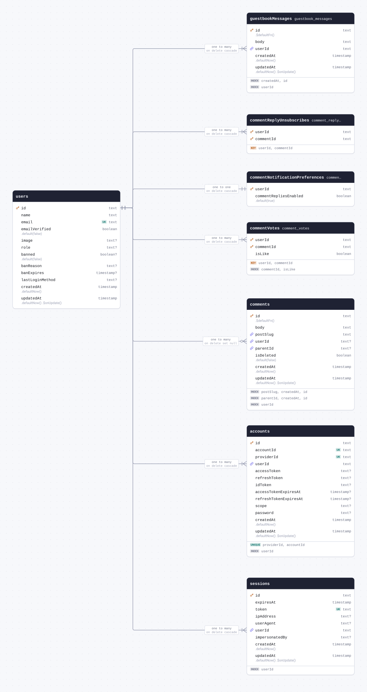
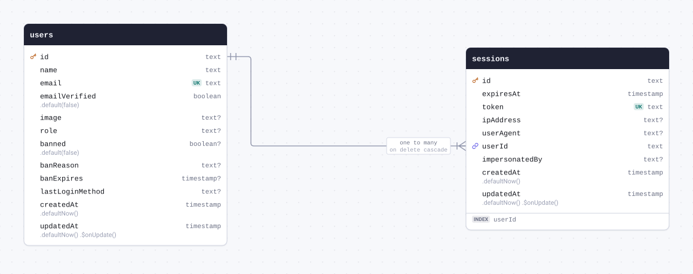
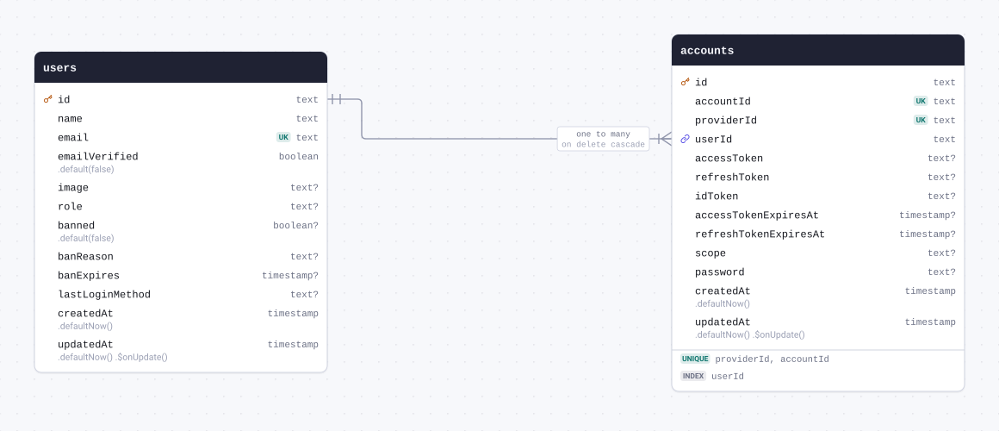
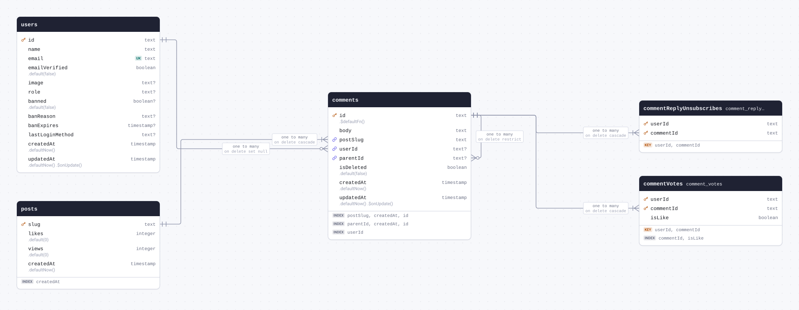
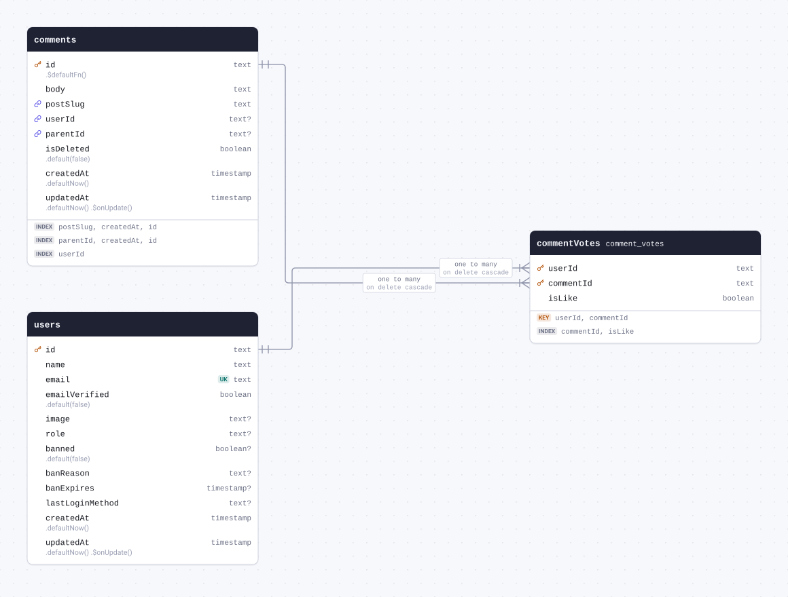
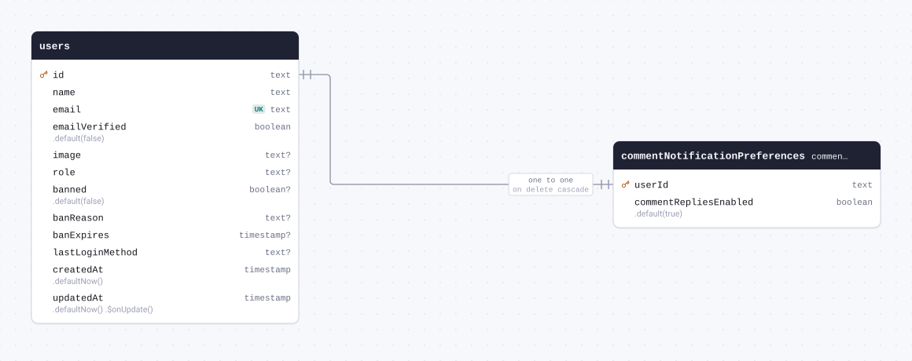
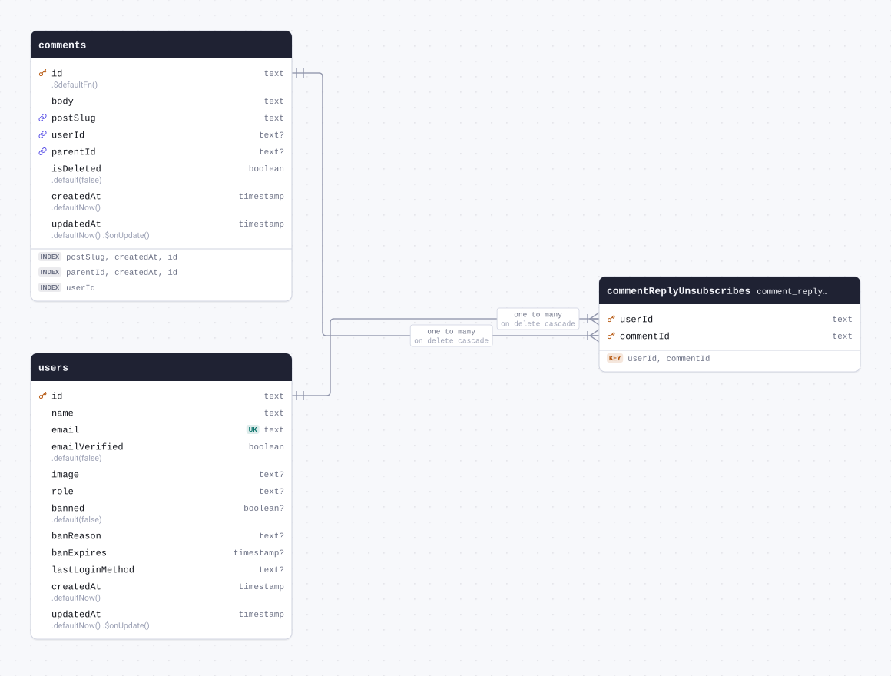
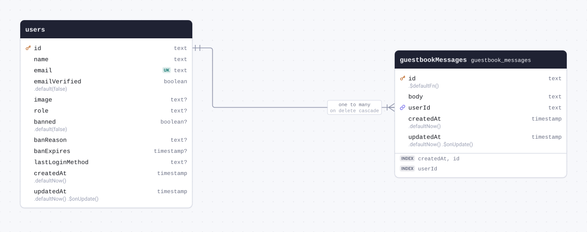
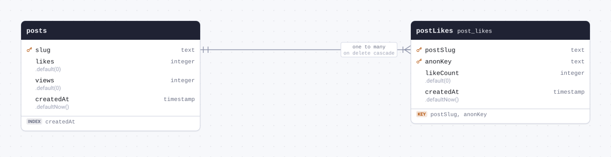

# Schema docs


<details>
<summary>The whole schema as SQL</summary>

```sql
CREATE TABLE "accounts" (
	"id" text PRIMARY KEY,
	"account_id" text NOT NULL,
	"provider_id" text NOT NULL,
	"user_id" text NOT NULL,
	"access_token" text,
	"refresh_token" text,
	"id_token" text,
	"access_token_expires_at" timestamp(3) with time zone,
	"refresh_token_expires_at" timestamp(3) with time zone,
	"scope" text,
	"password" text,
	"created_at" timestamp(3) with time zone DEFAULT now() NOT NULL,
	"updated_at" timestamp(3) with time zone DEFAULT now() NOT NULL,
	CONSTRAINT "accounts_provider_id_account_id_unique" UNIQUE("provider_id","account_id")
);

CREATE TABLE "comment_notification_preferences" (
	"user_id" text PRIMARY KEY,
	"comment_replies_enabled" boolean DEFAULT true NOT NULL
);

CREATE TABLE "comment_reply_unsubscribes" (
	"user_id" text,
	"comment_id" text,
	CONSTRAINT "comment_reply_unsubscribes_pkey" PRIMARY KEY("user_id","comment_id")
);

CREATE TABLE "comment_votes" (
	"user_id" text,
	"comment_id" text,
	"is_like" boolean NOT NULL,
	CONSTRAINT "comment_votes_pkey" PRIMARY KEY("user_id","comment_id")
);

CREATE TABLE "comments" (
	"id" text PRIMARY KEY,
	"body" text NOT NULL,
	"post_slug" text NOT NULL,
	"user_id" text,
	"parent_id" text,
	"is_deleted" boolean DEFAULT false NOT NULL,
	"created_at" timestamp(3) with time zone DEFAULT now() NOT NULL,
	"updated_at" timestamp(3) with time zone DEFAULT now() NOT NULL
);

CREATE TABLE "guestbook_messages" (
	"id" text PRIMARY KEY,
	"body" text NOT NULL,
	"user_id" text NOT NULL,
	"created_at" timestamp(3) with time zone DEFAULT now() NOT NULL,
	"updated_at" timestamp(3) with time zone DEFAULT now() NOT NULL
);

CREATE TABLE "post_likes" (
	"post_slug" text,
	"anon_key" text,
	"like_count" integer DEFAULT 0 NOT NULL,
	"created_at" timestamp(3) with time zone DEFAULT now() NOT NULL,
	CONSTRAINT "post_likes_pkey" PRIMARY KEY("post_slug","anon_key"),
	CONSTRAINT "post_likes_count_check" CHECK ("like_count" BETWEEN 0 AND 3)
);

CREATE TABLE "posts" (
	"slug" text PRIMARY KEY,
	"likes" integer DEFAULT 0 NOT NULL,
	"views" integer DEFAULT 0 NOT NULL,
	"created_at" timestamp(3) with time zone DEFAULT now() NOT NULL
);

CREATE TABLE "sessions" (
	"id" text PRIMARY KEY,
	"expires_at" timestamp(3) with time zone NOT NULL,
	"token" text NOT NULL UNIQUE,
	"ip_address" text,
	"user_agent" text,
	"user_id" text NOT NULL,
	"impersonated_by" text,
	"created_at" timestamp(3) with time zone DEFAULT now() NOT NULL,
	"updated_at" timestamp(3) with time zone DEFAULT now() NOT NULL
);

CREATE TABLE "users" (
	"id" text PRIMARY KEY,
	"name" text NOT NULL,
	"email" text NOT NULL UNIQUE,
	"email_verified" boolean DEFAULT false NOT NULL,
	"image" text,
	"role" text,
	"banned" boolean DEFAULT false,
	"ban_reason" text,
	"ban_expires" timestamp(3) with time zone,
	"last_login_method" text,
	"created_at" timestamp(3) with time zone DEFAULT now() NOT NULL,
	"updated_at" timestamp(3) with time zone DEFAULT now() NOT NULL
);

CREATE TABLE "verifications" (
	"id" text PRIMARY KEY,
	"identifier" text NOT NULL,
	"value" text NOT NULL,
	"expires_at" timestamp(3) with time zone NOT NULL,
	"created_at" timestamp(3) with time zone DEFAULT now() NOT NULL,
	"updated_at" timestamp(3) with time zone DEFAULT now() NOT NULL
);

CREATE INDEX "accounts_user_id_idx" ON "accounts" ("user_id");

CREATE INDEX "comment_votes_comment_id_is_like_idx" ON "comment_votes" ("comment_id","is_like");

CREATE INDEX "comments_post_slug_created_at_id_idx" ON "comments" ("post_slug","created_at","id");

CREATE INDEX "comments_parent_id_created_at_id_idx" ON "comments" ("parent_id","created_at","id");

CREATE INDEX "comments_user_id_idx" ON "comments" ("user_id");

CREATE INDEX "guestbook_messages_created_at_id_desc_idx" ON "guestbook_messages" ("created_at" DESC,"id" DESC);

CREATE INDEX "guestbook_messages_user_id_idx" ON "guestbook_messages" ("user_id");

CREATE INDEX "posts_created_at_desc_idx" ON "posts" ("created_at" DESC NULLS LAST);

CREATE INDEX "sessions_user_id_idx" ON "sessions" ("user_id");

CREATE INDEX "verifications_identifier_idx" ON "verifications" ("identifier");

ALTER TABLE "accounts" ADD CONSTRAINT "accounts_user_id_users_id_fkey" FOREIGN KEY ("user_id") REFERENCES "users"("id") ON DELETE CASCADE;

ALTER TABLE "comment_notification_preferences" ADD CONSTRAINT "comment_notification_preferences_user_id_users_id_fkey" FOREIGN KEY ("user_id") REFERENCES "users"("id") ON DELETE CASCADE;

ALTER TABLE "comment_reply_unsubscribes" ADD CONSTRAINT "comment_reply_unsubscribes_user_id_users_id_fkey" FOREIGN KEY ("user_id") REFERENCES "users"("id") ON DELETE CASCADE;

ALTER TABLE "comment_reply_unsubscribes" ADD CONSTRAINT "comment_reply_unsubscribes_comment_id_comments_id_fkey" FOREIGN KEY ("comment_id") REFERENCES "comments"("id") ON DELETE CASCADE;

ALTER TABLE "comment_votes" ADD CONSTRAINT "comment_votes_user_id_users_id_fkey" FOREIGN KEY ("user_id") REFERENCES "users"("id") ON DELETE CASCADE;

ALTER TABLE "comment_votes" ADD CONSTRAINT "comment_votes_comment_id_comments_id_fkey" FOREIGN KEY ("comment_id") REFERENCES "comments"("id") ON DELETE CASCADE;

ALTER TABLE "comments" ADD CONSTRAINT "comments_post_slug_posts_slug_fkey" FOREIGN KEY ("post_slug") REFERENCES "posts"("slug") ON DELETE CASCADE;

ALTER TABLE "comments" ADD CONSTRAINT "comments_user_id_users_id_fkey" FOREIGN KEY ("user_id") REFERENCES "users"("id") ON DELETE SET NULL;

ALTER TABLE "comments" ADD CONSTRAINT "comments_parent_id_comments_id_fkey" FOREIGN KEY ("parent_id") REFERENCES "comments"("id") ON DELETE RESTRICT;

ALTER TABLE "guestbook_messages" ADD CONSTRAINT "guestbook_messages_user_id_users_id_fkey" FOREIGN KEY ("user_id") REFERENCES "users"("id") ON DELETE CASCADE;

ALTER TABLE "post_likes" ADD CONSTRAINT "post_likes_post_slug_posts_slug_fkey" FOREIGN KEY ("post_slug") REFERENCES "posts"("slug") ON DELETE CASCADE;

ALTER TABLE "sessions" ADD CONSTRAINT "sessions_user_id_users_id_fkey" FOREIGN KEY ("user_id") REFERENCES "users"("id") ON DELETE CASCADE;
```

</details>

## Contents

| Table                                                                   | Name in the database               | Description |
| ----------------------------------------------------------------------- | ---------------------------------- | ----------- |
| [users](#table-users)                                                   | `users`                            |             |
| [sessions](#table-sessions)                                             | `sessions`                         |             |
| [accounts](#table-accounts)                                             | `accounts`                         |             |
| [verifications](#table-verifications)                                   | `verifications`                    |             |
| [comments](#table-comments)                                             | `comments`                         |             |
| [commentVotes](#table-commentVotes)                                     | `comment_votes`                    |             |
| [commentNotificationPreferences](#table-commentNotificationPreferences) | `comment_notification_preferences` |             |
| [commentReplyUnsubscribes](#table-commentReplyUnsubscribes)             | `comment_reply_unsubscribes`       |             |
| [guestbookMessages](#table-guestbookMessages)                           | `guestbook_messages`               |             |
| [posts](#table-posts)                                                   | `posts`                            |             |
| [postLikes](#table-postLikes)                                           | `post_likes`                       |             |

## Tables

<a id="table-users"></a>

### users



| Column                                  | Type        | Constraints     | Default                        | Description |
| --------------------------------------- | ----------- | --------------- | ------------------------------ | ----------- |
| `id`                                    | `text`      | PK NOT NULL     |                                |             |
| `name`                                  | `text`      | NOT NULL        |                                |             |
| `email`                                 | `text`      | UNIQUE NOT NULL |                                |             |
| `emailVerified` (`email_verified`)      | `boolean`   | NOT NULL        | `.default(false)`              |             |
| `image`                                 | `text`      | NULL            |                                |             |
| `role`                                  | `text`      | NULL            |                                |             |
| `banned`                                | `boolean`   | NULL            | `.default(false)`              |             |
| `banReason` (`ban_reason`)              | `text`      | NULL            |                                |             |
| `banExpires` (`ban_expires`)            | `timestamp` | NULL            |                                |             |
| `lastLoginMethod` (`last_login_method`) | `text`      | NULL            |                                |             |
| `createdAt` (`created_at`)              | `timestamp` | NOT NULL        | `.defaultNow()`                |             |
| `updatedAt` (`updated_at`)              | `timestamp` | NOT NULL        | `.defaultNow()` `.$onUpdate()` |             |

#### Definition

```sql
CREATE TABLE "users" (
	"id" text PRIMARY KEY,
	"name" text NOT NULL,
	"email" text NOT NULL UNIQUE,
	"email_verified" boolean DEFAULT false NOT NULL,
	"image" text,
	"role" text,
	"banned" boolean DEFAULT false,
	"ban_reason" text,
	"ban_expires" timestamp(3) with time zone,
	"last_login_method" text,
	"created_at" timestamp(3) with time zone DEFAULT now() NOT NULL,
	"updated_at" timestamp(3) with time zone DEFAULT now() NOT NULL
);
```

#### Referenced by

- `id` → [sessions.userId](#table-sessions) (one to many, on delete cascade)
- `id` → [accounts.userId](#table-accounts) (one to many, on delete cascade)
- `id` → [comments.userId](#table-comments) (one to many, on delete set null)
- `id` → [commentVotes.userId](#table-commentVotes) (one to many, on delete cascade)
- `id` → [commentNotificationPreferences.userId](#table-commentNotificationPreferences) (one to one, on delete cascade)
- `id` → [commentReplyUnsubscribes.userId](#table-commentReplyUnsubscribes) (one to many, on delete cascade)
- `id` → [guestbookMessages.userId](#table-guestbookMessages) (one to many, on delete cascade)

<details>
<summary>Queries and their SQL</summary>

**Select**: Every row of users.

```ts
db.select().from(users);
```

```sql
select "id", "name", "email", "email_verified", "image", "role", "banned", "ban_reason", "ban_expires", "last_login_method", "created_at", "updated_at"
from "users"
```

**Count**: How many rows users has.

```ts
db.select({ count: count() }).from(users);
```

```sql
select count(*)
from "users"
```

**Find many with relations**: The rows of users with what they relate to, through the relational query API.

```ts
db.query.users.findMany({
  with: {
    sessions: true,
    accounts: true,
    guestbookMessages: true,
    comments: true,
    commentVotes: true,
    commentNotificationPreference: true,
    commentReplyUnsubscribes: true,
  },
});
```

```sql
select "d0"."id" as "id", "d0"."name" as "name", "d0"."email" as "email", "d0"."email_verified" as "emailVerified", "d0"."image" as "image", "d0"."role" as "role", "d0"."banned" as "banned", "d0"."ban_reason" as "banReason", "d0"."ban_expires" as "banExpires", "d0"."last_login_method" as "lastLoginMethod", "d0"."created_at" as "createdAt", "d0"."updated_at" as "updatedAt", "sessions"."r" as "sessions", "accounts"."r" as "accounts", "guestbookMessages"."r" as "guestbookMessages", "comments"."r" as "comments", "commentVotes"."r" as "commentVotes", "commentNotificationPreference"."r" as "commentNotificationPreference", "commentReplyUnsubscribes"."r" as "commentReplyUnsubscribes"
from "users" as "d0"
left join lateral(select coalesce(json_agg(row_to_json("t".*)), '[]') as "r" from (select "d1"."id" as "id", "d1"."expires_at" as "expiresAt", "d1"."token" as "token", "d1"."ip_address" as "ipAddress", "d1"."user_agent" as "userAgent", "d1"."user_id" as "userId", "d1"."impersonated_by" as "impersonatedBy", "d1"."created_at" as "createdAt", "d1"."updated_at" as "updatedAt" from "sessions" as "d1" where "d0"."id" = "d1"."user_id") as "t") as "sessions" on true
left join lateral(select coalesce(json_agg(row_to_json("t".*)), '[]') as "r" from (select "d1"."id" as "id", "d1"."account_id" as "accountId", "d1"."provider_id" as "providerId", "d1"."user_id" as "userId", "d1"."access_token" as "accessToken", "d1"."refresh_token" as "refreshToken", "d1"."id_token" as "idToken", "d1"."access_token_expires_at" as "accessTokenExpiresAt", "d1"."refresh_token_expires_at" as "refreshTokenExpiresAt", "d1"."scope" as "scope", "d1"."password" as "password", "d1"."created_at" as "createdAt", "d1"."updated_at" as "updatedAt" from "accounts" as "d1" where "d0"."id" = "d1"."user_id") as "t") as "accounts" on true
left join lateral(select coalesce(json_agg(row_to_json("t".*)), '[]') as "r" from (select "d1"."id" as "id", "d1"."body" as "body", "d1"."user_id" as "userId", "d1"."created_at" as "createdAt", "d1"."updated_at" as "updatedAt" from "guestbook_messages" as "d1" where "d0"."id" = "d1"."user_id") as "t") as "guestbookMessages" on true
left join lateral(select coalesce(json_agg(row_to_json("t".*)), '[]') as "r" from (select "d1"."id" as "id", "d1"."body" as "body", "d1"."post_slug" as "postSlug", "d1"."user_id" as "userId", "d1"."parent_id" as "parentId", "d1"."is_deleted" as "isDeleted", "d1"."created_at" as "createdAt", "d1"."updated_at" as "updatedAt" from "comments" as "d1" where "d0"."id" = "d1"."user_id") as "t") as "comments" on true
left join lateral(select coalesce(json_agg(row_to_json("t".*)), '[]') as "r" from (select "d1"."user_id" as "userId", "d1"."comment_id" as "commentId", "d1"."is_like" as "isLike" from "comment_votes" as "d1" where "d0"."id" = "d1"."user_id") as "t") as "commentVotes" on true
left join lateral(select row_to_json("t".*) "r" from (select "d1"."user_id" as "userId", "d1"."comment_replies_enabled" as "commentRepliesEnabled" from "comment_notification_preferences" as "d1" where "d0"."id" = "d1"."user_id" limit $1) as "t") as "commentNotificationPreference" on true
left join lateral(select coalesce(json_agg(row_to_json("t".*)), '[]') as "r" from (select "d1"."user_id" as "userId", "d1"."comment_id" as "commentId" from "comment_reply_unsubscribes" as "d1" where "d0"."id" = "d1"."user_id") as "t") as "commentReplyUnsubscribes" on true
-- params: [1]
```

**Find by primary key**: One row of users, through the relational query API.

```ts
db.query.users.findFirst({ where: { id: "id" } });
```

```sql
select "d0"."id" as "id", "d0"."name" as "name", "d0"."email" as "email", "d0"."email_verified" as "emailVerified", "d0"."image" as "image", "d0"."role" as "role", "d0"."banned" as "banned", "d0"."ban_reason" as "banReason", "d0"."ban_expires" as "banExpires", "d0"."last_login_method" as "lastLoginMethod", "d0"."created_at" as "createdAt", "d0"."updated_at" as "updatedAt"
from "users" as "d0"
where "d0"."id" = $1
limit $2
-- params: ["id",1]
```

**Insert**: Adds a row to users, giving the columns that have no default.

```ts
db.insert(users).values({ id: "id", name: "name", email: "email" });
```

```sql
insert into "users" ("id", "name", "email", "email_verified", "image", "role", "banned", "ban_reason", "ban_expires", "last_login_method", "created_at", "updated_at")
values ($1, $2, $3, default, default, default, default, default, default, default, default, default)
-- params: ["id","name","email"]
```

**Update**: Changes a row of users, found by its primary key.

```ts
db.update(users).set({ name: "name" }).where(eq(users.id, "id"));
```

```sql
update "users"
set "name" = $1, "updated_at" = $2
where "users"."id" = $3
-- params: ["name","2026-01-01T00:00:00.000Z","id"]
```

**Delete**: Deletes a row of users, found by its primary key.

```ts
db.delete(users).where(eq(users.id, "id"));
```

```sql
delete from "users"
where "users"."id" = $1
-- params: ["id"]
```

</details>

<a id="table-sessions"></a>

### sessions



| Column                               | Type        | Constraints                         | Default                        | Description |
| ------------------------------------ | ----------- | ----------------------------------- | ------------------------------ | ----------- |
| `id`                                 | `text`      | PK NOT NULL                         |                                |             |
| `expiresAt` (`expires_at`)           | `timestamp` | NOT NULL                            |                                |             |
| `token`                              | `text`      | UNIQUE NOT NULL                     |                                |             |
| `ipAddress` (`ip_address`)           | `text`      | NULL                                |                                |             |
| `userAgent` (`user_agent`)           | `text`      | NULL                                |                                |             |
| `userId` (`user_id`)                 | `text`      | NOT NULL → [users.id](#table-users) |                                |             |
| `impersonatedBy` (`impersonated_by`) | `text`      | NULL                                |                                |             |
| `createdAt` (`created_at`)           | `timestamp` | NOT NULL                            | `.defaultNow()`                |             |
| `updatedAt` (`updated_at`)           | `timestamp` | NOT NULL                            | `.defaultNow()` `.$onUpdate()` |             |

#### Definition

```sql
CREATE TABLE "sessions" (
	"id" text PRIMARY KEY,
	"expires_at" timestamp(3) with time zone NOT NULL,
	"token" text NOT NULL UNIQUE,
	"ip_address" text,
	"user_agent" text,
	"user_id" text NOT NULL,
	"impersonated_by" text,
	"created_at" timestamp(3) with time zone DEFAULT now() NOT NULL,
	"updated_at" timestamp(3) with time zone DEFAULT now() NOT NULL
);

CREATE INDEX "sessions_user_id_idx" ON "sessions" ("user_id");

ALTER TABLE "sessions" ADD CONSTRAINT "sessions_user_id_users_id_fkey" FOREIGN KEY ("user_id") REFERENCES "users"("id") ON DELETE CASCADE;
```

#### Indexes

- INDEX `userId`

#### References

- `userId` → [users.id](#table-users) (many to one, on delete cascade)

<details>
<summary>Queries and their SQL</summary>

**Select**: Every row of sessions.

```ts
db.select().from(sessions);
```

```sql
select "id", "expires_at", "token", "ip_address", "user_agent", "user_id", "impersonated_by", "created_at", "updated_at"
from "sessions"
```

**Count**: How many rows sessions has.

```ts
db.select({ count: count() }).from(sessions);
```

```sql
select count(*)
from "sessions"
```

**Find many with relations**: The rows of sessions with what they relate to, through the relational query API.

```ts
db.query.sessions.findMany({ with: { user: true } });
```

```sql
select "d0"."id" as "id", "d0"."expires_at" as "expiresAt", "d0"."token" as "token", "d0"."ip_address" as "ipAddress", "d0"."user_agent" as "userAgent", "d0"."user_id" as "userId", "d0"."impersonated_by" as "impersonatedBy", "d0"."created_at" as "createdAt", "d0"."updated_at" as "updatedAt", "user"."r" as "user"
from "sessions" as "d0"
left join lateral(select row_to_json("t".*) "r" from (select "d1"."id" as "id", "d1"."name" as "name", "d1"."email" as "email", "d1"."email_verified" as "emailVerified", "d1"."image" as "image", "d1"."role" as "role", "d1"."banned" as "banned", "d1"."ban_reason" as "banReason", "d1"."ban_expires" as "banExpires", "d1"."last_login_method" as "lastLoginMethod", "d1"."created_at" as "createdAt", "d1"."updated_at" as "updatedAt" from "users" as "d1" where "d0"."user_id" = "d1"."id" limit $1) as "t") as "user" on true
-- params: [1]
```

**Find by primary key**: One row of sessions, through the relational query API.

```ts
db.query.sessions.findFirst({ where: { id: "id" } });
```

```sql
select "d0"."id" as "id", "d0"."expires_at" as "expiresAt", "d0"."token" as "token", "d0"."ip_address" as "ipAddress", "d0"."user_agent" as "userAgent", "d0"."user_id" as "userId", "d0"."impersonated_by" as "impersonatedBy", "d0"."created_at" as "createdAt", "d0"."updated_at" as "updatedAt"
from "sessions" as "d0"
where "d0"."id" = $1
limit $2
-- params: ["id",1]
```

**Insert**: Adds a row to sessions, giving the columns that have no default.

```ts
db.insert(sessions).values({
  id: "id",
  expiresAt: new Date("2026-01-01T00:00:00.000Z"),
  token: "token",
  userId: "userId",
});
```

```sql
insert into "sessions" ("id", "expires_at", "token", "ip_address", "user_agent", "user_id", "impersonated_by", "created_at", "updated_at")
values ($1, $2, $3, default, default, $4, default, default, default)
-- params: ["id","2026-01-01T00:00:00.000Z","token","userId"]
```

**Update**: Changes a row of sessions, found by its primary key.

```ts
db.update(sessions)
  .set({ expiresAt: new Date("2026-01-01T00:00:00.000Z") })
  .where(eq(sessions.id, "id"));
```

```sql
update "sessions"
set "expires_at" = $1, "updated_at" = $2
where "sessions"."id" = $3
-- params: ["2026-01-01T00:00:00.000Z","2026-01-01T00:00:00.000Z","id"]
```

**Delete**: Deletes a row of sessions, found by its primary key.

```ts
db.delete(sessions).where(eq(sessions.id, "id"));
```

```sql
delete from "sessions"
where "sessions"."id" = $1
-- params: ["id"]
```

</details>

<a id="table-accounts"></a>

### accounts



| Column                                               | Type        | Constraints                         | Default                        | Description |
| ---------------------------------------------------- | ----------- | ----------------------------------- | ------------------------------ | ----------- |
| `id`                                                 | `text`      | PK NOT NULL                         |                                |             |
| `accountId` (`account_id`)                           | `text`      | NOT NULL                            |                                |             |
| `providerId` (`provider_id`)                         | `text`      | NOT NULL                            |                                |             |
| `userId` (`user_id`)                                 | `text`      | NOT NULL → [users.id](#table-users) |                                |             |
| `accessToken` (`access_token`)                       | `text`      | NULL                                |                                |             |
| `refreshToken` (`refresh_token`)                     | `text`      | NULL                                |                                |             |
| `idToken` (`id_token`)                               | `text`      | NULL                                |                                |             |
| `accessTokenExpiresAt` (`access_token_expires_at`)   | `timestamp` | NULL                                |                                |             |
| `refreshTokenExpiresAt` (`refresh_token_expires_at`) | `timestamp` | NULL                                |                                |             |
| `scope`                                              | `text`      | NULL                                |                                |             |
| `password`                                           | `text`      | NULL                                |                                |             |
| `createdAt` (`created_at`)                           | `timestamp` | NOT NULL                            | `.defaultNow()`                |             |
| `updatedAt` (`updated_at`)                           | `timestamp` | NOT NULL                            | `.defaultNow()` `.$onUpdate()` |             |

#### Definition

```sql
CREATE TABLE "accounts" (
	"id" text PRIMARY KEY,
	"account_id" text NOT NULL,
	"provider_id" text NOT NULL,
	"user_id" text NOT NULL,
	"access_token" text,
	"refresh_token" text,
	"id_token" text,
	"access_token_expires_at" timestamp(3) with time zone,
	"refresh_token_expires_at" timestamp(3) with time zone,
	"scope" text,
	"password" text,
	"created_at" timestamp(3) with time zone DEFAULT now() NOT NULL,
	"updated_at" timestamp(3) with time zone DEFAULT now() NOT NULL,
	CONSTRAINT "accounts_provider_id_account_id_unique" UNIQUE("provider_id","account_id")
);

CREATE INDEX "accounts_user_id_idx" ON "accounts" ("user_id");

ALTER TABLE "accounts" ADD CONSTRAINT "accounts_user_id_users_id_fkey" FOREIGN KEY ("user_id") REFERENCES "users"("id") ON DELETE CASCADE;
```

#### Indexes

- INDEX `userId`
- UNIQUE `providerId`, `accountId`

#### References

- `userId` → [users.id](#table-users) (many to one, on delete cascade)

<details>
<summary>Queries and their SQL</summary>

**Select**: Every row of accounts.

```ts
db.select().from(accounts);
```

```sql
select "id", "account_id", "provider_id", "user_id", "access_token", "refresh_token", "id_token", "access_token_expires_at", "refresh_token_expires_at", "scope", "password", "created_at", "updated_at"
from "accounts"
```

**Count**: How many rows accounts has.

```ts
db.select({ count: count() }).from(accounts);
```

```sql
select count(*)
from "accounts"
```

**Find many with relations**: The rows of accounts with what they relate to, through the relational query API.

```ts
db.query.accounts.findMany({ with: { user: true } });
```

```sql
select "d0"."id" as "id", "d0"."account_id" as "accountId", "d0"."provider_id" as "providerId", "d0"."user_id" as "userId", "d0"."access_token" as "accessToken", "d0"."refresh_token" as "refreshToken", "d0"."id_token" as "idToken", "d0"."access_token_expires_at" as "accessTokenExpiresAt", "d0"."refresh_token_expires_at" as "refreshTokenExpiresAt", "d0"."scope" as "scope", "d0"."password" as "password", "d0"."created_at" as "createdAt", "d0"."updated_at" as "updatedAt", "user"."r" as "user"
from "accounts" as "d0"
left join lateral(select row_to_json("t".*) "r" from (select "d1"."id" as "id", "d1"."name" as "name", "d1"."email" as "email", "d1"."email_verified" as "emailVerified", "d1"."image" as "image", "d1"."role" as "role", "d1"."banned" as "banned", "d1"."ban_reason" as "banReason", "d1"."ban_expires" as "banExpires", "d1"."last_login_method" as "lastLoginMethod", "d1"."created_at" as "createdAt", "d1"."updated_at" as "updatedAt" from "users" as "d1" where "d0"."user_id" = "d1"."id" limit $1) as "t") as "user" on true
-- params: [1]
```

**Find by primary key**: One row of accounts, through the relational query API.

```ts
db.query.accounts.findFirst({ where: { id: "id" } });
```

```sql
select "d0"."id" as "id", "d0"."account_id" as "accountId", "d0"."provider_id" as "providerId", "d0"."user_id" as "userId", "d0"."access_token" as "accessToken", "d0"."refresh_token" as "refreshToken", "d0"."id_token" as "idToken", "d0"."access_token_expires_at" as "accessTokenExpiresAt", "d0"."refresh_token_expires_at" as "refreshTokenExpiresAt", "d0"."scope" as "scope", "d0"."password" as "password", "d0"."created_at" as "createdAt", "d0"."updated_at" as "updatedAt"
from "accounts" as "d0"
where "d0"."id" = $1
limit $2
-- params: ["id",1]
```

**Insert**: Adds a row to accounts, giving the columns that have no default.

```ts
db.insert(accounts).values({
  id: "id",
  accountId: "accountId",
  providerId: "providerId",
  userId: "userId",
});
```

```sql
insert into "accounts" ("id", "account_id", "provider_id", "user_id", "access_token", "refresh_token", "id_token", "access_token_expires_at", "refresh_token_expires_at", "scope", "password", "created_at", "updated_at")
values ($1, $2, $3, $4, default, default, default, default, default, default, default, default, default)
-- params: ["id","accountId","providerId","userId"]
```

**Update**: Changes a row of accounts, found by its primary key.

```ts
db.update(accounts).set({ accountId: "accountId" }).where(eq(accounts.id, "id"));
```

```sql
update "accounts"
set "account_id" = $1, "updated_at" = $2
where "accounts"."id" = $3
-- params: ["accountId","2026-01-01T00:00:00.000Z","id"]
```

**Delete**: Deletes a row of accounts, found by its primary key.

```ts
db.delete(accounts).where(eq(accounts.id, "id"));
```

```sql
delete from "accounts"
where "accounts"."id" = $1
-- params: ["id"]
```

</details>

<a id="table-verifications"></a>

### verifications


| Column                     | Type        | Constraints | Default                        | Description |
| -------------------------- | ----------- | ----------- | ------------------------------ | ----------- |
| `id`                       | `text`      | PK NOT NULL |                                |             |
| `identifier`               | `text`      | NOT NULL    |                                |             |
| `value`                    | `text`      | NOT NULL    |                                |             |
| `expiresAt` (`expires_at`) | `timestamp` | NOT NULL    |                                |             |
| `createdAt` (`created_at`) | `timestamp` | NOT NULL    | `.defaultNow()`                |             |
| `updatedAt` (`updated_at`) | `timestamp` | NOT NULL    | `.defaultNow()` `.$onUpdate()` |             |

#### Definition

```sql
CREATE TABLE "verifications" (
	"id" text PRIMARY KEY,
	"identifier" text NOT NULL,
	"value" text NOT NULL,
	"expires_at" timestamp(3) with time zone NOT NULL,
	"created_at" timestamp(3) with time zone DEFAULT now() NOT NULL,
	"updated_at" timestamp(3) with time zone DEFAULT now() NOT NULL
);

CREATE INDEX "verifications_identifier_idx" ON "verifications" ("identifier");
```

#### Indexes

- INDEX `identifier`

<details>
<summary>Queries and their SQL</summary>

**Select**: Every row of verifications.

```ts
db.select().from(verifications);
```

```sql
select "id", "identifier", "value", "expires_at", "created_at", "updated_at"
from "verifications"
```

**Count**: How many rows verifications has.

```ts
db.select({ count: count() }).from(verifications);
```

```sql
select count(*)
from "verifications"
```

**Find many**: The rows of verifications, through the relational query API.

```ts
db.query.verifications.findMany();
```

```sql
select "d0"."id" as "id", "d0"."identifier" as "identifier", "d0"."value" as "value", "d0"."expires_at" as "expiresAt", "d0"."created_at" as "createdAt", "d0"."updated_at" as "updatedAt"
from "verifications" as "d0"
```

**Find by primary key**: One row of verifications, through the relational query API.

```ts
db.query.verifications.findFirst({ where: { id: "id" } });
```

```sql
select "d0"."id" as "id", "d0"."identifier" as "identifier", "d0"."value" as "value", "d0"."expires_at" as "expiresAt", "d0"."created_at" as "createdAt", "d0"."updated_at" as "updatedAt"
from "verifications" as "d0"
where "d0"."id" = $1
limit $2
-- params: ["id",1]
```

**Insert**: Adds a row to verifications, giving the columns that have no default.

```ts
db.insert(verifications).values({
  id: "id",
  identifier: "identifier",
  value: "value",
  expiresAt: new Date("2026-01-01T00:00:00.000Z"),
});
```

```sql
insert into "verifications" ("id", "identifier", "value", "expires_at", "created_at", "updated_at")
values ($1, $2, $3, $4, default, default)
-- params: ["id","identifier","value","2026-01-01T00:00:00.000Z"]
```

**Update**: Changes a row of verifications, found by its primary key.

```ts
db.update(verifications).set({ identifier: "identifier" }).where(eq(verifications.id, "id"));
```

```sql
update "verifications"
set "identifier" = $1, "updated_at" = $2
where "verifications"."id" = $3
-- params: ["identifier","2026-01-01T00:00:00.000Z","id"]
```

**Delete**: Deletes a row of verifications, found by its primary key.

```ts
db.delete(verifications).where(eq(verifications.id, "id"));
```

```sql
delete from "verifications"
where "verifications"."id" = $1
-- params: ["id"]
```

</details>

<a id="table-comments"></a>

### comments



| Column                     | Type        | Constraints                           | Default                        | Description |
| -------------------------- | ----------- | ------------------------------------- | ------------------------------ | ----------- |
| `id`                       | `text`      | PK NOT NULL                           | `.$defaultFn()`                |             |
| `body`                     | `text`      | NOT NULL                              |                                |             |
| `postSlug` (`post_slug`)   | `text`      | NOT NULL → [posts.slug](#table-posts) |                                |             |
| `userId` (`user_id`)       | `text`      | NULL → [users.id](#table-users)       |                                |             |
| `parentId` (`parent_id`)   | `text`      | NULL → [comments.id](#table-comments) |                                |             |
| `isDeleted` (`is_deleted`) | `boolean`   | NOT NULL                              | `.default(false)`              |             |
| `createdAt` (`created_at`) | `timestamp` | NOT NULL                              | `.defaultNow()`                |             |
| `updatedAt` (`updated_at`) | `timestamp` | NOT NULL                              | `.defaultNow()` `.$onUpdate()` |             |

#### Definition

```sql
CREATE TABLE "comments" (
	"id" text PRIMARY KEY,
	"body" text NOT NULL,
	"post_slug" text NOT NULL,
	"user_id" text,
	"parent_id" text,
	"is_deleted" boolean DEFAULT false NOT NULL,
	"created_at" timestamp(3) with time zone DEFAULT now() NOT NULL,
	"updated_at" timestamp(3) with time zone DEFAULT now() NOT NULL
);

CREATE INDEX "comments_post_slug_created_at_id_idx" ON "comments" ("post_slug","created_at","id");

CREATE INDEX "comments_parent_id_created_at_id_idx" ON "comments" ("parent_id","created_at","id");

CREATE INDEX "comments_user_id_idx" ON "comments" ("user_id");

ALTER TABLE "comments" ADD CONSTRAINT "comments_post_slug_posts_slug_fkey" FOREIGN KEY ("post_slug") REFERENCES "posts"("slug") ON DELETE CASCADE;

ALTER TABLE "comments" ADD CONSTRAINT "comments_user_id_users_id_fkey" FOREIGN KEY ("user_id") REFERENCES "users"("id") ON DELETE SET NULL;

ALTER TABLE "comments" ADD CONSTRAINT "comments_parent_id_comments_id_fkey" FOREIGN KEY ("parent_id") REFERENCES "comments"("id") ON DELETE RESTRICT;
```

#### Indexes

- INDEX `postSlug`, `createdAt`, `id`
- INDEX `parentId`, `createdAt`, `id`
- INDEX `userId`

#### References

- `postSlug` → [posts.slug](#table-posts) (many to one, on delete cascade)
- `userId` → [users.id](#table-users) (many to one, on delete set null)
- `parentId` → [comments.id](#table-comments) (many to one, on delete restrict)

#### Referenced by

- `id` → [comments.parentId](#table-comments) (one to many, on delete restrict)
- `id` → [commentVotes.commentId](#table-commentVotes) (one to many, on delete cascade)
- `id` → [commentReplyUnsubscribes.commentId](#table-commentReplyUnsubscribes) (one to many, on delete cascade)

<details>
<summary>Queries and their SQL</summary>

**Select**: Every row of comments.

```ts
db.select().from(comments);
```

```sql
select "id", "body", "post_slug", "user_id", "parent_id", "is_deleted", "created_at", "updated_at"
from "comments"
```

**Count**: How many rows comments has.

```ts
db.select({ count: count() }).from(comments);
```

```sql
select count(*)
from "comments"
```

**Find many with relations**: The rows of comments with what they relate to, through the relational query API.

```ts
db.query.comments.findMany({
  with: {
    post: true,
    user: true,
    parent: true,
    replies: true,
    votes: true,
    replyUnsubscribes: true,
  },
});
```

```sql
select "d0"."id" as "id", "d0"."body" as "body", "d0"."post_slug" as "postSlug", "d0"."user_id" as "userId", "d0"."parent_id" as "parentId", "d0"."is_deleted" as "isDeleted", "d0"."created_at" as "createdAt", "d0"."updated_at" as "updatedAt", "post"."r" as "post", "user"."r" as "user", "parent"."r" as "parent", "replies"."r" as "replies", "votes"."r" as "votes", "replyUnsubscribes"."r" as "replyUnsubscribes"
from "comments" as "d0"
left join lateral(select row_to_json("t".*) "r" from (select "d1"."slug" as "slug", "d1"."likes" as "likes", "d1"."views" as "views", "d1"."created_at" as "createdAt" from "posts" as "d1" where "d0"."post_slug" = "d1"."slug" limit $1) as "t") as "post" on true
left join lateral(select row_to_json("t".*) "r" from (select "d1"."id" as "id", "d1"."name" as "name", "d1"."email" as "email", "d1"."email_verified" as "emailVerified", "d1"."image" as "image", "d1"."role" as "role", "d1"."banned" as "banned", "d1"."ban_reason" as "banReason", "d1"."ban_expires" as "banExpires", "d1"."last_login_method" as "lastLoginMethod", "d1"."created_at" as "createdAt", "d1"."updated_at" as "updatedAt" from "users" as "d1" where "d0"."user_id" = "d1"."id" limit $2) as "t") as "user" on true
left join lateral(select row_to_json("t".*) "r" from (select "d1"."id" as "id", "d1"."body" as "body", "d1"."post_slug" as "postSlug", "d1"."user_id" as "userId", "d1"."parent_id" as "parentId", "d1"."is_deleted" as "isDeleted", "d1"."created_at" as "createdAt", "d1"."updated_at" as "updatedAt" from "comments" as "d1" where "d0"."parent_id" = "d1"."id" limit $3) as "t") as "parent" on true
left join lateral(select coalesce(json_agg(row_to_json("t".*)), '[]') as "r" from (select "d1"."id" as "id", "d1"."body" as "body", "d1"."post_slug" as "postSlug", "d1"."user_id" as "userId", "d1"."parent_id" as "parentId", "d1"."is_deleted" as "isDeleted", "d1"."created_at" as "createdAt", "d1"."updated_at" as "updatedAt" from "comments" as "d1" where "d0"."id" = "d1"."parent_id") as "t") as "replies" on true
left join lateral(select coalesce(json_agg(row_to_json("t".*)), '[]') as "r" from (select "d1"."user_id" as "userId", "d1"."comment_id" as "commentId", "d1"."is_like" as "isLike" from "comment_votes" as "d1" where "d0"."id" = "d1"."comment_id") as "t") as "votes" on true
left join lateral(select coalesce(json_agg(row_to_json("t".*)), '[]') as "r" from (select "d1"."user_id" as "userId", "d1"."comment_id" as "commentId" from "comment_reply_unsubscribes" as "d1" where "d0"."id" = "d1"."comment_id") as "t") as "replyUnsubscribes" on true
-- params: [1,1,1]
```

**Find by primary key**: One row of comments, through the relational query API.

```ts
db.query.comments.findFirst({ where: { id: "id" } });
```

```sql
select "d0"."id" as "id", "d0"."body" as "body", "d0"."post_slug" as "postSlug", "d0"."user_id" as "userId", "d0"."parent_id" as "parentId", "d0"."is_deleted" as "isDeleted", "d0"."created_at" as "createdAt", "d0"."updated_at" as "updatedAt"
from "comments" as "d0"
where "d0"."id" = $1
limit $2
-- params: ["id",1]
```

**Insert**: Adds a row to comments, giving the columns that have no default.

```ts
db.insert(comments).values({ body: "body", postSlug: "postSlug" });
```

```sql
insert into "comments" ("id", "body", "post_slug", "user_id", "parent_id", "is_deleted", "created_at", "updated_at")
values ($1, $2, $3, default, default, default, default, default)
-- params: ["aauyl8ca800v38uhc8wq0jek","body","postSlug"]
```

**Update**: Changes a row of comments, found by its primary key.

```ts
db.update(comments).set({ body: "body" }).where(eq(comments.id, "id"));
```

```sql
update "comments"
set "body" = $1, "updated_at" = $2
where "comments"."id" = $3
-- params: ["body","2026-01-01T00:00:00.000Z","id"]
```

**Delete**: Deletes a row of comments, found by its primary key.

```ts
db.delete(comments).where(eq(comments.id, "id"));
```

```sql
delete from "comments"
where "comments"."id" = $1
-- params: ["id"]
```

</details>

<a id="table-commentVotes"></a>

### commentVotes

Table `comment_votes`.



| Column                     | Type      | Constraints                                  | Default | Description |
| -------------------------- | --------- | -------------------------------------------- | ------- | ----------- |
| `userId` (`user_id`)       | `text`    | PK NOT NULL → [users.id](#table-users)       |         |             |
| `commentId` (`comment_id`) | `text`    | PK NOT NULL → [comments.id](#table-comments) |         |             |
| `isLike` (`is_like`)       | `boolean` | NOT NULL                                     |         |             |

#### Definition

```sql
CREATE TABLE "comment_votes" (
	"user_id" text,
	"comment_id" text,
	"is_like" boolean NOT NULL,
	CONSTRAINT "comment_votes_pkey" PRIMARY KEY("user_id","comment_id")
);

CREATE INDEX "comment_votes_comment_id_is_like_idx" ON "comment_votes" ("comment_id","is_like");

ALTER TABLE "comment_votes" ADD CONSTRAINT "comment_votes_user_id_users_id_fkey" FOREIGN KEY ("user_id") REFERENCES "users"("id") ON DELETE CASCADE;

ALTER TABLE "comment_votes" ADD CONSTRAINT "comment_votes_comment_id_comments_id_fkey" FOREIGN KEY ("comment_id") REFERENCES "comments"("id") ON DELETE CASCADE;
```

#### Indexes

- PRIMARY KEY `userId`, `commentId`
- INDEX `commentId`, `isLike`

#### References

- `userId` → [users.id](#table-users) (many to one, on delete cascade)
- `commentId` → [comments.id](#table-comments) (many to one, on delete cascade)

<details>
<summary>Queries and their SQL</summary>

**Select**: Every row of commentVotes.

```ts
db.select().from(commentVotes);
```

```sql
select "user_id", "comment_id", "is_like"
from "comment_votes"
```

**Count**: How many rows commentVotes has.

```ts
db.select({ count: count() }).from(commentVotes);
```

```sql
select count(*)
from "comment_votes"
```

**Find many with relations**: The rows of commentVotes with what they relate to, through the relational query API.

```ts
db.query.commentVotes.findMany({ with: { user: true, comment: true } });
```

```sql
select "d0"."user_id" as "userId", "d0"."comment_id" as "commentId", "d0"."is_like" as "isLike", "user"."r" as "user", "comment"."r" as "comment"
from "comment_votes" as "d0"
left join lateral(select row_to_json("t".*) "r" from (select "d1"."id" as "id", "d1"."name" as "name", "d1"."email" as "email", "d1"."email_verified" as "emailVerified", "d1"."image" as "image", "d1"."role" as "role", "d1"."banned" as "banned", "d1"."ban_reason" as "banReason", "d1"."ban_expires" as "banExpires", "d1"."last_login_method" as "lastLoginMethod", "d1"."created_at" as "createdAt", "d1"."updated_at" as "updatedAt" from "users" as "d1" where "d0"."user_id" = "d1"."id" limit $1) as "t") as "user" on true
left join lateral(select row_to_json("t".*) "r" from (select "d1"."id" as "id", "d1"."body" as "body", "d1"."post_slug" as "postSlug", "d1"."user_id" as "userId", "d1"."parent_id" as "parentId", "d1"."is_deleted" as "isDeleted", "d1"."created_at" as "createdAt", "d1"."updated_at" as "updatedAt" from "comments" as "d1" where "d0"."comment_id" = "d1"."id" limit $2) as "t") as "comment" on true
-- params: [1,1]
```

**Find by primary key**: One row of commentVotes, through the relational query API.

```ts
db.query.commentVotes.findFirst({ where: { userId: "userId", commentId: "commentId" } });
```

```sql
select "d0"."user_id" as "userId", "d0"."comment_id" as "commentId", "d0"."is_like" as "isLike"
from "comment_votes" as "d0"
where (("d0"."user_id" = $1) and ("d0"."comment_id" = $2))
limit $3
-- params: ["userId","commentId",1]
```

**Insert**: Adds a row to commentVotes, giving the columns that have no default.

```ts
db.insert(commentVotes).values({ userId: "userId", commentId: "commentId", isLike: true });
```

```sql
insert into "comment_votes" ("user_id", "comment_id", "is_like")
values ($1, $2, $3)
-- params: ["userId","commentId",true]
```

**Update**: Changes a row of commentVotes, found by its primary key.

```ts
db.update(commentVotes)
  .set({ isLike: true })
  .where(and(eq(commentVotes.userId, "userId"), eq(commentVotes.commentId, "commentId")));
```

```sql
update "comment_votes"
set "is_like" = $1
where (("comment_votes"."user_id" = $2) and ("comment_votes"."comment_id" = $3))
-- params: [true,"userId","commentId"]
```

**Delete**: Deletes a row of commentVotes, found by its primary key.

```ts
db.delete(commentVotes).where(
  and(eq(commentVotes.userId, "userId"), eq(commentVotes.commentId, "commentId")),
);
```

```sql
delete from "comment_votes"
where (("comment_votes"."user_id" = $1) and ("comment_votes"."comment_id" = $2))
-- params: ["userId","commentId"]
```

</details>

<a id="table-commentNotificationPreferences"></a>

### commentNotificationPreferences

Table `comment_notification_preferences`.



| Column                                              | Type      | Constraints                            | Default          | Description |
| --------------------------------------------------- | --------- | -------------------------------------- | ---------------- | ----------- |
| `userId` (`user_id`)                                | `text`    | PK NOT NULL → [users.id](#table-users) |                  |             |
| `commentRepliesEnabled` (`comment_replies_enabled`) | `boolean` | NOT NULL                               | `.default(true)` |             |

#### Definition

```sql
CREATE TABLE "comment_notification_preferences" (
	"user_id" text PRIMARY KEY,
	"comment_replies_enabled" boolean DEFAULT true NOT NULL
);

ALTER TABLE "comment_notification_preferences" ADD CONSTRAINT "comment_notification_preferences_user_id_users_id_fkey" FOREIGN KEY ("user_id") REFERENCES "users"("id") ON DELETE CASCADE;
```

#### References

- `userId` → [users.id](#table-users) (one to one, on delete cascade)

<details>
<summary>Queries and their SQL</summary>

**Select**: Every row of commentNotificationPreferences.

```ts
db.select().from(commentNotificationPreferences);
```

```sql
select "user_id", "comment_replies_enabled"
from "comment_notification_preferences"
```

**Count**: How many rows commentNotificationPreferences has.

```ts
db.select({ count: count() }).from(commentNotificationPreferences);
```

```sql
select count(*)
from "comment_notification_preferences"
```

**Find many with relations**: The rows of commentNotificationPreferences with what they relate to, through the relational query API.

```ts
db.query.commentNotificationPreferences.findMany({ with: { user: true } });
```

```sql
select "d0"."user_id" as "userId", "d0"."comment_replies_enabled" as "commentRepliesEnabled", "user"."r" as "user"
from "comment_notification_preferences" as "d0"
left join lateral(select row_to_json("t".*) "r" from (select "d1"."id" as "id", "d1"."name" as "name", "d1"."email" as "email", "d1"."email_verified" as "emailVerified", "d1"."image" as "image", "d1"."role" as "role", "d1"."banned" as "banned", "d1"."ban_reason" as "banReason", "d1"."ban_expires" as "banExpires", "d1"."last_login_method" as "lastLoginMethod", "d1"."created_at" as "createdAt", "d1"."updated_at" as "updatedAt" from "users" as "d1" where "d0"."user_id" = "d1"."id" limit $1) as "t") as "user" on true
-- params: [1]
```

**Find by primary key**: One row of commentNotificationPreferences, through the relational query API.

```ts
db.query.commentNotificationPreferences.findFirst({ where: { userId: "userId" } });
```

```sql
select "d0"."user_id" as "userId", "d0"."comment_replies_enabled" as "commentRepliesEnabled"
from "comment_notification_preferences" as "d0"
where "d0"."user_id" = $1
limit $2
-- params: ["userId",1]
```

**Insert**: Adds a row to commentNotificationPreferences, giving the columns that have no default.

```ts
db.insert(commentNotificationPreferences).values({ userId: "userId" });
```

```sql
insert into "comment_notification_preferences" ("user_id", "comment_replies_enabled")
values ($1, default)
-- params: ["userId"]
```

**Update**: Changes a row of commentNotificationPreferences, found by its primary key.

```ts
db.update(commentNotificationPreferences)
  .set({ commentRepliesEnabled: true })
  .where(eq(commentNotificationPreferences.userId, "userId"));
```

```sql
update "comment_notification_preferences"
set "comment_replies_enabled" = $1
where "comment_notification_preferences"."user_id" = $2
-- params: [true,"userId"]
```

**Delete**: Deletes a row of commentNotificationPreferences, found by its primary key.

```ts
db.delete(commentNotificationPreferences).where(
  eq(commentNotificationPreferences.userId, "userId"),
);
```

```sql
delete from "comment_notification_preferences"
where "comment_notification_preferences"."user_id" = $1
-- params: ["userId"]
```

</details>

<a id="table-commentReplyUnsubscribes"></a>

### commentReplyUnsubscribes

Table `comment_reply_unsubscribes`.



| Column                     | Type   | Constraints                                  | Default | Description |
| -------------------------- | ------ | -------------------------------------------- | ------- | ----------- |
| `userId` (`user_id`)       | `text` | PK NOT NULL → [users.id](#table-users)       |         |             |
| `commentId` (`comment_id`) | `text` | PK NOT NULL → [comments.id](#table-comments) |         |             |

#### Definition

```sql
CREATE TABLE "comment_reply_unsubscribes" (
	"user_id" text,
	"comment_id" text,
	CONSTRAINT "comment_reply_unsubscribes_pkey" PRIMARY KEY("user_id","comment_id")
);

ALTER TABLE "comment_reply_unsubscribes" ADD CONSTRAINT "comment_reply_unsubscribes_user_id_users_id_fkey" FOREIGN KEY ("user_id") REFERENCES "users"("id") ON DELETE CASCADE;

ALTER TABLE "comment_reply_unsubscribes" ADD CONSTRAINT "comment_reply_unsubscribes_comment_id_comments_id_fkey" FOREIGN KEY ("comment_id") REFERENCES "comments"("id") ON DELETE CASCADE;
```

#### Indexes

- PRIMARY KEY `userId`, `commentId`

#### References

- `userId` → [users.id](#table-users) (many to one, on delete cascade)
- `commentId` → [comments.id](#table-comments) (many to one, on delete cascade)

<details>
<summary>Queries and their SQL</summary>

**Select**: Every row of commentReplyUnsubscribes.

```ts
db.select().from(commentReplyUnsubscribes);
```

```sql
select "user_id", "comment_id"
from "comment_reply_unsubscribes"
```

**Count**: How many rows commentReplyUnsubscribes has.

```ts
db.select({ count: count() }).from(commentReplyUnsubscribes);
```

```sql
select count(*)
from "comment_reply_unsubscribes"
```

**Find many with relations**: The rows of commentReplyUnsubscribes with what they relate to, through the relational query API.

```ts
db.query.commentReplyUnsubscribes.findMany({ with: { user: true, comment: true } });
```

```sql
select "d0"."user_id" as "userId", "d0"."comment_id" as "commentId", "user"."r" as "user", "comment"."r" as "comment"
from "comment_reply_unsubscribes" as "d0"
left join lateral(select row_to_json("t".*) "r" from (select "d1"."id" as "id", "d1"."name" as "name", "d1"."email" as "email", "d1"."email_verified" as "emailVerified", "d1"."image" as "image", "d1"."role" as "role", "d1"."banned" as "banned", "d1"."ban_reason" as "banReason", "d1"."ban_expires" as "banExpires", "d1"."last_login_method" as "lastLoginMethod", "d1"."created_at" as "createdAt", "d1"."updated_at" as "updatedAt" from "users" as "d1" where "d0"."user_id" = "d1"."id" limit $1) as "t") as "user" on true
left join lateral(select row_to_json("t".*) "r" from (select "d1"."id" as "id", "d1"."body" as "body", "d1"."post_slug" as "postSlug", "d1"."user_id" as "userId", "d1"."parent_id" as "parentId", "d1"."is_deleted" as "isDeleted", "d1"."created_at" as "createdAt", "d1"."updated_at" as "updatedAt" from "comments" as "d1" where "d0"."comment_id" = "d1"."id" limit $2) as "t") as "comment" on true
-- params: [1,1]
```

**Find by primary key**: One row of commentReplyUnsubscribes, through the relational query API.

```ts
db.query.commentReplyUnsubscribes.findFirst({
  where: { userId: "userId", commentId: "commentId" },
});
```

```sql
select "d0"."user_id" as "userId", "d0"."comment_id" as "commentId"
from "comment_reply_unsubscribes" as "d0"
where (("d0"."user_id" = $1) and ("d0"."comment_id" = $2))
limit $3
-- params: ["userId","commentId",1]
```

**Insert**: Adds a row to commentReplyUnsubscribes, giving the columns that have no default.

```ts
db.insert(commentReplyUnsubscribes).values({ userId: "userId", commentId: "commentId" });
```

```sql
insert into "comment_reply_unsubscribes" ("user_id", "comment_id")
values ($1, $2)
-- params: ["userId","commentId"]
```

**Delete**: Deletes a row of commentReplyUnsubscribes, found by its primary key.

```ts
db.delete(commentReplyUnsubscribes).where(
  and(
    eq(commentReplyUnsubscribes.userId, "userId"),
    eq(commentReplyUnsubscribes.commentId, "commentId"),
  ),
);
```

```sql
delete from "comment_reply_unsubscribes"
where (("comment_reply_unsubscribes"."user_id" = $1) and ("comment_reply_unsubscribes"."comment_id" = $2))
-- params: ["userId","commentId"]
```

</details>

<a id="table-guestbookMessages"></a>

### guestbookMessages

Table `guestbook_messages`.



| Column                     | Type        | Constraints                         | Default                        | Description |
| -------------------------- | ----------- | ----------------------------------- | ------------------------------ | ----------- |
| `id`                       | `text`      | PK NOT NULL                         | `.$defaultFn()`                |             |
| `body`                     | `text`      | NOT NULL                            |                                |             |
| `userId` (`user_id`)       | `text`      | NOT NULL → [users.id](#table-users) |                                |             |
| `createdAt` (`created_at`) | `timestamp` | NOT NULL                            | `.defaultNow()`                |             |
| `updatedAt` (`updated_at`) | `timestamp` | NOT NULL                            | `.defaultNow()` `.$onUpdate()` |             |

#### Definition

```sql
CREATE TABLE "guestbook_messages" (
	"id" text PRIMARY KEY,
	"body" text NOT NULL,
	"user_id" text NOT NULL,
	"created_at" timestamp(3) with time zone DEFAULT now() NOT NULL,
	"updated_at" timestamp(3) with time zone DEFAULT now() NOT NULL
);

CREATE INDEX "guestbook_messages_created_at_id_desc_idx" ON "guestbook_messages" ("created_at" DESC,"id" DESC);

CREATE INDEX "guestbook_messages_user_id_idx" ON "guestbook_messages" ("user_id");

ALTER TABLE "guestbook_messages" ADD CONSTRAINT "guestbook_messages_user_id_users_id_fkey" FOREIGN KEY ("user_id") REFERENCES "users"("id") ON DELETE CASCADE;
```

#### Indexes

- INDEX `createdAt`, `id`
- INDEX `userId`

#### References

- `userId` → [users.id](#table-users) (many to one, on delete cascade)

<details>
<summary>Queries and their SQL</summary>

**Select**: Every row of guestbookMessages.

```ts
db.select().from(guestbookMessages);
```

```sql
select "id", "body", "user_id", "created_at", "updated_at"
from "guestbook_messages"
```

**Count**: How many rows guestbookMessages has.

```ts
db.select({ count: count() }).from(guestbookMessages);
```

```sql
select count(*)
from "guestbook_messages"
```

**Find many with relations**: The rows of guestbookMessages with what they relate to, through the relational query API.

```ts
db.query.guestbookMessages.findMany({ with: { user: true } });
```

```sql
select "d0"."id" as "id", "d0"."body" as "body", "d0"."user_id" as "userId", "d0"."created_at" as "createdAt", "d0"."updated_at" as "updatedAt", "user"."r" as "user"
from "guestbook_messages" as "d0"
left join lateral(select row_to_json("t".*) "r" from (select "d1"."id" as "id", "d1"."name" as "name", "d1"."email" as "email", "d1"."email_verified" as "emailVerified", "d1"."image" as "image", "d1"."role" as "role", "d1"."banned" as "banned", "d1"."ban_reason" as "banReason", "d1"."ban_expires" as "banExpires", "d1"."last_login_method" as "lastLoginMethod", "d1"."created_at" as "createdAt", "d1"."updated_at" as "updatedAt" from "users" as "d1" where "d0"."user_id" = "d1"."id" limit $1) as "t") as "user" on true
-- params: [1]
```

**Find by primary key**: One row of guestbookMessages, through the relational query API.

```ts
db.query.guestbookMessages.findFirst({ where: { id: "id" } });
```

```sql
select "d0"."id" as "id", "d0"."body" as "body", "d0"."user_id" as "userId", "d0"."created_at" as "createdAt", "d0"."updated_at" as "updatedAt"
from "guestbook_messages" as "d0"
where "d0"."id" = $1
limit $2
-- params: ["id",1]
```

**Insert**: Adds a row to guestbookMessages, giving the columns that have no default.

```ts
db.insert(guestbookMessages).values({ body: "body", userId: "userId" });
```

```sql
insert into "guestbook_messages" ("id", "body", "user_id", "created_at", "updated_at")
values ($1, $2, $3, default, default)
-- params: ["a3zlcfqwha1jfl7z8mtleoga","body","userId"]
```

**Update**: Changes a row of guestbookMessages, found by its primary key.

```ts
db.update(guestbookMessages).set({ body: "body" }).where(eq(guestbookMessages.id, "id"));
```

```sql
update "guestbook_messages"
set "body" = $1, "updated_at" = $2
where "guestbook_messages"."id" = $3
-- params: ["body","2026-01-01T00:00:00.000Z","id"]
```

**Delete**: Deletes a row of guestbookMessages, found by its primary key.

```ts
db.delete(guestbookMessages).where(eq(guestbookMessages.id, "id"));
```

```sql
delete from "guestbook_messages"
where "guestbook_messages"."id" = $1
-- params: ["id"]
```

</details>

<a id="table-posts"></a>

### posts


| Column                     | Type        | Constraints | Default         | Description |
| -------------------------- | ----------- | ----------- | --------------- | ----------- |
| `slug`                     | `text`      | PK NOT NULL |                 |             |
| `likes`                    | `integer`   | NOT NULL    | `.default(0)`   |             |
| `views`                    | `integer`   | NOT NULL    | `.default(0)`   |             |
| `createdAt` (`created_at`) | `timestamp` | NOT NULL    | `.defaultNow()` |             |

#### Definition

```sql
CREATE TABLE "posts" (
	"slug" text PRIMARY KEY,
	"likes" integer DEFAULT 0 NOT NULL,
	"views" integer DEFAULT 0 NOT NULL,
	"created_at" timestamp(3) with time zone DEFAULT now() NOT NULL
);

CREATE INDEX "posts_created_at_desc_idx" ON "posts" ("created_at" DESC NULLS LAST);
```

#### Indexes

- INDEX `createdAt`

#### Referenced by

- `slug` → [comments.postSlug](#table-comments) (one to many, on delete cascade)
- `slug` → [postLikes.postSlug](#table-postLikes) (one to many, on delete cascade)

<details>
<summary>Queries and their SQL</summary>

**Select**: Every row of posts.

```ts
db.select().from(posts);
```

```sql
select "slug", "likes", "views", "created_at"
from "posts"
```

**Count**: How many rows posts has.

```ts
db.select({ count: count() }).from(posts);
```

```sql
select count(*)
from "posts"
```

**Find many with relations**: The rows of posts with what they relate to, through the relational query API.

```ts
db.query.posts.findMany({ with: { comments: true, postLikes: true } });
```

```sql
select "d0"."slug" as "slug", "d0"."likes" as "likes", "d0"."views" as "views", "d0"."created_at" as "createdAt", "comments"."r" as "comments", "postLikes"."r" as "postLikes"
from "posts" as "d0"
left join lateral(select coalesce(json_agg(row_to_json("t".*)), '[]') as "r" from (select "d1"."id" as "id", "d1"."body" as "body", "d1"."post_slug" as "postSlug", "d1"."user_id" as "userId", "d1"."parent_id" as "parentId", "d1"."is_deleted" as "isDeleted", "d1"."created_at" as "createdAt", "d1"."updated_at" as "updatedAt" from "comments" as "d1" where "d0"."slug" = "d1"."post_slug") as "t") as "comments" on true
left join lateral(select coalesce(json_agg(row_to_json("t".*)), '[]') as "r" from (select "d1"."post_slug" as "postSlug", "d1"."anon_key" as "anonKey", "d1"."like_count" as "likeCount", "d1"."created_at" as "createdAt" from "post_likes" as "d1" where "d0"."slug" = "d1"."post_slug") as "t") as "postLikes" on true
```

**Find by primary key**: One row of posts, through the relational query API.

```ts
db.query.posts.findFirst({ where: { slug: "slug" } });
```

```sql
select "d0"."slug" as "slug", "d0"."likes" as "likes", "d0"."views" as "views", "d0"."created_at" as "createdAt"
from "posts" as "d0"
where "d0"."slug" = $1
limit $2
-- params: ["slug",1]
```

**Insert**: Adds a row to posts, giving the columns that have no default.

```ts
db.insert(posts).values({ slug: "slug" });
```

```sql
insert into "posts" ("slug", "likes", "views", "created_at")
values ($1, default, default, default)
-- params: ["slug"]
```

**Update**: Changes a row of posts, found by its primary key.

```ts
db.update(posts).set({ likes: 1 }).where(eq(posts.slug, "slug"));
```

```sql
update "posts"
set "likes" = $1
where "posts"."slug" = $2
-- params: [1,"slug"]
```

**Delete**: Deletes a row of posts, found by its primary key.

```ts
db.delete(posts).where(eq(posts.slug, "slug"));
```

```sql
delete from "posts"
where "posts"."slug" = $1
-- params: ["slug"]
```

</details>

<a id="table-postLikes"></a>

### postLikes

Table `post_likes`.



| Column                     | Type        | Constraints                              | Default         | Description |
| -------------------------- | ----------- | ---------------------------------------- | --------------- | ----------- |
| `postSlug` (`post_slug`)   | `text`      | PK NOT NULL → [posts.slug](#table-posts) |                 |             |
| `anonKey` (`anon_key`)     | `text`      | PK NOT NULL                              |                 |             |
| `likeCount` (`like_count`) | `integer`   | NOT NULL                                 | `.default(0)`   |             |
| `createdAt` (`created_at`) | `timestamp` | NOT NULL                                 | `.defaultNow()` |             |

#### Definition

```sql
CREATE TABLE "post_likes" (
	"post_slug" text,
	"anon_key" text,
	"like_count" integer DEFAULT 0 NOT NULL,
	"created_at" timestamp(3) with time zone DEFAULT now() NOT NULL,
	CONSTRAINT "post_likes_pkey" PRIMARY KEY("post_slug","anon_key"),
	CONSTRAINT "post_likes_count_check" CHECK ("like_count" BETWEEN 0 AND 3)
);

ALTER TABLE "post_likes" ADD CONSTRAINT "post_likes_post_slug_posts_slug_fkey" FOREIGN KEY ("post_slug") REFERENCES "posts"("slug") ON DELETE CASCADE;
```

#### Indexes

- PRIMARY KEY `postSlug`, `anonKey`

#### References

- `postSlug` → [posts.slug](#table-posts) (many to one, on delete cascade)

<details>
<summary>Queries and their SQL</summary>

**Select**: Every row of postLikes.

```ts
db.select().from(postLikes);
```

```sql
select "post_slug", "anon_key", "like_count", "created_at"
from "post_likes"
```

**Count**: How many rows postLikes has.

```ts
db.select({ count: count() }).from(postLikes);
```

```sql
select count(*)
from "post_likes"
```

**Find many with relations**: The rows of postLikes with what they relate to, through the relational query API.

```ts
db.query.postLikes.findMany({ with: { post: true } });
```

```sql
select "d0"."post_slug" as "postSlug", "d0"."anon_key" as "anonKey", "d0"."like_count" as "likeCount", "d0"."created_at" as "createdAt", "post"."r" as "post"
from "post_likes" as "d0"
left join lateral(select row_to_json("t".*) "r" from (select "d1"."slug" as "slug", "d1"."likes" as "likes", "d1"."views" as "views", "d1"."created_at" as "createdAt" from "posts" as "d1" where "d0"."post_slug" = "d1"."slug" limit $1) as "t") as "post" on true
-- params: [1]
```

**Find by primary key**: One row of postLikes, through the relational query API.

```ts
db.query.postLikes.findFirst({ where: { postSlug: "postSlug", anonKey: "anonKey" } });
```

```sql
select "d0"."post_slug" as "postSlug", "d0"."anon_key" as "anonKey", "d0"."like_count" as "likeCount", "d0"."created_at" as "createdAt"
from "post_likes" as "d0"
where (("d0"."post_slug" = $1) and ("d0"."anon_key" = $2))
limit $3
-- params: ["postSlug","anonKey",1]
```

**Insert**: Adds a row to postLikes, giving the columns that have no default.

```ts
db.insert(postLikes).values({ postSlug: "postSlug", anonKey: "anonKey" });
```

```sql
insert into "post_likes" ("post_slug", "anon_key", "like_count", "created_at")
values ($1, $2, default, default)
-- params: ["postSlug","anonKey"]
```

**Update**: Changes a row of postLikes, found by its primary key.

```ts
db.update(postLikes)
  .set({ likeCount: 1 })
  .where(and(eq(postLikes.postSlug, "postSlug"), eq(postLikes.anonKey, "anonKey")));
```

```sql
update "post_likes"
set "like_count" = $1
where (("post_likes"."post_slug" = $2) and ("post_likes"."anon_key" = $3))
-- params: [1,"postSlug","anonKey"]
```

**Delete**: Deletes a row of postLikes, found by its primary key.

```ts
db.delete(postLikes).where(
  and(eq(postLikes.postSlug, "postSlug"), eq(postLikes.anonKey, "anonKey")),
);
```

```sql
delete from "post_likes"
where (("post_likes"."post_slug" = $1) and ("post_likes"."anon_key" = $2))
-- params: ["postSlug","anonKey"]
```

</details>
