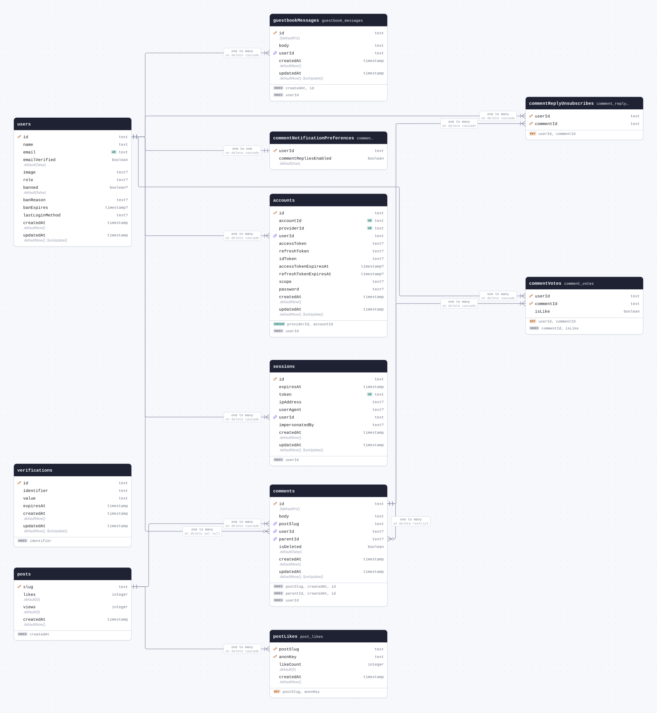
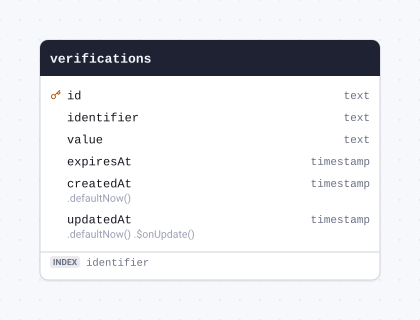
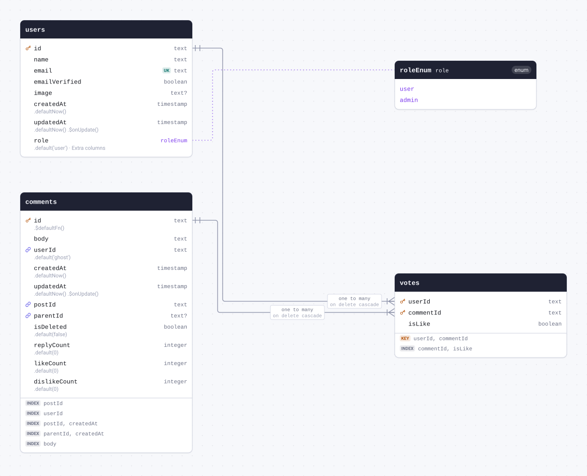
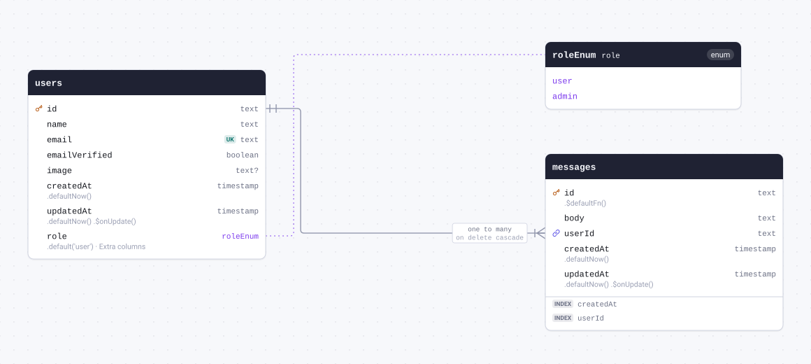
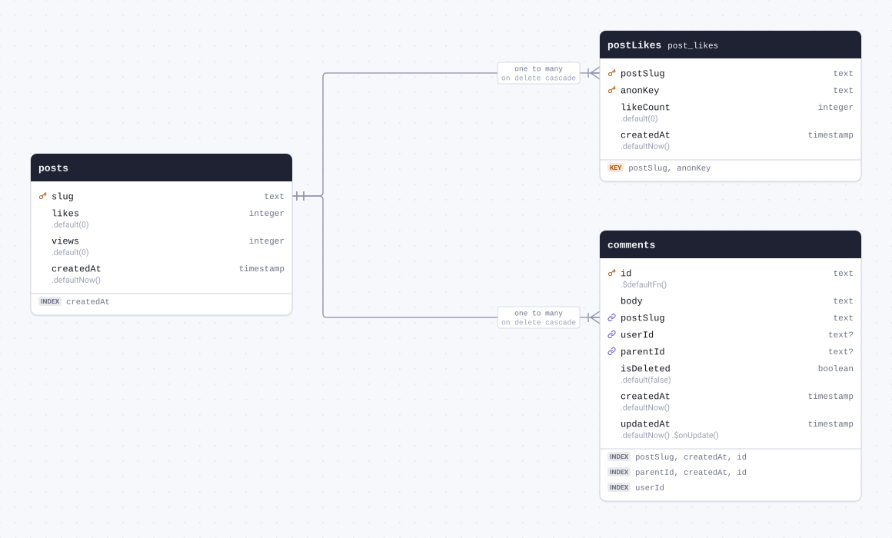
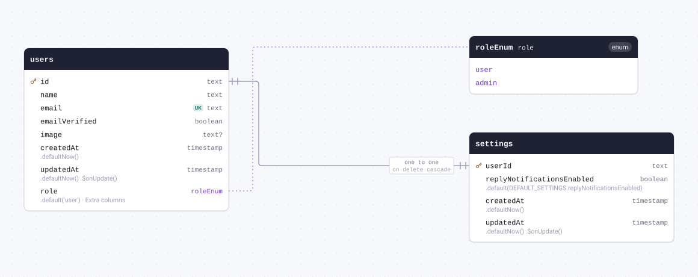
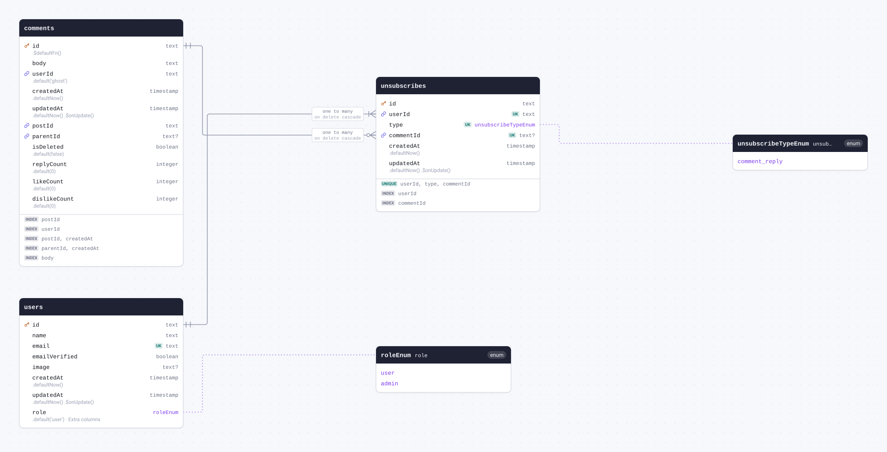

# Schema docs



<details>
<summary>The whole schema as SQL</summary>

```sql
CREATE TYPE "role" AS ENUM('user', 'admin');

CREATE TYPE "unsubscribe_type" AS ENUM('comment_reply');

CREATE TABLE "accounts" (
	"id" text PRIMARY KEY,
	"account_id" text NOT NULL,
	"provider_id" text NOT NULL,
	"user_id" text NOT NULL,
	"access_token" text,
	"refresh_token" text,
	"id_token" text,
	"access_token_expires_at" timestamp(3) with time zone,
	"refresh_token_expires_at" timestamp(3) with time zone,
	"scope" text,
	"password" text,
	"created_at" timestamp(3) with time zone DEFAULT now() NOT NULL,
	"updated_at" timestamp(3) with time zone DEFAULT now() NOT NULL
);

CREATE TABLE "comments" (
	"id" text PRIMARY KEY,
	"body" text NOT NULL,
	"user_id" text DEFAULT 'ghost' NOT NULL,
	"created_at" timestamp(3) with time zone DEFAULT now() NOT NULL,
	"updated_at" timestamp(3) with time zone DEFAULT now() NOT NULL,
	"post_id" text NOT NULL,
	"parent_id" text,
	"is_deleted" boolean DEFAULT false NOT NULL,
	"reply_count" integer DEFAULT 0 NOT NULL,
	"like_count" integer DEFAULT 0 NOT NULL,
	"dislike_count" integer DEFAULT 0 NOT NULL
);

CREATE TABLE "messages" (
	"id" text PRIMARY KEY,
	"body" text NOT NULL,
	"user_id" text NOT NULL,
	"created_at" timestamp(3) with time zone DEFAULT now() NOT NULL,
	"updated_at" timestamp(3) with time zone DEFAULT now() NOT NULL
);

CREATE TABLE "post_likes" (
	"post_id" text,
	"anon_key" text,
	"like_count" integer DEFAULT 0 NOT NULL,
	"created_at" timestamp(3) with time zone DEFAULT now() NOT NULL,
	"updated_at" timestamp(3) with time zone DEFAULT now() NOT NULL,
	CONSTRAINT "post_likes_pkey" PRIMARY KEY("post_id","anon_key"),
	CONSTRAINT "post_likes_like_count_check" CHECK ("like_count" BETWEEN 0 AND 3)
);

CREATE TABLE "posts" (
	"created_at" timestamp(3) with time zone DEFAULT now() NOT NULL,
	"slug" text PRIMARY KEY,
	"likes" integer DEFAULT 0 NOT NULL,
	"views" integer DEFAULT 0 NOT NULL
);

CREATE TABLE "sessions" (
	"id" text PRIMARY KEY,
	"expires_at" timestamp(3) with time zone NOT NULL,
	"token" text NOT NULL UNIQUE,
	"created_at" timestamp(3) with time zone DEFAULT now() NOT NULL,
	"updated_at" timestamp(3) with time zone DEFAULT now() NOT NULL,
	"ip_address" text,
	"user_agent" text,
	"user_id" text NOT NULL
);

CREATE TABLE "settings" (
	"user_id" text PRIMARY KEY,
	"reply_notifications_enabled" boolean DEFAULT true NOT NULL,
	"created_at" timestamp(3) with time zone DEFAULT now() NOT NULL,
	"updated_at" timestamp(3) with time zone DEFAULT now() NOT NULL
);

CREATE TABLE "unsubscribes" (
	"id" text PRIMARY KEY,
	"user_id" text NOT NULL,
	"type" "unsubscribe_type" NOT NULL,
	"comment_id" text,
	"created_at" timestamp(3) with time zone DEFAULT now() NOT NULL,
	"updated_at" timestamp(3) with time zone DEFAULT now() NOT NULL,
	CONSTRAINT "unsubscribes_user_id_type_comment_id_uq" UNIQUE("user_id","type","comment_id"),
	CONSTRAINT "unsubscribes_comment_reply_check" CHECK (("type" = 'comment_reply' AND "comment_id" IS NOT NULL) OR ("type" != 'comment_reply' AND "comment_id" IS NULL))
);

CREATE TABLE "users" (
	"id" text PRIMARY KEY,
	"name" text NOT NULL,
	"email" text NOT NULL UNIQUE,
	"email_verified" boolean NOT NULL,
	"image" text,
	"created_at" timestamp(3) with time zone DEFAULT now() NOT NULL,
	"updated_at" timestamp(3) with time zone DEFAULT now() NOT NULL,
	"role" "role" DEFAULT 'user'::"role" NOT NULL
);

CREATE TABLE "verifications" (
	"id" text PRIMARY KEY,
	"identifier" text NOT NULL,
	"value" text NOT NULL,
	"expires_at" timestamp(3) with time zone NOT NULL,
	"created_at" timestamp(3) with time zone DEFAULT now() NOT NULL,
	"updated_at" timestamp(3) with time zone DEFAULT now() NOT NULL
);

CREATE TABLE "votes" (
	"user_id" text,
	"comment_id" text,
	"is_like" boolean NOT NULL,
	CONSTRAINT "votes_pkey" PRIMARY KEY("user_id","comment_id")
);

CREATE INDEX "accounts_user_id_idx" ON "accounts" ("user_id");

CREATE INDEX "comments_post_id_idx" ON "comments" ("post_id");

CREATE INDEX "comments_user_id_idx" ON "comments" ("user_id");

CREATE INDEX "comments_post_id_created_at_desc_idx" ON "comments" ("post_id","created_at" DESC NULLS LAST) WHERE "parent_id" IS NULL;

CREATE INDEX "comments_parent_id_created_at_desc_idx" ON "comments" ("parent_id","created_at" DESC NULLS LAST) WHERE "parent_id" IS NOT NULL;

CREATE INDEX "comments_body_tsvector_idx" ON "comments" USING gin (to_tsvector('english', "body"));

CREATE INDEX "messages_created_at_desc_idx" ON "messages" ("created_at" DESC NULLS LAST);

CREATE INDEX "messages_user_id_idx" ON "messages" ("user_id");

CREATE INDEX "posts_created_at_desc_idx" ON "posts" ("created_at" DESC NULLS LAST);

CREATE INDEX "sessions_user_id_idx" ON "sessions" ("user_id");

CREATE INDEX "unsubscribes_user_id_idx" ON "unsubscribes" ("user_id");

CREATE INDEX "unsubscribes_comment_id_idx" ON "unsubscribes" ("comment_id");

CREATE INDEX "votes_comment_id_is_like_idx" ON "votes" ("comment_id","is_like");

ALTER TABLE "accounts" ADD CONSTRAINT "accounts_user_id_users_id_fkey" FOREIGN KEY ("user_id") REFERENCES "users"("id") ON DELETE CASCADE;

ALTER TABLE "comments" ADD CONSTRAINT "comments_user_id_users_id_fkey" FOREIGN KEY ("user_id") REFERENCES "users"("id") ON DELETE SET DEFAULT;

ALTER TABLE "comments" ADD CONSTRAINT "comments_post_id_posts_slug_fkey" FOREIGN KEY ("post_id") REFERENCES "posts"("slug") ON DELETE CASCADE;

ALTER TABLE "comments" ADD CONSTRAINT "comments_parent_id_comments_id_fkey" FOREIGN KEY ("parent_id") REFERENCES "comments"("id") ON DELETE RESTRICT;

ALTER TABLE "messages" ADD CONSTRAINT "messages_user_id_users_id_fkey" FOREIGN KEY ("user_id") REFERENCES "users"("id") ON DELETE CASCADE;

ALTER TABLE "post_likes" ADD CONSTRAINT "post_likes_post_id_posts_slug_fkey" FOREIGN KEY ("post_id") REFERENCES "posts"("slug") ON DELETE CASCADE;

ALTER TABLE "sessions" ADD CONSTRAINT "sessions_user_id_users_id_fkey" FOREIGN KEY ("user_id") REFERENCES "users"("id") ON DELETE CASCADE;

ALTER TABLE "settings" ADD CONSTRAINT "settings_user_id_users_id_fkey" FOREIGN KEY ("user_id") REFERENCES "users"("id") ON DELETE CASCADE;

ALTER TABLE "unsubscribes" ADD CONSTRAINT "unsubscribes_user_id_users_id_fkey" FOREIGN KEY ("user_id") REFERENCES "users"("id") ON DELETE CASCADE;

ALTER TABLE "unsubscribes" ADD CONSTRAINT "unsubscribes_comment_id_comments_id_fkey" FOREIGN KEY ("comment_id") REFERENCES "comments"("id") ON DELETE CASCADE;

ALTER TABLE "votes" ADD CONSTRAINT "votes_user_id_users_id_fkey" FOREIGN KEY ("user_id") REFERENCES "users"("id") ON DELETE CASCADE;

ALTER TABLE "votes" ADD CONSTRAINT "votes_comment_id_comments_id_fkey" FOREIGN KEY ("comment_id") REFERENCES "comments"("id") ON DELETE CASCADE;
```

</details>

## Contents

| Table                                 | Name in the database | Description |
| ------------------------------------- | -------------------- | ----------- |
| [users](#table-users)                 | `users`              |             |
| [accounts](#table-accounts)           | `accounts`           |             |
| [sessions](#table-sessions)           | `sessions`           |             |
| [verifications](#table-verifications) | `verifications`      |             |
| [comments](#table-comments)           | `comments`           |             |
| [votes](#table-votes)                 | `votes`              |             |
| [messages](#table-messages)           | `messages`           |             |
| [posts](#table-posts)                 | `posts`              |             |
| [postLikes](#table-postLikes)         | `post_likes`         |             |
| [settings](#table-settings)           | `settings`           |             |
| [unsubscribes](#table-unsubscribes)   | `unsubscribes`       |             |

| Enum                                             | Name in the database | Description |
| ------------------------------------------------ | -------------------- | ----------- |
| [roleEnum](#enum-roleEnum)                       | `role`               |             |
| [unsubscribeTypeEnum](#enum-unsubscribeTypeEnum) | `unsubscribe_type`   |             |

## Tables

<a id="table-users"></a>

### users


| Column                             | Type                         | Constraints     | Default                        | Description   |
| ---------------------------------- | ---------------------------- | --------------- | ------------------------------ | ------------- |
| `id`                               | `text`                       | PK NOT NULL     |                                |               |
| `name`                             | `text`                       | NOT NULL        |                                |               |
| `email`                            | `text`                       | UNIQUE NOT NULL |                                |               |
| `emailVerified` (`email_verified`) | `boolean`                    | NOT NULL        |                                |               |
| `image`                            | `text`                       | NULL            |                                |               |
| `createdAt` (`created_at`)         | `timestamp`                  | NOT NULL        | `.defaultNow()`                |               |
| `updatedAt` (`updated_at`)         | `timestamp`                  | NOT NULL        | `.defaultNow()` `.$onUpdate()` |               |
| `role`                             | [`roleEnum`](#enum-roleEnum) | NOT NULL        | `.default('user')`             | Extra columns |

#### Definition

```sql
CREATE TABLE "users" (
	"id" text PRIMARY KEY,
	"name" text NOT NULL,
	"email" text NOT NULL UNIQUE,
	"email_verified" boolean NOT NULL,
	"image" text,
	"created_at" timestamp(3) with time zone DEFAULT now() NOT NULL,
	"updated_at" timestamp(3) with time zone DEFAULT now() NOT NULL,
	"role" "role" DEFAULT 'user'::"role" NOT NULL
);
```

#### Referenced by

- `id` → [accounts.userId](#table-accounts) (one to many, on delete cascade)
- `id` → [sessions.userId](#table-sessions) (one to many, on delete cascade)
- `id` → [comments.userId](#table-comments) (one to many, on delete set default)
- `id` → [votes.userId](#table-votes) (one to many, on delete cascade)
- `id` → [messages.userId](#table-messages) (one to many, on delete cascade)
- `id` → [settings.userId](#table-settings) (one to one, on delete cascade)
- `id` → [unsubscribes.userId](#table-unsubscribes) (one to many, on delete cascade)

<details>
<summary>Queries and their SQL</summary>

**Select**: Every row of users.

```ts
db.select().from(users);
```

```sql
select "id", "name", "email", "email_verified", "image", "created_at", "updated_at", "role"
from "users"
```

**Count**: How many rows users has.

```ts
db.select({ count: count() }).from(users);
```

```sql
select count(*)
from "users"
```

**Find many**: The rows of users, through the relational query API.

```ts
db.query.users.findMany();
```

```sql
select "d0"."id" as "id", "d0"."name" as "name", "d0"."email" as "email", "d0"."email_verified" as "emailVerified", "d0"."image" as "image", "d0"."created_at" as "createdAt", "d0"."updated_at" as "updatedAt", "d0"."role" as "role"
from "users" as "d0"
```

**Find by primary key**: One row of users, through the relational query API.

```ts
db.query.users.findFirst({ where: { id: "id" } });
```

```sql
select "d0"."id" as "id", "d0"."name" as "name", "d0"."email" as "email", "d0"."email_verified" as "emailVerified", "d0"."image" as "image", "d0"."created_at" as "createdAt", "d0"."updated_at" as "updatedAt", "d0"."role" as "role"
from "users" as "d0"
where "d0"."id" = $1
limit $2
-- params: ["id",1]
```

**Insert**: Adds a row to users, giving the columns that have no default.

```ts
db.insert(users).values({ id: "id", name: "name", email: "email", emailVerified: true });
```

```sql
insert into "users" ("id", "name", "email", "email_verified", "image", "created_at", "updated_at", "role")
values ($1, $2, $3, $4, default, default, default, default)
-- params: ["id","name","email",true]
```

**Update**: Changes a row of users, found by its primary key.

```ts
db.update(users).set({ name: "name" }).where(eq(users.id, "id"));
```

```sql
update "users"
set "name" = $1, "updated_at" = $2
where "users"."id" = $3
-- params: ["name","2026-01-01T00:00:00.000Z","id"]
```

**Delete**: Deletes a row of users, found by its primary key.

```ts
db.delete(users).where(eq(users.id, "id"));
```

```sql
delete from "users"
where "users"."id" = $1
-- params: ["id"]
```

</details>

<a id="table-accounts"></a>

### accounts


| Column                                               | Type        | Constraints                         | Default                        | Description |
| ---------------------------------------------------- | ----------- | ----------------------------------- | ------------------------------ | ----------- |
| `id`                                                 | `text`      | PK NOT NULL                         |                                |             |
| `accountId` (`account_id`)                           | `text`      | NOT NULL                            |                                |             |
| `providerId` (`provider_id`)                         | `text`      | NOT NULL                            |                                |             |
| `userId` (`user_id`)                                 | `text`      | NOT NULL → [users.id](#table-users) |                                |             |
| `accessToken` (`access_token`)                       | `text`      | NULL                                |                                |             |
| `refreshToken` (`refresh_token`)                     | `text`      | NULL                                |                                |             |
| `idToken` (`id_token`)                               | `text`      | NULL                                |                                |             |
| `accessTokenExpiresAt` (`access_token_expires_at`)   | `timestamp` | NULL                                |                                |             |
| `refreshTokenExpiresAt` (`refresh_token_expires_at`) | `timestamp` | NULL                                |                                |             |
| `scope`                                              | `text`      | NULL                                |                                |             |
| `password`                                           | `text`      | NULL                                |                                |             |
| `createdAt` (`created_at`)                           | `timestamp` | NOT NULL                            | `.defaultNow()`                |             |
| `updatedAt` (`updated_at`)                           | `timestamp` | NOT NULL                            | `.defaultNow()` `.$onUpdate()` |             |

#### Definition

```sql
CREATE TABLE "accounts" (
	"id" text PRIMARY KEY,
	"account_id" text NOT NULL,
	"provider_id" text NOT NULL,
	"user_id" text NOT NULL,
	"access_token" text,
	"refresh_token" text,
	"id_token" text,
	"access_token_expires_at" timestamp(3) with time zone,
	"refresh_token_expires_at" timestamp(3) with time zone,
	"scope" text,
	"password" text,
	"created_at" timestamp(3) with time zone DEFAULT now() NOT NULL,
	"updated_at" timestamp(3) with time zone DEFAULT now() NOT NULL
);

CREATE INDEX "accounts_user_id_idx" ON "accounts" ("user_id");

ALTER TABLE "accounts" ADD CONSTRAINT "accounts_user_id_users_id_fkey" FOREIGN KEY ("user_id") REFERENCES "users"("id") ON DELETE CASCADE;
```

#### Indexes

- INDEX `userId`

#### References

- `userId` → [users.id](#table-users) (many to one, on delete cascade)

<details>
<summary>Queries and their SQL</summary>

**Select**: Every row of accounts.

```ts
db.select().from(accounts);
```

```sql
select "id", "account_id", "provider_id", "user_id", "access_token", "refresh_token", "id_token", "access_token_expires_at", "refresh_token_expires_at", "scope", "password", "created_at", "updated_at"
from "accounts"
```

**Count**: How many rows accounts has.

```ts
db.select({ count: count() }).from(accounts);
```

```sql
select count(*)
from "accounts"
```

**Find many**: The rows of accounts, through the relational query API.

```ts
db.query.accounts.findMany();
```

```sql
select "d0"."id" as "id", "d0"."account_id" as "accountId", "d0"."provider_id" as "providerId", "d0"."user_id" as "userId", "d0"."access_token" as "accessToken", "d0"."refresh_token" as "refreshToken", "d0"."id_token" as "idToken", "d0"."access_token_expires_at" as "accessTokenExpiresAt", "d0"."refresh_token_expires_at" as "refreshTokenExpiresAt", "d0"."scope" as "scope", "d0"."password" as "password", "d0"."created_at" as "createdAt", "d0"."updated_at" as "updatedAt"
from "accounts" as "d0"
```

**Find by primary key**: One row of accounts, through the relational query API.

```ts
db.query.accounts.findFirst({ where: { id: "id" } });
```

```sql
select "d0"."id" as "id", "d0"."account_id" as "accountId", "d0"."provider_id" as "providerId", "d0"."user_id" as "userId", "d0"."access_token" as "accessToken", "d0"."refresh_token" as "refreshToken", "d0"."id_token" as "idToken", "d0"."access_token_expires_at" as "accessTokenExpiresAt", "d0"."refresh_token_expires_at" as "refreshTokenExpiresAt", "d0"."scope" as "scope", "d0"."password" as "password", "d0"."created_at" as "createdAt", "d0"."updated_at" as "updatedAt"
from "accounts" as "d0"
where "d0"."id" = $1
limit $2
-- params: ["id",1]
```

**Insert**: Adds a row to accounts, giving the columns that have no default.

```ts
db.insert(accounts).values({
  id: "id",
  accountId: "accountId",
  providerId: "providerId",
  userId: "userId",
});
```

```sql
insert into "accounts" ("id", "account_id", "provider_id", "user_id", "access_token", "refresh_token", "id_token", "access_token_expires_at", "refresh_token_expires_at", "scope", "password", "created_at", "updated_at")
values ($1, $2, $3, $4, default, default, default, default, default, default, default, default, default)
-- params: ["id","accountId","providerId","userId"]
```

**Update**: Changes a row of accounts, found by its primary key.

```ts
db.update(accounts).set({ accountId: "accountId" }).where(eq(accounts.id, "id"));
```

```sql
update "accounts"
set "account_id" = $1, "updated_at" = $2
where "accounts"."id" = $3
-- params: ["accountId","2026-01-01T00:00:00.000Z","id"]
```

**Delete**: Deletes a row of accounts, found by its primary key.

```ts
db.delete(accounts).where(eq(accounts.id, "id"));
```

```sql
delete from "accounts"
where "accounts"."id" = $1
-- params: ["id"]
```

</details>

<a id="table-sessions"></a>

### sessions


| Column                     | Type        | Constraints                         | Default                        | Description |
| -------------------------- | ----------- | ----------------------------------- | ------------------------------ | ----------- |
| `id`                       | `text`      | PK NOT NULL                         |                                |             |
| `expiresAt` (`expires_at`) | `timestamp` | NOT NULL                            |                                |             |
| `token`                    | `text`      | UNIQUE NOT NULL                     |                                |             |
| `createdAt` (`created_at`) | `timestamp` | NOT NULL                            | `.defaultNow()`                |             |
| `updatedAt` (`updated_at`) | `timestamp` | NOT NULL                            | `.defaultNow()` `.$onUpdate()` |             |
| `ipAddress` (`ip_address`) | `text`      | NULL                                |                                |             |
| `userAgent` (`user_agent`) | `text`      | NULL                                |                                |             |
| `userId` (`user_id`)       | `text`      | NOT NULL → [users.id](#table-users) |                                |             |

#### Definition

```sql
CREATE TABLE "sessions" (
	"id" text PRIMARY KEY,
	"expires_at" timestamp(3) with time zone NOT NULL,
	"token" text NOT NULL UNIQUE,
	"created_at" timestamp(3) with time zone DEFAULT now() NOT NULL,
	"updated_at" timestamp(3) with time zone DEFAULT now() NOT NULL,
	"ip_address" text,
	"user_agent" text,
	"user_id" text NOT NULL
);

CREATE INDEX "sessions_user_id_idx" ON "sessions" ("user_id");

ALTER TABLE "sessions" ADD CONSTRAINT "sessions_user_id_users_id_fkey" FOREIGN KEY ("user_id") REFERENCES "users"("id") ON DELETE CASCADE;
```

#### Indexes

- INDEX `userId`

#### References

- `userId` → [users.id](#table-users) (many to one, on delete cascade)

<details>
<summary>Queries and their SQL</summary>

**Select**: Every row of sessions.

```ts
db.select().from(sessions);
```

```sql
select "id", "expires_at", "token", "created_at", "updated_at", "ip_address", "user_agent", "user_id"
from "sessions"
```

**Count**: How many rows sessions has.

```ts
db.select({ count: count() }).from(sessions);
```

```sql
select count(*)
from "sessions"
```

**Find many**: The rows of sessions, through the relational query API.

```ts
db.query.sessions.findMany();
```

```sql
select "d0"."id" as "id", "d0"."expires_at" as "expiresAt", "d0"."token" as "token", "d0"."created_at" as "createdAt", "d0"."updated_at" as "updatedAt", "d0"."ip_address" as "ipAddress", "d0"."user_agent" as "userAgent", "d0"."user_id" as "userId"
from "sessions" as "d0"
```

**Find by primary key**: One row of sessions, through the relational query API.

```ts
db.query.sessions.findFirst({ where: { id: "id" } });
```

```sql
select "d0"."id" as "id", "d0"."expires_at" as "expiresAt", "d0"."token" as "token", "d0"."created_at" as "createdAt", "d0"."updated_at" as "updatedAt", "d0"."ip_address" as "ipAddress", "d0"."user_agent" as "userAgent", "d0"."user_id" as "userId"
from "sessions" as "d0"
where "d0"."id" = $1
limit $2
-- params: ["id",1]
```

**Insert**: Adds a row to sessions, giving the columns that have no default.

```ts
db.insert(sessions).values({
  id: "id",
  expiresAt: new Date("2026-01-01T00:00:00.000Z"),
  token: "token",
  userId: "userId",
});
```

```sql
insert into "sessions" ("id", "expires_at", "token", "created_at", "updated_at", "ip_address", "user_agent", "user_id")
values ($1, $2, $3, default, default, default, default, $4)
-- params: ["id","2026-01-01T00:00:00.000Z","token","userId"]
```

**Update**: Changes a row of sessions, found by its primary key.

```ts
db.update(sessions)
  .set({ expiresAt: new Date("2026-01-01T00:00:00.000Z") })
  .where(eq(sessions.id, "id"));
```

```sql
update "sessions"
set "expires_at" = $1, "updated_at" = $2
where "sessions"."id" = $3
-- params: ["2026-01-01T00:00:00.000Z","2026-01-01T00:00:00.000Z","id"]
```

**Delete**: Deletes a row of sessions, found by its primary key.

```ts
db.delete(sessions).where(eq(sessions.id, "id"));
```

```sql
delete from "sessions"
where "sessions"."id" = $1
-- params: ["id"]
```

</details>

<a id="table-verifications"></a>

### verifications



| Column                     | Type        | Constraints | Default                        | Description |
| -------------------------- | ----------- | ----------- | ------------------------------ | ----------- |
| `id`                       | `text`      | PK NOT NULL |                                |             |
| `identifier`               | `text`      | NOT NULL    |                                |             |
| `value`                    | `text`      | NOT NULL    |                                |             |
| `expiresAt` (`expires_at`) | `timestamp` | NOT NULL    |                                |             |
| `createdAt` (`created_at`) | `timestamp` | NOT NULL    | `.defaultNow()`                |             |
| `updatedAt` (`updated_at`) | `timestamp` | NOT NULL    | `.defaultNow()` `.$onUpdate()` |             |

#### Definition

```sql
CREATE TABLE "verifications" (
	"id" text PRIMARY KEY,
	"identifier" text NOT NULL,
	"value" text NOT NULL,
	"expires_at" timestamp(3) with time zone NOT NULL,
	"created_at" timestamp(3) with time zone DEFAULT now() NOT NULL,
	"updated_at" timestamp(3) with time zone DEFAULT now() NOT NULL
);
```

<details>
<summary>Queries and their SQL</summary>

**Select**: Every row of verifications.

```ts
db.select().from(verifications);
```

```sql
select "id", "identifier", "value", "expires_at", "created_at", "updated_at"
from "verifications"
```

**Count**: How many rows verifications has.

```ts
db.select({ count: count() }).from(verifications);
```

```sql
select count(*)
from "verifications"
```

**Find many**: The rows of verifications, through the relational query API.

```ts
db.query.verifications.findMany();
```

```sql
select "d0"."id" as "id", "d0"."identifier" as "identifier", "d0"."value" as "value", "d0"."expires_at" as "expiresAt", "d0"."created_at" as "createdAt", "d0"."updated_at" as "updatedAt"
from "verifications" as "d0"
```

**Find by primary key**: One row of verifications, through the relational query API.

```ts
db.query.verifications.findFirst({ where: { id: "id" } });
```

```sql
select "d0"."id" as "id", "d0"."identifier" as "identifier", "d0"."value" as "value", "d0"."expires_at" as "expiresAt", "d0"."created_at" as "createdAt", "d0"."updated_at" as "updatedAt"
from "verifications" as "d0"
where "d0"."id" = $1
limit $2
-- params: ["id",1]
```

**Insert**: Adds a row to verifications, giving the columns that have no default.

```ts
db.insert(verifications).values({
  id: "id",
  identifier: "identifier",
  value: "value",
  expiresAt: new Date("2026-01-01T00:00:00.000Z"),
});
```

```sql
insert into "verifications" ("id", "identifier", "value", "expires_at", "created_at", "updated_at")
values ($1, $2, $3, $4, default, default)
-- params: ["id","identifier","value","2026-01-01T00:00:00.000Z"]
```

**Update**: Changes a row of verifications, found by its primary key.

```ts
db.update(verifications).set({ identifier: "identifier" }).where(eq(verifications.id, "id"));
```

```sql
update "verifications"
set "identifier" = $1, "updated_at" = $2
where "verifications"."id" = $3
-- params: ["identifier","2026-01-01T00:00:00.000Z","id"]
```

**Delete**: Deletes a row of verifications, found by its primary key.

```ts
db.delete(verifications).where(eq(verifications.id, "id"));
```

```sql
delete from "verifications"
where "verifications"."id" = $1
-- params: ["id"]
```

</details>

<a id="table-comments"></a>

### comments


| Column                           | Type        | Constraints                           | Default                        | Description |
| -------------------------------- | ----------- | ------------------------------------- | ------------------------------ | ----------- |
| `id`                             | `text`      | PK NOT NULL                           | `.$defaultFn()`                |             |
| `body`                           | `text`      | NOT NULL                              |                                |             |
| `userId` (`user_id`)             | `text`      | NOT NULL → [users.id](#table-users)   | `.default('ghost')`            |             |
| `createdAt` (`created_at`)       | `timestamp` | NOT NULL                              | `.defaultNow()`                |             |
| `updatedAt` (`updated_at`)       | `timestamp` | NOT NULL                              | `.defaultNow()` `.$onUpdate()` |             |
| `postId` (`post_id`)             | `text`      | NOT NULL → [posts.slug](#table-posts) |                                |             |
| `parentId` (`parent_id`)         | `text`      | NULL → [comments.id](#table-comments) |                                |             |
| `isDeleted` (`is_deleted`)       | `boolean`   | NOT NULL                              | `.default(false)`              |             |
| `replyCount` (`reply_count`)     | `integer`   | NOT NULL                              | `.default(0)`                  |             |
| `likeCount` (`like_count`)       | `integer`   | NOT NULL                              | `.default(0)`                  |             |
| `dislikeCount` (`dislike_count`) | `integer`   | NOT NULL                              | `.default(0)`                  |             |

#### Definition

```sql
CREATE TABLE "comments" (
	"id" text PRIMARY KEY,
	"body" text NOT NULL,
	"user_id" text DEFAULT 'ghost' NOT NULL,
	"created_at" timestamp(3) with time zone DEFAULT now() NOT NULL,
	"updated_at" timestamp(3) with time zone DEFAULT now() NOT NULL,
	"post_id" text NOT NULL,
	"parent_id" text,
	"is_deleted" boolean DEFAULT false NOT NULL,
	"reply_count" integer DEFAULT 0 NOT NULL,
	"like_count" integer DEFAULT 0 NOT NULL,
	"dislike_count" integer DEFAULT 0 NOT NULL
);

CREATE INDEX "comments_post_id_idx" ON "comments" ("post_id");

CREATE INDEX "comments_user_id_idx" ON "comments" ("user_id");

CREATE INDEX "comments_post_id_created_at_desc_idx" ON "comments" ("post_id","created_at" DESC NULLS LAST) WHERE "parent_id" IS NULL;

CREATE INDEX "comments_parent_id_created_at_desc_idx" ON "comments" ("parent_id","created_at" DESC NULLS LAST) WHERE "parent_id" IS NOT NULL;

CREATE INDEX "comments_body_tsvector_idx" ON "comments" USING gin (to_tsvector('english', "body"));

ALTER TABLE "comments" ADD CONSTRAINT "comments_user_id_users_id_fkey" FOREIGN KEY ("user_id") REFERENCES "users"("id") ON DELETE SET DEFAULT;

ALTER TABLE "comments" ADD CONSTRAINT "comments_post_id_posts_slug_fkey" FOREIGN KEY ("post_id") REFERENCES "posts"("slug") ON DELETE CASCADE;

ALTER TABLE "comments" ADD CONSTRAINT "comments_parent_id_comments_id_fkey" FOREIGN KEY ("parent_id") REFERENCES "comments"("id") ON DELETE RESTRICT;
```

#### Indexes

- INDEX `postId`
- INDEX `userId`
- INDEX `postId`, `createdAt`
- INDEX `parentId`, `createdAt`
- INDEX `body`

#### References

- `userId` → [users.id](#table-users) (many to one, on delete set default)
- `postId` → [posts.slug](#table-posts) (many to one, on delete cascade)
- `parentId` → [comments.id](#table-comments) (many to one, on delete restrict)

#### Referenced by

- `id` → [comments.parentId](#table-comments) (one to many, on delete restrict)
- `id` → [votes.commentId](#table-votes) (one to many, on delete cascade)
- `id` → [unsubscribes.commentId](#table-unsubscribes) (one to many, on delete cascade)

<details>
<summary>Queries and their SQL</summary>

**Select**: Every row of comments.

```ts
db.select().from(comments);
```

```sql
select "id", "body", "user_id", "created_at", "updated_at", "post_id", "parent_id", "is_deleted", "reply_count", "like_count", "dislike_count"
from "comments"
```

**Count**: How many rows comments has.

```ts
db.select({ count: count() }).from(comments);
```

```sql
select count(*)
from "comments"
```

**Find many**: The rows of comments, through the relational query API.

```ts
db.query.comments.findMany();
```

```sql
select "d0"."id" as "id", "d0"."body" as "body", "d0"."user_id" as "userId", "d0"."created_at" as "createdAt", "d0"."updated_at" as "updatedAt", "d0"."post_id" as "postId", "d0"."parent_id" as "parentId", "d0"."is_deleted" as "isDeleted", "d0"."reply_count" as "replyCount", "d0"."like_count" as "likeCount", "d0"."dislike_count" as "dislikeCount"
from "comments" as "d0"
```

**Find by primary key**: One row of comments, through the relational query API.

```ts
db.query.comments.findFirst({ where: { id: "id" } });
```

```sql
select "d0"."id" as "id", "d0"."body" as "body", "d0"."user_id" as "userId", "d0"."created_at" as "createdAt", "d0"."updated_at" as "updatedAt", "d0"."post_id" as "postId", "d0"."parent_id" as "parentId", "d0"."is_deleted" as "isDeleted", "d0"."reply_count" as "replyCount", "d0"."like_count" as "likeCount", "d0"."dislike_count" as "dislikeCount"
from "comments" as "d0"
where "d0"."id" = $1
limit $2
-- params: ["id",1]
```

**Insert**: Adds a row to comments, giving the columns that have no default.

```ts
db.insert(comments).values({ body: "body", postId: "postId" });
```

```sql
insert into "comments" ("id", "body", "user_id", "created_at", "updated_at", "post_id", "parent_id", "is_deleted", "reply_count", "like_count", "dislike_count")
values ($1, $2, default, default, default, $3, default, default, default, default, default)
-- params: ["aauyl8ca800v38uhc8wq0jek","body","postId"]
```

**Update**: Changes a row of comments, found by its primary key.

```ts
db.update(comments).set({ body: "body" }).where(eq(comments.id, "id"));
```

```sql
update "comments"
set "body" = $1, "updated_at" = $2
where "comments"."id" = $3
-- params: ["body","2026-01-01T00:00:00.000Z","id"]
```

**Delete**: Deletes a row of comments, found by its primary key.

```ts
db.delete(comments).where(eq(comments.id, "id"));
```

```sql
delete from "comments"
where "comments"."id" = $1
-- params: ["id"]
```

</details>

<a id="table-votes"></a>

### votes



| Column                     | Type      | Constraints                                  | Default | Description |
| -------------------------- | --------- | -------------------------------------------- | ------- | ----------- |
| `userId` (`user_id`)       | `text`    | PK NOT NULL → [users.id](#table-users)       |         |             |
| `commentId` (`comment_id`) | `text`    | PK NOT NULL → [comments.id](#table-comments) |         |             |
| `isLike` (`is_like`)       | `boolean` | NOT NULL                                     |         |             |

#### Definition

```sql
CREATE TABLE "votes" (
	"user_id" text,
	"comment_id" text,
	"is_like" boolean NOT NULL,
	CONSTRAINT "votes_pkey" PRIMARY KEY("user_id","comment_id")
);

CREATE INDEX "votes_comment_id_is_like_idx" ON "votes" ("comment_id","is_like");

ALTER TABLE "votes" ADD CONSTRAINT "votes_user_id_users_id_fkey" FOREIGN KEY ("user_id") REFERENCES "users"("id") ON DELETE CASCADE;

ALTER TABLE "votes" ADD CONSTRAINT "votes_comment_id_comments_id_fkey" FOREIGN KEY ("comment_id") REFERENCES "comments"("id") ON DELETE CASCADE;
```

#### Indexes

- PRIMARY KEY `userId`, `commentId`
- INDEX `commentId`, `isLike`

#### References

- `userId` → [users.id](#table-users) (many to one, on delete cascade)
- `commentId` → [comments.id](#table-comments) (many to one, on delete cascade)

<details>
<summary>Queries and their SQL</summary>

**Select**: Every row of votes.

```ts
db.select().from(votes);
```

```sql
select "user_id", "comment_id", "is_like"
from "votes"
```

**Count**: How many rows votes has.

```ts
db.select({ count: count() }).from(votes);
```

```sql
select count(*)
from "votes"
```

**Find many**: The rows of votes, through the relational query API.

```ts
db.query.votes.findMany();
```

```sql
select "d0"."user_id" as "userId", "d0"."comment_id" as "commentId", "d0"."is_like" as "isLike"
from "votes" as "d0"
```

**Find by primary key**: One row of votes, through the relational query API.

```ts
db.query.votes.findFirst({ where: { userId: "userId", commentId: "commentId" } });
```

```sql
select "d0"."user_id" as "userId", "d0"."comment_id" as "commentId", "d0"."is_like" as "isLike"
from "votes" as "d0"
where (("d0"."user_id" = $1) and ("d0"."comment_id" = $2))
limit $3
-- params: ["userId","commentId",1]
```

**Insert**: Adds a row to votes, giving the columns that have no default.

```ts
db.insert(votes).values({ userId: "userId", commentId: "commentId", isLike: true });
```

```sql
insert into "votes" ("user_id", "comment_id", "is_like")
values ($1, $2, $3)
-- params: ["userId","commentId",true]
```

**Update**: Changes a row of votes, found by its primary key.

```ts
db.update(votes)
  .set({ isLike: true })
  .where(and(eq(votes.userId, "userId"), eq(votes.commentId, "commentId")));
```

```sql
update "votes"
set "is_like" = $1
where (("votes"."user_id" = $2) and ("votes"."comment_id" = $3))
-- params: [true,"userId","commentId"]
```

**Delete**: Deletes a row of votes, found by its primary key.

```ts
db.delete(votes).where(and(eq(votes.userId, "userId"), eq(votes.commentId, "commentId")));
```

```sql
delete from "votes"
where (("votes"."user_id" = $1) and ("votes"."comment_id" = $2))
-- params: ["userId","commentId"]
```

</details>

<a id="table-messages"></a>

### messages



| Column                     | Type        | Constraints                         | Default                        | Description |
| -------------------------- | ----------- | ----------------------------------- | ------------------------------ | ----------- |
| `id`                       | `text`      | PK NOT NULL                         | `.$defaultFn()`                |             |
| `body`                     | `text`      | NOT NULL                            |                                |             |
| `userId` (`user_id`)       | `text`      | NOT NULL → [users.id](#table-users) |                                |             |
| `createdAt` (`created_at`) | `timestamp` | NOT NULL                            | `.defaultNow()`                |             |
| `updatedAt` (`updated_at`) | `timestamp` | NOT NULL                            | `.defaultNow()` `.$onUpdate()` |             |

#### Definition

```sql
CREATE TABLE "messages" (
	"id" text PRIMARY KEY,
	"body" text NOT NULL,
	"user_id" text NOT NULL,
	"created_at" timestamp(3) with time zone DEFAULT now() NOT NULL,
	"updated_at" timestamp(3) with time zone DEFAULT now() NOT NULL
);

CREATE INDEX "messages_created_at_desc_idx" ON "messages" ("created_at" DESC NULLS LAST);

CREATE INDEX "messages_user_id_idx" ON "messages" ("user_id");

ALTER TABLE "messages" ADD CONSTRAINT "messages_user_id_users_id_fkey" FOREIGN KEY ("user_id") REFERENCES "users"("id") ON DELETE CASCADE;
```

#### Indexes

- INDEX `createdAt`
- INDEX `userId`

#### References

- `userId` → [users.id](#table-users) (many to one, on delete cascade)

<details>
<summary>Queries and their SQL</summary>

**Select**: Every row of messages.

```ts
db.select().from(messages);
```

```sql
select "id", "body", "user_id", "created_at", "updated_at"
from "messages"
```

**Count**: How many rows messages has.

```ts
db.select({ count: count() }).from(messages);
```

```sql
select count(*)
from "messages"
```

**Find many**: The rows of messages, through the relational query API.

```ts
db.query.messages.findMany();
```

```sql
select "d0"."id" as "id", "d0"."body" as "body", "d0"."user_id" as "userId", "d0"."created_at" as "createdAt", "d0"."updated_at" as "updatedAt"
from "messages" as "d0"
```

**Find by primary key**: One row of messages, through the relational query API.

```ts
db.query.messages.findFirst({ where: { id: "id" } });
```

```sql
select "d0"."id" as "id", "d0"."body" as "body", "d0"."user_id" as "userId", "d0"."created_at" as "createdAt", "d0"."updated_at" as "updatedAt"
from "messages" as "d0"
where "d0"."id" = $1
limit $2
-- params: ["id",1]
```

**Insert**: Adds a row to messages, giving the columns that have no default.

```ts
db.insert(messages).values({ body: "body", userId: "userId" });
```

```sql
insert into "messages" ("id", "body", "user_id", "created_at", "updated_at")
values ($1, $2, $3, default, default)
-- params: ["a3zlcfqwha1jfl7z8mtleoga","body","userId"]
```

**Update**: Changes a row of messages, found by its primary key.

```ts
db.update(messages).set({ body: "body" }).where(eq(messages.id, "id"));
```

```sql
update "messages"
set "body" = $1, "updated_at" = $2
where "messages"."id" = $3
-- params: ["body","2026-01-01T00:00:00.000Z","id"]
```

**Delete**: Deletes a row of messages, found by its primary key.

```ts
db.delete(messages).where(eq(messages.id, "id"));
```

```sql
delete from "messages"
where "messages"."id" = $1
-- params: ["id"]
```

</details>

<a id="table-posts"></a>

### posts



| Column                     | Type        | Constraints | Default         | Description |
| -------------------------- | ----------- | ----------- | --------------- | ----------- |
| `createdAt` (`created_at`) | `timestamp` | NOT NULL    | `.defaultNow()` |             |
| `slug`                     | `text`      | PK NOT NULL |                 |             |
| `likes`                    | `integer`   | NOT NULL    | `.default(0)`   |             |
| `views`                    | `integer`   | NOT NULL    | `.default(0)`   |             |

#### Definition

```sql
CREATE TABLE "posts" (
	"created_at" timestamp(3) with time zone DEFAULT now() NOT NULL,
	"slug" text PRIMARY KEY,
	"likes" integer DEFAULT 0 NOT NULL,
	"views" integer DEFAULT 0 NOT NULL
);

CREATE INDEX "posts_created_at_desc_idx" ON "posts" ("created_at" DESC NULLS LAST);
```

#### Indexes

- INDEX `createdAt`

#### Referenced by

- `slug` → [comments.postId](#table-comments) (one to many, on delete cascade)
- `slug` → [postLikes.postId](#table-postLikes) (one to many, on delete cascade)

<details>
<summary>Queries and their SQL</summary>

**Select**: Every row of posts.

```ts
db.select().from(posts);
```

```sql
select "created_at", "slug", "likes", "views"
from "posts"
```

**Count**: How many rows posts has.

```ts
db.select({ count: count() }).from(posts);
```

```sql
select count(*)
from "posts"
```

**Find many**: The rows of posts, through the relational query API.

```ts
db.query.posts.findMany();
```

```sql
select "d0"."created_at" as "createdAt", "d0"."slug" as "slug", "d0"."likes" as "likes", "d0"."views" as "views"
from "posts" as "d0"
```

**Find by primary key**: One row of posts, through the relational query API.

```ts
db.query.posts.findFirst({ where: { slug: "slug" } });
```

```sql
select "d0"."created_at" as "createdAt", "d0"."slug" as "slug", "d0"."likes" as "likes", "d0"."views" as "views"
from "posts" as "d0"
where "d0"."slug" = $1
limit $2
-- params: ["slug",1]
```

**Insert**: Adds a row to posts, giving the columns that have no default.

```ts
db.insert(posts).values({ slug: "slug" });
```

```sql
insert into "posts" ("created_at", "slug", "likes", "views")
values (default, $1, default, default)
-- params: ["slug"]
```

**Update**: Changes a row of posts, found by its primary key.

```ts
db.update(posts)
  .set({ createdAt: new Date("2026-01-01T00:00:00.000Z") })
  .where(eq(posts.slug, "slug"));
```

```sql
update "posts"
set "created_at" = $1
where "posts"."slug" = $2
-- params: ["2026-01-01T00:00:00.000Z","slug"]
```

**Delete**: Deletes a row of posts, found by its primary key.

```ts
db.delete(posts).where(eq(posts.slug, "slug"));
```

```sql
delete from "posts"
where "posts"."slug" = $1
-- params: ["slug"]
```

</details>

<a id="table-postLikes"></a>

### postLikes

Table `post_likes`.


| Column                     | Type        | Constraints                              | Default                        | Description |
| -------------------------- | ----------- | ---------------------------------------- | ------------------------------ | ----------- |
| `postId` (`post_id`)       | `text`      | PK NOT NULL → [posts.slug](#table-posts) |                                |             |
| `anonKey` (`anon_key`)     | `text`      | PK NOT NULL                              |                                |             |
| `likeCount` (`like_count`) | `integer`   | NOT NULL                                 | `.default(0)`                  |             |
| `createdAt` (`created_at`) | `timestamp` | NOT NULL                                 | `.defaultNow()`                |             |
| `updatedAt` (`updated_at`) | `timestamp` | NOT NULL                                 | `.defaultNow()` `.$onUpdate()` |             |

#### Definition

```sql
CREATE TABLE "post_likes" (
	"post_id" text,
	"anon_key" text,
	"like_count" integer DEFAULT 0 NOT NULL,
	"created_at" timestamp(3) with time zone DEFAULT now() NOT NULL,
	"updated_at" timestamp(3) with time zone DEFAULT now() NOT NULL,
	CONSTRAINT "post_likes_pkey" PRIMARY KEY("post_id","anon_key"),
	CONSTRAINT "post_likes_like_count_check" CHECK ("like_count" BETWEEN 0 AND 3)
);

ALTER TABLE "post_likes" ADD CONSTRAINT "post_likes_post_id_posts_slug_fkey" FOREIGN KEY ("post_id") REFERENCES "posts"("slug") ON DELETE CASCADE;
```

#### Indexes

- PRIMARY KEY `postId`, `anonKey`

#### References

- `postId` → [posts.slug](#table-posts) (many to one, on delete cascade)

<details>
<summary>Queries and their SQL</summary>

**Select**: Every row of postLikes.

```ts
db.select().from(postLikes);
```

```sql
select "post_id", "anon_key", "like_count", "created_at", "updated_at"
from "post_likes"
```

**Count**: How many rows postLikes has.

```ts
db.select({ count: count() }).from(postLikes);
```

```sql
select count(*)
from "post_likes"
```

**Find many**: The rows of postLikes, through the relational query API.

```ts
db.query.postLikes.findMany();
```

```sql
select "d0"."post_id" as "postId", "d0"."anon_key" as "anonKey", "d0"."like_count" as "likeCount", "d0"."created_at" as "createdAt", "d0"."updated_at" as "updatedAt"
from "post_likes" as "d0"
```

**Find by primary key**: One row of postLikes, through the relational query API.

```ts
db.query.postLikes.findFirst({ where: { postId: "postId", anonKey: "anonKey" } });
```

```sql
select "d0"."post_id" as "postId", "d0"."anon_key" as "anonKey", "d0"."like_count" as "likeCount", "d0"."created_at" as "createdAt", "d0"."updated_at" as "updatedAt"
from "post_likes" as "d0"
where (("d0"."post_id" = $1) and ("d0"."anon_key" = $2))
limit $3
-- params: ["postId","anonKey",1]
```

**Insert**: Adds a row to postLikes, giving the columns that have no default.

```ts
db.insert(postLikes).values({ postId: "postId", anonKey: "anonKey" });
```

```sql
insert into "post_likes" ("post_id", "anon_key", "like_count", "created_at", "updated_at")
values ($1, $2, default, default, default)
-- params: ["postId","anonKey"]
```

**Update**: Changes a row of postLikes, found by its primary key.

```ts
db.update(postLikes)
  .set({ likeCount: 1 })
  .where(and(eq(postLikes.postId, "postId"), eq(postLikes.anonKey, "anonKey")));
```

```sql
update "post_likes"
set "like_count" = $1, "updated_at" = $2
where (("post_likes"."post_id" = $3) and ("post_likes"."anon_key" = $4))
-- params: [1,"2026-01-01T00:00:00.000Z","postId","anonKey"]
```

**Delete**: Deletes a row of postLikes, found by its primary key.

```ts
db.delete(postLikes).where(and(eq(postLikes.postId, "postId"), eq(postLikes.anonKey, "anonKey")));
```

```sql
delete from "post_likes"
where (("post_likes"."post_id" = $1) and ("post_likes"."anon_key" = $2))
-- params: ["postId","anonKey"]
```

</details>

<a id="table-settings"></a>

### settings



| Column                                                      | Type        | Constraints                            | Default                                                | Description |
| ----------------------------------------------------------- | ----------- | -------------------------------------- | ------------------------------------------------------ | ----------- |
| `userId` (`user_id`)                                        | `text`      | PK NOT NULL → [users.id](#table-users) |                                                        |             |
| `replyNotificationsEnabled` (`reply_notifications_enabled`) | `boolean`   | NOT NULL                               | `.default(DEFAULT_SETTINGS.replyNotificationsEnabled)` |             |
| `createdAt` (`created_at`)                                  | `timestamp` | NOT NULL                               | `.defaultNow()`                                        |             |
| `updatedAt` (`updated_at`)                                  | `timestamp` | NOT NULL                               | `.defaultNow()` `.$onUpdate()`                         |             |

#### Definition

```sql
CREATE TABLE "settings" (
	"user_id" text PRIMARY KEY,
	"reply_notifications_enabled" boolean DEFAULT true NOT NULL,
	"created_at" timestamp(3) with time zone DEFAULT now() NOT NULL,
	"updated_at" timestamp(3) with time zone DEFAULT now() NOT NULL
);

ALTER TABLE "settings" ADD CONSTRAINT "settings_user_id_users_id_fkey" FOREIGN KEY ("user_id") REFERENCES "users"("id") ON DELETE CASCADE;
```

#### References

- `userId` → [users.id](#table-users) (one to one, on delete cascade)

<details>
<summary>Queries and their SQL</summary>

**Select**: Every row of settings.

```ts
db.select().from(settings);
```

```sql
select "user_id", "reply_notifications_enabled", "created_at", "updated_at"
from "settings"
```

**Count**: How many rows settings has.

```ts
db.select({ count: count() }).from(settings);
```

```sql
select count(*)
from "settings"
```

**Find many**: The rows of settings, through the relational query API.

```ts
db.query.settings.findMany();
```

```sql
select "d0"."user_id" as "userId", "d0"."reply_notifications_enabled" as "replyNotificationsEnabled", "d0"."created_at" as "createdAt", "d0"."updated_at" as "updatedAt"
from "settings" as "d0"
```

**Find by primary key**: One row of settings, through the relational query API.

```ts
db.query.settings.findFirst({ where: { userId: "userId" } });
```

```sql
select "d0"."user_id" as "userId", "d0"."reply_notifications_enabled" as "replyNotificationsEnabled", "d0"."created_at" as "createdAt", "d0"."updated_at" as "updatedAt"
from "settings" as "d0"
where "d0"."user_id" = $1
limit $2
-- params: ["userId",1]
```

**Insert**: Adds a row to settings, giving the columns that have no default.

```ts
db.insert(settings).values({ userId: "userId" });
```

```sql
insert into "settings" ("user_id", "reply_notifications_enabled", "created_at", "updated_at")
values ($1, default, default, default)
-- params: ["userId"]
```

**Update**: Changes a row of settings, found by its primary key.

```ts
db.update(settings).set({ replyNotificationsEnabled: true }).where(eq(settings.userId, "userId"));
```

```sql
update "settings"
set "reply_notifications_enabled" = $1, "updated_at" = $2
where "settings"."user_id" = $3
-- params: [true,"2026-01-01T00:00:00.000Z","userId"]
```

**Delete**: Deletes a row of settings, found by its primary key.

```ts
db.delete(settings).where(eq(settings.userId, "userId"));
```

```sql
delete from "settings"
where "settings"."user_id" = $1
-- params: ["userId"]
```

</details>

<a id="table-unsubscribes"></a>

### unsubscribes



| Column                     | Type                                               | Constraints                           | Default                        | Description |
| -------------------------- | -------------------------------------------------- | ------------------------------------- | ------------------------------ | ----------- |
| `id`                       | `text`                                             | PK NOT NULL                           |                                |             |
| `userId` (`user_id`)       | `text`                                             | NOT NULL → [users.id](#table-users)   |                                |             |
| `type`                     | [`unsubscribeTypeEnum`](#enum-unsubscribeTypeEnum) | NOT NULL                              |                                |             |
| `commentId` (`comment_id`) | `text`                                             | NULL → [comments.id](#table-comments) |                                |             |
| `createdAt` (`created_at`) | `timestamp`                                        | NOT NULL                              | `.defaultNow()`                |             |
| `updatedAt` (`updated_at`) | `timestamp`                                        | NOT NULL                              | `.defaultNow()` `.$onUpdate()` |             |

#### Definition

```sql
CREATE TABLE "unsubscribes" (
	"id" text PRIMARY KEY,
	"user_id" text NOT NULL,
	"type" "unsubscribe_type" NOT NULL,
	"comment_id" text,
	"created_at" timestamp(3) with time zone DEFAULT now() NOT NULL,
	"updated_at" timestamp(3) with time zone DEFAULT now() NOT NULL,
	CONSTRAINT "unsubscribes_user_id_type_comment_id_uq" UNIQUE("user_id","type","comment_id"),
	CONSTRAINT "unsubscribes_comment_reply_check" CHECK (("type" = 'comment_reply' AND "comment_id" IS NOT NULL) OR ("type" != 'comment_reply' AND "comment_id" IS NULL))
);

CREATE INDEX "unsubscribes_user_id_idx" ON "unsubscribes" ("user_id");

CREATE INDEX "unsubscribes_comment_id_idx" ON "unsubscribes" ("comment_id");

ALTER TABLE "unsubscribes" ADD CONSTRAINT "unsubscribes_user_id_users_id_fkey" FOREIGN KEY ("user_id") REFERENCES "users"("id") ON DELETE CASCADE;

ALTER TABLE "unsubscribes" ADD CONSTRAINT "unsubscribes_comment_id_comments_id_fkey" FOREIGN KEY ("comment_id") REFERENCES "comments"("id") ON DELETE CASCADE;
```

#### Indexes

- INDEX `userId`
- INDEX `commentId`
- UNIQUE `userId`, `type`, `commentId`

#### References

- `userId` → [users.id](#table-users) (many to one, on delete cascade)
- `commentId` → [comments.id](#table-comments) (many to one, on delete cascade)

<details>
<summary>Queries and their SQL</summary>

**Select**: Every row of unsubscribes.

```ts
db.select().from(unsubscribes);
```

```sql
select "id", "user_id", "type", "comment_id", "created_at", "updated_at"
from "unsubscribes"
```

**Count**: How many rows unsubscribes has.

```ts
db.select({ count: count() }).from(unsubscribes);
```

```sql
select count(*)
from "unsubscribes"
```

**Find many**: The rows of unsubscribes, through the relational query API.

```ts
db.query.unsubscribes.findMany();
```

```sql
select "d0"."id" as "id", "d0"."user_id" as "userId", "d0"."type" as "type", "d0"."comment_id" as "commentId", "d0"."created_at" as "createdAt", "d0"."updated_at" as "updatedAt"
from "unsubscribes" as "d0"
```

**Find by primary key**: One row of unsubscribes, through the relational query API.

```ts
db.query.unsubscribes.findFirst({ where: { id: "id" } });
```

```sql
select "d0"."id" as "id", "d0"."user_id" as "userId", "d0"."type" as "type", "d0"."comment_id" as "commentId", "d0"."created_at" as "createdAt", "d0"."updated_at" as "updatedAt"
from "unsubscribes" as "d0"
where "d0"."id" = $1
limit $2
-- params: ["id",1]
```

**Insert**: Adds a row to unsubscribes, giving the columns that have no default.

```ts
db.insert(unsubscribes).values({ id: "id", userId: "userId", type: "comment_reply" });
```

```sql
insert into "unsubscribes" ("id", "user_id", "type", "comment_id", "created_at", "updated_at")
values ($1, $2, $3, default, default, default)
-- params: ["id","userId","comment_reply"]
```

**Update**: Changes a row of unsubscribes, found by its primary key.

```ts
db.update(unsubscribes).set({ userId: "userId" }).where(eq(unsubscribes.id, "id"));
```

```sql
update "unsubscribes"
set "user_id" = $1, "updated_at" = $2
where "unsubscribes"."id" = $3
-- params: ["userId","2026-01-01T00:00:00.000Z","id"]
```

**Delete**: Deletes a row of unsubscribes, found by its primary key.

```ts
db.delete(unsubscribes).where(eq(unsubscribes.id, "id"));
```

```sql
delete from "unsubscribes"
where "unsubscribes"."id" = $1
-- params: ["id"]
```

</details>

## Enums

<a id="enum-roleEnum"></a>

### roleEnum

Type `role`.

- `user`
- `admin`

#### Definition

```sql
CREATE TYPE "role" AS ENUM('user', 'admin');
```

<a id="enum-unsubscribeTypeEnum"></a>

### unsubscribeTypeEnum

Type `unsubscribe_type`.

- `comment_reply`

#### Definition

```sql
CREATE TYPE "unsubscribe_type" AS ENUM('comment_reply');
```
