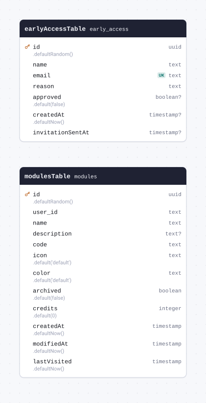
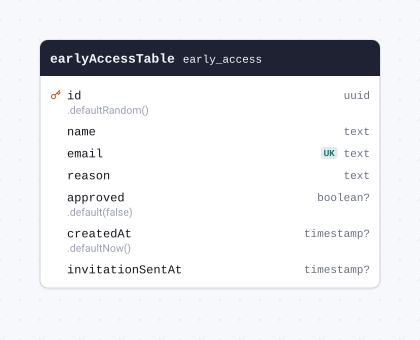
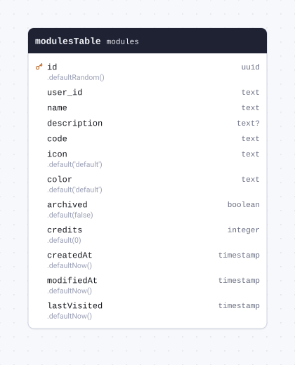

# Schema docs



<details>
<summary>The whole schema as SQL</summary>

```sql
CREATE TABLE "early_access" (
	"id" uuid PRIMARY KEY DEFAULT gen_random_uuid(),
	"name" text NOT NULL,
	"email" text NOT NULL UNIQUE,
	"reason" text NOT NULL,
	"approved" boolean DEFAULT false,
	"created_at" timestamp(3) DEFAULT now(),
	"invitation_sent_at" timestamp(3)
);

CREATE TABLE "modules" (
	"id" uuid PRIMARY KEY DEFAULT gen_random_uuid() UNIQUE,
	"user_id" text NOT NULL,
	"name" text NOT NULL,
	"description" text,
	"code" text NOT NULL,
	"icon" text DEFAULT 'default' NOT NULL,
	"color" text DEFAULT 'default' NOT NULL,
	"archived" boolean DEFAULT false NOT NULL,
	"credits" integer DEFAULT 0 NOT NULL,
	"created_at" timestamp DEFAULT now() NOT NULL,
	"modified_at" timestamp DEFAULT now() NOT NULL,
	"last_visited" timestamp DEFAULT now() NOT NULL
);
```

</details>

## Contents

| Table                                       | Name in the database | Description |
| ------------------------------------------- | -------------------- | ----------- |
| [earlyAccessTable](#table-earlyAccessTable) | `early_access`       |             |
| [modulesTable](#table-modulesTable)         | `modules`            |             |

## Tables

<a id="table-earlyAccessTable"></a>

### earlyAccessTable

Table `early_access`.



| Column                                    | Type        | Constraints     | Default            | Description |
| ----------------------------------------- | ----------- | --------------- | ------------------ | ----------- |
| `id`                                      | `uuid`      | PK NOT NULL     | `.defaultRandom()` |             |
| `name`                                    | `text`      | NOT NULL        |                    |             |
| `email`                                   | `text`      | UNIQUE NOT NULL |                    |             |
| `reason`                                  | `text`      | NOT NULL        |                    |             |
| `approved`                                | `boolean`   | NULL            | `.default(false)`  |             |
| `createdAt` (`created_at`)                | `timestamp` | NULL            | `.defaultNow()`    |             |
| `invitationSentAt` (`invitation_sent_at`) | `timestamp` | NULL            |                    |             |

#### Definition

```sql
CREATE TABLE "early_access" (
	"id" uuid PRIMARY KEY DEFAULT gen_random_uuid(),
	"name" text NOT NULL,
	"email" text NOT NULL UNIQUE,
	"reason" text NOT NULL,
	"approved" boolean DEFAULT false,
	"created_at" timestamp(3) DEFAULT now(),
	"invitation_sent_at" timestamp(3)
);
```

<details>
<summary>Queries and their SQL</summary>

**Select**: Every row of earlyAccessTable.

```ts
db.select().from(earlyAccessTable);
```

```sql
select "id", "name", "email", "reason", "approved", "created_at", "invitation_sent_at"
from "early_access"
```

**Count**: How many rows earlyAccessTable has.

```ts
db.select({ count: count() }).from(earlyAccessTable);
```

```sql
select count(*)
from "early_access"
```

**Find many**: The rows of earlyAccessTable, through the relational query API.

```ts
db.query.earlyAccessTable.findMany();
```

```sql
select "d0"."id" as "id", "d0"."name" as "name", "d0"."email" as "email", "d0"."reason" as "reason", "d0"."approved" as "approved", "d0"."created_at" as "createdAt", "d0"."invitation_sent_at" as "invitationSentAt"
from "early_access" as "d0"
```

**Find by primary key**: One row of earlyAccessTable, through the relational query API.

```ts
db.query.earlyAccessTable.findFirst({ where: { id: "00000000-0000-0000-0000-000000000000" } });
```

```sql
select "d0"."id" as "id", "d0"."name" as "name", "d0"."email" as "email", "d0"."reason" as "reason", "d0"."approved" as "approved", "d0"."created_at" as "createdAt", "d0"."invitation_sent_at" as "invitationSentAt"
from "early_access" as "d0"
where "d0"."id" = $1
limit $2
-- params: ["00000000-0000-0000-0000-000000000000",1]
```

**Insert**: Adds a row to earlyAccessTable, giving the columns that have no default.

```ts
db.insert(earlyAccessTable).values({ name: "name", email: "email", reason: "reason" });
```

```sql
insert into "early_access" ("id", "name", "email", "reason", "approved", "created_at", "invitation_sent_at")
values (default, $1, $2, $3, default, default, default)
-- params: ["name","email","reason"]
```

**Update**: Changes a row of earlyAccessTable, found by its primary key.

```ts
db.update(earlyAccessTable)
  .set({ name: "name" })
  .where(eq(earlyAccessTable.id, "00000000-0000-0000-0000-000000000000"));
```

```sql
update "early_access"
set "name" = $1
where "early_access"."id" = $2
-- params: ["name","00000000-0000-0000-0000-000000000000"]
```

**Delete**: Deletes a row of earlyAccessTable, found by its primary key.

```ts
db.delete(earlyAccessTable).where(eq(earlyAccessTable.id, "00000000-0000-0000-0000-000000000000"));
```

```sql
delete from "early_access"
where "early_access"."id" = $1
-- params: ["00000000-0000-0000-0000-000000000000"]
```

</details>

<a id="table-modulesTable"></a>

### modulesTable

Table `modules`.



| Column                         | Type        | Constraints        | Default               | Description |
| ------------------------------ | ----------- | ------------------ | --------------------- | ----------- |
| `id`                           | `uuid`      | PK UNIQUE NOT NULL | `.defaultRandom()`    |             |
| `user_id`                      | `text`      | NOT NULL           |                       |             |
| `name`                         | `text`      | NOT NULL           |                       |             |
| `description`                  | `text`      | NULL               |                       |             |
| `code`                         | `text`      | NOT NULL           |                       |             |
| `icon`                         | `text`      | NOT NULL           | `.default('default')` |             |
| `color`                        | `text`      | NOT NULL           | `.default('default')` |             |
| `archived`                     | `boolean`   | NOT NULL           | `.default(false)`     |             |
| `credits`                      | `integer`   | NOT NULL           | `.default(0)`         |             |
| `createdAt` (`created_at`)     | `timestamp` | NOT NULL           | `.defaultNow()`       |             |
| `modifiedAt` (`modified_at`)   | `timestamp` | NOT NULL           | `.defaultNow()`       |             |
| `lastVisited` (`last_visited`) | `timestamp` | NOT NULL           | `.defaultNow()`       |             |

#### Definition

```sql
CREATE TABLE "modules" (
	"id" uuid PRIMARY KEY DEFAULT gen_random_uuid() UNIQUE,
	"user_id" text NOT NULL,
	"name" text NOT NULL,
	"description" text,
	"code" text NOT NULL,
	"icon" text DEFAULT 'default' NOT NULL,
	"color" text DEFAULT 'default' NOT NULL,
	"archived" boolean DEFAULT false NOT NULL,
	"credits" integer DEFAULT 0 NOT NULL,
	"created_at" timestamp DEFAULT now() NOT NULL,
	"modified_at" timestamp DEFAULT now() NOT NULL,
	"last_visited" timestamp DEFAULT now() NOT NULL
);
```

<details>
<summary>Queries and their SQL</summary>

**Select**: Every row of modulesTable.

```ts
db.select().from(modulesTable);
```

```sql
select "id", "user_id", "name", "description", "code", "icon", "color", "archived", "credits", "created_at", "modified_at", "last_visited"
from "modules"
```

**Count**: How many rows modulesTable has.

```ts
db.select({ count: count() }).from(modulesTable);
```

```sql
select count(*)
from "modules"
```

**Find many**: The rows of modulesTable, through the relational query API.

```ts
db.query.modulesTable.findMany();
```

```sql
select "d0"."id" as "id", "d0"."user_id" as "user_id", "d0"."name" as "name", "d0"."description" as "description", "d0"."code" as "code", "d0"."icon" as "icon", "d0"."color" as "color", "d0"."archived" as "archived", "d0"."credits" as "credits", "d0"."created_at" as "createdAt", "d0"."modified_at" as "modifiedAt", "d0"."last_visited" as "lastVisited"
from "modules" as "d0"
```

**Find by primary key**: One row of modulesTable, through the relational query API.

```ts
db.query.modulesTable.findFirst({ where: { id: "00000000-0000-0000-0000-000000000000" } });
```

```sql
select "d0"."id" as "id", "d0"."user_id" as "user_id", "d0"."name" as "name", "d0"."description" as "description", "d0"."code" as "code", "d0"."icon" as "icon", "d0"."color" as "color", "d0"."archived" as "archived", "d0"."credits" as "credits", "d0"."created_at" as "createdAt", "d0"."modified_at" as "modifiedAt", "d0"."last_visited" as "lastVisited"
from "modules" as "d0"
where "d0"."id" = $1
limit $2
-- params: ["00000000-0000-0000-0000-000000000000",1]
```

**Insert**: Adds a row to modulesTable, giving the columns that have no default.

```ts
db.insert(modulesTable).values({ user_id: "user_id", name: "name", code: "code" });
```

```sql
insert into "modules" ("id", "user_id", "name", "description", "code", "icon", "color", "archived", "credits", "created_at", "modified_at", "last_visited")
values (default, $1, $2, default, $3, default, default, default, default, default, default, default)
-- params: ["user_id","name","code"]
```

**Update**: Changes a row of modulesTable, found by its primary key.

```ts
db.update(modulesTable)
  .set({ user_id: "user_id" })
  .where(eq(modulesTable.id, "00000000-0000-0000-0000-000000000000"));
```

```sql
update "modules"
set "user_id" = $1
where "modules"."id" = $2
-- params: ["user_id","00000000-0000-0000-0000-000000000000"]
```

**Delete**: Deletes a row of modulesTable, found by its primary key.

```ts
db.delete(modulesTable).where(eq(modulesTable.id, "00000000-0000-0000-0000-000000000000"));
```

```sql
delete from "modules"
where "modules"."id" = $1
-- params: ["00000000-0000-0000-0000-000000000000"]
```

</details>
