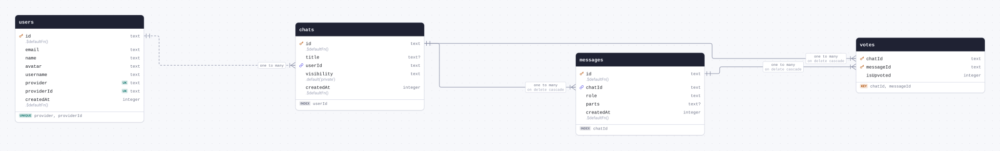
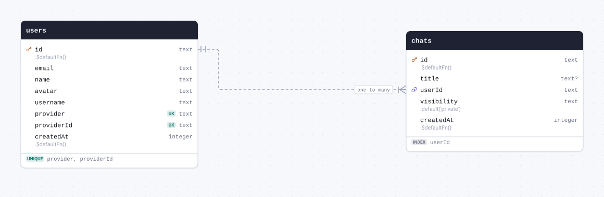
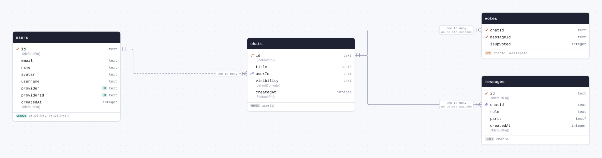
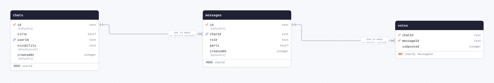
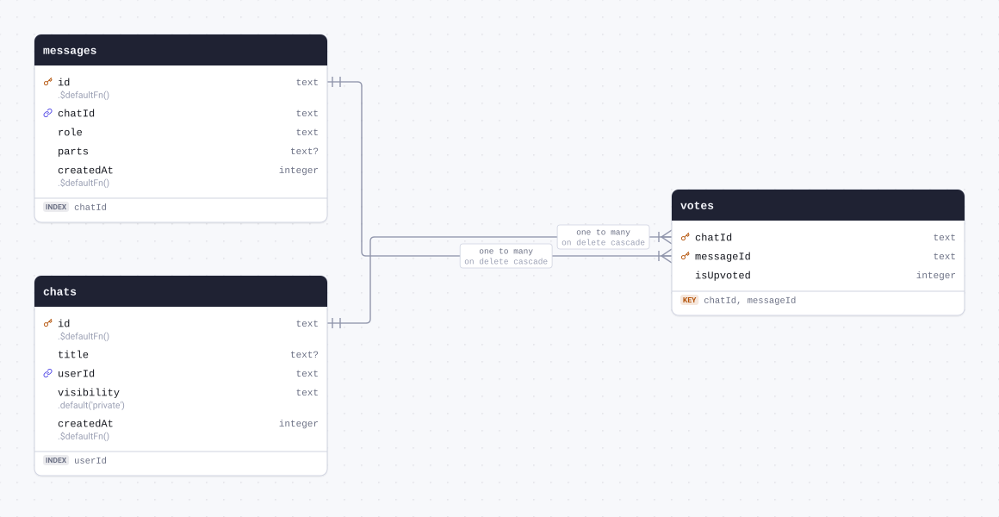

# Schema docs



<details>
<summary>The whole schema as SQL</summary>

```sql
CREATE TABLE `chats` (
	`id` text PRIMARY KEY,
	`title` text,
	`user_id` text NOT NULL,
	`visibility` text DEFAULT 'private' NOT NULL,
	`created_at` integer NOT NULL
);

CREATE TABLE `messages` (
	`id` text PRIMARY KEY,
	`chat_id` text NOT NULL,
	`role` text NOT NULL,
	`parts` text,
	`created_at` integer NOT NULL,
	CONSTRAINT `fk_messages_chat_id_chats_id_fk` FOREIGN KEY (`chat_id`) REFERENCES `chats`(`id`) ON DELETE CASCADE
);

CREATE TABLE `users` (
	`id` text PRIMARY KEY,
	`email` text NOT NULL,
	`name` text NOT NULL,
	`avatar` text NOT NULL,
	`username` text NOT NULL,
	`provider` text NOT NULL,
	`provider_id` text NOT NULL,
	`created_at` integer NOT NULL
);

CREATE TABLE `votes` (
	`chat_id` text NOT NULL,
	`message_id` text NOT NULL,
	`is_upvoted` integer NOT NULL,
	CONSTRAINT `votes_pk` PRIMARY KEY(`chat_id`, `message_id`),
	CONSTRAINT `fk_votes_chat_id_chats_id_fk` FOREIGN KEY (`chat_id`) REFERENCES `chats`(`id`) ON DELETE CASCADE,
	CONSTRAINT `fk_votes_message_id_messages_id_fk` FOREIGN KEY (`message_id`) REFERENCES `messages`(`id`) ON DELETE CASCADE
);

CREATE INDEX `chats_user_id_idx` ON `chats` (`user_id`);

CREATE INDEX `messages_chat_id_idx` ON `messages` (`chat_id`);

CREATE UNIQUE INDEX `users_provider_id_idx` ON `users` (`provider`,`provider_id`);
```

</details>

## Contents

| Table                       | Name in the database | Description |
| --------------------------- | -------------------- | ----------- |
| [users](#table-users)       | `users`              |             |
| [chats](#table-chats)       | `chats`              |             |
| [messages](#table-messages) | `messages`           |             |
| [votes](#table-votes)       | `votes`              |             |

## Tables

<a id="table-users"></a>

### users



| Column                       | Type      | Constraints | Default         | Description |
| ---------------------------- | --------- | ----------- | --------------- | ----------- |
| `id`                         | `text`    | PK NOT NULL | `.$defaultFn()` |             |
| `email`                      | `text`    | NOT NULL    |                 |             |
| `name`                       | `text`    | NOT NULL    |                 |             |
| `avatar`                     | `text`    | NOT NULL    |                 |             |
| `username`                   | `text`    | NOT NULL    |                 |             |
| `provider`                   | `text`    | NOT NULL    |                 |             |
| `providerId` (`provider_id`) | `text`    | NOT NULL    |                 |             |
| `createdAt` (`created_at`)   | `integer` | NOT NULL    | `.$defaultFn()` |             |

#### Definition

```sql
CREATE TABLE `users` (
	`id` text PRIMARY KEY,
	`email` text NOT NULL,
	`name` text NOT NULL,
	`avatar` text NOT NULL,
	`username` text NOT NULL,
	`provider` text NOT NULL,
	`provider_id` text NOT NULL,
	`created_at` integer NOT NULL
);

CREATE UNIQUE INDEX `users_provider_id_idx` ON `users` (`provider`,`provider_id`);
```

#### Indexes

- UNIQUE `provider`, `providerId`

#### Referenced by

- `id` → [chats.userId](#table-chats) (one to many, defineRelations)

<details>
<summary>Queries and their SQL</summary>

**Select**: Every row of users.

```ts
db.select().from(users);
```

```sql
select "id", "email", "name", "avatar", "username", "provider", "provider_id", "created_at"
from "users"
```

**Count**: How many rows users has.

```ts
db.select({ count: count() }).from(users);
```

```sql
select count(*)
from "users"
```

**Find many**: The rows of users, through the relational query API.

```ts
db.query.users.findMany();
```

```sql
select "d0"."id" as "id", "d0"."email" as "email", "d0"."name" as "name", "d0"."avatar" as "avatar", "d0"."username" as "username", "d0"."provider" as "provider", "d0"."provider_id" as "providerId", "d0"."created_at" as "createdAt"
from "users" as "d0"
```

**Find by primary key**: One row of users, through the relational query API.

```ts
db.query.users.findFirst({ where: { id: "id" } });
```

```sql
select "d0"."id" as "id", "d0"."email" as "email", "d0"."name" as "name", "d0"."avatar" as "avatar", "d0"."username" as "username", "d0"."provider" as "provider", "d0"."provider_id" as "providerId", "d0"."created_at" as "createdAt"
from "users" as "d0"
where "d0"."id" = ?
limit ?
-- params: ["id",1]
```

**Insert**: Adds a row to users, giving the columns that have no default.

```ts
db.insert(users).values({
  email: "email",
  name: "name",
  avatar: "avatar",
  username: "username",
  provider: "provider",
  providerId: "providerId",
});
```

```sql
insert into "users" ("id", "email", "name", "avatar", "username", "provider", "provider_id", "created_at")
values (?, ?, ?, ?, ?, ?, ?, ?)
-- params: ["00000000-0000-4000-8000-000000000000","email","name","avatar","username","provider","providerId",1767225600]
```

**Update**: Changes a row of users, found by its primary key.

```ts
db.update(users).set({ email: "email" }).where(eq(users.id, "id"));
```

```sql
update "users"
set "email" = ?
where "users"."id" = ?
-- params: ["email","id"]
```

**Delete**: Deletes a row of users, found by its primary key.

```ts
db.delete(users).where(eq(users.id, "id"));
```

```sql
delete from "users"
where "users"."id" = ?
-- params: ["id"]
```

</details>

<a id="table-chats"></a>

### chats



| Column                     | Type      | Constraints                         | Default               | Description |
| -------------------------- | --------- | ----------------------------------- | --------------------- | ----------- |
| `id`                       | `text`    | PK NOT NULL                         | `.$defaultFn()`       |             |
| `title`                    | `text`    | NULL                                |                       |             |
| `userId` (`user_id`)       | `text`    | NOT NULL → [users.id](#table-users) |                       |             |
| `visibility`               | `text`    | NOT NULL                            | `.default('private')` |             |
| `createdAt` (`created_at`) | `integer` | NOT NULL                            | `.$defaultFn()`       |             |

#### Definition

```sql
CREATE TABLE `chats` (
	`id` text PRIMARY KEY,
	`title` text,
	`user_id` text NOT NULL,
	`visibility` text DEFAULT 'private' NOT NULL,
	`created_at` integer NOT NULL
);

CREATE INDEX `chats_user_id_idx` ON `chats` (`user_id`);
```

#### Indexes

- INDEX `userId`

#### References

- `userId` → [users.id](#table-users) (many to one, defineRelations, no foreign key)

#### Referenced by

- `id` → [messages.chatId](#table-messages) (one to many, on delete cascade)
- `id` → [votes.chatId](#table-votes) (one to many, on delete cascade)

<details>
<summary>Queries and their SQL</summary>

**Select**: Every row of chats.

```ts
db.select().from(chats);
```

```sql
select "id", "title", "user_id", "visibility", "created_at"
from "chats"
```

**Count**: How many rows chats has.

```ts
db.select({ count: count() }).from(chats);
```

```sql
select count(*)
from "chats"
```

**Find many**: The rows of chats, through the relational query API.

```ts
db.query.chats.findMany();
```

```sql
select "d0"."id" as "id", "d0"."title" as "title", "d0"."user_id" as "userId", "d0"."visibility" as "visibility", "d0"."created_at" as "createdAt"
from "chats" as "d0"
```

**Find by primary key**: One row of chats, through the relational query API.

```ts
db.query.chats.findFirst({ where: { id: "id" } });
```

```sql
select "d0"."id" as "id", "d0"."title" as "title", "d0"."user_id" as "userId", "d0"."visibility" as "visibility", "d0"."created_at" as "createdAt"
from "chats" as "d0"
where "d0"."id" = ?
limit ?
-- params: ["id",1]
```

**Insert**: Adds a row to chats, giving the columns that have no default.

```ts
db.insert(chats).values({ userId: "userId" });
```

```sql
insert into "chats" ("id", "title", "user_id", "visibility", "created_at")
values (?, null, ?, ?, ?)
-- params: ["00000000-0000-4000-8000-000000000000","userId","private",1767225600]
```

**Update**: Changes a row of chats, found by its primary key.

```ts
db.update(chats).set({ title: "title" }).where(eq(chats.id, "id"));
```

```sql
update "chats"
set "title" = ?
where "chats"."id" = ?
-- params: ["title","id"]
```

**Delete**: Deletes a row of chats, found by its primary key.

```ts
db.delete(chats).where(eq(chats.id, "id"));
```

```sql
delete from "chats"
where "chats"."id" = ?
-- params: ["id"]
```

</details>

<a id="table-messages"></a>

### messages



| Column                     | Type      | Constraints                         | Default         | Description |
| -------------------------- | --------- | ----------------------------------- | --------------- | ----------- |
| `id`                       | `text`    | PK NOT NULL                         | `.$defaultFn()` |             |
| `chatId` (`chat_id`)       | `text`    | NOT NULL → [chats.id](#table-chats) |                 |             |
| `role`                     | `text`    | NOT NULL                            |                 |             |
| `parts`                    | `text`    | NULL                                |                 |             |
| `createdAt` (`created_at`) | `integer` | NOT NULL                            | `.$defaultFn()` |             |

#### Definition

```sql
CREATE TABLE `messages` (
	`id` text PRIMARY KEY,
	`chat_id` text NOT NULL,
	`role` text NOT NULL,
	`parts` text,
	`created_at` integer NOT NULL,
	CONSTRAINT `fk_messages_chat_id_chats_id_fk` FOREIGN KEY (`chat_id`) REFERENCES `chats`(`id`) ON DELETE CASCADE
);

CREATE INDEX `messages_chat_id_idx` ON `messages` (`chat_id`);
```

#### Indexes

- INDEX `chatId`

#### References

- `chatId` → [chats.id](#table-chats) (many to one, on delete cascade)

#### Referenced by

- `id` → [votes.messageId](#table-votes) (one to many, on delete cascade)

<details>
<summary>Queries and their SQL</summary>

**Select**: Every row of messages.

```ts
db.select().from(messages);
```

```sql
select "id", "chat_id", "role", "parts", "created_at"
from "messages"
```

**Count**: How many rows messages has.

```ts
db.select({ count: count() }).from(messages);
```

```sql
select count(*)
from "messages"
```

**Find many**: The rows of messages, through the relational query API.

```ts
db.query.messages.findMany();
```

```sql
select "d0"."id" as "id", "d0"."chat_id" as "chatId", "d0"."role" as "role", "d0"."parts" as "parts", "d0"."created_at" as "createdAt"
from "messages" as "d0"
```

**Find by primary key**: One row of messages, through the relational query API.

```ts
db.query.messages.findFirst({ where: { id: "id" } });
```

```sql
select "d0"."id" as "id", "d0"."chat_id" as "chatId", "d0"."role" as "role", "d0"."parts" as "parts", "d0"."created_at" as "createdAt"
from "messages" as "d0"
where "d0"."id" = ?
limit ?
-- params: ["id",1]
```

**Insert**: Adds a row to messages, giving the columns that have no default.

```ts
db.insert(messages).values({ chatId: "chatId", role: "role" });
```

```sql
insert into "messages" ("id", "chat_id", "role", "parts", "created_at")
values (?, ?, ?, null, ?)
-- params: ["00000000-0000-4000-8000-000000000000","chatId","role",1767225600]
```

**Update**: Changes a row of messages, found by its primary key.

```ts
db.update(messages).set({ chatId: "chatId" }).where(eq(messages.id, "id"));
```

```sql
update "messages"
set "chat_id" = ?
where "messages"."id" = ?
-- params: ["chatId","id"]
```

**Delete**: Deletes a row of messages, found by its primary key.

```ts
db.delete(messages).where(eq(messages.id, "id"));
```

```sql
delete from "messages"
where "messages"."id" = ?
-- params: ["id"]
```

</details>

<a id="table-votes"></a>

### votes



| Column                     | Type      | Constraints                                  | Default | Description |
| -------------------------- | --------- | -------------------------------------------- | ------- | ----------- |
| `chatId` (`chat_id`)       | `text`    | PK NOT NULL → [chats.id](#table-chats)       |         |             |
| `messageId` (`message_id`) | `text`    | PK NOT NULL → [messages.id](#table-messages) |         |             |
| `isUpvoted` (`is_upvoted`) | `integer` | NOT NULL                                     |         |             |

#### Definition

```sql
CREATE TABLE `votes` (
	`chat_id` text NOT NULL,
	`message_id` text NOT NULL,
	`is_upvoted` integer NOT NULL,
	CONSTRAINT `votes_pk` PRIMARY KEY(`chat_id`, `message_id`),
	CONSTRAINT `fk_votes_chat_id_chats_id_fk` FOREIGN KEY (`chat_id`) REFERENCES `chats`(`id`) ON DELETE CASCADE,
	CONSTRAINT `fk_votes_message_id_messages_id_fk` FOREIGN KEY (`message_id`) REFERENCES `messages`(`id`) ON DELETE CASCADE
);
```

#### Indexes

- PRIMARY KEY `chatId`, `messageId`

#### References

- `chatId` → [chats.id](#table-chats) (many to one, on delete cascade)
- `messageId` → [messages.id](#table-messages) (many to one, on delete cascade)

<details>
<summary>Queries and their SQL</summary>

**Select**: Every row of votes.

```ts
db.select().from(votes);
```

```sql
select "chat_id", "message_id", "is_upvoted"
from "votes"
```

**Count**: How many rows votes has.

```ts
db.select({ count: count() }).from(votes);
```

```sql
select count(*)
from "votes"
```

**Find many**: The rows of votes, through the relational query API.

```ts
db.query.votes.findMany();
```

```sql
select "d0"."chat_id" as "chatId", "d0"."message_id" as "messageId", "d0"."is_upvoted" as "isUpvoted"
from "votes" as "d0"
```

**Find by primary key**: One row of votes, through the relational query API.

```ts
db.query.votes.findFirst({ where: { chatId: "chatId", messageId: "messageId" } });
```

```sql
select "d0"."chat_id" as "chatId", "d0"."message_id" as "messageId", "d0"."is_upvoted" as "isUpvoted"
from "votes" as "d0"
where (("d0"."chat_id" = ?) and ("d0"."message_id" = ?))
limit ?
-- params: ["chatId","messageId",1]
```

**Insert**: Adds a row to votes, giving the columns that have no default.

```ts
db.insert(votes).values({ chatId: "chatId", messageId: "messageId", isUpvoted: 1 });
```

```sql
insert into "votes" ("chat_id", "message_id", "is_upvoted")
values (?, ?, ?)
-- params: ["chatId","messageId",1]
```

**Update**: Changes a row of votes, found by its primary key.

```ts
db.update(votes)
  .set({ isUpvoted: 1 })
  .where(and(eq(votes.chatId, "chatId"), eq(votes.messageId, "messageId")));
```

```sql
update "votes"
set "is_upvoted" = ?
where (("votes"."chat_id" = ?) and ("votes"."message_id" = ?))
-- params: [1,"chatId","messageId"]
```

**Delete**: Deletes a row of votes, found by its primary key.

```ts
db.delete(votes).where(and(eq(votes.chatId, "chatId"), eq(votes.messageId, "messageId")));
```

```sql
delete from "votes"
where (("votes"."chat_id" = ?) and ("votes"."message_id" = ?))
-- params: ["chatId","messageId"]
```

</details>
