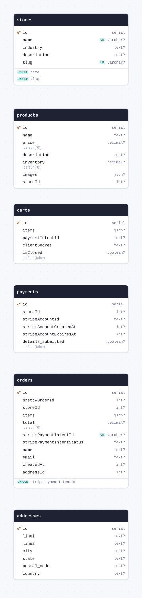
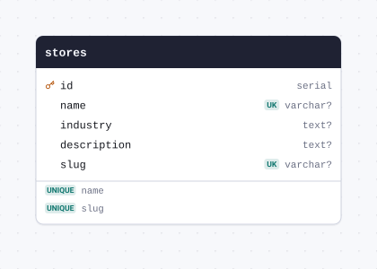
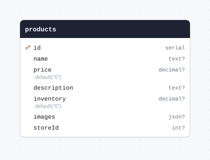
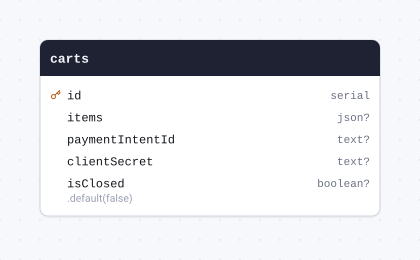
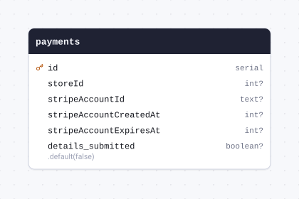
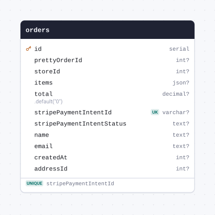
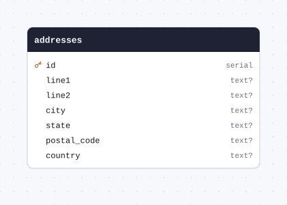

# Schema docs



<details>
<summary>The whole schema as SQL</summary>

```sql
CREATE TABLE `addresses` (
	`id` serial PRIMARY KEY,
	`line1` text,
	`line2` text,
	`city` text,
	`state` text,
	`postal_code` text,
	`country` text
);

CREATE TABLE `carts` (
	`id` serial PRIMARY KEY,
	`items` json,
	`payment_intent_id` text,
	`client_secret` text,
	`is_closed` boolean DEFAULT false
);

CREATE TABLE `orders` (
	`id` serial PRIMARY KEY,
	`pretty_order_id` int,
	`store_id` int,
	`items` json,
	`total` decimal(10,2) DEFAULT (0),
	`stripe_payment_intent_id` varchar(256),
	`stripe_payment_intent_status` text,
	`name` text,
	`email` text,
	`created_at` int,
	`address` int,
	CONSTRAINT `stripe_payment_intent_id_index` UNIQUE INDEX(`stripe_payment_intent_id`)
);

CREATE TABLE `payments` (
	`id` serial PRIMARY KEY,
	`store_id` int,
	`stripe_account_id` text,
	`stripe_account_created_at` int,
	`stripe_account_expires_at` int,
	`details_submitted` boolean DEFAULT false
);

CREATE TABLE `products` (
	`id` serial PRIMARY KEY,
	`name` text,
	`price` decimal(10,2) DEFAULT (0),
	`description` text,
	`inventory` decimal DEFAULT (0),
	`images` json,
	`store_id` int
);

CREATE TABLE `stores` (
	`id` serial PRIMARY KEY,
	`store_name` varchar(40),
	`industry` text,
	`description` text,
	`slug` varchar(50),
	CONSTRAINT `store_name_index` UNIQUE INDEX(`store_name`),
	CONSTRAINT `store_slug_index` UNIQUE INDEX(`slug`)
);
```

</details>

## Contents

| Table                         | Name in the database | Description |
| ----------------------------- | -------------------- | ----------- |
| [stores](#table-stores)       | `stores`             |             |
| [products](#table-products)   | `products`           |             |
| [carts](#table-carts)         | `carts`              |             |
| [payments](#table-payments)   | `payments`           |             |
| [orders](#table-orders)       | `orders`             |             |
| [addresses](#table-addresses) | `addresses`          |             |

## Tables

<a id="table-stores"></a>

### stores



| Column                | Type      | Constraints | Default | Description |
| --------------------- | --------- | ----------- | ------- | ----------- |
| `id`                  | `serial`  | PK NOT NULL |         |             |
| `name` (`store_name`) | `varchar` | NULL        |         |             |
| `industry`            | `text`    | NULL        |         |             |
| `description`         | `text`    | NULL        |         |             |
| `slug`                | `varchar` | NULL        |         |             |

#### Definition

```sql
CREATE TABLE `stores` (
	`id` serial PRIMARY KEY,
	`store_name` varchar(40),
	`industry` text,
	`description` text,
	`slug` varchar(50),
	CONSTRAINT `store_name_index` UNIQUE INDEX(`store_name`),
	CONSTRAINT `store_slug_index` UNIQUE INDEX(`slug`)
);
```

#### Indexes

- UNIQUE `name`
- UNIQUE `slug`

<details>
<summary>Queries and their SQL</summary>

**Select**: Every row of stores.

```ts
db.select().from(stores);
```

```sql
select `id`, `store_name`, `industry`, `description`, `slug`
from `stores`
```

**Count**: How many rows stores has.

```ts
db.select({ count: count() }).from(stores);
```

```sql
select count(*)
from `stores`
```

**Find many**: The rows of stores, through the relational query API.

```ts
db.query.stores.findMany();
```

```sql
select `d0`.`id` as `id`, `d0`.`store_name` as `name`, `d0`.`industry` as `industry`, `d0`.`description` as `description`, `d0`.`slug` as `slug`
from `stores` as `d0`
```

**Find by primary key**: One row of stores, through the relational query API.

```ts
db.query.stores.findFirst({ where: { id: 1 } });
```

```sql
select `d0`.`id` as `id`, `d0`.`store_name` as `name`, `d0`.`industry` as `industry`, `d0`.`description` as `description`, `d0`.`slug` as `slug`
from `stores` as `d0`
where `d0`.`id` = ?
limit ?
-- params: [1,1]
```

**Insert**: Adds a row to stores, giving the columns that have no default.

```ts
db.insert(stores).values({});
```

```sql
insert into `stores` (`id`, `store_name`, `industry`, `description`, `slug`)
values (default, default, default, default, default)
```

**Update**: Changes a row of stores, found by its primary key.

```ts
db.update(stores).set({ name: "name" }).where(eq(stores.id, 1));
```

```sql
update `stores`
set `store_name` = ?
where `stores`.`id` = ?
-- params: ["name",1]
```

**Delete**: Deletes a row of stores, found by its primary key.

```ts
db.delete(stores).where(eq(stores.id, 1));
```

```sql
delete from `stores`
where `stores`.`id` = ?
-- params: [1]
```

</details>

<a id="table-products"></a>

### products



| Column                 | Type      | Constraints | Default         | Description |
| ---------------------- | --------- | ----------- | --------------- | ----------- |
| `id`                   | `serial`  | PK NOT NULL |                 |             |
| `name`                 | `text`    | NULL        |                 |             |
| `price`                | `decimal` | NULL        | `.default("0")` |             |
| `description`          | `text`    | NULL        |                 |             |
| `inventory`            | `decimal` | NULL        | `.default("0")` |             |
| `images`               | `json`    | NULL        |                 |             |
| `storeId` (`store_id`) | `int`     | NULL        |                 |             |

#### Definition

```sql
CREATE TABLE `products` (
	`id` serial PRIMARY KEY,
	`name` text,
	`price` decimal(10,2) DEFAULT (0),
	`description` text,
	`inventory` decimal DEFAULT (0),
	`images` json,
	`store_id` int
);
```

<details>
<summary>Queries and their SQL</summary>

**Select**: Every row of products.

```ts
db.select().from(products);
```

```sql
select `id`, `name`, `price`, `description`, `inventory`, `images`, `store_id`
from `products`
```

**Count**: How many rows products has.

```ts
db.select({ count: count() }).from(products);
```

```sql
select count(*)
from `products`
```

**Find many**: The rows of products, through the relational query API.

```ts
db.query.products.findMany();
```

```sql
select `d0`.`id` as `id`, `d0`.`name` as `name`, `d0`.`price` as `price`, `d0`.`description` as `description`, `d0`.`inventory` as `inventory`, `d0`.`images` as `images`, `d0`.`store_id` as `storeId`
from `products` as `d0`
```

**Find by primary key**: One row of products, through the relational query API.

```ts
db.query.products.findFirst({ where: { id: 1 } });
```

```sql
select `d0`.`id` as `id`, `d0`.`name` as `name`, `d0`.`price` as `price`, `d0`.`description` as `description`, `d0`.`inventory` as `inventory`, `d0`.`images` as `images`, `d0`.`store_id` as `storeId`
from `products` as `d0`
where `d0`.`id` = ?
limit ?
-- params: [1,1]
```

**Insert**: Adds a row to products, giving the columns that have no default.

```ts
db.insert(products).values({});
```

```sql
insert into `products` (`id`, `name`, `price`, `description`, `inventory`, `images`, `store_id`)
values (default, default, default, default, default, default, default)
```

**Update**: Changes a row of products, found by its primary key.

```ts
db.update(products).set({ name: "name" }).where(eq(products.id, 1));
```

```sql
update `products`
set `name` = ?
where `products`.`id` = ?
-- params: ["name",1]
```

**Delete**: Deletes a row of products, found by its primary key.

```ts
db.delete(products).where(eq(products.id, 1));
```

```sql
delete from `products`
where `products`.`id` = ?
-- params: [1]
```

</details>

<a id="table-carts"></a>

### carts



| Column                                  | Type      | Constraints | Default           | Description |
| --------------------------------------- | --------- | ----------- | ----------------- | ----------- |
| `id`                                    | `serial`  | PK NOT NULL |                   |             |
| `items`                                 | `json`    | NULL        |                   |             |
| `paymentIntentId` (`payment_intent_id`) | `text`    | NULL        |                   |             |
| `clientSecret` (`client_secret`)        | `text`    | NULL        |                   |             |
| `isClosed` (`is_closed`)                | `boolean` | NULL        | `.default(false)` |             |

#### Definition

```sql
CREATE TABLE `carts` (
	`id` serial PRIMARY KEY,
	`items` json,
	`payment_intent_id` text,
	`client_secret` text,
	`is_closed` boolean DEFAULT false
);
```

<details>
<summary>Queries and their SQL</summary>

**Select**: Every row of carts.

```ts
db.select().from(carts);
```

```sql
select `id`, `items`, `payment_intent_id`, `client_secret`, `is_closed`
from `carts`
```

**Count**: How many rows carts has.

```ts
db.select({ count: count() }).from(carts);
```

```sql
select count(*)
from `carts`
```

**Find many**: The rows of carts, through the relational query API.

```ts
db.query.carts.findMany();
```

```sql
select `d0`.`id` as `id`, `d0`.`items` as `items`, `d0`.`payment_intent_id` as `paymentIntentId`, `d0`.`client_secret` as `clientSecret`, `d0`.`is_closed` as `isClosed`
from `carts` as `d0`
```

**Find by primary key**: One row of carts, through the relational query API.

```ts
db.query.carts.findFirst({ where: { id: 1 } });
```

```sql
select `d0`.`id` as `id`, `d0`.`items` as `items`, `d0`.`payment_intent_id` as `paymentIntentId`, `d0`.`client_secret` as `clientSecret`, `d0`.`is_closed` as `isClosed`
from `carts` as `d0`
where `d0`.`id` = ?
limit ?
-- params: [1,1]
```

**Insert**: Adds a row to carts, giving the columns that have no default.

```ts
db.insert(carts).values({});
```

```sql
insert into `carts` (`id`, `items`, `payment_intent_id`, `client_secret`, `is_closed`)
values (default, default, default, default, default)
```

**Update**: Changes a row of carts, found by its primary key.

```ts
db.update(carts).set({ items: {} }).where(eq(carts.id, 1));
```

```sql
update `carts`
set `items` = ?
where `carts`.`id` = ?
-- params: ["{}",1]
```

**Delete**: Deletes a row of carts, found by its primary key.

```ts
db.delete(carts).where(eq(carts.id, 1));
```

```sql
delete from `carts`
where `carts`.`id` = ?
-- params: [1]
```

</details>

<a id="table-payments"></a>

### payments



| Column                                                 | Type      | Constraints | Default           | Description |
| ------------------------------------------------------ | --------- | ----------- | ----------------- | ----------- |
| `id`                                                   | `serial`  | PK NOT NULL |                   |             |
| `storeId` (`store_id`)                                 | `int`     | NULL        |                   |             |
| `stripeAccountId` (`stripe_account_id`)                | `text`    | NULL        |                   |             |
| `stripeAccountCreatedAt` (`stripe_account_created_at`) | `int`     | NULL        |                   |             |
| `stripeAccountExpiresAt` (`stripe_account_expires_at`) | `int`     | NULL        |                   |             |
| `details_submitted`                                    | `boolean` | NULL        | `.default(false)` |             |

#### Definition

```sql
CREATE TABLE `payments` (
	`id` serial PRIMARY KEY,
	`store_id` int,
	`stripe_account_id` text,
	`stripe_account_created_at` int,
	`stripe_account_expires_at` int,
	`details_submitted` boolean DEFAULT false
);
```

<details>
<summary>Queries and their SQL</summary>

**Select**: Every row of payments.

```ts
db.select().from(payments);
```

```sql
select `id`, `store_id`, `stripe_account_id`, `stripe_account_created_at`, `stripe_account_expires_at`, `details_submitted`
from `payments`
```

**Count**: How many rows payments has.

```ts
db.select({ count: count() }).from(payments);
```

```sql
select count(*)
from `payments`
```

**Find many**: The rows of payments, through the relational query API.

```ts
db.query.payments.findMany();
```

```sql
select `d0`.`id` as `id`, `d0`.`store_id` as `storeId`, `d0`.`stripe_account_id` as `stripeAccountId`, `d0`.`stripe_account_created_at` as `stripeAccountCreatedAt`, `d0`.`stripe_account_expires_at` as `stripeAccountExpiresAt`, `d0`.`details_submitted` as `details_submitted`
from `payments` as `d0`
```

**Find by primary key**: One row of payments, through the relational query API.

```ts
db.query.payments.findFirst({ where: { id: 1 } });
```

```sql
select `d0`.`id` as `id`, `d0`.`store_id` as `storeId`, `d0`.`stripe_account_id` as `stripeAccountId`, `d0`.`stripe_account_created_at` as `stripeAccountCreatedAt`, `d0`.`stripe_account_expires_at` as `stripeAccountExpiresAt`, `d0`.`details_submitted` as `details_submitted`
from `payments` as `d0`
where `d0`.`id` = ?
limit ?
-- params: [1,1]
```

**Insert**: Adds a row to payments, giving the columns that have no default.

```ts
db.insert(payments).values({});
```

```sql
insert into `payments` (`id`, `store_id`, `stripe_account_id`, `stripe_account_created_at`, `stripe_account_expires_at`, `details_submitted`)
values (default, default, default, default, default, default)
```

**Update**: Changes a row of payments, found by its primary key.

```ts
db.update(payments).set({ storeId: 1 }).where(eq(payments.id, 1));
```

```sql
update `payments`
set `store_id` = ?
where `payments`.`id` = ?
-- params: [1,1]
```

**Delete**: Deletes a row of payments, found by its primary key.

```ts
db.delete(payments).where(eq(payments.id, 1));
```

```sql
delete from `payments`
where `payments`.`id` = ?
-- params: [1]
```

</details>

<a id="table-orders"></a>

### orders



| Column                                                       | Type      | Constraints | Default         | Description |
| ------------------------------------------------------------ | --------- | ----------- | --------------- | ----------- |
| `id`                                                         | `serial`  | PK NOT NULL |                 |             |
| `prettyOrderId` (`pretty_order_id`)                          | `int`     | NULL        |                 |             |
| `storeId` (`store_id`)                                       | `int`     | NULL        |                 |             |
| `items`                                                      | `json`    | NULL        |                 |             |
| `total`                                                      | `decimal` | NULL        | `.default("0")` |             |
| `stripePaymentIntentId` (`stripe_payment_intent_id`)         | `varchar` | NULL        |                 |             |
| `stripePaymentIntentStatus` (`stripe_payment_intent_status`) | `text`    | NULL        |                 |             |
| `name`                                                       | `text`    | NULL        |                 |             |
| `email`                                                      | `text`    | NULL        |                 |             |
| `createdAt` (`created_at`)                                   | `int`     | NULL        |                 |             |
| `addressId` (`address`)                                      | `int`     | NULL        |                 |             |

#### Definition

```sql
CREATE TABLE `orders` (
	`id` serial PRIMARY KEY,
	`pretty_order_id` int,
	`store_id` int,
	`items` json,
	`total` decimal(10,2) DEFAULT (0),
	`stripe_payment_intent_id` varchar(256),
	`stripe_payment_intent_status` text,
	`name` text,
	`email` text,
	`created_at` int,
	`address` int,
	CONSTRAINT `stripe_payment_intent_id_index` UNIQUE INDEX(`stripe_payment_intent_id`)
);
```

#### Indexes

- UNIQUE `stripePaymentIntentId`

<details>
<summary>Queries and their SQL</summary>

**Select**: Every row of orders.

```ts
db.select().from(orders);
```

```sql
select `id`, `pretty_order_id`, `store_id`, `items`, `total`, `stripe_payment_intent_id`, `stripe_payment_intent_status`, `name`, `email`, `created_at`, `address`
from `orders`
```

**Count**: How many rows orders has.

```ts
db.select({ count: count() }).from(orders);
```

```sql
select count(*)
from `orders`
```

**Find many**: The rows of orders, through the relational query API.

```ts
db.query.orders.findMany();
```

```sql
select `d0`.`id` as `id`, `d0`.`pretty_order_id` as `prettyOrderId`, `d0`.`store_id` as `storeId`, `d0`.`items` as `items`, `d0`.`total` as `total`, `d0`.`stripe_payment_intent_id` as `stripePaymentIntentId`, `d0`.`stripe_payment_intent_status` as `stripePaymentIntentStatus`, `d0`.`name` as `name`, `d0`.`email` as `email`, `d0`.`created_at` as `createdAt`, `d0`.`address` as `addressId`
from `orders` as `d0`
```

**Find by primary key**: One row of orders, through the relational query API.

```ts
db.query.orders.findFirst({ where: { id: 1 } });
```

```sql
select `d0`.`id` as `id`, `d0`.`pretty_order_id` as `prettyOrderId`, `d0`.`store_id` as `storeId`, `d0`.`items` as `items`, `d0`.`total` as `total`, `d0`.`stripe_payment_intent_id` as `stripePaymentIntentId`, `d0`.`stripe_payment_intent_status` as `stripePaymentIntentStatus`, `d0`.`name` as `name`, `d0`.`email` as `email`, `d0`.`created_at` as `createdAt`, `d0`.`address` as `addressId`
from `orders` as `d0`
where `d0`.`id` = ?
limit ?
-- params: [1,1]
```

**Insert**: Adds a row to orders, giving the columns that have no default.

```ts
db.insert(orders).values({});
```

```sql
insert into `orders` (`id`, `pretty_order_id`, `store_id`, `items`, `total`, `stripe_payment_intent_id`, `stripe_payment_intent_status`, `name`, `email`, `created_at`, `address`)
values (default, default, default, default, default, default, default, default, default, default, default)
```

**Update**: Changes a row of orders, found by its primary key.

```ts
db.update(orders).set({ prettyOrderId: 1 }).where(eq(orders.id, 1));
```

```sql
update `orders`
set `pretty_order_id` = ?
where `orders`.`id` = ?
-- params: [1,1]
```

**Delete**: Deletes a row of orders, found by its primary key.

```ts
db.delete(orders).where(eq(orders.id, 1));
```

```sql
delete from `orders`
where `orders`.`id` = ?
-- params: [1]
```

</details>

<a id="table-addresses"></a>

### addresses



| Column        | Type     | Constraints | Default | Description |
| ------------- | -------- | ----------- | ------- | ----------- |
| `id`          | `serial` | PK NOT NULL |         |             |
| `line1`       | `text`   | NULL        |         |             |
| `line2`       | `text`   | NULL        |         |             |
| `city`        | `text`   | NULL        |         |             |
| `state`       | `text`   | NULL        |         |             |
| `postal_code` | `text`   | NULL        |         |             |
| `country`     | `text`   | NULL        |         |             |

#### Definition

```sql
CREATE TABLE `addresses` (
	`id` serial PRIMARY KEY,
	`line1` text,
	`line2` text,
	`city` text,
	`state` text,
	`postal_code` text,
	`country` text
);
```

<details>
<summary>Queries and their SQL</summary>

**Select**: Every row of addresses.

```ts
db.select().from(addresses);
```

```sql
select `id`, `line1`, `line2`, `city`, `state`, `postal_code`, `country`
from `addresses`
```

**Count**: How many rows addresses has.

```ts
db.select({ count: count() }).from(addresses);
```

```sql
select count(*)
from `addresses`
```

**Find many**: The rows of addresses, through the relational query API.

```ts
db.query.addresses.findMany();
```

```sql
select `d0`.`id` as `id`, `d0`.`line1` as `line1`, `d0`.`line2` as `line2`, `d0`.`city` as `city`, `d0`.`state` as `state`, `d0`.`postal_code` as `postal_code`, `d0`.`country` as `country`
from `addresses` as `d0`
```

**Find by primary key**: One row of addresses, through the relational query API.

```ts
db.query.addresses.findFirst({ where: { id: 1 } });
```

```sql
select `d0`.`id` as `id`, `d0`.`line1` as `line1`, `d0`.`line2` as `line2`, `d0`.`city` as `city`, `d0`.`state` as `state`, `d0`.`postal_code` as `postal_code`, `d0`.`country` as `country`
from `addresses` as `d0`
where `d0`.`id` = ?
limit ?
-- params: [1,1]
```

**Insert**: Adds a row to addresses, giving the columns that have no default.

```ts
db.insert(addresses).values({});
```

```sql
insert into `addresses` (`id`, `line1`, `line2`, `city`, `state`, `postal_code`, `country`)
values (default, default, default, default, default, default, default)
```

**Update**: Changes a row of addresses, found by its primary key.

```ts
db.update(addresses).set({ line1: "line1" }).where(eq(addresses.id, 1));
```

```sql
update `addresses`
set `line1` = ?
where `addresses`.`id` = ?
-- params: ["line1",1]
```

**Delete**: Deletes a row of addresses, found by its primary key.

```ts
db.delete(addresses).where(eq(addresses.id, 1));
```

```sql
delete from `addresses`
where `addresses`.`id` = ?
-- params: [1]
```

</details>
