# Schema docs

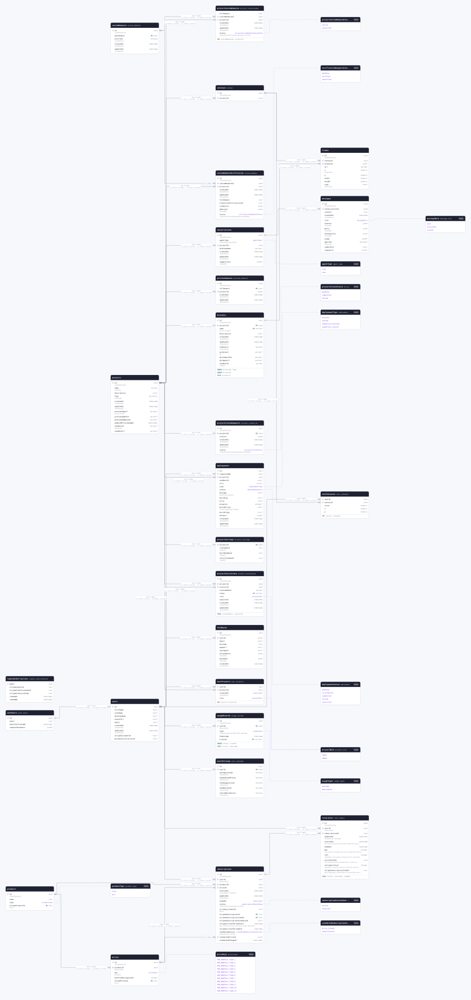

<details>
<summary>The whole schema as SQL</summary>

```sql
CREATE SCHEMA "auth";

CREATE TYPE "agent_type" AS ENUM('root', 'user');

CREATE TYPE "message_role" AS ENUM('user', 'assistant', 'system');

CREATE TYPE "project_custom_domain_status" AS ENUM('active', 'cancelled');

CREATE TYPE "verification_request_status" AS ENUM('pending', 'verified', 'cancelled');

CREATE TYPE "deployment_status" AS ENUM('pending', 'in_progress', 'completed', 'failed', 'cancelled');

CREATE TYPE "deployment_type" AS ENUM('preview', 'custom', 'unpublish_preview', 'unpublish_custom');

CREATE TYPE "price_keys" AS ENUM('PRO_MONTHLY_TIER_1', 'PRO_MONTHLY_TIER_2', 'PRO_MONTHLY_TIER_3', 'PRO_MONTHLY_TIER_4', 'PRO_MONTHLY_TIER_5', 'PRO_MONTHLY_TIER_6', 'PRO_MONTHLY_TIER_7', 'PRO_MONTHLY_TIER_8', 'PRO_MONTHLY_TIER_9', 'PRO_MONTHLY_TIER_10', 'PRO_MONTHLY_TIER_11');

CREATE TYPE "product_type" AS ENUM('free', 'pro');

CREATE TYPE "project_create_status" AS ENUM('pending', 'completed', 'failed');

CREATE TYPE "project_role" AS ENUM('owner', 'admin');

CREATE TYPE "scheduled_subscription_action" AS ENUM('price_change', 'cancellation');

CREATE TYPE "subscription_status" AS ENUM('active', 'canceled');

CREATE TYPE "usage_types" AS ENUM('message', 'deployment');

CREATE TABLE "canvas" (
	"id" uuid PRIMARY KEY DEFAULT gen_random_uuid(),
	"project_id" uuid NOT NULL
);

ALTER TABLE "canvas" ENABLE ROW LEVEL SECURITY;

CREATE TABLE "frames" (
	"id" uuid PRIMARY KEY DEFAULT gen_random_uuid(),
	"canvas_id" uuid NOT NULL,
	"branch_id" uuid,
	"url" varchar NOT NULL,
	"x" numeric NOT NULL,
	"y" numeric NOT NULL,
	"width" numeric NOT NULL,
	"height" numeric NOT NULL,
	"type" text
);

ALTER TABLE "frames" ENABLE ROW LEVEL SECURITY;

CREATE TABLE "conversations" (
	"id" uuid PRIMARY KEY DEFAULT gen_random_uuid(),
	"agent_type" "agent_type" DEFAULT 'root'::"agent_type",
	"project_id" uuid NOT NULL,
	"display_name" varchar,
	"created_at" timestamp with time zone DEFAULT now() NOT NULL,
	"updated_at" timestamp with time zone DEFAULT now() NOT NULL,
	"suggestions" jsonb DEFAULT '[]'
);

ALTER TABLE "conversations" ENABLE ROW LEVEL SECURITY;

CREATE TABLE "messages" (
	"id" uuid PRIMARY KEY DEFAULT gen_random_uuid(),
	"conversation_id" uuid NOT NULL,
	"content" text NOT NULL,
	"created_at" timestamp with time zone DEFAULT now() NOT NULL,
	"role" "message_role" NOT NULL,
	"context" jsonb DEFAULT '[]' NOT NULL,
	"parts" jsonb DEFAULT '[]' NOT NULL,
	"checkpoints" jsonb DEFAULT '[]' NOT NULL,
	"usage" jsonb,
	"applied" boolean,
	"commit_oid" text,
	"snapshots" jsonb
);

ALTER TABLE "messages" ENABLE ROW LEVEL SECURITY;

CREATE TABLE "custom_domains" (
	"id" uuid PRIMARY KEY DEFAULT gen_random_uuid(),
	"apex_domain" text NOT NULL UNIQUE,
	"verified" boolean DEFAULT false NOT NULL,
	"created_at" timestamp with time zone DEFAULT now() NOT NULL,
	"updated_at" timestamp with time zone DEFAULT now() NOT NULL
);

ALTER TABLE "custom_domains" ENABLE ROW LEVEL SECURITY;

CREATE TABLE "custom_domain_verification" (
	"id" uuid PRIMARY KEY DEFAULT gen_random_uuid(),
	"custom_domain_id" uuid NOT NULL,
	"project_id" uuid NOT NULL,
	"created_at" timestamp with time zone DEFAULT now() NOT NULL,
	"updated_at" timestamp with time zone DEFAULT now() NOT NULL,
	"full_domain" text NOT NULL,
	"freestyle_verification_id" text NOT NULL,
	"txt_record" jsonb NOT NULL,
	"a_records" jsonb DEFAULT '[]' NOT NULL,
	"status" "verification_request_status" DEFAULT 'pending'::"verification_request_status" NOT NULL
);

ALTER TABLE "custom_domain_verification" ENABLE ROW LEVEL SECURITY;

CREATE TABLE "project_custom_domains" (
	"full_domain" text NOT NULL,
	"custom_domain_id" uuid,
	"project_id" uuid,
	"created_at" timestamp with time zone DEFAULT now() NOT NULL,
	"updated_at" timestamp with time zone DEFAULT now() NOT NULL,
	"status" "project_custom_domain_status" DEFAULT 'active'::"project_custom_domain_status" NOT NULL,
	CONSTRAINT "project_custom_domains_pkey" PRIMARY KEY("custom_domain_id","project_id")
);

ALTER TABLE "project_custom_domains" ENABLE ROW LEVEL SECURITY;

CREATE TABLE "deployments" (
	"id" uuid PRIMARY KEY,
	"requested_by" uuid NOT NULL,
	"project_id" uuid NOT NULL,
	"sandbox_id" text,
	"urls" text[],
	"type" "deployment_type" NOT NULL,
	"status" "deployment_status" NOT NULL,
	"message" text,
	"build_log" text,
	"error" text,
	"progress" integer,
	"build_script" text,
	"build_flags" text,
	"env_vars" jsonb,
	"created_at" timestamp with time zone DEFAULT now() NOT NULL,
	"updated_at" timestamp with time zone DEFAULT now() NOT NULL
);

ALTER TABLE "deployments" ENABLE ROW LEVEL SECURITY;

CREATE TABLE "preview_domains" (
	"id" uuid PRIMARY KEY DEFAULT gen_random_uuid(),
	"full_domain" text NOT NULL UNIQUE,
	"project_id" uuid,
	"created_at" timestamp with time zone DEFAULT now() NOT NULL,
	"updated_at" timestamp with time zone DEFAULT now() NOT NULL
);

ALTER TABLE "preview_domains" ENABLE ROW LEVEL SECURITY;

CREATE TABLE "feedbacks" (
	"id" uuid PRIMARY KEY DEFAULT gen_random_uuid(),
	"user_id" uuid,
	"email" text,
	"message" text NOT NULL,
	"page_url" text,
	"user_agent" text,
	"attachments" jsonb DEFAULT '[]' NOT NULL,
	"metadata" jsonb DEFAULT '{}' NOT NULL,
	"created_at" timestamp with time zone DEFAULT now() NOT NULL
);

ALTER TABLE "feedbacks" ENABLE ROW LEVEL SECURITY;

CREATE TABLE "auth"."users" (
	"id" uuid PRIMARY KEY,
	"email" text NOT NULL,
	"email_confirmed_at" timestamp,
	"raw_user_meta_data" jsonb
);

CREATE TABLE "branches" (
	"id" uuid PRIMARY KEY DEFAULT gen_random_uuid(),
	"project_id" uuid NOT NULL,
	"name" varchar NOT NULL,
	"description" text,
	"created_at" timestamp with time zone DEFAULT now() NOT NULL,
	"updated_at" timestamp with time zone DEFAULT now() NOT NULL,
	"is_default" boolean DEFAULT false NOT NULL,
	"git_branch" varchar,
	"git_commit_sha" varchar,
	"git_repo_url" varchar,
	"sandbox_id" varchar NOT NULL
);

ALTER TABLE "branches" ENABLE ROW LEVEL SECURITY;

CREATE TABLE "legacy_subscriptions" (
	"email" text PRIMARY KEY,
	"stripe_coupon_id" text NOT NULL,
	"stripe_promotion_code_id" text NOT NULL,
	"stripe_promotion_code" text NOT NULL,
	"redeem_at" timestamp with time zone,
	"redeem_by" timestamp with time zone
);

ALTER TABLE "legacy_subscriptions" ENABLE ROW LEVEL SECURITY;

CREATE TABLE "prices" (
	"id" uuid PRIMARY KEY DEFAULT gen_random_uuid(),
	"product_id" uuid NOT NULL,
	"price_key" "price_keys" NOT NULL,
	"monthly_message_limit" integer NOT NULL,
	"stripe_price_id" text NOT NULL UNIQUE
);

ALTER TABLE "prices" ENABLE ROW LEVEL SECURITY;

CREATE TABLE "products" (
	"id" uuid PRIMARY KEY DEFAULT gen_random_uuid(),
	"name" text NOT NULL,
	"type" "product_type" NOT NULL,
	"stripe_product_id" text NOT NULL UNIQUE
);

ALTER TABLE "products" ENABLE ROW LEVEL SECURITY;

CREATE TABLE "project_create_requests" (
	"id" uuid PRIMARY KEY DEFAULT gen_random_uuid(),
	"project_id" uuid NOT NULL UNIQUE,
	"context" jsonb NOT NULL,
	"created_at" timestamp with time zone DEFAULT now() NOT NULL,
	"updated_at" timestamp with time zone DEFAULT now() NOT NULL,
	"status" "project_create_status" DEFAULT 'pending'::"project_create_status" NOT NULL
);

ALTER TABLE "project_create_requests" ENABLE ROW LEVEL SECURITY;

CREATE TABLE "project_invitations" (
	"id" uuid PRIMARY KEY DEFAULT gen_random_uuid(),
	"project_id" uuid NOT NULL,
	"inviter_id" uuid NOT NULL,
	"invitee_email" varchar NOT NULL,
	"token" varchar NOT NULL UNIQUE,
	"role" "project_role" NOT NULL,
	"expires_at" timestamp with time zone NOT NULL,
	"created_at" timestamp with time zone DEFAULT now() NOT NULL,
	"updated_at" timestamp with time zone DEFAULT now() NOT NULL
);

ALTER TABLE "project_invitations" ENABLE ROW LEVEL SECURITY;

CREATE TABLE "project_settings" (
	"project_id" uuid NOT NULL UNIQUE,
	"run_command" text DEFAULT '' NOT NULL,
	"build_command" text DEFAULT '' NOT NULL,
	"install_command" text DEFAULT '' NOT NULL
);

ALTER TABLE "project_settings" ENABLE ROW LEVEL SECURITY;

CREATE TABLE "projects" (
	"id" uuid PRIMARY KEY DEFAULT gen_random_uuid(),
	"name" varchar NOT NULL,
	"description" text,
	"tags" varchar[] DEFAULT '{}'::varchar[],
	"created_at" timestamp with time zone DEFAULT now() NOT NULL,
	"updated_at" timestamp with time zone DEFAULT now() NOT NULL,
	"preview_img_url" varchar,
	"preview_img_path" varchar,
	"preview_img_bucket" varchar,
	"updated_preview_img_at" timestamp with time zone,
	"sandbox_id" varchar,
	"sandbox_url" varchar
);

ALTER TABLE "projects" ENABLE ROW LEVEL SECURITY;

CREATE TABLE "rate_limits" (
	"id" uuid PRIMARY KEY DEFAULT gen_random_uuid(),
	"user_id" uuid NOT NULL,
	"subscription_id" uuid NOT NULL,
	"updated_at" timestamp with time zone DEFAULT now() NOT NULL,
	"started_at" timestamp with time zone NOT NULL,
	"ended_at" timestamp with time zone NOT NULL,
	"max" integer NOT NULL,
	"left" integer DEFAULT 0 NOT NULL,
	"carry_over_key" uuid NOT NULL,
	"carry_over_total" integer DEFAULT 0 NOT NULL,
	"stripe_subscription_item_id" text NOT NULL
);

ALTER TABLE "rate_limits" ENABLE ROW LEVEL SECURITY;

CREATE TABLE "subscriptions" (
	"id" uuid PRIMARY KEY DEFAULT gen_random_uuid(),
	"user_id" uuid NOT NULL,
	"product_id" uuid NOT NULL,
	"price_id" uuid NOT NULL,
	"started_at" timestamp with time zone DEFAULT now() NOT NULL,
	"updated_at" timestamp with time zone DEFAULT now() NOT NULL,
	"ended_at" timestamp with time zone,
	"status" "subscription_status" DEFAULT 'active'::"subscription_status" NOT NULL,
	"stripe_customer_id" text NOT NULL,
	"stripe_subscription_id" text NOT NULL UNIQUE,
	"stripe_subscription_item_id" text NOT NULL UNIQUE,
	"stripe_subscription_schedule_id" text,
	"stripe_current_period_start" timestamp with time zone NOT NULL,
	"stripe_current_period_end" timestamp with time zone NOT NULL,
	"scheduled_action" "scheduled_subscription_action",
	"scheduled_price_id" uuid,
	"scheduled_change_at" timestamp with time zone
);

ALTER TABLE "subscriptions" ENABLE ROW LEVEL SECURITY;

CREATE TABLE "usage_records" (
	"id" uuid PRIMARY KEY DEFAULT gen_random_uuid(),
	"user_id" uuid NOT NULL,
	"type" "usage_types" DEFAULT 'message'::"usage_types" NOT NULL,
	"timestamp" timestamp with time zone NOT NULL,
	"trace_id" varchar(255),
	CONSTRAINT "usage_records_user_trace_idx" UNIQUE("user_id","trace_id")
);

ALTER TABLE "usage_records" ENABLE ROW LEVEL SECURITY;

CREATE TABLE "user_canvases" (
	"user_id" uuid,
	"canvas_id" uuid,
	"scale" numeric NOT NULL,
	"x" numeric NOT NULL,
	"y" numeric NOT NULL,
	CONSTRAINT "user_canvases_pkey" PRIMARY KEY("user_id","canvas_id")
);

ALTER TABLE "user_canvases" ENABLE ROW LEVEL SECURITY;

CREATE TABLE "user_projects" (
	"user_id" uuid,
	"project_id" uuid,
	"created_at" timestamp with time zone DEFAULT now(),
	"role" "project_role" NOT NULL,
	CONSTRAINT "user_projects_pkey" PRIMARY KEY("user_id","project_id")
);

ALTER TABLE "user_projects" ENABLE ROW LEVEL SECURITY;

CREATE TABLE "user_settings" (
	"id" uuid PRIMARY KEY,
	"user_id" uuid NOT NULL UNIQUE,
	"auto_apply_code" boolean DEFAULT true NOT NULL,
	"expand_code_blocks" boolean DEFAULT true NOT NULL,
	"show_suggestions" boolean DEFAULT true NOT NULL,
	"show_mini_chat" boolean DEFAULT false NOT NULL,
	"should_warn_delete" boolean DEFAULT true NOT NULL
);

ALTER TABLE "user_settings" ENABLE ROW LEVEL SECURITY;

CREATE TABLE "users" (
	"id" uuid PRIMARY KEY,
	"first_name" text,
	"last_name" text,
	"display_name" text,
	"avatar_url" text,
	"email" text,
	"created_at" timestamp with time zone DEFAULT now() NOT NULL,
	"updated_at" timestamp with time zone DEFAULT now() NOT NULL,
	"stripe_customer_id" text,
	"github_installation_id" text
);

ALTER TABLE "users" ENABLE ROW LEVEL SECURITY;

CREATE INDEX "branches_project_id_idx" ON "branches" ("project_id");

CREATE UNIQUE INDEX "branches_name_per_project_ux" ON "branches" ("project_id","name");

CREATE UNIQUE INDEX "branches_default_per_project_ux" ON "branches" ("project_id") WHERE "is_default" = true;

CREATE INDEX "project_invitations_invitee_email_project_id_idx" ON "project_invitations" ("invitee_email","project_id");

CREATE INDEX "rate_limits_user_time_idx" ON "rate_limits" ("user_id","started_at","ended_at");

CREATE INDEX "usage_records_user_time_idx" ON "usage_records" ("user_id","timestamp");

ALTER TABLE "canvas" ADD CONSTRAINT "canvas_project_id_projects_id_fkey" FOREIGN KEY ("project_id") REFERENCES "projects"("id") ON DELETE CASCADE ON UPDATE CASCADE;

ALTER TABLE "frames" ADD CONSTRAINT "frames_canvas_id_canvas_id_fkey" FOREIGN KEY ("canvas_id") REFERENCES "canvas"("id") ON DELETE CASCADE ON UPDATE CASCADE;

ALTER TABLE "frames" ADD CONSTRAINT "frames_branch_id_branches_id_fkey" FOREIGN KEY ("branch_id") REFERENCES "branches"("id") ON DELETE CASCADE ON UPDATE CASCADE;

ALTER TABLE "conversations" ADD CONSTRAINT "conversations_project_id_projects_id_fkey" FOREIGN KEY ("project_id") REFERENCES "projects"("id") ON DELETE CASCADE ON UPDATE CASCADE;

ALTER TABLE "messages" ADD CONSTRAINT "messages_conversation_id_conversations_id_fkey" FOREIGN KEY ("conversation_id") REFERENCES "conversations"("id") ON DELETE CASCADE ON UPDATE CASCADE;

ALTER TABLE "custom_domain_verification" ADD CONSTRAINT "custom_domain_verification_1Td39scPfcdd_fkey" FOREIGN KEY ("custom_domain_id") REFERENCES "custom_domains"("id");

ALTER TABLE "custom_domain_verification" ADD CONSTRAINT "custom_domain_verification_project_id_projects_id_fkey" FOREIGN KEY ("project_id") REFERENCES "projects"("id") ON DELETE CASCADE ON UPDATE CASCADE;

ALTER TABLE "project_custom_domains" ADD CONSTRAINT "project_custom_domains_custom_domain_id_custom_domains_id_fkey" FOREIGN KEY ("custom_domain_id") REFERENCES "custom_domains"("id") ON DELETE CASCADE ON UPDATE CASCADE;

ALTER TABLE "project_custom_domains" ADD CONSTRAINT "project_custom_domains_project_id_projects_id_fkey" FOREIGN KEY ("project_id") REFERENCES "projects"("id") ON DELETE CASCADE ON UPDATE CASCADE;

ALTER TABLE "deployments" ADD CONSTRAINT "deployments_requested_by_users_id_fkey" FOREIGN KEY ("requested_by") REFERENCES "users"("id") ON DELETE CASCADE ON UPDATE CASCADE;

ALTER TABLE "deployments" ADD CONSTRAINT "deployments_project_id_projects_id_fkey" FOREIGN KEY ("project_id") REFERENCES "projects"("id") ON DELETE CASCADE ON UPDATE CASCADE;

ALTER TABLE "preview_domains" ADD CONSTRAINT "preview_domains_project_id_projects_id_fkey" FOREIGN KEY ("project_id") REFERENCES "projects"("id") ON DELETE CASCADE ON UPDATE CASCADE;

ALTER TABLE "feedbacks" ADD CONSTRAINT "feedbacks_user_id_users_id_fkey" FOREIGN KEY ("user_id") REFERENCES "users"("id") ON DELETE SET NULL ON UPDATE CASCADE;

ALTER TABLE "branches" ADD CONSTRAINT "branches_project_id_projects_id_fkey" FOREIGN KEY ("project_id") REFERENCES "projects"("id") ON DELETE CASCADE ON UPDATE CASCADE;

ALTER TABLE "prices" ADD CONSTRAINT "prices_product_id_products_id_fkey" FOREIGN KEY ("product_id") REFERENCES "products"("id") ON DELETE CASCADE ON UPDATE CASCADE;

ALTER TABLE "project_create_requests" ADD CONSTRAINT "project_create_requests_project_id_projects_id_fkey" FOREIGN KEY ("project_id") REFERENCES "projects"("id") ON DELETE CASCADE ON UPDATE CASCADE;

ALTER TABLE "project_invitations" ADD CONSTRAINT "project_invitations_project_id_projects_id_fkey" FOREIGN KEY ("project_id") REFERENCES "projects"("id") ON DELETE CASCADE ON UPDATE CASCADE;

ALTER TABLE "project_invitations" ADD CONSTRAINT "project_invitations_inviter_id_users_id_fkey" FOREIGN KEY ("inviter_id") REFERENCES "users"("id") ON DELETE CASCADE ON UPDATE CASCADE;

ALTER TABLE "project_settings" ADD CONSTRAINT "project_settings_project_id_projects_id_fkey" FOREIGN KEY ("project_id") REFERENCES "projects"("id") ON DELETE CASCADE ON UPDATE CASCADE;

ALTER TABLE "rate_limits" ADD CONSTRAINT "rate_limits_user_id_users_id_fkey" FOREIGN KEY ("user_id") REFERENCES "users"("id") ON DELETE CASCADE ON UPDATE CASCADE;

ALTER TABLE "rate_limits" ADD CONSTRAINT "rate_limits_subscription_id_subscriptions_id_fkey" FOREIGN KEY ("subscription_id") REFERENCES "subscriptions"("id") ON DELETE CASCADE ON UPDATE CASCADE;

ALTER TABLE "subscriptions" ADD CONSTRAINT "subscriptions_user_id_users_id_fkey" FOREIGN KEY ("user_id") REFERENCES "users"("id") ON DELETE CASCADE ON UPDATE CASCADE;

ALTER TABLE "subscriptions" ADD CONSTRAINT "subscriptions_product_id_products_id_fkey" FOREIGN KEY ("product_id") REFERENCES "products"("id") ON DELETE CASCADE ON UPDATE CASCADE;

ALTER TABLE "subscriptions" ADD CONSTRAINT "subscriptions_price_id_prices_id_fkey" FOREIGN KEY ("price_id") REFERENCES "prices"("id") ON DELETE CASCADE ON UPDATE CASCADE;

ALTER TABLE "subscriptions" ADD CONSTRAINT "subscriptions_scheduled_price_id_prices_id_fkey" FOREIGN KEY ("scheduled_price_id") REFERENCES "prices"("id");

ALTER TABLE "usage_records" ADD CONSTRAINT "usage_records_user_id_users_id_fkey" FOREIGN KEY ("user_id") REFERENCES "users"("id") ON DELETE CASCADE ON UPDATE CASCADE;

ALTER TABLE "user_canvases" ADD CONSTRAINT "user_canvases_user_id_users_id_fkey" FOREIGN KEY ("user_id") REFERENCES "users"("id") ON DELETE CASCADE ON UPDATE CASCADE;

ALTER TABLE "user_canvases" ADD CONSTRAINT "user_canvases_canvas_id_canvas_id_fkey" FOREIGN KEY ("canvas_id") REFERENCES "canvas"("id") ON DELETE CASCADE ON UPDATE CASCADE;

ALTER TABLE "user_projects" ADD CONSTRAINT "user_projects_user_id_users_id_fkey" FOREIGN KEY ("user_id") REFERENCES "users"("id") ON DELETE CASCADE ON UPDATE CASCADE;

ALTER TABLE "user_projects" ADD CONSTRAINT "user_projects_project_id_projects_id_fkey" FOREIGN KEY ("project_id") REFERENCES "projects"("id") ON DELETE CASCADE ON UPDATE CASCADE;

ALTER TABLE "user_settings" ADD CONSTRAINT "user_settings_user_id_users_id_fkey" FOREIGN KEY ("user_id") REFERENCES "users"("id") ON DELETE CASCADE ON UPDATE CASCADE;

ALTER TABLE "users" ADD CONSTRAINT "users_id_users_id_fkey" FOREIGN KEY ("id") REFERENCES "auth"."users"("id") ON DELETE CASCADE ON UPDATE CASCADE;
```

</details>

## Contents

| Table                                                       | Name in the database         | Description |
| ----------------------------------------------------------- | ---------------------------- | ----------- |
| [canvases](#table-canvases)                                 | `canvas`                     |             |
| [frames](#table-frames)                                     | `frames`                     |             |
| [conversations](#table-conversations)                       | `conversations`              |             |
| [messages](#table-messages)                                 | `messages`                   |             |
| [customDomains](#table-customDomains)                       | `custom_domains`             |             |
| [projectCustomDomains](#table-projectCustomDomains)         | `project_custom_domains`     |             |
| [customDomainVerification](#table-customDomainVerification) | `custom_domain_verification` |             |
| [deployments](#table-deployments)                           | `deployments`                |             |
| [previewDomains](#table-previewDomains)                     | `preview_domains`            |             |
| [feedbacks](#table-feedbacks)                               | `feedbacks`                  | deprecated  |
| [branches](#table-branches)                                 | `branches`                   |             |
| [projectCreateRequests](#table-projectCreateRequests)       | `project_create_requests`    |             |
| [projectInvitations](#table-projectInvitations)             | `project_invitations`        |             |
| [projects](#table-projects)                                 | `projects`                   |             |
| [projectSettings](#table-projectSettings)                   | `project_settings`           |             |
| [legacySubscriptions](#table-legacySubscriptions)           | `legacy_subscriptions`       |             |
| [prices](#table-prices)                                     | `prices`                     |             |
| [products](#table-products)                                 | `products`                   |             |
| [rateLimits](#table-rateLimits)                             | `rate_limits`                |             |
| [subscriptions](#table-subscriptions)                       | `subscriptions`              |             |
| [usageRecords](#table-usageRecords)                         | `usage_records`              |             |
| [authUsers](#table-authUsers)                               | `auth.users`                 |             |
| [userSettings](#table-userSettings)                         | `user_settings`              |             |
| [userCanvases](#table-userCanvases)                         | `user_canvases`              |             |
| [userProjects](#table-userProjects)                         | `user_projects`              |             |
| [users](#table-users)                                       | `users`                      |             |

| Enum                                                                 | Name in the database            | Description |
| -------------------------------------------------------------------- | ------------------------------- | ----------- |
| [agentType](#enum-agentType)                                         | `agent_type`                    |             |
| [messageRole](#enum-messageRole)                                     | `message_role`                  |             |
| [projectCustomDomainStatusEnum](#enum-projectCustomDomainStatusEnum) | `project_custom_domain_status`  |             |
| [verificationRequestStatus](#enum-verificationRequestStatus)         | `verification_request_status`   |             |
| [deploymentStatus](#enum-deploymentStatus)                           | `deployment_status`             |             |
| [deploymentType](#enum-deploymentType)                               | `deployment_type`               |             |
| [projectCreateStatus](#enum-projectCreateStatus)                     | `project_create_status`         |             |
| [priceKeys](#enum-priceKeys)                                         | `price_keys`                    |             |
| [productType](#enum-productType)                                     | `product_type`                  |             |
| [subscriptionStatusEnum](#enum-subscriptionStatusEnum)               | `subscription_status`           |             |
| [scheduledSubscriptionAction](#enum-scheduledSubscriptionAction)     | `scheduled_subscription_action` |             |
| [usageTypes](#enum-usageTypes)                                       | `usage_types`                   |             |
| [projectRole](#enum-projectRole)                                     | `project_role`                  |             |

## Tables

<a id="table-canvases"></a>

### canvases

Table `canvas`.

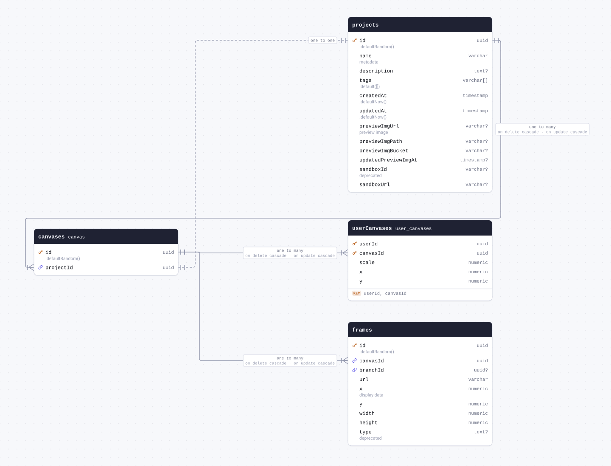

| Column                     | Type   | Constraints                               | Default            | Description |
| -------------------------- | ------ | ----------------------------------------- | ------------------ | ----------- |
| `id`                       | `uuid` | PK NOT NULL                               | `.defaultRandom()` |             |
| `projectId` (`project_id`) | `uuid` | NOT NULL → [projects.id](#table-projects) |                    |             |

#### Definition

```sql
CREATE TABLE "canvas" (
	"id" uuid PRIMARY KEY DEFAULT gen_random_uuid(),
	"project_id" uuid NOT NULL
);

ALTER TABLE "canvas" ENABLE ROW LEVEL SECURITY;

ALTER TABLE "canvas" ADD CONSTRAINT "canvas_project_id_projects_id_fkey" FOREIGN KEY ("project_id") REFERENCES "projects"("id") ON DELETE CASCADE ON UPDATE CASCADE;
```

#### References

- `projectId` → [projects.id](#table-projects) (many to one, on delete cascade, on update cascade)

#### Referenced by

- `id` → [frames.canvasId](#table-frames) (one to many, on delete cascade, on update cascade)
- `id` → [userCanvases.canvasId](#table-userCanvases) (one to many, on delete cascade, on update cascade)
- `projectId` → [projects.id](#table-projects) (one to one, defineRelations)

<details>
<summary>Queries and their SQL</summary>

**Select**: Every row of canvases.

```ts
db.select().from(canvases);
```

```sql
select "id", "project_id"
from "canvas"
```

**Count**: How many rows canvases has.

```ts
db.select({ count: count() }).from(canvases);
```

```sql
select count(*)
from "canvas"
```

**Find many**: The rows of canvases, through the relational query API.

```ts
db.query.canvases.findMany();
```

```sql
select "d0"."id" as "id", "d0"."project_id" as "projectId"
from "canvas" as "d0"
```

**Find by primary key**: One row of canvases, through the relational query API.

```ts
db.query.canvases.findFirst({ where: { id: "00000000-0000-0000-0000-000000000000" } });
```

```sql
select "d0"."id" as "id", "d0"."project_id" as "projectId"
from "canvas" as "d0"
where "d0"."id" = $1
limit $2
-- params: ["00000000-0000-0000-0000-000000000000",1]
```

**Insert**: Adds a row to canvases, giving the columns that have no default.

```ts
db.insert(canvases).values({ projectId: "00000000-0000-0000-0000-000000000000" });
```

```sql
insert into "canvas" ("id", "project_id")
values (default, $1)
-- params: ["00000000-0000-0000-0000-000000000000"]
```

**Update**: Changes a row of canvases, found by its primary key.

```ts
db.update(canvases)
  .set({ projectId: "00000000-0000-0000-0000-000000000000" })
  .where(eq(canvases.id, "00000000-0000-0000-0000-000000000000"));
```

```sql
update "canvas"
set "project_id" = $1
where "canvas"."id" = $2
-- params: ["00000000-0000-0000-0000-000000000000","00000000-0000-0000-0000-000000000000"]
```

**Delete**: Deletes a row of canvases, found by its primary key.

```ts
db.delete(canvases).where(eq(canvases.id, "00000000-0000-0000-0000-000000000000"));
```

```sql
delete from "canvas"
where "canvas"."id" = $1
-- params: ["00000000-0000-0000-0000-000000000000"]
```

</details>

<a id="table-frames"></a>

### frames

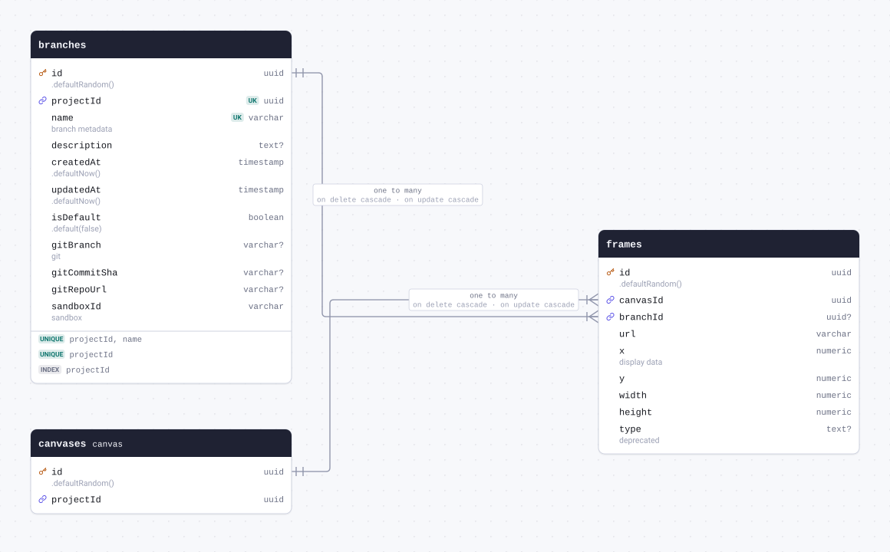

| Column                   | Type      | Constraints                               | Default            | Description  |
| ------------------------ | --------- | ----------------------------------------- | ------------------ | ------------ |
| `id`                     | `uuid`    | PK NOT NULL                               | `.defaultRandom()` |              |
| `canvasId` (`canvas_id`) | `uuid`    | NOT NULL → [canvases.id](#table-canvases) |                    |              |
| `branchId` (`branch_id`) | `uuid`    | NULL → [branches.id](#table-branches)     |                    |              |
| `url`                    | `varchar` | NOT NULL                                  |                    |              |
| `x`                      | `numeric` | NOT NULL                                  |                    | display data |
| `y`                      | `numeric` | NOT NULL                                  |                    |              |
| `width`                  | `numeric` | NOT NULL                                  |                    |              |
| `height`                 | `numeric` | NOT NULL                                  |                    |              |
| `type`                   | `text`    | NULL                                      |                    | deprecated   |

#### Definition

```sql
CREATE TABLE "frames" (
	"id" uuid PRIMARY KEY DEFAULT gen_random_uuid(),
	"canvas_id" uuid NOT NULL,
	"branch_id" uuid,
	"url" varchar NOT NULL,
	"x" numeric NOT NULL,
	"y" numeric NOT NULL,
	"width" numeric NOT NULL,
	"height" numeric NOT NULL,
	"type" text
);

ALTER TABLE "frames" ENABLE ROW LEVEL SECURITY;

ALTER TABLE "frames" ADD CONSTRAINT "frames_canvas_id_canvas_id_fkey" FOREIGN KEY ("canvas_id") REFERENCES "canvas"("id") ON DELETE CASCADE ON UPDATE CASCADE;

ALTER TABLE "frames" ADD CONSTRAINT "frames_branch_id_branches_id_fkey" FOREIGN KEY ("branch_id") REFERENCES "branches"("id") ON DELETE CASCADE ON UPDATE CASCADE;
```

#### References

- `canvasId` → [canvases.id](#table-canvases) (many to one, on delete cascade, on update cascade)
- `branchId` → [branches.id](#table-branches) (many to one, on delete cascade, on update cascade)

<details>
<summary>Queries and their SQL</summary>

**Select**: Every row of frames.

```ts
db.select().from(frames);
```

```sql
select "id", "canvas_id", "branch_id", "url", "x", "y", "width", "height", "type"
from "frames"
```

**Count**: How many rows frames has.

```ts
db.select({ count: count() }).from(frames);
```

```sql
select count(*)
from "frames"
```

**Find many**: The rows of frames, through the relational query API.

```ts
db.query.frames.findMany();
```

```sql
select "d0"."id" as "id", "d0"."canvas_id" as "canvasId", "d0"."branch_id" as "branchId", "d0"."url" as "url", "d0"."x" as "x", "d0"."y" as "y", "d0"."width" as "width", "d0"."height" as "height", "d0"."type" as "type"
from "frames" as "d0"
```

**Find by primary key**: One row of frames, through the relational query API.

```ts
db.query.frames.findFirst({ where: { id: "00000000-0000-0000-0000-000000000000" } });
```

```sql
select "d0"."id" as "id", "d0"."canvas_id" as "canvasId", "d0"."branch_id" as "branchId", "d0"."url" as "url", "d0"."x" as "x", "d0"."y" as "y", "d0"."width" as "width", "d0"."height" as "height", "d0"."type" as "type"
from "frames" as "d0"
where "d0"."id" = $1
limit $2
-- params: ["00000000-0000-0000-0000-000000000000",1]
```

**Insert**: Adds a row to frames, giving the columns that have no default.

```ts
db.insert(frames).values({
  canvasId: "00000000-0000-0000-0000-000000000000",
  url: "url",
  x: "1.00",
  y: "1.00",
  width: "1.00",
  height: "1.00",
});
```

```sql
insert into "frames" ("id", "canvas_id", "branch_id", "url", "x", "y", "width", "height", "type")
values (default, $1, default, $2, $3, $4, $5, $6, default)
-- params: ["00000000-0000-0000-0000-000000000000","url","1.00","1.00","1.00","1.00"]
```

**Update**: Changes a row of frames, found by its primary key.

```ts
db.update(frames)
  .set({ canvasId: "00000000-0000-0000-0000-000000000000" })
  .where(eq(frames.id, "00000000-0000-0000-0000-000000000000"));
```

```sql
update "frames"
set "canvas_id" = $1
where "frames"."id" = $2
-- params: ["00000000-0000-0000-0000-000000000000","00000000-0000-0000-0000-000000000000"]
```

**Delete**: Deletes a row of frames, found by its primary key.

```ts
db.delete(frames).where(eq(frames.id, "00000000-0000-0000-0000-000000000000"));
```

```sql
delete from "frames"
where "frames"."id" = $1
-- params: ["00000000-0000-0000-0000-000000000000"]
```

</details>

<a id="table-conversations"></a>

### conversations

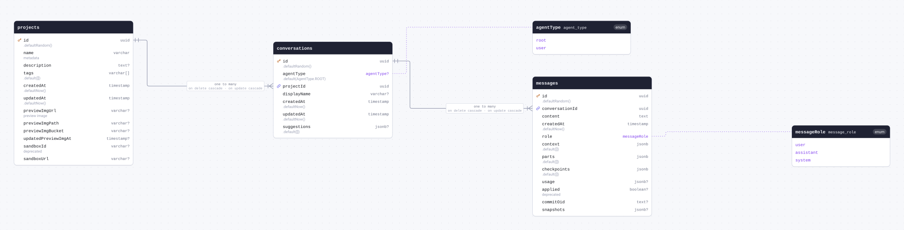

| Column                         | Type                           | Constraints                               | Default                    | Description |
| ------------------------------ | ------------------------------ | ----------------------------------------- | -------------------------- | ----------- |
| `id`                           | `uuid`                         | PK NOT NULL                               | `.defaultRandom()`         |             |
| `agentType` (`agent_type`)     | [`agentType`](#enum-agentType) | NULL                                      | `.default(AgentType.ROOT)` |             |
| `projectId` (`project_id`)     | `uuid`                         | NOT NULL → [projects.id](#table-projects) |                            |             |
| `displayName` (`display_name`) | `varchar`                      | NULL                                      |                            |             |
| `createdAt` (`created_at`)     | `timestamp`                    | NOT NULL                                  | `.defaultNow()`            |             |
| `updatedAt` (`updated_at`)     | `timestamp`                    | NOT NULL                                  | `.defaultNow()`            |             |
| `suggestions`                  | `jsonb`                        | NULL                                      | `.default([])`             |             |

#### Definition

```sql
CREATE TABLE "conversations" (
	"id" uuid PRIMARY KEY DEFAULT gen_random_uuid(),
	"agent_type" "agent_type" DEFAULT 'root'::"agent_type",
	"project_id" uuid NOT NULL,
	"display_name" varchar,
	"created_at" timestamp with time zone DEFAULT now() NOT NULL,
	"updated_at" timestamp with time zone DEFAULT now() NOT NULL,
	"suggestions" jsonb DEFAULT '[]'
);

ALTER TABLE "conversations" ENABLE ROW LEVEL SECURITY;

ALTER TABLE "conversations" ADD CONSTRAINT "conversations_project_id_projects_id_fkey" FOREIGN KEY ("project_id") REFERENCES "projects"("id") ON DELETE CASCADE ON UPDATE CASCADE;
```

#### References

- `projectId` → [projects.id](#table-projects) (many to one, on delete cascade, on update cascade)

#### Referenced by

- `id` → [messages.conversationId](#table-messages) (one to many, on delete cascade, on update cascade)

<details>
<summary>Queries and their SQL</summary>

**Select**: Every row of conversations.

```ts
db.select().from(conversations);
```

```sql
select "id", "agent_type", "project_id", "display_name", "created_at", "updated_at", "suggestions"
from "conversations"
```

**Count**: How many rows conversations has.

```ts
db.select({ count: count() }).from(conversations);
```

```sql
select count(*)
from "conversations"
```

**Find many**: The rows of conversations, through the relational query API.

```ts
db.query.conversations.findMany();
```

```sql
select "d0"."id" as "id", "d0"."agent_type" as "agentType", "d0"."project_id" as "projectId", "d0"."display_name" as "displayName", "d0"."created_at" as "createdAt", "d0"."updated_at" as "updatedAt", "d0"."suggestions" as "suggestions"
from "conversations" as "d0"
```

**Find by primary key**: One row of conversations, through the relational query API.

```ts
db.query.conversations.findFirst({ where: { id: "00000000-0000-0000-0000-000000000000" } });
```

```sql
select "d0"."id" as "id", "d0"."agent_type" as "agentType", "d0"."project_id" as "projectId", "d0"."display_name" as "displayName", "d0"."created_at" as "createdAt", "d0"."updated_at" as "updatedAt", "d0"."suggestions" as "suggestions"
from "conversations" as "d0"
where "d0"."id" = $1
limit $2
-- params: ["00000000-0000-0000-0000-000000000000",1]
```

**Insert**: Adds a row to conversations, giving the columns that have no default.

```ts
db.insert(conversations).values({ projectId: "00000000-0000-0000-0000-000000000000" });
```

```sql
insert into "conversations" ("id", "agent_type", "project_id", "display_name", "created_at", "updated_at", "suggestions")
values (default, default, $1, default, default, default, default)
-- params: ["00000000-0000-0000-0000-000000000000"]
```

**Update**: Changes a row of conversations, found by its primary key.

```ts
db.update(conversations)
  .set({ agentType: "root" })
  .where(eq(conversations.id, "00000000-0000-0000-0000-000000000000"));
```

```sql
update "conversations"
set "agent_type" = $1
where "conversations"."id" = $2
-- params: ["root","00000000-0000-0000-0000-000000000000"]
```

**Delete**: Deletes a row of conversations, found by its primary key.

```ts
db.delete(conversations).where(eq(conversations.id, "00000000-0000-0000-0000-000000000000"));
```

```sql
delete from "conversations"
where "conversations"."id" = $1
-- params: ["00000000-0000-0000-0000-000000000000"]
```

</details>

<a id="table-messages"></a>

### messages

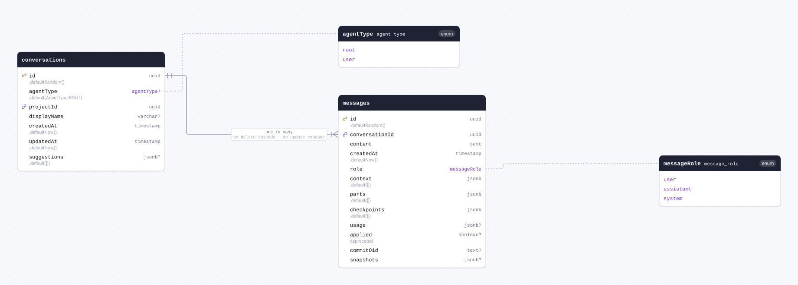

| Column                               | Type                               | Constraints                                         | Default            | Description |
| ------------------------------------ | ---------------------------------- | --------------------------------------------------- | ------------------ | ----------- |
| `id`                                 | `uuid`                             | PK NOT NULL                                         | `.defaultRandom()` |             |
| `conversationId` (`conversation_id`) | `uuid`                             | NOT NULL → [conversations.id](#table-conversations) |                    |             |
| `content`                            | `text`                             | NOT NULL                                            |                    |             |
| `createdAt` (`created_at`)           | `timestamp`                        | NOT NULL                                            | `.defaultNow()`    |             |
| `role`                               | [`messageRole`](#enum-messageRole) | NOT NULL                                            |                    |             |
| `context`                            | `jsonb`                            | NOT NULL                                            | `.default([])`     |             |
| `parts`                              | `jsonb`                            | NOT NULL                                            | `.default([])`     |             |
| `checkpoints`                        | `jsonb`                            | NOT NULL                                            | `.default([])`     |             |
| `usage`                              | `jsonb`                            | NULL                                                |                    |             |
| `applied`                            | `boolean`                          | NULL                                                |                    | deprecated  |
| `commitOid` (`commit_oid`)           | `text`                             | NULL                                                |                    |             |
| `snapshots`                          | `jsonb`                            | NULL                                                |                    |             |

#### Definition

```sql
CREATE TABLE "messages" (
	"id" uuid PRIMARY KEY DEFAULT gen_random_uuid(),
	"conversation_id" uuid NOT NULL,
	"content" text NOT NULL,
	"created_at" timestamp with time zone DEFAULT now() NOT NULL,
	"role" "message_role" NOT NULL,
	"context" jsonb DEFAULT '[]' NOT NULL,
	"parts" jsonb DEFAULT '[]' NOT NULL,
	"checkpoints" jsonb DEFAULT '[]' NOT NULL,
	"usage" jsonb,
	"applied" boolean,
	"commit_oid" text,
	"snapshots" jsonb
);

ALTER TABLE "messages" ENABLE ROW LEVEL SECURITY;

ALTER TABLE "messages" ADD CONSTRAINT "messages_conversation_id_conversations_id_fkey" FOREIGN KEY ("conversation_id") REFERENCES "conversations"("id") ON DELETE CASCADE ON UPDATE CASCADE;
```

#### References

- `conversationId` → [conversations.id](#table-conversations) (many to one, on delete cascade, on update cascade)

<details>
<summary>Queries and their SQL</summary>

**Select**: Every row of messages.

```ts
db.select().from(messages);
```

```sql
select "id", "conversation_id", "content", "created_at", "role", "context", "parts", "checkpoints", "usage", "applied", "commit_oid", "snapshots"
from "messages"
```

**Count**: How many rows messages has.

```ts
db.select({ count: count() }).from(messages);
```

```sql
select count(*)
from "messages"
```

**Find many**: The rows of messages, through the relational query API.

```ts
db.query.messages.findMany();
```

```sql
select "d0"."id" as "id", "d0"."conversation_id" as "conversationId", "d0"."content" as "content", "d0"."created_at" as "createdAt", "d0"."role" as "role", "d0"."context" as "context", "d0"."parts" as "parts", "d0"."checkpoints" as "checkpoints", "d0"."usage" as "usage", "d0"."applied" as "applied", "d0"."commit_oid" as "commitOid", "d0"."snapshots" as "snapshots"
from "messages" as "d0"
```

**Find by primary key**: One row of messages, through the relational query API.

```ts
db.query.messages.findFirst({ where: { id: "00000000-0000-0000-0000-000000000000" } });
```

```sql
select "d0"."id" as "id", "d0"."conversation_id" as "conversationId", "d0"."content" as "content", "d0"."created_at" as "createdAt", "d0"."role" as "role", "d0"."context" as "context", "d0"."parts" as "parts", "d0"."checkpoints" as "checkpoints", "d0"."usage" as "usage", "d0"."applied" as "applied", "d0"."commit_oid" as "commitOid", "d0"."snapshots" as "snapshots"
from "messages" as "d0"
where "d0"."id" = $1
limit $2
-- params: ["00000000-0000-0000-0000-000000000000",1]
```

**Insert**: Adds a row to messages, giving the columns that have no default.

```ts
db.insert(messages).values({
  conversationId: "00000000-0000-0000-0000-000000000000",
  content: "content",
  role: "user",
});
```

```sql
insert into "messages" ("id", "conversation_id", "content", "created_at", "role", "context", "parts", "checkpoints", "usage", "applied", "commit_oid", "snapshots")
values (default, $1, $2, default, $3, default, default, default, default, default, default, default)
-- params: ["00000000-0000-0000-0000-000000000000","content","user"]
```

**Update**: Changes a row of messages, found by its primary key.

```ts
db.update(messages)
  .set({ conversationId: "00000000-0000-0000-0000-000000000000" })
  .where(eq(messages.id, "00000000-0000-0000-0000-000000000000"));
```

```sql
update "messages"
set "conversation_id" = $1
where "messages"."id" = $2
-- params: ["00000000-0000-0000-0000-000000000000","00000000-0000-0000-0000-000000000000"]
```

**Delete**: Deletes a row of messages, found by its primary key.

```ts
db.delete(messages).where(eq(messages.id, "00000000-0000-0000-0000-000000000000"));
```

```sql
delete from "messages"
where "messages"."id" = $1
-- params: ["00000000-0000-0000-0000-000000000000"]
```

</details>

<a id="table-customDomains"></a>

### customDomains

Table `custom_domains`.

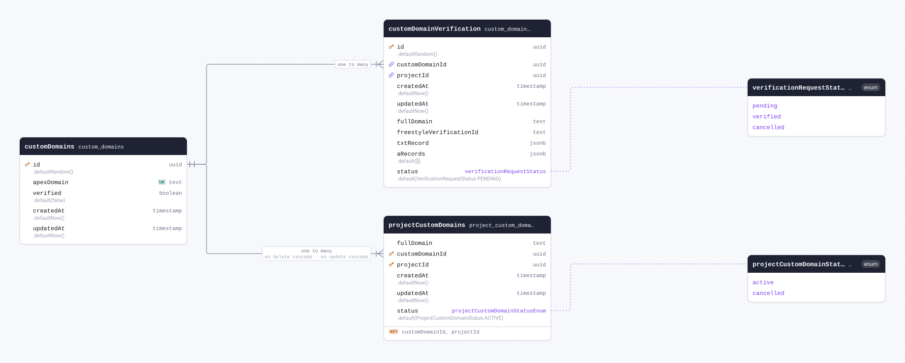

| Column                       | Type        | Constraints     | Default            | Description |
| ---------------------------- | ----------- | --------------- | ------------------ | ----------- |
| `id`                         | `uuid`      | PK NOT NULL     | `.defaultRandom()` |             |
| `apexDomain` (`apex_domain`) | `text`      | UNIQUE NOT NULL |                    |             |
| `verified`                   | `boolean`   | NOT NULL        | `.default(false)`  |             |
| `createdAt` (`created_at`)   | `timestamp` | NOT NULL        | `.defaultNow()`    |             |
| `updatedAt` (`updated_at`)   | `timestamp` | NOT NULL        | `.defaultNow()`    |             |

#### Definition

```sql
CREATE TABLE "custom_domains" (
	"id" uuid PRIMARY KEY DEFAULT gen_random_uuid(),
	"apex_domain" text NOT NULL UNIQUE,
	"verified" boolean DEFAULT false NOT NULL,
	"created_at" timestamp with time zone DEFAULT now() NOT NULL,
	"updated_at" timestamp with time zone DEFAULT now() NOT NULL
);

ALTER TABLE "custom_domains" ENABLE ROW LEVEL SECURITY;
```

#### Referenced by

- `id` → [projectCustomDomains.customDomainId](#table-projectCustomDomains) (one to many, on delete cascade, on update cascade)
- `id` → [customDomainVerification.customDomainId](#table-customDomainVerification) (one to many)

<details>
<summary>Queries and their SQL</summary>

**Select**: Every row of customDomains.

```ts
db.select().from(customDomains);
```

```sql
select "id", "apex_domain", "verified", "created_at", "updated_at"
from "custom_domains"
```

**Count**: How many rows customDomains has.

```ts
db.select({ count: count() }).from(customDomains);
```

```sql
select count(*)
from "custom_domains"
```

**Find many**: The rows of customDomains, through the relational query API.

```ts
db.query.customDomains.findMany();
```

```sql
select "d0"."id" as "id", "d0"."apex_domain" as "apexDomain", "d0"."verified" as "verified", "d0"."created_at" as "createdAt", "d0"."updated_at" as "updatedAt"
from "custom_domains" as "d0"
```

**Find by primary key**: One row of customDomains, through the relational query API.

```ts
db.query.customDomains.findFirst({ where: { id: "00000000-0000-0000-0000-000000000000" } });
```

```sql
select "d0"."id" as "id", "d0"."apex_domain" as "apexDomain", "d0"."verified" as "verified", "d0"."created_at" as "createdAt", "d0"."updated_at" as "updatedAt"
from "custom_domains" as "d0"
where "d0"."id" = $1
limit $2
-- params: ["00000000-0000-0000-0000-000000000000",1]
```

**Insert**: Adds a row to customDomains, giving the columns that have no default.

```ts
db.insert(customDomains).values({ apexDomain: "apexDomain" });
```

```sql
insert into "custom_domains" ("id", "apex_domain", "verified", "created_at", "updated_at")
values (default, $1, default, default, default)
-- params: ["apexDomain"]
```

**Update**: Changes a row of customDomains, found by its primary key.

```ts
db.update(customDomains)
  .set({ apexDomain: "apexDomain" })
  .where(eq(customDomains.id, "00000000-0000-0000-0000-000000000000"));
```

```sql
update "custom_domains"
set "apex_domain" = $1
where "custom_domains"."id" = $2
-- params: ["apexDomain","00000000-0000-0000-0000-000000000000"]
```

**Delete**: Deletes a row of customDomains, found by its primary key.

```ts
db.delete(customDomains).where(eq(customDomains.id, "00000000-0000-0000-0000-000000000000"));
```

```sql
delete from "custom_domains"
where "custom_domains"."id" = $1
-- params: ["00000000-0000-0000-0000-000000000000"]
```

</details>

<a id="table-projectCustomDomains"></a>

### projectCustomDomains

Table `project_custom_domains`.

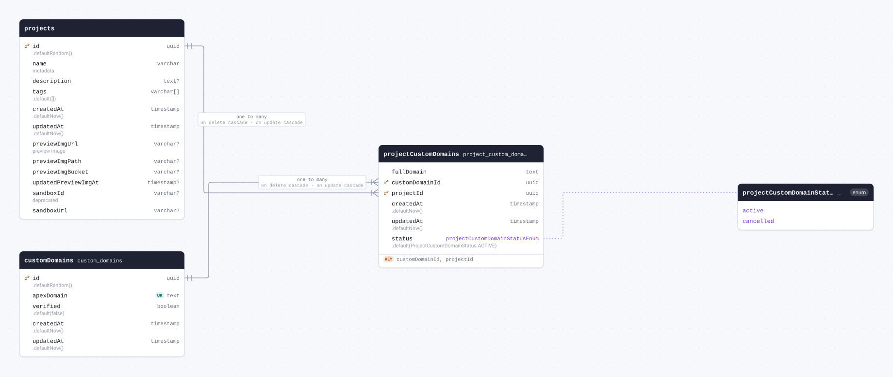

| Column                                | Type                                                                   | Constraints                                            | Default                                      | Description |
| ------------------------------------- | ---------------------------------------------------------------------- | ------------------------------------------------------ | -------------------------------------------- | ----------- |
| `fullDomain` (`full_domain`)          | `text`                                                                 | NOT NULL                                               |                                              |             |
| `customDomainId` (`custom_domain_id`) | `uuid`                                                                 | PK NOT NULL → [customDomains.id](#table-customDomains) |                                              |             |
| `projectId` (`project_id`)            | `uuid`                                                                 | PK NOT NULL → [projects.id](#table-projects)           |                                              |             |
| `createdAt` (`created_at`)            | `timestamp`                                                            | NOT NULL                                               | `.defaultNow()`                              |             |
| `updatedAt` (`updated_at`)            | `timestamp`                                                            | NOT NULL                                               | `.defaultNow()`                              |             |
| `status`                              | [`projectCustomDomainStatusEnum`](#enum-projectCustomDomainStatusEnum) | NOT NULL                                               | `.default(ProjectCustomDomainStatus.ACTIVE)` |             |

#### Definition

```sql
CREATE TABLE "project_custom_domains" (
	"full_domain" text NOT NULL,
	"custom_domain_id" uuid,
	"project_id" uuid,
	"created_at" timestamp with time zone DEFAULT now() NOT NULL,
	"updated_at" timestamp with time zone DEFAULT now() NOT NULL,
	"status" "project_custom_domain_status" DEFAULT 'active'::"project_custom_domain_status" NOT NULL,
	CONSTRAINT "project_custom_domains_pkey" PRIMARY KEY("custom_domain_id","project_id")
);

ALTER TABLE "project_custom_domains" ENABLE ROW LEVEL SECURITY;

ALTER TABLE "project_custom_domains" ADD CONSTRAINT "project_custom_domains_custom_domain_id_custom_domains_id_fkey" FOREIGN KEY ("custom_domain_id") REFERENCES "custom_domains"("id") ON DELETE CASCADE ON UPDATE CASCADE;

ALTER TABLE "project_custom_domains" ADD CONSTRAINT "project_custom_domains_project_id_projects_id_fkey" FOREIGN KEY ("project_id") REFERENCES "projects"("id") ON DELETE CASCADE ON UPDATE CASCADE;
```

#### Indexes

- PRIMARY KEY `customDomainId`, `projectId`

#### References

- `customDomainId` → [customDomains.id](#table-customDomains) (many to one, on delete cascade, on update cascade)
- `projectId` → [projects.id](#table-projects) (many to one, on delete cascade, on update cascade)

<details>
<summary>Queries and their SQL</summary>

**Select**: Every row of projectCustomDomains.

```ts
db.select().from(projectCustomDomains);
```

```sql
select "full_domain", "custom_domain_id", "project_id", "created_at", "updated_at", "status"
from "project_custom_domains"
```

**Count**: How many rows projectCustomDomains has.

```ts
db.select({ count: count() }).from(projectCustomDomains);
```

```sql
select count(*)
from "project_custom_domains"
```

**Find many**: The rows of projectCustomDomains, through the relational query API.

```ts
db.query.projectCustomDomains.findMany();
```

```sql
select "d0"."full_domain" as "fullDomain", "d0"."custom_domain_id" as "customDomainId", "d0"."project_id" as "projectId", "d0"."created_at" as "createdAt", "d0"."updated_at" as "updatedAt", "d0"."status" as "status"
from "project_custom_domains" as "d0"
```

**Find by primary key**: One row of projectCustomDomains, through the relational query API.

```ts
db.query.projectCustomDomains.findFirst({
  where: {
    customDomainId: "00000000-0000-0000-0000-000000000000",
    projectId: "00000000-0000-0000-0000-000000000000",
  },
});
```

```sql
select "d0"."full_domain" as "fullDomain", "d0"."custom_domain_id" as "customDomainId", "d0"."project_id" as "projectId", "d0"."created_at" as "createdAt", "d0"."updated_at" as "updatedAt", "d0"."status" as "status"
from "project_custom_domains" as "d0"
where (("d0"."custom_domain_id" = $1) and ("d0"."project_id" = $2))
limit $3
-- params: ["00000000-0000-0000-0000-000000000000","00000000-0000-0000-0000-000000000000",1]
```

**Insert**: Adds a row to projectCustomDomains, giving the columns that have no default.

```ts
db.insert(projectCustomDomains).values({
  fullDomain: "fullDomain",
  customDomainId: "00000000-0000-0000-0000-000000000000",
  projectId: "00000000-0000-0000-0000-000000000000",
});
```

```sql
insert into "project_custom_domains" ("full_domain", "custom_domain_id", "project_id", "created_at", "updated_at", "status")
values ($1, $2, $3, default, default, default)
-- params: ["fullDomain","00000000-0000-0000-0000-000000000000","00000000-0000-0000-0000-000000000000"]
```

**Update**: Changes a row of projectCustomDomains, found by its primary key.

```ts
db.update(projectCustomDomains)
  .set({ fullDomain: "fullDomain" })
  .where(
    and(
      eq(projectCustomDomains.customDomainId, "00000000-0000-0000-0000-000000000000"),
      eq(projectCustomDomains.projectId, "00000000-0000-0000-0000-000000000000"),
    ),
  );
```

```sql
update "project_custom_domains"
set "full_domain" = $1
where (("project_custom_domains"."custom_domain_id" = $2) and ("project_custom_domains"."project_id" = $3))
-- params: ["fullDomain","00000000-0000-0000-0000-000000000000","00000000-0000-0000-0000-000000000000"]
```

**Delete**: Deletes a row of projectCustomDomains, found by its primary key.

```ts
db.delete(projectCustomDomains).where(
  and(
    eq(projectCustomDomains.customDomainId, "00000000-0000-0000-0000-000000000000"),
    eq(projectCustomDomains.projectId, "00000000-0000-0000-0000-000000000000"),
  ),
);
```

```sql
delete from "project_custom_domains"
where (("project_custom_domains"."custom_domain_id" = $1) and ("project_custom_domains"."project_id" = $2))
-- params: ["00000000-0000-0000-0000-000000000000","00000000-0000-0000-0000-000000000000"]
```

</details>

<a id="table-customDomainVerification"></a>

### customDomainVerification

Table `custom_domain_verification`.

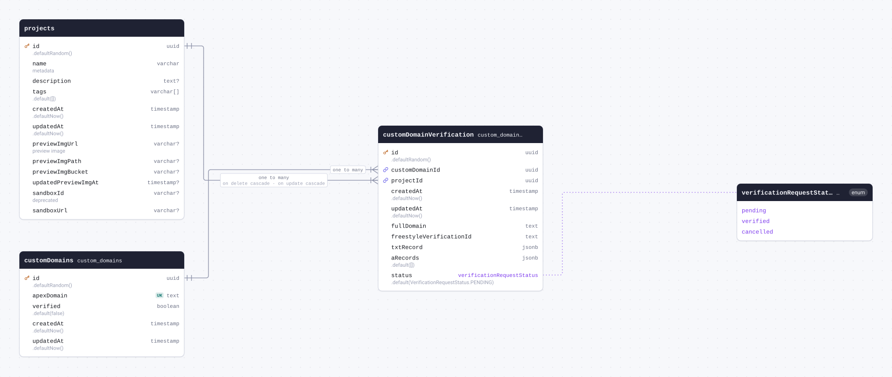

| Column                                                  | Type                                                           | Constraints                                         | Default                                       | Description |
| ------------------------------------------------------- | -------------------------------------------------------------- | --------------------------------------------------- | --------------------------------------------- | ----------- |
| `id`                                                    | `uuid`                                                         | PK NOT NULL                                         | `.defaultRandom()`                            |             |
| `customDomainId` (`custom_domain_id`)                   | `uuid`                                                         | NOT NULL → [customDomains.id](#table-customDomains) |                                               |             |
| `projectId` (`project_id`)                              | `uuid`                                                         | NOT NULL → [projects.id](#table-projects)           |                                               |             |
| `createdAt` (`created_at`)                              | `timestamp`                                                    | NOT NULL                                            | `.defaultNow()`                               |             |
| `updatedAt` (`updated_at`)                              | `timestamp`                                                    | NOT NULL                                            | `.defaultNow()`                               |             |
| `fullDomain` (`full_domain`)                            | `text`                                                         | NOT NULL                                            |                                               |             |
| `freestyleVerificationId` (`freestyle_verification_id`) | `text`                                                         | NOT NULL                                            |                                               |             |
| `txtRecord` (`txt_record`)                              | `jsonb`                                                        | NOT NULL                                            |                                               |             |
| `aRecords` (`a_records`)                                | `jsonb`                                                        | NOT NULL                                            | `.default([])`                                |             |
| `status`                                                | [`verificationRequestStatus`](#enum-verificationRequestStatus) | NOT NULL                                            | `.default(VerificationRequestStatus.PENDING)` |             |

#### Definition

```sql
CREATE TABLE "custom_domain_verification" (
	"id" uuid PRIMARY KEY DEFAULT gen_random_uuid(),
	"custom_domain_id" uuid NOT NULL,
	"project_id" uuid NOT NULL,
	"created_at" timestamp with time zone DEFAULT now() NOT NULL,
	"updated_at" timestamp with time zone DEFAULT now() NOT NULL,
	"full_domain" text NOT NULL,
	"freestyle_verification_id" text NOT NULL,
	"txt_record" jsonb NOT NULL,
	"a_records" jsonb DEFAULT '[]' NOT NULL,
	"status" "verification_request_status" DEFAULT 'pending'::"verification_request_status" NOT NULL
);

ALTER TABLE "custom_domain_verification" ENABLE ROW LEVEL SECURITY;

ALTER TABLE "custom_domain_verification" ADD CONSTRAINT "custom_domain_verification_1Td39scPfcdd_fkey" FOREIGN KEY ("custom_domain_id") REFERENCES "custom_domains"("id");

ALTER TABLE "custom_domain_verification" ADD CONSTRAINT "custom_domain_verification_project_id_projects_id_fkey" FOREIGN KEY ("project_id") REFERENCES "projects"("id") ON DELETE CASCADE ON UPDATE CASCADE;
```

#### References

- `customDomainId` → [customDomains.id](#table-customDomains) (many to one)
- `projectId` → [projects.id](#table-projects) (many to one, on delete cascade, on update cascade)

<details>
<summary>Queries and their SQL</summary>

**Select**: Every row of customDomainVerification.

```ts
db.select().from(customDomainVerification);
```

```sql
select "id", "custom_domain_id", "project_id", "created_at", "updated_at", "full_domain", "freestyle_verification_id", "txt_record", "a_records", "status"
from "custom_domain_verification"
```

**Count**: How many rows customDomainVerification has.

```ts
db.select({ count: count() }).from(customDomainVerification);
```

```sql
select count(*)
from "custom_domain_verification"
```

**Find many**: The rows of customDomainVerification, through the relational query API.

```ts
db.query.customDomainVerification.findMany();
```

```sql
select "d0"."id" as "id", "d0"."custom_domain_id" as "customDomainId", "d0"."project_id" as "projectId", "d0"."created_at" as "createdAt", "d0"."updated_at" as "updatedAt", "d0"."full_domain" as "fullDomain", "d0"."freestyle_verification_id" as "freestyleVerificationId", "d0"."txt_record" as "txtRecord", "d0"."a_records" as "aRecords", "d0"."status" as "status"
from "custom_domain_verification" as "d0"
```

**Find by primary key**: One row of customDomainVerification, through the relational query API.

```ts
db.query.customDomainVerification.findFirst({
  where: { id: "00000000-0000-0000-0000-000000000000" },
});
```

```sql
select "d0"."id" as "id", "d0"."custom_domain_id" as "customDomainId", "d0"."project_id" as "projectId", "d0"."created_at" as "createdAt", "d0"."updated_at" as "updatedAt", "d0"."full_domain" as "fullDomain", "d0"."freestyle_verification_id" as "freestyleVerificationId", "d0"."txt_record" as "txtRecord", "d0"."a_records" as "aRecords", "d0"."status" as "status"
from "custom_domain_verification" as "d0"
where "d0"."id" = $1
limit $2
-- params: ["00000000-0000-0000-0000-000000000000",1]
```

**Insert**: Adds a row to customDomainVerification, giving the columns that have no default.

```ts
db.insert(customDomainVerification).values({
  customDomainId: "00000000-0000-0000-0000-000000000000",
  projectId: "00000000-0000-0000-0000-000000000000",
  fullDomain: "fullDomain",
  freestyleVerificationId: "freestyleVerificationId",
  txtRecord: {},
});
```

```sql
insert into "custom_domain_verification" ("id", "custom_domain_id", "project_id", "created_at", "updated_at", "full_domain", "freestyle_verification_id", "txt_record", "a_records", "status")
values (default, $1, $2, default, default, $3, $4, $5, default, default)
-- params: ["00000000-0000-0000-0000-000000000000","00000000-0000-0000-0000-000000000000","fullDomain","freestyleVerificationId",{}]
```

**Update**: Changes a row of customDomainVerification, found by its primary key.

```ts
db.update(customDomainVerification)
  .set({ customDomainId: "00000000-0000-0000-0000-000000000000" })
  .where(eq(customDomainVerification.id, "00000000-0000-0000-0000-000000000000"));
```

```sql
update "custom_domain_verification"
set "custom_domain_id" = $1
where "custom_domain_verification"."id" = $2
-- params: ["00000000-0000-0000-0000-000000000000","00000000-0000-0000-0000-000000000000"]
```

**Delete**: Deletes a row of customDomainVerification, found by its primary key.

```ts
db.delete(customDomainVerification).where(
  eq(customDomainVerification.id, "00000000-0000-0000-0000-000000000000"),
);
```

```sql
delete from "custom_domain_verification"
where "custom_domain_verification"."id" = $1
-- params: ["00000000-0000-0000-0000-000000000000"]
```

</details>

<a id="table-deployments"></a>

### deployments

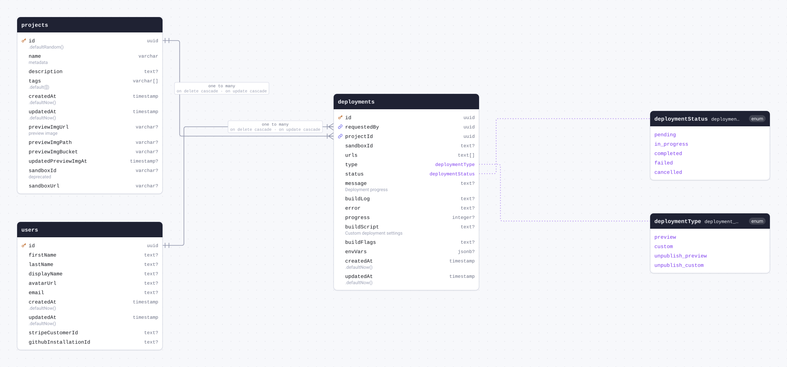

| Column                         | Type                                         | Constraints                               | Default         | Description                |
| ------------------------------ | -------------------------------------------- | ----------------------------------------- | --------------- | -------------------------- |
| `id`                           | `uuid`                                       | PK NOT NULL                               |                 |                            |
| `requestedBy` (`requested_by`) | `uuid`                                       | NOT NULL → [users.id](#table-users)       |                 |                            |
| `projectId` (`project_id`)     | `uuid`                                       | NOT NULL → [projects.id](#table-projects) |                 |                            |
| `sandboxId` (`sandbox_id`)     | `text`                                       | NULL                                      |                 |                            |
| `urls`                         | `text[]`                                     | NULL                                      |                 |                            |
| `type`                         | [`deploymentType`](#enum-deploymentType)     | NOT NULL                                  |                 |                            |
| `status`                       | [`deploymentStatus`](#enum-deploymentStatus) | NOT NULL                                  |                 |                            |
| `message`                      | `text`                                       | NULL                                      |                 | Deployment progress        |
| `buildLog` (`build_log`)       | `text`                                       | NULL                                      |                 |                            |
| `error`                        | `text`                                       | NULL                                      |                 |                            |
| `progress`                     | `integer`                                    | NULL                                      |                 |                            |
| `buildScript` (`build_script`) | `text`                                       | NULL                                      |                 | Custom deployment settings |
| `buildFlags` (`build_flags`)   | `text`                                       | NULL                                      |                 |                            |
| `envVars` (`env_vars`)         | `jsonb`                                      | NULL                                      |                 |                            |
| `createdAt` (`created_at`)     | `timestamp`                                  | NOT NULL                                  | `.defaultNow()` |                            |
| `updatedAt` (`updated_at`)     | `timestamp`                                  | NOT NULL                                  | `.defaultNow()` |                            |

#### Definition

```sql
CREATE TABLE "deployments" (
	"id" uuid PRIMARY KEY,
	"requested_by" uuid NOT NULL,
	"project_id" uuid NOT NULL,
	"sandbox_id" text,
	"urls" text[],
	"type" "deployment_type" NOT NULL,
	"status" "deployment_status" NOT NULL,
	"message" text,
	"build_log" text,
	"error" text,
	"progress" integer,
	"build_script" text,
	"build_flags" text,
	"env_vars" jsonb,
	"created_at" timestamp with time zone DEFAULT now() NOT NULL,
	"updated_at" timestamp with time zone DEFAULT now() NOT NULL
);

ALTER TABLE "deployments" ENABLE ROW LEVEL SECURITY;

ALTER TABLE "deployments" ADD CONSTRAINT "deployments_requested_by_users_id_fkey" FOREIGN KEY ("requested_by") REFERENCES "users"("id") ON DELETE CASCADE ON UPDATE CASCADE;

ALTER TABLE "deployments" ADD CONSTRAINT "deployments_project_id_projects_id_fkey" FOREIGN KEY ("project_id") REFERENCES "projects"("id") ON DELETE CASCADE ON UPDATE CASCADE;
```

#### References

- `requestedBy` → [users.id](#table-users) (many to one, on delete cascade, on update cascade)
- `projectId` → [projects.id](#table-projects) (many to one, on delete cascade, on update cascade)

<details>
<summary>Queries and their SQL</summary>

**Select**: Every row of deployments.

```ts
db.select().from(deployments);
```

```sql
select "id", "requested_by", "project_id", "sandbox_id", "urls", "type", "status", "message", "build_log", "error", "progress", "build_script", "build_flags", "env_vars", "created_at", "updated_at"
from "deployments"
```

**Count**: How many rows deployments has.

```ts
db.select({ count: count() }).from(deployments);
```

```sql
select count(*)
from "deployments"
```

**Find many**: The rows of deployments, through the relational query API.

```ts
db.query.deployments.findMany();
```

```sql
select "d0"."id" as "id", "d0"."requested_by" as "requestedBy", "d0"."project_id" as "projectId", "d0"."sandbox_id" as "sandboxId", "d0"."urls" as "urls", "d0"."type" as "type", "d0"."status" as "status", "d0"."message" as "message", "d0"."build_log" as "buildLog", "d0"."error" as "error", "d0"."progress" as "progress", "d0"."build_script" as "buildScript", "d0"."build_flags" as "buildFlags", "d0"."env_vars" as "envVars", "d0"."created_at" as "createdAt", "d0"."updated_at" as "updatedAt"
from "deployments" as "d0"
```

**Find by primary key**: One row of deployments, through the relational query API.

```ts
db.query.deployments.findFirst({ where: { id: "00000000-0000-0000-0000-000000000000" } });
```

```sql
select "d0"."id" as "id", "d0"."requested_by" as "requestedBy", "d0"."project_id" as "projectId", "d0"."sandbox_id" as "sandboxId", "d0"."urls" as "urls", "d0"."type" as "type", "d0"."status" as "status", "d0"."message" as "message", "d0"."build_log" as "buildLog", "d0"."error" as "error", "d0"."progress" as "progress", "d0"."build_script" as "buildScript", "d0"."build_flags" as "buildFlags", "d0"."env_vars" as "envVars", "d0"."created_at" as "createdAt", "d0"."updated_at" as "updatedAt"
from "deployments" as "d0"
where "d0"."id" = $1
limit $2
-- params: ["00000000-0000-0000-0000-000000000000",1]
```

**Insert**: Adds a row to deployments, giving the columns that have no default.

```ts
db.insert(deployments).values({
  id: "00000000-0000-0000-0000-000000000000",
  requestedBy: "00000000-0000-0000-0000-000000000000",
  projectId: "00000000-0000-0000-0000-000000000000",
  type: "preview",
  status: "pending",
});
```

```sql
insert into "deployments" ("id", "requested_by", "project_id", "sandbox_id", "urls", "type", "status", "message", "build_log", "error", "progress", "build_script", "build_flags", "env_vars", "created_at", "updated_at")
values ($1, $2, $3, default, default, $4, $5, default, default, default, default, default, default, default, default, default)
-- params: ["00000000-0000-0000-0000-000000000000","00000000-0000-0000-0000-000000000000","00000000-0000-0000-0000-000000000000","preview","pending"]
```

**Update**: Changes a row of deployments, found by its primary key.

```ts
db.update(deployments)
  .set({ requestedBy: "00000000-0000-0000-0000-000000000000" })
  .where(eq(deployments.id, "00000000-0000-0000-0000-000000000000"));
```

```sql
update "deployments"
set "requested_by" = $1
where "deployments"."id" = $2
-- params: ["00000000-0000-0000-0000-000000000000","00000000-0000-0000-0000-000000000000"]
```

**Delete**: Deletes a row of deployments, found by its primary key.

```ts
db.delete(deployments).where(eq(deployments.id, "00000000-0000-0000-0000-000000000000"));
```

```sql
delete from "deployments"
where "deployments"."id" = $1
-- params: ["00000000-0000-0000-0000-000000000000"]
```

</details>

<a id="table-previewDomains"></a>

### previewDomains

Table `preview_domains`.

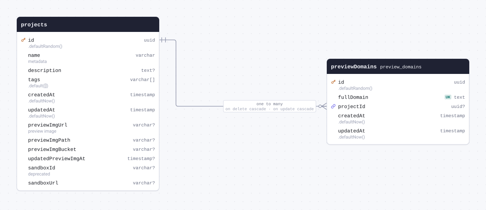

| Column                       | Type        | Constraints                           | Default            | Description |
| ---------------------------- | ----------- | ------------------------------------- | ------------------ | ----------- |
| `id`                         | `uuid`      | PK NOT NULL                           | `.defaultRandom()` |             |
| `fullDomain` (`full_domain`) | `text`      | UNIQUE NOT NULL                       |                    |             |
| `projectId` (`project_id`)   | `uuid`      | NULL → [projects.id](#table-projects) |                    |             |
| `createdAt` (`created_at`)   | `timestamp` | NOT NULL                              | `.defaultNow()`    |             |
| `updatedAt` (`updated_at`)   | `timestamp` | NOT NULL                              | `.defaultNow()`    |             |

#### Definition

```sql
CREATE TABLE "preview_domains" (
	"id" uuid PRIMARY KEY DEFAULT gen_random_uuid(),
	"full_domain" text NOT NULL UNIQUE,
	"project_id" uuid,
	"created_at" timestamp with time zone DEFAULT now() NOT NULL,
	"updated_at" timestamp with time zone DEFAULT now() NOT NULL
);

ALTER TABLE "preview_domains" ENABLE ROW LEVEL SECURITY;

ALTER TABLE "preview_domains" ADD CONSTRAINT "preview_domains_project_id_projects_id_fkey" FOREIGN KEY ("project_id") REFERENCES "projects"("id") ON DELETE CASCADE ON UPDATE CASCADE;
```

#### References

- `projectId` → [projects.id](#table-projects) (many to one, on delete cascade, on update cascade)

<details>
<summary>Queries and their SQL</summary>

**Select**: Every row of previewDomains.

```ts
db.select().from(previewDomains);
```

```sql
select "id", "full_domain", "project_id", "created_at", "updated_at"
from "preview_domains"
```

**Count**: How many rows previewDomains has.

```ts
db.select({ count: count() }).from(previewDomains);
```

```sql
select count(*)
from "preview_domains"
```

**Find many**: The rows of previewDomains, through the relational query API.

```ts
db.query.previewDomains.findMany();
```

```sql
select "d0"."id" as "id", "d0"."full_domain" as "fullDomain", "d0"."project_id" as "projectId", "d0"."created_at" as "createdAt", "d0"."updated_at" as "updatedAt"
from "preview_domains" as "d0"
```

**Find by primary key**: One row of previewDomains, through the relational query API.

```ts
db.query.previewDomains.findFirst({ where: { id: "00000000-0000-0000-0000-000000000000" } });
```

```sql
select "d0"."id" as "id", "d0"."full_domain" as "fullDomain", "d0"."project_id" as "projectId", "d0"."created_at" as "createdAt", "d0"."updated_at" as "updatedAt"
from "preview_domains" as "d0"
where "d0"."id" = $1
limit $2
-- params: ["00000000-0000-0000-0000-000000000000",1]
```

**Insert**: Adds a row to previewDomains, giving the columns that have no default.

```ts
db.insert(previewDomains).values({ fullDomain: "fullDomain" });
```

```sql
insert into "preview_domains" ("id", "full_domain", "project_id", "created_at", "updated_at")
values (default, $1, default, default, default)
-- params: ["fullDomain"]
```

**Update**: Changes a row of previewDomains, found by its primary key.

```ts
db.update(previewDomains)
  .set({ fullDomain: "fullDomain" })
  .where(eq(previewDomains.id, "00000000-0000-0000-0000-000000000000"));
```

```sql
update "preview_domains"
set "full_domain" = $1
where "preview_domains"."id" = $2
-- params: ["fullDomain","00000000-0000-0000-0000-000000000000"]
```

**Delete**: Deletes a row of previewDomains, found by its primary key.

```ts
db.delete(previewDomains).where(eq(previewDomains.id, "00000000-0000-0000-0000-000000000000"));
```

```sql
delete from "preview_domains"
where "preview_domains"."id" = $1
-- params: ["00000000-0000-0000-0000-000000000000"]
```

</details>

<a id="table-feedbacks"></a>

### feedbacks

deprecated

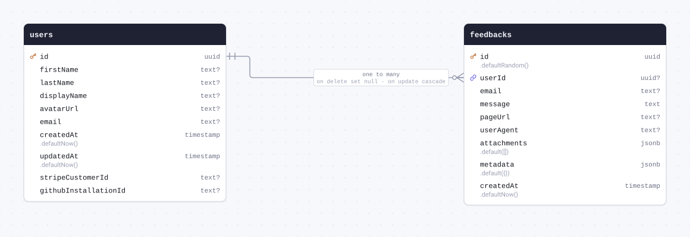

| Column                     | Type        | Constraints                     | Default            | Description |
| -------------------------- | ----------- | ------------------------------- | ------------------ | ----------- |
| `id`                       | `uuid`      | PK NOT NULL                     | `.defaultRandom()` |             |
| `userId` (`user_id`)       | `uuid`      | NULL → [users.id](#table-users) |                    |             |
| `email`                    | `text`      | NULL                            |                    |             |
| `message`                  | `text`      | NOT NULL                        |                    |             |
| `pageUrl` (`page_url`)     | `text`      | NULL                            |                    |             |
| `userAgent` (`user_agent`) | `text`      | NULL                            |                    |             |
| `attachments`              | `jsonb`     | NOT NULL                        | `.default([])`     |             |
| `metadata`                 | `jsonb`     | NOT NULL                        | `.default({})`     |             |
| `createdAt` (`created_at`) | `timestamp` | NOT NULL                        | `.defaultNow()`    |             |

#### Definition

```sql
CREATE TABLE "feedbacks" (
	"id" uuid PRIMARY KEY DEFAULT gen_random_uuid(),
	"user_id" uuid,
	"email" text,
	"message" text NOT NULL,
	"page_url" text,
	"user_agent" text,
	"attachments" jsonb DEFAULT '[]' NOT NULL,
	"metadata" jsonb DEFAULT '{}' NOT NULL,
	"created_at" timestamp with time zone DEFAULT now() NOT NULL
);

ALTER TABLE "feedbacks" ENABLE ROW LEVEL SECURITY;

ALTER TABLE "feedbacks" ADD CONSTRAINT "feedbacks_user_id_users_id_fkey" FOREIGN KEY ("user_id") REFERENCES "users"("id") ON DELETE SET NULL ON UPDATE CASCADE;
```

#### References

- `userId` → [users.id](#table-users) (many to one, on delete set null, on update cascade)

<details>
<summary>Queries and their SQL</summary>

**Select**: Every row of feedbacks.

```ts
db.select().from(feedbacks);
```

```sql
select "id", "user_id", "email", "message", "page_url", "user_agent", "attachments", "metadata", "created_at"
from "feedbacks"
```

**Count**: How many rows feedbacks has.

```ts
db.select({ count: count() }).from(feedbacks);
```

```sql
select count(*)
from "feedbacks"
```

**Find many**: The rows of feedbacks, through the relational query API.

```ts
db.query.feedbacks.findMany();
```

```sql
select "d0"."id" as "id", "d0"."user_id" as "userId", "d0"."email" as "email", "d0"."message" as "message", "d0"."page_url" as "pageUrl", "d0"."user_agent" as "userAgent", "d0"."attachments" as "attachments", "d0"."metadata" as "metadata", "d0"."created_at" as "createdAt"
from "feedbacks" as "d0"
```

**Find by primary key**: One row of feedbacks, through the relational query API.

```ts
db.query.feedbacks.findFirst({ where: { id: "00000000-0000-0000-0000-000000000000" } });
```

```sql
select "d0"."id" as "id", "d0"."user_id" as "userId", "d0"."email" as "email", "d0"."message" as "message", "d0"."page_url" as "pageUrl", "d0"."user_agent" as "userAgent", "d0"."attachments" as "attachments", "d0"."metadata" as "metadata", "d0"."created_at" as "createdAt"
from "feedbacks" as "d0"
where "d0"."id" = $1
limit $2
-- params: ["00000000-0000-0000-0000-000000000000",1]
```

**Insert**: Adds a row to feedbacks, giving the columns that have no default.

```ts
db.insert(feedbacks).values({ message: "message" });
```

```sql
insert into "feedbacks" ("id", "user_id", "email", "message", "page_url", "user_agent", "attachments", "metadata", "created_at")
values (default, default, default, $1, default, default, default, default, default)
-- params: ["message"]
```

**Update**: Changes a row of feedbacks, found by its primary key.

```ts
db.update(feedbacks)
  .set({ userId: "00000000-0000-0000-0000-000000000000" })
  .where(eq(feedbacks.id, "00000000-0000-0000-0000-000000000000"));
```

```sql
update "feedbacks"
set "user_id" = $1
where "feedbacks"."id" = $2
-- params: ["00000000-0000-0000-0000-000000000000","00000000-0000-0000-0000-000000000000"]
```

**Delete**: Deletes a row of feedbacks, found by its primary key.

```ts
db.delete(feedbacks).where(eq(feedbacks.id, "00000000-0000-0000-0000-000000000000"));
```

```sql
delete from "feedbacks"
where "feedbacks"."id" = $1
-- params: ["00000000-0000-0000-0000-000000000000"]
```

</details>

<a id="table-branches"></a>

### branches

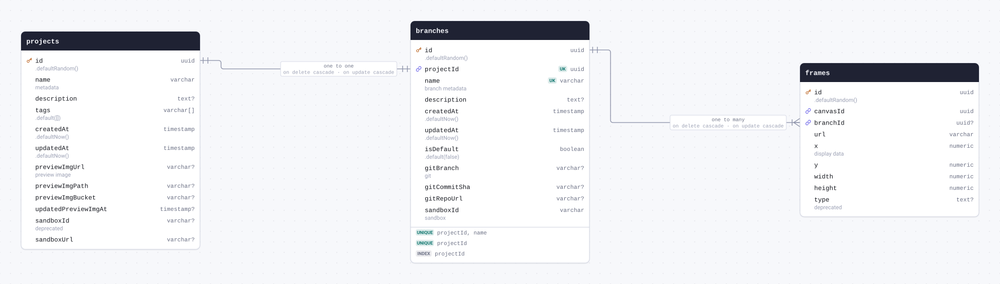

| Column                            | Type        | Constraints                               | Default            | Description     |
| --------------------------------- | ----------- | ----------------------------------------- | ------------------ | --------------- |
| `id`                              | `uuid`      | PK NOT NULL                               | `.defaultRandom()` |                 |
| `projectId` (`project_id`)        | `uuid`      | NOT NULL → [projects.id](#table-projects) |                    |                 |
| `name`                            | `varchar`   | NOT NULL                                  |                    | branch metadata |
| `description`                     | `text`      | NULL                                      |                    |                 |
| `createdAt` (`created_at`)        | `timestamp` | NOT NULL                                  | `.defaultNow()`    |                 |
| `updatedAt` (`updated_at`)        | `timestamp` | NOT NULL                                  | `.defaultNow()`    |                 |
| `isDefault` (`is_default`)        | `boolean`   | NOT NULL                                  | `.default(false)`  |                 |
| `gitBranch` (`git_branch`)        | `varchar`   | NULL                                      |                    | git             |
| `gitCommitSha` (`git_commit_sha`) | `varchar`   | NULL                                      |                    |                 |
| `gitRepoUrl` (`git_repo_url`)     | `varchar`   | NULL                                      |                    |                 |
| `sandboxId` (`sandbox_id`)        | `varchar`   | NOT NULL                                  |                    | sandbox         |

#### Definition

```sql
CREATE TABLE "branches" (
	"id" uuid PRIMARY KEY DEFAULT gen_random_uuid(),
	"project_id" uuid NOT NULL,
	"name" varchar NOT NULL,
	"description" text,
	"created_at" timestamp with time zone DEFAULT now() NOT NULL,
	"updated_at" timestamp with time zone DEFAULT now() NOT NULL,
	"is_default" boolean DEFAULT false NOT NULL,
	"git_branch" varchar,
	"git_commit_sha" varchar,
	"git_repo_url" varchar,
	"sandbox_id" varchar NOT NULL
);

ALTER TABLE "branches" ENABLE ROW LEVEL SECURITY;

CREATE INDEX "branches_project_id_idx" ON "branches" ("project_id");

CREATE UNIQUE INDEX "branches_name_per_project_ux" ON "branches" ("project_id","name");

CREATE UNIQUE INDEX "branches_default_per_project_ux" ON "branches" ("project_id") WHERE "is_default" = true;

ALTER TABLE "branches" ADD CONSTRAINT "branches_project_id_projects_id_fkey" FOREIGN KEY ("project_id") REFERENCES "projects"("id") ON DELETE CASCADE ON UPDATE CASCADE;
```

#### Indexes

- INDEX `projectId`
- UNIQUE `projectId`, `name`
- UNIQUE `projectId`

#### References

- `projectId` → [projects.id](#table-projects) (one to one, on delete cascade, on update cascade)

#### Referenced by

- `id` → [frames.branchId](#table-frames) (one to many, on delete cascade, on update cascade)

<details>
<summary>Queries and their SQL</summary>

**Select**: Every row of branches.

```ts
db.select().from(branches);
```

```sql
select "id", "project_id", "name", "description", "created_at", "updated_at", "is_default", "git_branch", "git_commit_sha", "git_repo_url", "sandbox_id"
from "branches"
```

**Count**: How many rows branches has.

```ts
db.select({ count: count() }).from(branches);
```

```sql
select count(*)
from "branches"
```

**Find many**: The rows of branches, through the relational query API.

```ts
db.query.branches.findMany();
```

```sql
select "d0"."id" as "id", "d0"."project_id" as "projectId", "d0"."name" as "name", "d0"."description" as "description", "d0"."created_at" as "createdAt", "d0"."updated_at" as "updatedAt", "d0"."is_default" as "isDefault", "d0"."git_branch" as "gitBranch", "d0"."git_commit_sha" as "gitCommitSha", "d0"."git_repo_url" as "gitRepoUrl", "d0"."sandbox_id" as "sandboxId"
from "branches" as "d0"
```

**Find by primary key**: One row of branches, through the relational query API.

```ts
db.query.branches.findFirst({ where: { id: "00000000-0000-0000-0000-000000000000" } });
```

```sql
select "d0"."id" as "id", "d0"."project_id" as "projectId", "d0"."name" as "name", "d0"."description" as "description", "d0"."created_at" as "createdAt", "d0"."updated_at" as "updatedAt", "d0"."is_default" as "isDefault", "d0"."git_branch" as "gitBranch", "d0"."git_commit_sha" as "gitCommitSha", "d0"."git_repo_url" as "gitRepoUrl", "d0"."sandbox_id" as "sandboxId"
from "branches" as "d0"
where "d0"."id" = $1
limit $2
-- params: ["00000000-0000-0000-0000-000000000000",1]
```

**Insert**: Adds a row to branches, giving the columns that have no default.

```ts
db.insert(branches).values({
  projectId: "00000000-0000-0000-0000-000000000000",
  name: "name",
  sandboxId: "sandboxId",
});
```

```sql
insert into "branches" ("id", "project_id", "name", "description", "created_at", "updated_at", "is_default", "git_branch", "git_commit_sha", "git_repo_url", "sandbox_id")
values (default, $1, $2, default, default, default, default, default, default, default, $3)
-- params: ["00000000-0000-0000-0000-000000000000","name","sandboxId"]
```

**Update**: Changes a row of branches, found by its primary key.

```ts
db.update(branches)
  .set({ projectId: "00000000-0000-0000-0000-000000000000" })
  .where(eq(branches.id, "00000000-0000-0000-0000-000000000000"));
```

```sql
update "branches"
set "project_id" = $1
where "branches"."id" = $2
-- params: ["00000000-0000-0000-0000-000000000000","00000000-0000-0000-0000-000000000000"]
```

**Delete**: Deletes a row of branches, found by its primary key.

```ts
db.delete(branches).where(eq(branches.id, "00000000-0000-0000-0000-000000000000"));
```

```sql
delete from "branches"
where "branches"."id" = $1
-- params: ["00000000-0000-0000-0000-000000000000"]
```

</details>

<a id="table-projectCreateRequests"></a>

### projectCreateRequests

Table `project_create_requests`.

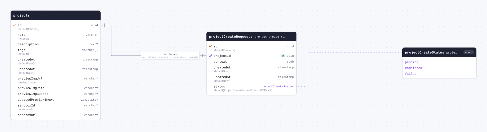

| Column                     | Type                                               | Constraints                                      | Default                                        | Description |
| -------------------------- | -------------------------------------------------- | ------------------------------------------------ | ---------------------------------------------- | ----------- |
| `id`                       | `uuid`                                             | PK NOT NULL                                      | `.defaultRandom()`                             |             |
| `projectId` (`project_id`) | `uuid`                                             | UNIQUE NOT NULL → [projects.id](#table-projects) |                                                |             |
| `context`                  | `jsonb`                                            | NOT NULL                                         |                                                |             |
| `createdAt` (`created_at`) | `timestamp`                                        | NOT NULL                                         | `.defaultNow()`                                |             |
| `updatedAt` (`updated_at`) | `timestamp`                                        | NOT NULL                                         | `.defaultNow()`                                |             |
| `status`                   | [`projectCreateStatus`](#enum-projectCreateStatus) | NOT NULL                                         | `.default(ProjectCreateRequestStatus.PENDING)` |             |

#### Definition

```sql
CREATE TABLE "project_create_requests" (
	"id" uuid PRIMARY KEY DEFAULT gen_random_uuid(),
	"project_id" uuid NOT NULL UNIQUE,
	"context" jsonb NOT NULL,
	"created_at" timestamp with time zone DEFAULT now() NOT NULL,
	"updated_at" timestamp with time zone DEFAULT now() NOT NULL,
	"status" "project_create_status" DEFAULT 'pending'::"project_create_status" NOT NULL
);

ALTER TABLE "project_create_requests" ENABLE ROW LEVEL SECURITY;

ALTER TABLE "project_create_requests" ADD CONSTRAINT "project_create_requests_project_id_projects_id_fkey" FOREIGN KEY ("project_id") REFERENCES "projects"("id") ON DELETE CASCADE ON UPDATE CASCADE;
```

#### References

- `projectId` → [projects.id](#table-projects) (one to one, on delete cascade, on update cascade)

<details>
<summary>Queries and their SQL</summary>

**Select**: Every row of projectCreateRequests.

```ts
db.select().from(projectCreateRequests);
```

```sql
select "id", "project_id", "context", "created_at", "updated_at", "status"
from "project_create_requests"
```

**Count**: How many rows projectCreateRequests has.

```ts
db.select({ count: count() }).from(projectCreateRequests);
```

```sql
select count(*)
from "project_create_requests"
```

**Find many**: The rows of projectCreateRequests, through the relational query API.

```ts
db.query.projectCreateRequests.findMany();
```

```sql
select "d0"."id" as "id", "d0"."project_id" as "projectId", "d0"."context" as "context", "d0"."created_at" as "createdAt", "d0"."updated_at" as "updatedAt", "d0"."status" as "status"
from "project_create_requests" as "d0"
```

**Find by primary key**: One row of projectCreateRequests, through the relational query API.

```ts
db.query.projectCreateRequests.findFirst({ where: { id: "00000000-0000-0000-0000-000000000000" } });
```

```sql
select "d0"."id" as "id", "d0"."project_id" as "projectId", "d0"."context" as "context", "d0"."created_at" as "createdAt", "d0"."updated_at" as "updatedAt", "d0"."status" as "status"
from "project_create_requests" as "d0"
where "d0"."id" = $1
limit $2
-- params: ["00000000-0000-0000-0000-000000000000",1]
```

**Insert**: Adds a row to projectCreateRequests, giving the columns that have no default.

```ts
db.insert(projectCreateRequests).values({
  projectId: "00000000-0000-0000-0000-000000000000",
  context: {},
});
```

```sql
insert into "project_create_requests" ("id", "project_id", "context", "created_at", "updated_at", "status")
values (default, $1, $2, default, default, default)
-- params: ["00000000-0000-0000-0000-000000000000",{}]
```

**Update**: Changes a row of projectCreateRequests, found by its primary key.

```ts
db.update(projectCreateRequests)
  .set({ projectId: "00000000-0000-0000-0000-000000000000" })
  .where(eq(projectCreateRequests.id, "00000000-0000-0000-0000-000000000000"));
```

```sql
update "project_create_requests"
set "project_id" = $1
where "project_create_requests"."id" = $2
-- params: ["00000000-0000-0000-0000-000000000000","00000000-0000-0000-0000-000000000000"]
```

**Delete**: Deletes a row of projectCreateRequests, found by its primary key.

```ts
db.delete(projectCreateRequests).where(
  eq(projectCreateRequests.id, "00000000-0000-0000-0000-000000000000"),
);
```

```sql
delete from "project_create_requests"
where "project_create_requests"."id" = $1
-- params: ["00000000-0000-0000-0000-000000000000"]
```

</details>

<a id="table-projectInvitations"></a>

### projectInvitations

Table `project_invitations`.

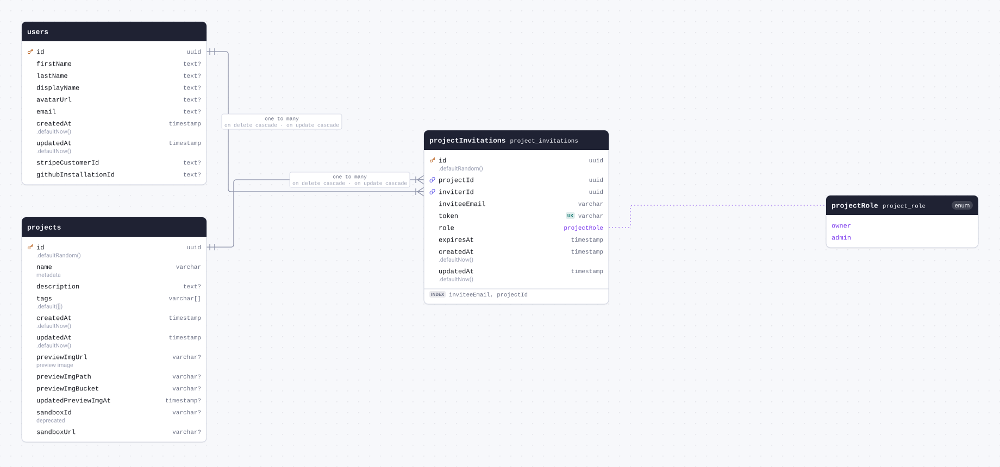

| Column                           | Type                               | Constraints                               | Default            | Description |
| -------------------------------- | ---------------------------------- | ----------------------------------------- | ------------------ | ----------- |
| `id`                             | `uuid`                             | PK NOT NULL                               | `.defaultRandom()` |             |
| `projectId` (`project_id`)       | `uuid`                             | NOT NULL → [projects.id](#table-projects) |                    |             |
| `inviterId` (`inviter_id`)       | `uuid`                             | NOT NULL → [users.id](#table-users)       |                    |             |
| `inviteeEmail` (`invitee_email`) | `varchar`                          | NOT NULL                                  |                    |             |
| `token`                          | `varchar`                          | UNIQUE NOT NULL                           |                    |             |
| `role`                           | [`projectRole`](#enum-projectRole) | NOT NULL                                  |                    |             |
| `expiresAt` (`expires_at`)       | `timestamp`                        | NOT NULL                                  |                    |             |
| `createdAt` (`created_at`)       | `timestamp`                        | NOT NULL                                  | `.defaultNow()`    |             |
| `updatedAt` (`updated_at`)       | `timestamp`                        | NOT NULL                                  | `.defaultNow()`    |             |

#### Definition

```sql
CREATE TABLE "project_invitations" (
	"id" uuid PRIMARY KEY DEFAULT gen_random_uuid(),
	"project_id" uuid NOT NULL,
	"inviter_id" uuid NOT NULL,
	"invitee_email" varchar NOT NULL,
	"token" varchar NOT NULL UNIQUE,
	"role" "project_role" NOT NULL,
	"expires_at" timestamp with time zone NOT NULL,
	"created_at" timestamp with time zone DEFAULT now() NOT NULL,
	"updated_at" timestamp with time zone DEFAULT now() NOT NULL
);

ALTER TABLE "project_invitations" ENABLE ROW LEVEL SECURITY;

CREATE INDEX "project_invitations_invitee_email_project_id_idx" ON "project_invitations" ("invitee_email","project_id");

ALTER TABLE "project_invitations" ADD CONSTRAINT "project_invitations_project_id_projects_id_fkey" FOREIGN KEY ("project_id") REFERENCES "projects"("id") ON DELETE CASCADE ON UPDATE CASCADE;

ALTER TABLE "project_invitations" ADD CONSTRAINT "project_invitations_inviter_id_users_id_fkey" FOREIGN KEY ("inviter_id") REFERENCES "users"("id") ON DELETE CASCADE ON UPDATE CASCADE;
```

#### Indexes

- INDEX `inviteeEmail`, `projectId`

#### References

- `projectId` → [projects.id](#table-projects) (many to one, on delete cascade, on update cascade)
- `inviterId` → [users.id](#table-users) (many to one, on delete cascade, on update cascade)

<details>
<summary>Queries and their SQL</summary>

**Select**: Every row of projectInvitations.

```ts
db.select().from(projectInvitations);
```

```sql
select "id", "project_id", "inviter_id", "invitee_email", "token", "role", "expires_at", "created_at", "updated_at"
from "project_invitations"
```

**Count**: How many rows projectInvitations has.

```ts
db.select({ count: count() }).from(projectInvitations);
```

```sql
select count(*)
from "project_invitations"
```

**Find many**: The rows of projectInvitations, through the relational query API.

```ts
db.query.projectInvitations.findMany();
```

```sql
select "d0"."id" as "id", "d0"."project_id" as "projectId", "d0"."inviter_id" as "inviterId", "d0"."invitee_email" as "inviteeEmail", "d0"."token" as "token", "d0"."role" as "role", "d0"."expires_at" as "expiresAt", "d0"."created_at" as "createdAt", "d0"."updated_at" as "updatedAt"
from "project_invitations" as "d0"
```

**Find by primary key**: One row of projectInvitations, through the relational query API.

```ts
db.query.projectInvitations.findFirst({ where: { id: "00000000-0000-0000-0000-000000000000" } });
```

```sql
select "d0"."id" as "id", "d0"."project_id" as "projectId", "d0"."inviter_id" as "inviterId", "d0"."invitee_email" as "inviteeEmail", "d0"."token" as "token", "d0"."role" as "role", "d0"."expires_at" as "expiresAt", "d0"."created_at" as "createdAt", "d0"."updated_at" as "updatedAt"
from "project_invitations" as "d0"
where "d0"."id" = $1
limit $2
-- params: ["00000000-0000-0000-0000-000000000000",1]
```

**Insert**: Adds a row to projectInvitations, giving the columns that have no default.

```ts
db.insert(projectInvitations).values({
  projectId: "00000000-0000-0000-0000-000000000000",
  inviterId: "00000000-0000-0000-0000-000000000000",
  inviteeEmail: "inviteeEmail",
  token: "token",
  role: "owner",
  expiresAt: new Date("2026-01-01T00:00:00.000Z"),
});
```

```sql
insert into "project_invitations" ("id", "project_id", "inviter_id", "invitee_email", "token", "role", "expires_at", "created_at", "updated_at")
values (default, $1, $2, $3, $4, $5, $6, default, default)
-- params: ["00000000-0000-0000-0000-000000000000","00000000-0000-0000-0000-000000000000","inviteeEmail","token","owner","2026-01-01T00:00:00.000Z"]
```

**Update**: Changes a row of projectInvitations, found by its primary key.

```ts
db.update(projectInvitations)
  .set({ projectId: "00000000-0000-0000-0000-000000000000" })
  .where(eq(projectInvitations.id, "00000000-0000-0000-0000-000000000000"));
```

```sql
update "project_invitations"
set "project_id" = $1
where "project_invitations"."id" = $2
-- params: ["00000000-0000-0000-0000-000000000000","00000000-0000-0000-0000-000000000000"]
```

**Delete**: Deletes a row of projectInvitations, found by its primary key.

```ts
db.delete(projectInvitations).where(
  eq(projectInvitations.id, "00000000-0000-0000-0000-000000000000"),
);
```

```sql
delete from "project_invitations"
where "project_invitations"."id" = $1
-- params: ["00000000-0000-0000-0000-000000000000"]
```

</details>

<a id="table-projects"></a>

### projects

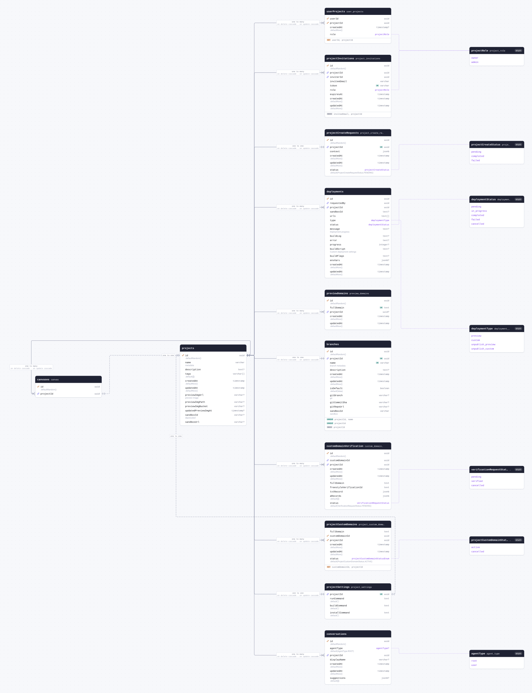

| Column                                           | Type        | Constraints                                         | Default            | Description   |
| ------------------------------------------------ | ----------- | --------------------------------------------------- | ------------------ | ------------- |
| `id`                                             | `uuid`      | PK NOT NULL → [canvases.projectId](#table-canvases) | `.defaultRandom()` |               |
| `name`                                           | `varchar`   | NOT NULL                                            |                    | metadata      |
| `description`                                    | `text`      | NULL                                                |                    |               |
| `tags`                                           | `varchar[]` | NULL                                                | `.default([])`     |               |
| `createdAt` (`created_at`)                       | `timestamp` | NOT NULL                                            | `.defaultNow()`    |               |
| `updatedAt` (`updated_at`)                       | `timestamp` | NOT NULL                                            | `.defaultNow()`    |               |
| `previewImgUrl` (`preview_img_url`)              | `varchar`   | NULL                                                |                    | preview image |
| `previewImgPath` (`preview_img_path`)            | `varchar`   | NULL                                                |                    |               |
| `previewImgBucket` (`preview_img_bucket`)        | `varchar`   | NULL                                                |                    |               |
| `updatedPreviewImgAt` (`updated_preview_img_at`) | `timestamp` | NULL                                                |                    |               |
| `sandboxId` (`sandbox_id`)                       | `varchar`   | NULL                                                |                    | deprecated    |
| `sandboxUrl` (`sandbox_url`)                     | `varchar`   | NULL                                                |                    |               |

#### Definition

```sql
CREATE TABLE "projects" (
	"id" uuid PRIMARY KEY DEFAULT gen_random_uuid(),
	"name" varchar NOT NULL,
	"description" text,
	"tags" varchar[] DEFAULT '{}'::varchar[],
	"created_at" timestamp with time zone DEFAULT now() NOT NULL,
	"updated_at" timestamp with time zone DEFAULT now() NOT NULL,
	"preview_img_url" varchar,
	"preview_img_path" varchar,
	"preview_img_bucket" varchar,
	"updated_preview_img_at" timestamp with time zone,
	"sandbox_id" varchar,
	"sandbox_url" varchar
);

ALTER TABLE "projects" ENABLE ROW LEVEL SECURITY;
```

#### References

- `id` → [canvases.projectId](#table-canvases) (one to one, defineRelations, no foreign key)
- `id` → [projectSettings.projectId](#table-projectSettings) (one to one, defineRelations, no foreign key)

#### Referenced by

- `id` → [canvases.projectId](#table-canvases) (one to many, on delete cascade, on update cascade)
- `id` → [conversations.projectId](#table-conversations) (one to many, on delete cascade, on update cascade)
- `id` → [projectCustomDomains.projectId](#table-projectCustomDomains) (one to many, on delete cascade, on update cascade)
- `id` → [customDomainVerification.projectId](#table-customDomainVerification) (one to many, on delete cascade, on update cascade)
- `id` → [deployments.projectId](#table-deployments) (one to many, on delete cascade, on update cascade)
- `id` → [previewDomains.projectId](#table-previewDomains) (one to many, on delete cascade, on update cascade)
- `id` → [branches.projectId](#table-branches) (one to one, on delete cascade, on update cascade)
- `id` → [projectCreateRequests.projectId](#table-projectCreateRequests) (one to one, on delete cascade, on update cascade)
- `id` → [projectInvitations.projectId](#table-projectInvitations) (one to many, on delete cascade, on update cascade)
- `id` → [projectSettings.projectId](#table-projectSettings) (one to one, on delete cascade, on update cascade)
- `id` → [userProjects.projectId](#table-userProjects) (one to many, on delete cascade, on update cascade)

<details>
<summary>Queries and their SQL</summary>

**Select**: Every row of projects.

```ts
db.select().from(projects);
```

```sql
select "id", "name", "description", "tags", "created_at", "updated_at", "preview_img_url", "preview_img_path", "preview_img_bucket", "updated_preview_img_at", "sandbox_id", "sandbox_url"
from "projects"
```

**Count**: How many rows projects has.

```ts
db.select({ count: count() }).from(projects);
```

```sql
select count(*)
from "projects"
```

**Find many**: The rows of projects, through the relational query API.

```ts
db.query.projects.findMany();
```

```sql
select "d0"."id" as "id", "d0"."name" as "name", "d0"."description" as "description", "d0"."tags" as "tags", "d0"."created_at" as "createdAt", "d0"."updated_at" as "updatedAt", "d0"."preview_img_url" as "previewImgUrl", "d0"."preview_img_path" as "previewImgPath", "d0"."preview_img_bucket" as "previewImgBucket", "d0"."updated_preview_img_at" as "updatedPreviewImgAt", "d0"."sandbox_id" as "sandboxId", "d0"."sandbox_url" as "sandboxUrl"
from "projects" as "d0"
```

**Find by primary key**: One row of projects, through the relational query API.

```ts
db.query.projects.findFirst({ where: { id: "00000000-0000-0000-0000-000000000000" } });
```

```sql
select "d0"."id" as "id", "d0"."name" as "name", "d0"."description" as "description", "d0"."tags" as "tags", "d0"."created_at" as "createdAt", "d0"."updated_at" as "updatedAt", "d0"."preview_img_url" as "previewImgUrl", "d0"."preview_img_path" as "previewImgPath", "d0"."preview_img_bucket" as "previewImgBucket", "d0"."updated_preview_img_at" as "updatedPreviewImgAt", "d0"."sandbox_id" as "sandboxId", "d0"."sandbox_url" as "sandboxUrl"
from "projects" as "d0"
where "d0"."id" = $1
limit $2
-- params: ["00000000-0000-0000-0000-000000000000",1]
```

**Insert**: Adds a row to projects, giving the columns that have no default.

```ts
db.insert(projects).values({ name: "name" });
```

```sql
insert into "projects" ("id", "name", "description", "tags", "created_at", "updated_at", "preview_img_url", "preview_img_path", "preview_img_bucket", "updated_preview_img_at", "sandbox_id", "sandbox_url")
values (default, $1, default, default, default, default, default, default, default, default, default, default)
-- params: ["name"]
```

**Update**: Changes a row of projects, found by its primary key.

```ts
db.update(projects)
  .set({ name: "name" })
  .where(eq(projects.id, "00000000-0000-0000-0000-000000000000"));
```

```sql
update "projects"
set "name" = $1
where "projects"."id" = $2
-- params: ["name","00000000-0000-0000-0000-000000000000"]
```

**Delete**: Deletes a row of projects, found by its primary key.

```ts
db.delete(projects).where(eq(projects.id, "00000000-0000-0000-0000-000000000000"));
```

```sql
delete from "projects"
where "projects"."id" = $1
-- params: ["00000000-0000-0000-0000-000000000000"]
```

</details>

<a id="table-projectSettings"></a>

### projectSettings

Table `project_settings`.

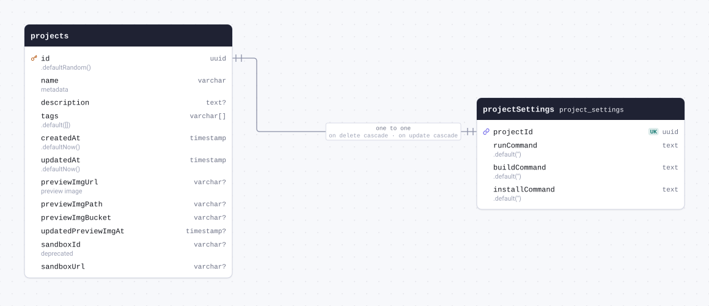

| Column                               | Type   | Constraints                                      | Default        | Description |
| ------------------------------------ | ------ | ------------------------------------------------ | -------------- | ----------- |
| `projectId` (`project_id`)           | `uuid` | UNIQUE NOT NULL → [projects.id](#table-projects) |                |             |
| `runCommand` (`run_command`)         | `text` | NOT NULL                                         | `.default('')` |             |
| `buildCommand` (`build_command`)     | `text` | NOT NULL                                         | `.default('')` |             |
| `installCommand` (`install_command`) | `text` | NOT NULL                                         | `.default('')` |             |

#### Definition

```sql
CREATE TABLE "project_settings" (
	"project_id" uuid NOT NULL UNIQUE,
	"run_command" text DEFAULT '' NOT NULL,
	"build_command" text DEFAULT '' NOT NULL,
	"install_command" text DEFAULT '' NOT NULL
);

ALTER TABLE "project_settings" ENABLE ROW LEVEL SECURITY;

ALTER TABLE "project_settings" ADD CONSTRAINT "project_settings_project_id_projects_id_fkey" FOREIGN KEY ("project_id") REFERENCES "projects"("id") ON DELETE CASCADE ON UPDATE CASCADE;
```

#### References

- `projectId` → [projects.id](#table-projects) (one to one, on delete cascade, on update cascade)

#### Referenced by

- `projectId` → [projects.id](#table-projects) (one to one, defineRelations)

<details>
<summary>Queries and their SQL</summary>

**Select**: Every row of projectSettings.

```ts
db.select().from(projectSettings);
```

```sql
select "project_id", "run_command", "build_command", "install_command"
from "project_settings"
```

**Count**: How many rows projectSettings has.

```ts
db.select({ count: count() }).from(projectSettings);
```

```sql
select count(*)
from "project_settings"
```

**Find many**: The rows of projectSettings, through the relational query API.

```ts
db.query.projectSettings.findMany();
```

```sql
select "d0"."project_id" as "projectId", "d0"."run_command" as "runCommand", "d0"."build_command" as "buildCommand", "d0"."install_command" as "installCommand"
from "project_settings" as "d0"
```

**Insert**: Adds a row to projectSettings, giving the columns that have no default.

```ts
db.insert(projectSettings).values({ projectId: "00000000-0000-0000-0000-000000000000" });
```

```sql
insert into "project_settings" ("project_id", "run_command", "build_command", "install_command")
values ($1, default, default, default)
-- params: ["00000000-0000-0000-0000-000000000000"]
```

</details>

<a id="table-legacySubscriptions"></a>

### legacySubscriptions

Table `legacy_subscriptions`.

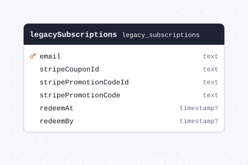

| Column                                               | Type        | Constraints | Default | Description |
| ---------------------------------------------------- | ----------- | ----------- | ------- | ----------- |
| `email`                                              | `text`      | PK NOT NULL |         |             |
| `stripeCouponId` (`stripe_coupon_id`)                | `text`      | NOT NULL    |         |             |
| `stripePromotionCodeId` (`stripe_promotion_code_id`) | `text`      | NOT NULL    |         |             |
| `stripePromotionCode` (`stripe_promotion_code`)      | `text`      | NOT NULL    |         |             |
| `redeemAt` (`redeem_at`)                             | `timestamp` | NULL        |         |             |
| `redeemBy` (`redeem_by`)                             | `timestamp` | NULL        |         |             |

#### Definition

```sql
CREATE TABLE "legacy_subscriptions" (
	"email" text PRIMARY KEY,
	"stripe_coupon_id" text NOT NULL,
	"stripe_promotion_code_id" text NOT NULL,
	"stripe_promotion_code" text NOT NULL,
	"redeem_at" timestamp with time zone,
	"redeem_by" timestamp with time zone
);

ALTER TABLE "legacy_subscriptions" ENABLE ROW LEVEL SECURITY;
```

<details>
<summary>Queries and their SQL</summary>

**Select**: Every row of legacySubscriptions.

```ts
db.select().from(legacySubscriptions);
```

```sql
select "email", "stripe_coupon_id", "stripe_promotion_code_id", "stripe_promotion_code", "redeem_at", "redeem_by"
from "legacy_subscriptions"
```

**Count**: How many rows legacySubscriptions has.

```ts
db.select({ count: count() }).from(legacySubscriptions);
```

```sql
select count(*)
from "legacy_subscriptions"
```

**Find many**: The rows of legacySubscriptions, through the relational query API.

```ts
db.query.legacySubscriptions.findMany();
```

```sql
select "d0"."email" as "email", "d0"."stripe_coupon_id" as "stripeCouponId", "d0"."stripe_promotion_code_id" as "stripePromotionCodeId", "d0"."stripe_promotion_code" as "stripePromotionCode", "d0"."redeem_at" as "redeemAt", "d0"."redeem_by" as "redeemBy"
from "legacy_subscriptions" as "d0"
```

**Find by primary key**: One row of legacySubscriptions, through the relational query API.

```ts
db.query.legacySubscriptions.findFirst({ where: { email: "email" } });
```

```sql
select "d0"."email" as "email", "d0"."stripe_coupon_id" as "stripeCouponId", "d0"."stripe_promotion_code_id" as "stripePromotionCodeId", "d0"."stripe_promotion_code" as "stripePromotionCode", "d0"."redeem_at" as "redeemAt", "d0"."redeem_by" as "redeemBy"
from "legacy_subscriptions" as "d0"
where "d0"."email" = $1
limit $2
-- params: ["email",1]
```

**Insert**: Adds a row to legacySubscriptions, giving the columns that have no default.

```ts
db.insert(legacySubscriptions).values({
  email: "email",
  stripeCouponId: "stripeCouponId",
  stripePromotionCodeId: "stripePromotionCodeId",
  stripePromotionCode: "stripePromotionCode",
});
```

```sql
insert into "legacy_subscriptions" ("email", "stripe_coupon_id", "stripe_promotion_code_id", "stripe_promotion_code", "redeem_at", "redeem_by")
values ($1, $2, $3, $4, default, default)
-- params: ["email","stripeCouponId","stripePromotionCodeId","stripePromotionCode"]
```

**Update**: Changes a row of legacySubscriptions, found by its primary key.

```ts
db.update(legacySubscriptions)
  .set({ stripeCouponId: "stripeCouponId" })
  .where(eq(legacySubscriptions.email, "email"));
```

```sql
update "legacy_subscriptions"
set "stripe_coupon_id" = $1
where "legacy_subscriptions"."email" = $2
-- params: ["stripeCouponId","email"]
```

**Delete**: Deletes a row of legacySubscriptions, found by its primary key.

```ts
db.delete(legacySubscriptions).where(eq(legacySubscriptions.email, "email"));
```

```sql
delete from "legacy_subscriptions"
where "legacy_subscriptions"."email" = $1
-- params: ["email"]
```

</details>

<a id="table-prices"></a>

### prices

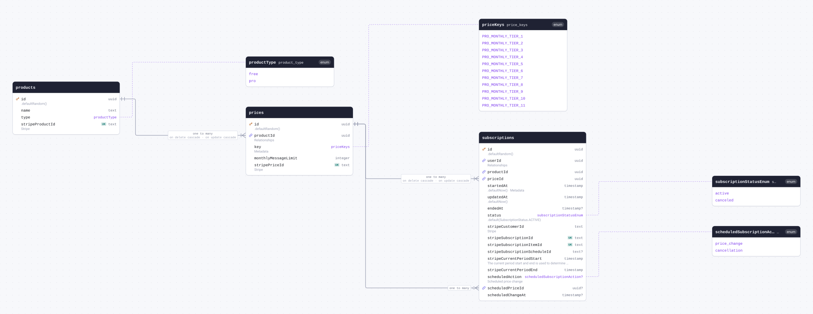

| Column                                          | Type                           | Constraints                               | Default            | Description   |
| ----------------------------------------------- | ------------------------------ | ----------------------------------------- | ------------------ | ------------- |
| `id`                                            | `uuid`                         | PK NOT NULL                               | `.defaultRandom()` |               |
| `productId` (`product_id`)                      | `uuid`                         | NOT NULL → [products.id](#table-products) |                    | Relationships |
| `key` (`price_key`)                             | [`priceKeys`](#enum-priceKeys) | NOT NULL                                  |                    | Metadata      |
| `monthlyMessageLimit` (`monthly_message_limit`) | `integer`                      | NOT NULL                                  |                    |               |
| `stripePriceId` (`stripe_price_id`)             | `text`                         | UNIQUE NOT NULL                           |                    | Stripe        |

#### Definition

```sql
CREATE TABLE "prices" (
	"id" uuid PRIMARY KEY DEFAULT gen_random_uuid(),
	"product_id" uuid NOT NULL,
	"price_key" "price_keys" NOT NULL,
	"monthly_message_limit" integer NOT NULL,
	"stripe_price_id" text NOT NULL UNIQUE
);

ALTER TABLE "prices" ENABLE ROW LEVEL SECURITY;

ALTER TABLE "prices" ADD CONSTRAINT "prices_product_id_products_id_fkey" FOREIGN KEY ("product_id") REFERENCES "products"("id") ON DELETE CASCADE ON UPDATE CASCADE;
```

#### References

- `productId` → [products.id](#table-products) (many to one, on delete cascade, on update cascade)

#### Referenced by

- `id` → [subscriptions.priceId](#table-subscriptions) (one to many, on delete cascade, on update cascade)
- `id` → [subscriptions.scheduledPriceId](#table-subscriptions) (one to many)

<details>
<summary>Queries and their SQL</summary>

**Select**: Every row of prices.

```ts
db.select().from(prices);
```

```sql
select "id", "product_id", "price_key", "monthly_message_limit", "stripe_price_id"
from "prices"
```

**Count**: How many rows prices has.

```ts
db.select({ count: count() }).from(prices);
```

```sql
select count(*)
from "prices"
```

**Find many**: The rows of prices, through the relational query API.

```ts
db.query.prices.findMany();
```

```sql
select "d0"."id" as "id", "d0"."product_id" as "productId", "d0"."price_key" as "key", "d0"."monthly_message_limit" as "monthlyMessageLimit", "d0"."stripe_price_id" as "stripePriceId"
from "prices" as "d0"
```

**Find by primary key**: One row of prices, through the relational query API.

```ts
db.query.prices.findFirst({ where: { id: "00000000-0000-0000-0000-000000000000" } });
```

```sql
select "d0"."id" as "id", "d0"."product_id" as "productId", "d0"."price_key" as "key", "d0"."monthly_message_limit" as "monthlyMessageLimit", "d0"."stripe_price_id" as "stripePriceId"
from "prices" as "d0"
where "d0"."id" = $1
limit $2
-- params: ["00000000-0000-0000-0000-000000000000",1]
```

**Insert**: Adds a row to prices, giving the columns that have no default.

```ts
db.insert(prices).values({
  productId: "00000000-0000-0000-0000-000000000000",
  key: "PRO_MONTHLY_TIER_1",
  monthlyMessageLimit: 1,
  stripePriceId: "stripePriceId",
});
```

```sql
insert into "prices" ("id", "product_id", "price_key", "monthly_message_limit", "stripe_price_id")
values (default, $1, $2, $3, $4)
-- params: ["00000000-0000-0000-0000-000000000000","PRO_MONTHLY_TIER_1",1,"stripePriceId"]
```

**Update**: Changes a row of prices, found by its primary key.

```ts
db.update(prices)
  .set({ productId: "00000000-0000-0000-0000-000000000000" })
  .where(eq(prices.id, "00000000-0000-0000-0000-000000000000"));
```

```sql
update "prices"
set "product_id" = $1
where "prices"."id" = $2
-- params: ["00000000-0000-0000-0000-000000000000","00000000-0000-0000-0000-000000000000"]
```

**Delete**: Deletes a row of prices, found by its primary key.

```ts
db.delete(prices).where(eq(prices.id, "00000000-0000-0000-0000-000000000000"));
```

```sql
delete from "prices"
where "prices"."id" = $1
-- params: ["00000000-0000-0000-0000-000000000000"]
```

</details>

<a id="table-products"></a>

### products

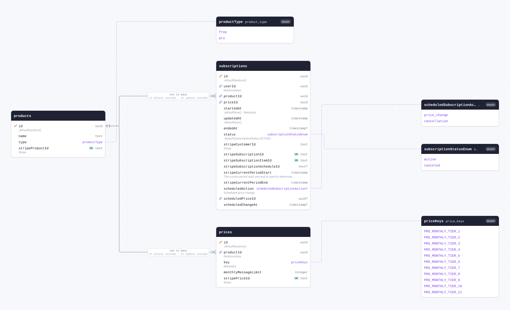

| Column                                  | Type                               | Constraints     | Default            | Description |
| --------------------------------------- | ---------------------------------- | --------------- | ------------------ | ----------- |
| `id`                                    | `uuid`                             | PK NOT NULL     | `.defaultRandom()` |             |
| `name`                                  | `text`                             | NOT NULL        |                    |             |
| `type`                                  | [`productType`](#enum-productType) | NOT NULL        |                    |             |
| `stripeProductId` (`stripe_product_id`) | `text`                             | UNIQUE NOT NULL |                    | Stripe      |

#### Definition

```sql
CREATE TABLE "products" (
	"id" uuid PRIMARY KEY DEFAULT gen_random_uuid(),
	"name" text NOT NULL,
	"type" "product_type" NOT NULL,
	"stripe_product_id" text NOT NULL UNIQUE
);

ALTER TABLE "products" ENABLE ROW LEVEL SECURITY;
```

#### Referenced by

- `id` → [prices.productId](#table-prices) (one to many, on delete cascade, on update cascade)
- `id` → [subscriptions.productId](#table-subscriptions) (one to many, on delete cascade, on update cascade)

<details>
<summary>Queries and their SQL</summary>

**Select**: Every row of products.

```ts
db.select().from(products);
```

```sql
select "id", "name", "type", "stripe_product_id"
from "products"
```

**Count**: How many rows products has.

```ts
db.select({ count: count() }).from(products);
```

```sql
select count(*)
from "products"
```

**Find many**: The rows of products, through the relational query API.

```ts
db.query.products.findMany();
```

```sql
select "d0"."id" as "id", "d0"."name" as "name", "d0"."type" as "type", "d0"."stripe_product_id" as "stripeProductId"
from "products" as "d0"
```

**Find by primary key**: One row of products, through the relational query API.

```ts
db.query.products.findFirst({ where: { id: "00000000-0000-0000-0000-000000000000" } });
```

```sql
select "d0"."id" as "id", "d0"."name" as "name", "d0"."type" as "type", "d0"."stripe_product_id" as "stripeProductId"
from "products" as "d0"
where "d0"."id" = $1
limit $2
-- params: ["00000000-0000-0000-0000-000000000000",1]
```

**Insert**: Adds a row to products, giving the columns that have no default.

```ts
db.insert(products).values({ name: "name", type: "free", stripeProductId: "stripeProductId" });
```

```sql
insert into "products" ("id", "name", "type", "stripe_product_id")
values (default, $1, $2, $3)
-- params: ["name","free","stripeProductId"]
```

**Update**: Changes a row of products, found by its primary key.

```ts
db.update(products)
  .set({ name: "name" })
  .where(eq(products.id, "00000000-0000-0000-0000-000000000000"));
```

```sql
update "products"
set "name" = $1
where "products"."id" = $2
-- params: ["name","00000000-0000-0000-0000-000000000000"]
```

**Delete**: Deletes a row of products, found by its primary key.

```ts
db.delete(products).where(eq(products.id, "00000000-0000-0000-0000-000000000000"));
```

```sql
delete from "products"
where "products"."id" = $1
-- params: ["00000000-0000-0000-0000-000000000000"]
```

</details>

<a id="table-rateLimits"></a>

### rateLimits

Table `rate_limits`.

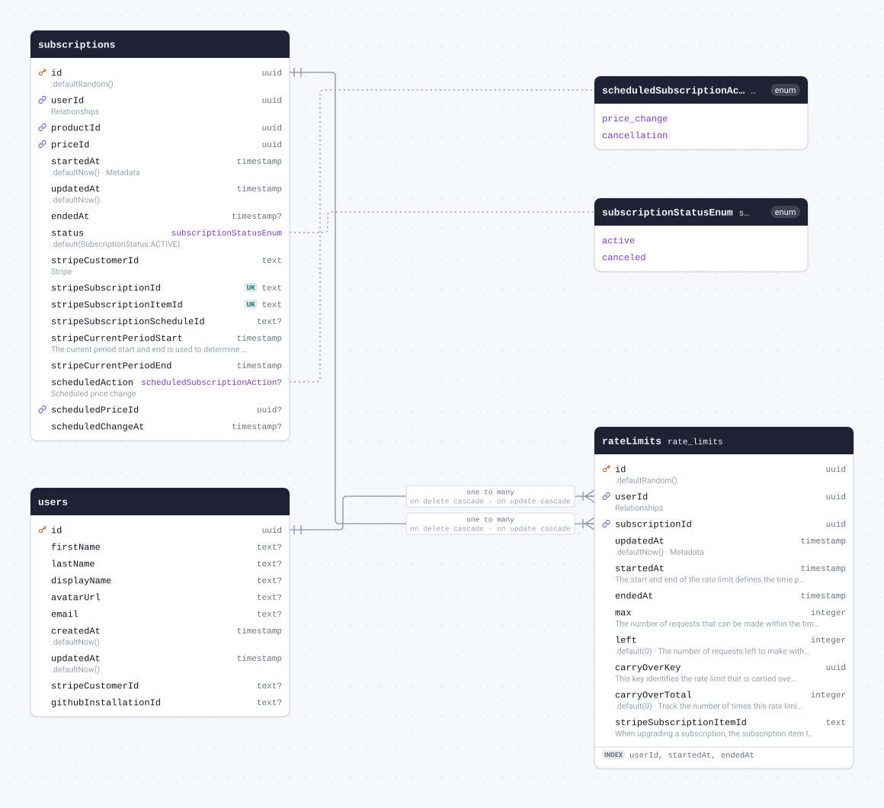

| Column                                                     | Type        | Constraints                                         | Default            | Description                                                                                                                                                                                                                    |
| ---------------------------------------------------------- | ----------- | --------------------------------------------------- | ------------------ | ------------------------------------------------------------------------------------------------------------------------------------------------------------------------------------------------------------------------------ |
| `id`                                                       | `uuid`      | PK NOT NULL                                         | `.defaultRandom()` |                                                                                                                                                                                                                                |
| `userId` (`user_id`)                                       | `uuid`      | NOT NULL → [users.id](#table-users)                 |                    | Relationships                                                                                                                                                                                                                  |
| `subscriptionId` (`subscription_id`)                       | `uuid`      | NOT NULL → [subscriptions.id](#table-subscriptions) |                    |                                                                                                                                                                                                                                |
| `updatedAt` (`updated_at`)                                 | `timestamp` | NOT NULL                                            | `.defaultNow()`    | Metadata                                                                                                                                                                                                                       |
| `startedAt` (`started_at`)                                 | `timestamp` | NOT NULL                                            |                    | The start and end of the rate limit defines the time period for which the rate limit is applied There can be multiple rate limits per subscription and the range doesn't have to match the subscription's start and end dates. |
| `endedAt` (`ended_at`)                                     | `timestamp` | NOT NULL                                            |                    |                                                                                                                                                                                                                                |
| `max`                                                      | `integer`   | NOT NULL                                            |                    | The number of requests that can be made within the time period. For carry-over limits, this reflects the total number of requests that were carried over.                                                                      |
| `left`                                                     | `integer`   | NOT NULL                                            | `.default(0)`      | The number of requests left to make within the time period.                                                                                                                                                                    |
| `carryOverKey` (`carry_over_key`)                          | `uuid`      | NOT NULL                                            |                    | This key identifies the rate limit that is carried over. Useful for analytics and debugging and possibly displaying to the user.                                                                                               |
| `carryOverTotal` (`carry_over_total`)                      | `integer`   | NOT NULL                                            | `.default(0)`      | Track the number of times this rate limit has been carried over.                                                                                                                                                               |
| `stripeSubscriptionItemId` (`stripe_subscription_item_id`) | `text`      | NOT NULL                                            |                    | When upgrading a subscription, the subscription item ID is updated. Due to slight limitations of the Stripe API, we need to track the subscription item ID.                                                                    |

#### Definition

```sql
CREATE TABLE "rate_limits" (
	"id" uuid PRIMARY KEY DEFAULT gen_random_uuid(),
	"user_id" uuid NOT NULL,
	"subscription_id" uuid NOT NULL,
	"updated_at" timestamp with time zone DEFAULT now() NOT NULL,
	"started_at" timestamp with time zone NOT NULL,
	"ended_at" timestamp with time zone NOT NULL,
	"max" integer NOT NULL,
	"left" integer DEFAULT 0 NOT NULL,
	"carry_over_key" uuid NOT NULL,
	"carry_over_total" integer DEFAULT 0 NOT NULL,
	"stripe_subscription_item_id" text NOT NULL
);

ALTER TABLE "rate_limits" ENABLE ROW LEVEL SECURITY;

CREATE INDEX "rate_limits_user_time_idx" ON "rate_limits" ("user_id","started_at","ended_at");

ALTER TABLE "rate_limits" ADD CONSTRAINT "rate_limits_user_id_users_id_fkey" FOREIGN KEY ("user_id") REFERENCES "users"("id") ON DELETE CASCADE ON UPDATE CASCADE;

ALTER TABLE "rate_limits" ADD CONSTRAINT "rate_limits_subscription_id_subscriptions_id_fkey" FOREIGN KEY ("subscription_id") REFERENCES "subscriptions"("id") ON DELETE CASCADE ON UPDATE CASCADE;
```

#### Indexes

- INDEX `userId`, `startedAt`, `endedAt`

#### References

- `userId` → [users.id](#table-users) (many to one, on delete cascade, on update cascade)
- `subscriptionId` → [subscriptions.id](#table-subscriptions) (many to one, on delete cascade, on update cascade)

<details>
<summary>Queries and their SQL</summary>

**Select**: Every row of rateLimits.

```ts
db.select().from(rateLimits);
```

```sql
select "id", "user_id", "subscription_id", "updated_at", "started_at", "ended_at", "max", "left", "carry_over_key", "carry_over_total", "stripe_subscription_item_id"
from "rate_limits"
```

**Count**: How many rows rateLimits has.

```ts
db.select({ count: count() }).from(rateLimits);
```

```sql
select count(*)
from "rate_limits"
```

**Find many**: The rows of rateLimits, through the relational query API.

```ts
db.query.rateLimits.findMany();
```

```sql
select "d0"."id" as "id", "d0"."user_id" as "userId", "d0"."subscription_id" as "subscriptionId", "d0"."updated_at" as "updatedAt", "d0"."started_at" as "startedAt", "d0"."ended_at" as "endedAt", "d0"."max" as "max", "d0"."left" as "left", "d0"."carry_over_key" as "carryOverKey", "d0"."carry_over_total" as "carryOverTotal", "d0"."stripe_subscription_item_id" as "stripeSubscriptionItemId"
from "rate_limits" as "d0"
```

**Find by primary key**: One row of rateLimits, through the relational query API.

```ts
db.query.rateLimits.findFirst({ where: { id: "00000000-0000-0000-0000-000000000000" } });
```

```sql
select "d0"."id" as "id", "d0"."user_id" as "userId", "d0"."subscription_id" as "subscriptionId", "d0"."updated_at" as "updatedAt", "d0"."started_at" as "startedAt", "d0"."ended_at" as "endedAt", "d0"."max" as "max", "d0"."left" as "left", "d0"."carry_over_key" as "carryOverKey", "d0"."carry_over_total" as "carryOverTotal", "d0"."stripe_subscription_item_id" as "stripeSubscriptionItemId"
from "rate_limits" as "d0"
where "d0"."id" = $1
limit $2
-- params: ["00000000-0000-0000-0000-000000000000",1]
```

**Insert**: Adds a row to rateLimits, giving the columns that have no default.

```ts
db.insert(rateLimits).values({
  userId: "00000000-0000-0000-0000-000000000000",
  subscriptionId: "00000000-0000-0000-0000-000000000000",
  startedAt: new Date("2026-01-01T00:00:00.000Z"),
  endedAt: new Date("2026-01-01T00:00:00.000Z"),
  max: 1,
  carryOverKey: "00000000-0000-0000-0000-000000000000",
  stripeSubscriptionItemId: "stripeSubscriptionItemId",
});
```

```sql
insert into "rate_limits" ("id", "user_id", "subscription_id", "updated_at", "started_at", "ended_at", "max", "left", "carry_over_key", "carry_over_total", "stripe_subscription_item_id")
values (default, $1, $2, default, $3, $4, $5, default, $6, default, $7)
-- params: ["00000000-0000-0000-0000-000000000000","00000000-0000-0000-0000-000000000000","2026-01-01T00:00:00.000Z","2026-01-01T00:00:00.000Z",1,"00000000-0000-0000-0000-000000000000","stripeSubscriptionItemId"]
```

**Update**: Changes a row of rateLimits, found by its primary key.

```ts
db.update(rateLimits)
  .set({ userId: "00000000-0000-0000-0000-000000000000" })
  .where(eq(rateLimits.id, "00000000-0000-0000-0000-000000000000"));
```

```sql
update "rate_limits"
set "user_id" = $1
where "rate_limits"."id" = $2
-- params: ["00000000-0000-0000-0000-000000000000","00000000-0000-0000-0000-000000000000"]
```

**Delete**: Deletes a row of rateLimits, found by its primary key.

```ts
db.delete(rateLimits).where(eq(rateLimits.id, "00000000-0000-0000-0000-000000000000"));
```

```sql
delete from "rate_limits"
where "rate_limits"."id" = $1
-- params: ["00000000-0000-0000-0000-000000000000"]
```

</details>

<a id="table-subscriptions"></a>

### subscriptions

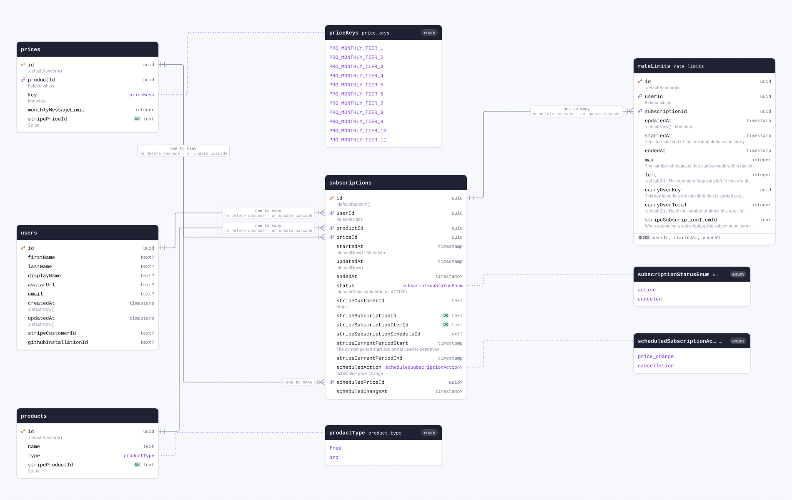

| Column                                                             | Type                                                               | Constraints                               | Default                               | Description                                                                            |
| ------------------------------------------------------------------ | ------------------------------------------------------------------ | ----------------------------------------- | ------------------------------------- | -------------------------------------------------------------------------------------- |
| `id`                                                               | `uuid`                                                             | PK NOT NULL                               | `.defaultRandom()`                    |                                                                                        |
| `userId` (`user_id`)                                               | `uuid`                                                             | NOT NULL → [users.id](#table-users)       |                                       | Relationships                                                                          |
| `productId` (`product_id`)                                         | `uuid`                                                             | NOT NULL → [products.id](#table-products) |                                       |                                                                                        |
| `priceId` (`price_id`)                                             | `uuid`                                                             | NOT NULL → [prices.id](#table-prices)     |                                       |                                                                                        |
| `startedAt` (`started_at`)                                         | `timestamp`                                                        | NOT NULL                                  | `.defaultNow()`                       | Metadata                                                                               |
| `updatedAt` (`updated_at`)                                         | `timestamp`                                                        | NOT NULL                                  | `.defaultNow()`                       |                                                                                        |
| `endedAt` (`ended_at`)                                             | `timestamp`                                                        | NULL                                      |                                       |                                                                                        |
| `status`                                                           | [`subscriptionStatusEnum`](#enum-subscriptionStatusEnum)           | NOT NULL                                  | `.default(SubscriptionStatus.ACTIVE)` |                                                                                        |
| `stripeCustomerId` (`stripe_customer_id`)                          | `text`                                                             | NOT NULL                                  |                                       | Stripe                                                                                 |
| `stripeSubscriptionId` (`stripe_subscription_id`)                  | `text`                                                             | UNIQUE NOT NULL                           |                                       |                                                                                        |
| `stripeSubscriptionItemId` (`stripe_subscription_item_id`)         | `text`                                                             | UNIQUE NOT NULL                           |                                       |                                                                                        |
| `stripeSubscriptionScheduleId` (`stripe_subscription_schedule_id`) | `text`                                                             | NULL                                      |                                       |                                                                                        |
| `stripeCurrentPeriodStart` (`stripe_current_period_start`)         | `timestamp`                                                        | NOT NULL                                  |                                       | The current period start and end is used to determine if the subscription has renewed. |
| `stripeCurrentPeriodEnd` (`stripe_current_period_end`)             | `timestamp`                                                        | NOT NULL                                  |                                       |                                                                                        |
| `scheduledAction` (`scheduled_action`)                             | [`scheduledSubscriptionAction`](#enum-scheduledSubscriptionAction) | NULL                                      |                                       | Scheduled price change                                                                 |
| `scheduledPriceId` (`scheduled_price_id`)                          | `uuid`                                                             | NULL → [prices.id](#table-prices)         |                                       |                                                                                        |
| `scheduledChangeAt` (`scheduled_change_at`)                        | `timestamp`                                                        | NULL                                      |                                       |                                                                                        |

#### Definition

```sql
CREATE TABLE "subscriptions" (
	"id" uuid PRIMARY KEY DEFAULT gen_random_uuid(),
	"user_id" uuid NOT NULL,
	"product_id" uuid NOT NULL,
	"price_id" uuid NOT NULL,
	"started_at" timestamp with time zone DEFAULT now() NOT NULL,
	"updated_at" timestamp with time zone DEFAULT now() NOT NULL,
	"ended_at" timestamp with time zone,
	"status" "subscription_status" DEFAULT 'active'::"subscription_status" NOT NULL,
	"stripe_customer_id" text NOT NULL,
	"stripe_subscription_id" text NOT NULL UNIQUE,
	"stripe_subscription_item_id" text NOT NULL UNIQUE,
	"stripe_subscription_schedule_id" text,
	"stripe_current_period_start" timestamp with time zone NOT NULL,
	"stripe_current_period_end" timestamp with time zone NOT NULL,
	"scheduled_action" "scheduled_subscription_action",
	"scheduled_price_id" uuid,
	"scheduled_change_at" timestamp with time zone
);

ALTER TABLE "subscriptions" ENABLE ROW LEVEL SECURITY;

ALTER TABLE "subscriptions" ADD CONSTRAINT "subscriptions_user_id_users_id_fkey" FOREIGN KEY ("user_id") REFERENCES "users"("id") ON DELETE CASCADE ON UPDATE CASCADE;

ALTER TABLE "subscriptions" ADD CONSTRAINT "subscriptions_product_id_products_id_fkey" FOREIGN KEY ("product_id") REFERENCES "products"("id") ON DELETE CASCADE ON UPDATE CASCADE;

ALTER TABLE "subscriptions" ADD CONSTRAINT "subscriptions_price_id_prices_id_fkey" FOREIGN KEY ("price_id") REFERENCES "prices"("id") ON DELETE CASCADE ON UPDATE CASCADE;

ALTER TABLE "subscriptions" ADD CONSTRAINT "subscriptions_scheduled_price_id_prices_id_fkey" FOREIGN KEY ("scheduled_price_id") REFERENCES "prices"("id");
```

#### References

- `userId` → [users.id](#table-users) (many to one, on delete cascade, on update cascade)
- `productId` → [products.id](#table-products) (many to one, on delete cascade, on update cascade)
- `priceId` → [prices.id](#table-prices) (many to one, on delete cascade, on update cascade)
- `scheduledPriceId` → [prices.id](#table-prices) (many to one)

#### Referenced by

- `id` → [rateLimits.subscriptionId](#table-rateLimits) (one to many, on delete cascade, on update cascade)

<details>
<summary>Queries and their SQL</summary>

**Select**: Every row of subscriptions.

```ts
db.select().from(subscriptions);
```

```sql
select "id", "user_id", "product_id", "price_id", "started_at", "updated_at", "ended_at", "status", "stripe_customer_id", "stripe_subscription_id", "stripe_subscription_item_id", "stripe_subscription_schedule_id", "stripe_current_period_start", "stripe_current_period_end", "scheduled_action", "scheduled_price_id", "scheduled_change_at"
from "subscriptions"
```

**Count**: How many rows subscriptions has.

```ts
db.select({ count: count() }).from(subscriptions);
```

```sql
select count(*)
from "subscriptions"
```

**Find many**: The rows of subscriptions, through the relational query API.

```ts
db.query.subscriptions.findMany();
```

```sql
select "d0"."id" as "id", "d0"."user_id" as "userId", "d0"."product_id" as "productId", "d0"."price_id" as "priceId", "d0"."started_at" as "startedAt", "d0"."updated_at" as "updatedAt", "d0"."ended_at" as "endedAt", "d0"."status" as "status", "d0"."stripe_customer_id" as "stripeCustomerId", "d0"."stripe_subscription_id" as "stripeSubscriptionId", "d0"."stripe_subscription_item_id" as "stripeSubscriptionItemId", "d0"."stripe_subscription_schedule_id" as "stripeSubscriptionScheduleId", "d0"."stripe_current_period_start" as "stripeCurrentPeriodStart", "d0"."stripe_current_period_end" as "stripeCurrentPeriodEnd", "d0"."scheduled_action" as "scheduledAction", "d0"."scheduled_price_id" as "scheduledPriceId", "d0"."scheduled_change_at" as "scheduledChangeAt"
from "subscriptions" as "d0"
```

**Find by primary key**: One row of subscriptions, through the relational query API.

```ts
db.query.subscriptions.findFirst({ where: { id: "00000000-0000-0000-0000-000000000000" } });
```

```sql
select "d0"."id" as "id", "d0"."user_id" as "userId", "d0"."product_id" as "productId", "d0"."price_id" as "priceId", "d0"."started_at" as "startedAt", "d0"."updated_at" as "updatedAt", "d0"."ended_at" as "endedAt", "d0"."status" as "status", "d0"."stripe_customer_id" as "stripeCustomerId", "d0"."stripe_subscription_id" as "stripeSubscriptionId", "d0"."stripe_subscription_item_id" as "stripeSubscriptionItemId", "d0"."stripe_subscription_schedule_id" as "stripeSubscriptionScheduleId", "d0"."stripe_current_period_start" as "stripeCurrentPeriodStart", "d0"."stripe_current_period_end" as "stripeCurrentPeriodEnd", "d0"."scheduled_action" as "scheduledAction", "d0"."scheduled_price_id" as "scheduledPriceId", "d0"."scheduled_change_at" as "scheduledChangeAt"
from "subscriptions" as "d0"
where "d0"."id" = $1
limit $2
-- params: ["00000000-0000-0000-0000-000000000000",1]
```

**Insert**: Adds a row to subscriptions, giving the columns that have no default.

```ts
db.insert(subscriptions).values({
  userId: "00000000-0000-0000-0000-000000000000",
  productId: "00000000-0000-0000-0000-000000000000",
  priceId: "00000000-0000-0000-0000-000000000000",
  stripeCustomerId: "stripeCustomerId",
  stripeSubscriptionId: "stripeSubscriptionId",
  stripeSubscriptionItemId: "stripeSubscriptionItemId",
  stripeCurrentPeriodStart: new Date("2026-01-01T00:00:00.000Z"),
  stripeCurrentPeriodEnd: new Date("2026-01-01T00:00:00.000Z"),
});
```

```sql
insert into "subscriptions" ("id", "user_id", "product_id", "price_id", "started_at", "updated_at", "ended_at", "status", "stripe_customer_id", "stripe_subscription_id", "stripe_subscription_item_id", "stripe_subscription_schedule_id", "stripe_current_period_start", "stripe_current_period_end", "scheduled_action", "scheduled_price_id", "scheduled_change_at")
values (default, $1, $2, $3, default, default, default, default, $4, $5, $6, default, $7, $8, default, default, default)
-- params: ["00000000-0000-0000-0000-000000000000","00000000-0000-0000-0000-000000000000","00000000-0000-0000-0000-000000000000","stripeCustomerId","stripeSubscriptionId","stripeSubscriptionItemId","2026-01-01T00:00:00.000Z","2026-01-01T00:00:00.000Z"]
```

**Update**: Changes a row of subscriptions, found by its primary key.

```ts
db.update(subscriptions)
  .set({ userId: "00000000-0000-0000-0000-000000000000" })
  .where(eq(subscriptions.id, "00000000-0000-0000-0000-000000000000"));
```

```sql
update "subscriptions"
set "user_id" = $1
where "subscriptions"."id" = $2
-- params: ["00000000-0000-0000-0000-000000000000","00000000-0000-0000-0000-000000000000"]
```

**Delete**: Deletes a row of subscriptions, found by its primary key.

```ts
db.delete(subscriptions).where(eq(subscriptions.id, "00000000-0000-0000-0000-000000000000"));
```

```sql
delete from "subscriptions"
where "subscriptions"."id" = $1
-- params: ["00000000-0000-0000-0000-000000000000"]
```

</details>

<a id="table-usageRecords"></a>

### usageRecords

Table `usage_records`.

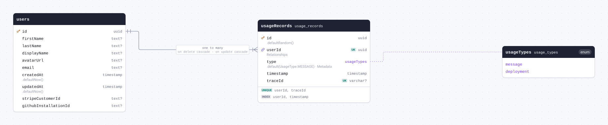

| Column                 | Type                             | Constraints                         | Default                       | Description   |
| ---------------------- | -------------------------------- | ----------------------------------- | ----------------------------- | ------------- |
| `id`                   | `uuid`                           | PK NOT NULL                         | `.defaultRandom()`            |               |
| `userId` (`user_id`)   | `uuid`                           | NOT NULL → [users.id](#table-users) |                               | Relationships |
| `type`                 | [`usageTypes`](#enum-usageTypes) | NOT NULL                            | `.default(UsageType.MESSAGE)` | Metadata      |
| `timestamp`            | `timestamp`                      | NOT NULL                            |                               |               |
| `traceId` (`trace_id`) | `varchar`                        | NULL                                |                               |               |

#### Definition

```sql
CREATE TABLE "usage_records" (
	"id" uuid PRIMARY KEY DEFAULT gen_random_uuid(),
	"user_id" uuid NOT NULL,
	"type" "usage_types" DEFAULT 'message'::"usage_types" NOT NULL,
	"timestamp" timestamp with time zone NOT NULL,
	"trace_id" varchar(255),
	CONSTRAINT "usage_records_user_trace_idx" UNIQUE("user_id","trace_id")
);

ALTER TABLE "usage_records" ENABLE ROW LEVEL SECURITY;

CREATE INDEX "usage_records_user_time_idx" ON "usage_records" ("user_id","timestamp");

ALTER TABLE "usage_records" ADD CONSTRAINT "usage_records_user_id_users_id_fkey" FOREIGN KEY ("user_id") REFERENCES "users"("id") ON DELETE CASCADE ON UPDATE CASCADE;
```

#### Indexes

- INDEX `userId`, `timestamp`
- UNIQUE `userId`, `traceId`

#### References

- `userId` → [users.id](#table-users) (many to one, on delete cascade, on update cascade)

<details>
<summary>Queries and their SQL</summary>

**Select**: Every row of usageRecords.

```ts
db.select().from(usageRecords);
```

```sql
select "id", "user_id", "type", "timestamp", "trace_id"
from "usage_records"
```

**Count**: How many rows usageRecords has.

```ts
db.select({ count: count() }).from(usageRecords);
```

```sql
select count(*)
from "usage_records"
```

**Find many**: The rows of usageRecords, through the relational query API.

```ts
db.query.usageRecords.findMany();
```

```sql
select "d0"."id" as "id", "d0"."user_id" as "userId", "d0"."type" as "type", "d0"."timestamp" as "timestamp", "d0"."trace_id" as "traceId"
from "usage_records" as "d0"
```

**Find by primary key**: One row of usageRecords, through the relational query API.

```ts
db.query.usageRecords.findFirst({ where: { id: "00000000-0000-0000-0000-000000000000" } });
```

```sql
select "d0"."id" as "id", "d0"."user_id" as "userId", "d0"."type" as "type", "d0"."timestamp" as "timestamp", "d0"."trace_id" as "traceId"
from "usage_records" as "d0"
where "d0"."id" = $1
limit $2
-- params: ["00000000-0000-0000-0000-000000000000",1]
```

**Insert**: Adds a row to usageRecords, giving the columns that have no default.

```ts
db.insert(usageRecords).values({
  userId: "00000000-0000-0000-0000-000000000000",
  timestamp: new Date("2026-01-01T00:00:00.000Z"),
});
```

```sql
insert into "usage_records" ("id", "user_id", "type", "timestamp", "trace_id")
values (default, $1, default, $2, default)
-- params: ["00000000-0000-0000-0000-000000000000","2026-01-01T00:00:00.000Z"]
```

**Update**: Changes a row of usageRecords, found by its primary key.

```ts
db.update(usageRecords)
  .set({ userId: "00000000-0000-0000-0000-000000000000" })
  .where(eq(usageRecords.id, "00000000-0000-0000-0000-000000000000"));
```

```sql
update "usage_records"
set "user_id" = $1
where "usage_records"."id" = $2
-- params: ["00000000-0000-0000-0000-000000000000","00000000-0000-0000-0000-000000000000"]
```

**Delete**: Deletes a row of usageRecords, found by its primary key.

```ts
db.delete(usageRecords).where(eq(usageRecords.id, "00000000-0000-0000-0000-000000000000"));
```

```sql
delete from "usage_records"
where "usage_records"."id" = $1
-- params: ["00000000-0000-0000-0000-000000000000"]
```

</details>

<a id="table-authUsers"></a>

### authUsers

Table `auth.users`.

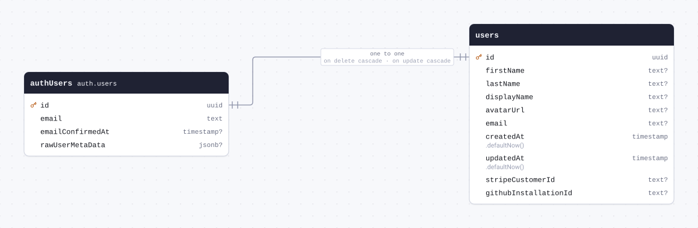

| Column                                    | Type        | Constraints | Default | Description |
| ----------------------------------------- | ----------- | ----------- | ------- | ----------- |
| `id`                                      | `uuid`      | PK NOT NULL |         |             |
| `email`                                   | `text`      | NOT NULL    |         |             |
| `emailConfirmedAt` (`email_confirmed_at`) | `timestamp` | NULL        |         |             |
| `rawUserMetaData` (`raw_user_meta_data`)  | `jsonb`     | NULL        |         |             |

#### Referenced by

- `id` → [users.id](#table-users) (one to one, on delete cascade, on update cascade)

<details>
<summary>Queries and their SQL</summary>

**Select**: Every row of authUsers.

```ts
db.select().from(authUsers);
```

```sql
select "id", "email", "email_confirmed_at", "raw_user_meta_data"
from "auth"."users"
```

**Count**: How many rows authUsers has.

```ts
db.select({ count: count() }).from(authUsers);
```

```sql
select count(*)
from "auth"."users"
```

**Find many**: The rows of authUsers, through the relational query API.

```ts
db.query.authUsers.findMany();
```

```sql
select "d0"."id" as "id", "d0"."email" as "email", "d0"."email_confirmed_at" as "emailConfirmedAt", "d0"."raw_user_meta_data" as "rawUserMetaData"
from "auth"."users" as "d0"
```

**Find by primary key**: One row of authUsers, through the relational query API.

```ts
db.query.authUsers.findFirst({ where: { id: "00000000-0000-0000-0000-000000000000" } });
```

```sql
select "d0"."id" as "id", "d0"."email" as "email", "d0"."email_confirmed_at" as "emailConfirmedAt", "d0"."raw_user_meta_data" as "rawUserMetaData"
from "auth"."users" as "d0"
where "d0"."id" = $1
limit $2
-- params: ["00000000-0000-0000-0000-000000000000",1]
```

**Insert**: Adds a row to authUsers, giving the columns that have no default.

```ts
db.insert(authUsers).values({ id: "00000000-0000-0000-0000-000000000000", email: "email" });
```

```sql
insert into "auth"."users" ("id", "email", "email_confirmed_at", "raw_user_meta_data")
values ($1, $2, default, default)
-- params: ["00000000-0000-0000-0000-000000000000","email"]
```

**Update**: Changes a row of authUsers, found by its primary key.

```ts
db.update(authUsers)
  .set({ email: "email" })
  .where(eq(authUsers.id, "00000000-0000-0000-0000-000000000000"));
```

```sql
update "auth"."users"
set "email" = $1
where "auth"."users"."id" = $2
-- params: ["email","00000000-0000-0000-0000-000000000000"]
```

**Delete**: Deletes a row of authUsers, found by its primary key.

```ts
db.delete(authUsers).where(eq(authUsers.id, "00000000-0000-0000-0000-000000000000"));
```

```sql
delete from "auth"."users"
where "auth"."users"."id" = $1
-- params: ["00000000-0000-0000-0000-000000000000"]
```

</details>

<a id="table-userSettings"></a>

### userSettings

Table `user_settings`.

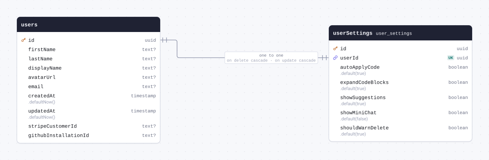

| Column                                    | Type      | Constraints                                | Default           | Description |
| ----------------------------------------- | --------- | ------------------------------------------ | ----------------- | ----------- |
| `id`                                      | `uuid`    | PK NOT NULL                                |                   |             |
| `userId` (`user_id`)                      | `uuid`    | UNIQUE NOT NULL → [users.id](#table-users) |                   |             |
| `autoApplyCode` (`auto_apply_code`)       | `boolean` | NOT NULL                                   | `.default(true)`  |             |
| `expandCodeBlocks` (`expand_code_blocks`) | `boolean` | NOT NULL                                   | `.default(true)`  |             |
| `showSuggestions` (`show_suggestions`)    | `boolean` | NOT NULL                                   | `.default(true)`  |             |
| `showMiniChat` (`show_mini_chat`)         | `boolean` | NOT NULL                                   | `.default(false)` |             |
| `shouldWarnDelete` (`should_warn_delete`) | `boolean` | NOT NULL                                   | `.default(true)`  |             |

#### Definition

```sql
CREATE TABLE "user_settings" (
	"id" uuid PRIMARY KEY,
	"user_id" uuid NOT NULL UNIQUE,
	"auto_apply_code" boolean DEFAULT true NOT NULL,
	"expand_code_blocks" boolean DEFAULT true NOT NULL,
	"show_suggestions" boolean DEFAULT true NOT NULL,
	"show_mini_chat" boolean DEFAULT false NOT NULL,
	"should_warn_delete" boolean DEFAULT true NOT NULL
);

ALTER TABLE "user_settings" ENABLE ROW LEVEL SECURITY;

ALTER TABLE "user_settings" ADD CONSTRAINT "user_settings_user_id_users_id_fkey" FOREIGN KEY ("user_id") REFERENCES "users"("id") ON DELETE CASCADE ON UPDATE CASCADE;
```

#### References

- `userId` → [users.id](#table-users) (one to one, on delete cascade, on update cascade)

<details>
<summary>Queries and their SQL</summary>

**Select**: Every row of userSettings.

```ts
db.select().from(userSettings);
```

```sql
select "id", "user_id", "auto_apply_code", "expand_code_blocks", "show_suggestions", "show_mini_chat", "should_warn_delete"
from "user_settings"
```

**Count**: How many rows userSettings has.

```ts
db.select({ count: count() }).from(userSettings);
```

```sql
select count(*)
from "user_settings"
```

**Find many**: The rows of userSettings, through the relational query API.

```ts
db.query.userSettings.findMany();
```

```sql
select "d0"."id" as "id", "d0"."user_id" as "userId", "d0"."auto_apply_code" as "autoApplyCode", "d0"."expand_code_blocks" as "expandCodeBlocks", "d0"."show_suggestions" as "showSuggestions", "d0"."show_mini_chat" as "showMiniChat", "d0"."should_warn_delete" as "shouldWarnDelete"
from "user_settings" as "d0"
```

**Find by primary key**: One row of userSettings, through the relational query API.

```ts
db.query.userSettings.findFirst({ where: { id: "00000000-0000-0000-0000-000000000000" } });
```

```sql
select "d0"."id" as "id", "d0"."user_id" as "userId", "d0"."auto_apply_code" as "autoApplyCode", "d0"."expand_code_blocks" as "expandCodeBlocks", "d0"."show_suggestions" as "showSuggestions", "d0"."show_mini_chat" as "showMiniChat", "d0"."should_warn_delete" as "shouldWarnDelete"
from "user_settings" as "d0"
where "d0"."id" = $1
limit $2
-- params: ["00000000-0000-0000-0000-000000000000",1]
```

**Insert**: Adds a row to userSettings, giving the columns that have no default.

```ts
db.insert(userSettings).values({
  id: "00000000-0000-0000-0000-000000000000",
  userId: "00000000-0000-0000-0000-000000000000",
});
```

```sql
insert into "user_settings" ("id", "user_id", "auto_apply_code", "expand_code_blocks", "show_suggestions", "show_mini_chat", "should_warn_delete")
values ($1, $2, default, default, default, default, default)
-- params: ["00000000-0000-0000-0000-000000000000","00000000-0000-0000-0000-000000000000"]
```

**Update**: Changes a row of userSettings, found by its primary key.

```ts
db.update(userSettings)
  .set({ userId: "00000000-0000-0000-0000-000000000000" })
  .where(eq(userSettings.id, "00000000-0000-0000-0000-000000000000"));
```

```sql
update "user_settings"
set "user_id" = $1
where "user_settings"."id" = $2
-- params: ["00000000-0000-0000-0000-000000000000","00000000-0000-0000-0000-000000000000"]
```

**Delete**: Deletes a row of userSettings, found by its primary key.

```ts
db.delete(userSettings).where(eq(userSettings.id, "00000000-0000-0000-0000-000000000000"));
```

```sql
delete from "user_settings"
where "user_settings"."id" = $1
-- params: ["00000000-0000-0000-0000-000000000000"]
```

</details>

<a id="table-userCanvases"></a>

### userCanvases

Table `user_canvases`.

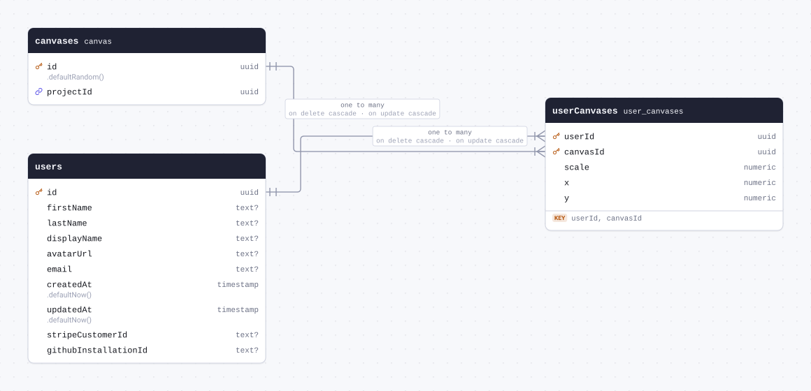

| Column                   | Type      | Constraints                                  | Default | Description |
| ------------------------ | --------- | -------------------------------------------- | ------- | ----------- |
| `userId` (`user_id`)     | `uuid`    | PK NOT NULL → [users.id](#table-users)       |         |             |
| `canvasId` (`canvas_id`) | `uuid`    | PK NOT NULL → [canvases.id](#table-canvases) |         |             |
| `scale`                  | `numeric` | NOT NULL                                     |         |             |
| `x`                      | `numeric` | NOT NULL                                     |         |             |
| `y`                      | `numeric` | NOT NULL                                     |         |             |

#### Definition

```sql
CREATE TABLE "user_canvases" (
	"user_id" uuid,
	"canvas_id" uuid,
	"scale" numeric NOT NULL,
	"x" numeric NOT NULL,
	"y" numeric NOT NULL,
	CONSTRAINT "user_canvases_pkey" PRIMARY KEY("user_id","canvas_id")
);

ALTER TABLE "user_canvases" ENABLE ROW LEVEL SECURITY;

ALTER TABLE "user_canvases" ADD CONSTRAINT "user_canvases_user_id_users_id_fkey" FOREIGN KEY ("user_id") REFERENCES "users"("id") ON DELETE CASCADE ON UPDATE CASCADE;

ALTER TABLE "user_canvases" ADD CONSTRAINT "user_canvases_canvas_id_canvas_id_fkey" FOREIGN KEY ("canvas_id") REFERENCES "canvas"("id") ON DELETE CASCADE ON UPDATE CASCADE;
```

#### Indexes

- PRIMARY KEY `userId`, `canvasId`

#### References

- `userId` → [users.id](#table-users) (many to one, on delete cascade, on update cascade)
- `canvasId` → [canvases.id](#table-canvases) (many to one, on delete cascade, on update cascade)

<details>
<summary>Queries and their SQL</summary>

**Select**: Every row of userCanvases.

```ts
db.select().from(userCanvases);
```

```sql
select "user_id", "canvas_id", "scale", "x", "y"
from "user_canvases"
```

**Count**: How many rows userCanvases has.

```ts
db.select({ count: count() }).from(userCanvases);
```

```sql
select count(*)
from "user_canvases"
```

**Find many**: The rows of userCanvases, through the relational query API.

```ts
db.query.userCanvases.findMany();
```

```sql
select "d0"."user_id" as "userId", "d0"."canvas_id" as "canvasId", "d0"."scale" as "scale", "d0"."x" as "x", "d0"."y" as "y"
from "user_canvases" as "d0"
```

**Find by primary key**: One row of userCanvases, through the relational query API.

```ts
db.query.userCanvases.findFirst({
  where: {
    userId: "00000000-0000-0000-0000-000000000000",
    canvasId: "00000000-0000-0000-0000-000000000000",
  },
});
```

```sql
select "d0"."user_id" as "userId", "d0"."canvas_id" as "canvasId", "d0"."scale" as "scale", "d0"."x" as "x", "d0"."y" as "y"
from "user_canvases" as "d0"
where (("d0"."user_id" = $1) and ("d0"."canvas_id" = $2))
limit $3
-- params: ["00000000-0000-0000-0000-000000000000","00000000-0000-0000-0000-000000000000",1]
```

**Insert**: Adds a row to userCanvases, giving the columns that have no default.

```ts
db.insert(userCanvases).values({
  userId: "00000000-0000-0000-0000-000000000000",
  canvasId: "00000000-0000-0000-0000-000000000000",
  scale: "1.00",
  x: "1.00",
  y: "1.00",
});
```

```sql
insert into "user_canvases" ("user_id", "canvas_id", "scale", "x", "y")
values ($1, $2, $3, $4, $5)
-- params: ["00000000-0000-0000-0000-000000000000","00000000-0000-0000-0000-000000000000","1.00","1.00","1.00"]
```

**Update**: Changes a row of userCanvases, found by its primary key.

```ts
db.update(userCanvases)
  .set({ scale: "1.00" })
  .where(
    and(
      eq(userCanvases.userId, "00000000-0000-0000-0000-000000000000"),
      eq(userCanvases.canvasId, "00000000-0000-0000-0000-000000000000"),
    ),
  );
```

```sql
update "user_canvases"
set "scale" = $1
where (("user_canvases"."user_id" = $2) and ("user_canvases"."canvas_id" = $3))
-- params: ["1.00","00000000-0000-0000-0000-000000000000","00000000-0000-0000-0000-000000000000"]
```

**Delete**: Deletes a row of userCanvases, found by its primary key.

```ts
db.delete(userCanvases).where(
  and(
    eq(userCanvases.userId, "00000000-0000-0000-0000-000000000000"),
    eq(userCanvases.canvasId, "00000000-0000-0000-0000-000000000000"),
  ),
);
```

```sql
delete from "user_canvases"
where (("user_canvases"."user_id" = $1) and ("user_canvases"."canvas_id" = $2))
-- params: ["00000000-0000-0000-0000-000000000000","00000000-0000-0000-0000-000000000000"]
```

</details>

<a id="table-userProjects"></a>

### userProjects

Table `user_projects`.

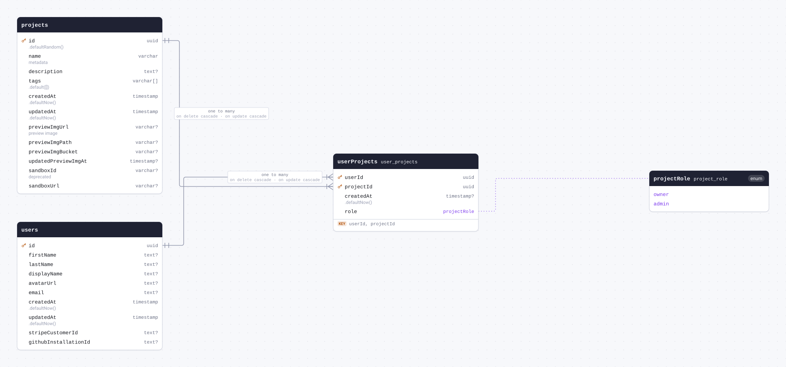

| Column                     | Type                               | Constraints                                  | Default         | Description |
| -------------------------- | ---------------------------------- | -------------------------------------------- | --------------- | ----------- |
| `userId` (`user_id`)       | `uuid`                             | PK NOT NULL → [users.id](#table-users)       |                 |             |
| `projectId` (`project_id`) | `uuid`                             | PK NOT NULL → [projects.id](#table-projects) |                 |             |
| `createdAt` (`created_at`) | `timestamp`                        | NULL                                         | `.defaultNow()` |             |
| `role`                     | [`projectRole`](#enum-projectRole) | NOT NULL                                     |                 |             |

#### Definition

```sql
CREATE TABLE "user_projects" (
	"user_id" uuid,
	"project_id" uuid,
	"created_at" timestamp with time zone DEFAULT now(),
	"role" "project_role" NOT NULL,
	CONSTRAINT "user_projects_pkey" PRIMARY KEY("user_id","project_id")
);

ALTER TABLE "user_projects" ENABLE ROW LEVEL SECURITY;

ALTER TABLE "user_projects" ADD CONSTRAINT "user_projects_user_id_users_id_fkey" FOREIGN KEY ("user_id") REFERENCES "users"("id") ON DELETE CASCADE ON UPDATE CASCADE;

ALTER TABLE "user_projects" ADD CONSTRAINT "user_projects_project_id_projects_id_fkey" FOREIGN KEY ("project_id") REFERENCES "projects"("id") ON DELETE CASCADE ON UPDATE CASCADE;
```

#### Indexes

- PRIMARY KEY `userId`, `projectId`

#### References

- `userId` → [users.id](#table-users) (many to one, on delete cascade, on update cascade)
- `projectId` → [projects.id](#table-projects) (many to one, on delete cascade, on update cascade)

<details>
<summary>Queries and their SQL</summary>

**Select**: Every row of userProjects.

```ts
db.select().from(userProjects);
```

```sql
select "user_id", "project_id", "created_at", "role"
from "user_projects"
```

**Count**: How many rows userProjects has.

```ts
db.select({ count: count() }).from(userProjects);
```

```sql
select count(*)
from "user_projects"
```

**Find many**: The rows of userProjects, through the relational query API.

```ts
db.query.userProjects.findMany();
```

```sql
select "d0"."user_id" as "userId", "d0"."project_id" as "projectId", "d0"."created_at" as "createdAt", "d0"."role" as "role"
from "user_projects" as "d0"
```

**Find by primary key**: One row of userProjects, through the relational query API.

```ts
db.query.userProjects.findFirst({
  where: {
    userId: "00000000-0000-0000-0000-000000000000",
    projectId: "00000000-0000-0000-0000-000000000000",
  },
});
```

```sql
select "d0"."user_id" as "userId", "d0"."project_id" as "projectId", "d0"."created_at" as "createdAt", "d0"."role" as "role"
from "user_projects" as "d0"
where (("d0"."user_id" = $1) and ("d0"."project_id" = $2))
limit $3
-- params: ["00000000-0000-0000-0000-000000000000","00000000-0000-0000-0000-000000000000",1]
```

**Insert**: Adds a row to userProjects, giving the columns that have no default.

```ts
db.insert(userProjects).values({
  userId: "00000000-0000-0000-0000-000000000000",
  projectId: "00000000-0000-0000-0000-000000000000",
  role: "owner",
});
```

```sql
insert into "user_projects" ("user_id", "project_id", "created_at", "role")
values ($1, $2, default, $3)
-- params: ["00000000-0000-0000-0000-000000000000","00000000-0000-0000-0000-000000000000","owner"]
```

**Update**: Changes a row of userProjects, found by its primary key.

```ts
db.update(userProjects)
  .set({ createdAt: new Date("2026-01-01T00:00:00.000Z") })
  .where(
    and(
      eq(userProjects.userId, "00000000-0000-0000-0000-000000000000"),
      eq(userProjects.projectId, "00000000-0000-0000-0000-000000000000"),
    ),
  );
```

```sql
update "user_projects"
set "created_at" = $1
where (("user_projects"."user_id" = $2) and ("user_projects"."project_id" = $3))
-- params: ["2026-01-01T00:00:00.000Z","00000000-0000-0000-0000-000000000000","00000000-0000-0000-0000-000000000000"]
```

**Delete**: Deletes a row of userProjects, found by its primary key.

```ts
db.delete(userProjects).where(
  and(
    eq(userProjects.userId, "00000000-0000-0000-0000-000000000000"),
    eq(userProjects.projectId, "00000000-0000-0000-0000-000000000000"),
  ),
);
```

```sql
delete from "user_projects"
where (("user_projects"."user_id" = $1) and ("user_projects"."project_id" = $2))
-- params: ["00000000-0000-0000-0000-000000000000","00000000-0000-0000-0000-000000000000"]
```

</details>

<a id="table-users"></a>

### users

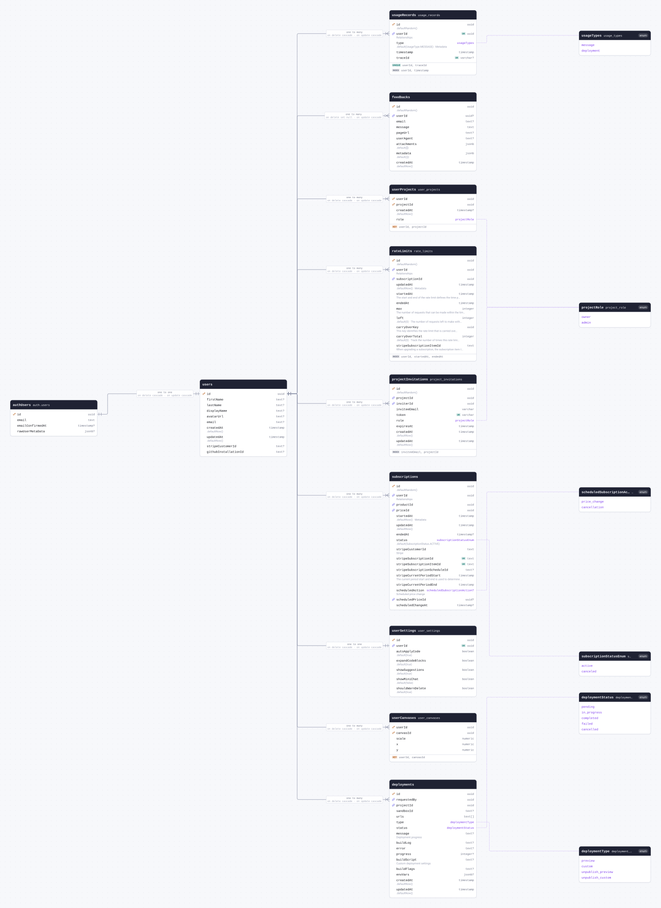

| Column                                            | Type        | Constraints                                    | Default         | Description |
| ------------------------------------------------- | ----------- | ---------------------------------------------- | --------------- | ----------- |
| `id`                                              | `uuid`      | PK NOT NULL → [authUsers.id](#table-authUsers) |                 |             |
| `firstName` (`first_name`)                        | `text`      | NULL                                           |                 |             |
| `lastName` (`last_name`)                          | `text`      | NULL                                           |                 |             |
| `displayName` (`display_name`)                    | `text`      | NULL                                           |                 |             |
| `avatarUrl` (`avatar_url`)                        | `text`      | NULL                                           |                 |             |
| `email`                                           | `text`      | NULL                                           |                 |             |
| `createdAt` (`created_at`)                        | `timestamp` | NOT NULL                                       | `.defaultNow()` |             |
| `updatedAt` (`updated_at`)                        | `timestamp` | NOT NULL                                       | `.defaultNow()` |             |
| `stripeCustomerId` (`stripe_customer_id`)         | `text`      | NULL                                           |                 |             |
| `githubInstallationId` (`github_installation_id`) | `text`      | NULL                                           |                 |             |

#### Definition

```sql
CREATE TABLE "auth"."users" (
	"id" uuid PRIMARY KEY,
	"email" text NOT NULL,
	"email_confirmed_at" timestamp,
	"raw_user_meta_data" jsonb
);

CREATE TABLE "users" (
	"id" uuid PRIMARY KEY,
	"first_name" text,
	"last_name" text,
	"display_name" text,
	"avatar_url" text,
	"email" text,
	"created_at" timestamp with time zone DEFAULT now() NOT NULL,
	"updated_at" timestamp with time zone DEFAULT now() NOT NULL,
	"stripe_customer_id" text,
	"github_installation_id" text
);

ALTER TABLE "users" ENABLE ROW LEVEL SECURITY;

ALTER TABLE "users" ADD CONSTRAINT "users_id_users_id_fkey" FOREIGN KEY ("id") REFERENCES "auth"."users"("id") ON DELETE CASCADE ON UPDATE CASCADE;
```

#### References

- `id` → [authUsers.id](#table-authUsers) (one to one, on delete cascade, on update cascade)

#### Referenced by

- `id` → [deployments.requestedBy](#table-deployments) (one to many, on delete cascade, on update cascade)
- `id` → [feedbacks.userId](#table-feedbacks) (one to many, on delete set null, on update cascade)
- `id` → [projectInvitations.inviterId](#table-projectInvitations) (one to many, on delete cascade, on update cascade)
- `id` → [rateLimits.userId](#table-rateLimits) (one to many, on delete cascade, on update cascade)
- `id` → [subscriptions.userId](#table-subscriptions) (one to many, on delete cascade, on update cascade)
- `id` → [usageRecords.userId](#table-usageRecords) (one to many, on delete cascade, on update cascade)
- `id` → [userSettings.userId](#table-userSettings) (one to one, on delete cascade, on update cascade)
- `id` → [userCanvases.userId](#table-userCanvases) (one to many, on delete cascade, on update cascade)
- `id` → [userProjects.userId](#table-userProjects) (one to many, on delete cascade, on update cascade)

<details>
<summary>Queries and their SQL</summary>

**Select**: Every row of users.

```ts
db.select().from(users);
```

```sql
select "id", "first_name", "last_name", "display_name", "avatar_url", "email", "created_at", "updated_at", "stripe_customer_id", "github_installation_id"
from "users"
```

**Count**: How many rows users has.

```ts
db.select({ count: count() }).from(users);
```

```sql
select count(*)
from "users"
```

**Find many**: The rows of users, through the relational query API.

```ts
db.query.users.findMany();
```

```sql
select "d0"."id" as "id", "d0"."first_name" as "firstName", "d0"."last_name" as "lastName", "d0"."display_name" as "displayName", "d0"."avatar_url" as "avatarUrl", "d0"."email" as "email", "d0"."created_at" as "createdAt", "d0"."updated_at" as "updatedAt", "d0"."stripe_customer_id" as "stripeCustomerId", "d0"."github_installation_id" as "githubInstallationId"
from "users" as "d0"
```

**Find by primary key**: One row of users, through the relational query API.

```ts
db.query.users.findFirst({ where: { id: "00000000-0000-0000-0000-000000000000" } });
```

```sql
select "d0"."id" as "id", "d0"."first_name" as "firstName", "d0"."last_name" as "lastName", "d0"."display_name" as "displayName", "d0"."avatar_url" as "avatarUrl", "d0"."email" as "email", "d0"."created_at" as "createdAt", "d0"."updated_at" as "updatedAt", "d0"."stripe_customer_id" as "stripeCustomerId", "d0"."github_installation_id" as "githubInstallationId"
from "users" as "d0"
where "d0"."id" = $1
limit $2
-- params: ["00000000-0000-0000-0000-000000000000",1]
```

**Insert**: Adds a row to users, giving the columns that have no default.

```ts
db.insert(users).values({ id: "00000000-0000-0000-0000-000000000000" });
```

```sql
insert into "users" ("id", "first_name", "last_name", "display_name", "avatar_url", "email", "created_at", "updated_at", "stripe_customer_id", "github_installation_id")
values ($1, default, default, default, default, default, default, default, default, default)
-- params: ["00000000-0000-0000-0000-000000000000"]
```

**Update**: Changes a row of users, found by its primary key.

```ts
db.update(users)
  .set({ firstName: "firstName" })
  .where(eq(users.id, "00000000-0000-0000-0000-000000000000"));
```

```sql
update "users"
set "first_name" = $1
where "users"."id" = $2
-- params: ["firstName","00000000-0000-0000-0000-000000000000"]
```

**Delete**: Deletes a row of users, found by its primary key.

```ts
db.delete(users).where(eq(users.id, "00000000-0000-0000-0000-000000000000"));
```

```sql
delete from "users"
where "users"."id" = $1
-- params: ["00000000-0000-0000-0000-000000000000"]
```

</details>

## Enums

<a id="enum-agentType"></a>

### agentType

Type `agent_type`.

- `root`
- `user`

#### Definition

```sql
CREATE TYPE "agent_type" AS ENUM('root', 'user');
```

<a id="enum-messageRole"></a>

### messageRole

Type `message_role`.

- `user`
- `assistant`
- `system`

#### Definition

```sql
CREATE TYPE "message_role" AS ENUM('user', 'assistant', 'system');
```

<a id="enum-projectCustomDomainStatusEnum"></a>

### projectCustomDomainStatusEnum

Type `project_custom_domain_status`.

- `active`
- `cancelled`

#### Definition

```sql
CREATE TYPE "project_custom_domain_status" AS ENUM('active', 'cancelled');
```

<a id="enum-verificationRequestStatus"></a>

### verificationRequestStatus

Type `verification_request_status`.

- `pending`
- `verified`
- `cancelled`

#### Definition

```sql
CREATE TYPE "verification_request_status" AS ENUM('pending', 'verified', 'cancelled');
```

<a id="enum-deploymentStatus"></a>

### deploymentStatus

Type `deployment_status`.

- `pending`
- `in_progress`
- `completed`
- `failed`
- `cancelled`

#### Definition

```sql
CREATE TYPE "deployment_status" AS ENUM('pending', 'in_progress', 'completed', 'failed', 'cancelled');
```

<a id="enum-deploymentType"></a>

### deploymentType

Type `deployment_type`.

- `preview`
- `custom`
- `unpublish_preview`
- `unpublish_custom`

#### Definition

```sql
CREATE TYPE "deployment_type" AS ENUM('preview', 'custom', 'unpublish_preview', 'unpublish_custom');
```

<a id="enum-projectCreateStatus"></a>

### projectCreateStatus

Type `project_create_status`.

- `pending`
- `completed`
- `failed`

#### Definition

```sql
CREATE TYPE "project_create_status" AS ENUM('pending', 'completed', 'failed');
```

<a id="enum-priceKeys"></a>

### priceKeys

Type `price_keys`.

- `PRO_MONTHLY_TIER_1`
- `PRO_MONTHLY_TIER_2`
- `PRO_MONTHLY_TIER_3`
- `PRO_MONTHLY_TIER_4`
- `PRO_MONTHLY_TIER_5`
- `PRO_MONTHLY_TIER_6`
- `PRO_MONTHLY_TIER_7`
- `PRO_MONTHLY_TIER_8`
- `PRO_MONTHLY_TIER_9`
- `PRO_MONTHLY_TIER_10`
- `PRO_MONTHLY_TIER_11`

#### Definition

```sql
CREATE TYPE "price_keys" AS ENUM('PRO_MONTHLY_TIER_1', 'PRO_MONTHLY_TIER_2', 'PRO_MONTHLY_TIER_3', 'PRO_MONTHLY_TIER_4', 'PRO_MONTHLY_TIER_5', 'PRO_MONTHLY_TIER_6', 'PRO_MONTHLY_TIER_7', 'PRO_MONTHLY_TIER_8', 'PRO_MONTHLY_TIER_9', 'PRO_MONTHLY_TIER_10', 'PRO_MONTHLY_TIER_11');
```

<a id="enum-productType"></a>

### productType

Type `product_type`.

- `free`
- `pro`

#### Definition

```sql
CREATE TYPE "product_type" AS ENUM('free', 'pro');
```

<a id="enum-subscriptionStatusEnum"></a>

### subscriptionStatusEnum

Type `subscription_status`.

- `active`
- `canceled`

#### Definition

```sql
CREATE TYPE "subscription_status" AS ENUM('active', 'canceled');
```

<a id="enum-scheduledSubscriptionAction"></a>

### scheduledSubscriptionAction

Type `scheduled_subscription_action`.

- `price_change`
- `cancellation`

#### Definition

```sql
CREATE TYPE "scheduled_subscription_action" AS ENUM('price_change', 'cancellation');
```

<a id="enum-usageTypes"></a>

### usageTypes

Type `usage_types`.

- `message`
- `deployment`

#### Definition

```sql
CREATE TYPE "usage_types" AS ENUM('message', 'deployment');
```

<a id="enum-projectRole"></a>

### projectRole

Type `project_role`.

- `owner`
- `admin`

#### Definition

```sql
CREATE TYPE "project_role" AS ENUM('owner', 'admin');
```
