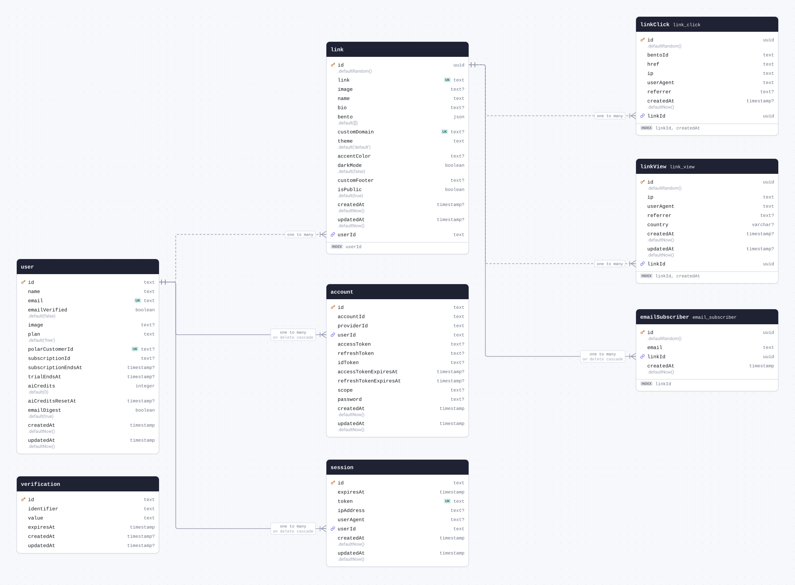
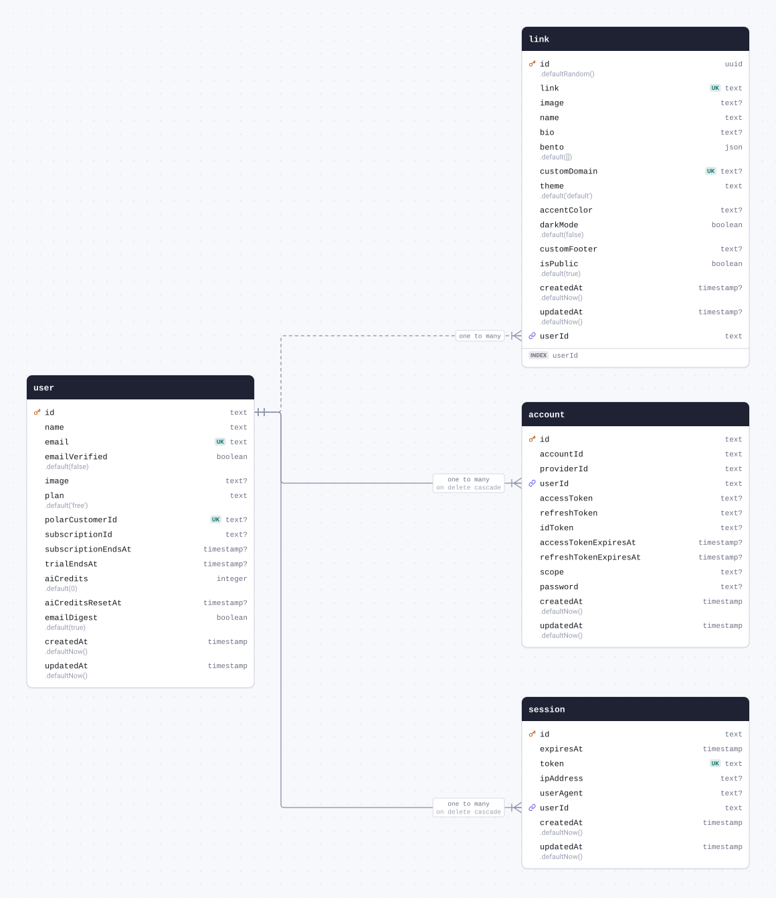
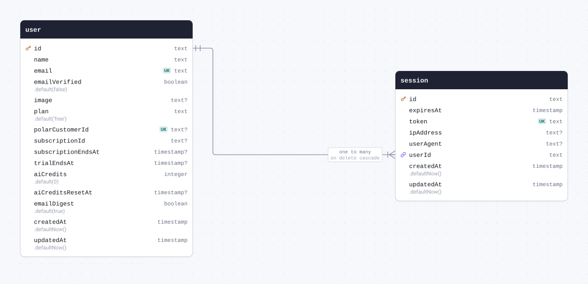
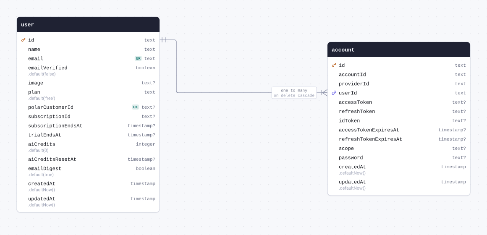
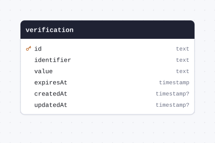
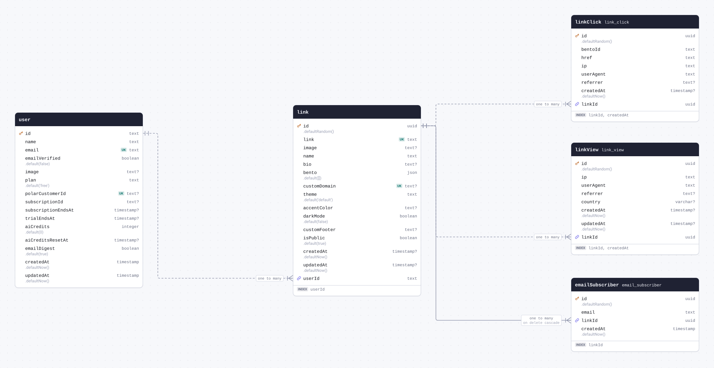
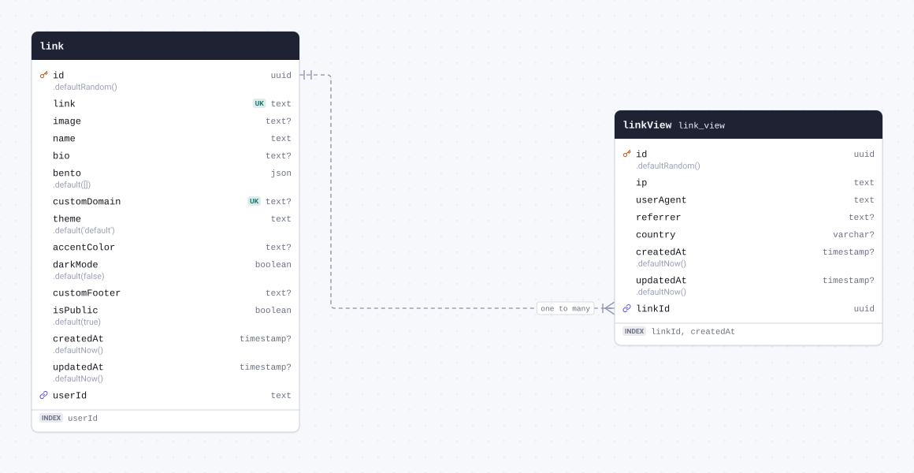
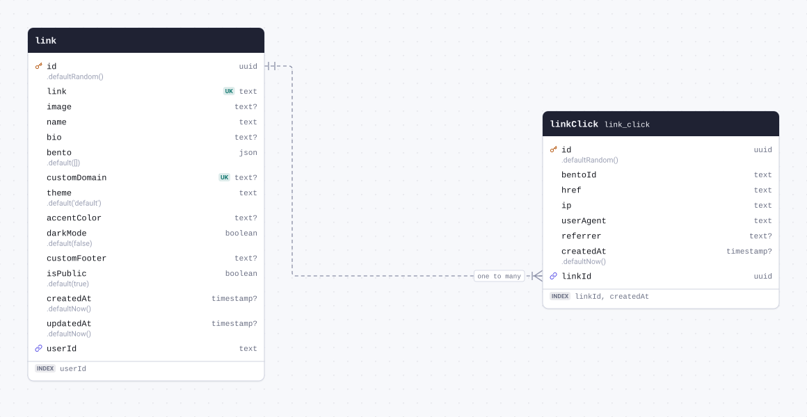
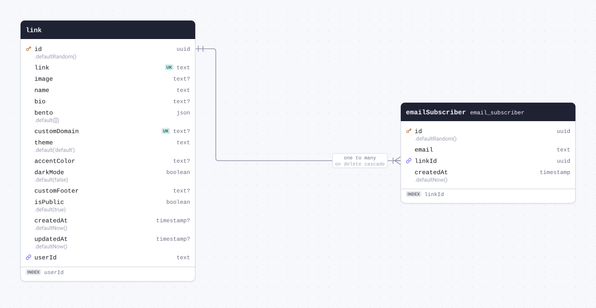

# Schema docs



<details>
<summary>The whole schema as SQL</summary>

```sql
CREATE TABLE "account" (
	"id" text PRIMARY KEY,
	"account_id" text NOT NULL,
	"provider_id" text NOT NULL,
	"user_id" text NOT NULL,
	"access_token" text,
	"refresh_token" text,
	"id_token" text,
	"access_token_expires_at" timestamp with time zone,
	"refresh_token_expires_at" timestamp with time zone,
	"scope" text,
	"password" text,
	"created_at" timestamp with time zone DEFAULT now() NOT NULL,
	"updated_at" timestamp with time zone DEFAULT now() NOT NULL
);

CREATE TABLE "email_subscriber" (
	"id" uuid PRIMARY KEY DEFAULT gen_random_uuid(),
	"email" text NOT NULL,
	"link_id" uuid NOT NULL,
	"created_at" timestamp with time zone DEFAULT now() NOT NULL
);

CREATE TABLE "link" (
	"id" uuid PRIMARY KEY DEFAULT gen_random_uuid(),
	"link" text NOT NULL UNIQUE,
	"image" text,
	"name" text NOT NULL,
	"bio" text,
	"bento" json DEFAULT '[]' NOT NULL,
	"custom_domain" text UNIQUE,
	"theme" text DEFAULT 'default' NOT NULL,
	"accent_color" text,
	"dark_mode" boolean DEFAULT false NOT NULL,
	"custom_footer" text,
	"is_public" boolean DEFAULT true NOT NULL,
	"created_at" timestamp with time zone DEFAULT now(),
	"updated_at" timestamp with time zone DEFAULT now(),
	"user_id" text NOT NULL
);

CREATE TABLE "link_click" (
	"id" uuid PRIMARY KEY DEFAULT gen_random_uuid(),
	"bento_id" text NOT NULL,
	"href" text NOT NULL,
	"ip" text NOT NULL,
	"user_agent" text NOT NULL,
	"referrer" text,
	"created_at" timestamp with time zone DEFAULT now(),
	"link_id" uuid NOT NULL
);

CREATE TABLE "link_view" (
	"id" uuid PRIMARY KEY DEFAULT gen_random_uuid(),
	"ip" text NOT NULL,
	"user_agent" text NOT NULL,
	"referrer" text,
	"country" varchar(2),
	"created_at" timestamp with time zone DEFAULT now(),
	"updated_at" timestamp with time zone DEFAULT now(),
	"link_id" uuid NOT NULL
);

CREATE TABLE "session" (
	"id" text PRIMARY KEY,
	"expires_at" timestamp with time zone NOT NULL,
	"token" text NOT NULL UNIQUE,
	"ip_address" text,
	"user_agent" text,
	"user_id" text NOT NULL,
	"created_at" timestamp with time zone DEFAULT now() NOT NULL,
	"updated_at" timestamp with time zone DEFAULT now() NOT NULL
);

CREATE TABLE "user" (
	"id" text PRIMARY KEY,
	"name" text NOT NULL,
	"email" text NOT NULL UNIQUE,
	"email_verified" boolean DEFAULT false NOT NULL,
	"image" text,
	"plan" text DEFAULT 'free' NOT NULL,
	"polar_customer_id" text UNIQUE,
	"subscription_id" text,
	"subscription_ends_at" timestamp with time zone,
	"trial_ends_at" timestamp with time zone,
	"ai_credits" integer DEFAULT 0 NOT NULL,
	"ai_credits_reset_at" timestamp with time zone,
	"email_digest" boolean DEFAULT true NOT NULL,
	"created_at" timestamp with time zone DEFAULT now() NOT NULL,
	"updated_at" timestamp with time zone DEFAULT now() NOT NULL
);

CREATE TABLE "verification" (
	"id" text PRIMARY KEY,
	"identifier" text NOT NULL,
	"value" text NOT NULL,
	"expires_at" timestamp with time zone NOT NULL,
	"created_at" timestamp with time zone,
	"updated_at" timestamp with time zone
);

ALTER TABLE "account" ADD CONSTRAINT "account_user_id_user_id_fkey" FOREIGN KEY ("user_id") REFERENCES "user"("id") ON DELETE CASCADE;

ALTER TABLE "email_subscriber" ADD CONSTRAINT "email_subscriber_link_id_link_id_fkey" FOREIGN KEY ("link_id") REFERENCES "link"("id") ON DELETE CASCADE;

ALTER TABLE "session" ADD CONSTRAINT "session_user_id_user_id_fkey" FOREIGN KEY ("user_id") REFERENCES "user"("id") ON DELETE CASCADE;
```

</details>

## Contents

| Table                                     | Name in the database | Description |
| ----------------------------------------- | -------------------- | ----------- |
| [user](#table-user)                       | `user`               |             |
| [session](#table-session)                 | `session`            |             |
| [account](#table-account)                 | `account`            |             |
| [verification](#table-verification)       | `verification`       |             |
| [link](#table-link)                       | `link`               |             |
| [linkView](#table-linkView)               | `link_view`          |             |
| [linkClick](#table-linkClick)             | `link_click`         |             |
| [emailSubscriber](#table-emailSubscriber) | `email_subscriber`   |             |

## Tables

<a id="table-user"></a>

### user



| Column                                        | Type        | Constraints     | Default            | Description |
| --------------------------------------------- | ----------- | --------------- | ------------------ | ----------- |
| `id`                                          | `text`      | PK NOT NULL     |                    |             |
| `name`                                        | `text`      | NOT NULL        |                    |             |
| `email`                                       | `text`      | UNIQUE NOT NULL |                    |             |
| `emailVerified` (`email_verified`)            | `boolean`   | NOT NULL        | `.default(false)`  |             |
| `image`                                       | `text`      | NULL            |                    |             |
| `plan`                                        | `text`      | NOT NULL        | `.default('free')` |             |
| `polarCustomerId` (`polar_customer_id`)       | `text`      | UNIQUE NULL     |                    |             |
| `subscriptionId` (`subscription_id`)          | `text`      | NULL            |                    |             |
| `subscriptionEndsAt` (`subscription_ends_at`) | `timestamp` | NULL            |                    |             |
| `trialEndsAt` (`trial_ends_at`)               | `timestamp` | NULL            |                    |             |
| `aiCredits` (`ai_credits`)                    | `integer`   | NOT NULL        | `.default(0)`      |             |
| `aiCreditsResetAt` (`ai_credits_reset_at`)    | `timestamp` | NULL            |                    |             |
| `emailDigest` (`email_digest`)                | `boolean`   | NOT NULL        | `.default(true)`   |             |
| `createdAt` (`created_at`)                    | `timestamp` | NOT NULL        | `.defaultNow()`    |             |
| `updatedAt` (`updated_at`)                    | `timestamp` | NOT NULL        | `.defaultNow()`    |             |

#### Definition

```sql
CREATE TABLE "user" (
	"id" text PRIMARY KEY,
	"name" text NOT NULL,
	"email" text NOT NULL UNIQUE,
	"email_verified" boolean DEFAULT false NOT NULL,
	"image" text,
	"plan" text DEFAULT 'free' NOT NULL,
	"polar_customer_id" text UNIQUE,
	"subscription_id" text,
	"subscription_ends_at" timestamp with time zone,
	"trial_ends_at" timestamp with time zone,
	"ai_credits" integer DEFAULT 0 NOT NULL,
	"ai_credits_reset_at" timestamp with time zone,
	"email_digest" boolean DEFAULT true NOT NULL,
	"created_at" timestamp with time zone DEFAULT now() NOT NULL,
	"updated_at" timestamp with time zone DEFAULT now() NOT NULL
);
```

#### Referenced by

- `id` → [session.userId](#table-session) (one to many, on delete cascade)
- `id` → [account.userId](#table-account) (one to many, on delete cascade)
- `id` → [link.userId](#table-link) (one to many, defineRelations)

<details>
<summary>Queries and their SQL</summary>

**Select**: Every row of user.

```ts
db.select().from(user);
```

```sql
select "id", "name", "email", "email_verified", "image", "plan", "polar_customer_id", "subscription_id", "subscription_ends_at", "trial_ends_at", "ai_credits", "ai_credits_reset_at", "email_digest", "created_at", "updated_at"
from "user"
```

**Count**: How many rows user has.

```ts
db.select({ count: count() }).from(user);
```

```sql
select count(*)
from "user"
```

**Find many**: The rows of user, through the relational query API.

```ts
db.query.user.findMany();
```

```sql
select "d0"."id" as "id", "d0"."name" as "name", "d0"."email" as "email", "d0"."email_verified" as "emailVerified", "d0"."image" as "image", "d0"."plan" as "plan", "d0"."polar_customer_id" as "polarCustomerId", "d0"."subscription_id" as "subscriptionId", "d0"."subscription_ends_at" as "subscriptionEndsAt", "d0"."trial_ends_at" as "trialEndsAt", "d0"."ai_credits" as "aiCredits", "d0"."ai_credits_reset_at" as "aiCreditsResetAt", "d0"."email_digest" as "emailDigest", "d0"."created_at" as "createdAt", "d0"."updated_at" as "updatedAt"
from "user" as "d0"
```

**Find by primary key**: One row of user, through the relational query API.

```ts
db.query.user.findFirst({ where: { id: "id" } });
```

```sql
select "d0"."id" as "id", "d0"."name" as "name", "d0"."email" as "email", "d0"."email_verified" as "emailVerified", "d0"."image" as "image", "d0"."plan" as "plan", "d0"."polar_customer_id" as "polarCustomerId", "d0"."subscription_id" as "subscriptionId", "d0"."subscription_ends_at" as "subscriptionEndsAt", "d0"."trial_ends_at" as "trialEndsAt", "d0"."ai_credits" as "aiCredits", "d0"."ai_credits_reset_at" as "aiCreditsResetAt", "d0"."email_digest" as "emailDigest", "d0"."created_at" as "createdAt", "d0"."updated_at" as "updatedAt"
from "user" as "d0"
where "d0"."id" = $1
limit $2
-- params: ["id",1]
```

**Insert**: Adds a row to user, giving the columns that have no default.

```ts
db.insert(user).values({ id: "id", name: "name", email: "email" });
```

```sql
insert into "user" ("id", "name", "email", "email_verified", "image", "plan", "polar_customer_id", "subscription_id", "subscription_ends_at", "trial_ends_at", "ai_credits", "ai_credits_reset_at", "email_digest", "created_at", "updated_at")
values ($1, $2, $3, default, default, default, default, default, default, default, default, default, default, default, default)
-- params: ["id","name","email"]
```

**Update**: Changes a row of user, found by its primary key.

```ts
db.update(user).set({ name: "name" }).where(eq(user.id, "id"));
```

```sql
update "user"
set "name" = $1
where "user"."id" = $2
-- params: ["name","id"]
```

**Delete**: Deletes a row of user, found by its primary key.

```ts
db.delete(user).where(eq(user.id, "id"));
```

```sql
delete from "user"
where "user"."id" = $1
-- params: ["id"]
```

</details>

<a id="table-session"></a>

### session



| Column                     | Type        | Constraints                       | Default         | Description |
| -------------------------- | ----------- | --------------------------------- | --------------- | ----------- |
| `id`                       | `text`      | PK NOT NULL                       |                 |             |
| `expiresAt` (`expires_at`) | `timestamp` | NOT NULL                          |                 |             |
| `token`                    | `text`      | UNIQUE NOT NULL                   |                 |             |
| `ipAddress` (`ip_address`) | `text`      | NULL                              |                 |             |
| `userAgent` (`user_agent`) | `text`      | NULL                              |                 |             |
| `userId` (`user_id`)       | `text`      | NOT NULL → [user.id](#table-user) |                 |             |
| `createdAt` (`created_at`) | `timestamp` | NOT NULL                          | `.defaultNow()` |             |
| `updatedAt` (`updated_at`) | `timestamp` | NOT NULL                          | `.defaultNow()` |             |

#### Definition

```sql
CREATE TABLE "session" (
	"id" text PRIMARY KEY,
	"expires_at" timestamp with time zone NOT NULL,
	"token" text NOT NULL UNIQUE,
	"ip_address" text,
	"user_agent" text,
	"user_id" text NOT NULL,
	"created_at" timestamp with time zone DEFAULT now() NOT NULL,
	"updated_at" timestamp with time zone DEFAULT now() NOT NULL
);

ALTER TABLE "session" ADD CONSTRAINT "session_user_id_user_id_fkey" FOREIGN KEY ("user_id") REFERENCES "user"("id") ON DELETE CASCADE;
```

#### References

- `userId` → [user.id](#table-user) (many to one, on delete cascade)

<details>
<summary>Queries and their SQL</summary>

**Select**: Every row of session.

```ts
db.select().from(session);
```

```sql
select "id", "expires_at", "token", "ip_address", "user_agent", "user_id", "created_at", "updated_at"
from "session"
```

**Count**: How many rows session has.

```ts
db.select({ count: count() }).from(session);
```

```sql
select count(*)
from "session"
```

**Find many**: The rows of session, through the relational query API.

```ts
db.query.session.findMany();
```

```sql
select "d0"."id" as "id", "d0"."expires_at" as "expiresAt", "d0"."token" as "token", "d0"."ip_address" as "ipAddress", "d0"."user_agent" as "userAgent", "d0"."user_id" as "userId", "d0"."created_at" as "createdAt", "d0"."updated_at" as "updatedAt"
from "session" as "d0"
```

**Find by primary key**: One row of session, through the relational query API.

```ts
db.query.session.findFirst({ where: { id: "id" } });
```

```sql
select "d0"."id" as "id", "d0"."expires_at" as "expiresAt", "d0"."token" as "token", "d0"."ip_address" as "ipAddress", "d0"."user_agent" as "userAgent", "d0"."user_id" as "userId", "d0"."created_at" as "createdAt", "d0"."updated_at" as "updatedAt"
from "session" as "d0"
where "d0"."id" = $1
limit $2
-- params: ["id",1]
```

**Insert**: Adds a row to session, giving the columns that have no default.

```ts
db.insert(session).values({
  id: "id",
  expiresAt: new Date("2026-01-01T00:00:00.000Z"),
  token: "token",
  userId: "userId",
});
```

```sql
insert into "session" ("id", "expires_at", "token", "ip_address", "user_agent", "user_id", "created_at", "updated_at")
values ($1, $2, $3, default, default, $4, default, default)
-- params: ["id","2026-01-01T00:00:00.000Z","token","userId"]
```

**Update**: Changes a row of session, found by its primary key.

```ts
db.update(session)
  .set({ expiresAt: new Date("2026-01-01T00:00:00.000Z") })
  .where(eq(session.id, "id"));
```

```sql
update "session"
set "expires_at" = $1
where "session"."id" = $2
-- params: ["2026-01-01T00:00:00.000Z","id"]
```

**Delete**: Deletes a row of session, found by its primary key.

```ts
db.delete(session).where(eq(session.id, "id"));
```

```sql
delete from "session"
where "session"."id" = $1
-- params: ["id"]
```

</details>

<a id="table-account"></a>

### account



| Column                                               | Type        | Constraints                       | Default         | Description |
| ---------------------------------------------------- | ----------- | --------------------------------- | --------------- | ----------- |
| `id`                                                 | `text`      | PK NOT NULL                       |                 |             |
| `accountId` (`account_id`)                           | `text`      | NOT NULL                          |                 |             |
| `providerId` (`provider_id`)                         | `text`      | NOT NULL                          |                 |             |
| `userId` (`user_id`)                                 | `text`      | NOT NULL → [user.id](#table-user) |                 |             |
| `accessToken` (`access_token`)                       | `text`      | NULL                              |                 |             |
| `refreshToken` (`refresh_token`)                     | `text`      | NULL                              |                 |             |
| `idToken` (`id_token`)                               | `text`      | NULL                              |                 |             |
| `accessTokenExpiresAt` (`access_token_expires_at`)   | `timestamp` | NULL                              |                 |             |
| `refreshTokenExpiresAt` (`refresh_token_expires_at`) | `timestamp` | NULL                              |                 |             |
| `scope`                                              | `text`      | NULL                              |                 |             |
| `password`                                           | `text`      | NULL                              |                 |             |
| `createdAt` (`created_at`)                           | `timestamp` | NOT NULL                          | `.defaultNow()` |             |
| `updatedAt` (`updated_at`)                           | `timestamp` | NOT NULL                          | `.defaultNow()` |             |

#### Definition

```sql
CREATE TABLE "account" (
	"id" text PRIMARY KEY,
	"account_id" text NOT NULL,
	"provider_id" text NOT NULL,
	"user_id" text NOT NULL,
	"access_token" text,
	"refresh_token" text,
	"id_token" text,
	"access_token_expires_at" timestamp with time zone,
	"refresh_token_expires_at" timestamp with time zone,
	"scope" text,
	"password" text,
	"created_at" timestamp with time zone DEFAULT now() NOT NULL,
	"updated_at" timestamp with time zone DEFAULT now() NOT NULL
);

ALTER TABLE "account" ADD CONSTRAINT "account_user_id_user_id_fkey" FOREIGN KEY ("user_id") REFERENCES "user"("id") ON DELETE CASCADE;
```

#### References

- `userId` → [user.id](#table-user) (many to one, on delete cascade)

<details>
<summary>Queries and their SQL</summary>

**Select**: Every row of account.

```ts
db.select().from(account);
```

```sql
select "id", "account_id", "provider_id", "user_id", "access_token", "refresh_token", "id_token", "access_token_expires_at", "refresh_token_expires_at", "scope", "password", "created_at", "updated_at"
from "account"
```

**Count**: How many rows account has.

```ts
db.select({ count: count() }).from(account);
```

```sql
select count(*)
from "account"
```

**Find many**: The rows of account, through the relational query API.

```ts
db.query.account.findMany();
```

```sql
select "d0"."id" as "id", "d0"."account_id" as "accountId", "d0"."provider_id" as "providerId", "d0"."user_id" as "userId", "d0"."access_token" as "accessToken", "d0"."refresh_token" as "refreshToken", "d0"."id_token" as "idToken", "d0"."access_token_expires_at" as "accessTokenExpiresAt", "d0"."refresh_token_expires_at" as "refreshTokenExpiresAt", "d0"."scope" as "scope", "d0"."password" as "password", "d0"."created_at" as "createdAt", "d0"."updated_at" as "updatedAt"
from "account" as "d0"
```

**Find by primary key**: One row of account, through the relational query API.

```ts
db.query.account.findFirst({ where: { id: "id" } });
```

```sql
select "d0"."id" as "id", "d0"."account_id" as "accountId", "d0"."provider_id" as "providerId", "d0"."user_id" as "userId", "d0"."access_token" as "accessToken", "d0"."refresh_token" as "refreshToken", "d0"."id_token" as "idToken", "d0"."access_token_expires_at" as "accessTokenExpiresAt", "d0"."refresh_token_expires_at" as "refreshTokenExpiresAt", "d0"."scope" as "scope", "d0"."password" as "password", "d0"."created_at" as "createdAt", "d0"."updated_at" as "updatedAt"
from "account" as "d0"
where "d0"."id" = $1
limit $2
-- params: ["id",1]
```

**Insert**: Adds a row to account, giving the columns that have no default.

```ts
db.insert(account).values({
  id: "id",
  accountId: "accountId",
  providerId: "providerId",
  userId: "userId",
});
```

```sql
insert into "account" ("id", "account_id", "provider_id", "user_id", "access_token", "refresh_token", "id_token", "access_token_expires_at", "refresh_token_expires_at", "scope", "password", "created_at", "updated_at")
values ($1, $2, $3, $4, default, default, default, default, default, default, default, default, default)
-- params: ["id","accountId","providerId","userId"]
```

**Update**: Changes a row of account, found by its primary key.

```ts
db.update(account).set({ accountId: "accountId" }).where(eq(account.id, "id"));
```

```sql
update "account"
set "account_id" = $1
where "account"."id" = $2
-- params: ["accountId","id"]
```

**Delete**: Deletes a row of account, found by its primary key.

```ts
db.delete(account).where(eq(account.id, "id"));
```

```sql
delete from "account"
where "account"."id" = $1
-- params: ["id"]
```

</details>

<a id="table-verification"></a>

### verification



| Column                     | Type        | Constraints | Default | Description |
| -------------------------- | ----------- | ----------- | ------- | ----------- |
| `id`                       | `text`      | PK NOT NULL |         |             |
| `identifier`               | `text`      | NOT NULL    |         |             |
| `value`                    | `text`      | NOT NULL    |         |             |
| `expiresAt` (`expires_at`) | `timestamp` | NOT NULL    |         |             |
| `createdAt` (`created_at`) | `timestamp` | NULL        |         |             |
| `updatedAt` (`updated_at`) | `timestamp` | NULL        |         |             |

#### Definition

```sql
CREATE TABLE "verification" (
	"id" text PRIMARY KEY,
	"identifier" text NOT NULL,
	"value" text NOT NULL,
	"expires_at" timestamp with time zone NOT NULL,
	"created_at" timestamp with time zone,
	"updated_at" timestamp with time zone
);
```

<details>
<summary>Queries and their SQL</summary>

**Select**: Every row of verification.

```ts
db.select().from(verification);
```

```sql
select "id", "identifier", "value", "expires_at", "created_at", "updated_at"
from "verification"
```

**Count**: How many rows verification has.

```ts
db.select({ count: count() }).from(verification);
```

```sql
select count(*)
from "verification"
```

**Find many**: The rows of verification, through the relational query API.

```ts
db.query.verification.findMany();
```

```sql
select "d0"."id" as "id", "d0"."identifier" as "identifier", "d0"."value" as "value", "d0"."expires_at" as "expiresAt", "d0"."created_at" as "createdAt", "d0"."updated_at" as "updatedAt"
from "verification" as "d0"
```

**Find by primary key**: One row of verification, through the relational query API.

```ts
db.query.verification.findFirst({ where: { id: "id" } });
```

```sql
select "d0"."id" as "id", "d0"."identifier" as "identifier", "d0"."value" as "value", "d0"."expires_at" as "expiresAt", "d0"."created_at" as "createdAt", "d0"."updated_at" as "updatedAt"
from "verification" as "d0"
where "d0"."id" = $1
limit $2
-- params: ["id",1]
```

**Insert**: Adds a row to verification, giving the columns that have no default.

```ts
db.insert(verification).values({
  id: "id",
  identifier: "identifier",
  value: "value",
  expiresAt: new Date("2026-01-01T00:00:00.000Z"),
});
```

```sql
insert into "verification" ("id", "identifier", "value", "expires_at", "created_at", "updated_at")
values ($1, $2, $3, $4, default, default)
-- params: ["id","identifier","value","2026-01-01T00:00:00.000Z"]
```

**Update**: Changes a row of verification, found by its primary key.

```ts
db.update(verification).set({ identifier: "identifier" }).where(eq(verification.id, "id"));
```

```sql
update "verification"
set "identifier" = $1
where "verification"."id" = $2
-- params: ["identifier","id"]
```

**Delete**: Deletes a row of verification, found by its primary key.

```ts
db.delete(verification).where(eq(verification.id, "id"));
```

```sql
delete from "verification"
where "verification"."id" = $1
-- params: ["id"]
```

</details>

<a id="table-link"></a>

### link



| Column                           | Type        | Constraints                       | Default               | Description |
| -------------------------------- | ----------- | --------------------------------- | --------------------- | ----------- |
| `id`                             | `uuid`      | PK NOT NULL                       | `.defaultRandom()`    |             |
| `link`                           | `text`      | UNIQUE NOT NULL                   |                       |             |
| `image`                          | `text`      | NULL                              |                       |             |
| `name`                           | `text`      | NOT NULL                          |                       |             |
| `bio`                            | `text`      | NULL                              |                       |             |
| `bento`                          | `json`      | NOT NULL                          | `.default([])`        |             |
| `customDomain` (`custom_domain`) | `text`      | UNIQUE NULL                       |                       |             |
| `theme`                          | `text`      | NOT NULL                          | `.default('default')` |             |
| `accentColor` (`accent_color`)   | `text`      | NULL                              |                       |             |
| `darkMode` (`dark_mode`)         | `boolean`   | NOT NULL                          | `.default(false)`     |             |
| `customFooter` (`custom_footer`) | `text`      | NULL                              |                       |             |
| `isPublic` (`is_public`)         | `boolean`   | NOT NULL                          | `.default(true)`      |             |
| `createdAt` (`created_at`)       | `timestamp` | NULL                              | `.defaultNow()`       |             |
| `updatedAt` (`updated_at`)       | `timestamp` | NULL                              | `.defaultNow()`       |             |
| `userId` (`user_id`)             | `text`      | NOT NULL → [user.id](#table-user) |                       |             |

#### Definition

```sql
CREATE TABLE "link" (
	"id" uuid PRIMARY KEY DEFAULT gen_random_uuid(),
	"link" text NOT NULL UNIQUE,
	"image" text,
	"name" text NOT NULL,
	"bio" text,
	"bento" json DEFAULT '[]' NOT NULL,
	"custom_domain" text UNIQUE,
	"theme" text DEFAULT 'default' NOT NULL,
	"accent_color" text,
	"dark_mode" boolean DEFAULT false NOT NULL,
	"custom_footer" text,
	"is_public" boolean DEFAULT true NOT NULL,
	"created_at" timestamp with time zone DEFAULT now(),
	"updated_at" timestamp with time zone DEFAULT now(),
	"user_id" text NOT NULL
);
```

#### References

- `userId` → [user.id](#table-user) (many to one, defineRelations, no foreign key)

#### Referenced by

- `id` → [emailSubscriber.linkId](#table-emailSubscriber) (one to many, on delete cascade)
- `id` → [linkView.linkId](#table-linkView) (one to many, defineRelations)
- `id` → [linkClick.linkId](#table-linkClick) (one to many, defineRelations)

<details>
<summary>Queries and their SQL</summary>

**Select**: Every row of link.

```ts
db.select().from(link);
```

```sql
select "id", "link", "image", "name", "bio", "bento", "custom_domain", "theme", "accent_color", "dark_mode", "custom_footer", "is_public", "created_at", "updated_at", "user_id"
from "link"
```

**Count**: How many rows link has.

```ts
db.select({ count: count() }).from(link);
```

```sql
select count(*)
from "link"
```

**Find many**: The rows of link, through the relational query API.

```ts
db.query.link.findMany();
```

```sql
select "d0"."id" as "id", "d0"."link" as "link", "d0"."image" as "image", "d0"."name" as "name", "d0"."bio" as "bio", "d0"."bento" as "bento", "d0"."custom_domain" as "customDomain", "d0"."theme" as "theme", "d0"."accent_color" as "accentColor", "d0"."dark_mode" as "darkMode", "d0"."custom_footer" as "customFooter", "d0"."is_public" as "isPublic", "d0"."created_at" as "createdAt", "d0"."updated_at" as "updatedAt", "d0"."user_id" as "userId"
from "link" as "d0"
```

**Find by primary key**: One row of link, through the relational query API.

```ts
db.query.link.findFirst({ where: { id: "00000000-0000-0000-0000-000000000000" } });
```

```sql
select "d0"."id" as "id", "d0"."link" as "link", "d0"."image" as "image", "d0"."name" as "name", "d0"."bio" as "bio", "d0"."bento" as "bento", "d0"."custom_domain" as "customDomain", "d0"."theme" as "theme", "d0"."accent_color" as "accentColor", "d0"."dark_mode" as "darkMode", "d0"."custom_footer" as "customFooter", "d0"."is_public" as "isPublic", "d0"."created_at" as "createdAt", "d0"."updated_at" as "updatedAt", "d0"."user_id" as "userId"
from "link" as "d0"
where "d0"."id" = $1
limit $2
-- params: ["00000000-0000-0000-0000-000000000000",1]
```

**Insert**: Adds a row to link, giving the columns that have no default.

```ts
db.insert(link).values({ link: "link", name: "name", userId: "userId" });
```

```sql
insert into "link" ("id", "link", "image", "name", "bio", "bento", "custom_domain", "theme", "accent_color", "dark_mode", "custom_footer", "is_public", "created_at", "updated_at", "user_id")
values (default, $1, default, $2, default, default, default, default, default, default, default, default, default, default, $3)
-- params: ["link","name","userId"]
```

**Update**: Changes a row of link, found by its primary key.

```ts
db.update(link).set({ link: "link" }).where(eq(link.id, "00000000-0000-0000-0000-000000000000"));
```

```sql
update "link"
set "link" = $1
where "link"."id" = $2
-- params: ["link","00000000-0000-0000-0000-000000000000"]
```

**Delete**: Deletes a row of link, found by its primary key.

```ts
db.delete(link).where(eq(link.id, "00000000-0000-0000-0000-000000000000"));
```

```sql
delete from "link"
where "link"."id" = $1
-- params: ["00000000-0000-0000-0000-000000000000"]
```

</details>

<a id="table-linkView"></a>

### linkView

Table `link_view`.



| Column                     | Type        | Constraints                       | Default            | Description |
| -------------------------- | ----------- | --------------------------------- | ------------------ | ----------- |
| `id`                       | `uuid`      | PK NOT NULL                       | `.defaultRandom()` |             |
| `ip`                       | `text`      | NOT NULL                          |                    |             |
| `userAgent` (`user_agent`) | `text`      | NOT NULL                          |                    |             |
| `referrer`                 | `text`      | NULL                              |                    |             |
| `country`                  | `varchar`   | NULL                              |                    |             |
| `createdAt` (`created_at`) | `timestamp` | NULL                              | `.defaultNow()`    |             |
| `updatedAt` (`updated_at`) | `timestamp` | NULL                              | `.defaultNow()`    |             |
| `linkId` (`link_id`)       | `uuid`      | NOT NULL → [link.id](#table-link) |                    |             |

#### Definition

```sql
CREATE TABLE "link_view" (
	"id" uuid PRIMARY KEY DEFAULT gen_random_uuid(),
	"ip" text NOT NULL,
	"user_agent" text NOT NULL,
	"referrer" text,
	"country" varchar(2),
	"created_at" timestamp with time zone DEFAULT now(),
	"updated_at" timestamp with time zone DEFAULT now(),
	"link_id" uuid NOT NULL
);
```

#### References

- `linkId` → [link.id](#table-link) (many to one, defineRelations, no foreign key)

<details>
<summary>Queries and their SQL</summary>

**Select**: Every row of linkView.

```ts
db.select().from(linkView);
```

```sql
select "id", "ip", "user_agent", "referrer", "country", "created_at", "updated_at", "link_id"
from "link_view"
```

**Count**: How many rows linkView has.

```ts
db.select({ count: count() }).from(linkView);
```

```sql
select count(*)
from "link_view"
```

**Find many**: The rows of linkView, through the relational query API.

```ts
db.query.linkView.findMany();
```

```sql
select "d0"."id" as "id", "d0"."ip" as "ip", "d0"."user_agent" as "userAgent", "d0"."referrer" as "referrer", "d0"."country" as "country", "d0"."created_at" as "createdAt", "d0"."updated_at" as "updatedAt", "d0"."link_id" as "linkId"
from "link_view" as "d0"
```

**Find by primary key**: One row of linkView, through the relational query API.

```ts
db.query.linkView.findFirst({ where: { id: "00000000-0000-0000-0000-000000000000" } });
```

```sql
select "d0"."id" as "id", "d0"."ip" as "ip", "d0"."user_agent" as "userAgent", "d0"."referrer" as "referrer", "d0"."country" as "country", "d0"."created_at" as "createdAt", "d0"."updated_at" as "updatedAt", "d0"."link_id" as "linkId"
from "link_view" as "d0"
where "d0"."id" = $1
limit $2
-- params: ["00000000-0000-0000-0000-000000000000",1]
```

**Insert**: Adds a row to linkView, giving the columns that have no default.

```ts
db.insert(linkView).values({
  ip: "ip",
  userAgent: "userAgent",
  linkId: "00000000-0000-0000-0000-000000000000",
});
```

```sql
insert into "link_view" ("id", "ip", "user_agent", "referrer", "country", "created_at", "updated_at", "link_id")
values (default, $1, $2, default, default, default, default, $3)
-- params: ["ip","userAgent","00000000-0000-0000-0000-000000000000"]
```

**Update**: Changes a row of linkView, found by its primary key.

```ts
db.update(linkView)
  .set({ ip: "ip" })
  .where(eq(linkView.id, "00000000-0000-0000-0000-000000000000"));
```

```sql
update "link_view"
set "ip" = $1
where "link_view"."id" = $2
-- params: ["ip","00000000-0000-0000-0000-000000000000"]
```

**Delete**: Deletes a row of linkView, found by its primary key.

```ts
db.delete(linkView).where(eq(linkView.id, "00000000-0000-0000-0000-000000000000"));
```

```sql
delete from "link_view"
where "link_view"."id" = $1
-- params: ["00000000-0000-0000-0000-000000000000"]
```

</details>

<a id="table-linkClick"></a>

### linkClick

Table `link_click`.



| Column                     | Type        | Constraints                       | Default            | Description |
| -------------------------- | ----------- | --------------------------------- | ------------------ | ----------- |
| `id`                       | `uuid`      | PK NOT NULL                       | `.defaultRandom()` |             |
| `bentoId` (`bento_id`)     | `text`      | NOT NULL                          |                    |             |
| `href`                     | `text`      | NOT NULL                          |                    |             |
| `ip`                       | `text`      | NOT NULL                          |                    |             |
| `userAgent` (`user_agent`) | `text`      | NOT NULL                          |                    |             |
| `referrer`                 | `text`      | NULL                              |                    |             |
| `createdAt` (`created_at`) | `timestamp` | NULL                              | `.defaultNow()`    |             |
| `linkId` (`link_id`)       | `uuid`      | NOT NULL → [link.id](#table-link) |                    |             |

#### Definition

```sql
CREATE TABLE "link_click" (
	"id" uuid PRIMARY KEY DEFAULT gen_random_uuid(),
	"bento_id" text NOT NULL,
	"href" text NOT NULL,
	"ip" text NOT NULL,
	"user_agent" text NOT NULL,
	"referrer" text,
	"created_at" timestamp with time zone DEFAULT now(),
	"link_id" uuid NOT NULL
);
```

#### References

- `linkId` → [link.id](#table-link) (many to one, defineRelations, no foreign key)

<details>
<summary>Queries and their SQL</summary>

**Select**: Every row of linkClick.

```ts
db.select().from(linkClick);
```

```sql
select "id", "bento_id", "href", "ip", "user_agent", "referrer", "created_at", "link_id"
from "link_click"
```

**Count**: How many rows linkClick has.

```ts
db.select({ count: count() }).from(linkClick);
```

```sql
select count(*)
from "link_click"
```

**Find many**: The rows of linkClick, through the relational query API.

```ts
db.query.linkClick.findMany();
```

```sql
select "d0"."id" as "id", "d0"."bento_id" as "bentoId", "d0"."href" as "href", "d0"."ip" as "ip", "d0"."user_agent" as "userAgent", "d0"."referrer" as "referrer", "d0"."created_at" as "createdAt", "d0"."link_id" as "linkId"
from "link_click" as "d0"
```

**Find by primary key**: One row of linkClick, through the relational query API.

```ts
db.query.linkClick.findFirst({ where: { id: "00000000-0000-0000-0000-000000000000" } });
```

```sql
select "d0"."id" as "id", "d0"."bento_id" as "bentoId", "d0"."href" as "href", "d0"."ip" as "ip", "d0"."user_agent" as "userAgent", "d0"."referrer" as "referrer", "d0"."created_at" as "createdAt", "d0"."link_id" as "linkId"
from "link_click" as "d0"
where "d0"."id" = $1
limit $2
-- params: ["00000000-0000-0000-0000-000000000000",1]
```

**Insert**: Adds a row to linkClick, giving the columns that have no default.

```ts
db.insert(linkClick).values({
  bentoId: "bentoId",
  href: "href",
  ip: "ip",
  userAgent: "userAgent",
  linkId: "00000000-0000-0000-0000-000000000000",
});
```

```sql
insert into "link_click" ("id", "bento_id", "href", "ip", "user_agent", "referrer", "created_at", "link_id")
values (default, $1, $2, $3, $4, default, default, $5)
-- params: ["bentoId","href","ip","userAgent","00000000-0000-0000-0000-000000000000"]
```

**Update**: Changes a row of linkClick, found by its primary key.

```ts
db.update(linkClick)
  .set({ bentoId: "bentoId" })
  .where(eq(linkClick.id, "00000000-0000-0000-0000-000000000000"));
```

```sql
update "link_click"
set "bento_id" = $1
where "link_click"."id" = $2
-- params: ["bentoId","00000000-0000-0000-0000-000000000000"]
```

**Delete**: Deletes a row of linkClick, found by its primary key.

```ts
db.delete(linkClick).where(eq(linkClick.id, "00000000-0000-0000-0000-000000000000"));
```

```sql
delete from "link_click"
where "link_click"."id" = $1
-- params: ["00000000-0000-0000-0000-000000000000"]
```

</details>

<a id="table-emailSubscriber"></a>

### emailSubscriber

Table `email_subscriber`.



| Column                     | Type        | Constraints                       | Default            | Description |
| -------------------------- | ----------- | --------------------------------- | ------------------ | ----------- |
| `id`                       | `uuid`      | PK NOT NULL                       | `.defaultRandom()` |             |
| `email`                    | `text`      | NOT NULL                          |                    |             |
| `linkId` (`link_id`)       | `uuid`      | NOT NULL → [link.id](#table-link) |                    |             |
| `createdAt` (`created_at`) | `timestamp` | NOT NULL                          | `.defaultNow()`    |             |

#### Definition

```sql
CREATE TABLE "email_subscriber" (
	"id" uuid PRIMARY KEY DEFAULT gen_random_uuid(),
	"email" text NOT NULL,
	"link_id" uuid NOT NULL,
	"created_at" timestamp with time zone DEFAULT now() NOT NULL
);

ALTER TABLE "email_subscriber" ADD CONSTRAINT "email_subscriber_link_id_link_id_fkey" FOREIGN KEY ("link_id") REFERENCES "link"("id") ON DELETE CASCADE;
```

#### References

- `linkId` → [link.id](#table-link) (many to one, on delete cascade)

<details>
<summary>Queries and their SQL</summary>

**Select**: Every row of emailSubscriber.

```ts
db.select().from(emailSubscriber);
```

```sql
select "id", "email", "link_id", "created_at"
from "email_subscriber"
```

**Count**: How many rows emailSubscriber has.

```ts
db.select({ count: count() }).from(emailSubscriber);
```

```sql
select count(*)
from "email_subscriber"
```

**Find many**: The rows of emailSubscriber, through the relational query API.

```ts
db.query.emailSubscriber.findMany();
```

```sql
select "d0"."id" as "id", "d0"."email" as "email", "d0"."link_id" as "linkId", "d0"."created_at" as "createdAt"
from "email_subscriber" as "d0"
```

**Find by primary key**: One row of emailSubscriber, through the relational query API.

```ts
db.query.emailSubscriber.findFirst({ where: { id: "00000000-0000-0000-0000-000000000000" } });
```

```sql
select "d0"."id" as "id", "d0"."email" as "email", "d0"."link_id" as "linkId", "d0"."created_at" as "createdAt"
from "email_subscriber" as "d0"
where "d0"."id" = $1
limit $2
-- params: ["00000000-0000-0000-0000-000000000000",1]
```

**Insert**: Adds a row to emailSubscriber, giving the columns that have no default.

```ts
db.insert(emailSubscriber).values({
  email: "email",
  linkId: "00000000-0000-0000-0000-000000000000",
});
```

```sql
insert into "email_subscriber" ("id", "email", "link_id", "created_at")
values (default, $1, $2, default)
-- params: ["email","00000000-0000-0000-0000-000000000000"]
```

**Update**: Changes a row of emailSubscriber, found by its primary key.

```ts
db.update(emailSubscriber)
  .set({ email: "email" })
  .where(eq(emailSubscriber.id, "00000000-0000-0000-0000-000000000000"));
```

```sql
update "email_subscriber"
set "email" = $1
where "email_subscriber"."id" = $2
-- params: ["email","00000000-0000-0000-0000-000000000000"]
```

**Delete**: Deletes a row of emailSubscriber, found by its primary key.

```ts
db.delete(emailSubscriber).where(eq(emailSubscriber.id, "00000000-0000-0000-0000-000000000000"));
```

```sql
delete from "email_subscriber"
where "email_subscriber"."id" = $1
-- params: ["00000000-0000-0000-0000-000000000000"]
```

</details>
