# Schema docs

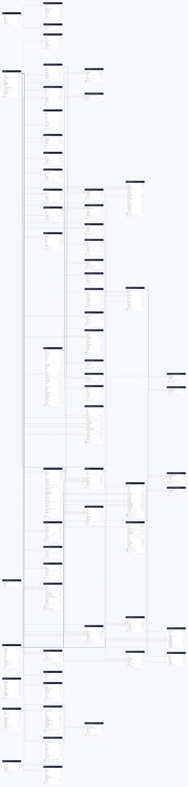

<details>
<summary>The whole schema as SQL</summary>

```sql
CREATE TABLE `account` (
	`user_id` integer NOT NULL,
	`type` text NOT NULL,
	`provider` text NOT NULL,
	`provider_account_id` text NOT NULL,
	`refresh_token` text,
	`access_token` text,
	`expires_at` integer,
	`token_type` text,
	`scope` text,
	`id_token` text,
	`session_state` text,
	CONSTRAINT `account_pk` PRIMARY KEY(`provider`, `provider_account_id`),
	CONSTRAINT `fk_account_user_id_user_id_fk` FOREIGN KEY (`user_id`) REFERENCES `user`(`id`) ON DELETE CASCADE
);

CREATE TABLE `api_key` (
	`id` integer PRIMARY KEY AUTOINCREMENT,
	`name` text NOT NULL,
	`description` text,
	`prefix` text NOT NULL UNIQUE,
	`hashed_token` text NOT NULL UNIQUE,
	`workspace_id` integer NOT NULL,
	`created_by_id` integer NOT NULL,
	`scopes` text DEFAULT '["write"]' NOT NULL,
	`created_at` integer DEFAULT (strftime('%s', 'now')),
	`expires_at` integer,
	`last_used_at` integer,
	CONSTRAINT `fk_api_key_workspace_id_workspace_id_fk` FOREIGN KEY (`workspace_id`) REFERENCES `workspace`(`id`) ON DELETE CASCADE,
	CONSTRAINT `fk_api_key_created_by_id_user_id_fk` FOREIGN KEY (`created_by_id`) REFERENCES `user`(`id`) ON DELETE CASCADE
);

CREATE TABLE `application` (
	`id` integer PRIMARY KEY,
	`name` text,
	`dsn` text UNIQUE,
	`workspace_id` integer,
	`created_at` integer DEFAULT (strftime('%s', 'now')),
	`updated_at` integer DEFAULT (strftime('%s', 'now')),
	CONSTRAINT `fk_application_workspace_id_workspace_id_fk` FOREIGN KEY (`workspace_id`) REFERENCES `workspace`(`id`)
);

CREATE TABLE `audit_log` (
	`id` integer PRIMARY KEY AUTOINCREMENT,
	`workspace_id` integer NOT NULL,
	`actor_type` text NOT NULL,
	`actor_id` text NOT NULL,
	`actor_user_id` integer,
	`action` text NOT NULL,
	`entity_type` text NOT NULL,
	`entity_id` text NOT NULL,
	`before` text,
	`after` text,
	`metadata` text,
	`changed_fields` text,
	`created_at` integer NOT NULL
);

CREATE TABLE `chat_session` (
	`id` integer PRIMARY KEY AUTOINCREMENT,
	`workspace_id` integer NOT NULL,
	`user_id` integer NOT NULL,
	`title` text NOT NULL,
	`messages` text NOT NULL,
	`created_at` integer NOT NULL,
	`updated_at` integer NOT NULL,
	CONSTRAINT `fk_chat_session_workspace_id_workspace_id_fk` FOREIGN KEY (`workspace_id`) REFERENCES `workspace`(`id`) ON DELETE CASCADE,
	CONSTRAINT `fk_chat_session_user_id_user_id_fk` FOREIGN KEY (`user_id`) REFERENCES `user`(`id`) ON DELETE CASCADE
);

CREATE TABLE `check` (
	`id` integer PRIMARY KEY AUTOINCREMENT,
	`regions` text DEFAULT '' NOT NULL,
	`url` text(4096) NOT NULL,
	`headers` text DEFAULT '',
	`body` text DEFAULT '',
	`method` text DEFAULT 'GET',
	`count_requests` integer DEFAULT 1,
	`workspace_id` integer,
	`created_at` integer DEFAULT (strftime('%s', 'now')),
	CONSTRAINT `fk_check_workspace_id_workspace_id_fk` FOREIGN KEY (`workspace_id`) REFERENCES `workspace`(`id`)
);

CREATE TABLE `external_service` (
	`id` integer PRIMARY KEY,
	`slug` text(64) NOT NULL UNIQUE,
	`aliases` text DEFAULT (json_array()) NOT NULL,
	`name` text(256) NOT NULL,
	`url` text NOT NULL,
	`status_page_url` text NOT NULL,
	`provider` text NOT NULL,
	`industry` text NOT NULL,
	`description` text,
	`api_config` text,
	`deleted_at` integer,
	`created_at` integer DEFAULT (strftime('%s', 'now')),
	`updated_at` integer DEFAULT (strftime('%s', 'now'))
);

CREATE TABLE `external_service_component` (
	`id` integer PRIMARY KEY,
	`external_service_id` integer NOT NULL,
	`upstream_component_id` text NOT NULL,
	`slug` text NOT NULL,
	`aliases` text DEFAULT (json_array()) NOT NULL,
	`name` text NOT NULL,
	`description` text,
	`group_name` text,
	`position` integer DEFAULT 0 NOT NULL,
	`indicator` text NOT NULL,
	`status` text NOT NULL,
	`first_seen_at` integer DEFAULT (strftime('%s', 'now')) NOT NULL,
	`updated_at` integer DEFAULT (strftime('%s', 'now')) NOT NULL,
	CONSTRAINT `fk_external_service_component_external_service_id_external_service_id_fk` FOREIGN KEY (`external_service_id`) REFERENCES `external_service`(`id`)
);

CREATE TABLE `external_service_incident` (
	`id` integer PRIMARY KEY,
	`external_service_id` integer NOT NULL,
	`provider_incident_id` text NOT NULL,
	`name` text NOT NULL,
	`status` text NOT NULL,
	`impact` text,
	`shortlink` text,
	`started_at` integer,
	`created_at` integer NOT NULL,
	`resolved_at` integer,
	`affected_component_ids` text DEFAULT '[]' NOT NULL,
	`raw_payload` text,
	`raw_payload_purged_at` integer,
	`first_seen_at` integer DEFAULT (strftime('%s', 'now')) NOT NULL,
	`updated_at` integer DEFAULT (strftime('%s', 'now')) NOT NULL,
	CONSTRAINT `fk_external_service_incident_external_service_id_external_service_id_fk` FOREIGN KEY (`external_service_id`) REFERENCES `external_service`(`id`)
);

CREATE TABLE `external_service_report` (
	`id` integer PRIMARY KEY,
	`external_service_id` integer NOT NULL,
	`external_service_component_id` integer,
	`reporter_hash` text(64) NOT NULL,
	`country` text(2) DEFAULT '' NOT NULL,
	`created_at` integer DEFAULT (strftime('%s', 'now')) NOT NULL,
	CONSTRAINT `fk_external_service_report_external_service_id_external_service_id_fk` FOREIGN KEY (`external_service_id`) REFERENCES `external_service`(`id`),
	CONSTRAINT `fk_external_service_report_external_service_component_id_external_service_component_id_fk` FOREIGN KEY (`external_service_component_id`) REFERENCES `external_service_component`(`id`)
);

CREATE TABLE `feedback` (
	`id` integer PRIMARY KEY,
	`workspace_id` integer NOT NULL,
	`user_id` integer NOT NULL,
	`source` text NOT NULL,
	`message` text NOT NULL,
	`type` text,
	`blocker` integer,
	`path` text NOT NULL,
	`metadata` text,
	`created_at` integer DEFAULT (strftime('%s', 'now')) NOT NULL,
	CONSTRAINT `fk_feedback_workspace_id_workspace_id_fk` FOREIGN KEY (`workspace_id`) REFERENCES `workspace`(`id`) ON DELETE CASCADE,
	CONSTRAINT `fk_feedback_user_id_user_id_fk` FOREIGN KEY (`user_id`) REFERENCES `user`(`id`) ON DELETE CASCADE
);

CREATE TABLE `frozen_monitor_uptime` (
	`id` integer PRIMARY KEY,
	`workspace_id` integer NOT NULL,
	`monitor_id` integer NOT NULL,
	`month` text NOT NULL,
	`days` text NOT NULL,
	`created_at` integer DEFAULT (strftime('%s', 'now')),
	CONSTRAINT `fk_frozen_monitor_uptime_workspace_id_workspace_id_fk` FOREIGN KEY (`workspace_id`) REFERENCES `workspace`(`id`) ON DELETE CASCADE,
	CONSTRAINT `fk_frozen_monitor_uptime_monitor_id_monitor_id_fk` FOREIGN KEY (`monitor_id`) REFERENCES `monitor`(`id`) ON DELETE CASCADE,
	CONSTRAINT `frozen_monitor_uptime_monitor_id_month_unique` UNIQUE(`monitor_id`,`month`)
);

CREATE TABLE `incident` (
	`id` integer PRIMARY KEY AUTOINCREMENT,
	`workspace_id` integer NOT NULL,
	`title` text(256) NOT NULL,
	`severity` text NOT NULL,
	`status` text DEFAULT 'open' NOT NULL,
	`summary` text,
	`commander_id` integer,
	`declared_by` integer,
	`declared_at` integer NOT NULL,
	`started_at` integer NOT NULL,
	`mitigated_at` integer,
	`resolved_at` integer,
	`resolved_by` integer,
	`closed_at` integer,
	`status_report_id` integer,
	`slack_team_id` text,
	`slack_channel_id` text,
	`created_at` integer DEFAULT (strftime('%s', 'now')) NOT NULL,
	`updated_at` integer DEFAULT (strftime('%s', 'now')) NOT NULL,
	CONSTRAINT `fk_incident_workspace_id_workspace_id_fk` FOREIGN KEY (`workspace_id`) REFERENCES `workspace`(`id`),
	CONSTRAINT `fk_incident_commander_id_user_id_fk` FOREIGN KEY (`commander_id`) REFERENCES `user`(`id`),
	CONSTRAINT `fk_incident_declared_by_user_id_fk` FOREIGN KEY (`declared_by`) REFERENCES `user`(`id`),
	CONSTRAINT `fk_incident_resolved_by_user_id_fk` FOREIGN KEY (`resolved_by`) REFERENCES `user`(`id`),
	CONSTRAINT `fk_incident_status_report_id_status_report_id_fk` FOREIGN KEY (`status_report_id`) REFERENCES `status_report`(`id`) ON DELETE SET NULL
);

CREATE TABLE `incident_event` (
	`id` integer PRIMARY KEY AUTOINCREMENT,
	`incident_id` integer NOT NULL,
	`type` text NOT NULL,
	`message` text,
	`source` text,
	`source_ref` text,
	`created_by` integer,
	`created_at` integer NOT NULL,
	CONSTRAINT `fk_incident_event_incident_id_incident_id_fk` FOREIGN KEY (`incident_id`) REFERENCES `incident`(`id`) ON DELETE CASCADE,
	CONSTRAINT `fk_incident_event_created_by_user_id_fk` FOREIGN KEY (`created_by`) REFERENCES `user`(`id`)
);

CREATE TABLE `incident_postmortem` (
	`id` integer PRIMARY KEY AUTOINCREMENT,
	`incident_id` integer NOT NULL UNIQUE,
	`status` text DEFAULT 'draft' NOT NULL,
	`content` text NOT NULL,
	`source_transcript` text,
	`drafted_by` text NOT NULL,
	`created_by` integer,
	`updated_by` integer,
	`approved_by` integer,
	`approved_at` integer,
	`published_at` integer,
	`created_at` integer DEFAULT (strftime('%s', 'now')) NOT NULL,
	`updated_at` integer DEFAULT (strftime('%s', 'now')) NOT NULL,
	CONSTRAINT `fk_incident_postmortem_incident_id_incident_id_fk` FOREIGN KEY (`incident_id`) REFERENCES `incident`(`id`) ON DELETE CASCADE,
	CONSTRAINT `fk_incident_postmortem_created_by_user_id_fk` FOREIGN KEY (`created_by`) REFERENCES `user`(`id`),
	CONSTRAINT `fk_incident_postmortem_updated_by_user_id_fk` FOREIGN KEY (`updated_by`) REFERENCES `user`(`id`),
	CONSTRAINT `fk_incident_postmortem_approved_by_user_id_fk` FOREIGN KEY (`approved_by`) REFERENCES `user`(`id`)
);

CREATE TABLE `integration` (
	`id` integer PRIMARY KEY,
	`name` text(256) NOT NULL,
	`workspace_id` integer,
	`credential` text,
	`external_id` text NOT NULL,
	`created_at` integer DEFAULT (strftime('%s', 'now')),
	`updated_at` integer DEFAULT (strftime('%s', 'now')),
	`data` text NOT NULL,
	CONSTRAINT `fk_integration_workspace_id_workspace_id_fk` FOREIGN KEY (`workspace_id`) REFERENCES `workspace`(`id`)
);

CREATE TABLE `invitation` (
	`id` integer PRIMARY KEY,
	`email` text NOT NULL,
	`role` text DEFAULT 'member' NOT NULL,
	`workspace_id` integer NOT NULL,
	`token` text NOT NULL,
	`expires_at` integer NOT NULL,
	`created_at` integer DEFAULT (strftime('%s', 'now')),
	`accepted_at` integer
);

CREATE TABLE `maintenance` (
	`id` integer PRIMARY KEY,
	`title` text(256) NOT NULL,
	`message` text NOT NULL,
	`from` integer NOT NULL,
	`to` integer NOT NULL,
	`workspace_id` integer,
	`page_id` integer,
	`created_by` integer,
	`updated_by` integer,
	`created_at` integer DEFAULT (strftime('%s', 'now')),
	`updated_at` integer DEFAULT (strftime('%s', 'now')),
	CONSTRAINT `fk_maintenance_workspace_id_workspace_id_fk` FOREIGN KEY (`workspace_id`) REFERENCES `workspace`(`id`),
	CONSTRAINT `fk_maintenance_page_id_page_id_fk` FOREIGN KEY (`page_id`) REFERENCES `page`(`id`) ON DELETE CASCADE,
	CONSTRAINT `fk_maintenance_created_by_user_id_fk` FOREIGN KEY (`created_by`) REFERENCES `user`(`id`),
	CONSTRAINT `fk_maintenance_updated_by_user_id_fk` FOREIGN KEY (`updated_by`) REFERENCES `user`(`id`)
);

CREATE TABLE `maintenance_update` (
	`id` integer PRIMARY KEY,
	`message` text NOT NULL,
	`date` integer NOT NULL,
	`maintenance_id` integer NOT NULL,
	`created_by` integer,
	`updated_by` integer,
	`created_at` integer DEFAULT (strftime('%s', 'now')),
	`updated_at` integer DEFAULT (strftime('%s', 'now')),
	CONSTRAINT `fk_maintenance_update_maintenance_id_maintenance_id_fk` FOREIGN KEY (`maintenance_id`) REFERENCES `maintenance`(`id`) ON DELETE CASCADE,
	CONSTRAINT `fk_maintenance_update_created_by_user_id_fk` FOREIGN KEY (`created_by`) REFERENCES `user`(`id`),
	CONSTRAINT `fk_maintenance_update_updated_by_user_id_fk` FOREIGN KEY (`updated_by`) REFERENCES `user`(`id`)
);

CREATE TABLE `maintenance_to_page_component` (
	`maintenance_id` integer NOT NULL,
	`page_component_id` integer NOT NULL,
	`created_at` integer DEFAULT (strftime('%s', 'now')),
	CONSTRAINT `maintenance_to_page_component_pk` PRIMARY KEY(`maintenance_id`, `page_component_id`),
	CONSTRAINT `fk_maintenance_to_page_component_maintenance_id_maintenance_id_fk` FOREIGN KEY (`maintenance_id`) REFERENCES `maintenance`(`id`) ON DELETE CASCADE,
	CONSTRAINT `fk_maintenance_to_page_component_page_component_id_page_component_id_fk` FOREIGN KEY (`page_component_id`) REFERENCES `page_component`(`id`) ON DELETE CASCADE
);

CREATE TABLE `monitor` (
	`id` integer PRIMARY KEY,
	`job_type` text DEFAULT 'http' NOT NULL,
	`periodicity` text DEFAULT 'other' NOT NULL,
	`status` text DEFAULT 'active' NOT NULL,
	`active` integer DEFAULT false,
	`regions` text DEFAULT '' NOT NULL,
	`url` text(2048) NOT NULL,
	`name` text(256) DEFAULT '' NOT NULL,
	`external_name` text,
	`description` text DEFAULT '' NOT NULL,
	`headers` text DEFAULT '',
	`body` text DEFAULT '',
	`method` text DEFAULT 'GET',
	`workspace_id` integer,
	`timeout` integer DEFAULT 45000 NOT NULL,
	`degraded_after` integer,
	`assertions` text,
	`otel_endpoint` text,
	`otel_headers` text,
	`public` integer DEFAULT false,
	`retry` integer DEFAULT 3,
	`follow_redirects` integer DEFAULT true,
	`grpc_service` text,
	`grpc_tls` text DEFAULT 'tls',
	`heartbeat_token` text,
	`heartbeat_period` integer,
	`heartbeat_grace` integer,
	`heartbeat_cron` text,
	`heartbeat_tz` text,
	`created_at` integer DEFAULT (strftime('%s', 'now')),
	`updated_at` integer DEFAULT (strftime('%s', 'now')),
	`deleted_at` integer,
	CONSTRAINT `fk_monitor_workspace_id_workspace_id_fk` FOREIGN KEY (`workspace_id`) REFERENCES `workspace`(`id`)
);

CREATE TABLE `monitor_group` (
	`id` integer PRIMARY KEY,
	`workspace_id` integer NOT NULL,
	`page_id` integer NOT NULL,
	`name` text NOT NULL,
	`created_at` integer DEFAULT (strftime('%s', 'now')),
	`updated_at` integer DEFAULT (strftime('%s', 'now')),
	CONSTRAINT `fk_monitor_group_workspace_id_workspace_id_fk` FOREIGN KEY (`workspace_id`) REFERENCES `workspace`(`id`) ON DELETE CASCADE,
	CONSTRAINT `fk_monitor_group_page_id_page_id_fk` FOREIGN KEY (`page_id`) REFERENCES `page`(`id`) ON DELETE CASCADE
);

CREATE TABLE `monitor_heartbeat_state` (
	`monitor_id` integer PRIMARY KEY,
	`last_ping_at` integer,
	`last_ping_kind` text DEFAULT 'success' NOT NULL,
	`next_due_at` integer,
	CONSTRAINT `fk_monitor_heartbeat_state_monitor_id_monitor_id_fk` FOREIGN KEY (`monitor_id`) REFERENCES `monitor`(`id`) ON DELETE CASCADE
);

CREATE TABLE `monitor_incident` (
	`id` integer PRIMARY KEY,
	`title` text DEFAULT '' NOT NULL,
	`summary` text DEFAULT '' NOT NULL,
	`status` text DEFAULT 'triage' NOT NULL,
	`monitor_id` integer,
	`workspace_id` integer,
	`started_at` integer DEFAULT (strftime('%s', 'now')) NOT NULL,
	`acknowledged_at` integer,
	`acknowledged_by` integer,
	`resolved_at` integer,
	`resolved_by` integer,
	`incident_screenshot_url` text,
	`recovery_screenshot_url` text,
	`auto_resolved` integer DEFAULT false,
	`created_at` integer DEFAULT (strftime('%s', 'now')),
	`updated_at` integer DEFAULT (strftime('%s', 'now')),
	CONSTRAINT `fk_monitor_incident_monitor_id_monitor_id_fk` FOREIGN KEY (`monitor_id`) REFERENCES `monitor`(`id`) ON DELETE SET DEFAULT,
	CONSTRAINT `fk_monitor_incident_workspace_id_workspace_id_fk` FOREIGN KEY (`workspace_id`) REFERENCES `workspace`(`id`),
	CONSTRAINT `fk_monitor_incident_acknowledged_by_user_id_fk` FOREIGN KEY (`acknowledged_by`) REFERENCES `user`(`id`),
	CONSTRAINT `fk_monitor_incident_resolved_by_user_id_fk` FOREIGN KEY (`resolved_by`) REFERENCES `user`(`id`),
	CONSTRAINT `monitor_incident_monitor_id_started_at_unique` UNIQUE(`monitor_id`,`started_at`)
);

CREATE TABLE `monitor_run` (
	`id` integer PRIMARY KEY,
	`workspace_id` integer,
	`monitor_id` integer,
	`runned_at` integer,
	`created_at` integer DEFAULT (strftime('%s', 'now')),
	CONSTRAINT `fk_monitor_run_workspace_id_workspace_id_fk` FOREIGN KEY (`workspace_id`) REFERENCES `workspace`(`id`),
	CONSTRAINT `fk_monitor_run_monitor_id_monitor_id_fk` FOREIGN KEY (`monitor_id`) REFERENCES `monitor`(`id`)
);

CREATE TABLE `monitor_status` (
	`monitor_id` integer NOT NULL,
	`region` text DEFAULT '' NOT NULL,
	`status` text DEFAULT 'active' NOT NULL,
	`cron_timestamp` integer DEFAULT 0 NOT NULL,
	`created_at` integer DEFAULT (strftime('%s', 'now')),
	`updated_at` integer DEFAULT (strftime('%s', 'now')),
	CONSTRAINT `monitor_status_pk` PRIMARY KEY(`monitor_id`, `region`),
	CONSTRAINT `fk_monitor_status_monitor_id_monitor_id_fk` FOREIGN KEY (`monitor_id`) REFERENCES `monitor`(`id`) ON DELETE CASCADE
);

CREATE TABLE `monitor_tag` (
	`id` integer PRIMARY KEY,
	`workspace_id` integer NOT NULL,
	`name` text NOT NULL,
	`color` text NOT NULL,
	`created_at` integer DEFAULT (strftime('%s', 'now')),
	`updated_at` integer DEFAULT (strftime('%s', 'now')),
	CONSTRAINT `fk_monitor_tag_workspace_id_workspace_id_fk` FOREIGN KEY (`workspace_id`) REFERENCES `workspace`(`id`) ON DELETE CASCADE
);

CREATE TABLE `monitor_tag_to_monitor` (
	`monitor_id` integer NOT NULL,
	`monitor_tag_id` integer NOT NULL,
	`created_at` integer DEFAULT (strftime('%s', 'now')),
	CONSTRAINT `monitor_tag_to_monitor_pk` PRIMARY KEY(`monitor_id`, `monitor_tag_id`),
	CONSTRAINT `fk_monitor_tag_to_monitor_monitor_id_monitor_id_fk` FOREIGN KEY (`monitor_id`) REFERENCES `monitor`(`id`) ON DELETE CASCADE,
	CONSTRAINT `fk_monitor_tag_to_monitor_monitor_tag_id_monitor_tag_id_fk` FOREIGN KEY (`monitor_tag_id`) REFERENCES `monitor_tag`(`id`) ON DELETE CASCADE
);

CREATE TABLE `monitor_transition` (
	`id` integer PRIMARY KEY,
	`monitor_id` integer NOT NULL,
	`region` text NOT NULL,
	`cron_timestamp` integer NOT NULL,
	`from_status` text NOT NULL,
	`to_status` text NOT NULL,
	`quorum_count` integer NOT NULL,
	`region_count` integer NOT NULL,
	`transitioned` integer NOT NULL,
	`outbox_rows` integer DEFAULT 0 NOT NULL,
	`created_at` integer NOT NULL,
	CONSTRAINT `fk_monitor_transition_monitor_id_monitor_id_fk` FOREIGN KEY (`monitor_id`) REFERENCES `monitor`(`id`) ON DELETE CASCADE
);

CREATE TABLE `notification` (
	`id` integer PRIMARY KEY,
	`name` text NOT NULL,
	`provider` text NOT NULL,
	`data` text DEFAULT '{}',
	`workspace_id` integer,
	`created_at` integer DEFAULT (strftime('%s', 'now')),
	`updated_at` integer DEFAULT (strftime('%s', 'now')),
	CONSTRAINT `fk_notification_workspace_id_workspace_id_fk` FOREIGN KEY (`workspace_id`) REFERENCES `workspace`(`id`)
);

CREATE TABLE `notification_dead_letter` (
	`id` integer PRIMARY KEY,
	`outbox_id` integer NOT NULL,
	`dedup_key` text NOT NULL,
	`monitor_id` integer NOT NULL,
	`workspace_id` integer,
	`notification_id` integer NOT NULL,
	`provider` text NOT NULL,
	`event_type` text NOT NULL,
	`from_status` text NOT NULL,
	`to_status` text NOT NULL,
	`cron_timestamp` integer NOT NULL,
	`incident_id` integer,
	`payload` text NOT NULL,
	`attempts` integer NOT NULL,
	`final_error` text,
	`died_at` integer NOT NULL,
	CONSTRAINT `fk_notification_dead_letter_monitor_id_monitor_id_fk` FOREIGN KEY (`monitor_id`) REFERENCES `monitor`(`id`) ON DELETE CASCADE,
	CONSTRAINT `fk_notification_dead_letter_workspace_id_workspace_id_fk` FOREIGN KEY (`workspace_id`) REFERENCES `workspace`(`id`)
);

CREATE TABLE `notification_outbox` (
	`id` integer PRIMARY KEY,
	`dedup_key` text NOT NULL,
	`monitor_id` integer NOT NULL,
	`workspace_id` integer,
	`notification_id` integer NOT NULL,
	`provider` text NOT NULL,
	`event_type` text NOT NULL,
	`from_status` text NOT NULL,
	`to_status` text NOT NULL,
	`cron_timestamp` integer NOT NULL,
	`incident_id` integer,
	`payload` text NOT NULL,
	`delivery_status` text DEFAULT 'pending' NOT NULL,
	`outcome` text,
	`attempts` integer DEFAULT 0 NOT NULL,
	`next_attempt_at` integer NOT NULL,
	`deadline_at` integer NOT NULL,
	`locked_by` text,
	`locked_until` integer,
	`delivered_at` integer,
	`last_error` text,
	`created_at` integer NOT NULL,
	CONSTRAINT `fk_notification_outbox_monitor_id_monitor_id_fk` FOREIGN KEY (`monitor_id`) REFERENCES `monitor`(`id`) ON DELETE CASCADE,
	CONSTRAINT `fk_notification_outbox_workspace_id_workspace_id_fk` FOREIGN KEY (`workspace_id`) REFERENCES `workspace`(`id`),
	CONSTRAINT `fk_notification_outbox_notification_id_notification_id_fk` FOREIGN KEY (`notification_id`) REFERENCES `notification`(`id`) ON DELETE CASCADE,
	CONSTRAINT `fk_notification_outbox_incident_id_monitor_incident_id_fk` FOREIGN KEY (`incident_id`) REFERENCES `monitor_incident`(`id`) ON DELETE SET NULL
);

CREATE TABLE `notification_trigger` (
	`id` integer PRIMARY KEY,
	`monitor_id` integer,
	`notification_id` integer,
	`cron_timestamp` integer NOT NULL,
	CONSTRAINT `fk_notification_trigger_monitor_id_monitor_id_fk` FOREIGN KEY (`monitor_id`) REFERENCES `monitor`(`id`) ON DELETE CASCADE,
	CONSTRAINT `fk_notification_trigger_notification_id_notification_id_fk` FOREIGN KEY (`notification_id`) REFERENCES `notification`(`id`) ON DELETE CASCADE
);

CREATE TABLE `notifications_to_monitors` (
	`monitor_id` integer NOT NULL,
	`notification_id` integer NOT NULL,
	`created_at` integer DEFAULT (strftime('%s', 'now')),
	CONSTRAINT `notifications_to_monitors_pk` PRIMARY KEY(`monitor_id`, `notification_id`),
	CONSTRAINT `fk_notifications_to_monitors_monitor_id_monitor_id_fk` FOREIGN KEY (`monitor_id`) REFERENCES `monitor`(`id`) ON DELETE CASCADE,
	CONSTRAINT `fk_notifications_to_monitors_notification_id_notification_id_fk` FOREIGN KEY (`notification_id`) REFERENCES `notification`(`id`) ON DELETE CASCADE
);

CREATE TABLE `oauth_authorization_code` (
	`id` integer PRIMARY KEY AUTOINCREMENT,
	`hash` text NOT NULL UNIQUE,
	`client_id` text NOT NULL,
	`user_id` integer NOT NULL,
	`workspace_id` integer NOT NULL,
	`scope` text NOT NULL,
	`redirect_uri` text NOT NULL,
	`code_challenge` text NOT NULL,
	`expires_at` integer NOT NULL,
	`consumed_at` integer,
	`grant_id` integer,
	CONSTRAINT `fk_oauth_authorization_code_client_id_oauth_client_client_id_fk` FOREIGN KEY (`client_id`) REFERENCES `oauth_client`(`client_id`) ON DELETE CASCADE,
	CONSTRAINT `fk_oauth_authorization_code_user_id_user_id_fk` FOREIGN KEY (`user_id`) REFERENCES `user`(`id`) ON DELETE CASCADE,
	CONSTRAINT `fk_oauth_authorization_code_workspace_id_workspace_id_fk` FOREIGN KEY (`workspace_id`) REFERENCES `workspace`(`id`) ON DELETE CASCADE,
	CONSTRAINT `fk_oauth_authorization_code_grant_id_oauth_grant_id_fk` FOREIGN KEY (`grant_id`) REFERENCES `oauth_grant`(`id`) ON DELETE SET NULL
);

CREATE TABLE `oauth_client` (
	`id` integer PRIMARY KEY AUTOINCREMENT,
	`client_id` text NOT NULL UNIQUE,
	`name` text DEFAULT 'MCP Client' NOT NULL,
	`redirect_uris` text NOT NULL,
	`revoked_at` integer,
	`created_at` integer DEFAULT (strftime('%s', 'now'))
);

CREATE TABLE `oauth_grant` (
	`id` integer PRIMARY KEY AUTOINCREMENT,
	`client_id` text NOT NULL,
	`user_id` integer NOT NULL,
	`workspace_id` integer NOT NULL,
	`scope` text NOT NULL,
	`access_token_hash` text NOT NULL UNIQUE,
	`access_token_expires_at` integer NOT NULL,
	`refresh_token_hash` text NOT NULL UNIQUE,
	`refresh_token_expires_at` integer NOT NULL,
	`previous_refresh_token_hash` text,
	`rotated_at` integer,
	`last_used_at` integer,
	`revoked_at` integer,
	`created_at` integer DEFAULT (strftime('%s', 'now')),
	CONSTRAINT `fk_oauth_grant_client_id_oauth_client_client_id_fk` FOREIGN KEY (`client_id`) REFERENCES `oauth_client`(`client_id`) ON DELETE CASCADE,
	CONSTRAINT `fk_oauth_grant_user_id_user_id_fk` FOREIGN KEY (`user_id`) REFERENCES `user`(`id`) ON DELETE CASCADE,
	CONSTRAINT `fk_oauth_grant_workspace_id_workspace_id_fk` FOREIGN KEY (`workspace_id`) REFERENCES `workspace`(`id`) ON DELETE CASCADE
);

CREATE TABLE `oauth_session` (
	`id` text PRIMARY KEY,
	`client_id` text NOT NULL,
	`redirect_uri` text NOT NULL,
	`scope` text NOT NULL,
	`state` text,
	`resource` text,
	`code_challenge` text NOT NULL,
	`code_challenge_method` text DEFAULT 'S256' NOT NULL,
	`decided_at` integer,
	`expires_at` integer NOT NULL,
	CONSTRAINT `fk_oauth_session_client_id_oauth_client_client_id_fk` FOREIGN KEY (`client_id`) REFERENCES `oauth_client`(`client_id`) ON DELETE CASCADE
);

CREATE TABLE `page` (
	`id` integer PRIMARY KEY,
	`workspace_id` integer NOT NULL,
	`title` text NOT NULL,
	`description` text NOT NULL,
	`icon` text(256) DEFAULT '',
	`slug` text(256) NOT NULL UNIQUE,
	`custom_domain` text(256) NOT NULL,
	`published` integer DEFAULT false,
	`force_theme` text DEFAULT 'system' NOT NULL,
	`custom_theme` text,
	`password` text(256),
	`password_protected` integer DEFAULT false,
	`access_type` text DEFAULT 'public',
	`auth_email_domains` text,
	`allowed_ip_ranges` text,
	`homepage_url` text(256),
	`contact_url` text(256),
	`default_locale` text DEFAULT 'en' NOT NULL,
	`locales` text,
	`default_timezone` text DEFAULT 'UTC' NOT NULL,
	`legacy_page` integer DEFAULT true NOT NULL,
	`configuration` text,
	`allow_index` integer DEFAULT true NOT NULL,
	`show_monitor_values` integer DEFAULT true,
	`created_at` integer DEFAULT (strftime('%s', 'now')),
	`updated_at` integer DEFAULT (strftime('%s', 'now')),
	CONSTRAINT `fk_page_workspace_id_workspace_id_fk` FOREIGN KEY (`workspace_id`) REFERENCES `workspace`(`id`) ON DELETE CASCADE
);

CREATE TABLE `page_component` (
	`id` integer PRIMARY KEY,
	`workspace_id` integer NOT NULL,
	`page_id` integer NOT NULL,
	`type` text DEFAULT 'monitor' NOT NULL,
	`monitor_id` integer,
	`name` text NOT NULL,
	`description` text,
	`order` integer DEFAULT 0,
	`group_id` integer,
	`group_order` integer DEFAULT 0,
	`created_at` integer DEFAULT (strftime('%s', 'now')),
	`updated_at` integer DEFAULT (strftime('%s', 'now')),
	CONSTRAINT `fk_page_component_workspace_id_workspace_id_fk` FOREIGN KEY (`workspace_id`) REFERENCES `workspace`(`id`) ON DELETE CASCADE,
	CONSTRAINT `fk_page_component_page_id_page_id_fk` FOREIGN KEY (`page_id`) REFERENCES `page`(`id`) ON DELETE CASCADE,
	CONSTRAINT `fk_page_component_monitor_id_monitor_id_fk` FOREIGN KEY (`monitor_id`) REFERENCES `monitor`(`id`) ON DELETE CASCADE,
	CONSTRAINT `fk_page_component_group_id_page_component_groups_id_fk` FOREIGN KEY (`group_id`) REFERENCES `page_component_groups`(`id`) ON DELETE SET NULL,
	CONSTRAINT `page_component_page_id_monitor_id_unique` UNIQUE(`page_id`,`monitor_id`),
	CONSTRAINT "page_component_type_check" CHECK("type" = 'monitor' AND "monitor_id" IS NOT NULL OR "type" = 'static' AND "monitor_id" IS NULL)
);

CREATE TABLE `page_component_groups` (
	`id` integer PRIMARY KEY,
	`workspace_id` integer NOT NULL,
	`page_id` integer NOT NULL,
	`name` text NOT NULL,
	`default_open` integer DEFAULT false NOT NULL,
	`created_at` integer DEFAULT (strftime('%s', 'now')),
	`updated_at` integer DEFAULT (strftime('%s', 'now')),
	CONSTRAINT `fk_page_component_groups_workspace_id_workspace_id_fk` FOREIGN KEY (`workspace_id`) REFERENCES `workspace`(`id`) ON DELETE CASCADE,
	CONSTRAINT `fk_page_component_groups_page_id_page_id_fk` FOREIGN KEY (`page_id`) REFERENCES `page`(`id`) ON DELETE CASCADE
);

CREATE TABLE `page_subscriber` (
	`id` integer PRIMARY KEY,
	`email` text,
	`page_id` integer NOT NULL,
	`channel_type` text DEFAULT 'email' NOT NULL,
	`webhook_url` text,
	`channel_config` text,
	`slack_channel_id` text,
	`source` text DEFAULT 'self_signup' NOT NULL,
	`name` text,
	`token` text,
	`accepted_at` integer,
	`expires_at` integer,
	`unsubscribed_at` integer,
	`created_at` integer DEFAULT (strftime('%s', 'now')),
	`updated_at` integer DEFAULT (strftime('%s', 'now')),
	CONSTRAINT `fk_page_subscriber_page_id_page_id_fk` FOREIGN KEY (`page_id`) REFERENCES `page`(`id`) ON DELETE CASCADE,
	CONSTRAINT "page_subscriber_channel_check" CHECK(("channel_type" = 'email' AND "email" IS NOT NULL AND "webhook_url" IS NULL) OR ("channel_type" = 'webhook' AND "webhook_url" IS NOT NULL AND "email" IS NULL) OR ("channel_type" = 'slack' AND "slack_channel_id" IS NOT NULL AND "email" IS NULL AND "webhook_url" IS NULL))
);

CREATE TABLE `page_subscriber_to_page_component` (
	`page_subscriber_id` integer NOT NULL,
	`page_component_id` integer NOT NULL,
	`created_at` integer DEFAULT (strftime('%s', 'now')),
	CONSTRAINT `page_subscriber_to_page_component_pk` PRIMARY KEY(`page_subscriber_id`, `page_component_id`),
	CONSTRAINT `fk_page_subscriber_to_page_component_page_subscriber_id_page_subscriber_id_fk` FOREIGN KEY (`page_subscriber_id`) REFERENCES `page_subscriber`(`id`) ON DELETE CASCADE,
	CONSTRAINT `fk_page_subscriber_to_page_component_page_component_id_page_component_id_fk` FOREIGN KEY (`page_component_id`) REFERENCES `page_component`(`id`) ON DELETE CASCADE
);

CREATE TABLE `private_location` (
	`id` integer PRIMARY KEY,
	`name` text NOT NULL,
	`token` text NOT NULL,
	`status` text DEFAULT 'error' NOT NULL,
	`metadata` text,
	`last_seen_at` integer,
	`workspace_id` integer,
	`created_at` integer DEFAULT (strftime('%s', 'now')),
	`updated_at` integer DEFAULT (strftime('%s', 'now')),
	CONSTRAINT `fk_private_location_workspace_id_workspace_id_fk` FOREIGN KEY (`workspace_id`) REFERENCES `workspace`(`id`)
);

CREATE TABLE `private_location_monitor_status` (
	`monitor_id` integer NOT NULL,
	`private_location_id` integer NOT NULL,
	`status` text DEFAULT 'active' NOT NULL,
	`cron_timestamp` integer NOT NULL,
	`created_at` integer DEFAULT (strftime('%s', 'now')),
	`updated_at` integer DEFAULT (strftime('%s', 'now')),
	CONSTRAINT `private_location_monitor_status_pk` PRIMARY KEY(`monitor_id`, `private_location_id`),
	CONSTRAINT `fk_private_location_monitor_status_monitor_id_monitor_id_fk` FOREIGN KEY (`monitor_id`) REFERENCES `monitor`(`id`) ON DELETE CASCADE,
	CONSTRAINT `fk_private_location_monitor_status_private_location_id_private_location_id_fk` FOREIGN KEY (`private_location_id`) REFERENCES `private_location`(`id`) ON DELETE CASCADE
);

CREATE TABLE `private_location_to_monitor` (
	`private_location_id` integer,
	`monitor_id` integer,
	`created_at` integer DEFAULT (strftime('%s', 'now')),
	`deleted_at` integer,
	CONSTRAINT `fk_private_location_to_monitor_private_location_id_private_location_id_fk` FOREIGN KEY (`private_location_id`) REFERENCES `private_location`(`id`) ON DELETE CASCADE,
	CONSTRAINT `fk_private_location_to_monitor_monitor_id_monitor_id_fk` FOREIGN KEY (`monitor_id`) REFERENCES `monitor`(`id`) ON DELETE CASCADE
);

CREATE TABLE `session` (
	`session_token` text PRIMARY KEY,
	`user_id` integer NOT NULL,
	`expires` integer NOT NULL,
	CONSTRAINT `fk_session_user_id_user_id_fk` FOREIGN KEY (`user_id`) REFERENCES `user`(`id`) ON DELETE CASCADE
);

CREATE TABLE `slack_user` (
	`id` integer PRIMARY KEY AUTOINCREMENT,
	`workspace_id` integer NOT NULL,
	`slack_team_id` text NOT NULL,
	`slack_user_id` text NOT NULL,
	`user_id` integer NOT NULL,
	`created_at` integer DEFAULT (strftime('%s', 'now')) NOT NULL,
	CONSTRAINT `fk_slack_user_workspace_id_workspace_id_fk` FOREIGN KEY (`workspace_id`) REFERENCES `workspace`(`id`) ON DELETE CASCADE,
	CONSTRAINT `fk_slack_user_user_id_user_id_fk` FOREIGN KEY (`user_id`) REFERENCES `user`(`id`),
	CONSTRAINT `slack_user_workspace_id_slack_team_id_slack_user_id_unique` UNIQUE(`workspace_id`,`slack_team_id`,`slack_user_id`)
);

CREATE TABLE `status_report` (
	`id` integer PRIMARY KEY,
	`status` text NOT NULL,
	`title` text(256) NOT NULL,
	`workspace_id` integer,
	`page_id` integer,
	`created_by` integer,
	`updated_by` integer,
	`created_at` integer DEFAULT (strftime('%s', 'now')),
	`updated_at` integer DEFAULT (strftime('%s', 'now')),
	CONSTRAINT `fk_status_report_workspace_id_workspace_id_fk` FOREIGN KEY (`workspace_id`) REFERENCES `workspace`(`id`),
	CONSTRAINT `fk_status_report_page_id_page_id_fk` FOREIGN KEY (`page_id`) REFERENCES `page`(`id`) ON DELETE CASCADE,
	CONSTRAINT `fk_status_report_created_by_user_id_fk` FOREIGN KEY (`created_by`) REFERENCES `user`(`id`),
	CONSTRAINT `fk_status_report_updated_by_user_id_fk` FOREIGN KEY (`updated_by`) REFERENCES `user`(`id`)
);

CREATE TABLE `status_report_update` (
	`id` integer PRIMARY KEY,
	`status` text NOT NULL,
	`date` integer NOT NULL,
	`message` text NOT NULL,
	`status_report_id` integer NOT NULL,
	`created_by` integer,
	`updated_by` integer,
	`created_at` integer DEFAULT (strftime('%s', 'now')),
	`updated_at` integer DEFAULT (strftime('%s', 'now')),
	CONSTRAINT `fk_status_report_update_status_report_id_status_report_id_fk` FOREIGN KEY (`status_report_id`) REFERENCES `status_report`(`id`) ON DELETE CASCADE,
	CONSTRAINT `fk_status_report_update_created_by_user_id_fk` FOREIGN KEY (`created_by`) REFERENCES `user`(`id`),
	CONSTRAINT `fk_status_report_update_updated_by_user_id_fk` FOREIGN KEY (`updated_by`) REFERENCES `user`(`id`)
);

CREATE TABLE `status_report_update_to_page_component` (
	`status_report_update_id` integer NOT NULL,
	`page_component_id` integer NOT NULL,
	`impact` text NOT NULL,
	`created_at` integer DEFAULT (strftime('%s', 'now')),
	CONSTRAINT `status_report_update_to_page_component_pk` PRIMARY KEY(`status_report_update_id`, `page_component_id`),
	CONSTRAINT `fk_status_report_update_to_page_component_status_report_update_id_status_report_update_id_fk` FOREIGN KEY (`status_report_update_id`) REFERENCES `status_report_update`(`id`) ON DELETE CASCADE,
	CONSTRAINT `fk_status_report_update_to_page_component_page_component_id_page_component_id_fk` FOREIGN KEY (`page_component_id`) REFERENCES `page_component`(`id`) ON DELETE CASCADE
);

CREATE TABLE `status_report_to_page_component` (
	`status_report_id` integer NOT NULL,
	`page_component_id` integer NOT NULL,
	`created_at` integer DEFAULT (strftime('%s', 'now')),
	CONSTRAINT `status_report_to_page_component_pk` PRIMARY KEY(`status_report_id`, `page_component_id`),
	CONSTRAINT `fk_status_report_to_page_component_status_report_id_status_report_id_fk` FOREIGN KEY (`status_report_id`) REFERENCES `status_report`(`id`) ON DELETE CASCADE,
	CONSTRAINT `fk_status_report_to_page_component_page_component_id_page_component_id_fk` FOREIGN KEY (`page_component_id`) REFERENCES `page_component`(`id`) ON DELETE CASCADE
);

CREATE TABLE `user` (
	`id` integer PRIMARY KEY,
	`tenant_id` text(256) UNIQUE,
	`first_name` text DEFAULT '',
	`last_name` text DEFAULT '',
	`photo_url` text DEFAULT '',
	`name` text,
	`email` text DEFAULT '',
	`emailVerified` integer,
	`created_at` integer DEFAULT (strftime('%s', 'now')),
	`updated_at` integer DEFAULT (strftime('%s', 'now')),
	`deleted_at` integer
);

CREATE TABLE `users_to_workspaces` (
	`user_id` integer NOT NULL,
	`workspace_id` integer NOT NULL,
	`role` text DEFAULT 'member' NOT NULL,
	`created_at` integer DEFAULT (strftime('%s', 'now')),
	CONSTRAINT `users_to_workspaces_pk` PRIMARY KEY(`user_id`, `workspace_id`),
	CONSTRAINT `fk_users_to_workspaces_user_id_user_id_fk` FOREIGN KEY (`user_id`) REFERENCES `user`(`id`),
	CONSTRAINT `fk_users_to_workspaces_workspace_id_workspace_id_fk` FOREIGN KEY (`workspace_id`) REFERENCES `workspace`(`id`)
);

CREATE TABLE `verification_token` (
	`identifier` text NOT NULL,
	`token` text NOT NULL,
	`expires` integer NOT NULL,
	CONSTRAINT `verification_token_pk` PRIMARY KEY(`identifier`, `token`)
);

CREATE TABLE `viewer` (
	`id` integer PRIMARY KEY,
	`name` text,
	`email` text UNIQUE,
	`emailVerified` integer,
	`image` text,
	`created_at` integer DEFAULT (strftime('%s', 'now')),
	`updated_at` integer DEFAULT (strftime('%s', 'now'))
);

CREATE TABLE `viewer_accounts` (
	`user_id` text NOT NULL,
	`type` text NOT NULL,
	`provider` text NOT NULL,
	`providerAccountId` text NOT NULL,
	`refresh_token` text,
	`access_token` text,
	`expires_at` integer,
	`token_type` text,
	`scope` text,
	`id_token` text,
	`session_state` text,
	CONSTRAINT `viewer_accounts_pk` PRIMARY KEY(`provider`, `providerAccountId`),
	CONSTRAINT `fk_viewer_accounts_user_id_viewer_id_fk` FOREIGN KEY (`user_id`) REFERENCES `viewer`(`id`) ON DELETE CASCADE
);

CREATE TABLE `viewer_session` (
	`session_token` text PRIMARY KEY,
	`user_id` integer NOT NULL,
	`expires` integer NOT NULL,
	CONSTRAINT `fk_viewer_session_user_id_viewer_id_fk` FOREIGN KEY (`user_id`) REFERENCES `viewer`(`id`) ON DELETE CASCADE
);

CREATE TABLE `workspace` (
	`id` integer PRIMARY KEY,
	`slug` text NOT NULL UNIQUE,
	`name` text,
	`stripe_id` text(256) UNIQUE,
	`subscription_id` text,
	`plan` text,
	`ends_at` integer,
	`paid_until` integer,
	`trial_ends_at` integer,
	`trialed_at` integer,
	`limits` text DEFAULT '{}' NOT NULL,
	`workos_organization_id` text UNIQUE,
	`sso_enabled` integer DEFAULT false NOT NULL,
	`created_at` integer DEFAULT (strftime('%s', 'now')),
	`updated_at` integer DEFAULT (strftime('%s', 'now')),
	`dsn` text,
	CONSTRAINT `workspace_id_dsn_unique` UNIQUE(`id`,`dsn`)
);

CREATE TABLE `workspace_sso_domain` (
	`id` integer PRIMARY KEY,
	`workspace_id` integer NOT NULL,
	`domain` text NOT NULL UNIQUE,
	`verified_at` integer,
	`created_at` integer DEFAULT (strftime('%s', 'now')),
	CONSTRAINT `fk_workspace_sso_domain_workspace_id_workspace_id_fk` FOREIGN KEY (`workspace_id`) REFERENCES `workspace`(`id`) ON DELETE CASCADE
);

CREATE INDEX `account_user_id_idx` ON `account` (`user_id`);

CREATE INDEX `api_key_prefix_idx` ON `api_key` (`prefix`);

CREATE INDEX `api_key_workspace_id_idx` ON `api_key` (`workspace_id`);

CREATE INDEX `application_workspace_id_idx` ON `application` (`workspace_id`);

CREATE INDEX `audit_log_workspace_created_idx` ON `audit_log` (`workspace_id`,`created_at`);

CREATE INDEX `audit_log_entity_idx` ON `audit_log` (`workspace_id`,`entity_type`,`entity_id`,`created_at`);

CREATE INDEX `chat_session_workspace_user_updated_idx` ON `chat_session` (`workspace_id`,`user_id`,`updated_at`);

CREATE INDEX `check_workspace_id_idx` ON `check` (`workspace_id`);

CREATE INDEX `external_service_deleted_at_idx` ON `external_service` (`deleted_at`);

CREATE UNIQUE INDEX `external_service_component_unique_idx` ON `external_service_component` (`external_service_id`,`upstream_component_id`);

CREATE UNIQUE INDEX `external_service_component_slug_unique_idx` ON `external_service_component` (`external_service_id`,`slug`);

CREATE UNIQUE INDEX `external_service_incident_unique_idx` ON `external_service_incident` (`external_service_id`,`provider_incident_id`);

CREATE INDEX `external_service_incident_started_at_idx` ON `external_service_incident` (`external_service_id`,`started_at`);

CREATE INDEX `external_service_incident_resolved_at_idx` ON `external_service_incident` (`resolved_at`);

CREATE INDEX `external_service_report_service_idx` ON `external_service_report` (`external_service_id`,`created_at`);

CREATE INDEX `external_service_report_component_idx` ON `external_service_report` (`external_service_component_id`,`created_at`);

CREATE INDEX `feedback_workspace_id_idx` ON `feedback` (`workspace_id`);

CREATE INDEX `frozen_monitor_uptime_workspace_id_idx` ON `frozen_monitor_uptime` (`workspace_id`);

CREATE INDEX `incident_workspace_id_status_idx` ON `incident` (`workspace_id`,`status`);

CREATE INDEX `incident_workspace_id_declared_at_idx` ON `incident` (`workspace_id`,`declared_at`);

CREATE UNIQUE INDEX `incident_slack_channel_idx` ON `incident` (`slack_team_id`,`slack_channel_id`) WHERE "incident"."slack_channel_id" IS NOT NULL;

CREATE UNIQUE INDEX `incident_status_report_id_idx` ON `incident` (`status_report_id`) WHERE "incident"."status_report_id" IS NOT NULL;

CREATE INDEX `incident_event_incident_id_created_at_idx` ON `incident_event` (`incident_id`,`created_at`);

CREATE INDEX `integration_workspace_id_idx` ON `integration` (`workspace_id`);

CREATE INDEX `invitation_workspace_id_idx` ON `invitation` (`workspace_id`);

CREATE INDEX `maintenance_page_id_idx` ON `maintenance` (`page_id`);

CREATE INDEX `maintenance_workspace_id_idx` ON `maintenance` (`workspace_id`);

CREATE INDEX `maintenance_update_maintenance_id_idx` ON `maintenance_update` (`maintenance_id`);

CREATE INDEX `maintenance_to_page_component_page_component_id_idx` ON `maintenance_to_page_component` (`page_component_id`);

CREATE INDEX `monitor_workspace_id_active_idx` ON `monitor` (`workspace_id`) WHERE "monitor"."deleted_at" IS NULL;

CREATE UNIQUE INDEX `monitor_heartbeat_token_idx` ON `monitor` (`heartbeat_token`) WHERE "monitor"."heartbeat_token" IS NOT NULL;

CREATE INDEX `monitor_group_workspace_id_idx` ON `monitor_group` (`workspace_id`);

CREATE INDEX `monitor_group_page_id_idx` ON `monitor_group` (`page_id`);

CREATE INDEX `monitor_heartbeat_state_next_due_at_idx` ON `monitor_heartbeat_state` (`next_due_at`);

CREATE INDEX `monitor_incident_workspace_id_started_at_idx` ON `monitor_incident` (`workspace_id`,`started_at`);

CREATE UNIQUE INDEX `monitor_incident_open_idx` ON `monitor_incident` (`monitor_id`) WHERE "monitor_incident"."resolved_at" IS NULL;

CREATE INDEX `monitor_run_workspace_id_created_at_idx` ON `monitor_run` (`workspace_id`,`created_at`);

CREATE INDEX `monitor_run_monitor_id_idx` ON `monitor_run` (`monitor_id`);

CREATE INDEX `monitor_status_idx` ON `monitor_status` (`monitor_id`,`region`);

CREATE INDEX `monitor_tag_workspace_id_idx` ON `monitor_tag` (`workspace_id`);

CREATE INDEX `monitor_tag_to_monitor_monitor_tag_id_idx` ON `monitor_tag_to_monitor` (`monitor_tag_id`);

CREATE INDEX `monitor_transition_monitor_id_cron_timestamp_idx` ON `monitor_transition` (`monitor_id`,`cron_timestamp`);

CREATE INDEX `monitor_transition_created_at_idx` ON `monitor_transition` (`created_at`);

CREATE INDEX `notification_workspace_id_idx` ON `notification` (`workspace_id`);

CREATE UNIQUE INDEX `notification_dead_letter_dedup_key_idx` ON `notification_dead_letter` (`dedup_key`);

CREATE INDEX `notification_dead_letter_workspace_id_died_at_idx` ON `notification_dead_letter` (`workspace_id`,`died_at`);

CREATE UNIQUE INDEX `notification_outbox_dedup_key_idx` ON `notification_outbox` (`dedup_key`);

CREATE INDEX `notification_outbox_claim_idx` ON `notification_outbox` (`next_attempt_at`) WHERE "notification_outbox"."delivery_status" = 'pending';

CREATE INDEX `notification_outbox_notification_id_cron_timestamp_idx` ON `notification_outbox` (`notification_id`,`cron_timestamp`);

CREATE INDEX `notification_outbox_channel_idx` ON `notification_outbox` (`monitor_id`,`notification_id`) WHERE "notification_outbox"."delivery_status" = 'pending';

CREATE UNIQUE INDEX `notification_id_monitor_id_crontimestampe` ON `notification_trigger` (`notification_id`,`monitor_id`,`cron_timestamp`);

CREATE INDEX `notifications_to_monitors_notification_id_idx` ON `notifications_to_monitors` (`notification_id`);

CREATE INDEX `oauth_authorization_code_expires_at_idx` ON `oauth_authorization_code` (`expires_at`);

CREATE INDEX `oauth_authorization_code_client_id_idx` ON `oauth_authorization_code` (`client_id`);

CREATE INDEX `oauth_grant_workspace_id_idx` ON `oauth_grant` (`workspace_id`);

CREATE INDEX `oauth_grant_client_id_user_id_idx` ON `oauth_grant` (`client_id`,`user_id`);

CREATE INDEX `oauth_grant_user_id_idx` ON `oauth_grant` (`user_id`);

CREATE INDEX `oauth_grant_previous_refresh_token_hash_idx` ON `oauth_grant` (`previous_refresh_token_hash`);

CREATE INDEX `oauth_grant_refresh_token_expires_at_idx` ON `oauth_grant` (`refresh_token_expires_at`);

CREATE INDEX `oauth_session_client_id_idx` ON `oauth_session` (`client_id`);

CREATE INDEX `oauth_session_expires_at_idx` ON `oauth_session` (`expires_at`);

CREATE INDEX `page_lower_slug_idx` ON `page` (LOWER("slug"));

CREATE INDEX `page_lower_custom_domain_idx` ON `page` (LOWER("custom_domain"));

CREATE INDEX `page_workspace_id_idx` ON `page` (`workspace_id`);

CREATE INDEX `page_component_workspace_id_idx` ON `page_component` (`workspace_id`);

CREATE INDEX `page_component_groups_page_id_idx` ON `page_component_groups` (`page_id`);

CREATE INDEX `page_component_groups_workspace_id_idx` ON `page_component_groups` (`workspace_id`);

CREATE INDEX `page_subscriber_page_id_idx` ON `page_subscriber` (`page_id`);

CREATE UNIQUE INDEX `idx_page_subscriber_email_page_active` ON `page_subscriber` (LOWER("email"),`page_id`) WHERE "page_subscriber"."unsubscribed_at" IS NULL AND "page_subscriber"."channel_type" = 'email';

CREATE UNIQUE INDEX `idx_page_subscriber_webhook_page_active` ON `page_subscriber` (LOWER("webhook_url"),`page_id`) WHERE "page_subscriber"."unsubscribed_at" IS NULL AND "page_subscriber"."channel_type" = 'webhook';

CREATE UNIQUE INDEX `idx_page_subscriber_slack_channel_page_active` ON `page_subscriber` (`slack_channel_id`,`page_id`) WHERE "page_subscriber"."unsubscribed_at" IS NULL AND "page_subscriber"."channel_type" = 'slack';

CREATE INDEX `private_location_workspace_id_idx` ON `private_location` (`workspace_id`);

CREATE INDEX `private_location_monitor_status_pl_id_idx` ON `private_location_monitor_status` (`private_location_id`);

CREATE INDEX `private_location_to_monitor_private_location_id_idx` ON `private_location_to_monitor` (`private_location_id`);

CREATE INDEX `private_location_to_monitor_monitor_id_idx` ON `private_location_to_monitor` (`monitor_id`);

CREATE INDEX `session_user_id_idx` ON `session` (`user_id`);

CREATE INDEX `slack_user_user_id_idx` ON `slack_user` (`user_id`);

CREATE INDEX `status_report_workspace_created_idx` ON `status_report` (`workspace_id`,`created_at`);

CREATE INDEX `status_report_page_id_idx` ON `status_report` (`page_id`);

CREATE INDEX `status_report_update_status_report_id_idx` ON `status_report_update` (`status_report_id`);

CREATE INDEX `status_report_update_to_page_component_page_component_id_idx` ON `status_report_update_to_page_component` (`page_component_id`);

CREATE INDEX `status_report_to_page_component_page_component_id_idx` ON `status_report_to_page_component` (`page_component_id`);

CREATE INDEX `user_email_idx` ON `user` (`email`);

CREATE INDEX `users_to_workspaces_workspace_id_idx` ON `users_to_workspaces` (`workspace_id`);

CREATE INDEX `workspace_sso_domain_workspace_id_idx` ON `workspace_sso_domain` (`workspace_id`);
```

</details>

## Contents

| Table                                                                           | Name in the database                     | Description                                                                                                                                                                                                                                                                                                                                                                                                                                                                                |
| ------------------------------------------------------------------------------- | ---------------------------------------- | ------------------------------------------------------------------------------------------------------------------------------------------------------------------------------------------------------------------------------------------------------------------------------------------------------------------------------------------------------------------------------------------------------------------------------------------------------------------------------------------ |
| [integration](#table-integration)                                               | `integration`                            |                                                                                                                                                                                                                                                                                                                                                                                                                                                                                            |
| [workspace](#table-workspace)                                                   | `workspace`                              |                                                                                                                                                                                                                                                                                                                                                                                                                                                                                            |
| [workspaceSsoDomain](#table-workspaceSsoDomain)                                 | `workspace_sso_domain`                   |                                                                                                                                                                                                                                                                                                                                                                                                                                                                                            |
| [user](#table-user)                                                             | `user`                                   |                                                                                                                                                                                                                                                                                                                                                                                                                                                                                            |
| [usersToWorkspaces](#table-usersToWorkspaces)                                   | `users_to_workspaces`                    |                                                                                                                                                                                                                                                                                                                                                                                                                                                                                            |
| [account](#table-account)                                                       | `account`                                |                                                                                                                                                                                                                                                                                                                                                                                                                                                                                            |
| [session](#table-session)                                                       | `session`                                |                                                                                                                                                                                                                                                                                                                                                                                                                                                                                            |
| [verificationToken](#table-verificationToken)                                   | `verification_token`                     |                                                                                                                                                                                                                                                                                                                                                                                                                                                                                            |
| [statusReport](#table-statusReport)                                             | `status_report`                          |                                                                                                                                                                                                                                                                                                                                                                                                                                                                                            |
| [statusReportUpdate](#table-statusReportUpdate)                                 | `status_report_update`                   |                                                                                                                                                                                                                                                                                                                                                                                                                                                                                            |
| [page](#table-page)                                                             | `page`                                   |                                                                                                                                                                                                                                                                                                                                                                                                                                                                                            |
| [monitor](#table-monitor)                                                       | `monitor`                                |                                                                                                                                                                                                                                                                                                                                                                                                                                                                                            |
| [pageSubscriber](#table-pageSubscriber)                                         | `page_subscriber`                        |                                                                                                                                                                                                                                                                                                                                                                                                                                                                                            |
| [pageSubscriberToPageComponent](#table-pageSubscriberToPageComponent)           | `page_subscriber_to_page_component`      |                                                                                                                                                                                                                                                                                                                                                                                                                                                                                            |
| [notification](#table-notification)                                             | `notification`                           |                                                                                                                                                                                                                                                                                                                                                                                                                                                                                            |
| [notificationTrigger](#table-notificationTrigger)                               | `notification_trigger`                   |                                                                                                                                                                                                                                                                                                                                                                                                                                                                                            |
| [notificationsToMonitors](#table-notificationsToMonitors)                       | `notifications_to_monitors`              |                                                                                                                                                                                                                                                                                                                                                                                                                                                                                            |
| [notificationOutbox](#table-notificationOutbox)                                 | `notification_outbox`                    |                                                                                                                                                                                                                                                                                                                                                                                                                                                                                            |
| [notificationDeadLetter](#table-notificationDeadLetter)                         | `notification_dead_letter`               |                                                                                                                                                                                                                                                                                                                                                                                                                                                                                            |
| [monitorStatusTable](#table-monitorStatusTable)                                 | `monitor_status`                         |                                                                                                                                                                                                                                                                                                                                                                                                                                                                                            |
| [invitation](#table-invitation)                                                 | `invitation`                             |                                                                                                                                                                                                                                                                                                                                                                                                                                                                                            |
| [monitorIncidentTable](#table-monitorIncidentTable)                             | `monitor_incident`                       |                                                                                                                                                                                                                                                                                                                                                                                                                                                                                            |
| [monitorTag](#table-monitorTag)                                                 | `monitor_tag`                            |                                                                                                                                                                                                                                                                                                                                                                                                                                                                                            |
| [monitorTagsToMonitors](#table-monitorTagsToMonitors)                           | `monitor_tag_to_monitor`                 |                                                                                                                                                                                                                                                                                                                                                                                                                                                                                            |
| [application](#table-application)                                               | `application`                            |                                                                                                                                                                                                                                                                                                                                                                                                                                                                                            |
| [maintenance](#table-maintenance)                                               | `maintenance`                            |                                                                                                                                                                                                                                                                                                                                                                                                                                                                                            |
| [maintenanceUpdate](#table-maintenanceUpdate)                                   | `maintenance_update`                     |                                                                                                                                                                                                                                                                                                                                                                                                                                                                                            |
| [check](#table-check)                                                           | `check`                                  |                                                                                                                                                                                                                                                                                                                                                                                                                                                                                            |
| [monitorRun](#table-monitorRun)                                                 | `monitor_run`                            |                                                                                                                                                                                                                                                                                                                                                                                                                                                                                            |
| [privateLocationMonitorStatus](#table-privateLocationMonitorStatus)             | `private_location_monitor_status`        |                                                                                                                                                                                                                                                                                                                                                                                                                                                                                            |
| [privateLocation](#table-privateLocation)                                       | `private_location`                       |                                                                                                                                                                                                                                                                                                                                                                                                                                                                                            |
| [privateLocationToMonitors](#table-privateLocationToMonitors)                   | `private_location_to_monitor`            |                                                                                                                                                                                                                                                                                                                                                                                                                                                                                            |
| [monitorGroup](#table-monitorGroup)                                             | `monitor_group`                          |                                                                                                                                                                                                                                                                                                                                                                                                                                                                                            |
| [viewer](#table-viewer)                                                         | `viewer`                                 |                                                                                                                                                                                                                                                                                                                                                                                                                                                                                            |
| [viewerSession](#table-viewerSession)                                           | `viewer_session`                         |                                                                                                                                                                                                                                                                                                                                                                                                                                                                                            |
| [viewerAccounts](#table-viewerAccounts)                                         | `viewer_accounts`                        |                                                                                                                                                                                                                                                                                                                                                                                                                                                                                            |
| [apiKey](#table-apiKey)                                                         | `api_key`                                |                                                                                                                                                                                                                                                                                                                                                                                                                                                                                            |
| [pageComponent](#table-pageComponent)                                           | `page_component`                         |                                                                                                                                                                                                                                                                                                                                                                                                                                                                                            |
| [maintenancesToPageComponents](#table-maintenancesToPageComponents)             | `maintenance_to_page_component`          |                                                                                                                                                                                                                                                                                                                                                                                                                                                                                            |
| [statusReportsToPageComponents](#table-statusReportsToPageComponents)           | `status_report_to_page_component`        |                                                                                                                                                                                                                                                                                                                                                                                                                                                                                            |
| [statusReportUpdateToPageComponents](#table-statusReportUpdateToPageComponents) | `status_report_update_to_page_component` | timeline: the impact each update set per component — the only place impact is stored. `status_report_to_page_component` stays the membership source.                                                                                                                                                                                                                                                                                                                                       |
| [pageComponentGroup](#table-pageComponentGroup)                                 | `page_component_groups`                  |                                                                                                                                                                                                                                                                                                                                                                                                                                                                                            |
| [feedback](#table-feedback)                                                     | `feedback`                               |                                                                                                                                                                                                                                                                                                                                                                                                                                                                                            |
| [auditLog](#table-auditLog)                                                     | `audit_log`                              | Append-only log of mutating actions taken against the workspace. No foreign keys: rows outlive their subjects (workspace / user / monitor deletions must not cascade-remove audit history, and a soft-deleted user must not block inserts). References on columns are informational and enforced in application code. Reads must sort by `(created_at DESC, id DESC)` — bulk operations emit multiple rows in the same millisecond; the autoincrement id gives a deterministic tiebreaker. |
| [externalService](#table-externalService)                                       | `external_service`                       |                                                                                                                                                                                                                                                                                                                                                                                                                                                                                            |
| [externalServiceComponent](#table-externalServiceComponent)                     | `external_service_component`             |                                                                                                                                                                                                                                                                                                                                                                                                                                                                                            |
| [externalServiceIncident](#table-externalServiceIncident)                       | `external_service_incident`              |                                                                                                                                                                                                                                                                                                                                                                                                                                                                                            |
| [externalServiceReport](#table-externalServiceReport)                           | `external_service_report`                |                                                                                                                                                                                                                                                                                                                                                                                                                                                                                            |
| [chatSession](#table-chatSession)                                               | `chat_session`                           | Surrogate-PK row per dashboard chat conversation. Many rows per (workspace, user). Bounded by application logic on insert (`MAX_CHAT_SESSIONS_PER_USER`); per-row payload bounded by `MAX_CHAT_MESSAGES` and a tool-result compaction policy in the service layer.                                                                                                                                                                                                                         |
| [frozenMonitorUptime](#table-frozenMonitorUptime)                               | `frozen_monitor_uptime`                  |                                                                                                                                                                                                                                                                                                                                                                                                                                                                                            |
| [monitorTransition](#table-monitorTransition)                                   | `monitor_transition`                     |                                                                                                                                                                                                                                                                                                                                                                                                                                                                                            |
| [oauthClient](#table-oauthClient)                                               | `oauth_client`                           | Every client is public (token_endpoint_auth_method "none"), so there is no secret column. Confidential clients are a follow-up.                                                                                                                                                                                                                                                                                                                                                            |
| [oauthSession](#table-oauthSession)                                             | `oauth_session`                          | Pending authorize request. Lives in a row (not memory) because the server runs several instances and the consent page is served by the dashboard.                                                                                                                                                                                                                                                                                                                                          |
| [oauthAuthorizationCode](#table-oauthAuthorizationCode)                         | `oauth_authorization_code`               |                                                                                                                                                                                                                                                                                                                                                                                                                                                                                            |
| [oauthGrant](#table-oauthGrant)                                                 | `oauth_grant`                            | One row per consent. Access and refresh token share the row because they are one-to-one and rotate together.                                                                                                                                                                                                                                                                                                                                                                               |
| [incident](#table-incident)                                                     | `incident`                               | Autoincrement: audit rows outlive a deleted incident, so its id must never be reused.                                                                                                                                                                                                                                                                                                                                                                                                      |
| [incidentEvent](#table-incidentEvent)                                           | `incident_event`                         |                                                                                                                                                                                                                                                                                                                                                                                                                                                                                            |
| [incidentPostmortem](#table-incidentPostmortem)                                 | `incident_postmortem`                    |                                                                                                                                                                                                                                                                                                                                                                                                                                                                                            |
| [slackUser](#table-slackUser)                                                   | `slack_user`                             |                                                                                                                                                                                                                                                                                                                                                                                                                                                                                            |
| [monitorHeartbeatState](#table-monitorHeartbeatState)                           | `monitor_heartbeat_state`                |                                                                                                                                                                                                                                                                                                                                                                                                                                                                                            |

## Tables

<a id="table-integration"></a>

### integration

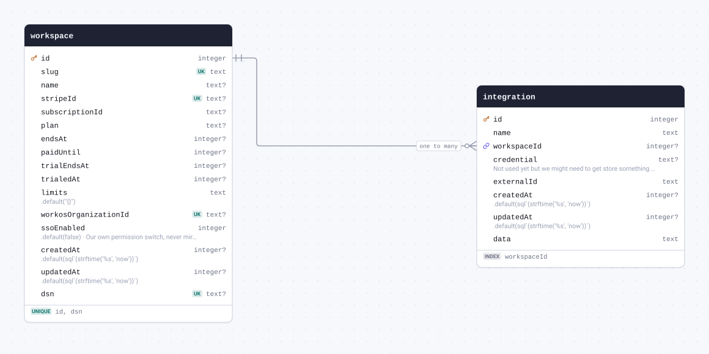

| Column                         | Type      | Constraints                             | Default                                    | Description                                                                                         |
| ------------------------------ | --------- | --------------------------------------- | ------------------------------------------ | --------------------------------------------------------------------------------------------------- |
| `id`                           | `integer` | PK NOT NULL                             |                                            |                                                                                                     |
| `name`                         | `text`    | NOT NULL                                |                                            |                                                                                                     |
| `workspaceId` (`workspace_id`) | `integer` | NULL → [workspace.id](#table-workspace) |                                            |                                                                                                     |
| `credential`                   | `text`    | NULL                                    |                                            | Not used yet but we might need to get store something for the integration webhook url and or secret |
| `externalId` (`external_id`)   | `text`    | NOT NULL                                |                                            |                                                                                                     |
| `createdAt` (`created_at`)     | `integer` | NULL                                    | ``.default(sql`(strftime('%s', 'now'))`)`` |                                                                                                     |
| `updatedAt` (`updated_at`)     | `integer` | NULL                                    | ``.default(sql`(strftime('%s', 'now'))`)`` |                                                                                                     |
| `data`                         | `text`    | NOT NULL                                |                                            |                                                                                                     |

#### Definition

```sql
CREATE TABLE `integration` (
	`id` integer PRIMARY KEY,
	`name` text(256) NOT NULL,
	`workspace_id` integer,
	`credential` text,
	`external_id` text NOT NULL,
	`created_at` integer DEFAULT (strftime('%s', 'now')),
	`updated_at` integer DEFAULT (strftime('%s', 'now')),
	`data` text NOT NULL,
	CONSTRAINT `fk_integration_workspace_id_workspace_id_fk` FOREIGN KEY (`workspace_id`) REFERENCES `workspace`(`id`)
);

CREATE INDEX `integration_workspace_id_idx` ON `integration` (`workspace_id`);
```

#### Indexes

- INDEX `workspaceId`

#### References

- `workspaceId` → [workspace.id](#table-workspace) (many to one)

<details>
<summary>Queries and their SQL</summary>

**Select**: Every row of integration.

```ts
db.select().from(integration);
```

```sql
select "id", "name", "workspace_id", "credential", "external_id", "created_at", "updated_at", "data"
from "integration"
```

**Count**: How many rows integration has.

```ts
db.select({ count: count() }).from(integration);
```

```sql
select count(*)
from "integration"
```

**Find many**: The rows of integration, through the relational query API.

```ts
db.query.integration.findMany();
```

```sql
select "d0"."id" as "id", "d0"."name" as "name", "d0"."workspace_id" as "workspaceId", "d0"."credential" as "credential", "d0"."external_id" as "externalId", "d0"."created_at" as "createdAt", "d0"."updated_at" as "updatedAt", "d0"."data" as "data"
from "integration" as "d0"
```

**Find by primary key**: One row of integration, through the relational query API.

```ts
db.query.integration.findFirst({ where: { id: 1 } });
```

```sql
select "d0"."id" as "id", "d0"."name" as "name", "d0"."workspace_id" as "workspaceId", "d0"."credential" as "credential", "d0"."external_id" as "externalId", "d0"."created_at" as "createdAt", "d0"."updated_at" as "updatedAt", "d0"."data" as "data"
from "integration" as "d0"
where "d0"."id" = ?
limit ?
-- params: [1,1]
```

**Insert**: Adds a row to integration, giving the columns that have no default.

```ts
db.insert(integration).values({ id: 1, name: "name", externalId: "externalId", data: "data" });
```

```sql
insert into "integration" ("id", "name", "workspace_id", "credential", "external_id", "created_at", "updated_at", "data")
values (?, ?, null, null, ?, (strftime('%s', 'now')), (strftime('%s', 'now')), ?)
-- params: [1,"name","externalId","\"data\""]
```

**Update**: Changes a row of integration, found by its primary key.

```ts
db.update(integration).set({ name: "name" }).where(eq(integration.id, 1));
```

```sql
update "integration"
set "name" = ?
where "integration"."id" = ?
-- params: ["name",1]
```

**Delete**: Deletes a row of integration, found by its primary key.

```ts
db.delete(integration).where(eq(integration.id, 1));
```

```sql
delete from "integration"
where "integration"."id" = ?
-- params: [1]
```

</details>

<a id="table-workspace"></a>

### workspace

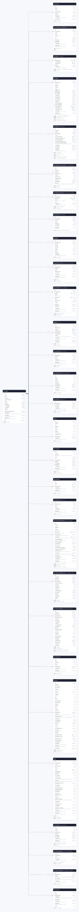

| Column                                            | Type      | Constraints     | Default                                    | Description                                                                                                                                   |
| ------------------------------------------------- | --------- | --------------- | ------------------------------------------ | --------------------------------------------------------------------------------------------------------------------------------------------- |
| `id`                                              | `integer` | PK NOT NULL     |                                            |                                                                                                                                               |
| `slug`                                            | `text`    | UNIQUE NOT NULL |                                            |                                                                                                                                               |
| `name`                                            | `text`    | NULL            |                                            |                                                                                                                                               |
| `stripeId` (`stripe_id`)                          | `text`    | UNIQUE NULL     |                                            |                                                                                                                                               |
| `subscriptionId` (`subscription_id`)              | `text`    | NULL            |                                            |                                                                                                                                               |
| `plan`                                            | `text`    | NULL            |                                            |                                                                                                                                               |
| `endsAt` (`ends_at`)                              | `integer` | NULL            |                                            |                                                                                                                                               |
| `paidUntil` (`paid_until`)                        | `integer` | NULL            |                                            |                                                                                                                                               |
| `trialEndsAt` (`trial_ends_at`)                   | `integer` | NULL            |                                            |                                                                                                                                               |
| `trialedAt` (`trialed_at`)                        | `integer` | NULL            |                                            |                                                                                                                                               |
| `limits`                                          | `text`    | NOT NULL        | `.default("{}")`                           |                                                                                                                                               |
| `workosOrganizationId` (`workos_organization_id`) | `text`    | UNIQUE NULL     |                                            |                                                                                                                                               |
| `ssoEnabled` (`sso_enabled`)                      | `integer` | NOT NULL        | `.default(false)`                          | Our own permission switch, never mirrored from WorkOS: the downgrade cascade clears it, and a later connection webhook must not resurrect it. |
| `createdAt` (`created_at`)                        | `integer` | NULL            | ``.default(sql`(strftime('%s', 'now'))`)`` |                                                                                                                                               |
| `updatedAt` (`updated_at`)                        | `integer` | NULL            | ``.default(sql`(strftime('%s', 'now'))`)`` |                                                                                                                                               |
| `dsn`                                             | `text`    | NULL            |                                            |                                                                                                                                               |

#### Definition

```sql
CREATE TABLE `workspace` (
	`id` integer PRIMARY KEY,
	`slug` text NOT NULL UNIQUE,
	`name` text,
	`stripe_id` text(256) UNIQUE,
	`subscription_id` text,
	`plan` text,
	`ends_at` integer,
	`paid_until` integer,
	`trial_ends_at` integer,
	`trialed_at` integer,
	`limits` text DEFAULT '{}' NOT NULL,
	`workos_organization_id` text UNIQUE,
	`sso_enabled` integer DEFAULT false NOT NULL,
	`created_at` integer DEFAULT (strftime('%s', 'now')),
	`updated_at` integer DEFAULT (strftime('%s', 'now')),
	`dsn` text,
	CONSTRAINT `workspace_id_dsn_unique` UNIQUE(`id`,`dsn`)
);
```

#### Indexes

- UNIQUE `id`, `dsn`

#### Referenced by

- `id` → [integration.workspaceId](#table-integration) (one to many)
- `id` → [workspaceSsoDomain.workspaceId](#table-workspaceSsoDomain) (one to many, on delete cascade)
- `id` → [usersToWorkspaces.workspaceId](#table-usersToWorkspaces) (one to many)
- `id` → [statusReport.workspaceId](#table-statusReport) (one to many)
- `id` → [page.workspaceId](#table-page) (one to many, on delete cascade)
- `id` → [monitor.workspaceId](#table-monitor) (one to many)
- `id` → [notification.workspaceId](#table-notification) (one to many)
- `id` → [notificationOutbox.workspaceId](#table-notificationOutbox) (one to many)
- `id` → [notificationDeadLetter.workspaceId](#table-notificationDeadLetter) (one to many)
- `id` → [monitorIncidentTable.workspaceId](#table-monitorIncidentTable) (one to many)
- `id` → [monitorTag.workspaceId](#table-monitorTag) (one to many, on delete cascade)
- `id` → [application.workspaceId](#table-application) (one to many)
- `id` → [maintenance.workspaceId](#table-maintenance) (one to many)
- `id` → [check.workspaceId](#table-check) (one to many)
- `id` → [monitorRun.workspaceId](#table-monitorRun) (one to many)
- `id` → [privateLocation.workspaceId](#table-privateLocation) (one to many)
- `id` → [monitorGroup.workspaceId](#table-monitorGroup) (one to many, on delete cascade)
- `id` → [apiKey.workspaceId](#table-apiKey) (one to many, on delete cascade)
- `id` → [pageComponent.workspaceId](#table-pageComponent) (one to many, on delete cascade)
- `id` → [pageComponentGroup.workspaceId](#table-pageComponentGroup) (one to many, on delete cascade)
- `id` → [feedback.workspaceId](#table-feedback) (one to many, on delete cascade)
- `id` → [chatSession.workspaceId](#table-chatSession) (one to many, on delete cascade)
- `id` → [frozenMonitorUptime.workspaceId](#table-frozenMonitorUptime) (one to many, on delete cascade)
- `id` → [oauthAuthorizationCode.workspaceId](#table-oauthAuthorizationCode) (one to many, on delete cascade)
- `id` → [oauthGrant.workspaceId](#table-oauthGrant) (one to many, on delete cascade)
- `id` → [incident.workspaceId](#table-incident) (one to many)
- `id` → [slackUser.workspaceId](#table-slackUser) (one to many, on delete cascade)
- `id` → [invitation.workspaceId](#table-invitation) (one to many, defineRelations)

<details>
<summary>Queries and their SQL</summary>

**Select**: Every row of workspace.

```ts
db.select().from(workspace);
```

```sql
select "id", "slug", "name", "stripe_id", "subscription_id", "plan", "ends_at", "paid_until", "trial_ends_at", "trialed_at", "limits", "workos_organization_id", "sso_enabled", "created_at", "updated_at", "dsn"
from "workspace"
```

**Count**: How many rows workspace has.

```ts
db.select({ count: count() }).from(workspace);
```

```sql
select count(*)
from "workspace"
```

**Find many**: The rows of workspace, through the relational query API.

```ts
db.query.workspace.findMany();
```

```sql
select "d0"."id" as "id", "d0"."slug" as "slug", "d0"."name" as "name", "d0"."stripe_id" as "stripeId", "d0"."subscription_id" as "subscriptionId", "d0"."plan" as "plan", "d0"."ends_at" as "endsAt", "d0"."paid_until" as "paidUntil", "d0"."trial_ends_at" as "trialEndsAt", "d0"."trialed_at" as "trialedAt", "d0"."limits" as "limits", "d0"."workos_organization_id" as "workosOrganizationId", "d0"."sso_enabled" as "ssoEnabled", "d0"."created_at" as "createdAt", "d0"."updated_at" as "updatedAt", "d0"."dsn" as "dsn"
from "workspace" as "d0"
```

**Find by primary key**: One row of workspace, through the relational query API.

```ts
db.query.workspace.findFirst({ where: { id: 1 } });
```

```sql
select "d0"."id" as "id", "d0"."slug" as "slug", "d0"."name" as "name", "d0"."stripe_id" as "stripeId", "d0"."subscription_id" as "subscriptionId", "d0"."plan" as "plan", "d0"."ends_at" as "endsAt", "d0"."paid_until" as "paidUntil", "d0"."trial_ends_at" as "trialEndsAt", "d0"."trialed_at" as "trialedAt", "d0"."limits" as "limits", "d0"."workos_organization_id" as "workosOrganizationId", "d0"."sso_enabled" as "ssoEnabled", "d0"."created_at" as "createdAt", "d0"."updated_at" as "updatedAt", "d0"."dsn" as "dsn"
from "workspace" as "d0"
where "d0"."id" = ?
limit ?
-- params: [1,1]
```

**Insert**: Adds a row to workspace, giving the columns that have no default.

```ts
db.insert(workspace).values({ id: 1, slug: "slug" });
```

```sql
insert into "workspace" ("id", "slug", "name", "stripe_id", "subscription_id", "plan", "ends_at", "paid_until", "trial_ends_at", "trialed_at", "limits", "workos_organization_id", "sso_enabled", "created_at", "updated_at", "dsn")
values (?, ?, null, null, null, null, null, null, null, null, ?, null, ?, (strftime('%s', 'now')), (strftime('%s', 'now')), null)
-- params: [1,"slug","{}",0]
```

**Update**: Changes a row of workspace, found by its primary key.

```ts
db.update(workspace).set({ slug: "slug" }).where(eq(workspace.id, 1));
```

```sql
update "workspace"
set "slug" = ?
where "workspace"."id" = ?
-- params: ["slug",1]
```

**Delete**: Deletes a row of workspace, found by its primary key.

```ts
db.delete(workspace).where(eq(workspace.id, 1));
```

```sql
delete from "workspace"
where "workspace"."id" = ?
-- params: [1]
```

</details>

<a id="table-workspaceSsoDomain"></a>

### workspaceSsoDomain

Table `workspace_sso_domain`.

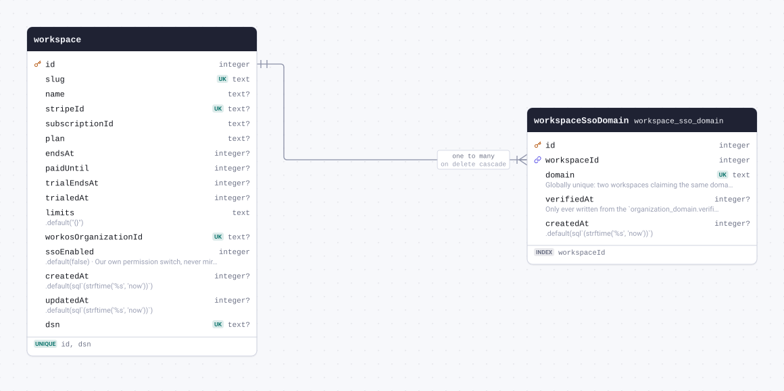

| Column                         | Type      | Constraints                                 | Default                                    | Description                                                                                                                               |
| ------------------------------ | --------- | ------------------------------------------- | ------------------------------------------ | ----------------------------------------------------------------------------------------------------------------------------------------- |
| `id`                           | `integer` | PK NOT NULL                                 |                                            |                                                                                                                                           |
| `workspaceId` (`workspace_id`) | `integer` | NOT NULL → [workspace.id](#table-workspace) |                                            |                                                                                                                                           |
| `domain`                       | `text`    | UNIQUE NOT NULL                             |                                            | Globally unique: two workspaces claiming the same domain would make the login-time lookup ambiguous, which is an account-takeover vector. |
| `verifiedAt` (`verified_at`)   | `integer` | NULL                                        |                                            | Only ever written from the `organization_domain.verified` webhook.                                                                        |
| `createdAt` (`created_at`)     | `integer` | NULL                                        | ``.default(sql`(strftime('%s', 'now'))`)`` |                                                                                                                                           |

#### Definition

```sql
CREATE TABLE `workspace_sso_domain` (
	`id` integer PRIMARY KEY,
	`workspace_id` integer NOT NULL,
	`domain` text NOT NULL UNIQUE,
	`verified_at` integer,
	`created_at` integer DEFAULT (strftime('%s', 'now')),
	CONSTRAINT `fk_workspace_sso_domain_workspace_id_workspace_id_fk` FOREIGN KEY (`workspace_id`) REFERENCES `workspace`(`id`) ON DELETE CASCADE
);

CREATE INDEX `workspace_sso_domain_workspace_id_idx` ON `workspace_sso_domain` (`workspace_id`);
```

#### Indexes

- INDEX `workspaceId`

#### References

- `workspaceId` → [workspace.id](#table-workspace) (many to one, on delete cascade)

<details>
<summary>Queries and their SQL</summary>

**Select**: Every row of workspaceSsoDomain.

```ts
db.select().from(workspaceSsoDomain);
```

```sql
select "id", "workspace_id", "domain", "verified_at", "created_at"
from "workspace_sso_domain"
```

**Count**: How many rows workspaceSsoDomain has.

```ts
db.select({ count: count() }).from(workspaceSsoDomain);
```

```sql
select count(*)
from "workspace_sso_domain"
```

**Find many**: The rows of workspaceSsoDomain, through the relational query API.

```ts
db.query.workspaceSsoDomain.findMany();
```

```sql
select "d0"."id" as "id", "d0"."workspace_id" as "workspaceId", "d0"."domain" as "domain", "d0"."verified_at" as "verifiedAt", "d0"."created_at" as "createdAt"
from "workspace_sso_domain" as "d0"
```

**Find by primary key**: One row of workspaceSsoDomain, through the relational query API.

```ts
db.query.workspaceSsoDomain.findFirst({ where: { id: 1 } });
```

```sql
select "d0"."id" as "id", "d0"."workspace_id" as "workspaceId", "d0"."domain" as "domain", "d0"."verified_at" as "verifiedAt", "d0"."created_at" as "createdAt"
from "workspace_sso_domain" as "d0"
where "d0"."id" = ?
limit ?
-- params: [1,1]
```

**Insert**: Adds a row to workspaceSsoDomain, giving the columns that have no default.

```ts
db.insert(workspaceSsoDomain).values({ id: 1, workspaceId: 1, domain: "domain" });
```

```sql
insert into "workspace_sso_domain" ("id", "workspace_id", "domain", "verified_at", "created_at")
values (?, ?, ?, null, (strftime('%s', 'now')))
-- params: [1,1,"domain"]
```

**Update**: Changes a row of workspaceSsoDomain, found by its primary key.

```ts
db.update(workspaceSsoDomain).set({ workspaceId: 1 }).where(eq(workspaceSsoDomain.id, 1));
```

```sql
update "workspace_sso_domain"
set "workspace_id" = ?
where "workspace_sso_domain"."id" = ?
-- params: [1,1]
```

**Delete**: Deletes a row of workspaceSsoDomain, found by its primary key.

```ts
db.delete(workspaceSsoDomain).where(eq(workspaceSsoDomain.id, 1));
```

```sql
delete from "workspace_sso_domain"
where "workspace_sso_domain"."id" = ?
-- params: [1]
```

</details>

<a id="table-user"></a>

### user

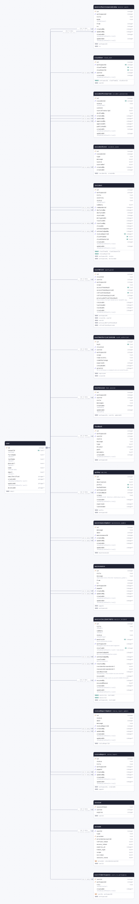

| Column                     | Type      | Constraints | Default                                    | Description      |
| -------------------------- | --------- | ----------- | ------------------------------------------ | ---------------- |
| `id`                       | `integer` | PK NOT NULL |                                            |                  |
| `tenantId` (`tenant_id`)   | `text`    | UNIQUE NULL |                                            | clerk fields     |
| `firstName` (`first_name`) | `text`    | NULL        | `.default("")`                             |                  |
| `lastName` (`last_name`)   | `text`    | NULL        | `.default("")`                             |                  |
| `photoUrl` (`photo_url`)   | `text`    | NULL        | `.default("")`                             |                  |
| `name`                     | `text`    | NULL        |                                            | next-auth fields |
| `email`                    | `text`    | NULL        | `.default("")`                             |                  |
| `emailVerified`            | `integer` | NULL        |                                            |                  |
| `createdAt` (`created_at`) | `integer` | NULL        | ``.default(sql`(strftime('%s', 'now'))`)`` |                  |
| `updatedAt` (`updated_at`) | `integer` | NULL        | ``.default(sql`(strftime('%s', 'now'))`)`` |                  |
| `deletedAt` (`deleted_at`) | `integer` | NULL        |                                            |                  |

#### Definition

```sql
CREATE TABLE `user` (
	`id` integer PRIMARY KEY,
	`tenant_id` text(256) UNIQUE,
	`first_name` text DEFAULT '',
	`last_name` text DEFAULT '',
	`photo_url` text DEFAULT '',
	`name` text,
	`email` text DEFAULT '',
	`emailVerified` integer,
	`created_at` integer DEFAULT (strftime('%s', 'now')),
	`updated_at` integer DEFAULT (strftime('%s', 'now')),
	`deleted_at` integer
);

CREATE INDEX `user_email_idx` ON `user` (`email`);
```

#### Indexes

- INDEX `email`

#### Referenced by

- `id` → [usersToWorkspaces.userId](#table-usersToWorkspaces) (one to many)
- `id` → [account.userId](#table-account) (one to many, on delete cascade)
- `id` → [session.userId](#table-session) (one to many, on delete cascade)
- `id` → [statusReport.createdBy](#table-statusReport) (one to many)
- `id` → [statusReport.updatedBy](#table-statusReport) (one to many)
- `id` → [statusReportUpdate.createdBy](#table-statusReportUpdate) (one to many)
- `id` → [statusReportUpdate.updatedBy](#table-statusReportUpdate) (one to many)
- `id` → [monitorIncidentTable.acknowledgedBy](#table-monitorIncidentTable) (one to many)
- `id` → [monitorIncidentTable.resolvedBy](#table-monitorIncidentTable) (one to many)
- `id` → [maintenance.createdBy](#table-maintenance) (one to many)
- `id` → [maintenance.updatedBy](#table-maintenance) (one to many)
- `id` → [maintenanceUpdate.createdBy](#table-maintenanceUpdate) (one to many)
- `id` → [maintenanceUpdate.updatedBy](#table-maintenanceUpdate) (one to many)
- `id` → [apiKey.createdById](#table-apiKey) (one to many, on delete cascade)
- `id` → [feedback.userId](#table-feedback) (one to many, on delete cascade)
- `id` → [chatSession.userId](#table-chatSession) (one to many, on delete cascade)
- `id` → [oauthAuthorizationCode.userId](#table-oauthAuthorizationCode) (one to many, on delete cascade)
- `id` → [oauthGrant.userId](#table-oauthGrant) (one to many, on delete cascade)
- `id` → [incident.commanderId](#table-incident) (one to many)
- `id` → [incident.declaredBy](#table-incident) (one to many)
- `id` → [incident.resolvedBy](#table-incident) (one to many)
- `id` → [incidentEvent.createdBy](#table-incidentEvent) (one to many)
- `id` → [incidentPostmortem.createdBy](#table-incidentPostmortem) (one to many)
- `id` → [incidentPostmortem.updatedBy](#table-incidentPostmortem) (one to many)
- `id` → [incidentPostmortem.approvedBy](#table-incidentPostmortem) (one to many)
- `id` → [slackUser.userId](#table-slackUser) (one to many)

<details>
<summary>Queries and their SQL</summary>

**Select**: Every row of user.

```ts
db.select().from(user);
```

```sql
select "id", "tenant_id", "first_name", "last_name", "photo_url", "name", "email", "emailVerified", "created_at", "updated_at", "deleted_at"
from "user"
```

**Count**: How many rows user has.

```ts
db.select({ count: count() }).from(user);
```

```sql
select count(*)
from "user"
```

**Find many**: The rows of user, through the relational query API.

```ts
db.query.user.findMany();
```

```sql
select "d0"."id" as "id", "d0"."tenant_id" as "tenantId", "d0"."first_name" as "firstName", "d0"."last_name" as "lastName", "d0"."photo_url" as "photoUrl", "d0"."name" as "name", "d0"."email" as "email", "d0"."emailVerified" as "emailVerified", "d0"."created_at" as "createdAt", "d0"."updated_at" as "updatedAt", "d0"."deleted_at" as "deletedAt"
from "user" as "d0"
```

**Find by primary key**: One row of user, through the relational query API.

```ts
db.query.user.findFirst({ where: { id: 1 } });
```

```sql
select "d0"."id" as "id", "d0"."tenant_id" as "tenantId", "d0"."first_name" as "firstName", "d0"."last_name" as "lastName", "d0"."photo_url" as "photoUrl", "d0"."name" as "name", "d0"."email" as "email", "d0"."emailVerified" as "emailVerified", "d0"."created_at" as "createdAt", "d0"."updated_at" as "updatedAt", "d0"."deleted_at" as "deletedAt"
from "user" as "d0"
where "d0"."id" = ?
limit ?
-- params: [1,1]
```

**Insert**: Adds a row to user, giving the columns that have no default.

```ts
db.insert(user).values({ id: 1 });
```

```sql
insert into "user" ("id", "tenant_id", "first_name", "last_name", "photo_url", "name", "email", "emailVerified", "created_at", "updated_at", "deleted_at")
values (?, null, ?, ?, ?, null, ?, null, (strftime('%s', 'now')), (strftime('%s', 'now')), null)
-- params: [1,"","","",""]
```

**Update**: Changes a row of user, found by its primary key.

```ts
db.update(user).set({ tenantId: "tenantId" }).where(eq(user.id, 1));
```

```sql
update "user"
set "tenant_id" = ?
where "user"."id" = ?
-- params: ["tenantId",1]
```

**Delete**: Deletes a row of user, found by its primary key.

```ts
db.delete(user).where(eq(user.id, 1));
```

```sql
delete from "user"
where "user"."id" = ?
-- params: [1]
```

</details>

<a id="table-usersToWorkspaces"></a>

### usersToWorkspaces

Table `users_to_workspaces`.

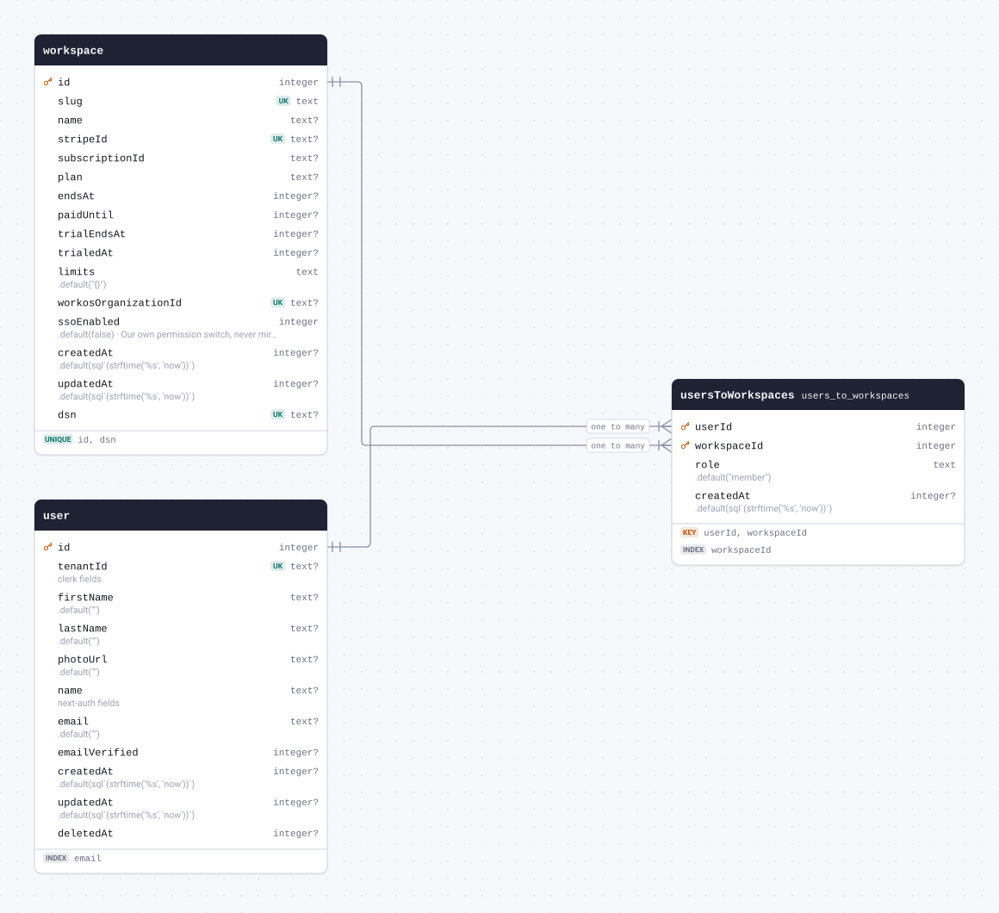

| Column                         | Type      | Constraints                                    | Default                                    | Description |
| ------------------------------ | --------- | ---------------------------------------------- | ------------------------------------------ | ----------- |
| `userId` (`user_id`)           | `integer` | PK NOT NULL → [user.id](#table-user)           |                                            |             |
| `workspaceId` (`workspace_id`) | `integer` | PK NOT NULL → [workspace.id](#table-workspace) |                                            |             |
| `role`                         | `text`    | NOT NULL                                       | `.default("member")`                       |             |
| `createdAt` (`created_at`)     | `integer` | NULL                                           | ``.default(sql`(strftime('%s', 'now'))`)`` |             |

#### Definition

```sql
CREATE TABLE `users_to_workspaces` (
	`user_id` integer NOT NULL,
	`workspace_id` integer NOT NULL,
	`role` text DEFAULT 'member' NOT NULL,
	`created_at` integer DEFAULT (strftime('%s', 'now')),
	CONSTRAINT `users_to_workspaces_pk` PRIMARY KEY(`user_id`, `workspace_id`),
	CONSTRAINT `fk_users_to_workspaces_user_id_user_id_fk` FOREIGN KEY (`user_id`) REFERENCES `user`(`id`),
	CONSTRAINT `fk_users_to_workspaces_workspace_id_workspace_id_fk` FOREIGN KEY (`workspace_id`) REFERENCES `workspace`(`id`)
);

CREATE INDEX `users_to_workspaces_workspace_id_idx` ON `users_to_workspaces` (`workspace_id`);
```

#### Indexes

- PRIMARY KEY `userId`, `workspaceId`
- INDEX `workspaceId`

#### References

- `userId` → [user.id](#table-user) (many to one)
- `workspaceId` → [workspace.id](#table-workspace) (many to one)

<details>
<summary>Queries and their SQL</summary>

**Select**: Every row of usersToWorkspaces.

```ts
db.select().from(usersToWorkspaces);
```

```sql
select "user_id", "workspace_id", "role", "created_at"
from "users_to_workspaces"
```

**Count**: How many rows usersToWorkspaces has.

```ts
db.select({ count: count() }).from(usersToWorkspaces);
```

```sql
select count(*)
from "users_to_workspaces"
```

**Find many**: The rows of usersToWorkspaces, through the relational query API.

```ts
db.query.usersToWorkspaces.findMany();
```

```sql
select "d0"."user_id" as "userId", "d0"."workspace_id" as "workspaceId", "d0"."role" as "role", "d0"."created_at" as "createdAt"
from "users_to_workspaces" as "d0"
```

**Find by primary key**: One row of usersToWorkspaces, through the relational query API.

```ts
db.query.usersToWorkspaces.findFirst({ where: { userId: 1, workspaceId: 1 } });
```

```sql
select "d0"."user_id" as "userId", "d0"."workspace_id" as "workspaceId", "d0"."role" as "role", "d0"."created_at" as "createdAt"
from "users_to_workspaces" as "d0"
where (("d0"."user_id" = ?) and ("d0"."workspace_id" = ?))
limit ?
-- params: [1,1,1]
```

**Insert**: Adds a row to usersToWorkspaces, giving the columns that have no default.

```ts
db.insert(usersToWorkspaces).values({ userId: 1, workspaceId: 1 });
```

```sql
insert into "users_to_workspaces" ("user_id", "workspace_id", "role", "created_at")
values (?, ?, ?, (strftime('%s', 'now')))
-- params: [1,1,"member"]
```

**Update**: Changes a row of usersToWorkspaces, found by its primary key.

```ts
db.update(usersToWorkspaces)
  .set({ role: "role" })
  .where(and(eq(usersToWorkspaces.userId, 1), eq(usersToWorkspaces.workspaceId, 1)));
```

```sql
update "users_to_workspaces"
set "role" = ?
where (("users_to_workspaces"."user_id" = ?) and ("users_to_workspaces"."workspace_id" = ?))
-- params: ["role",1,1]
```

**Delete**: Deletes a row of usersToWorkspaces, found by its primary key.

```ts
db.delete(usersToWorkspaces).where(
  and(eq(usersToWorkspaces.userId, 1), eq(usersToWorkspaces.workspaceId, 1)),
);
```

```sql
delete from "users_to_workspaces"
where (("users_to_workspaces"."user_id" = ?) and ("users_to_workspaces"."workspace_id" = ?))
-- params: [1,1]
```

</details>

<a id="table-account"></a>

### account

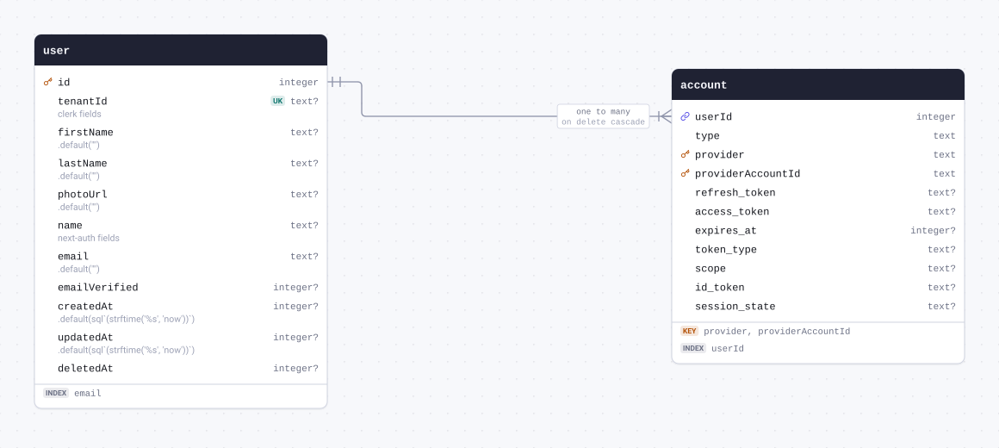

| Column                                      | Type      | Constraints                       | Default | Description |
| ------------------------------------------- | --------- | --------------------------------- | ------- | ----------- |
| `userId` (`user_id`)                        | `integer` | NOT NULL → [user.id](#table-user) |         |             |
| `type`                                      | `text`    | NOT NULL                          |         |             |
| `provider`                                  | `text`    | PK NOT NULL                       |         |             |
| `providerAccountId` (`provider_account_id`) | `text`    | PK NOT NULL                       |         |             |
| `refresh_token`                             | `text`    | NULL                              |         |             |
| `access_token`                              | `text`    | NULL                              |         |             |
| `expires_at`                                | `integer` | NULL                              |         |             |
| `token_type`                                | `text`    | NULL                              |         |             |
| `scope`                                     | `text`    | NULL                              |         |             |
| `id_token`                                  | `text`    | NULL                              |         |             |
| `session_state`                             | `text`    | NULL                              |         |             |

#### Definition

```sql
CREATE TABLE `account` (
	`user_id` integer NOT NULL,
	`type` text NOT NULL,
	`provider` text NOT NULL,
	`provider_account_id` text NOT NULL,
	`refresh_token` text,
	`access_token` text,
	`expires_at` integer,
	`token_type` text,
	`scope` text,
	`id_token` text,
	`session_state` text,
	CONSTRAINT `account_pk` PRIMARY KEY(`provider`, `provider_account_id`),
	CONSTRAINT `fk_account_user_id_user_id_fk` FOREIGN KEY (`user_id`) REFERENCES `user`(`id`) ON DELETE CASCADE
);

CREATE INDEX `account_user_id_idx` ON `account` (`user_id`);
```

#### Indexes

- PRIMARY KEY `provider`, `providerAccountId`
- INDEX `userId`

#### References

- `userId` → [user.id](#table-user) (many to one, on delete cascade)

<details>
<summary>Queries and their SQL</summary>

**Select**: Every row of account.

```ts
db.select().from(account);
```

```sql
select "user_id", "type", "provider", "provider_account_id", "refresh_token", "access_token", "expires_at", "token_type", "scope", "id_token", "session_state"
from "account"
```

**Count**: How many rows account has.

```ts
db.select({ count: count() }).from(account);
```

```sql
select count(*)
from "account"
```

**Find many**: The rows of account, through the relational query API.

```ts
db.query.account.findMany();
```

```sql
select "d0"."user_id" as "userId", "d0"."type" as "type", "d0"."provider" as "provider", "d0"."provider_account_id" as "providerAccountId", "d0"."refresh_token" as "refresh_token", "d0"."access_token" as "access_token", "d0"."expires_at" as "expires_at", "d0"."token_type" as "token_type", "d0"."scope" as "scope", "d0"."id_token" as "id_token", "d0"."session_state" as "session_state"
from "account" as "d0"
```

**Find by primary key**: One row of account, through the relational query API.

```ts
db.query.account.findFirst({
  where: { provider: "provider", providerAccountId: "providerAccountId" },
});
```

```sql
select "d0"."user_id" as "userId", "d0"."type" as "type", "d0"."provider" as "provider", "d0"."provider_account_id" as "providerAccountId", "d0"."refresh_token" as "refresh_token", "d0"."access_token" as "access_token", "d0"."expires_at" as "expires_at", "d0"."token_type" as "token_type", "d0"."scope" as "scope", "d0"."id_token" as "id_token", "d0"."session_state" as "session_state"
from "account" as "d0"
where (("d0"."provider" = ?) and ("d0"."provider_account_id" = ?))
limit ?
-- params: ["provider","providerAccountId",1]
```

**Insert**: Adds a row to account, giving the columns that have no default.

```ts
db.insert(account).values({
  userId: 1,
  type: "type",
  provider: "provider",
  providerAccountId: "providerAccountId",
});
```

```sql
insert into "account" ("user_id", "type", "provider", "provider_account_id", "refresh_token", "access_token", "expires_at", "token_type", "scope", "id_token", "session_state")
values (?, ?, ?, ?, null, null, null, null, null, null, null)
-- params: [1,"type","provider","providerAccountId"]
```

**Update**: Changes a row of account, found by its primary key.

```ts
db.update(account)
  .set({ userId: 1 })
  .where(and(eq(account.provider, "provider"), eq(account.providerAccountId, "providerAccountId")));
```

```sql
update "account"
set "user_id" = ?
where (("account"."provider" = ?) and ("account"."provider_account_id" = ?))
-- params: [1,"provider","providerAccountId"]
```

**Delete**: Deletes a row of account, found by its primary key.

```ts
db.delete(account).where(
  and(eq(account.provider, "provider"), eq(account.providerAccountId, "providerAccountId")),
);
```

```sql
delete from "account"
where (("account"."provider" = ?) and ("account"."provider_account_id" = ?))
-- params: ["provider","providerAccountId"]
```

</details>

<a id="table-session"></a>

### session

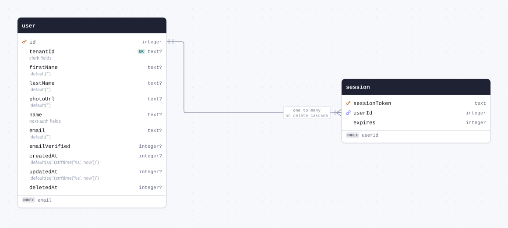

| Column                           | Type      | Constraints                       | Default | Description |
| -------------------------------- | --------- | --------------------------------- | ------- | ----------- |
| `sessionToken` (`session_token`) | `text`    | PK NOT NULL                       |         |             |
| `userId` (`user_id`)             | `integer` | NOT NULL → [user.id](#table-user) |         |             |
| `expires`                        | `integer` | NOT NULL                          |         |             |

#### Definition

```sql
CREATE TABLE `session` (
	`session_token` text PRIMARY KEY,
	`user_id` integer NOT NULL,
	`expires` integer NOT NULL,
	CONSTRAINT `fk_session_user_id_user_id_fk` FOREIGN KEY (`user_id`) REFERENCES `user`(`id`) ON DELETE CASCADE
);

CREATE INDEX `session_user_id_idx` ON `session` (`user_id`);
```

#### Indexes

- INDEX `userId`

#### References

- `userId` → [user.id](#table-user) (many to one, on delete cascade)

<details>
<summary>Queries and their SQL</summary>

**Select**: Every row of session.

```ts
db.select().from(session);
```

```sql
select "session_token", "user_id", "expires"
from "session"
```

**Count**: How many rows session has.

```ts
db.select({ count: count() }).from(session);
```

```sql
select count(*)
from "session"
```

**Find many**: The rows of session, through the relational query API.

```ts
db.query.session.findMany();
```

```sql
select "d0"."session_token" as "sessionToken", "d0"."user_id" as "userId", "d0"."expires" as "expires"
from "session" as "d0"
```

**Find by primary key**: One row of session, through the relational query API.

```ts
db.query.session.findFirst({ where: { sessionToken: "sessionToken" } });
```

```sql
select "d0"."session_token" as "sessionToken", "d0"."user_id" as "userId", "d0"."expires" as "expires"
from "session" as "d0"
where "d0"."session_token" = ?
limit ?
-- params: ["sessionToken",1]
```

**Insert**: Adds a row to session, giving the columns that have no default.

```ts
db.insert(session).values({ sessionToken: "sessionToken", userId: 1, expires: 1 });
```

```sql
insert into "session" ("session_token", "user_id", "expires")
values (?, ?, ?)
-- params: ["sessionToken",1,1]
```

**Update**: Changes a row of session, found by its primary key.

```ts
db.update(session).set({ userId: 1 }).where(eq(session.sessionToken, "sessionToken"));
```

```sql
update "session"
set "user_id" = ?
where "session"."session_token" = ?
-- params: [1,"sessionToken"]
```

**Delete**: Deletes a row of session, found by its primary key.

```ts
db.delete(session).where(eq(session.sessionToken, "sessionToken"));
```

```sql
delete from "session"
where "session"."session_token" = ?
-- params: ["sessionToken"]
```

</details>

<a id="table-verificationToken"></a>

### verificationToken

Table `verification_token`.

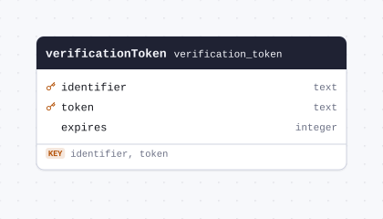

| Column       | Type      | Constraints | Default | Description |
| ------------ | --------- | ----------- | ------- | ----------- |
| `identifier` | `text`    | PK NOT NULL |         |             |
| `token`      | `text`    | PK NOT NULL |         |             |
| `expires`    | `integer` | NOT NULL    |         |             |

#### Definition

```sql
CREATE TABLE `verification_token` (
	`identifier` text NOT NULL,
	`token` text NOT NULL,
	`expires` integer NOT NULL,
	CONSTRAINT `verification_token_pk` PRIMARY KEY(`identifier`, `token`)
);
```

#### Indexes

- PRIMARY KEY `identifier`, `token`

<details>
<summary>Queries and their SQL</summary>

**Select**: Every row of verificationToken.

```ts
db.select().from(verificationToken);
```

```sql
select "identifier", "token", "expires"
from "verification_token"
```

**Count**: How many rows verificationToken has.

```ts
db.select({ count: count() }).from(verificationToken);
```

```sql
select count(*)
from "verification_token"
```

**Find many**: The rows of verificationToken, through the relational query API.

```ts
db.query.verificationToken.findMany();
```

```sql
select "d0"."identifier" as "identifier", "d0"."token" as "token", "d0"."expires" as "expires"
from "verification_token" as "d0"
```

**Find by primary key**: One row of verificationToken, through the relational query API.

```ts
db.query.verificationToken.findFirst({ where: { identifier: "identifier", token: "token" } });
```

```sql
select "d0"."identifier" as "identifier", "d0"."token" as "token", "d0"."expires" as "expires"
from "verification_token" as "d0"
where (("d0"."identifier" = ?) and ("d0"."token" = ?))
limit ?
-- params: ["identifier","token",1]
```

**Insert**: Adds a row to verificationToken, giving the columns that have no default.

```ts
db.insert(verificationToken).values({ identifier: "identifier", token: "token", expires: 1 });
```

```sql
insert into "verification_token" ("identifier", "token", "expires")
values (?, ?, ?)
-- params: ["identifier","token",1]
```

**Update**: Changes a row of verificationToken, found by its primary key.

```ts
db.update(verificationToken)
  .set({ expires: 1 })
  .where(and(eq(verificationToken.identifier, "identifier"), eq(verificationToken.token, "token")));
```

```sql
update "verification_token"
set "expires" = ?
where (("verification_token"."identifier" = ?) and ("verification_token"."token" = ?))
-- params: [1,"identifier","token"]
```

**Delete**: Deletes a row of verificationToken, found by its primary key.

```ts
db.delete(verificationToken).where(
  and(eq(verificationToken.identifier, "identifier"), eq(verificationToken.token, "token")),
);
```

```sql
delete from "verification_token"
where (("verification_token"."identifier" = ?) and ("verification_token"."token" = ?))
-- params: ["identifier","token"]
```

</details>

<a id="table-statusReport"></a>

### statusReport

Table `status_report`.

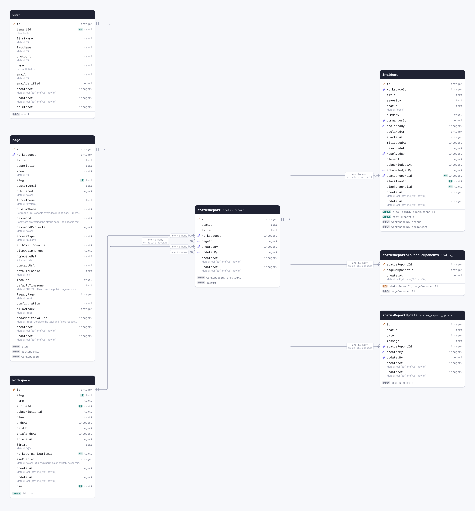

| Column                         | Type      | Constraints                             | Default                                    | Description |
| ------------------------------ | --------- | --------------------------------------- | ------------------------------------------ | ----------- |
| `id`                           | `integer` | PK NOT NULL                             |                                            |             |
| `status`                       | `text`    | NOT NULL                                |                                            |             |
| `title`                        | `text`    | NOT NULL                                |                                            |             |
| `workspaceId` (`workspace_id`) | `integer` | NULL → [workspace.id](#table-workspace) |                                            |             |
| `pageId` (`page_id`)           | `integer` | NULL → [page.id](#table-page)           |                                            |             |
| `createdBy` (`created_by`)     | `integer` | NULL → [user.id](#table-user)           |                                            |             |
| `updatedBy` (`updated_by`)     | `integer` | NULL → [user.id](#table-user)           |                                            |             |
| `createdAt` (`created_at`)     | `integer` | NULL                                    | ``.default(sql`(strftime('%s', 'now'))`)`` |             |
| `updatedAt` (`updated_at`)     | `integer` | NULL                                    | ``.default(sql`(strftime('%s', 'now'))`)`` |             |

#### Definition

```sql
CREATE TABLE `status_report` (
	`id` integer PRIMARY KEY,
	`status` text NOT NULL,
	`title` text(256) NOT NULL,
	`workspace_id` integer,
	`page_id` integer,
	`created_by` integer,
	`updated_by` integer,
	`created_at` integer DEFAULT (strftime('%s', 'now')),
	`updated_at` integer DEFAULT (strftime('%s', 'now')),
	CONSTRAINT `fk_status_report_workspace_id_workspace_id_fk` FOREIGN KEY (`workspace_id`) REFERENCES `workspace`(`id`),
	CONSTRAINT `fk_status_report_page_id_page_id_fk` FOREIGN KEY (`page_id`) REFERENCES `page`(`id`) ON DELETE CASCADE,
	CONSTRAINT `fk_status_report_created_by_user_id_fk` FOREIGN KEY (`created_by`) REFERENCES `user`(`id`),
	CONSTRAINT `fk_status_report_updated_by_user_id_fk` FOREIGN KEY (`updated_by`) REFERENCES `user`(`id`)
);

CREATE INDEX `status_report_workspace_created_idx` ON `status_report` (`workspace_id`,`created_at`);

CREATE INDEX `status_report_page_id_idx` ON `status_report` (`page_id`);
```

#### Indexes

- INDEX `workspaceId`, `createdAt`
- INDEX `pageId`

#### References

- `workspaceId` → [workspace.id](#table-workspace) (many to one)
- `pageId` → [page.id](#table-page) (many to one, on delete cascade)
- `createdBy` → [user.id](#table-user) (many to one)
- `updatedBy` → [user.id](#table-user) (many to one)

#### Referenced by

- `id` → [statusReportUpdate.statusReportId](#table-statusReportUpdate) (one to many, on delete cascade)
- `id` → [statusReportsToPageComponents.statusReportId](#table-statusReportsToPageComponents) (one to many, on delete cascade)
- `id` → [incident.statusReportId](#table-incident) (one to one, on delete set null)

<details>
<summary>Queries and their SQL</summary>

**Select**: Every row of statusReport.

```ts
db.select().from(statusReport);
```

```sql
select "id", "status", "title", "workspace_id", "page_id", "created_by", "updated_by", "created_at", "updated_at"
from "status_report"
```

**Count**: How many rows statusReport has.

```ts
db.select({ count: count() }).from(statusReport);
```

```sql
select count(*)
from "status_report"
```

**Find many**: The rows of statusReport, through the relational query API.

```ts
db.query.statusReport.findMany();
```

```sql
select "d0"."id" as "id", "d0"."status" as "status", "d0"."title" as "title", "d0"."workspace_id" as "workspaceId", "d0"."page_id" as "pageId", "d0"."created_by" as "createdBy", "d0"."updated_by" as "updatedBy", "d0"."created_at" as "createdAt", "d0"."updated_at" as "updatedAt"
from "status_report" as "d0"
```

**Find by primary key**: One row of statusReport, through the relational query API.

```ts
db.query.statusReport.findFirst({ where: { id: 1 } });
```

```sql
select "d0"."id" as "id", "d0"."status" as "status", "d0"."title" as "title", "d0"."workspace_id" as "workspaceId", "d0"."page_id" as "pageId", "d0"."created_by" as "createdBy", "d0"."updated_by" as "updatedBy", "d0"."created_at" as "createdAt", "d0"."updated_at" as "updatedAt"
from "status_report" as "d0"
where "d0"."id" = ?
limit ?
-- params: [1,1]
```

**Insert**: Adds a row to statusReport, giving the columns that have no default.

```ts
db.insert(statusReport).values({ id: 1, status: "status", title: "title" });
```

```sql
insert into "status_report" ("id", "status", "title", "workspace_id", "page_id", "created_by", "updated_by", "created_at", "updated_at")
values (?, ?, ?, null, null, null, null, (strftime('%s', 'now')), (strftime('%s', 'now')))
-- params: [1,"status","title"]
```

**Update**: Changes a row of statusReport, found by its primary key.

```ts
db.update(statusReport).set({ status: "status" }).where(eq(statusReport.id, 1));
```

```sql
update "status_report"
set "status" = ?
where "status_report"."id" = ?
-- params: ["status",1]
```

**Delete**: Deletes a row of statusReport, found by its primary key.

```ts
db.delete(statusReport).where(eq(statusReport.id, 1));
```

```sql
delete from "status_report"
where "status_report"."id" = ?
-- params: [1]
```

</details>

<a id="table-statusReportUpdate"></a>

### statusReportUpdate

Table `status_report_update`.

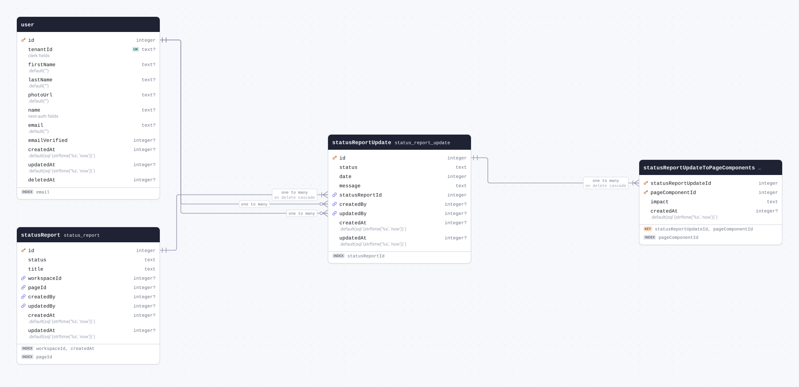

| Column                                | Type      | Constraints                                       | Default                                    | Description |
| ------------------------------------- | --------- | ------------------------------------------------- | ------------------------------------------ | ----------- |
| `id`                                  | `integer` | PK NOT NULL                                       |                                            |             |
| `status`                              | `text`    | NOT NULL                                          |                                            |             |
| `date`                                | `integer` | NOT NULL                                          |                                            |             |
| `message`                             | `text`    | NOT NULL                                          |                                            |             |
| `statusReportId` (`status_report_id`) | `integer` | NOT NULL → [statusReport.id](#table-statusReport) |                                            |             |
| `createdBy` (`created_by`)            | `integer` | NULL → [user.id](#table-user)                     |                                            |             |
| `updatedBy` (`updated_by`)            | `integer` | NULL → [user.id](#table-user)                     |                                            |             |
| `createdAt` (`created_at`)            | `integer` | NULL                                              | ``.default(sql`(strftime('%s', 'now'))`)`` |             |
| `updatedAt` (`updated_at`)            | `integer` | NULL                                              | ``.default(sql`(strftime('%s', 'now'))`)`` |             |

#### Definition

```sql
CREATE TABLE `status_report_update` (
	`id` integer PRIMARY KEY,
	`status` text NOT NULL,
	`date` integer NOT NULL,
	`message` text NOT NULL,
	`status_report_id` integer NOT NULL,
	`created_by` integer,
	`updated_by` integer,
	`created_at` integer DEFAULT (strftime('%s', 'now')),
	`updated_at` integer DEFAULT (strftime('%s', 'now')),
	CONSTRAINT `fk_status_report_update_status_report_id_status_report_id_fk` FOREIGN KEY (`status_report_id`) REFERENCES `status_report`(`id`) ON DELETE CASCADE,
	CONSTRAINT `fk_status_report_update_created_by_user_id_fk` FOREIGN KEY (`created_by`) REFERENCES `user`(`id`),
	CONSTRAINT `fk_status_report_update_updated_by_user_id_fk` FOREIGN KEY (`updated_by`) REFERENCES `user`(`id`)
);

CREATE INDEX `status_report_update_status_report_id_idx` ON `status_report_update` (`status_report_id`);
```

#### Indexes

- INDEX `statusReportId`

#### References

- `statusReportId` → [statusReport.id](#table-statusReport) (many to one, on delete cascade)
- `createdBy` → [user.id](#table-user) (many to one)
- `updatedBy` → [user.id](#table-user) (many to one)

#### Referenced by

- `id` → [statusReportUpdateToPageComponents.statusReportUpdateId](#table-statusReportUpdateToPageComponents) (one to many, on delete cascade)

<details>
<summary>Queries and their SQL</summary>

**Select**: Every row of statusReportUpdate.

```ts
db.select().from(statusReportUpdate);
```

```sql
select "id", "status", "date", "message", "status_report_id", "created_by", "updated_by", "created_at", "updated_at"
from "status_report_update"
```

**Count**: How many rows statusReportUpdate has.

```ts
db.select({ count: count() }).from(statusReportUpdate);
```

```sql
select count(*)
from "status_report_update"
```

**Find many**: The rows of statusReportUpdate, through the relational query API.

```ts
db.query.statusReportUpdate.findMany();
```

```sql
select "d0"."id" as "id", "d0"."status" as "status", "d0"."date" as "date", "d0"."message" as "message", "d0"."status_report_id" as "statusReportId", "d0"."created_by" as "createdBy", "d0"."updated_by" as "updatedBy", "d0"."created_at" as "createdAt", "d0"."updated_at" as "updatedAt"
from "status_report_update" as "d0"
```

**Find by primary key**: One row of statusReportUpdate, through the relational query API.

```ts
db.query.statusReportUpdate.findFirst({ where: { id: 1 } });
```

```sql
select "d0"."id" as "id", "d0"."status" as "status", "d0"."date" as "date", "d0"."message" as "message", "d0"."status_report_id" as "statusReportId", "d0"."created_by" as "createdBy", "d0"."updated_by" as "updatedBy", "d0"."created_at" as "createdAt", "d0"."updated_at" as "updatedAt"
from "status_report_update" as "d0"
where "d0"."id" = ?
limit ?
-- params: [1,1]
```

**Insert**: Adds a row to statusReportUpdate, giving the columns that have no default.

```ts
db.insert(statusReportUpdate).values({
  id: 1,
  status: "status",
  date: 1,
  message: "message",
  statusReportId: 1,
});
```

```sql
insert into "status_report_update" ("id", "status", "date", "message", "status_report_id", "created_by", "updated_by", "created_at", "updated_at")
values (?, ?, ?, ?, ?, null, null, (strftime('%s', 'now')), (strftime('%s', 'now')))
-- params: [1,"status",1,"message",1]
```

**Update**: Changes a row of statusReportUpdate, found by its primary key.

```ts
db.update(statusReportUpdate).set({ status: "status" }).where(eq(statusReportUpdate.id, 1));
```

```sql
update "status_report_update"
set "status" = ?
where "status_report_update"."id" = ?
-- params: ["status",1]
```

**Delete**: Deletes a row of statusReportUpdate, found by its primary key.

```ts
db.delete(statusReportUpdate).where(eq(statusReportUpdate.id, 1));
```

```sql
delete from "status_report_update"
where "status_report_update"."id" = ?
-- params: [1]
```

</details>

<a id="table-page"></a>

### page

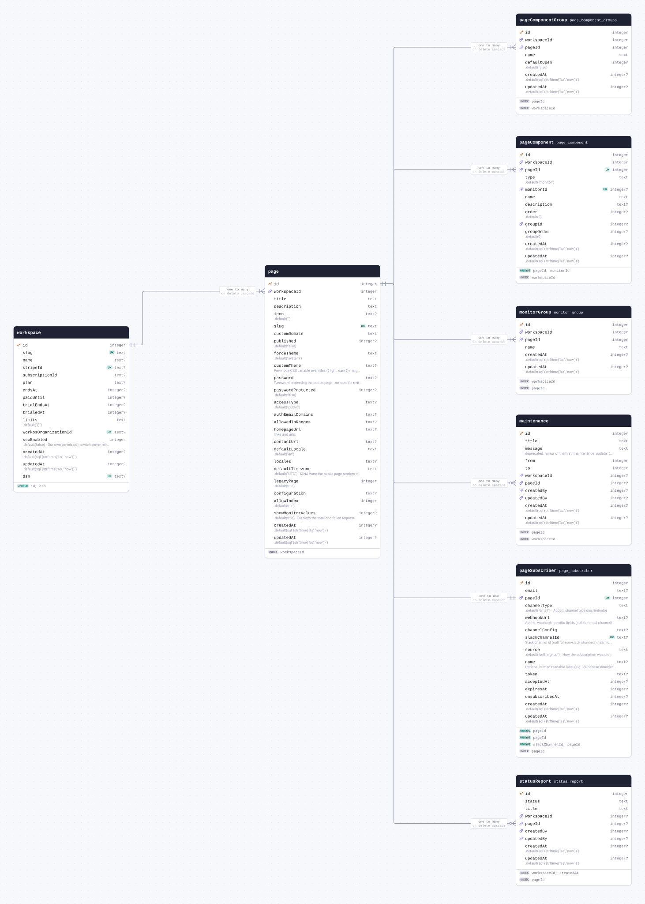

| Column                                      | Type      | Constraints                                 | Default                                    | Description                                                                                                                      |
| ------------------------------------------- | --------- | ------------------------------------------- | ------------------------------------------ | -------------------------------------------------------------------------------------------------------------------------------- |
| `id`                                        | `integer` | PK NOT NULL                                 |                                            |                                                                                                                                  |
| `workspaceId` (`workspace_id`)              | `integer` | NOT NULL → [workspace.id](#table-workspace) |                                            |                                                                                                                                  |
| `title`                                     | `text`    | NOT NULL                                    |                                            |                                                                                                                                  |
| `description`                               | `text`    | NOT NULL                                    |                                            |                                                                                                                                  |
| `icon`                                      | `text`    | NULL                                        | `.default("")`                             |                                                                                                                                  |
| `slug`                                      | `text`    | UNIQUE NOT NULL                             |                                            |                                                                                                                                  |
| `customDomain` (`custom_domain`)            | `text`    | NOT NULL                                    |                                            |                                                                                                                                  |
| `published`                                 | `integer` | NULL                                        | `.default(false)`                          |                                                                                                                                  |
| `forceTheme` (`force_theme`)                | `text`    | NOT NULL                                    | `.default("system")`                       |                                                                                                                                  |
| `customTheme` (`custom_theme`)              | `text`    | NULL                                        |                                            | Per-mode CSS variable overrides ({ light, dark }) merged over the configured theme vars. Gated by the "custom-theme" plan limit. |
| `password`                                  | `text`    | NULL                                        |                                            | Password protecting the status page - no specific restriction on password                                                        |
| `passwordProtected` (`password_protected`)  | `integer` | NULL                                        | `.default(false)`                          |                                                                                                                                  |
| `accessType` (`access_type`)                | `text`    | NULL                                        | `.default("public")`                       |                                                                                                                                  |
| `authEmailDomains` (`auth_email_domains`)   | `text`    | NULL                                        |                                            |                                                                                                                                  |
| `allowedIpRanges` (`allowed_ip_ranges`)     | `text`    | NULL                                        |                                            |                                                                                                                                  |
| `homepageUrl` (`homepage_url`)              | `text`    | NULL                                        |                                            | links and urls                                                                                                                   |
| `contactUrl` (`contact_url`)                | `text`    | NULL                                        |                                            |                                                                                                                                  |
| `defaultLocale` (`default_locale`)          | `text`    | NOT NULL                                    | `.default("en")`                           |                                                                                                                                  |
| `locales`                                   | `text`    | NULL                                        |                                            |                                                                                                                                  |
| `defaultTimezone` (`default_timezone`)      | `text`    | NOT NULL                                    | `.default("UTC")`                          | IANA zone the public page renders its bars and timestamps in                                                                     |
| `legacyPage` (`legacy_page`)                | `integer` | NOT NULL                                    | `.default(true)`                           |                                                                                                                                  |
| `configuration`                             | `text`    | NULL                                        |                                            |                                                                                                                                  |
| `allowIndex` (`allow_index`)                | `integer` | NOT NULL                                    | `.default(true)`                           |                                                                                                                                  |
| `showMonitorValues` (`show_monitor_values`) | `integer` | NULL                                        | `.default(true)`                           | Displays the total and failed request numbers for each monitor TODO: remove this column - we moved into configuration            |
| `createdAt` (`created_at`)                  | `integer` | NULL                                        | ``.default(sql`(strftime('%s', 'now'))`)`` |                                                                                                                                  |
| `updatedAt` (`updated_at`)                  | `integer` | NULL                                        | ``.default(sql`(strftime('%s', 'now'))`)`` |                                                                                                                                  |

#### Definition

```sql
CREATE TABLE `page` (
	`id` integer PRIMARY KEY,
	`workspace_id` integer NOT NULL,
	`title` text NOT NULL,
	`description` text NOT NULL,
	`icon` text(256) DEFAULT '',
	`slug` text(256) NOT NULL UNIQUE,
	`custom_domain` text(256) NOT NULL,
	`published` integer DEFAULT false,
	`force_theme` text DEFAULT 'system' NOT NULL,
	`custom_theme` text,
	`password` text(256),
	`password_protected` integer DEFAULT false,
	`access_type` text DEFAULT 'public',
	`auth_email_domains` text,
	`allowed_ip_ranges` text,
	`homepage_url` text(256),
	`contact_url` text(256),
	`default_locale` text DEFAULT 'en' NOT NULL,
	`locales` text,
	`default_timezone` text DEFAULT 'UTC' NOT NULL,
	`legacy_page` integer DEFAULT true NOT NULL,
	`configuration` text,
	`allow_index` integer DEFAULT true NOT NULL,
	`show_monitor_values` integer DEFAULT true,
	`created_at` integer DEFAULT (strftime('%s', 'now')),
	`updated_at` integer DEFAULT (strftime('%s', 'now')),
	CONSTRAINT `fk_page_workspace_id_workspace_id_fk` FOREIGN KEY (`workspace_id`) REFERENCES `workspace`(`id`) ON DELETE CASCADE
);

CREATE INDEX `page_lower_slug_idx` ON `page` (LOWER("slug"));

CREATE INDEX `page_lower_custom_domain_idx` ON `page` (LOWER("custom_domain"));

CREATE INDEX `page_workspace_id_idx` ON `page` (`workspace_id`);
```

#### Indexes

- INDEX `slug`
- INDEX `customDomain`
- INDEX `workspaceId`

#### References

- `workspaceId` → [workspace.id](#table-workspace) (many to one, on delete cascade)

#### Referenced by

- `id` → [statusReport.pageId](#table-statusReport) (one to many, on delete cascade)
- `id` → [pageSubscriber.pageId](#table-pageSubscriber) (one to one, on delete cascade)
- `id` → [maintenance.pageId](#table-maintenance) (one to many, on delete cascade)
- `id` → [monitorGroup.pageId](#table-monitorGroup) (one to many, on delete cascade)
- `id` → [pageComponent.pageId](#table-pageComponent) (one to many, on delete cascade)
- `id` → [pageComponentGroup.pageId](#table-pageComponentGroup) (one to many, on delete cascade)

<details>
<summary>Queries and their SQL</summary>

**Select**: Every row of page.

```ts
db.select().from(page);
```

```sql
select "id", "workspace_id", "title", "description", "icon", "slug", "custom_domain", "published", "force_theme", "custom_theme", "password", "password_protected", "access_type", "auth_email_domains", "allowed_ip_ranges", "homepage_url", "contact_url", "default_locale", "locales", "default_timezone", "legacy_page", "configuration", "allow_index", "show_monitor_values", "created_at", "updated_at"
from "page"
```

**Count**: How many rows page has.

```ts
db.select({ count: count() }).from(page);
```

```sql
select count(*)
from "page"
```

**Find many**: The rows of page, through the relational query API.

```ts
db.query.page.findMany();
```

```sql
select "d0"."id" as "id", "d0"."workspace_id" as "workspaceId", "d0"."title" as "title", "d0"."description" as "description", "d0"."icon" as "icon", "d0"."slug" as "slug", "d0"."custom_domain" as "customDomain", "d0"."published" as "published", "d0"."force_theme" as "forceTheme", "d0"."custom_theme" as "customTheme", "d0"."password" as "password", "d0"."password_protected" as "passwordProtected", "d0"."access_type" as "accessType", "d0"."auth_email_domains" as "authEmailDomains", "d0"."allowed_ip_ranges" as "allowedIpRanges", "d0"."homepage_url" as "homepageUrl", "d0"."contact_url" as "contactUrl", "d0"."default_locale" as "defaultLocale", "d0"."locales" as "locales", "d0"."default_timezone" as "defaultTimezone", "d0"."legacy_page" as "legacyPage", "d0"."configuration" as "configuration", "d0"."allow_index" as "allowIndex", "d0"."show_monitor_values" as "showMonitorValues", "d0"."created_at" as "createdAt", "d0"."updated_at" as "updatedAt"
from "page" as "d0"
```

**Find by primary key**: One row of page, through the relational query API.

```ts
db.query.page.findFirst({ where: { id: 1 } });
```

```sql
select "d0"."id" as "id", "d0"."workspace_id" as "workspaceId", "d0"."title" as "title", "d0"."description" as "description", "d0"."icon" as "icon", "d0"."slug" as "slug", "d0"."custom_domain" as "customDomain", "d0"."published" as "published", "d0"."force_theme" as "forceTheme", "d0"."custom_theme" as "customTheme", "d0"."password" as "password", "d0"."password_protected" as "passwordProtected", "d0"."access_type" as "accessType", "d0"."auth_email_domains" as "authEmailDomains", "d0"."allowed_ip_ranges" as "allowedIpRanges", "d0"."homepage_url" as "homepageUrl", "d0"."contact_url" as "contactUrl", "d0"."default_locale" as "defaultLocale", "d0"."locales" as "locales", "d0"."default_timezone" as "defaultTimezone", "d0"."legacy_page" as "legacyPage", "d0"."configuration" as "configuration", "d0"."allow_index" as "allowIndex", "d0"."show_monitor_values" as "showMonitorValues", "d0"."created_at" as "createdAt", "d0"."updated_at" as "updatedAt"
from "page" as "d0"
where "d0"."id" = ?
limit ?
-- params: [1,1]
```

**Insert**: Adds a row to page, giving the columns that have no default.

```ts
db.insert(page).values({
  id: 1,
  workspaceId: 1,
  title: "title",
  description: "description",
  slug: "slug",
  customDomain: "customDomain",
});
```

```sql
insert into "page" ("id", "workspace_id", "title", "description", "icon", "slug", "custom_domain", "published", "force_theme", "custom_theme", "password", "password_protected", "access_type", "auth_email_domains", "allowed_ip_ranges", "homepage_url", "contact_url", "default_locale", "locales", "default_timezone", "legacy_page", "configuration", "allow_index", "show_monitor_values", "created_at", "updated_at")
values (?, ?, ?, ?, ?, ?, ?, ?, ?, null, null, ?, ?, null, null, null, null, ?, null, ?, ?, null, ?, ?, (strftime('%s', 'now')), (strftime('%s', 'now')))
-- params: [1,1,"title","description","","slug","customDomain",0,"system",0,"public","en","UTC",1,1,1]
```

**Update**: Changes a row of page, found by its primary key.

```ts
db.update(page).set({ workspaceId: 1 }).where(eq(page.id, 1));
```

```sql
update "page"
set "workspace_id" = ?
where "page"."id" = ?
-- params: [1,1]
```

**Delete**: Deletes a row of page, found by its primary key.

```ts
db.delete(page).where(eq(page.id, 1));
```

```sql
delete from "page"
where "page"."id" = ?
-- params: [1]
```

</details>

<a id="table-monitor"></a>

### monitor

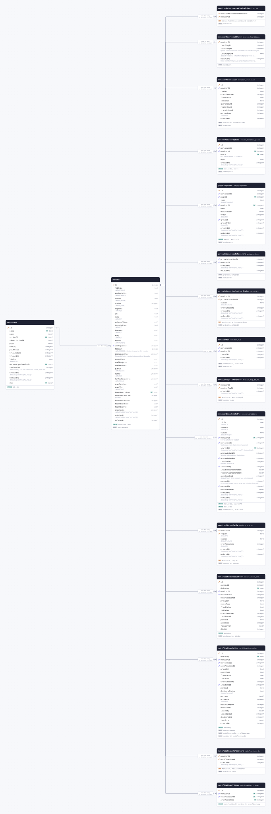

| Column                                 | Type      | Constraints                             | Default                                    | Description                                         |
| -------------------------------------- | --------- | --------------------------------------- | ------------------------------------------ | --------------------------------------------------- |
| `id`                                   | `integer` | PK NOT NULL                             |                                            |                                                     |
| `jobType` (`job_type`)                 | `text`    | NOT NULL                                | `.default("http")`                         |                                                     |
| `periodicity`                          | `text`    | NOT NULL                                | `.default("other")`                        |                                                     |
| `status`                               | `text`    | NOT NULL                                | `.default("active")`                       |                                                     |
| `active`                               | `integer` | NULL                                    | `.default(false)`                          |                                                     |
| `regions`                              | `text`    | NOT NULL                                | `.default("")`                             |                                                     |
| `url`                                  | `text`    | NOT NULL                                |                                            |                                                     |
| `name`                                 | `text`    | NOT NULL                                | `.default("")`                             |                                                     |
| `externalName` (`external_name`)       | `text`    | NULL                                    |                                            |                                                     |
| `description`                          | `text`    | NOT NULL                                | `.default("")`                             |                                                     |
| `headers`                              | `text`    | NULL                                    | `.default("")`                             |                                                     |
| `body`                                 | `text`    | NULL                                    | `.default("")`                             |                                                     |
| `method`                               | `text`    | NULL                                    | `.default("GET")`                          |                                                     |
| `workspaceId` (`workspace_id`)         | `integer` | NULL → [workspace.id](#table-workspace) |                                            |                                                     |
| `timeout`                              | `integer` | NOT NULL                                | `.default(45000)`                          | Custom timeout for this monitor                     |
| `degradedAfter` (`degraded_after`)     | `integer` | NULL                                    |                                            | Threshold for the monitor to be considered degraded |
| `assertions`                           | `text`    | NULL                                    |                                            |                                                     |
| `otelEndpoint` (`otel_endpoint`)       | `text`    | NULL                                    |                                            |                                                     |
| `otelHeaders` (`otel_headers`)         | `text`    | NULL                                    |                                            |                                                     |
| `public`                               | `integer` | NULL                                    | `.default(false)`                          |                                                     |
| `retry`                                | `integer` | NULL                                    | `.default(3)`                              |                                                     |
| `followRedirects` (`follow_redirects`) | `integer` | NULL                                    | `.default(true)`                           |                                                     |
| `grpcService` (`grpc_service`)         | `text`    | NULL                                    |                                            |                                                     |
| `grpcTls` (`grpc_tls`)                 | `text`    | NULL                                    | `.default("tls")`                          |                                                     |
| `heartbeatToken` (`heartbeat_token`)   | `text`    | NULL                                    |                                            |                                                     |
| `heartbeatPeriod` (`heartbeat_period`) | `integer` | NULL                                    |                                            | seconds                                             |
| `heartbeatGrace` (`heartbeat_grace`)   | `integer` | NULL                                    |                                            |                                                     |
| `heartbeatCron` (`heartbeat_cron`)     | `text`    | NULL                                    |                                            |                                                     |
| `heartbeatTz` (`heartbeat_tz`)         | `text`    | NULL                                    |                                            |                                                     |
| `createdAt` (`created_at`)             | `integer` | NULL                                    | ``.default(sql`(strftime('%s', 'now'))`)`` |                                                     |
| `updatedAt` (`updated_at`)             | `integer` | NULL                                    | ``.default(sql`(strftime('%s', 'now'))`)`` |                                                     |
| `deletedAt` (`deleted_at`)             | `integer` | NULL                                    |                                            |                                                     |

#### Definition

```sql
CREATE TABLE `monitor` (
	`id` integer PRIMARY KEY,
	`job_type` text DEFAULT 'http' NOT NULL,
	`periodicity` text DEFAULT 'other' NOT NULL,
	`status` text DEFAULT 'active' NOT NULL,
	`active` integer DEFAULT false,
	`regions` text DEFAULT '' NOT NULL,
	`url` text(2048) NOT NULL,
	`name` text(256) DEFAULT '' NOT NULL,
	`external_name` text,
	`description` text DEFAULT '' NOT NULL,
	`headers` text DEFAULT '',
	`body` text DEFAULT '',
	`method` text DEFAULT 'GET',
	`workspace_id` integer,
	`timeout` integer DEFAULT 45000 NOT NULL,
	`degraded_after` integer,
	`assertions` text,
	`otel_endpoint` text,
	`otel_headers` text,
	`public` integer DEFAULT false,
	`retry` integer DEFAULT 3,
	`follow_redirects` integer DEFAULT true,
	`grpc_service` text,
	`grpc_tls` text DEFAULT 'tls',
	`heartbeat_token` text,
	`heartbeat_period` integer,
	`heartbeat_grace` integer,
	`heartbeat_cron` text,
	`heartbeat_tz` text,
	`created_at` integer DEFAULT (strftime('%s', 'now')),
	`updated_at` integer DEFAULT (strftime('%s', 'now')),
	`deleted_at` integer,
	CONSTRAINT `fk_monitor_workspace_id_workspace_id_fk` FOREIGN KEY (`workspace_id`) REFERENCES `workspace`(`id`)
);

CREATE INDEX `monitor_workspace_id_active_idx` ON `monitor` (`workspace_id`) WHERE "monitor"."deleted_at" IS NULL;

CREATE UNIQUE INDEX `monitor_heartbeat_token_idx` ON `monitor` (`heartbeat_token`) WHERE "monitor"."heartbeat_token" IS NOT NULL;
```

#### Indexes

- INDEX `workspaceId`
- UNIQUE `heartbeatToken`

#### References

- `workspaceId` → [workspace.id](#table-workspace) (many to one)

#### Referenced by

- `id` → [notificationTrigger.monitorId](#table-notificationTrigger) (one to many, on delete cascade)
- `id` → [notificationsToMonitors.monitorId](#table-notificationsToMonitors) (one to many, on delete cascade)
- `id` → [notificationOutbox.monitorId](#table-notificationOutbox) (one to many, on delete cascade)
- `id` → [notificationDeadLetter.monitorId](#table-notificationDeadLetter) (one to many, on delete cascade)
- `id` → [monitorStatusTable.monitorId](#table-monitorStatusTable) (one to many, on delete cascade)
- `id` → [monitorIncidentTable.monitorId](#table-monitorIncidentTable) (one to one, on delete set default)
- `id` → [monitorTagsToMonitors.monitorId](#table-monitorTagsToMonitors) (one to many, on delete cascade)
- `id` → [monitorRun.monitorId](#table-monitorRun) (one to many)
- `id` → [privateLocationMonitorStatus.monitorId](#table-privateLocationMonitorStatus) (one to many, on delete cascade)
- `id` → [privateLocationToMonitors.monitorId](#table-privateLocationToMonitors) (one to many, on delete cascade)
- `id` → [pageComponent.monitorId](#table-pageComponent) (one to many, on delete cascade)
- `id` → [frozenMonitorUptime.monitorId](#table-frozenMonitorUptime) (one to many, on delete cascade)
- `id` → [monitorTransition.monitorId](#table-monitorTransition) (one to many, on delete cascade)
- `id` → [monitorHeartbeatState.monitorId](#table-monitorHeartbeatState) (one to one, on delete cascade)

<details>
<summary>Queries and their SQL</summary>

**Select**: Every row of monitor.

```ts
db.select().from(monitor);
```

```sql
select "id", "job_type", "periodicity", "status", "active", "regions", "url", "name", "external_name", "description", "headers", "body", "method", "workspace_id", "timeout", "degraded_after", "assertions", "otel_endpoint", "otel_headers", "public", "retry", "follow_redirects", "grpc_service", "grpc_tls", "heartbeat_token", "heartbeat_period", "heartbeat_grace", "heartbeat_cron", "heartbeat_tz", "created_at", "updated_at", "deleted_at"
from "monitor"
```

**Count**: How many rows monitor has.

```ts
db.select({ count: count() }).from(monitor);
```

```sql
select count(*)
from "monitor"
```

**Find many**: The rows of monitor, through the relational query API.

```ts
db.query.monitor.findMany();
```

```sql
select "d0"."id" as "id", "d0"."job_type" as "jobType", "d0"."periodicity" as "periodicity", "d0"."status" as "status", "d0"."active" as "active", "d0"."regions" as "regions", "d0"."url" as "url", "d0"."name" as "name", "d0"."external_name" as "externalName", "d0"."description" as "description", "d0"."headers" as "headers", "d0"."body" as "body", "d0"."method" as "method", "d0"."workspace_id" as "workspaceId", "d0"."timeout" as "timeout", "d0"."degraded_after" as "degradedAfter", "d0"."assertions" as "assertions", "d0"."otel_endpoint" as "otelEndpoint", "d0"."otel_headers" as "otelHeaders", "d0"."public" as "public", "d0"."retry" as "retry", "d0"."follow_redirects" as "followRedirects", "d0"."grpc_service" as "grpcService", "d0"."grpc_tls" as "grpcTls", "d0"."heartbeat_token" as "heartbeatToken", "d0"."heartbeat_period" as "heartbeatPeriod", "d0"."heartbeat_grace" as "heartbeatGrace", "d0"."heartbeat_cron" as "heartbeatCron", "d0"."heartbeat_tz" as "heartbeatTz", "d0"."created_at" as "createdAt", "d0"."updated_at" as "updatedAt", "d0"."deleted_at" as "deletedAt"
from "monitor" as "d0"
```

**Find by primary key**: One row of monitor, through the relational query API.

```ts
db.query.monitor.findFirst({ where: { id: 1 } });
```

```sql
select "d0"."id" as "id", "d0"."job_type" as "jobType", "d0"."periodicity" as "periodicity", "d0"."status" as "status", "d0"."active" as "active", "d0"."regions" as "regions", "d0"."url" as "url", "d0"."name" as "name", "d0"."external_name" as "externalName", "d0"."description" as "description", "d0"."headers" as "headers", "d0"."body" as "body", "d0"."method" as "method", "d0"."workspace_id" as "workspaceId", "d0"."timeout" as "timeout", "d0"."degraded_after" as "degradedAfter", "d0"."assertions" as "assertions", "d0"."otel_endpoint" as "otelEndpoint", "d0"."otel_headers" as "otelHeaders", "d0"."public" as "public", "d0"."retry" as "retry", "d0"."follow_redirects" as "followRedirects", "d0"."grpc_service" as "grpcService", "d0"."grpc_tls" as "grpcTls", "d0"."heartbeat_token" as "heartbeatToken", "d0"."heartbeat_period" as "heartbeatPeriod", "d0"."heartbeat_grace" as "heartbeatGrace", "d0"."heartbeat_cron" as "heartbeatCron", "d0"."heartbeat_tz" as "heartbeatTz", "d0"."created_at" as "createdAt", "d0"."updated_at" as "updatedAt", "d0"."deleted_at" as "deletedAt"
from "monitor" as "d0"
where "d0"."id" = ?
limit ?
-- params: [1,1]
```

**Insert**: Adds a row to monitor, giving the columns that have no default.

```ts
db.insert(monitor).values({ id: 1, url: "url" });
```

```sql
insert into "monitor" ("id", "job_type", "periodicity", "status", "active", "regions", "url", "name", "external_name", "description", "headers", "body", "method", "workspace_id", "timeout", "degraded_after", "assertions", "otel_endpoint", "otel_headers", "public", "retry", "follow_redirects", "grpc_service", "grpc_tls", "heartbeat_token", "heartbeat_period", "heartbeat_grace", "heartbeat_cron", "heartbeat_tz", "created_at", "updated_at", "deleted_at")
values (?, ?, ?, ?, ?, ?, ?, ?, null, ?, ?, ?, ?, null, ?, null, null, null, null, ?, ?, ?, null, ?, null, null, null, null, null, (strftime('%s', 'now')), (strftime('%s', 'now')), null)
-- params: [1,"http","other","active",0,"","url","","","","","GET",45000,0,3,1,"tls"]
```

**Update**: Changes a row of monitor, found by its primary key.

```ts
db.update(monitor).set({ jobType: "jobType" }).where(eq(monitor.id, 1));
```

```sql
update "monitor"
set "job_type" = ?
where "monitor"."id" = ?
-- params: ["jobType",1]
```

**Delete**: Deletes a row of monitor, found by its primary key.

```ts
db.delete(monitor).where(eq(monitor.id, 1));
```

```sql
delete from "monitor"
where "monitor"."id" = ?
-- params: [1]
```

</details>

<a id="table-pageSubscriber"></a>

### pageSubscriber

Table `page_subscriber`.

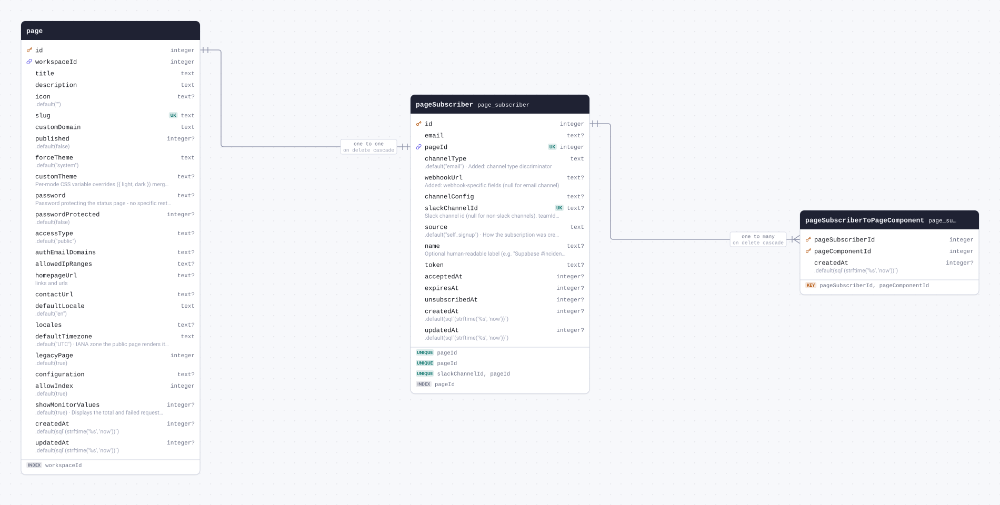

| Column                                | Type      | Constraints                       | Default                                    | Description                                                                                                                                                                        |
| ------------------------------------- | --------- | --------------------------------- | ------------------------------------------ | ---------------------------------------------------------------------------------------------------------------------------------------------------------------------------------- |
| `id`                                  | `integer` | PK NOT NULL                       |                                            |                                                                                                                                                                                    |
| `email`                               | `text`    | NULL                              |                                            |                                                                                                                                                                                    |
| `pageId` (`page_id`)                  | `integer` | NOT NULL → [page.id](#table-page) |                                            |                                                                                                                                                                                    |
| `channelType` (`channel_type`)        | `text`    | NOT NULL                          | `.default("email")`                        | Added: channel type discriminator                                                                                                                                                  |
| `webhookUrl` (`webhook_url`)          | `text`    | NULL                              |                                            | Added: webhook-specific fields (null for email channel)                                                                                                                            |
| `channelConfig` (`channel_config`)    | `text`    | NULL                              |                                            |                                                                                                                                                                                    |
| `slackChannelId` (`slack_channel_id`) | `text`    | NULL                              |                                            | Slack channel id (null for non-slack channels). teamId + channelName live in channelConfig; the bot token is resolved from the integration row at send time, never persisted here. |
| `source`                              | `text`    | NOT NULL                          | `.default("self_signup")`                  | How the subscription was created. Vendor-added rows skip verification and are editable from the dashboard.                                                                         |
| `name`                                | `text`    | NULL                              |                                            | Optional human-readable label (e.g. "Supabase #incidents"). When set, rendered in place of the raw destination in UI.                                                              |
| `token`                               | `text`    | NULL                              |                                            |                                                                                                                                                                                    |
| `acceptedAt` (`accepted_at`)          | `integer` | NULL                              |                                            |                                                                                                                                                                                    |
| `expiresAt` (`expires_at`)            | `integer` | NULL                              |                                            |                                                                                                                                                                                    |
| `unsubscribedAt` (`unsubscribed_at`)  | `integer` | NULL                              |                                            |                                                                                                                                                                                    |
| `createdAt` (`created_at`)            | `integer` | NULL                              | ``.default(sql`(strftime('%s', 'now'))`)`` |                                                                                                                                                                                    |
| `updatedAt` (`updated_at`)            | `integer` | NULL                              | ``.default(sql`(strftime('%s', 'now'))`)`` |                                                                                                                                                                                    |

#### Definition

```sql
CREATE TABLE `page_subscriber` (
	`id` integer PRIMARY KEY,
	`email` text,
	`page_id` integer NOT NULL,
	`channel_type` text DEFAULT 'email' NOT NULL,
	`webhook_url` text,
	`channel_config` text,
	`slack_channel_id` text,
	`source` text DEFAULT 'self_signup' NOT NULL,
	`name` text,
	`token` text,
	`accepted_at` integer,
	`expires_at` integer,
	`unsubscribed_at` integer,
	`created_at` integer DEFAULT (strftime('%s', 'now')),
	`updated_at` integer DEFAULT (strftime('%s', 'now')),
	CONSTRAINT `fk_page_subscriber_page_id_page_id_fk` FOREIGN KEY (`page_id`) REFERENCES `page`(`id`) ON DELETE CASCADE,
	CONSTRAINT "page_subscriber_channel_check" CHECK(("channel_type" = 'email' AND "email" IS NOT NULL AND "webhook_url" IS NULL) OR ("channel_type" = 'webhook' AND "webhook_url" IS NOT NULL AND "email" IS NULL) OR ("channel_type" = 'slack' AND "slack_channel_id" IS NOT NULL AND "email" IS NULL AND "webhook_url" IS NULL))
);

CREATE INDEX `page_subscriber_page_id_idx` ON `page_subscriber` (`page_id`);

CREATE UNIQUE INDEX `idx_page_subscriber_email_page_active` ON `page_subscriber` (LOWER("email"),`page_id`) WHERE "page_subscriber"."unsubscribed_at" IS NULL AND "page_subscriber"."channel_type" = 'email';

CREATE UNIQUE INDEX `idx_page_subscriber_webhook_page_active` ON `page_subscriber` (LOWER("webhook_url"),`page_id`) WHERE "page_subscriber"."unsubscribed_at" IS NULL AND "page_subscriber"."channel_type" = 'webhook';

CREATE UNIQUE INDEX `idx_page_subscriber_slack_channel_page_active` ON `page_subscriber` (`slack_channel_id`,`page_id`) WHERE "page_subscriber"."unsubscribed_at" IS NULL AND "page_subscriber"."channel_type" = 'slack';
```

#### Indexes

- INDEX `pageId`
- UNIQUE `email`, `pageId`
- UNIQUE `webhookUrl`, `pageId`
- UNIQUE `slackChannelId`, `pageId`

#### References

- `pageId` → [page.id](#table-page) (one to one, on delete cascade)

#### Referenced by

- `id` → [pageSubscriberToPageComponent.pageSubscriberId](#table-pageSubscriberToPageComponent) (one to many, on delete cascade)

<details>
<summary>Queries and their SQL</summary>

**Select**: Every row of pageSubscriber.

```ts
db.select().from(pageSubscriber);
```

```sql
select "id", "email", "page_id", "channel_type", "webhook_url", "channel_config", "slack_channel_id", "source", "name", "token", "accepted_at", "expires_at", "unsubscribed_at", "created_at", "updated_at"
from "page_subscriber"
```

**Count**: How many rows pageSubscriber has.

```ts
db.select({ count: count() }).from(pageSubscriber);
```

```sql
select count(*)
from "page_subscriber"
```

**Find many**: The rows of pageSubscriber, through the relational query API.

```ts
db.query.pageSubscriber.findMany();
```

```sql
select "d0"."id" as "id", "d0"."email" as "email", "d0"."page_id" as "pageId", "d0"."channel_type" as "channelType", "d0"."webhook_url" as "webhookUrl", "d0"."channel_config" as "channelConfig", "d0"."slack_channel_id" as "slackChannelId", "d0"."source" as "source", "d0"."name" as "name", "d0"."token" as "token", "d0"."accepted_at" as "acceptedAt", "d0"."expires_at" as "expiresAt", "d0"."unsubscribed_at" as "unsubscribedAt", "d0"."created_at" as "createdAt", "d0"."updated_at" as "updatedAt"
from "page_subscriber" as "d0"
```

**Find by primary key**: One row of pageSubscriber, through the relational query API.

```ts
db.query.pageSubscriber.findFirst({ where: { id: 1 } });
```

```sql
select "d0"."id" as "id", "d0"."email" as "email", "d0"."page_id" as "pageId", "d0"."channel_type" as "channelType", "d0"."webhook_url" as "webhookUrl", "d0"."channel_config" as "channelConfig", "d0"."slack_channel_id" as "slackChannelId", "d0"."source" as "source", "d0"."name" as "name", "d0"."token" as "token", "d0"."accepted_at" as "acceptedAt", "d0"."expires_at" as "expiresAt", "d0"."unsubscribed_at" as "unsubscribedAt", "d0"."created_at" as "createdAt", "d0"."updated_at" as "updatedAt"
from "page_subscriber" as "d0"
where "d0"."id" = ?
limit ?
-- params: [1,1]
```

**Insert**: Adds a row to pageSubscriber, giving the columns that have no default.

```ts
db.insert(pageSubscriber).values({ id: 1, pageId: 1 });
```

```sql
insert into "page_subscriber" ("id", "email", "page_id", "channel_type", "webhook_url", "channel_config", "slack_channel_id", "source", "name", "token", "accepted_at", "expires_at", "unsubscribed_at", "created_at", "updated_at")
values (?, null, ?, ?, null, null, null, ?, null, null, null, null, null, (strftime('%s', 'now')), (strftime('%s', 'now')))
-- params: [1,1,"email","self_signup"]
```

**Update**: Changes a row of pageSubscriber, found by its primary key.

```ts
db.update(pageSubscriber).set({ email: "email" }).where(eq(pageSubscriber.id, 1));
```

```sql
update "page_subscriber"
set "email" = ?
where "page_subscriber"."id" = ?
-- params: ["email",1]
```

**Delete**: Deletes a row of pageSubscriber, found by its primary key.

```ts
db.delete(pageSubscriber).where(eq(pageSubscriber.id, 1));
```

```sql
delete from "page_subscriber"
where "page_subscriber"."id" = ?
-- params: [1]
```

</details>

<a id="table-pageSubscriberToPageComponent"></a>

### pageSubscriberToPageComponent

Table `page_subscriber_to_page_component`.

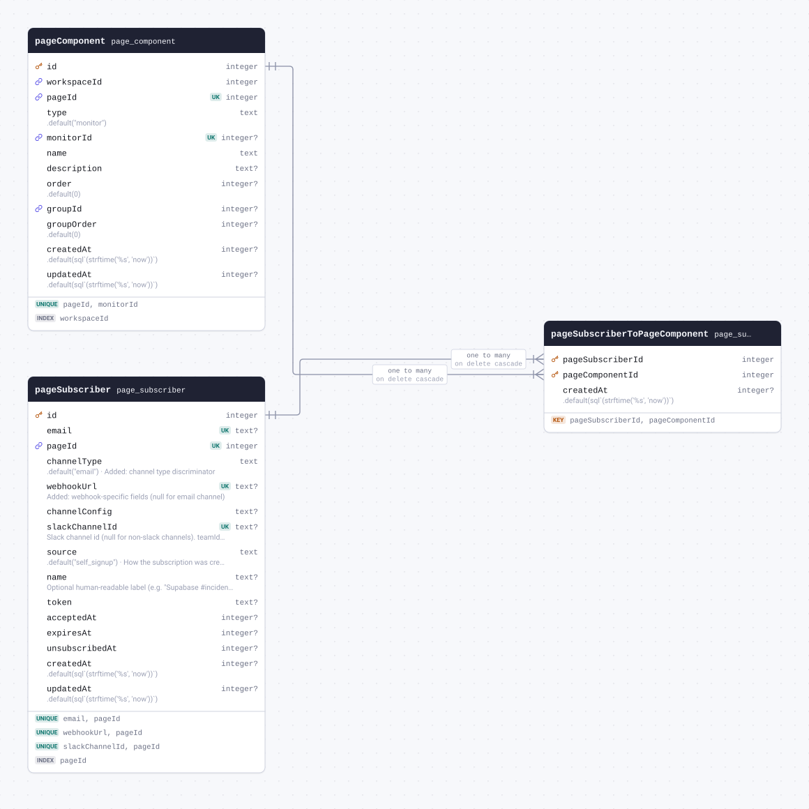

| Column                                    | Type      | Constraints                                              | Default                                    | Description |
| ----------------------------------------- | --------- | -------------------------------------------------------- | ------------------------------------------ | ----------- |
| `pageSubscriberId` (`page_subscriber_id`) | `integer` | PK NOT NULL → [pageSubscriber.id](#table-pageSubscriber) |                                            |             |
| `pageComponentId` (`page_component_id`)   | `integer` | PK NOT NULL → [pageComponent.id](#table-pageComponent)   |                                            |             |
| `createdAt` (`created_at`)                | `integer` | NULL                                                     | ``.default(sql`(strftime('%s', 'now'))`)`` |             |

#### Definition

```sql
CREATE TABLE `page_subscriber_to_page_component` (
	`page_subscriber_id` integer NOT NULL,
	`page_component_id` integer NOT NULL,
	`created_at` integer DEFAULT (strftime('%s', 'now')),
	CONSTRAINT `page_subscriber_to_page_component_pk` PRIMARY KEY(`page_subscriber_id`, `page_component_id`),
	CONSTRAINT `fk_page_subscriber_to_page_component_page_subscriber_id_page_subscriber_id_fk` FOREIGN KEY (`page_subscriber_id`) REFERENCES `page_subscriber`(`id`) ON DELETE CASCADE,
	CONSTRAINT `fk_page_subscriber_to_page_component_page_component_id_page_component_id_fk` FOREIGN KEY (`page_component_id`) REFERENCES `page_component`(`id`) ON DELETE CASCADE
);
```

#### Indexes

- PRIMARY KEY `pageSubscriberId`, `pageComponentId`

#### References

- `pageSubscriberId` → [pageSubscriber.id](#table-pageSubscriber) (many to one, on delete cascade)
- `pageComponentId` → [pageComponent.id](#table-pageComponent) (many to one, on delete cascade)

<details>
<summary>Queries and their SQL</summary>

**Select**: Every row of pageSubscriberToPageComponent.

```ts
db.select().from(pageSubscriberToPageComponent);
```

```sql
select "page_subscriber_id", "page_component_id", "created_at"
from "page_subscriber_to_page_component"
```

**Count**: How many rows pageSubscriberToPageComponent has.

```ts
db.select({ count: count() }).from(pageSubscriberToPageComponent);
```

```sql
select count(*)
from "page_subscriber_to_page_component"
```

**Find many**: The rows of pageSubscriberToPageComponent, through the relational query API.

```ts
db.query.pageSubscriberToPageComponent.findMany();
```

```sql
select "d0"."page_subscriber_id" as "pageSubscriberId", "d0"."page_component_id" as "pageComponentId", "d0"."created_at" as "createdAt"
from "page_subscriber_to_page_component" as "d0"
```

**Find by primary key**: One row of pageSubscriberToPageComponent, through the relational query API.

```ts
db.query.pageSubscriberToPageComponent.findFirst({
  where: { pageSubscriberId: 1, pageComponentId: 1 },
});
```

```sql
select "d0"."page_subscriber_id" as "pageSubscriberId", "d0"."page_component_id" as "pageComponentId", "d0"."created_at" as "createdAt"
from "page_subscriber_to_page_component" as "d0"
where (("d0"."page_subscriber_id" = ?) and ("d0"."page_component_id" = ?))
limit ?
-- params: [1,1,1]
```

**Insert**: Adds a row to pageSubscriberToPageComponent, giving the columns that have no default.

```ts
db.insert(pageSubscriberToPageComponent).values({ pageSubscriberId: 1, pageComponentId: 1 });
```

```sql
insert into "page_subscriber_to_page_component" ("page_subscriber_id", "page_component_id", "created_at")
values (?, ?, (strftime('%s', 'now')))
-- params: [1,1]
```

**Update**: Changes a row of pageSubscriberToPageComponent, found by its primary key.

```ts
db.update(pageSubscriberToPageComponent)
  .set({ createdAt: 1 })
  .where(
    and(
      eq(pageSubscriberToPageComponent.pageSubscriberId, 1),
      eq(pageSubscriberToPageComponent.pageComponentId, 1),
    ),
  );
```

```sql
update "page_subscriber_to_page_component"
set "created_at" = ?
where (("page_subscriber_to_page_component"."page_subscriber_id" = ?) and ("page_subscriber_to_page_component"."page_component_id" = ?))
-- params: [1,1,1]
```

**Delete**: Deletes a row of pageSubscriberToPageComponent, found by its primary key.

```ts
db.delete(pageSubscriberToPageComponent).where(
  and(
    eq(pageSubscriberToPageComponent.pageSubscriberId, 1),
    eq(pageSubscriberToPageComponent.pageComponentId, 1),
  ),
);
```

```sql
delete from "page_subscriber_to_page_component"
where (("page_subscriber_to_page_component"."page_subscriber_id" = ?) and ("page_subscriber_to_page_component"."page_component_id" = ?))
-- params: [1,1]
```

</details>

<a id="table-notification"></a>

### notification

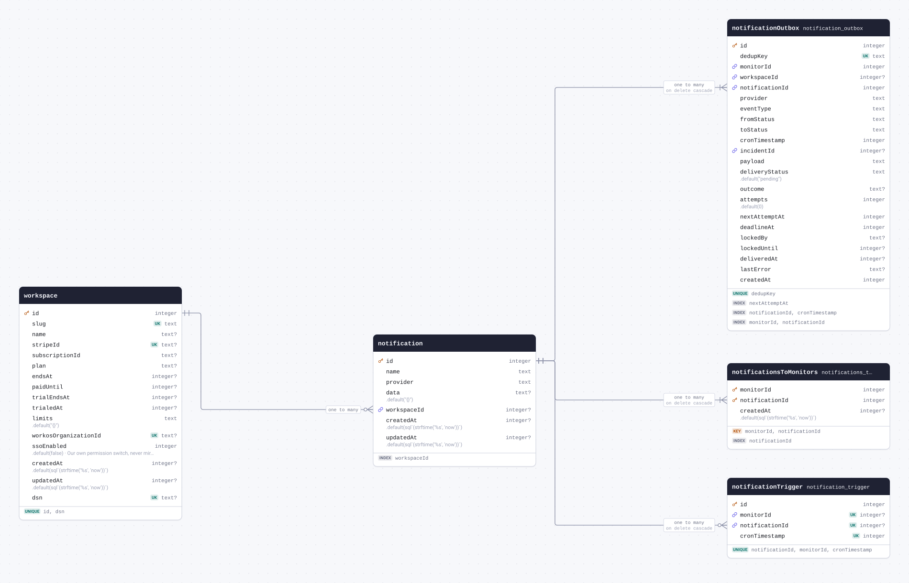

| Column                         | Type      | Constraints                             | Default                                    | Description |
| ------------------------------ | --------- | --------------------------------------- | ------------------------------------------ | ----------- |
| `id`                           | `integer` | PK NOT NULL                             |                                            |             |
| `name`                         | `text`    | NOT NULL                                |                                            |             |
| `provider`                     | `text`    | NOT NULL                                |                                            |             |
| `data`                         | `text`    | NULL                                    | `.default("{}")`                           |             |
| `workspaceId` (`workspace_id`) | `integer` | NULL → [workspace.id](#table-workspace) |                                            |             |
| `createdAt` (`created_at`)     | `integer` | NULL                                    | ``.default(sql`(strftime('%s', 'now'))`)`` |             |
| `updatedAt` (`updated_at`)     | `integer` | NULL                                    | ``.default(sql`(strftime('%s', 'now'))`)`` |             |

#### Definition

```sql
CREATE TABLE `notification` (
	`id` integer PRIMARY KEY,
	`name` text NOT NULL,
	`provider` text NOT NULL,
	`data` text DEFAULT '{}',
	`workspace_id` integer,
	`created_at` integer DEFAULT (strftime('%s', 'now')),
	`updated_at` integer DEFAULT (strftime('%s', 'now')),
	CONSTRAINT `fk_notification_workspace_id_workspace_id_fk` FOREIGN KEY (`workspace_id`) REFERENCES `workspace`(`id`)
);

CREATE INDEX `notification_workspace_id_idx` ON `notification` (`workspace_id`);
```

#### Indexes

- INDEX `workspaceId`

#### References

- `workspaceId` → [workspace.id](#table-workspace) (many to one)

#### Referenced by

- `id` → [notificationTrigger.notificationId](#table-notificationTrigger) (one to many, on delete cascade)
- `id` → [notificationsToMonitors.notificationId](#table-notificationsToMonitors) (one to many, on delete cascade)
- `id` → [notificationOutbox.notificationId](#table-notificationOutbox) (one to many, on delete cascade)

<details>
<summary>Queries and their SQL</summary>

**Select**: Every row of notification.

```ts
db.select().from(notification);
```

```sql
select "id", "name", "provider", "data", "workspace_id", "created_at", "updated_at"
from "notification"
```

**Count**: How many rows notification has.

```ts
db.select({ count: count() }).from(notification);
```

```sql
select count(*)
from "notification"
```

**Find many**: The rows of notification, through the relational query API.

```ts
db.query.notification.findMany();
```

```sql
select "d0"."id" as "id", "d0"."name" as "name", "d0"."provider" as "provider", "d0"."data" as "data", "d0"."workspace_id" as "workspaceId", "d0"."created_at" as "createdAt", "d0"."updated_at" as "updatedAt"
from "notification" as "d0"
```

**Find by primary key**: One row of notification, through the relational query API.

```ts
db.query.notification.findFirst({ where: { id: 1 } });
```

```sql
select "d0"."id" as "id", "d0"."name" as "name", "d0"."provider" as "provider", "d0"."data" as "data", "d0"."workspace_id" as "workspaceId", "d0"."created_at" as "createdAt", "d0"."updated_at" as "updatedAt"
from "notification" as "d0"
where "d0"."id" = ?
limit ?
-- params: [1,1]
```

**Insert**: Adds a row to notification, giving the columns that have no default.

```ts
db.insert(notification).values({ id: 1, name: "name", provider: "provider" });
```

```sql
insert into "notification" ("id", "name", "provider", "data", "workspace_id", "created_at", "updated_at")
values (?, ?, ?, ?, null, (strftime('%s', 'now')), (strftime('%s', 'now')))
-- params: [1,"name","provider","{}"]
```

**Update**: Changes a row of notification, found by its primary key.

```ts
db.update(notification).set({ name: "name" }).where(eq(notification.id, 1));
```

```sql
update "notification"
set "name" = ?
where "notification"."id" = ?
-- params: ["name",1]
```

**Delete**: Deletes a row of notification, found by its primary key.

```ts
db.delete(notification).where(eq(notification.id, 1));
```

```sql
delete from "notification"
where "notification"."id" = ?
-- params: [1]
```

</details>

<a id="table-notificationTrigger"></a>

### notificationTrigger

Table `notification_trigger`.

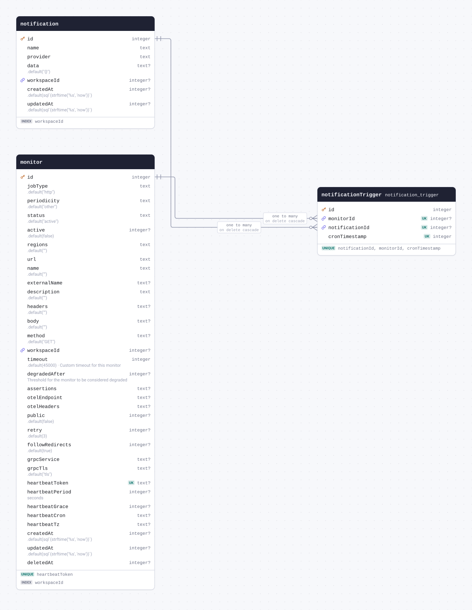

| Column                               | Type      | Constraints                                   | Default | Description |
| ------------------------------------ | --------- | --------------------------------------------- | ------- | ----------- |
| `id`                                 | `integer` | PK NOT NULL                                   |         |             |
| `monitorId` (`monitor_id`)           | `integer` | NULL → [monitor.id](#table-monitor)           |         |             |
| `notificationId` (`notification_id`) | `integer` | NULL → [notification.id](#table-notification) |         |             |
| `cronTimestamp` (`cron_timestamp`)   | `integer` | NOT NULL                                      |         |             |

#### Definition

```sql
CREATE TABLE `notification_trigger` (
	`id` integer PRIMARY KEY,
	`monitor_id` integer,
	`notification_id` integer,
	`cron_timestamp` integer NOT NULL,
	CONSTRAINT `fk_notification_trigger_monitor_id_monitor_id_fk` FOREIGN KEY (`monitor_id`) REFERENCES `monitor`(`id`) ON DELETE CASCADE,
	CONSTRAINT `fk_notification_trigger_notification_id_notification_id_fk` FOREIGN KEY (`notification_id`) REFERENCES `notification`(`id`) ON DELETE CASCADE
);

CREATE UNIQUE INDEX `notification_id_monitor_id_crontimestampe` ON `notification_trigger` (`notification_id`,`monitor_id`,`cron_timestamp`);
```

#### Indexes

- UNIQUE `notificationId`, `monitorId`, `cronTimestamp`

#### References

- `monitorId` → [monitor.id](#table-monitor) (many to one, on delete cascade)
- `notificationId` → [notification.id](#table-notification) (many to one, on delete cascade)

<details>
<summary>Queries and their SQL</summary>

**Select**: Every row of notificationTrigger.

```ts
db.select().from(notificationTrigger);
```

```sql
select "id", "monitor_id", "notification_id", "cron_timestamp"
from "notification_trigger"
```

**Count**: How many rows notificationTrigger has.

```ts
db.select({ count: count() }).from(notificationTrigger);
```

```sql
select count(*)
from "notification_trigger"
```

**Find many**: The rows of notificationTrigger, through the relational query API.

```ts
db.query.notificationTrigger.findMany();
```

```sql
select "d0"."id" as "id", "d0"."monitor_id" as "monitorId", "d0"."notification_id" as "notificationId", "d0"."cron_timestamp" as "cronTimestamp"
from "notification_trigger" as "d0"
```

**Find by primary key**: One row of notificationTrigger, through the relational query API.

```ts
db.query.notificationTrigger.findFirst({ where: { id: 1 } });
```

```sql
select "d0"."id" as "id", "d0"."monitor_id" as "monitorId", "d0"."notification_id" as "notificationId", "d0"."cron_timestamp" as "cronTimestamp"
from "notification_trigger" as "d0"
where "d0"."id" = ?
limit ?
-- params: [1,1]
```

**Insert**: Adds a row to notificationTrigger, giving the columns that have no default.

```ts
db.insert(notificationTrigger).values({ id: 1, cronTimestamp: 1 });
```

```sql
insert into "notification_trigger" ("id", "monitor_id", "notification_id", "cron_timestamp")
values (?, null, null, ?)
-- params: [1,1]
```

**Update**: Changes a row of notificationTrigger, found by its primary key.

```ts
db.update(notificationTrigger).set({ monitorId: 1 }).where(eq(notificationTrigger.id, 1));
```

```sql
update "notification_trigger"
set "monitor_id" = ?
where "notification_trigger"."id" = ?
-- params: [1,1]
```

**Delete**: Deletes a row of notificationTrigger, found by its primary key.

```ts
db.delete(notificationTrigger).where(eq(notificationTrigger.id, 1));
```

```sql
delete from "notification_trigger"
where "notification_trigger"."id" = ?
-- params: [1]
```

</details>

<a id="table-notificationsToMonitors"></a>

### notificationsToMonitors

Table `notifications_to_monitors`.

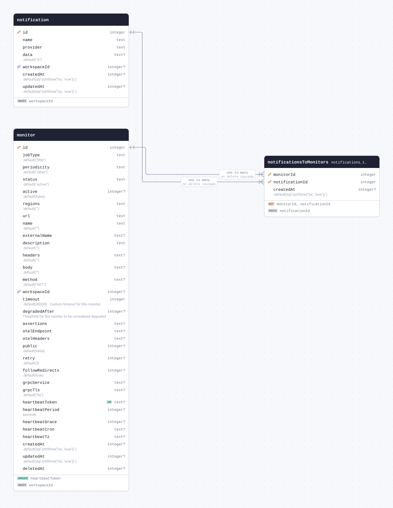

| Column                               | Type      | Constraints                                          | Default                                    | Description |
| ------------------------------------ | --------- | ---------------------------------------------------- | ------------------------------------------ | ----------- |
| `monitorId` (`monitor_id`)           | `integer` | PK NOT NULL → [monitor.id](#table-monitor)           |                                            |             |
| `notificationId` (`notification_id`) | `integer` | PK NOT NULL → [notification.id](#table-notification) |                                            |             |
| `createdAt` (`created_at`)           | `integer` | NULL                                                 | ``.default(sql`(strftime('%s', 'now'))`)`` |             |

#### Definition

```sql
CREATE TABLE `notifications_to_monitors` (
	`monitor_id` integer NOT NULL,
	`notification_id` integer NOT NULL,
	`created_at` integer DEFAULT (strftime('%s', 'now')),
	CONSTRAINT `notifications_to_monitors_pk` PRIMARY KEY(`monitor_id`, `notification_id`),
	CONSTRAINT `fk_notifications_to_monitors_monitor_id_monitor_id_fk` FOREIGN KEY (`monitor_id`) REFERENCES `monitor`(`id`) ON DELETE CASCADE,
	CONSTRAINT `fk_notifications_to_monitors_notification_id_notification_id_fk` FOREIGN KEY (`notification_id`) REFERENCES `notification`(`id`) ON DELETE CASCADE
);

CREATE INDEX `notifications_to_monitors_notification_id_idx` ON `notifications_to_monitors` (`notification_id`);
```

#### Indexes

- PRIMARY KEY `monitorId`, `notificationId`
- INDEX `notificationId`

#### References

- `monitorId` → [monitor.id](#table-monitor) (many to one, on delete cascade)
- `notificationId` → [notification.id](#table-notification) (many to one, on delete cascade)

<details>
<summary>Queries and their SQL</summary>

**Select**: Every row of notificationsToMonitors.

```ts
db.select().from(notificationsToMonitors);
```

```sql
select "monitor_id", "notification_id", "created_at"
from "notifications_to_monitors"
```

**Count**: How many rows notificationsToMonitors has.

```ts
db.select({ count: count() }).from(notificationsToMonitors);
```

```sql
select count(*)
from "notifications_to_monitors"
```

**Find many**: The rows of notificationsToMonitors, through the relational query API.

```ts
db.query.notificationsToMonitors.findMany();
```

```sql
select "d0"."monitor_id" as "monitorId", "d0"."notification_id" as "notificationId", "d0"."created_at" as "createdAt"
from "notifications_to_monitors" as "d0"
```

**Find by primary key**: One row of notificationsToMonitors, through the relational query API.

```ts
db.query.notificationsToMonitors.findFirst({ where: { monitorId: 1, notificationId: 1 } });
```

```sql
select "d0"."monitor_id" as "monitorId", "d0"."notification_id" as "notificationId", "d0"."created_at" as "createdAt"
from "notifications_to_monitors" as "d0"
where (("d0"."monitor_id" = ?) and ("d0"."notification_id" = ?))
limit ?
-- params: [1,1,1]
```

**Insert**: Adds a row to notificationsToMonitors, giving the columns that have no default.

```ts
db.insert(notificationsToMonitors).values({ monitorId: 1, notificationId: 1 });
```

```sql
insert into "notifications_to_monitors" ("monitor_id", "notification_id", "created_at")
values (?, ?, (strftime('%s', 'now')))
-- params: [1,1]
```

**Update**: Changes a row of notificationsToMonitors, found by its primary key.

```ts
db.update(notificationsToMonitors)
  .set({ createdAt: 1 })
  .where(
    and(eq(notificationsToMonitors.monitorId, 1), eq(notificationsToMonitors.notificationId, 1)),
  );
```

```sql
update "notifications_to_monitors"
set "created_at" = ?
where (("notifications_to_monitors"."monitor_id" = ?) and ("notifications_to_monitors"."notification_id" = ?))
-- params: [1,1,1]
```

**Delete**: Deletes a row of notificationsToMonitors, found by its primary key.

```ts
db.delete(notificationsToMonitors).where(
  and(eq(notificationsToMonitors.monitorId, 1), eq(notificationsToMonitors.notificationId, 1)),
);
```

```sql
delete from "notifications_to_monitors"
where (("notifications_to_monitors"."monitor_id" = ?) and ("notifications_to_monitors"."notification_id" = ?))
-- params: [1,1]
```

</details>

<a id="table-notificationOutbox"></a>

### notificationOutbox

Table `notification_outbox`.

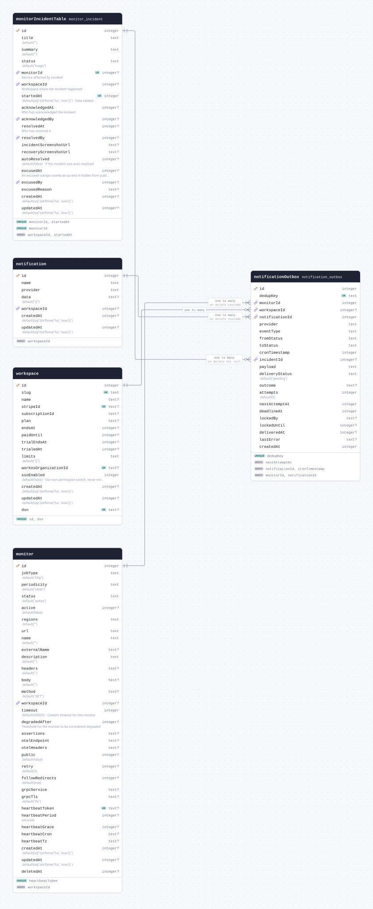

| Column                               | Type      | Constraints                                                   | Default               | Description |
| ------------------------------------ | --------- | ------------------------------------------------------------- | --------------------- | ----------- |
| `id`                                 | `integer` | PK NOT NULL                                                   |                       |             |
| `dedupKey` (`dedup_key`)             | `text`    | NOT NULL                                                      |                       |             |
| `monitorId` (`monitor_id`)           | `integer` | NOT NULL → [monitor.id](#table-monitor)                       |                       |             |
| `workspaceId` (`workspace_id`)       | `integer` | NULL → [workspace.id](#table-workspace)                       |                       |             |
| `notificationId` (`notification_id`) | `integer` | NOT NULL → [notification.id](#table-notification)             |                       |             |
| `provider`                           | `text`    | NOT NULL                                                      |                       |             |
| `eventType` (`event_type`)           | `text`    | NOT NULL                                                      |                       |             |
| `fromStatus` (`from_status`)         | `text`    | NOT NULL                                                      |                       |             |
| `toStatus` (`to_status`)             | `text`    | NOT NULL                                                      |                       |             |
| `cronTimestamp` (`cron_timestamp`)   | `integer` | NOT NULL                                                      |                       |             |
| `incidentId` (`incident_id`)         | `integer` | NULL → [monitorIncidentTable.id](#table-monitorIncidentTable) |                       |             |
| `payload`                            | `text`    | NOT NULL                                                      |                       |             |
| `deliveryStatus` (`delivery_status`) | `text`    | NOT NULL                                                      | `.default("pending")` |             |
| `outcome`                            | `text`    | NULL                                                          |                       |             |
| `attempts`                           | `integer` | NOT NULL                                                      | `.default(0)`         |             |
| `nextAttemptAt` (`next_attempt_at`)  | `integer` | NOT NULL                                                      |                       |             |
| `deadlineAt` (`deadline_at`)         | `integer` | NOT NULL                                                      |                       |             |
| `lockedBy` (`locked_by`)             | `text`    | NULL                                                          |                       |             |
| `lockedUntil` (`locked_until`)       | `integer` | NULL                                                          |                       |             |
| `deliveredAt` (`delivered_at`)       | `integer` | NULL                                                          |                       |             |
| `lastError` (`last_error`)           | `text`    | NULL                                                          |                       |             |
| `createdAt` (`created_at`)           | `integer` | NOT NULL                                                      |                       |             |

#### Definition

```sql
CREATE TABLE `notification_outbox` (
	`id` integer PRIMARY KEY,
	`dedup_key` text NOT NULL,
	`monitor_id` integer NOT NULL,
	`workspace_id` integer,
	`notification_id` integer NOT NULL,
	`provider` text NOT NULL,
	`event_type` text NOT NULL,
	`from_status` text NOT NULL,
	`to_status` text NOT NULL,
	`cron_timestamp` integer NOT NULL,
	`incident_id` integer,
	`payload` text NOT NULL,
	`delivery_status` text DEFAULT 'pending' NOT NULL,
	`outcome` text,
	`attempts` integer DEFAULT 0 NOT NULL,
	`next_attempt_at` integer NOT NULL,
	`deadline_at` integer NOT NULL,
	`locked_by` text,
	`locked_until` integer,
	`delivered_at` integer,
	`last_error` text,
	`created_at` integer NOT NULL,
	CONSTRAINT `fk_notification_outbox_monitor_id_monitor_id_fk` FOREIGN KEY (`monitor_id`) REFERENCES `monitor`(`id`) ON DELETE CASCADE,
	CONSTRAINT `fk_notification_outbox_workspace_id_workspace_id_fk` FOREIGN KEY (`workspace_id`) REFERENCES `workspace`(`id`),
	CONSTRAINT `fk_notification_outbox_notification_id_notification_id_fk` FOREIGN KEY (`notification_id`) REFERENCES `notification`(`id`) ON DELETE CASCADE,
	CONSTRAINT `fk_notification_outbox_incident_id_monitor_incident_id_fk` FOREIGN KEY (`incident_id`) REFERENCES `monitor_incident`(`id`) ON DELETE SET NULL
);

CREATE UNIQUE INDEX `notification_outbox_dedup_key_idx` ON `notification_outbox` (`dedup_key`);

CREATE INDEX `notification_outbox_claim_idx` ON `notification_outbox` (`next_attempt_at`) WHERE "notification_outbox"."delivery_status" = 'pending';

CREATE INDEX `notification_outbox_notification_id_cron_timestamp_idx` ON `notification_outbox` (`notification_id`,`cron_timestamp`);

CREATE INDEX `notification_outbox_channel_idx` ON `notification_outbox` (`monitor_id`,`notification_id`) WHERE "notification_outbox"."delivery_status" = 'pending';
```

#### Indexes

- UNIQUE `dedupKey`
- INDEX `nextAttemptAt`
- INDEX `notificationId`, `cronTimestamp`
- INDEX `monitorId`, `notificationId`

#### References

- `monitorId` → [monitor.id](#table-monitor) (many to one, on delete cascade)
- `workspaceId` → [workspace.id](#table-workspace) (many to one)
- `notificationId` → [notification.id](#table-notification) (many to one, on delete cascade)
- `incidentId` → [monitorIncidentTable.id](#table-monitorIncidentTable) (many to one, on delete set null)

<details>
<summary>Queries and their SQL</summary>

**Select**: Every row of notificationOutbox.

```ts
db.select().from(notificationOutbox);
```

```sql
select "id", "dedup_key", "monitor_id", "workspace_id", "notification_id", "provider", "event_type", "from_status", "to_status", "cron_timestamp", "incident_id", "payload", "delivery_status", "outcome", "attempts", "next_attempt_at", "deadline_at", "locked_by", "locked_until", "delivered_at", "last_error", "created_at"
from "notification_outbox"
```

**Count**: How many rows notificationOutbox has.

```ts
db.select({ count: count() }).from(notificationOutbox);
```

```sql
select count(*)
from "notification_outbox"
```

**Find many**: The rows of notificationOutbox, through the relational query API.

```ts
db.query.notificationOutbox.findMany();
```

```sql
select "d0"."id" as "id", "d0"."dedup_key" as "dedupKey", "d0"."monitor_id" as "monitorId", "d0"."workspace_id" as "workspaceId", "d0"."notification_id" as "notificationId", "d0"."provider" as "provider", "d0"."event_type" as "eventType", "d0"."from_status" as "fromStatus", "d0"."to_status" as "toStatus", "d0"."cron_timestamp" as "cronTimestamp", "d0"."incident_id" as "incidentId", "d0"."payload" as "payload", "d0"."delivery_status" as "deliveryStatus", "d0"."outcome" as "outcome", "d0"."attempts" as "attempts", "d0"."next_attempt_at" as "nextAttemptAt", "d0"."deadline_at" as "deadlineAt", "d0"."locked_by" as "lockedBy", "d0"."locked_until" as "lockedUntil", "d0"."delivered_at" as "deliveredAt", "d0"."last_error" as "lastError", "d0"."created_at" as "createdAt"
from "notification_outbox" as "d0"
```

**Find by primary key**: One row of notificationOutbox, through the relational query API.

```ts
db.query.notificationOutbox.findFirst({ where: { id: 1 } });
```

```sql
select "d0"."id" as "id", "d0"."dedup_key" as "dedupKey", "d0"."monitor_id" as "monitorId", "d0"."workspace_id" as "workspaceId", "d0"."notification_id" as "notificationId", "d0"."provider" as "provider", "d0"."event_type" as "eventType", "d0"."from_status" as "fromStatus", "d0"."to_status" as "toStatus", "d0"."cron_timestamp" as "cronTimestamp", "d0"."incident_id" as "incidentId", "d0"."payload" as "payload", "d0"."delivery_status" as "deliveryStatus", "d0"."outcome" as "outcome", "d0"."attempts" as "attempts", "d0"."next_attempt_at" as "nextAttemptAt", "d0"."deadline_at" as "deadlineAt", "d0"."locked_by" as "lockedBy", "d0"."locked_until" as "lockedUntil", "d0"."delivered_at" as "deliveredAt", "d0"."last_error" as "lastError", "d0"."created_at" as "createdAt"
from "notification_outbox" as "d0"
where "d0"."id" = ?
limit ?
-- params: [1,1]
```

**Insert**: Adds a row to notificationOutbox, giving the columns that have no default.

```ts
db.insert(notificationOutbox).values({
  id: 1,
  dedupKey: "dedupKey",
  monitorId: 1,
  notificationId: 1,
  provider: "provider",
  eventType: "eventType",
  fromStatus: "fromStatus",
  toStatus: "toStatus",
  cronTimestamp: 1,
  payload: "payload",
  nextAttemptAt: 1,
  deadlineAt: 1,
  createdAt: 1,
});
```

```sql
insert into "notification_outbox" ("id", "dedup_key", "monitor_id", "workspace_id", "notification_id", "provider", "event_type", "from_status", "to_status", "cron_timestamp", "incident_id", "payload", "delivery_status", "outcome", "attempts", "next_attempt_at", "deadline_at", "locked_by", "locked_until", "delivered_at", "last_error", "created_at")
values (?, ?, ?, null, ?, ?, ?, ?, ?, ?, null, ?, ?, null, ?, ?, ?, null, null, null, null, ?)
-- params: [1,"dedupKey",1,1,"provider","eventType","fromStatus","toStatus",1,"\"payload\"","pending",0,1,1,1]
```

**Update**: Changes a row of notificationOutbox, found by its primary key.

```ts
db.update(notificationOutbox).set({ dedupKey: "dedupKey" }).where(eq(notificationOutbox.id, 1));
```

```sql
update "notification_outbox"
set "dedup_key" = ?
where "notification_outbox"."id" = ?
-- params: ["dedupKey",1]
```

**Delete**: Deletes a row of notificationOutbox, found by its primary key.

```ts
db.delete(notificationOutbox).where(eq(notificationOutbox.id, 1));
```

```sql
delete from "notification_outbox"
where "notification_outbox"."id" = ?
-- params: [1]
```

</details>

<a id="table-notificationDeadLetter"></a>

### notificationDeadLetter

Table `notification_dead_letter`.

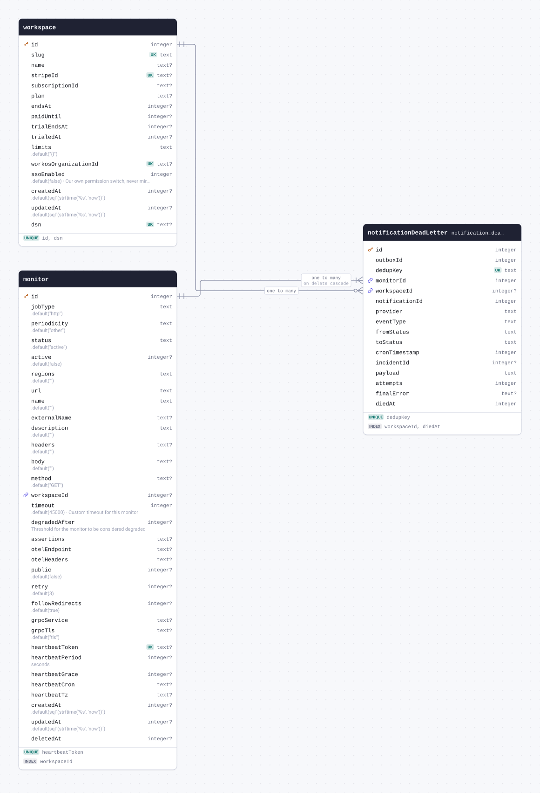

| Column                               | Type      | Constraints                             | Default | Description |
| ------------------------------------ | --------- | --------------------------------------- | ------- | ----------- |
| `id`                                 | `integer` | PK NOT NULL                             |         |             |
| `outboxId` (`outbox_id`)             | `integer` | NOT NULL                                |         |             |
| `dedupKey` (`dedup_key`)             | `text`    | NOT NULL                                |         |             |
| `monitorId` (`monitor_id`)           | `integer` | NOT NULL → [monitor.id](#table-monitor) |         |             |
| `workspaceId` (`workspace_id`)       | `integer` | NULL → [workspace.id](#table-workspace) |         |             |
| `notificationId` (`notification_id`) | `integer` | NOT NULL                                |         |             |
| `provider`                           | `text`    | NOT NULL                                |         |             |
| `eventType` (`event_type`)           | `text`    | NOT NULL                                |         |             |
| `fromStatus` (`from_status`)         | `text`    | NOT NULL                                |         |             |
| `toStatus` (`to_status`)             | `text`    | NOT NULL                                |         |             |
| `cronTimestamp` (`cron_timestamp`)   | `integer` | NOT NULL                                |         |             |
| `incidentId` (`incident_id`)         | `integer` | NULL                                    |         |             |
| `payload`                            | `text`    | NOT NULL                                |         |             |
| `attempts`                           | `integer` | NOT NULL                                |         |             |
| `finalError` (`final_error`)         | `text`    | NULL                                    |         |             |
| `diedAt` (`died_at`)                 | `integer` | NOT NULL                                |         |             |

#### Definition

```sql
CREATE TABLE `notification_dead_letter` (
	`id` integer PRIMARY KEY,
	`outbox_id` integer NOT NULL,
	`dedup_key` text NOT NULL,
	`monitor_id` integer NOT NULL,
	`workspace_id` integer,
	`notification_id` integer NOT NULL,
	`provider` text NOT NULL,
	`event_type` text NOT NULL,
	`from_status` text NOT NULL,
	`to_status` text NOT NULL,
	`cron_timestamp` integer NOT NULL,
	`incident_id` integer,
	`payload` text NOT NULL,
	`attempts` integer NOT NULL,
	`final_error` text,
	`died_at` integer NOT NULL,
	CONSTRAINT `fk_notification_dead_letter_monitor_id_monitor_id_fk` FOREIGN KEY (`monitor_id`) REFERENCES `monitor`(`id`) ON DELETE CASCADE,
	CONSTRAINT `fk_notification_dead_letter_workspace_id_workspace_id_fk` FOREIGN KEY (`workspace_id`) REFERENCES `workspace`(`id`)
);

CREATE UNIQUE INDEX `notification_dead_letter_dedup_key_idx` ON `notification_dead_letter` (`dedup_key`);

CREATE INDEX `notification_dead_letter_workspace_id_died_at_idx` ON `notification_dead_letter` (`workspace_id`,`died_at`);
```

#### Indexes

- UNIQUE `dedupKey`
- INDEX `workspaceId`, `diedAt`

#### References

- `monitorId` → [monitor.id](#table-monitor) (many to one, on delete cascade)
- `workspaceId` → [workspace.id](#table-workspace) (many to one)

<details>
<summary>Queries and their SQL</summary>

**Select**: Every row of notificationDeadLetter.

```ts
db.select().from(notificationDeadLetter);
```

```sql
select "id", "outbox_id", "dedup_key", "monitor_id", "workspace_id", "notification_id", "provider", "event_type", "from_status", "to_status", "cron_timestamp", "incident_id", "payload", "attempts", "final_error", "died_at"
from "notification_dead_letter"
```

**Count**: How many rows notificationDeadLetter has.

```ts
db.select({ count: count() }).from(notificationDeadLetter);
```

```sql
select count(*)
from "notification_dead_letter"
```

**Find many**: The rows of notificationDeadLetter, through the relational query API.

```ts
db.query.notificationDeadLetter.findMany();
```

```sql
select "d0"."id" as "id", "d0"."outbox_id" as "outboxId", "d0"."dedup_key" as "dedupKey", "d0"."monitor_id" as "monitorId", "d0"."workspace_id" as "workspaceId", "d0"."notification_id" as "notificationId", "d0"."provider" as "provider", "d0"."event_type" as "eventType", "d0"."from_status" as "fromStatus", "d0"."to_status" as "toStatus", "d0"."cron_timestamp" as "cronTimestamp", "d0"."incident_id" as "incidentId", "d0"."payload" as "payload", "d0"."attempts" as "attempts", "d0"."final_error" as "finalError", "d0"."died_at" as "diedAt"
from "notification_dead_letter" as "d0"
```

**Find by primary key**: One row of notificationDeadLetter, through the relational query API.

```ts
db.query.notificationDeadLetter.findFirst({ where: { id: 1 } });
```

```sql
select "d0"."id" as "id", "d0"."outbox_id" as "outboxId", "d0"."dedup_key" as "dedupKey", "d0"."monitor_id" as "monitorId", "d0"."workspace_id" as "workspaceId", "d0"."notification_id" as "notificationId", "d0"."provider" as "provider", "d0"."event_type" as "eventType", "d0"."from_status" as "fromStatus", "d0"."to_status" as "toStatus", "d0"."cron_timestamp" as "cronTimestamp", "d0"."incident_id" as "incidentId", "d0"."payload" as "payload", "d0"."attempts" as "attempts", "d0"."final_error" as "finalError", "d0"."died_at" as "diedAt"
from "notification_dead_letter" as "d0"
where "d0"."id" = ?
limit ?
-- params: [1,1]
```

**Insert**: Adds a row to notificationDeadLetter, giving the columns that have no default.

```ts
db.insert(notificationDeadLetter).values({
  id: 1,
  outboxId: 1,
  dedupKey: "dedupKey",
  monitorId: 1,
  notificationId: 1,
  provider: "provider",
  eventType: "eventType",
  fromStatus: "fromStatus",
  toStatus: "toStatus",
  cronTimestamp: 1,
  payload: "payload",
  attempts: 1,
  diedAt: 1,
});
```

```sql
insert into "notification_dead_letter" ("id", "outbox_id", "dedup_key", "monitor_id", "workspace_id", "notification_id", "provider", "event_type", "from_status", "to_status", "cron_timestamp", "incident_id", "payload", "attempts", "final_error", "died_at")
values (?, ?, ?, ?, null, ?, ?, ?, ?, ?, ?, null, ?, ?, null, ?)
-- params: [1,1,"dedupKey",1,1,"provider","eventType","fromStatus","toStatus",1,"\"payload\"",1,1]
```

**Update**: Changes a row of notificationDeadLetter, found by its primary key.

```ts
db.update(notificationDeadLetter).set({ outboxId: 1 }).where(eq(notificationDeadLetter.id, 1));
```

```sql
update "notification_dead_letter"
set "outbox_id" = ?
where "notification_dead_letter"."id" = ?
-- params: [1,1]
```

**Delete**: Deletes a row of notificationDeadLetter, found by its primary key.

```ts
db.delete(notificationDeadLetter).where(eq(notificationDeadLetter.id, 1));
```

```sql
delete from "notification_dead_letter"
where "notification_dead_letter"."id" = ?
-- params: [1]
```

</details>

<a id="table-monitorStatusTable"></a>

### monitorStatusTable

Table `monitor_status`.

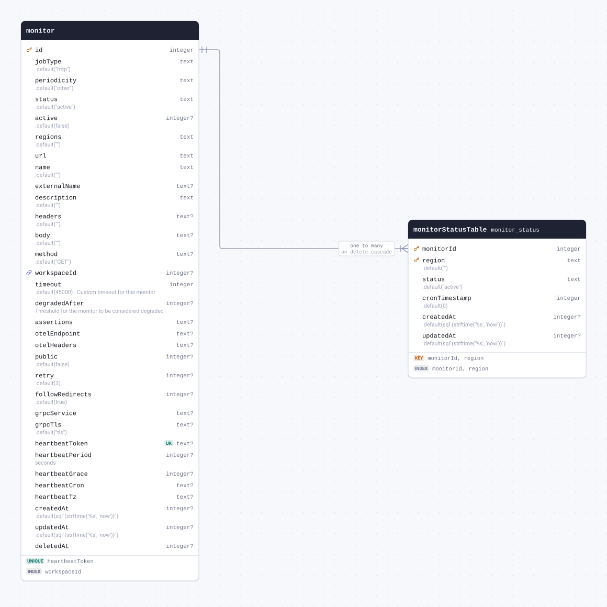

| Column                             | Type      | Constraints                                | Default                                    | Description |
| ---------------------------------- | --------- | ------------------------------------------ | ------------------------------------------ | ----------- |
| `monitorId` (`monitor_id`)         | `integer` | PK NOT NULL → [monitor.id](#table-monitor) |                                            |             |
| `region`                           | `text`    | PK NOT NULL                                | `.default("")`                             |             |
| `status`                           | `text`    | NOT NULL                                   | `.default("active")`                       |             |
| `cronTimestamp` (`cron_timestamp`) | `integer` | NOT NULL                                   | `.default(0)`                              |             |
| `createdAt` (`created_at`)         | `integer` | NULL                                       | ``.default(sql`(strftime('%s', 'now'))`)`` |             |
| `updatedAt` (`updated_at`)         | `integer` | NULL                                       | ``.default(sql`(strftime('%s', 'now'))`)`` |             |

#### Definition

```sql
CREATE TABLE `monitor_status` (
	`monitor_id` integer NOT NULL,
	`region` text DEFAULT '' NOT NULL,
	`status` text DEFAULT 'active' NOT NULL,
	`cron_timestamp` integer DEFAULT 0 NOT NULL,
	`created_at` integer DEFAULT (strftime('%s', 'now')),
	`updated_at` integer DEFAULT (strftime('%s', 'now')),
	CONSTRAINT `monitor_status_pk` PRIMARY KEY(`monitor_id`, `region`),
	CONSTRAINT `fk_monitor_status_monitor_id_monitor_id_fk` FOREIGN KEY (`monitor_id`) REFERENCES `monitor`(`id`) ON DELETE CASCADE
);

CREATE INDEX `monitor_status_idx` ON `monitor_status` (`monitor_id`,`region`);
```

#### Indexes

- PRIMARY KEY `monitorId`, `region`
- INDEX `monitorId`, `region`

#### References

- `monitorId` → [monitor.id](#table-monitor) (many to one, on delete cascade)

<details>
<summary>Queries and their SQL</summary>

**Select**: Every row of monitorStatusTable.

```ts
db.select().from(monitorStatusTable);
```

```sql
select "monitor_id", "region", "status", "cron_timestamp", "created_at", "updated_at"
from "monitor_status"
```

**Count**: How many rows monitorStatusTable has.

```ts
db.select({ count: count() }).from(monitorStatusTable);
```

```sql
select count(*)
from "monitor_status"
```

**Find many**: The rows of monitorStatusTable, through the relational query API.

```ts
db.query.monitorStatusTable.findMany();
```

```sql
select "d0"."monitor_id" as "monitorId", "d0"."region" as "region", "d0"."status" as "status", "d0"."cron_timestamp" as "cronTimestamp", "d0"."created_at" as "createdAt", "d0"."updated_at" as "updatedAt"
from "monitor_status" as "d0"
```

**Find by primary key**: One row of monitorStatusTable, through the relational query API.

```ts
db.query.monitorStatusTable.findFirst({ where: { monitorId: 1, region: "region" } });
```

```sql
select "d0"."monitor_id" as "monitorId", "d0"."region" as "region", "d0"."status" as "status", "d0"."cron_timestamp" as "cronTimestamp", "d0"."created_at" as "createdAt", "d0"."updated_at" as "updatedAt"
from "monitor_status" as "d0"
where (("d0"."monitor_id" = ?) and ("d0"."region" = ?))
limit ?
-- params: [1,"region",1]
```

**Insert**: Adds a row to monitorStatusTable, giving the columns that have no default.

```ts
db.insert(monitorStatusTable).values({ monitorId: 1 });
```

```sql
insert into "monitor_status" ("monitor_id", "region", "status", "cron_timestamp", "created_at", "updated_at")
values (?, ?, ?, ?, (strftime('%s', 'now')), (strftime('%s', 'now')))
-- params: [1,"","active",0]
```

**Update**: Changes a row of monitorStatusTable, found by its primary key.

```ts
db.update(monitorStatusTable)
  .set({ status: "status" })
  .where(and(eq(monitorStatusTable.monitorId, 1), eq(monitorStatusTable.region, "region")));
```

```sql
update "monitor_status"
set "status" = ?
where (("monitor_status"."monitor_id" = ?) and ("monitor_status"."region" = ?))
-- params: ["status",1,"region"]
```

**Delete**: Deletes a row of monitorStatusTable, found by its primary key.

```ts
db.delete(monitorStatusTable).where(
  and(eq(monitorStatusTable.monitorId, 1), eq(monitorStatusTable.region, "region")),
);
```

```sql
delete from "monitor_status"
where (("monitor_status"."monitor_id" = ?) and ("monitor_status"."region" = ?))
-- params: [1,"region"]
```

</details>

<a id="table-invitation"></a>

### invitation

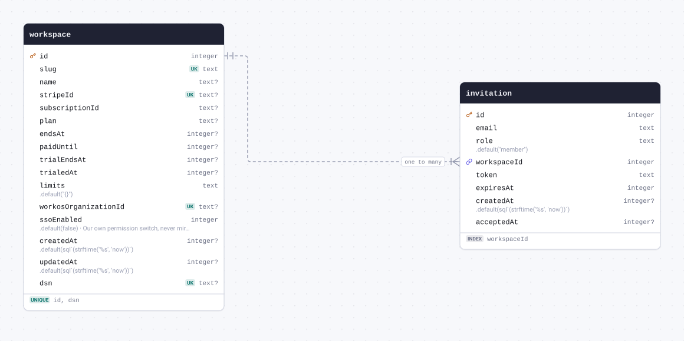

| Column                         | Type      | Constraints                                 | Default                                    | Description |
| ------------------------------ | --------- | ------------------------------------------- | ------------------------------------------ | ----------- |
| `id`                           | `integer` | PK NOT NULL                                 |                                            |             |
| `email`                        | `text`    | NOT NULL                                    |                                            |             |
| `role`                         | `text`    | NOT NULL                                    | `.default("member")`                       |             |
| `workspaceId` (`workspace_id`) | `integer` | NOT NULL → [workspace.id](#table-workspace) |                                            |             |
| `token`                        | `text`    | NOT NULL                                    |                                            |             |
| `expiresAt` (`expires_at`)     | `integer` | NOT NULL                                    |                                            |             |
| `createdAt` (`created_at`)     | `integer` | NULL                                        | ``.default(sql`(strftime('%s', 'now'))`)`` |             |
| `acceptedAt` (`accepted_at`)   | `integer` | NULL                                        |                                            |             |

#### Definition

```sql
CREATE TABLE `invitation` (
	`id` integer PRIMARY KEY,
	`email` text NOT NULL,
	`role` text DEFAULT 'member' NOT NULL,
	`workspace_id` integer NOT NULL,
	`token` text NOT NULL,
	`expires_at` integer NOT NULL,
	`created_at` integer DEFAULT (strftime('%s', 'now')),
	`accepted_at` integer
);

CREATE INDEX `invitation_workspace_id_idx` ON `invitation` (`workspace_id`);
```

#### Indexes

- INDEX `workspaceId`

#### References

- `workspaceId` → [workspace.id](#table-workspace) (many to one, defineRelations, no foreign key)

<details>
<summary>Queries and their SQL</summary>

**Select**: Every row of invitation.

```ts
db.select().from(invitation);
```

```sql
select "id", "email", "role", "workspace_id", "token", "expires_at", "created_at", "accepted_at"
from "invitation"
```

**Count**: How many rows invitation has.

```ts
db.select({ count: count() }).from(invitation);
```

```sql
select count(*)
from "invitation"
```

**Find many**: The rows of invitation, through the relational query API.

```ts
db.query.invitation.findMany();
```

```sql
select "d0"."id" as "id", "d0"."email" as "email", "d0"."role" as "role", "d0"."workspace_id" as "workspaceId", "d0"."token" as "token", "d0"."expires_at" as "expiresAt", "d0"."created_at" as "createdAt", "d0"."accepted_at" as "acceptedAt"
from "invitation" as "d0"
```

**Find by primary key**: One row of invitation, through the relational query API.

```ts
db.query.invitation.findFirst({ where: { id: 1 } });
```

```sql
select "d0"."id" as "id", "d0"."email" as "email", "d0"."role" as "role", "d0"."workspace_id" as "workspaceId", "d0"."token" as "token", "d0"."expires_at" as "expiresAt", "d0"."created_at" as "createdAt", "d0"."accepted_at" as "acceptedAt"
from "invitation" as "d0"
where "d0"."id" = ?
limit ?
-- params: [1,1]
```

**Insert**: Adds a row to invitation, giving the columns that have no default.

```ts
db.insert(invitation).values({
  id: 1,
  email: "email",
  workspaceId: 1,
  token: "token",
  expiresAt: 1,
});
```

```sql
insert into "invitation" ("id", "email", "role", "workspace_id", "token", "expires_at", "created_at", "accepted_at")
values (?, ?, ?, ?, ?, ?, (strftime('%s', 'now')), null)
-- params: [1,"email","member",1,"token",1]
```

**Update**: Changes a row of invitation, found by its primary key.

```ts
db.update(invitation).set({ email: "email" }).where(eq(invitation.id, 1));
```

```sql
update "invitation"
set "email" = ?
where "invitation"."id" = ?
-- params: ["email",1]
```

**Delete**: Deletes a row of invitation, found by its primary key.

```ts
db.delete(invitation).where(eq(invitation.id, 1));
```

```sql
delete from "invitation"
where "invitation"."id" = ?
-- params: [1]
```

</details>

<a id="table-monitorIncidentTable"></a>

### monitorIncidentTable

Table `monitor_incident`.

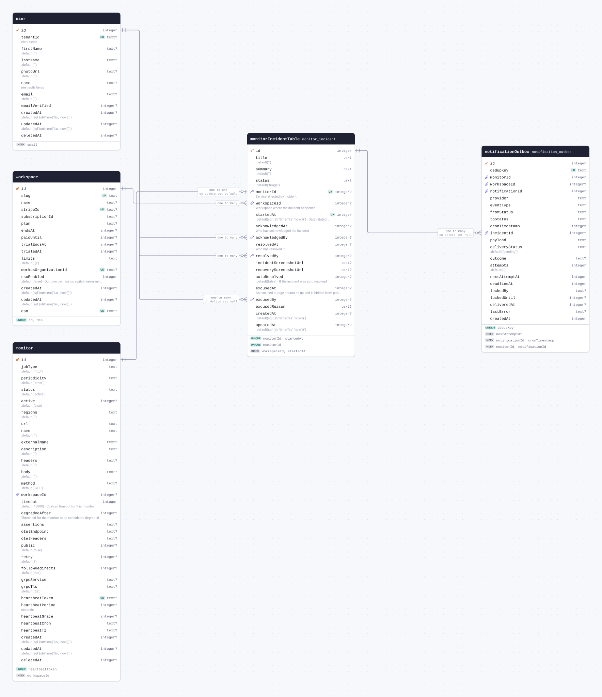

| Column                                              | Type      | Constraints                             | Default                                    | Description                           |
| --------------------------------------------------- | --------- | --------------------------------------- | ------------------------------------------ | ------------------------------------- |
| `id`                                                | `integer` | PK NOT NULL                             |                                            |                                       |
| `title`                                             | `text`    | NOT NULL                                | `.default("")`                             |                                       |
| `summary`                                           | `text`    | NOT NULL                                | `.default("")`                             |                                       |
| `status`                                            | `text`    | NOT NULL                                | `.default("triage")`                       |                                       |
| `monitorId` (`monitor_id`)                          | `integer` | NULL → [monitor.id](#table-monitor)     |                                            | Service affected by incident          |
| `workspaceId` (`workspace_id`)                      | `integer` | NULL → [workspace.id](#table-workspace) |                                            | Workspace where the incident happened |
| `startedAt` (`started_at`)                          | `integer` | NOT NULL                                | ``.default(sql`(strftime('%s', 'now'))`)`` | Data related to incident timeline     |
| `acknowledgedAt` (`acknowledged_at`)                | `integer` | NULL                                    |                                            | Who has acknowledged the incident     |
| `acknowledgedBy` (`acknowledged_by`)                | `integer` | NULL → [user.id](#table-user)           |                                            |                                       |
| `resolvedAt` (`resolved_at`)                        | `integer` | NULL                                    |                                            | Who has resolved it                   |
| `resolvedBy` (`resolved_by`)                        | `integer` | NULL → [user.id](#table-user)           |                                            |                                       |
| `incidentScreenshotUrl` (`incident_screenshot_url`) | `text`    | NULL                                    |                                            |                                       |
| `recoveryScreenshotUrl` (`recovery_screenshot_url`) | `text`    | NULL                                    |                                            |                                       |
| `autoResolved` (`auto_resolved`)                    | `integer` | NULL                                    | `.default(false)`                          | If the incident was auto resolved     |
| `createdAt` (`created_at`)                          | `integer` | NULL                                    | ``.default(sql`(strftime('%s', 'now'))`)`` |                                       |
| `updatedAt` (`updated_at`)                          | `integer` | NULL                                    | ``.default(sql`(strftime('%s', 'now'))`)`` |                                       |

#### Definition

```sql
CREATE TABLE `monitor_incident` (
	`id` integer PRIMARY KEY,
	`title` text DEFAULT '' NOT NULL,
	`summary` text DEFAULT '' NOT NULL,
	`status` text DEFAULT 'triage' NOT NULL,
	`monitor_id` integer,
	`workspace_id` integer,
	`started_at` integer DEFAULT (strftime('%s', 'now')) NOT NULL,
	`acknowledged_at` integer,
	`acknowledged_by` integer,
	`resolved_at` integer,
	`resolved_by` integer,
	`incident_screenshot_url` text,
	`recovery_screenshot_url` text,
	`auto_resolved` integer DEFAULT false,
	`created_at` integer DEFAULT (strftime('%s', 'now')),
	`updated_at` integer DEFAULT (strftime('%s', 'now')),
	CONSTRAINT `fk_monitor_incident_monitor_id_monitor_id_fk` FOREIGN KEY (`monitor_id`) REFERENCES `monitor`(`id`) ON DELETE SET DEFAULT,
	CONSTRAINT `fk_monitor_incident_workspace_id_workspace_id_fk` FOREIGN KEY (`workspace_id`) REFERENCES `workspace`(`id`),
	CONSTRAINT `fk_monitor_incident_acknowledged_by_user_id_fk` FOREIGN KEY (`acknowledged_by`) REFERENCES `user`(`id`),
	CONSTRAINT `fk_monitor_incident_resolved_by_user_id_fk` FOREIGN KEY (`resolved_by`) REFERENCES `user`(`id`),
	CONSTRAINT `monitor_incident_monitor_id_started_at_unique` UNIQUE(`monitor_id`,`started_at`)
);

CREATE INDEX `monitor_incident_workspace_id_started_at_idx` ON `monitor_incident` (`workspace_id`,`started_at`);

CREATE UNIQUE INDEX `monitor_incident_open_idx` ON `monitor_incident` (`monitor_id`) WHERE "monitor_incident"."resolved_at" IS NULL;
```

#### Indexes

- UNIQUE `monitorId`, `startedAt`
- INDEX `workspaceId`, `startedAt`
- UNIQUE `monitorId`

#### References

- `monitorId` → [monitor.id](#table-monitor) (one to one, on delete set default)
- `workspaceId` → [workspace.id](#table-workspace) (many to one)
- `acknowledgedBy` → [user.id](#table-user) (many to one)
- `resolvedBy` → [user.id](#table-user) (many to one)

#### Referenced by

- `id` → [notificationOutbox.incidentId](#table-notificationOutbox) (one to many, on delete set null)

<details>
<summary>Queries and their SQL</summary>

**Select**: Every row of monitorIncidentTable.

```ts
db.select().from(monitorIncidentTable);
```

```sql
select "id", "title", "summary", "status", "monitor_id", "workspace_id", "started_at", "acknowledged_at", "acknowledged_by", "resolved_at", "resolved_by", "incident_screenshot_url", "recovery_screenshot_url", "auto_resolved", "created_at", "updated_at"
from "monitor_incident"
```

**Count**: How many rows monitorIncidentTable has.

```ts
db.select({ count: count() }).from(monitorIncidentTable);
```

```sql
select count(*)
from "monitor_incident"
```

**Find many**: The rows of monitorIncidentTable, through the relational query API.

```ts
db.query.monitorIncidentTable.findMany();
```

```sql
select "d0"."id" as "id", "d0"."title" as "title", "d0"."summary" as "summary", "d0"."status" as "status", "d0"."monitor_id" as "monitorId", "d0"."workspace_id" as "workspaceId", "d0"."started_at" as "startedAt", "d0"."acknowledged_at" as "acknowledgedAt", "d0"."acknowledged_by" as "acknowledgedBy", "d0"."resolved_at" as "resolvedAt", "d0"."resolved_by" as "resolvedBy", "d0"."incident_screenshot_url" as "incidentScreenshotUrl", "d0"."recovery_screenshot_url" as "recoveryScreenshotUrl", "d0"."auto_resolved" as "autoResolved", "d0"."created_at" as "createdAt", "d0"."updated_at" as "updatedAt"
from "monitor_incident" as "d0"
```

**Find by primary key**: One row of monitorIncidentTable, through the relational query API.

```ts
db.query.monitorIncidentTable.findFirst({ where: { id: 1 } });
```

```sql
select "d0"."id" as "id", "d0"."title" as "title", "d0"."summary" as "summary", "d0"."status" as "status", "d0"."monitor_id" as "monitorId", "d0"."workspace_id" as "workspaceId", "d0"."started_at" as "startedAt", "d0"."acknowledged_at" as "acknowledgedAt", "d0"."acknowledged_by" as "acknowledgedBy", "d0"."resolved_at" as "resolvedAt", "d0"."resolved_by" as "resolvedBy", "d0"."incident_screenshot_url" as "incidentScreenshotUrl", "d0"."recovery_screenshot_url" as "recoveryScreenshotUrl", "d0"."auto_resolved" as "autoResolved", "d0"."created_at" as "createdAt", "d0"."updated_at" as "updatedAt"
from "monitor_incident" as "d0"
where "d0"."id" = ?
limit ?
-- params: [1,1]
```

**Insert**: Adds a row to monitorIncidentTable, giving the columns that have no default.

```ts
db.insert(monitorIncidentTable).values({ id: 1 });
```

```sql
insert into "monitor_incident" ("id", "title", "summary", "status", "monitor_id", "workspace_id", "started_at", "acknowledged_at", "acknowledged_by", "resolved_at", "resolved_by", "incident_screenshot_url", "recovery_screenshot_url", "auto_resolved", "created_at", "updated_at")
values (?, ?, ?, ?, null, null, (strftime('%s', 'now')), null, null, null, null, null, null, ?, (strftime('%s', 'now')), (strftime('%s', 'now')))
-- params: [1,"","","triage",0]
```

**Update**: Changes a row of monitorIncidentTable, found by its primary key.

```ts
db.update(monitorIncidentTable).set({ title: "title" }).where(eq(monitorIncidentTable.id, 1));
```

```sql
update "monitor_incident"
set "title" = ?
where "monitor_incident"."id" = ?
-- params: ["title",1]
```

**Delete**: Deletes a row of monitorIncidentTable, found by its primary key.

```ts
db.delete(monitorIncidentTable).where(eq(monitorIncidentTable.id, 1));
```

```sql
delete from "monitor_incident"
where "monitor_incident"."id" = ?
-- params: [1]
```

</details>

<a id="table-monitorTag"></a>

### monitorTag

Table `monitor_tag`.

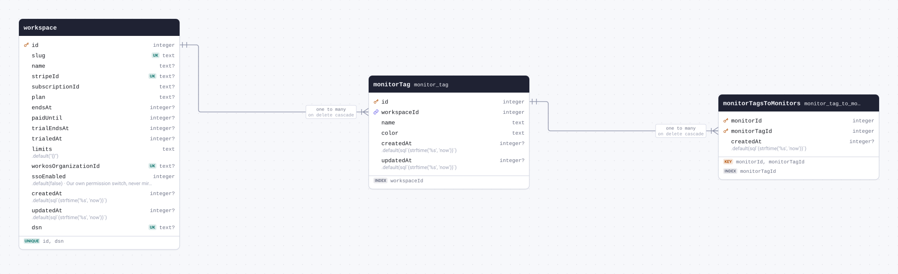

| Column                         | Type      | Constraints                                 | Default                                    | Description |
| ------------------------------ | --------- | ------------------------------------------- | ------------------------------------------ | ----------- |
| `id`                           | `integer` | PK NOT NULL                                 |                                            |             |
| `workspaceId` (`workspace_id`) | `integer` | NOT NULL → [workspace.id](#table-workspace) |                                            |             |
| `name`                         | `text`    | NOT NULL                                    |                                            |             |
| `color`                        | `text`    | NOT NULL                                    |                                            |             |
| `createdAt` (`created_at`)     | `integer` | NULL                                        | ``.default(sql`(strftime('%s', 'now'))`)`` |             |
| `updatedAt` (`updated_at`)     | `integer` | NULL                                        | ``.default(sql`(strftime('%s', 'now'))`)`` |             |

#### Definition

```sql
CREATE TABLE `monitor_tag` (
	`id` integer PRIMARY KEY,
	`workspace_id` integer NOT NULL,
	`name` text NOT NULL,
	`color` text NOT NULL,
	`created_at` integer DEFAULT (strftime('%s', 'now')),
	`updated_at` integer DEFAULT (strftime('%s', 'now')),
	CONSTRAINT `fk_monitor_tag_workspace_id_workspace_id_fk` FOREIGN KEY (`workspace_id`) REFERENCES `workspace`(`id`) ON DELETE CASCADE
);

CREATE INDEX `monitor_tag_workspace_id_idx` ON `monitor_tag` (`workspace_id`);
```

#### Indexes

- INDEX `workspaceId`

#### References

- `workspaceId` → [workspace.id](#table-workspace) (many to one, on delete cascade)

#### Referenced by

- `id` → [monitorTagsToMonitors.monitorTagId](#table-monitorTagsToMonitors) (one to many, on delete cascade)

<details>
<summary>Queries and their SQL</summary>

**Select**: Every row of monitorTag.

```ts
db.select().from(monitorTag);
```

```sql
select "id", "workspace_id", "name", "color", "created_at", "updated_at"
from "monitor_tag"
```

**Count**: How many rows monitorTag has.

```ts
db.select({ count: count() }).from(monitorTag);
```

```sql
select count(*)
from "monitor_tag"
```

**Find many**: The rows of monitorTag, through the relational query API.

```ts
db.query.monitorTag.findMany();
```

```sql
select "d0"."id" as "id", "d0"."workspace_id" as "workspaceId", "d0"."name" as "name", "d0"."color" as "color", "d0"."created_at" as "createdAt", "d0"."updated_at" as "updatedAt"
from "monitor_tag" as "d0"
```

**Find by primary key**: One row of monitorTag, through the relational query API.

```ts
db.query.monitorTag.findFirst({ where: { id: 1 } });
```

```sql
select "d0"."id" as "id", "d0"."workspace_id" as "workspaceId", "d0"."name" as "name", "d0"."color" as "color", "d0"."created_at" as "createdAt", "d0"."updated_at" as "updatedAt"
from "monitor_tag" as "d0"
where "d0"."id" = ?
limit ?
-- params: [1,1]
```

**Insert**: Adds a row to monitorTag, giving the columns that have no default.

```ts
db.insert(monitorTag).values({ id: 1, workspaceId: 1, name: "name", color: "color" });
```

```sql
insert into "monitor_tag" ("id", "workspace_id", "name", "color", "created_at", "updated_at")
values (?, ?, ?, ?, (strftime('%s', 'now')), (strftime('%s', 'now')))
-- params: [1,1,"name","color"]
```

**Update**: Changes a row of monitorTag, found by its primary key.

```ts
db.update(monitorTag).set({ workspaceId: 1 }).where(eq(monitorTag.id, 1));
```

```sql
update "monitor_tag"
set "workspace_id" = ?
where "monitor_tag"."id" = ?
-- params: [1,1]
```

**Delete**: Deletes a row of monitorTag, found by its primary key.

```ts
db.delete(monitorTag).where(eq(monitorTag.id, 1));
```

```sql
delete from "monitor_tag"
where "monitor_tag"."id" = ?
-- params: [1]
```

</details>

<a id="table-monitorTagsToMonitors"></a>

### monitorTagsToMonitors

Table `monitor_tag_to_monitor`.

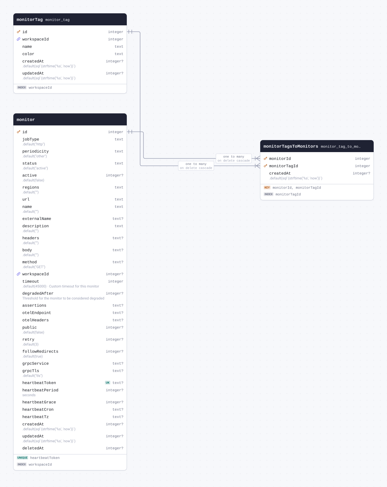

| Column                            | Type      | Constraints                                      | Default                                    | Description |
| --------------------------------- | --------- | ------------------------------------------------ | ------------------------------------------ | ----------- |
| `monitorId` (`monitor_id`)        | `integer` | PK NOT NULL → [monitor.id](#table-monitor)       |                                            |             |
| `monitorTagId` (`monitor_tag_id`) | `integer` | PK NOT NULL → [monitorTag.id](#table-monitorTag) |                                            |             |
| `createdAt` (`created_at`)        | `integer` | NULL                                             | ``.default(sql`(strftime('%s', 'now'))`)`` |             |

#### Definition

```sql
CREATE TABLE `monitor_tag_to_monitor` (
	`monitor_id` integer NOT NULL,
	`monitor_tag_id` integer NOT NULL,
	`created_at` integer DEFAULT (strftime('%s', 'now')),
	CONSTRAINT `monitor_tag_to_monitor_pk` PRIMARY KEY(`monitor_id`, `monitor_tag_id`),
	CONSTRAINT `fk_monitor_tag_to_monitor_monitor_id_monitor_id_fk` FOREIGN KEY (`monitor_id`) REFERENCES `monitor`(`id`) ON DELETE CASCADE,
	CONSTRAINT `fk_monitor_tag_to_monitor_monitor_tag_id_monitor_tag_id_fk` FOREIGN KEY (`monitor_tag_id`) REFERENCES `monitor_tag`(`id`) ON DELETE CASCADE
);

CREATE INDEX `monitor_tag_to_monitor_monitor_tag_id_idx` ON `monitor_tag_to_monitor` (`monitor_tag_id`);
```

#### Indexes

- PRIMARY KEY `monitorId`, `monitorTagId`
- INDEX `monitorTagId`

#### References

- `monitorId` → [monitor.id](#table-monitor) (many to one, on delete cascade)
- `monitorTagId` → [monitorTag.id](#table-monitorTag) (many to one, on delete cascade)

<details>
<summary>Queries and their SQL</summary>

**Select**: Every row of monitorTagsToMonitors.

```ts
db.select().from(monitorTagsToMonitors);
```

```sql
select "monitor_id", "monitor_tag_id", "created_at"
from "monitor_tag_to_monitor"
```

**Count**: How many rows monitorTagsToMonitors has.

```ts
db.select({ count: count() }).from(monitorTagsToMonitors);
```

```sql
select count(*)
from "monitor_tag_to_monitor"
```

**Find many**: The rows of monitorTagsToMonitors, through the relational query API.

```ts
db.query.monitorTagsToMonitors.findMany();
```

```sql
select "d0"."monitor_id" as "monitorId", "d0"."monitor_tag_id" as "monitorTagId", "d0"."created_at" as "createdAt"
from "monitor_tag_to_monitor" as "d0"
```

**Find by primary key**: One row of monitorTagsToMonitors, through the relational query API.

```ts
db.query.monitorTagsToMonitors.findFirst({ where: { monitorId: 1, monitorTagId: 1 } });
```

```sql
select "d0"."monitor_id" as "monitorId", "d0"."monitor_tag_id" as "monitorTagId", "d0"."created_at" as "createdAt"
from "monitor_tag_to_monitor" as "d0"
where (("d0"."monitor_id" = ?) and ("d0"."monitor_tag_id" = ?))
limit ?
-- params: [1,1,1]
```

**Insert**: Adds a row to monitorTagsToMonitors, giving the columns that have no default.

```ts
db.insert(monitorTagsToMonitors).values({ monitorId: 1, monitorTagId: 1 });
```

```sql
insert into "monitor_tag_to_monitor" ("monitor_id", "monitor_tag_id", "created_at")
values (?, ?, (strftime('%s', 'now')))
-- params: [1,1]
```

**Update**: Changes a row of monitorTagsToMonitors, found by its primary key.

```ts
db.update(monitorTagsToMonitors)
  .set({ createdAt: 1 })
  .where(and(eq(monitorTagsToMonitors.monitorId, 1), eq(monitorTagsToMonitors.monitorTagId, 1)));
```

```sql
update "monitor_tag_to_monitor"
set "created_at" = ?
where (("monitor_tag_to_monitor"."monitor_id" = ?) and ("monitor_tag_to_monitor"."monitor_tag_id" = ?))
-- params: [1,1,1]
```

**Delete**: Deletes a row of monitorTagsToMonitors, found by its primary key.

```ts
db.delete(monitorTagsToMonitors).where(
  and(eq(monitorTagsToMonitors.monitorId, 1), eq(monitorTagsToMonitors.monitorTagId, 1)),
);
```

```sql
delete from "monitor_tag_to_monitor"
where (("monitor_tag_to_monitor"."monitor_id" = ?) and ("monitor_tag_to_monitor"."monitor_tag_id" = ?))
-- params: [1,1]
```

</details>

<a id="table-application"></a>

### application

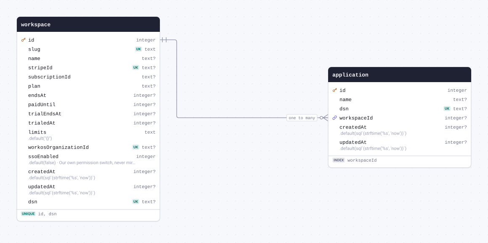

| Column                         | Type      | Constraints                             | Default                                    | Description |
| ------------------------------ | --------- | --------------------------------------- | ------------------------------------------ | ----------- |
| `id`                           | `integer` | PK NOT NULL                             |                                            |             |
| `name`                         | `text`    | NULL                                    |                                            |             |
| `dsn`                          | `text`    | UNIQUE NULL                             |                                            |             |
| `workspaceId` (`workspace_id`) | `integer` | NULL → [workspace.id](#table-workspace) |                                            |             |
| `createdAt` (`created_at`)     | `integer` | NULL                                    | ``.default(sql`(strftime('%s', 'now'))`)`` |             |
| `updatedAt` (`updated_at`)     | `integer` | NULL                                    | ``.default(sql`(strftime('%s', 'now'))`)`` |             |

#### Definition

```sql
CREATE TABLE `application` (
	`id` integer PRIMARY KEY,
	`name` text,
	`dsn` text UNIQUE,
	`workspace_id` integer,
	`created_at` integer DEFAULT (strftime('%s', 'now')),
	`updated_at` integer DEFAULT (strftime('%s', 'now')),
	CONSTRAINT `fk_application_workspace_id_workspace_id_fk` FOREIGN KEY (`workspace_id`) REFERENCES `workspace`(`id`)
);

CREATE INDEX `application_workspace_id_idx` ON `application` (`workspace_id`);
```

#### Indexes

- INDEX `workspaceId`

#### References

- `workspaceId` → [workspace.id](#table-workspace) (many to one)

<details>
<summary>Queries and their SQL</summary>

**Select**: Every row of application.

```ts
db.select().from(application);
```

```sql
select "id", "name", "dsn", "workspace_id", "created_at", "updated_at"
from "application"
```

**Count**: How many rows application has.

```ts
db.select({ count: count() }).from(application);
```

```sql
select count(*)
from "application"
```

**Find many**: The rows of application, through the relational query API.

```ts
db.query.application.findMany();
```

```sql
select "d0"."id" as "id", "d0"."name" as "name", "d0"."dsn" as "dsn", "d0"."workspace_id" as "workspaceId", "d0"."created_at" as "createdAt", "d0"."updated_at" as "updatedAt"
from "application" as "d0"
```

**Find by primary key**: One row of application, through the relational query API.

```ts
db.query.application.findFirst({ where: { id: 1 } });
```

```sql
select "d0"."id" as "id", "d0"."name" as "name", "d0"."dsn" as "dsn", "d0"."workspace_id" as "workspaceId", "d0"."created_at" as "createdAt", "d0"."updated_at" as "updatedAt"
from "application" as "d0"
where "d0"."id" = ?
limit ?
-- params: [1,1]
```

**Insert**: Adds a row to application, giving the columns that have no default.

```ts
db.insert(application).values({ id: 1 });
```

```sql
insert into "application" ("id", "name", "dsn", "workspace_id", "created_at", "updated_at")
values (?, null, null, null, (strftime('%s', 'now')), (strftime('%s', 'now')))
-- params: [1]
```

**Update**: Changes a row of application, found by its primary key.

```ts
db.update(application).set({ name: "name" }).where(eq(application.id, 1));
```

```sql
update "application"
set "name" = ?
where "application"."id" = ?
-- params: ["name",1]
```

**Delete**: Deletes a row of application, found by its primary key.

```ts
db.delete(application).where(eq(application.id, 1));
```

```sql
delete from "application"
where "application"."id" = ?
-- params: [1]
```

</details>

<a id="table-maintenance"></a>

### maintenance

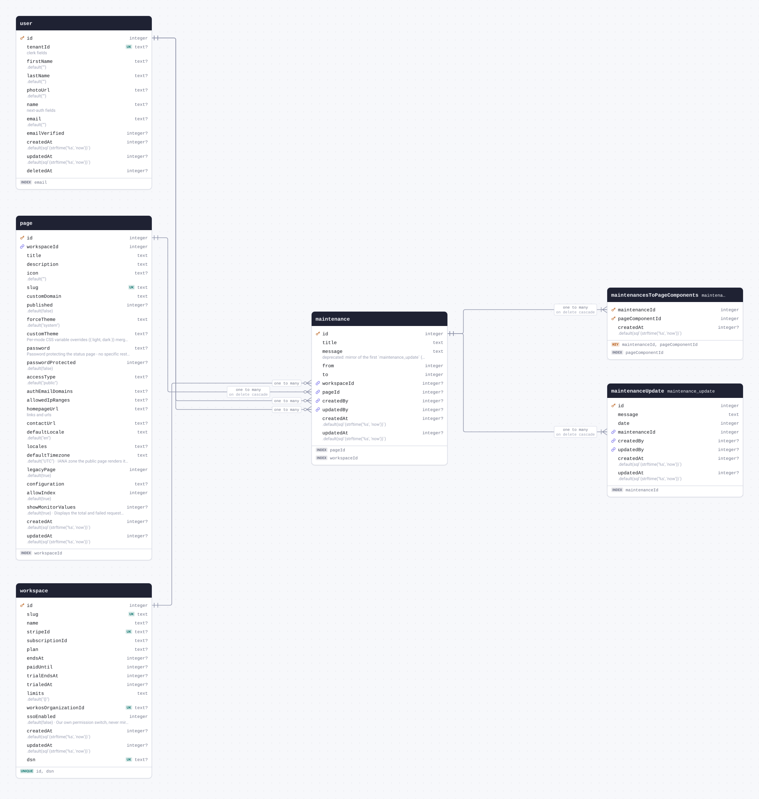

| Column                         | Type      | Constraints                             | Default                                    | Description                                                                                                 |
| ------------------------------ | --------- | --------------------------------------- | ------------------------------------------ | ----------------------------------------------------------------------------------------------------------- |
| `id`                           | `integer` | PK NOT NULL                             |                                            |                                                                                                             |
| `title`                        | `text`    | NOT NULL                                |                                            |                                                                                                             |
| `message`                      | `text`    | NOT NULL                                |                                            | deprecated: mirror of the first `maintenance_update` (backfilled in migration 0092); dropped in a follow-up |
| `from`                         | `integer` | NOT NULL                                |                                            |                                                                                                             |
| `to`                           | `integer` | NOT NULL                                |                                            |                                                                                                             |
| `workspaceId` (`workspace_id`) | `integer` | NULL → [workspace.id](#table-workspace) |                                            |                                                                                                             |
| `pageId` (`page_id`)           | `integer` | NULL → [page.id](#table-page)           |                                            |                                                                                                             |
| `createdBy` (`created_by`)     | `integer` | NULL → [user.id](#table-user)           |                                            |                                                                                                             |
| `updatedBy` (`updated_by`)     | `integer` | NULL → [user.id](#table-user)           |                                            |                                                                                                             |
| `createdAt` (`created_at`)     | `integer` | NULL                                    | ``.default(sql`(strftime('%s', 'now'))`)`` |                                                                                                             |
| `updatedAt` (`updated_at`)     | `integer` | NULL                                    | ``.default(sql`(strftime('%s', 'now'))`)`` |                                                                                                             |

#### Definition

```sql
CREATE TABLE `maintenance` (
	`id` integer PRIMARY KEY,
	`title` text(256) NOT NULL,
	`message` text NOT NULL,
	`from` integer NOT NULL,
	`to` integer NOT NULL,
	`workspace_id` integer,
	`page_id` integer,
	`created_by` integer,
	`updated_by` integer,
	`created_at` integer DEFAULT (strftime('%s', 'now')),
	`updated_at` integer DEFAULT (strftime('%s', 'now')),
	CONSTRAINT `fk_maintenance_workspace_id_workspace_id_fk` FOREIGN KEY (`workspace_id`) REFERENCES `workspace`(`id`),
	CONSTRAINT `fk_maintenance_page_id_page_id_fk` FOREIGN KEY (`page_id`) REFERENCES `page`(`id`) ON DELETE CASCADE,
	CONSTRAINT `fk_maintenance_created_by_user_id_fk` FOREIGN KEY (`created_by`) REFERENCES `user`(`id`),
	CONSTRAINT `fk_maintenance_updated_by_user_id_fk` FOREIGN KEY (`updated_by`) REFERENCES `user`(`id`)
);

CREATE INDEX `maintenance_page_id_idx` ON `maintenance` (`page_id`);

CREATE INDEX `maintenance_workspace_id_idx` ON `maintenance` (`workspace_id`);
```

#### Indexes

- INDEX `pageId`
- INDEX `workspaceId`

#### References

- `workspaceId` → [workspace.id](#table-workspace) (many to one)
- `pageId` → [page.id](#table-page) (many to one, on delete cascade)
- `createdBy` → [user.id](#table-user) (many to one)
- `updatedBy` → [user.id](#table-user) (many to one)

#### Referenced by

- `id` → [maintenanceUpdate.maintenanceId](#table-maintenanceUpdate) (one to many, on delete cascade)
- `id` → [maintenancesToPageComponents.maintenanceId](#table-maintenancesToPageComponents) (one to many, on delete cascade)

<details>
<summary>Queries and their SQL</summary>

**Select**: Every row of maintenance.

```ts
db.select().from(maintenance);
```

```sql
select "id", "title", "message", "from", "to", "workspace_id", "page_id", "created_by", "updated_by", "created_at", "updated_at"
from "maintenance"
```

**Count**: How many rows maintenance has.

```ts
db.select({ count: count() }).from(maintenance);
```

```sql
select count(*)
from "maintenance"
```

**Find many**: The rows of maintenance, through the relational query API.

```ts
db.query.maintenance.findMany();
```

```sql
select "d0"."id" as "id", "d0"."title" as "title", "d0"."message" as "message", "d0"."from" as "from", "d0"."to" as "to", "d0"."workspace_id" as "workspaceId", "d0"."page_id" as "pageId", "d0"."created_by" as "createdBy", "d0"."updated_by" as "updatedBy", "d0"."created_at" as "createdAt", "d0"."updated_at" as "updatedAt"
from "maintenance" as "d0"
```

**Find by primary key**: One row of maintenance, through the relational query API.

```ts
db.query.maintenance.findFirst({ where: { id: 1 } });
```

```sql
select "d0"."id" as "id", "d0"."title" as "title", "d0"."message" as "message", "d0"."from" as "from", "d0"."to" as "to", "d0"."workspace_id" as "workspaceId", "d0"."page_id" as "pageId", "d0"."created_by" as "createdBy", "d0"."updated_by" as "updatedBy", "d0"."created_at" as "createdAt", "d0"."updated_at" as "updatedAt"
from "maintenance" as "d0"
where "d0"."id" = ?
limit ?
-- params: [1,1]
```

**Insert**: Adds a row to maintenance, giving the columns that have no default.

```ts
db.insert(maintenance).values({ id: 1, title: "title", message: "message", from: 1, to: 1 });
```

```sql
insert into "maintenance" ("id", "title", "message", "from", "to", "workspace_id", "page_id", "created_by", "updated_by", "created_at", "updated_at")
values (?, ?, ?, ?, ?, null, null, null, null, (strftime('%s', 'now')), (strftime('%s', 'now')))
-- params: [1,"title","message",1,1]
```

**Update**: Changes a row of maintenance, found by its primary key.

```ts
db.update(maintenance).set({ title: "title" }).where(eq(maintenance.id, 1));
```

```sql
update "maintenance"
set "title" = ?
where "maintenance"."id" = ?
-- params: ["title",1]
```

**Delete**: Deletes a row of maintenance, found by its primary key.

```ts
db.delete(maintenance).where(eq(maintenance.id, 1));
```

```sql
delete from "maintenance"
where "maintenance"."id" = ?
-- params: [1]
```

</details>

<a id="table-maintenanceUpdate"></a>

### maintenanceUpdate

Table `maintenance_update`.

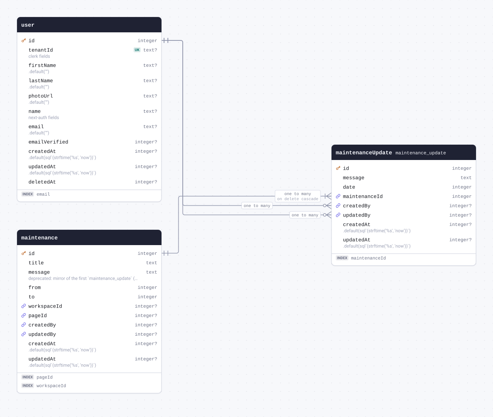

| Column                             | Type      | Constraints                                     | Default                                    | Description |
| ---------------------------------- | --------- | ----------------------------------------------- | ------------------------------------------ | ----------- |
| `id`                               | `integer` | PK NOT NULL                                     |                                            |             |
| `message`                          | `text`    | NOT NULL                                        |                                            |             |
| `date`                             | `integer` | NOT NULL                                        |                                            |             |
| `maintenanceId` (`maintenance_id`) | `integer` | NOT NULL → [maintenance.id](#table-maintenance) |                                            |             |
| `createdBy` (`created_by`)         | `integer` | NULL → [user.id](#table-user)                   |                                            |             |
| `updatedBy` (`updated_by`)         | `integer` | NULL → [user.id](#table-user)                   |                                            |             |
| `createdAt` (`created_at`)         | `integer` | NULL                                            | ``.default(sql`(strftime('%s', 'now'))`)`` |             |
| `updatedAt` (`updated_at`)         | `integer` | NULL                                            | ``.default(sql`(strftime('%s', 'now'))`)`` |             |

#### Definition

```sql
CREATE TABLE `maintenance_update` (
	`id` integer PRIMARY KEY,
	`message` text NOT NULL,
	`date` integer NOT NULL,
	`maintenance_id` integer NOT NULL,
	`created_by` integer,
	`updated_by` integer,
	`created_at` integer DEFAULT (strftime('%s', 'now')),
	`updated_at` integer DEFAULT (strftime('%s', 'now')),
	CONSTRAINT `fk_maintenance_update_maintenance_id_maintenance_id_fk` FOREIGN KEY (`maintenance_id`) REFERENCES `maintenance`(`id`) ON DELETE CASCADE,
	CONSTRAINT `fk_maintenance_update_created_by_user_id_fk` FOREIGN KEY (`created_by`) REFERENCES `user`(`id`),
	CONSTRAINT `fk_maintenance_update_updated_by_user_id_fk` FOREIGN KEY (`updated_by`) REFERENCES `user`(`id`)
);

CREATE INDEX `maintenance_update_maintenance_id_idx` ON `maintenance_update` (`maintenance_id`);
```

#### Indexes

- INDEX `maintenanceId`

#### References

- `maintenanceId` → [maintenance.id](#table-maintenance) (many to one, on delete cascade)
- `createdBy` → [user.id](#table-user) (many to one)
- `updatedBy` → [user.id](#table-user) (many to one)

<details>
<summary>Queries and their SQL</summary>

**Select**: Every row of maintenanceUpdate.

```ts
db.select().from(maintenanceUpdate);
```

```sql
select "id", "message", "date", "maintenance_id", "created_by", "updated_by", "created_at", "updated_at"
from "maintenance_update"
```

**Count**: How many rows maintenanceUpdate has.

```ts
db.select({ count: count() }).from(maintenanceUpdate);
```

```sql
select count(*)
from "maintenance_update"
```

**Find many**: The rows of maintenanceUpdate, through the relational query API.

```ts
db.query.maintenanceUpdate.findMany();
```

```sql
select "d0"."id" as "id", "d0"."message" as "message", "d0"."date" as "date", "d0"."maintenance_id" as "maintenanceId", "d0"."created_by" as "createdBy", "d0"."updated_by" as "updatedBy", "d0"."created_at" as "createdAt", "d0"."updated_at" as "updatedAt"
from "maintenance_update" as "d0"
```

**Find by primary key**: One row of maintenanceUpdate, through the relational query API.

```ts
db.query.maintenanceUpdate.findFirst({ where: { id: 1 } });
```

```sql
select "d0"."id" as "id", "d0"."message" as "message", "d0"."date" as "date", "d0"."maintenance_id" as "maintenanceId", "d0"."created_by" as "createdBy", "d0"."updated_by" as "updatedBy", "d0"."created_at" as "createdAt", "d0"."updated_at" as "updatedAt"
from "maintenance_update" as "d0"
where "d0"."id" = ?
limit ?
-- params: [1,1]
```

**Insert**: Adds a row to maintenanceUpdate, giving the columns that have no default.

```ts
db.insert(maintenanceUpdate).values({ id: 1, message: "message", date: 1, maintenanceId: 1 });
```

```sql
insert into "maintenance_update" ("id", "message", "date", "maintenance_id", "created_by", "updated_by", "created_at", "updated_at")
values (?, ?, ?, ?, null, null, (strftime('%s', 'now')), (strftime('%s', 'now')))
-- params: [1,"message",1,1]
```

**Update**: Changes a row of maintenanceUpdate, found by its primary key.

```ts
db.update(maintenanceUpdate).set({ message: "message" }).where(eq(maintenanceUpdate.id, 1));
```

```sql
update "maintenance_update"
set "message" = ?
where "maintenance_update"."id" = ?
-- params: ["message",1]
```

**Delete**: Deletes a row of maintenanceUpdate, found by its primary key.

```ts
db.delete(maintenanceUpdate).where(eq(maintenanceUpdate.id, 1));
```

```sql
delete from "maintenance_update"
where "maintenance_update"."id" = ?
-- params: [1]
```

</details>

<a id="table-check"></a>

### check

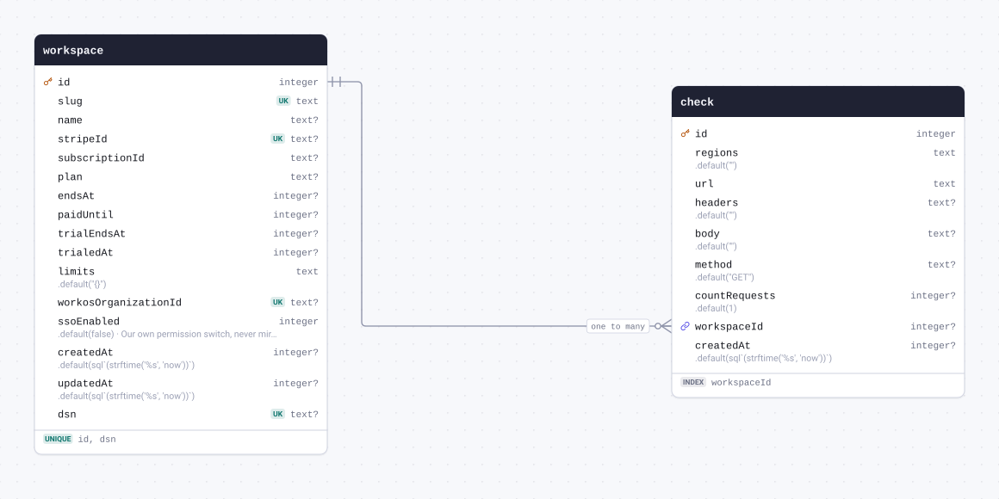

| Column                             | Type      | Constraints                             | Default                                    | Description |
| ---------------------------------- | --------- | --------------------------------------- | ------------------------------------------ | ----------- |
| `id`                               | `integer` | PK NOT NULL                             |                                            |             |
| `regions`                          | `text`    | NOT NULL                                | `.default("")`                             |             |
| `url`                              | `text`    | NOT NULL                                |                                            |             |
| `headers`                          | `text`    | NULL                                    | `.default("")`                             |             |
| `body`                             | `text`    | NULL                                    | `.default("")`                             |             |
| `method`                           | `text`    | NULL                                    | `.default("GET")`                          |             |
| `countRequests` (`count_requests`) | `integer` | NULL                                    | `.default(1)`                              |             |
| `workspaceId` (`workspace_id`)     | `integer` | NULL → [workspace.id](#table-workspace) |                                            |             |
| `createdAt` (`created_at`)         | `integer` | NULL                                    | ``.default(sql`(strftime('%s', 'now'))`)`` |             |

#### Definition

```sql
CREATE TABLE `check` (
	`id` integer PRIMARY KEY AUTOINCREMENT,
	`regions` text DEFAULT '' NOT NULL,
	`url` text(4096) NOT NULL,
	`headers` text DEFAULT '',
	`body` text DEFAULT '',
	`method` text DEFAULT 'GET',
	`count_requests` integer DEFAULT 1,
	`workspace_id` integer,
	`created_at` integer DEFAULT (strftime('%s', 'now')),
	CONSTRAINT `fk_check_workspace_id_workspace_id_fk` FOREIGN KEY (`workspace_id`) REFERENCES `workspace`(`id`)
);

CREATE INDEX `check_workspace_id_idx` ON `check` (`workspace_id`);
```

#### Indexes

- INDEX `workspaceId`

#### References

- `workspaceId` → [workspace.id](#table-workspace) (many to one)

<details>
<summary>Queries and their SQL</summary>

**Select**: Every row of check.

```ts
db.select().from(check);
```

```sql
select "id", "regions", "url", "headers", "body", "method", "count_requests", "workspace_id", "created_at"
from "check"
```

**Count**: How many rows check has.

```ts
db.select({ count: count() }).from(check);
```

```sql
select count(*)
from "check"
```

**Find many**: The rows of check, through the relational query API.

```ts
db.query.check.findMany();
```

```sql
select "d0"."id" as "id", "d0"."regions" as "regions", "d0"."url" as "url", "d0"."headers" as "headers", "d0"."body" as "body", "d0"."method" as "method", "d0"."count_requests" as "countRequests", "d0"."workspace_id" as "workspaceId", "d0"."created_at" as "createdAt"
from "check" as "d0"
```

**Find by primary key**: One row of check, through the relational query API.

```ts
db.query.check.findFirst({ where: { id: 1 } });
```

```sql
select "d0"."id" as "id", "d0"."regions" as "regions", "d0"."url" as "url", "d0"."headers" as "headers", "d0"."body" as "body", "d0"."method" as "method", "d0"."count_requests" as "countRequests", "d0"."workspace_id" as "workspaceId", "d0"."created_at" as "createdAt"
from "check" as "d0"
where "d0"."id" = ?
limit ?
-- params: [1,1]
```

**Insert**: Adds a row to check, giving the columns that have no default.

```ts
db.insert(check).values({ id: 1, url: "url" });
```

```sql
insert into "check" ("id", "regions", "url", "headers", "body", "method", "count_requests", "workspace_id", "created_at")
values (?, ?, ?, ?, ?, ?, ?, null, (strftime('%s', 'now')))
-- params: [1,"","url","","","GET",1]
```

**Update**: Changes a row of check, found by its primary key.

```ts
db.update(check).set({ regions: "regions" }).where(eq(check.id, 1));
```

```sql
update "check"
set "regions" = ?
where "check"."id" = ?
-- params: ["regions",1]
```

**Delete**: Deletes a row of check, found by its primary key.

```ts
db.delete(check).where(eq(check.id, 1));
```

```sql
delete from "check"
where "check"."id" = ?
-- params: [1]
```

</details>

<a id="table-monitorRun"></a>

### monitorRun

Table `monitor_run`.

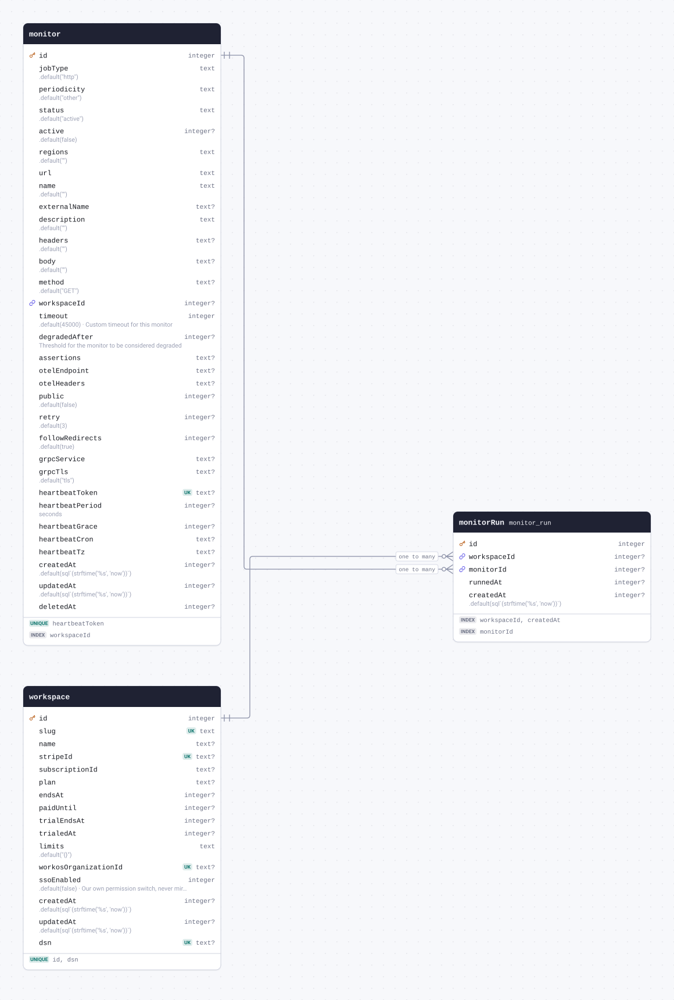

| Column                         | Type      | Constraints                             | Default                                    | Description |
| ------------------------------ | --------- | --------------------------------------- | ------------------------------------------ | ----------- |
| `id`                           | `integer` | PK NOT NULL                             |                                            |             |
| `workspaceId` (`workspace_id`) | `integer` | NULL → [workspace.id](#table-workspace) |                                            |             |
| `monitorId` (`monitor_id`)     | `integer` | NULL → [monitor.id](#table-monitor)     |                                            |             |
| `runnedAt` (`runned_at`)       | `integer` | NULL                                    |                                            |             |
| `createdAt` (`created_at`)     | `integer` | NULL                                    | ``.default(sql`(strftime('%s', 'now'))`)`` |             |

#### Definition

```sql
CREATE TABLE `monitor_run` (
	`id` integer PRIMARY KEY,
	`workspace_id` integer,
	`monitor_id` integer,
	`runned_at` integer,
	`created_at` integer DEFAULT (strftime('%s', 'now')),
	CONSTRAINT `fk_monitor_run_workspace_id_workspace_id_fk` FOREIGN KEY (`workspace_id`) REFERENCES `workspace`(`id`),
	CONSTRAINT `fk_monitor_run_monitor_id_monitor_id_fk` FOREIGN KEY (`monitor_id`) REFERENCES `monitor`(`id`)
);

CREATE INDEX `monitor_run_workspace_id_created_at_idx` ON `monitor_run` (`workspace_id`,`created_at`);

CREATE INDEX `monitor_run_monitor_id_idx` ON `monitor_run` (`monitor_id`);
```

#### Indexes

- INDEX `workspaceId`, `createdAt`
- INDEX `monitorId`

#### References

- `workspaceId` → [workspace.id](#table-workspace) (many to one)
- `monitorId` → [monitor.id](#table-monitor) (many to one)

<details>
<summary>Queries and their SQL</summary>

**Select**: Every row of monitorRun.

```ts
db.select().from(monitorRun);
```

```sql
select "id", "workspace_id", "monitor_id", "runned_at", "created_at"
from "monitor_run"
```

**Count**: How many rows monitorRun has.

```ts
db.select({ count: count() }).from(monitorRun);
```

```sql
select count(*)
from "monitor_run"
```

**Find many**: The rows of monitorRun, through the relational query API.

```ts
db.query.monitorRun.findMany();
```

```sql
select "d0"."id" as "id", "d0"."workspace_id" as "workspaceId", "d0"."monitor_id" as "monitorId", "d0"."runned_at" as "runnedAt", "d0"."created_at" as "createdAt"
from "monitor_run" as "d0"
```

**Find by primary key**: One row of monitorRun, through the relational query API.

```ts
db.query.monitorRun.findFirst({ where: { id: 1 } });
```

```sql
select "d0"."id" as "id", "d0"."workspace_id" as "workspaceId", "d0"."monitor_id" as "monitorId", "d0"."runned_at" as "runnedAt", "d0"."created_at" as "createdAt"
from "monitor_run" as "d0"
where "d0"."id" = ?
limit ?
-- params: [1,1]
```

**Insert**: Adds a row to monitorRun, giving the columns that have no default.

```ts
db.insert(monitorRun).values({ id: 1 });
```

```sql
insert into "monitor_run" ("id", "workspace_id", "monitor_id", "runned_at", "created_at")
values (?, null, null, null, (strftime('%s', 'now')))
-- params: [1]
```

**Update**: Changes a row of monitorRun, found by its primary key.

```ts
db.update(monitorRun).set({ workspaceId: 1 }).where(eq(monitorRun.id, 1));
```

```sql
update "monitor_run"
set "workspace_id" = ?
where "monitor_run"."id" = ?
-- params: [1,1]
```

**Delete**: Deletes a row of monitorRun, found by its primary key.

```ts
db.delete(monitorRun).where(eq(monitorRun.id, 1));
```

```sql
delete from "monitor_run"
where "monitor_run"."id" = ?
-- params: [1]
```

</details>

<a id="table-privateLocationMonitorStatus"></a>

### privateLocationMonitorStatus

Table `private_location_monitor_status`.

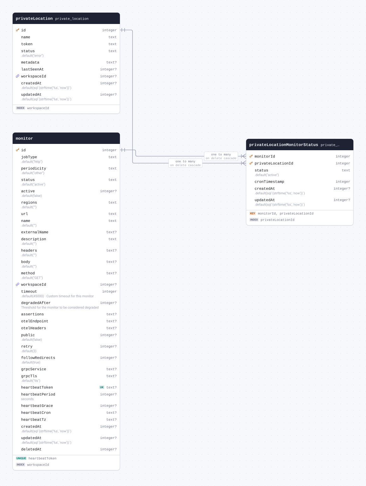

| Column                                      | Type      | Constraints                                                | Default                                    | Description |
| ------------------------------------------- | --------- | ---------------------------------------------------------- | ------------------------------------------ | ----------- |
| `monitorId` (`monitor_id`)                  | `integer` | PK NOT NULL → [monitor.id](#table-monitor)                 |                                            |             |
| `privateLocationId` (`private_location_id`) | `integer` | PK NOT NULL → [privateLocation.id](#table-privateLocation) |                                            |             |
| `status`                                    | `text`    | NOT NULL                                                   | `.default("active")`                       |             |
| `cronTimestamp` (`cron_timestamp`)          | `integer` | NOT NULL                                                   |                                            |             |
| `createdAt` (`created_at`)                  | `integer` | NULL                                                       | ``.default(sql`(strftime('%s', 'now'))`)`` |             |
| `updatedAt` (`updated_at`)                  | `integer` | NULL                                                       | ``.default(sql`(strftime('%s', 'now'))`)`` |             |

#### Definition

```sql
CREATE TABLE `private_location_monitor_status` (
	`monitor_id` integer NOT NULL,
	`private_location_id` integer NOT NULL,
	`status` text DEFAULT 'active' NOT NULL,
	`cron_timestamp` integer NOT NULL,
	`created_at` integer DEFAULT (strftime('%s', 'now')),
	`updated_at` integer DEFAULT (strftime('%s', 'now')),
	CONSTRAINT `private_location_monitor_status_pk` PRIMARY KEY(`monitor_id`, `private_location_id`),
	CONSTRAINT `fk_private_location_monitor_status_monitor_id_monitor_id_fk` FOREIGN KEY (`monitor_id`) REFERENCES `monitor`(`id`) ON DELETE CASCADE,
	CONSTRAINT `fk_private_location_monitor_status_private_location_id_private_location_id_fk` FOREIGN KEY (`private_location_id`) REFERENCES `private_location`(`id`) ON DELETE CASCADE
);

CREATE INDEX `private_location_monitor_status_pl_id_idx` ON `private_location_monitor_status` (`private_location_id`);
```

#### Indexes

- PRIMARY KEY `monitorId`, `privateLocationId`
- INDEX `privateLocationId`

#### References

- `monitorId` → [monitor.id](#table-monitor) (many to one, on delete cascade)
- `privateLocationId` → [privateLocation.id](#table-privateLocation) (many to one, on delete cascade)

<details>
<summary>Queries and their SQL</summary>

**Select**: Every row of privateLocationMonitorStatus.

```ts
db.select().from(privateLocationMonitorStatus);
```

```sql
select "monitor_id", "private_location_id", "status", "cron_timestamp", "created_at", "updated_at"
from "private_location_monitor_status"
```

**Count**: How many rows privateLocationMonitorStatus has.

```ts
db.select({ count: count() }).from(privateLocationMonitorStatus);
```

```sql
select count(*)
from "private_location_monitor_status"
```

**Find many**: The rows of privateLocationMonitorStatus, through the relational query API.

```ts
db.query.privateLocationMonitorStatus.findMany();
```

```sql
select "d0"."monitor_id" as "monitorId", "d0"."private_location_id" as "privateLocationId", "d0"."status" as "status", "d0"."cron_timestamp" as "cronTimestamp", "d0"."created_at" as "createdAt", "d0"."updated_at" as "updatedAt"
from "private_location_monitor_status" as "d0"
```

**Find by primary key**: One row of privateLocationMonitorStatus, through the relational query API.

```ts
db.query.privateLocationMonitorStatus.findFirst({ where: { monitorId: 1, privateLocationId: 1 } });
```

```sql
select "d0"."monitor_id" as "monitorId", "d0"."private_location_id" as "privateLocationId", "d0"."status" as "status", "d0"."cron_timestamp" as "cronTimestamp", "d0"."created_at" as "createdAt", "d0"."updated_at" as "updatedAt"
from "private_location_monitor_status" as "d0"
where (("d0"."monitor_id" = ?) and ("d0"."private_location_id" = ?))
limit ?
-- params: [1,1,1]
```

**Insert**: Adds a row to privateLocationMonitorStatus, giving the columns that have no default.

```ts
db.insert(privateLocationMonitorStatus).values({
  monitorId: 1,
  privateLocationId: 1,
  cronTimestamp: 1,
});
```

```sql
insert into "private_location_monitor_status" ("monitor_id", "private_location_id", "status", "cron_timestamp", "created_at", "updated_at")
values (?, ?, ?, ?, (strftime('%s', 'now')), (strftime('%s', 'now')))
-- params: [1,1,"active",1]
```

**Update**: Changes a row of privateLocationMonitorStatus, found by its primary key.

```ts
db.update(privateLocationMonitorStatus)
  .set({ status: "status" })
  .where(
    and(
      eq(privateLocationMonitorStatus.monitorId, 1),
      eq(privateLocationMonitorStatus.privateLocationId, 1),
    ),
  );
```

```sql
update "private_location_monitor_status"
set "status" = ?
where (("private_location_monitor_status"."monitor_id" = ?) and ("private_location_monitor_status"."private_location_id" = ?))
-- params: ["status",1,1]
```

**Delete**: Deletes a row of privateLocationMonitorStatus, found by its primary key.

```ts
db.delete(privateLocationMonitorStatus).where(
  and(
    eq(privateLocationMonitorStatus.monitorId, 1),
    eq(privateLocationMonitorStatus.privateLocationId, 1),
  ),
);
```

```sql
delete from "private_location_monitor_status"
where (("private_location_monitor_status"."monitor_id" = ?) and ("private_location_monitor_status"."private_location_id" = ?))
-- params: [1,1]
```

</details>

<a id="table-privateLocation"></a>

### privateLocation

Table `private_location`.

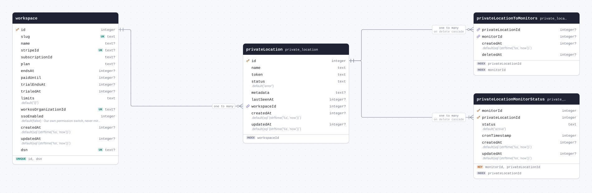

| Column                         | Type      | Constraints                             | Default                                    | Description |
| ------------------------------ | --------- | --------------------------------------- | ------------------------------------------ | ----------- |
| `id`                           | `integer` | PK NOT NULL                             |                                            |             |
| `name`                         | `text`    | NOT NULL                                |                                            |             |
| `token`                        | `text`    | NOT NULL                                |                                            |             |
| `status`                       | `text`    | NOT NULL                                | `.default("error")`                        |             |
| `metadata`                     | `text`    | NULL                                    |                                            |             |
| `lastSeenAt` (`last_seen_at`)  | `integer` | NULL                                    |                                            |             |
| `workspaceId` (`workspace_id`) | `integer` | NULL → [workspace.id](#table-workspace) |                                            |             |
| `createdAt` (`created_at`)     | `integer` | NULL                                    | ``.default(sql`(strftime('%s', 'now'))`)`` |             |
| `updatedAt` (`updated_at`)     | `integer` | NULL                                    | ``.default(sql`(strftime('%s', 'now'))`)`` |             |

#### Definition

```sql
CREATE TABLE `private_location` (
	`id` integer PRIMARY KEY,
	`name` text NOT NULL,
	`token` text NOT NULL,
	`status` text DEFAULT 'error' NOT NULL,
	`metadata` text,
	`last_seen_at` integer,
	`workspace_id` integer,
	`created_at` integer DEFAULT (strftime('%s', 'now')),
	`updated_at` integer DEFAULT (strftime('%s', 'now')),
	CONSTRAINT `fk_private_location_workspace_id_workspace_id_fk` FOREIGN KEY (`workspace_id`) REFERENCES `workspace`(`id`)
);

CREATE INDEX `private_location_workspace_id_idx` ON `private_location` (`workspace_id`);
```

#### Indexes

- INDEX `workspaceId`

#### References

- `workspaceId` → [workspace.id](#table-workspace) (many to one)

#### Referenced by

- `id` → [privateLocationMonitorStatus.privateLocationId](#table-privateLocationMonitorStatus) (one to many, on delete cascade)
- `id` → [privateLocationToMonitors.privateLocationId](#table-privateLocationToMonitors) (one to many, on delete cascade)

<details>
<summary>Queries and their SQL</summary>

**Select**: Every row of privateLocation.

```ts
db.select().from(privateLocation);
```

```sql
select "id", "name", "token", "status", "metadata", "last_seen_at", "workspace_id", "created_at", "updated_at"
from "private_location"
```

**Count**: How many rows privateLocation has.

```ts
db.select({ count: count() }).from(privateLocation);
```

```sql
select count(*)
from "private_location"
```

**Find many**: The rows of privateLocation, through the relational query API.

```ts
db.query.privateLocation.findMany();
```

```sql
select "d0"."id" as "id", "d0"."name" as "name", "d0"."token" as "token", "d0"."status" as "status", "d0"."metadata" as "metadata", "d0"."last_seen_at" as "lastSeenAt", "d0"."workspace_id" as "workspaceId", "d0"."created_at" as "createdAt", "d0"."updated_at" as "updatedAt"
from "private_location" as "d0"
```

**Find by primary key**: One row of privateLocation, through the relational query API.

```ts
db.query.privateLocation.findFirst({ where: { id: 1 } });
```

```sql
select "d0"."id" as "id", "d0"."name" as "name", "d0"."token" as "token", "d0"."status" as "status", "d0"."metadata" as "metadata", "d0"."last_seen_at" as "lastSeenAt", "d0"."workspace_id" as "workspaceId", "d0"."created_at" as "createdAt", "d0"."updated_at" as "updatedAt"
from "private_location" as "d0"
where "d0"."id" = ?
limit ?
-- params: [1,1]
```

**Insert**: Adds a row to privateLocation, giving the columns that have no default.

```ts
db.insert(privateLocation).values({ id: 1, name: "name", token: "token" });
```

```sql
insert into "private_location" ("id", "name", "token", "status", "metadata", "last_seen_at", "workspace_id", "created_at", "updated_at")
values (?, ?, ?, ?, null, null, null, (strftime('%s', 'now')), (strftime('%s', 'now')))
-- params: [1,"name","token","error"]
```

**Update**: Changes a row of privateLocation, found by its primary key.

```ts
db.update(privateLocation).set({ name: "name" }).where(eq(privateLocation.id, 1));
```

```sql
update "private_location"
set "name" = ?
where "private_location"."id" = ?
-- params: ["name",1]
```

**Delete**: Deletes a row of privateLocation, found by its primary key.

```ts
db.delete(privateLocation).where(eq(privateLocation.id, 1));
```

```sql
delete from "private_location"
where "private_location"."id" = ?
-- params: [1]
```

</details>

<a id="table-privateLocationToMonitors"></a>

### privateLocationToMonitors

Table `private_location_to_monitor`.

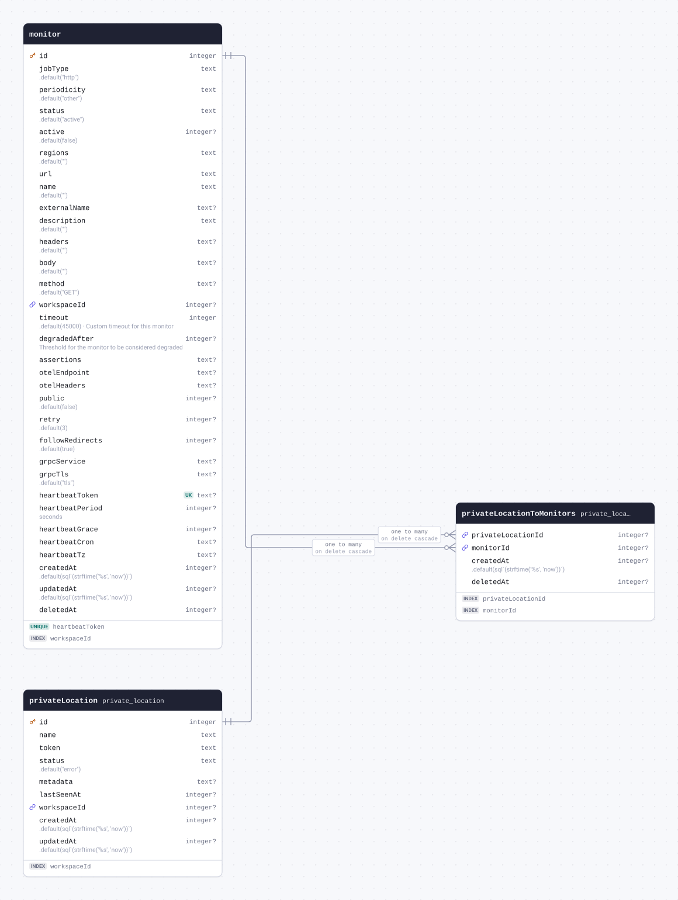

| Column                                      | Type      | Constraints                                         | Default                                    | Description |
| ------------------------------------------- | --------- | --------------------------------------------------- | ------------------------------------------ | ----------- |
| `privateLocationId` (`private_location_id`) | `integer` | NULL → [privateLocation.id](#table-privateLocation) |                                            |             |
| `monitorId` (`monitor_id`)                  | `integer` | NULL → [monitor.id](#table-monitor)                 |                                            |             |
| `createdAt` (`created_at`)                  | `integer` | NULL                                                | ``.default(sql`(strftime('%s', 'now'))`)`` |             |
| `deletedAt` (`deleted_at`)                  | `integer` | NULL                                                |                                            |             |

#### Definition

```sql
CREATE TABLE `private_location_to_monitor` (
	`private_location_id` integer,
	`monitor_id` integer,
	`created_at` integer DEFAULT (strftime('%s', 'now')),
	`deleted_at` integer,
	CONSTRAINT `fk_private_location_to_monitor_private_location_id_private_location_id_fk` FOREIGN KEY (`private_location_id`) REFERENCES `private_location`(`id`) ON DELETE CASCADE,
	CONSTRAINT `fk_private_location_to_monitor_monitor_id_monitor_id_fk` FOREIGN KEY (`monitor_id`) REFERENCES `monitor`(`id`) ON DELETE CASCADE
);

CREATE INDEX `private_location_to_monitor_private_location_id_idx` ON `private_location_to_monitor` (`private_location_id`);

CREATE INDEX `private_location_to_monitor_monitor_id_idx` ON `private_location_to_monitor` (`monitor_id`);
```

#### Indexes

- INDEX `privateLocationId`
- INDEX `monitorId`

#### References

- `privateLocationId` → [privateLocation.id](#table-privateLocation) (many to one, on delete cascade)
- `monitorId` → [monitor.id](#table-monitor) (many to one, on delete cascade)

<details>
<summary>Queries and their SQL</summary>

**Select**: Every row of privateLocationToMonitors.

```ts
db.select().from(privateLocationToMonitors);
```

```sql
select "private_location_id", "monitor_id", "created_at", "deleted_at"
from "private_location_to_monitor"
```

**Count**: How many rows privateLocationToMonitors has.

```ts
db.select({ count: count() }).from(privateLocationToMonitors);
```

```sql
select count(*)
from "private_location_to_monitor"
```

**Find many**: The rows of privateLocationToMonitors, through the relational query API.

```ts
db.query.privateLocationToMonitors.findMany();
```

```sql
select "d0"."private_location_id" as "privateLocationId", "d0"."monitor_id" as "monitorId", "d0"."created_at" as "createdAt", "d0"."deleted_at" as "deletedAt"
from "private_location_to_monitor" as "d0"
```

**Insert**: Adds a row to privateLocationToMonitors, giving the columns that have no default.

```ts
db.insert(privateLocationToMonitors).values({});
```

```sql
insert into "private_location_to_monitor" ("private_location_id", "monitor_id", "created_at", "deleted_at")
values (null, null, (strftime('%s', 'now')), null)
```

</details>

<a id="table-monitorGroup"></a>

### monitorGroup

Table `monitor_group`.

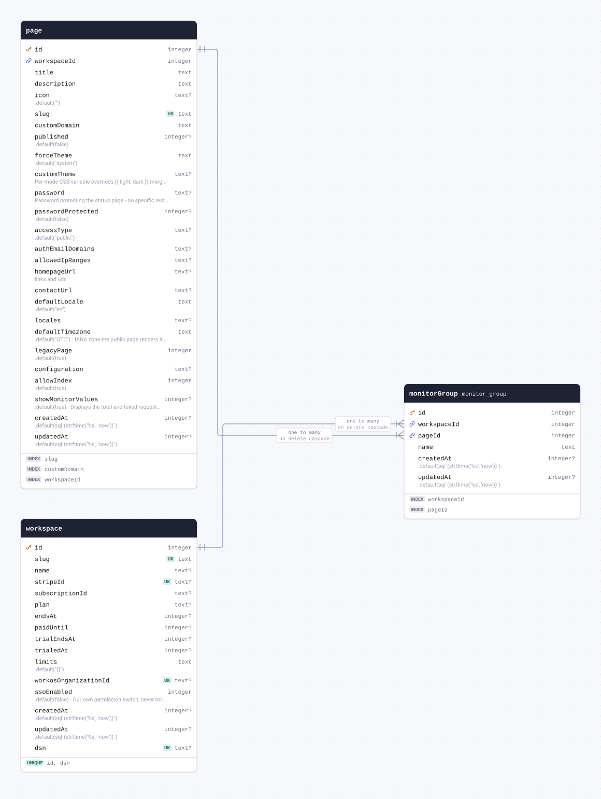

| Column                         | Type      | Constraints                                 | Default                                    | Description |
| ------------------------------ | --------- | ------------------------------------------- | ------------------------------------------ | ----------- |
| `id`                           | `integer` | PK NOT NULL                                 |                                            |             |
| `workspaceId` (`workspace_id`) | `integer` | NOT NULL → [workspace.id](#table-workspace) |                                            |             |
| `pageId` (`page_id`)           | `integer` | NOT NULL → [page.id](#table-page)           |                                            |             |
| `name`                         | `text`    | NOT NULL                                    |                                            |             |
| `createdAt` (`created_at`)     | `integer` | NULL                                        | ``.default(sql`(strftime('%s', 'now'))`)`` |             |
| `updatedAt` (`updated_at`)     | `integer` | NULL                                        | ``.default(sql`(strftime('%s', 'now'))`)`` |             |

#### Definition

```sql
CREATE TABLE `monitor_group` (
	`id` integer PRIMARY KEY,
	`workspace_id` integer NOT NULL,
	`page_id` integer NOT NULL,
	`name` text NOT NULL,
	`created_at` integer DEFAULT (strftime('%s', 'now')),
	`updated_at` integer DEFAULT (strftime('%s', 'now')),
	CONSTRAINT `fk_monitor_group_workspace_id_workspace_id_fk` FOREIGN KEY (`workspace_id`) REFERENCES `workspace`(`id`) ON DELETE CASCADE,
	CONSTRAINT `fk_monitor_group_page_id_page_id_fk` FOREIGN KEY (`page_id`) REFERENCES `page`(`id`) ON DELETE CASCADE
);

CREATE INDEX `monitor_group_workspace_id_idx` ON `monitor_group` (`workspace_id`);

CREATE INDEX `monitor_group_page_id_idx` ON `monitor_group` (`page_id`);
```

#### Indexes

- INDEX `workspaceId`
- INDEX `pageId`

#### References

- `workspaceId` → [workspace.id](#table-workspace) (many to one, on delete cascade)
- `pageId` → [page.id](#table-page) (many to one, on delete cascade)

<details>
<summary>Queries and their SQL</summary>

**Select**: Every row of monitorGroup.

```ts
db.select().from(monitorGroup);
```

```sql
select "id", "workspace_id", "page_id", "name", "created_at", "updated_at"
from "monitor_group"
```

**Count**: How many rows monitorGroup has.

```ts
db.select({ count: count() }).from(monitorGroup);
```

```sql
select count(*)
from "monitor_group"
```

**Find many**: The rows of monitorGroup, through the relational query API.

```ts
db.query.monitorGroup.findMany();
```

```sql
select "d0"."id" as "id", "d0"."workspace_id" as "workspaceId", "d0"."page_id" as "pageId", "d0"."name" as "name", "d0"."created_at" as "createdAt", "d0"."updated_at" as "updatedAt"
from "monitor_group" as "d0"
```

**Find by primary key**: One row of monitorGroup, through the relational query API.

```ts
db.query.monitorGroup.findFirst({ where: { id: 1 } });
```

```sql
select "d0"."id" as "id", "d0"."workspace_id" as "workspaceId", "d0"."page_id" as "pageId", "d0"."name" as "name", "d0"."created_at" as "createdAt", "d0"."updated_at" as "updatedAt"
from "monitor_group" as "d0"
where "d0"."id" = ?
limit ?
-- params: [1,1]
```

**Insert**: Adds a row to monitorGroup, giving the columns that have no default.

```ts
db.insert(monitorGroup).values({ id: 1, workspaceId: 1, pageId: 1, name: "name" });
```

```sql
insert into "monitor_group" ("id", "workspace_id", "page_id", "name", "created_at", "updated_at")
values (?, ?, ?, ?, (strftime('%s', 'now')), (strftime('%s', 'now')))
-- params: [1,1,1,"name"]
```

**Update**: Changes a row of monitorGroup, found by its primary key.

```ts
db.update(monitorGroup).set({ workspaceId: 1 }).where(eq(monitorGroup.id, 1));
```

```sql
update "monitor_group"
set "workspace_id" = ?
where "monitor_group"."id" = ?
-- params: [1,1]
```

**Delete**: Deletes a row of monitorGroup, found by its primary key.

```ts
db.delete(monitorGroup).where(eq(monitorGroup.id, 1));
```

```sql
delete from "monitor_group"
where "monitor_group"."id" = ?
-- params: [1]
```

</details>

<a id="table-viewer"></a>

### viewer

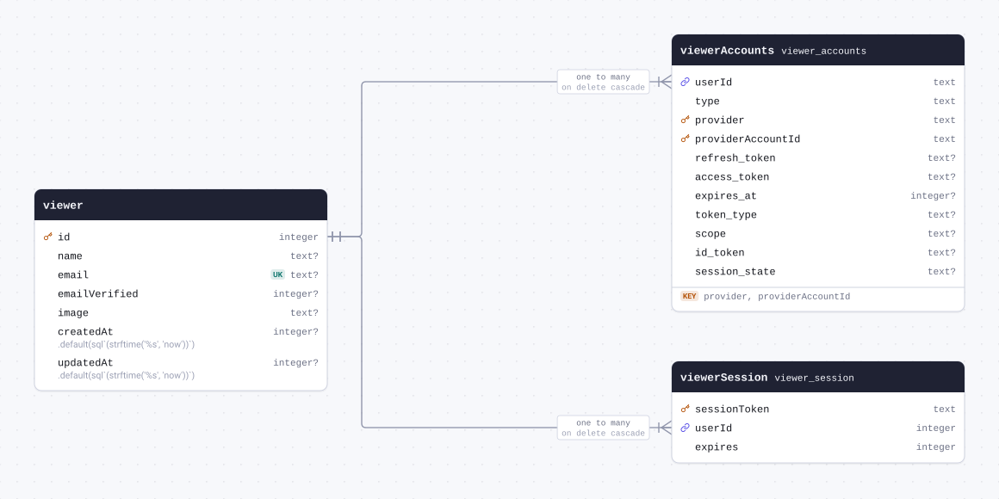

| Column                     | Type      | Constraints | Default                                    | Description |
| -------------------------- | --------- | ----------- | ------------------------------------------ | ----------- |
| `id`                       | `integer` | PK NOT NULL |                                            |             |
| `name`                     | `text`    | NULL        |                                            |             |
| `email`                    | `text`    | UNIQUE NULL |                                            |             |
| `emailVerified`            | `integer` | NULL        |                                            |             |
| `image`                    | `text`    | NULL        |                                            |             |
| `createdAt` (`created_at`) | `integer` | NULL        | ``.default(sql`(strftime('%s', 'now'))`)`` |             |
| `updatedAt` (`updated_at`) | `integer` | NULL        | ``.default(sql`(strftime('%s', 'now'))`)`` |             |

#### Definition

```sql
CREATE TABLE `viewer` (
	`id` integer PRIMARY KEY,
	`name` text,
	`email` text UNIQUE,
	`emailVerified` integer,
	`image` text,
	`created_at` integer DEFAULT (strftime('%s', 'now')),
	`updated_at` integer DEFAULT (strftime('%s', 'now'))
);
```

#### Referenced by

- `id` → [viewerSession.userId](#table-viewerSession) (one to many, on delete cascade)
- `id` → [viewerAccounts.userId](#table-viewerAccounts) (one to many, on delete cascade)

<details>
<summary>Queries and their SQL</summary>

**Select**: Every row of viewer.

```ts
db.select().from(viewer);
```

```sql
select "id", "name", "email", "emailVerified", "image", "created_at", "updated_at"
from "viewer"
```

**Count**: How many rows viewer has.

```ts
db.select({ count: count() }).from(viewer);
```

```sql
select count(*)
from "viewer"
```

**Find many**: The rows of viewer, through the relational query API.

```ts
db.query.viewer.findMany();
```

```sql
select "d0"."id" as "id", "d0"."name" as "name", "d0"."email" as "email", "d0"."emailVerified" as "emailVerified", "d0"."image" as "image", "d0"."created_at" as "createdAt", "d0"."updated_at" as "updatedAt"
from "viewer" as "d0"
```

**Find by primary key**: One row of viewer, through the relational query API.

```ts
db.query.viewer.findFirst({ where: { id: 1 } });
```

```sql
select "d0"."id" as "id", "d0"."name" as "name", "d0"."email" as "email", "d0"."emailVerified" as "emailVerified", "d0"."image" as "image", "d0"."created_at" as "createdAt", "d0"."updated_at" as "updatedAt"
from "viewer" as "d0"
where "d0"."id" = ?
limit ?
-- params: [1,1]
```

**Insert**: Adds a row to viewer, giving the columns that have no default.

```ts
db.insert(viewer).values({ id: 1 });
```

```sql
insert into "viewer" ("id", "name", "email", "emailVerified", "image", "created_at", "updated_at")
values (?, null, null, null, null, (strftime('%s', 'now')), (strftime('%s', 'now')))
-- params: [1]
```

**Update**: Changes a row of viewer, found by its primary key.

```ts
db.update(viewer).set({ name: "name" }).where(eq(viewer.id, 1));
```

```sql
update "viewer"
set "name" = ?
where "viewer"."id" = ?
-- params: ["name",1]
```

**Delete**: Deletes a row of viewer, found by its primary key.

```ts
db.delete(viewer).where(eq(viewer.id, 1));
```

```sql
delete from "viewer"
where "viewer"."id" = ?
-- params: [1]
```

</details>

<a id="table-viewerSession"></a>

### viewerSession

Table `viewer_session`.

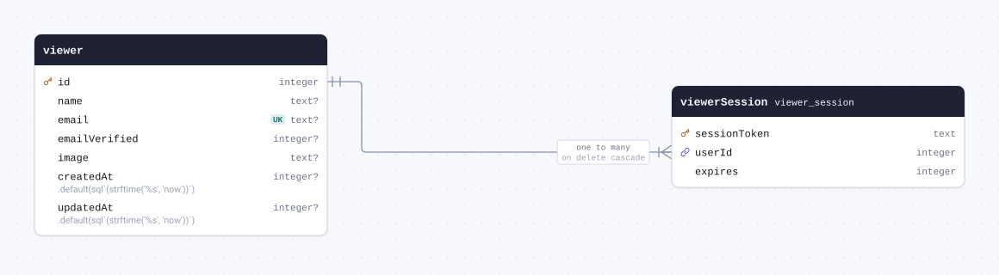

| Column                           | Type      | Constraints                           | Default | Description |
| -------------------------------- | --------- | ------------------------------------- | ------- | ----------- |
| `sessionToken` (`session_token`) | `text`    | PK NOT NULL                           |         |             |
| `userId` (`user_id`)             | `integer` | NOT NULL → [viewer.id](#table-viewer) |         |             |
| `expires`                        | `integer` | NOT NULL                              |         |             |

#### Definition

```sql
CREATE TABLE `viewer_session` (
	`session_token` text PRIMARY KEY,
	`user_id` integer NOT NULL,
	`expires` integer NOT NULL,
	CONSTRAINT `fk_viewer_session_user_id_viewer_id_fk` FOREIGN KEY (`user_id`) REFERENCES `viewer`(`id`) ON DELETE CASCADE
);
```

#### References

- `userId` → [viewer.id](#table-viewer) (many to one, on delete cascade)

<details>
<summary>Queries and their SQL</summary>

**Select**: Every row of viewerSession.

```ts
db.select().from(viewerSession);
```

```sql
select "session_token", "user_id", "expires"
from "viewer_session"
```

**Count**: How many rows viewerSession has.

```ts
db.select({ count: count() }).from(viewerSession);
```

```sql
select count(*)
from "viewer_session"
```

**Find many**: The rows of viewerSession, through the relational query API.

```ts
db.query.viewerSession.findMany();
```

```sql
select "d0"."session_token" as "sessionToken", "d0"."user_id" as "userId", "d0"."expires" as "expires"
from "viewer_session" as "d0"
```

**Find by primary key**: One row of viewerSession, through the relational query API.

```ts
db.query.viewerSession.findFirst({ where: { sessionToken: "sessionToken" } });
```

```sql
select "d0"."session_token" as "sessionToken", "d0"."user_id" as "userId", "d0"."expires" as "expires"
from "viewer_session" as "d0"
where "d0"."session_token" = ?
limit ?
-- params: ["sessionToken",1]
```

**Insert**: Adds a row to viewerSession, giving the columns that have no default.

```ts
db.insert(viewerSession).values({ sessionToken: "sessionToken", userId: 1, expires: 1 });
```

```sql
insert into "viewer_session" ("session_token", "user_id", "expires")
values (?, ?, ?)
-- params: ["sessionToken",1,1]
```

**Update**: Changes a row of viewerSession, found by its primary key.

```ts
db.update(viewerSession).set({ userId: 1 }).where(eq(viewerSession.sessionToken, "sessionToken"));
```

```sql
update "viewer_session"
set "user_id" = ?
where "viewer_session"."session_token" = ?
-- params: [1,"sessionToken"]
```

**Delete**: Deletes a row of viewerSession, found by its primary key.

```ts
db.delete(viewerSession).where(eq(viewerSession.sessionToken, "sessionToken"));
```

```sql
delete from "viewer_session"
where "viewer_session"."session_token" = ?
-- params: ["sessionToken"]
```

</details>

<a id="table-viewerAccounts"></a>

### viewerAccounts

Table `viewer_accounts`.

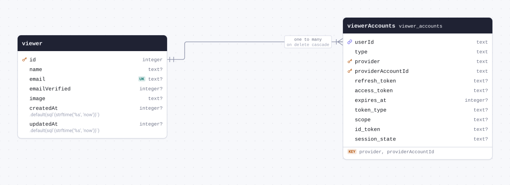

| Column               | Type      | Constraints                           | Default | Description |
| -------------------- | --------- | ------------------------------------- | ------- | ----------- |
| `userId` (`user_id`) | `text`    | NOT NULL → [viewer.id](#table-viewer) |         |             |
| `type`               | `text`    | NOT NULL                              |         |             |
| `provider`           | `text`    | PK NOT NULL                           |         |             |
| `providerAccountId`  | `text`    | PK NOT NULL                           |         |             |
| `refresh_token`      | `text`    | NULL                                  |         |             |
| `access_token`       | `text`    | NULL                                  |         |             |
| `expires_at`         | `integer` | NULL                                  |         |             |
| `token_type`         | `text`    | NULL                                  |         |             |
| `scope`              | `text`    | NULL                                  |         |             |
| `id_token`           | `text`    | NULL                                  |         |             |
| `session_state`      | `text`    | NULL                                  |         |             |

#### Definition

```sql
CREATE TABLE `viewer_accounts` (
	`user_id` text NOT NULL,
	`type` text NOT NULL,
	`provider` text NOT NULL,
	`providerAccountId` text NOT NULL,
	`refresh_token` text,
	`access_token` text,
	`expires_at` integer,
	`token_type` text,
	`scope` text,
	`id_token` text,
	`session_state` text,
	CONSTRAINT `viewer_accounts_pk` PRIMARY KEY(`provider`, `providerAccountId`),
	CONSTRAINT `fk_viewer_accounts_user_id_viewer_id_fk` FOREIGN KEY (`user_id`) REFERENCES `viewer`(`id`) ON DELETE CASCADE
);
```

#### Indexes

- PRIMARY KEY `provider`, `providerAccountId`

#### References

- `userId` → [viewer.id](#table-viewer) (many to one, on delete cascade)

<details>
<summary>Queries and their SQL</summary>

**Select**: Every row of viewerAccounts.

```ts
db.select().from(viewerAccounts);
```

```sql
select "user_id", "type", "provider", "providerAccountId", "refresh_token", "access_token", "expires_at", "token_type", "scope", "id_token", "session_state"
from "viewer_accounts"
```

**Count**: How many rows viewerAccounts has.

```ts
db.select({ count: count() }).from(viewerAccounts);
```

```sql
select count(*)
from "viewer_accounts"
```

**Find many**: The rows of viewerAccounts, through the relational query API.

```ts
db.query.viewerAccounts.findMany();
```

```sql
select "d0"."user_id" as "userId", "d0"."type" as "type", "d0"."provider" as "provider", "d0"."providerAccountId" as "providerAccountId", "d0"."refresh_token" as "refresh_token", "d0"."access_token" as "access_token", "d0"."expires_at" as "expires_at", "d0"."token_type" as "token_type", "d0"."scope" as "scope", "d0"."id_token" as "id_token", "d0"."session_state" as "session_state"
from "viewer_accounts" as "d0"
```

**Find by primary key**: One row of viewerAccounts, through the relational query API.

```ts
db.query.viewerAccounts.findFirst({
  where: { provider: "provider", providerAccountId: "providerAccountId" },
});
```

```sql
select "d0"."user_id" as "userId", "d0"."type" as "type", "d0"."provider" as "provider", "d0"."providerAccountId" as "providerAccountId", "d0"."refresh_token" as "refresh_token", "d0"."access_token" as "access_token", "d0"."expires_at" as "expires_at", "d0"."token_type" as "token_type", "d0"."scope" as "scope", "d0"."id_token" as "id_token", "d0"."session_state" as "session_state"
from "viewer_accounts" as "d0"
where (("d0"."provider" = ?) and ("d0"."providerAccountId" = ?))
limit ?
-- params: ["provider","providerAccountId",1]
```

**Insert**: Adds a row to viewerAccounts, giving the columns that have no default.

```ts
db.insert(viewerAccounts).values({
  userId: "userId",
  type: "type",
  provider: "provider",
  providerAccountId: "providerAccountId",
});
```

```sql
insert into "viewer_accounts" ("user_id", "type", "provider", "providerAccountId", "refresh_token", "access_token", "expires_at", "token_type", "scope", "id_token", "session_state")
values (?, ?, ?, ?, null, null, null, null, null, null, null)
-- params: ["userId","type","provider","providerAccountId"]
```

**Update**: Changes a row of viewerAccounts, found by its primary key.

```ts
db.update(viewerAccounts)
  .set({ userId: "userId" })
  .where(
    and(
      eq(viewerAccounts.provider, "provider"),
      eq(viewerAccounts.providerAccountId, "providerAccountId"),
    ),
  );
```

```sql
update "viewer_accounts"
set "user_id" = ?
where (("viewer_accounts"."provider" = ?) and ("viewer_accounts"."providerAccountId" = ?))
-- params: ["userId","provider","providerAccountId"]
```

**Delete**: Deletes a row of viewerAccounts, found by its primary key.

```ts
db.delete(viewerAccounts).where(
  and(
    eq(viewerAccounts.provider, "provider"),
    eq(viewerAccounts.providerAccountId, "providerAccountId"),
  ),
);
```

```sql
delete from "viewer_accounts"
where (("viewer_accounts"."provider" = ?) and ("viewer_accounts"."providerAccountId" = ?))
-- params: ["provider","providerAccountId"]
```

</details>

<a id="table-apiKey"></a>

### apiKey

Table `api_key`.

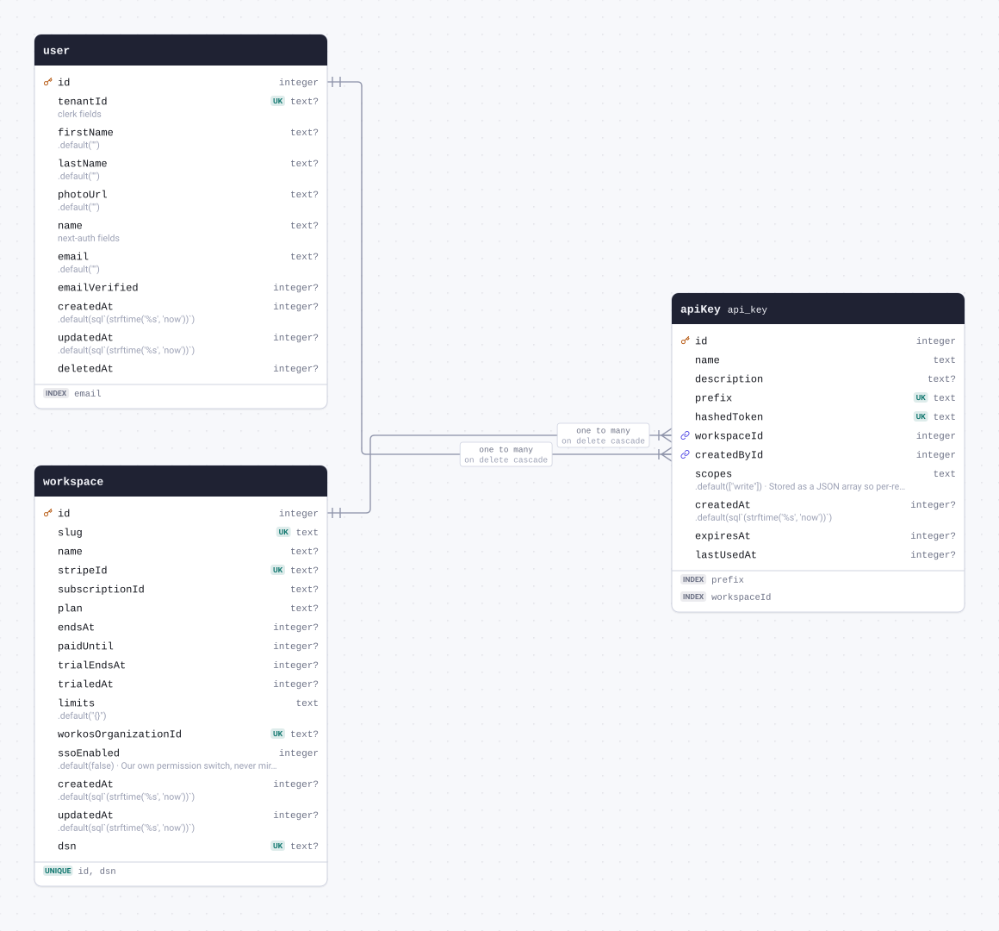

| Column                          | Type      | Constraints                                 | Default                                    | Description                                                                                                                                                                                                                                                     |
| ------------------------------- | --------- | ------------------------------------------- | ------------------------------------------ | --------------------------------------------------------------------------------------------------------------------------------------------------------------------------------------------------------------------------------------------------------------- |
| `id`                            | `integer` | PK NOT NULL                                 |                                            |                                                                                                                                                                                                                                                                 |
| `name`                          | `text`    | NOT NULL                                    |                                            |                                                                                                                                                                                                                                                                 |
| `description`                   | `text`    | NULL                                        |                                            |                                                                                                                                                                                                                                                                 |
| `prefix`                        | `text`    | UNIQUE NOT NULL                             |                                            |                                                                                                                                                                                                                                                                 |
| `hashedToken` (`hashed_token`)  | `text`    | UNIQUE NOT NULL                             |                                            |                                                                                                                                                                                                                                                                 |
| `workspaceId` (`workspace_id`)  | `integer` | NOT NULL → [workspace.id](#table-workspace) |                                            |                                                                                                                                                                                                                                                                 |
| `createdById` (`created_by_id`) | `integer` | NOT NULL → [user.id](#table-user)           |                                            |                                                                                                                                                                                                                                                                 |
| `scopes`                        | `text`    | NOT NULL                                    | `.default(["write"])`                      | Stored as a JSON array so per-resource scopes (e.g. 'monitor.read') can be added later without re-shaping the column. v1 stores a single value: ['read'] or ['write']. Existing rows backfill to ['write'] via the column default to preserve current behavior. |
| `createdAt` (`created_at`)      | `integer` | NULL                                        | ``.default(sql`(strftime('%s', 'now'))`)`` |                                                                                                                                                                                                                                                                 |
| `expiresAt` (`expires_at`)      | `integer` | NULL                                        |                                            |                                                                                                                                                                                                                                                                 |
| `lastUsedAt` (`last_used_at`)   | `integer` | NULL                                        |                                            |                                                                                                                                                                                                                                                                 |

#### Definition

```sql
CREATE TABLE `api_key` (
	`id` integer PRIMARY KEY AUTOINCREMENT,
	`name` text NOT NULL,
	`description` text,
	`prefix` text NOT NULL UNIQUE,
	`hashed_token` text NOT NULL UNIQUE,
	`workspace_id` integer NOT NULL,
	`created_by_id` integer NOT NULL,
	`scopes` text DEFAULT '["write"]' NOT NULL,
	`created_at` integer DEFAULT (strftime('%s', 'now')),
	`expires_at` integer,
	`last_used_at` integer,
	CONSTRAINT `fk_api_key_workspace_id_workspace_id_fk` FOREIGN KEY (`workspace_id`) REFERENCES `workspace`(`id`) ON DELETE CASCADE,
	CONSTRAINT `fk_api_key_created_by_id_user_id_fk` FOREIGN KEY (`created_by_id`) REFERENCES `user`(`id`) ON DELETE CASCADE
);

CREATE INDEX `api_key_prefix_idx` ON `api_key` (`prefix`);

CREATE INDEX `api_key_workspace_id_idx` ON `api_key` (`workspace_id`);
```

#### Indexes

- INDEX `prefix`
- INDEX `workspaceId`

#### References

- `workspaceId` → [workspace.id](#table-workspace) (many to one, on delete cascade)
- `createdById` → [user.id](#table-user) (many to one, on delete cascade)

<details>
<summary>Queries and their SQL</summary>

**Select**: Every row of apiKey.

```ts
db.select().from(apiKey);
```

```sql
select "id", "name", "description", "prefix", "hashed_token", "workspace_id", "created_by_id", "scopes", "created_at", "expires_at", "last_used_at"
from "api_key"
```

**Count**: How many rows apiKey has.

```ts
db.select({ count: count() }).from(apiKey);
```

```sql
select count(*)
from "api_key"
```

**Find many**: The rows of apiKey, through the relational query API.

```ts
db.query.apiKey.findMany();
```

```sql
select "d0"."id" as "id", "d0"."name" as "name", "d0"."description" as "description", "d0"."prefix" as "prefix", "d0"."hashed_token" as "hashedToken", "d0"."workspace_id" as "workspaceId", "d0"."created_by_id" as "createdById", "d0"."scopes" as "scopes", "d0"."created_at" as "createdAt", "d0"."expires_at" as "expiresAt", "d0"."last_used_at" as "lastUsedAt"
from "api_key" as "d0"
```

**Find by primary key**: One row of apiKey, through the relational query API.

```ts
db.query.apiKey.findFirst({ where: { id: 1 } });
```

```sql
select "d0"."id" as "id", "d0"."name" as "name", "d0"."description" as "description", "d0"."prefix" as "prefix", "d0"."hashed_token" as "hashedToken", "d0"."workspace_id" as "workspaceId", "d0"."created_by_id" as "createdById", "d0"."scopes" as "scopes", "d0"."created_at" as "createdAt", "d0"."expires_at" as "expiresAt", "d0"."last_used_at" as "lastUsedAt"
from "api_key" as "d0"
where "d0"."id" = ?
limit ?
-- params: [1,1]
```

**Insert**: Adds a row to apiKey, giving the columns that have no default.

```ts
db.insert(apiKey).values({
  id: 1,
  name: "name",
  prefix: "prefix",
  hashedToken: "hashedToken",
  workspaceId: 1,
  createdById: 1,
});
```

```sql
insert into "api_key" ("id", "name", "description", "prefix", "hashed_token", "workspace_id", "created_by_id", "scopes", "created_at", "expires_at", "last_used_at")
values (?, ?, null, ?, ?, ?, ?, ?, (strftime('%s', 'now')), null, null)
-- params: [1,"name","prefix","hashedToken",1,1,"[\"write\"]"]
```

**Update**: Changes a row of apiKey, found by its primary key.

```ts
db.update(apiKey).set({ name: "name" }).where(eq(apiKey.id, 1));
```

```sql
update "api_key"
set "name" = ?
where "api_key"."id" = ?
-- params: ["name",1]
```

**Delete**: Deletes a row of apiKey, found by its primary key.

```ts
db.delete(apiKey).where(eq(apiKey.id, 1));
```

```sql
delete from "api_key"
where "api_key"."id" = ?
-- params: [1]
```

</details>

<a id="table-pageComponent"></a>

### pageComponent

Table `page_component`.

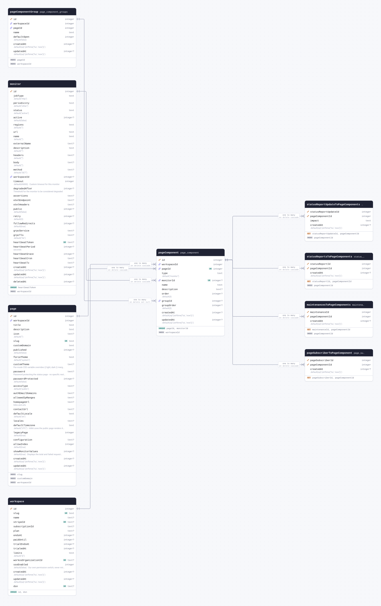

| Column                         | Type      | Constraints                                               | Default                                    | Description |
| ------------------------------ | --------- | --------------------------------------------------------- | ------------------------------------------ | ----------- |
| `id`                           | `integer` | PK NOT NULL                                               |                                            |             |
| `workspaceId` (`workspace_id`) | `integer` | NOT NULL → [workspace.id](#table-workspace)               |                                            |             |
| `pageId` (`page_id`)           | `integer` | NOT NULL → [page.id](#table-page)                         |                                            |             |
| `type`                         | `text`    | NOT NULL                                                  | `.default("monitor")`                      |             |
| `monitorId` (`monitor_id`)     | `integer` | NULL → [monitor.id](#table-monitor)                       |                                            |             |
| `name`                         | `text`    | NOT NULL                                                  |                                            |             |
| `description`                  | `text`    | NULL                                                      |                                            |             |
| `order`                        | `integer` | NULL                                                      | `.default(0)`                              |             |
| `groupId` (`group_id`)         | `integer` | NULL → [pageComponentGroup.id](#table-pageComponentGroup) |                                            |             |
| `groupOrder` (`group_order`)   | `integer` | NULL                                                      | `.default(0)`                              |             |
| `createdAt` (`created_at`)     | `integer` | NULL                                                      | ``.default(sql`(strftime('%s', 'now'))`)`` |             |
| `updatedAt` (`updated_at`)     | `integer` | NULL                                                      | ``.default(sql`(strftime('%s', 'now'))`)`` |             |

#### Definition

```sql
CREATE TABLE `page_component` (
	`id` integer PRIMARY KEY,
	`workspace_id` integer NOT NULL,
	`page_id` integer NOT NULL,
	`type` text DEFAULT 'monitor' NOT NULL,
	`monitor_id` integer,
	`name` text NOT NULL,
	`description` text,
	`order` integer DEFAULT 0,
	`group_id` integer,
	`group_order` integer DEFAULT 0,
	`created_at` integer DEFAULT (strftime('%s', 'now')),
	`updated_at` integer DEFAULT (strftime('%s', 'now')),
	CONSTRAINT `fk_page_component_workspace_id_workspace_id_fk` FOREIGN KEY (`workspace_id`) REFERENCES `workspace`(`id`) ON DELETE CASCADE,
	CONSTRAINT `fk_page_component_page_id_page_id_fk` FOREIGN KEY (`page_id`) REFERENCES `page`(`id`) ON DELETE CASCADE,
	CONSTRAINT `fk_page_component_monitor_id_monitor_id_fk` FOREIGN KEY (`monitor_id`) REFERENCES `monitor`(`id`) ON DELETE CASCADE,
	CONSTRAINT `fk_page_component_group_id_page_component_groups_id_fk` FOREIGN KEY (`group_id`) REFERENCES `page_component_groups`(`id`) ON DELETE SET NULL,
	CONSTRAINT `page_component_page_id_monitor_id_unique` UNIQUE(`page_id`,`monitor_id`),
	CONSTRAINT "page_component_type_check" CHECK("type" = 'monitor' AND "monitor_id" IS NOT NULL OR "type" = 'static' AND "monitor_id" IS NULL)
);

CREATE INDEX `page_component_workspace_id_idx` ON `page_component` (`workspace_id`);
```

#### Indexes

- UNIQUE `pageId`, `monitorId`
- INDEX `workspaceId`

#### References

- `workspaceId` → [workspace.id](#table-workspace) (many to one, on delete cascade)
- `pageId` → [page.id](#table-page) (many to one, on delete cascade)
- `monitorId` → [monitor.id](#table-monitor) (many to one, on delete cascade)
- `groupId` → [pageComponentGroup.id](#table-pageComponentGroup) (many to one, on delete set null)

#### Referenced by

- `id` → [pageSubscriberToPageComponent.pageComponentId](#table-pageSubscriberToPageComponent) (one to many, on delete cascade)
- `id` → [maintenancesToPageComponents.pageComponentId](#table-maintenancesToPageComponents) (one to many, on delete cascade)
- `id` → [statusReportsToPageComponents.pageComponentId](#table-statusReportsToPageComponents) (one to many, on delete cascade)
- `id` → [statusReportUpdateToPageComponents.pageComponentId](#table-statusReportUpdateToPageComponents) (one to many, on delete cascade)

<details>
<summary>Queries and their SQL</summary>

**Select**: Every row of pageComponent.

```ts
db.select().from(pageComponent);
```

```sql
select "id", "workspace_id", "page_id", "type", "monitor_id", "name", "description", "order", "group_id", "group_order", "created_at", "updated_at"
from "page_component"
```

**Count**: How many rows pageComponent has.

```ts
db.select({ count: count() }).from(pageComponent);
```

```sql
select count(*)
from "page_component"
```

**Find many**: The rows of pageComponent, through the relational query API.

```ts
db.query.pageComponent.findMany();
```

```sql
select "d0"."id" as "id", "d0"."workspace_id" as "workspaceId", "d0"."page_id" as "pageId", "d0"."type" as "type", "d0"."monitor_id" as "monitorId", "d0"."name" as "name", "d0"."description" as "description", "d0"."order" as "order", "d0"."group_id" as "groupId", "d0"."group_order" as "groupOrder", "d0"."created_at" as "createdAt", "d0"."updated_at" as "updatedAt"
from "page_component" as "d0"
```

**Find by primary key**: One row of pageComponent, through the relational query API.

```ts
db.query.pageComponent.findFirst({ where: { id: 1 } });
```

```sql
select "d0"."id" as "id", "d0"."workspace_id" as "workspaceId", "d0"."page_id" as "pageId", "d0"."type" as "type", "d0"."monitor_id" as "monitorId", "d0"."name" as "name", "d0"."description" as "description", "d0"."order" as "order", "d0"."group_id" as "groupId", "d0"."group_order" as "groupOrder", "d0"."created_at" as "createdAt", "d0"."updated_at" as "updatedAt"
from "page_component" as "d0"
where "d0"."id" = ?
limit ?
-- params: [1,1]
```

**Insert**: Adds a row to pageComponent, giving the columns that have no default.

```ts
db.insert(pageComponent).values({ id: 1, workspaceId: 1, pageId: 1, name: "name" });
```

```sql
insert into "page_component" ("id", "workspace_id", "page_id", "type", "monitor_id", "name", "description", "order", "group_id", "group_order", "created_at", "updated_at")
values (?, ?, ?, ?, null, ?, null, ?, null, ?, (strftime('%s', 'now')), (strftime('%s', 'now')))
-- params: [1,1,1,"monitor","name",0,0]
```

**Update**: Changes a row of pageComponent, found by its primary key.

```ts
db.update(pageComponent).set({ workspaceId: 1 }).where(eq(pageComponent.id, 1));
```

```sql
update "page_component"
set "workspace_id" = ?
where "page_component"."id" = ?
-- params: [1,1]
```

**Delete**: Deletes a row of pageComponent, found by its primary key.

```ts
db.delete(pageComponent).where(eq(pageComponent.id, 1));
```

```sql
delete from "page_component"
where "page_component"."id" = ?
-- params: [1]
```

</details>

<a id="table-maintenancesToPageComponents"></a>

### maintenancesToPageComponents

Table `maintenance_to_page_component`.

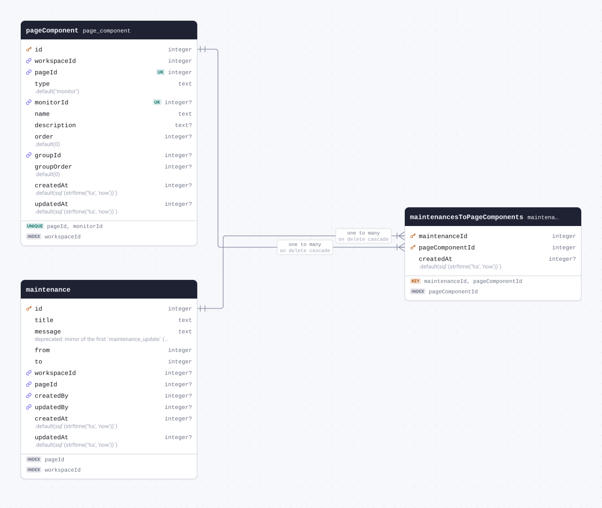

| Column                                  | Type      | Constraints                                            | Default                                    | Description |
| --------------------------------------- | --------- | ------------------------------------------------------ | ------------------------------------------ | ----------- |
| `maintenanceId` (`maintenance_id`)      | `integer` | PK NOT NULL → [maintenance.id](#table-maintenance)     |                                            |             |
| `pageComponentId` (`page_component_id`) | `integer` | PK NOT NULL → [pageComponent.id](#table-pageComponent) |                                            |             |
| `createdAt` (`created_at`)              | `integer` | NULL                                                   | ``.default(sql`(strftime('%s', 'now'))`)`` |             |

#### Definition

```sql
CREATE TABLE `maintenance_to_page_component` (
	`maintenance_id` integer NOT NULL,
	`page_component_id` integer NOT NULL,
	`created_at` integer DEFAULT (strftime('%s', 'now')),
	CONSTRAINT `maintenance_to_page_component_pk` PRIMARY KEY(`maintenance_id`, `page_component_id`),
	CONSTRAINT `fk_maintenance_to_page_component_maintenance_id_maintenance_id_fk` FOREIGN KEY (`maintenance_id`) REFERENCES `maintenance`(`id`) ON DELETE CASCADE,
	CONSTRAINT `fk_maintenance_to_page_component_page_component_id_page_component_id_fk` FOREIGN KEY (`page_component_id`) REFERENCES `page_component`(`id`) ON DELETE CASCADE
);

CREATE INDEX `maintenance_to_page_component_page_component_id_idx` ON `maintenance_to_page_component` (`page_component_id`);
```

#### Indexes

- PRIMARY KEY `maintenanceId`, `pageComponentId`
- INDEX `pageComponentId`

#### References

- `maintenanceId` → [maintenance.id](#table-maintenance) (many to one, on delete cascade)
- `pageComponentId` → [pageComponent.id](#table-pageComponent) (many to one, on delete cascade)

<details>
<summary>Queries and their SQL</summary>

**Select**: Every row of maintenancesToPageComponents.

```ts
db.select().from(maintenancesToPageComponents);
```

```sql
select "maintenance_id", "page_component_id", "created_at"
from "maintenance_to_page_component"
```

**Count**: How many rows maintenancesToPageComponents has.

```ts
db.select({ count: count() }).from(maintenancesToPageComponents);
```

```sql
select count(*)
from "maintenance_to_page_component"
```

**Find many**: The rows of maintenancesToPageComponents, through the relational query API.

```ts
db.query.maintenancesToPageComponents.findMany();
```

```sql
select "d0"."maintenance_id" as "maintenanceId", "d0"."page_component_id" as "pageComponentId", "d0"."created_at" as "createdAt"
from "maintenance_to_page_component" as "d0"
```

**Find by primary key**: One row of maintenancesToPageComponents, through the relational query API.

```ts
db.query.maintenancesToPageComponents.findFirst({
  where: { maintenanceId: 1, pageComponentId: 1 },
});
```

```sql
select "d0"."maintenance_id" as "maintenanceId", "d0"."page_component_id" as "pageComponentId", "d0"."created_at" as "createdAt"
from "maintenance_to_page_component" as "d0"
where (("d0"."maintenance_id" = ?) and ("d0"."page_component_id" = ?))
limit ?
-- params: [1,1,1]
```

**Insert**: Adds a row to maintenancesToPageComponents, giving the columns that have no default.

```ts
db.insert(maintenancesToPageComponents).values({ maintenanceId: 1, pageComponentId: 1 });
```

```sql
insert into "maintenance_to_page_component" ("maintenance_id", "page_component_id", "created_at")
values (?, ?, (strftime('%s', 'now')))
-- params: [1,1]
```

**Update**: Changes a row of maintenancesToPageComponents, found by its primary key.

```ts
db.update(maintenancesToPageComponents)
  .set({ createdAt: 1 })
  .where(
    and(
      eq(maintenancesToPageComponents.maintenanceId, 1),
      eq(maintenancesToPageComponents.pageComponentId, 1),
    ),
  );
```

```sql
update "maintenance_to_page_component"
set "created_at" = ?
where (("maintenance_to_page_component"."maintenance_id" = ?) and ("maintenance_to_page_component"."page_component_id" = ?))
-- params: [1,1,1]
```

**Delete**: Deletes a row of maintenancesToPageComponents, found by its primary key.

```ts
db.delete(maintenancesToPageComponents).where(
  and(
    eq(maintenancesToPageComponents.maintenanceId, 1),
    eq(maintenancesToPageComponents.pageComponentId, 1),
  ),
);
```

```sql
delete from "maintenance_to_page_component"
where (("maintenance_to_page_component"."maintenance_id" = ?) and ("maintenance_to_page_component"."page_component_id" = ?))
-- params: [1,1]
```

</details>

<a id="table-statusReportsToPageComponents"></a>

### statusReportsToPageComponents

Table `status_report_to_page_component`.

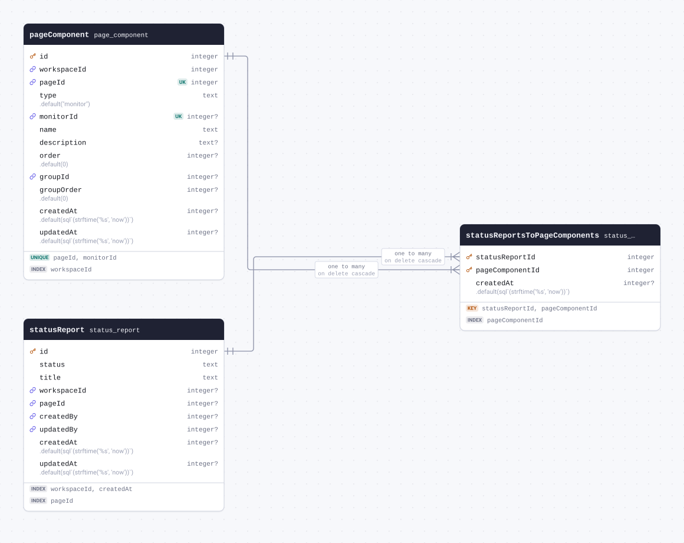

| Column                                  | Type      | Constraints                                            | Default                                    | Description |
| --------------------------------------- | --------- | ------------------------------------------------------ | ------------------------------------------ | ----------- |
| `statusReportId` (`status_report_id`)   | `integer` | PK NOT NULL → [statusReport.id](#table-statusReport)   |                                            |             |
| `pageComponentId` (`page_component_id`) | `integer` | PK NOT NULL → [pageComponent.id](#table-pageComponent) |                                            |             |
| `createdAt` (`created_at`)              | `integer` | NULL                                                   | ``.default(sql`(strftime('%s', 'now'))`)`` |             |

#### Definition

```sql
CREATE TABLE `status_report_to_page_component` (
	`status_report_id` integer NOT NULL,
	`page_component_id` integer NOT NULL,
	`created_at` integer DEFAULT (strftime('%s', 'now')),
	CONSTRAINT `status_report_to_page_component_pk` PRIMARY KEY(`status_report_id`, `page_component_id`),
	CONSTRAINT `fk_status_report_to_page_component_status_report_id_status_report_id_fk` FOREIGN KEY (`status_report_id`) REFERENCES `status_report`(`id`) ON DELETE CASCADE,
	CONSTRAINT `fk_status_report_to_page_component_page_component_id_page_component_id_fk` FOREIGN KEY (`page_component_id`) REFERENCES `page_component`(`id`) ON DELETE CASCADE
);

CREATE INDEX `status_report_to_page_component_page_component_id_idx` ON `status_report_to_page_component` (`page_component_id`);
```

#### Indexes

- PRIMARY KEY `statusReportId`, `pageComponentId`
- INDEX `pageComponentId`

#### References

- `statusReportId` → [statusReport.id](#table-statusReport) (many to one, on delete cascade)
- `pageComponentId` → [pageComponent.id](#table-pageComponent) (many to one, on delete cascade)

<details>
<summary>Queries and their SQL</summary>

**Select**: Every row of statusReportsToPageComponents.

```ts
db.select().from(statusReportsToPageComponents);
```

```sql
select "status_report_id", "page_component_id", "created_at"
from "status_report_to_page_component"
```

**Count**: How many rows statusReportsToPageComponents has.

```ts
db.select({ count: count() }).from(statusReportsToPageComponents);
```

```sql
select count(*)
from "status_report_to_page_component"
```

**Find many**: The rows of statusReportsToPageComponents, through the relational query API.

```ts
db.query.statusReportsToPageComponents.findMany();
```

```sql
select "d0"."status_report_id" as "statusReportId", "d0"."page_component_id" as "pageComponentId", "d0"."created_at" as "createdAt"
from "status_report_to_page_component" as "d0"
```

**Find by primary key**: One row of statusReportsToPageComponents, through the relational query API.

```ts
db.query.statusReportsToPageComponents.findFirst({
  where: { statusReportId: 1, pageComponentId: 1 },
});
```

```sql
select "d0"."status_report_id" as "statusReportId", "d0"."page_component_id" as "pageComponentId", "d0"."created_at" as "createdAt"
from "status_report_to_page_component" as "d0"
where (("d0"."status_report_id" = ?) and ("d0"."page_component_id" = ?))
limit ?
-- params: [1,1,1]
```

**Insert**: Adds a row to statusReportsToPageComponents, giving the columns that have no default.

```ts
db.insert(statusReportsToPageComponents).values({ statusReportId: 1, pageComponentId: 1 });
```

```sql
insert into "status_report_to_page_component" ("status_report_id", "page_component_id", "created_at")
values (?, ?, (strftime('%s', 'now')))
-- params: [1,1]
```

**Update**: Changes a row of statusReportsToPageComponents, found by its primary key.

```ts
db.update(statusReportsToPageComponents)
  .set({ createdAt: 1 })
  .where(
    and(
      eq(statusReportsToPageComponents.statusReportId, 1),
      eq(statusReportsToPageComponents.pageComponentId, 1),
    ),
  );
```

```sql
update "status_report_to_page_component"
set "created_at" = ?
where (("status_report_to_page_component"."status_report_id" = ?) and ("status_report_to_page_component"."page_component_id" = ?))
-- params: [1,1,1]
```

**Delete**: Deletes a row of statusReportsToPageComponents, found by its primary key.

```ts
db.delete(statusReportsToPageComponents).where(
  and(
    eq(statusReportsToPageComponents.statusReportId, 1),
    eq(statusReportsToPageComponents.pageComponentId, 1),
  ),
);
```

```sql
delete from "status_report_to_page_component"
where (("status_report_to_page_component"."status_report_id" = ?) and ("status_report_to_page_component"."page_component_id" = ?))
-- params: [1,1]
```

</details>

<a id="table-statusReportUpdateToPageComponents"></a>

### statusReportUpdateToPageComponents

Table `status_report_update_to_page_component`. timeline: the impact each update set per component — the only place impact is stored. `status_report_to_page_component` stays the membership source.

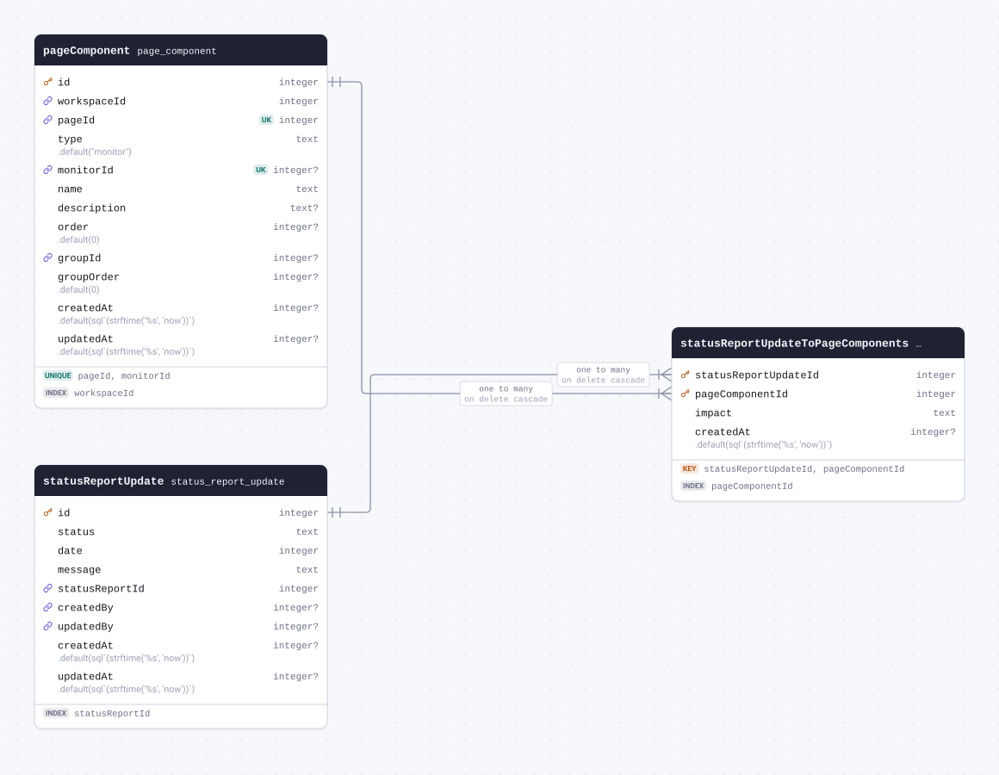

| Column                                             | Type      | Constraints                                                      | Default                                    | Description |
| -------------------------------------------------- | --------- | ---------------------------------------------------------------- | ------------------------------------------ | ----------- |
| `statusReportUpdateId` (`status_report_update_id`) | `integer` | PK NOT NULL → [statusReportUpdate.id](#table-statusReportUpdate) |                                            |             |
| `pageComponentId` (`page_component_id`)            | `integer` | PK NOT NULL → [pageComponent.id](#table-pageComponent)           |                                            |             |
| `impact`                                           | `text`    | NOT NULL                                                         |                                            |             |
| `createdAt` (`created_at`)                         | `integer` | NULL                                                             | ``.default(sql`(strftime('%s', 'now'))`)`` |             |

#### Definition

```sql
CREATE TABLE `status_report_update_to_page_component` (
	`status_report_update_id` integer NOT NULL,
	`page_component_id` integer NOT NULL,
	`impact` text NOT NULL,
	`created_at` integer DEFAULT (strftime('%s', 'now')),
	CONSTRAINT `status_report_update_to_page_component_pk` PRIMARY KEY(`status_report_update_id`, `page_component_id`),
	CONSTRAINT `fk_status_report_update_to_page_component_status_report_update_id_status_report_update_id_fk` FOREIGN KEY (`status_report_update_id`) REFERENCES `status_report_update`(`id`) ON DELETE CASCADE,
	CONSTRAINT `fk_status_report_update_to_page_component_page_component_id_page_component_id_fk` FOREIGN KEY (`page_component_id`) REFERENCES `page_component`(`id`) ON DELETE CASCADE
);

CREATE INDEX `status_report_update_to_page_component_page_component_id_idx` ON `status_report_update_to_page_component` (`page_component_id`);
```

#### Indexes

- PRIMARY KEY `statusReportUpdateId`, `pageComponentId`
- INDEX `pageComponentId`

#### References

- `statusReportUpdateId` → [statusReportUpdate.id](#table-statusReportUpdate) (many to one, on delete cascade)
- `pageComponentId` → [pageComponent.id](#table-pageComponent) (many to one, on delete cascade)

<details>
<summary>Queries and their SQL</summary>

**Select**: Every row of statusReportUpdateToPageComponents.

```ts
db.select().from(statusReportUpdateToPageComponents);
```

```sql
select "status_report_update_id", "page_component_id", "impact", "created_at"
from "status_report_update_to_page_component"
```

**Count**: How many rows statusReportUpdateToPageComponents has.

```ts
db.select({ count: count() }).from(statusReportUpdateToPageComponents);
```

```sql
select count(*)
from "status_report_update_to_page_component"
```

**Find many**: The rows of statusReportUpdateToPageComponents, through the relational query API.

```ts
db.query.statusReportUpdateToPageComponents.findMany();
```

```sql
select "d0"."status_report_update_id" as "statusReportUpdateId", "d0"."page_component_id" as "pageComponentId", "d0"."impact" as "impact", "d0"."created_at" as "createdAt"
from "status_report_update_to_page_component" as "d0"
```

**Find by primary key**: One row of statusReportUpdateToPageComponents, through the relational query API.

```ts
db.query.statusReportUpdateToPageComponents.findFirst({
  where: { statusReportUpdateId: 1, pageComponentId: 1 },
});
```

```sql
select "d0"."status_report_update_id" as "statusReportUpdateId", "d0"."page_component_id" as "pageComponentId", "d0"."impact" as "impact", "d0"."created_at" as "createdAt"
from "status_report_update_to_page_component" as "d0"
where (("d0"."status_report_update_id" = ?) and ("d0"."page_component_id" = ?))
limit ?
-- params: [1,1,1]
```

**Insert**: Adds a row to statusReportUpdateToPageComponents, giving the columns that have no default.

```ts
db.insert(statusReportUpdateToPageComponents).values({
  statusReportUpdateId: 1,
  pageComponentId: 1,
  impact: "impact",
});
```

```sql
insert into "status_report_update_to_page_component" ("status_report_update_id", "page_component_id", "impact", "created_at")
values (?, ?, ?, (strftime('%s', 'now')))
-- params: [1,1,"impact"]
```

**Update**: Changes a row of statusReportUpdateToPageComponents, found by its primary key.

```ts
db.update(statusReportUpdateToPageComponents)
  .set({ impact: "impact" })
  .where(
    and(
      eq(statusReportUpdateToPageComponents.statusReportUpdateId, 1),
      eq(statusReportUpdateToPageComponents.pageComponentId, 1),
    ),
  );
```

```sql
update "status_report_update_to_page_component"
set "impact" = ?
where (("status_report_update_to_page_component"."status_report_update_id" = ?) and ("status_report_update_to_page_component"."page_component_id" = ?))
-- params: ["impact",1,1]
```

**Delete**: Deletes a row of statusReportUpdateToPageComponents, found by its primary key.

```ts
db.delete(statusReportUpdateToPageComponents).where(
  and(
    eq(statusReportUpdateToPageComponents.statusReportUpdateId, 1),
    eq(statusReportUpdateToPageComponents.pageComponentId, 1),
  ),
);
```

```sql
delete from "status_report_update_to_page_component"
where (("status_report_update_to_page_component"."status_report_update_id" = ?) and ("status_report_update_to_page_component"."page_component_id" = ?))
-- params: [1,1]
```

</details>

<a id="table-pageComponentGroup"></a>

### pageComponentGroup

Table `page_component_groups`.

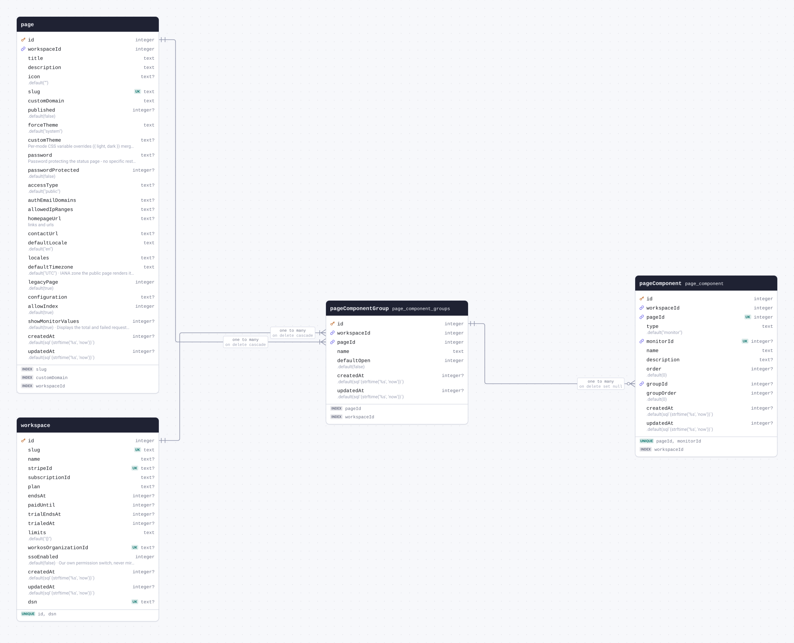

| Column                         | Type      | Constraints                                 | Default                                    | Description |
| ------------------------------ | --------- | ------------------------------------------- | ------------------------------------------ | ----------- |
| `id`                           | `integer` | PK NOT NULL                                 |                                            |             |
| `workspaceId` (`workspace_id`) | `integer` | NOT NULL → [workspace.id](#table-workspace) |                                            |             |
| `pageId` (`page_id`)           | `integer` | NOT NULL → [page.id](#table-page)           |                                            |             |
| `name`                         | `text`    | NOT NULL                                    |                                            |             |
| `defaultOpen` (`default_open`) | `integer` | NOT NULL                                    | `.default(false)`                          |             |
| `createdAt` (`created_at`)     | `integer` | NULL                                        | ``.default(sql`(strftime('%s', 'now'))`)`` |             |
| `updatedAt` (`updated_at`)     | `integer` | NULL                                        | ``.default(sql`(strftime('%s', 'now'))`)`` |             |

#### Definition

```sql
CREATE TABLE `page_component_groups` (
	`id` integer PRIMARY KEY,
	`workspace_id` integer NOT NULL,
	`page_id` integer NOT NULL,
	`name` text NOT NULL,
	`default_open` integer DEFAULT false NOT NULL,
	`created_at` integer DEFAULT (strftime('%s', 'now')),
	`updated_at` integer DEFAULT (strftime('%s', 'now')),
	CONSTRAINT `fk_page_component_groups_workspace_id_workspace_id_fk` FOREIGN KEY (`workspace_id`) REFERENCES `workspace`(`id`) ON DELETE CASCADE,
	CONSTRAINT `fk_page_component_groups_page_id_page_id_fk` FOREIGN KEY (`page_id`) REFERENCES `page`(`id`) ON DELETE CASCADE
);

CREATE INDEX `page_component_groups_page_id_idx` ON `page_component_groups` (`page_id`);

CREATE INDEX `page_component_groups_workspace_id_idx` ON `page_component_groups` (`workspace_id`);
```

#### Indexes

- INDEX `pageId`
- INDEX `workspaceId`

#### References

- `workspaceId` → [workspace.id](#table-workspace) (many to one, on delete cascade)
- `pageId` → [page.id](#table-page) (many to one, on delete cascade)

#### Referenced by

- `id` → [pageComponent.groupId](#table-pageComponent) (one to many, on delete set null)

<details>
<summary>Queries and their SQL</summary>

**Select**: Every row of pageComponentGroup.

```ts
db.select().from(pageComponentGroup);
```

```sql
select "id", "workspace_id", "page_id", "name", "default_open", "created_at", "updated_at"
from "page_component_groups"
```

**Count**: How many rows pageComponentGroup has.

```ts
db.select({ count: count() }).from(pageComponentGroup);
```

```sql
select count(*)
from "page_component_groups"
```

**Find many**: The rows of pageComponentGroup, through the relational query API.

```ts
db.query.pageComponentGroup.findMany();
```

```sql
select "d0"."id" as "id", "d0"."workspace_id" as "workspaceId", "d0"."page_id" as "pageId", "d0"."name" as "name", "d0"."default_open" as "defaultOpen", "d0"."created_at" as "createdAt", "d0"."updated_at" as "updatedAt"
from "page_component_groups" as "d0"
```

**Find by primary key**: One row of pageComponentGroup, through the relational query API.

```ts
db.query.pageComponentGroup.findFirst({ where: { id: 1 } });
```

```sql
select "d0"."id" as "id", "d0"."workspace_id" as "workspaceId", "d0"."page_id" as "pageId", "d0"."name" as "name", "d0"."default_open" as "defaultOpen", "d0"."created_at" as "createdAt", "d0"."updated_at" as "updatedAt"
from "page_component_groups" as "d0"
where "d0"."id" = ?
limit ?
-- params: [1,1]
```

**Insert**: Adds a row to pageComponentGroup, giving the columns that have no default.

```ts
db.insert(pageComponentGroup).values({ id: 1, workspaceId: 1, pageId: 1, name: "name" });
```

```sql
insert into "page_component_groups" ("id", "workspace_id", "page_id", "name", "default_open", "created_at", "updated_at")
values (?, ?, ?, ?, ?, (strftime('%s', 'now')), (strftime('%s', 'now')))
-- params: [1,1,1,"name",0]
```

**Update**: Changes a row of pageComponentGroup, found by its primary key.

```ts
db.update(pageComponentGroup).set({ workspaceId: 1 }).where(eq(pageComponentGroup.id, 1));
```

```sql
update "page_component_groups"
set "workspace_id" = ?
where "page_component_groups"."id" = ?
-- params: [1,1]
```

**Delete**: Deletes a row of pageComponentGroup, found by its primary key.

```ts
db.delete(pageComponentGroup).where(eq(pageComponentGroup.id, 1));
```

```sql
delete from "page_component_groups"
where "page_component_groups"."id" = ?
-- params: [1]
```

</details>

<a id="table-feedback"></a>

### feedback

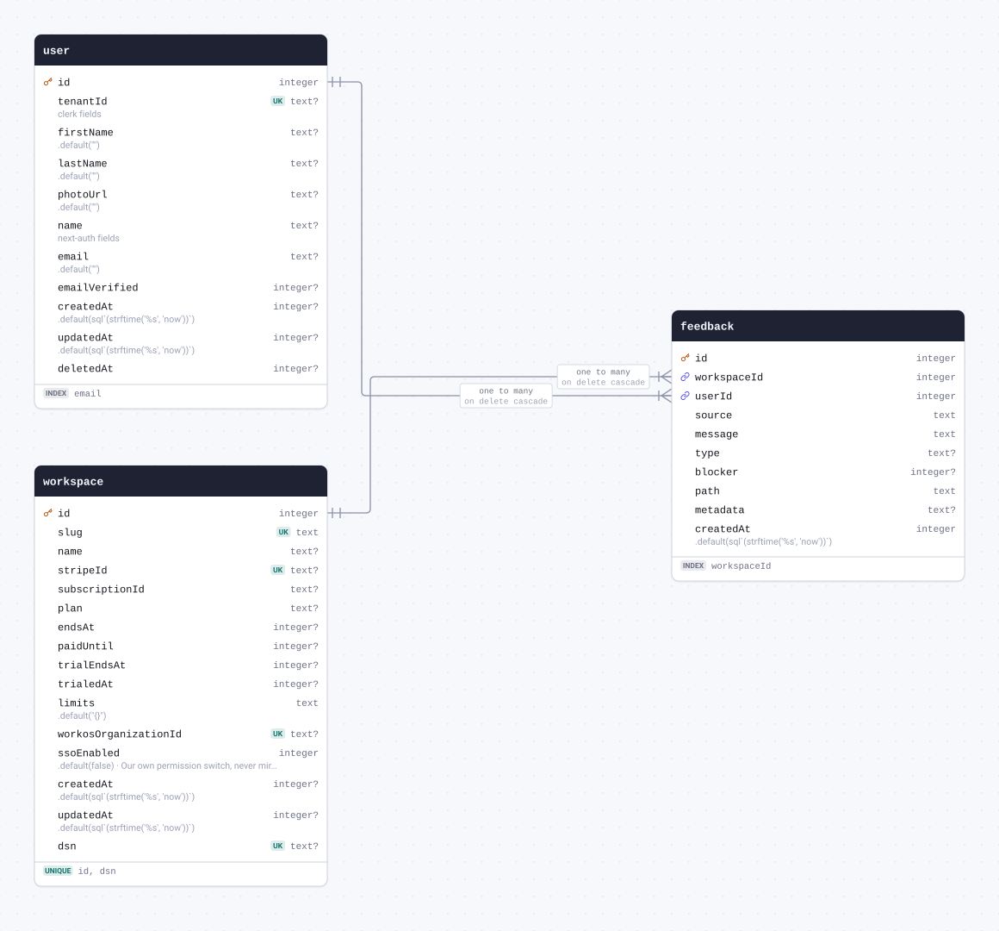

| Column                         | Type      | Constraints                                 | Default                                    | Description |
| ------------------------------ | --------- | ------------------------------------------- | ------------------------------------------ | ----------- |
| `id`                           | `integer` | PK NOT NULL                                 |                                            |             |
| `workspaceId` (`workspace_id`) | `integer` | NOT NULL → [workspace.id](#table-workspace) |                                            |             |
| `userId` (`user_id`)           | `integer` | NOT NULL → [user.id](#table-user)           |                                            |             |
| `source`                       | `text`    | NOT NULL                                    |                                            |             |
| `message`                      | `text`    | NOT NULL                                    |                                            |             |
| `type`                         | `text`    | NULL                                        |                                            |             |
| `blocker`                      | `integer` | NULL                                        |                                            |             |
| `path`                         | `text`    | NOT NULL                                    |                                            |             |
| `metadata`                     | `text`    | NULL                                        |                                            |             |
| `createdAt` (`created_at`)     | `integer` | NOT NULL                                    | ``.default(sql`(strftime('%s', 'now'))`)`` |             |

#### Definition

```sql
CREATE TABLE `feedback` (
	`id` integer PRIMARY KEY,
	`workspace_id` integer NOT NULL,
	`user_id` integer NOT NULL,
	`source` text NOT NULL,
	`message` text NOT NULL,
	`type` text,
	`blocker` integer,
	`path` text NOT NULL,
	`metadata` text,
	`created_at` integer DEFAULT (strftime('%s', 'now')) NOT NULL,
	CONSTRAINT `fk_feedback_workspace_id_workspace_id_fk` FOREIGN KEY (`workspace_id`) REFERENCES `workspace`(`id`) ON DELETE CASCADE,
	CONSTRAINT `fk_feedback_user_id_user_id_fk` FOREIGN KEY (`user_id`) REFERENCES `user`(`id`) ON DELETE CASCADE
);

CREATE INDEX `feedback_workspace_id_idx` ON `feedback` (`workspace_id`);
```

#### Indexes

- INDEX `workspaceId`

#### References

- `workspaceId` → [workspace.id](#table-workspace) (many to one, on delete cascade)
- `userId` → [user.id](#table-user) (many to one, on delete cascade)

<details>
<summary>Queries and their SQL</summary>

**Select**: Every row of feedback.

```ts
db.select().from(feedback);
```

```sql
select "id", "workspace_id", "user_id", "source", "message", "type", "blocker", "path", "metadata", "created_at"
from "feedback"
```

**Count**: How many rows feedback has.

```ts
db.select({ count: count() }).from(feedback);
```

```sql
select count(*)
from "feedback"
```

**Find many**: The rows of feedback, through the relational query API.

```ts
db.query.feedback.findMany();
```

```sql
select "d0"."id" as "id", "d0"."workspace_id" as "workspaceId", "d0"."user_id" as "userId", "d0"."source" as "source", "d0"."message" as "message", "d0"."type" as "type", "d0"."blocker" as "blocker", "d0"."path" as "path", "d0"."metadata" as "metadata", "d0"."created_at" as "createdAt"
from "feedback" as "d0"
```

**Find by primary key**: One row of feedback, through the relational query API.

```ts
db.query.feedback.findFirst({ where: { id: 1 } });
```

```sql
select "d0"."id" as "id", "d0"."workspace_id" as "workspaceId", "d0"."user_id" as "userId", "d0"."source" as "source", "d0"."message" as "message", "d0"."type" as "type", "d0"."blocker" as "blocker", "d0"."path" as "path", "d0"."metadata" as "metadata", "d0"."created_at" as "createdAt"
from "feedback" as "d0"
where "d0"."id" = ?
limit ?
-- params: [1,1]
```

**Insert**: Adds a row to feedback, giving the columns that have no default.

```ts
db.insert(feedback).values({
  id: 1,
  workspaceId: 1,
  userId: 1,
  source: "source",
  message: "message",
  path: "path",
});
```

```sql
insert into "feedback" ("id", "workspace_id", "user_id", "source", "message", "type", "blocker", "path", "metadata", "created_at")
values (?, ?, ?, ?, ?, null, null, ?, null, (strftime('%s', 'now')))
-- params: [1,1,1,"source","message","path"]
```

**Update**: Changes a row of feedback, found by its primary key.

```ts
db.update(feedback).set({ workspaceId: 1 }).where(eq(feedback.id, 1));
```

```sql
update "feedback"
set "workspace_id" = ?
where "feedback"."id" = ?
-- params: [1,1]
```

**Delete**: Deletes a row of feedback, found by its primary key.

```ts
db.delete(feedback).where(eq(feedback.id, 1));
```

```sql
delete from "feedback"
where "feedback"."id" = ?
-- params: [1]
```

</details>

<a id="table-auditLog"></a>

### auditLog

Table `audit_log`. Append-only log of mutating actions taken against the workspace. No foreign keys: rows outlive their subjects (workspace / user / monitor deletions must not cascade-remove audit history, and a soft-deleted user must not block inserts). References on columns are informational and enforced in application code. Reads must sort by `(created_at DESC, id DESC)` — bulk operations emit multiple rows in the same millisecond; the autoincrement id gives a deterministic tiebreaker.

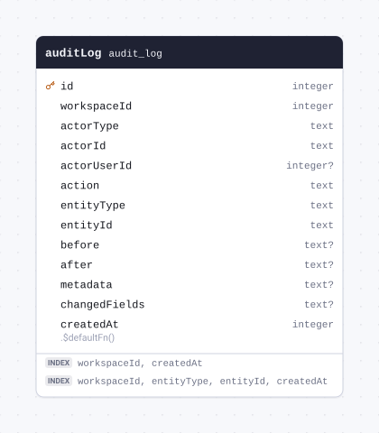

| Column                             | Type      | Constraints | Default         | Description |
| ---------------------------------- | --------- | ----------- | --------------- | ----------- |
| `id`                               | `integer` | PK NOT NULL |                 |             |
| `workspaceId` (`workspace_id`)     | `integer` | NOT NULL    |                 |             |
| `actorType` (`actor_type`)         | `text`    | NOT NULL    |                 |             |
| `actorId` (`actor_id`)             | `text`    | NOT NULL    |                 |             |
| `actorUserId` (`actor_user_id`)    | `integer` | NULL        |                 |             |
| `action`                           | `text`    | NOT NULL    |                 |             |
| `entityType` (`entity_type`)       | `text`    | NOT NULL    |                 |             |
| `entityId` (`entity_id`)           | `text`    | NOT NULL    |                 |             |
| `before`                           | `text`    | NULL        |                 |             |
| `after`                            | `text`    | NULL        |                 |             |
| `metadata`                         | `text`    | NULL        |                 |             |
| `changedFields` (`changed_fields`) | `text`    | NULL        |                 |             |
| `createdAt` (`created_at`)         | `integer` | NOT NULL    | `.$defaultFn()` |             |

#### Definition

```sql
CREATE TABLE `audit_log` (
	`id` integer PRIMARY KEY AUTOINCREMENT,
	`workspace_id` integer NOT NULL,
	`actor_type` text NOT NULL,
	`actor_id` text NOT NULL,
	`actor_user_id` integer,
	`action` text NOT NULL,
	`entity_type` text NOT NULL,
	`entity_id` text NOT NULL,
	`before` text,
	`after` text,
	`metadata` text,
	`changed_fields` text,
	`created_at` integer NOT NULL
);

CREATE INDEX `audit_log_workspace_created_idx` ON `audit_log` (`workspace_id`,`created_at`);

CREATE INDEX `audit_log_entity_idx` ON `audit_log` (`workspace_id`,`entity_type`,`entity_id`,`created_at`);
```

#### Indexes

- INDEX `workspaceId`, `createdAt`
- INDEX `workspaceId`, `entityType`, `entityId`, `createdAt`

<details>
<summary>Queries and their SQL</summary>

**Select**: Every row of auditLog.

```ts
db.select().from(auditLog);
```

```sql
select "id", "workspace_id", "actor_type", "actor_id", "actor_user_id", "action", "entity_type", "entity_id", "before", "after", "metadata", "changed_fields", "created_at"
from "audit_log"
```

**Count**: How many rows auditLog has.

```ts
db.select({ count: count() }).from(auditLog);
```

```sql
select count(*)
from "audit_log"
```

**Find many**: The rows of auditLog, through the relational query API.

```ts
db.query.auditLog.findMany();
```

```sql
select "d0"."id" as "id", "d0"."workspace_id" as "workspaceId", "d0"."actor_type" as "actorType", "d0"."actor_id" as "actorId", "d0"."actor_user_id" as "actorUserId", "d0"."action" as "action", "d0"."entity_type" as "entityType", "d0"."entity_id" as "entityId", "d0"."before" as "before", "d0"."after" as "after", "d0"."metadata" as "metadata", "d0"."changed_fields" as "changedFields", "d0"."created_at" as "createdAt"
from "audit_log" as "d0"
```

**Find by primary key**: One row of auditLog, through the relational query API.

```ts
db.query.auditLog.findFirst({ where: { id: 1 } });
```

```sql
select "d0"."id" as "id", "d0"."workspace_id" as "workspaceId", "d0"."actor_type" as "actorType", "d0"."actor_id" as "actorId", "d0"."actor_user_id" as "actorUserId", "d0"."action" as "action", "d0"."entity_type" as "entityType", "d0"."entity_id" as "entityId", "d0"."before" as "before", "d0"."after" as "after", "d0"."metadata" as "metadata", "d0"."changed_fields" as "changedFields", "d0"."created_at" as "createdAt"
from "audit_log" as "d0"
where "d0"."id" = ?
limit ?
-- params: [1,1]
```

**Insert**: Adds a row to auditLog, giving the columns that have no default.

```ts
db.insert(auditLog).values({
  id: 1,
  workspaceId: 1,
  actorType: "actorType",
  actorId: "actorId",
  action: "action",
  entityType: "entityType",
  entityId: "entityId",
});
```

```sql
insert into "audit_log" ("id", "workspace_id", "actor_type", "actor_id", "actor_user_id", "action", "entity_type", "entity_id", "before", "after", "metadata", "changed_fields", "created_at")
values (?, ?, ?, ?, null, ?, ?, ?, null, null, null, null, ?)
-- params: [1,1,"actorType","actorId","action","entityType","entityId",1767225600000]
```

**Update**: Changes a row of auditLog, found by its primary key.

```ts
db.update(auditLog).set({ workspaceId: 1 }).where(eq(auditLog.id, 1));
```

```sql
update "audit_log"
set "workspace_id" = ?
where "audit_log"."id" = ?
-- params: [1,1]
```

**Delete**: Deletes a row of auditLog, found by its primary key.

```ts
db.delete(auditLog).where(eq(auditLog.id, 1));
```

```sql
delete from "audit_log"
where "audit_log"."id" = ?
-- params: [1]
```

</details>

<a id="table-externalService"></a>

### externalService

Table `external_service`.

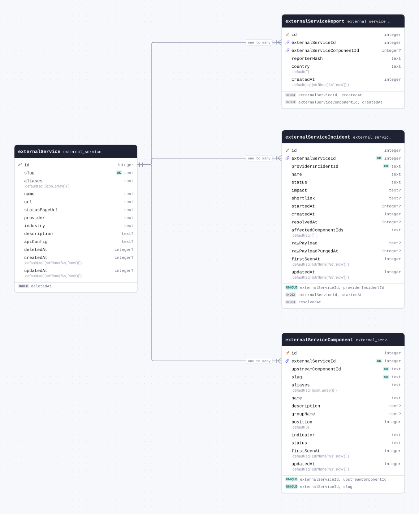

| Column                              | Type      | Constraints     | Default                                    | Description |
| ----------------------------------- | --------- | --------------- | ------------------------------------------ | ----------- |
| `id`                                | `integer` | PK NOT NULL     |                                            |             |
| `slug`                              | `text`    | UNIQUE NOT NULL |                                            |             |
| `aliases`                           | `text`    | NOT NULL        | ``.default(sql`(json_array())`)``          |             |
| `name`                              | `text`    | NOT NULL        |                                            |             |
| `url`                               | `text`    | NOT NULL        |                                            |             |
| `statusPageUrl` (`status_page_url`) | `text`    | NOT NULL        |                                            |             |
| `provider`                          | `text`    | NOT NULL        |                                            |             |
| `industry`                          | `text`    | NOT NULL        |                                            |             |
| `description`                       | `text`    | NULL            |                                            |             |
| `apiConfig` (`api_config`)          | `text`    | NULL            |                                            |             |
| `deletedAt` (`deleted_at`)          | `integer` | NULL            |                                            |             |
| `createdAt` (`created_at`)          | `integer` | NULL            | ``.default(sql`(strftime('%s', 'now'))`)`` |             |
| `updatedAt` (`updated_at`)          | `integer` | NULL            | ``.default(sql`(strftime('%s', 'now'))`)`` |             |

#### Definition

```sql
CREATE TABLE `external_service` (
	`id` integer PRIMARY KEY,
	`slug` text(64) NOT NULL UNIQUE,
	`aliases` text DEFAULT (json_array()) NOT NULL,
	`name` text(256) NOT NULL,
	`url` text NOT NULL,
	`status_page_url` text NOT NULL,
	`provider` text NOT NULL,
	`industry` text NOT NULL,
	`description` text,
	`api_config` text,
	`deleted_at` integer,
	`created_at` integer DEFAULT (strftime('%s', 'now')),
	`updated_at` integer DEFAULT (strftime('%s', 'now'))
);

CREATE INDEX `external_service_deleted_at_idx` ON `external_service` (`deleted_at`);
```

#### Indexes

- INDEX `deletedAt`

#### Referenced by

- `id` → [externalServiceComponent.externalServiceId](#table-externalServiceComponent) (one to many)
- `id` → [externalServiceIncident.externalServiceId](#table-externalServiceIncident) (one to many)
- `id` → [externalServiceReport.externalServiceId](#table-externalServiceReport) (one to many)

<details>
<summary>Queries and their SQL</summary>

**Select**: Every row of externalService.

```ts
db.select().from(externalService);
```

```sql
select "id", "slug", "aliases", "name", "url", "status_page_url", "provider", "industry", "description", "api_config", "deleted_at", "created_at", "updated_at"
from "external_service"
```

**Count**: How many rows externalService has.

```ts
db.select({ count: count() }).from(externalService);
```

```sql
select count(*)
from "external_service"
```

**Find many**: The rows of externalService, through the relational query API.

```ts
db.query.externalService.findMany();
```

```sql
select "d0"."id" as "id", "d0"."slug" as "slug", "d0"."aliases" as "aliases", "d0"."name" as "name", "d0"."url" as "url", "d0"."status_page_url" as "statusPageUrl", "d0"."provider" as "provider", "d0"."industry" as "industry", "d0"."description" as "description", "d0"."api_config" as "apiConfig", "d0"."deleted_at" as "deletedAt", "d0"."created_at" as "createdAt", "d0"."updated_at" as "updatedAt"
from "external_service" as "d0"
```

**Find by primary key**: One row of externalService, through the relational query API.

```ts
db.query.externalService.findFirst({ where: { id: 1 } });
```

```sql
select "d0"."id" as "id", "d0"."slug" as "slug", "d0"."aliases" as "aliases", "d0"."name" as "name", "d0"."url" as "url", "d0"."status_page_url" as "statusPageUrl", "d0"."provider" as "provider", "d0"."industry" as "industry", "d0"."description" as "description", "d0"."api_config" as "apiConfig", "d0"."deleted_at" as "deletedAt", "d0"."created_at" as "createdAt", "d0"."updated_at" as "updatedAt"
from "external_service" as "d0"
where "d0"."id" = ?
limit ?
-- params: [1,1]
```

**Insert**: Adds a row to externalService, giving the columns that have no default.

```ts
db.insert(externalService).values({
  id: 1,
  slug: "slug",
  name: "name",
  url: "url",
  statusPageUrl: "statusPageUrl",
  provider: "provider",
  industry: "industry",
});
```

```sql
insert into "external_service" ("id", "slug", "aliases", "name", "url", "status_page_url", "provider", "industry", "description", "api_config", "deleted_at", "created_at", "updated_at")
values (?, ?, (json_array()), ?, ?, ?, ?, ?, null, null, null, (strftime('%s', 'now')), (strftime('%s', 'now')))
-- params: [1,"slug","name","url","statusPageUrl","provider","\"industry\""]
```

**Update**: Changes a row of externalService, found by its primary key.

```ts
db.update(externalService).set({ slug: "slug" }).where(eq(externalService.id, 1));
```

```sql
update "external_service"
set "slug" = ?
where "external_service"."id" = ?
-- params: ["slug",1]
```

**Delete**: Deletes a row of externalService, found by its primary key.

```ts
db.delete(externalService).where(eq(externalService.id, 1));
```

```sql
delete from "external_service"
where "external_service"."id" = ?
-- params: [1]
```

</details>

<a id="table-externalServiceComponent"></a>

### externalServiceComponent

Table `external_service_component`.

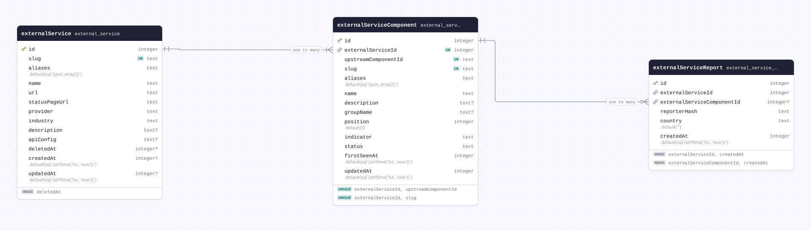

| Column                                          | Type      | Constraints                                             | Default                                    | Description |
| ----------------------------------------------- | --------- | ------------------------------------------------------- | ------------------------------------------ | ----------- |
| `id`                                            | `integer` | PK NOT NULL                                             |                                            |             |
| `externalServiceId` (`external_service_id`)     | `integer` | NOT NULL → [externalService.id](#table-externalService) |                                            |             |
| `upstreamComponentId` (`upstream_component_id`) | `text`    | NOT NULL                                                |                                            |             |
| `slug`                                          | `text`    | NOT NULL                                                |                                            |             |
| `aliases`                                       | `text`    | NOT NULL                                                | ``.default(sql`(json_array())`)``          |             |
| `name`                                          | `text`    | NOT NULL                                                |                                            |             |
| `description`                                   | `text`    | NULL                                                    |                                            |             |
| `groupName` (`group_name`)                      | `text`    | NULL                                                    |                                            |             |
| `position`                                      | `integer` | NOT NULL                                                | `.default(0)`                              |             |
| `indicator`                                     | `text`    | NOT NULL                                                |                                            |             |
| `status`                                        | `text`    | NOT NULL                                                |                                            |             |
| `firstSeenAt` (`first_seen_at`)                 | `integer` | NOT NULL                                                | ``.default(sql`(strftime('%s', 'now'))`)`` |             |
| `updatedAt` (`updated_at`)                      | `integer` | NOT NULL                                                | ``.default(sql`(strftime('%s', 'now'))`)`` |             |

#### Definition

```sql
CREATE TABLE `external_service_component` (
	`id` integer PRIMARY KEY,
	`external_service_id` integer NOT NULL,
	`upstream_component_id` text NOT NULL,
	`slug` text NOT NULL,
	`aliases` text DEFAULT (json_array()) NOT NULL,
	`name` text NOT NULL,
	`description` text,
	`group_name` text,
	`position` integer DEFAULT 0 NOT NULL,
	`indicator` text NOT NULL,
	`status` text NOT NULL,
	`first_seen_at` integer DEFAULT (strftime('%s', 'now')) NOT NULL,
	`updated_at` integer DEFAULT (strftime('%s', 'now')) NOT NULL,
	CONSTRAINT `fk_external_service_component_external_service_id_external_service_id_fk` FOREIGN KEY (`external_service_id`) REFERENCES `external_service`(`id`)
);

CREATE UNIQUE INDEX `external_service_component_unique_idx` ON `external_service_component` (`external_service_id`,`upstream_component_id`);

CREATE UNIQUE INDEX `external_service_component_slug_unique_idx` ON `external_service_component` (`external_service_id`,`slug`);
```

#### Indexes

- UNIQUE `externalServiceId`, `upstreamComponentId`
- UNIQUE `externalServiceId`, `slug`

#### References

- `externalServiceId` → [externalService.id](#table-externalService) (many to one)

#### Referenced by

- `id` → [externalServiceReport.externalServiceComponentId](#table-externalServiceReport) (one to many)

<details>
<summary>Queries and their SQL</summary>

**Select**: Every row of externalServiceComponent.

```ts
db.select().from(externalServiceComponent);
```

```sql
select "id", "external_service_id", "upstream_component_id", "slug", "aliases", "name", "description", "group_name", "position", "indicator", "status", "first_seen_at", "updated_at"
from "external_service_component"
```

**Count**: How many rows externalServiceComponent has.

```ts
db.select({ count: count() }).from(externalServiceComponent);
```

```sql
select count(*)
from "external_service_component"
```

**Find many**: The rows of externalServiceComponent, through the relational query API.

```ts
db.query.externalServiceComponent.findMany();
```

```sql
select "d0"."id" as "id", "d0"."external_service_id" as "externalServiceId", "d0"."upstream_component_id" as "upstreamComponentId", "d0"."slug" as "slug", "d0"."aliases" as "aliases", "d0"."name" as "name", "d0"."description" as "description", "d0"."group_name" as "groupName", "d0"."position" as "position", "d0"."indicator" as "indicator", "d0"."status" as "status", "d0"."first_seen_at" as "firstSeenAt", "d0"."updated_at" as "updatedAt"
from "external_service_component" as "d0"
```

**Find by primary key**: One row of externalServiceComponent, through the relational query API.

```ts
db.query.externalServiceComponent.findFirst({ where: { id: 1 } });
```

```sql
select "d0"."id" as "id", "d0"."external_service_id" as "externalServiceId", "d0"."upstream_component_id" as "upstreamComponentId", "d0"."slug" as "slug", "d0"."aliases" as "aliases", "d0"."name" as "name", "d0"."description" as "description", "d0"."group_name" as "groupName", "d0"."position" as "position", "d0"."indicator" as "indicator", "d0"."status" as "status", "d0"."first_seen_at" as "firstSeenAt", "d0"."updated_at" as "updatedAt"
from "external_service_component" as "d0"
where "d0"."id" = ?
limit ?
-- params: [1,1]
```

**Insert**: Adds a row to externalServiceComponent, giving the columns that have no default.

```ts
db.insert(externalServiceComponent).values({
  id: 1,
  externalServiceId: 1,
  upstreamComponentId: "upstreamComponentId",
  slug: "slug",
  name: "name",
  indicator: "indicator",
  status: "status",
});
```

```sql
insert into "external_service_component" ("id", "external_service_id", "upstream_component_id", "slug", "aliases", "name", "description", "group_name", "position", "indicator", "status", "first_seen_at", "updated_at")
values (?, ?, ?, ?, (json_array()), ?, null, null, ?, ?, ?, (strftime('%s', 'now')), (strftime('%s', 'now')))
-- params: [1,1,"upstreamComponentId","slug","name",0,"indicator","status"]
```

**Update**: Changes a row of externalServiceComponent, found by its primary key.

```ts
db.update(externalServiceComponent)
  .set({ externalServiceId: 1 })
  .where(eq(externalServiceComponent.id, 1));
```

```sql
update "external_service_component"
set "external_service_id" = ?
where "external_service_component"."id" = ?
-- params: [1,1]
```

**Delete**: Deletes a row of externalServiceComponent, found by its primary key.

```ts
db.delete(externalServiceComponent).where(eq(externalServiceComponent.id, 1));
```

```sql
delete from "external_service_component"
where "external_service_component"."id" = ?
-- params: [1]
```

</details>

<a id="table-externalServiceIncident"></a>

### externalServiceIncident

Table `external_service_incident`.

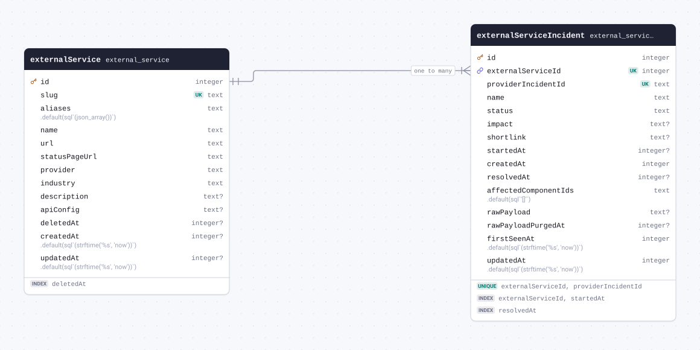

| Column                                            | Type      | Constraints                                             | Default                                    | Description |
| ------------------------------------------------- | --------- | ------------------------------------------------------- | ------------------------------------------ | ----------- |
| `id`                                              | `integer` | PK NOT NULL                                             |                                            |             |
| `externalServiceId` (`external_service_id`)       | `integer` | NOT NULL → [externalService.id](#table-externalService) |                                            |             |
| `providerIncidentId` (`provider_incident_id`)     | `text`    | NOT NULL                                                |                                            |             |
| `name`                                            | `text`    | NOT NULL                                                |                                            |             |
| `status`                                          | `text`    | NOT NULL                                                |                                            |             |
| `impact`                                          | `text`    | NULL                                                    |                                            |             |
| `shortlink`                                       | `text`    | NULL                                                    |                                            |             |
| `startedAt` (`started_at`)                        | `integer` | NULL                                                    |                                            |             |
| `createdAt` (`created_at`)                        | `integer` | NOT NULL                                                |                                            |             |
| `resolvedAt` (`resolved_at`)                      | `integer` | NULL                                                    |                                            |             |
| `affectedComponentIds` (`affected_component_ids`) | `text`    | NOT NULL                                                | ``.default(sql`'[]'`)``                    |             |
| `rawPayload` (`raw_payload`)                      | `text`    | NULL                                                    |                                            |             |
| `rawPayloadPurgedAt` (`raw_payload_purged_at`)    | `integer` | NULL                                                    |                                            |             |
| `firstSeenAt` (`first_seen_at`)                   | `integer` | NOT NULL                                                | ``.default(sql`(strftime('%s', 'now'))`)`` |             |
| `updatedAt` (`updated_at`)                        | `integer` | NOT NULL                                                | ``.default(sql`(strftime('%s', 'now'))`)`` |             |

#### Definition

```sql
CREATE TABLE `external_service_incident` (
	`id` integer PRIMARY KEY,
	`external_service_id` integer NOT NULL,
	`provider_incident_id` text NOT NULL,
	`name` text NOT NULL,
	`status` text NOT NULL,
	`impact` text,
	`shortlink` text,
	`started_at` integer,
	`created_at` integer NOT NULL,
	`resolved_at` integer,
	`affected_component_ids` text DEFAULT '[]' NOT NULL,
	`raw_payload` text,
	`raw_payload_purged_at` integer,
	`first_seen_at` integer DEFAULT (strftime('%s', 'now')) NOT NULL,
	`updated_at` integer DEFAULT (strftime('%s', 'now')) NOT NULL,
	CONSTRAINT `fk_external_service_incident_external_service_id_external_service_id_fk` FOREIGN KEY (`external_service_id`) REFERENCES `external_service`(`id`)
);

CREATE UNIQUE INDEX `external_service_incident_unique_idx` ON `external_service_incident` (`external_service_id`,`provider_incident_id`);

CREATE INDEX `external_service_incident_started_at_idx` ON `external_service_incident` (`external_service_id`,`started_at`);

CREATE INDEX `external_service_incident_resolved_at_idx` ON `external_service_incident` (`resolved_at`);
```

#### Indexes

- UNIQUE `externalServiceId`, `providerIncidentId`
- INDEX `externalServiceId`, `startedAt`
- INDEX `resolvedAt`

#### References

- `externalServiceId` → [externalService.id](#table-externalService) (many to one)

<details>
<summary>Queries and their SQL</summary>

**Select**: Every row of externalServiceIncident.

```ts
db.select().from(externalServiceIncident);
```

```sql
select "id", "external_service_id", "provider_incident_id", "name", "status", "impact", "shortlink", "started_at", "created_at", "resolved_at", "affected_component_ids", "raw_payload", "raw_payload_purged_at", "first_seen_at", "updated_at"
from "external_service_incident"
```

**Count**: How many rows externalServiceIncident has.

```ts
db.select({ count: count() }).from(externalServiceIncident);
```

```sql
select count(*)
from "external_service_incident"
```

**Find many**: The rows of externalServiceIncident, through the relational query API.

```ts
db.query.externalServiceIncident.findMany();
```

```sql
select "d0"."id" as "id", "d0"."external_service_id" as "externalServiceId", "d0"."provider_incident_id" as "providerIncidentId", "d0"."name" as "name", "d0"."status" as "status", "d0"."impact" as "impact", "d0"."shortlink" as "shortlink", "d0"."started_at" as "startedAt", "d0"."created_at" as "createdAt", "d0"."resolved_at" as "resolvedAt", "d0"."affected_component_ids" as "affectedComponentIds", "d0"."raw_payload" as "rawPayload", "d0"."raw_payload_purged_at" as "rawPayloadPurgedAt", "d0"."first_seen_at" as "firstSeenAt", "d0"."updated_at" as "updatedAt"
from "external_service_incident" as "d0"
```

**Find by primary key**: One row of externalServiceIncident, through the relational query API.

```ts
db.query.externalServiceIncident.findFirst({ where: { id: 1 } });
```

```sql
select "d0"."id" as "id", "d0"."external_service_id" as "externalServiceId", "d0"."provider_incident_id" as "providerIncidentId", "d0"."name" as "name", "d0"."status" as "status", "d0"."impact" as "impact", "d0"."shortlink" as "shortlink", "d0"."started_at" as "startedAt", "d0"."created_at" as "createdAt", "d0"."resolved_at" as "resolvedAt", "d0"."affected_component_ids" as "affectedComponentIds", "d0"."raw_payload" as "rawPayload", "d0"."raw_payload_purged_at" as "rawPayloadPurgedAt", "d0"."first_seen_at" as "firstSeenAt", "d0"."updated_at" as "updatedAt"
from "external_service_incident" as "d0"
where "d0"."id" = ?
limit ?
-- params: [1,1]
```

**Insert**: Adds a row to externalServiceIncident, giving the columns that have no default.

```ts
db.insert(externalServiceIncident).values({
  id: 1,
  externalServiceId: 1,
  providerIncidentId: "providerIncidentId",
  name: "name",
  status: "status",
  createdAt: 1,
});
```

```sql
insert into "external_service_incident" ("id", "external_service_id", "provider_incident_id", "name", "status", "impact", "shortlink", "started_at", "created_at", "resolved_at", "affected_component_ids", "raw_payload", "raw_payload_purged_at", "first_seen_at", "updated_at")
values (?, ?, ?, ?, ?, null, null, null, ?, null, '[]', null, null, (strftime('%s', 'now')), (strftime('%s', 'now')))
-- params: [1,1,"providerIncidentId","name","status",1]
```

**Update**: Changes a row of externalServiceIncident, found by its primary key.

```ts
db.update(externalServiceIncident)
  .set({ externalServiceId: 1 })
  .where(eq(externalServiceIncident.id, 1));
```

```sql
update "external_service_incident"
set "external_service_id" = ?
where "external_service_incident"."id" = ?
-- params: [1,1]
```

**Delete**: Deletes a row of externalServiceIncident, found by its primary key.

```ts
db.delete(externalServiceIncident).where(eq(externalServiceIncident.id, 1));
```

```sql
delete from "external_service_incident"
where "external_service_incident"."id" = ?
-- params: [1]
```

</details>

<a id="table-externalServiceReport"></a>

### externalServiceReport

Table `external_service_report`.

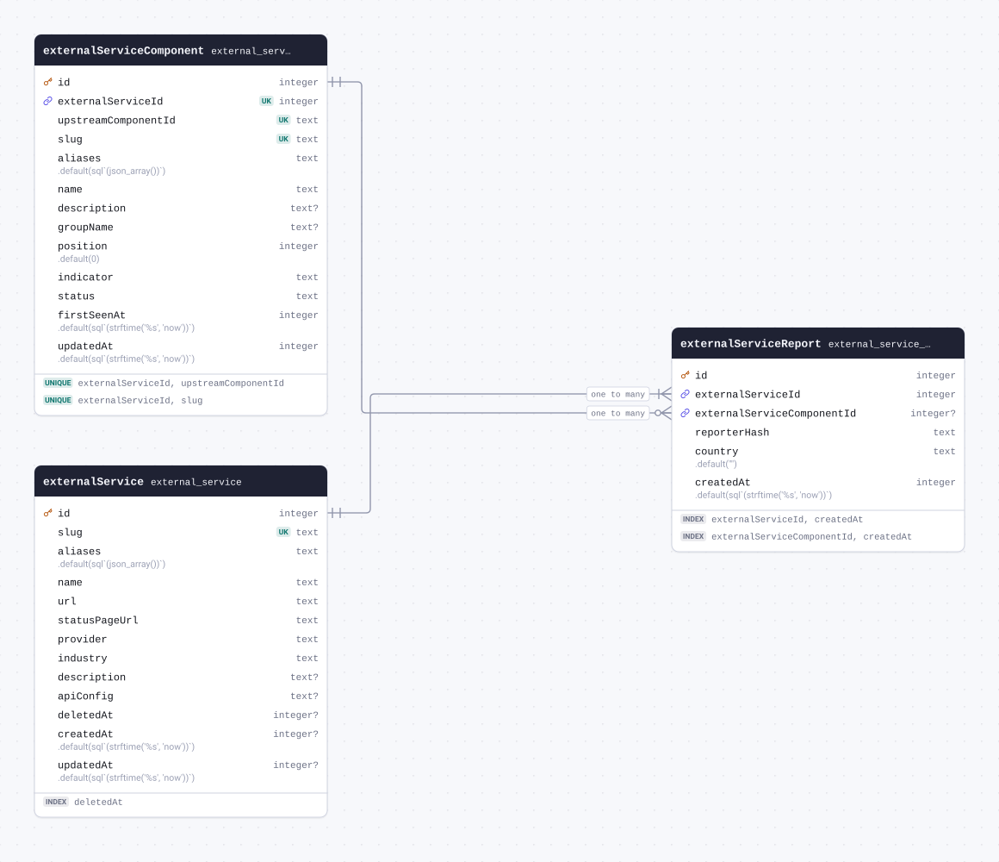

| Column                                                         | Type      | Constraints                                                           | Default                                    | Description |
| -------------------------------------------------------------- | --------- | --------------------------------------------------------------------- | ------------------------------------------ | ----------- |
| `id`                                                           | `integer` | PK NOT NULL                                                           |                                            |             |
| `externalServiceId` (`external_service_id`)                    | `integer` | NOT NULL → [externalService.id](#table-externalService)               |                                            |             |
| `externalServiceComponentId` (`external_service_component_id`) | `integer` | NULL → [externalServiceComponent.id](#table-externalServiceComponent) |                                            |             |
| `reporterHash` (`reporter_hash`)                               | `text`    | NOT NULL                                                              |                                            |             |
| `country`                                                      | `text`    | NOT NULL                                                              | `.default("")`                             |             |
| `createdAt` (`created_at`)                                     | `integer` | NOT NULL                                                              | ``.default(sql`(strftime('%s', 'now'))`)`` |             |

#### Definition

```sql
CREATE TABLE `external_service_report` (
	`id` integer PRIMARY KEY,
	`external_service_id` integer NOT NULL,
	`external_service_component_id` integer,
	`reporter_hash` text(64) NOT NULL,
	`country` text(2) DEFAULT '' NOT NULL,
	`created_at` integer DEFAULT (strftime('%s', 'now')) NOT NULL,
	CONSTRAINT `fk_external_service_report_external_service_id_external_service_id_fk` FOREIGN KEY (`external_service_id`) REFERENCES `external_service`(`id`),
	CONSTRAINT `fk_external_service_report_external_service_component_id_external_service_component_id_fk` FOREIGN KEY (`external_service_component_id`) REFERENCES `external_service_component`(`id`)
);

CREATE INDEX `external_service_report_service_idx` ON `external_service_report` (`external_service_id`,`created_at`);

CREATE INDEX `external_service_report_component_idx` ON `external_service_report` (`external_service_component_id`,`created_at`);
```

#### Indexes

- INDEX `externalServiceId`, `createdAt`
- INDEX `externalServiceComponentId`, `createdAt`

#### References

- `externalServiceId` → [externalService.id](#table-externalService) (many to one)
- `externalServiceComponentId` → [externalServiceComponent.id](#table-externalServiceComponent) (many to one)

<details>
<summary>Queries and their SQL</summary>

**Select**: Every row of externalServiceReport.

```ts
db.select().from(externalServiceReport);
```

```sql
select "id", "external_service_id", "external_service_component_id", "reporter_hash", "country", "created_at"
from "external_service_report"
```

**Count**: How many rows externalServiceReport has.

```ts
db.select({ count: count() }).from(externalServiceReport);
```

```sql
select count(*)
from "external_service_report"
```

**Find many**: The rows of externalServiceReport, through the relational query API.

```ts
db.query.externalServiceReport.findMany();
```

```sql
select "d0"."id" as "id", "d0"."external_service_id" as "externalServiceId", "d0"."external_service_component_id" as "externalServiceComponentId", "d0"."reporter_hash" as "reporterHash", "d0"."country" as "country", "d0"."created_at" as "createdAt"
from "external_service_report" as "d0"
```

**Find by primary key**: One row of externalServiceReport, through the relational query API.

```ts
db.query.externalServiceReport.findFirst({ where: { id: 1 } });
```

```sql
select "d0"."id" as "id", "d0"."external_service_id" as "externalServiceId", "d0"."external_service_component_id" as "externalServiceComponentId", "d0"."reporter_hash" as "reporterHash", "d0"."country" as "country", "d0"."created_at" as "createdAt"
from "external_service_report" as "d0"
where "d0"."id" = ?
limit ?
-- params: [1,1]
```

**Insert**: Adds a row to externalServiceReport, giving the columns that have no default.

```ts
db.insert(externalServiceReport).values({
  id: 1,
  externalServiceId: 1,
  reporterHash: "reporterHash",
});
```

```sql
insert into "external_service_report" ("id", "external_service_id", "external_service_component_id", "reporter_hash", "country", "created_at")
values (?, ?, null, ?, ?, (strftime('%s', 'now')))
-- params: [1,1,"reporterHash",""]
```

**Update**: Changes a row of externalServiceReport, found by its primary key.

```ts
db.update(externalServiceReport)
  .set({ externalServiceId: 1 })
  .where(eq(externalServiceReport.id, 1));
```

```sql
update "external_service_report"
set "external_service_id" = ?
where "external_service_report"."id" = ?
-- params: [1,1]
```

**Delete**: Deletes a row of externalServiceReport, found by its primary key.

```ts
db.delete(externalServiceReport).where(eq(externalServiceReport.id, 1));
```

```sql
delete from "external_service_report"
where "external_service_report"."id" = ?
-- params: [1]
```

</details>

<a id="table-chatSession"></a>

### chatSession

Table `chat_session`. Surrogate-PK row per dashboard chat conversation. Many rows per (workspace, user). Bounded by application logic on insert (`MAX_CHAT_SESSIONS_PER_USER`); per-row payload bounded by `MAX_CHAT_MESSAGES` and a tool-result compaction policy in the service layer.

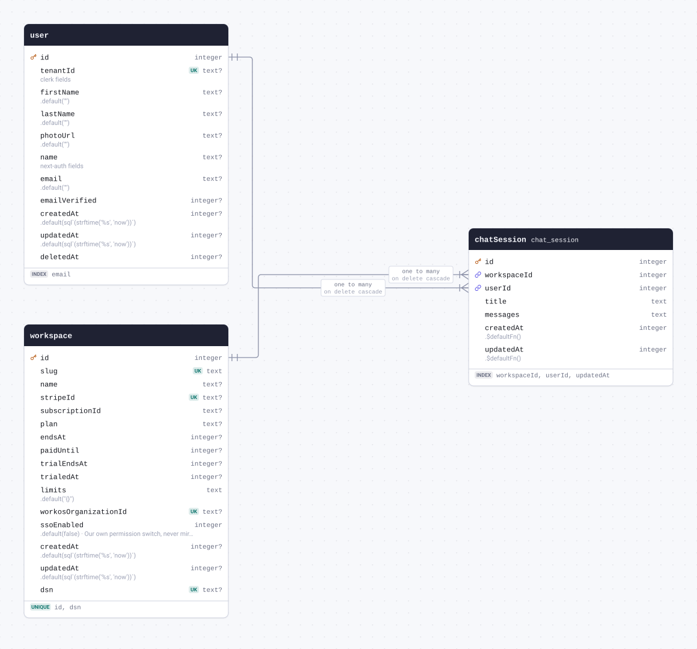

| Column                         | Type      | Constraints                                 | Default         | Description |
| ------------------------------ | --------- | ------------------------------------------- | --------------- | ----------- |
| `id`                           | `integer` | PK NOT NULL                                 |                 |             |
| `workspaceId` (`workspace_id`) | `integer` | NOT NULL → [workspace.id](#table-workspace) |                 |             |
| `userId` (`user_id`)           | `integer` | NOT NULL → [user.id](#table-user)           |                 |             |
| `title`                        | `text`    | NOT NULL                                    |                 |             |
| `messages`                     | `text`    | NOT NULL                                    |                 |             |
| `createdAt` (`created_at`)     | `integer` | NOT NULL                                    | `.$defaultFn()` |             |
| `updatedAt` (`updated_at`)     | `integer` | NOT NULL                                    | `.$defaultFn()` |             |

#### Definition

```sql
CREATE TABLE `chat_session` (
	`id` integer PRIMARY KEY AUTOINCREMENT,
	`workspace_id` integer NOT NULL,
	`user_id` integer NOT NULL,
	`title` text NOT NULL,
	`messages` text NOT NULL,
	`created_at` integer NOT NULL,
	`updated_at` integer NOT NULL,
	CONSTRAINT `fk_chat_session_workspace_id_workspace_id_fk` FOREIGN KEY (`workspace_id`) REFERENCES `workspace`(`id`) ON DELETE CASCADE,
	CONSTRAINT `fk_chat_session_user_id_user_id_fk` FOREIGN KEY (`user_id`) REFERENCES `user`(`id`) ON DELETE CASCADE
);

CREATE INDEX `chat_session_workspace_user_updated_idx` ON `chat_session` (`workspace_id`,`user_id`,`updated_at`);
```

#### Indexes

- INDEX `workspaceId`, `userId`, `updatedAt`

#### References

- `workspaceId` → [workspace.id](#table-workspace) (many to one, on delete cascade)
- `userId` → [user.id](#table-user) (many to one, on delete cascade)

<details>
<summary>Queries and their SQL</summary>

**Select**: Every row of chatSession.

```ts
db.select().from(chatSession);
```

```sql
select "id", "workspace_id", "user_id", "title", "messages", "created_at", "updated_at"
from "chat_session"
```

**Count**: How many rows chatSession has.

```ts
db.select({ count: count() }).from(chatSession);
```

```sql
select count(*)
from "chat_session"
```

**Find many**: The rows of chatSession, through the relational query API.

```ts
db.query.chatSession.findMany();
```

```sql
select "d0"."id" as "id", "d0"."workspace_id" as "workspaceId", "d0"."user_id" as "userId", "d0"."title" as "title", "d0"."messages" as "messages", "d0"."created_at" as "createdAt", "d0"."updated_at" as "updatedAt"
from "chat_session" as "d0"
```

**Find by primary key**: One row of chatSession, through the relational query API.

```ts
db.query.chatSession.findFirst({ where: { id: 1 } });
```

```sql
select "d0"."id" as "id", "d0"."workspace_id" as "workspaceId", "d0"."user_id" as "userId", "d0"."title" as "title", "d0"."messages" as "messages", "d0"."created_at" as "createdAt", "d0"."updated_at" as "updatedAt"
from "chat_session" as "d0"
where "d0"."id" = ?
limit ?
-- params: [1,1]
```

**Insert**: Adds a row to chatSession, giving the columns that have no default.

```ts
db.insert(chatSession).values({
  id: 1,
  workspaceId: 1,
  userId: 1,
  title: "title",
  messages: "messages",
});
```

```sql
insert into "chat_session" ("id", "workspace_id", "user_id", "title", "messages", "created_at", "updated_at")
values (?, ?, ?, ?, ?, ?, ?)
-- params: [1,1,1,"title","\"messages\"",1767225600000,1767225600000]
```

**Update**: Changes a row of chatSession, found by its primary key.

```ts
db.update(chatSession).set({ workspaceId: 1 }).where(eq(chatSession.id, 1));
```

```sql
update "chat_session"
set "workspace_id" = ?
where "chat_session"."id" = ?
-- params: [1,1]
```

**Delete**: Deletes a row of chatSession, found by its primary key.

```ts
db.delete(chatSession).where(eq(chatSession.id, 1));
```

```sql
delete from "chat_session"
where "chat_session"."id" = ?
-- params: [1]
```

</details>

<a id="table-frozenMonitorUptime"></a>

### frozenMonitorUptime

Table `frozen_monitor_uptime`.


| Column                         | Type      | Constraints                                 | Default                                    | Description                    |
| ------------------------------ | --------- | ------------------------------------------- | ------------------------------------------ | ------------------------------ |
| `id`                           | `integer` | PK NOT NULL                                 |                                            |                                |
| `workspaceId` (`workspace_id`) | `integer` | NOT NULL → [workspace.id](#table-workspace) |                                            |                                |
| `monitorId` (`monitor_id`)     | `integer` | NOT NULL → [monitor.id](#table-monitor)     |                                            |                                |
| `month`                        | `text`    | NOT NULL                                    |                                            | UTC first-of-month, YYYY-MM-01 |
| `days`                         | `text`    | NOT NULL                                    |                                            |                                |
| `createdAt` (`created_at`)     | `integer` | NULL                                        | ``.default(sql`(strftime('%s', 'now'))`)`` |                                |

#### Definition

```sql
CREATE TABLE `frozen_monitor_uptime` (
	`id` integer PRIMARY KEY,
	`workspace_id` integer NOT NULL,
	`monitor_id` integer NOT NULL,
	`month` text NOT NULL,
	`days` text NOT NULL,
	`created_at` integer DEFAULT (strftime('%s', 'now')),
	CONSTRAINT `fk_frozen_monitor_uptime_workspace_id_workspace_id_fk` FOREIGN KEY (`workspace_id`) REFERENCES `workspace`(`id`) ON DELETE CASCADE,
	CONSTRAINT `fk_frozen_monitor_uptime_monitor_id_monitor_id_fk` FOREIGN KEY (`monitor_id`) REFERENCES `monitor`(`id`) ON DELETE CASCADE,
	CONSTRAINT `frozen_monitor_uptime_monitor_id_month_unique` UNIQUE(`monitor_id`,`month`)
);

CREATE INDEX `frozen_monitor_uptime_workspace_id_idx` ON `frozen_monitor_uptime` (`workspace_id`);
```

#### Indexes

- UNIQUE `monitorId`, `month`
- INDEX `workspaceId`

#### References

- `workspaceId` → [workspace.id](#table-workspace) (many to one, on delete cascade)
- `monitorId` → [monitor.id](#table-monitor) (many to one, on delete cascade)

<details>
<summary>Queries and their SQL</summary>

**Select**: Every row of frozenMonitorUptime.

```ts
db.select().from(frozenMonitorUptime);
```

```sql
select "id", "workspace_id", "monitor_id", "month", "days", "created_at"
from "frozen_monitor_uptime"
```

**Count**: How many rows frozenMonitorUptime has.

```ts
db.select({ count: count() }).from(frozenMonitorUptime);
```

```sql
select count(*)
from "frozen_monitor_uptime"
```

**Find many**: The rows of frozenMonitorUptime, through the relational query API.

```ts
db.query.frozenMonitorUptime.findMany();
```

```sql
select "d0"."id" as "id", "d0"."workspace_id" as "workspaceId", "d0"."monitor_id" as "monitorId", "d0"."month" as "month", "d0"."days" as "days", "d0"."created_at" as "createdAt"
from "frozen_monitor_uptime" as "d0"
```

**Find by primary key**: One row of frozenMonitorUptime, through the relational query API.

```ts
db.query.frozenMonitorUptime.findFirst({ where: { id: 1 } });
```

```sql
select "d0"."id" as "id", "d0"."workspace_id" as "workspaceId", "d0"."monitor_id" as "monitorId", "d0"."month" as "month", "d0"."days" as "days", "d0"."created_at" as "createdAt"
from "frozen_monitor_uptime" as "d0"
where "d0"."id" = ?
limit ?
-- params: [1,1]
```

**Insert**: Adds a row to frozenMonitorUptime, giving the columns that have no default.

```ts
db.insert(frozenMonitorUptime).values({
  id: 1,
  workspaceId: 1,
  monitorId: 1,
  month: "month",
  days: "days",
});
```

```sql
insert into "frozen_monitor_uptime" ("id", "workspace_id", "monitor_id", "month", "days", "created_at")
values (?, ?, ?, ?, ?, (strftime('%s', 'now')))
-- params: [1,1,1,"month","\"days\""]
```

**Update**: Changes a row of frozenMonitorUptime, found by its primary key.

```ts
db.update(frozenMonitorUptime).set({ workspaceId: 1 }).where(eq(frozenMonitorUptime.id, 1));
```

```sql
update "frozen_monitor_uptime"
set "workspace_id" = ?
where "frozen_monitor_uptime"."id" = ?
-- params: [1,1]
```

**Delete**: Deletes a row of frozenMonitorUptime, found by its primary key.

```ts
db.delete(frozenMonitorUptime).where(eq(frozenMonitorUptime.id, 1));
```

```sql
delete from "frozen_monitor_uptime"
where "frozen_monitor_uptime"."id" = ?
-- params: [1]
```

</details>

<a id="table-monitorTransition"></a>

### monitorTransition

Table `monitor_transition`.


| Column                             | Type      | Constraints                             | Default       | Description |
| ---------------------------------- | --------- | --------------------------------------- | ------------- | ----------- |
| `id`                               | `integer` | PK NOT NULL                             |               |             |
| `monitorId` (`monitor_id`)         | `integer` | NOT NULL → [monitor.id](#table-monitor) |               |             |
| `region`                           | `text`    | NOT NULL                                |               |             |
| `cronTimestamp` (`cron_timestamp`) | `integer` | NOT NULL                                |               |             |
| `fromStatus` (`from_status`)       | `text`    | NOT NULL                                |               |             |
| `toStatus` (`to_status`)           | `text`    | NOT NULL                                |               |             |
| `quorumCount` (`quorum_count`)     | `integer` | NOT NULL                                |               |             |
| `regionCount` (`region_count`)     | `integer` | NOT NULL                                |               |             |
| `transitioned`                     | `integer` | NOT NULL                                |               |             |
| `outboxRows` (`outbox_rows`)       | `integer` | NOT NULL                                | `.default(0)` |             |
| `createdAt` (`created_at`)         | `integer` | NOT NULL                                |               |             |

#### Definition

```sql
CREATE TABLE `monitor_transition` (
	`id` integer PRIMARY KEY,
	`monitor_id` integer NOT NULL,
	`region` text NOT NULL,
	`cron_timestamp` integer NOT NULL,
	`from_status` text NOT NULL,
	`to_status` text NOT NULL,
	`quorum_count` integer NOT NULL,
	`region_count` integer NOT NULL,
	`transitioned` integer NOT NULL,
	`outbox_rows` integer DEFAULT 0 NOT NULL,
	`created_at` integer NOT NULL,
	CONSTRAINT `fk_monitor_transition_monitor_id_monitor_id_fk` FOREIGN KEY (`monitor_id`) REFERENCES `monitor`(`id`) ON DELETE CASCADE
);

CREATE INDEX `monitor_transition_monitor_id_cron_timestamp_idx` ON `monitor_transition` (`monitor_id`,`cron_timestamp`);

CREATE INDEX `monitor_transition_created_at_idx` ON `monitor_transition` (`created_at`);
```

#### Indexes

- INDEX `monitorId`, `cronTimestamp`
- INDEX `createdAt`

#### References

- `monitorId` → [monitor.id](#table-monitor) (many to one, on delete cascade)

<details>
<summary>Queries and their SQL</summary>

**Select**: Every row of monitorTransition.

```ts
db.select().from(monitorTransition);
```

```sql
select "id", "monitor_id", "region", "cron_timestamp", "from_status", "to_status", "quorum_count", "region_count", "transitioned", "outbox_rows", "created_at"
from "monitor_transition"
```

**Count**: How many rows monitorTransition has.

```ts
db.select({ count: count() }).from(monitorTransition);
```

```sql
select count(*)
from "monitor_transition"
```

**Find many**: The rows of monitorTransition, through the relational query API.

```ts
db.query.monitorTransition.findMany();
```

```sql
select "d0"."id" as "id", "d0"."monitor_id" as "monitorId", "d0"."region" as "region", "d0"."cron_timestamp" as "cronTimestamp", "d0"."from_status" as "fromStatus", "d0"."to_status" as "toStatus", "d0"."quorum_count" as "quorumCount", "d0"."region_count" as "regionCount", "d0"."transitioned" as "transitioned", "d0"."outbox_rows" as "outboxRows", "d0"."created_at" as "createdAt"
from "monitor_transition" as "d0"
```

**Find by primary key**: One row of monitorTransition, through the relational query API.

```ts
db.query.monitorTransition.findFirst({ where: { id: 1 } });
```

```sql
select "d0"."id" as "id", "d0"."monitor_id" as "monitorId", "d0"."region" as "region", "d0"."cron_timestamp" as "cronTimestamp", "d0"."from_status" as "fromStatus", "d0"."to_status" as "toStatus", "d0"."quorum_count" as "quorumCount", "d0"."region_count" as "regionCount", "d0"."transitioned" as "transitioned", "d0"."outbox_rows" as "outboxRows", "d0"."created_at" as "createdAt"
from "monitor_transition" as "d0"
where "d0"."id" = ?
limit ?
-- params: [1,1]
```

**Insert**: Adds a row to monitorTransition, giving the columns that have no default.

```ts
db.insert(monitorTransition).values({
  id: 1,
  monitorId: 1,
  region: "region",
  cronTimestamp: 1,
  fromStatus: "fromStatus",
  toStatus: "toStatus",
  quorumCount: 1,
  regionCount: 1,
  transitioned: 1,
  createdAt: 1,
});
```

```sql
insert into "monitor_transition" ("id", "monitor_id", "region", "cron_timestamp", "from_status", "to_status", "quorum_count", "region_count", "transitioned", "outbox_rows", "created_at")
values (?, ?, ?, ?, ?, ?, ?, ?, ?, ?, ?)
-- params: [1,1,"region",1,"fromStatus","toStatus",1,1,1,0,1]
```

**Update**: Changes a row of monitorTransition, found by its primary key.

```ts
db.update(monitorTransition).set({ monitorId: 1 }).where(eq(monitorTransition.id, 1));
```

```sql
update "monitor_transition"
set "monitor_id" = ?
where "monitor_transition"."id" = ?
-- params: [1,1]
```

**Delete**: Deletes a row of monitorTransition, found by its primary key.

```ts
db.delete(monitorTransition).where(eq(monitorTransition.id, 1));
```

```sql
delete from "monitor_transition"
where "monitor_transition"."id" = ?
-- params: [1]
```

</details>

<a id="table-oauthClient"></a>

### oauthClient

Table `oauth_client`. Every client is public (token_endpoint_auth_method "none"), so there is no secret column. Confidential clients are a follow-up.


| Column                           | Type      | Constraints     | Default                                    | Description |
| -------------------------------- | --------- | --------------- | ------------------------------------------ | ----------- |
| `id`                             | `integer` | PK NOT NULL     |                                            |             |
| `clientId` (`client_id`)         | `text`    | UNIQUE NOT NULL |                                            |             |
| `name`                           | `text`    | NOT NULL        | `.default("MCP Client")`                   |             |
| `redirectUris` (`redirect_uris`) | `text`    | NOT NULL        |                                            |             |
| `revokedAt` (`revoked_at`)       | `integer` | NULL            |                                            |             |
| `createdAt` (`created_at`)       | `integer` | NULL            | ``.default(sql`(strftime('%s', 'now'))`)`` |             |

#### Definition

```sql
CREATE TABLE `oauth_client` (
	`id` integer PRIMARY KEY AUTOINCREMENT,
	`client_id` text NOT NULL UNIQUE,
	`name` text DEFAULT 'MCP Client' NOT NULL,
	`redirect_uris` text NOT NULL,
	`revoked_at` integer,
	`created_at` integer DEFAULT (strftime('%s', 'now'))
);
```

#### Referenced by

- `clientId` → [oauthSession.clientId](#table-oauthSession) (one to many, on delete cascade)
- `clientId` → [oauthAuthorizationCode.clientId](#table-oauthAuthorizationCode) (one to many, on delete cascade)
- `clientId` → [oauthGrant.clientId](#table-oauthGrant) (one to many, on delete cascade)

<details>
<summary>Queries and their SQL</summary>

**Select**: Every row of oauthClient.

```ts
db.select().from(oauthClient);
```

```sql
select "id", "client_id", "name", "redirect_uris", "revoked_at", "created_at"
from "oauth_client"
```

**Count**: How many rows oauthClient has.

```ts
db.select({ count: count() }).from(oauthClient);
```

```sql
select count(*)
from "oauth_client"
```

**Find many**: The rows of oauthClient, through the relational query API.

```ts
db.query.oauthClient.findMany();
```

```sql
select "d0"."id" as "id", "d0"."client_id" as "clientId", "d0"."name" as "name", "d0"."redirect_uris" as "redirectUris", "d0"."revoked_at" as "revokedAt", "d0"."created_at" as "createdAt"
from "oauth_client" as "d0"
```

**Find by primary key**: One row of oauthClient, through the relational query API.

```ts
db.query.oauthClient.findFirst({ where: { id: 1 } });
```

```sql
select "d0"."id" as "id", "d0"."client_id" as "clientId", "d0"."name" as "name", "d0"."redirect_uris" as "redirectUris", "d0"."revoked_at" as "revokedAt", "d0"."created_at" as "createdAt"
from "oauth_client" as "d0"
where "d0"."id" = ?
limit ?
-- params: [1,1]
```

**Insert**: Adds a row to oauthClient, giving the columns that have no default.

```ts
db.insert(oauthClient).values({ id: 1, clientId: "clientId", redirectUris: "redirectUris" });
```

```sql
insert into "oauth_client" ("id", "client_id", "name", "redirect_uris", "revoked_at", "created_at")
values (?, ?, ?, ?, null, (strftime('%s', 'now')))
-- params: [1,"clientId","MCP Client","\"redirectUris\""]
```

**Update**: Changes a row of oauthClient, found by its primary key.

```ts
db.update(oauthClient).set({ clientId: "clientId" }).where(eq(oauthClient.id, 1));
```

```sql
update "oauth_client"
set "client_id" = ?
where "oauth_client"."id" = ?
-- params: ["clientId",1]
```

**Delete**: Deletes a row of oauthClient, found by its primary key.

```ts
db.delete(oauthClient).where(eq(oauthClient.id, 1));
```

```sql
delete from "oauth_client"
where "oauth_client"."id" = ?
-- params: [1]
```

</details>

<a id="table-oauthSession"></a>

### oauthSession

Table `oauth_session`. Pending authorize request. Lives in a row (not memory) because the server runs several instances and the consent page is served by the dashboard.


| Column                                          | Type      | Constraints                                           | Default            | Description |
| ----------------------------------------------- | --------- | ----------------------------------------------------- | ------------------ | ----------- |
| `id`                                            | `text`    | PK NOT NULL                                           |                    |             |
| `clientId` (`client_id`)                        | `text`    | NOT NULL → [oauthClient.clientId](#table-oauthClient) |                    |             |
| `redirectUri` (`redirect_uri`)                  | `text`    | NOT NULL                                              |                    |             |
| `scope`                                         | `text`    | NOT NULL                                              |                    |             |
| `state`                                         | `text`    | NULL                                                  |                    |             |
| `resource`                                      | `text`    | NULL                                                  |                    |             |
| `codeChallenge` (`code_challenge`)              | `text`    | NOT NULL                                              |                    |             |
| `codeChallengeMethod` (`code_challenge_method`) | `text`    | NOT NULL                                              | `.default("S256")` |             |
| `decidedAt` (`decided_at`)                      | `integer` | NULL                                                  |                    |             |
| `expiresAt` (`expires_at`)                      | `integer` | NOT NULL                                              |                    |             |

#### Definition

```sql
CREATE TABLE `oauth_session` (
	`id` text PRIMARY KEY,
	`client_id` text NOT NULL,
	`redirect_uri` text NOT NULL,
	`scope` text NOT NULL,
	`state` text,
	`resource` text,
	`code_challenge` text NOT NULL,
	`code_challenge_method` text DEFAULT 'S256' NOT NULL,
	`decided_at` integer,
	`expires_at` integer NOT NULL,
	CONSTRAINT `fk_oauth_session_client_id_oauth_client_client_id_fk` FOREIGN KEY (`client_id`) REFERENCES `oauth_client`(`client_id`) ON DELETE CASCADE
);

CREATE INDEX `oauth_session_client_id_idx` ON `oauth_session` (`client_id`);

CREATE INDEX `oauth_session_expires_at_idx` ON `oauth_session` (`expires_at`);
```

#### Indexes

- INDEX `clientId`
- INDEX `expiresAt`

#### References

- `clientId` → [oauthClient.clientId](#table-oauthClient) (many to one, on delete cascade)

<details>
<summary>Queries and their SQL</summary>

**Select**: Every row of oauthSession.

```ts
db.select().from(oauthSession);
```

```sql
select "id", "client_id", "redirect_uri", "scope", "state", "resource", "code_challenge", "code_challenge_method", "decided_at", "expires_at"
from "oauth_session"
```

**Count**: How many rows oauthSession has.

```ts
db.select({ count: count() }).from(oauthSession);
```

```sql
select count(*)
from "oauth_session"
```

**Find many**: The rows of oauthSession, through the relational query API.

```ts
db.query.oauthSession.findMany();
```

```sql
select "d0"."id" as "id", "d0"."client_id" as "clientId", "d0"."redirect_uri" as "redirectUri", "d0"."scope" as "scope", "d0"."state" as "state", "d0"."resource" as "resource", "d0"."code_challenge" as "codeChallenge", "d0"."code_challenge_method" as "codeChallengeMethod", "d0"."decided_at" as "decidedAt", "d0"."expires_at" as "expiresAt"
from "oauth_session" as "d0"
```

**Find by primary key**: One row of oauthSession, through the relational query API.

```ts
db.query.oauthSession.findFirst({ where: { id: "id" } });
```

```sql
select "d0"."id" as "id", "d0"."client_id" as "clientId", "d0"."redirect_uri" as "redirectUri", "d0"."scope" as "scope", "d0"."state" as "state", "d0"."resource" as "resource", "d0"."code_challenge" as "codeChallenge", "d0"."code_challenge_method" as "codeChallengeMethod", "d0"."decided_at" as "decidedAt", "d0"."expires_at" as "expiresAt"
from "oauth_session" as "d0"
where "d0"."id" = ?
limit ?
-- params: ["id",1]
```

**Insert**: Adds a row to oauthSession, giving the columns that have no default.

```ts
db.insert(oauthSession).values({
  id: "id",
  clientId: "clientId",
  redirectUri: "redirectUri",
  scope: "scope",
  codeChallenge: "codeChallenge",
  expiresAt: 1,
});
```

```sql
insert into "oauth_session" ("id", "client_id", "redirect_uri", "scope", "state", "resource", "code_challenge", "code_challenge_method", "decided_at", "expires_at")
values (?, ?, ?, ?, null, null, ?, ?, null, ?)
-- params: ["id","clientId","redirectUri","\"scope\"","codeChallenge","S256",1]
```

**Update**: Changes a row of oauthSession, found by its primary key.

```ts
db.update(oauthSession).set({ clientId: "clientId" }).where(eq(oauthSession.id, "id"));
```

```sql
update "oauth_session"
set "client_id" = ?
where "oauth_session"."id" = ?
-- params: ["clientId","id"]
```

**Delete**: Deletes a row of oauthSession, found by its primary key.

```ts
db.delete(oauthSession).where(eq(oauthSession.id, "id"));
```

```sql
delete from "oauth_session"
where "oauth_session"."id" = ?
-- params: ["id"]
```

</details>

<a id="table-oauthAuthorizationCode"></a>

### oauthAuthorizationCode

Table `oauth_authorization_code`.


| Column                             | Type      | Constraints                                           | Default | Description                                                          |
| ---------------------------------- | --------- | ----------------------------------------------------- | ------- | -------------------------------------------------------------------- |
| `id`                               | `integer` | PK NOT NULL                                           |         |                                                                      |
| `hash`                             | `text`    | UNIQUE NOT NULL                                       |         |                                                                      |
| `clientId` (`client_id`)           | `text`    | NOT NULL → [oauthClient.clientId](#table-oauthClient) |         |                                                                      |
| `userId` (`user_id`)               | `integer` | NOT NULL → [user.id](#table-user)                     |         |                                                                      |
| `workspaceId` (`workspace_id`)     | `integer` | NOT NULL → [workspace.id](#table-workspace)           |         |                                                                      |
| `scope`                            | `text`    | NOT NULL                                              |         |                                                                      |
| `redirectUri` (`redirect_uri`)     | `text`    | NOT NULL                                              |         |                                                                      |
| `codeChallenge` (`code_challenge`) | `text`    | NOT NULL                                              |         |                                                                      |
| `expiresAt` (`expires_at`)         | `integer` | NOT NULL                                              |         |                                                                      |
| `consumedAt` (`consumed_at`)       | `integer` | NULL                                                  |         |                                                                      |
| `grantId` (`grant_id`)             | `integer` | NULL → [oauthGrant.id](#table-oauthGrant)             |         | Set on exchange so a replayed code can revoke the grant it produced. |

#### Definition

```sql
CREATE TABLE `oauth_authorization_code` (
	`id` integer PRIMARY KEY AUTOINCREMENT,
	`hash` text NOT NULL UNIQUE,
	`client_id` text NOT NULL,
	`user_id` integer NOT NULL,
	`workspace_id` integer NOT NULL,
	`scope` text NOT NULL,
	`redirect_uri` text NOT NULL,
	`code_challenge` text NOT NULL,
	`expires_at` integer NOT NULL,
	`consumed_at` integer,
	`grant_id` integer,
	CONSTRAINT `fk_oauth_authorization_code_client_id_oauth_client_client_id_fk` FOREIGN KEY (`client_id`) REFERENCES `oauth_client`(`client_id`) ON DELETE CASCADE,
	CONSTRAINT `fk_oauth_authorization_code_user_id_user_id_fk` FOREIGN KEY (`user_id`) REFERENCES `user`(`id`) ON DELETE CASCADE,
	CONSTRAINT `fk_oauth_authorization_code_workspace_id_workspace_id_fk` FOREIGN KEY (`workspace_id`) REFERENCES `workspace`(`id`) ON DELETE CASCADE,
	CONSTRAINT `fk_oauth_authorization_code_grant_id_oauth_grant_id_fk` FOREIGN KEY (`grant_id`) REFERENCES `oauth_grant`(`id`) ON DELETE SET NULL
);

CREATE INDEX `oauth_authorization_code_expires_at_idx` ON `oauth_authorization_code` (`expires_at`);

CREATE INDEX `oauth_authorization_code_client_id_idx` ON `oauth_authorization_code` (`client_id`);
```

#### Indexes

- INDEX `expiresAt`
- INDEX `clientId`

#### References

- `clientId` → [oauthClient.clientId](#table-oauthClient) (many to one, on delete cascade)
- `userId` → [user.id](#table-user) (many to one, on delete cascade)
- `workspaceId` → [workspace.id](#table-workspace) (many to one, on delete cascade)
- `grantId` → [oauthGrant.id](#table-oauthGrant) (many to one, on delete set null)

<details>
<summary>Queries and their SQL</summary>

**Select**: Every row of oauthAuthorizationCode.

```ts
db.select().from(oauthAuthorizationCode);
```

```sql
select "id", "hash", "client_id", "user_id", "workspace_id", "scope", "redirect_uri", "code_challenge", "expires_at", "consumed_at", "grant_id"
from "oauth_authorization_code"
```

**Count**: How many rows oauthAuthorizationCode has.

```ts
db.select({ count: count() }).from(oauthAuthorizationCode);
```

```sql
select count(*)
from "oauth_authorization_code"
```

**Find many**: The rows of oauthAuthorizationCode, through the relational query API.

```ts
db.query.oauthAuthorizationCode.findMany();
```

```sql
select "d0"."id" as "id", "d0"."hash" as "hash", "d0"."client_id" as "clientId", "d0"."user_id" as "userId", "d0"."workspace_id" as "workspaceId", "d0"."scope" as "scope", "d0"."redirect_uri" as "redirectUri", "d0"."code_challenge" as "codeChallenge", "d0"."expires_at" as "expiresAt", "d0"."consumed_at" as "consumedAt", "d0"."grant_id" as "grantId"
from "oauth_authorization_code" as "d0"
```

**Find by primary key**: One row of oauthAuthorizationCode, through the relational query API.

```ts
db.query.oauthAuthorizationCode.findFirst({ where: { id: 1 } });
```

```sql
select "d0"."id" as "id", "d0"."hash" as "hash", "d0"."client_id" as "clientId", "d0"."user_id" as "userId", "d0"."workspace_id" as "workspaceId", "d0"."scope" as "scope", "d0"."redirect_uri" as "redirectUri", "d0"."code_challenge" as "codeChallenge", "d0"."expires_at" as "expiresAt", "d0"."consumed_at" as "consumedAt", "d0"."grant_id" as "grantId"
from "oauth_authorization_code" as "d0"
where "d0"."id" = ?
limit ?
-- params: [1,1]
```

**Insert**: Adds a row to oauthAuthorizationCode, giving the columns that have no default.

```ts
db.insert(oauthAuthorizationCode).values({
  id: 1,
  hash: "hash",
  clientId: "clientId",
  userId: 1,
  workspaceId: 1,
  scope: "scope",
  redirectUri: "redirectUri",
  codeChallenge: "codeChallenge",
  expiresAt: 1,
});
```

```sql
insert into "oauth_authorization_code" ("id", "hash", "client_id", "user_id", "workspace_id", "scope", "redirect_uri", "code_challenge", "expires_at", "consumed_at", "grant_id")
values (?, ?, ?, ?, ?, ?, ?, ?, ?, null, null)
-- params: [1,"hash","clientId",1,1,"\"scope\"","redirectUri","codeChallenge",1]
```

**Update**: Changes a row of oauthAuthorizationCode, found by its primary key.

```ts
db.update(oauthAuthorizationCode).set({ hash: "hash" }).where(eq(oauthAuthorizationCode.id, 1));
```

```sql
update "oauth_authorization_code"
set "hash" = ?
where "oauth_authorization_code"."id" = ?
-- params: ["hash",1]
```

**Delete**: Deletes a row of oauthAuthorizationCode, found by its primary key.

```ts
db.delete(oauthAuthorizationCode).where(eq(oauthAuthorizationCode.id, 1));
```

```sql
delete from "oauth_authorization_code"
where "oauth_authorization_code"."id" = ?
-- params: [1]
```

</details>

<a id="table-oauthGrant"></a>

### oauthGrant

Table `oauth_grant`. One row per consent. Access and refresh token share the row because they are one-to-one and rotate together.


| Column                                                     | Type      | Constraints                                           | Default                                    | Description                                                                                                              |
| ---------------------------------------------------------- | --------- | ----------------------------------------------------- | ------------------------------------------ | ------------------------------------------------------------------------------------------------------------------------ |
| `id`                                                       | `integer` | PK NOT NULL                                           |                                            |                                                                                                                          |
| `clientId` (`client_id`)                                   | `text`    | NOT NULL → [oauthClient.clientId](#table-oauthClient) |                                            |                                                                                                                          |
| `userId` (`user_id`)                                       | `integer` | NOT NULL → [user.id](#table-user)                     |                                            |                                                                                                                          |
| `workspaceId` (`workspace_id`)                             | `integer` | NOT NULL → [workspace.id](#table-workspace)           |                                            |                                                                                                                          |
| `scope`                                                    | `text`    | NOT NULL                                              |                                            |                                                                                                                          |
| `accessTokenHash` (`access_token_hash`)                    | `text`    | UNIQUE NOT NULL                                       |                                            |                                                                                                                          |
| `accessTokenExpiresAt` (`access_token_expires_at`)         | `integer` | NOT NULL                                              |                                            |                                                                                                                          |
| `refreshTokenHash` (`refresh_token_hash`)                  | `text`    | UNIQUE NOT NULL                                       |                                            |                                                                                                                          |
| `refreshTokenExpiresAt` (`refresh_token_expires_at`)       | `integer` | NOT NULL                                              |                                            |                                                                                                                          |
| `previousRefreshTokenHash` (`previous_refresh_token_hash`) | `text`    | NULL                                                  |                                            | Grace window: the hash rotated out at `rotatedAt` stays valid briefly so two concurrent refreshes do not kill the grant. |
| `rotatedAt` (`rotated_at`)                                 | `integer` | NULL                                                  |                                            |                                                                                                                          |
| `lastUsedAt` (`last_used_at`)                              | `integer` | NULL                                                  |                                            |                                                                                                                          |
| `revokedAt` (`revoked_at`)                                 | `integer` | NULL                                                  |                                            |                                                                                                                          |
| `createdAt` (`created_at`)                                 | `integer` | NULL                                                  | ``.default(sql`(strftime('%s', 'now'))`)`` |                                                                                                                          |

#### Definition

```sql
CREATE TABLE `oauth_grant` (
	`id` integer PRIMARY KEY AUTOINCREMENT,
	`client_id` text NOT NULL,
	`user_id` integer NOT NULL,
	`workspace_id` integer NOT NULL,
	`scope` text NOT NULL,
	`access_token_hash` text NOT NULL UNIQUE,
	`access_token_expires_at` integer NOT NULL,
	`refresh_token_hash` text NOT NULL UNIQUE,
	`refresh_token_expires_at` integer NOT NULL,
	`previous_refresh_token_hash` text,
	`rotated_at` integer,
	`last_used_at` integer,
	`revoked_at` integer,
	`created_at` integer DEFAULT (strftime('%s', 'now')),
	CONSTRAINT `fk_oauth_grant_client_id_oauth_client_client_id_fk` FOREIGN KEY (`client_id`) REFERENCES `oauth_client`(`client_id`) ON DELETE CASCADE,
	CONSTRAINT `fk_oauth_grant_user_id_user_id_fk` FOREIGN KEY (`user_id`) REFERENCES `user`(`id`) ON DELETE CASCADE,
	CONSTRAINT `fk_oauth_grant_workspace_id_workspace_id_fk` FOREIGN KEY (`workspace_id`) REFERENCES `workspace`(`id`) ON DELETE CASCADE
);

CREATE INDEX `oauth_grant_workspace_id_idx` ON `oauth_grant` (`workspace_id`);

CREATE INDEX `oauth_grant_client_id_user_id_idx` ON `oauth_grant` (`client_id`,`user_id`);

CREATE INDEX `oauth_grant_user_id_idx` ON `oauth_grant` (`user_id`);

CREATE INDEX `oauth_grant_previous_refresh_token_hash_idx` ON `oauth_grant` (`previous_refresh_token_hash`);

CREATE INDEX `oauth_grant_refresh_token_expires_at_idx` ON `oauth_grant` (`refresh_token_expires_at`);
```

#### Indexes

- INDEX `workspaceId`
- INDEX `clientId`, `userId`
- INDEX `userId`
- INDEX `previousRefreshTokenHash`
- INDEX `refreshTokenExpiresAt`

#### References

- `clientId` → [oauthClient.clientId](#table-oauthClient) (many to one, on delete cascade)
- `userId` → [user.id](#table-user) (many to one, on delete cascade)
- `workspaceId` → [workspace.id](#table-workspace) (many to one, on delete cascade)

#### Referenced by

- `id` → [oauthAuthorizationCode.grantId](#table-oauthAuthorizationCode) (one to many, on delete set null)

<details>
<summary>Queries and their SQL</summary>

**Select**: Every row of oauthGrant.

```ts
db.select().from(oauthGrant);
```

```sql
select "id", "client_id", "user_id", "workspace_id", "scope", "access_token_hash", "access_token_expires_at", "refresh_token_hash", "refresh_token_expires_at", "previous_refresh_token_hash", "rotated_at", "last_used_at", "revoked_at", "created_at"
from "oauth_grant"
```

**Count**: How many rows oauthGrant has.

```ts
db.select({ count: count() }).from(oauthGrant);
```

```sql
select count(*)
from "oauth_grant"
```

**Find many**: The rows of oauthGrant, through the relational query API.

```ts
db.query.oauthGrant.findMany();
```

```sql
select "d0"."id" as "id", "d0"."client_id" as "clientId", "d0"."user_id" as "userId", "d0"."workspace_id" as "workspaceId", "d0"."scope" as "scope", "d0"."access_token_hash" as "accessTokenHash", "d0"."access_token_expires_at" as "accessTokenExpiresAt", "d0"."refresh_token_hash" as "refreshTokenHash", "d0"."refresh_token_expires_at" as "refreshTokenExpiresAt", "d0"."previous_refresh_token_hash" as "previousRefreshTokenHash", "d0"."rotated_at" as "rotatedAt", "d0"."last_used_at" as "lastUsedAt", "d0"."revoked_at" as "revokedAt", "d0"."created_at" as "createdAt"
from "oauth_grant" as "d0"
```

**Find by primary key**: One row of oauthGrant, through the relational query API.

```ts
db.query.oauthGrant.findFirst({ where: { id: 1 } });
```

```sql
select "d0"."id" as "id", "d0"."client_id" as "clientId", "d0"."user_id" as "userId", "d0"."workspace_id" as "workspaceId", "d0"."scope" as "scope", "d0"."access_token_hash" as "accessTokenHash", "d0"."access_token_expires_at" as "accessTokenExpiresAt", "d0"."refresh_token_hash" as "refreshTokenHash", "d0"."refresh_token_expires_at" as "refreshTokenExpiresAt", "d0"."previous_refresh_token_hash" as "previousRefreshTokenHash", "d0"."rotated_at" as "rotatedAt", "d0"."last_used_at" as "lastUsedAt", "d0"."revoked_at" as "revokedAt", "d0"."created_at" as "createdAt"
from "oauth_grant" as "d0"
where "d0"."id" = ?
limit ?
-- params: [1,1]
```

**Insert**: Adds a row to oauthGrant, giving the columns that have no default.

```ts
db.insert(oauthGrant).values({
  id: 1,
  clientId: "clientId",
  userId: 1,
  workspaceId: 1,
  scope: "scope",
  accessTokenHash: "accessTokenHash",
  accessTokenExpiresAt: 1,
  refreshTokenHash: "refreshTokenHash",
  refreshTokenExpiresAt: 1,
});
```

```sql
insert into "oauth_grant" ("id", "client_id", "user_id", "workspace_id", "scope", "access_token_hash", "access_token_expires_at", "refresh_token_hash", "refresh_token_expires_at", "previous_refresh_token_hash", "rotated_at", "last_used_at", "revoked_at", "created_at")
values (?, ?, ?, ?, ?, ?, ?, ?, ?, null, null, null, null, (strftime('%s', 'now')))
-- params: [1,"clientId",1,1,"\"scope\"","accessTokenHash",1,"refreshTokenHash",1]
```

**Update**: Changes a row of oauthGrant, found by its primary key.

```ts
db.update(oauthGrant).set({ clientId: "clientId" }).where(eq(oauthGrant.id, 1));
```

```sql
update "oauth_grant"
set "client_id" = ?
where "oauth_grant"."id" = ?
-- params: ["clientId",1]
```

**Delete**: Deletes a row of oauthGrant, found by its primary key.

```ts
db.delete(oauthGrant).where(eq(oauthGrant.id, 1));
```

```sql
delete from "oauth_grant"
where "oauth_grant"."id" = ?
-- params: [1]
```

</details>

<a id="table-incident"></a>

### incident

Autoincrement: audit rows outlive a deleted incident, so its id must never be reused.


| Column                                | Type      | Constraints                                   | Default                                    | Description |
| ------------------------------------- | --------- | --------------------------------------------- | ------------------------------------------ | ----------- |
| `id`                                  | `integer` | PK NOT NULL                                   |                                            |             |
| `workspaceId` (`workspace_id`)        | `integer` | NOT NULL → [workspace.id](#table-workspace)   |                                            |             |
| `title`                               | `text`    | NOT NULL                                      |                                            |             |
| `severity`                            | `text`    | NOT NULL                                      |                                            |             |
| `status`                              | `text`    | NOT NULL                                      | `.default("open")`                         |             |
| `summary`                             | `text`    | NULL                                          |                                            |             |
| `commanderId` (`commander_id`)        | `integer` | NULL → [user.id](#table-user)                 |                                            |             |
| `declaredBy` (`declared_by`)          | `integer` | NULL → [user.id](#table-user)                 |                                            |             |
| `declaredAt` (`declared_at`)          | `integer` | NOT NULL                                      |                                            |             |
| `startedAt` (`started_at`)            | `integer` | NOT NULL                                      |                                            |             |
| `mitigatedAt` (`mitigated_at`)        | `integer` | NULL                                          |                                            |             |
| `resolvedAt` (`resolved_at`)          | `integer` | NULL                                          |                                            |             |
| `resolvedBy` (`resolved_by`)          | `integer` | NULL → [user.id](#table-user)                 |                                            |             |
| `closedAt` (`closed_at`)              | `integer` | NULL                                          |                                            |             |
| `statusReportId` (`status_report_id`) | `integer` | NULL → [statusReport.id](#table-statusReport) |                                            |             |
| `slackTeamId` (`slack_team_id`)       | `text`    | NULL                                          |                                            |             |
| `slackChannelId` (`slack_channel_id`) | `text`    | NULL                                          |                                            |             |
| `createdAt` (`created_at`)            | `integer` | NOT NULL                                      | ``.default(sql`(strftime('%s', 'now'))`)`` |             |
| `updatedAt` (`updated_at`)            | `integer` | NOT NULL                                      | ``.default(sql`(strftime('%s', 'now'))`)`` |             |

#### Definition

```sql
CREATE TABLE `incident` (
	`id` integer PRIMARY KEY AUTOINCREMENT,
	`workspace_id` integer NOT NULL,
	`title` text(256) NOT NULL,
	`severity` text NOT NULL,
	`status` text DEFAULT 'open' NOT NULL,
	`summary` text,
	`commander_id` integer,
	`declared_by` integer,
	`declared_at` integer NOT NULL,
	`started_at` integer NOT NULL,
	`mitigated_at` integer,
	`resolved_at` integer,
	`resolved_by` integer,
	`closed_at` integer,
	`status_report_id` integer,
	`slack_team_id` text,
	`slack_channel_id` text,
	`created_at` integer DEFAULT (strftime('%s', 'now')) NOT NULL,
	`updated_at` integer DEFAULT (strftime('%s', 'now')) NOT NULL,
	CONSTRAINT `fk_incident_workspace_id_workspace_id_fk` FOREIGN KEY (`workspace_id`) REFERENCES `workspace`(`id`),
	CONSTRAINT `fk_incident_commander_id_user_id_fk` FOREIGN KEY (`commander_id`) REFERENCES `user`(`id`),
	CONSTRAINT `fk_incident_declared_by_user_id_fk` FOREIGN KEY (`declared_by`) REFERENCES `user`(`id`),
	CONSTRAINT `fk_incident_resolved_by_user_id_fk` FOREIGN KEY (`resolved_by`) REFERENCES `user`(`id`),
	CONSTRAINT `fk_incident_status_report_id_status_report_id_fk` FOREIGN KEY (`status_report_id`) REFERENCES `status_report`(`id`) ON DELETE SET NULL
);

CREATE INDEX `incident_workspace_id_status_idx` ON `incident` (`workspace_id`,`status`);

CREATE INDEX `incident_workspace_id_declared_at_idx` ON `incident` (`workspace_id`,`declared_at`);

CREATE UNIQUE INDEX `incident_slack_channel_idx` ON `incident` (`slack_team_id`,`slack_channel_id`) WHERE "incident"."slack_channel_id" IS NOT NULL;

CREATE UNIQUE INDEX `incident_status_report_id_idx` ON `incident` (`status_report_id`) WHERE "incident"."status_report_id" IS NOT NULL;
```

#### Indexes

- INDEX `workspaceId`, `status`
- INDEX `workspaceId`, `declaredAt`
- UNIQUE `slackTeamId`, `slackChannelId`
- UNIQUE `statusReportId`

#### References

- `workspaceId` → [workspace.id](#table-workspace) (many to one)
- `commanderId` → [user.id](#table-user) (many to one)
- `declaredBy` → [user.id](#table-user) (many to one)
- `resolvedBy` → [user.id](#table-user) (many to one)
- `statusReportId` → [statusReport.id](#table-statusReport) (one to one, on delete set null)

#### Referenced by

- `id` → [incidentEvent.incidentId](#table-incidentEvent) (one to many, on delete cascade)
- `id` → [incidentPostmortem.incidentId](#table-incidentPostmortem) (one to one, on delete cascade)

<details>
<summary>Queries and their SQL</summary>

**Select**: Every row of incident.

```ts
db.select().from(incident);
```

```sql
select "id", "workspace_id", "title", "severity", "status", "summary", "commander_id", "declared_by", "declared_at", "started_at", "mitigated_at", "resolved_at", "resolved_by", "closed_at", "status_report_id", "slack_team_id", "slack_channel_id", "created_at", "updated_at"
from "incident"
```

**Count**: How many rows incident has.

```ts
db.select({ count: count() }).from(incident);
```

```sql
select count(*)
from "incident"
```

**Find many**: The rows of incident, through the relational query API.

```ts
db.query.incident.findMany();
```

```sql
select "d0"."id" as "id", "d0"."workspace_id" as "workspaceId", "d0"."title" as "title", "d0"."severity" as "severity", "d0"."status" as "status", "d0"."summary" as "summary", "d0"."commander_id" as "commanderId", "d0"."declared_by" as "declaredBy", "d0"."declared_at" as "declaredAt", "d0"."started_at" as "startedAt", "d0"."mitigated_at" as "mitigatedAt", "d0"."resolved_at" as "resolvedAt", "d0"."resolved_by" as "resolvedBy", "d0"."closed_at" as "closedAt", "d0"."status_report_id" as "statusReportId", "d0"."slack_team_id" as "slackTeamId", "d0"."slack_channel_id" as "slackChannelId", "d0"."created_at" as "createdAt", "d0"."updated_at" as "updatedAt"
from "incident" as "d0"
```

**Find by primary key**: One row of incident, through the relational query API.

```ts
db.query.incident.findFirst({ where: { id: 1 } });
```

```sql
select "d0"."id" as "id", "d0"."workspace_id" as "workspaceId", "d0"."title" as "title", "d0"."severity" as "severity", "d0"."status" as "status", "d0"."summary" as "summary", "d0"."commander_id" as "commanderId", "d0"."declared_by" as "declaredBy", "d0"."declared_at" as "declaredAt", "d0"."started_at" as "startedAt", "d0"."mitigated_at" as "mitigatedAt", "d0"."resolved_at" as "resolvedAt", "d0"."resolved_by" as "resolvedBy", "d0"."closed_at" as "closedAt", "d0"."status_report_id" as "statusReportId", "d0"."slack_team_id" as "slackTeamId", "d0"."slack_channel_id" as "slackChannelId", "d0"."created_at" as "createdAt", "d0"."updated_at" as "updatedAt"
from "incident" as "d0"
where "d0"."id" = ?
limit ?
-- params: [1,1]
```

**Insert**: Adds a row to incident, giving the columns that have no default.

```ts
db.insert(incident).values({
  id: 1,
  workspaceId: 1,
  title: "title",
  severity: "severity",
  declaredAt: 1,
  startedAt: 1,
});
```

```sql
insert into "incident" ("id", "workspace_id", "title", "severity", "status", "summary", "commander_id", "declared_by", "declared_at", "started_at", "mitigated_at", "resolved_at", "resolved_by", "closed_at", "status_report_id", "slack_team_id", "slack_channel_id", "created_at", "updated_at")
values (?, ?, ?, ?, ?, null, null, null, ?, ?, null, null, null, null, null, null, null, (strftime('%s', 'now')), (strftime('%s', 'now')))
-- params: [1,1,"title","severity","open",1,1]
```

**Update**: Changes a row of incident, found by its primary key.

```ts
db.update(incident).set({ workspaceId: 1 }).where(eq(incident.id, 1));
```

```sql
update "incident"
set "workspace_id" = ?
where "incident"."id" = ?
-- params: [1,1]
```

**Delete**: Deletes a row of incident, found by its primary key.

```ts
db.delete(incident).where(eq(incident.id, 1));
```

```sql
delete from "incident"
where "incident"."id" = ?
-- params: [1]
```

</details>

<a id="table-incidentEvent"></a>

### incidentEvent

Table `incident_event`.


| Column                       | Type      | Constraints                               | Default | Description |
| ---------------------------- | --------- | ----------------------------------------- | ------- | ----------- |
| `id`                         | `integer` | PK NOT NULL                               |         |             |
| `incidentId` (`incident_id`) | `integer` | NOT NULL → [incident.id](#table-incident) |         |             |
| `type`                       | `text`    | NOT NULL                                  |         |             |
| `message`                    | `text`    | NULL                                      |         |             |
| `source`                     | `text`    | NULL                                      |         |             |
| `sourceRef` (`source_ref`)   | `text`    | NULL                                      |         |             |
| `createdBy` (`created_by`)   | `integer` | NULL → [user.id](#table-user)             |         |             |
| `createdAt` (`created_at`)   | `integer` | NOT NULL                                  |         |             |

#### Definition

```sql
CREATE TABLE `incident_event` (
	`id` integer PRIMARY KEY AUTOINCREMENT,
	`incident_id` integer NOT NULL,
	`type` text NOT NULL,
	`message` text,
	`source` text,
	`source_ref` text,
	`created_by` integer,
	`created_at` integer NOT NULL,
	CONSTRAINT `fk_incident_event_incident_id_incident_id_fk` FOREIGN KEY (`incident_id`) REFERENCES `incident`(`id`) ON DELETE CASCADE,
	CONSTRAINT `fk_incident_event_created_by_user_id_fk` FOREIGN KEY (`created_by`) REFERENCES `user`(`id`)
);

CREATE INDEX `incident_event_incident_id_created_at_idx` ON `incident_event` (`incident_id`,`created_at`);
```

#### Indexes

- INDEX `incidentId`, `createdAt`

#### References

- `incidentId` → [incident.id](#table-incident) (many to one, on delete cascade)
- `createdBy` → [user.id](#table-user) (many to one)

<details>
<summary>Queries and their SQL</summary>

**Select**: Every row of incidentEvent.

```ts
db.select().from(incidentEvent);
```

```sql
select "id", "incident_id", "type", "message", "source", "source_ref", "created_by", "created_at"
from "incident_event"
```

**Count**: How many rows incidentEvent has.

```ts
db.select({ count: count() }).from(incidentEvent);
```

```sql
select count(*)
from "incident_event"
```

**Find many**: The rows of incidentEvent, through the relational query API.

```ts
db.query.incidentEvent.findMany();
```

```sql
select "d0"."id" as "id", "d0"."incident_id" as "incidentId", "d0"."type" as "type", "d0"."message" as "message", "d0"."source" as "source", "d0"."source_ref" as "sourceRef", "d0"."created_by" as "createdBy", "d0"."created_at" as "createdAt"
from "incident_event" as "d0"
```

**Find by primary key**: One row of incidentEvent, through the relational query API.

```ts
db.query.incidentEvent.findFirst({ where: { id: 1 } });
```

```sql
select "d0"."id" as "id", "d0"."incident_id" as "incidentId", "d0"."type" as "type", "d0"."message" as "message", "d0"."source" as "source", "d0"."source_ref" as "sourceRef", "d0"."created_by" as "createdBy", "d0"."created_at" as "createdAt"
from "incident_event" as "d0"
where "d0"."id" = ?
limit ?
-- params: [1,1]
```

**Insert**: Adds a row to incidentEvent, giving the columns that have no default.

```ts
db.insert(incidentEvent).values({ id: 1, incidentId: 1, type: "type", createdAt: 1 });
```

```sql
insert into "incident_event" ("id", "incident_id", "type", "message", "source", "source_ref", "created_by", "created_at")
values (?, ?, ?, null, null, null, null, ?)
-- params: [1,1,"type",1]
```

**Update**: Changes a row of incidentEvent, found by its primary key.

```ts
db.update(incidentEvent).set({ incidentId: 1 }).where(eq(incidentEvent.id, 1));
```

```sql
update "incident_event"
set "incident_id" = ?
where "incident_event"."id" = ?
-- params: [1,1]
```

**Delete**: Deletes a row of incidentEvent, found by its primary key.

```ts
db.delete(incidentEvent).where(eq(incidentEvent.id, 1));
```

```sql
delete from "incident_event"
where "incident_event"."id" = ?
-- params: [1]
```

</details>

<a id="table-incidentPostmortem"></a>

### incidentPostmortem

Table `incident_postmortem`.


| Column                                   | Type      | Constraints                                      | Default                                    | Description |
| ---------------------------------------- | --------- | ------------------------------------------------ | ------------------------------------------ | ----------- |
| `id`                                     | `integer` | PK NOT NULL                                      |                                            |             |
| `incidentId` (`incident_id`)             | `integer` | UNIQUE NOT NULL → [incident.id](#table-incident) |                                            |             |
| `status`                                 | `text`    | NOT NULL                                         | `.default("draft")`                        |             |
| `content`                                | `text`    | NOT NULL                                         |                                            |             |
| `sourceTranscript` (`source_transcript`) | `text`    | NULL                                             |                                            |             |
| `draftedBy` (`drafted_by`)               | `text`    | NOT NULL                                         |                                            |             |
| `createdBy` (`created_by`)               | `integer` | NULL → [user.id](#table-user)                    |                                            |             |
| `updatedBy` (`updated_by`)               | `integer` | NULL → [user.id](#table-user)                    |                                            |             |
| `approvedBy` (`approved_by`)             | `integer` | NULL → [user.id](#table-user)                    |                                            |             |
| `approvedAt` (`approved_at`)             | `integer` | NULL                                             |                                            |             |
| `publishedAt` (`published_at`)           | `integer` | NULL                                             |                                            |             |
| `createdAt` (`created_at`)               | `integer` | NOT NULL                                         | ``.default(sql`(strftime('%s', 'now'))`)`` |             |
| `updatedAt` (`updated_at`)               | `integer` | NOT NULL                                         | ``.default(sql`(strftime('%s', 'now'))`)`` |             |

#### Definition

```sql
CREATE TABLE `incident_postmortem` (
	`id` integer PRIMARY KEY AUTOINCREMENT,
	`incident_id` integer NOT NULL UNIQUE,
	`status` text DEFAULT 'draft' NOT NULL,
	`content` text NOT NULL,
	`source_transcript` text,
	`drafted_by` text NOT NULL,
	`created_by` integer,
	`updated_by` integer,
	`approved_by` integer,
	`approved_at` integer,
	`published_at` integer,
	`created_at` integer DEFAULT (strftime('%s', 'now')) NOT NULL,
	`updated_at` integer DEFAULT (strftime('%s', 'now')) NOT NULL,
	CONSTRAINT `fk_incident_postmortem_incident_id_incident_id_fk` FOREIGN KEY (`incident_id`) REFERENCES `incident`(`id`) ON DELETE CASCADE,
	CONSTRAINT `fk_incident_postmortem_created_by_user_id_fk` FOREIGN KEY (`created_by`) REFERENCES `user`(`id`),
	CONSTRAINT `fk_incident_postmortem_updated_by_user_id_fk` FOREIGN KEY (`updated_by`) REFERENCES `user`(`id`),
	CONSTRAINT `fk_incident_postmortem_approved_by_user_id_fk` FOREIGN KEY (`approved_by`) REFERENCES `user`(`id`)
);
```

#### References

- `incidentId` → [incident.id](#table-incident) (one to one, on delete cascade)
- `createdBy` → [user.id](#table-user) (many to one)
- `updatedBy` → [user.id](#table-user) (many to one)
- `approvedBy` → [user.id](#table-user) (many to one)

<details>
<summary>Queries and their SQL</summary>

**Select**: Every row of incidentPostmortem.

```ts
db.select().from(incidentPostmortem);
```

```sql
select "id", "incident_id", "status", "content", "source_transcript", "drafted_by", "created_by", "updated_by", "approved_by", "approved_at", "published_at", "created_at", "updated_at"
from "incident_postmortem"
```

**Count**: How many rows incidentPostmortem has.

```ts
db.select({ count: count() }).from(incidentPostmortem);
```

```sql
select count(*)
from "incident_postmortem"
```

**Find many**: The rows of incidentPostmortem, through the relational query API.

```ts
db.query.incidentPostmortem.findMany();
```

```sql
select "d0"."id" as "id", "d0"."incident_id" as "incidentId", "d0"."status" as "status", "d0"."content" as "content", "d0"."source_transcript" as "sourceTranscript", "d0"."drafted_by" as "draftedBy", "d0"."created_by" as "createdBy", "d0"."updated_by" as "updatedBy", "d0"."approved_by" as "approvedBy", "d0"."approved_at" as "approvedAt", "d0"."published_at" as "publishedAt", "d0"."created_at" as "createdAt", "d0"."updated_at" as "updatedAt"
from "incident_postmortem" as "d0"
```

**Find by primary key**: One row of incidentPostmortem, through the relational query API.

```ts
db.query.incidentPostmortem.findFirst({ where: { id: 1 } });
```

```sql
select "d0"."id" as "id", "d0"."incident_id" as "incidentId", "d0"."status" as "status", "d0"."content" as "content", "d0"."source_transcript" as "sourceTranscript", "d0"."drafted_by" as "draftedBy", "d0"."created_by" as "createdBy", "d0"."updated_by" as "updatedBy", "d0"."approved_by" as "approvedBy", "d0"."approved_at" as "approvedAt", "d0"."published_at" as "publishedAt", "d0"."created_at" as "createdAt", "d0"."updated_at" as "updatedAt"
from "incident_postmortem" as "d0"
where "d0"."id" = ?
limit ?
-- params: [1,1]
```

**Insert**: Adds a row to incidentPostmortem, giving the columns that have no default.

```ts
db.insert(incidentPostmortem).values({
  id: 1,
  incidentId: 1,
  content: "content",
  draftedBy: "draftedBy",
});
```

```sql
insert into "incident_postmortem" ("id", "incident_id", "status", "content", "source_transcript", "drafted_by", "created_by", "updated_by", "approved_by", "approved_at", "published_at", "created_at", "updated_at")
values (?, ?, ?, ?, null, ?, null, null, null, null, null, (strftime('%s', 'now')), (strftime('%s', 'now')))
-- params: [1,1,"draft","content","draftedBy"]
```

**Update**: Changes a row of incidentPostmortem, found by its primary key.

```ts
db.update(incidentPostmortem).set({ incidentId: 1 }).where(eq(incidentPostmortem.id, 1));
```

```sql
update "incident_postmortem"
set "incident_id" = ?
where "incident_postmortem"."id" = ?
-- params: [1,1]
```

**Delete**: Deletes a row of incidentPostmortem, found by its primary key.

```ts
db.delete(incidentPostmortem).where(eq(incidentPostmortem.id, 1));
```

```sql
delete from "incident_postmortem"
where "incident_postmortem"."id" = ?
-- params: [1]
```

</details>

<a id="table-slackUser"></a>

### slackUser

Table `slack_user`.


| Column                          | Type      | Constraints                                 | Default                                    | Description |
| ------------------------------- | --------- | ------------------------------------------- | ------------------------------------------ | ----------- |
| `id`                            | `integer` | PK NOT NULL                                 |                                            |             |
| `workspaceId` (`workspace_id`)  | `integer` | NOT NULL → [workspace.id](#table-workspace) |                                            |             |
| `slackTeamId` (`slack_team_id`) | `text`    | NOT NULL                                    |                                            |             |
| `slackUserId` (`slack_user_id`) | `text`    | NOT NULL                                    |                                            |             |
| `userId` (`user_id`)            | `integer` | NOT NULL → [user.id](#table-user)           |                                            |             |
| `createdAt` (`created_at`)      | `integer` | NOT NULL                                    | ``.default(sql`(strftime('%s', 'now'))`)`` |             |

#### Definition

```sql
CREATE TABLE `slack_user` (
	`id` integer PRIMARY KEY AUTOINCREMENT,
	`workspace_id` integer NOT NULL,
	`slack_team_id` text NOT NULL,
	`slack_user_id` text NOT NULL,
	`user_id` integer NOT NULL,
	`created_at` integer DEFAULT (strftime('%s', 'now')) NOT NULL,
	CONSTRAINT `fk_slack_user_workspace_id_workspace_id_fk` FOREIGN KEY (`workspace_id`) REFERENCES `workspace`(`id`) ON DELETE CASCADE,
	CONSTRAINT `fk_slack_user_user_id_user_id_fk` FOREIGN KEY (`user_id`) REFERENCES `user`(`id`),
	CONSTRAINT `slack_user_workspace_id_slack_team_id_slack_user_id_unique` UNIQUE(`workspace_id`,`slack_team_id`,`slack_user_id`)
);

CREATE INDEX `slack_user_user_id_idx` ON `slack_user` (`user_id`);
```

#### Indexes

- UNIQUE `workspaceId`, `slackTeamId`, `slackUserId`
- INDEX `userId`

#### References

- `workspaceId` → [workspace.id](#table-workspace) (many to one, on delete cascade)
- `userId` → [user.id](#table-user) (many to one)

<details>
<summary>Queries and their SQL</summary>

**Select**: Every row of slackUser.

```ts
db.select().from(slackUser);
```

```sql
select "id", "workspace_id", "slack_team_id", "slack_user_id", "user_id", "created_at"
from "slack_user"
```

**Count**: How many rows slackUser has.

```ts
db.select({ count: count() }).from(slackUser);
```

```sql
select count(*)
from "slack_user"
```

**Find many**: The rows of slackUser, through the relational query API.

```ts
db.query.slackUser.findMany();
```

```sql
select "d0"."id" as "id", "d0"."workspace_id" as "workspaceId", "d0"."slack_team_id" as "slackTeamId", "d0"."slack_user_id" as "slackUserId", "d0"."user_id" as "userId", "d0"."created_at" as "createdAt"
from "slack_user" as "d0"
```

**Find by primary key**: One row of slackUser, through the relational query API.

```ts
db.query.slackUser.findFirst({ where: { id: 1 } });
```

```sql
select "d0"."id" as "id", "d0"."workspace_id" as "workspaceId", "d0"."slack_team_id" as "slackTeamId", "d0"."slack_user_id" as "slackUserId", "d0"."user_id" as "userId", "d0"."created_at" as "createdAt"
from "slack_user" as "d0"
where "d0"."id" = ?
limit ?
-- params: [1,1]
```

**Insert**: Adds a row to slackUser, giving the columns that have no default.

```ts
db.insert(slackUser).values({
  id: 1,
  workspaceId: 1,
  slackTeamId: "slackTeamId",
  slackUserId: "slackUserId",
  userId: 1,
});
```

```sql
insert into "slack_user" ("id", "workspace_id", "slack_team_id", "slack_user_id", "user_id", "created_at")
values (?, ?, ?, ?, ?, (strftime('%s', 'now')))
-- params: [1,1,"slackTeamId","slackUserId",1]
```

**Update**: Changes a row of slackUser, found by its primary key.

```ts
db.update(slackUser).set({ workspaceId: 1 }).where(eq(slackUser.id, 1));
```

```sql
update "slack_user"
set "workspace_id" = ?
where "slack_user"."id" = ?
-- params: [1,1]
```

**Delete**: Deletes a row of slackUser, found by its primary key.

```ts
db.delete(slackUser).where(eq(slackUser.id, 1));
```

```sql
delete from "slack_user"
where "slack_user"."id" = ?
-- params: [1]
```

</details>

<a id="table-monitorHeartbeatState"></a>

### monitorHeartbeatState

Table `monitor_heartbeat_state`.


| Column                            | Type      | Constraints                                | Default               | Description                                                                          |
| --------------------------------- | --------- | ------------------------------------------ | --------------------- | ------------------------------------------------------------------------------------ |
| `monitorId` (`monitor_id`)        | `integer` | PK NOT NULL → [monitor.id](#table-monitor) |                       |                                                                                      |
| `lastPingAt` (`last_ping_at`)     | `integer` | NULL                                       |                       |                                                                                      |
| `lastPingKind` (`last_ping_kind`) | `text`    | NOT NULL                                   | `.default("success")` | what the last ping reported: a `/fail` keeps the heartbeat down until a success ping |
| `nextDueAt` (`next_due_at`)       | `integer` | NULL                                       |                       | NULL until the first ping, so a new heartbeat never alerts                           |

#### Definition

```sql
CREATE TABLE `monitor_heartbeat_state` (
	`monitor_id` integer PRIMARY KEY,
	`last_ping_at` integer,
	`last_ping_kind` text DEFAULT 'success' NOT NULL,
	`next_due_at` integer,
	CONSTRAINT `fk_monitor_heartbeat_state_monitor_id_monitor_id_fk` FOREIGN KEY (`monitor_id`) REFERENCES `monitor`(`id`) ON DELETE CASCADE
);

CREATE INDEX `monitor_heartbeat_state_next_due_at_idx` ON `monitor_heartbeat_state` (`next_due_at`);
```

#### Indexes

- INDEX `nextDueAt`

#### References

- `monitorId` → [monitor.id](#table-monitor) (one to one, on delete cascade)

<details>
<summary>Queries and their SQL</summary>

**Select**: Every row of monitorHeartbeatState.

```ts
db.select().from(monitorHeartbeatState);
```

```sql
select "monitor_id", "last_ping_at", "last_ping_kind", "next_due_at"
from "monitor_heartbeat_state"
```

**Count**: How many rows monitorHeartbeatState has.

```ts
db.select({ count: count() }).from(monitorHeartbeatState);
```

```sql
select count(*)
from "monitor_heartbeat_state"
```

**Find many**: The rows of monitorHeartbeatState, through the relational query API.

```ts
db.query.monitorHeartbeatState.findMany();
```

```sql
select "d0"."monitor_id" as "monitorId", "d0"."last_ping_at" as "lastPingAt", "d0"."last_ping_kind" as "lastPingKind", "d0"."next_due_at" as "nextDueAt"
from "monitor_heartbeat_state" as "d0"
```

**Find by primary key**: One row of monitorHeartbeatState, through the relational query API.

```ts
db.query.monitorHeartbeatState.findFirst({ where: { monitorId: 1 } });
```

```sql
select "d0"."monitor_id" as "monitorId", "d0"."last_ping_at" as "lastPingAt", "d0"."last_ping_kind" as "lastPingKind", "d0"."next_due_at" as "nextDueAt"
from "monitor_heartbeat_state" as "d0"
where "d0"."monitor_id" = ?
limit ?
-- params: [1,1]
```

**Insert**: Adds a row to monitorHeartbeatState, giving the columns that have no default.

```ts
db.insert(monitorHeartbeatState).values({ monitorId: 1 });
```

```sql
insert into "monitor_heartbeat_state" ("monitor_id", "last_ping_at", "last_ping_kind", "next_due_at")
values (?, null, ?, null)
-- params: [1,"success"]
```

**Update**: Changes a row of monitorHeartbeatState, found by its primary key.

```ts
db.update(monitorHeartbeatState)
  .set({ lastPingAt: 1 })
  .where(eq(monitorHeartbeatState.monitorId, 1));
```

```sql
update "monitor_heartbeat_state"
set "last_ping_at" = ?
where "monitor_heartbeat_state"."monitor_id" = ?
-- params: [1,1]
```

**Delete**: Deletes a row of monitorHeartbeatState, found by its primary key.

```ts
db.delete(monitorHeartbeatState).where(eq(monitorHeartbeatState.monitorId, 1));
```

```sql
delete from "monitor_heartbeat_state"
where "monitor_heartbeat_state"."monitor_id" = ?
-- params: [1]
```

</details>
