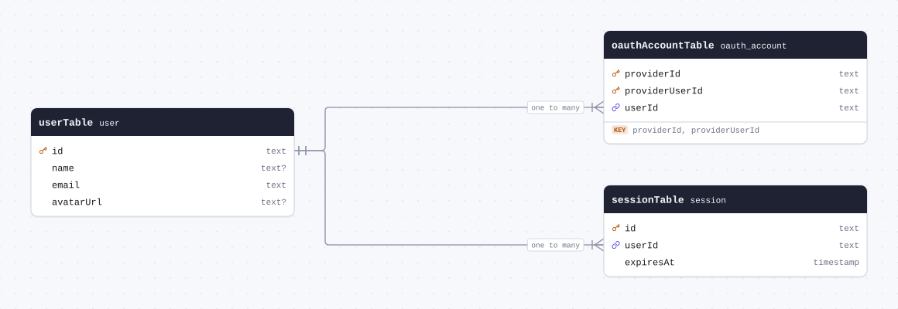
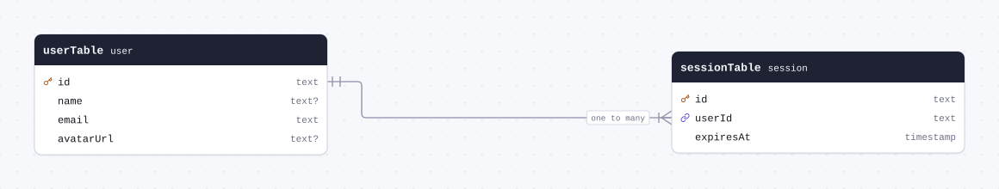
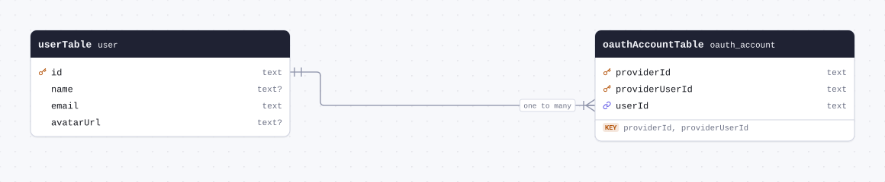

# Schema docs



<details>
<summary>The whole schema as SQL</summary>

```sql
CREATE TABLE "oauth_account" (
	"provider_id" text,
	"provider_user_id" text,
	"user_id" text NOT NULL,
	CONSTRAINT "oauth_account_pkey" PRIMARY KEY("provider_id","provider_user_id")
);

CREATE TABLE "session" (
	"id" text PRIMARY KEY,
	"user_id" text NOT NULL,
	"expires_at" timestamp with time zone NOT NULL
);

CREATE TABLE "user" (
	"id" text PRIMARY KEY,
	"name" text,
	"email" text NOT NULL,
	"avatar_url" text
);

ALTER TABLE "oauth_account" ADD CONSTRAINT "oauth_account_user_id_user_id_fkey" FOREIGN KEY ("user_id") REFERENCES "user"("id");

ALTER TABLE "session" ADD CONSTRAINT "session_user_id_user_id_fkey" FOREIGN KEY ("user_id") REFERENCES "user"("id");
```

</details>

## Contents

| Table                                         | Name in the database | Description |
| --------------------------------------------- | -------------------- | ----------- |
| [userTable](#table-userTable)                 | `user`               |             |
| [sessionTable](#table-sessionTable)           | `session`            |             |
| [oauthAccountTable](#table-oauthAccountTable) | `oauth_account`      |             |

## Tables

<a id="table-userTable"></a>

### userTable

Table `user`.


| Column                     | Type   | Constraints | Default | Description |
| -------------------------- | ------ | ----------- | ------- | ----------- |
| `id`                       | `text` | PK NOT NULL |         |             |
| `name`                     | `text` | NULL        |         |             |
| `email`                    | `text` | NOT NULL    |         |             |
| `avatarUrl` (`avatar_url`) | `text` | NULL        |         |             |

#### Definition

```sql
CREATE TABLE "user" (
	"id" text PRIMARY KEY,
	"name" text,
	"email" text NOT NULL,
	"avatar_url" text
);
```

#### Referenced by

- `id` → [sessionTable.userId](#table-sessionTable) (one to many)
- `id` → [oauthAccountTable.userId](#table-oauthAccountTable) (one to many)

<details>
<summary>Queries and their SQL</summary>

**Select**: Every row of userTable.

```ts
db.select().from(userTable);
```

```sql
select "id", "name", "email", "avatar_url"
from "user"
```

**Count**: How many rows userTable has.

```ts
db.select({ count: count() }).from(userTable);
```

```sql
select count(*)
from "user"
```

**Find many**: The rows of userTable, through the relational query API.

```ts
db.query.userTable.findMany();
```

```sql
select "d0"."id" as "id", "d0"."name" as "name", "d0"."email" as "email", "d0"."avatar_url" as "avatarUrl"
from "user" as "d0"
```

**Find by primary key**: One row of userTable, through the relational query API.

```ts
db.query.userTable.findFirst({ where: { id: "id" } });
```

```sql
select "d0"."id" as "id", "d0"."name" as "name", "d0"."email" as "email", "d0"."avatar_url" as "avatarUrl"
from "user" as "d0"
where "d0"."id" = $1
limit $2
-- params: ["id",1]
```

**Insert**: Adds a row to userTable, giving the columns that have no default.

```ts
db.insert(userTable).values({ id: "id", email: "email" });
```

```sql
insert into "user" ("id", "name", "email", "avatar_url")
values ($1, default, $2, default)
-- params: ["id","email"]
```

**Update**: Changes a row of userTable, found by its primary key.

```ts
db.update(userTable).set({ name: "name" }).where(eq(userTable.id, "id"));
```

```sql
update "user"
set "name" = $1
where "user"."id" = $2
-- params: ["name","id"]
```

**Delete**: Deletes a row of userTable, found by its primary key.

```ts
db.delete(userTable).where(eq(userTable.id, "id"));
```

```sql
delete from "user"
where "user"."id" = $1
-- params: ["id"]
```

</details>

<a id="table-sessionTable"></a>

### sessionTable

Table `session`.



| Column                     | Type        | Constraints                                 | Default | Description |
| -------------------------- | ----------- | ------------------------------------------- | ------- | ----------- |
| `id`                       | `text`      | PK NOT NULL                                 |         |             |
| `userId` (`user_id`)       | `text`      | NOT NULL → [userTable.id](#table-userTable) |         |             |
| `expiresAt` (`expires_at`) | `timestamp` | NOT NULL                                    |         |             |

#### Definition

```sql
CREATE TABLE "session" (
	"id" text PRIMARY KEY,
	"user_id" text NOT NULL,
	"expires_at" timestamp with time zone NOT NULL
);

ALTER TABLE "session" ADD CONSTRAINT "session_user_id_user_id_fkey" FOREIGN KEY ("user_id") REFERENCES "user"("id");
```

#### References

- `userId` → [userTable.id](#table-userTable) (many to one)

<details>
<summary>Queries and their SQL</summary>

**Select**: Every row of sessionTable.

```ts
db.select().from(sessionTable);
```

```sql
select "id", "user_id", "expires_at"
from "session"
```

**Count**: How many rows sessionTable has.

```ts
db.select({ count: count() }).from(sessionTable);
```

```sql
select count(*)
from "session"
```

**Find many**: The rows of sessionTable, through the relational query API.

```ts
db.query.sessionTable.findMany();
```

```sql
select "d0"."id" as "id", "d0"."user_id" as "userId", "d0"."expires_at" as "expiresAt"
from "session" as "d0"
```

**Find by primary key**: One row of sessionTable, through the relational query API.

```ts
db.query.sessionTable.findFirst({ where: { id: "id" } });
```

```sql
select "d0"."id" as "id", "d0"."user_id" as "userId", "d0"."expires_at" as "expiresAt"
from "session" as "d0"
where "d0"."id" = $1
limit $2
-- params: ["id",1]
```

**Insert**: Adds a row to sessionTable, giving the columns that have no default.

```ts
db.insert(sessionTable).values({
  id: "id",
  userId: "userId",
  expiresAt: new Date("2026-01-01T00:00:00.000Z"),
});
```

```sql
insert into "session" ("id", "user_id", "expires_at")
values ($1, $2, $3)
-- params: ["id","userId","2026-01-01T00:00:00.000Z"]
```

**Update**: Changes a row of sessionTable, found by its primary key.

```ts
db.update(sessionTable).set({ userId: "userId" }).where(eq(sessionTable.id, "id"));
```

```sql
update "session"
set "user_id" = $1
where "session"."id" = $2
-- params: ["userId","id"]
```

**Delete**: Deletes a row of sessionTable, found by its primary key.

```ts
db.delete(sessionTable).where(eq(sessionTable.id, "id"));
```

```sql
delete from "session"
where "session"."id" = $1
-- params: ["id"]
```

</details>

<a id="table-oauthAccountTable"></a>

### oauthAccountTable

Table `oauth_account`.



| Column                                | Type   | Constraints                                 | Default | Description |
| ------------------------------------- | ------ | ------------------------------------------- | ------- | ----------- |
| `providerId` (`provider_id`)          | `text` | PK NOT NULL                                 |         |             |
| `providerUserId` (`provider_user_id`) | `text` | PK NOT NULL                                 |         |             |
| `userId` (`user_id`)                  | `text` | NOT NULL → [userTable.id](#table-userTable) |         |             |

#### Definition

```sql
CREATE TABLE "oauth_account" (
	"provider_id" text,
	"provider_user_id" text,
	"user_id" text NOT NULL,
	CONSTRAINT "oauth_account_pkey" PRIMARY KEY("provider_id","provider_user_id")
);

ALTER TABLE "oauth_account" ADD CONSTRAINT "oauth_account_user_id_user_id_fkey" FOREIGN KEY ("user_id") REFERENCES "user"("id");
```

#### Indexes

- PRIMARY KEY `providerId`, `providerUserId`

#### References

- `userId` → [userTable.id](#table-userTable) (many to one)

<details>
<summary>Queries and their SQL</summary>

**Select**: Every row of oauthAccountTable.

```ts
db.select().from(oauthAccountTable);
```

```sql
select "provider_id", "provider_user_id", "user_id"
from "oauth_account"
```

**Count**: How many rows oauthAccountTable has.

```ts
db.select({ count: count() }).from(oauthAccountTable);
```

```sql
select count(*)
from "oauth_account"
```

**Find many**: The rows of oauthAccountTable, through the relational query API.

```ts
db.query.oauthAccountTable.findMany();
```

```sql
select "d0"."provider_id" as "providerId", "d0"."provider_user_id" as "providerUserId", "d0"."user_id" as "userId"
from "oauth_account" as "d0"
```

**Find by primary key**: One row of oauthAccountTable, through the relational query API.

```ts
db.query.oauthAccountTable.findFirst({
  where: { providerId: "providerId", providerUserId: "providerUserId" },
});
```

```sql
select "d0"."provider_id" as "providerId", "d0"."provider_user_id" as "providerUserId", "d0"."user_id" as "userId"
from "oauth_account" as "d0"
where (("d0"."provider_id" = $1) and ("d0"."provider_user_id" = $2))
limit $3
-- params: ["providerId","providerUserId",1]
```

**Insert**: Adds a row to oauthAccountTable, giving the columns that have no default.

```ts
db.insert(oauthAccountTable).values({
  providerId: "providerId",
  providerUserId: "providerUserId",
  userId: "userId",
});
```

```sql
insert into "oauth_account" ("provider_id", "provider_user_id", "user_id")
values ($1, $2, $3)
-- params: ["providerId","providerUserId","userId"]
```

**Update**: Changes a row of oauthAccountTable, found by its primary key.

```ts
db.update(oauthAccountTable)
  .set({ userId: "userId" })
  .where(
    and(
      eq(oauthAccountTable.providerId, "providerId"),
      eq(oauthAccountTable.providerUserId, "providerUserId"),
    ),
  );
```

```sql
update "oauth_account"
set "user_id" = $1
where (("oauth_account"."provider_id" = $2) and ("oauth_account"."provider_user_id" = $3))
-- params: ["userId","providerId","providerUserId"]
```

**Delete**: Deletes a row of oauthAccountTable, found by its primary key.

```ts
db.delete(oauthAccountTable).where(
  and(
    eq(oauthAccountTable.providerId, "providerId"),
    eq(oauthAccountTable.providerUserId, "providerUserId"),
  ),
);
```

```sql
delete from "oauth_account"
where (("oauth_account"."provider_id" = $1) and ("oauth_account"."provider_user_id" = $2))
-- params: ["providerId","providerUserId"]
```

</details>
