# Schema docs

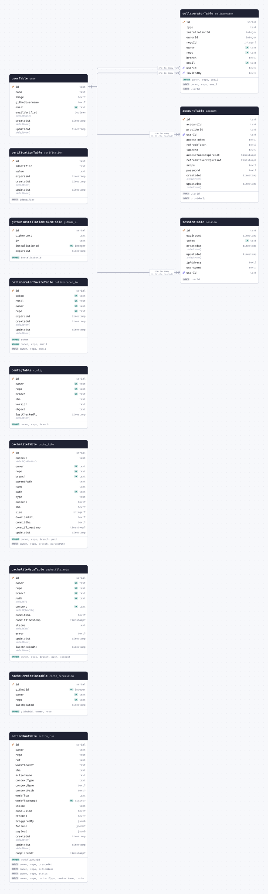

<details>
<summary>The whole schema as SQL</summary>

```sql
CREATE TABLE "account" (
	"id" text PRIMARY KEY,
	"account_id" text NOT NULL,
	"provider_id" text NOT NULL,
	"user_id" text NOT NULL,
	"access_token" text,
	"refresh_token" text,
	"id_token" text,
	"access_token_expires_at" timestamp,
	"refresh_token_expires_at" timestamp,
	"scope" text,
	"password" text,
	"created_at" timestamp DEFAULT now() NOT NULL,
	"updated_at" timestamp DEFAULT now() NOT NULL
);

CREATE TABLE "action_run" (
	"id" serial PRIMARY KEY,
	"owner" text NOT NULL,
	"repo" text NOT NULL,
	"ref" text NOT NULL,
	"workflow_ref" text NOT NULL,
	"sha" text NOT NULL,
	"action_name" text NOT NULL,
	"context_type" text NOT NULL,
	"context_name" text,
	"context_path" text,
	"workflow" text NOT NULL,
	"workflow_run_id" bigint,
	"status" text NOT NULL,
	"conclusion" text,
	"html_url" text,
	"triggered_by" jsonb NOT NULL,
	"failure" jsonb,
	"payload" jsonb NOT NULL,
	"created_at" timestamp DEFAULT now() NOT NULL,
	"updated_at" timestamp DEFAULT now() NOT NULL,
	"completed_at" timestamp
);

CREATE TABLE "cache_file_meta" (
	"id" serial PRIMARY KEY,
	"owner" text NOT NULL,
	"repo" text NOT NULL,
	"branch" text NOT NULL,
	"path" text DEFAULT '' NOT NULL,
	"context" text DEFAULT 'branch' NOT NULL,
	"commit_sha" text,
	"commit_timestamp" timestamp,
	"status" text DEFAULT 'ok' NOT NULL,
	"error" text,
	"updated_at" timestamp DEFAULT now() NOT NULL,
	"last_checked_at" timestamp DEFAULT now() NOT NULL
);

CREATE TABLE "cache_file" (
	"id" serial PRIMARY KEY,
	"context" text DEFAULT 'collection' NOT NULL,
	"owner" text NOT NULL,
	"repo" text NOT NULL,
	"branch" text NOT NULL,
	"parent_path" text NOT NULL,
	"name" text NOT NULL,
	"path" text NOT NULL,
	"type" text NOT NULL,
	"content" text,
	"sha" text,
	"size" integer,
	"download_url" text,
	"commit_sha" text,
	"commit_timestamp" timestamp,
	"updated_at" timestamp NOT NULL
);

CREATE TABLE "cache_permission" (
	"id" serial PRIMARY KEY,
	"github_id" integer NOT NULL,
	"owner" text NOT NULL,
	"repo" text NOT NULL,
	"last_updated" timestamp NOT NULL
);

CREATE TABLE "collaborator_invite" (
	"id" serial PRIMARY KEY,
	"token" text NOT NULL,
	"email" text NOT NULL,
	"owner" text NOT NULL,
	"repo" text NOT NULL,
	"expires_at" timestamp NOT NULL,
	"created_at" timestamp DEFAULT now() NOT NULL,
	"updated_at" timestamp DEFAULT now() NOT NULL
);

CREATE TABLE "collaborator" (
	"id" serial PRIMARY KEY,
	"type" text NOT NULL,
	"installation_id" integer NOT NULL,
	"owner_id" integer NOT NULL,
	"repo_id" integer,
	"owner" text NOT NULL,
	"repo" text NOT NULL,
	"branch" text,
	"email" text NOT NULL,
	"user_id" text,
	"invited_by" text
);

CREATE TABLE "config" (
	"id" serial PRIMARY KEY,
	"owner" text NOT NULL,
	"repo" text NOT NULL,
	"branch" text NOT NULL,
	"sha" text NOT NULL,
	"version" text NOT NULL,
	"object" text NOT NULL,
	"last_checked_at" timestamp DEFAULT now() NOT NULL
);

CREATE TABLE "github_installation_token" (
	"id" serial PRIMARY KEY,
	"ciphertext" text NOT NULL,
	"iv" text NOT NULL,
	"installation_id" integer NOT NULL,
	"expires_at" timestamp NOT NULL
);

CREATE TABLE "session" (
	"id" text PRIMARY KEY,
	"expires_at" timestamp NOT NULL,
	"token" text NOT NULL UNIQUE,
	"created_at" timestamp DEFAULT now() NOT NULL,
	"updated_at" timestamp DEFAULT now() NOT NULL,
	"ip_address" text,
	"user_agent" text,
	"user_id" text NOT NULL
);

CREATE TABLE "user" (
	"id" text PRIMARY KEY,
	"name" text NOT NULL,
	"image" text,
	"github_username" text,
	"email" text NOT NULL UNIQUE,
	"email_verified" boolean DEFAULT false NOT NULL,
	"created_at" timestamp DEFAULT now() NOT NULL,
	"updated_at" timestamp DEFAULT now() NOT NULL
);

CREATE TABLE "verification" (
	"id" text PRIMARY KEY,
	"identifier" text NOT NULL,
	"value" text NOT NULL,
	"expires_at" timestamp NOT NULL,
	"created_at" timestamp DEFAULT now() NOT NULL,
	"updated_at" timestamp DEFAULT now() NOT NULL
);

CREATE INDEX "idx_account_userId" ON "account" ("user_id");

CREATE INDEX "idx_account_providerId" ON "account" ("provider_id");

CREATE INDEX "idx_action_run_owner_repo_createdAt" ON "action_run" ("owner","repo","created_at");

CREATE INDEX "idx_action_run_owner_repo_actionName" ON "action_run" ("owner","repo","action_name");

CREATE INDEX "idx_action_run_owner_repo_status" ON "action_run" ("owner","repo","status");

CREATE INDEX "idx_action_run_context" ON "action_run" ("owner","repo","context_type","context_name","context_path");

CREATE UNIQUE INDEX "idx_action_run_workflowRunId" ON "action_run" ("workflow_run_id");

CREATE UNIQUE INDEX "idx_cache_file_meta_owner_repo_branch_path_context" ON "cache_file_meta" ("owner","repo","branch","path","context");

CREATE INDEX "idx_cache_file_owner_repo_branch_parentPath" ON "cache_file" ("owner","repo","branch","parent_path");

CREATE UNIQUE INDEX "idx_cache_file_owner_repo_branch_path" ON "cache_file" ("owner","repo","branch","path");

CREATE UNIQUE INDEX "idx_cache_permission_githubId_owner_repo" ON "cache_permission" ("github_id","owner","repo");

CREATE UNIQUE INDEX "uq_collaborator_invite_token" ON "collaborator_invite" ("token");

CREATE INDEX "idx_collaborator_invite_owner_repo_email" ON "collaborator_invite" ("owner","repo","email");

CREATE UNIQUE INDEX "uq_collaborator_invite_owner_repo_email_ci" ON "collaborator_invite" (lower("owner"),lower("repo"),lower("email"));

CREATE INDEX "idx_collaborator_owner_repo_email" ON "collaborator" ("owner","repo","email");

CREATE INDEX "idx_collaborator_userId" ON "collaborator" ("user_id");

CREATE UNIQUE INDEX "uq_collaborator_owner_repo_email_ci" ON "collaborator" (lower("owner"),lower("repo"),lower("email"));

CREATE UNIQUE INDEX "idx_config_owner_repo_branch" ON "config" ("owner","repo","branch");

CREATE UNIQUE INDEX "uq_github_installation_token_installationId" ON "github_installation_token" ("installation_id");

CREATE INDEX "idx_session_userId" ON "session" ("user_id");

CREATE INDEX "idx_verification_identifier" ON "verification" ("identifier");

ALTER TABLE "account" ADD CONSTRAINT "account_user_id_user_id_fkey" FOREIGN KEY ("user_id") REFERENCES "user"("id") ON DELETE CASCADE;

ALTER TABLE "collaborator" ADD CONSTRAINT "collaborator_user_id_user_id_fkey" FOREIGN KEY ("user_id") REFERENCES "user"("id");

ALTER TABLE "collaborator" ADD CONSTRAINT "collaborator_invited_by_user_id_fkey" FOREIGN KEY ("invited_by") REFERENCES "user"("id");

ALTER TABLE "session" ADD CONSTRAINT "session_user_id_user_id_fkey" FOREIGN KEY ("user_id") REFERENCES "user"("id") ON DELETE CASCADE;
```

</details>

## Contents

| Table                                                               | Name in the database        | Description |
| ------------------------------------------------------------------- | --------------------------- | ----------- |
| [userTable](#table-userTable)                                       | `user`                      |             |
| [sessionTable](#table-sessionTable)                                 | `session`                   |             |
| [accountTable](#table-accountTable)                                 | `account`                   |             |
| [verificationTable](#table-verificationTable)                       | `verification`              |             |
| [githubInstallationTokenTable](#table-githubInstallationTokenTable) | `github_installation_token` |             |
| [collaboratorTable](#table-collaboratorTable)                       | `collaborator`              |             |
| [collaboratorInviteTable](#table-collaboratorInviteTable)           | `collaborator_invite`       |             |
| [configTable](#table-configTable)                                   | `config`                    |             |
| [cacheFileTable](#table-cacheFileTable)                             | `cache_file`                |             |
| [cacheFileMetaTable](#table-cacheFileMetaTable)                     | `cache_file_meta`           |             |
| [cachePermissionTable](#table-cachePermissionTable)                 | `cache_permission`          |             |
| [actionRunTable](#table-actionRunTable)                             | `action_run`                |             |

## Tables

<a id="table-userTable"></a>

### userTable

Table `user`.

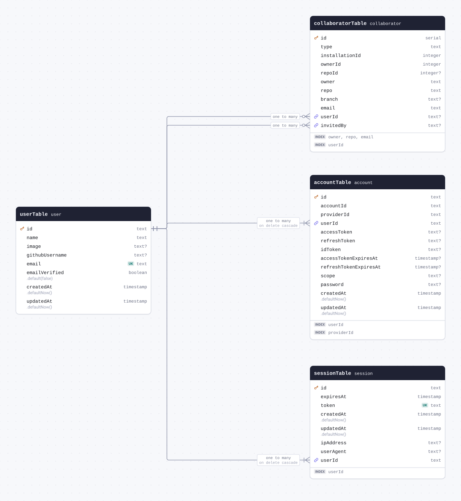

| Column                               | Type        | Constraints     | Default           | Description |
| ------------------------------------ | ----------- | --------------- | ----------------- | ----------- |
| `id`                                 | `text`      | PK NOT NULL     |                   |             |
| `name`                               | `text`      | NOT NULL        |                   |             |
| `image`                              | `text`      | NULL            |                   |             |
| `githubUsername` (`github_username`) | `text`      | NULL            |                   |             |
| `email`                              | `text`      | UNIQUE NOT NULL |                   |             |
| `emailVerified` (`email_verified`)   | `boolean`   | NOT NULL        | `.default(false)` |             |
| `createdAt` (`created_at`)           | `timestamp` | NOT NULL        | `.defaultNow()`   |             |
| `updatedAt` (`updated_at`)           | `timestamp` | NOT NULL        | `.defaultNow()`   |             |

#### Definition

```sql
CREATE TABLE "user" (
	"id" text PRIMARY KEY,
	"name" text NOT NULL,
	"image" text,
	"github_username" text,
	"email" text NOT NULL UNIQUE,
	"email_verified" boolean DEFAULT false NOT NULL,
	"created_at" timestamp DEFAULT now() NOT NULL,
	"updated_at" timestamp DEFAULT now() NOT NULL
);
```

#### Referenced by

- `id` → [sessionTable.userId](#table-sessionTable) (one to many, on delete cascade)
- `id` → [accountTable.userId](#table-accountTable) (one to many, on delete cascade)
- `id` → [collaboratorTable.userId](#table-collaboratorTable) (one to many)
- `id` → [collaboratorTable.invitedBy](#table-collaboratorTable) (one to many)

<details>
<summary>Queries and their SQL</summary>

**Select**: Every row of userTable.

```ts
db.select().from(userTable);
```

```sql
select "id", "name", "image", "github_username", "email", "email_verified", "created_at", "updated_at"
from "user"
```

**Count**: How many rows userTable has.

```ts
db.select({ count: count() }).from(userTable);
```

```sql
select count(*)
from "user"
```

**Find many**: The rows of userTable, through the relational query API.

```ts
db.query.userTable.findMany();
```

```sql
select "d0"."id" as "id", "d0"."name" as "name", "d0"."image" as "image", "d0"."github_username" as "githubUsername", "d0"."email" as "email", "d0"."email_verified" as "emailVerified", "d0"."created_at" as "createdAt", "d0"."updated_at" as "updatedAt"
from "user" as "d0"
```

**Find by primary key**: One row of userTable, through the relational query API.

```ts
db.query.userTable.findFirst({ where: { id: "id" } });
```

```sql
select "d0"."id" as "id", "d0"."name" as "name", "d0"."image" as "image", "d0"."github_username" as "githubUsername", "d0"."email" as "email", "d0"."email_verified" as "emailVerified", "d0"."created_at" as "createdAt", "d0"."updated_at" as "updatedAt"
from "user" as "d0"
where "d0"."id" = $1
limit $2
-- params: ["id",1]
```

**Insert**: Adds a row to userTable, giving the columns that have no default.

```ts
db.insert(userTable).values({ id: "id", name: "name", email: "email" });
```

```sql
insert into "user" ("id", "name", "image", "github_username", "email", "email_verified", "created_at", "updated_at")
values ($1, $2, default, default, $3, default, default, default)
-- params: ["id","name","email"]
```

**Update**: Changes a row of userTable, found by its primary key.

```ts
db.update(userTable).set({ name: "name" }).where(eq(userTable.id, "id"));
```

```sql
update "user"
set "name" = $1
where "user"."id" = $2
-- params: ["name","id"]
```

**Delete**: Deletes a row of userTable, found by its primary key.

```ts
db.delete(userTable).where(eq(userTable.id, "id"));
```

```sql
delete from "user"
where "user"."id" = $1
-- params: ["id"]
```

</details>

<a id="table-sessionTable"></a>

### sessionTable

Table `session`.

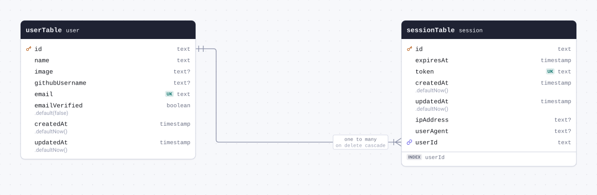

| Column                     | Type        | Constraints                                 | Default         | Description |
| -------------------------- | ----------- | ------------------------------------------- | --------------- | ----------- |
| `id`                       | `text`      | PK NOT NULL                                 |                 |             |
| `expiresAt` (`expires_at`) | `timestamp` | NOT NULL                                    |                 |             |
| `token`                    | `text`      | UNIQUE NOT NULL                             |                 |             |
| `createdAt` (`created_at`) | `timestamp` | NOT NULL                                    | `.defaultNow()` |             |
| `updatedAt` (`updated_at`) | `timestamp` | NOT NULL                                    | `.defaultNow()` |             |
| `ipAddress` (`ip_address`) | `text`      | NULL                                        |                 |             |
| `userAgent` (`user_agent`) | `text`      | NULL                                        |                 |             |
| `userId` (`user_id`)       | `text`      | NOT NULL → [userTable.id](#table-userTable) |                 |             |

#### Definition

```sql
CREATE TABLE "session" (
	"id" text PRIMARY KEY,
	"expires_at" timestamp NOT NULL,
	"token" text NOT NULL UNIQUE,
	"created_at" timestamp DEFAULT now() NOT NULL,
	"updated_at" timestamp DEFAULT now() NOT NULL,
	"ip_address" text,
	"user_agent" text,
	"user_id" text NOT NULL
);

CREATE INDEX "idx_session_userId" ON "session" ("user_id");

ALTER TABLE "session" ADD CONSTRAINT "session_user_id_user_id_fkey" FOREIGN KEY ("user_id") REFERENCES "user"("id") ON DELETE CASCADE;
```

#### Indexes

- INDEX `userId`

#### References

- `userId` → [userTable.id](#table-userTable) (many to one, on delete cascade)

<details>
<summary>Queries and their SQL</summary>

**Select**: Every row of sessionTable.

```ts
db.select().from(sessionTable);
```

```sql
select "id", "expires_at", "token", "created_at", "updated_at", "ip_address", "user_agent", "user_id"
from "session"
```

**Count**: How many rows sessionTable has.

```ts
db.select({ count: count() }).from(sessionTable);
```

```sql
select count(*)
from "session"
```

**Find many**: The rows of sessionTable, through the relational query API.

```ts
db.query.sessionTable.findMany();
```

```sql
select "d0"."id" as "id", "d0"."expires_at" as "expiresAt", "d0"."token" as "token", "d0"."created_at" as "createdAt", "d0"."updated_at" as "updatedAt", "d0"."ip_address" as "ipAddress", "d0"."user_agent" as "userAgent", "d0"."user_id" as "userId"
from "session" as "d0"
```

**Find by primary key**: One row of sessionTable, through the relational query API.

```ts
db.query.sessionTable.findFirst({ where: { id: "id" } });
```

```sql
select "d0"."id" as "id", "d0"."expires_at" as "expiresAt", "d0"."token" as "token", "d0"."created_at" as "createdAt", "d0"."updated_at" as "updatedAt", "d0"."ip_address" as "ipAddress", "d0"."user_agent" as "userAgent", "d0"."user_id" as "userId"
from "session" as "d0"
where "d0"."id" = $1
limit $2
-- params: ["id",1]
```

**Insert**: Adds a row to sessionTable, giving the columns that have no default.

```ts
db.insert(sessionTable).values({
  id: "id",
  expiresAt: new Date("2026-01-01T00:00:00.000Z"),
  token: "token",
  userId: "userId",
});
```

```sql
insert into "session" ("id", "expires_at", "token", "created_at", "updated_at", "ip_address", "user_agent", "user_id")
values ($1, $2, $3, default, default, default, default, $4)
-- params: ["id","2026-01-01T00:00:00.000Z","token","userId"]
```

**Update**: Changes a row of sessionTable, found by its primary key.

```ts
db.update(sessionTable)
  .set({ expiresAt: new Date("2026-01-01T00:00:00.000Z") })
  .where(eq(sessionTable.id, "id"));
```

```sql
update "session"
set "expires_at" = $1
where "session"."id" = $2
-- params: ["2026-01-01T00:00:00.000Z","id"]
```

**Delete**: Deletes a row of sessionTable, found by its primary key.

```ts
db.delete(sessionTable).where(eq(sessionTable.id, "id"));
```

```sql
delete from "session"
where "session"."id" = $1
-- params: ["id"]
```

</details>

<a id="table-accountTable"></a>

### accountTable

Table `account`.

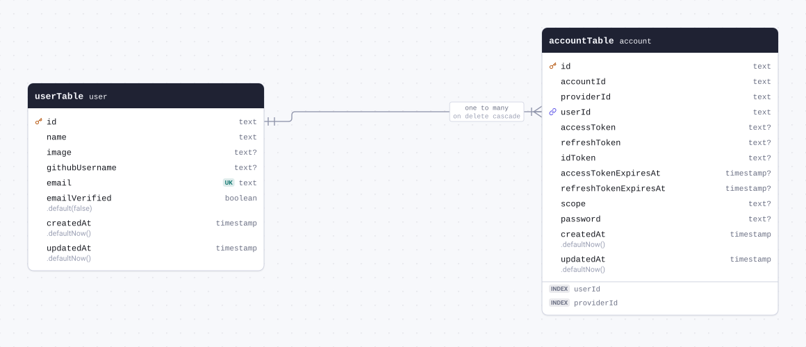

| Column                                               | Type        | Constraints                                 | Default         | Description |
| ---------------------------------------------------- | ----------- | ------------------------------------------- | --------------- | ----------- |
| `id`                                                 | `text`      | PK NOT NULL                                 |                 |             |
| `accountId` (`account_id`)                           | `text`      | NOT NULL                                    |                 |             |
| `providerId` (`provider_id`)                         | `text`      | NOT NULL                                    |                 |             |
| `userId` (`user_id`)                                 | `text`      | NOT NULL → [userTable.id](#table-userTable) |                 |             |
| `accessToken` (`access_token`)                       | `text`      | NULL                                        |                 |             |
| `refreshToken` (`refresh_token`)                     | `text`      | NULL                                        |                 |             |
| `idToken` (`id_token`)                               | `text`      | NULL                                        |                 |             |
| `accessTokenExpiresAt` (`access_token_expires_at`)   | `timestamp` | NULL                                        |                 |             |
| `refreshTokenExpiresAt` (`refresh_token_expires_at`) | `timestamp` | NULL                                        |                 |             |
| `scope`                                              | `text`      | NULL                                        |                 |             |
| `password`                                           | `text`      | NULL                                        |                 |             |
| `createdAt` (`created_at`)                           | `timestamp` | NOT NULL                                    | `.defaultNow()` |             |
| `updatedAt` (`updated_at`)                           | `timestamp` | NOT NULL                                    | `.defaultNow()` |             |

#### Definition

```sql
CREATE TABLE "account" (
	"id" text PRIMARY KEY,
	"account_id" text NOT NULL,
	"provider_id" text NOT NULL,
	"user_id" text NOT NULL,
	"access_token" text,
	"refresh_token" text,
	"id_token" text,
	"access_token_expires_at" timestamp,
	"refresh_token_expires_at" timestamp,
	"scope" text,
	"password" text,
	"created_at" timestamp DEFAULT now() NOT NULL,
	"updated_at" timestamp DEFAULT now() NOT NULL
);

CREATE INDEX "idx_account_userId" ON "account" ("user_id");

CREATE INDEX "idx_account_providerId" ON "account" ("provider_id");

ALTER TABLE "account" ADD CONSTRAINT "account_user_id_user_id_fkey" FOREIGN KEY ("user_id") REFERENCES "user"("id") ON DELETE CASCADE;
```

#### Indexes

- INDEX `userId`
- INDEX `providerId`

#### References

- `userId` → [userTable.id](#table-userTable) (many to one, on delete cascade)

<details>
<summary>Queries and their SQL</summary>

**Select**: Every row of accountTable.

```ts
db.select().from(accountTable);
```

```sql
select "id", "account_id", "provider_id", "user_id", "access_token", "refresh_token", "id_token", "access_token_expires_at", "refresh_token_expires_at", "scope", "password", "created_at", "updated_at"
from "account"
```

**Count**: How many rows accountTable has.

```ts
db.select({ count: count() }).from(accountTable);
```

```sql
select count(*)
from "account"
```

**Find many**: The rows of accountTable, through the relational query API.

```ts
db.query.accountTable.findMany();
```

```sql
select "d0"."id" as "id", "d0"."account_id" as "accountId", "d0"."provider_id" as "providerId", "d0"."user_id" as "userId", "d0"."access_token" as "accessToken", "d0"."refresh_token" as "refreshToken", "d0"."id_token" as "idToken", "d0"."access_token_expires_at" as "accessTokenExpiresAt", "d0"."refresh_token_expires_at" as "refreshTokenExpiresAt", "d0"."scope" as "scope", "d0"."password" as "password", "d0"."created_at" as "createdAt", "d0"."updated_at" as "updatedAt"
from "account" as "d0"
```

**Find by primary key**: One row of accountTable, through the relational query API.

```ts
db.query.accountTable.findFirst({ where: { id: "id" } });
```

```sql
select "d0"."id" as "id", "d0"."account_id" as "accountId", "d0"."provider_id" as "providerId", "d0"."user_id" as "userId", "d0"."access_token" as "accessToken", "d0"."refresh_token" as "refreshToken", "d0"."id_token" as "idToken", "d0"."access_token_expires_at" as "accessTokenExpiresAt", "d0"."refresh_token_expires_at" as "refreshTokenExpiresAt", "d0"."scope" as "scope", "d0"."password" as "password", "d0"."created_at" as "createdAt", "d0"."updated_at" as "updatedAt"
from "account" as "d0"
where "d0"."id" = $1
limit $2
-- params: ["id",1]
```

**Insert**: Adds a row to accountTable, giving the columns that have no default.

```ts
db.insert(accountTable).values({
  id: "id",
  accountId: "accountId",
  providerId: "providerId",
  userId: "userId",
});
```

```sql
insert into "account" ("id", "account_id", "provider_id", "user_id", "access_token", "refresh_token", "id_token", "access_token_expires_at", "refresh_token_expires_at", "scope", "password", "created_at", "updated_at")
values ($1, $2, $3, $4, default, default, default, default, default, default, default, default, default)
-- params: ["id","accountId","providerId","userId"]
```

**Update**: Changes a row of accountTable, found by its primary key.

```ts
db.update(accountTable).set({ accountId: "accountId" }).where(eq(accountTable.id, "id"));
```

```sql
update "account"
set "account_id" = $1
where "account"."id" = $2
-- params: ["accountId","id"]
```

**Delete**: Deletes a row of accountTable, found by its primary key.

```ts
db.delete(accountTable).where(eq(accountTable.id, "id"));
```

```sql
delete from "account"
where "account"."id" = $1
-- params: ["id"]
```

</details>

<a id="table-verificationTable"></a>

### verificationTable

Table `verification`.

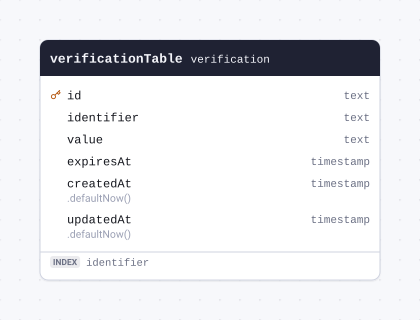

| Column                     | Type        | Constraints | Default         | Description |
| -------------------------- | ----------- | ----------- | --------------- | ----------- |
| `id`                       | `text`      | PK NOT NULL |                 |             |
| `identifier`               | `text`      | NOT NULL    |                 |             |
| `value`                    | `text`      | NOT NULL    |                 |             |
| `expiresAt` (`expires_at`) | `timestamp` | NOT NULL    |                 |             |
| `createdAt` (`created_at`) | `timestamp` | NOT NULL    | `.defaultNow()` |             |
| `updatedAt` (`updated_at`) | `timestamp` | NOT NULL    | `.defaultNow()` |             |

#### Definition

```sql
CREATE TABLE "verification" (
	"id" text PRIMARY KEY,
	"identifier" text NOT NULL,
	"value" text NOT NULL,
	"expires_at" timestamp NOT NULL,
	"created_at" timestamp DEFAULT now() NOT NULL,
	"updated_at" timestamp DEFAULT now() NOT NULL
);

CREATE INDEX "idx_verification_identifier" ON "verification" ("identifier");
```

#### Indexes

- INDEX `identifier`

<details>
<summary>Queries and their SQL</summary>

**Select**: Every row of verificationTable.

```ts
db.select().from(verificationTable);
```

```sql
select "id", "identifier", "value", "expires_at", "created_at", "updated_at"
from "verification"
```

**Count**: How many rows verificationTable has.

```ts
db.select({ count: count() }).from(verificationTable);
```

```sql
select count(*)
from "verification"
```

**Find many**: The rows of verificationTable, through the relational query API.

```ts
db.query.verificationTable.findMany();
```

```sql
select "d0"."id" as "id", "d0"."identifier" as "identifier", "d0"."value" as "value", "d0"."expires_at" as "expiresAt", "d0"."created_at" as "createdAt", "d0"."updated_at" as "updatedAt"
from "verification" as "d0"
```

**Find by primary key**: One row of verificationTable, through the relational query API.

```ts
db.query.verificationTable.findFirst({ where: { id: "id" } });
```

```sql
select "d0"."id" as "id", "d0"."identifier" as "identifier", "d0"."value" as "value", "d0"."expires_at" as "expiresAt", "d0"."created_at" as "createdAt", "d0"."updated_at" as "updatedAt"
from "verification" as "d0"
where "d0"."id" = $1
limit $2
-- params: ["id",1]
```

**Insert**: Adds a row to verificationTable, giving the columns that have no default.

```ts
db.insert(verificationTable).values({
  id: "id",
  identifier: "identifier",
  value: "value",
  expiresAt: new Date("2026-01-01T00:00:00.000Z"),
});
```

```sql
insert into "verification" ("id", "identifier", "value", "expires_at", "created_at", "updated_at")
values ($1, $2, $3, $4, default, default)
-- params: ["id","identifier","value","2026-01-01T00:00:00.000Z"]
```

**Update**: Changes a row of verificationTable, found by its primary key.

```ts
db.update(verificationTable)
  .set({ identifier: "identifier" })
  .where(eq(verificationTable.id, "id"));
```

```sql
update "verification"
set "identifier" = $1
where "verification"."id" = $2
-- params: ["identifier","id"]
```

**Delete**: Deletes a row of verificationTable, found by its primary key.

```ts
db.delete(verificationTable).where(eq(verificationTable.id, "id"));
```

```sql
delete from "verification"
where "verification"."id" = $1
-- params: ["id"]
```

</details>

<a id="table-githubInstallationTokenTable"></a>

### githubInstallationTokenTable

Table `github_installation_token`.

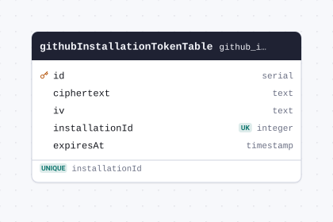

| Column                               | Type        | Constraints | Default | Description |
| ------------------------------------ | ----------- | ----------- | ------- | ----------- |
| `id`                                 | `serial`    | PK NOT NULL |         |             |
| `ciphertext`                         | `text`      | NOT NULL    |         |             |
| `iv`                                 | `text`      | NOT NULL    |         |             |
| `installationId` (`installation_id`) | `integer`   | NOT NULL    |         |             |
| `expiresAt` (`expires_at`)           | `timestamp` | NOT NULL    |         |             |

#### Definition

```sql
CREATE TABLE "github_installation_token" (
	"id" serial PRIMARY KEY,
	"ciphertext" text NOT NULL,
	"iv" text NOT NULL,
	"installation_id" integer NOT NULL,
	"expires_at" timestamp NOT NULL
);

CREATE UNIQUE INDEX "uq_github_installation_token_installationId" ON "github_installation_token" ("installation_id");
```

#### Indexes

- UNIQUE `installationId`

<details>
<summary>Queries and their SQL</summary>

**Select**: Every row of githubInstallationTokenTable.

```ts
db.select().from(githubInstallationTokenTable);
```

```sql
select "id", "ciphertext", "iv", "installation_id", "expires_at"
from "github_installation_token"
```

**Count**: How many rows githubInstallationTokenTable has.

```ts
db.select({ count: count() }).from(githubInstallationTokenTable);
```

```sql
select count(*)
from "github_installation_token"
```

**Find many**: The rows of githubInstallationTokenTable, through the relational query API.

```ts
db.query.githubInstallationTokenTable.findMany();
```

```sql
select "d0"."id" as "id", "d0"."ciphertext" as "ciphertext", "d0"."iv" as "iv", "d0"."installation_id" as "installationId", "d0"."expires_at" as "expiresAt"
from "github_installation_token" as "d0"
```

**Find by primary key**: One row of githubInstallationTokenTable, through the relational query API.

```ts
db.query.githubInstallationTokenTable.findFirst({ where: { id: 1 } });
```

```sql
select "d0"."id" as "id", "d0"."ciphertext" as "ciphertext", "d0"."iv" as "iv", "d0"."installation_id" as "installationId", "d0"."expires_at" as "expiresAt"
from "github_installation_token" as "d0"
where "d0"."id" = $1
limit $2
-- params: [1,1]
```

**Insert**: Adds a row to githubInstallationTokenTable, giving the columns that have no default.

```ts
db.insert(githubInstallationTokenTable).values({
  ciphertext: "ciphertext",
  iv: "iv",
  installationId: 1,
  expiresAt: new Date("2026-01-01T00:00:00.000Z"),
});
```

```sql
insert into "github_installation_token" ("id", "ciphertext", "iv", "installation_id", "expires_at")
values (default, $1, $2, $3, $4)
-- params: ["ciphertext","iv",1,"2026-01-01T00:00:00.000Z"]
```

**Update**: Changes a row of githubInstallationTokenTable, found by its primary key.

```ts
db.update(githubInstallationTokenTable)
  .set({ ciphertext: "ciphertext" })
  .where(eq(githubInstallationTokenTable.id, 1));
```

```sql
update "github_installation_token"
set "ciphertext" = $1
where "github_installation_token"."id" = $2
-- params: ["ciphertext",1]
```

**Delete**: Deletes a row of githubInstallationTokenTable, found by its primary key.

```ts
db.delete(githubInstallationTokenTable).where(eq(githubInstallationTokenTable.id, 1));
```

```sql
delete from "github_installation_token"
where "github_installation_token"."id" = $1
-- params: [1]
```

</details>

<a id="table-collaboratorTable"></a>

### collaboratorTable

Table `collaborator`.

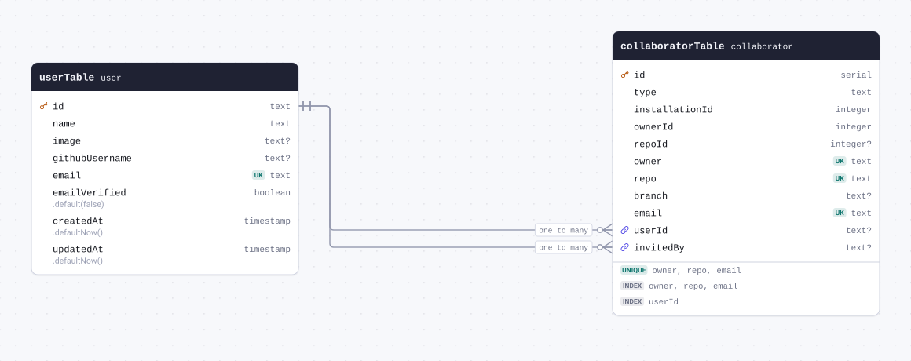

| Column                               | Type      | Constraints                             | Default | Description |
| ------------------------------------ | --------- | --------------------------------------- | ------- | ----------- |
| `id`                                 | `serial`  | PK NOT NULL                             |         |             |
| `type`                               | `text`    | NOT NULL                                |         |             |
| `installationId` (`installation_id`) | `integer` | NOT NULL                                |         |             |
| `ownerId` (`owner_id`)               | `integer` | NOT NULL                                |         |             |
| `repoId` (`repo_id`)                 | `integer` | NULL                                    |         |             |
| `owner`                              | `text`    | NOT NULL                                |         |             |
| `repo`                               | `text`    | NOT NULL                                |         |             |
| `branch`                             | `text`    | NULL                                    |         |             |
| `email`                              | `text`    | NOT NULL                                |         |             |
| `userId` (`user_id`)                 | `text`    | NULL → [userTable.id](#table-userTable) |         |             |
| `invitedBy` (`invited_by`)           | `text`    | NULL → [userTable.id](#table-userTable) |         |             |

#### Definition

```sql
CREATE TABLE "collaborator" (
	"id" serial PRIMARY KEY,
	"type" text NOT NULL,
	"installation_id" integer NOT NULL,
	"owner_id" integer NOT NULL,
	"repo_id" integer,
	"owner" text NOT NULL,
	"repo" text NOT NULL,
	"branch" text,
	"email" text NOT NULL,
	"user_id" text,
	"invited_by" text
);

CREATE INDEX "idx_collaborator_owner_repo_email" ON "collaborator" ("owner","repo","email");

CREATE INDEX "idx_collaborator_userId" ON "collaborator" ("user_id");

CREATE UNIQUE INDEX "uq_collaborator_owner_repo_email_ci" ON "collaborator" (lower("owner"),lower("repo"),lower("email"));

ALTER TABLE "collaborator" ADD CONSTRAINT "collaborator_user_id_user_id_fkey" FOREIGN KEY ("user_id") REFERENCES "user"("id");

ALTER TABLE "collaborator" ADD CONSTRAINT "collaborator_invited_by_user_id_fkey" FOREIGN KEY ("invited_by") REFERENCES "user"("id");
```

#### Indexes

- INDEX `owner`, `repo`, `email`
- INDEX `userId`

#### References

- `userId` → [userTable.id](#table-userTable) (many to one)
- `invitedBy` → [userTable.id](#table-userTable) (many to one)

<details>
<summary>Queries and their SQL</summary>

**Select**: Every row of collaboratorTable.

```ts
db.select().from(collaboratorTable);
```

```sql
select "id", "type", "installation_id", "owner_id", "repo_id", "owner", "repo", "branch", "email", "user_id", "invited_by"
from "collaborator"
```

**Count**: How many rows collaboratorTable has.

```ts
db.select({ count: count() }).from(collaboratorTable);
```

```sql
select count(*)
from "collaborator"
```

**Find many**: The rows of collaboratorTable, through the relational query API.

```ts
db.query.collaboratorTable.findMany();
```

```sql
select "d0"."id" as "id", "d0"."type" as "type", "d0"."installation_id" as "installationId", "d0"."owner_id" as "ownerId", "d0"."repo_id" as "repoId", "d0"."owner" as "owner", "d0"."repo" as "repo", "d0"."branch" as "branch", "d0"."email" as "email", "d0"."user_id" as "userId", "d0"."invited_by" as "invitedBy"
from "collaborator" as "d0"
```

**Find by primary key**: One row of collaboratorTable, through the relational query API.

```ts
db.query.collaboratorTable.findFirst({ where: { id: 1 } });
```

```sql
select "d0"."id" as "id", "d0"."type" as "type", "d0"."installation_id" as "installationId", "d0"."owner_id" as "ownerId", "d0"."repo_id" as "repoId", "d0"."owner" as "owner", "d0"."repo" as "repo", "d0"."branch" as "branch", "d0"."email" as "email", "d0"."user_id" as "userId", "d0"."invited_by" as "invitedBy"
from "collaborator" as "d0"
where "d0"."id" = $1
limit $2
-- params: [1,1]
```

**Insert**: Adds a row to collaboratorTable, giving the columns that have no default.

```ts
db.insert(collaboratorTable).values({
  type: "type",
  installationId: 1,
  ownerId: 1,
  owner: "owner",
  repo: "repo",
  email: "email",
});
```

```sql
insert into "collaborator" ("id", "type", "installation_id", "owner_id", "repo_id", "owner", "repo", "branch", "email", "user_id", "invited_by")
values (default, $1, $2, $3, default, $4, $5, default, $6, default, default)
-- params: ["type",1,1,"owner","repo","email"]
```

**Update**: Changes a row of collaboratorTable, found by its primary key.

```ts
db.update(collaboratorTable).set({ type: "type" }).where(eq(collaboratorTable.id, 1));
```

```sql
update "collaborator"
set "type" = $1
where "collaborator"."id" = $2
-- params: ["type",1]
```

**Delete**: Deletes a row of collaboratorTable, found by its primary key.

```ts
db.delete(collaboratorTable).where(eq(collaboratorTable.id, 1));
```

```sql
delete from "collaborator"
where "collaborator"."id" = $1
-- params: [1]
```

</details>

<a id="table-collaboratorInviteTable"></a>

### collaboratorInviteTable

Table `collaborator_invite`.

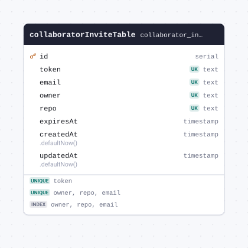

| Column                     | Type        | Constraints | Default         | Description |
| -------------------------- | ----------- | ----------- | --------------- | ----------- |
| `id`                       | `serial`    | PK NOT NULL |                 |             |
| `token`                    | `text`      | NOT NULL    |                 |             |
| `email`                    | `text`      | NOT NULL    |                 |             |
| `owner`                    | `text`      | NOT NULL    |                 |             |
| `repo`                     | `text`      | NOT NULL    |                 |             |
| `expiresAt` (`expires_at`) | `timestamp` | NOT NULL    |                 |             |
| `createdAt` (`created_at`) | `timestamp` | NOT NULL    | `.defaultNow()` |             |
| `updatedAt` (`updated_at`) | `timestamp` | NOT NULL    | `.defaultNow()` |             |

#### Definition

```sql
CREATE TABLE "collaborator_invite" (
	"id" serial PRIMARY KEY,
	"token" text NOT NULL,
	"email" text NOT NULL,
	"owner" text NOT NULL,
	"repo" text NOT NULL,
	"expires_at" timestamp NOT NULL,
	"created_at" timestamp DEFAULT now() NOT NULL,
	"updated_at" timestamp DEFAULT now() NOT NULL
);

CREATE UNIQUE INDEX "uq_collaborator_invite_token" ON "collaborator_invite" ("token");

CREATE INDEX "idx_collaborator_invite_owner_repo_email" ON "collaborator_invite" ("owner","repo","email");

CREATE UNIQUE INDEX "uq_collaborator_invite_owner_repo_email_ci" ON "collaborator_invite" (lower("owner"),lower("repo"),lower("email"));
```

#### Indexes

- UNIQUE `token`
- INDEX `owner`, `repo`, `email`

<details>
<summary>Queries and their SQL</summary>

**Select**: Every row of collaboratorInviteTable.

```ts
db.select().from(collaboratorInviteTable);
```

```sql
select "id", "token", "email", "owner", "repo", "expires_at", "created_at", "updated_at"
from "collaborator_invite"
```

**Count**: How many rows collaboratorInviteTable has.

```ts
db.select({ count: count() }).from(collaboratorInviteTable);
```

```sql
select count(*)
from "collaborator_invite"
```

**Find many**: The rows of collaboratorInviteTable, through the relational query API.

```ts
db.query.collaboratorInviteTable.findMany();
```

```sql
select "d0"."id" as "id", "d0"."token" as "token", "d0"."email" as "email", "d0"."owner" as "owner", "d0"."repo" as "repo", "d0"."expires_at" as "expiresAt", "d0"."created_at" as "createdAt", "d0"."updated_at" as "updatedAt"
from "collaborator_invite" as "d0"
```

**Find by primary key**: One row of collaboratorInviteTable, through the relational query API.

```ts
db.query.collaboratorInviteTable.findFirst({ where: { id: 1 } });
```

```sql
select "d0"."id" as "id", "d0"."token" as "token", "d0"."email" as "email", "d0"."owner" as "owner", "d0"."repo" as "repo", "d0"."expires_at" as "expiresAt", "d0"."created_at" as "createdAt", "d0"."updated_at" as "updatedAt"
from "collaborator_invite" as "d0"
where "d0"."id" = $1
limit $2
-- params: [1,1]
```

**Insert**: Adds a row to collaboratorInviteTable, giving the columns that have no default.

```ts
db.insert(collaboratorInviteTable).values({
  token: "token",
  email: "email",
  owner: "owner",
  repo: "repo",
  expiresAt: new Date("2026-01-01T00:00:00.000Z"),
});
```

```sql
insert into "collaborator_invite" ("id", "token", "email", "owner", "repo", "expires_at", "created_at", "updated_at")
values (default, $1, $2, $3, $4, $5, default, default)
-- params: ["token","email","owner","repo","2026-01-01T00:00:00.000Z"]
```

**Update**: Changes a row of collaboratorInviteTable, found by its primary key.

```ts
db.update(collaboratorInviteTable).set({ token: "token" }).where(eq(collaboratorInviteTable.id, 1));
```

```sql
update "collaborator_invite"
set "token" = $1
where "collaborator_invite"."id" = $2
-- params: ["token",1]
```

**Delete**: Deletes a row of collaboratorInviteTable, found by its primary key.

```ts
db.delete(collaboratorInviteTable).where(eq(collaboratorInviteTable.id, 1));
```

```sql
delete from "collaborator_invite"
where "collaborator_invite"."id" = $1
-- params: [1]
```

</details>

<a id="table-configTable"></a>

### configTable

Table `config`.

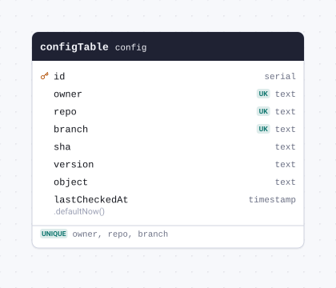

| Column                              | Type        | Constraints | Default         | Description |
| ----------------------------------- | ----------- | ----------- | --------------- | ----------- |
| `id`                                | `serial`    | PK NOT NULL |                 |             |
| `owner`                             | `text`      | NOT NULL    |                 |             |
| `repo`                              | `text`      | NOT NULL    |                 |             |
| `branch`                            | `text`      | NOT NULL    |                 |             |
| `sha`                               | `text`      | NOT NULL    |                 |             |
| `version`                           | `text`      | NOT NULL    |                 |             |
| `object`                            | `text`      | NOT NULL    |                 |             |
| `lastCheckedAt` (`last_checked_at`) | `timestamp` | NOT NULL    | `.defaultNow()` |             |

#### Definition

```sql
CREATE TABLE "config" (
	"id" serial PRIMARY KEY,
	"owner" text NOT NULL,
	"repo" text NOT NULL,
	"branch" text NOT NULL,
	"sha" text NOT NULL,
	"version" text NOT NULL,
	"object" text NOT NULL,
	"last_checked_at" timestamp DEFAULT now() NOT NULL
);

CREATE UNIQUE INDEX "idx_config_owner_repo_branch" ON "config" ("owner","repo","branch");
```

#### Indexes

- UNIQUE `owner`, `repo`, `branch`

<details>
<summary>Queries and their SQL</summary>

**Select**: Every row of configTable.

```ts
db.select().from(configTable);
```

```sql
select "id", "owner", "repo", "branch", "sha", "version", "object", "last_checked_at"
from "config"
```

**Count**: How many rows configTable has.

```ts
db.select({ count: count() }).from(configTable);
```

```sql
select count(*)
from "config"
```

**Find many**: The rows of configTable, through the relational query API.

```ts
db.query.configTable.findMany();
```

```sql
select "d0"."id" as "id", "d0"."owner" as "owner", "d0"."repo" as "repo", "d0"."branch" as "branch", "d0"."sha" as "sha", "d0"."version" as "version", "d0"."object" as "object", "d0"."last_checked_at" as "lastCheckedAt"
from "config" as "d0"
```

**Find by primary key**: One row of configTable, through the relational query API.

```ts
db.query.configTable.findFirst({ where: { id: 1 } });
```

```sql
select "d0"."id" as "id", "d0"."owner" as "owner", "d0"."repo" as "repo", "d0"."branch" as "branch", "d0"."sha" as "sha", "d0"."version" as "version", "d0"."object" as "object", "d0"."last_checked_at" as "lastCheckedAt"
from "config" as "d0"
where "d0"."id" = $1
limit $2
-- params: [1,1]
```

**Insert**: Adds a row to configTable, giving the columns that have no default.

```ts
db.insert(configTable).values({
  owner: "owner",
  repo: "repo",
  branch: "branch",
  sha: "sha",
  version: "version",
  object: "object",
});
```

```sql
insert into "config" ("id", "owner", "repo", "branch", "sha", "version", "object", "last_checked_at")
values (default, $1, $2, $3, $4, $5, $6, default)
-- params: ["owner","repo","branch","sha","version","object"]
```

**Update**: Changes a row of configTable, found by its primary key.

```ts
db.update(configTable).set({ owner: "owner" }).where(eq(configTable.id, 1));
```

```sql
update "config"
set "owner" = $1
where "config"."id" = $2
-- params: ["owner",1]
```

**Delete**: Deletes a row of configTable, found by its primary key.

```ts
db.delete(configTable).where(eq(configTable.id, 1));
```

```sql
delete from "config"
where "config"."id" = $1
-- params: [1]
```

</details>

<a id="table-cacheFileTable"></a>

### cacheFileTable

Table `cache_file`.

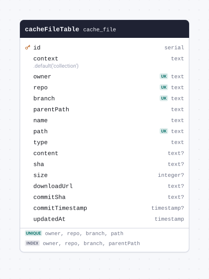

| Column                                 | Type        | Constraints | Default                  | Description |
| -------------------------------------- | ----------- | ----------- | ------------------------ | ----------- |
| `id`                                   | `serial`    | PK NOT NULL |                          |             |
| `context`                              | `text`      | NOT NULL    | `.default('collection')` |             |
| `owner`                                | `text`      | NOT NULL    |                          |             |
| `repo`                                 | `text`      | NOT NULL    |                          |             |
| `branch`                               | `text`      | NOT NULL    |                          |             |
| `parentPath` (`parent_path`)           | `text`      | NOT NULL    |                          |             |
| `name`                                 | `text`      | NOT NULL    |                          |             |
| `path`                                 | `text`      | NOT NULL    |                          |             |
| `type`                                 | `text`      | NOT NULL    |                          |             |
| `content`                              | `text`      | NULL        |                          |             |
| `sha`                                  | `text`      | NULL        |                          |             |
| `size`                                 | `integer`   | NULL        |                          |             |
| `downloadUrl` (`download_url`)         | `text`      | NULL        |                          |             |
| `commitSha` (`commit_sha`)             | `text`      | NULL        |                          |             |
| `commitTimestamp` (`commit_timestamp`) | `timestamp` | NULL        |                          |             |
| `updatedAt` (`updated_at`)             | `timestamp` | NOT NULL    |                          |             |

#### Definition

```sql
CREATE TABLE "cache_file" (
	"id" serial PRIMARY KEY,
	"context" text DEFAULT 'collection' NOT NULL,
	"owner" text NOT NULL,
	"repo" text NOT NULL,
	"branch" text NOT NULL,
	"parent_path" text NOT NULL,
	"name" text NOT NULL,
	"path" text NOT NULL,
	"type" text NOT NULL,
	"content" text,
	"sha" text,
	"size" integer,
	"download_url" text,
	"commit_sha" text,
	"commit_timestamp" timestamp,
	"updated_at" timestamp NOT NULL
);

CREATE INDEX "idx_cache_file_owner_repo_branch_parentPath" ON "cache_file" ("owner","repo","branch","parent_path");

CREATE UNIQUE INDEX "idx_cache_file_owner_repo_branch_path" ON "cache_file" ("owner","repo","branch","path");
```

#### Indexes

- INDEX `owner`, `repo`, `branch`, `parentPath`
- UNIQUE `owner`, `repo`, `branch`, `path`

<details>
<summary>Queries and their SQL</summary>

**Select**: Every row of cacheFileTable.

```ts
db.select().from(cacheFileTable);
```

```sql
select "id", "context", "owner", "repo", "branch", "parent_path", "name", "path", "type", "content", "sha", "size", "download_url", "commit_sha", "commit_timestamp", "updated_at"
from "cache_file"
```

**Count**: How many rows cacheFileTable has.

```ts
db.select({ count: count() }).from(cacheFileTable);
```

```sql
select count(*)
from "cache_file"
```

**Find many**: The rows of cacheFileTable, through the relational query API.

```ts
db.query.cacheFileTable.findMany();
```

```sql
select "d0"."id" as "id", "d0"."context" as "context", "d0"."owner" as "owner", "d0"."repo" as "repo", "d0"."branch" as "branch", "d0"."parent_path" as "parentPath", "d0"."name" as "name", "d0"."path" as "path", "d0"."type" as "type", "d0"."content" as "content", "d0"."sha" as "sha", "d0"."size" as "size", "d0"."download_url" as "downloadUrl", "d0"."commit_sha" as "commitSha", "d0"."commit_timestamp" as "commitTimestamp", "d0"."updated_at" as "updatedAt"
from "cache_file" as "d0"
```

**Find by primary key**: One row of cacheFileTable, through the relational query API.

```ts
db.query.cacheFileTable.findFirst({ where: { id: 1 } });
```

```sql
select "d0"."id" as "id", "d0"."context" as "context", "d0"."owner" as "owner", "d0"."repo" as "repo", "d0"."branch" as "branch", "d0"."parent_path" as "parentPath", "d0"."name" as "name", "d0"."path" as "path", "d0"."type" as "type", "d0"."content" as "content", "d0"."sha" as "sha", "d0"."size" as "size", "d0"."download_url" as "downloadUrl", "d0"."commit_sha" as "commitSha", "d0"."commit_timestamp" as "commitTimestamp", "d0"."updated_at" as "updatedAt"
from "cache_file" as "d0"
where "d0"."id" = $1
limit $2
-- params: [1,1]
```

**Insert**: Adds a row to cacheFileTable, giving the columns that have no default.

```ts
db.insert(cacheFileTable).values({
  owner: "owner",
  repo: "repo",
  branch: "branch",
  parentPath: "parentPath",
  name: "name",
  path: "path",
  type: "type",
  updatedAt: new Date("2026-01-01T00:00:00.000Z"),
});
```

```sql
insert into "cache_file" ("id", "context", "owner", "repo", "branch", "parent_path", "name", "path", "type", "content", "sha", "size", "download_url", "commit_sha", "commit_timestamp", "updated_at")
values (default, default, $1, $2, $3, $4, $5, $6, $7, default, default, default, default, default, default, $8)
-- params: ["owner","repo","branch","parentPath","name","path","type","2026-01-01T00:00:00.000Z"]
```

**Update**: Changes a row of cacheFileTable, found by its primary key.

```ts
db.update(cacheFileTable).set({ context: "context" }).where(eq(cacheFileTable.id, 1));
```

```sql
update "cache_file"
set "context" = $1
where "cache_file"."id" = $2
-- params: ["context",1]
```

**Delete**: Deletes a row of cacheFileTable, found by its primary key.

```ts
db.delete(cacheFileTable).where(eq(cacheFileTable.id, 1));
```

```sql
delete from "cache_file"
where "cache_file"."id" = $1
-- params: [1]
```

</details>

<a id="table-cacheFileMetaTable"></a>

### cacheFileMetaTable

Table `cache_file_meta`.

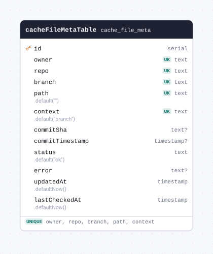

| Column                                 | Type        | Constraints | Default              | Description |
| -------------------------------------- | ----------- | ----------- | -------------------- | ----------- |
| `id`                                   | `serial`    | PK NOT NULL |                      |             |
| `owner`                                | `text`      | NOT NULL    |                      |             |
| `repo`                                 | `text`      | NOT NULL    |                      |             |
| `branch`                               | `text`      | NOT NULL    |                      |             |
| `path`                                 | `text`      | NOT NULL    | `.default("")`       |             |
| `context`                              | `text`      | NOT NULL    | `.default("branch")` |             |
| `commitSha` (`commit_sha`)             | `text`      | NULL        |                      |             |
| `commitTimestamp` (`commit_timestamp`) | `timestamp` | NULL        |                      |             |
| `status`                               | `text`      | NOT NULL    | `.default("ok")`     |             |
| `error`                                | `text`      | NULL        |                      |             |
| `updatedAt` (`updated_at`)             | `timestamp` | NOT NULL    | `.defaultNow()`      |             |
| `lastCheckedAt` (`last_checked_at`)    | `timestamp` | NOT NULL    | `.defaultNow()`      |             |

#### Definition

```sql
CREATE TABLE "cache_file_meta" (
	"id" serial PRIMARY KEY,
	"owner" text NOT NULL,
	"repo" text NOT NULL,
	"branch" text NOT NULL,
	"path" text DEFAULT '' NOT NULL,
	"context" text DEFAULT 'branch' NOT NULL,
	"commit_sha" text,
	"commit_timestamp" timestamp,
	"status" text DEFAULT 'ok' NOT NULL,
	"error" text,
	"updated_at" timestamp DEFAULT now() NOT NULL,
	"last_checked_at" timestamp DEFAULT now() NOT NULL
);

CREATE UNIQUE INDEX "idx_cache_file_meta_owner_repo_branch_path_context" ON "cache_file_meta" ("owner","repo","branch","path","context");
```

#### Indexes

- UNIQUE `owner`, `repo`, `branch`, `path`, `context`

<details>
<summary>Queries and their SQL</summary>

**Select**: Every row of cacheFileMetaTable.

```ts
db.select().from(cacheFileMetaTable);
```

```sql
select "id", "owner", "repo", "branch", "path", "context", "commit_sha", "commit_timestamp", "status", "error", "updated_at", "last_checked_at"
from "cache_file_meta"
```

**Count**: How many rows cacheFileMetaTable has.

```ts
db.select({ count: count() }).from(cacheFileMetaTable);
```

```sql
select count(*)
from "cache_file_meta"
```

**Find many**: The rows of cacheFileMetaTable, through the relational query API.

```ts
db.query.cacheFileMetaTable.findMany();
```

```sql
select "d0"."id" as "id", "d0"."owner" as "owner", "d0"."repo" as "repo", "d0"."branch" as "branch", "d0"."path" as "path", "d0"."context" as "context", "d0"."commit_sha" as "commitSha", "d0"."commit_timestamp" as "commitTimestamp", "d0"."status" as "status", "d0"."error" as "error", "d0"."updated_at" as "updatedAt", "d0"."last_checked_at" as "lastCheckedAt"
from "cache_file_meta" as "d0"
```

**Find by primary key**: One row of cacheFileMetaTable, through the relational query API.

```ts
db.query.cacheFileMetaTable.findFirst({ where: { id: 1 } });
```

```sql
select "d0"."id" as "id", "d0"."owner" as "owner", "d0"."repo" as "repo", "d0"."branch" as "branch", "d0"."path" as "path", "d0"."context" as "context", "d0"."commit_sha" as "commitSha", "d0"."commit_timestamp" as "commitTimestamp", "d0"."status" as "status", "d0"."error" as "error", "d0"."updated_at" as "updatedAt", "d0"."last_checked_at" as "lastCheckedAt"
from "cache_file_meta" as "d0"
where "d0"."id" = $1
limit $2
-- params: [1,1]
```

**Insert**: Adds a row to cacheFileMetaTable, giving the columns that have no default.

```ts
db.insert(cacheFileMetaTable).values({ owner: "owner", repo: "repo", branch: "branch" });
```

```sql
insert into "cache_file_meta" ("id", "owner", "repo", "branch", "path", "context", "commit_sha", "commit_timestamp", "status", "error", "updated_at", "last_checked_at")
values (default, $1, $2, $3, default, default, default, default, default, default, default, default)
-- params: ["owner","repo","branch"]
```

**Update**: Changes a row of cacheFileMetaTable, found by its primary key.

```ts
db.update(cacheFileMetaTable).set({ owner: "owner" }).where(eq(cacheFileMetaTable.id, 1));
```

```sql
update "cache_file_meta"
set "owner" = $1
where "cache_file_meta"."id" = $2
-- params: ["owner",1]
```

**Delete**: Deletes a row of cacheFileMetaTable, found by its primary key.

```ts
db.delete(cacheFileMetaTable).where(eq(cacheFileMetaTable.id, 1));
```

```sql
delete from "cache_file_meta"
where "cache_file_meta"."id" = $1
-- params: [1]
```

</details>

<a id="table-cachePermissionTable"></a>

### cachePermissionTable

Table `cache_permission`.

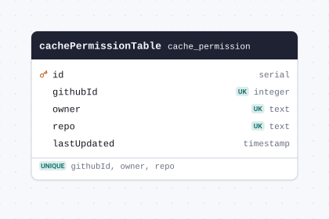

| Column                         | Type        | Constraints | Default | Description |
| ------------------------------ | ----------- | ----------- | ------- | ----------- |
| `id`                           | `serial`    | PK NOT NULL |         |             |
| `githubId` (`github_id`)       | `integer`   | NOT NULL    |         |             |
| `owner`                        | `text`      | NOT NULL    |         |             |
| `repo`                         | `text`      | NOT NULL    |         |             |
| `lastUpdated` (`last_updated`) | `timestamp` | NOT NULL    |         |             |

#### Definition

```sql
CREATE TABLE "cache_permission" (
	"id" serial PRIMARY KEY,
	"github_id" integer NOT NULL,
	"owner" text NOT NULL,
	"repo" text NOT NULL,
	"last_updated" timestamp NOT NULL
);

CREATE UNIQUE INDEX "idx_cache_permission_githubId_owner_repo" ON "cache_permission" ("github_id","owner","repo");
```

#### Indexes

- UNIQUE `githubId`, `owner`, `repo`

<details>
<summary>Queries and their SQL</summary>

**Select**: Every row of cachePermissionTable.

```ts
db.select().from(cachePermissionTable);
```

```sql
select "id", "github_id", "owner", "repo", "last_updated"
from "cache_permission"
```

**Count**: How many rows cachePermissionTable has.

```ts
db.select({ count: count() }).from(cachePermissionTable);
```

```sql
select count(*)
from "cache_permission"
```

**Find many**: The rows of cachePermissionTable, through the relational query API.

```ts
db.query.cachePermissionTable.findMany();
```

```sql
select "d0"."id" as "id", "d0"."github_id" as "githubId", "d0"."owner" as "owner", "d0"."repo" as "repo", "d0"."last_updated" as "lastUpdated"
from "cache_permission" as "d0"
```

**Find by primary key**: One row of cachePermissionTable, through the relational query API.

```ts
db.query.cachePermissionTable.findFirst({ where: { id: 1 } });
```

```sql
select "d0"."id" as "id", "d0"."github_id" as "githubId", "d0"."owner" as "owner", "d0"."repo" as "repo", "d0"."last_updated" as "lastUpdated"
from "cache_permission" as "d0"
where "d0"."id" = $1
limit $2
-- params: [1,1]
```

**Insert**: Adds a row to cachePermissionTable, giving the columns that have no default.

```ts
db.insert(cachePermissionTable).values({
  githubId: 1,
  owner: "owner",
  repo: "repo",
  lastUpdated: new Date("2026-01-01T00:00:00.000Z"),
});
```

```sql
insert into "cache_permission" ("id", "github_id", "owner", "repo", "last_updated")
values (default, $1, $2, $3, $4)
-- params: [1,"owner","repo","2026-01-01T00:00:00.000Z"]
```

**Update**: Changes a row of cachePermissionTable, found by its primary key.

```ts
db.update(cachePermissionTable).set({ githubId: 1 }).where(eq(cachePermissionTable.id, 1));
```

```sql
update "cache_permission"
set "github_id" = $1
where "cache_permission"."id" = $2
-- params: [1,1]
```

**Delete**: Deletes a row of cachePermissionTable, found by its primary key.

```ts
db.delete(cachePermissionTable).where(eq(cachePermissionTable.id, 1));
```

```sql
delete from "cache_permission"
where "cache_permission"."id" = $1
-- params: [1]
```

</details>

<a id="table-actionRunTable"></a>

### actionRunTable

Table `action_run`.

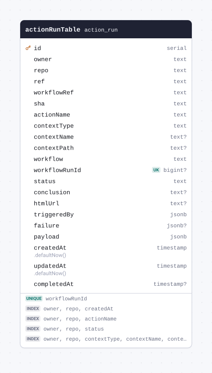

| Column                              | Type        | Constraints | Default         | Description |
| ----------------------------------- | ----------- | ----------- | --------------- | ----------- |
| `id`                                | `serial`    | PK NOT NULL |                 |             |
| `owner`                             | `text`      | NOT NULL    |                 |             |
| `repo`                              | `text`      | NOT NULL    |                 |             |
| `ref`                               | `text`      | NOT NULL    |                 |             |
| `workflowRef` (`workflow_ref`)      | `text`      | NOT NULL    |                 |             |
| `sha`                               | `text`      | NOT NULL    |                 |             |
| `actionName` (`action_name`)        | `text`      | NOT NULL    |                 |             |
| `contextType` (`context_type`)      | `text`      | NOT NULL    |                 |             |
| `contextName` (`context_name`)      | `text`      | NULL        |                 |             |
| `contextPath` (`context_path`)      | `text`      | NULL        |                 |             |
| `workflow`                          | `text`      | NOT NULL    |                 |             |
| `workflowRunId` (`workflow_run_id`) | `bigint`    | NULL        |                 |             |
| `status`                            | `text`      | NOT NULL    |                 |             |
| `conclusion`                        | `text`      | NULL        |                 |             |
| `htmlUrl` (`html_url`)              | `text`      | NULL        |                 |             |
| `triggeredBy` (`triggered_by`)      | `jsonb`     | NOT NULL    |                 |             |
| `failure`                           | `jsonb`     | NULL        |                 |             |
| `payload`                           | `jsonb`     | NOT NULL    |                 |             |
| `createdAt` (`created_at`)          | `timestamp` | NOT NULL    | `.defaultNow()` |             |
| `updatedAt` (`updated_at`)          | `timestamp` | NOT NULL    | `.defaultNow()` |             |
| `completedAt` (`completed_at`)      | `timestamp` | NULL        |                 |             |

#### Definition

```sql
CREATE TABLE "action_run" (
	"id" serial PRIMARY KEY,
	"owner" text NOT NULL,
	"repo" text NOT NULL,
	"ref" text NOT NULL,
	"workflow_ref" text NOT NULL,
	"sha" text NOT NULL,
	"action_name" text NOT NULL,
	"context_type" text NOT NULL,
	"context_name" text,
	"context_path" text,
	"workflow" text NOT NULL,
	"workflow_run_id" bigint,
	"status" text NOT NULL,
	"conclusion" text,
	"html_url" text,
	"triggered_by" jsonb NOT NULL,
	"failure" jsonb,
	"payload" jsonb NOT NULL,
	"created_at" timestamp DEFAULT now() NOT NULL,
	"updated_at" timestamp DEFAULT now() NOT NULL,
	"completed_at" timestamp
);

CREATE INDEX "idx_action_run_owner_repo_createdAt" ON "action_run" ("owner","repo","created_at");

CREATE INDEX "idx_action_run_owner_repo_actionName" ON "action_run" ("owner","repo","action_name");

CREATE INDEX "idx_action_run_owner_repo_status" ON "action_run" ("owner","repo","status");

CREATE INDEX "idx_action_run_context" ON "action_run" ("owner","repo","context_type","context_name","context_path");

CREATE UNIQUE INDEX "idx_action_run_workflowRunId" ON "action_run" ("workflow_run_id");
```

#### Indexes

- INDEX `owner`, `repo`, `createdAt`
- INDEX `owner`, `repo`, `actionName`
- INDEX `owner`, `repo`, `status`
- INDEX `owner`, `repo`, `contextType`, `contextName`, `contextPath`
- UNIQUE `workflowRunId`

<details>
<summary>Queries and their SQL</summary>

**Select**: Every row of actionRunTable.

```ts
db.select().from(actionRunTable);
```

```sql
select "id", "owner", "repo", "ref", "workflow_ref", "sha", "action_name", "context_type", "context_name", "context_path", "workflow", "workflow_run_id", "status", "conclusion", "html_url", "triggered_by", "failure", "payload", "created_at", "updated_at", "completed_at"
from "action_run"
```

**Count**: How many rows actionRunTable has.

```ts
db.select({ count: count() }).from(actionRunTable);
```

```sql
select count(*)
from "action_run"
```

**Find many**: The rows of actionRunTable, through the relational query API.

```ts
db.query.actionRunTable.findMany();
```

```sql
select "d0"."id" as "id", "d0"."owner" as "owner", "d0"."repo" as "repo", "d0"."ref" as "ref", "d0"."workflow_ref" as "workflowRef", "d0"."sha" as "sha", "d0"."action_name" as "actionName", "d0"."context_type" as "contextType", "d0"."context_name" as "contextName", "d0"."context_path" as "contextPath", "d0"."workflow" as "workflow", "d0"."workflow_run_id" as "workflowRunId", "d0"."status" as "status", "d0"."conclusion" as "conclusion", "d0"."html_url" as "htmlUrl", "d0"."triggered_by" as "triggeredBy", "d0"."failure" as "failure", "d0"."payload" as "payload", "d0"."created_at" as "createdAt", "d0"."updated_at" as "updatedAt", "d0"."completed_at" as "completedAt"
from "action_run" as "d0"
```

**Find by primary key**: One row of actionRunTable, through the relational query API.

```ts
db.query.actionRunTable.findFirst({ where: { id: 1 } });
```

```sql
select "d0"."id" as "id", "d0"."owner" as "owner", "d0"."repo" as "repo", "d0"."ref" as "ref", "d0"."workflow_ref" as "workflowRef", "d0"."sha" as "sha", "d0"."action_name" as "actionName", "d0"."context_type" as "contextType", "d0"."context_name" as "contextName", "d0"."context_path" as "contextPath", "d0"."workflow" as "workflow", "d0"."workflow_run_id" as "workflowRunId", "d0"."status" as "status", "d0"."conclusion" as "conclusion", "d0"."html_url" as "htmlUrl", "d0"."triggered_by" as "triggeredBy", "d0"."failure" as "failure", "d0"."payload" as "payload", "d0"."created_at" as "createdAt", "d0"."updated_at" as "updatedAt", "d0"."completed_at" as "completedAt"
from "action_run" as "d0"
where "d0"."id" = $1
limit $2
-- params: [1,1]
```

**Insert**: Adds a row to actionRunTable, giving the columns that have no default.

```ts
db.insert(actionRunTable).values({
  owner: "owner",
  repo: "repo",
  ref: "ref",
  workflowRef: "workflowRef",
  sha: "sha",
  actionName: "actionName",
  contextType: "contextType",
  workflow: "workflow",
  status: "status",
  triggeredBy: {},
  payload: {},
});
```

```sql
insert into "action_run" ("id", "owner", "repo", "ref", "workflow_ref", "sha", "action_name", "context_type", "context_name", "context_path", "workflow", "workflow_run_id", "status", "conclusion", "html_url", "triggered_by", "failure", "payload", "created_at", "updated_at", "completed_at")
values (default, $1, $2, $3, $4, $5, $6, $7, default, default, $8, default, $9, default, default, $10, default, $11, default, default, default)
-- params: ["owner","repo","ref","workflowRef","sha","actionName","contextType","workflow","status",{},{}]
```

**Update**: Changes a row of actionRunTable, found by its primary key.

```ts
db.update(actionRunTable).set({ owner: "owner" }).where(eq(actionRunTable.id, 1));
```

```sql
update "action_run"
set "owner" = $1
where "action_run"."id" = $2
-- params: ["owner",1]
```

**Delete**: Deletes a row of actionRunTable, found by its primary key.

```ts
db.delete(actionRunTable).where(eq(actionRunTable.id, 1));
```

```sql
delete from "action_run"
where "action_run"."id" = $1
-- params: [1]
```

</details>
