# Schema docs

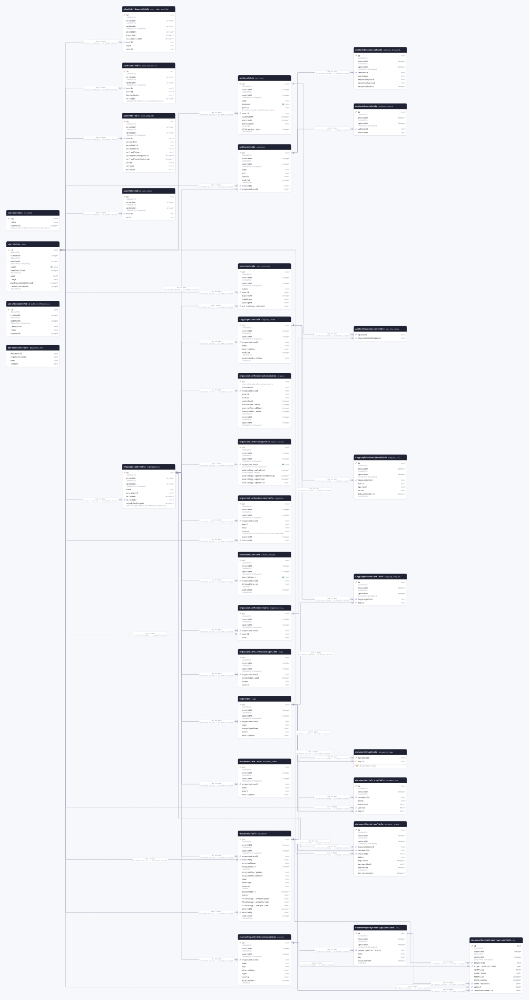

<details>
<summary>The whole schema as SQL</summary>

```sql
CREATE TABLE `custom_property_definitions` (
	`id` text PRIMARY KEY,
	`created_at` integer NOT NULL,
	`updated_at` integer NOT NULL,
	`organization_id` text NOT NULL,
	`name` text NOT NULL,
	`key` text NOT NULL,
	`description` text,
	`type` text NOT NULL,
	`config` text,
	`display_order` integer DEFAULT 0 NOT NULL,
	CONSTRAINT `fk_custom_property_definitions_organization_id_organizations_id_fk` FOREIGN KEY (`organization_id`) REFERENCES `organizations`(`id`) ON UPDATE CASCADE ON DELETE CASCADE
);

CREATE TABLE `document_custom_property_values` (
	`id` text PRIMARY KEY,
	`created_at` integer NOT NULL,
	`updated_at` integer NOT NULL,
	`document_id` text NOT NULL,
	`property_definition_id` text NOT NULL,
	`text_value` text,
	`number_value` real,
	`date_value` integer,
	`boolean_value` integer,
	`select_option_id` text,
	`user_id` text,
	`related_document_id` text,
	CONSTRAINT `fk_document_custom_property_values_document_id_documents_id_fk` FOREIGN KEY (`document_id`) REFERENCES `documents`(`id`) ON UPDATE CASCADE ON DELETE CASCADE,
	CONSTRAINT `fk_document_custom_property_values_property_definition_id_custom_property_definitions_id_fk` FOREIGN KEY (`property_definition_id`) REFERENCES `custom_property_definitions`(`id`) ON UPDATE CASCADE ON DELETE CASCADE,
	CONSTRAINT `fk_document_custom_property_values_select_option_id_custom_property_select_options_id_fk` FOREIGN KEY (`select_option_id`) REFERENCES `custom_property_select_options`(`id`) ON UPDATE CASCADE ON DELETE CASCADE,
	CONSTRAINT `fk_document_custom_property_values_user_id_users_id_fk` FOREIGN KEY (`user_id`) REFERENCES `users`(`id`) ON UPDATE CASCADE ON DELETE CASCADE,
	CONSTRAINT `fk_document_custom_property_values_related_document_id_documents_id_fk` FOREIGN KEY (`related_document_id`) REFERENCES `documents`(`id`) ON UPDATE CASCADE ON DELETE CASCADE
);

CREATE TABLE `custom_property_select_options` (
	`id` text PRIMARY KEY,
	`created_at` integer NOT NULL,
	`updated_at` integer NOT NULL,
	`property_definition_id` text NOT NULL,
	`name` text NOT NULL,
	`key` text NOT NULL,
	`display_order` integer DEFAULT 0 NOT NULL,
	CONSTRAINT `fk_custom_property_select_options_property_definition_id_custom_property_definitions_id_fk` FOREIGN KEY (`property_definition_id`) REFERENCES `custom_property_definitions`(`id`) ON UPDATE CASCADE ON DELETE CASCADE
);

CREATE TABLE `document_share_links` (
	`id` text PRIMARY KEY,
	`created_at` integer NOT NULL,
	`updated_at` integer NOT NULL,
	`organization_id` text NOT NULL,
	`document_id` text NOT NULL,
	`created_by` text,
	`token` text NOT NULL,
	`expires_at` integer,
	`password_hash` text,
	`is_enabled` integer DEFAULT true NOT NULL,
	`last_accessed_at` integer,
	CONSTRAINT `fk_document_share_links_organization_id_organizations_id_fk` FOREIGN KEY (`organization_id`) REFERENCES `organizations`(`id`) ON UPDATE CASCADE ON DELETE CASCADE,
	CONSTRAINT `fk_document_share_links_document_id_documents_id_fk` FOREIGN KEY (`document_id`) REFERENCES `documents`(`id`) ON UPDATE CASCADE ON DELETE CASCADE,
	CONSTRAINT `fk_document_share_links_created_by_users_id_fk` FOREIGN KEY (`created_by`) REFERENCES `users`(`id`) ON UPDATE CASCADE ON DELETE SET NULL
);

CREATE TABLE `document_views` (
	`id` text PRIMARY KEY,
	`created_at` integer NOT NULL,
	`updated_at` integer NOT NULL,
	`organization_id` text NOT NULL,
	`name` text NOT NULL,
	`query` text NOT NULL,
	`description` text,
	CONSTRAINT `fk_document_views_organization_id_organizations_id_fk` FOREIGN KEY (`organization_id`) REFERENCES `organizations`(`id`) ON UPDATE CASCADE ON DELETE CASCADE
);

CREATE TABLE `document_activity_log` (
	`id` text PRIMARY KEY,
	`created_at` integer NOT NULL,
	`document_id` text NOT NULL,
	`event` text NOT NULL,
	`event_data` text,
	`user_id` text,
	`tag_id` text,
	CONSTRAINT `fk_document_activity_log_document_id_documents_id_fk` FOREIGN KEY (`document_id`) REFERENCES `documents`(`id`) ON UPDATE CASCADE ON DELETE CASCADE,
	CONSTRAINT `fk_document_activity_log_user_id_users_id_fk` FOREIGN KEY (`user_id`) REFERENCES `users`(`id`) ON UPDATE CASCADE ON DELETE SET NULL,
	CONSTRAINT `fk_document_activity_log_tag_id_tags_id_fk` FOREIGN KEY (`tag_id`) REFERENCES `tags`(`id`) ON UPDATE CASCADE ON DELETE SET NULL
);

CREATE TABLE `documents` (
	`id` text PRIMARY KEY,
	`created_at` integer NOT NULL,
	`updated_at` integer NOT NULL,
	`organization_id` text NOT NULL,
	`created_by` text,
	`original_name` text NOT NULL,
	`original_size` integer DEFAULT 0 NOT NULL,
	`original_storage_key` text NOT NULL,
	`original_sha256_hash` text NOT NULL,
	`name` text NOT NULL,
	`mime_type` text NOT NULL,
	`content` text DEFAULT '' NOT NULL,
	`document_date` integer,
	`notes` text,
	`file_encryption_key_wrapped` text,
	`file_encryption_kek_version` text,
	`file_encryption_algorithm` text,
	`deleted_at` integer,
	`deleted_by` text,
	`is_deleted` integer DEFAULT false NOT NULL,
	CONSTRAINT `fk_documents_organization_id_organizations_id_fk` FOREIGN KEY (`organization_id`) REFERENCES `organizations`(`id`) ON UPDATE CASCADE ON DELETE CASCADE,
	CONSTRAINT `fk_documents_created_by_users_id_fk` FOREIGN KEY (`created_by`) REFERENCES `users`(`id`) ON UPDATE CASCADE ON DELETE SET NULL,
	CONSTRAINT `fk_documents_deleted_by_users_id_fk` FOREIGN KEY (`deleted_by`) REFERENCES `users`(`id`) ON UPDATE CASCADE ON DELETE SET NULL
);

CREATE TABLE `kv_store` (
	`key` text PRIMARY KEY,
	`value` text NOT NULL,
	`expires_at` integer
);

CREATE TABLE `organization_invitations` (
	`id` text PRIMARY KEY,
	`created_at` integer NOT NULL,
	`updated_at` integer NOT NULL,
	`organization_id` text NOT NULL,
	`email` text NOT NULL,
	`role` text NOT NULL,
	`status` text DEFAULT 'pending' NOT NULL,
	`expires_at` integer NOT NULL,
	`inviter_id` text NOT NULL,
	CONSTRAINT `fk_organization_invitations_organization_id_organizations_id_fk` FOREIGN KEY (`organization_id`) REFERENCES `organizations`(`id`) ON UPDATE CASCADE ON DELETE CASCADE,
	CONSTRAINT `fk_organization_invitations_inviter_id_users_id_fk` FOREIGN KEY (`inviter_id`) REFERENCES `users`(`id`) ON UPDATE CASCADE ON DELETE CASCADE
);

CREATE TABLE `organization_members` (
	`id` text PRIMARY KEY,
	`created_at` integer NOT NULL,
	`updated_at` integer NOT NULL,
	`organization_id` text NOT NULL,
	`user_id` text NOT NULL,
	`role` text NOT NULL,
	CONSTRAINT `fk_organization_members_organization_id_organizations_id_fk` FOREIGN KEY (`organization_id`) REFERENCES `organizations`(`id`) ON UPDATE CASCADE ON DELETE CASCADE,
	CONSTRAINT `fk_organization_members_user_id_users_id_fk` FOREIGN KEY (`user_id`) REFERENCES `users`(`id`) ON UPDATE CASCADE ON DELETE CASCADE
);

CREATE TABLE `organizations` (
	`id` text PRIMARY KEY,
	`created_at` integer NOT NULL,
	`updated_at` integer NOT NULL,
	`name` text NOT NULL,
	`customer_id` text,
	`deleted_at` integer,
	`deleted_by` text,
	`scheduled_purge_at` integer,
	CONSTRAINT `fk_organizations_deleted_by_users_id_fk` FOREIGN KEY (`deleted_by`) REFERENCES `users`(`id`) ON UPDATE CASCADE ON DELETE SET NULL
);

CREATE TABLE `user_roles` (
	`id` text PRIMARY KEY,
	`created_at` integer NOT NULL,
	`updated_at` integer NOT NULL,
	`user_id` text NOT NULL,
	`role` text NOT NULL,
	CONSTRAINT `fk_user_roles_user_id_users_id_fk` FOREIGN KEY (`user_id`) REFERENCES `users`(`id`) ON UPDATE CASCADE ON DELETE CASCADE
);

CREATE TABLE `documents_tags` (
	`document_id` text NOT NULL,
	`tag_id` text NOT NULL,
	CONSTRAINT `documents_tags_pkey` PRIMARY KEY(`document_id`, `tag_id`),
	CONSTRAINT `fk_documents_tags_document_id_documents_id_fk` FOREIGN KEY (`document_id`) REFERENCES `documents`(`id`) ON UPDATE CASCADE ON DELETE CASCADE,
	CONSTRAINT `fk_documents_tags_tag_id_tags_id_fk` FOREIGN KEY (`tag_id`) REFERENCES `tags`(`id`) ON UPDATE CASCADE ON DELETE CASCADE
);

CREATE TABLE `tags` (
	`id` text PRIMARY KEY,
	`created_at` integer NOT NULL,
	`updated_at` integer NOT NULL,
	`organization_id` text NOT NULL,
	`name` text NOT NULL,
	`normalized_name` text,
	`color` text NOT NULL,
	`description` text,
	CONSTRAINT `fk_tags_organization_id_organizations_id_fk` FOREIGN KEY (`organization_id`) REFERENCES `organizations`(`id`) ON UPDATE CASCADE ON DELETE CASCADE
);

CREATE TABLE `users` (
	`id` text PRIMARY KEY,
	`created_at` integer NOT NULL,
	`updated_at` integer NOT NULL,
	`email` text NOT NULL UNIQUE,
	`email_verified` integer DEFAULT false NOT NULL,
	`name` text,
	`image` text,
	`max_organization_count` integer,
	`two_factor_enabled` integer DEFAULT false NOT NULL
);

CREATE TABLE `organization_ai_credits_usage` (
	`id` text PRIMARY KEY,
	`created_at` integer NOT NULL,
	`updated_at` integer NOT NULL,
	`organization_id` text NOT NULL,
	`credits_consumed` integer NOT NULL,
	`usage` text NOT NULL,
	`source` text NOT NULL,
	CONSTRAINT `fk_organization_ai_credits_usage_organization_id_organizations_id_fk` FOREIGN KEY (`organization_id`) REFERENCES `organizations`(`id`) ON UPDATE CASCADE ON DELETE CASCADE
);

CREATE TABLE `api_key_organizations` (
	`api_key_id` text NOT NULL,
	`organization_member_id` text NOT NULL,
	CONSTRAINT `fk_api_key_organizations_api_key_id_api_keys_id_fk` FOREIGN KEY (`api_key_id`) REFERENCES `api_keys`(`id`) ON UPDATE CASCADE ON DELETE CASCADE,
	CONSTRAINT `fk_api_key_organizations_organization_member_id_organization_members_id_fk` FOREIGN KEY (`organization_member_id`) REFERENCES `organization_members`(`id`) ON UPDATE CASCADE ON DELETE CASCADE
);

CREATE TABLE `api_keys` (
	`id` text PRIMARY KEY,
	`created_at` integer NOT NULL,
	`updated_at` integer NOT NULL,
	`name` text NOT NULL,
	`key_hash` text NOT NULL UNIQUE,
	`prefix` text NOT NULL,
	`user_id` text NOT NULL,
	`last_used_at` integer,
	`expires_at` integer,
	`permissions` text DEFAULT '[]' NOT NULL,
	`all_organizations` integer DEFAULT false NOT NULL,
	CONSTRAINT `fk_api_keys_user_id_users_id_fk` FOREIGN KEY (`user_id`) REFERENCES `users`(`id`) ON UPDATE CASCADE ON DELETE CASCADE
);

CREATE TABLE `auth_accounts` (
	`id` text PRIMARY KEY,
	`created_at` integer NOT NULL,
	`updated_at` integer NOT NULL,
	`user_id` text,
	`account_id` text NOT NULL,
	`provider_id` text NOT NULL,
	`access_token` text,
	`refresh_token` text,
	`access_token_expires_at` integer,
	`refresh_token_expires_at` integer,
	`scope` text,
	`id_token` text,
	`password` text,
	CONSTRAINT `fk_auth_accounts_user_id_users_id_fk` FOREIGN KEY (`user_id`) REFERENCES `users`(`id`) ON UPDATE CASCADE ON DELETE CASCADE
);

CREATE TABLE `auth_sessions` (
	`id` text PRIMARY KEY,
	`created_at` integer NOT NULL,
	`updated_at` integer NOT NULL,
	`token` text NOT NULL,
	`user_id` text,
	`expires_at` integer NOT NULL,
	`ip_address` text,
	`user_agent` text,
	`active_organization_id` text,
	CONSTRAINT `fk_auth_sessions_user_id_users_id_fk` FOREIGN KEY (`user_id`) REFERENCES `users`(`id`) ON UPDATE CASCADE ON DELETE CASCADE,
	CONSTRAINT `fk_auth_sessions_active_organization_id_organizations_id_fk` FOREIGN KEY (`active_organization_id`) REFERENCES `organizations`(`id`) ON UPDATE CASCADE ON DELETE SET NULL
);

CREATE TABLE `auth_two_factor` (
	`id` text PRIMARY KEY,
	`created_at` integer NOT NULL,
	`updated_at` integer NOT NULL,
	`user_id` text,
	`secret` text,
	`backup_codes` text,
	`verified` integer DEFAULT true NOT NULL,
	CONSTRAINT `fk_auth_two_factor_user_id_users_id_fk` FOREIGN KEY (`user_id`) REFERENCES `users`(`id`) ON UPDATE CASCADE ON DELETE CASCADE
);

CREATE TABLE `auth_verifications` (
	`id` text PRIMARY KEY,
	`created_at` integer NOT NULL,
	`updated_at` integer NOT NULL,
	`identifier` text NOT NULL,
	`value` text NOT NULL,
	`expires_at` integer NOT NULL
);

CREATE TABLE `documents_fts` (
	`document_id` text NOT NULL,
	`organization_id` text NOT NULL,
	`name` text NOT NULL,
	`content` text NOT NULL
);

CREATE TABLE `intake_emails` (
	`id` text PRIMARY KEY,
	`created_at` integer NOT NULL,
	`updated_at` integer NOT NULL,
	`email_address` text NOT NULL UNIQUE,
	`organization_id` text NOT NULL,
	`allowed_origins` text DEFAULT '[]' NOT NULL,
	`is_enabled` integer DEFAULT true NOT NULL,
	CONSTRAINT `fk_intake_emails_organization_id_organizations_id_fk` FOREIGN KEY (`organization_id`) REFERENCES `organizations`(`id`) ON UPDATE CASCADE ON DELETE CASCADE
);

CREATE TABLE `organization_settings` (
	`id` text PRIMARY KEY,
	`created_at` integer NOT NULL,
	`updated_at` integer NOT NULL,
	`organization_id` text NOT NULL UNIQUE,
	`ai_auto_tagging_enabled` integer,
	`ai_auto_tagging_can_create_new_tags` integer,
	`ai_auto_tagging_max_tags` integer,
	`ai_auto_tagging_model_id` text,
	CONSTRAINT `fk_organization_settings_organization_id_organizations_id_fk` FOREIGN KEY (`organization_id`) REFERENCES `organizations`(`id`) ON UPDATE CASCADE ON DELETE CASCADE
);

CREATE TABLE `user_plan_entitlements` (
	`id` text PRIMARY KEY,
	`created_at` integer NOT NULL,
	`updated_at` integer NOT NULL,
	`granted_at` integer NOT NULL,
	`expires_at` integer,
	`last_verified_at` integer,
	`user_id` text NOT NULL,
	`type` text NOT NULL,
	`source` text NOT NULL,
	CONSTRAINT `fk_user_plan_entitlements_user_id_users_id_fk` FOREIGN KEY (`user_id`) REFERENCES `users`(`id`) ON UPDATE CASCADE ON DELETE CASCADE
);

CREATE TABLE `organization_subscriptions` (
	`id` text PRIMARY KEY,
	`customer_id` text NOT NULL,
	`organization_id` text NOT NULL,
	`plan_id` text NOT NULL,
	`status` text NOT NULL,
	`seats_count` integer NOT NULL,
	`current_period_end` integer NOT NULL,
	`current_period_start` integer NOT NULL,
	`cancel_at_period_end` integer DEFAULT false NOT NULL,
	`created_at` integer NOT NULL,
	`updated_at` integer NOT NULL,
	CONSTRAINT `fk_organization_subscriptions_organization_id_organizations_id_fk` FOREIGN KEY (`organization_id`) REFERENCES `organizations`(`id`) ON UPDATE CASCADE ON DELETE CASCADE
);

CREATE TABLE `tagging_rule_actions` (
	`id` text PRIMARY KEY,
	`created_at` integer NOT NULL,
	`updated_at` integer NOT NULL,
	`tagging_rule_id` text NOT NULL,
	`tag_id` text NOT NULL,
	CONSTRAINT `fk_tagging_rule_actions_tagging_rule_id_tagging_rules_id_fk` FOREIGN KEY (`tagging_rule_id`) REFERENCES `tagging_rules`(`id`) ON UPDATE CASCADE ON DELETE CASCADE,
	CONSTRAINT `fk_tagging_rule_actions_tag_id_tags_id_fk` FOREIGN KEY (`tag_id`) REFERENCES `tags`(`id`) ON UPDATE CASCADE ON DELETE CASCADE
);

CREATE TABLE `tagging_rule_conditions` (
	`id` text PRIMARY KEY,
	`created_at` integer NOT NULL,
	`updated_at` integer NOT NULL,
	`tagging_rule_id` text NOT NULL,
	`field` text NOT NULL,
	`operator` text NOT NULL,
	`value` text NOT NULL,
	`is_case_sensitive` integer DEFAULT false NOT NULL,
	CONSTRAINT `fk_tagging_rule_conditions_tagging_rule_id_tagging_rules_id_fk` FOREIGN KEY (`tagging_rule_id`) REFERENCES `tagging_rules`(`id`) ON UPDATE CASCADE ON DELETE CASCADE
);

CREATE TABLE `tagging_rules` (
	`id` text PRIMARY KEY,
	`created_at` integer NOT NULL,
	`updated_at` integer NOT NULL,
	`organization_id` text NOT NULL,
	`name` text NOT NULL,
	`description` text,
	`enabled` integer DEFAULT true NOT NULL,
	`condition_match_mode` text DEFAULT 'all' NOT NULL,
	CONSTRAINT `fk_tagging_rules_organization_id_organizations_id_fk` FOREIGN KEY (`organization_id`) REFERENCES `organizations`(`id`) ON UPDATE CASCADE ON DELETE CASCADE
);

CREATE TABLE `webhook_deliveries` (
	`id` text PRIMARY KEY,
	`created_at` integer NOT NULL,
	`updated_at` integer NOT NULL,
	`webhook_id` text NOT NULL,
	`event_name` text NOT NULL,
	`request_payload` text NOT NULL,
	`response_payload` text NOT NULL,
	`response_status` integer NOT NULL,
	CONSTRAINT `fk_webhook_deliveries_webhook_id_webhooks_id_fk` FOREIGN KEY (`webhook_id`) REFERENCES `webhooks`(`id`) ON UPDATE CASCADE ON DELETE CASCADE
);

CREATE TABLE `webhook_events` (
	`id` text PRIMARY KEY,
	`created_at` integer NOT NULL,
	`updated_at` integer NOT NULL,
	`webhook_id` text NOT NULL,
	`event_name` text NOT NULL,
	CONSTRAINT `fk_webhook_events_webhook_id_webhooks_id_fk` FOREIGN KEY (`webhook_id`) REFERENCES `webhooks`(`id`) ON UPDATE CASCADE ON DELETE CASCADE
);

CREATE TABLE `webhooks` (
	`id` text PRIMARY KEY,
	`created_at` integer NOT NULL,
	`updated_at` integer NOT NULL,
	`name` text NOT NULL,
	`url` text NOT NULL,
	`secret` text,
	`enabled` integer DEFAULT true NOT NULL,
	`created_by` text,
	`organization_id` text,
	CONSTRAINT `fk_webhooks_created_by_users_id_fk` FOREIGN KEY (`created_by`) REFERENCES `users`(`id`) ON UPDATE CASCADE ON DELETE SET NULL,
	CONSTRAINT `fk_webhooks_organization_id_organizations_id_fk` FOREIGN KEY (`organization_id`) REFERENCES `organizations`(`id`) ON UPDATE CASCADE ON DELETE CASCADE
);
```

</details>

## Contents

| Table                                                                         | Name in the database              | Description                                                                                                                                                                                                                                                          |
| ----------------------------------------------------------------------------- | --------------------------------- | -------------------------------------------------------------------------------------------------------------------------------------------------------------------------------------------------------------------------------------------------------------------- |
| [customPropertyDefinitionsTable](#table-customPropertyDefinitionsTable)       | `custom_property_definitions`     |                                                                                                                                                                                                                                                                      |
| [documentCustomPropertyValuesTable](#table-documentCustomPropertyValuesTable) | `document_custom_property_values` |                                                                                                                                                                                                                                                                      |
| [customPropertySelectOptionsTable](#table-customPropertySelectOptionsTable)   | `custom_property_select_options`  |                                                                                                                                                                                                                                                                      |
| [documentShareLinksTable](#table-documentShareLinksTable)                     | `document_share_links`            |                                                                                                                                                                                                                                                                      |
| [documentViewsTable](#table-documentViewsTable)                               | `document_views`                  |                                                                                                                                                                                                                                                                      |
| [documentActivityLogTable](#table-documentActivityLogTable)                   | `document_activity_log`           |                                                                                                                                                                                                                                                                      |
| [documentsTable](#table-documentsTable)                                       | `documents`                       |                                                                                                                                                                                                                                                                      |
| [kvStoreTable](#table-kvStoreTable)                                           | `kv_store`                        |                                                                                                                                                                                                                                                                      |
| [organizationsTable](#table-organizationsTable)                               | `organizations`                   |                                                                                                                                                                                                                                                                      |
| [organizationMembersTable](#table-organizationMembersTable)                   | `organization_members`            |                                                                                                                                                                                                                                                                      |
| [organizationInvitationsTable](#table-organizationInvitationsTable)           | `organization_invitations`        |                                                                                                                                                                                                                                                                      |
| [userRolesTable](#table-userRolesTable)                                       | `user_roles`                      |                                                                                                                                                                                                                                                                      |
| [tagsTable](#table-tagsTable)                                                 | `tags`                            |                                                                                                                                                                                                                                                                      |
| [documentsTagsTable](#table-documentsTagsTable)                               | `documents_tags`                  |                                                                                                                                                                                                                                                                      |
| [usersTable](#table-usersTable)                                               | `users`                           |                                                                                                                                                                                                                                                                      |
| [organizationAiCreditsUsageTable](#table-organizationAiCreditsUsageTable)     | `organization_ai_credits_usage`   |                                                                                                                                                                                                                                                                      |
| [apiKeysTable](#table-apiKeysTable)                                           | `api_keys`                        |                                                                                                                                                                                                                                                                      |
| [apiKeyOrganizationsTable](#table-apiKeyOrganizationsTable)                   | `api_key_organizations`           | We use an intermediate table (instead of a json array) to link API keys to organization members, so the relationship between the api key and the organization is deleted on cascade when the organization is deleted or the member is removed from the organization. |
| [sessionsTable](#table-sessionsTable)                                         | `auth_sessions`                   |                                                                                                                                                                                                                                                                      |
| [accountsTable](#table-accountsTable)                                         | `auth_accounts`                   |                                                                                                                                                                                                                                                                      |
| [verificationsTable](#table-verificationsTable)                               | `auth_verifications`              |                                                                                                                                                                                                                                                                      |
| [twoFactorTable](#table-twoFactorTable)                                       | `auth_two_factor`                 |                                                                                                                                                                                                                                                                      |
| [documentsFtsTable](#table-documentsFtsTable)                                 | `documents_fts`                   |                                                                                                                                                                                                                                                                      |
| [intakeEmailsTable](#table-intakeEmailsTable)                                 | `intake_emails`                   |                                                                                                                                                                                                                                                                      |
| [organizationSettingsTable](#table-organizationSettingsTable)                 | `organization_settings`           |                                                                                                                                                                                                                                                                      |
| [planEntitlementsTable](#table-planEntitlementsTable)                         | `user_plan_entitlements`          |                                                                                                                                                                                                                                                                      |
| [organizationSubscriptionsTable](#table-organizationSubscriptionsTable)       | `organization_subscriptions`      |                                                                                                                                                                                                                                                                      |
| [taggingRulesTable](#table-taggingRulesTable)                                 | `tagging_rules`                   |                                                                                                                                                                                                                                                                      |
| [taggingRuleConditionsTable](#table-taggingRuleConditionsTable)               | `tagging_rule_conditions`         |                                                                                                                                                                                                                                                                      |
| [taggingRuleActionsTable](#table-taggingRuleActionsTable)                     | `tagging_rule_actions`            |                                                                                                                                                                                                                                                                      |
| [webhooksTable](#table-webhooksTable)                                         | `webhooks`                        |                                                                                                                                                                                                                                                                      |
| [webhookEventsTable](#table-webhookEventsTable)                               | `webhook_events`                  |                                                                                                                                                                                                                                                                      |
| [webhookDeliveriesTable](#table-webhookDeliveriesTable)                       | `webhook_deliveries`              |                                                                                                                                                                                                                                                                      |

## Tables

<a id="table-customPropertyDefinitionsTable"></a>

### customPropertyDefinitionsTable

Table `custom_property_definitions`.

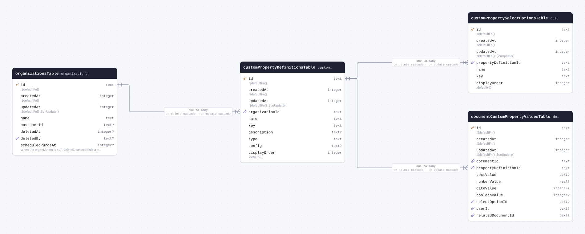

| Column                               | Type      | Constraints                                                   | Default                        | Description |
| ------------------------------------ | --------- | ------------------------------------------------------------- | ------------------------------ | ----------- |
| `id`                                 | `text`    | PK NOT NULL                                                   | `.$defaultFn()`                |             |
| `createdAt` (`created_at`)           | `integer` | NOT NULL                                                      | `.$defaultFn()`                |             |
| `updatedAt` (`updated_at`)           | `integer` | NOT NULL                                                      | `.$defaultFn()` `.$onUpdate()` |             |
| `organizationId` (`organization_id`) | `text`    | NOT NULL → [organizationsTable.id](#table-organizationsTable) |                                |             |
| `name`                               | `text`    | NOT NULL                                                      |                                |             |
| `key`                                | `text`    | NOT NULL                                                      |                                |             |
| `description`                        | `text`    | NULL                                                          |                                |             |
| `type`                               | `text`    | NOT NULL                                                      |                                |             |
| `config`                             | `text`    | NULL                                                          |                                |             |
| `displayOrder` (`display_order`)     | `integer` | NOT NULL                                                      | `.default(0)`                  |             |

#### Definition

```sql
CREATE TABLE `custom_property_definitions` (
	`id` text PRIMARY KEY,
	`created_at` integer NOT NULL,
	`updated_at` integer NOT NULL,
	`organization_id` text NOT NULL,
	`name` text NOT NULL,
	`key` text NOT NULL,
	`description` text,
	`type` text NOT NULL,
	`config` text,
	`display_order` integer DEFAULT 0 NOT NULL,
	CONSTRAINT `fk_custom_property_definitions_organization_id_organizations_id_fk` FOREIGN KEY (`organization_id`) REFERENCES `organizations`(`id`) ON UPDATE CASCADE ON DELETE CASCADE
);
```

#### References

- `organizationId` → [organizationsTable.id](#table-organizationsTable) (many to one, on delete cascade, on update cascade)

#### Referenced by

- `id` → [documentCustomPropertyValuesTable.propertyDefinitionId](#table-documentCustomPropertyValuesTable) (one to many, on delete cascade, on update cascade)
- `id` → [customPropertySelectOptionsTable.propertyDefinitionId](#table-customPropertySelectOptionsTable) (one to many, on delete cascade, on update cascade)

<details>
<summary>Queries and their SQL</summary>

**Select**: Every row of customPropertyDefinitionsTable.

```ts
db.select().from(customPropertyDefinitionsTable);
```

```sql
select "id", "created_at", "updated_at", "organization_id", "name", "key", "description", "type", "config", "display_order"
from "custom_property_definitions"
```

**Count**: How many rows customPropertyDefinitionsTable has.

```ts
db.select({ count: count() }).from(customPropertyDefinitionsTable);
```

```sql
select count(*)
from "custom_property_definitions"
```

**Find many**: The rows of customPropertyDefinitionsTable, through the relational query API.

```ts
db.query.customPropertyDefinitionsTable.findMany();
```

```sql
select "d0"."id" as "id", "d0"."created_at" as "createdAt", "d0"."updated_at" as "updatedAt", "d0"."organization_id" as "organizationId", "d0"."name" as "name", "d0"."key" as "key", "d0"."description" as "description", "d0"."type" as "type", "d0"."config" as "config", "d0"."display_order" as "displayOrder"
from "custom_property_definitions" as "d0"
```

**Find by primary key**: One row of customPropertyDefinitionsTable, through the relational query API.

```ts
db.query.customPropertyDefinitionsTable.findFirst({ where: { id: "id" } });
```

```sql
select "d0"."id" as "id", "d0"."created_at" as "createdAt", "d0"."updated_at" as "updatedAt", "d0"."organization_id" as "organizationId", "d0"."name" as "name", "d0"."key" as "key", "d0"."description" as "description", "d0"."type" as "type", "d0"."config" as "config", "d0"."display_order" as "displayOrder"
from "custom_property_definitions" as "d0"
where "d0"."id" = ?
limit ?
-- params: ["id",1]
```

**Insert**: Adds a row to customPropertyDefinitionsTable, giving the columns that have no default.

```ts
db.insert(customPropertyDefinitionsTable).values({
  organizationId: "organizationId",
  name: "name",
  key: "key",
  type: "type",
});
```

```sql
insert into "custom_property_definitions" ("id", "created_at", "updated_at", "organization_id", "name", "key", "description", "type", "config", "display_order")
values (?, ?, ?, ?, ?, ?, null, ?, null, ?)
-- params: ["cpd_a7ofm0fcy6f1116qx726weqg",1767225600000,1767225600000,"organizationId","name","key","type",0]
```

**Update**: Changes a row of customPropertyDefinitionsTable, found by its primary key.

```ts
db.update(customPropertyDefinitionsTable)
  .set({ createdAt: 1 })
  .where(eq(customPropertyDefinitionsTable.id, "id"));
```

```sql
update "custom_property_definitions"
set "created_at" = ?, "updated_at" = ?
where "custom_property_definitions"."id" = ?
-- params: [1,1767225600000,"id"]
```

**Delete**: Deletes a row of customPropertyDefinitionsTable, found by its primary key.

```ts
db.delete(customPropertyDefinitionsTable).where(eq(customPropertyDefinitionsTable.id, "id"));
```

```sql
delete from "custom_property_definitions"
where "custom_property_definitions"."id" = ?
-- params: ["id"]
```

</details>

<a id="table-documentCustomPropertyValuesTable"></a>

### documentCustomPropertyValuesTable

Table `document_custom_property_values`.

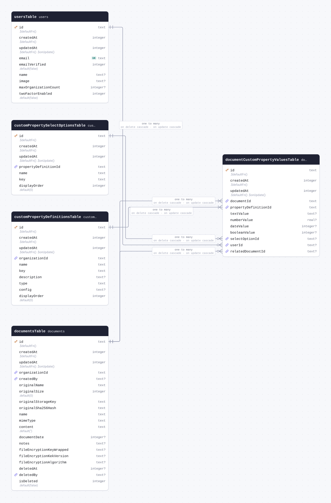

| Column                                            | Type      | Constraints                                                                           | Default                        | Description |
| ------------------------------------------------- | --------- | ------------------------------------------------------------------------------------- | ------------------------------ | ----------- |
| `id`                                              | `text`    | PK NOT NULL                                                                           | `.$defaultFn()`                |             |
| `createdAt` (`created_at`)                        | `integer` | NOT NULL                                                                              | `.$defaultFn()`                |             |
| `updatedAt` (`updated_at`)                        | `integer` | NOT NULL                                                                              | `.$defaultFn()` `.$onUpdate()` |             |
| `documentId` (`document_id`)                      | `text`    | NOT NULL → [documentsTable.id](#table-documentsTable)                                 |                                |             |
| `propertyDefinitionId` (`property_definition_id`) | `text`    | NOT NULL → [customPropertyDefinitionsTable.id](#table-customPropertyDefinitionsTable) |                                |             |
| `textValue` (`text_value`)                        | `text`    | NULL                                                                                  |                                |             |
| `numberValue` (`number_value`)                    | `real`    | NULL                                                                                  |                                |             |
| `dateValue` (`date_value`)                        | `integer` | NULL                                                                                  |                                |             |
| `booleanValue` (`boolean_value`)                  | `integer` | NULL                                                                                  |                                |             |
| `selectOptionId` (`select_option_id`)             | `text`    | NULL → [customPropertySelectOptionsTable.id](#table-customPropertySelectOptionsTable) |                                |             |
| `userId` (`user_id`)                              | `text`    | NULL → [usersTable.id](#table-usersTable)                                             |                                |             |
| `relatedDocumentId` (`related_document_id`)       | `text`    | NULL → [documentsTable.id](#table-documentsTable)                                     |                                |             |

#### Definition

```sql
CREATE TABLE `document_custom_property_values` (
	`id` text PRIMARY KEY,
	`created_at` integer NOT NULL,
	`updated_at` integer NOT NULL,
	`document_id` text NOT NULL,
	`property_definition_id` text NOT NULL,
	`text_value` text,
	`number_value` real,
	`date_value` integer,
	`boolean_value` integer,
	`select_option_id` text,
	`user_id` text,
	`related_document_id` text,
	CONSTRAINT `fk_document_custom_property_values_document_id_documents_id_fk` FOREIGN KEY (`document_id`) REFERENCES `documents`(`id`) ON UPDATE CASCADE ON DELETE CASCADE,
	CONSTRAINT `fk_document_custom_property_values_property_definition_id_custom_property_definitions_id_fk` FOREIGN KEY (`property_definition_id`) REFERENCES `custom_property_definitions`(`id`) ON UPDATE CASCADE ON DELETE CASCADE,
	CONSTRAINT `fk_document_custom_property_values_select_option_id_custom_property_select_options_id_fk` FOREIGN KEY (`select_option_id`) REFERENCES `custom_property_select_options`(`id`) ON UPDATE CASCADE ON DELETE CASCADE,
	CONSTRAINT `fk_document_custom_property_values_user_id_users_id_fk` FOREIGN KEY (`user_id`) REFERENCES `users`(`id`) ON UPDATE CASCADE ON DELETE CASCADE,
	CONSTRAINT `fk_document_custom_property_values_related_document_id_documents_id_fk` FOREIGN KEY (`related_document_id`) REFERENCES `documents`(`id`) ON UPDATE CASCADE ON DELETE CASCADE
);
```

#### References

- `documentId` → [documentsTable.id](#table-documentsTable) (many to one, on delete cascade, on update cascade)
- `propertyDefinitionId` → [customPropertyDefinitionsTable.id](#table-customPropertyDefinitionsTable) (many to one, on delete cascade, on update cascade)
- `selectOptionId` → [customPropertySelectOptionsTable.id](#table-customPropertySelectOptionsTable) (many to one, on delete cascade, on update cascade)
- `userId` → [usersTable.id](#table-usersTable) (many to one, on delete cascade, on update cascade)
- `relatedDocumentId` → [documentsTable.id](#table-documentsTable) (many to one, on delete cascade, on update cascade)

<details>
<summary>Queries and their SQL</summary>

**Select**: Every row of documentCustomPropertyValuesTable.

```ts
db.select().from(documentCustomPropertyValuesTable);
```

```sql
select "id", "created_at", "updated_at", "document_id", "property_definition_id", "text_value", "number_value", "date_value", "boolean_value", "select_option_id", "user_id", "related_document_id"
from "document_custom_property_values"
```

**Count**: How many rows documentCustomPropertyValuesTable has.

```ts
db.select({ count: count() }).from(documentCustomPropertyValuesTable);
```

```sql
select count(*)
from "document_custom_property_values"
```

**Find many**: The rows of documentCustomPropertyValuesTable, through the relational query API.

```ts
db.query.documentCustomPropertyValuesTable.findMany();
```

```sql
select "d0"."id" as "id", "d0"."created_at" as "createdAt", "d0"."updated_at" as "updatedAt", "d0"."document_id" as "documentId", "d0"."property_definition_id" as "propertyDefinitionId", "d0"."text_value" as "textValue", "d0"."number_value" as "numberValue", "d0"."date_value" as "dateValue", "d0"."boolean_value" as "booleanValue", "d0"."select_option_id" as "selectOptionId", "d0"."user_id" as "userId", "d0"."related_document_id" as "relatedDocumentId"
from "document_custom_property_values" as "d0"
```

**Find by primary key**: One row of documentCustomPropertyValuesTable, through the relational query API.

```ts
db.query.documentCustomPropertyValuesTable.findFirst({ where: { id: "id" } });
```

```sql
select "d0"."id" as "id", "d0"."created_at" as "createdAt", "d0"."updated_at" as "updatedAt", "d0"."document_id" as "documentId", "d0"."property_definition_id" as "propertyDefinitionId", "d0"."text_value" as "textValue", "d0"."number_value" as "numberValue", "d0"."date_value" as "dateValue", "d0"."boolean_value" as "booleanValue", "d0"."select_option_id" as "selectOptionId", "d0"."user_id" as "userId", "d0"."related_document_id" as "relatedDocumentId"
from "document_custom_property_values" as "d0"
where "d0"."id" = ?
limit ?
-- params: ["id",1]
```

**Insert**: Adds a row to documentCustomPropertyValuesTable, giving the columns that have no default.

```ts
db.insert(documentCustomPropertyValuesTable).values({
  documentId: "documentId",
  propertyDefinitionId: "propertyDefinitionId",
});
```

```sql
insert into "document_custom_property_values" ("id", "created_at", "updated_at", "document_id", "property_definition_id", "text_value", "number_value", "date_value", "boolean_value", "select_option_id", "user_id", "related_document_id")
values (?, ?, ?, ?, ?, null, null, null, null, null, null, null)
-- params: ["dcpv_av75q6esfcpr3alwk7a8i70g",1767225600000,1767225600000,"documentId","propertyDefinitionId"]
```

**Update**: Changes a row of documentCustomPropertyValuesTable, found by its primary key.

```ts
db.update(documentCustomPropertyValuesTable)
  .set({ createdAt: 1 })
  .where(eq(documentCustomPropertyValuesTable.id, "id"));
```

```sql
update "document_custom_property_values"
set "created_at" = ?, "updated_at" = ?
where "document_custom_property_values"."id" = ?
-- params: [1,1767225600000,"id"]
```

**Delete**: Deletes a row of documentCustomPropertyValuesTable, found by its primary key.

```ts
db.delete(documentCustomPropertyValuesTable).where(eq(documentCustomPropertyValuesTable.id, "id"));
```

```sql
delete from "document_custom_property_values"
where "document_custom_property_values"."id" = ?
-- params: ["id"]
```

</details>

<a id="table-customPropertySelectOptionsTable"></a>

### customPropertySelectOptionsTable

Table `custom_property_select_options`.

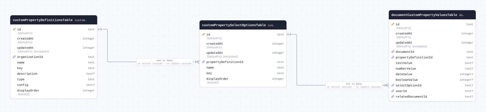

| Column                                            | Type      | Constraints                                                                           | Default                        | Description |
| ------------------------------------------------- | --------- | ------------------------------------------------------------------------------------- | ------------------------------ | ----------- |
| `id`                                              | `text`    | PK NOT NULL                                                                           | `.$defaultFn()`                |             |
| `createdAt` (`created_at`)                        | `integer` | NOT NULL                                                                              | `.$defaultFn()`                |             |
| `updatedAt` (`updated_at`)                        | `integer` | NOT NULL                                                                              | `.$defaultFn()` `.$onUpdate()` |             |
| `propertyDefinitionId` (`property_definition_id`) | `text`    | NOT NULL → [customPropertyDefinitionsTable.id](#table-customPropertyDefinitionsTable) |                                |             |
| `name`                                            | `text`    | NOT NULL                                                                              |                                |             |
| `key`                                             | `text`    | NOT NULL                                                                              |                                |             |
| `displayOrder` (`display_order`)                  | `integer` | NOT NULL                                                                              | `.default(0)`                  |             |

#### Definition

```sql
CREATE TABLE `custom_property_select_options` (
	`id` text PRIMARY KEY,
	`created_at` integer NOT NULL,
	`updated_at` integer NOT NULL,
	`property_definition_id` text NOT NULL,
	`name` text NOT NULL,
	`key` text NOT NULL,
	`display_order` integer DEFAULT 0 NOT NULL,
	CONSTRAINT `fk_custom_property_select_options_property_definition_id_custom_property_definitions_id_fk` FOREIGN KEY (`property_definition_id`) REFERENCES `custom_property_definitions`(`id`) ON UPDATE CASCADE ON DELETE CASCADE
);
```

#### References

- `propertyDefinitionId` → [customPropertyDefinitionsTable.id](#table-customPropertyDefinitionsTable) (many to one, on delete cascade, on update cascade)

#### Referenced by

- `id` → [documentCustomPropertyValuesTable.selectOptionId](#table-documentCustomPropertyValuesTable) (one to many, on delete cascade, on update cascade)

<details>
<summary>Queries and their SQL</summary>

**Select**: Every row of customPropertySelectOptionsTable.

```ts
db.select().from(customPropertySelectOptionsTable);
```

```sql
select "id", "created_at", "updated_at", "property_definition_id", "name", "key", "display_order"
from "custom_property_select_options"
```

**Count**: How many rows customPropertySelectOptionsTable has.

```ts
db.select({ count: count() }).from(customPropertySelectOptionsTable);
```

```sql
select count(*)
from "custom_property_select_options"
```

**Find many**: The rows of customPropertySelectOptionsTable, through the relational query API.

```ts
db.query.customPropertySelectOptionsTable.findMany();
```

```sql
select "d0"."id" as "id", "d0"."created_at" as "createdAt", "d0"."updated_at" as "updatedAt", "d0"."property_definition_id" as "propertyDefinitionId", "d0"."name" as "name", "d0"."key" as "key", "d0"."display_order" as "displayOrder"
from "custom_property_select_options" as "d0"
```

**Find by primary key**: One row of customPropertySelectOptionsTable, through the relational query API.

```ts
db.query.customPropertySelectOptionsTable.findFirst({ where: { id: "id" } });
```

```sql
select "d0"."id" as "id", "d0"."created_at" as "createdAt", "d0"."updated_at" as "updatedAt", "d0"."property_definition_id" as "propertyDefinitionId", "d0"."name" as "name", "d0"."key" as "key", "d0"."display_order" as "displayOrder"
from "custom_property_select_options" as "d0"
where "d0"."id" = ?
limit ?
-- params: ["id",1]
```

**Insert**: Adds a row to customPropertySelectOptionsTable, giving the columns that have no default.

```ts
db.insert(customPropertySelectOptionsTable).values({
  propertyDefinitionId: "propertyDefinitionId",
  name: "name",
  key: "key",
});
```

```sql
insert into "custom_property_select_options" ("id", "created_at", "updated_at", "property_definition_id", "name", "key", "display_order")
values (?, ?, ?, ?, ?, ?, ?)
-- params: ["cpso_a618zfdrek4eymgkawas43uv",1767225600000,1767225600000,"propertyDefinitionId","name","key",0]
```

**Update**: Changes a row of customPropertySelectOptionsTable, found by its primary key.

```ts
db.update(customPropertySelectOptionsTable)
  .set({ createdAt: 1 })
  .where(eq(customPropertySelectOptionsTable.id, "id"));
```

```sql
update "custom_property_select_options"
set "created_at" = ?, "updated_at" = ?
where "custom_property_select_options"."id" = ?
-- params: [1,1767225600000,"id"]
```

**Delete**: Deletes a row of customPropertySelectOptionsTable, found by its primary key.

```ts
db.delete(customPropertySelectOptionsTable).where(eq(customPropertySelectOptionsTable.id, "id"));
```

```sql
delete from "custom_property_select_options"
where "custom_property_select_options"."id" = ?
-- params: ["id"]
```

</details>

<a id="table-documentShareLinksTable"></a>

### documentShareLinksTable

Table `document_share_links`.

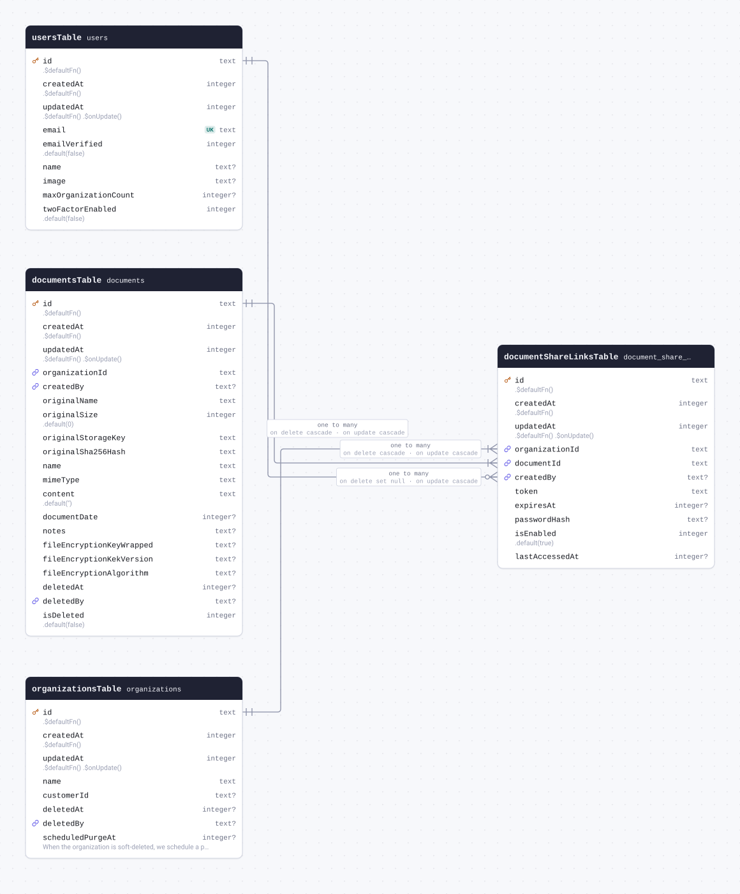

| Column                                | Type      | Constraints                                                   | Default                        | Description |
| ------------------------------------- | --------- | ------------------------------------------------------------- | ------------------------------ | ----------- |
| `id`                                  | `text`    | PK NOT NULL                                                   | `.$defaultFn()`                |             |
| `createdAt` (`created_at`)            | `integer` | NOT NULL                                                      | `.$defaultFn()`                |             |
| `updatedAt` (`updated_at`)            | `integer` | NOT NULL                                                      | `.$defaultFn()` `.$onUpdate()` |             |
| `organizationId` (`organization_id`)  | `text`    | NOT NULL → [organizationsTable.id](#table-organizationsTable) |                                |             |
| `documentId` (`document_id`)          | `text`    | NOT NULL → [documentsTable.id](#table-documentsTable)         |                                |             |
| `createdBy` (`created_by`)            | `text`    | NULL → [usersTable.id](#table-usersTable)                     |                                |             |
| `token`                               | `text`    | NOT NULL                                                      |                                |             |
| `expiresAt` (`expires_at`)            | `integer` | NULL                                                          |                                |             |
| `passwordHash` (`password_hash`)      | `text`    | NULL                                                          |                                |             |
| `isEnabled` (`is_enabled`)            | `integer` | NOT NULL                                                      | `.default(true)`               |             |
| `lastAccessedAt` (`last_accessed_at`) | `integer` | NULL                                                          |                                |             |

#### Definition

```sql
CREATE TABLE `document_share_links` (
	`id` text PRIMARY KEY,
	`created_at` integer NOT NULL,
	`updated_at` integer NOT NULL,
	`organization_id` text NOT NULL,
	`document_id` text NOT NULL,
	`created_by` text,
	`token` text NOT NULL,
	`expires_at` integer,
	`password_hash` text,
	`is_enabled` integer DEFAULT true NOT NULL,
	`last_accessed_at` integer,
	CONSTRAINT `fk_document_share_links_organization_id_organizations_id_fk` FOREIGN KEY (`organization_id`) REFERENCES `organizations`(`id`) ON UPDATE CASCADE ON DELETE CASCADE,
	CONSTRAINT `fk_document_share_links_document_id_documents_id_fk` FOREIGN KEY (`document_id`) REFERENCES `documents`(`id`) ON UPDATE CASCADE ON DELETE CASCADE,
	CONSTRAINT `fk_document_share_links_created_by_users_id_fk` FOREIGN KEY (`created_by`) REFERENCES `users`(`id`) ON UPDATE CASCADE ON DELETE SET NULL
);
```

#### References

- `organizationId` → [organizationsTable.id](#table-organizationsTable) (many to one, on delete cascade, on update cascade)
- `documentId` → [documentsTable.id](#table-documentsTable) (many to one, on delete cascade, on update cascade)
- `createdBy` → [usersTable.id](#table-usersTable) (many to one, on delete set null, on update cascade)

<details>
<summary>Queries and their SQL</summary>

**Select**: Every row of documentShareLinksTable.

```ts
db.select().from(documentShareLinksTable);
```

```sql
select "id", "created_at", "updated_at", "organization_id", "document_id", "created_by", "token", "expires_at", "password_hash", "is_enabled", "last_accessed_at"
from "document_share_links"
```

**Count**: How many rows documentShareLinksTable has.

```ts
db.select({ count: count() }).from(documentShareLinksTable);
```

```sql
select count(*)
from "document_share_links"
```

**Find many**: The rows of documentShareLinksTable, through the relational query API.

```ts
db.query.documentShareLinksTable.findMany();
```

```sql
select "d0"."id" as "id", "d0"."created_at" as "createdAt", "d0"."updated_at" as "updatedAt", "d0"."organization_id" as "organizationId", "d0"."document_id" as "documentId", "d0"."created_by" as "createdBy", "d0"."token" as "token", "d0"."expires_at" as "expiresAt", "d0"."password_hash" as "passwordHash", "d0"."is_enabled" as "isEnabled", "d0"."last_accessed_at" as "lastAccessedAt"
from "document_share_links" as "d0"
```

**Find by primary key**: One row of documentShareLinksTable, through the relational query API.

```ts
db.query.documentShareLinksTable.findFirst({ where: { id: "id" } });
```

```sql
select "d0"."id" as "id", "d0"."created_at" as "createdAt", "d0"."updated_at" as "updatedAt", "d0"."organization_id" as "organizationId", "d0"."document_id" as "documentId", "d0"."created_by" as "createdBy", "d0"."token" as "token", "d0"."expires_at" as "expiresAt", "d0"."password_hash" as "passwordHash", "d0"."is_enabled" as "isEnabled", "d0"."last_accessed_at" as "lastAccessedAt"
from "document_share_links" as "d0"
where "d0"."id" = ?
limit ?
-- params: ["id",1]
```

**Insert**: Adds a row to documentShareLinksTable, giving the columns that have no default.

```ts
db.insert(documentShareLinksTable).values({
  organizationId: "organizationId",
  documentId: "documentId",
  token: "token",
});
```

```sql
insert into "document_share_links" ("id", "created_at", "updated_at", "organization_id", "document_id", "created_by", "token", "expires_at", "password_hash", "is_enabled", "last_accessed_at")
values (?, ?, ?, ?, ?, null, ?, null, null, ?, null)
-- params: ["dsl_aja9qkn2phkz049feu9kszas",1767225600000,1767225600000,"organizationId","documentId","token",1]
```

**Update**: Changes a row of documentShareLinksTable, found by its primary key.

```ts
db.update(documentShareLinksTable)
  .set({ createdAt: 1 })
  .where(eq(documentShareLinksTable.id, "id"));
```

```sql
update "document_share_links"
set "created_at" = ?, "updated_at" = ?
where "document_share_links"."id" = ?
-- params: [1,1767225600000,"id"]
```

**Delete**: Deletes a row of documentShareLinksTable, found by its primary key.

```ts
db.delete(documentShareLinksTable).where(eq(documentShareLinksTable.id, "id"));
```

```sql
delete from "document_share_links"
where "document_share_links"."id" = ?
-- params: ["id"]
```

</details>

<a id="table-documentViewsTable"></a>

### documentViewsTable

Table `document_views`.


| Column                               | Type      | Constraints                                                   | Default                        | Description |
| ------------------------------------ | --------- | ------------------------------------------------------------- | ------------------------------ | ----------- |
| `id`                                 | `text`    | PK NOT NULL                                                   | `.$defaultFn()`                |             |
| `createdAt` (`created_at`)           | `integer` | NOT NULL                                                      | `.$defaultFn()`                |             |
| `updatedAt` (`updated_at`)           | `integer` | NOT NULL                                                      | `.$defaultFn()` `.$onUpdate()` |             |
| `organizationId` (`organization_id`) | `text`    | NOT NULL → [organizationsTable.id](#table-organizationsTable) |                                |             |
| `name`                               | `text`    | NOT NULL                                                      |                                |             |
| `query`                              | `text`    | NOT NULL                                                      |                                |             |
| `description`                        | `text`    | NULL                                                          |                                |             |

#### Definition

```sql
CREATE TABLE `document_views` (
	`id` text PRIMARY KEY,
	`created_at` integer NOT NULL,
	`updated_at` integer NOT NULL,
	`organization_id` text NOT NULL,
	`name` text NOT NULL,
	`query` text NOT NULL,
	`description` text,
	CONSTRAINT `fk_document_views_organization_id_organizations_id_fk` FOREIGN KEY (`organization_id`) REFERENCES `organizations`(`id`) ON UPDATE CASCADE ON DELETE CASCADE
);
```

#### References

- `organizationId` → [organizationsTable.id](#table-organizationsTable) (many to one, on delete cascade, on update cascade)

<details>
<summary>Queries and their SQL</summary>

**Select**: Every row of documentViewsTable.

```ts
db.select().from(documentViewsTable);
```

```sql
select "id", "created_at", "updated_at", "organization_id", "name", "query", "description"
from "document_views"
```

**Count**: How many rows documentViewsTable has.

```ts
db.select({ count: count() }).from(documentViewsTable);
```

```sql
select count(*)
from "document_views"
```

**Find many**: The rows of documentViewsTable, through the relational query API.

```ts
db.query.documentViewsTable.findMany();
```

```sql
select "d0"."id" as "id", "d0"."created_at" as "createdAt", "d0"."updated_at" as "updatedAt", "d0"."organization_id" as "organizationId", "d0"."name" as "name", "d0"."query" as "query", "d0"."description" as "description"
from "document_views" as "d0"
```

**Find by primary key**: One row of documentViewsTable, through the relational query API.

```ts
db.query.documentViewsTable.findFirst({ where: { id: "id" } });
```

```sql
select "d0"."id" as "id", "d0"."created_at" as "createdAt", "d0"."updated_at" as "updatedAt", "d0"."organization_id" as "organizationId", "d0"."name" as "name", "d0"."query" as "query", "d0"."description" as "description"
from "document_views" as "d0"
where "d0"."id" = ?
limit ?
-- params: ["id",1]
```

**Insert**: Adds a row to documentViewsTable, giving the columns that have no default.

```ts
db.insert(documentViewsTable).values({
  organizationId: "organizationId",
  name: "name",
  query: "query",
});
```

```sql
insert into "document_views" ("id", "created_at", "updated_at", "organization_id", "name", "query", "description")
values (?, ?, ?, ?, ?, ?, null)
-- params: ["dv_al9h48o50vx3uknxzh7qeqbv",1767225600000,1767225600000,"organizationId","name","query"]
```

**Update**: Changes a row of documentViewsTable, found by its primary key.

```ts
db.update(documentViewsTable).set({ createdAt: 1 }).where(eq(documentViewsTable.id, "id"));
```

```sql
update "document_views"
set "created_at" = ?, "updated_at" = ?
where "document_views"."id" = ?
-- params: [1,1767225600000,"id"]
```

**Delete**: Deletes a row of documentViewsTable, found by its primary key.

```ts
db.delete(documentViewsTable).where(eq(documentViewsTable.id, "id"));
```

```sql
delete from "document_views"
where "document_views"."id" = ?
-- params: ["id"]
```

</details>

<a id="table-documentActivityLogTable"></a>

### documentActivityLogTable

Table `document_activity_log`.

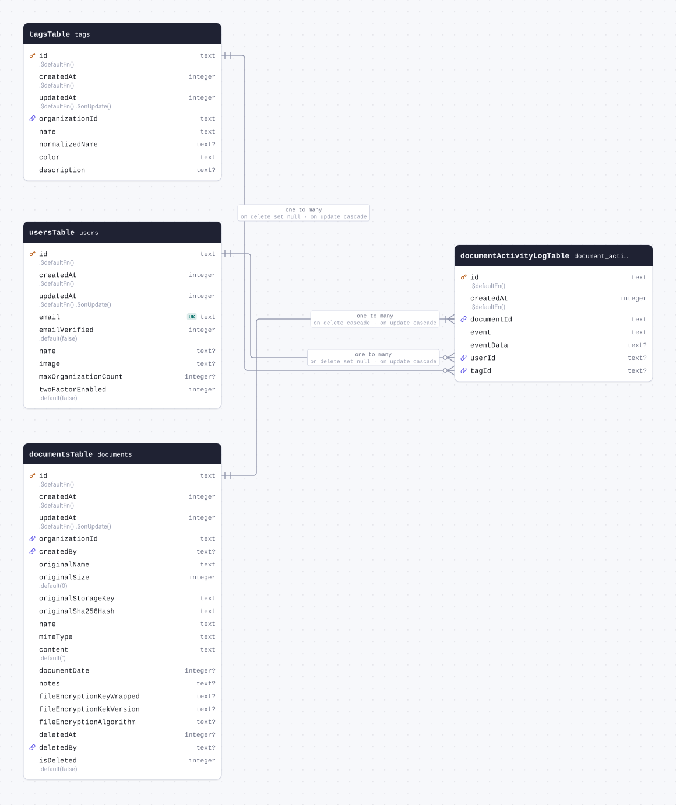

| Column                       | Type      | Constraints                                           | Default         | Description |
| ---------------------------- | --------- | ----------------------------------------------------- | --------------- | ----------- |
| `id`                         | `text`    | PK NOT NULL                                           | `.$defaultFn()` |             |
| `createdAt` (`created_at`)   | `integer` | NOT NULL                                              | `.$defaultFn()` |             |
| `documentId` (`document_id`) | `text`    | NOT NULL → [documentsTable.id](#table-documentsTable) |                 |             |
| `event`                      | `text`    | NOT NULL                                              |                 |             |
| `eventData` (`event_data`)   | `text`    | NULL                                                  |                 |             |
| `userId` (`user_id`)         | `text`    | NULL → [usersTable.id](#table-usersTable)             |                 |             |
| `tagId` (`tag_id`)           | `text`    | NULL → [tagsTable.id](#table-tagsTable)               |                 |             |

#### Definition

```sql
CREATE TABLE `document_activity_log` (
	`id` text PRIMARY KEY,
	`created_at` integer NOT NULL,
	`document_id` text NOT NULL,
	`event` text NOT NULL,
	`event_data` text,
	`user_id` text,
	`tag_id` text,
	CONSTRAINT `fk_document_activity_log_document_id_documents_id_fk` FOREIGN KEY (`document_id`) REFERENCES `documents`(`id`) ON UPDATE CASCADE ON DELETE CASCADE,
	CONSTRAINT `fk_document_activity_log_user_id_users_id_fk` FOREIGN KEY (`user_id`) REFERENCES `users`(`id`) ON UPDATE CASCADE ON DELETE SET NULL,
	CONSTRAINT `fk_document_activity_log_tag_id_tags_id_fk` FOREIGN KEY (`tag_id`) REFERENCES `tags`(`id`) ON UPDATE CASCADE ON DELETE SET NULL
);
```

#### References

- `documentId` → [documentsTable.id](#table-documentsTable) (many to one, on delete cascade, on update cascade)
- `userId` → [usersTable.id](#table-usersTable) (many to one, on delete set null, on update cascade)
- `tagId` → [tagsTable.id](#table-tagsTable) (many to one, on delete set null, on update cascade)

<details>
<summary>Queries and their SQL</summary>

**Select**: Every row of documentActivityLogTable.

```ts
db.select().from(documentActivityLogTable);
```

```sql
select "id", "created_at", "document_id", "event", "event_data", "user_id", "tag_id"
from "document_activity_log"
```

**Count**: How many rows documentActivityLogTable has.

```ts
db.select({ count: count() }).from(documentActivityLogTable);
```

```sql
select count(*)
from "document_activity_log"
```

**Find many**: The rows of documentActivityLogTable, through the relational query API.

```ts
db.query.documentActivityLogTable.findMany();
```

```sql
select "d0"."id" as "id", "d0"."created_at" as "createdAt", "d0"."document_id" as "documentId", "d0"."event" as "event", "d0"."event_data" as "eventData", "d0"."user_id" as "userId", "d0"."tag_id" as "tagId"
from "document_activity_log" as "d0"
```

**Find by primary key**: One row of documentActivityLogTable, through the relational query API.

```ts
db.query.documentActivityLogTable.findFirst({ where: { id: "id" } });
```

```sql
select "d0"."id" as "id", "d0"."created_at" as "createdAt", "d0"."document_id" as "documentId", "d0"."event" as "event", "d0"."event_data" as "eventData", "d0"."user_id" as "userId", "d0"."tag_id" as "tagId"
from "document_activity_log" as "d0"
where "d0"."id" = ?
limit ?
-- params: ["id",1]
```

**Insert**: Adds a row to documentActivityLogTable, giving the columns that have no default.

```ts
db.insert(documentActivityLogTable).values({ documentId: "documentId", event: "event" });
```

```sql
insert into "document_activity_log" ("id", "created_at", "document_id", "event", "event_data", "user_id", "tag_id")
values (?, ?, ?, ?, null, null, null)
-- params: ["doc_act_a9djsixc6jxrsv8dzy45e2fh",1767225600000,"documentId","event"]
```

**Update**: Changes a row of documentActivityLogTable, found by its primary key.

```ts
db.update(documentActivityLogTable)
  .set({ createdAt: 1 })
  .where(eq(documentActivityLogTable.id, "id"));
```

```sql
update "document_activity_log"
set "created_at" = ?
where "document_activity_log"."id" = ?
-- params: [1,"id"]
```

**Delete**: Deletes a row of documentActivityLogTable, found by its primary key.

```ts
db.delete(documentActivityLogTable).where(eq(documentActivityLogTable.id, "id"));
```

```sql
delete from "document_activity_log"
where "document_activity_log"."id" = ?
-- params: ["id"]
```

</details>

<a id="table-documentsTable"></a>

### documentsTable

Table `documents`.

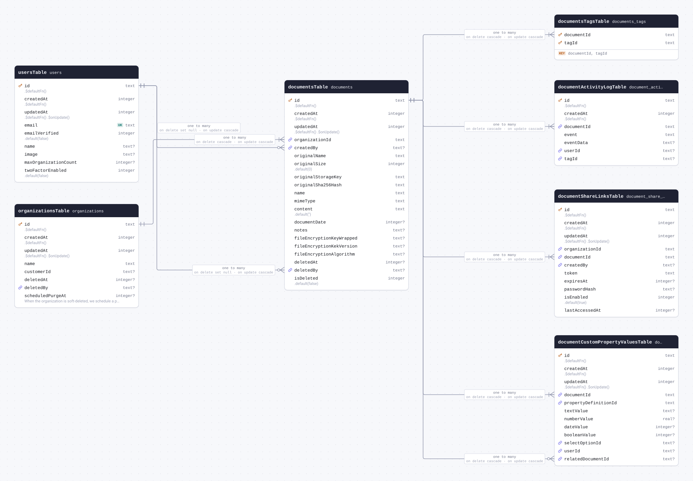

| Column                                                     | Type      | Constraints                                                   | Default                        | Description |
| ---------------------------------------------------------- | --------- | ------------------------------------------------------------- | ------------------------------ | ----------- |
| `id`                                                       | `text`    | PK NOT NULL                                                   | `.$defaultFn()`                |             |
| `createdAt` (`created_at`)                                 | `integer` | NOT NULL                                                      | `.$defaultFn()`                |             |
| `updatedAt` (`updated_at`)                                 | `integer` | NOT NULL                                                      | `.$defaultFn()` `.$onUpdate()` |             |
| `organizationId` (`organization_id`)                       | `text`    | NOT NULL → [organizationsTable.id](#table-organizationsTable) |                                |             |
| `createdBy` (`created_by`)                                 | `text`    | NULL → [usersTable.id](#table-usersTable)                     |                                |             |
| `originalName` (`original_name`)                           | `text`    | NOT NULL                                                      |                                |             |
| `originalSize` (`original_size`)                           | `integer` | NOT NULL                                                      | `.default(0)`                  |             |
| `originalStorageKey` (`original_storage_key`)              | `text`    | NOT NULL                                                      |                                |             |
| `originalSha256Hash` (`original_sha256_hash`)              | `text`    | NOT NULL                                                      |                                |             |
| `name`                                                     | `text`    | NOT NULL                                                      |                                |             |
| `mimeType` (`mime_type`)                                   | `text`    | NOT NULL                                                      |                                |             |
| `content`                                                  | `text`    | NOT NULL                                                      | `.default('')`                 |             |
| `documentDate` (`document_date`)                           | `integer` | NULL                                                          |                                |             |
| `notes`                                                    | `text`    | NULL                                                          |                                |             |
| `fileEncryptionKeyWrapped` (`file_encryption_key_wrapped`) | `text`    | NULL                                                          |                                |             |
| `fileEncryptionKekVersion` (`file_encryption_kek_version`) | `text`    | NULL                                                          |                                |             |
| `fileEncryptionAlgorithm` (`file_encryption_algorithm`)    | `text`    | NULL                                                          |                                |             |
| `deletedAt` (`deleted_at`)                                 | `integer` | NULL                                                          |                                |             |
| `deletedBy` (`deleted_by`)                                 | `text`    | NULL → [usersTable.id](#table-usersTable)                     |                                |             |
| `isDeleted` (`is_deleted`)                                 | `integer` | NOT NULL                                                      | `.default(false)`              |             |

#### Definition

```sql
CREATE TABLE `documents` (
	`id` text PRIMARY KEY,
	`created_at` integer NOT NULL,
	`updated_at` integer NOT NULL,
	`organization_id` text NOT NULL,
	`created_by` text,
	`original_name` text NOT NULL,
	`original_size` integer DEFAULT 0 NOT NULL,
	`original_storage_key` text NOT NULL,
	`original_sha256_hash` text NOT NULL,
	`name` text NOT NULL,
	`mime_type` text NOT NULL,
	`content` text DEFAULT '' NOT NULL,
	`document_date` integer,
	`notes` text,
	`file_encryption_key_wrapped` text,
	`file_encryption_kek_version` text,
	`file_encryption_algorithm` text,
	`deleted_at` integer,
	`deleted_by` text,
	`is_deleted` integer DEFAULT false NOT NULL,
	CONSTRAINT `fk_documents_organization_id_organizations_id_fk` FOREIGN KEY (`organization_id`) REFERENCES `organizations`(`id`) ON UPDATE CASCADE ON DELETE CASCADE,
	CONSTRAINT `fk_documents_created_by_users_id_fk` FOREIGN KEY (`created_by`) REFERENCES `users`(`id`) ON UPDATE CASCADE ON DELETE SET NULL,
	CONSTRAINT `fk_documents_deleted_by_users_id_fk` FOREIGN KEY (`deleted_by`) REFERENCES `users`(`id`) ON UPDATE CASCADE ON DELETE SET NULL
);
```

#### References

- `organizationId` → [organizationsTable.id](#table-organizationsTable) (many to one, on delete cascade, on update cascade)
- `createdBy` → [usersTable.id](#table-usersTable) (many to one, on delete set null, on update cascade)
- `deletedBy` → [usersTable.id](#table-usersTable) (many to one, on delete set null, on update cascade)

#### Referenced by

- `id` → [documentCustomPropertyValuesTable.documentId](#table-documentCustomPropertyValuesTable) (one to many, on delete cascade, on update cascade)
- `id` → [documentCustomPropertyValuesTable.relatedDocumentId](#table-documentCustomPropertyValuesTable) (one to many, on delete cascade, on update cascade)
- `id` → [documentShareLinksTable.documentId](#table-documentShareLinksTable) (one to many, on delete cascade, on update cascade)
- `id` → [documentActivityLogTable.documentId](#table-documentActivityLogTable) (one to many, on delete cascade, on update cascade)
- `id` → [documentsTagsTable.documentId](#table-documentsTagsTable) (one to many, on delete cascade, on update cascade)

<details>
<summary>Queries and their SQL</summary>

**Select**: Every row of documentsTable.

```ts
db.select().from(documentsTable);
```

```sql
select "id", "created_at", "updated_at", "organization_id", "created_by", "original_name", "original_size", "original_storage_key", "original_sha256_hash", "name", "mime_type", "content", "document_date", "notes", "file_encryption_key_wrapped", "file_encryption_kek_version", "file_encryption_algorithm", "deleted_at", "deleted_by", "is_deleted"
from "documents"
```

**Count**: How many rows documentsTable has.

```ts
db.select({ count: count() }).from(documentsTable);
```

```sql
select count(*)
from "documents"
```

**Find many**: The rows of documentsTable, through the relational query API.

```ts
db.query.documentsTable.findMany();
```

```sql
select "d0"."id" as "id", "d0"."created_at" as "createdAt", "d0"."updated_at" as "updatedAt", "d0"."organization_id" as "organizationId", "d0"."created_by" as "createdBy", "d0"."original_name" as "originalName", "d0"."original_size" as "originalSize", "d0"."original_storage_key" as "originalStorageKey", "d0"."original_sha256_hash" as "originalSha256Hash", "d0"."name" as "name", "d0"."mime_type" as "mimeType", "d0"."content" as "content", "d0"."document_date" as "documentDate", "d0"."notes" as "notes", "d0"."file_encryption_key_wrapped" as "fileEncryptionKeyWrapped", "d0"."file_encryption_kek_version" as "fileEncryptionKekVersion", "d0"."file_encryption_algorithm" as "fileEncryptionAlgorithm", "d0"."deleted_at" as "deletedAt", "d0"."deleted_by" as "deletedBy", "d0"."is_deleted" as "isDeleted"
from "documents" as "d0"
```

**Find by primary key**: One row of documentsTable, through the relational query API.

```ts
db.query.documentsTable.findFirst({ where: { id: "id" } });
```

```sql
select "d0"."id" as "id", "d0"."created_at" as "createdAt", "d0"."updated_at" as "updatedAt", "d0"."organization_id" as "organizationId", "d0"."created_by" as "createdBy", "d0"."original_name" as "originalName", "d0"."original_size" as "originalSize", "d0"."original_storage_key" as "originalStorageKey", "d0"."original_sha256_hash" as "originalSha256Hash", "d0"."name" as "name", "d0"."mime_type" as "mimeType", "d0"."content" as "content", "d0"."document_date" as "documentDate", "d0"."notes" as "notes", "d0"."file_encryption_key_wrapped" as "fileEncryptionKeyWrapped", "d0"."file_encryption_kek_version" as "fileEncryptionKekVersion", "d0"."file_encryption_algorithm" as "fileEncryptionAlgorithm", "d0"."deleted_at" as "deletedAt", "d0"."deleted_by" as "deletedBy", "d0"."is_deleted" as "isDeleted"
from "documents" as "d0"
where "d0"."id" = ?
limit ?
-- params: ["id",1]
```

**Insert**: Adds a row to documentsTable, giving the columns that have no default.

```ts
db.insert(documentsTable).values({
  organizationId: "organizationId",
  originalName: "originalName",
  originalStorageKey: "originalStorageKey",
  originalSha256Hash: "originalSha256Hash",
  name: "name",
  mimeType: "mimeType",
});
```

```sql
insert into "documents" ("id", "created_at", "updated_at", "organization_id", "created_by", "original_name", "original_size", "original_storage_key", "original_sha256_hash", "name", "mime_type", "content", "document_date", "notes", "file_encryption_key_wrapped", "file_encryption_kek_version", "file_encryption_algorithm", "deleted_at", "deleted_by", "is_deleted")
values (?, ?, ?, ?, null, ?, ?, ?, ?, ?, ?, ?, null, null, null, null, null, null, null, ?)
-- params: ["doc_afnobm3dk3n8tv2nn7b279l5",1767225600000,1767225600000,"organizationId","originalName",0,"originalStorageKey","originalSha256Hash","name","mimeType","",0]
```

**Update**: Changes a row of documentsTable, found by its primary key.

```ts
db.update(documentsTable).set({ createdAt: 1 }).where(eq(documentsTable.id, "id"));
```

```sql
update "documents"
set "created_at" = ?, "updated_at" = ?
where "documents"."id" = ?
-- params: [1,1767225600000,"id"]
```

**Delete**: Deletes a row of documentsTable, found by its primary key.

```ts
db.delete(documentsTable).where(eq(documentsTable.id, "id"));
```

```sql
delete from "documents"
where "documents"."id" = ?
-- params: ["id"]
```

</details>

<a id="table-kvStoreTable"></a>

### kvStoreTable

Table `kv_store`.

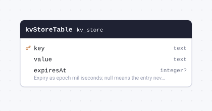

| Column                     | Type      | Constraints | Default | Description                                                       |
| -------------------------- | --------- | ----------- | ------- | ----------------------------------------------------------------- |
| `key`                      | `text`    | PK NOT NULL |         |                                                                   |
| `value`                    | `text`    | NOT NULL    |         |                                                                   |
| `expiresAt` (`expires_at`) | `integer` | NULL        |         | Expiry as epoch milliseconds; null means the entry never expires. |

#### Definition

```sql
CREATE TABLE `kv_store` (
	`key` text PRIMARY KEY,
	`value` text NOT NULL,
	`expires_at` integer
);
```

<details>
<summary>Queries and their SQL</summary>

**Select**: Every row of kvStoreTable.

```ts
db.select().from(kvStoreTable);
```

```sql
select "key", "value", "expires_at"
from "kv_store"
```

**Count**: How many rows kvStoreTable has.

```ts
db.select({ count: count() }).from(kvStoreTable);
```

```sql
select count(*)
from "kv_store"
```

**Find many**: The rows of kvStoreTable, through the relational query API.

```ts
db.query.kvStoreTable.findMany();
```

```sql
select "d0"."key" as "key", "d0"."value" as "value", "d0"."expires_at" as "expiresAt"
from "kv_store" as "d0"
```

**Find by primary key**: One row of kvStoreTable, through the relational query API.

```ts
db.query.kvStoreTable.findFirst({ where: { key: "key" } });
```

```sql
select "d0"."key" as "key", "d0"."value" as "value", "d0"."expires_at" as "expiresAt"
from "kv_store" as "d0"
where "d0"."key" = ?
limit ?
-- params: ["key",1]
```

**Insert**: Adds a row to kvStoreTable, giving the columns that have no default.

```ts
db.insert(kvStoreTable).values({ key: "key", value: "value" });
```

```sql
insert into "kv_store" ("key", "value", "expires_at")
values (?, ?, null)
-- params: ["key","\"value\""]
```

**Update**: Changes a row of kvStoreTable, found by its primary key.

```ts
db.update(kvStoreTable).set({ value: "value" }).where(eq(kvStoreTable.key, "key"));
```

```sql
update "kv_store"
set "value" = ?
where "kv_store"."key" = ?
-- params: ["\"value\"","key"]
```

**Delete**: Deletes a row of kvStoreTable, found by its primary key.

```ts
db.delete(kvStoreTable).where(eq(kvStoreTable.key, "key"));
```

```sql
delete from "kv_store"
where "kv_store"."key" = ?
-- params: ["key"]
```

</details>

<a id="table-organizationsTable"></a>

### organizationsTable

Table `organizations`.

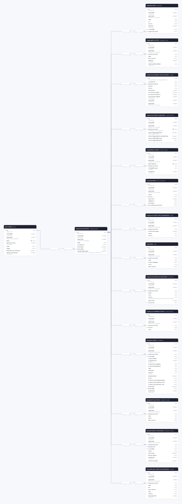

| Column                                    | Type      | Constraints                               | Default                        | Description                                                                                               |
| ----------------------------------------- | --------- | ----------------------------------------- | ------------------------------ | --------------------------------------------------------------------------------------------------------- |
| `id`                                      | `text`    | PK NOT NULL                               | `.$defaultFn()`                |                                                                                                           |
| `createdAt` (`created_at`)                | `integer` | NOT NULL                                  | `.$defaultFn()`                |                                                                                                           |
| `updatedAt` (`updated_at`)                | `integer` | NOT NULL                                  | `.$defaultFn()` `.$onUpdate()` |                                                                                                           |
| `name`                                    | `text`    | NOT NULL                                  |                                |                                                                                                           |
| `customerId` (`customer_id`)              | `text`    | NULL                                      |                                |                                                                                                           |
| `deletedAt` (`deleted_at`)                | `integer` | NULL                                      |                                |                                                                                                           |
| `deletedBy` (`deleted_by`)                | `text`    | NULL → [usersTable.id](#table-usersTable) |                                |                                                                                                           |
| `scheduledPurgeAt` (`scheduled_purge_at`) | `integer` | NULL                                      |                                | When the organization is soft-deleted, we schedule a purge date some days in the future for hard deletion |

#### Definition

```sql
CREATE TABLE `organizations` (
	`id` text PRIMARY KEY,
	`created_at` integer NOT NULL,
	`updated_at` integer NOT NULL,
	`name` text NOT NULL,
	`customer_id` text,
	`deleted_at` integer,
	`deleted_by` text,
	`scheduled_purge_at` integer,
	CONSTRAINT `fk_organizations_deleted_by_users_id_fk` FOREIGN KEY (`deleted_by`) REFERENCES `users`(`id`) ON UPDATE CASCADE ON DELETE SET NULL
);
```

#### References

- `deletedBy` → [usersTable.id](#table-usersTable) (many to one, on delete set null, on update cascade)

#### Referenced by

- `id` → [customPropertyDefinitionsTable.organizationId](#table-customPropertyDefinitionsTable) (one to many, on delete cascade, on update cascade)
- `id` → [documentShareLinksTable.organizationId](#table-documentShareLinksTable) (one to many, on delete cascade, on update cascade)
- `id` → [documentViewsTable.organizationId](#table-documentViewsTable) (one to many, on delete cascade, on update cascade)
- `id` → [documentsTable.organizationId](#table-documentsTable) (one to many, on delete cascade, on update cascade)
- `id` → [organizationMembersTable.organizationId](#table-organizationMembersTable) (one to many, on delete cascade, on update cascade)
- `id` → [organizationInvitationsTable.organizationId](#table-organizationInvitationsTable) (one to many, on delete cascade, on update cascade)
- `id` → [tagsTable.organizationId](#table-tagsTable) (one to many, on delete cascade, on update cascade)
- `id` → [organizationAiCreditsUsageTable.organizationId](#table-organizationAiCreditsUsageTable) (one to many, on delete cascade, on update cascade)
- `id` → [sessionsTable.activeOrganizationId](#table-sessionsTable) (one to many, on delete set null, on update cascade)
- `id` → [intakeEmailsTable.organizationId](#table-intakeEmailsTable) (one to many, on delete cascade, on update cascade)
- `id` → [organizationSettingsTable.organizationId](#table-organizationSettingsTable) (one to one, on delete cascade, on update cascade)
- `id` → [organizationSubscriptionsTable.organizationId](#table-organizationSubscriptionsTable) (one to many, on delete cascade, on update cascade)
- `id` → [taggingRulesTable.organizationId](#table-taggingRulesTable) (one to many, on delete cascade, on update cascade)
- `id` → [webhooksTable.organizationId](#table-webhooksTable) (one to many, on delete cascade, on update cascade)

<details>
<summary>Queries and their SQL</summary>

**Select**: Every row of organizationsTable.

```ts
db.select().from(organizationsTable);
```

```sql
select "id", "created_at", "updated_at", "name", "customer_id", "deleted_at", "deleted_by", "scheduled_purge_at"
from "organizations"
```

**Count**: How many rows organizationsTable has.

```ts
db.select({ count: count() }).from(organizationsTable);
```

```sql
select count(*)
from "organizations"
```

**Find many**: The rows of organizationsTable, through the relational query API.

```ts
db.query.organizationsTable.findMany();
```

```sql
select "d0"."id" as "id", "d0"."created_at" as "createdAt", "d0"."updated_at" as "updatedAt", "d0"."name" as "name", "d0"."customer_id" as "customerId", "d0"."deleted_at" as "deletedAt", "d0"."deleted_by" as "deletedBy", "d0"."scheduled_purge_at" as "scheduledPurgeAt"
from "organizations" as "d0"
```

**Find by primary key**: One row of organizationsTable, through the relational query API.

```ts
db.query.organizationsTable.findFirst({ where: { id: "id" } });
```

```sql
select "d0"."id" as "id", "d0"."created_at" as "createdAt", "d0"."updated_at" as "updatedAt", "d0"."name" as "name", "d0"."customer_id" as "customerId", "d0"."deleted_at" as "deletedAt", "d0"."deleted_by" as "deletedBy", "d0"."scheduled_purge_at" as "scheduledPurgeAt"
from "organizations" as "d0"
where "d0"."id" = ?
limit ?
-- params: ["id",1]
```

**Insert**: Adds a row to organizationsTable, giving the columns that have no default.

```ts
db.insert(organizationsTable).values({ name: "name" });
```

```sql
insert into "organizations" ("id", "created_at", "updated_at", "name", "customer_id", "deleted_at", "deleted_by", "scheduled_purge_at")
values (?, ?, ?, ?, null, null, null, null)
-- params: ["org_ah6tztzekggbx1521zvamtqt",1767225600000,1767225600000,"name"]
```

**Update**: Changes a row of organizationsTable, found by its primary key.

```ts
db.update(organizationsTable).set({ createdAt: 1 }).where(eq(organizationsTable.id, "id"));
```

```sql
update "organizations"
set "created_at" = ?, "updated_at" = ?
where "organizations"."id" = ?
-- params: [1,1767225600000,"id"]
```

**Delete**: Deletes a row of organizationsTable, found by its primary key.

```ts
db.delete(organizationsTable).where(eq(organizationsTable.id, "id"));
```

```sql
delete from "organizations"
where "organizations"."id" = ?
-- params: ["id"]
```

</details>

<a id="table-organizationMembersTable"></a>

### organizationMembersTable

Table `organization_members`.

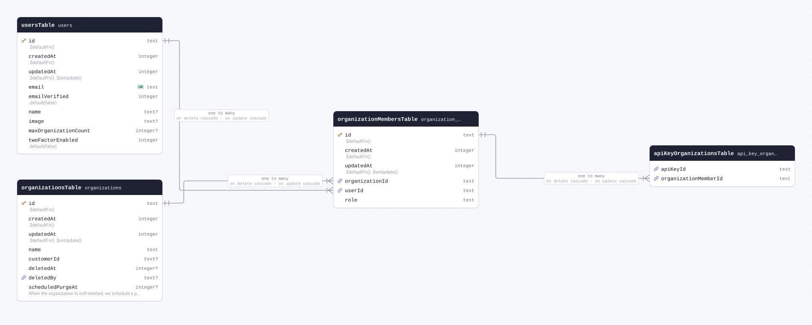

| Column                               | Type      | Constraints                                                   | Default                        | Description |
| ------------------------------------ | --------- | ------------------------------------------------------------- | ------------------------------ | ----------- |
| `id`                                 | `text`    | PK NOT NULL                                                   | `.$defaultFn()`                |             |
| `createdAt` (`created_at`)           | `integer` | NOT NULL                                                      | `.$defaultFn()`                |             |
| `updatedAt` (`updated_at`)           | `integer` | NOT NULL                                                      | `.$defaultFn()` `.$onUpdate()` |             |
| `organizationId` (`organization_id`) | `text`    | NOT NULL → [organizationsTable.id](#table-organizationsTable) |                                |             |
| `userId` (`user_id`)                 | `text`    | NOT NULL → [usersTable.id](#table-usersTable)                 |                                |             |
| `role`                               | `text`    | NOT NULL                                                      |                                |             |

#### Definition

```sql
CREATE TABLE `organization_members` (
	`id` text PRIMARY KEY,
	`created_at` integer NOT NULL,
	`updated_at` integer NOT NULL,
	`organization_id` text NOT NULL,
	`user_id` text NOT NULL,
	`role` text NOT NULL,
	CONSTRAINT `fk_organization_members_organization_id_organizations_id_fk` FOREIGN KEY (`organization_id`) REFERENCES `organizations`(`id`) ON UPDATE CASCADE ON DELETE CASCADE,
	CONSTRAINT `fk_organization_members_user_id_users_id_fk` FOREIGN KEY (`user_id`) REFERENCES `users`(`id`) ON UPDATE CASCADE ON DELETE CASCADE
);
```

#### References

- `organizationId` → [organizationsTable.id](#table-organizationsTable) (many to one, on delete cascade, on update cascade)
- `userId` → [usersTable.id](#table-usersTable) (many to one, on delete cascade, on update cascade)

#### Referenced by

- `id` → [apiKeyOrganizationsTable.organizationMemberId](#table-apiKeyOrganizationsTable) (one to many, on delete cascade, on update cascade)

<details>
<summary>Queries and their SQL</summary>

**Select**: Every row of organizationMembersTable.

```ts
db.select().from(organizationMembersTable);
```

```sql
select "id", "created_at", "updated_at", "organization_id", "user_id", "role"
from "organization_members"
```

**Count**: How many rows organizationMembersTable has.

```ts
db.select({ count: count() }).from(organizationMembersTable);
```

```sql
select count(*)
from "organization_members"
```

**Find many**: The rows of organizationMembersTable, through the relational query API.

```ts
db.query.organizationMembersTable.findMany();
```

```sql
select "d0"."id" as "id", "d0"."created_at" as "createdAt", "d0"."updated_at" as "updatedAt", "d0"."organization_id" as "organizationId", "d0"."user_id" as "userId", "d0"."role" as "role"
from "organization_members" as "d0"
```

**Find by primary key**: One row of organizationMembersTable, through the relational query API.

```ts
db.query.organizationMembersTable.findFirst({ where: { id: "id" } });
```

```sql
select "d0"."id" as "id", "d0"."created_at" as "createdAt", "d0"."updated_at" as "updatedAt", "d0"."organization_id" as "organizationId", "d0"."user_id" as "userId", "d0"."role" as "role"
from "organization_members" as "d0"
where "d0"."id" = ?
limit ?
-- params: ["id",1]
```

**Insert**: Adds a row to organizationMembersTable, giving the columns that have no default.

```ts
db.insert(organizationMembersTable).values({
  organizationId: "organizationId",
  userId: "userId",
  role: "role",
});
```

```sql
insert into "organization_members" ("id", "created_at", "updated_at", "organization_id", "user_id", "role")
values (?, ?, ?, ?, ?, ?)
-- params: ["org_mem_a1z9pq9uvwbalnmxtz8m7j1y",1767225600000,1767225600000,"organizationId","userId","role"]
```

**Update**: Changes a row of organizationMembersTable, found by its primary key.

```ts
db.update(organizationMembersTable)
  .set({ createdAt: 1 })
  .where(eq(organizationMembersTable.id, "id"));
```

```sql
update "organization_members"
set "created_at" = ?, "updated_at" = ?
where "organization_members"."id" = ?
-- params: [1,1767225600000,"id"]
```

**Delete**: Deletes a row of organizationMembersTable, found by its primary key.

```ts
db.delete(organizationMembersTable).where(eq(organizationMembersTable.id, "id"));
```

```sql
delete from "organization_members"
where "organization_members"."id" = ?
-- params: ["id"]
```

</details>

<a id="table-organizationInvitationsTable"></a>

### organizationInvitationsTable

Table `organization_invitations`.

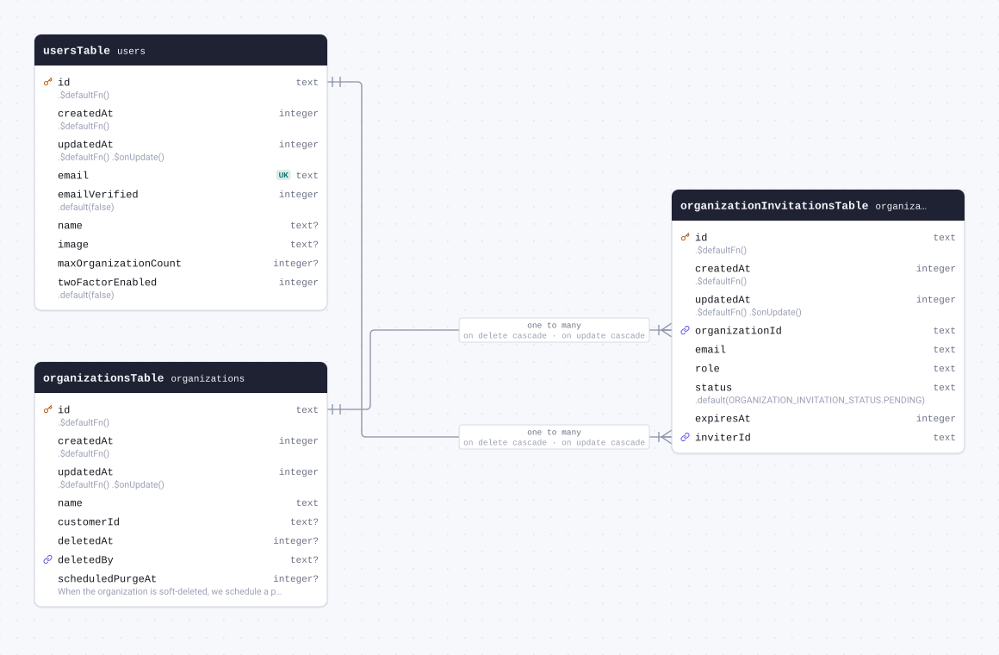

| Column                               | Type      | Constraints                                                   | Default                                            | Description |
| ------------------------------------ | --------- | ------------------------------------------------------------- | -------------------------------------------------- | ----------- |
| `id`                                 | `text`    | PK NOT NULL                                                   | `.$defaultFn()`                                    |             |
| `createdAt` (`created_at`)           | `integer` | NOT NULL                                                      | `.$defaultFn()`                                    |             |
| `updatedAt` (`updated_at`)           | `integer` | NOT NULL                                                      | `.$defaultFn()` `.$onUpdate()`                     |             |
| `organizationId` (`organization_id`) | `text`    | NOT NULL → [organizationsTable.id](#table-organizationsTable) |                                                    |             |
| `email`                              | `text`    | NOT NULL                                                      |                                                    |             |
| `role`                               | `text`    | NOT NULL                                                      |                                                    |             |
| `status`                             | `text`    | NOT NULL                                                      | `.default(ORGANIZATION_INVITATION_STATUS.PENDING)` |             |
| `expiresAt` (`expires_at`)           | `integer` | NOT NULL                                                      |                                                    |             |
| `inviterId` (`inviter_id`)           | `text`    | NOT NULL → [usersTable.id](#table-usersTable)                 |                                                    |             |

#### Definition

```sql
CREATE TABLE `organization_invitations` (
	`id` text PRIMARY KEY,
	`created_at` integer NOT NULL,
	`updated_at` integer NOT NULL,
	`organization_id` text NOT NULL,
	`email` text NOT NULL,
	`role` text NOT NULL,
	`status` text DEFAULT 'pending' NOT NULL,
	`expires_at` integer NOT NULL,
	`inviter_id` text NOT NULL,
	CONSTRAINT `fk_organization_invitations_organization_id_organizations_id_fk` FOREIGN KEY (`organization_id`) REFERENCES `organizations`(`id`) ON UPDATE CASCADE ON DELETE CASCADE,
	CONSTRAINT `fk_organization_invitations_inviter_id_users_id_fk` FOREIGN KEY (`inviter_id`) REFERENCES `users`(`id`) ON UPDATE CASCADE ON DELETE CASCADE
);
```

#### References

- `organizationId` → [organizationsTable.id](#table-organizationsTable) (many to one, on delete cascade, on update cascade)
- `inviterId` → [usersTable.id](#table-usersTable) (many to one, on delete cascade, on update cascade)

<details>
<summary>Queries and their SQL</summary>

**Select**: Every row of organizationInvitationsTable.

```ts
db.select().from(organizationInvitationsTable);
```

```sql
select "id", "created_at", "updated_at", "organization_id", "email", "role", "status", "expires_at", "inviter_id"
from "organization_invitations"
```

**Count**: How many rows organizationInvitationsTable has.

```ts
db.select({ count: count() }).from(organizationInvitationsTable);
```

```sql
select count(*)
from "organization_invitations"
```

**Find many**: The rows of organizationInvitationsTable, through the relational query API.

```ts
db.query.organizationInvitationsTable.findMany();
```

```sql
select "d0"."id" as "id", "d0"."created_at" as "createdAt", "d0"."updated_at" as "updatedAt", "d0"."organization_id" as "organizationId", "d0"."email" as "email", "d0"."role" as "role", "d0"."status" as "status", "d0"."expires_at" as "expiresAt", "d0"."inviter_id" as "inviterId"
from "organization_invitations" as "d0"
```

**Find by primary key**: One row of organizationInvitationsTable, through the relational query API.

```ts
db.query.organizationInvitationsTable.findFirst({ where: { id: "id" } });
```

```sql
select "d0"."id" as "id", "d0"."created_at" as "createdAt", "d0"."updated_at" as "updatedAt", "d0"."organization_id" as "organizationId", "d0"."email" as "email", "d0"."role" as "role", "d0"."status" as "status", "d0"."expires_at" as "expiresAt", "d0"."inviter_id" as "inviterId"
from "organization_invitations" as "d0"
where "d0"."id" = ?
limit ?
-- params: ["id",1]
```

**Insert**: Adds a row to organizationInvitationsTable, giving the columns that have no default.

```ts
db.insert(organizationInvitationsTable).values({
  organizationId: "organizationId",
  email: "email",
  role: "role",
  expiresAt: 1,
  inviterId: "inviterId",
});
```

```sql
insert into "organization_invitations" ("id", "created_at", "updated_at", "organization_id", "email", "role", "status", "expires_at", "inviter_id")
values (?, ?, ?, ?, ?, ?, ?, ?, ?)
-- params: ["org_inv_ann5l574a8fqwd889vvvg6az",1767225600000,1767225600000,"organizationId","email","role","pending",1,"inviterId"]
```

**Update**: Changes a row of organizationInvitationsTable, found by its primary key.

```ts
db.update(organizationInvitationsTable)
  .set({ createdAt: 1 })
  .where(eq(organizationInvitationsTable.id, "id"));
```

```sql
update "organization_invitations"
set "created_at" = ?, "updated_at" = ?
where "organization_invitations"."id" = ?
-- params: [1,1767225600000,"id"]
```

**Delete**: Deletes a row of organizationInvitationsTable, found by its primary key.

```ts
db.delete(organizationInvitationsTable).where(eq(organizationInvitationsTable.id, "id"));
```

```sql
delete from "organization_invitations"
where "organization_invitations"."id" = ?
-- params: ["id"]
```

</details>

<a id="table-userRolesTable"></a>

### userRolesTable

Table `user_roles`.

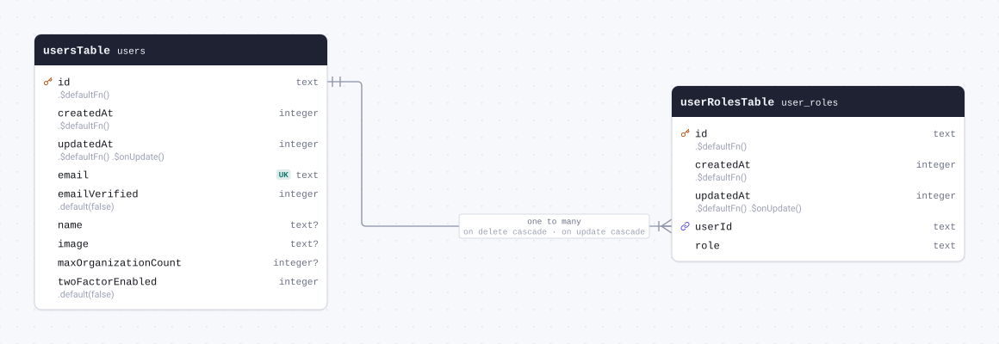

| Column                     | Type      | Constraints                                   | Default                        | Description |
| -------------------------- | --------- | --------------------------------------------- | ------------------------------ | ----------- |
| `id`                       | `text`    | PK NOT NULL                                   | `.$defaultFn()`                |             |
| `createdAt` (`created_at`) | `integer` | NOT NULL                                      | `.$defaultFn()`                |             |
| `updatedAt` (`updated_at`) | `integer` | NOT NULL                                      | `.$defaultFn()` `.$onUpdate()` |             |
| `userId` (`user_id`)       | `text`    | NOT NULL → [usersTable.id](#table-usersTable) |                                |             |
| `role`                     | `text`    | NOT NULL                                      |                                |             |

#### Definition

```sql
CREATE TABLE `user_roles` (
	`id` text PRIMARY KEY,
	`created_at` integer NOT NULL,
	`updated_at` integer NOT NULL,
	`user_id` text NOT NULL,
	`role` text NOT NULL,
	CONSTRAINT `fk_user_roles_user_id_users_id_fk` FOREIGN KEY (`user_id`) REFERENCES `users`(`id`) ON UPDATE CASCADE ON DELETE CASCADE
);
```

#### References

- `userId` → [usersTable.id](#table-usersTable) (many to one, on delete cascade, on update cascade)

<details>
<summary>Queries and their SQL</summary>

**Select**: Every row of userRolesTable.

```ts
db.select().from(userRolesTable);
```

```sql
select "id", "created_at", "updated_at", "user_id", "role"
from "user_roles"
```

**Count**: How many rows userRolesTable has.

```ts
db.select({ count: count() }).from(userRolesTable);
```

```sql
select count(*)
from "user_roles"
```

**Find many**: The rows of userRolesTable, through the relational query API.

```ts
db.query.userRolesTable.findMany();
```

```sql
select "d0"."id" as "id", "d0"."created_at" as "createdAt", "d0"."updated_at" as "updatedAt", "d0"."user_id" as "userId", "d0"."role" as "role"
from "user_roles" as "d0"
```

**Find by primary key**: One row of userRolesTable, through the relational query API.

```ts
db.query.userRolesTable.findFirst({ where: { id: "id" } });
```

```sql
select "d0"."id" as "id", "d0"."created_at" as "createdAt", "d0"."updated_at" as "updatedAt", "d0"."user_id" as "userId", "d0"."role" as "role"
from "user_roles" as "d0"
where "d0"."id" = ?
limit ?
-- params: ["id",1]
```

**Insert**: Adds a row to userRolesTable, giving the columns that have no default.

```ts
db.insert(userRolesTable).values({ userId: "userId", role: "role" });
```

```sql
insert into "user_roles" ("id", "created_at", "updated_at", "user_id", "role")
values (?, ?, ?, ?, ?)
-- params: ["rol_acq1z0lqemze6a1v9yibawxk",1767225600000,1767225600000,"userId","role"]
```

**Update**: Changes a row of userRolesTable, found by its primary key.

```ts
db.update(userRolesTable).set({ createdAt: 1 }).where(eq(userRolesTable.id, "id"));
```

```sql
update "user_roles"
set "created_at" = ?, "updated_at" = ?
where "user_roles"."id" = ?
-- params: [1,1767225600000,"id"]
```

**Delete**: Deletes a row of userRolesTable, found by its primary key.

```ts
db.delete(userRolesTable).where(eq(userRolesTable.id, "id"));
```

```sql
delete from "user_roles"
where "user_roles"."id" = ?
-- params: ["id"]
```

</details>

<a id="table-tagsTable"></a>

### tagsTable

Table `tags`.

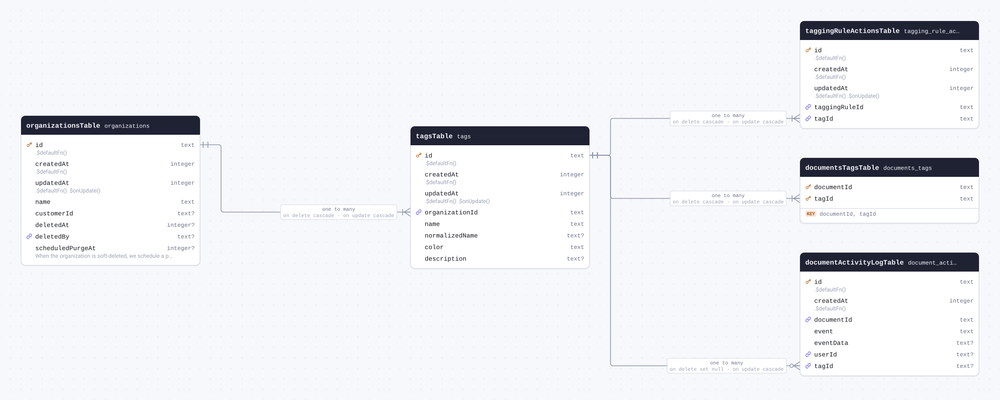

| Column                               | Type      | Constraints                                                   | Default                        | Description |
| ------------------------------------ | --------- | ------------------------------------------------------------- | ------------------------------ | ----------- |
| `id`                                 | `text`    | PK NOT NULL                                                   | `.$defaultFn()`                |             |
| `createdAt` (`created_at`)           | `integer` | NOT NULL                                                      | `.$defaultFn()`                |             |
| `updatedAt` (`updated_at`)           | `integer` | NOT NULL                                                      | `.$defaultFn()` `.$onUpdate()` |             |
| `organizationId` (`organization_id`) | `text`    | NOT NULL → [organizationsTable.id](#table-organizationsTable) |                                |             |
| `name`                               | `text`    | NOT NULL                                                      |                                |             |
| `normalizedName` (`normalized_name`) | `text`    | NULL                                                          |                                |             |
| `color`                              | `text`    | NOT NULL                                                      |                                |             |
| `description`                        | `text`    | NULL                                                          |                                |             |

#### Definition

```sql
CREATE TABLE `tags` (
	`id` text PRIMARY KEY,
	`created_at` integer NOT NULL,
	`updated_at` integer NOT NULL,
	`organization_id` text NOT NULL,
	`name` text NOT NULL,
	`normalized_name` text,
	`color` text NOT NULL,
	`description` text,
	CONSTRAINT `fk_tags_organization_id_organizations_id_fk` FOREIGN KEY (`organization_id`) REFERENCES `organizations`(`id`) ON UPDATE CASCADE ON DELETE CASCADE
);
```

#### References

- `organizationId` → [organizationsTable.id](#table-organizationsTable) (many to one, on delete cascade, on update cascade)

#### Referenced by

- `id` → [documentActivityLogTable.tagId](#table-documentActivityLogTable) (one to many, on delete set null, on update cascade)
- `id` → [documentsTagsTable.tagId](#table-documentsTagsTable) (one to many, on delete cascade, on update cascade)
- `id` → [taggingRuleActionsTable.tagId](#table-taggingRuleActionsTable) (one to many, on delete cascade, on update cascade)

<details>
<summary>Queries and their SQL</summary>

**Select**: Every row of tagsTable.

```ts
db.select().from(tagsTable);
```

```sql
select "id", "created_at", "updated_at", "organization_id", "name", "normalized_name", "color", "description"
from "tags"
```

**Count**: How many rows tagsTable has.

```ts
db.select({ count: count() }).from(tagsTable);
```

```sql
select count(*)
from "tags"
```

**Find many**: The rows of tagsTable, through the relational query API.

```ts
db.query.tagsTable.findMany();
```

```sql
select "d0"."id" as "id", "d0"."created_at" as "createdAt", "d0"."updated_at" as "updatedAt", "d0"."organization_id" as "organizationId", "d0"."name" as "name", "d0"."normalized_name" as "normalizedName", "d0"."color" as "color", "d0"."description" as "description"
from "tags" as "d0"
```

**Find by primary key**: One row of tagsTable, through the relational query API.

```ts
db.query.tagsTable.findFirst({ where: { id: "id" } });
```

```sql
select "d0"."id" as "id", "d0"."created_at" as "createdAt", "d0"."updated_at" as "updatedAt", "d0"."organization_id" as "organizationId", "d0"."name" as "name", "d0"."normalized_name" as "normalizedName", "d0"."color" as "color", "d0"."description" as "description"
from "tags" as "d0"
where "d0"."id" = ?
limit ?
-- params: ["id",1]
```

**Insert**: Adds a row to tagsTable, giving the columns that have no default.

```ts
db.insert(tagsTable).values({ organizationId: "organizationId", name: "name", color: "color" });
```

```sql
insert into "tags" ("id", "created_at", "updated_at", "organization_id", "name", "normalized_name", "color", "description")
values (?, ?, ?, ?, ?, null, ?, null)
-- params: ["tag_akuagex0m7tswpa90s1t6zi8",1767225600000,1767225600000,"organizationId","name","color"]
```

**Update**: Changes a row of tagsTable, found by its primary key.

```ts
db.update(tagsTable).set({ createdAt: 1 }).where(eq(tagsTable.id, "id"));
```

```sql
update "tags"
set "created_at" = ?, "updated_at" = ?
where "tags"."id" = ?
-- params: [1,1767225600000,"id"]
```

**Delete**: Deletes a row of tagsTable, found by its primary key.

```ts
db.delete(tagsTable).where(eq(tagsTable.id, "id"));
```

```sql
delete from "tags"
where "tags"."id" = ?
-- params: ["id"]
```

</details>

<a id="table-documentsTagsTable"></a>

### documentsTagsTable

Table `documents_tags`.

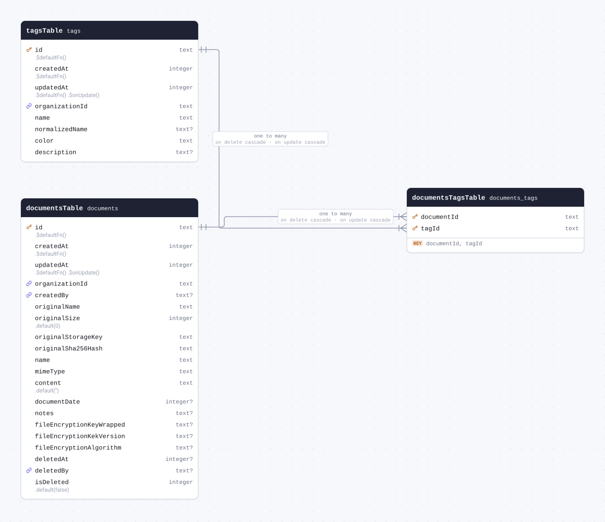

| Column                       | Type   | Constraints                                              | Default | Description |
| ---------------------------- | ------ | -------------------------------------------------------- | ------- | ----------- |
| `documentId` (`document_id`) | `text` | PK NOT NULL → [documentsTable.id](#table-documentsTable) |         |             |
| `tagId` (`tag_id`)           | `text` | PK NOT NULL → [tagsTable.id](#table-tagsTable)           |         |             |

#### Definition

```sql
CREATE TABLE `documents_tags` (
	`document_id` text NOT NULL,
	`tag_id` text NOT NULL,
	CONSTRAINT `documents_tags_pkey` PRIMARY KEY(`document_id`, `tag_id`),
	CONSTRAINT `fk_documents_tags_document_id_documents_id_fk` FOREIGN KEY (`document_id`) REFERENCES `documents`(`id`) ON UPDATE CASCADE ON DELETE CASCADE,
	CONSTRAINT `fk_documents_tags_tag_id_tags_id_fk` FOREIGN KEY (`tag_id`) REFERENCES `tags`(`id`) ON UPDATE CASCADE ON DELETE CASCADE
);
```

#### Indexes

- PRIMARY KEY `documentId`, `tagId`

#### References

- `documentId` → [documentsTable.id](#table-documentsTable) (many to one, on delete cascade, on update cascade)
- `tagId` → [tagsTable.id](#table-tagsTable) (many to one, on delete cascade, on update cascade)

<details>
<summary>Queries and their SQL</summary>

**Select**: Every row of documentsTagsTable.

```ts
db.select().from(documentsTagsTable);
```

```sql
select "document_id", "tag_id"
from "documents_tags"
```

**Count**: How many rows documentsTagsTable has.

```ts
db.select({ count: count() }).from(documentsTagsTable);
```

```sql
select count(*)
from "documents_tags"
```

**Find many**: The rows of documentsTagsTable, through the relational query API.

```ts
db.query.documentsTagsTable.findMany();
```

```sql
select "d0"."document_id" as "documentId", "d0"."tag_id" as "tagId"
from "documents_tags" as "d0"
```

**Find by primary key**: One row of documentsTagsTable, through the relational query API.

```ts
db.query.documentsTagsTable.findFirst({ where: { documentId: "documentId", tagId: "tagId" } });
```

```sql
select "d0"."document_id" as "documentId", "d0"."tag_id" as "tagId"
from "documents_tags" as "d0"
where (("d0"."document_id" = ?) and ("d0"."tag_id" = ?))
limit ?
-- params: ["documentId","tagId",1]
```

**Insert**: Adds a row to documentsTagsTable, giving the columns that have no default.

```ts
db.insert(documentsTagsTable).values({ documentId: "documentId", tagId: "tagId" });
```

```sql
insert into "documents_tags" ("document_id", "tag_id")
values (?, ?)
-- params: ["documentId","tagId"]
```

**Delete**: Deletes a row of documentsTagsTable, found by its primary key.

```ts
db.delete(documentsTagsTable).where(
  and(eq(documentsTagsTable.documentId, "documentId"), eq(documentsTagsTable.tagId, "tagId")),
);
```

```sql
delete from "documents_tags"
where (("documents_tags"."document_id" = ?) and ("documents_tags"."tag_id" = ?))
-- params: ["documentId","tagId"]
```

</details>

<a id="table-usersTable"></a>

### usersTable

Table `users`.

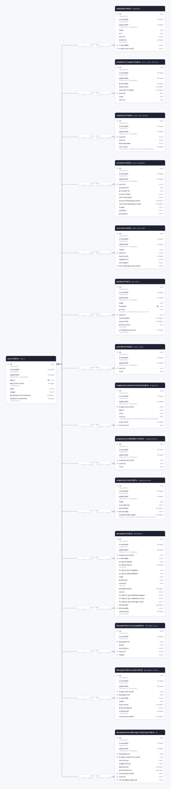

| Column                                            | Type      | Constraints     | Default                        | Description |
| ------------------------------------------------- | --------- | --------------- | ------------------------------ | ----------- |
| `id`                                              | `text`    | PK NOT NULL     | `.$defaultFn()`                |             |
| `createdAt` (`created_at`)                        | `integer` | NOT NULL        | `.$defaultFn()`                |             |
| `updatedAt` (`updated_at`)                        | `integer` | NOT NULL        | `.$defaultFn()` `.$onUpdate()` |             |
| `email`                                           | `text`    | UNIQUE NOT NULL |                                |             |
| `emailVerified` (`email_verified`)                | `integer` | NOT NULL        | `.default(false)`              |             |
| `name`                                            | `text`    | NULL            |                                |             |
| `image`                                           | `text`    | NULL            |                                |             |
| `maxOrganizationCount` (`max_organization_count`) | `integer` | NULL            |                                |             |
| `twoFactorEnabled` (`two_factor_enabled`)         | `integer` | NOT NULL        | `.default(false)`              |             |

#### Definition

```sql
CREATE TABLE `users` (
	`id` text PRIMARY KEY,
	`created_at` integer NOT NULL,
	`updated_at` integer NOT NULL,
	`email` text NOT NULL UNIQUE,
	`email_verified` integer DEFAULT false NOT NULL,
	`name` text,
	`image` text,
	`max_organization_count` integer,
	`two_factor_enabled` integer DEFAULT false NOT NULL
);
```

#### Referenced by

- `id` → [documentCustomPropertyValuesTable.userId](#table-documentCustomPropertyValuesTable) (one to many, on delete cascade, on update cascade)
- `id` → [documentShareLinksTable.createdBy](#table-documentShareLinksTable) (one to many, on delete set null, on update cascade)
- `id` → [documentActivityLogTable.userId](#table-documentActivityLogTable) (one to many, on delete set null, on update cascade)
- `id` → [documentsTable.createdBy](#table-documentsTable) (one to many, on delete set null, on update cascade)
- `id` → [documentsTable.deletedBy](#table-documentsTable) (one to many, on delete set null, on update cascade)
- `id` → [organizationsTable.deletedBy](#table-organizationsTable) (one to many, on delete set null, on update cascade)
- `id` → [organizationMembersTable.userId](#table-organizationMembersTable) (one to many, on delete cascade, on update cascade)
- `id` → [organizationInvitationsTable.inviterId](#table-organizationInvitationsTable) (one to many, on delete cascade, on update cascade)
- `id` → [userRolesTable.userId](#table-userRolesTable) (one to many, on delete cascade, on update cascade)
- `id` → [apiKeysTable.userId](#table-apiKeysTable) (one to many, on delete cascade, on update cascade)
- `id` → [sessionsTable.userId](#table-sessionsTable) (one to many, on delete cascade, on update cascade)
- `id` → [accountsTable.userId](#table-accountsTable) (one to many, on delete cascade, on update cascade)
- `id` → [twoFactorTable.userId](#table-twoFactorTable) (one to many, on delete cascade, on update cascade)
- `id` → [planEntitlementsTable.userId](#table-planEntitlementsTable) (one to many, on delete cascade, on update cascade)
- `id` → [webhooksTable.createdBy](#table-webhooksTable) (one to many, on delete set null, on update cascade)

<details>
<summary>Queries and their SQL</summary>

**Select**: Every row of usersTable.

```ts
db.select().from(usersTable);
```

```sql
select "id", "created_at", "updated_at", "email", "email_verified", "name", "image", "max_organization_count", "two_factor_enabled"
from "users"
```

**Count**: How many rows usersTable has.

```ts
db.select({ count: count() }).from(usersTable);
```

```sql
select count(*)
from "users"
```

**Find many**: The rows of usersTable, through the relational query API.

```ts
db.query.usersTable.findMany();
```

```sql
select "d0"."id" as "id", "d0"."created_at" as "createdAt", "d0"."updated_at" as "updatedAt", "d0"."email" as "email", "d0"."email_verified" as "emailVerified", "d0"."name" as "name", "d0"."image" as "image", "d0"."max_organization_count" as "maxOrganizationCount", "d0"."two_factor_enabled" as "twoFactorEnabled"
from "users" as "d0"
```

**Find by primary key**: One row of usersTable, through the relational query API.

```ts
db.query.usersTable.findFirst({ where: { id: "id" } });
```

```sql
select "d0"."id" as "id", "d0"."created_at" as "createdAt", "d0"."updated_at" as "updatedAt", "d0"."email" as "email", "d0"."email_verified" as "emailVerified", "d0"."name" as "name", "d0"."image" as "image", "d0"."max_organization_count" as "maxOrganizationCount", "d0"."two_factor_enabled" as "twoFactorEnabled"
from "users" as "d0"
where "d0"."id" = ?
limit ?
-- params: ["id",1]
```

**Insert**: Adds a row to usersTable, giving the columns that have no default.

```ts
db.insert(usersTable).values({ email: "email" });
```

```sql
insert into "users" ("id", "created_at", "updated_at", "email", "email_verified", "name", "image", "max_organization_count", "two_factor_enabled")
values (?, ?, ?, ?, ?, null, null, null, ?)
-- params: ["usr_a4i5xqzoj5l4etbkilybc4ah",1767225600000,1767225600000,"email",0,0]
```

**Update**: Changes a row of usersTable, found by its primary key.

```ts
db.update(usersTable).set({ createdAt: 1 }).where(eq(usersTable.id, "id"));
```

```sql
update "users"
set "created_at" = ?, "updated_at" = ?
where "users"."id" = ?
-- params: [1,1767225600000,"id"]
```

**Delete**: Deletes a row of usersTable, found by its primary key.

```ts
db.delete(usersTable).where(eq(usersTable.id, "id"));
```

```sql
delete from "users"
where "users"."id" = ?
-- params: ["id"]
```

</details>

<a id="table-organizationAiCreditsUsageTable"></a>

### organizationAiCreditsUsageTable

Table `organization_ai_credits_usage`.

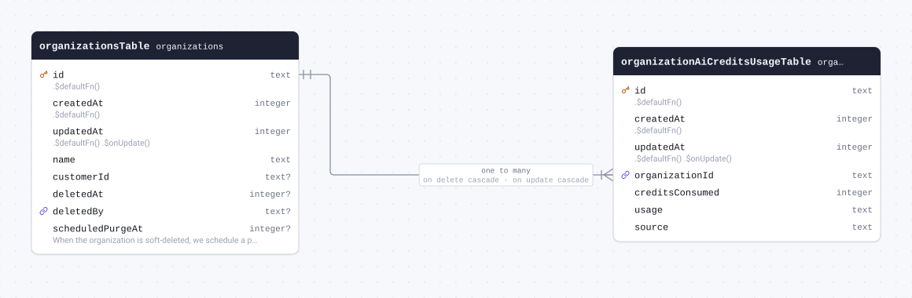

| Column                                 | Type      | Constraints                                                   | Default                        | Description |
| -------------------------------------- | --------- | ------------------------------------------------------------- | ------------------------------ | ----------- |
| `id`                                   | `text`    | PK NOT NULL                                                   | `.$defaultFn()`                |             |
| `createdAt` (`created_at`)             | `integer` | NOT NULL                                                      | `.$defaultFn()`                |             |
| `updatedAt` (`updated_at`)             | `integer` | NOT NULL                                                      | `.$defaultFn()` `.$onUpdate()` |             |
| `organizationId` (`organization_id`)   | `text`    | NOT NULL → [organizationsTable.id](#table-organizationsTable) |                                |             |
| `creditsConsumed` (`credits_consumed`) | `integer` | NOT NULL                                                      |                                |             |
| `usage`                                | `text`    | NOT NULL                                                      |                                |             |
| `source`                               | `text`    | NOT NULL                                                      |                                |             |

#### Definition

```sql
CREATE TABLE `organization_ai_credits_usage` (
	`id` text PRIMARY KEY,
	`created_at` integer NOT NULL,
	`updated_at` integer NOT NULL,
	`organization_id` text NOT NULL,
	`credits_consumed` integer NOT NULL,
	`usage` text NOT NULL,
	`source` text NOT NULL,
	CONSTRAINT `fk_organization_ai_credits_usage_organization_id_organizations_id_fk` FOREIGN KEY (`organization_id`) REFERENCES `organizations`(`id`) ON UPDATE CASCADE ON DELETE CASCADE
);
```

#### References

- `organizationId` → [organizationsTable.id](#table-organizationsTable) (many to one, on delete cascade, on update cascade)

<details>
<summary>Queries and their SQL</summary>

**Select**: Every row of organizationAiCreditsUsageTable.

```ts
db.select().from(organizationAiCreditsUsageTable);
```

```sql
select "id", "created_at", "updated_at", "organization_id", "credits_consumed", "usage", "source"
from "organization_ai_credits_usage"
```

**Count**: How many rows organizationAiCreditsUsageTable has.

```ts
db.select({ count: count() }).from(organizationAiCreditsUsageTable);
```

```sql
select count(*)
from "organization_ai_credits_usage"
```

**Find many**: The rows of organizationAiCreditsUsageTable, through the relational query API.

```ts
db.query.organizationAiCreditsUsageTable.findMany();
```

```sql
select "d0"."id" as "id", "d0"."created_at" as "createdAt", "d0"."updated_at" as "updatedAt", "d0"."organization_id" as "organizationId", "d0"."credits_consumed" as "creditsConsumed", "d0"."usage" as "usage", "d0"."source" as "source"
from "organization_ai_credits_usage" as "d0"
```

**Find by primary key**: One row of organizationAiCreditsUsageTable, through the relational query API.

```ts
db.query.organizationAiCreditsUsageTable.findFirst({ where: { id: "id" } });
```

```sql
select "d0"."id" as "id", "d0"."created_at" as "createdAt", "d0"."updated_at" as "updatedAt", "d0"."organization_id" as "organizationId", "d0"."credits_consumed" as "creditsConsumed", "d0"."usage" as "usage", "d0"."source" as "source"
from "organization_ai_credits_usage" as "d0"
where "d0"."id" = ?
limit ?
-- params: ["id",1]
```

**Insert**: Adds a row to organizationAiCreditsUsageTable, giving the columns that have no default.

```ts
db.insert(organizationAiCreditsUsageTable).values({
  organizationId: "organizationId",
  creditsConsumed: 1,
  usage: "usage",
  source: "source",
});
```

```sql
insert into "organization_ai_credits_usage" ("id", "created_at", "updated_at", "organization_id", "credits_consumed", "usage", "source")
values (?, ?, ?, ?, ?, ?, ?)
-- params: ["aicu_awza62p2cnizch54700l6tl0",1767225600000,1767225600000,"organizationId",1,"\"usage\"","source"]
```

**Update**: Changes a row of organizationAiCreditsUsageTable, found by its primary key.

```ts
db.update(organizationAiCreditsUsageTable)
  .set({ createdAt: 1 })
  .where(eq(organizationAiCreditsUsageTable.id, "id"));
```

```sql
update "organization_ai_credits_usage"
set "created_at" = ?, "updated_at" = ?
where "organization_ai_credits_usage"."id" = ?
-- params: [1,1767225600000,"id"]
```

**Delete**: Deletes a row of organizationAiCreditsUsageTable, found by its primary key.

```ts
db.delete(organizationAiCreditsUsageTable).where(eq(organizationAiCreditsUsageTable.id, "id"));
```

```sql
delete from "organization_ai_credits_usage"
where "organization_ai_credits_usage"."id" = ?
-- params: ["id"]
```

</details>

<a id="table-apiKeysTable"></a>

### apiKeysTable

Table `api_keys`.

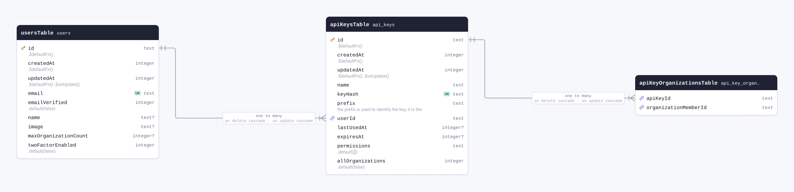

| Column                                   | Type      | Constraints                                   | Default                        | Description                                       |
| ---------------------------------------- | --------- | --------------------------------------------- | ------------------------------ | ------------------------------------------------- |
| `id`                                     | `text`    | PK NOT NULL                                   | `.$defaultFn()`                |                                                   |
| `createdAt` (`created_at`)               | `integer` | NOT NULL                                      | `.$defaultFn()`                |                                                   |
| `updatedAt` (`updated_at`)               | `integer` | NOT NULL                                      | `.$defaultFn()` `.$onUpdate()` |                                                   |
| `name`                                   | `text`    | NOT NULL                                      |                                |                                                   |
| `keyHash` (`key_hash`)                   | `text`    | UNIQUE NOT NULL                               |                                |                                                   |
| `prefix`                                 | `text`    | NOT NULL                                      |                                | the prefix is used to identify the key, it is the |
| `userId` (`user_id`)                     | `text`    | NOT NULL → [usersTable.id](#table-usersTable) |                                |                                                   |
| `lastUsedAt` (`last_used_at`)            | `integer` | NULL                                          |                                |                                                   |
| `expiresAt` (`expires_at`)               | `integer` | NULL                                          |                                |                                                   |
| `permissions`                            | `text`    | NOT NULL                                      | `.default([])`                 |                                                   |
| `allOrganizations` (`all_organizations`) | `integer` | NOT NULL                                      | `.default(false)`              |                                                   |

#### Definition

```sql
CREATE TABLE `api_keys` (
	`id` text PRIMARY KEY,
	`created_at` integer NOT NULL,
	`updated_at` integer NOT NULL,
	`name` text NOT NULL,
	`key_hash` text NOT NULL UNIQUE,
	`prefix` text NOT NULL,
	`user_id` text NOT NULL,
	`last_used_at` integer,
	`expires_at` integer,
	`permissions` text DEFAULT '[]' NOT NULL,
	`all_organizations` integer DEFAULT false NOT NULL,
	CONSTRAINT `fk_api_keys_user_id_users_id_fk` FOREIGN KEY (`user_id`) REFERENCES `users`(`id`) ON UPDATE CASCADE ON DELETE CASCADE
);
```

#### References

- `userId` → [usersTable.id](#table-usersTable) (many to one, on delete cascade, on update cascade)

#### Referenced by

- `id` → [apiKeyOrganizationsTable.apiKeyId](#table-apiKeyOrganizationsTable) (one to many, on delete cascade, on update cascade)

<details>
<summary>Queries and their SQL</summary>

**Select**: Every row of apiKeysTable.

```ts
db.select().from(apiKeysTable);
```

```sql
select "id", "created_at", "updated_at", "name", "key_hash", "prefix", "user_id", "last_used_at", "expires_at", "permissions", "all_organizations"
from "api_keys"
```

**Count**: How many rows apiKeysTable has.

```ts
db.select({ count: count() }).from(apiKeysTable);
```

```sql
select count(*)
from "api_keys"
```

**Find many**: The rows of apiKeysTable, through the relational query API.

```ts
db.query.apiKeysTable.findMany();
```

```sql
select "d0"."id" as "id", "d0"."created_at" as "createdAt", "d0"."updated_at" as "updatedAt", "d0"."name" as "name", "d0"."key_hash" as "keyHash", "d0"."prefix" as "prefix", "d0"."user_id" as "userId", "d0"."last_used_at" as "lastUsedAt", "d0"."expires_at" as "expiresAt", "d0"."permissions" as "permissions", "d0"."all_organizations" as "allOrganizations"
from "api_keys" as "d0"
```

**Find by primary key**: One row of apiKeysTable, through the relational query API.

```ts
db.query.apiKeysTable.findFirst({ where: { id: "id" } });
```

```sql
select "d0"."id" as "id", "d0"."created_at" as "createdAt", "d0"."updated_at" as "updatedAt", "d0"."name" as "name", "d0"."key_hash" as "keyHash", "d0"."prefix" as "prefix", "d0"."user_id" as "userId", "d0"."last_used_at" as "lastUsedAt", "d0"."expires_at" as "expiresAt", "d0"."permissions" as "permissions", "d0"."all_organizations" as "allOrganizations"
from "api_keys" as "d0"
where "d0"."id" = ?
limit ?
-- params: ["id",1]
```

**Insert**: Adds a row to apiKeysTable, giving the columns that have no default.

```ts
db.insert(apiKeysTable).values({
  name: "name",
  keyHash: "keyHash",
  prefix: "prefix",
  userId: "userId",
});
```

```sql
insert into "api_keys" ("id", "created_at", "updated_at", "name", "key_hash", "prefix", "user_id", "last_used_at", "expires_at", "permissions", "all_organizations")
values (?, ?, ?, ?, ?, ?, ?, null, null, ?, ?)
-- params: ["ak_a89euimkh72rmpf0082c3k61",1767225600000,1767225600000,"name","keyHash","prefix","userId","[]",0]
```

**Update**: Changes a row of apiKeysTable, found by its primary key.

```ts
db.update(apiKeysTable).set({ createdAt: 1 }).where(eq(apiKeysTable.id, "id"));
```

```sql
update "api_keys"
set "created_at" = ?, "updated_at" = ?
where "api_keys"."id" = ?
-- params: [1,1767225600000,"id"]
```

**Delete**: Deletes a row of apiKeysTable, found by its primary key.

```ts
db.delete(apiKeysTable).where(eq(apiKeysTable.id, "id"));
```

```sql
delete from "api_keys"
where "api_keys"."id" = ?
-- params: ["id"]
```

</details>

<a id="table-apiKeyOrganizationsTable"></a>

### apiKeyOrganizationsTable

Table `api_key_organizations`. We use an intermediate table (instead of a json array) to link API keys to organization members, so the relationship between the api key and the organization is deleted on cascade when the organization is deleted or the member is removed from the organization.

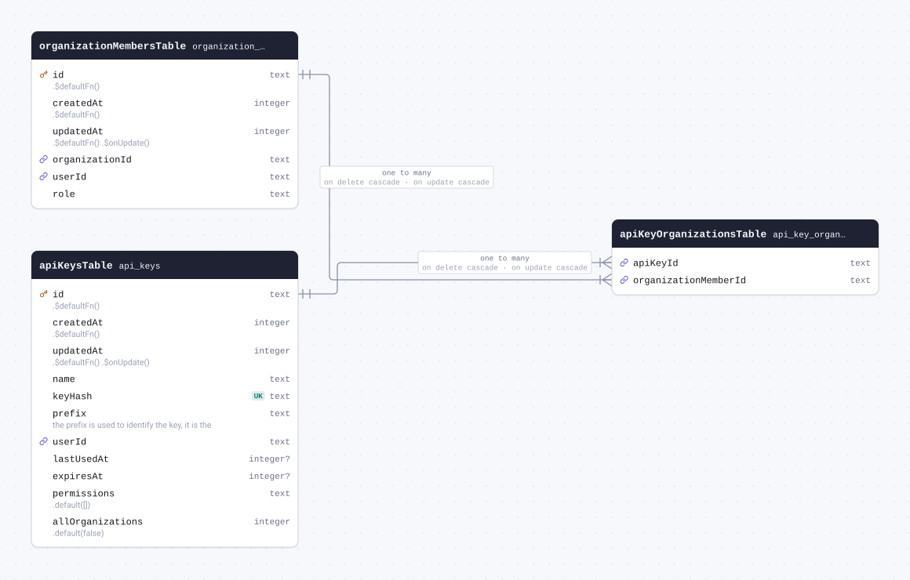

| Column                                            | Type   | Constraints                                                               | Default | Description |
| ------------------------------------------------- | ------ | ------------------------------------------------------------------------- | ------- | ----------- |
| `apiKeyId` (`api_key_id`)                         | `text` | NOT NULL → [apiKeysTable.id](#table-apiKeysTable)                         |         |             |
| `organizationMemberId` (`organization_member_id`) | `text` | NOT NULL → [organizationMembersTable.id](#table-organizationMembersTable) |         |             |

#### Definition

```sql
CREATE TABLE `api_key_organizations` (
	`api_key_id` text NOT NULL,
	`organization_member_id` text NOT NULL,
	CONSTRAINT `fk_api_key_organizations_api_key_id_api_keys_id_fk` FOREIGN KEY (`api_key_id`) REFERENCES `api_keys`(`id`) ON UPDATE CASCADE ON DELETE CASCADE,
	CONSTRAINT `fk_api_key_organizations_organization_member_id_organization_members_id_fk` FOREIGN KEY (`organization_member_id`) REFERENCES `organization_members`(`id`) ON UPDATE CASCADE ON DELETE CASCADE
);
```

#### References

- `apiKeyId` → [apiKeysTable.id](#table-apiKeysTable) (many to one, on delete cascade, on update cascade)
- `organizationMemberId` → [organizationMembersTable.id](#table-organizationMembersTable) (many to one, on delete cascade, on update cascade)

<details>
<summary>Queries and their SQL</summary>

**Select**: Every row of apiKeyOrganizationsTable.

```ts
db.select().from(apiKeyOrganizationsTable);
```

```sql
select "api_key_id", "organization_member_id"
from "api_key_organizations"
```

**Count**: How many rows apiKeyOrganizationsTable has.

```ts
db.select({ count: count() }).from(apiKeyOrganizationsTable);
```

```sql
select count(*)
from "api_key_organizations"
```

**Find many**: The rows of apiKeyOrganizationsTable, through the relational query API.

```ts
db.query.apiKeyOrganizationsTable.findMany();
```

```sql
select "d0"."api_key_id" as "apiKeyId", "d0"."organization_member_id" as "organizationMemberId"
from "api_key_organizations" as "d0"
```

**Insert**: Adds a row to apiKeyOrganizationsTable, giving the columns that have no default.

```ts
db.insert(apiKeyOrganizationsTable).values({
  apiKeyId: "apiKeyId",
  organizationMemberId: "organizationMemberId",
});
```

```sql
insert into "api_key_organizations" ("api_key_id", "organization_member_id")
values (?, ?)
-- params: ["apiKeyId","organizationMemberId"]
```

</details>

<a id="table-sessionsTable"></a>

### sessionsTable

Table `auth_sessions`.

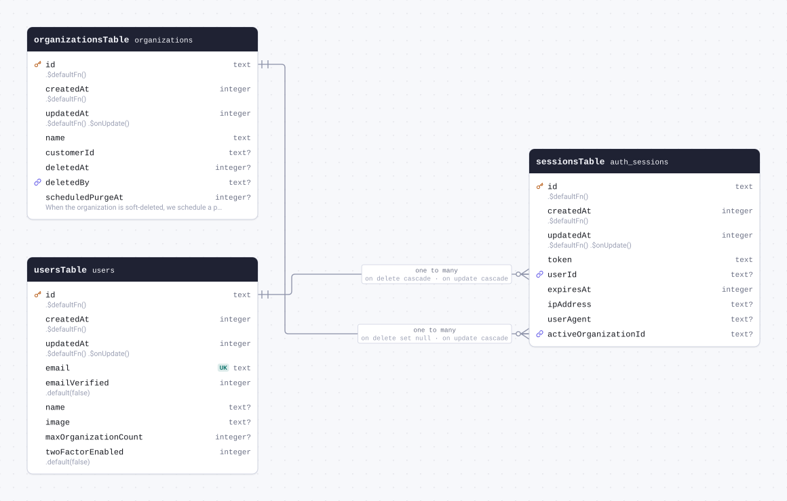

| Column                                            | Type      | Constraints                                               | Default                        | Description |
| ------------------------------------------------- | --------- | --------------------------------------------------------- | ------------------------------ | ----------- |
| `id`                                              | `text`    | PK NOT NULL                                               | `.$defaultFn()`                |             |
| `createdAt` (`created_at`)                        | `integer` | NOT NULL                                                  | `.$defaultFn()`                |             |
| `updatedAt` (`updated_at`)                        | `integer` | NOT NULL                                                  | `.$defaultFn()` `.$onUpdate()` |             |
| `token`                                           | `text`    | NOT NULL                                                  |                                |             |
| `userId` (`user_id`)                              | `text`    | NULL → [usersTable.id](#table-usersTable)                 |                                |             |
| `expiresAt` (`expires_at`)                        | `integer` | NOT NULL                                                  |                                |             |
| `ipAddress` (`ip_address`)                        | `text`    | NULL                                                      |                                |             |
| `userAgent` (`user_agent`)                        | `text`    | NULL                                                      |                                |             |
| `activeOrganizationId` (`active_organization_id`) | `text`    | NULL → [organizationsTable.id](#table-organizationsTable) |                                |             |

#### Definition

```sql
CREATE TABLE `auth_sessions` (
	`id` text PRIMARY KEY,
	`created_at` integer NOT NULL,
	`updated_at` integer NOT NULL,
	`token` text NOT NULL,
	`user_id` text,
	`expires_at` integer NOT NULL,
	`ip_address` text,
	`user_agent` text,
	`active_organization_id` text,
	CONSTRAINT `fk_auth_sessions_user_id_users_id_fk` FOREIGN KEY (`user_id`) REFERENCES `users`(`id`) ON UPDATE CASCADE ON DELETE CASCADE,
	CONSTRAINT `fk_auth_sessions_active_organization_id_organizations_id_fk` FOREIGN KEY (`active_organization_id`) REFERENCES `organizations`(`id`) ON UPDATE CASCADE ON DELETE SET NULL
);
```

#### References

- `userId` → [usersTable.id](#table-usersTable) (many to one, on delete cascade, on update cascade)
- `activeOrganizationId` → [organizationsTable.id](#table-organizationsTable) (many to one, on delete set null, on update cascade)

<details>
<summary>Queries and their SQL</summary>

**Select**: Every row of sessionsTable.

```ts
db.select().from(sessionsTable);
```

```sql
select "id", "created_at", "updated_at", "token", "user_id", "expires_at", "ip_address", "user_agent", "active_organization_id"
from "auth_sessions"
```

**Count**: How many rows sessionsTable has.

```ts
db.select({ count: count() }).from(sessionsTable);
```

```sql
select count(*)
from "auth_sessions"
```

**Find many**: The rows of sessionsTable, through the relational query API.

```ts
db.query.sessionsTable.findMany();
```

```sql
select "d0"."id" as "id", "d0"."created_at" as "createdAt", "d0"."updated_at" as "updatedAt", "d0"."token" as "token", "d0"."user_id" as "userId", "d0"."expires_at" as "expiresAt", "d0"."ip_address" as "ipAddress", "d0"."user_agent" as "userAgent", "d0"."active_organization_id" as "activeOrganizationId"
from "auth_sessions" as "d0"
```

**Find by primary key**: One row of sessionsTable, through the relational query API.

```ts
db.query.sessionsTable.findFirst({ where: { id: "id" } });
```

```sql
select "d0"."id" as "id", "d0"."created_at" as "createdAt", "d0"."updated_at" as "updatedAt", "d0"."token" as "token", "d0"."user_id" as "userId", "d0"."expires_at" as "expiresAt", "d0"."ip_address" as "ipAddress", "d0"."user_agent" as "userAgent", "d0"."active_organization_id" as "activeOrganizationId"
from "auth_sessions" as "d0"
where "d0"."id" = ?
limit ?
-- params: ["id",1]
```

**Insert**: Adds a row to sessionsTable, giving the columns that have no default.

```ts
db.insert(sessionsTable).values({ token: "token", expiresAt: 1 });
```

```sql
insert into "auth_sessions" ("id", "created_at", "updated_at", "token", "user_id", "expires_at", "ip_address", "user_agent", "active_organization_id")
values (?, ?, ?, ?, null, ?, null, null, null)
-- params: ["auth_ses_ak176lee7th2qxlwgazec8fk",1767225600000,1767225600000,"token",1]
```

**Update**: Changes a row of sessionsTable, found by its primary key.

```ts
db.update(sessionsTable).set({ createdAt: 1 }).where(eq(sessionsTable.id, "id"));
```

```sql
update "auth_sessions"
set "created_at" = ?, "updated_at" = ?
where "auth_sessions"."id" = ?
-- params: [1,1767225600000,"id"]
```

**Delete**: Deletes a row of sessionsTable, found by its primary key.

```ts
db.delete(sessionsTable).where(eq(sessionsTable.id, "id"));
```

```sql
delete from "auth_sessions"
where "auth_sessions"."id" = ?
-- params: ["id"]
```

</details>

<a id="table-accountsTable"></a>

### accountsTable

Table `auth_accounts`.

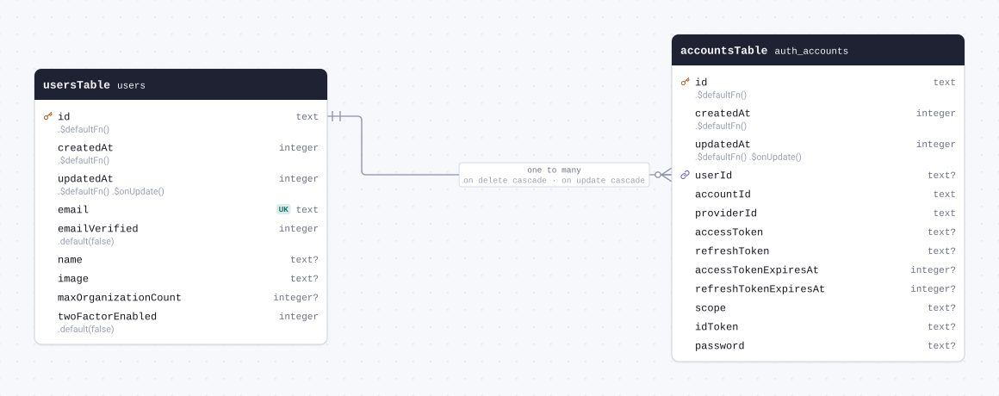

| Column                                               | Type      | Constraints                               | Default                        | Description |
| ---------------------------------------------------- | --------- | ----------------------------------------- | ------------------------------ | ----------- |
| `id`                                                 | `text`    | PK NOT NULL                               | `.$defaultFn()`                |             |
| `createdAt` (`created_at`)                           | `integer` | NOT NULL                                  | `.$defaultFn()`                |             |
| `updatedAt` (`updated_at`)                           | `integer` | NOT NULL                                  | `.$defaultFn()` `.$onUpdate()` |             |
| `userId` (`user_id`)                                 | `text`    | NULL → [usersTable.id](#table-usersTable) |                                |             |
| `accountId` (`account_id`)                           | `text`    | NOT NULL                                  |                                |             |
| `providerId` (`provider_id`)                         | `text`    | NOT NULL                                  |                                |             |
| `accessToken` (`access_token`)                       | `text`    | NULL                                      |                                |             |
| `refreshToken` (`refresh_token`)                     | `text`    | NULL                                      |                                |             |
| `accessTokenExpiresAt` (`access_token_expires_at`)   | `integer` | NULL                                      |                                |             |
| `refreshTokenExpiresAt` (`refresh_token_expires_at`) | `integer` | NULL                                      |                                |             |
| `scope`                                              | `text`    | NULL                                      |                                |             |
| `idToken` (`id_token`)                               | `text`    | NULL                                      |                                |             |
| `password`                                           | `text`    | NULL                                      |                                |             |

#### Definition

```sql
CREATE TABLE `auth_accounts` (
	`id` text PRIMARY KEY,
	`created_at` integer NOT NULL,
	`updated_at` integer NOT NULL,
	`user_id` text,
	`account_id` text NOT NULL,
	`provider_id` text NOT NULL,
	`access_token` text,
	`refresh_token` text,
	`access_token_expires_at` integer,
	`refresh_token_expires_at` integer,
	`scope` text,
	`id_token` text,
	`password` text,
	CONSTRAINT `fk_auth_accounts_user_id_users_id_fk` FOREIGN KEY (`user_id`) REFERENCES `users`(`id`) ON UPDATE CASCADE ON DELETE CASCADE
);
```

#### References

- `userId` → [usersTable.id](#table-usersTable) (many to one, on delete cascade, on update cascade)

<details>
<summary>Queries and their SQL</summary>

**Select**: Every row of accountsTable.

```ts
db.select().from(accountsTable);
```

```sql
select "id", "created_at", "updated_at", "user_id", "account_id", "provider_id", "access_token", "refresh_token", "access_token_expires_at", "refresh_token_expires_at", "scope", "id_token", "password"
from "auth_accounts"
```

**Count**: How many rows accountsTable has.

```ts
db.select({ count: count() }).from(accountsTable);
```

```sql
select count(*)
from "auth_accounts"
```

**Find many**: The rows of accountsTable, through the relational query API.

```ts
db.query.accountsTable.findMany();
```

```sql
select "d0"."id" as "id", "d0"."created_at" as "createdAt", "d0"."updated_at" as "updatedAt", "d0"."user_id" as "userId", "d0"."account_id" as "accountId", "d0"."provider_id" as "providerId", "d0"."access_token" as "accessToken", "d0"."refresh_token" as "refreshToken", "d0"."access_token_expires_at" as "accessTokenExpiresAt", "d0"."refresh_token_expires_at" as "refreshTokenExpiresAt", "d0"."scope" as "scope", "d0"."id_token" as "idToken", "d0"."password" as "password"
from "auth_accounts" as "d0"
```

**Find by primary key**: One row of accountsTable, through the relational query API.

```ts
db.query.accountsTable.findFirst({ where: { id: "id" } });
```

```sql
select "d0"."id" as "id", "d0"."created_at" as "createdAt", "d0"."updated_at" as "updatedAt", "d0"."user_id" as "userId", "d0"."account_id" as "accountId", "d0"."provider_id" as "providerId", "d0"."access_token" as "accessToken", "d0"."refresh_token" as "refreshToken", "d0"."access_token_expires_at" as "accessTokenExpiresAt", "d0"."refresh_token_expires_at" as "refreshTokenExpiresAt", "d0"."scope" as "scope", "d0"."id_token" as "idToken", "d0"."password" as "password"
from "auth_accounts" as "d0"
where "d0"."id" = ?
limit ?
-- params: ["id",1]
```

**Insert**: Adds a row to accountsTable, giving the columns that have no default.

```ts
db.insert(accountsTable).values({ accountId: "accountId", providerId: "providerId" });
```

```sql
insert into "auth_accounts" ("id", "created_at", "updated_at", "user_id", "account_id", "provider_id", "access_token", "refresh_token", "access_token_expires_at", "refresh_token_expires_at", "scope", "id_token", "password")
values (?, ?, ?, null, ?, ?, null, null, null, null, null, null, null)
-- params: ["auth_acc_aw6r1flnbl7lm58jji6psc8b",1767225600000,1767225600000,"accountId","providerId"]
```

**Update**: Changes a row of accountsTable, found by its primary key.

```ts
db.update(accountsTable).set({ createdAt: 1 }).where(eq(accountsTable.id, "id"));
```

```sql
update "auth_accounts"
set "created_at" = ?, "updated_at" = ?
where "auth_accounts"."id" = ?
-- params: [1,1767225600000,"id"]
```

**Delete**: Deletes a row of accountsTable, found by its primary key.

```ts
db.delete(accountsTable).where(eq(accountsTable.id, "id"));
```

```sql
delete from "auth_accounts"
where "auth_accounts"."id" = ?
-- params: ["id"]
```

</details>

<a id="table-verificationsTable"></a>

### verificationsTable

Table `auth_verifications`.

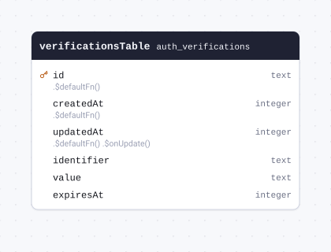

| Column                     | Type      | Constraints | Default                        | Description |
| -------------------------- | --------- | ----------- | ------------------------------ | ----------- |
| `id`                       | `text`    | PK NOT NULL | `.$defaultFn()`                |             |
| `createdAt` (`created_at`) | `integer` | NOT NULL    | `.$defaultFn()`                |             |
| `updatedAt` (`updated_at`) | `integer` | NOT NULL    | `.$defaultFn()` `.$onUpdate()` |             |
| `identifier`               | `text`    | NOT NULL    |                                |             |
| `value`                    | `text`    | NOT NULL    |                                |             |
| `expiresAt` (`expires_at`) | `integer` | NOT NULL    |                                |             |

#### Definition

```sql
CREATE TABLE `auth_verifications` (
	`id` text PRIMARY KEY,
	`created_at` integer NOT NULL,
	`updated_at` integer NOT NULL,
	`identifier` text NOT NULL,
	`value` text NOT NULL,
	`expires_at` integer NOT NULL
);
```

<details>
<summary>Queries and their SQL</summary>

**Select**: Every row of verificationsTable.

```ts
db.select().from(verificationsTable);
```

```sql
select "id", "created_at", "updated_at", "identifier", "value", "expires_at"
from "auth_verifications"
```

**Count**: How many rows verificationsTable has.

```ts
db.select({ count: count() }).from(verificationsTable);
```

```sql
select count(*)
from "auth_verifications"
```

**Find many**: The rows of verificationsTable, through the relational query API.

```ts
db.query.verificationsTable.findMany();
```

```sql
select "d0"."id" as "id", "d0"."created_at" as "createdAt", "d0"."updated_at" as "updatedAt", "d0"."identifier" as "identifier", "d0"."value" as "value", "d0"."expires_at" as "expiresAt"
from "auth_verifications" as "d0"
```

**Find by primary key**: One row of verificationsTable, through the relational query API.

```ts
db.query.verificationsTable.findFirst({ where: { id: "id" } });
```

```sql
select "d0"."id" as "id", "d0"."created_at" as "createdAt", "d0"."updated_at" as "updatedAt", "d0"."identifier" as "identifier", "d0"."value" as "value", "d0"."expires_at" as "expiresAt"
from "auth_verifications" as "d0"
where "d0"."id" = ?
limit ?
-- params: ["id",1]
```

**Insert**: Adds a row to verificationsTable, giving the columns that have no default.

```ts
db.insert(verificationsTable).values({ identifier: "identifier", value: "value", expiresAt: 1 });
```

```sql
insert into "auth_verifications" ("id", "created_at", "updated_at", "identifier", "value", "expires_at")
values (?, ?, ?, ?, ?, ?)
-- params: ["auth_ver_am0q5eut9248z4tod5ryy4x3",1767225600000,1767225600000,"identifier","value",1]
```

**Update**: Changes a row of verificationsTable, found by its primary key.

```ts
db.update(verificationsTable).set({ createdAt: 1 }).where(eq(verificationsTable.id, "id"));
```

```sql
update "auth_verifications"
set "created_at" = ?, "updated_at" = ?
where "auth_verifications"."id" = ?
-- params: [1,1767225600000,"id"]
```

**Delete**: Deletes a row of verificationsTable, found by its primary key.

```ts
db.delete(verificationsTable).where(eq(verificationsTable.id, "id"));
```

```sql
delete from "auth_verifications"
where "auth_verifications"."id" = ?
-- params: ["id"]
```

</details>

<a id="table-twoFactorTable"></a>

### twoFactorTable

Table `auth_two_factor`.

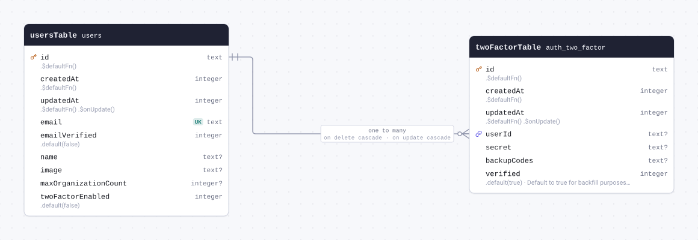

| Column                         | Type      | Constraints                               | Default                        | Description                                                                                                                                                                                                 |
| ------------------------------ | --------- | ----------------------------------------- | ------------------------------ | ----------------------------------------------------------------------------------------------------------------------------------------------------------------------------------------------------------- |
| `id`                           | `text`    | PK NOT NULL                               | `.$defaultFn()`                |                                                                                                                                                                                                             |
| `createdAt` (`created_at`)     | `integer` | NOT NULL                                  | `.$defaultFn()`                |                                                                                                                                                                                                             |
| `updatedAt` (`updated_at`)     | `integer` | NOT NULL                                  | `.$defaultFn()` `.$onUpdate()` |                                                                                                                                                                                                             |
| `userId` (`user_id`)           | `text`    | NULL → [usersTable.id](#table-usersTable) |                                |                                                                                                                                                                                                             |
| `secret`                       | `text`    | NULL                                      |                                |                                                                                                                                                                                                             |
| `backupCodes` (`backup_codes`) | `text`    | NULL                                      |                                |                                                                                                                                                                                                             |
| `verified`                     | `integer` | NOT NULL                                  | `.default(true)`               | Default to true for backfill purposes from better auth : https://github.com/better-auth/better-auth/blob/4cbc823e694c1adb10ef26cf8294263453a156d3/packages/better-auth/src/plugins/two-factor/schema.ts#L42 |

#### Definition

```sql
CREATE TABLE `auth_two_factor` (
	`id` text PRIMARY KEY,
	`created_at` integer NOT NULL,
	`updated_at` integer NOT NULL,
	`user_id` text,
	`secret` text,
	`backup_codes` text,
	`verified` integer DEFAULT true NOT NULL,
	CONSTRAINT `fk_auth_two_factor_user_id_users_id_fk` FOREIGN KEY (`user_id`) REFERENCES `users`(`id`) ON UPDATE CASCADE ON DELETE CASCADE
);
```

#### References

- `userId` → [usersTable.id](#table-usersTable) (many to one, on delete cascade, on update cascade)

<details>
<summary>Queries and their SQL</summary>

**Select**: Every row of twoFactorTable.

```ts
db.select().from(twoFactorTable);
```

```sql
select "id", "created_at", "updated_at", "user_id", "secret", "backup_codes", "verified"
from "auth_two_factor"
```

**Count**: How many rows twoFactorTable has.

```ts
db.select({ count: count() }).from(twoFactorTable);
```

```sql
select count(*)
from "auth_two_factor"
```

**Find many**: The rows of twoFactorTable, through the relational query API.

```ts
db.query.twoFactorTable.findMany();
```

```sql
select "d0"."id" as "id", "d0"."created_at" as "createdAt", "d0"."updated_at" as "updatedAt", "d0"."user_id" as "userId", "d0"."secret" as "secret", "d0"."backup_codes" as "backupCodes", "d0"."verified" as "verified"
from "auth_two_factor" as "d0"
```

**Find by primary key**: One row of twoFactorTable, through the relational query API.

```ts
db.query.twoFactorTable.findFirst({ where: { id: "id" } });
```

```sql
select "d0"."id" as "id", "d0"."created_at" as "createdAt", "d0"."updated_at" as "updatedAt", "d0"."user_id" as "userId", "d0"."secret" as "secret", "d0"."backup_codes" as "backupCodes", "d0"."verified" as "verified"
from "auth_two_factor" as "d0"
where "d0"."id" = ?
limit ?
-- params: ["id",1]
```

**Insert**: Adds a row to twoFactorTable, giving the columns that have no default.

```ts
db.insert(twoFactorTable).values({});
```

```sql
insert into "auth_two_factor" ("id", "created_at", "updated_at", "user_id", "secret", "backup_codes", "verified")
values (?, ?, ?, null, null, null, ?)
-- params: ["auth_2fa_a7lh4n2d0efd83vbvqd6z559",1767225600000,1767225600000,1]
```

**Update**: Changes a row of twoFactorTable, found by its primary key.

```ts
db.update(twoFactorTable).set({ createdAt: 1 }).where(eq(twoFactorTable.id, "id"));
```

```sql
update "auth_two_factor"
set "created_at" = ?, "updated_at" = ?
where "auth_two_factor"."id" = ?
-- params: [1,1767225600000,"id"]
```

**Delete**: Deletes a row of twoFactorTable, found by its primary key.

```ts
db.delete(twoFactorTable).where(eq(twoFactorTable.id, "id"));
```

```sql
delete from "auth_two_factor"
where "auth_two_factor"."id" = ?
-- params: ["id"]
```

</details>

<a id="table-documentsFtsTable"></a>

### documentsFtsTable

Table `documents_fts`.

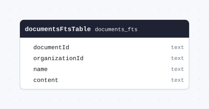

| Column                               | Type   | Constraints | Default | Description |
| ------------------------------------ | ------ | ----------- | ------- | ----------- |
| `documentId` (`document_id`)         | `text` | NOT NULL    |         |             |
| `organizationId` (`organization_id`) | `text` | NOT NULL    |         |             |
| `name`                               | `text` | NOT NULL    |         |             |
| `content`                            | `text` | NOT NULL    |         |             |

#### Definition

```sql
CREATE TABLE `documents_fts` (
	`document_id` text NOT NULL,
	`organization_id` text NOT NULL,
	`name` text NOT NULL,
	`content` text NOT NULL
);
```

<details>
<summary>Queries and their SQL</summary>

**Select**: Every row of documentsFtsTable.

```ts
db.select().from(documentsFtsTable);
```

```sql
select "document_id", "organization_id", "name", "content"
from "documents_fts"
```

**Count**: How many rows documentsFtsTable has.

```ts
db.select({ count: count() }).from(documentsFtsTable);
```

```sql
select count(*)
from "documents_fts"
```

**Find many**: The rows of documentsFtsTable, through the relational query API.

```ts
db.query.documentsFtsTable.findMany();
```

```sql
select "d0"."document_id" as "documentId", "d0"."organization_id" as "organizationId", "d0"."name" as "name", "d0"."content" as "content"
from "documents_fts" as "d0"
```

**Insert**: Adds a row to documentsFtsTable, giving the columns that have no default.

```ts
db.insert(documentsFtsTable).values({
  documentId: "documentId",
  organizationId: "organizationId",
  name: "name",
  content: "content",
});
```

```sql
insert into "documents_fts" ("document_id", "organization_id", "name", "content")
values (?, ?, ?, ?)
-- params: ["documentId","organizationId","name","content"]
```

</details>

<a id="table-intakeEmailsTable"></a>

### intakeEmailsTable

Table `intake_emails`.

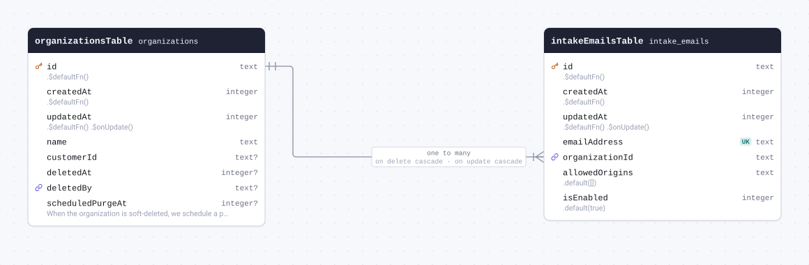

| Column                               | Type      | Constraints                                                   | Default                        | Description |
| ------------------------------------ | --------- | ------------------------------------------------------------- | ------------------------------ | ----------- |
| `id`                                 | `text`    | PK NOT NULL                                                   | `.$defaultFn()`                |             |
| `createdAt` (`created_at`)           | `integer` | NOT NULL                                                      | `.$defaultFn()`                |             |
| `updatedAt` (`updated_at`)           | `integer` | NOT NULL                                                      | `.$defaultFn()` `.$onUpdate()` |             |
| `emailAddress` (`email_address`)     | `text`    | UNIQUE NOT NULL                                               |                                |             |
| `organizationId` (`organization_id`) | `text`    | NOT NULL → [organizationsTable.id](#table-organizationsTable) |                                |             |
| `allowedOrigins` (`allowed_origins`) | `text`    | NOT NULL                                                      | `.default([])`                 |             |
| `isEnabled` (`is_enabled`)           | `integer` | NOT NULL                                                      | `.default(true)`               |             |

#### Definition

```sql
CREATE TABLE `intake_emails` (
	`id` text PRIMARY KEY,
	`created_at` integer NOT NULL,
	`updated_at` integer NOT NULL,
	`email_address` text NOT NULL UNIQUE,
	`organization_id` text NOT NULL,
	`allowed_origins` text DEFAULT '[]' NOT NULL,
	`is_enabled` integer DEFAULT true NOT NULL,
	CONSTRAINT `fk_intake_emails_organization_id_organizations_id_fk` FOREIGN KEY (`organization_id`) REFERENCES `organizations`(`id`) ON UPDATE CASCADE ON DELETE CASCADE
);
```

#### References

- `organizationId` → [organizationsTable.id](#table-organizationsTable) (many to one, on delete cascade, on update cascade)

<details>
<summary>Queries and their SQL</summary>

**Select**: Every row of intakeEmailsTable.

```ts
db.select().from(intakeEmailsTable);
```

```sql
select "id", "created_at", "updated_at", "email_address", "organization_id", "allowed_origins", "is_enabled"
from "intake_emails"
```

**Count**: How many rows intakeEmailsTable has.

```ts
db.select({ count: count() }).from(intakeEmailsTable);
```

```sql
select count(*)
from "intake_emails"
```

**Find many**: The rows of intakeEmailsTable, through the relational query API.

```ts
db.query.intakeEmailsTable.findMany();
```

```sql
select "d0"."id" as "id", "d0"."created_at" as "createdAt", "d0"."updated_at" as "updatedAt", "d0"."email_address" as "emailAddress", "d0"."organization_id" as "organizationId", "d0"."allowed_origins" as "allowedOrigins", "d0"."is_enabled" as "isEnabled"
from "intake_emails" as "d0"
```

**Find by primary key**: One row of intakeEmailsTable, through the relational query API.

```ts
db.query.intakeEmailsTable.findFirst({ where: { id: "id" } });
```

```sql
select "d0"."id" as "id", "d0"."created_at" as "createdAt", "d0"."updated_at" as "updatedAt", "d0"."email_address" as "emailAddress", "d0"."organization_id" as "organizationId", "d0"."allowed_origins" as "allowedOrigins", "d0"."is_enabled" as "isEnabled"
from "intake_emails" as "d0"
where "d0"."id" = ?
limit ?
-- params: ["id",1]
```

**Insert**: Adds a row to intakeEmailsTable, giving the columns that have no default.

```ts
db.insert(intakeEmailsTable).values({
  emailAddress: "emailAddress",
  organizationId: "organizationId",
});
```

```sql
insert into "intake_emails" ("id", "created_at", "updated_at", "email_address", "organization_id", "allowed_origins", "is_enabled")
values (?, ?, ?, ?, ?, ?, ?)
-- params: ["ie_aaaz0sje6lfatv0hv2nl25h6",1767225600000,1767225600000,"emailAddress","organizationId","[]",1]
```

**Update**: Changes a row of intakeEmailsTable, found by its primary key.

```ts
db.update(intakeEmailsTable).set({ createdAt: 1 }).where(eq(intakeEmailsTable.id, "id"));
```

```sql
update "intake_emails"
set "created_at" = ?, "updated_at" = ?
where "intake_emails"."id" = ?
-- params: [1,1767225600000,"id"]
```

**Delete**: Deletes a row of intakeEmailsTable, found by its primary key.

```ts
db.delete(intakeEmailsTable).where(eq(intakeEmailsTable.id, "id"));
```

```sql
delete from "intake_emails"
where "intake_emails"."id" = ?
-- params: ["id"]
```

</details>

<a id="table-organizationSettingsTable"></a>

### organizationSettingsTable

Table `organization_settings`.

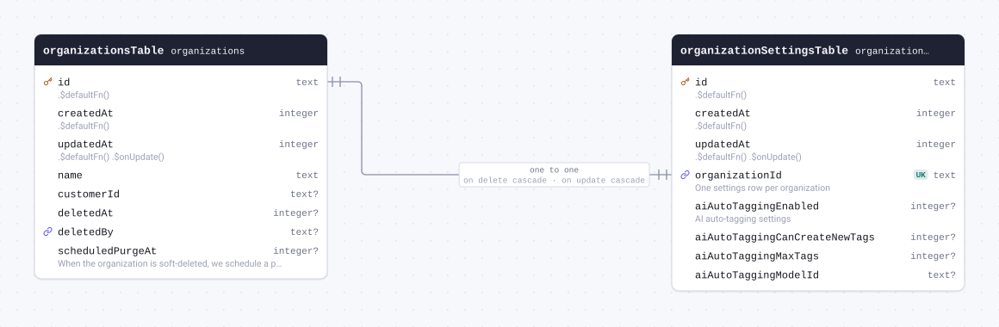

| Column                                                                  | Type      | Constraints                                                          | Default                        | Description                       |
| ----------------------------------------------------------------------- | --------- | -------------------------------------------------------------------- | ------------------------------ | --------------------------------- |
| `id`                                                                    | `text`    | PK NOT NULL                                                          | `.$defaultFn()`                |                                   |
| `createdAt` (`created_at`)                                              | `integer` | NOT NULL                                                             | `.$defaultFn()`                |                                   |
| `updatedAt` (`updated_at`)                                              | `integer` | NOT NULL                                                             | `.$defaultFn()` `.$onUpdate()` |                                   |
| `organizationId` (`organization_id`)                                    | `text`    | UNIQUE NOT NULL → [organizationsTable.id](#table-organizationsTable) |                                | One settings row per organization |
| `aiAutoTaggingEnabled` (`ai_auto_tagging_enabled`)                      | `integer` | NULL                                                                 |                                | AI auto-tagging settings          |
| `aiAutoTaggingCanCreateNewTags` (`ai_auto_tagging_can_create_new_tags`) | `integer` | NULL                                                                 |                                |                                   |
| `aiAutoTaggingMaxTags` (`ai_auto_tagging_max_tags`)                     | `integer` | NULL                                                                 |                                |                                   |
| `aiAutoTaggingModelId` (`ai_auto_tagging_model_id`)                     | `text`    | NULL                                                                 |                                |                                   |

#### Definition

```sql
CREATE TABLE `organization_settings` (
	`id` text PRIMARY KEY,
	`created_at` integer NOT NULL,
	`updated_at` integer NOT NULL,
	`organization_id` text NOT NULL UNIQUE,
	`ai_auto_tagging_enabled` integer,
	`ai_auto_tagging_can_create_new_tags` integer,
	`ai_auto_tagging_max_tags` integer,
	`ai_auto_tagging_model_id` text,
	CONSTRAINT `fk_organization_settings_organization_id_organizations_id_fk` FOREIGN KEY (`organization_id`) REFERENCES `organizations`(`id`) ON UPDATE CASCADE ON DELETE CASCADE
);
```

#### References

- `organizationId` → [organizationsTable.id](#table-organizationsTable) (one to one, on delete cascade, on update cascade)

<details>
<summary>Queries and their SQL</summary>

**Select**: Every row of organizationSettingsTable.

```ts
db.select().from(organizationSettingsTable);
```

```sql
select "id", "created_at", "updated_at", "organization_id", "ai_auto_tagging_enabled", "ai_auto_tagging_can_create_new_tags", "ai_auto_tagging_max_tags", "ai_auto_tagging_model_id"
from "organization_settings"
```

**Count**: How many rows organizationSettingsTable has.

```ts
db.select({ count: count() }).from(organizationSettingsTable);
```

```sql
select count(*)
from "organization_settings"
```

**Find many**: The rows of organizationSettingsTable, through the relational query API.

```ts
db.query.organizationSettingsTable.findMany();
```

```sql
select "d0"."id" as "id", "d0"."created_at" as "createdAt", "d0"."updated_at" as "updatedAt", "d0"."organization_id" as "organizationId", "d0"."ai_auto_tagging_enabled" as "aiAutoTaggingEnabled", "d0"."ai_auto_tagging_can_create_new_tags" as "aiAutoTaggingCanCreateNewTags", "d0"."ai_auto_tagging_max_tags" as "aiAutoTaggingMaxTags", "d0"."ai_auto_tagging_model_id" as "aiAutoTaggingModelId"
from "organization_settings" as "d0"
```

**Find by primary key**: One row of organizationSettingsTable, through the relational query API.

```ts
db.query.organizationSettingsTable.findFirst({ where: { id: "id" } });
```

```sql
select "d0"."id" as "id", "d0"."created_at" as "createdAt", "d0"."updated_at" as "updatedAt", "d0"."organization_id" as "organizationId", "d0"."ai_auto_tagging_enabled" as "aiAutoTaggingEnabled", "d0"."ai_auto_tagging_can_create_new_tags" as "aiAutoTaggingCanCreateNewTags", "d0"."ai_auto_tagging_max_tags" as "aiAutoTaggingMaxTags", "d0"."ai_auto_tagging_model_id" as "aiAutoTaggingModelId"
from "organization_settings" as "d0"
where "d0"."id" = ?
limit ?
-- params: ["id",1]
```

**Insert**: Adds a row to organizationSettingsTable, giving the columns that have no default.

```ts
db.insert(organizationSettingsTable).values({ organizationId: "organizationId" });
```

```sql
insert into "organization_settings" ("id", "created_at", "updated_at", "organization_id", "ai_auto_tagging_enabled", "ai_auto_tagging_can_create_new_tags", "ai_auto_tagging_max_tags", "ai_auto_tagging_model_id")
values (?, ?, ?, ?, null, null, null, null)
-- params: ["org_set_aomcvcr5n4qgn2vt9xtcc4vp",1767225600000,1767225600000,"organizationId"]
```

**Update**: Changes a row of organizationSettingsTable, found by its primary key.

```ts
db.update(organizationSettingsTable)
  .set({ createdAt: 1 })
  .where(eq(organizationSettingsTable.id, "id"));
```

```sql
update "organization_settings"
set "created_at" = ?, "updated_at" = ?
where "organization_settings"."id" = ?
-- params: [1,1767225600000,"id"]
```

**Delete**: Deletes a row of organizationSettingsTable, found by its primary key.

```ts
db.delete(organizationSettingsTable).where(eq(organizationSettingsTable.id, "id"));
```

```sql
delete from "organization_settings"
where "organization_settings"."id" = ?
-- params: ["id"]
```

</details>

<a id="table-planEntitlementsTable"></a>

### planEntitlementsTable

Table `user_plan_entitlements`.

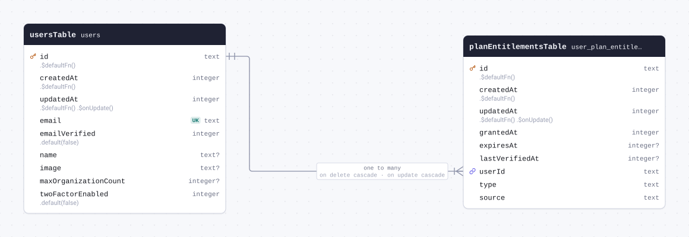

| Column                                | Type      | Constraints                                   | Default                        | Description |
| ------------------------------------- | --------- | --------------------------------------------- | ------------------------------ | ----------- |
| `id`                                  | `text`    | PK NOT NULL                                   | `.$defaultFn()`                |             |
| `createdAt` (`created_at`)            | `integer` | NOT NULL                                      | `.$defaultFn()`                |             |
| `updatedAt` (`updated_at`)            | `integer` | NOT NULL                                      | `.$defaultFn()` `.$onUpdate()` |             |
| `grantedAt` (`granted_at`)            | `integer` | NOT NULL                                      |                                |             |
| `expiresAt` (`expires_at`)            | `integer` | NULL                                          |                                |             |
| `lastVerifiedAt` (`last_verified_at`) | `integer` | NULL                                          |                                |             |
| `userId` (`user_id`)                  | `text`    | NOT NULL → [usersTable.id](#table-usersTable) |                                |             |
| `type`                                | `text`    | NOT NULL                                      |                                |             |
| `source`                              | `text`    | NOT NULL                                      |                                |             |

#### Definition

```sql
CREATE TABLE `user_plan_entitlements` (
	`id` text PRIMARY KEY,
	`created_at` integer NOT NULL,
	`updated_at` integer NOT NULL,
	`granted_at` integer NOT NULL,
	`expires_at` integer,
	`last_verified_at` integer,
	`user_id` text NOT NULL,
	`type` text NOT NULL,
	`source` text NOT NULL,
	CONSTRAINT `fk_user_plan_entitlements_user_id_users_id_fk` FOREIGN KEY (`user_id`) REFERENCES `users`(`id`) ON UPDATE CASCADE ON DELETE CASCADE
);
```

#### References

- `userId` → [usersTable.id](#table-usersTable) (many to one, on delete cascade, on update cascade)

<details>
<summary>Queries and their SQL</summary>

**Select**: Every row of planEntitlementsTable.

```ts
db.select().from(planEntitlementsTable);
```

```sql
select "id", "created_at", "updated_at", "granted_at", "expires_at", "last_verified_at", "user_id", "type", "source"
from "user_plan_entitlements"
```

**Count**: How many rows planEntitlementsTable has.

```ts
db.select({ count: count() }).from(planEntitlementsTable);
```

```sql
select count(*)
from "user_plan_entitlements"
```

**Find many**: The rows of planEntitlementsTable, through the relational query API.

```ts
db.query.planEntitlementsTable.findMany();
```

```sql
select "d0"."id" as "id", "d0"."created_at" as "createdAt", "d0"."updated_at" as "updatedAt", "d0"."granted_at" as "grantedAt", "d0"."expires_at" as "expiresAt", "d0"."last_verified_at" as "lastVerifiedAt", "d0"."user_id" as "userId", "d0"."type" as "type", "d0"."source" as "source"
from "user_plan_entitlements" as "d0"
```

**Find by primary key**: One row of planEntitlementsTable, through the relational query API.

```ts
db.query.planEntitlementsTable.findFirst({ where: { id: "id" } });
```

```sql
select "d0"."id" as "id", "d0"."created_at" as "createdAt", "d0"."updated_at" as "updatedAt", "d0"."granted_at" as "grantedAt", "d0"."expires_at" as "expiresAt", "d0"."last_verified_at" as "lastVerifiedAt", "d0"."user_id" as "userId", "d0"."type" as "type", "d0"."source" as "source"
from "user_plan_entitlements" as "d0"
where "d0"."id" = ?
limit ?
-- params: ["id",1]
```

**Insert**: Adds a row to planEntitlementsTable, giving the columns that have no default.

```ts
db.insert(planEntitlementsTable).values({
  grantedAt: 1,
  userId: "userId",
  type: "type",
  source: "source",
});
```

```sql
insert into "user_plan_entitlements" ("id", "created_at", "updated_at", "granted_at", "expires_at", "last_verified_at", "user_id", "type", "source")
values (?, ?, ?, ?, null, null, ?, ?, ?)
-- params: ["pla_ent_awq0o6i481a8j1dtziu6k9yt",1767225600000,1767225600000,1,"userId","type","source"]
```

**Update**: Changes a row of planEntitlementsTable, found by its primary key.

```ts
db.update(planEntitlementsTable).set({ createdAt: 1 }).where(eq(planEntitlementsTable.id, "id"));
```

```sql
update "user_plan_entitlements"
set "created_at" = ?, "updated_at" = ?
where "user_plan_entitlements"."id" = ?
-- params: [1,1767225600000,"id"]
```

**Delete**: Deletes a row of planEntitlementsTable, found by its primary key.

```ts
db.delete(planEntitlementsTable).where(eq(planEntitlementsTable.id, "id"));
```

```sql
delete from "user_plan_entitlements"
where "user_plan_entitlements"."id" = ?
-- params: ["id"]
```

</details>

<a id="table-organizationSubscriptionsTable"></a>

### organizationSubscriptionsTable

Table `organization_subscriptions`.

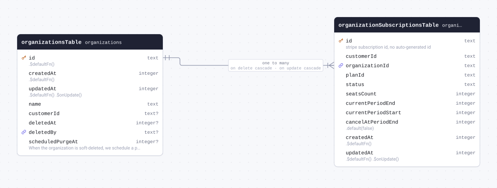

| Column                                        | Type      | Constraints                                                   | Default                        | Description                                  |
| --------------------------------------------- | --------- | ------------------------------------------------------------- | ------------------------------ | -------------------------------------------- |
| `id`                                          | `text`    | PK NOT NULL                                                   |                                | stripe subscription id, no auto-generated id |
| `customerId` (`customer_id`)                  | `text`    | NOT NULL                                                      |                                |                                              |
| `organizationId` (`organization_id`)          | `text`    | NOT NULL → [organizationsTable.id](#table-organizationsTable) |                                |                                              |
| `planId` (`plan_id`)                          | `text`    | NOT NULL                                                      |                                |                                              |
| `status`                                      | `text`    | NOT NULL                                                      |                                |                                              |
| `seatsCount` (`seats_count`)                  | `integer` | NOT NULL                                                      |                                |                                              |
| `currentPeriodEnd` (`current_period_end`)     | `integer` | NOT NULL                                                      |                                |                                              |
| `currentPeriodStart` (`current_period_start`) | `integer` | NOT NULL                                                      |                                |                                              |
| `cancelAtPeriodEnd` (`cancel_at_period_end`)  | `integer` | NOT NULL                                                      | `.default(false)`              |                                              |
| `createdAt` (`created_at`)                    | `integer` | NOT NULL                                                      | `.$defaultFn()`                |                                              |
| `updatedAt` (`updated_at`)                    | `integer` | NOT NULL                                                      | `.$defaultFn()` `.$onUpdate()` |                                              |

#### Definition

```sql
CREATE TABLE `organization_subscriptions` (
	`id` text PRIMARY KEY,
	`customer_id` text NOT NULL,
	`organization_id` text NOT NULL,
	`plan_id` text NOT NULL,
	`status` text NOT NULL,
	`seats_count` integer NOT NULL,
	`current_period_end` integer NOT NULL,
	`current_period_start` integer NOT NULL,
	`cancel_at_period_end` integer DEFAULT false NOT NULL,
	`created_at` integer NOT NULL,
	`updated_at` integer NOT NULL,
	CONSTRAINT `fk_organization_subscriptions_organization_id_organizations_id_fk` FOREIGN KEY (`organization_id`) REFERENCES `organizations`(`id`) ON UPDATE CASCADE ON DELETE CASCADE
);
```

#### References

- `organizationId` → [organizationsTable.id](#table-organizationsTable) (many to one, on delete cascade, on update cascade)

<details>
<summary>Queries and their SQL</summary>

**Select**: Every row of organizationSubscriptionsTable.

```ts
db.select().from(organizationSubscriptionsTable);
```

```sql
select "id", "customer_id", "organization_id", "plan_id", "status", "seats_count", "current_period_end", "current_period_start", "cancel_at_period_end", "created_at", "updated_at"
from "organization_subscriptions"
```

**Count**: How many rows organizationSubscriptionsTable has.

```ts
db.select({ count: count() }).from(organizationSubscriptionsTable);
```

```sql
select count(*)
from "organization_subscriptions"
```

**Find many**: The rows of organizationSubscriptionsTable, through the relational query API.

```ts
db.query.organizationSubscriptionsTable.findMany();
```

```sql
select "d0"."id" as "id", "d0"."customer_id" as "customerId", "d0"."organization_id" as "organizationId", "d0"."plan_id" as "planId", "d0"."status" as "status", "d0"."seats_count" as "seatsCount", "d0"."current_period_end" as "currentPeriodEnd", "d0"."current_period_start" as "currentPeriodStart", "d0"."cancel_at_period_end" as "cancelAtPeriodEnd", "d0"."created_at" as "createdAt", "d0"."updated_at" as "updatedAt"
from "organization_subscriptions" as "d0"
```

**Find by primary key**: One row of organizationSubscriptionsTable, through the relational query API.

```ts
db.query.organizationSubscriptionsTable.findFirst({ where: { id: "id" } });
```

```sql
select "d0"."id" as "id", "d0"."customer_id" as "customerId", "d0"."organization_id" as "organizationId", "d0"."plan_id" as "planId", "d0"."status" as "status", "d0"."seats_count" as "seatsCount", "d0"."current_period_end" as "currentPeriodEnd", "d0"."current_period_start" as "currentPeriodStart", "d0"."cancel_at_period_end" as "cancelAtPeriodEnd", "d0"."created_at" as "createdAt", "d0"."updated_at" as "updatedAt"
from "organization_subscriptions" as "d0"
where "d0"."id" = ?
limit ?
-- params: ["id",1]
```

**Insert**: Adds a row to organizationSubscriptionsTable, giving the columns that have no default.

```ts
db.insert(organizationSubscriptionsTable).values({
  id: "id",
  customerId: "customerId",
  organizationId: "organizationId",
  planId: "planId",
  status: "status",
  seatsCount: 1,
  currentPeriodEnd: 1,
  currentPeriodStart: 1,
});
```

```sql
insert into "organization_subscriptions" ("id", "customer_id", "organization_id", "plan_id", "status", "seats_count", "current_period_end", "current_period_start", "cancel_at_period_end", "created_at", "updated_at")
values (?, ?, ?, ?, ?, ?, ?, ?, ?, ?, ?)
-- params: ["id","customerId","organizationId","planId","status",1,1,1,0,1767225600000,1767225600000]
```

**Update**: Changes a row of organizationSubscriptionsTable, found by its primary key.

```ts
db.update(organizationSubscriptionsTable)
  .set({ customerId: "customerId" })
  .where(eq(organizationSubscriptionsTable.id, "id"));
```

```sql
update "organization_subscriptions"
set "customer_id" = ?, "updated_at" = ?
where "organization_subscriptions"."id" = ?
-- params: ["customerId",1767225600000,"id"]
```

**Delete**: Deletes a row of organizationSubscriptionsTable, found by its primary key.

```ts
db.delete(organizationSubscriptionsTable).where(eq(organizationSubscriptionsTable.id, "id"));
```

```sql
delete from "organization_subscriptions"
where "organization_subscriptions"."id" = ?
-- params: ["id"]
```

</details>

<a id="table-taggingRulesTable"></a>

### taggingRulesTable

Table `tagging_rules`.

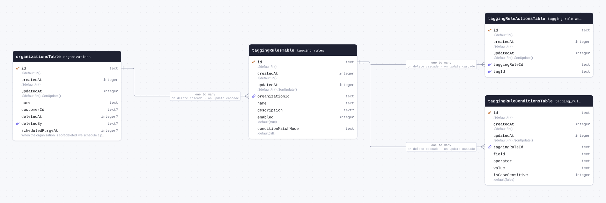

| Column                                        | Type      | Constraints                                                   | Default                        | Description |
| --------------------------------------------- | --------- | ------------------------------------------------------------- | ------------------------------ | ----------- |
| `id`                                          | `text`    | PK NOT NULL                                                   | `.$defaultFn()`                |             |
| `createdAt` (`created_at`)                    | `integer` | NOT NULL                                                      | `.$defaultFn()`                |             |
| `updatedAt` (`updated_at`)                    | `integer` | NOT NULL                                                      | `.$defaultFn()` `.$onUpdate()` |             |
| `organizationId` (`organization_id`)          | `text`    | NOT NULL → [organizationsTable.id](#table-organizationsTable) |                                |             |
| `name`                                        | `text`    | NOT NULL                                                      |                                |             |
| `description`                                 | `text`    | NULL                                                          |                                |             |
| `enabled`                                     | `integer` | NOT NULL                                                      | `.default(true)`               |             |
| `conditionMatchMode` (`condition_match_mode`) | `text`    | NOT NULL                                                      | `.default('all')`              |             |

#### Definition

```sql
CREATE TABLE `tagging_rules` (
	`id` text PRIMARY KEY,
	`created_at` integer NOT NULL,
	`updated_at` integer NOT NULL,
	`organization_id` text NOT NULL,
	`name` text NOT NULL,
	`description` text,
	`enabled` integer DEFAULT true NOT NULL,
	`condition_match_mode` text DEFAULT 'all' NOT NULL,
	CONSTRAINT `fk_tagging_rules_organization_id_organizations_id_fk` FOREIGN KEY (`organization_id`) REFERENCES `organizations`(`id`) ON UPDATE CASCADE ON DELETE CASCADE
);
```

#### References

- `organizationId` → [organizationsTable.id](#table-organizationsTable) (many to one, on delete cascade, on update cascade)

#### Referenced by

- `id` → [taggingRuleConditionsTable.taggingRuleId](#table-taggingRuleConditionsTable) (one to many, on delete cascade, on update cascade)
- `id` → [taggingRuleActionsTable.taggingRuleId](#table-taggingRuleActionsTable) (one to many, on delete cascade, on update cascade)

<details>
<summary>Queries and their SQL</summary>

**Select**: Every row of taggingRulesTable.

```ts
db.select().from(taggingRulesTable);
```

```sql
select "id", "created_at", "updated_at", "organization_id", "name", "description", "enabled", "condition_match_mode"
from "tagging_rules"
```

**Count**: How many rows taggingRulesTable has.

```ts
db.select({ count: count() }).from(taggingRulesTable);
```

```sql
select count(*)
from "tagging_rules"
```

**Find many**: The rows of taggingRulesTable, through the relational query API.

```ts
db.query.taggingRulesTable.findMany();
```

```sql
select "d0"."id" as "id", "d0"."created_at" as "createdAt", "d0"."updated_at" as "updatedAt", "d0"."organization_id" as "organizationId", "d0"."name" as "name", "d0"."description" as "description", "d0"."enabled" as "enabled", "d0"."condition_match_mode" as "conditionMatchMode"
from "tagging_rules" as "d0"
```

**Find by primary key**: One row of taggingRulesTable, through the relational query API.

```ts
db.query.taggingRulesTable.findFirst({ where: { id: "id" } });
```

```sql
select "d0"."id" as "id", "d0"."created_at" as "createdAt", "d0"."updated_at" as "updatedAt", "d0"."organization_id" as "organizationId", "d0"."name" as "name", "d0"."description" as "description", "d0"."enabled" as "enabled", "d0"."condition_match_mode" as "conditionMatchMode"
from "tagging_rules" as "d0"
where "d0"."id" = ?
limit ?
-- params: ["id",1]
```

**Insert**: Adds a row to taggingRulesTable, giving the columns that have no default.

```ts
db.insert(taggingRulesTable).values({ organizationId: "organizationId", name: "name" });
```

```sql
insert into "tagging_rules" ("id", "created_at", "updated_at", "organization_id", "name", "description", "enabled", "condition_match_mode")
values (?, ?, ?, ?, ?, null, ?, ?)
-- params: ["tr_ahlwhc2f26s160zhe3y13qet",1767225600000,1767225600000,"organizationId","name",1,"all"]
```

**Update**: Changes a row of taggingRulesTable, found by its primary key.

```ts
db.update(taggingRulesTable).set({ createdAt: 1 }).where(eq(taggingRulesTable.id, "id"));
```

```sql
update "tagging_rules"
set "created_at" = ?, "updated_at" = ?
where "tagging_rules"."id" = ?
-- params: [1,1767225600000,"id"]
```

**Delete**: Deletes a row of taggingRulesTable, found by its primary key.

```ts
db.delete(taggingRulesTable).where(eq(taggingRulesTable.id, "id"));
```

```sql
delete from "tagging_rules"
where "tagging_rules"."id" = ?
-- params: ["id"]
```

</details>

<a id="table-taggingRuleConditionsTable"></a>

### taggingRuleConditionsTable

Table `tagging_rule_conditions`.

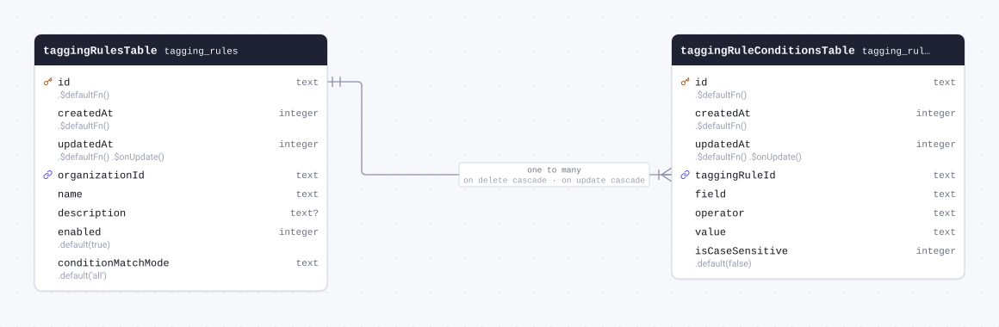

| Column                                  | Type      | Constraints                                                 | Default                        | Description |
| --------------------------------------- | --------- | ----------------------------------------------------------- | ------------------------------ | ----------- |
| `id`                                    | `text`    | PK NOT NULL                                                 | `.$defaultFn()`                |             |
| `createdAt` (`created_at`)              | `integer` | NOT NULL                                                    | `.$defaultFn()`                |             |
| `updatedAt` (`updated_at`)              | `integer` | NOT NULL                                                    | `.$defaultFn()` `.$onUpdate()` |             |
| `taggingRuleId` (`tagging_rule_id`)     | `text`    | NOT NULL → [taggingRulesTable.id](#table-taggingRulesTable) |                                |             |
| `field`                                 | `text`    | NOT NULL                                                    |                                |             |
| `operator`                              | `text`    | NOT NULL                                                    |                                |             |
| `value`                                 | `text`    | NOT NULL                                                    |                                |             |
| `isCaseSensitive` (`is_case_sensitive`) | `integer` | NOT NULL                                                    | `.default(false)`              |             |

#### Definition

```sql
CREATE TABLE `tagging_rule_conditions` (
	`id` text PRIMARY KEY,
	`created_at` integer NOT NULL,
	`updated_at` integer NOT NULL,
	`tagging_rule_id` text NOT NULL,
	`field` text NOT NULL,
	`operator` text NOT NULL,
	`value` text NOT NULL,
	`is_case_sensitive` integer DEFAULT false NOT NULL,
	CONSTRAINT `fk_tagging_rule_conditions_tagging_rule_id_tagging_rules_id_fk` FOREIGN KEY (`tagging_rule_id`) REFERENCES `tagging_rules`(`id`) ON UPDATE CASCADE ON DELETE CASCADE
);
```

#### References

- `taggingRuleId` → [taggingRulesTable.id](#table-taggingRulesTable) (many to one, on delete cascade, on update cascade)

<details>
<summary>Queries and their SQL</summary>

**Select**: Every row of taggingRuleConditionsTable.

```ts
db.select().from(taggingRuleConditionsTable);
```

```sql
select "id", "created_at", "updated_at", "tagging_rule_id", "field", "operator", "value", "is_case_sensitive"
from "tagging_rule_conditions"
```

**Count**: How many rows taggingRuleConditionsTable has.

```ts
db.select({ count: count() }).from(taggingRuleConditionsTable);
```

```sql
select count(*)
from "tagging_rule_conditions"
```

**Find many**: The rows of taggingRuleConditionsTable, through the relational query API.

```ts
db.query.taggingRuleConditionsTable.findMany();
```

```sql
select "d0"."id" as "id", "d0"."created_at" as "createdAt", "d0"."updated_at" as "updatedAt", "d0"."tagging_rule_id" as "taggingRuleId", "d0"."field" as "field", "d0"."operator" as "operator", "d0"."value" as "value", "d0"."is_case_sensitive" as "isCaseSensitive"
from "tagging_rule_conditions" as "d0"
```

**Find by primary key**: One row of taggingRuleConditionsTable, through the relational query API.

```ts
db.query.taggingRuleConditionsTable.findFirst({ where: { id: "id" } });
```

```sql
select "d0"."id" as "id", "d0"."created_at" as "createdAt", "d0"."updated_at" as "updatedAt", "d0"."tagging_rule_id" as "taggingRuleId", "d0"."field" as "field", "d0"."operator" as "operator", "d0"."value" as "value", "d0"."is_case_sensitive" as "isCaseSensitive"
from "tagging_rule_conditions" as "d0"
where "d0"."id" = ?
limit ?
-- params: ["id",1]
```

**Insert**: Adds a row to taggingRuleConditionsTable, giving the columns that have no default.

```ts
db.insert(taggingRuleConditionsTable).values({
  taggingRuleId: "taggingRuleId",
  field: "field",
  operator: "operator",
  value: "value",
});
```

```sql
insert into "tagging_rule_conditions" ("id", "created_at", "updated_at", "tagging_rule_id", "field", "operator", "value", "is_case_sensitive")
values (?, ?, ?, ?, ?, ?, ?, ?)
-- params: ["trc_amuuvvfzzidv0rufbxbxp279",1767225600000,1767225600000,"taggingRuleId","field","operator","value",0]
```

**Update**: Changes a row of taggingRuleConditionsTable, found by its primary key.

```ts
db.update(taggingRuleConditionsTable)
  .set({ createdAt: 1 })
  .where(eq(taggingRuleConditionsTable.id, "id"));
```

```sql
update "tagging_rule_conditions"
set "created_at" = ?, "updated_at" = ?
where "tagging_rule_conditions"."id" = ?
-- params: [1,1767225600000,"id"]
```

**Delete**: Deletes a row of taggingRuleConditionsTable, found by its primary key.

```ts
db.delete(taggingRuleConditionsTable).where(eq(taggingRuleConditionsTable.id, "id"));
```

```sql
delete from "tagging_rule_conditions"
where "tagging_rule_conditions"."id" = ?
-- params: ["id"]
```

</details>

<a id="table-taggingRuleActionsTable"></a>

### taggingRuleActionsTable

Table `tagging_rule_actions`.

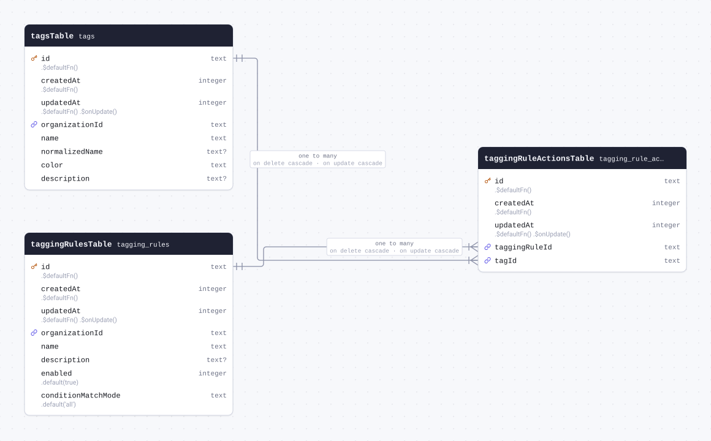

| Column                              | Type      | Constraints                                                 | Default                        | Description |
| ----------------------------------- | --------- | ----------------------------------------------------------- | ------------------------------ | ----------- |
| `id`                                | `text`    | PK NOT NULL                                                 | `.$defaultFn()`                |             |
| `createdAt` (`created_at`)          | `integer` | NOT NULL                                                    | `.$defaultFn()`                |             |
| `updatedAt` (`updated_at`)          | `integer` | NOT NULL                                                    | `.$defaultFn()` `.$onUpdate()` |             |
| `taggingRuleId` (`tagging_rule_id`) | `text`    | NOT NULL → [taggingRulesTable.id](#table-taggingRulesTable) |                                |             |
| `tagId` (`tag_id`)                  | `text`    | NOT NULL → [tagsTable.id](#table-tagsTable)                 |                                |             |

#### Definition

```sql
CREATE TABLE `tagging_rule_actions` (
	`id` text PRIMARY KEY,
	`created_at` integer NOT NULL,
	`updated_at` integer NOT NULL,
	`tagging_rule_id` text NOT NULL,
	`tag_id` text NOT NULL,
	CONSTRAINT `fk_tagging_rule_actions_tagging_rule_id_tagging_rules_id_fk` FOREIGN KEY (`tagging_rule_id`) REFERENCES `tagging_rules`(`id`) ON UPDATE CASCADE ON DELETE CASCADE,
	CONSTRAINT `fk_tagging_rule_actions_tag_id_tags_id_fk` FOREIGN KEY (`tag_id`) REFERENCES `tags`(`id`) ON UPDATE CASCADE ON DELETE CASCADE
);
```

#### References

- `taggingRuleId` → [taggingRulesTable.id](#table-taggingRulesTable) (many to one, on delete cascade, on update cascade)
- `tagId` → [tagsTable.id](#table-tagsTable) (many to one, on delete cascade, on update cascade)

<details>
<summary>Queries and their SQL</summary>

**Select**: Every row of taggingRuleActionsTable.

```ts
db.select().from(taggingRuleActionsTable);
```

```sql
select "id", "created_at", "updated_at", "tagging_rule_id", "tag_id"
from "tagging_rule_actions"
```

**Count**: How many rows taggingRuleActionsTable has.

```ts
db.select({ count: count() }).from(taggingRuleActionsTable);
```

```sql
select count(*)
from "tagging_rule_actions"
```

**Find many**: The rows of taggingRuleActionsTable, through the relational query API.

```ts
db.query.taggingRuleActionsTable.findMany();
```

```sql
select "d0"."id" as "id", "d0"."created_at" as "createdAt", "d0"."updated_at" as "updatedAt", "d0"."tagging_rule_id" as "taggingRuleId", "d0"."tag_id" as "tagId"
from "tagging_rule_actions" as "d0"
```

**Find by primary key**: One row of taggingRuleActionsTable, through the relational query API.

```ts
db.query.taggingRuleActionsTable.findFirst({ where: { id: "id" } });
```

```sql
select "d0"."id" as "id", "d0"."created_at" as "createdAt", "d0"."updated_at" as "updatedAt", "d0"."tagging_rule_id" as "taggingRuleId", "d0"."tag_id" as "tagId"
from "tagging_rule_actions" as "d0"
where "d0"."id" = ?
limit ?
-- params: ["id",1]
```

**Insert**: Adds a row to taggingRuleActionsTable, giving the columns that have no default.

```ts
db.insert(taggingRuleActionsTable).values({ taggingRuleId: "taggingRuleId", tagId: "tagId" });
```

```sql
insert into "tagging_rule_actions" ("id", "created_at", "updated_at", "tagging_rule_id", "tag_id")
values (?, ?, ?, ?, ?)
-- params: ["tra_as8pqw2eby5a1jkrbzqm04iw",1767225600000,1767225600000,"taggingRuleId","tagId"]
```

**Update**: Changes a row of taggingRuleActionsTable, found by its primary key.

```ts
db.update(taggingRuleActionsTable)
  .set({ createdAt: 1 })
  .where(eq(taggingRuleActionsTable.id, "id"));
```

```sql
update "tagging_rule_actions"
set "created_at" = ?, "updated_at" = ?
where "tagging_rule_actions"."id" = ?
-- params: [1,1767225600000,"id"]
```

**Delete**: Deletes a row of taggingRuleActionsTable, found by its primary key.

```ts
db.delete(taggingRuleActionsTable).where(eq(taggingRuleActionsTable.id, "id"));
```

```sql
delete from "tagging_rule_actions"
where "tagging_rule_actions"."id" = ?
-- params: ["id"]
```

</details>

<a id="table-webhooksTable"></a>

### webhooksTable

Table `webhooks`.

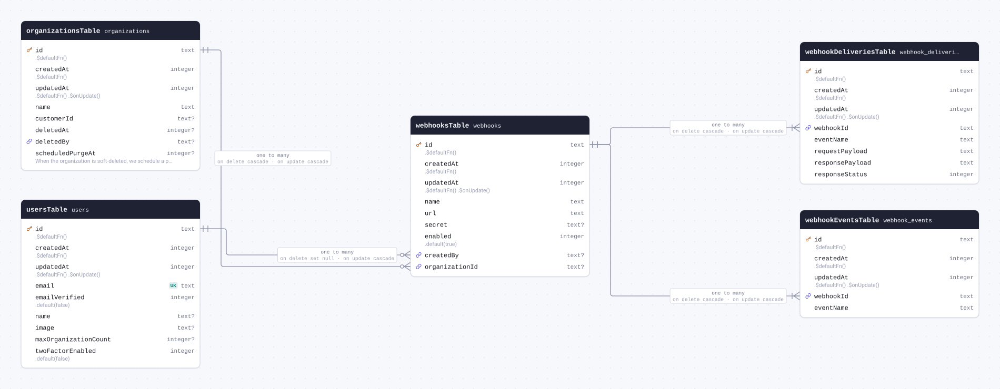

| Column                               | Type      | Constraints                                               | Default                        | Description |
| ------------------------------------ | --------- | --------------------------------------------------------- | ------------------------------ | ----------- |
| `id`                                 | `text`    | PK NOT NULL                                               | `.$defaultFn()`                |             |
| `createdAt` (`created_at`)           | `integer` | NOT NULL                                                  | `.$defaultFn()`                |             |
| `updatedAt` (`updated_at`)           | `integer` | NOT NULL                                                  | `.$defaultFn()` `.$onUpdate()` |             |
| `name`                               | `text`    | NOT NULL                                                  |                                |             |
| `url`                                | `text`    | NOT NULL                                                  |                                |             |
| `secret`                             | `text`    | NULL                                                      |                                |             |
| `enabled`                            | `integer` | NOT NULL                                                  | `.default(true)`               |             |
| `createdBy` (`created_by`)           | `text`    | NULL → [usersTable.id](#table-usersTable)                 |                                |             |
| `organizationId` (`organization_id`) | `text`    | NULL → [organizationsTable.id](#table-organizationsTable) |                                |             |

#### Definition

```sql
CREATE TABLE `webhooks` (
	`id` text PRIMARY KEY,
	`created_at` integer NOT NULL,
	`updated_at` integer NOT NULL,
	`name` text NOT NULL,
	`url` text NOT NULL,
	`secret` text,
	`enabled` integer DEFAULT true NOT NULL,
	`created_by` text,
	`organization_id` text,
	CONSTRAINT `fk_webhooks_created_by_users_id_fk` FOREIGN KEY (`created_by`) REFERENCES `users`(`id`) ON UPDATE CASCADE ON DELETE SET NULL,
	CONSTRAINT `fk_webhooks_organization_id_organizations_id_fk` FOREIGN KEY (`organization_id`) REFERENCES `organizations`(`id`) ON UPDATE CASCADE ON DELETE CASCADE
);
```

#### References

- `createdBy` → [usersTable.id](#table-usersTable) (many to one, on delete set null, on update cascade)
- `organizationId` → [organizationsTable.id](#table-organizationsTable) (many to one, on delete cascade, on update cascade)

#### Referenced by

- `id` → [webhookEventsTable.webhookId](#table-webhookEventsTable) (one to many, on delete cascade, on update cascade)
- `id` → [webhookDeliveriesTable.webhookId](#table-webhookDeliveriesTable) (one to many, on delete cascade, on update cascade)

<details>
<summary>Queries and their SQL</summary>

**Select**: Every row of webhooksTable.

```ts
db.select().from(webhooksTable);
```

```sql
select "id", "created_at", "updated_at", "name", "url", "secret", "enabled", "created_by", "organization_id"
from "webhooks"
```

**Count**: How many rows webhooksTable has.

```ts
db.select({ count: count() }).from(webhooksTable);
```

```sql
select count(*)
from "webhooks"
```

**Find many**: The rows of webhooksTable, through the relational query API.

```ts
db.query.webhooksTable.findMany();
```

```sql
select "d0"."id" as "id", "d0"."created_at" as "createdAt", "d0"."updated_at" as "updatedAt", "d0"."name" as "name", "d0"."url" as "url", "d0"."secret" as "secret", "d0"."enabled" as "enabled", "d0"."created_by" as "createdBy", "d0"."organization_id" as "organizationId"
from "webhooks" as "d0"
```

**Find by primary key**: One row of webhooksTable, through the relational query API.

```ts
db.query.webhooksTable.findFirst({ where: { id: "id" } });
```

```sql
select "d0"."id" as "id", "d0"."created_at" as "createdAt", "d0"."updated_at" as "updatedAt", "d0"."name" as "name", "d0"."url" as "url", "d0"."secret" as "secret", "d0"."enabled" as "enabled", "d0"."created_by" as "createdBy", "d0"."organization_id" as "organizationId"
from "webhooks" as "d0"
where "d0"."id" = ?
limit ?
-- params: ["id",1]
```

**Insert**: Adds a row to webhooksTable, giving the columns that have no default.

```ts
db.insert(webhooksTable).values({ name: "name", url: "url" });
```

```sql
insert into "webhooks" ("id", "created_at", "updated_at", "name", "url", "secret", "enabled", "created_by", "organization_id")
values (?, ?, ?, ?, ?, null, ?, null, null)
-- params: ["wbh_aw62mbqxpppd1v2txjnm8ml3",1767225600000,1767225600000,"name","url",1]
```

**Update**: Changes a row of webhooksTable, found by its primary key.

```ts
db.update(webhooksTable).set({ createdAt: 1 }).where(eq(webhooksTable.id, "id"));
```

```sql
update "webhooks"
set "created_at" = ?, "updated_at" = ?
where "webhooks"."id" = ?
-- params: [1,1767225600000,"id"]
```

**Delete**: Deletes a row of webhooksTable, found by its primary key.

```ts
db.delete(webhooksTable).where(eq(webhooksTable.id, "id"));
```

```sql
delete from "webhooks"
where "webhooks"."id" = ?
-- params: ["id"]
```

</details>

<a id="table-webhookEventsTable"></a>

### webhookEventsTable

Table `webhook_events`.

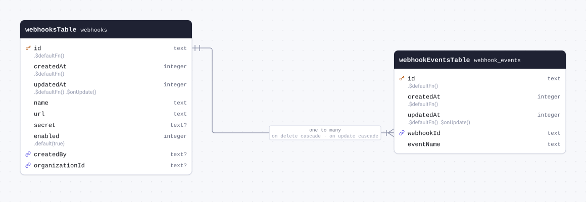

| Column                     | Type      | Constraints                                         | Default                        | Description |
| -------------------------- | --------- | --------------------------------------------------- | ------------------------------ | ----------- |
| `id`                       | `text`    | PK NOT NULL                                         | `.$defaultFn()`                |             |
| `createdAt` (`created_at`) | `integer` | NOT NULL                                            | `.$defaultFn()`                |             |
| `updatedAt` (`updated_at`) | `integer` | NOT NULL                                            | `.$defaultFn()` `.$onUpdate()` |             |
| `webhookId` (`webhook_id`) | `text`    | NOT NULL → [webhooksTable.id](#table-webhooksTable) |                                |             |
| `eventName` (`event_name`) | `text`    | NOT NULL                                            |                                |             |

#### Definition

```sql
CREATE TABLE `webhook_events` (
	`id` text PRIMARY KEY,
	`created_at` integer NOT NULL,
	`updated_at` integer NOT NULL,
	`webhook_id` text NOT NULL,
	`event_name` text NOT NULL,
	CONSTRAINT `fk_webhook_events_webhook_id_webhooks_id_fk` FOREIGN KEY (`webhook_id`) REFERENCES `webhooks`(`id`) ON UPDATE CASCADE ON DELETE CASCADE
);
```

#### References

- `webhookId` → [webhooksTable.id](#table-webhooksTable) (many to one, on delete cascade, on update cascade)

<details>
<summary>Queries and their SQL</summary>

**Select**: Every row of webhookEventsTable.

```ts
db.select().from(webhookEventsTable);
```

```sql
select "id", "created_at", "updated_at", "webhook_id", "event_name"
from "webhook_events"
```

**Count**: How many rows webhookEventsTable has.

```ts
db.select({ count: count() }).from(webhookEventsTable);
```

```sql
select count(*)
from "webhook_events"
```

**Find many**: The rows of webhookEventsTable, through the relational query API.

```ts
db.query.webhookEventsTable.findMany();
```

```sql
select "d0"."id" as "id", "d0"."created_at" as "createdAt", "d0"."updated_at" as "updatedAt", "d0"."webhook_id" as "webhookId", "d0"."event_name" as "eventName"
from "webhook_events" as "d0"
```

**Find by primary key**: One row of webhookEventsTable, through the relational query API.

```ts
db.query.webhookEventsTable.findFirst({ where: { id: "id" } });
```

```sql
select "d0"."id" as "id", "d0"."created_at" as "createdAt", "d0"."updated_at" as "updatedAt", "d0"."webhook_id" as "webhookId", "d0"."event_name" as "eventName"
from "webhook_events" as "d0"
where "d0"."id" = ?
limit ?
-- params: ["id",1]
```

**Insert**: Adds a row to webhookEventsTable, giving the columns that have no default.

```ts
db.insert(webhookEventsTable).values({ webhookId: "webhookId", eventName: "eventName" });
```

```sql
insert into "webhook_events" ("id", "created_at", "updated_at", "webhook_id", "event_name")
values (?, ?, ?, ?, ?)
-- params: ["wbh_ev_az74t8iceq43vmovak4mu4yi",1767225600000,1767225600000,"webhookId","eventName"]
```

**Update**: Changes a row of webhookEventsTable, found by its primary key.

```ts
db.update(webhookEventsTable).set({ createdAt: 1 }).where(eq(webhookEventsTable.id, "id"));
```

```sql
update "webhook_events"
set "created_at" = ?, "updated_at" = ?
where "webhook_events"."id" = ?
-- params: [1,1767225600000,"id"]
```

**Delete**: Deletes a row of webhookEventsTable, found by its primary key.

```ts
db.delete(webhookEventsTable).where(eq(webhookEventsTable.id, "id"));
```

```sql
delete from "webhook_events"
where "webhook_events"."id" = ?
-- params: ["id"]
```

</details>

<a id="table-webhookDeliveriesTable"></a>

### webhookDeliveriesTable

Table `webhook_deliveries`.

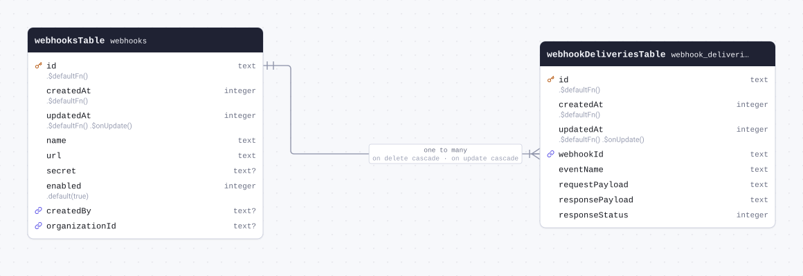

| Column                                 | Type      | Constraints                                         | Default                        | Description |
| -------------------------------------- | --------- | --------------------------------------------------- | ------------------------------ | ----------- |
| `id`                                   | `text`    | PK NOT NULL                                         | `.$defaultFn()`                |             |
| `createdAt` (`created_at`)             | `integer` | NOT NULL                                            | `.$defaultFn()`                |             |
| `updatedAt` (`updated_at`)             | `integer` | NOT NULL                                            | `.$defaultFn()` `.$onUpdate()` |             |
| `webhookId` (`webhook_id`)             | `text`    | NOT NULL → [webhooksTable.id](#table-webhooksTable) |                                |             |
| `eventName` (`event_name`)             | `text`    | NOT NULL                                            |                                |             |
| `requestPayload` (`request_payload`)   | `text`    | NOT NULL                                            |                                |             |
| `responsePayload` (`response_payload`) | `text`    | NOT NULL                                            |                                |             |
| `responseStatus` (`response_status`)   | `integer` | NOT NULL                                            |                                |             |

#### Definition

```sql
CREATE TABLE `webhook_deliveries` (
	`id` text PRIMARY KEY,
	`created_at` integer NOT NULL,
	`updated_at` integer NOT NULL,
	`webhook_id` text NOT NULL,
	`event_name` text NOT NULL,
	`request_payload` text NOT NULL,
	`response_payload` text NOT NULL,
	`response_status` integer NOT NULL,
	CONSTRAINT `fk_webhook_deliveries_webhook_id_webhooks_id_fk` FOREIGN KEY (`webhook_id`) REFERENCES `webhooks`(`id`) ON UPDATE CASCADE ON DELETE CASCADE
);
```

#### References

- `webhookId` → [webhooksTable.id](#table-webhooksTable) (many to one, on delete cascade, on update cascade)

<details>
<summary>Queries and their SQL</summary>

**Select**: Every row of webhookDeliveriesTable.

```ts
db.select().from(webhookDeliveriesTable);
```

```sql
select "id", "created_at", "updated_at", "webhook_id", "event_name", "request_payload", "response_payload", "response_status"
from "webhook_deliveries"
```

**Count**: How many rows webhookDeliveriesTable has.

```ts
db.select({ count: count() }).from(webhookDeliveriesTable);
```

```sql
select count(*)
from "webhook_deliveries"
```

**Find many**: The rows of webhookDeliveriesTable, through the relational query API.

```ts
db.query.webhookDeliveriesTable.findMany();
```

```sql
select "d0"."id" as "id", "d0"."created_at" as "createdAt", "d0"."updated_at" as "updatedAt", "d0"."webhook_id" as "webhookId", "d0"."event_name" as "eventName", "d0"."request_payload" as "requestPayload", "d0"."response_payload" as "responsePayload", "d0"."response_status" as "responseStatus"
from "webhook_deliveries" as "d0"
```

**Find by primary key**: One row of webhookDeliveriesTable, through the relational query API.

```ts
db.query.webhookDeliveriesTable.findFirst({ where: { id: "id" } });
```

```sql
select "d0"."id" as "id", "d0"."created_at" as "createdAt", "d0"."updated_at" as "updatedAt", "d0"."webhook_id" as "webhookId", "d0"."event_name" as "eventName", "d0"."request_payload" as "requestPayload", "d0"."response_payload" as "responsePayload", "d0"."response_status" as "responseStatus"
from "webhook_deliveries" as "d0"
where "d0"."id" = ?
limit ?
-- params: ["id",1]
```

**Insert**: Adds a row to webhookDeliveriesTable, giving the columns that have no default.

```ts
db.insert(webhookDeliveriesTable).values({
  webhookId: "webhookId",
  eventName: "eventName",
  requestPayload: "requestPayload",
  responsePayload: "responsePayload",
  responseStatus: 1,
});
```

```sql
insert into "webhook_deliveries" ("id", "created_at", "updated_at", "webhook_id", "event_name", "request_payload", "response_payload", "response_status")
values (?, ?, ?, ?, ?, ?, ?, ?)
-- params: ["wbh_dlv_akys51ojjuh5kzsy4x4ugjd9",1767225600000,1767225600000,"webhookId","eventName","requestPayload","responsePayload",1]
```

**Update**: Changes a row of webhookDeliveriesTable, found by its primary key.

```ts
db.update(webhookDeliveriesTable).set({ createdAt: 1 }).where(eq(webhookDeliveriesTable.id, "id"));
```

```sql
update "webhook_deliveries"
set "created_at" = ?, "updated_at" = ?
where "webhook_deliveries"."id" = ?
-- params: [1,1767225600000,"id"]
```

**Delete**: Deletes a row of webhookDeliveriesTable, found by its primary key.

```ts
db.delete(webhookDeliveriesTable).where(eq(webhookDeliveriesTable.id, "id"));
```

```sql
delete from "webhook_deliveries"
where "webhook_deliveries"."id" = ?
-- params: ["id"]
```

</details>
