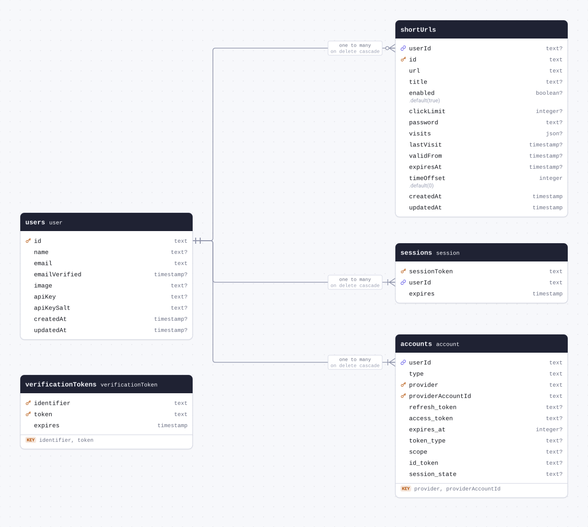
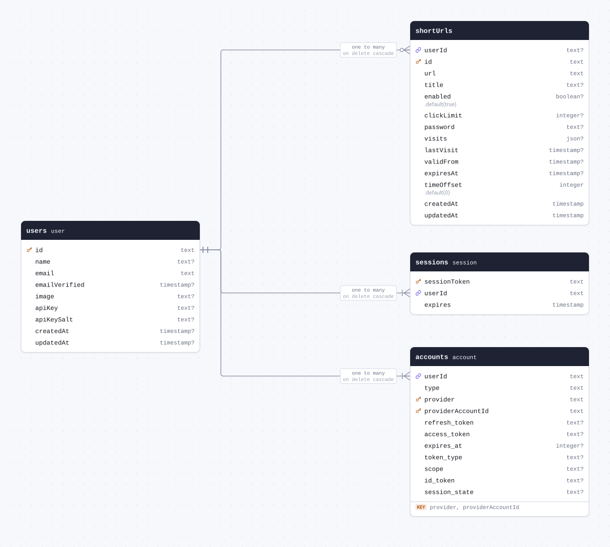
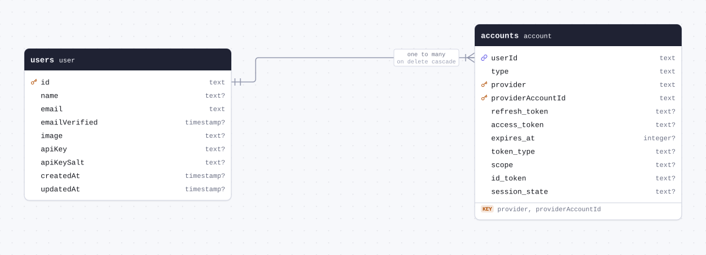
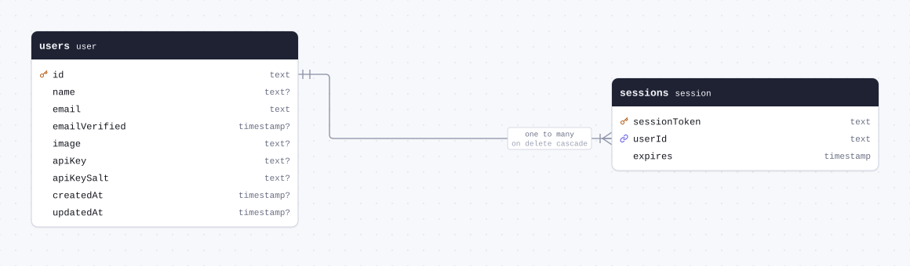
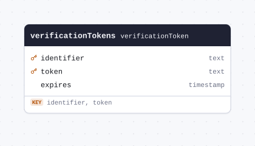
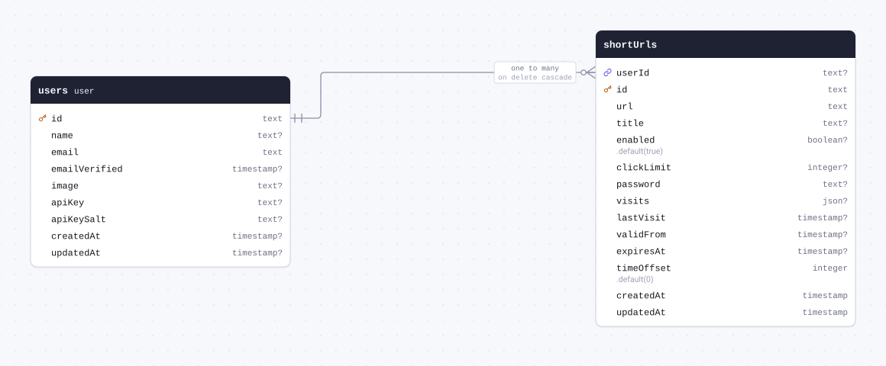

# Schema docs



<details>
<summary>The whole schema as SQL</summary>

```sql
CREATE TABLE "account" (
	"userId" text NOT NULL,
	"type" text NOT NULL,
	"provider" text,
	"providerAccountId" text,
	"refresh_token" text,
	"access_token" text,
	"expires_at" integer,
	"token_type" text,
	"scope" text,
	"id_token" text,
	"session_state" text,
	CONSTRAINT "account_pkey" PRIMARY KEY("provider","providerAccountId")
);

CREATE TABLE "session" (
	"sessionToken" text PRIMARY KEY,
	"userId" text NOT NULL,
	"expires" timestamp NOT NULL
);

CREATE TABLE "shortUrls" (
	"userId" text,
	"id" text PRIMARY KEY,
	"url" text NOT NULL,
	"title" text,
	"enabled" boolean DEFAULT true,
	"clickLimit" integer,
	"password" text,
	"visits" json,
	"lastVisit" timestamp,
	"validFrom" timestamp,
	"expiresAt" timestamp,
	"timeOffset" integer DEFAULT 0 NOT NULL,
	"createdAt" timestamp NOT NULL,
	"updatedAt" timestamp NOT NULL
);

CREATE TABLE "user" (
	"id" text PRIMARY KEY,
	"name" text,
	"email" text NOT NULL,
	"emailVerified" timestamp,
	"image" text,
	"apiKey" text,
	"apiKeySalt" text,
	"createdAt" timestamp,
	"updatedAt" timestamp
);

CREATE TABLE "verificationToken" (
	"identifier" text,
	"token" text,
	"expires" timestamp NOT NULL,
	CONSTRAINT "verificationToken_pkey" PRIMARY KEY("identifier","token")
);

ALTER TABLE "account" ADD CONSTRAINT "account_userId_user_id_fkey" FOREIGN KEY ("userId") REFERENCES "user"("id") ON DELETE CASCADE;

ALTER TABLE "session" ADD CONSTRAINT "session_userId_user_id_fkey" FOREIGN KEY ("userId") REFERENCES "user"("id") ON DELETE CASCADE;

ALTER TABLE "shortUrls" ADD CONSTRAINT "shortUrls_userId_user_id_fkey" FOREIGN KEY ("userId") REFERENCES "user"("id") ON DELETE CASCADE;
```

</details>

## Contents

| Table                                           | Name in the database | Description |
| ----------------------------------------------- | -------------------- | ----------- |
| [users](#table-users)                           | `user`               |             |
| [accounts](#table-accounts)                     | `account`            |             |
| [sessions](#table-sessions)                     | `session`            |             |
| [verificationTokens](#table-verificationTokens) | `verificationToken`  |             |
| [shortUrls](#table-shortUrls)                   | `shortUrls`          |             |

## Tables

<a id="table-users"></a>

### users

Table `user`.



| Column          | Type        | Constraints | Default | Description |
| --------------- | ----------- | ----------- | ------- | ----------- |
| `id`            | `text`      | PK NOT NULL |         |             |
| `name`          | `text`      | NULL        |         |             |
| `email`         | `text`      | NOT NULL    |         |             |
| `emailVerified` | `timestamp` | NULL        |         |             |
| `image`         | `text`      | NULL        |         |             |
| `apiKey`        | `text`      | NULL        |         |             |
| `apiKeySalt`    | `text`      | NULL        |         |             |
| `createdAt`     | `timestamp` | NULL        |         |             |
| `updatedAt`     | `timestamp` | NULL        |         |             |

#### Definition

```sql
CREATE TABLE "user" (
	"id" text PRIMARY KEY,
	"name" text,
	"email" text NOT NULL,
	"emailVerified" timestamp,
	"image" text,
	"apiKey" text,
	"apiKeySalt" text,
	"createdAt" timestamp,
	"updatedAt" timestamp
);
```

#### Referenced by

- `id` → [accounts.userId](#table-accounts) (one to many, on delete cascade)
- `id` → [sessions.userId](#table-sessions) (one to many, on delete cascade)
- `id` → [shortUrls.userId](#table-shortUrls) (one to many, on delete cascade)

<details>
<summary>Queries and their SQL</summary>

**Select**: Every row of users.

```ts
db.select().from(users);
```

```sql
select "id", "name", "email", "emailVerified", "image", "apiKey", "apiKeySalt", "createdAt", "updatedAt"
from "user"
```

**Count**: How many rows users has.

```ts
db.select({ count: count() }).from(users);
```

```sql
select count(*)
from "user"
```

**Find many**: The rows of users, through the relational query API.

```ts
db.query.users.findMany();
```

```sql
select "d0"."id" as "id", "d0"."name" as "name", "d0"."email" as "email", "d0"."emailVerified" as "emailVerified", "d0"."image" as "image", "d0"."apiKey" as "apiKey", "d0"."apiKeySalt" as "apiKeySalt", "d0"."createdAt" as "createdAt", "d0"."updatedAt" as "updatedAt"
from "user" as "d0"
```

**Find by primary key**: One row of users, through the relational query API.

```ts
db.query.users.findFirst({ where: { id: "id" } });
```

```sql
select "d0"."id" as "id", "d0"."name" as "name", "d0"."email" as "email", "d0"."emailVerified" as "emailVerified", "d0"."image" as "image", "d0"."apiKey" as "apiKey", "d0"."apiKeySalt" as "apiKeySalt", "d0"."createdAt" as "createdAt", "d0"."updatedAt" as "updatedAt"
from "user" as "d0"
where "d0"."id" = $1
limit $2
-- params: ["id",1]
```

**Insert**: Adds a row to users, giving the columns that have no default.

```ts
db.insert(users).values({ id: "id", email: "email" });
```

```sql
insert into "user" ("id", "name", "email", "emailVerified", "image", "apiKey", "apiKeySalt", "createdAt", "updatedAt")
values ($1, default, $2, default, default, default, default, default, default)
-- params: ["id","email"]
```

**Update**: Changes a row of users, found by its primary key.

```ts
db.update(users).set({ name: "name" }).where(eq(users.id, "id"));
```

```sql
update "user"
set "name" = $1
where "user"."id" = $2
-- params: ["name","id"]
```

**Delete**: Deletes a row of users, found by its primary key.

```ts
db.delete(users).where(eq(users.id, "id"));
```

```sql
delete from "user"
where "user"."id" = $1
-- params: ["id"]
```

</details>

<a id="table-accounts"></a>

### accounts

Table `account`.



| Column              | Type      | Constraints                         | Default | Description |
| ------------------- | --------- | ----------------------------------- | ------- | ----------- |
| `userId`            | `text`    | NOT NULL → [users.id](#table-users) |         |             |
| `type`              | `text`    | NOT NULL                            |         |             |
| `provider`          | `text`    | PK NOT NULL                         |         |             |
| `providerAccountId` | `text`    | PK NOT NULL                         |         |             |
| `refresh_token`     | `text`    | NULL                                |         |             |
| `access_token`      | `text`    | NULL                                |         |             |
| `expires_at`        | `integer` | NULL                                |         |             |
| `token_type`        | `text`    | NULL                                |         |             |
| `scope`             | `text`    | NULL                                |         |             |
| `id_token`          | `text`    | NULL                                |         |             |
| `session_state`     | `text`    | NULL                                |         |             |

#### Definition

```sql
CREATE TABLE "account" (
	"userId" text NOT NULL,
	"type" text NOT NULL,
	"provider" text,
	"providerAccountId" text,
	"refresh_token" text,
	"access_token" text,
	"expires_at" integer,
	"token_type" text,
	"scope" text,
	"id_token" text,
	"session_state" text,
	CONSTRAINT "account_pkey" PRIMARY KEY("provider","providerAccountId")
);

ALTER TABLE "account" ADD CONSTRAINT "account_userId_user_id_fkey" FOREIGN KEY ("userId") REFERENCES "user"("id") ON DELETE CASCADE;
```

#### Indexes

- PRIMARY KEY `provider`, `providerAccountId`

#### References

- `userId` → [users.id](#table-users) (many to one, on delete cascade)

<details>
<summary>Queries and their SQL</summary>

**Select**: Every row of accounts.

```ts
db.select().from(accounts);
```

```sql
select "userId", "type", "provider", "providerAccountId", "refresh_token", "access_token", "expires_at", "token_type", "scope", "id_token", "session_state"
from "account"
```

**Count**: How many rows accounts has.

```ts
db.select({ count: count() }).from(accounts);
```

```sql
select count(*)
from "account"
```

**Find many**: The rows of accounts, through the relational query API.

```ts
db.query.accounts.findMany();
```

```sql
select "d0"."userId" as "userId", "d0"."type" as "type", "d0"."provider" as "provider", "d0"."providerAccountId" as "providerAccountId", "d0"."refresh_token" as "refresh_token", "d0"."access_token" as "access_token", "d0"."expires_at" as "expires_at", "d0"."token_type" as "token_type", "d0"."scope" as "scope", "d0"."id_token" as "id_token", "d0"."session_state" as "session_state"
from "account" as "d0"
```

**Find by primary key**: One row of accounts, through the relational query API.

```ts
db.query.accounts.findFirst({
  where: { provider: "provider", providerAccountId: "providerAccountId" },
});
```

```sql
select "d0"."userId" as "userId", "d0"."type" as "type", "d0"."provider" as "provider", "d0"."providerAccountId" as "providerAccountId", "d0"."refresh_token" as "refresh_token", "d0"."access_token" as "access_token", "d0"."expires_at" as "expires_at", "d0"."token_type" as "token_type", "d0"."scope" as "scope", "d0"."id_token" as "id_token", "d0"."session_state" as "session_state"
from "account" as "d0"
where (("d0"."provider" = $1) and ("d0"."providerAccountId" = $2))
limit $3
-- params: ["provider","providerAccountId",1]
```

**Insert**: Adds a row to accounts, giving the columns that have no default.

```ts
db.insert(accounts).values({
  userId: "userId",
  type: "type",
  provider: "provider",
  providerAccountId: "providerAccountId",
});
```

```sql
insert into "account" ("userId", "type", "provider", "providerAccountId", "refresh_token", "access_token", "expires_at", "token_type", "scope", "id_token", "session_state")
values ($1, $2, $3, $4, default, default, default, default, default, default, default)
-- params: ["userId","type","provider","providerAccountId"]
```

**Update**: Changes a row of accounts, found by its primary key.

```ts
db.update(accounts)
  .set({ userId: "userId" })
  .where(
    and(eq(accounts.provider, "provider"), eq(accounts.providerAccountId, "providerAccountId")),
  );
```

```sql
update "account"
set "userId" = $1
where (("account"."provider" = $2) and ("account"."providerAccountId" = $3))
-- params: ["userId","provider","providerAccountId"]
```

**Delete**: Deletes a row of accounts, found by its primary key.

```ts
db.delete(accounts).where(
  and(eq(accounts.provider, "provider"), eq(accounts.providerAccountId, "providerAccountId")),
);
```

```sql
delete from "account"
where (("account"."provider" = $1) and ("account"."providerAccountId" = $2))
-- params: ["provider","providerAccountId"]
```

</details>

<a id="table-sessions"></a>

### sessions

Table `session`.



| Column         | Type        | Constraints                         | Default | Description |
| -------------- | ----------- | ----------------------------------- | ------- | ----------- |
| `sessionToken` | `text`      | PK NOT NULL                         |         |             |
| `userId`       | `text`      | NOT NULL → [users.id](#table-users) |         |             |
| `expires`      | `timestamp` | NOT NULL                            |         |             |

#### Definition

```sql
CREATE TABLE "session" (
	"sessionToken" text PRIMARY KEY,
	"userId" text NOT NULL,
	"expires" timestamp NOT NULL
);

ALTER TABLE "session" ADD CONSTRAINT "session_userId_user_id_fkey" FOREIGN KEY ("userId") REFERENCES "user"("id") ON DELETE CASCADE;
```

#### References

- `userId` → [users.id](#table-users) (many to one, on delete cascade)

<details>
<summary>Queries and their SQL</summary>

**Select**: Every row of sessions.

```ts
db.select().from(sessions);
```

```sql
select "sessionToken", "userId", "expires"
from "session"
```

**Count**: How many rows sessions has.

```ts
db.select({ count: count() }).from(sessions);
```

```sql
select count(*)
from "session"
```

**Find many**: The rows of sessions, through the relational query API.

```ts
db.query.sessions.findMany();
```

```sql
select "d0"."sessionToken" as "sessionToken", "d0"."userId" as "userId", "d0"."expires" as "expires"
from "session" as "d0"
```

**Find by primary key**: One row of sessions, through the relational query API.

```ts
db.query.sessions.findFirst({ where: { sessionToken: "sessionToken" } });
```

```sql
select "d0"."sessionToken" as "sessionToken", "d0"."userId" as "userId", "d0"."expires" as "expires"
from "session" as "d0"
where "d0"."sessionToken" = $1
limit $2
-- params: ["sessionToken",1]
```

**Insert**: Adds a row to sessions, giving the columns that have no default.

```ts
db.insert(sessions).values({
  sessionToken: "sessionToken",
  userId: "userId",
  expires: new Date("2026-01-01T00:00:00.000Z"),
});
```

```sql
insert into "session" ("sessionToken", "userId", "expires")
values ($1, $2, $3)
-- params: ["sessionToken","userId","2026-01-01T00:00:00.000Z"]
```

**Update**: Changes a row of sessions, found by its primary key.

```ts
db.update(sessions).set({ userId: "userId" }).where(eq(sessions.sessionToken, "sessionToken"));
```

```sql
update "session"
set "userId" = $1
where "session"."sessionToken" = $2
-- params: ["userId","sessionToken"]
```

**Delete**: Deletes a row of sessions, found by its primary key.

```ts
db.delete(sessions).where(eq(sessions.sessionToken, "sessionToken"));
```

```sql
delete from "session"
where "session"."sessionToken" = $1
-- params: ["sessionToken"]
```

</details>

<a id="table-verificationTokens"></a>

### verificationTokens

Table `verificationToken`.



| Column       | Type        | Constraints | Default | Description |
| ------------ | ----------- | ----------- | ------- | ----------- |
| `identifier` | `text`      | PK NOT NULL |         |             |
| `token`      | `text`      | PK NOT NULL |         |             |
| `expires`    | `timestamp` | NOT NULL    |         |             |

#### Definition

```sql
CREATE TABLE "verificationToken" (
	"identifier" text,
	"token" text,
	"expires" timestamp NOT NULL,
	CONSTRAINT "verificationToken_pkey" PRIMARY KEY("identifier","token")
);
```

#### Indexes

- PRIMARY KEY `identifier`, `token`

<details>
<summary>Queries and their SQL</summary>

**Select**: Every row of verificationTokens.

```ts
db.select().from(verificationTokens);
```

```sql
select "identifier", "token", "expires"
from "verificationToken"
```

**Count**: How many rows verificationTokens has.

```ts
db.select({ count: count() }).from(verificationTokens);
```

```sql
select count(*)
from "verificationToken"
```

**Find many**: The rows of verificationTokens, through the relational query API.

```ts
db.query.verificationTokens.findMany();
```

```sql
select "d0"."identifier" as "identifier", "d0"."token" as "token", "d0"."expires" as "expires"
from "verificationToken" as "d0"
```

**Find by primary key**: One row of verificationTokens, through the relational query API.

```ts
db.query.verificationTokens.findFirst({ where: { identifier: "identifier", token: "token" } });
```

```sql
select "d0"."identifier" as "identifier", "d0"."token" as "token", "d0"."expires" as "expires"
from "verificationToken" as "d0"
where (("d0"."identifier" = $1) and ("d0"."token" = $2))
limit $3
-- params: ["identifier","token",1]
```

**Insert**: Adds a row to verificationTokens, giving the columns that have no default.

```ts
db.insert(verificationTokens).values({
  identifier: "identifier",
  token: "token",
  expires: new Date("2026-01-01T00:00:00.000Z"),
});
```

```sql
insert into "verificationToken" ("identifier", "token", "expires")
values ($1, $2, $3)
-- params: ["identifier","token","2026-01-01T00:00:00.000Z"]
```

**Update**: Changes a row of verificationTokens, found by its primary key.

```ts
db.update(verificationTokens)
  .set({ expires: new Date("2026-01-01T00:00:00.000Z") })
  .where(
    and(eq(verificationTokens.identifier, "identifier"), eq(verificationTokens.token, "token")),
  );
```

```sql
update "verificationToken"
set "expires" = $1
where (("verificationToken"."identifier" = $2) and ("verificationToken"."token" = $3))
-- params: ["2026-01-01T00:00:00.000Z","identifier","token"]
```

**Delete**: Deletes a row of verificationTokens, found by its primary key.

```ts
db.delete(verificationTokens).where(
  and(eq(verificationTokens.identifier, "identifier"), eq(verificationTokens.token, "token")),
);
```

```sql
delete from "verificationToken"
where (("verificationToken"."identifier" = $1) and ("verificationToken"."token" = $2))
-- params: ["identifier","token"]
```

</details>

<a id="table-shortUrls"></a>

### shortUrls



| Column       | Type        | Constraints                     | Default          | Description |
| ------------ | ----------- | ------------------------------- | ---------------- | ----------- |
| `userId`     | `text`      | NULL → [users.id](#table-users) |                  |             |
| `id`         | `text`      | PK NOT NULL                     |                  |             |
| `url`        | `text`      | NOT NULL                        |                  |             |
| `title`      | `text`      | NULL                            |                  |             |
| `enabled`    | `boolean`   | NULL                            | `.default(true)` |             |
| `clickLimit` | `integer`   | NULL                            |                  |             |
| `password`   | `text`      | NULL                            |                  |             |
| `visits`     | `json`      | NULL                            |                  |             |
| `lastVisit`  | `timestamp` | NULL                            |                  |             |
| `validFrom`  | `timestamp` | NULL                            |                  |             |
| `expiresAt`  | `timestamp` | NULL                            |                  |             |
| `timeOffset` | `integer`   | NOT NULL                        | `.default(0)`    |             |
| `createdAt`  | `timestamp` | NOT NULL                        |                  |             |
| `updatedAt`  | `timestamp` | NOT NULL                        |                  |             |

#### Definition

```sql
CREATE TABLE "shortUrls" (
	"userId" text,
	"id" text PRIMARY KEY,
	"url" text NOT NULL,
	"title" text,
	"enabled" boolean DEFAULT true,
	"clickLimit" integer,
	"password" text,
	"visits" json,
	"lastVisit" timestamp,
	"validFrom" timestamp,
	"expiresAt" timestamp,
	"timeOffset" integer DEFAULT 0 NOT NULL,
	"createdAt" timestamp NOT NULL,
	"updatedAt" timestamp NOT NULL
);

ALTER TABLE "shortUrls" ADD CONSTRAINT "shortUrls_userId_user_id_fkey" FOREIGN KEY ("userId") REFERENCES "user"("id") ON DELETE CASCADE;
```

#### References

- `userId` → [users.id](#table-users) (many to one, on delete cascade)

<details>
<summary>Queries and their SQL</summary>

**Select**: Every row of shortUrls.

```ts
db.select().from(shortUrls);
```

```sql
select "userId", "id", "url", "title", "enabled", "clickLimit", "password", "visits", "lastVisit", "validFrom", "expiresAt", "timeOffset", "createdAt", "updatedAt"
from "shortUrls"
```

**Count**: How many rows shortUrls has.

```ts
db.select({ count: count() }).from(shortUrls);
```

```sql
select count(*)
from "shortUrls"
```

**Find many**: The rows of shortUrls, through the relational query API.

```ts
db.query.shortUrls.findMany();
```

```sql
select "d0"."userId" as "userId", "d0"."id" as "id", "d0"."url" as "url", "d0"."title" as "title", "d0"."enabled" as "enabled", "d0"."clickLimit" as "clickLimit", "d0"."password" as "password", "d0"."visits" as "visits", "d0"."lastVisit" as "lastVisit", "d0"."validFrom" as "validFrom", "d0"."expiresAt" as "expiresAt", "d0"."timeOffset" as "timeOffset", "d0"."createdAt" as "createdAt", "d0"."updatedAt" as "updatedAt"
from "shortUrls" as "d0"
```

**Find by primary key**: One row of shortUrls, through the relational query API.

```ts
db.query.shortUrls.findFirst({ where: { id: "id" } });
```

```sql
select "d0"."userId" as "userId", "d0"."id" as "id", "d0"."url" as "url", "d0"."title" as "title", "d0"."enabled" as "enabled", "d0"."clickLimit" as "clickLimit", "d0"."password" as "password", "d0"."visits" as "visits", "d0"."lastVisit" as "lastVisit", "d0"."validFrom" as "validFrom", "d0"."expiresAt" as "expiresAt", "d0"."timeOffset" as "timeOffset", "d0"."createdAt" as "createdAt", "d0"."updatedAt" as "updatedAt"
from "shortUrls" as "d0"
where "d0"."id" = $1
limit $2
-- params: ["id",1]
```

**Insert**: Adds a row to shortUrls, giving the columns that have no default.

```ts
db.insert(shortUrls).values({
  id: "id",
  url: "url",
  createdAt: new Date("2026-01-01T00:00:00.000Z"),
  updatedAt: new Date("2026-01-01T00:00:00.000Z"),
});
```

```sql
insert into "shortUrls" ("userId", "id", "url", "title", "enabled", "clickLimit", "password", "visits", "lastVisit", "validFrom", "expiresAt", "timeOffset", "createdAt", "updatedAt")
values (default, $1, $2, default, default, default, default, default, default, default, default, default, $3, $4)
-- params: ["id","url","2026-01-01T00:00:00.000Z","2026-01-01T00:00:00.000Z"]
```

**Update**: Changes a row of shortUrls, found by its primary key.

```ts
db.update(shortUrls).set({ userId: "userId" }).where(eq(shortUrls.id, "id"));
```

```sql
update "shortUrls"
set "userId" = $1
where "shortUrls"."id" = $2
-- params: ["userId","id"]
```

**Delete**: Deletes a row of shortUrls, found by its primary key.

```ts
db.delete(shortUrls).where(eq(shortUrls.id, "id"));
```

```sql
delete from "shortUrls"
where "shortUrls"."id" = $1
-- params: ["id"]
```

</details>
