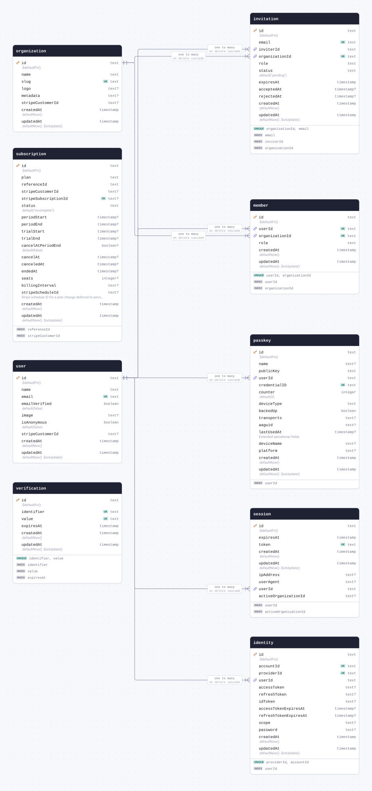
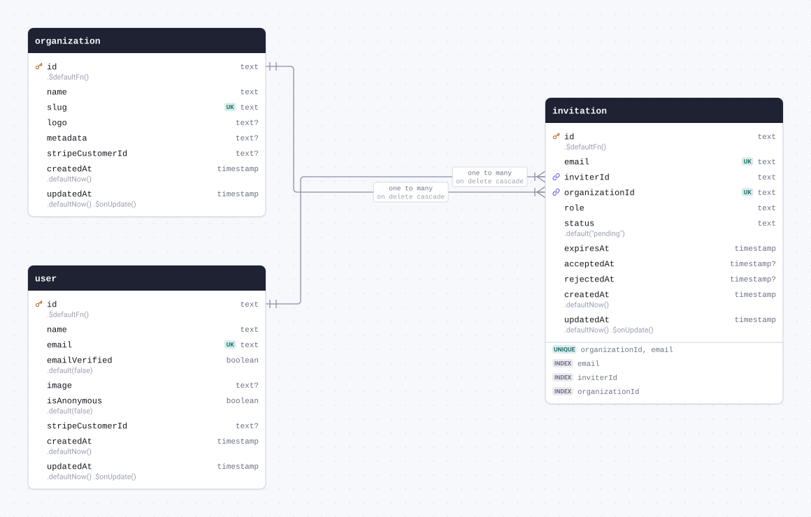
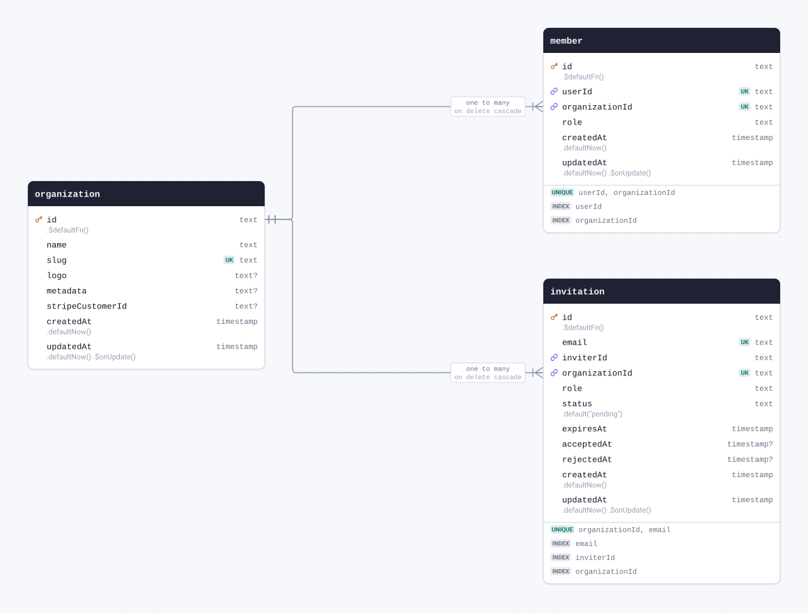
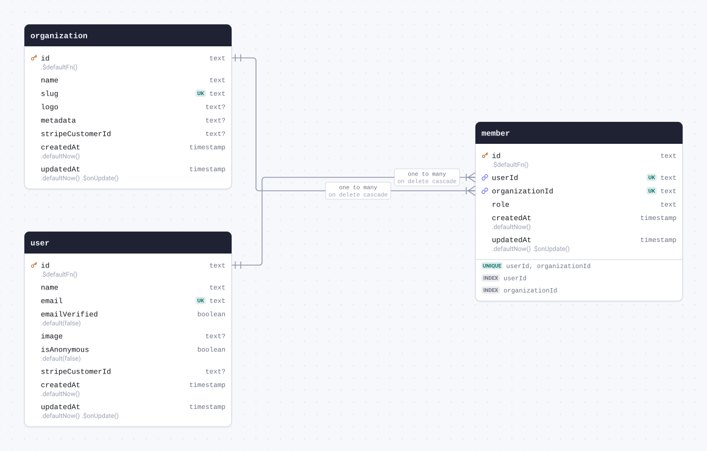
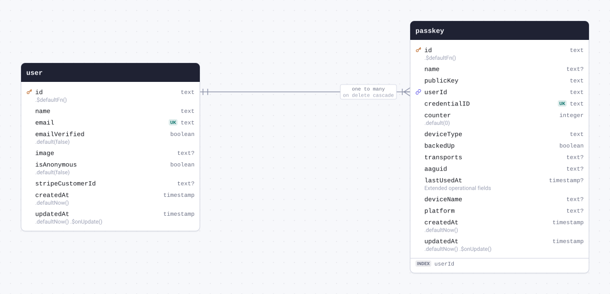
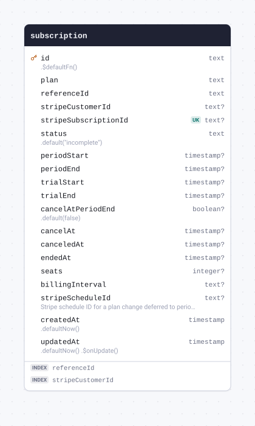
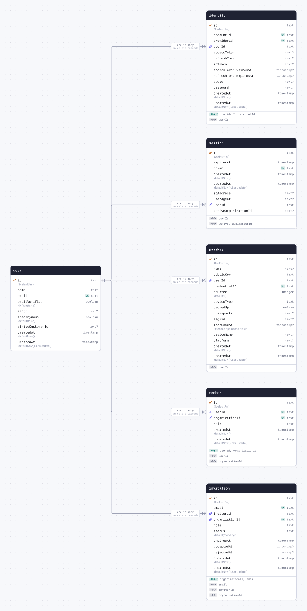
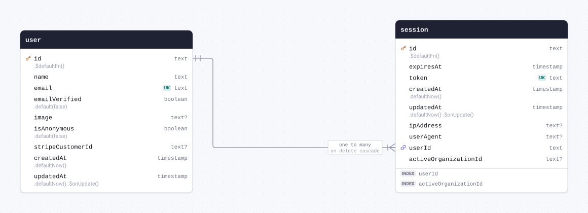
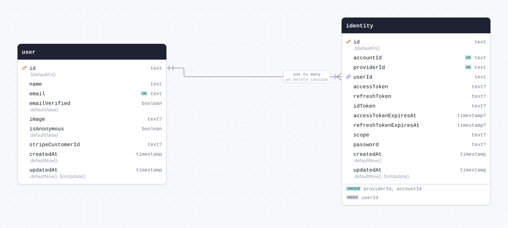
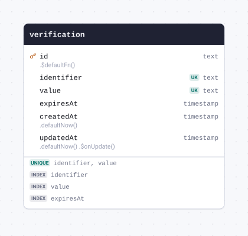

# Schema docs



<details>
<summary>The whole schema as SQL</summary>

```sql
CREATE TABLE "identity" (
	"id" text PRIMARY KEY,
	"account_id" text NOT NULL,
	"provider_id" text NOT NULL,
	"user_id" text NOT NULL,
	"access_token" text,
	"refresh_token" text,
	"id_token" text,
	"access_token_expires_at" timestamp with time zone,
	"refresh_token_expires_at" timestamp with time zone,
	"scope" text,
	"password" text,
	"created_at" timestamp with time zone DEFAULT now() NOT NULL,
	"updated_at" timestamp with time zone DEFAULT now() NOT NULL,
	CONSTRAINT "identity_provider_account_unique" UNIQUE("provider_id","account_id")
);

CREATE TABLE "invitation" (
	"id" text PRIMARY KEY,
	"email" text NOT NULL,
	"inviter_id" text NOT NULL,
	"organization_id" text NOT NULL,
	"role" text NOT NULL,
	"status" text DEFAULT 'pending' NOT NULL,
	"expires_at" timestamp with time zone NOT NULL,
	"accepted_at" timestamp with time zone,
	"rejected_at" timestamp with time zone,
	"created_at" timestamp with time zone DEFAULT now() NOT NULL,
	"updated_at" timestamp with time zone DEFAULT now() NOT NULL,
	CONSTRAINT "invitation_org_email_unique" UNIQUE("organization_id","email")
);

CREATE TABLE "member" (
	"id" text PRIMARY KEY,
	"user_id" text NOT NULL,
	"organization_id" text NOT NULL,
	"role" text NOT NULL,
	"created_at" timestamp with time zone DEFAULT now() NOT NULL,
	"updated_at" timestamp with time zone DEFAULT now() NOT NULL,
	CONSTRAINT "member_user_org_unique" UNIQUE("user_id","organization_id")
);

CREATE TABLE "organization" (
	"id" text PRIMARY KEY,
	"name" text NOT NULL,
	"slug" text NOT NULL UNIQUE,
	"logo" text,
	"metadata" text,
	"stripe_customer_id" text,
	"created_at" timestamp with time zone DEFAULT now() NOT NULL,
	"updated_at" timestamp with time zone DEFAULT now() NOT NULL
);

CREATE TABLE "passkey" (
	"id" text PRIMARY KEY,
	"name" text,
	"public_key" text NOT NULL,
	"user_id" text NOT NULL,
	"credential_id" text NOT NULL UNIQUE,
	"counter" integer DEFAULT 0 NOT NULL,
	"device_type" text NOT NULL,
	"backed_up" boolean NOT NULL,
	"transports" text,
	"aaguid" text,
	"last_used_at" timestamp with time zone,
	"device_name" text,
	"platform" text,
	"created_at" timestamp with time zone DEFAULT now() NOT NULL,
	"updated_at" timestamp with time zone DEFAULT now() NOT NULL
);

CREATE TABLE "session" (
	"id" text PRIMARY KEY,
	"expires_at" timestamp with time zone NOT NULL,
	"token" text NOT NULL UNIQUE,
	"created_at" timestamp with time zone DEFAULT now() NOT NULL,
	"updated_at" timestamp with time zone DEFAULT now() NOT NULL,
	"ip_address" text,
	"user_agent" text,
	"user_id" text NOT NULL,
	"active_organization_id" text
);

CREATE TABLE "subscription" (
	"id" text PRIMARY KEY,
	"plan" text NOT NULL,
	"reference_id" text NOT NULL,
	"stripe_customer_id" text,
	"stripe_subscription_id" text UNIQUE,
	"status" text DEFAULT 'incomplete' NOT NULL,
	"period_start" timestamp with time zone,
	"period_end" timestamp with time zone,
	"trial_start" timestamp with time zone,
	"trial_end" timestamp with time zone,
	"cancel_at_period_end" boolean DEFAULT false,
	"cancel_at" timestamp with time zone,
	"canceled_at" timestamp with time zone,
	"ended_at" timestamp with time zone,
	"seats" integer,
	"billing_interval" text,
	"stripe_schedule_id" text,
	"created_at" timestamp with time zone DEFAULT now() NOT NULL,
	"updated_at" timestamp with time zone DEFAULT now() NOT NULL
);

CREATE TABLE "user" (
	"id" text PRIMARY KEY,
	"name" text NOT NULL,
	"email" text NOT NULL UNIQUE,
	"email_verified" boolean DEFAULT false NOT NULL,
	"image" text,
	"is_anonymous" boolean DEFAULT false NOT NULL,
	"stripe_customer_id" text,
	"created_at" timestamp with time zone DEFAULT now() NOT NULL,
	"updated_at" timestamp with time zone DEFAULT now() NOT NULL
);

CREATE TABLE "verification" (
	"id" text PRIMARY KEY,
	"identifier" text NOT NULL,
	"value" text NOT NULL,
	"expires_at" timestamp with time zone NOT NULL,
	"created_at" timestamp with time zone DEFAULT now() NOT NULL,
	"updated_at" timestamp with time zone DEFAULT now() NOT NULL,
	CONSTRAINT "verification_identifier_value_unique" UNIQUE("identifier","value")
);

CREATE INDEX "identity_user_id_idx" ON "identity" ("user_id");

CREATE INDEX "invitation_email_idx" ON "invitation" ("email");

CREATE INDEX "invitation_inviter_id_idx" ON "invitation" ("inviter_id");

CREATE INDEX "invitation_organization_id_idx" ON "invitation" ("organization_id");

CREATE INDEX "member_user_id_idx" ON "member" ("user_id");

CREATE INDEX "member_organization_id_idx" ON "member" ("organization_id");

CREATE INDEX "passkey_user_id_idx" ON "passkey" ("user_id");

CREATE INDEX "session_user_id_idx" ON "session" ("user_id");

CREATE INDEX "session_active_org_id_idx" ON "session" ("active_organization_id");

CREATE INDEX "subscription_reference_id_idx" ON "subscription" ("reference_id");

CREATE INDEX "subscription_stripe_customer_id_idx" ON "subscription" ("stripe_customer_id");

CREATE INDEX "verification_identifier_idx" ON "verification" ("identifier");

CREATE INDEX "verification_value_idx" ON "verification" ("value");

CREATE INDEX "verification_expires_at_idx" ON "verification" ("expires_at");

ALTER TABLE "identity" ADD CONSTRAINT "identity_user_id_user_id_fkey" FOREIGN KEY ("user_id") REFERENCES "user"("id") ON DELETE CASCADE;

ALTER TABLE "invitation" ADD CONSTRAINT "invitation_inviter_id_user_id_fkey" FOREIGN KEY ("inviter_id") REFERENCES "user"("id") ON DELETE CASCADE;

ALTER TABLE "invitation" ADD CONSTRAINT "invitation_organization_id_organization_id_fkey" FOREIGN KEY ("organization_id") REFERENCES "organization"("id") ON DELETE CASCADE;

ALTER TABLE "member" ADD CONSTRAINT "member_user_id_user_id_fkey" FOREIGN KEY ("user_id") REFERENCES "user"("id") ON DELETE CASCADE;

ALTER TABLE "member" ADD CONSTRAINT "member_organization_id_organization_id_fkey" FOREIGN KEY ("organization_id") REFERENCES "organization"("id") ON DELETE CASCADE;

ALTER TABLE "passkey" ADD CONSTRAINT "passkey_user_id_user_id_fkey" FOREIGN KEY ("user_id") REFERENCES "user"("id") ON DELETE CASCADE;

ALTER TABLE "session" ADD CONSTRAINT "session_user_id_user_id_fkey" FOREIGN KEY ("user_id") REFERENCES "user"("id") ON DELETE CASCADE;
```

</details>

## Contents

| Table                               | Name in the database | Description                                                                                                                                                                                                                                                                                                                                                                                        |
| ----------------------------------- | -------------------- | -------------------------------------------------------------------------------------------------------------------------------------------------------------------------------------------------------------------------------------------------------------------------------------------------------------------------------------------------------------------------------------------------- |
| [invitation](#table-invitation)     | `invitation`         | Invitations table for Better Auth organization plugin. Manages pending invites to organizations. `acceptedAt` and `rejectedAt` are available for application hooks. Better Auth updates `status` but does not populate these extra fields.                                                                                                                                                         |
| [organization](#table-organization) | `organization`       | Organizations table for Better Auth organization plugin. Each organization represents a separate tenant with isolated data.                                                                                                                                                                                                                                                                        |
| [member](#table-member)             | `member`             | Organization membership table for Better Auth organization plugin. Links users to organizations with specific roles. Role values (Better Auth defaults): - "owner": Full control, can delete organization - "admin": Can manage members and settings - "member": Standard access                                                                                                                   |
| [passkey](#table-passkey)           | `passkey`            | Passkey credential store. Extended fields beyond Better Auth defaults: - lastUsedAt: Tracks last authentication for security audits - deviceName: User-friendly name (e.g., "MacBook Pro", "iPhone 15") - platform: Authenticator platform ("platform" \| "cross-platform")                                                                                                                        |
| [subscription](#table-subscription) | `subscription`       |                                                                                                                                                                                                                                                                                                                                                                                                    |
| [user](#table-user)                 | `user`               | User accounts table. Matches to the `user` table in Better Auth.                                                                                                                                                                                                                                                                                                                                   |
| [session](#table-session)           | `session`            | Stores user session data for authentication. Matches to the `session` table in Better Auth.                                                                                                                                                                                                                                                                                                        |
| [identity](#table-identity)         | `identity`           | Authentication identities: OAuth provider accounts and password credentials. Matches to the `account` table in Better Auth. Better Auth keys an identity on `(providerId, accountId)` and throws when a lookup matches two rows, so the pair is unique here. Never add an `issuer` column: 1.7.0 through 1.7.2 required one, 1.7.3 stopped writing it, and `NOT NULL` there rejects every sign-up. |
| [verification](#table-verification) | `verification`       | Stores verification tokens (email verification, password reset, etc.) Matches to the `verification` table in Better Auth.                                                                                                                                                                                                                                                                          |

## Tables

<a id="table-invitation"></a>

### invitation

Invitations table for Better Auth organization plugin. Manages pending invites to organizations. `acceptedAt` and `rejectedAt` are available for application hooks. Better Auth updates `status` but does not populate these extra fields.



| Column                               | Type        | Constraints                                       | Default                        | Description |
| ------------------------------------ | ----------- | ------------------------------------------------- | ------------------------------ | ----------- |
| `id`                                 | `text`      | PK NOT NULL                                       | `.$defaultFn()`                |             |
| `email`                              | `text`      | NOT NULL                                          |                                |             |
| `inviterId` (`inviter_id`)           | `text`      | NOT NULL → [user.id](#table-user)                 |                                |             |
| `organizationId` (`organization_id`) | `text`      | NOT NULL → [organization.id](#table-organization) |                                |             |
| `role`                               | `text`      | NOT NULL                                          |                                |             |
| `status`                             | `text`      | NOT NULL                                          | `.default("pending")`          |             |
| `expiresAt` (`expires_at`)           | `timestamp` | NOT NULL                                          |                                |             |
| `acceptedAt` (`accepted_at`)         | `timestamp` | NULL                                              |                                |             |
| `rejectedAt` (`rejected_at`)         | `timestamp` | NULL                                              |                                |             |
| `createdAt` (`created_at`)           | `timestamp` | NOT NULL                                          | `.defaultNow()`                |             |
| `updatedAt` (`updated_at`)           | `timestamp` | NOT NULL                                          | `.defaultNow()` `.$onUpdate()` |             |

#### Definition

```sql
CREATE TABLE "invitation" (
	"id" text PRIMARY KEY,
	"email" text NOT NULL,
	"inviter_id" text NOT NULL,
	"organization_id" text NOT NULL,
	"role" text NOT NULL,
	"status" text DEFAULT 'pending' NOT NULL,
	"expires_at" timestamp with time zone NOT NULL,
	"accepted_at" timestamp with time zone,
	"rejected_at" timestamp with time zone,
	"created_at" timestamp with time zone DEFAULT now() NOT NULL,
	"updated_at" timestamp with time zone DEFAULT now() NOT NULL,
	CONSTRAINT "invitation_org_email_unique" UNIQUE("organization_id","email")
);

CREATE INDEX "invitation_email_idx" ON "invitation" ("email");

CREATE INDEX "invitation_inviter_id_idx" ON "invitation" ("inviter_id");

CREATE INDEX "invitation_organization_id_idx" ON "invitation" ("organization_id");

ALTER TABLE "invitation" ADD CONSTRAINT "invitation_inviter_id_user_id_fkey" FOREIGN KEY ("inviter_id") REFERENCES "user"("id") ON DELETE CASCADE;

ALTER TABLE "invitation" ADD CONSTRAINT "invitation_organization_id_organization_id_fkey" FOREIGN KEY ("organization_id") REFERENCES "organization"("id") ON DELETE CASCADE;
```

#### Indexes

- UNIQUE `organizationId`, `email`
- INDEX `email`
- INDEX `inviterId`
- INDEX `organizationId`

#### References

- `inviterId` → [user.id](#table-user) (many to one, on delete cascade)
- `organizationId` → [organization.id](#table-organization) (many to one, on delete cascade)

<details>
<summary>Queries and their SQL</summary>

**Select**: Every row of invitation.

```ts
db.select().from(invitation);
```

```sql
select "id", "email", "inviter_id", "organization_id", "role", "status", "expires_at", "accepted_at", "rejected_at", "created_at", "updated_at"
from "invitation"
```

**Count**: How many rows invitation has.

```ts
db.select({ count: count() }).from(invitation);
```

```sql
select count(*)
from "invitation"
```

**Find many**: The rows of invitation, through the relational query API.

```ts
db.query.invitation.findMany();
```

```sql
select "d0"."id" as "id", "d0"."email" as "email", "d0"."inviter_id" as "inviterId", "d0"."organization_id" as "organizationId", "d0"."role" as "role", "d0"."status" as "status", "d0"."expires_at" as "expiresAt", "d0"."accepted_at" as "acceptedAt", "d0"."rejected_at" as "rejectedAt", "d0"."created_at" as "createdAt", "d0"."updated_at" as "updatedAt"
from "invitation" as "d0"
```

**Find by primary key**: One row of invitation, through the relational query API.

```ts
db.query.invitation.findFirst({ where: { id: "id" } });
```

```sql
select "d0"."id" as "id", "d0"."email" as "email", "d0"."inviter_id" as "inviterId", "d0"."organization_id" as "organizationId", "d0"."role" as "role", "d0"."status" as "status", "d0"."expires_at" as "expiresAt", "d0"."accepted_at" as "acceptedAt", "d0"."rejected_at" as "rejectedAt", "d0"."created_at" as "createdAt", "d0"."updated_at" as "updatedAt"
from "invitation" as "d0"
where "d0"."id" = $1
limit $2
-- params: ["id",1]
```

**Insert**: Adds a row to invitation, giving the columns that have no default.

```ts
db.insert(invitation).values({
  email: "email",
  inviterId: "inviterId",
  organizationId: "organizationId",
  role: "role",
  expiresAt: new Date("2026-01-01T00:00:00.000Z"),
});
```

```sql
insert into "invitation" ("id", "email", "inviter_id", "organization_id", "role", "status", "expires_at", "accepted_at", "rejected_at", "created_at", "updated_at")
values ($1, $2, $3, $4, $5, default, $6, default, default, default, default)
-- params: ["inv_al3vkxuvuh96abrv","email","inviterId","organizationId","role","2026-01-01T00:00:00.000Z"]
```

**Update**: Changes a row of invitation, found by its primary key.

```ts
db.update(invitation).set({ email: "email" }).where(eq(invitation.id, "id"));
```

```sql
update "invitation"
set "email" = $1, "updated_at" = $2
where "invitation"."id" = $3
-- params: ["email","2026-01-01T00:00:00.000Z","id"]
```

**Delete**: Deletes a row of invitation, found by its primary key.

```ts
db.delete(invitation).where(eq(invitation.id, "id"));
```

```sql
delete from "invitation"
where "invitation"."id" = $1
-- params: ["id"]
```

</details>

<a id="table-organization"></a>

### organization

Organizations table for Better Auth organization plugin. Each organization represents a separate tenant with isolated data.



| Column                                    | Type        | Constraints     | Default                        | Description |
| ----------------------------------------- | ----------- | --------------- | ------------------------------ | ----------- |
| `id`                                      | `text`      | PK NOT NULL     | `.$defaultFn()`                |             |
| `name`                                    | `text`      | NOT NULL        |                                |             |
| `slug`                                    | `text`      | UNIQUE NOT NULL |                                |             |
| `logo`                                    | `text`      | NULL            |                                |             |
| `metadata`                                | `text`      | NULL            |                                |             |
| `stripeCustomerId` (`stripe_customer_id`) | `text`      | NULL            |                                |             |
| `createdAt` (`created_at`)                | `timestamp` | NOT NULL        | `.defaultNow()`                |             |
| `updatedAt` (`updated_at`)                | `timestamp` | NOT NULL        | `.defaultNow()` `.$onUpdate()` |             |

#### Definition

```sql
CREATE TABLE "organization" (
	"id" text PRIMARY KEY,
	"name" text NOT NULL,
	"slug" text NOT NULL UNIQUE,
	"logo" text,
	"metadata" text,
	"stripe_customer_id" text,
	"created_at" timestamp with time zone DEFAULT now() NOT NULL,
	"updated_at" timestamp with time zone DEFAULT now() NOT NULL
);
```

#### Referenced by

- `id` → [invitation.organizationId](#table-invitation) (one to many, on delete cascade)
- `id` → [member.organizationId](#table-member) (one to many, on delete cascade)

<details>
<summary>Queries and their SQL</summary>

**Select**: Every row of organization.

```ts
db.select().from(organization);
```

```sql
select "id", "name", "slug", "logo", "metadata", "stripe_customer_id", "created_at", "updated_at"
from "organization"
```

**Count**: How many rows organization has.

```ts
db.select({ count: count() }).from(organization);
```

```sql
select count(*)
from "organization"
```

**Find many**: The rows of organization, through the relational query API.

```ts
db.query.organization.findMany();
```

```sql
select "d0"."id" as "id", "d0"."name" as "name", "d0"."slug" as "slug", "d0"."logo" as "logo", "d0"."metadata" as "metadata", "d0"."stripe_customer_id" as "stripeCustomerId", "d0"."created_at" as "createdAt", "d0"."updated_at" as "updatedAt"
from "organization" as "d0"
```

**Find by primary key**: One row of organization, through the relational query API.

```ts
db.query.organization.findFirst({ where: { id: "id" } });
```

```sql
select "d0"."id" as "id", "d0"."name" as "name", "d0"."slug" as "slug", "d0"."logo" as "logo", "d0"."metadata" as "metadata", "d0"."stripe_customer_id" as "stripeCustomerId", "d0"."created_at" as "createdAt", "d0"."updated_at" as "updatedAt"
from "organization" as "d0"
where "d0"."id" = $1
limit $2
-- params: ["id",1]
```

**Insert**: Adds a row to organization, giving the columns that have no default.

```ts
db.insert(organization).values({ name: "name", slug: "slug" });
```

```sql
insert into "organization" ("id", "name", "slug", "logo", "metadata", "stripe_customer_id", "created_at", "updated_at")
values ($1, $2, $3, default, default, default, default, default)
-- params: ["org_aqgnfbkvl84xb6bt","name","slug"]
```

**Update**: Changes a row of organization, found by its primary key.

```ts
db.update(organization).set({ name: "name" }).where(eq(organization.id, "id"));
```

```sql
update "organization"
set "name" = $1, "updated_at" = $2
where "organization"."id" = $3
-- params: ["name","2026-01-01T00:00:00.000Z","id"]
```

**Delete**: Deletes a row of organization, found by its primary key.

```ts
db.delete(organization).where(eq(organization.id, "id"));
```

```sql
delete from "organization"
where "organization"."id" = $1
-- params: ["id"]
```

</details>

<a id="table-member"></a>

### member

Organization membership table for Better Auth organization plugin. Links users to organizations with specific roles. Role values (Better Auth defaults): - "owner": Full control, can delete organization - "admin": Can manage members and settings - "member": Standard access



| Column                               | Type        | Constraints                                       | Default                        | Description |
| ------------------------------------ | ----------- | ------------------------------------------------- | ------------------------------ | ----------- |
| `id`                                 | `text`      | PK NOT NULL                                       | `.$defaultFn()`                |             |
| `userId` (`user_id`)                 | `text`      | NOT NULL → [user.id](#table-user)                 |                                |             |
| `organizationId` (`organization_id`) | `text`      | NOT NULL → [organization.id](#table-organization) |                                |             |
| `role`                               | `text`      | NOT NULL                                          |                                |             |
| `createdAt` (`created_at`)           | `timestamp` | NOT NULL                                          | `.defaultNow()`                |             |
| `updatedAt` (`updated_at`)           | `timestamp` | NOT NULL                                          | `.defaultNow()` `.$onUpdate()` |             |

#### Definition

```sql
CREATE TABLE "member" (
	"id" text PRIMARY KEY,
	"user_id" text NOT NULL,
	"organization_id" text NOT NULL,
	"role" text NOT NULL,
	"created_at" timestamp with time zone DEFAULT now() NOT NULL,
	"updated_at" timestamp with time zone DEFAULT now() NOT NULL,
	CONSTRAINT "member_user_org_unique" UNIQUE("user_id","organization_id")
);

CREATE INDEX "member_user_id_idx" ON "member" ("user_id");

CREATE INDEX "member_organization_id_idx" ON "member" ("organization_id");

ALTER TABLE "member" ADD CONSTRAINT "member_user_id_user_id_fkey" FOREIGN KEY ("user_id") REFERENCES "user"("id") ON DELETE CASCADE;

ALTER TABLE "member" ADD CONSTRAINT "member_organization_id_organization_id_fkey" FOREIGN KEY ("organization_id") REFERENCES "organization"("id") ON DELETE CASCADE;
```

#### Indexes

- UNIQUE `userId`, `organizationId`
- INDEX `userId`
- INDEX `organizationId`

#### References

- `userId` → [user.id](#table-user) (many to one, on delete cascade)
- `organizationId` → [organization.id](#table-organization) (many to one, on delete cascade)

<details>
<summary>Queries and their SQL</summary>

**Select**: Every row of member.

```ts
db.select().from(member);
```

```sql
select "id", "user_id", "organization_id", "role", "created_at", "updated_at"
from "member"
```

**Count**: How many rows member has.

```ts
db.select({ count: count() }).from(member);
```

```sql
select count(*)
from "member"
```

**Find many**: The rows of member, through the relational query API.

```ts
db.query.member.findMany();
```

```sql
select "d0"."id" as "id", "d0"."user_id" as "userId", "d0"."organization_id" as "organizationId", "d0"."role" as "role", "d0"."created_at" as "createdAt", "d0"."updated_at" as "updatedAt"
from "member" as "d0"
```

**Find by primary key**: One row of member, through the relational query API.

```ts
db.query.member.findFirst({ where: { id: "id" } });
```

```sql
select "d0"."id" as "id", "d0"."user_id" as "userId", "d0"."organization_id" as "organizationId", "d0"."role" as "role", "d0"."created_at" as "createdAt", "d0"."updated_at" as "updatedAt"
from "member" as "d0"
where "d0"."id" = $1
limit $2
-- params: ["id",1]
```

**Insert**: Adds a row to member, giving the columns that have no default.

```ts
db.insert(member).values({ userId: "userId", organizationId: "organizationId", role: "role" });
```

```sql
insert into "member" ("id", "user_id", "organization_id", "role", "created_at", "updated_at")
values ($1, $2, $3, $4, default, default)
-- params: ["mem_artlvf3oze16g037","userId","organizationId","role"]
```

**Update**: Changes a row of member, found by its primary key.

```ts
db.update(member).set({ userId: "userId" }).where(eq(member.id, "id"));
```

```sql
update "member"
set "user_id" = $1, "updated_at" = $2
where "member"."id" = $3
-- params: ["userId","2026-01-01T00:00:00.000Z","id"]
```

**Delete**: Deletes a row of member, found by its primary key.

```ts
db.delete(member).where(eq(member.id, "id"));
```

```sql
delete from "member"
where "member"."id" = $1
-- params: ["id"]
```

</details>

<a id="table-passkey"></a>

### passkey

Passkey credential store. Extended fields beyond Better Auth defaults: - lastUsedAt: Tracks last authentication for security audits - deviceName: User-friendly name (e.g., "MacBook Pro", "iPhone 15") - platform: Authenticator platform ("platform" | "cross-platform")



| Column                           | Type        | Constraints                       | Default                        | Description                 |
| -------------------------------- | ----------- | --------------------------------- | ------------------------------ | --------------------------- |
| `id`                             | `text`      | PK NOT NULL                       | `.$defaultFn()`                |                             |
| `name`                           | `text`      | NULL                              |                                |                             |
| `publicKey` (`public_key`)       | `text`      | NOT NULL                          |                                |                             |
| `userId` (`user_id`)             | `text`      | NOT NULL → [user.id](#table-user) |                                |                             |
| `credentialID` (`credential_id`) | `text`      | UNIQUE NOT NULL                   |                                |                             |
| `counter`                        | `integer`   | NOT NULL                          | `.default(0)`                  |                             |
| `deviceType` (`device_type`)     | `text`      | NOT NULL                          |                                |                             |
| `backedUp` (`backed_up`)         | `boolean`   | NOT NULL                          |                                |                             |
| `transports`                     | `text`      | NULL                              |                                |                             |
| `aaguid`                         | `text`      | NULL                              |                                |                             |
| `lastUsedAt` (`last_used_at`)    | `timestamp` | NULL                              |                                | Extended operational fields |
| `deviceName` (`device_name`)     | `text`      | NULL                              |                                |                             |
| `platform`                       | `text`      | NULL                              |                                |                             |
| `createdAt` (`created_at`)       | `timestamp` | NOT NULL                          | `.defaultNow()`                |                             |
| `updatedAt` (`updated_at`)       | `timestamp` | NOT NULL                          | `.defaultNow()` `.$onUpdate()` |                             |

#### Definition

```sql
CREATE TABLE "passkey" (
	"id" text PRIMARY KEY,
	"name" text,
	"public_key" text NOT NULL,
	"user_id" text NOT NULL,
	"credential_id" text NOT NULL UNIQUE,
	"counter" integer DEFAULT 0 NOT NULL,
	"device_type" text NOT NULL,
	"backed_up" boolean NOT NULL,
	"transports" text,
	"aaguid" text,
	"last_used_at" timestamp with time zone,
	"device_name" text,
	"platform" text,
	"created_at" timestamp with time zone DEFAULT now() NOT NULL,
	"updated_at" timestamp with time zone DEFAULT now() NOT NULL
);

CREATE INDEX "passkey_user_id_idx" ON "passkey" ("user_id");

ALTER TABLE "passkey" ADD CONSTRAINT "passkey_user_id_user_id_fkey" FOREIGN KEY ("user_id") REFERENCES "user"("id") ON DELETE CASCADE;
```

#### Indexes

- INDEX `userId`

#### References

- `userId` → [user.id](#table-user) (many to one, on delete cascade)

<details>
<summary>Queries and their SQL</summary>

**Select**: Every row of passkey.

```ts
db.select().from(passkey);
```

```sql
select "id", "name", "public_key", "user_id", "credential_id", "counter", "device_type", "backed_up", "transports", "aaguid", "last_used_at", "device_name", "platform", "created_at", "updated_at"
from "passkey"
```

**Count**: How many rows passkey has.

```ts
db.select({ count: count() }).from(passkey);
```

```sql
select count(*)
from "passkey"
```

**Find many**: The rows of passkey, through the relational query API.

```ts
db.query.passkey.findMany();
```

```sql
select "d0"."id" as "id", "d0"."name" as "name", "d0"."public_key" as "publicKey", "d0"."user_id" as "userId", "d0"."credential_id" as "credentialID", "d0"."counter" as "counter", "d0"."device_type" as "deviceType", "d0"."backed_up" as "backedUp", "d0"."transports" as "transports", "d0"."aaguid" as "aaguid", "d0"."last_used_at" as "lastUsedAt", "d0"."device_name" as "deviceName", "d0"."platform" as "platform", "d0"."created_at" as "createdAt", "d0"."updated_at" as "updatedAt"
from "passkey" as "d0"
```

**Find by primary key**: One row of passkey, through the relational query API.

```ts
db.query.passkey.findFirst({ where: { id: "id" } });
```

```sql
select "d0"."id" as "id", "d0"."name" as "name", "d0"."public_key" as "publicKey", "d0"."user_id" as "userId", "d0"."credential_id" as "credentialID", "d0"."counter" as "counter", "d0"."device_type" as "deviceType", "d0"."backed_up" as "backedUp", "d0"."transports" as "transports", "d0"."aaguid" as "aaguid", "d0"."last_used_at" as "lastUsedAt", "d0"."device_name" as "deviceName", "d0"."platform" as "platform", "d0"."created_at" as "createdAt", "d0"."updated_at" as "updatedAt"
from "passkey" as "d0"
where "d0"."id" = $1
limit $2
-- params: ["id",1]
```

**Insert**: Adds a row to passkey, giving the columns that have no default.

```ts
db.insert(passkey).values({
  publicKey: "publicKey",
  userId: "userId",
  credentialID: "credentialID",
  deviceType: "deviceType",
  backedUp: true,
});
```

```sql
insert into "passkey" ("id", "name", "public_key", "user_id", "credential_id", "counter", "device_type", "backed_up", "transports", "aaguid", "last_used_at", "device_name", "platform", "created_at", "updated_at")
values ($1, default, $2, $3, $4, default, $5, $6, default, default, default, default, default, default, default)
-- params: ["pky_al0jc0cmfbt9ceo7","publicKey","userId","credentialID","deviceType",true]
```

**Update**: Changes a row of passkey, found by its primary key.

```ts
db.update(passkey).set({ name: "name" }).where(eq(passkey.id, "id"));
```

```sql
update "passkey"
set "name" = $1, "updated_at" = $2
where "passkey"."id" = $3
-- params: ["name","2026-01-01T00:00:00.000Z","id"]
```

**Delete**: Deletes a row of passkey, found by its primary key.

```ts
db.delete(passkey).where(eq(passkey.id, "id"));
```

```sql
delete from "passkey"
where "passkey"."id" = $1
-- params: ["id"]
```

</details>

<a id="table-subscription"></a>

### subscription



| Column                                            | Type        | Constraints | Default                        | Description                                                                                                  |
| ------------------------------------------------- | ----------- | ----------- | ------------------------------ | ------------------------------------------------------------------------------------------------------------ |
| `id`                                              | `text`      | PK NOT NULL | `.$defaultFn()`                |                                                                                                              |
| `plan`                                            | `text`      | NOT NULL    |                                |                                                                                                              |
| `referenceId` (`reference_id`)                    | `text`      | NOT NULL    |                                |                                                                                                              |
| `stripeCustomerId` (`stripe_customer_id`)         | `text`      | NULL        |                                |                                                                                                              |
| `stripeSubscriptionId` (`stripe_subscription_id`) | `text`      | UNIQUE NULL |                                |                                                                                                              |
| `status`                                          | `text`      | NOT NULL    | `.default("incomplete")`       |                                                                                                              |
| `periodStart` (`period_start`)                    | `timestamp` | NULL        |                                |                                                                                                              |
| `periodEnd` (`period_end`)                        | `timestamp` | NULL        |                                |                                                                                                              |
| `trialStart` (`trial_start`)                      | `timestamp` | NULL        |                                |                                                                                                              |
| `trialEnd` (`trial_end`)                          | `timestamp` | NULL        |                                |                                                                                                              |
| `cancelAtPeriodEnd` (`cancel_at_period_end`)      | `boolean`   | NULL        | `.default(false)`              |                                                                                                              |
| `cancelAt` (`cancel_at`)                          | `timestamp` | NULL        |                                |                                                                                                              |
| `canceledAt` (`canceled_at`)                      | `timestamp` | NULL        |                                |                                                                                                              |
| `endedAt` (`ended_at`)                            | `timestamp` | NULL        |                                |                                                                                                              |
| `seats`                                           | `integer`   | NULL        |                                |                                                                                                              |
| `billingInterval` (`billing_interval`)            | `text`      | NULL        |                                |                                                                                                              |
| `stripeScheduleId` (`stripe_schedule_id`)         | `text`      | NULL        |                                | Stripe schedule ID for a plan change deferred to period end; cleared when the change is applied or canceled. |
| `createdAt` (`created_at`)                        | `timestamp` | NOT NULL    | `.defaultNow()`                |                                                                                                              |
| `updatedAt` (`updated_at`)                        | `timestamp` | NOT NULL    | `.defaultNow()` `.$onUpdate()` |                                                                                                              |

#### Definition

```sql
CREATE TABLE "subscription" (
	"id" text PRIMARY KEY,
	"plan" text NOT NULL,
	"reference_id" text NOT NULL,
	"stripe_customer_id" text,
	"stripe_subscription_id" text UNIQUE,
	"status" text DEFAULT 'incomplete' NOT NULL,
	"period_start" timestamp with time zone,
	"period_end" timestamp with time zone,
	"trial_start" timestamp with time zone,
	"trial_end" timestamp with time zone,
	"cancel_at_period_end" boolean DEFAULT false,
	"cancel_at" timestamp with time zone,
	"canceled_at" timestamp with time zone,
	"ended_at" timestamp with time zone,
	"seats" integer,
	"billing_interval" text,
	"stripe_schedule_id" text,
	"created_at" timestamp with time zone DEFAULT now() NOT NULL,
	"updated_at" timestamp with time zone DEFAULT now() NOT NULL
);

CREATE INDEX "subscription_reference_id_idx" ON "subscription" ("reference_id");

CREATE INDEX "subscription_stripe_customer_id_idx" ON "subscription" ("stripe_customer_id");
```

#### Indexes

- INDEX `referenceId`
- INDEX `stripeCustomerId`

<details>
<summary>Queries and their SQL</summary>

**Select**: Every row of subscription.

```ts
db.select().from(subscription);
```

```sql
select "id", "plan", "reference_id", "stripe_customer_id", "stripe_subscription_id", "status", "period_start", "period_end", "trial_start", "trial_end", "cancel_at_period_end", "cancel_at", "canceled_at", "ended_at", "seats", "billing_interval", "stripe_schedule_id", "created_at", "updated_at"
from "subscription"
```

**Count**: How many rows subscription has.

```ts
db.select({ count: count() }).from(subscription);
```

```sql
select count(*)
from "subscription"
```

**Find many**: The rows of subscription, through the relational query API.

```ts
db.query.subscription.findMany();
```

```sql
select "d0"."id" as "id", "d0"."plan" as "plan", "d0"."reference_id" as "referenceId", "d0"."stripe_customer_id" as "stripeCustomerId", "d0"."stripe_subscription_id" as "stripeSubscriptionId", "d0"."status" as "status", "d0"."period_start" as "periodStart", "d0"."period_end" as "periodEnd", "d0"."trial_start" as "trialStart", "d0"."trial_end" as "trialEnd", "d0"."cancel_at_period_end" as "cancelAtPeriodEnd", "d0"."cancel_at" as "cancelAt", "d0"."canceled_at" as "canceledAt", "d0"."ended_at" as "endedAt", "d0"."seats" as "seats", "d0"."billing_interval" as "billingInterval", "d0"."stripe_schedule_id" as "stripeScheduleId", "d0"."created_at" as "createdAt", "d0"."updated_at" as "updatedAt"
from "subscription" as "d0"
```

**Find by primary key**: One row of subscription, through the relational query API.

```ts
db.query.subscription.findFirst({ where: { id: "id" } });
```

```sql
select "d0"."id" as "id", "d0"."plan" as "plan", "d0"."reference_id" as "referenceId", "d0"."stripe_customer_id" as "stripeCustomerId", "d0"."stripe_subscription_id" as "stripeSubscriptionId", "d0"."status" as "status", "d0"."period_start" as "periodStart", "d0"."period_end" as "periodEnd", "d0"."trial_start" as "trialStart", "d0"."trial_end" as "trialEnd", "d0"."cancel_at_period_end" as "cancelAtPeriodEnd", "d0"."cancel_at" as "cancelAt", "d0"."canceled_at" as "canceledAt", "d0"."ended_at" as "endedAt", "d0"."seats" as "seats", "d0"."billing_interval" as "billingInterval", "d0"."stripe_schedule_id" as "stripeScheduleId", "d0"."created_at" as "createdAt", "d0"."updated_at" as "updatedAt"
from "subscription" as "d0"
where "d0"."id" = $1
limit $2
-- params: ["id",1]
```

**Insert**: Adds a row to subscription, giving the columns that have no default.

```ts
db.insert(subscription).values({ plan: "plan", referenceId: "referenceId" });
```

```sql
insert into "subscription" ("id", "plan", "reference_id", "stripe_customer_id", "stripe_subscription_id", "status", "period_start", "period_end", "trial_start", "trial_end", "cancel_at_period_end", "cancel_at", "canceled_at", "ended_at", "seats", "billing_interval", "stripe_schedule_id", "created_at", "updated_at")
values ($1, $2, $3, default, default, default, default, default, default, default, default, default, default, default, default, default, default, default, default)
-- params: ["sub_am1j00rh04bbpxly","plan","referenceId"]
```

**Update**: Changes a row of subscription, found by its primary key.

```ts
db.update(subscription).set({ plan: "plan" }).where(eq(subscription.id, "id"));
```

```sql
update "subscription"
set "plan" = $1, "updated_at" = $2
where "subscription"."id" = $3
-- params: ["plan","2026-01-01T00:00:00.000Z","id"]
```

**Delete**: Deletes a row of subscription, found by its primary key.

```ts
db.delete(subscription).where(eq(subscription.id, "id"));
```

```sql
delete from "subscription"
where "subscription"."id" = $1
-- params: ["id"]
```

</details>

<a id="table-user"></a>

### user

User accounts table. Matches to the `user` table in Better Auth.



| Column                                    | Type        | Constraints     | Default                        | Description |
| ----------------------------------------- | ----------- | --------------- | ------------------------------ | ----------- |
| `id`                                      | `text`      | PK NOT NULL     | `.$defaultFn()`                |             |
| `name`                                    | `text`      | NOT NULL        |                                |             |
| `email`                                   | `text`      | UNIQUE NOT NULL |                                |             |
| `emailVerified` (`email_verified`)        | `boolean`   | NOT NULL        | `.default(false)`              |             |
| `image`                                   | `text`      | NULL            |                                |             |
| `isAnonymous` (`is_anonymous`)            | `boolean`   | NOT NULL        | `.default(false)`              |             |
| `stripeCustomerId` (`stripe_customer_id`) | `text`      | NULL            |                                |             |
| `createdAt` (`created_at`)                | `timestamp` | NOT NULL        | `.defaultNow()`                |             |
| `updatedAt` (`updated_at`)                | `timestamp` | NOT NULL        | `.defaultNow()` `.$onUpdate()` |             |

#### Definition

```sql
CREATE TABLE "user" (
	"id" text PRIMARY KEY,
	"name" text NOT NULL,
	"email" text NOT NULL UNIQUE,
	"email_verified" boolean DEFAULT false NOT NULL,
	"image" text,
	"is_anonymous" boolean DEFAULT false NOT NULL,
	"stripe_customer_id" text,
	"created_at" timestamp with time zone DEFAULT now() NOT NULL,
	"updated_at" timestamp with time zone DEFAULT now() NOT NULL
);
```

#### Referenced by

- `id` → [invitation.inviterId](#table-invitation) (one to many, on delete cascade)
- `id` → [member.userId](#table-member) (one to many, on delete cascade)
- `id` → [passkey.userId](#table-passkey) (one to many, on delete cascade)
- `id` → [session.userId](#table-session) (one to many, on delete cascade)
- `id` → [identity.userId](#table-identity) (one to many, on delete cascade)

<details>
<summary>Queries and their SQL</summary>

**Select**: Every row of user.

```ts
db.select().from(user);
```

```sql
select "id", "name", "email", "email_verified", "image", "is_anonymous", "stripe_customer_id", "created_at", "updated_at"
from "user"
```

**Count**: How many rows user has.

```ts
db.select({ count: count() }).from(user);
```

```sql
select count(*)
from "user"
```

**Find many**: The rows of user, through the relational query API.

```ts
db.query.user.findMany();
```

```sql
select "d0"."id" as "id", "d0"."name" as "name", "d0"."email" as "email", "d0"."email_verified" as "emailVerified", "d0"."image" as "image", "d0"."is_anonymous" as "isAnonymous", "d0"."stripe_customer_id" as "stripeCustomerId", "d0"."created_at" as "createdAt", "d0"."updated_at" as "updatedAt"
from "user" as "d0"
```

**Find by primary key**: One row of user, through the relational query API.

```ts
db.query.user.findFirst({ where: { id: "id" } });
```

```sql
select "d0"."id" as "id", "d0"."name" as "name", "d0"."email" as "email", "d0"."email_verified" as "emailVerified", "d0"."image" as "image", "d0"."is_anonymous" as "isAnonymous", "d0"."stripe_customer_id" as "stripeCustomerId", "d0"."created_at" as "createdAt", "d0"."updated_at" as "updatedAt"
from "user" as "d0"
where "d0"."id" = $1
limit $2
-- params: ["id",1]
```

**Insert**: Adds a row to user, giving the columns that have no default.

```ts
db.insert(user).values({ name: "name", email: "email" });
```

```sql
insert into "user" ("id", "name", "email", "email_verified", "image", "is_anonymous", "stripe_customer_id", "created_at", "updated_at")
values ($1, $2, $3, default, default, default, default, default, default)
-- params: ["usr_aexaqa9r79oaphr5","name","email"]
```

**Update**: Changes a row of user, found by its primary key.

```ts
db.update(user).set({ name: "name" }).where(eq(user.id, "id"));
```

```sql
update "user"
set "name" = $1, "updated_at" = $2
where "user"."id" = $3
-- params: ["name","2026-01-01T00:00:00.000Z","id"]
```

**Delete**: Deletes a row of user, found by its primary key.

```ts
db.delete(user).where(eq(user.id, "id"));
```

```sql
delete from "user"
where "user"."id" = $1
-- params: ["id"]
```

</details>

<a id="table-session"></a>

### session

Stores user session data for authentication. Matches to the `session` table in Better Auth.



| Column                                            | Type        | Constraints                       | Default                        | Description |
| ------------------------------------------------- | ----------- | --------------------------------- | ------------------------------ | ----------- |
| `id`                                              | `text`      | PK NOT NULL                       | `.$defaultFn()`                |             |
| `expiresAt` (`expires_at`)                        | `timestamp` | NOT NULL                          |                                |             |
| `token`                                           | `text`      | UNIQUE NOT NULL                   |                                |             |
| `createdAt` (`created_at`)                        | `timestamp` | NOT NULL                          | `.defaultNow()`                |             |
| `updatedAt` (`updated_at`)                        | `timestamp` | NOT NULL                          | `.defaultNow()` `.$onUpdate()` |             |
| `ipAddress` (`ip_address`)                        | `text`      | NULL                              |                                |             |
| `userAgent` (`user_agent`)                        | `text`      | NULL                              |                                |             |
| `userId` (`user_id`)                              | `text`      | NOT NULL → [user.id](#table-user) |                                |             |
| `activeOrganizationId` (`active_organization_id`) | `text`      | NULL                              |                                |             |

#### Definition

```sql
CREATE TABLE "session" (
	"id" text PRIMARY KEY,
	"expires_at" timestamp with time zone NOT NULL,
	"token" text NOT NULL UNIQUE,
	"created_at" timestamp with time zone DEFAULT now() NOT NULL,
	"updated_at" timestamp with time zone DEFAULT now() NOT NULL,
	"ip_address" text,
	"user_agent" text,
	"user_id" text NOT NULL,
	"active_organization_id" text
);

CREATE INDEX "session_user_id_idx" ON "session" ("user_id");

CREATE INDEX "session_active_org_id_idx" ON "session" ("active_organization_id");

ALTER TABLE "session" ADD CONSTRAINT "session_user_id_user_id_fkey" FOREIGN KEY ("user_id") REFERENCES "user"("id") ON DELETE CASCADE;
```

#### Indexes

- INDEX `userId`
- INDEX `activeOrganizationId`

#### References

- `userId` → [user.id](#table-user) (many to one, on delete cascade)

<details>
<summary>Queries and their SQL</summary>

**Select**: Every row of session.

```ts
db.select().from(session);
```

```sql
select "id", "expires_at", "token", "created_at", "updated_at", "ip_address", "user_agent", "user_id", "active_organization_id"
from "session"
```

**Count**: How many rows session has.

```ts
db.select({ count: count() }).from(session);
```

```sql
select count(*)
from "session"
```

**Find many**: The rows of session, through the relational query API.

```ts
db.query.session.findMany();
```

```sql
select "d0"."id" as "id", "d0"."expires_at" as "expiresAt", "d0"."token" as "token", "d0"."created_at" as "createdAt", "d0"."updated_at" as "updatedAt", "d0"."ip_address" as "ipAddress", "d0"."user_agent" as "userAgent", "d0"."user_id" as "userId", "d0"."active_organization_id" as "activeOrganizationId"
from "session" as "d0"
```

**Find by primary key**: One row of session, through the relational query API.

```ts
db.query.session.findFirst({ where: { id: "id" } });
```

```sql
select "d0"."id" as "id", "d0"."expires_at" as "expiresAt", "d0"."token" as "token", "d0"."created_at" as "createdAt", "d0"."updated_at" as "updatedAt", "d0"."ip_address" as "ipAddress", "d0"."user_agent" as "userAgent", "d0"."user_id" as "userId", "d0"."active_organization_id" as "activeOrganizationId"
from "session" as "d0"
where "d0"."id" = $1
limit $2
-- params: ["id",1]
```

**Insert**: Adds a row to session, giving the columns that have no default.

```ts
db.insert(session).values({
  expiresAt: new Date("2026-01-01T00:00:00.000Z"),
  token: "token",
  userId: "userId",
});
```

```sql
insert into "session" ("id", "expires_at", "token", "created_at", "updated_at", "ip_address", "user_agent", "user_id", "active_organization_id")
values ($1, $2, $3, default, default, default, default, $4, default)
-- params: ["ses_auhcgydfy1sad9hb","2026-01-01T00:00:00.000Z","token","userId"]
```

**Update**: Changes a row of session, found by its primary key.

```ts
db.update(session)
  .set({ expiresAt: new Date("2026-01-01T00:00:00.000Z") })
  .where(eq(session.id, "id"));
```

```sql
update "session"
set "expires_at" = $1, "updated_at" = $2
where "session"."id" = $3
-- params: ["2026-01-01T00:00:00.000Z","2026-01-01T00:00:00.000Z","id"]
```

**Delete**: Deletes a row of session, found by its primary key.

```ts
db.delete(session).where(eq(session.id, "id"));
```

```sql
delete from "session"
where "session"."id" = $1
-- params: ["id"]
```

</details>

<a id="table-identity"></a>

### identity

Authentication identities: OAuth provider accounts and password credentials. Matches to the `account` table in Better Auth. Better Auth keys an identity on `(providerId, accountId)` and throws when a lookup matches two rows, so the pair is unique here. Never add an `issuer` column: 1.7.0 through 1.7.2 required one, 1.7.3 stopped writing it, and `NOT NULL` there rejects every sign-up.



| Column                                               | Type        | Constraints                       | Default                        | Description |
| ---------------------------------------------------- | ----------- | --------------------------------- | ------------------------------ | ----------- |
| `id`                                                 | `text`      | PK NOT NULL                       | `.$defaultFn()`                |             |
| `accountId` (`account_id`)                           | `text`      | NOT NULL                          |                                |             |
| `providerId` (`provider_id`)                         | `text`      | NOT NULL                          |                                |             |
| `userId` (`user_id`)                                 | `text`      | NOT NULL → [user.id](#table-user) |                                |             |
| `accessToken` (`access_token`)                       | `text`      | NULL                              |                                |             |
| `refreshToken` (`refresh_token`)                     | `text`      | NULL                              |                                |             |
| `idToken` (`id_token`)                               | `text`      | NULL                              |                                |             |
| `accessTokenExpiresAt` (`access_token_expires_at`)   | `timestamp` | NULL                              |                                |             |
| `refreshTokenExpiresAt` (`refresh_token_expires_at`) | `timestamp` | NULL                              |                                |             |
| `scope`                                              | `text`      | NULL                              |                                |             |
| `password`                                           | `text`      | NULL                              |                                |             |
| `createdAt` (`created_at`)                           | `timestamp` | NOT NULL                          | `.defaultNow()`                |             |
| `updatedAt` (`updated_at`)                           | `timestamp` | NOT NULL                          | `.defaultNow()` `.$onUpdate()` |             |

#### Definition

```sql
CREATE TABLE "identity" (
	"id" text PRIMARY KEY,
	"account_id" text NOT NULL,
	"provider_id" text NOT NULL,
	"user_id" text NOT NULL,
	"access_token" text,
	"refresh_token" text,
	"id_token" text,
	"access_token_expires_at" timestamp with time zone,
	"refresh_token_expires_at" timestamp with time zone,
	"scope" text,
	"password" text,
	"created_at" timestamp with time zone DEFAULT now() NOT NULL,
	"updated_at" timestamp with time zone DEFAULT now() NOT NULL,
	CONSTRAINT "identity_provider_account_unique" UNIQUE("provider_id","account_id")
);

CREATE INDEX "identity_user_id_idx" ON "identity" ("user_id");

ALTER TABLE "identity" ADD CONSTRAINT "identity_user_id_user_id_fkey" FOREIGN KEY ("user_id") REFERENCES "user"("id") ON DELETE CASCADE;
```

#### Indexes

- UNIQUE `providerId`, `accountId`
- INDEX `userId`

#### References

- `userId` → [user.id](#table-user) (many to one, on delete cascade)

<details>
<summary>Queries and their SQL</summary>

**Select**: Every row of identity.

```ts
db.select().from(identity);
```

```sql
select "id", "account_id", "provider_id", "user_id", "access_token", "refresh_token", "id_token", "access_token_expires_at", "refresh_token_expires_at", "scope", "password", "created_at", "updated_at"
from "identity"
```

**Count**: How many rows identity has.

```ts
db.select({ count: count() }).from(identity);
```

```sql
select count(*)
from "identity"
```

**Find many**: The rows of identity, through the relational query API.

```ts
db.query.identity.findMany();
```

```sql
select "d0"."id" as "id", "d0"."account_id" as "accountId", "d0"."provider_id" as "providerId", "d0"."user_id" as "userId", "d0"."access_token" as "accessToken", "d0"."refresh_token" as "refreshToken", "d0"."id_token" as "idToken", "d0"."access_token_expires_at" as "accessTokenExpiresAt", "d0"."refresh_token_expires_at" as "refreshTokenExpiresAt", "d0"."scope" as "scope", "d0"."password" as "password", "d0"."created_at" as "createdAt", "d0"."updated_at" as "updatedAt"
from "identity" as "d0"
```

**Find by primary key**: One row of identity, through the relational query API.

```ts
db.query.identity.findFirst({ where: { id: "id" } });
```

```sql
select "d0"."id" as "id", "d0"."account_id" as "accountId", "d0"."provider_id" as "providerId", "d0"."user_id" as "userId", "d0"."access_token" as "accessToken", "d0"."refresh_token" as "refreshToken", "d0"."id_token" as "idToken", "d0"."access_token_expires_at" as "accessTokenExpiresAt", "d0"."refresh_token_expires_at" as "refreshTokenExpiresAt", "d0"."scope" as "scope", "d0"."password" as "password", "d0"."created_at" as "createdAt", "d0"."updated_at" as "updatedAt"
from "identity" as "d0"
where "d0"."id" = $1
limit $2
-- params: ["id",1]
```

**Insert**: Adds a row to identity, giving the columns that have no default.

```ts
db.insert(identity).values({ accountId: "accountId", providerId: "providerId", userId: "userId" });
```

```sql
insert into "identity" ("id", "account_id", "provider_id", "user_id", "access_token", "refresh_token", "id_token", "access_token_expires_at", "refresh_token_expires_at", "scope", "password", "created_at", "updated_at")
values ($1, $2, $3, $4, default, default, default, default, default, default, default, default, default)
-- params: ["idn_a5m0rtde6yl3xe8x","accountId","providerId","userId"]
```

**Update**: Changes a row of identity, found by its primary key.

```ts
db.update(identity).set({ accountId: "accountId" }).where(eq(identity.id, "id"));
```

```sql
update "identity"
set "account_id" = $1, "updated_at" = $2
where "identity"."id" = $3
-- params: ["accountId","2026-01-01T00:00:00.000Z","id"]
```

**Delete**: Deletes a row of identity, found by its primary key.

```ts
db.delete(identity).where(eq(identity.id, "id"));
```

```sql
delete from "identity"
where "identity"."id" = $1
-- params: ["id"]
```

</details>

<a id="table-verification"></a>

### verification

Stores verification tokens (email verification, password reset, etc.) Matches to the `verification` table in Better Auth.



| Column                     | Type        | Constraints | Default                        | Description |
| -------------------------- | ----------- | ----------- | ------------------------------ | ----------- |
| `id`                       | `text`      | PK NOT NULL | `.$defaultFn()`                |             |
| `identifier`               | `text`      | NOT NULL    |                                |             |
| `value`                    | `text`      | NOT NULL    |                                |             |
| `expiresAt` (`expires_at`) | `timestamp` | NOT NULL    |                                |             |
| `createdAt` (`created_at`) | `timestamp` | NOT NULL    | `.defaultNow()`                |             |
| `updatedAt` (`updated_at`) | `timestamp` | NOT NULL    | `.defaultNow()` `.$onUpdate()` |             |

#### Definition

```sql
CREATE TABLE "verification" (
	"id" text PRIMARY KEY,
	"identifier" text NOT NULL,
	"value" text NOT NULL,
	"expires_at" timestamp with time zone NOT NULL,
	"created_at" timestamp with time zone DEFAULT now() NOT NULL,
	"updated_at" timestamp with time zone DEFAULT now() NOT NULL,
	CONSTRAINT "verification_identifier_value_unique" UNIQUE("identifier","value")
);

CREATE INDEX "verification_identifier_idx" ON "verification" ("identifier");

CREATE INDEX "verification_value_idx" ON "verification" ("value");

CREATE INDEX "verification_expires_at_idx" ON "verification" ("expires_at");
```

#### Indexes

- UNIQUE `identifier`, `value`
- INDEX `identifier`
- INDEX `value`
- INDEX `expiresAt`

<details>
<summary>Queries and their SQL</summary>

**Select**: Every row of verification.

```ts
db.select().from(verification);
```

```sql
select "id", "identifier", "value", "expires_at", "created_at", "updated_at"
from "verification"
```

**Count**: How many rows verification has.

```ts
db.select({ count: count() }).from(verification);
```

```sql
select count(*)
from "verification"
```

**Find many**: The rows of verification, through the relational query API.

```ts
db.query.verification.findMany();
```

```sql
select "d0"."id" as "id", "d0"."identifier" as "identifier", "d0"."value" as "value", "d0"."expires_at" as "expiresAt", "d0"."created_at" as "createdAt", "d0"."updated_at" as "updatedAt"
from "verification" as "d0"
```

**Find by primary key**: One row of verification, through the relational query API.

```ts
db.query.verification.findFirst({ where: { id: "id" } });
```

```sql
select "d0"."id" as "id", "d0"."identifier" as "identifier", "d0"."value" as "value", "d0"."expires_at" as "expiresAt", "d0"."created_at" as "createdAt", "d0"."updated_at" as "updatedAt"
from "verification" as "d0"
where "d0"."id" = $1
limit $2
-- params: ["id",1]
```

**Insert**: Adds a row to verification, giving the columns that have no default.

```ts
db.insert(verification).values({
  identifier: "identifier",
  value: "value",
  expiresAt: new Date("2026-01-01T00:00:00.000Z"),
});
```

```sql
insert into "verification" ("id", "identifier", "value", "expires_at", "created_at", "updated_at")
values ($1, $2, $3, $4, default, default)
-- params: ["vfy_a8hfwijgzhhetck8","identifier","value","2026-01-01T00:00:00.000Z"]
```

**Update**: Changes a row of verification, found by its primary key.

```ts
db.update(verification).set({ identifier: "identifier" }).where(eq(verification.id, "id"));
```

```sql
update "verification"
set "identifier" = $1, "updated_at" = $2
where "verification"."id" = $3
-- params: ["identifier","2026-01-01T00:00:00.000Z","id"]
```

**Delete**: Deletes a row of verification, found by its primary key.

```ts
db.delete(verification).where(eq(verification.id, "id"));
```

```sql
delete from "verification"
where "verification"."id" = $1
-- params: ["id"]
```

</details>
