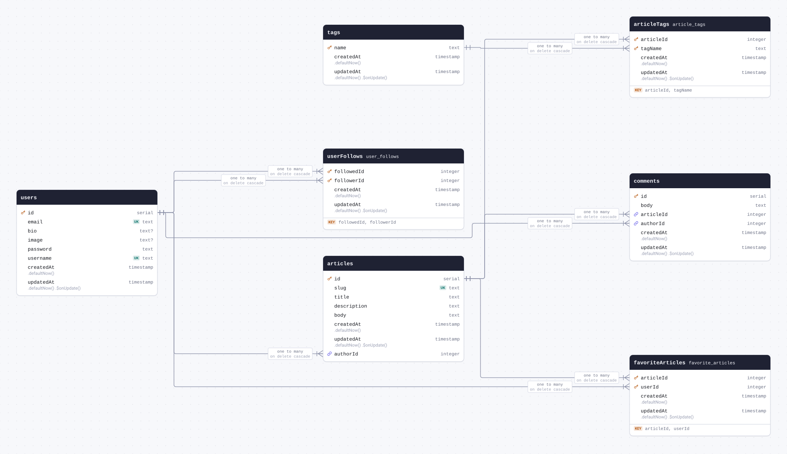
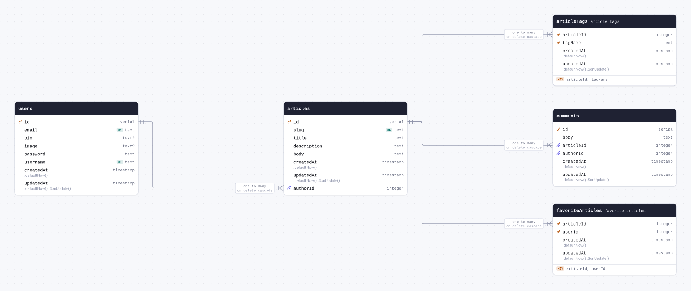
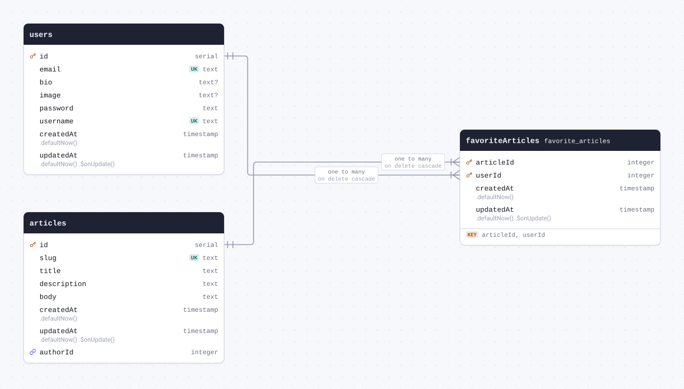
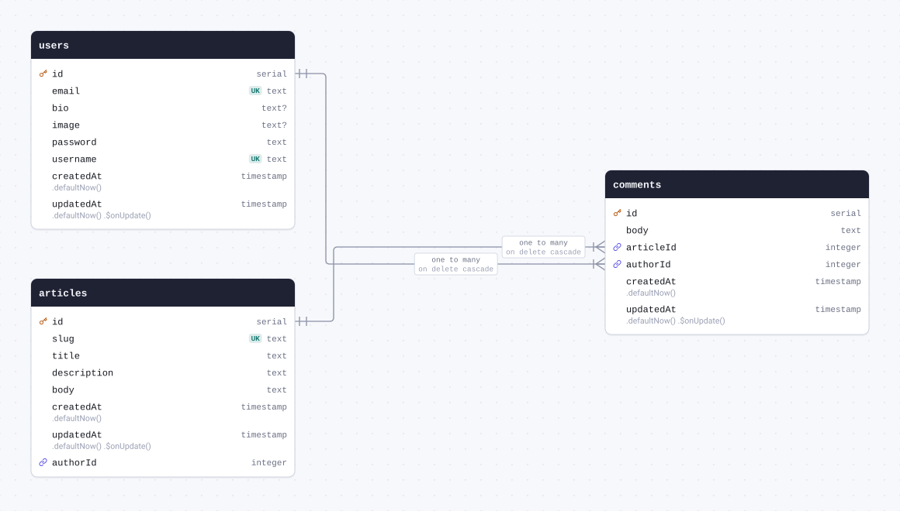
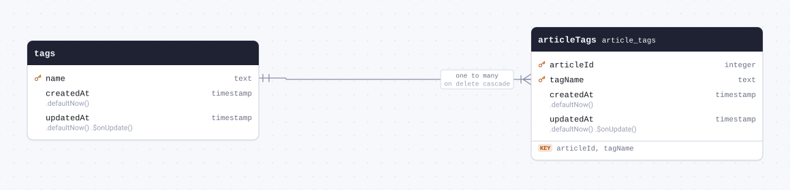
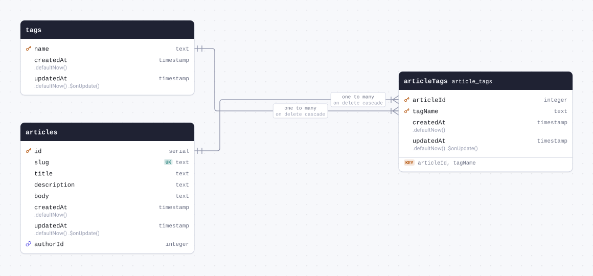
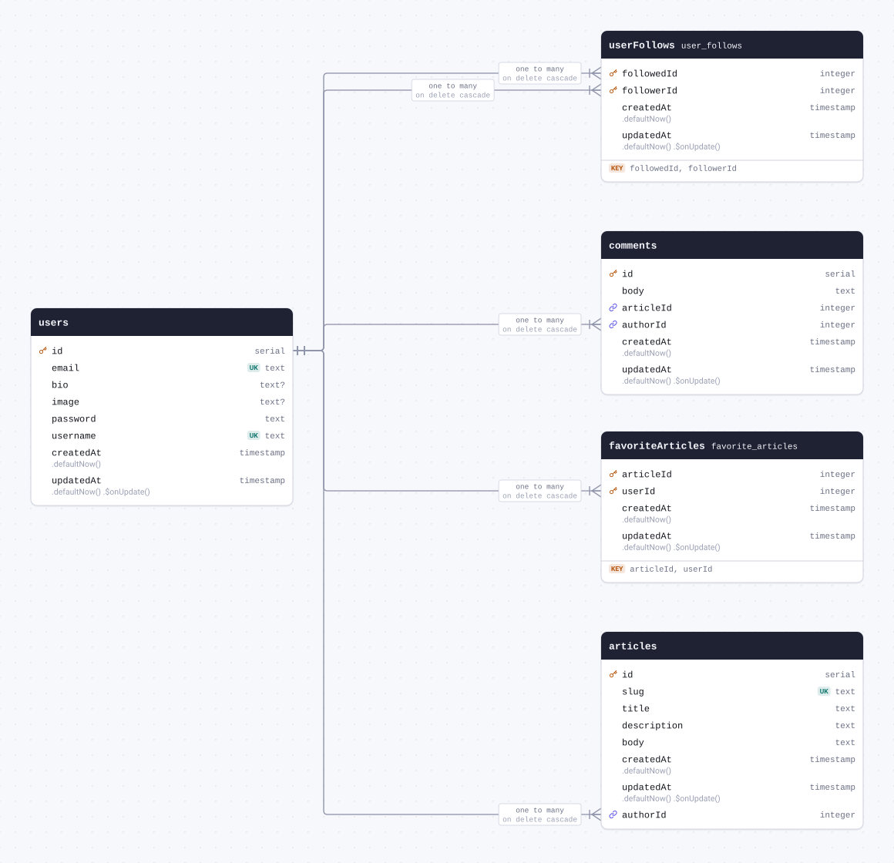
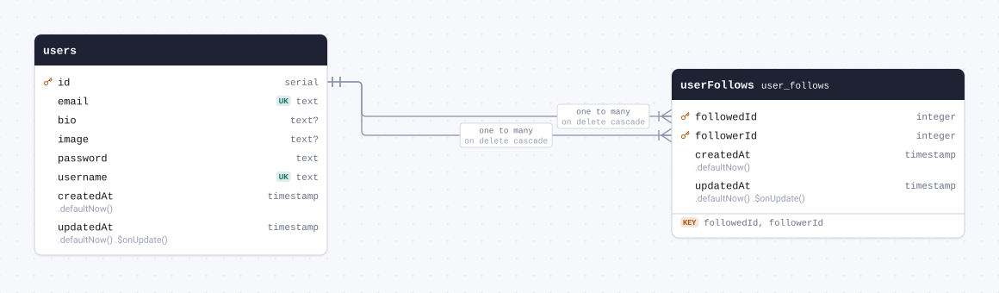

# Schema docs



<details>
<summary>The whole schema as SQL</summary>

```sql
CREATE TABLE "articles" (
	"id" serial PRIMARY KEY,
	"slug" text NOT NULL UNIQUE,
	"title" text NOT NULL,
	"description" text NOT NULL,
	"body" text NOT NULL,
	"created_at" timestamp DEFAULT now() NOT NULL,
	"updated_at" timestamp DEFAULT now() NOT NULL,
	"author_id" integer NOT NULL
);

CREATE TABLE "favorite_articles" (
	"article_id" integer,
	"user_id" integer,
	"created_at" timestamp DEFAULT now() NOT NULL,
	"updated_at" timestamp DEFAULT now() NOT NULL,
	CONSTRAINT "favorite_articles_pkey" PRIMARY KEY("article_id","user_id")
);

CREATE TABLE "comments" (
	"id" serial PRIMARY KEY,
	"body" text NOT NULL,
	"article_id" integer NOT NULL,
	"author_id" integer NOT NULL,
	"created_at" timestamp DEFAULT now() NOT NULL,
	"updated_at" timestamp DEFAULT now() NOT NULL
);

CREATE TABLE "article_tags" (
	"article_id" integer,
	"tag_name" text,
	"created_at" timestamp DEFAULT now() NOT NULL,
	"updated_at" timestamp DEFAULT now() NOT NULL,
	CONSTRAINT "article_tags_pkey" PRIMARY KEY("article_id","tag_name")
);

CREATE TABLE "tags" (
	"name" text PRIMARY KEY,
	"created_at" timestamp DEFAULT now() NOT NULL,
	"updated_at" timestamp DEFAULT now() NOT NULL
);

CREATE TABLE "user_follows" (
	"followed_id" integer,
	"follower_id" integer,
	"created_at" timestamp DEFAULT now() NOT NULL,
	"updated_at" timestamp DEFAULT now() NOT NULL,
	CONSTRAINT "user_follows_pkey" PRIMARY KEY("followed_id","follower_id")
);

CREATE TABLE "users" (
	"id" serial PRIMARY KEY,
	"email" text NOT NULL UNIQUE,
	"bio" text,
	"image" text,
	"password" text NOT NULL,
	"username" text NOT NULL UNIQUE,
	"created_at" timestamp DEFAULT now() NOT NULL,
	"updated_at" timestamp DEFAULT now() NOT NULL
);

ALTER TABLE "articles" ADD CONSTRAINT "articles_author_id_users_id_fkey" FOREIGN KEY ("author_id") REFERENCES "users"("id") ON DELETE CASCADE;

ALTER TABLE "favorite_articles" ADD CONSTRAINT "favorite_articles_article_id_articles_id_fkey" FOREIGN KEY ("article_id") REFERENCES "articles"("id") ON DELETE CASCADE;

ALTER TABLE "favorite_articles" ADD CONSTRAINT "favorite_articles_user_id_users_id_fkey" FOREIGN KEY ("user_id") REFERENCES "users"("id") ON DELETE CASCADE;

ALTER TABLE "comments" ADD CONSTRAINT "comments_article_id_articles_id_fkey" FOREIGN KEY ("article_id") REFERENCES "articles"("id") ON DELETE CASCADE;

ALTER TABLE "comments" ADD CONSTRAINT "comments_author_id_users_id_fkey" FOREIGN KEY ("author_id") REFERENCES "users"("id") ON DELETE CASCADE;

ALTER TABLE "article_tags" ADD CONSTRAINT "article_tags_article_id_articles_id_fkey" FOREIGN KEY ("article_id") REFERENCES "articles"("id") ON DELETE CASCADE;

ALTER TABLE "article_tags" ADD CONSTRAINT "article_tags_tag_name_tags_name_fkey" FOREIGN KEY ("tag_name") REFERENCES "tags"("name") ON DELETE CASCADE;

ALTER TABLE "user_follows" ADD CONSTRAINT "user_follows_followed_id_users_id_fkey" FOREIGN KEY ("followed_id") REFERENCES "users"("id") ON DELETE CASCADE;

ALTER TABLE "user_follows" ADD CONSTRAINT "user_follows_follower_id_users_id_fkey" FOREIGN KEY ("follower_id") REFERENCES "users"("id") ON DELETE CASCADE;
```

</details>

## Contents

| Table                                       | Name in the database | Description |
| ------------------------------------------- | -------------------- | ----------- |
| [articles](#table-articles)                 | `articles`           |             |
| [favoriteArticles](#table-favoriteArticles) | `favorite_articles`  |             |
| [comments](#table-comments)                 | `comments`           |             |
| [tags](#table-tags)                         | `tags`               |             |
| [articleTags](#table-articleTags)           | `article_tags`       |             |
| [users](#table-users)                       | `users`              |             |
| [userFollows](#table-userFollows)           | `user_follows`       |             |

## Tables

<a id="table-articles"></a>

### articles



| Column                     | Type        | Constraints                         | Default                        | Description |
| -------------------------- | ----------- | ----------------------------------- | ------------------------------ | ----------- |
| `id`                       | `serial`    | PK NOT NULL                         |                                |             |
| `slug`                     | `text`      | UNIQUE NOT NULL                     |                                |             |
| `title`                    | `text`      | NOT NULL                            |                                |             |
| `description`              | `text`      | NOT NULL                            |                                |             |
| `body`                     | `text`      | NOT NULL                            |                                |             |
| `createdAt` (`created_at`) | `timestamp` | NOT NULL                            | `.defaultNow()`                |             |
| `updatedAt` (`updated_at`) | `timestamp` | NOT NULL                            | `.defaultNow()` `.$onUpdate()` |             |
| `authorId` (`author_id`)   | `integer`   | NOT NULL → [users.id](#table-users) |                                |             |

#### Definition

```sql
CREATE TABLE "articles" (
	"id" serial PRIMARY KEY,
	"slug" text NOT NULL UNIQUE,
	"title" text NOT NULL,
	"description" text NOT NULL,
	"body" text NOT NULL,
	"created_at" timestamp DEFAULT now() NOT NULL,
	"updated_at" timestamp DEFAULT now() NOT NULL,
	"author_id" integer NOT NULL
);

ALTER TABLE "articles" ADD CONSTRAINT "articles_author_id_users_id_fkey" FOREIGN KEY ("author_id") REFERENCES "users"("id") ON DELETE CASCADE;
```

#### References

- `authorId` → [users.id](#table-users) (many to one, on delete cascade)

#### Referenced by

- `id` → [favoriteArticles.articleId](#table-favoriteArticles) (one to many, on delete cascade)
- `id` → [comments.articleId](#table-comments) (one to many, on delete cascade)
- `id` → [articleTags.articleId](#table-articleTags) (one to many, on delete cascade)

<details>
<summary>Queries and their SQL</summary>

**Select**: Every row of articles.

```ts
db.select().from(articles);
```

```sql
select "id", "slug", "title", "description", "body", "created_at", "updated_at", "author_id"
from "articles"
```

**Count**: How many rows articles has.

```ts
db.select({ count: count() }).from(articles);
```

```sql
select count(*)
from "articles"
```

**Find many**: The rows of articles, through the relational query API.

```ts
db.query.articles.findMany();
```

```sql
select "d0"."id" as "id", "d0"."slug" as "slug", "d0"."title" as "title", "d0"."description" as "description", "d0"."body" as "body", "d0"."created_at" as "createdAt", "d0"."updated_at" as "updatedAt", "d0"."author_id" as "authorId"
from "articles" as "d0"
```

**Find by primary key**: One row of articles, through the relational query API.

```ts
db.query.articles.findFirst({ where: { id: 1 } });
```

```sql
select "d0"."id" as "id", "d0"."slug" as "slug", "d0"."title" as "title", "d0"."description" as "description", "d0"."body" as "body", "d0"."created_at" as "createdAt", "d0"."updated_at" as "updatedAt", "d0"."author_id" as "authorId"
from "articles" as "d0"
where "d0"."id" = $1
limit $2
-- params: [1,1]
```

**Insert**: Adds a row to articles, giving the columns that have no default.

```ts
db.insert(articles).values({
  slug: "slug",
  title: "title",
  description: "description",
  body: "body",
  authorId: 1,
});
```

```sql
insert into "articles" ("id", "slug", "title", "description", "body", "created_at", "updated_at", "author_id")
values (default, $1, $2, $3, $4, default, default, $5)
-- params: ["slug","title","description","body",1]
```

**Update**: Changes a row of articles, found by its primary key.

```ts
db.update(articles).set({ slug: "slug" }).where(eq(articles.id, 1));
```

```sql
update "articles"
set "slug" = $1, "updated_at" = $2
where "articles"."id" = $3
-- params: ["slug","2026-01-01T00:00:00.000Z",1]
```

**Delete**: Deletes a row of articles, found by its primary key.

```ts
db.delete(articles).where(eq(articles.id, 1));
```

```sql
delete from "articles"
where "articles"."id" = $1
-- params: [1]
```

</details>

<a id="table-favoriteArticles"></a>

### favoriteArticles

Table `favorite_articles`.



| Column                     | Type        | Constraints                                  | Default                        | Description |
| -------------------------- | ----------- | -------------------------------------------- | ------------------------------ | ----------- |
| `articleId` (`article_id`) | `integer`   | PK NOT NULL → [articles.id](#table-articles) |                                |             |
| `userId` (`user_id`)       | `integer`   | PK NOT NULL → [users.id](#table-users)       |                                |             |
| `createdAt` (`created_at`) | `timestamp` | NOT NULL                                     | `.defaultNow()`                |             |
| `updatedAt` (`updated_at`) | `timestamp` | NOT NULL                                     | `.defaultNow()` `.$onUpdate()` |             |

#### Definition

```sql
CREATE TABLE "favorite_articles" (
	"article_id" integer,
	"user_id" integer,
	"created_at" timestamp DEFAULT now() NOT NULL,
	"updated_at" timestamp DEFAULT now() NOT NULL,
	CONSTRAINT "favorite_articles_pkey" PRIMARY KEY("article_id","user_id")
);

ALTER TABLE "favorite_articles" ADD CONSTRAINT "favorite_articles_article_id_articles_id_fkey" FOREIGN KEY ("article_id") REFERENCES "articles"("id") ON DELETE CASCADE;

ALTER TABLE "favorite_articles" ADD CONSTRAINT "favorite_articles_user_id_users_id_fkey" FOREIGN KEY ("user_id") REFERENCES "users"("id") ON DELETE CASCADE;
```

#### Indexes

- PRIMARY KEY `articleId`, `userId`

#### References

- `articleId` → [articles.id](#table-articles) (many to one, on delete cascade)
- `userId` → [users.id](#table-users) (many to one, on delete cascade)

<details>
<summary>Queries and their SQL</summary>

**Select**: Every row of favoriteArticles.

```ts
db.select().from(favoriteArticles);
```

```sql
select "article_id", "user_id", "created_at", "updated_at"
from "favorite_articles"
```

**Count**: How many rows favoriteArticles has.

```ts
db.select({ count: count() }).from(favoriteArticles);
```

```sql
select count(*)
from "favorite_articles"
```

**Find many**: The rows of favoriteArticles, through the relational query API.

```ts
db.query.favoriteArticles.findMany();
```

```sql
select "d0"."article_id" as "articleId", "d0"."user_id" as "userId", "d0"."created_at" as "createdAt", "d0"."updated_at" as "updatedAt"
from "favorite_articles" as "d0"
```

**Find by primary key**: One row of favoriteArticles, through the relational query API.

```ts
db.query.favoriteArticles.findFirst({ where: { articleId: 1, userId: 1 } });
```

```sql
select "d0"."article_id" as "articleId", "d0"."user_id" as "userId", "d0"."created_at" as "createdAt", "d0"."updated_at" as "updatedAt"
from "favorite_articles" as "d0"
where (("d0"."article_id" = $1) and ("d0"."user_id" = $2))
limit $3
-- params: [1,1,1]
```

**Insert**: Adds a row to favoriteArticles, giving the columns that have no default.

```ts
db.insert(favoriteArticles).values({ articleId: 1, userId: 1 });
```

```sql
insert into "favorite_articles" ("article_id", "user_id", "created_at", "updated_at")
values ($1, $2, default, default)
-- params: [1,1]
```

**Update**: Changes a row of favoriteArticles, found by its primary key.

```ts
db.update(favoriteArticles)
  .set({ createdAt: new Date("2026-01-01T00:00:00.000Z") })
  .where(and(eq(favoriteArticles.articleId, 1), eq(favoriteArticles.userId, 1)));
```

```sql
update "favorite_articles"
set "created_at" = $1, "updated_at" = $2
where (("favorite_articles"."article_id" = $3) and ("favorite_articles"."user_id" = $4))
-- params: ["2026-01-01T00:00:00.000Z","2026-01-01T00:00:00.000Z",1,1]
```

**Delete**: Deletes a row of favoriteArticles, found by its primary key.

```ts
db.delete(favoriteArticles).where(
  and(eq(favoriteArticles.articleId, 1), eq(favoriteArticles.userId, 1)),
);
```

```sql
delete from "favorite_articles"
where (("favorite_articles"."article_id" = $1) and ("favorite_articles"."user_id" = $2))
-- params: [1,1]
```

</details>

<a id="table-comments"></a>

### comments



| Column                     | Type        | Constraints                               | Default                        | Description |
| -------------------------- | ----------- | ----------------------------------------- | ------------------------------ | ----------- |
| `id`                       | `serial`    | PK NOT NULL                               |                                |             |
| `body`                     | `text`      | NOT NULL                                  |                                |             |
| `articleId` (`article_id`) | `integer`   | NOT NULL → [articles.id](#table-articles) |                                |             |
| `authorId` (`author_id`)   | `integer`   | NOT NULL → [users.id](#table-users)       |                                |             |
| `createdAt` (`created_at`) | `timestamp` | NOT NULL                                  | `.defaultNow()`                |             |
| `updatedAt` (`updated_at`) | `timestamp` | NOT NULL                                  | `.defaultNow()` `.$onUpdate()` |             |

#### Definition

```sql
CREATE TABLE "comments" (
	"id" serial PRIMARY KEY,
	"body" text NOT NULL,
	"article_id" integer NOT NULL,
	"author_id" integer NOT NULL,
	"created_at" timestamp DEFAULT now() NOT NULL,
	"updated_at" timestamp DEFAULT now() NOT NULL
);

ALTER TABLE "comments" ADD CONSTRAINT "comments_article_id_articles_id_fkey" FOREIGN KEY ("article_id") REFERENCES "articles"("id") ON DELETE CASCADE;

ALTER TABLE "comments" ADD CONSTRAINT "comments_author_id_users_id_fkey" FOREIGN KEY ("author_id") REFERENCES "users"("id") ON DELETE CASCADE;
```

#### References

- `articleId` → [articles.id](#table-articles) (many to one, on delete cascade)
- `authorId` → [users.id](#table-users) (many to one, on delete cascade)

<details>
<summary>Queries and their SQL</summary>

**Select**: Every row of comments.

```ts
db.select().from(comments);
```

```sql
select "id", "body", "article_id", "author_id", "created_at", "updated_at"
from "comments"
```

**Count**: How many rows comments has.

```ts
db.select({ count: count() }).from(comments);
```

```sql
select count(*)
from "comments"
```

**Find many**: The rows of comments, through the relational query API.

```ts
db.query.comments.findMany();
```

```sql
select "d0"."id" as "id", "d0"."body" as "body", "d0"."article_id" as "articleId", "d0"."author_id" as "authorId", "d0"."created_at" as "createdAt", "d0"."updated_at" as "updatedAt"
from "comments" as "d0"
```

**Find by primary key**: One row of comments, through the relational query API.

```ts
db.query.comments.findFirst({ where: { id: 1 } });
```

```sql
select "d0"."id" as "id", "d0"."body" as "body", "d0"."article_id" as "articleId", "d0"."author_id" as "authorId", "d0"."created_at" as "createdAt", "d0"."updated_at" as "updatedAt"
from "comments" as "d0"
where "d0"."id" = $1
limit $2
-- params: [1,1]
```

**Insert**: Adds a row to comments, giving the columns that have no default.

```ts
db.insert(comments).values({ body: "body", articleId: 1, authorId: 1 });
```

```sql
insert into "comments" ("id", "body", "article_id", "author_id", "created_at", "updated_at")
values (default, $1, $2, $3, default, default)
-- params: ["body",1,1]
```

**Update**: Changes a row of comments, found by its primary key.

```ts
db.update(comments).set({ body: "body" }).where(eq(comments.id, 1));
```

```sql
update "comments"
set "body" = $1, "updated_at" = $2
where "comments"."id" = $3
-- params: ["body","2026-01-01T00:00:00.000Z",1]
```

**Delete**: Deletes a row of comments, found by its primary key.

```ts
db.delete(comments).where(eq(comments.id, 1));
```

```sql
delete from "comments"
where "comments"."id" = $1
-- params: [1]
```

</details>

<a id="table-tags"></a>

### tags



| Column                     | Type        | Constraints | Default                        | Description |
| -------------------------- | ----------- | ----------- | ------------------------------ | ----------- |
| `name`                     | `text`      | PK NOT NULL |                                |             |
| `createdAt` (`created_at`) | `timestamp` | NOT NULL    | `.defaultNow()`                |             |
| `updatedAt` (`updated_at`) | `timestamp` | NOT NULL    | `.defaultNow()` `.$onUpdate()` |             |

#### Definition

```sql
CREATE TABLE "tags" (
	"name" text PRIMARY KEY,
	"created_at" timestamp DEFAULT now() NOT NULL,
	"updated_at" timestamp DEFAULT now() NOT NULL
);
```

#### Referenced by

- `name` → [articleTags.tagName](#table-articleTags) (one to many, on delete cascade)

<details>
<summary>Queries and their SQL</summary>

**Select**: Every row of tags.

```ts
db.select().from(tags);
```

```sql
select "name", "created_at", "updated_at"
from "tags"
```

**Count**: How many rows tags has.

```ts
db.select({ count: count() }).from(tags);
```

```sql
select count(*)
from "tags"
```

**Find many**: The rows of tags, through the relational query API.

```ts
db.query.tags.findMany();
```

```sql
select "d0"."name" as "name", "d0"."created_at" as "createdAt", "d0"."updated_at" as "updatedAt"
from "tags" as "d0"
```

**Find by primary key**: One row of tags, through the relational query API.

```ts
db.query.tags.findFirst({ where: { name: "name" } });
```

```sql
select "d0"."name" as "name", "d0"."created_at" as "createdAt", "d0"."updated_at" as "updatedAt"
from "tags" as "d0"
where "d0"."name" = $1
limit $2
-- params: ["name",1]
```

**Insert**: Adds a row to tags, giving the columns that have no default.

```ts
db.insert(tags).values({ name: "name" });
```

```sql
insert into "tags" ("name", "created_at", "updated_at")
values ($1, default, default)
-- params: ["name"]
```

**Update**: Changes a row of tags, found by its primary key.

```ts
db.update(tags)
  .set({ createdAt: new Date("2026-01-01T00:00:00.000Z") })
  .where(eq(tags.name, "name"));
```

```sql
update "tags"
set "created_at" = $1, "updated_at" = $2
where "tags"."name" = $3
-- params: ["2026-01-01T00:00:00.000Z","2026-01-01T00:00:00.000Z","name"]
```

**Delete**: Deletes a row of tags, found by its primary key.

```ts
db.delete(tags).where(eq(tags.name, "name"));
```

```sql
delete from "tags"
where "tags"."name" = $1
-- params: ["name"]
```

</details>

<a id="table-articleTags"></a>

### articleTags

Table `article_tags`.



| Column                     | Type        | Constraints                                  | Default                        | Description |
| -------------------------- | ----------- | -------------------------------------------- | ------------------------------ | ----------- |
| `articleId` (`article_id`) | `integer`   | PK NOT NULL → [articles.id](#table-articles) |                                |             |
| `tagName` (`tag_name`)     | `text`      | PK NOT NULL → [tags.name](#table-tags)       |                                |             |
| `createdAt` (`created_at`) | `timestamp` | NOT NULL                                     | `.defaultNow()`                |             |
| `updatedAt` (`updated_at`) | `timestamp` | NOT NULL                                     | `.defaultNow()` `.$onUpdate()` |             |

#### Definition

```sql
CREATE TABLE "article_tags" (
	"article_id" integer,
	"tag_name" text,
	"created_at" timestamp DEFAULT now() NOT NULL,
	"updated_at" timestamp DEFAULT now() NOT NULL,
	CONSTRAINT "article_tags_pkey" PRIMARY KEY("article_id","tag_name")
);

ALTER TABLE "article_tags" ADD CONSTRAINT "article_tags_article_id_articles_id_fkey" FOREIGN KEY ("article_id") REFERENCES "articles"("id") ON DELETE CASCADE;

ALTER TABLE "article_tags" ADD CONSTRAINT "article_tags_tag_name_tags_name_fkey" FOREIGN KEY ("tag_name") REFERENCES "tags"("name") ON DELETE CASCADE;
```

#### Indexes

- PRIMARY KEY `articleId`, `tagName`

#### References

- `articleId` → [articles.id](#table-articles) (many to one, on delete cascade)
- `tagName` → [tags.name](#table-tags) (many to one, on delete cascade)

<details>
<summary>Queries and their SQL</summary>

**Select**: Every row of articleTags.

```ts
db.select().from(articleTags);
```

```sql
select "article_id", "tag_name", "created_at", "updated_at"
from "article_tags"
```

**Count**: How many rows articleTags has.

```ts
db.select({ count: count() }).from(articleTags);
```

```sql
select count(*)
from "article_tags"
```

**Find many**: The rows of articleTags, through the relational query API.

```ts
db.query.articleTags.findMany();
```

```sql
select "d0"."article_id" as "articleId", "d0"."tag_name" as "tagName", "d0"."created_at" as "createdAt", "d0"."updated_at" as "updatedAt"
from "article_tags" as "d0"
```

**Find by primary key**: One row of articleTags, through the relational query API.

```ts
db.query.articleTags.findFirst({ where: { articleId: 1, tagName: "tagName" } });
```

```sql
select "d0"."article_id" as "articleId", "d0"."tag_name" as "tagName", "d0"."created_at" as "createdAt", "d0"."updated_at" as "updatedAt"
from "article_tags" as "d0"
where (("d0"."article_id" = $1) and ("d0"."tag_name" = $2))
limit $3
-- params: [1,"tagName",1]
```

**Insert**: Adds a row to articleTags, giving the columns that have no default.

```ts
db.insert(articleTags).values({ articleId: 1, tagName: "tagName" });
```

```sql
insert into "article_tags" ("article_id", "tag_name", "created_at", "updated_at")
values ($1, $2, default, default)
-- params: [1,"tagName"]
```

**Update**: Changes a row of articleTags, found by its primary key.

```ts
db.update(articleTags)
  .set({ createdAt: new Date("2026-01-01T00:00:00.000Z") })
  .where(and(eq(articleTags.articleId, 1), eq(articleTags.tagName, "tagName")));
```

```sql
update "article_tags"
set "created_at" = $1, "updated_at" = $2
where (("article_tags"."article_id" = $3) and ("article_tags"."tag_name" = $4))
-- params: ["2026-01-01T00:00:00.000Z","2026-01-01T00:00:00.000Z",1,"tagName"]
```

**Delete**: Deletes a row of articleTags, found by its primary key.

```ts
db.delete(articleTags).where(and(eq(articleTags.articleId, 1), eq(articleTags.tagName, "tagName")));
```

```sql
delete from "article_tags"
where (("article_tags"."article_id" = $1) and ("article_tags"."tag_name" = $2))
-- params: [1,"tagName"]
```

</details>

<a id="table-users"></a>

### users



| Column                     | Type        | Constraints     | Default                        | Description |
| -------------------------- | ----------- | --------------- | ------------------------------ | ----------- |
| `id`                       | `serial`    | PK NOT NULL     |                                |             |
| `email`                    | `text`      | UNIQUE NOT NULL |                                |             |
| `bio`                      | `text`      | NULL            |                                |             |
| `image`                    | `text`      | NULL            |                                |             |
| `password`                 | `text`      | NOT NULL        |                                |             |
| `username`                 | `text`      | UNIQUE NOT NULL |                                |             |
| `createdAt` (`created_at`) | `timestamp` | NOT NULL        | `.defaultNow()`                |             |
| `updatedAt` (`updated_at`) | `timestamp` | NOT NULL        | `.defaultNow()` `.$onUpdate()` |             |

#### Definition

```sql
CREATE TABLE "users" (
	"id" serial PRIMARY KEY,
	"email" text NOT NULL UNIQUE,
	"bio" text,
	"image" text,
	"password" text NOT NULL,
	"username" text NOT NULL UNIQUE,
	"created_at" timestamp DEFAULT now() NOT NULL,
	"updated_at" timestamp DEFAULT now() NOT NULL
);
```

#### Referenced by

- `id` → [articles.authorId](#table-articles) (one to many, on delete cascade)
- `id` → [favoriteArticles.userId](#table-favoriteArticles) (one to many, on delete cascade)
- `id` → [comments.authorId](#table-comments) (one to many, on delete cascade)
- `id` → [userFollows.followedId](#table-userFollows) (one to many, on delete cascade)
- `id` → [userFollows.followerId](#table-userFollows) (one to many, on delete cascade)

<details>
<summary>Queries and their SQL</summary>

**Select**: Every row of users.

```ts
db.select().from(users);
```

```sql
select "id", "email", "bio", "image", "password", "username", "created_at", "updated_at"
from "users"
```

**Count**: How many rows users has.

```ts
db.select({ count: count() }).from(users);
```

```sql
select count(*)
from "users"
```

**Find many**: The rows of users, through the relational query API.

```ts
db.query.users.findMany();
```

```sql
select "d0"."id" as "id", "d0"."email" as "email", "d0"."bio" as "bio", "d0"."image" as "image", "d0"."password" as "password", "d0"."username" as "username", "d0"."created_at" as "createdAt", "d0"."updated_at" as "updatedAt"
from "users" as "d0"
```

**Find by primary key**: One row of users, through the relational query API.

```ts
db.query.users.findFirst({ where: { id: 1 } });
```

```sql
select "d0"."id" as "id", "d0"."email" as "email", "d0"."bio" as "bio", "d0"."image" as "image", "d0"."password" as "password", "d0"."username" as "username", "d0"."created_at" as "createdAt", "d0"."updated_at" as "updatedAt"
from "users" as "d0"
where "d0"."id" = $1
limit $2
-- params: [1,1]
```

**Insert**: Adds a row to users, giving the columns that have no default.

```ts
db.insert(users).values({ email: "email", password: "password", username: "username" });
```

```sql
insert into "users" ("id", "email", "bio", "image", "password", "username", "created_at", "updated_at")
values (default, $1, default, default, $2, $3, default, default)
-- params: ["email","password","username"]
```

**Update**: Changes a row of users, found by its primary key.

```ts
db.update(users).set({ email: "email" }).where(eq(users.id, 1));
```

```sql
update "users"
set "email" = $1, "updated_at" = $2
where "users"."id" = $3
-- params: ["email","2026-01-01T00:00:00.000Z",1]
```

**Delete**: Deletes a row of users, found by its primary key.

```ts
db.delete(users).where(eq(users.id, 1));
```

```sql
delete from "users"
where "users"."id" = $1
-- params: [1]
```

</details>

<a id="table-userFollows"></a>

### userFollows

Table `user_follows`.



| Column                       | Type        | Constraints                            | Default                        | Description |
| ---------------------------- | ----------- | -------------------------------------- | ------------------------------ | ----------- |
| `followedId` (`followed_id`) | `integer`   | PK NOT NULL → [users.id](#table-users) |                                |             |
| `followerId` (`follower_id`) | `integer`   | PK NOT NULL → [users.id](#table-users) |                                |             |
| `createdAt` (`created_at`)   | `timestamp` | NOT NULL                               | `.defaultNow()`                |             |
| `updatedAt` (`updated_at`)   | `timestamp` | NOT NULL                               | `.defaultNow()` `.$onUpdate()` |             |

#### Definition

```sql
CREATE TABLE "user_follows" (
	"followed_id" integer,
	"follower_id" integer,
	"created_at" timestamp DEFAULT now() NOT NULL,
	"updated_at" timestamp DEFAULT now() NOT NULL,
	CONSTRAINT "user_follows_pkey" PRIMARY KEY("followed_id","follower_id")
);

ALTER TABLE "user_follows" ADD CONSTRAINT "user_follows_followed_id_users_id_fkey" FOREIGN KEY ("followed_id") REFERENCES "users"("id") ON DELETE CASCADE;

ALTER TABLE "user_follows" ADD CONSTRAINT "user_follows_follower_id_users_id_fkey" FOREIGN KEY ("follower_id") REFERENCES "users"("id") ON DELETE CASCADE;
```

#### Indexes

- PRIMARY KEY `followedId`, `followerId`

#### References

- `followedId` → [users.id](#table-users) (many to one, on delete cascade)
- `followerId` → [users.id](#table-users) (many to one, on delete cascade)

<details>
<summary>Queries and their SQL</summary>

**Select**: Every row of userFollows.

```ts
db.select().from(userFollows);
```

```sql
select "followed_id", "follower_id", "created_at", "updated_at"
from "user_follows"
```

**Count**: How many rows userFollows has.

```ts
db.select({ count: count() }).from(userFollows);
```

```sql
select count(*)
from "user_follows"
```

**Find many**: The rows of userFollows, through the relational query API.

```ts
db.query.userFollows.findMany();
```

```sql
select "d0"."followed_id" as "followedId", "d0"."follower_id" as "followerId", "d0"."created_at" as "createdAt", "d0"."updated_at" as "updatedAt"
from "user_follows" as "d0"
```

**Find by primary key**: One row of userFollows, through the relational query API.

```ts
db.query.userFollows.findFirst({ where: { followedId: 1, followerId: 1 } });
```

```sql
select "d0"."followed_id" as "followedId", "d0"."follower_id" as "followerId", "d0"."created_at" as "createdAt", "d0"."updated_at" as "updatedAt"
from "user_follows" as "d0"
where (("d0"."followed_id" = $1) and ("d0"."follower_id" = $2))
limit $3
-- params: [1,1,1]
```

**Insert**: Adds a row to userFollows, giving the columns that have no default.

```ts
db.insert(userFollows).values({ followedId: 1, followerId: 1 });
```

```sql
insert into "user_follows" ("followed_id", "follower_id", "created_at", "updated_at")
values ($1, $2, default, default)
-- params: [1,1]
```

**Update**: Changes a row of userFollows, found by its primary key.

```ts
db.update(userFollows)
  .set({ createdAt: new Date("2026-01-01T00:00:00.000Z") })
  .where(and(eq(userFollows.followedId, 1), eq(userFollows.followerId, 1)));
```

```sql
update "user_follows"
set "created_at" = $1, "updated_at" = $2
where (("user_follows"."followed_id" = $3) and ("user_follows"."follower_id" = $4))
-- params: ["2026-01-01T00:00:00.000Z","2026-01-01T00:00:00.000Z",1,1]
```

**Delete**: Deletes a row of userFollows, found by its primary key.

```ts
db.delete(userFollows).where(and(eq(userFollows.followedId, 1), eq(userFollows.followerId, 1)));
```

```sql
delete from "user_follows"
where (("user_follows"."followed_id" = $1) and ("user_follows"."follower_id" = $2))
-- params: [1,1]
```

</details>
