# Schema docs


<details>
<summary>The whole schema as SQL</summary>

```sql
CREATE TABLE "account" (
	"id" text PRIMARY KEY,
	"created_at" timestamp DEFAULT now() NOT NULL,
	"updated_at" timestamp DEFAULT now() NOT NULL,
	"account_id" text NOT NULL,
	"provider_id" text NOT NULL,
	"user_id" text NOT NULL,
	"access_token" text,
	"refresh_token" text,
	"id_token" text,
	"access_token_expires_at" timestamp,
	"refresh_token_expires_at" timestamp,
	"scope" text,
	"password" text
);

CREATE TABLE "apikey" (
	"id" text PRIMARY KEY,
	"created_at" timestamp DEFAULT now() NOT NULL,
	"updated_at" timestamp DEFAULT now() NOT NULL,
	"name" text,
	"start" text,
	"prefix" text,
	"key" text NOT NULL,
	"user_id" text NOT NULL,
	"refill_interval" integer,
	"refill_amount" integer,
	"last_refill_at" timestamp,
	"enabled" boolean,
	"rate_limit_enabled" boolean,
	"rate_limit_time_window" integer,
	"rate_limit_max" integer,
	"request_count" integer,
	"remaining" integer,
	"last_request" timestamp,
	"expires_at" timestamp,
	"permissions" text,
	"metadata" text
);

CREATE TABLE "event" (
	"id" text PRIMARY KEY,
	"created_at" timestamp DEFAULT now() NOT NULL,
	"updated_at" timestamp DEFAULT now() NOT NULL,
	"product_id" text NOT NULL,
	"program_id" text,
	"participant_id" text,
	"referral_id" text,
	"event_definition_id" text NOT NULL,
	"status" text DEFAULT 'pending' NOT NULL,
	"metadata" jsonb
);

CREATE TABLE "event_definition" (
	"id" text PRIMARY KEY,
	"created_at" timestamp DEFAULT now() NOT NULL,
	"updated_at" timestamp DEFAULT now() NOT NULL,
	"name" text NOT NULL,
	"type" text NOT NULL UNIQUE,
	"description" text,
	"config" jsonb
);

CREATE TABLE "invitation" (
	"id" text PRIMARY KEY,
	"created_at" timestamp DEFAULT now() NOT NULL,
	"updated_at" timestamp DEFAULT now() NOT NULL,
	"organization_id" text,
	"product_id" text,
	"email" text NOT NULL,
	"role" text,
	"status" text NOT NULL,
	"expires_at" timestamp NOT NULL,
	"inviter_id" text NOT NULL
);

CREATE TABLE "org" (
	"id" text PRIMARY KEY,
	"created_at" timestamp DEFAULT now() NOT NULL,
	"updated_at" timestamp DEFAULT now() NOT NULL,
	"name" text NOT NULL,
	"slug" text UNIQUE,
	"logo" text,
	"metadata" text
);

CREATE TABLE "org_user" (
	"id" text PRIMARY KEY,
	"created_at" timestamp DEFAULT now() NOT NULL,
	"updated_at" timestamp DEFAULT now() NOT NULL,
	"org_id" text NOT NULL,
	"user_id" text NOT NULL,
	"role" text NOT NULL
);

CREATE TABLE "participant" (
	"id" text PRIMARY KEY,
	"created_at" timestamp DEFAULT now() NOT NULL,
	"updated_at" timestamp DEFAULT now() NOT NULL,
	"name" text,
	"email" text,
	"product_id" text NOT NULL,
	"external_id" text,
	CONSTRAINT "participant_product_id_external_id_unique" UNIQUE("product_id","external_id")
);

CREATE TABLE "product" (
	"id" text PRIMARY KEY,
	"created_at" timestamp DEFAULT now() NOT NULL,
	"updated_at" timestamp DEFAULT now() NOT NULL,
	"org_id" text,
	"name" text NOT NULL,
	"slug" text UNIQUE,
	"logo" text,
	"url" text,
	"metadata" text,
	"app_type" text,
	"use_case" text,
	"payment_provider" text,
	"onboarding_completed" boolean DEFAULT false,
	"onboarding_step" integer DEFAULT 1
);

CREATE TABLE "product_secret" (
	"id" text PRIMARY KEY,
	"created_at" timestamp DEFAULT now() NOT NULL,
	"updated_at" timestamp DEFAULT now() NOT NULL,
	"product_id" text NOT NULL,
	"client_id" text NOT NULL,
	"client_secret" text NOT NULL
);

CREATE TABLE "product_user" (
	"id" text PRIMARY KEY,
	"created_at" timestamp DEFAULT now() NOT NULL,
	"updated_at" timestamp DEFAULT now() NOT NULL,
	"product_id" text NOT NULL,
	"user_id" text NOT NULL,
	"role" text NOT NULL
);

CREATE TABLE "program" (
	"id" text PRIMARY KEY,
	"created_at" timestamp DEFAULT now() NOT NULL,
	"updated_at" timestamp DEFAULT now() NOT NULL,
	"product_id" text NOT NULL,
	"program_template_id" text NOT NULL,
	"name" text NOT NULL,
	"status" text NOT NULL,
	"start_date" timestamp,
	"end_date" timestamp,
	"config" jsonb
);

CREATE TABLE "program_user" (
	"id" text PRIMARY KEY,
	"created_at" timestamp DEFAULT now() NOT NULL,
	"updated_at" timestamp DEFAULT now() NOT NULL,
	"program_id" text NOT NULL,
	"user_id" text NOT NULL,
	"role" text NOT NULL
);

CREATE TABLE "refcode" (
	"id" text PRIMARY KEY,
	"created_at" timestamp DEFAULT now() NOT NULL,
	"updated_at" timestamp DEFAULT now() NOT NULL,
	"code" text NOT NULL,
	"participant_id" text NOT NULL,
	"program_id" text NOT NULL,
	"product_id" text NOT NULL
);

CREATE TABLE "referral" (
	"id" text PRIMARY KEY,
	"created_at" timestamp DEFAULT now() NOT NULL,
	"updated_at" timestamp DEFAULT now() NOT NULL,
	"referrer_id" text NOT NULL,
	"external_id" text NOT NULL,
	"email" text,
	"name" text
);

CREATE TABLE "reflink" (
	"id" text PRIMARY KEY,
	"created_at" timestamp DEFAULT now() NOT NULL,
	"updated_at" timestamp DEFAULT now() NOT NULL,
	"slug" text NOT NULL,
	"refcode_id" text NOT NULL,
	"product_id" text NOT NULL
);

CREATE TABLE "reward" (
	"id" text PRIMARY KEY,
	"created_at" timestamp DEFAULT now() NOT NULL,
	"updated_at" timestamp DEFAULT now() NOT NULL,
	"participant_id" text NOT NULL,
	"program_id" text NOT NULL,
	"reward_rule_id" text,
	"event_id" text,
	"reward_type" text NOT NULL,
	"amount" numeric(10,2),
	"currency" text,
	"status" text NOT NULL,
	"disbursed_at" timestamp,
	"metadata" jsonb
);

CREATE TABLE "reward_rule" (
	"id" text PRIMARY KEY,
	"created_at" timestamp DEFAULT now() NOT NULL,
	"updated_at" timestamp DEFAULT now() NOT NULL,
	"program_id" text NOT NULL,
	"name" text NOT NULL,
	"description" text,
	"type" text NOT NULL,
	"config" jsonb NOT NULL,
	"priority" integer DEFAULT 0,
	"is_active" boolean DEFAULT true
);

CREATE TABLE "session" (
	"id" text PRIMARY KEY,
	"created_at" timestamp DEFAULT now() NOT NULL,
	"updated_at" timestamp DEFAULT now() NOT NULL,
	"expires_at" timestamp NOT NULL,
	"token" text NOT NULL UNIQUE,
	"ip_address" text,
	"user_agent" text,
	"user_id" text NOT NULL,
	"active_organization_id" text,
	"impersonated_by" text
);

CREATE TABLE "user" (
	"id" text PRIMARY KEY,
	"created_at" timestamp DEFAULT now() NOT NULL,
	"updated_at" timestamp DEFAULT now() NOT NULL,
	"name" text NOT NULL,
	"email" text NOT NULL UNIQUE,
	"email_verified" boolean NOT NULL,
	"image" text,
	"role" text,
	"banned" boolean,
	"ban_reason" text,
	"ban_expires" timestamp
);

CREATE TABLE "verification" (
	"id" text PRIMARY KEY,
	"created_at" timestamp DEFAULT now() NOT NULL,
	"updated_at" timestamp DEFAULT now() NOT NULL,
	"identifier" text NOT NULL,
	"value" text NOT NULL,
	"expires_at" timestamp NOT NULL
);

CREATE INDEX "event_product_id_idx" ON "event" ("product_id");

CREATE INDEX "event_program_id_idx" ON "event" ("program_id");

CREATE INDEX "event_participant_id_idx" ON "event" ("participant_id");

CREATE INDEX "event_referral_id_idx" ON "event" ("referral_id");

CREATE INDEX "event_definition_id_idx" ON "event" ("event_definition_id");

CREATE INDEX "event_status_idx" ON "event" ("status");

CREATE INDEX "event_created_at_idx" ON "event" ("created_at");

CREATE UNIQUE INDEX "refcode_code_unique_idx" ON "refcode" ("code");

CREATE INDEX "refcode_participant_id_idx" ON "refcode" ("participant_id");

CREATE INDEX "refcode_program_id_idx" ON "refcode" ("program_id");

CREATE INDEX "refcode_product_id_idx" ON "refcode" ("product_id");

CREATE UNIQUE INDEX "reflink_slug_product_unique_idx" ON "reflink" ("slug","product_id");

CREATE INDEX "reflink_slug_idx" ON "reflink" ("slug");

CREATE INDEX "reflink_refcode_id_idx" ON "reflink" ("refcode_id");

CREATE INDEX "reflink_product_id_idx" ON "reflink" ("product_id");

CREATE INDEX "reward_participant_id_idx" ON "reward" ("participant_id");

CREATE INDEX "reward_program_id_idx" ON "reward" ("program_id");

CREATE INDEX "reward_rule_id_idx" ON "reward" ("reward_rule_id");

CREATE INDEX "reward_event_id_idx" ON "reward" ("event_id");

CREATE INDEX "reward_status_idx" ON "reward" ("status");

CREATE INDEX "reward_created_at_idx" ON "reward" ("created_at");

CREATE INDEX "reward_rule_program_id_idx" ON "reward_rule" ("program_id");

CREATE INDEX "reward_rule_type_idx" ON "reward_rule" ("type");

CREATE INDEX "reward_rule_is_active_idx" ON "reward_rule" ("is_active");

ALTER TABLE "account" ADD CONSTRAINT "account_user_id_user_id_fkey" FOREIGN KEY ("user_id") REFERENCES "user"("id") ON DELETE CASCADE;

ALTER TABLE "apikey" ADD CONSTRAINT "apikey_user_id_user_id_fkey" FOREIGN KEY ("user_id") REFERENCES "user"("id") ON DELETE CASCADE;

ALTER TABLE "event" ADD CONSTRAINT "event_product_id_product_id_fkey" FOREIGN KEY ("product_id") REFERENCES "product"("id") ON DELETE CASCADE;

ALTER TABLE "event" ADD CONSTRAINT "event_program_id_program_id_fkey" FOREIGN KEY ("program_id") REFERENCES "program"("id") ON DELETE CASCADE;

ALTER TABLE "event" ADD CONSTRAINT "event_participant_id_participant_id_fkey" FOREIGN KEY ("participant_id") REFERENCES "participant"("id");

ALTER TABLE "event" ADD CONSTRAINT "event_referral_id_referral_id_fkey" FOREIGN KEY ("referral_id") REFERENCES "referral"("id");

ALTER TABLE "event" ADD CONSTRAINT "event_event_definition_id_event_definition_id_fkey" FOREIGN KEY ("event_definition_id") REFERENCES "event_definition"("id");

ALTER TABLE "invitation" ADD CONSTRAINT "invitation_organization_id_org_id_fkey" FOREIGN KEY ("organization_id") REFERENCES "org"("id") ON DELETE CASCADE;

ALTER TABLE "invitation" ADD CONSTRAINT "invitation_product_id_product_id_fkey" FOREIGN KEY ("product_id") REFERENCES "product"("id") ON DELETE CASCADE;

ALTER TABLE "invitation" ADD CONSTRAINT "invitation_inviter_id_user_id_fkey" FOREIGN KEY ("inviter_id") REFERENCES "user"("id") ON DELETE CASCADE;

ALTER TABLE "org_user" ADD CONSTRAINT "org_user_org_id_org_id_fkey" FOREIGN KEY ("org_id") REFERENCES "org"("id") ON DELETE CASCADE;

ALTER TABLE "org_user" ADD CONSTRAINT "org_user_user_id_user_id_fkey" FOREIGN KEY ("user_id") REFERENCES "user"("id") ON DELETE CASCADE;

ALTER TABLE "participant" ADD CONSTRAINT "participant_product_id_product_id_fkey" FOREIGN KEY ("product_id") REFERENCES "product"("id") ON DELETE CASCADE;

ALTER TABLE "product" ADD CONSTRAINT "product_org_id_org_id_fkey" FOREIGN KEY ("org_id") REFERENCES "org"("id") ON DELETE CASCADE;

ALTER TABLE "product_secret" ADD CONSTRAINT "product_secret_product_id_product_id_fkey" FOREIGN KEY ("product_id") REFERENCES "product"("id") ON DELETE CASCADE;

ALTER TABLE "product_user" ADD CONSTRAINT "product_user_product_id_product_id_fkey" FOREIGN KEY ("product_id") REFERENCES "product"("id") ON DELETE CASCADE;

ALTER TABLE "product_user" ADD CONSTRAINT "product_user_user_id_user_id_fkey" FOREIGN KEY ("user_id") REFERENCES "user"("id") ON DELETE CASCADE;

ALTER TABLE "program" ADD CONSTRAINT "program_product_id_product_id_fkey" FOREIGN KEY ("product_id") REFERENCES "product"("id") ON DELETE CASCADE;

ALTER TABLE "program_user" ADD CONSTRAINT "program_user_program_id_program_id_fkey" FOREIGN KEY ("program_id") REFERENCES "program"("id") ON DELETE CASCADE;

ALTER TABLE "program_user" ADD CONSTRAINT "program_user_user_id_user_id_fkey" FOREIGN KEY ("user_id") REFERENCES "user"("id") ON DELETE CASCADE;

ALTER TABLE "refcode" ADD CONSTRAINT "refcode_participant_id_participant_id_fkey" FOREIGN KEY ("participant_id") REFERENCES "participant"("id") ON DELETE CASCADE;

ALTER TABLE "refcode" ADD CONSTRAINT "refcode_program_id_program_id_fkey" FOREIGN KEY ("program_id") REFERENCES "program"("id") ON DELETE CASCADE;

ALTER TABLE "refcode" ADD CONSTRAINT "refcode_product_id_product_id_fkey" FOREIGN KEY ("product_id") REFERENCES "product"("id") ON DELETE CASCADE;

ALTER TABLE "referral" ADD CONSTRAINT "referral_referrer_id_participant_id_fkey" FOREIGN KEY ("referrer_id") REFERENCES "participant"("id") ON DELETE CASCADE;

ALTER TABLE "reflink" ADD CONSTRAINT "reflink_refcode_id_refcode_id_fkey" FOREIGN KEY ("refcode_id") REFERENCES "refcode"("id") ON DELETE CASCADE;

ALTER TABLE "reflink" ADD CONSTRAINT "reflink_product_id_product_id_fkey" FOREIGN KEY ("product_id") REFERENCES "product"("id") ON DELETE CASCADE;

ALTER TABLE "reward" ADD CONSTRAINT "reward_participant_id_participant_id_fkey" FOREIGN KEY ("participant_id") REFERENCES "participant"("id") ON DELETE CASCADE;

ALTER TABLE "reward" ADD CONSTRAINT "reward_program_id_program_id_fkey" FOREIGN KEY ("program_id") REFERENCES "program"("id") ON DELETE CASCADE;

ALTER TABLE "reward" ADD CONSTRAINT "reward_reward_rule_id_reward_rule_id_fkey" FOREIGN KEY ("reward_rule_id") REFERENCES "reward_rule"("id");

ALTER TABLE "reward" ADD CONSTRAINT "reward_event_id_event_id_fkey" FOREIGN KEY ("event_id") REFERENCES "event"("id");

ALTER TABLE "reward_rule" ADD CONSTRAINT "reward_rule_program_id_program_id_fkey" FOREIGN KEY ("program_id") REFERENCES "program"("id") ON DELETE CASCADE;

ALTER TABLE "session" ADD CONSTRAINT "session_user_id_user_id_fkey" FOREIGN KEY ("user_id") REFERENCES "user"("id") ON DELETE CASCADE;
```

</details>

## Contents

| Table                                     | Name in the database | Description                                                         |
| ----------------------------------------- | -------------------- | ------------------------------------------------------------------- |
| [user](#table-user)                       | `user`               |                                                                     |
| [session](#table-session)                 | `session`            |                                                                     |
| [account](#table-account)                 | `account`            |                                                                     |
| [verification](#table-verification)       | `verification`       |                                                                     |
| [org](#table-org)                         | `org`                |                                                                     |
| [orgUser](#table-orgUser)                 | `org_user`           |                                                                     |
| [product](#table-product)                 | `product`            |                                                                     |
| [productUser](#table-productUser)         | `product_user`       |                                                                     |
| [invitation](#table-invitation)           | `invitation`         |                                                                     |
| [apikey](#table-apikey)                   | `apikey`             |                                                                     |
| [program](#table-program)                 | `program`            |                                                                     |
| [programUser](#table-programUser)         | `program_user`       |                                                                     |
| [eventDefinition](#table-eventDefinition) | `event_definition`   |                                                                     |
| [participant](#table-participant)         | `participant`        |                                                                     |
| [rewardRule](#table-rewardRule)           | `reward_rule`        |                                                                     |
| [reward](#table-reward)                   | `reward`             |                                                                     |
| [productSecrets](#table-productSecrets)   | `product_secret`     | Product secrets for JWT generation                                  |
| [refcode](#table-refcode)                 | `refcode`            |                                                                     |
| [reflink](#table-reflink)                 | `reflink`            |                                                                     |
| [referral](#table-referral)               | `referral`           |                                                                     |
| [event](#table-event)                     | `event`              | Event table (moved here to fix forward reference to referral table) |

## Tables

<a id="table-user"></a>

### user

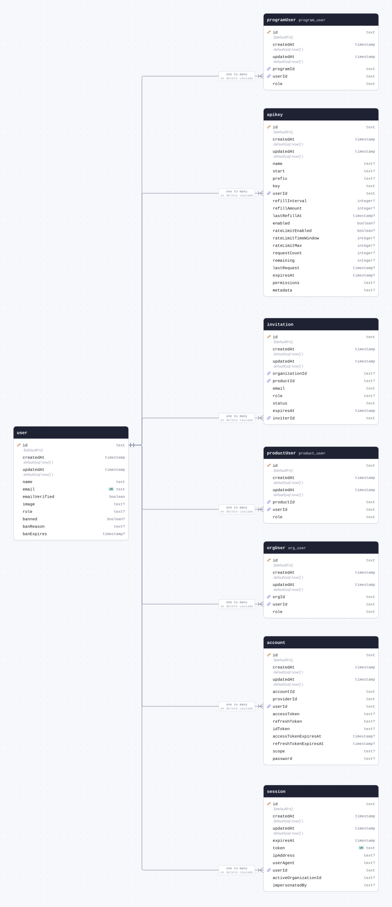

| Column                             | Type        | Constraints     | Default                  | Description |
| ---------------------------------- | ----------- | --------------- | ------------------------ | ----------- |
| `id`                               | `text`      | PK NOT NULL     | `.$defaultFn()`          |             |
| `createdAt` (`created_at`)         | `timestamp` | NOT NULL        | ``.default(sql`now()`)`` |             |
| `updatedAt` (`updated_at`)         | `timestamp` | NOT NULL        | ``.default(sql`now()`)`` |             |
| `name`                             | `text`      | NOT NULL        |                          |             |
| `email`                            | `text`      | UNIQUE NOT NULL |                          |             |
| `emailVerified` (`email_verified`) | `boolean`   | NOT NULL        |                          |             |
| `image`                            | `text`      | NULL            |                          |             |
| `role`                             | `text`      | NULL            |                          |             |
| `banned`                           | `boolean`   | NULL            |                          |             |
| `banReason` (`ban_reason`)         | `text`      | NULL            |                          |             |
| `banExpires` (`ban_expires`)       | `timestamp` | NULL            |                          |             |

#### Definition

```sql
CREATE TABLE "user" (
	"id" text PRIMARY KEY,
	"created_at" timestamp DEFAULT now() NOT NULL,
	"updated_at" timestamp DEFAULT now() NOT NULL,
	"name" text NOT NULL,
	"email" text NOT NULL UNIQUE,
	"email_verified" boolean NOT NULL,
	"image" text,
	"role" text,
	"banned" boolean,
	"ban_reason" text,
	"ban_expires" timestamp
);
```

#### Referenced by

- `id` → [session.userId](#table-session) (one to many, on delete cascade)
- `id` → [account.userId](#table-account) (one to many, on delete cascade)
- `id` → [orgUser.userId](#table-orgUser) (one to many, on delete cascade)
- `id` → [productUser.userId](#table-productUser) (one to many, on delete cascade)
- `id` → [invitation.inviterId](#table-invitation) (one to many, on delete cascade)
- `id` → [apikey.userId](#table-apikey) (one to many, on delete cascade)
- `id` → [programUser.userId](#table-programUser) (one to many, on delete cascade)

<details>
<summary>Queries and their SQL</summary>

**Select**: Every row of user.

```ts
db.select().from(user);
```

```sql
select "id", "created_at", "updated_at", "name", "email", "email_verified", "image", "role", "banned", "ban_reason", "ban_expires"
from "user"
```

**Count**: How many rows user has.

```ts
db.select({ count: count() }).from(user);
```

```sql
select count(*)
from "user"
```

**Find many**: The rows of user, through the relational query API.

```ts
db.query.user.findMany();
```

```sql
select "d0"."id" as "id", "d0"."created_at" as "createdAt", "d0"."updated_at" as "updatedAt", "d0"."name" as "name", "d0"."email" as "email", "d0"."email_verified" as "emailVerified", "d0"."image" as "image", "d0"."role" as "role", "d0"."banned" as "banned", "d0"."ban_reason" as "banReason", "d0"."ban_expires" as "banExpires"
from "user" as "d0"
```

**Find by primary key**: One row of user, through the relational query API.

```ts
db.query.user.findFirst({ where: { id: "id" } });
```

```sql
select "d0"."id" as "id", "d0"."created_at" as "createdAt", "d0"."updated_at" as "updatedAt", "d0"."name" as "name", "d0"."email" as "email", "d0"."email_verified" as "emailVerified", "d0"."image" as "image", "d0"."role" as "role", "d0"."banned" as "banned", "d0"."ban_reason" as "banReason", "d0"."ban_expires" as "banExpires"
from "user" as "d0"
where "d0"."id" = $1
limit $2
-- params: ["id",1]
```

**Insert**: Adds a row to user, giving the columns that have no default.

```ts
db.insert(user).values({ name: "name", email: "email", emailVerified: true });
```

```sql
insert into "user" ("id", "created_at", "updated_at", "name", "email", "email_verified", "image", "role", "banned", "ban_reason", "ban_expires")
values ($1, default, default, $2, $3, $4, default, default, default, default, default)
-- params: ["usr_njp6z9meub2mh3bue1aynkim","name","email",true]
```

**Update**: Changes a row of user, found by its primary key.

```ts
db.update(user)
  .set({ createdAt: new Date("2026-01-01T00:00:00.000Z") })
  .where(eq(user.id, "id"));
```

```sql
update "user"
set "created_at" = $1
where "user"."id" = $2
-- params: ["2026-01-01T00:00:00.000Z","id"]
```

**Delete**: Deletes a row of user, found by its primary key.

```ts
db.delete(user).where(eq(user.id, "id"));
```

```sql
delete from "user"
where "user"."id" = $1
-- params: ["id"]
```

</details>

<a id="table-session"></a>

### session

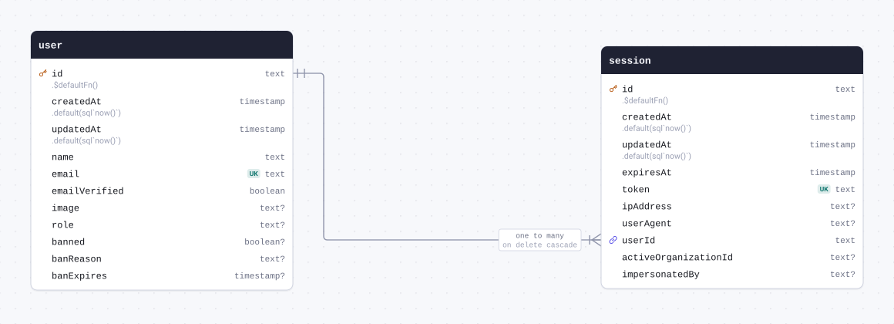

| Column                                            | Type        | Constraints                       | Default                  | Description |
| ------------------------------------------------- | ----------- | --------------------------------- | ------------------------ | ----------- |
| `id`                                              | `text`      | PK NOT NULL                       | `.$defaultFn()`          |             |
| `createdAt` (`created_at`)                        | `timestamp` | NOT NULL                          | ``.default(sql`now()`)`` |             |
| `updatedAt` (`updated_at`)                        | `timestamp` | NOT NULL                          | ``.default(sql`now()`)`` |             |
| `expiresAt` (`expires_at`)                        | `timestamp` | NOT NULL                          |                          |             |
| `token`                                           | `text`      | UNIQUE NOT NULL                   |                          |             |
| `ipAddress` (`ip_address`)                        | `text`      | NULL                              |                          |             |
| `userAgent` (`user_agent`)                        | `text`      | NULL                              |                          |             |
| `userId` (`user_id`)                              | `text`      | NOT NULL → [user.id](#table-user) |                          |             |
| `activeOrganizationId` (`active_organization_id`) | `text`      | NULL                              |                          |             |
| `impersonatedBy` (`impersonated_by`)              | `text`      | NULL                              |                          |             |

#### Definition

```sql
CREATE TABLE "session" (
	"id" text PRIMARY KEY,
	"created_at" timestamp DEFAULT now() NOT NULL,
	"updated_at" timestamp DEFAULT now() NOT NULL,
	"expires_at" timestamp NOT NULL,
	"token" text NOT NULL UNIQUE,
	"ip_address" text,
	"user_agent" text,
	"user_id" text NOT NULL,
	"active_organization_id" text,
	"impersonated_by" text
);

ALTER TABLE "session" ADD CONSTRAINT "session_user_id_user_id_fkey" FOREIGN KEY ("user_id") REFERENCES "user"("id") ON DELETE CASCADE;
```

#### References

- `userId` → [user.id](#table-user) (many to one, on delete cascade)

<details>
<summary>Queries and their SQL</summary>

**Select**: Every row of session.

```ts
db.select().from(session);
```

```sql
select "id", "created_at", "updated_at", "expires_at", "token", "ip_address", "user_agent", "user_id", "active_organization_id", "impersonated_by"
from "session"
```

**Count**: How many rows session has.

```ts
db.select({ count: count() }).from(session);
```

```sql
select count(*)
from "session"
```

**Find many**: The rows of session, through the relational query API.

```ts
db.query.session.findMany();
```

```sql
select "d0"."id" as "id", "d0"."created_at" as "createdAt", "d0"."updated_at" as "updatedAt", "d0"."expires_at" as "expiresAt", "d0"."token" as "token", "d0"."ip_address" as "ipAddress", "d0"."user_agent" as "userAgent", "d0"."user_id" as "userId", "d0"."active_organization_id" as "activeOrganizationId", "d0"."impersonated_by" as "impersonatedBy"
from "session" as "d0"
```

**Find by primary key**: One row of session, through the relational query API.

```ts
db.query.session.findFirst({ where: { id: "id" } });
```

```sql
select "d0"."id" as "id", "d0"."created_at" as "createdAt", "d0"."updated_at" as "updatedAt", "d0"."expires_at" as "expiresAt", "d0"."token" as "token", "d0"."ip_address" as "ipAddress", "d0"."user_agent" as "userAgent", "d0"."user_id" as "userId", "d0"."active_organization_id" as "activeOrganizationId", "d0"."impersonated_by" as "impersonatedBy"
from "session" as "d0"
where "d0"."id" = $1
limit $2
-- params: ["id",1]
```

**Insert**: Adds a row to session, giving the columns that have no default.

```ts
db.insert(session).values({
  expiresAt: new Date("2026-01-01T00:00:00.000Z"),
  token: "token",
  userId: "userId",
});
```

```sql
insert into "session" ("id", "created_at", "updated_at", "expires_at", "token", "ip_address", "user_agent", "user_id", "active_organization_id", "impersonated_by")
values ($1, default, default, $2, $3, default, default, $4, default, default)
-- params: ["ses_njeoq9tdxl93ui1396qeij7d","2026-01-01T00:00:00.000Z","token","userId"]
```

**Update**: Changes a row of session, found by its primary key.

```ts
db.update(session)
  .set({ createdAt: new Date("2026-01-01T00:00:00.000Z") })
  .where(eq(session.id, "id"));
```

```sql
update "session"
set "created_at" = $1
where "session"."id" = $2
-- params: ["2026-01-01T00:00:00.000Z","id"]
```

**Delete**: Deletes a row of session, found by its primary key.

```ts
db.delete(session).where(eq(session.id, "id"));
```

```sql
delete from "session"
where "session"."id" = $1
-- params: ["id"]
```

</details>

<a id="table-account"></a>

### account

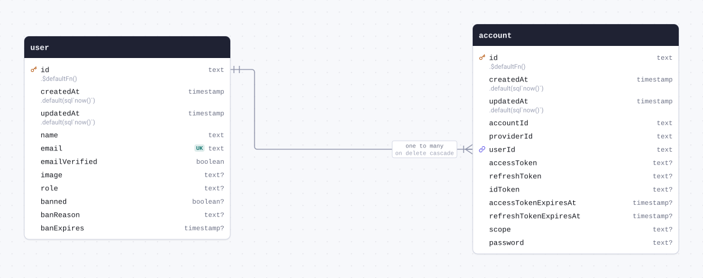

| Column                                               | Type        | Constraints                       | Default                  | Description |
| ---------------------------------------------------- | ----------- | --------------------------------- | ------------------------ | ----------- |
| `id`                                                 | `text`      | PK NOT NULL                       | `.$defaultFn()`          |             |
| `createdAt` (`created_at`)                           | `timestamp` | NOT NULL                          | ``.default(sql`now()`)`` |             |
| `updatedAt` (`updated_at`)                           | `timestamp` | NOT NULL                          | ``.default(sql`now()`)`` |             |
| `accountId` (`account_id`)                           | `text`      | NOT NULL                          |                          |             |
| `providerId` (`provider_id`)                         | `text`      | NOT NULL                          |                          |             |
| `userId` (`user_id`)                                 | `text`      | NOT NULL → [user.id](#table-user) |                          |             |
| `accessToken` (`access_token`)                       | `text`      | NULL                              |                          |             |
| `refreshToken` (`refresh_token`)                     | `text`      | NULL                              |                          |             |
| `idToken` (`id_token`)                               | `text`      | NULL                              |                          |             |
| `accessTokenExpiresAt` (`access_token_expires_at`)   | `timestamp` | NULL                              |                          |             |
| `refreshTokenExpiresAt` (`refresh_token_expires_at`) | `timestamp` | NULL                              |                          |             |
| `scope`                                              | `text`      | NULL                              |                          |             |
| `password`                                           | `text`      | NULL                              |                          |             |

#### Definition

```sql
CREATE TABLE "account" (
	"id" text PRIMARY KEY,
	"created_at" timestamp DEFAULT now() NOT NULL,
	"updated_at" timestamp DEFAULT now() NOT NULL,
	"account_id" text NOT NULL,
	"provider_id" text NOT NULL,
	"user_id" text NOT NULL,
	"access_token" text,
	"refresh_token" text,
	"id_token" text,
	"access_token_expires_at" timestamp,
	"refresh_token_expires_at" timestamp,
	"scope" text,
	"password" text
);

ALTER TABLE "account" ADD CONSTRAINT "account_user_id_user_id_fkey" FOREIGN KEY ("user_id") REFERENCES "user"("id") ON DELETE CASCADE;
```

#### References

- `userId` → [user.id](#table-user) (many to one, on delete cascade)

<details>
<summary>Queries and their SQL</summary>

**Select**: Every row of account.

```ts
db.select().from(account);
```

```sql
select "id", "created_at", "updated_at", "account_id", "provider_id", "user_id", "access_token", "refresh_token", "id_token", "access_token_expires_at", "refresh_token_expires_at", "scope", "password"
from "account"
```

**Count**: How many rows account has.

```ts
db.select({ count: count() }).from(account);
```

```sql
select count(*)
from "account"
```

**Find many**: The rows of account, through the relational query API.

```ts
db.query.account.findMany();
```

```sql
select "d0"."id" as "id", "d0"."created_at" as "createdAt", "d0"."updated_at" as "updatedAt", "d0"."account_id" as "accountId", "d0"."provider_id" as "providerId", "d0"."user_id" as "userId", "d0"."access_token" as "accessToken", "d0"."refresh_token" as "refreshToken", "d0"."id_token" as "idToken", "d0"."access_token_expires_at" as "accessTokenExpiresAt", "d0"."refresh_token_expires_at" as "refreshTokenExpiresAt", "d0"."scope" as "scope", "d0"."password" as "password"
from "account" as "d0"
```

**Find by primary key**: One row of account, through the relational query API.

```ts
db.query.account.findFirst({ where: { id: "id" } });
```

```sql
select "d0"."id" as "id", "d0"."created_at" as "createdAt", "d0"."updated_at" as "updatedAt", "d0"."account_id" as "accountId", "d0"."provider_id" as "providerId", "d0"."user_id" as "userId", "d0"."access_token" as "accessToken", "d0"."refresh_token" as "refreshToken", "d0"."id_token" as "idToken", "d0"."access_token_expires_at" as "accessTokenExpiresAt", "d0"."refresh_token_expires_at" as "refreshTokenExpiresAt", "d0"."scope" as "scope", "d0"."password" as "password"
from "account" as "d0"
where "d0"."id" = $1
limit $2
-- params: ["id",1]
```

**Insert**: Adds a row to account, giving the columns that have no default.

```ts
db.insert(account).values({ accountId: "accountId", providerId: "providerId", userId: "userId" });
```

```sql
insert into "account" ("id", "created_at", "updated_at", "account_id", "provider_id", "user_id", "access_token", "refresh_token", "id_token", "access_token_expires_at", "refresh_token_expires_at", "scope", "password")
values ($1, default, default, $2, $3, $4, default, default, default, default, default, default, default)
-- params: ["acc_npr0hn01a39wiryyl5bvoco0","accountId","providerId","userId"]
```

**Update**: Changes a row of account, found by its primary key.

```ts
db.update(account)
  .set({ createdAt: new Date("2026-01-01T00:00:00.000Z") })
  .where(eq(account.id, "id"));
```

```sql
update "account"
set "created_at" = $1
where "account"."id" = $2
-- params: ["2026-01-01T00:00:00.000Z","id"]
```

**Delete**: Deletes a row of account, found by its primary key.

```ts
db.delete(account).where(eq(account.id, "id"));
```

```sql
delete from "account"
where "account"."id" = $1
-- params: ["id"]
```

</details>

<a id="table-verification"></a>

### verification

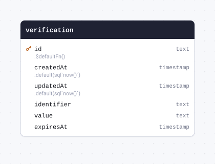

| Column                     | Type        | Constraints | Default                  | Description |
| -------------------------- | ----------- | ----------- | ------------------------ | ----------- |
| `id`                       | `text`      | PK NOT NULL | `.$defaultFn()`          |             |
| `createdAt` (`created_at`) | `timestamp` | NOT NULL    | ``.default(sql`now()`)`` |             |
| `updatedAt` (`updated_at`) | `timestamp` | NOT NULL    | ``.default(sql`now()`)`` |             |
| `identifier`               | `text`      | NOT NULL    |                          |             |
| `value`                    | `text`      | NOT NULL    |                          |             |
| `expiresAt` (`expires_at`) | `timestamp` | NOT NULL    |                          |             |

#### Definition

```sql
CREATE TABLE "verification" (
	"id" text PRIMARY KEY,
	"created_at" timestamp DEFAULT now() NOT NULL,
	"updated_at" timestamp DEFAULT now() NOT NULL,
	"identifier" text NOT NULL,
	"value" text NOT NULL,
	"expires_at" timestamp NOT NULL
);
```

<details>
<summary>Queries and their SQL</summary>

**Select**: Every row of verification.

```ts
db.select().from(verification);
```

```sql
select "id", "created_at", "updated_at", "identifier", "value", "expires_at"
from "verification"
```

**Count**: How many rows verification has.

```ts
db.select({ count: count() }).from(verification);
```

```sql
select count(*)
from "verification"
```

**Find many**: The rows of verification, through the relational query API.

```ts
db.query.verification.findMany();
```

```sql
select "d0"."id" as "id", "d0"."created_at" as "createdAt", "d0"."updated_at" as "updatedAt", "d0"."identifier" as "identifier", "d0"."value" as "value", "d0"."expires_at" as "expiresAt"
from "verification" as "d0"
```

**Find by primary key**: One row of verification, through the relational query API.

```ts
db.query.verification.findFirst({ where: { id: "id" } });
```

```sql
select "d0"."id" as "id", "d0"."created_at" as "createdAt", "d0"."updated_at" as "updatedAt", "d0"."identifier" as "identifier", "d0"."value" as "value", "d0"."expires_at" as "expiresAt"
from "verification" as "d0"
where "d0"."id" = $1
limit $2
-- params: ["id",1]
```

**Insert**: Adds a row to verification, giving the columns that have no default.

```ts
db.insert(verification).values({
  identifier: "identifier",
  value: "value",
  expiresAt: new Date("2026-01-01T00:00:00.000Z"),
});
```

```sql
insert into "verification" ("id", "created_at", "updated_at", "identifier", "value", "expires_at")
values ($1, default, default, $2, $3, $4)
-- params: ["ver_nqecp0patuctgm8ov6kr53xj","identifier","value","2026-01-01T00:00:00.000Z"]
```

**Update**: Changes a row of verification, found by its primary key.

```ts
db.update(verification)
  .set({ createdAt: new Date("2026-01-01T00:00:00.000Z") })
  .where(eq(verification.id, "id"));
```

```sql
update "verification"
set "created_at" = $1
where "verification"."id" = $2
-- params: ["2026-01-01T00:00:00.000Z","id"]
```

**Delete**: Deletes a row of verification, found by its primary key.

```ts
db.delete(verification).where(eq(verification.id, "id"));
```

```sql
delete from "verification"
where "verification"."id" = $1
-- params: ["id"]
```

</details>

<a id="table-org"></a>

### org

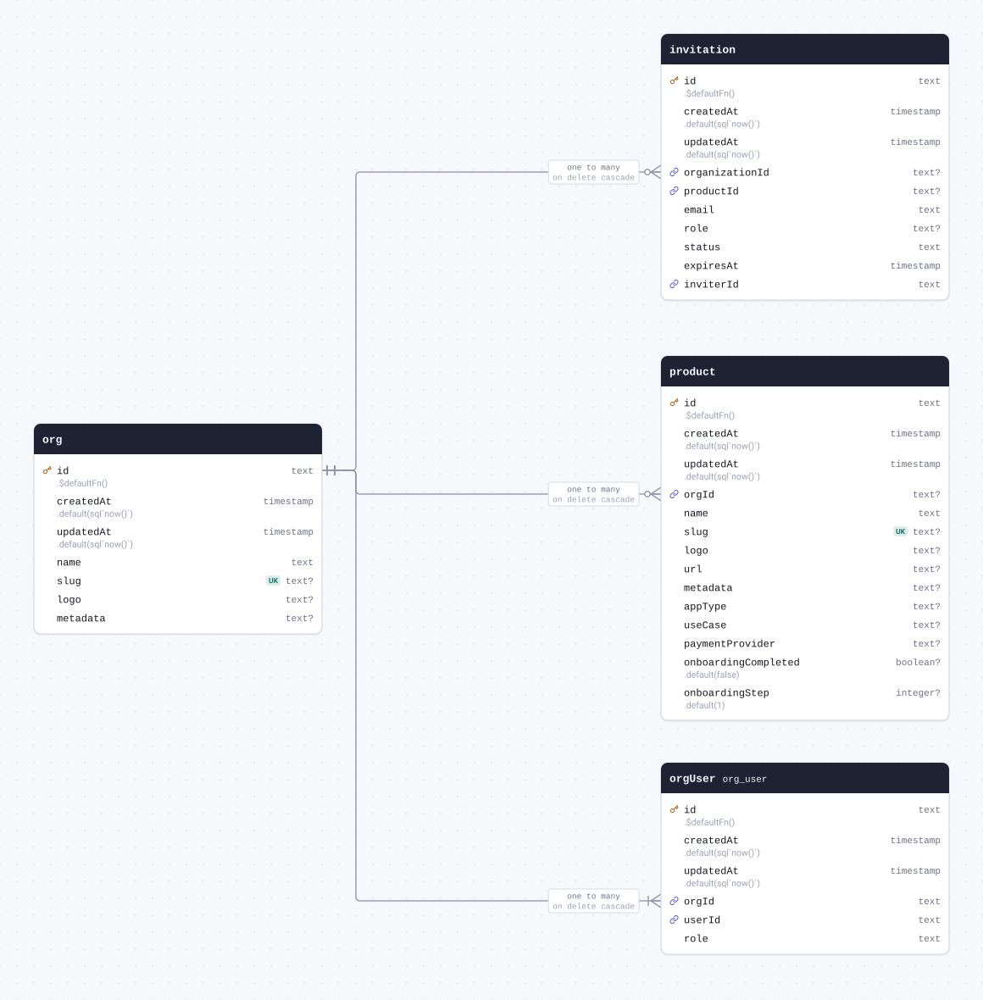

| Column                     | Type        | Constraints | Default                  | Description |
| -------------------------- | ----------- | ----------- | ------------------------ | ----------- |
| `id`                       | `text`      | PK NOT NULL | `.$defaultFn()`          |             |
| `createdAt` (`created_at`) | `timestamp` | NOT NULL    | ``.default(sql`now()`)`` |             |
| `updatedAt` (`updated_at`) | `timestamp` | NOT NULL    | ``.default(sql`now()`)`` |             |
| `name`                     | `text`      | NOT NULL    |                          |             |
| `slug`                     | `text`      | UNIQUE NULL |                          |             |
| `logo`                     | `text`      | NULL        |                          |             |
| `metadata`                 | `text`      | NULL        |                          |             |

#### Definition

```sql
CREATE TABLE "org" (
	"id" text PRIMARY KEY,
	"created_at" timestamp DEFAULT now() NOT NULL,
	"updated_at" timestamp DEFAULT now() NOT NULL,
	"name" text NOT NULL,
	"slug" text UNIQUE,
	"logo" text,
	"metadata" text
);
```

#### Referenced by

- `id` → [orgUser.orgId](#table-orgUser) (one to many, on delete cascade)
- `id` → [product.orgId](#table-product) (one to many, on delete cascade)
- `id` → [invitation.organizationId](#table-invitation) (one to many, on delete cascade)

<details>
<summary>Queries and their SQL</summary>

**Select**: Every row of org.

```ts
db.select().from(org);
```

```sql
select "id", "created_at", "updated_at", "name", "slug", "logo", "metadata"
from "org"
```

**Count**: How many rows org has.

```ts
db.select({ count: count() }).from(org);
```

```sql
select count(*)
from "org"
```

**Find many**: The rows of org, through the relational query API.

```ts
db.query.org.findMany();
```

```sql
select "d0"."id" as "id", "d0"."created_at" as "createdAt", "d0"."updated_at" as "updatedAt", "d0"."name" as "name", "d0"."slug" as "slug", "d0"."logo" as "logo", "d0"."metadata" as "metadata"
from "org" as "d0"
```

**Find by primary key**: One row of org, through the relational query API.

```ts
db.query.org.findFirst({ where: { id: "id" } });
```

```sql
select "d0"."id" as "id", "d0"."created_at" as "createdAt", "d0"."updated_at" as "updatedAt", "d0"."name" as "name", "d0"."slug" as "slug", "d0"."logo" as "logo", "d0"."metadata" as "metadata"
from "org" as "d0"
where "d0"."id" = $1
limit $2
-- params: ["id",1]
```

**Insert**: Adds a row to org, giving the columns that have no default.

```ts
db.insert(org).values({ name: "name" });
```

```sql
insert into "org" ("id", "created_at", "updated_at", "name", "slug", "logo", "metadata")
values ($1, default, default, $2, default, default, default)
-- params: ["org_n7d8w0wq5do3l52zrwv1m3lw","name"]
```

**Update**: Changes a row of org, found by its primary key.

```ts
db.update(org)
  .set({ createdAt: new Date("2026-01-01T00:00:00.000Z") })
  .where(eq(org.id, "id"));
```

```sql
update "org"
set "created_at" = $1
where "org"."id" = $2
-- params: ["2026-01-01T00:00:00.000Z","id"]
```

**Delete**: Deletes a row of org, found by its primary key.

```ts
db.delete(org).where(eq(org.id, "id"));
```

```sql
delete from "org"
where "org"."id" = $1
-- params: ["id"]
```

</details>

<a id="table-orgUser"></a>

### orgUser

Table `org_user`.

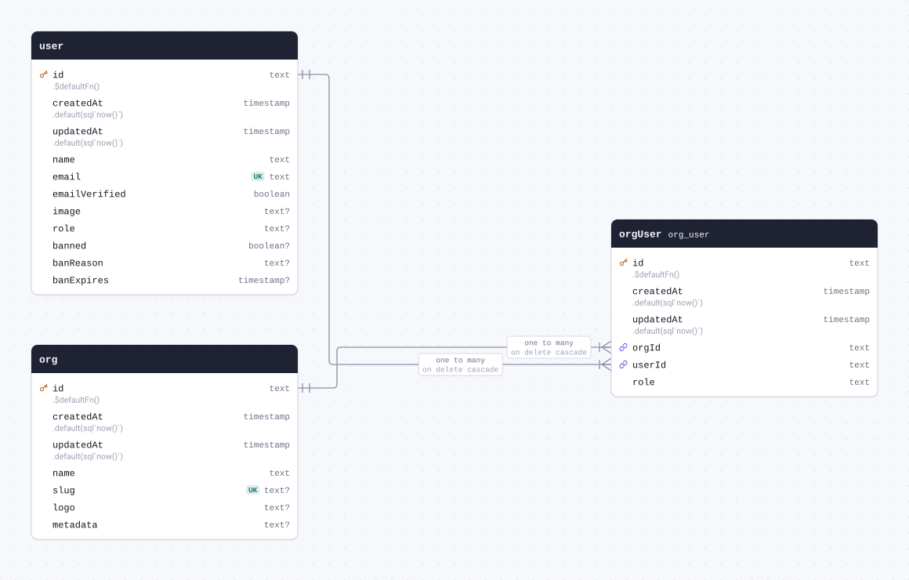

| Column                     | Type        | Constraints                       | Default                  | Description |
| -------------------------- | ----------- | --------------------------------- | ------------------------ | ----------- |
| `id`                       | `text`      | PK NOT NULL                       | `.$defaultFn()`          |             |
| `createdAt` (`created_at`) | `timestamp` | NOT NULL                          | ``.default(sql`now()`)`` |             |
| `updatedAt` (`updated_at`) | `timestamp` | NOT NULL                          | ``.default(sql`now()`)`` |             |
| `orgId` (`org_id`)         | `text`      | NOT NULL → [org.id](#table-org)   |                          |             |
| `userId` (`user_id`)       | `text`      | NOT NULL → [user.id](#table-user) |                          |             |
| `role`                     | `text`      | NOT NULL                          |                          |             |

#### Definition

```sql
CREATE TABLE "org_user" (
	"id" text PRIMARY KEY,
	"created_at" timestamp DEFAULT now() NOT NULL,
	"updated_at" timestamp DEFAULT now() NOT NULL,
	"org_id" text NOT NULL,
	"user_id" text NOT NULL,
	"role" text NOT NULL
);

ALTER TABLE "org_user" ADD CONSTRAINT "org_user_org_id_org_id_fkey" FOREIGN KEY ("org_id") REFERENCES "org"("id") ON DELETE CASCADE;

ALTER TABLE "org_user" ADD CONSTRAINT "org_user_user_id_user_id_fkey" FOREIGN KEY ("user_id") REFERENCES "user"("id") ON DELETE CASCADE;
```

#### References

- `orgId` → [org.id](#table-org) (many to one, on delete cascade)
- `userId` → [user.id](#table-user) (many to one, on delete cascade)

<details>
<summary>Queries and their SQL</summary>

**Select**: Every row of orgUser.

```ts
db.select().from(orgUser);
```

```sql
select "id", "created_at", "updated_at", "org_id", "user_id", "role"
from "org_user"
```

**Count**: How many rows orgUser has.

```ts
db.select({ count: count() }).from(orgUser);
```

```sql
select count(*)
from "org_user"
```

**Find many**: The rows of orgUser, through the relational query API.

```ts
db.query.orgUser.findMany();
```

```sql
select "d0"."id" as "id", "d0"."created_at" as "createdAt", "d0"."updated_at" as "updatedAt", "d0"."org_id" as "orgId", "d0"."user_id" as "userId", "d0"."role" as "role"
from "org_user" as "d0"
```

**Find by primary key**: One row of orgUser, through the relational query API.

```ts
db.query.orgUser.findFirst({ where: { id: "id" } });
```

```sql
select "d0"."id" as "id", "d0"."created_at" as "createdAt", "d0"."updated_at" as "updatedAt", "d0"."org_id" as "orgId", "d0"."user_id" as "userId", "d0"."role" as "role"
from "org_user" as "d0"
where "d0"."id" = $1
limit $2
-- params: ["id",1]
```

**Insert**: Adds a row to orgUser, giving the columns that have no default.

```ts
db.insert(orgUser).values({ orgId: "orgId", userId: "userId", role: "role" });
```

```sql
insert into "org_user" ("id", "created_at", "updated_at", "org_id", "user_id", "role")
values ($1, default, default, $2, $3, $4)
-- params: ["ou_n3ngxpx3c96u7s43tjmlm9a1","orgId","userId","role"]
```

**Update**: Changes a row of orgUser, found by its primary key.

```ts
db.update(orgUser)
  .set({ createdAt: new Date("2026-01-01T00:00:00.000Z") })
  .where(eq(orgUser.id, "id"));
```

```sql
update "org_user"
set "created_at" = $1
where "org_user"."id" = $2
-- params: ["2026-01-01T00:00:00.000Z","id"]
```

**Delete**: Deletes a row of orgUser, found by its primary key.

```ts
db.delete(orgUser).where(eq(orgUser.id, "id"));
```

```sql
delete from "org_user"
where "org_user"."id" = $1
-- params: ["id"]
```

</details>

<a id="table-product"></a>

### product

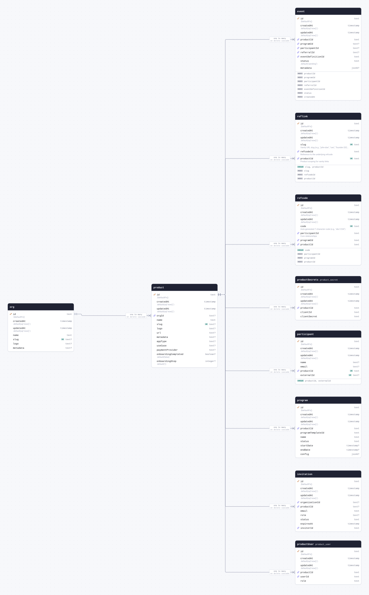

| Column                                         | Type        | Constraints                 | Default                  | Description |
| ---------------------------------------------- | ----------- | --------------------------- | ------------------------ | ----------- |
| `id`                                           | `text`      | PK NOT NULL                 | `.$defaultFn()`          |             |
| `createdAt` (`created_at`)                     | `timestamp` | NOT NULL                    | ``.default(sql`now()`)`` |             |
| `updatedAt` (`updated_at`)                     | `timestamp` | NOT NULL                    | ``.default(sql`now()`)`` |             |
| `orgId` (`org_id`)                             | `text`      | NULL → [org.id](#table-org) |                          |             |
| `name`                                         | `text`      | NOT NULL                    |                          |             |
| `slug`                                         | `text`      | UNIQUE NULL                 |                          |             |
| `logo`                                         | `text`      | NULL                        |                          |             |
| `url`                                          | `text`      | NULL                        |                          |             |
| `metadata`                                     | `text`      | NULL                        |                          |             |
| `appType` (`app_type`)                         | `text`      | NULL                        |                          |             |
| `useCase` (`use_case`)                         | `text`      | NULL                        |                          |             |
| `paymentProvider` (`payment_provider`)         | `text`      | NULL                        |                          |             |
| `onboardingCompleted` (`onboarding_completed`) | `boolean`   | NULL                        | `.default(false)`        |             |
| `onboardingStep` (`onboarding_step`)           | `integer`   | NULL                        | `.default(1)`            |             |

#### Definition

```sql
CREATE TABLE "product" (
	"id" text PRIMARY KEY,
	"created_at" timestamp DEFAULT now() NOT NULL,
	"updated_at" timestamp DEFAULT now() NOT NULL,
	"org_id" text,
	"name" text NOT NULL,
	"slug" text UNIQUE,
	"logo" text,
	"url" text,
	"metadata" text,
	"app_type" text,
	"use_case" text,
	"payment_provider" text,
	"onboarding_completed" boolean DEFAULT false,
	"onboarding_step" integer DEFAULT 1
);

ALTER TABLE "product" ADD CONSTRAINT "product_org_id_org_id_fkey" FOREIGN KEY ("org_id") REFERENCES "org"("id") ON DELETE CASCADE;
```

#### References

- `orgId` → [org.id](#table-org) (many to one, on delete cascade)

#### Referenced by

- `id` → [productUser.productId](#table-productUser) (one to many, on delete cascade)
- `id` → [invitation.productId](#table-invitation) (one to many, on delete cascade)
- `id` → [program.productId](#table-program) (one to many, on delete cascade)
- `id` → [participant.productId](#table-participant) (one to many, on delete cascade)
- `id` → [productSecrets.productId](#table-productSecrets) (one to many, on delete cascade)
- `id` → [refcode.productId](#table-refcode) (one to many, on delete cascade)
- `id` → [reflink.productId](#table-reflink) (one to many, on delete cascade)
- `id` → [event.productId](#table-event) (one to many, on delete cascade)

<details>
<summary>Queries and their SQL</summary>

**Select**: Every row of product.

```ts
db.select().from(product);
```

```sql
select "id", "created_at", "updated_at", "org_id", "name", "slug", "logo", "url", "metadata", "app_type", "use_case", "payment_provider", "onboarding_completed", "onboarding_step"
from "product"
```

**Count**: How many rows product has.

```ts
db.select({ count: count() }).from(product);
```

```sql
select count(*)
from "product"
```

**Find many**: The rows of product, through the relational query API.

```ts
db.query.product.findMany();
```

```sql
select "d0"."id" as "id", "d0"."created_at" as "createdAt", "d0"."updated_at" as "updatedAt", "d0"."org_id" as "orgId", "d0"."name" as "name", "d0"."slug" as "slug", "d0"."logo" as "logo", "d0"."url" as "url", "d0"."metadata" as "metadata", "d0"."app_type" as "appType", "d0"."use_case" as "useCase", "d0"."payment_provider" as "paymentProvider", "d0"."onboarding_completed" as "onboardingCompleted", "d0"."onboarding_step" as "onboardingStep"
from "product" as "d0"
```

**Find by primary key**: One row of product, through the relational query API.

```ts
db.query.product.findFirst({ where: { id: "id" } });
```

```sql
select "d0"."id" as "id", "d0"."created_at" as "createdAt", "d0"."updated_at" as "updatedAt", "d0"."org_id" as "orgId", "d0"."name" as "name", "d0"."slug" as "slug", "d0"."logo" as "logo", "d0"."url" as "url", "d0"."metadata" as "metadata", "d0"."app_type" as "appType", "d0"."use_case" as "useCase", "d0"."payment_provider" as "paymentProvider", "d0"."onboarding_completed" as "onboardingCompleted", "d0"."onboarding_step" as "onboardingStep"
from "product" as "d0"
where "d0"."id" = $1
limit $2
-- params: ["id",1]
```

**Insert**: Adds a row to product, giving the columns that have no default.

```ts
db.insert(product).values({ name: "name" });
```

```sql
insert into "product" ("id", "created_at", "updated_at", "org_id", "name", "slug", "logo", "url", "metadata", "app_type", "use_case", "payment_provider", "onboarding_completed", "onboarding_step")
values ($1, default, default, default, $2, default, default, default, default, default, default, default, default, default)
-- params: ["prd_nbtf1a6eihf7jzmkus97vt9f","name"]
```

**Update**: Changes a row of product, found by its primary key.

```ts
db.update(product)
  .set({ createdAt: new Date("2026-01-01T00:00:00.000Z") })
  .where(eq(product.id, "id"));
```

```sql
update "product"
set "created_at" = $1
where "product"."id" = $2
-- params: ["2026-01-01T00:00:00.000Z","id"]
```

**Delete**: Deletes a row of product, found by its primary key.

```ts
db.delete(product).where(eq(product.id, "id"));
```

```sql
delete from "product"
where "product"."id" = $1
-- params: ["id"]
```

</details>

<a id="table-productUser"></a>

### productUser

Table `product_user`.

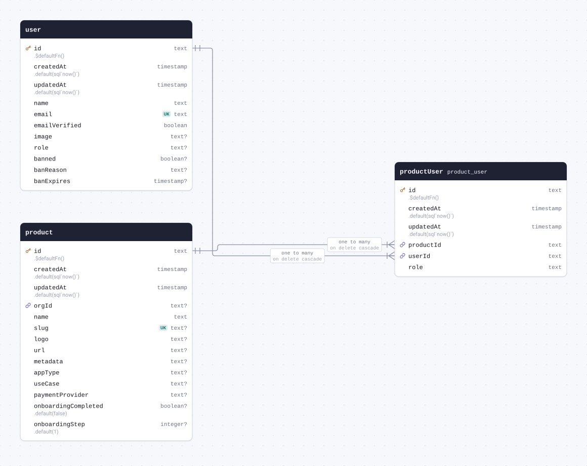

| Column                     | Type        | Constraints                             | Default                  | Description |
| -------------------------- | ----------- | --------------------------------------- | ------------------------ | ----------- |
| `id`                       | `text`      | PK NOT NULL                             | `.$defaultFn()`          |             |
| `createdAt` (`created_at`) | `timestamp` | NOT NULL                                | ``.default(sql`now()`)`` |             |
| `updatedAt` (`updated_at`) | `timestamp` | NOT NULL                                | ``.default(sql`now()`)`` |             |
| `productId` (`product_id`) | `text`      | NOT NULL → [product.id](#table-product) |                          |             |
| `userId` (`user_id`)       | `text`      | NOT NULL → [user.id](#table-user)       |                          |             |
| `role`                     | `text`      | NOT NULL                                |                          |             |

#### Definition

```sql
CREATE TABLE "product_user" (
	"id" text PRIMARY KEY,
	"created_at" timestamp DEFAULT now() NOT NULL,
	"updated_at" timestamp DEFAULT now() NOT NULL,
	"product_id" text NOT NULL,
	"user_id" text NOT NULL,
	"role" text NOT NULL
);

ALTER TABLE "product_user" ADD CONSTRAINT "product_user_product_id_product_id_fkey" FOREIGN KEY ("product_id") REFERENCES "product"("id") ON DELETE CASCADE;

ALTER TABLE "product_user" ADD CONSTRAINT "product_user_user_id_user_id_fkey" FOREIGN KEY ("user_id") REFERENCES "user"("id") ON DELETE CASCADE;
```

#### References

- `productId` → [product.id](#table-product) (many to one, on delete cascade)
- `userId` → [user.id](#table-user) (many to one, on delete cascade)

<details>
<summary>Queries and their SQL</summary>

**Select**: Every row of productUser.

```ts
db.select().from(productUser);
```

```sql
select "id", "created_at", "updated_at", "product_id", "user_id", "role"
from "product_user"
```

**Count**: How many rows productUser has.

```ts
db.select({ count: count() }).from(productUser);
```

```sql
select count(*)
from "product_user"
```

**Find many**: The rows of productUser, through the relational query API.

```ts
db.query.productUser.findMany();
```

```sql
select "d0"."id" as "id", "d0"."created_at" as "createdAt", "d0"."updated_at" as "updatedAt", "d0"."product_id" as "productId", "d0"."user_id" as "userId", "d0"."role" as "role"
from "product_user" as "d0"
```

**Find by primary key**: One row of productUser, through the relational query API.

```ts
db.query.productUser.findFirst({ where: { id: "id" } });
```

```sql
select "d0"."id" as "id", "d0"."created_at" as "createdAt", "d0"."updated_at" as "updatedAt", "d0"."product_id" as "productId", "d0"."user_id" as "userId", "d0"."role" as "role"
from "product_user" as "d0"
where "d0"."id" = $1
limit $2
-- params: ["id",1]
```

**Insert**: Adds a row to productUser, giving the columns that have no default.

```ts
db.insert(productUser).values({ productId: "productId", userId: "userId", role: "role" });
```

```sql
insert into "product_user" ("id", "created_at", "updated_at", "product_id", "user_id", "role")
values ($1, default, default, $2, $3, $4)
-- params: ["pu_nw2itu74y50il57nzjkjrdzq","productId","userId","role"]
```

**Update**: Changes a row of productUser, found by its primary key.

```ts
db.update(productUser)
  .set({ createdAt: new Date("2026-01-01T00:00:00.000Z") })
  .where(eq(productUser.id, "id"));
```

```sql
update "product_user"
set "created_at" = $1
where "product_user"."id" = $2
-- params: ["2026-01-01T00:00:00.000Z","id"]
```

**Delete**: Deletes a row of productUser, found by its primary key.

```ts
db.delete(productUser).where(eq(productUser.id, "id"));
```

```sql
delete from "product_user"
where "product_user"."id" = $1
-- params: ["id"]
```

</details>

<a id="table-invitation"></a>

### invitation

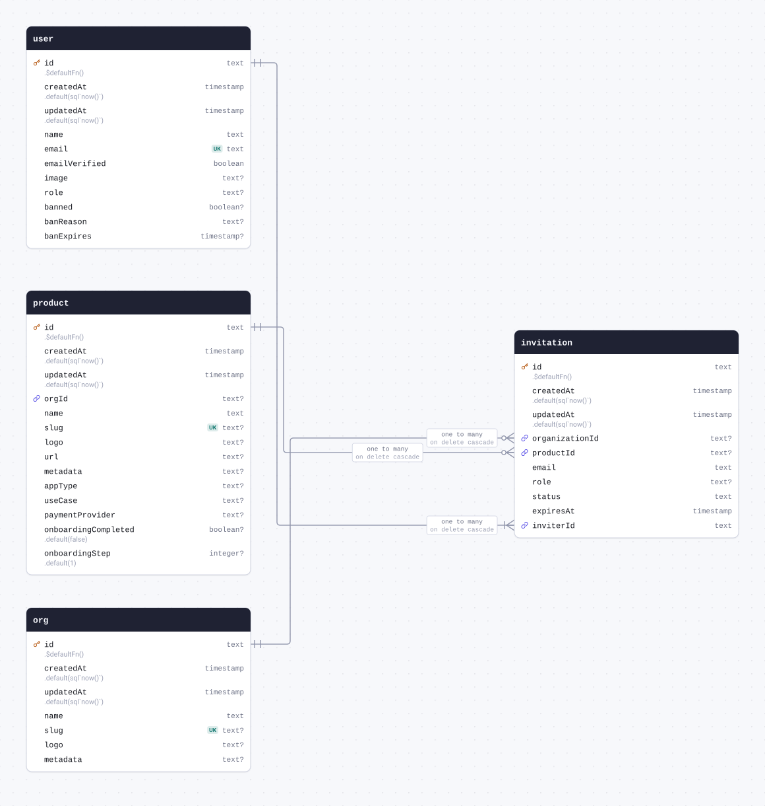

| Column                               | Type        | Constraints                         | Default                  | Description |
| ------------------------------------ | ----------- | ----------------------------------- | ------------------------ | ----------- |
| `id`                                 | `text`      | PK NOT NULL                         | `.$defaultFn()`          |             |
| `createdAt` (`created_at`)           | `timestamp` | NOT NULL                            | ``.default(sql`now()`)`` |             |
| `updatedAt` (`updated_at`)           | `timestamp` | NOT NULL                            | ``.default(sql`now()`)`` |             |
| `organizationId` (`organization_id`) | `text`      | NULL → [org.id](#table-org)         |                          |             |
| `productId` (`product_id`)           | `text`      | NULL → [product.id](#table-product) |                          |             |
| `email`                              | `text`      | NOT NULL                            |                          |             |
| `role`                               | `text`      | NULL                                |                          |             |
| `status`                             | `text`      | NOT NULL                            |                          |             |
| `expiresAt` (`expires_at`)           | `timestamp` | NOT NULL                            |                          |             |
| `inviterId` (`inviter_id`)           | `text`      | NOT NULL → [user.id](#table-user)   |                          |             |

#### Definition

```sql
CREATE TABLE "invitation" (
	"id" text PRIMARY KEY,
	"created_at" timestamp DEFAULT now() NOT NULL,
	"updated_at" timestamp DEFAULT now() NOT NULL,
	"organization_id" text,
	"product_id" text,
	"email" text NOT NULL,
	"role" text,
	"status" text NOT NULL,
	"expires_at" timestamp NOT NULL,
	"inviter_id" text NOT NULL
);

ALTER TABLE "invitation" ADD CONSTRAINT "invitation_organization_id_org_id_fkey" FOREIGN KEY ("organization_id") REFERENCES "org"("id") ON DELETE CASCADE;

ALTER TABLE "invitation" ADD CONSTRAINT "invitation_product_id_product_id_fkey" FOREIGN KEY ("product_id") REFERENCES "product"("id") ON DELETE CASCADE;

ALTER TABLE "invitation" ADD CONSTRAINT "invitation_inviter_id_user_id_fkey" FOREIGN KEY ("inviter_id") REFERENCES "user"("id") ON DELETE CASCADE;
```

#### References

- `organizationId` → [org.id](#table-org) (many to one, on delete cascade)
- `productId` → [product.id](#table-product) (many to one, on delete cascade)
- `inviterId` → [user.id](#table-user) (many to one, on delete cascade)

<details>
<summary>Queries and their SQL</summary>

**Select**: Every row of invitation.

```ts
db.select().from(invitation);
```

```sql
select "id", "created_at", "updated_at", "organization_id", "product_id", "email", "role", "status", "expires_at", "inviter_id"
from "invitation"
```

**Count**: How many rows invitation has.

```ts
db.select({ count: count() }).from(invitation);
```

```sql
select count(*)
from "invitation"
```

**Find many**: The rows of invitation, through the relational query API.

```ts
db.query.invitation.findMany();
```

```sql
select "d0"."id" as "id", "d0"."created_at" as "createdAt", "d0"."updated_at" as "updatedAt", "d0"."organization_id" as "organizationId", "d0"."product_id" as "productId", "d0"."email" as "email", "d0"."role" as "role", "d0"."status" as "status", "d0"."expires_at" as "expiresAt", "d0"."inviter_id" as "inviterId"
from "invitation" as "d0"
```

**Find by primary key**: One row of invitation, through the relational query API.

```ts
db.query.invitation.findFirst({ where: { id: "id" } });
```

```sql
select "d0"."id" as "id", "d0"."created_at" as "createdAt", "d0"."updated_at" as "updatedAt", "d0"."organization_id" as "organizationId", "d0"."product_id" as "productId", "d0"."email" as "email", "d0"."role" as "role", "d0"."status" as "status", "d0"."expires_at" as "expiresAt", "d0"."inviter_id" as "inviterId"
from "invitation" as "d0"
where "d0"."id" = $1
limit $2
-- params: ["id",1]
```

**Insert**: Adds a row to invitation, giving the columns that have no default.

```ts
db.insert(invitation).values({
  email: "email",
  status: "status",
  expiresAt: new Date("2026-01-01T00:00:00.000Z"),
  inviterId: "inviterId",
});
```

```sql
insert into "invitation" ("id", "created_at", "updated_at", "organization_id", "product_id", "email", "role", "status", "expires_at", "inviter_id")
values ($1, default, default, default, default, $2, default, $3, $4, $5)
-- params: ["inv_ntaqyj1wfh5f81k79wjyghwp","email","status","2026-01-01T00:00:00.000Z","inviterId"]
```

**Update**: Changes a row of invitation, found by its primary key.

```ts
db.update(invitation)
  .set({ createdAt: new Date("2026-01-01T00:00:00.000Z") })
  .where(eq(invitation.id, "id"));
```

```sql
update "invitation"
set "created_at" = $1
where "invitation"."id" = $2
-- params: ["2026-01-01T00:00:00.000Z","id"]
```

**Delete**: Deletes a row of invitation, found by its primary key.

```ts
db.delete(invitation).where(eq(invitation.id, "id"));
```

```sql
delete from "invitation"
where "invitation"."id" = $1
-- params: ["id"]
```

</details>

<a id="table-apikey"></a>

### apikey

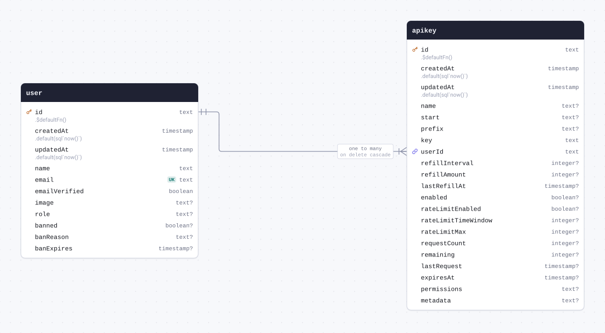

| Column                                           | Type        | Constraints                       | Default                  | Description |
| ------------------------------------------------ | ----------- | --------------------------------- | ------------------------ | ----------- |
| `id`                                             | `text`      | PK NOT NULL                       | `.$defaultFn()`          |             |
| `createdAt` (`created_at`)                       | `timestamp` | NOT NULL                          | ``.default(sql`now()`)`` |             |
| `updatedAt` (`updated_at`)                       | `timestamp` | NOT NULL                          | ``.default(sql`now()`)`` |             |
| `name`                                           | `text`      | NULL                              |                          |             |
| `start`                                          | `text`      | NULL                              |                          |             |
| `prefix`                                         | `text`      | NULL                              |                          |             |
| `key`                                            | `text`      | NOT NULL                          |                          |             |
| `userId` (`user_id`)                             | `text`      | NOT NULL → [user.id](#table-user) |                          |             |
| `refillInterval` (`refill_interval`)             | `integer`   | NULL                              |                          |             |
| `refillAmount` (`refill_amount`)                 | `integer`   | NULL                              |                          |             |
| `lastRefillAt` (`last_refill_at`)                | `timestamp` | NULL                              |                          |             |
| `enabled`                                        | `boolean`   | NULL                              |                          |             |
| `rateLimitEnabled` (`rate_limit_enabled`)        | `boolean`   | NULL                              |                          |             |
| `rateLimitTimeWindow` (`rate_limit_time_window`) | `integer`   | NULL                              |                          |             |
| `rateLimitMax` (`rate_limit_max`)                | `integer`   | NULL                              |                          |             |
| `requestCount` (`request_count`)                 | `integer`   | NULL                              |                          |             |
| `remaining`                                      | `integer`   | NULL                              |                          |             |
| `lastRequest` (`last_request`)                   | `timestamp` | NULL                              |                          |             |
| `expiresAt` (`expires_at`)                       | `timestamp` | NULL                              |                          |             |
| `permissions`                                    | `text`      | NULL                              |                          |             |
| `metadata`                                       | `text`      | NULL                              |                          |             |

#### Definition

```sql
CREATE TABLE "apikey" (
	"id" text PRIMARY KEY,
	"created_at" timestamp DEFAULT now() NOT NULL,
	"updated_at" timestamp DEFAULT now() NOT NULL,
	"name" text,
	"start" text,
	"prefix" text,
	"key" text NOT NULL,
	"user_id" text NOT NULL,
	"refill_interval" integer,
	"refill_amount" integer,
	"last_refill_at" timestamp,
	"enabled" boolean,
	"rate_limit_enabled" boolean,
	"rate_limit_time_window" integer,
	"rate_limit_max" integer,
	"request_count" integer,
	"remaining" integer,
	"last_request" timestamp,
	"expires_at" timestamp,
	"permissions" text,
	"metadata" text
);

ALTER TABLE "apikey" ADD CONSTRAINT "apikey_user_id_user_id_fkey" FOREIGN KEY ("user_id") REFERENCES "user"("id") ON DELETE CASCADE;
```

#### References

- `userId` → [user.id](#table-user) (many to one, on delete cascade)

<details>
<summary>Queries and their SQL</summary>

**Select**: Every row of apikey.

```ts
db.select().from(apikey);
```

```sql
select "id", "created_at", "updated_at", "name", "start", "prefix", "key", "user_id", "refill_interval", "refill_amount", "last_refill_at", "enabled", "rate_limit_enabled", "rate_limit_time_window", "rate_limit_max", "request_count", "remaining", "last_request", "expires_at", "permissions", "metadata"
from "apikey"
```

**Count**: How many rows apikey has.

```ts
db.select({ count: count() }).from(apikey);
```

```sql
select count(*)
from "apikey"
```

**Find many**: The rows of apikey, through the relational query API.

```ts
db.query.apikey.findMany();
```

```sql
select "d0"."id" as "id", "d0"."created_at" as "createdAt", "d0"."updated_at" as "updatedAt", "d0"."name" as "name", "d0"."start" as "start", "d0"."prefix" as "prefix", "d0"."key" as "key", "d0"."user_id" as "userId", "d0"."refill_interval" as "refillInterval", "d0"."refill_amount" as "refillAmount", "d0"."last_refill_at" as "lastRefillAt", "d0"."enabled" as "enabled", "d0"."rate_limit_enabled" as "rateLimitEnabled", "d0"."rate_limit_time_window" as "rateLimitTimeWindow", "d0"."rate_limit_max" as "rateLimitMax", "d0"."request_count" as "requestCount", "d0"."remaining" as "remaining", "d0"."last_request" as "lastRequest", "d0"."expires_at" as "expiresAt", "d0"."permissions" as "permissions", "d0"."metadata" as "metadata"
from "apikey" as "d0"
```

**Find by primary key**: One row of apikey, through the relational query API.

```ts
db.query.apikey.findFirst({ where: { id: "id" } });
```

```sql
select "d0"."id" as "id", "d0"."created_at" as "createdAt", "d0"."updated_at" as "updatedAt", "d0"."name" as "name", "d0"."start" as "start", "d0"."prefix" as "prefix", "d0"."key" as "key", "d0"."user_id" as "userId", "d0"."refill_interval" as "refillInterval", "d0"."refill_amount" as "refillAmount", "d0"."last_refill_at" as "lastRefillAt", "d0"."enabled" as "enabled", "d0"."rate_limit_enabled" as "rateLimitEnabled", "d0"."rate_limit_time_window" as "rateLimitTimeWindow", "d0"."rate_limit_max" as "rateLimitMax", "d0"."request_count" as "requestCount", "d0"."remaining" as "remaining", "d0"."last_request" as "lastRequest", "d0"."expires_at" as "expiresAt", "d0"."permissions" as "permissions", "d0"."metadata" as "metadata"
from "apikey" as "d0"
where "d0"."id" = $1
limit $2
-- params: ["id",1]
```

**Insert**: Adds a row to apikey, giving the columns that have no default.

```ts
db.insert(apikey).values({ key: "key", userId: "userId" });
```

```sql
insert into "apikey" ("id", "created_at", "updated_at", "name", "start", "prefix", "key", "user_id", "refill_interval", "refill_amount", "last_refill_at", "enabled", "rate_limit_enabled", "rate_limit_time_window", "rate_limit_max", "request_count", "remaining", "last_request", "expires_at", "permissions", "metadata")
values ($1, default, default, default, default, default, $2, $3, default, default, default, default, default, default, default, default, default, default, default, default, default)
-- params: ["key_nbdj164hbnua7vrulbcvz0pe","key","userId"]
```

**Update**: Changes a row of apikey, found by its primary key.

```ts
db.update(apikey)
  .set({ createdAt: new Date("2026-01-01T00:00:00.000Z") })
  .where(eq(apikey.id, "id"));
```

```sql
update "apikey"
set "created_at" = $1
where "apikey"."id" = $2
-- params: ["2026-01-01T00:00:00.000Z","id"]
```

**Delete**: Deletes a row of apikey, found by its primary key.

```ts
db.delete(apikey).where(eq(apikey.id, "id"));
```

```sql
delete from "apikey"
where "apikey"."id" = $1
-- params: ["id"]
```

</details>

<a id="table-program"></a>

### program

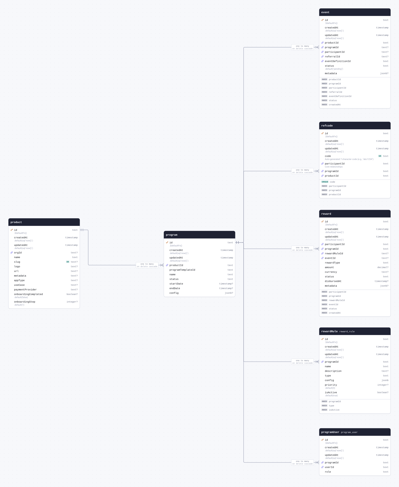

| Column                                      | Type        | Constraints                             | Default                  | Description |
| ------------------------------------------- | ----------- | --------------------------------------- | ------------------------ | ----------- |
| `id`                                        | `text`      | PK NOT NULL                             | `.$defaultFn()`          |             |
| `createdAt` (`created_at`)                  | `timestamp` | NOT NULL                                | ``.default(sql`now()`)`` |             |
| `updatedAt` (`updated_at`)                  | `timestamp` | NOT NULL                                | ``.default(sql`now()`)`` |             |
| `productId` (`product_id`)                  | `text`      | NOT NULL → [product.id](#table-product) |                          |             |
| `programTemplateId` (`program_template_id`) | `text`      | NOT NULL                                |                          |             |
| `name`                                      | `text`      | NOT NULL                                |                          |             |
| `status`                                    | `text`      | NOT NULL                                |                          |             |
| `startDate` (`start_date`)                  | `timestamp` | NULL                                    |                          |             |
| `endDate` (`end_date`)                      | `timestamp` | NULL                                    |                          |             |
| `config`                                    | `jsonb`     | NULL                                    |                          |             |

#### Definition

```sql
CREATE TABLE "program" (
	"id" text PRIMARY KEY,
	"created_at" timestamp DEFAULT now() NOT NULL,
	"updated_at" timestamp DEFAULT now() NOT NULL,
	"product_id" text NOT NULL,
	"program_template_id" text NOT NULL,
	"name" text NOT NULL,
	"status" text NOT NULL,
	"start_date" timestamp,
	"end_date" timestamp,
	"config" jsonb
);

ALTER TABLE "program" ADD CONSTRAINT "program_product_id_product_id_fkey" FOREIGN KEY ("product_id") REFERENCES "product"("id") ON DELETE CASCADE;
```

#### References

- `productId` → [product.id](#table-product) (many to one, on delete cascade)

#### Referenced by

- `id` → [programUser.programId](#table-programUser) (one to many, on delete cascade)
- `id` → [rewardRule.programId](#table-rewardRule) (one to many, on delete cascade)
- `id` → [reward.programId](#table-reward) (one to many, on delete cascade)
- `id` → [refcode.programId](#table-refcode) (one to many, on delete cascade)
- `id` → [event.programId](#table-event) (one to many, on delete cascade)

<details>
<summary>Queries and their SQL</summary>

**Select**: Every row of program.

```ts
db.select().from(program);
```

```sql
select "id", "created_at", "updated_at", "product_id", "program_template_id", "name", "status", "start_date", "end_date", "config"
from "program"
```

**Count**: How many rows program has.

```ts
db.select({ count: count() }).from(program);
```

```sql
select count(*)
from "program"
```

**Find many**: The rows of program, through the relational query API.

```ts
db.query.program.findMany();
```

```sql
select "d0"."id" as "id", "d0"."created_at" as "createdAt", "d0"."updated_at" as "updatedAt", "d0"."product_id" as "productId", "d0"."program_template_id" as "programTemplateId", "d0"."name" as "name", "d0"."status" as "status", "d0"."start_date" as "startDate", "d0"."end_date" as "endDate", "d0"."config" as "config"
from "program" as "d0"
```

**Find by primary key**: One row of program, through the relational query API.

```ts
db.query.program.findFirst({ where: { id: "id" } });
```

```sql
select "d0"."id" as "id", "d0"."created_at" as "createdAt", "d0"."updated_at" as "updatedAt", "d0"."product_id" as "productId", "d0"."program_template_id" as "programTemplateId", "d0"."name" as "name", "d0"."status" as "status", "d0"."start_date" as "startDate", "d0"."end_date" as "endDate", "d0"."config" as "config"
from "program" as "d0"
where "d0"."id" = $1
limit $2
-- params: ["id",1]
```

**Insert**: Adds a row to program, giving the columns that have no default.

```ts
db.insert(program).values({
  productId: "productId",
  programTemplateId: "programTemplateId",
  name: "name",
  status: "status",
});
```

```sql
insert into "program" ("id", "created_at", "updated_at", "product_id", "program_template_id", "name", "status", "start_date", "end_date", "config")
values ($1, default, default, $2, $3, $4, $5, default, default, default)
-- params: ["prg_nmqpsoqc7y8kx33duk69bjth","productId","programTemplateId","name","status"]
```

**Update**: Changes a row of program, found by its primary key.

```ts
db.update(program)
  .set({ createdAt: new Date("2026-01-01T00:00:00.000Z") })
  .where(eq(program.id, "id"));
```

```sql
update "program"
set "created_at" = $1
where "program"."id" = $2
-- params: ["2026-01-01T00:00:00.000Z","id"]
```

**Delete**: Deletes a row of program, found by its primary key.

```ts
db.delete(program).where(eq(program.id, "id"));
```

```sql
delete from "program"
where "program"."id" = $1
-- params: ["id"]
```

</details>

<a id="table-programUser"></a>

### programUser

Table `program_user`.

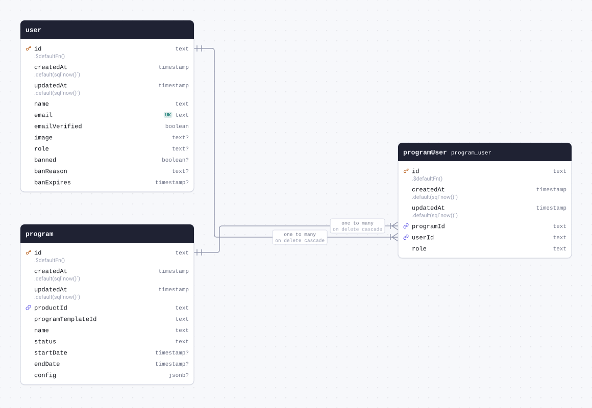

| Column                     | Type        | Constraints                             | Default                  | Description |
| -------------------------- | ----------- | --------------------------------------- | ------------------------ | ----------- |
| `id`                       | `text`      | PK NOT NULL                             | `.$defaultFn()`          |             |
| `createdAt` (`created_at`) | `timestamp` | NOT NULL                                | ``.default(sql`now()`)`` |             |
| `updatedAt` (`updated_at`) | `timestamp` | NOT NULL                                | ``.default(sql`now()`)`` |             |
| `programId` (`program_id`) | `text`      | NOT NULL → [program.id](#table-program) |                          |             |
| `userId` (`user_id`)       | `text`      | NOT NULL → [user.id](#table-user)       |                          |             |
| `role`                     | `text`      | NOT NULL                                |                          |             |

#### Definition

```sql
CREATE TABLE "program_user" (
	"id" text PRIMARY KEY,
	"created_at" timestamp DEFAULT now() NOT NULL,
	"updated_at" timestamp DEFAULT now() NOT NULL,
	"program_id" text NOT NULL,
	"user_id" text NOT NULL,
	"role" text NOT NULL
);

ALTER TABLE "program_user" ADD CONSTRAINT "program_user_program_id_program_id_fkey" FOREIGN KEY ("program_id") REFERENCES "program"("id") ON DELETE CASCADE;

ALTER TABLE "program_user" ADD CONSTRAINT "program_user_user_id_user_id_fkey" FOREIGN KEY ("user_id") REFERENCES "user"("id") ON DELETE CASCADE;
```

#### References

- `programId` → [program.id](#table-program) (many to one, on delete cascade)
- `userId` → [user.id](#table-user) (many to one, on delete cascade)

<details>
<summary>Queries and their SQL</summary>

**Select**: Every row of programUser.

```ts
db.select().from(programUser);
```

```sql
select "id", "created_at", "updated_at", "program_id", "user_id", "role"
from "program_user"
```

**Count**: How many rows programUser has.

```ts
db.select({ count: count() }).from(programUser);
```

```sql
select count(*)
from "program_user"
```

**Find many**: The rows of programUser, through the relational query API.

```ts
db.query.programUser.findMany();
```

```sql
select "d0"."id" as "id", "d0"."created_at" as "createdAt", "d0"."updated_at" as "updatedAt", "d0"."program_id" as "programId", "d0"."user_id" as "userId", "d0"."role" as "role"
from "program_user" as "d0"
```

**Find by primary key**: One row of programUser, through the relational query API.

```ts
db.query.programUser.findFirst({ where: { id: "id" } });
```

```sql
select "d0"."id" as "id", "d0"."created_at" as "createdAt", "d0"."updated_at" as "updatedAt", "d0"."program_id" as "programId", "d0"."user_id" as "userId", "d0"."role" as "role"
from "program_user" as "d0"
where "d0"."id" = $1
limit $2
-- params: ["id",1]
```

**Insert**: Adds a row to programUser, giving the columns that have no default.

```ts
db.insert(programUser).values({ programId: "programId", userId: "userId", role: "role" });
```

```sql
insert into "program_user" ("id", "created_at", "updated_at", "program_id", "user_id", "role")
values ($1, default, default, $2, $3, $4)
-- params: ["pru_njoatfxs8jsd7978busp10j4","programId","userId","role"]
```

**Update**: Changes a row of programUser, found by its primary key.

```ts
db.update(programUser)
  .set({ createdAt: new Date("2026-01-01T00:00:00.000Z") })
  .where(eq(programUser.id, "id"));
```

```sql
update "program_user"
set "created_at" = $1
where "program_user"."id" = $2
-- params: ["2026-01-01T00:00:00.000Z","id"]
```

**Delete**: Deletes a row of programUser, found by its primary key.

```ts
db.delete(programUser).where(eq(programUser.id, "id"));
```

```sql
delete from "program_user"
where "program_user"."id" = $1
-- params: ["id"]
```

</details>

<a id="table-eventDefinition"></a>

### eventDefinition

Table `event_definition`.

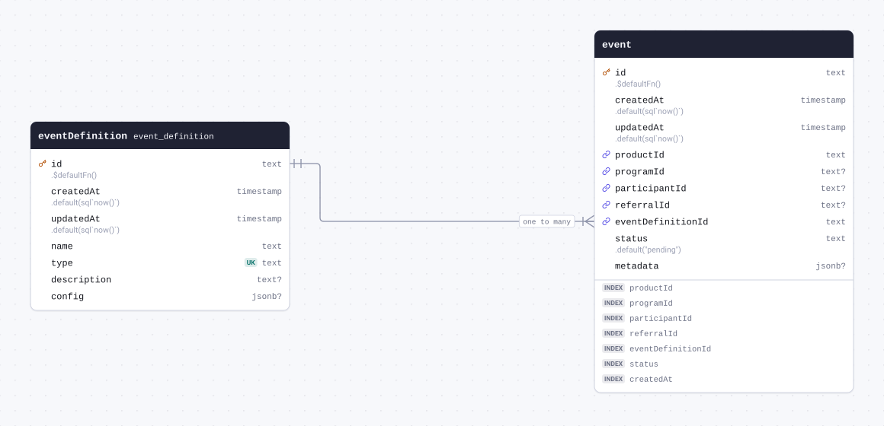

| Column                     | Type        | Constraints     | Default                  | Description |
| -------------------------- | ----------- | --------------- | ------------------------ | ----------- |
| `id`                       | `text`      | PK NOT NULL     | `.$defaultFn()`          |             |
| `createdAt` (`created_at`) | `timestamp` | NOT NULL        | ``.default(sql`now()`)`` |             |
| `updatedAt` (`updated_at`) | `timestamp` | NOT NULL        | ``.default(sql`now()`)`` |             |
| `name`                     | `text`      | NOT NULL        |                          |             |
| `type`                     | `text`      | UNIQUE NOT NULL |                          |             |
| `description`              | `text`      | NULL            |                          |             |
| `config`                   | `jsonb`     | NULL            |                          |             |

#### Definition

```sql
CREATE TABLE "event_definition" (
	"id" text PRIMARY KEY,
	"created_at" timestamp DEFAULT now() NOT NULL,
	"updated_at" timestamp DEFAULT now() NOT NULL,
	"name" text NOT NULL,
	"type" text NOT NULL UNIQUE,
	"description" text,
	"config" jsonb
);
```

#### Referenced by

- `id` → [event.eventDefinitionId](#table-event) (one to many)

<details>
<summary>Queries and their SQL</summary>

**Select**: Every row of eventDefinition.

```ts
db.select().from(eventDefinition);
```

```sql
select "id", "created_at", "updated_at", "name", "type", "description", "config"
from "event_definition"
```

**Count**: How many rows eventDefinition has.

```ts
db.select({ count: count() }).from(eventDefinition);
```

```sql
select count(*)
from "event_definition"
```

**Find many**: The rows of eventDefinition, through the relational query API.

```ts
db.query.eventDefinition.findMany();
```

```sql
select "d0"."id" as "id", "d0"."created_at" as "createdAt", "d0"."updated_at" as "updatedAt", "d0"."name" as "name", "d0"."type" as "type", "d0"."description" as "description", "d0"."config" as "config"
from "event_definition" as "d0"
```

**Find by primary key**: One row of eventDefinition, through the relational query API.

```ts
db.query.eventDefinition.findFirst({ where: { id: "id" } });
```

```sql
select "d0"."id" as "id", "d0"."created_at" as "createdAt", "d0"."updated_at" as "updatedAt", "d0"."name" as "name", "d0"."type" as "type", "d0"."description" as "description", "d0"."config" as "config"
from "event_definition" as "d0"
where "d0"."id" = $1
limit $2
-- params: ["id",1]
```

**Insert**: Adds a row to eventDefinition, giving the columns that have no default.

```ts
db.insert(eventDefinition).values({ name: "name", type: "type" });
```

```sql
insert into "event_definition" ("id", "created_at", "updated_at", "name", "type", "description", "config")
values ($1, default, default, $2, $3, default, default)
-- params: ["evd_nsr4iqmxzqrr22koldpf3v7i","name","type"]
```

**Update**: Changes a row of eventDefinition, found by its primary key.

```ts
db.update(eventDefinition)
  .set({ createdAt: new Date("2026-01-01T00:00:00.000Z") })
  .where(eq(eventDefinition.id, "id"));
```

```sql
update "event_definition"
set "created_at" = $1
where "event_definition"."id" = $2
-- params: ["2026-01-01T00:00:00.000Z","id"]
```

**Delete**: Deletes a row of eventDefinition, found by its primary key.

```ts
db.delete(eventDefinition).where(eq(eventDefinition.id, "id"));
```

```sql
delete from "event_definition"
where "event_definition"."id" = $1
-- params: ["id"]
```

</details>

<a id="table-participant"></a>

### participant

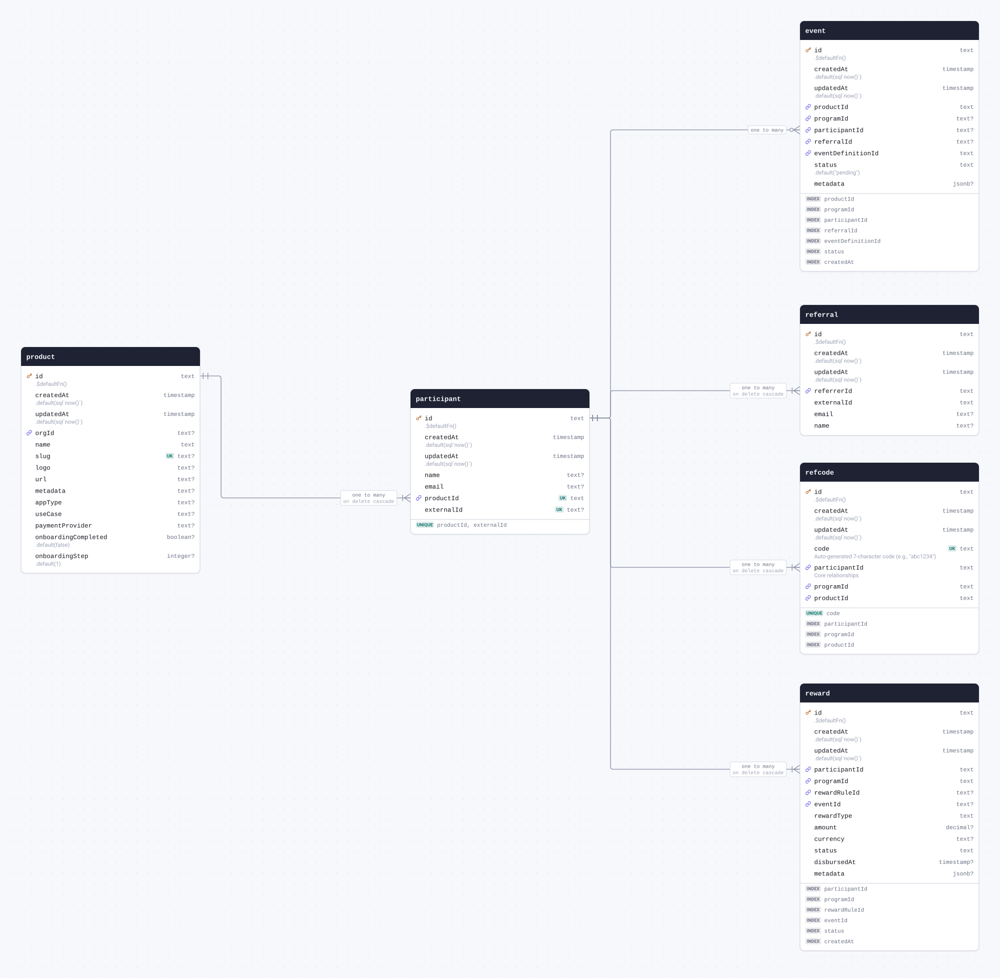

| Column                       | Type        | Constraints                             | Default                  | Description |
| ---------------------------- | ----------- | --------------------------------------- | ------------------------ | ----------- |
| `id`                         | `text`      | PK NOT NULL                             | `.$defaultFn()`          |             |
| `createdAt` (`created_at`)   | `timestamp` | NOT NULL                                | ``.default(sql`now()`)`` |             |
| `updatedAt` (`updated_at`)   | `timestamp` | NOT NULL                                | ``.default(sql`now()`)`` |             |
| `name`                       | `text`      | NULL                                    |                          |             |
| `email`                      | `text`      | NULL                                    |                          |             |
| `productId` (`product_id`)   | `text`      | NOT NULL → [product.id](#table-product) |                          |             |
| `externalId` (`external_id`) | `text`      | NULL                                    |                          |             |

#### Definition

```sql
CREATE TABLE "participant" (
	"id" text PRIMARY KEY,
	"created_at" timestamp DEFAULT now() NOT NULL,
	"updated_at" timestamp DEFAULT now() NOT NULL,
	"name" text,
	"email" text,
	"product_id" text NOT NULL,
	"external_id" text,
	CONSTRAINT "participant_product_id_external_id_unique" UNIQUE("product_id","external_id")
);

ALTER TABLE "participant" ADD CONSTRAINT "participant_product_id_product_id_fkey" FOREIGN KEY ("product_id") REFERENCES "product"("id") ON DELETE CASCADE;
```

#### Indexes

- UNIQUE `productId`, `externalId`

#### References

- `productId` → [product.id](#table-product) (many to one, on delete cascade)

#### Referenced by

- `id` → [reward.participantId](#table-reward) (one to many, on delete cascade)
- `id` → [refcode.participantId](#table-refcode) (one to many, on delete cascade)
- `id` → [referral.referrerId](#table-referral) (one to many, on delete cascade)
- `id` → [event.participantId](#table-event) (one to many)

<details>
<summary>Queries and their SQL</summary>

**Select**: Every row of participant.

```ts
db.select().from(participant);
```

```sql
select "id", "created_at", "updated_at", "name", "email", "product_id", "external_id"
from "participant"
```

**Count**: How many rows participant has.

```ts
db.select({ count: count() }).from(participant);
```

```sql
select count(*)
from "participant"
```

**Find many**: The rows of participant, through the relational query API.

```ts
db.query.participant.findMany();
```

```sql
select "d0"."id" as "id", "d0"."created_at" as "createdAt", "d0"."updated_at" as "updatedAt", "d0"."name" as "name", "d0"."email" as "email", "d0"."product_id" as "productId", "d0"."external_id" as "externalId"
from "participant" as "d0"
```

**Find by primary key**: One row of participant, through the relational query API.

```ts
db.query.participant.findFirst({ where: { id: "id" } });
```

```sql
select "d0"."id" as "id", "d0"."created_at" as "createdAt", "d0"."updated_at" as "updatedAt", "d0"."name" as "name", "d0"."email" as "email", "d0"."product_id" as "productId", "d0"."external_id" as "externalId"
from "participant" as "d0"
where "d0"."id" = $1
limit $2
-- params: ["id",1]
```

**Insert**: Adds a row to participant, giving the columns that have no default.

```ts
db.insert(participant).values({ productId: "productId" });
```

```sql
insert into "participant" ("id", "created_at", "updated_at", "name", "email", "product_id", "external_id")
values ($1, default, default, default, default, $2, default)
-- params: ["prt_nzgw63lrpmz896bpyyox473g","productId"]
```

**Update**: Changes a row of participant, found by its primary key.

```ts
db.update(participant)
  .set({ createdAt: new Date("2026-01-01T00:00:00.000Z") })
  .where(eq(participant.id, "id"));
```

```sql
update "participant"
set "created_at" = $1
where "participant"."id" = $2
-- params: ["2026-01-01T00:00:00.000Z","id"]
```

**Delete**: Deletes a row of participant, found by its primary key.

```ts
db.delete(participant).where(eq(participant.id, "id"));
```

```sql
delete from "participant"
where "participant"."id" = $1
-- params: ["id"]
```

</details>

<a id="table-rewardRule"></a>

### rewardRule

Table `reward_rule`.

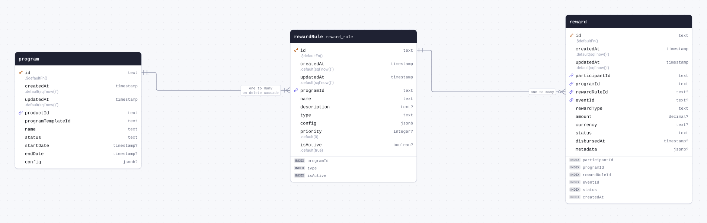

| Column                     | Type        | Constraints                             | Default                  | Description |
| -------------------------- | ----------- | --------------------------------------- | ------------------------ | ----------- |
| `id`                       | `text`      | PK NOT NULL                             | `.$defaultFn()`          |             |
| `createdAt` (`created_at`) | `timestamp` | NOT NULL                                | ``.default(sql`now()`)`` |             |
| `updatedAt` (`updated_at`) | `timestamp` | NOT NULL                                | ``.default(sql`now()`)`` |             |
| `programId` (`program_id`) | `text`      | NOT NULL → [program.id](#table-program) |                          |             |
| `name`                     | `text`      | NOT NULL                                |                          |             |
| `description`              | `text`      | NULL                                    |                          |             |
| `type`                     | `text`      | NOT NULL                                |                          |             |
| `config`                   | `jsonb`     | NOT NULL                                |                          |             |
| `priority`                 | `integer`   | NULL                                    | `.default(0)`            |             |
| `isActive` (`is_active`)   | `boolean`   | NULL                                    | `.default(true)`         |             |

#### Definition

```sql
CREATE TABLE "reward_rule" (
	"id" text PRIMARY KEY,
	"created_at" timestamp DEFAULT now() NOT NULL,
	"updated_at" timestamp DEFAULT now() NOT NULL,
	"program_id" text NOT NULL,
	"name" text NOT NULL,
	"description" text,
	"type" text NOT NULL,
	"config" jsonb NOT NULL,
	"priority" integer DEFAULT 0,
	"is_active" boolean DEFAULT true
);

CREATE INDEX "reward_rule_program_id_idx" ON "reward_rule" ("program_id");

CREATE INDEX "reward_rule_type_idx" ON "reward_rule" ("type");

CREATE INDEX "reward_rule_is_active_idx" ON "reward_rule" ("is_active");

ALTER TABLE "reward_rule" ADD CONSTRAINT "reward_rule_program_id_program_id_fkey" FOREIGN KEY ("program_id") REFERENCES "program"("id") ON DELETE CASCADE;
```

#### Indexes

- INDEX `programId`
- INDEX `type`
- INDEX `isActive`

#### References

- `programId` → [program.id](#table-program) (many to one, on delete cascade)

#### Referenced by

- `id` → [reward.rewardRuleId](#table-reward) (one to many)

<details>
<summary>Queries and their SQL</summary>

**Select**: Every row of rewardRule.

```ts
db.select().from(rewardRule);
```

```sql
select "id", "created_at", "updated_at", "program_id", "name", "description", "type", "config", "priority", "is_active"
from "reward_rule"
```

**Count**: How many rows rewardRule has.

```ts
db.select({ count: count() }).from(rewardRule);
```

```sql
select count(*)
from "reward_rule"
```

**Find many**: The rows of rewardRule, through the relational query API.

```ts
db.query.rewardRule.findMany();
```

```sql
select "d0"."id" as "id", "d0"."created_at" as "createdAt", "d0"."updated_at" as "updatedAt", "d0"."program_id" as "programId", "d0"."name" as "name", "d0"."description" as "description", "d0"."type" as "type", "d0"."config" as "config", "d0"."priority" as "priority", "d0"."is_active" as "isActive"
from "reward_rule" as "d0"
```

**Find by primary key**: One row of rewardRule, through the relational query API.

```ts
db.query.rewardRule.findFirst({ where: { id: "id" } });
```

```sql
select "d0"."id" as "id", "d0"."created_at" as "createdAt", "d0"."updated_at" as "updatedAt", "d0"."program_id" as "programId", "d0"."name" as "name", "d0"."description" as "description", "d0"."type" as "type", "d0"."config" as "config", "d0"."priority" as "priority", "d0"."is_active" as "isActive"
from "reward_rule" as "d0"
where "d0"."id" = $1
limit $2
-- params: ["id",1]
```

**Insert**: Adds a row to rewardRule, giving the columns that have no default.

```ts
db.insert(rewardRule).values({ programId: "programId", name: "name", type: "type", config: {} });
```

```sql
insert into "reward_rule" ("id", "created_at", "updated_at", "program_id", "name", "description", "type", "config", "priority", "is_active")
values ($1, default, default, $2, $3, default, $4, $5, default, default)
-- params: ["rwr_nh5qkfioyyosxtnl1a8d6ckh","programId","name","type",{}]
```

**Update**: Changes a row of rewardRule, found by its primary key.

```ts
db.update(rewardRule)
  .set({ createdAt: new Date("2026-01-01T00:00:00.000Z") })
  .where(eq(rewardRule.id, "id"));
```

```sql
update "reward_rule"
set "created_at" = $1
where "reward_rule"."id" = $2
-- params: ["2026-01-01T00:00:00.000Z","id"]
```

**Delete**: Deletes a row of rewardRule, found by its primary key.

```ts
db.delete(rewardRule).where(eq(rewardRule.id, "id"));
```

```sql
delete from "reward_rule"
where "reward_rule"."id" = $1
-- params: ["id"]
```

</details>

<a id="table-reward"></a>

### reward

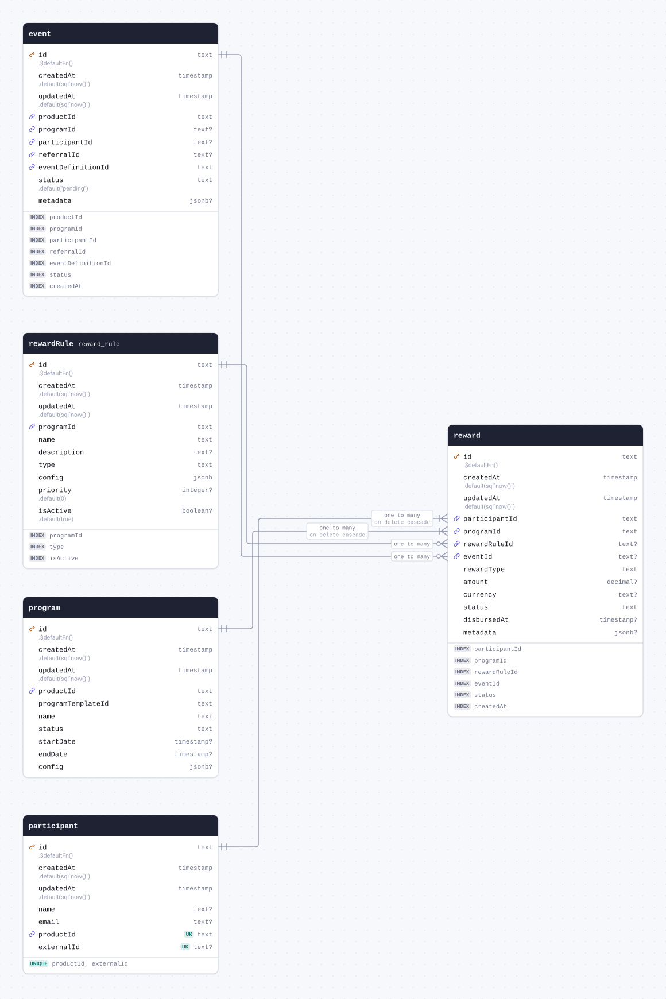

| Column                             | Type        | Constraints                                     | Default                  | Description |
| ---------------------------------- | ----------- | ----------------------------------------------- | ------------------------ | ----------- |
| `id`                               | `text`      | PK NOT NULL                                     | `.$defaultFn()`          |             |
| `createdAt` (`created_at`)         | `timestamp` | NOT NULL                                        | ``.default(sql`now()`)`` |             |
| `updatedAt` (`updated_at`)         | `timestamp` | NOT NULL                                        | ``.default(sql`now()`)`` |             |
| `participantId` (`participant_id`) | `text`      | NOT NULL → [participant.id](#table-participant) |                          |             |
| `programId` (`program_id`)         | `text`      | NOT NULL → [program.id](#table-program)         |                          |             |
| `rewardRuleId` (`reward_rule_id`)  | `text`      | NULL → [rewardRule.id](#table-rewardRule)       |                          |             |
| `eventId` (`event_id`)             | `text`      | NULL → [event.id](#table-event)                 |                          |             |
| `rewardType` (`reward_type`)       | `text`      | NOT NULL                                        |                          |             |
| `amount`                           | `decimal`   | NULL                                            |                          |             |
| `currency`                         | `text`      | NULL                                            |                          |             |
| `status`                           | `text`      | NOT NULL                                        |                          |             |
| `disbursedAt` (`disbursed_at`)     | `timestamp` | NULL                                            |                          |             |
| `metadata`                         | `jsonb`     | NULL                                            |                          |             |

#### Definition

```sql
CREATE TABLE "reward" (
	"id" text PRIMARY KEY,
	"created_at" timestamp DEFAULT now() NOT NULL,
	"updated_at" timestamp DEFAULT now() NOT NULL,
	"participant_id" text NOT NULL,
	"program_id" text NOT NULL,
	"reward_rule_id" text,
	"event_id" text,
	"reward_type" text NOT NULL,
	"amount" numeric(10,2),
	"currency" text,
	"status" text NOT NULL,
	"disbursed_at" timestamp,
	"metadata" jsonb
);

CREATE INDEX "reward_participant_id_idx" ON "reward" ("participant_id");

CREATE INDEX "reward_program_id_idx" ON "reward" ("program_id");

CREATE INDEX "reward_rule_id_idx" ON "reward" ("reward_rule_id");

CREATE INDEX "reward_event_id_idx" ON "reward" ("event_id");

CREATE INDEX "reward_status_idx" ON "reward" ("status");

CREATE INDEX "reward_created_at_idx" ON "reward" ("created_at");

ALTER TABLE "reward" ADD CONSTRAINT "reward_participant_id_participant_id_fkey" FOREIGN KEY ("participant_id") REFERENCES "participant"("id") ON DELETE CASCADE;

ALTER TABLE "reward" ADD CONSTRAINT "reward_program_id_program_id_fkey" FOREIGN KEY ("program_id") REFERENCES "program"("id") ON DELETE CASCADE;

ALTER TABLE "reward" ADD CONSTRAINT "reward_reward_rule_id_reward_rule_id_fkey" FOREIGN KEY ("reward_rule_id") REFERENCES "reward_rule"("id");

ALTER TABLE "reward" ADD CONSTRAINT "reward_event_id_event_id_fkey" FOREIGN KEY ("event_id") REFERENCES "event"("id");
```

#### Indexes

- INDEX `participantId`
- INDEX `programId`
- INDEX `rewardRuleId`
- INDEX `eventId`
- INDEX `status`
- INDEX `createdAt`

#### References

- `participantId` → [participant.id](#table-participant) (many to one, on delete cascade)
- `programId` → [program.id](#table-program) (many to one, on delete cascade)
- `rewardRuleId` → [rewardRule.id](#table-rewardRule) (many to one)
- `eventId` → [event.id](#table-event) (many to one)

<details>
<summary>Queries and their SQL</summary>

**Select**: Every row of reward.

```ts
db.select().from(reward);
```

```sql
select "id", "created_at", "updated_at", "participant_id", "program_id", "reward_rule_id", "event_id", "reward_type", "amount", "currency", "status", "disbursed_at", "metadata"
from "reward"
```

**Count**: How many rows reward has.

```ts
db.select({ count: count() }).from(reward);
```

```sql
select count(*)
from "reward"
```

**Find many**: The rows of reward, through the relational query API.

```ts
db.query.reward.findMany();
```

```sql
select "d0"."id" as "id", "d0"."created_at" as "createdAt", "d0"."updated_at" as "updatedAt", "d0"."participant_id" as "participantId", "d0"."program_id" as "programId", "d0"."reward_rule_id" as "rewardRuleId", "d0"."event_id" as "eventId", "d0"."reward_type" as "rewardType", "d0"."amount" as "amount", "d0"."currency" as "currency", "d0"."status" as "status", "d0"."disbursed_at" as "disbursedAt", "d0"."metadata" as "metadata"
from "reward" as "d0"
```

**Find by primary key**: One row of reward, through the relational query API.

```ts
db.query.reward.findFirst({ where: { id: "id" } });
```

```sql
select "d0"."id" as "id", "d0"."created_at" as "createdAt", "d0"."updated_at" as "updatedAt", "d0"."participant_id" as "participantId", "d0"."program_id" as "programId", "d0"."reward_rule_id" as "rewardRuleId", "d0"."event_id" as "eventId", "d0"."reward_type" as "rewardType", "d0"."amount" as "amount", "d0"."currency" as "currency", "d0"."status" as "status", "d0"."disbursed_at" as "disbursedAt", "d0"."metadata" as "metadata"
from "reward" as "d0"
where "d0"."id" = $1
limit $2
-- params: ["id",1]
```

**Insert**: Adds a row to reward, giving the columns that have no default.

```ts
db.insert(reward).values({
  participantId: "participantId",
  programId: "programId",
  rewardType: "rewardType",
  status: "status",
});
```

```sql
insert into "reward" ("id", "created_at", "updated_at", "participant_id", "program_id", "reward_rule_id", "event_id", "reward_type", "amount", "currency", "status", "disbursed_at", "metadata")
values ($1, default, default, $2, $3, default, default, $4, default, default, $5, default, default)
-- params: ["rwd_nqgth1wqk97w853obgmhtgwf","participantId","programId","rewardType","status"]
```

**Update**: Changes a row of reward, found by its primary key.

```ts
db.update(reward)
  .set({ createdAt: new Date("2026-01-01T00:00:00.000Z") })
  .where(eq(reward.id, "id"));
```

```sql
update "reward"
set "created_at" = $1
where "reward"."id" = $2
-- params: ["2026-01-01T00:00:00.000Z","id"]
```

**Delete**: Deletes a row of reward, found by its primary key.

```ts
db.delete(reward).where(eq(reward.id, "id"));
```

```sql
delete from "reward"
where "reward"."id" = $1
-- params: ["id"]
```

</details>

<a id="table-productSecrets"></a>

### productSecrets

Table `product_secret`. Product secrets for JWT generation

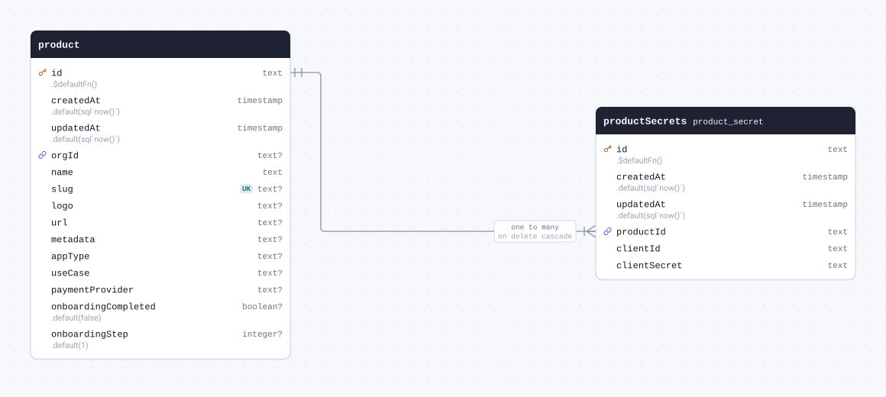

| Column                           | Type        | Constraints                             | Default                  | Description |
| -------------------------------- | ----------- | --------------------------------------- | ------------------------ | ----------- |
| `id`                             | `text`      | PK NOT NULL                             | `.$defaultFn()`          |             |
| `createdAt` (`created_at`)       | `timestamp` | NOT NULL                                | ``.default(sql`now()`)`` |             |
| `updatedAt` (`updated_at`)       | `timestamp` | NOT NULL                                | ``.default(sql`now()`)`` |             |
| `productId` (`product_id`)       | `text`      | NOT NULL → [product.id](#table-product) |                          |             |
| `clientId` (`client_id`)         | `text`      | NOT NULL                                |                          |             |
| `clientSecret` (`client_secret`) | `text`      | NOT NULL                                |                          |             |

#### Definition

```sql
CREATE TABLE "product_secret" (
	"id" text PRIMARY KEY,
	"created_at" timestamp DEFAULT now() NOT NULL,
	"updated_at" timestamp DEFAULT now() NOT NULL,
	"product_id" text NOT NULL,
	"client_id" text NOT NULL,
	"client_secret" text NOT NULL
);

ALTER TABLE "product_secret" ADD CONSTRAINT "product_secret_product_id_product_id_fkey" FOREIGN KEY ("product_id") REFERENCES "product"("id") ON DELETE CASCADE;
```

#### References

- `productId` → [product.id](#table-product) (many to one, on delete cascade)

<details>
<summary>Queries and their SQL</summary>

**Select**: Every row of productSecrets.

```ts
db.select().from(productSecrets);
```

```sql
select "id", "created_at", "updated_at", "product_id", "client_id", "client_secret"
from "product_secret"
```

**Count**: How many rows productSecrets has.

```ts
db.select({ count: count() }).from(productSecrets);
```

```sql
select count(*)
from "product_secret"
```

**Find many**: The rows of productSecrets, through the relational query API.

```ts
db.query.productSecrets.findMany();
```

```sql
select "d0"."id" as "id", "d0"."created_at" as "createdAt", "d0"."updated_at" as "updatedAt", "d0"."product_id" as "productId", "d0"."client_id" as "clientId", "d0"."client_secret" as "clientSecret"
from "product_secret" as "d0"
```

**Find by primary key**: One row of productSecrets, through the relational query API.

```ts
db.query.productSecrets.findFirst({ where: { id: "id" } });
```

```sql
select "d0"."id" as "id", "d0"."created_at" as "createdAt", "d0"."updated_at" as "updatedAt", "d0"."product_id" as "productId", "d0"."client_id" as "clientId", "d0"."client_secret" as "clientSecret"
from "product_secret" as "d0"
where "d0"."id" = $1
limit $2
-- params: ["id",1]
```

**Insert**: Adds a row to productSecrets, giving the columns that have no default.

```ts
db.insert(productSecrets).values({
  productId: "productId",
  clientId: "clientId",
  clientSecret: "clientSecret",
});
```

```sql
insert into "product_secret" ("id", "created_at", "updated_at", "product_id", "client_id", "client_secret")
values ($1, default, default, $2, $3, $4)
-- params: ["psec_nivaepnlmxi26a8t1haq95hx","productId","clientId","clientSecret"]
```

**Update**: Changes a row of productSecrets, found by its primary key.

```ts
db.update(productSecrets)
  .set({ createdAt: new Date("2026-01-01T00:00:00.000Z") })
  .where(eq(productSecrets.id, "id"));
```

```sql
update "product_secret"
set "created_at" = $1
where "product_secret"."id" = $2
-- params: ["2026-01-01T00:00:00.000Z","id"]
```

**Delete**: Deletes a row of productSecrets, found by its primary key.

```ts
db.delete(productSecrets).where(eq(productSecrets.id, "id"));
```

```sql
delete from "product_secret"
where "product_secret"."id" = $1
-- params: ["id"]
```

</details>

<a id="table-refcode"></a>

### refcode

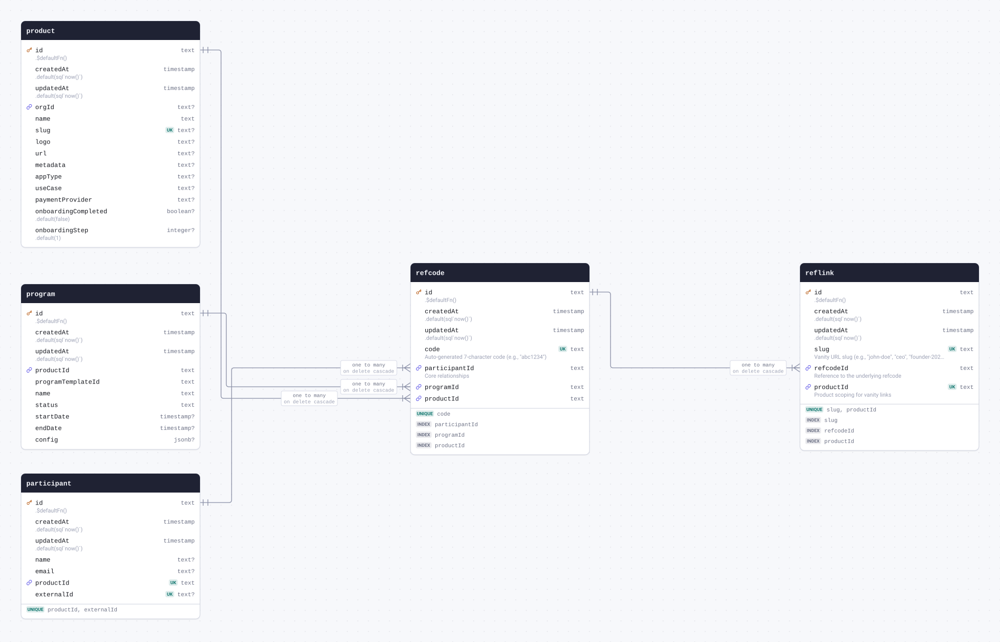

| Column                             | Type        | Constraints                                     | Default                  | Description                                       |
| ---------------------------------- | ----------- | ----------------------------------------------- | ------------------------ | ------------------------------------------------- |
| `id`                               | `text`      | PK NOT NULL                                     | `.$defaultFn()`          |                                                   |
| `createdAt` (`created_at`)         | `timestamp` | NOT NULL                                        | ``.default(sql`now()`)`` |                                                   |
| `updatedAt` (`updated_at`)         | `timestamp` | NOT NULL                                        | ``.default(sql`now()`)`` |                                                   |
| `code`                             | `text`      | NOT NULL                                        |                          | Auto-generated 7-character code (e.g., "abc1234") |
| `participantId` (`participant_id`) | `text`      | NOT NULL → [participant.id](#table-participant) |                          | Core relationships                                |
| `programId` (`program_id`)         | `text`      | NOT NULL → [program.id](#table-program)         |                          |                                                   |
| `productId` (`product_id`)         | `text`      | NOT NULL → [product.id](#table-product)         |                          |                                                   |

#### Definition

```sql
CREATE TABLE "refcode" (
	"id" text PRIMARY KEY,
	"created_at" timestamp DEFAULT now() NOT NULL,
	"updated_at" timestamp DEFAULT now() NOT NULL,
	"code" text NOT NULL,
	"participant_id" text NOT NULL,
	"program_id" text NOT NULL,
	"product_id" text NOT NULL
);

CREATE UNIQUE INDEX "refcode_code_unique_idx" ON "refcode" ("code");

CREATE INDEX "refcode_participant_id_idx" ON "refcode" ("participant_id");

CREATE INDEX "refcode_program_id_idx" ON "refcode" ("program_id");

CREATE INDEX "refcode_product_id_idx" ON "refcode" ("product_id");

ALTER TABLE "refcode" ADD CONSTRAINT "refcode_participant_id_participant_id_fkey" FOREIGN KEY ("participant_id") REFERENCES "participant"("id") ON DELETE CASCADE;

ALTER TABLE "refcode" ADD CONSTRAINT "refcode_program_id_program_id_fkey" FOREIGN KEY ("program_id") REFERENCES "program"("id") ON DELETE CASCADE;

ALTER TABLE "refcode" ADD CONSTRAINT "refcode_product_id_product_id_fkey" FOREIGN KEY ("product_id") REFERENCES "product"("id") ON DELETE CASCADE;
```

#### Indexes

- UNIQUE `code`
- INDEX `participantId`
- INDEX `programId`
- INDEX `productId`

#### References

- `participantId` → [participant.id](#table-participant) (many to one, on delete cascade)
- `programId` → [program.id](#table-program) (many to one, on delete cascade)
- `productId` → [product.id](#table-product) (many to one, on delete cascade)

#### Referenced by

- `id` → [reflink.refcodeId](#table-reflink) (one to many, on delete cascade)

<details>
<summary>Queries and their SQL</summary>

**Select**: Every row of refcode.

```ts
db.select().from(refcode);
```

```sql
select "id", "created_at", "updated_at", "code", "participant_id", "program_id", "product_id"
from "refcode"
```

**Count**: How many rows refcode has.

```ts
db.select({ count: count() }).from(refcode);
```

```sql
select count(*)
from "refcode"
```

**Find many**: The rows of refcode, through the relational query API.

```ts
db.query.refcode.findMany();
```

```sql
select "d0"."id" as "id", "d0"."created_at" as "createdAt", "d0"."updated_at" as "updatedAt", "d0"."code" as "code", "d0"."participant_id" as "participantId", "d0"."program_id" as "programId", "d0"."product_id" as "productId"
from "refcode" as "d0"
```

**Find by primary key**: One row of refcode, through the relational query API.

```ts
db.query.refcode.findFirst({ where: { id: "id" } });
```

```sql
select "d0"."id" as "id", "d0"."created_at" as "createdAt", "d0"."updated_at" as "updatedAt", "d0"."code" as "code", "d0"."participant_id" as "participantId", "d0"."program_id" as "programId", "d0"."product_id" as "productId"
from "refcode" as "d0"
where "d0"."id" = $1
limit $2
-- params: ["id",1]
```

**Insert**: Adds a row to refcode, giving the columns that have no default.

```ts
db.insert(refcode).values({
  code: "code",
  participantId: "participantId",
  programId: "programId",
  productId: "productId",
});
```

```sql
insert into "refcode" ("id", "created_at", "updated_at", "code", "participant_id", "program_id", "product_id")
values ($1, default, default, $2, $3, $4, $5)
-- params: ["rc_nkolejm3bfwvr2w8icwme1h5","code","participantId","programId","productId"]
```

**Update**: Changes a row of refcode, found by its primary key.

```ts
db.update(refcode)
  .set({ createdAt: new Date("2026-01-01T00:00:00.000Z") })
  .where(eq(refcode.id, "id"));
```

```sql
update "refcode"
set "created_at" = $1
where "refcode"."id" = $2
-- params: ["2026-01-01T00:00:00.000Z","id"]
```

**Delete**: Deletes a row of refcode, found by its primary key.

```ts
db.delete(refcode).where(eq(refcode.id, "id"));
```

```sql
delete from "refcode"
where "refcode"."id" = $1
-- params: ["id"]
```

</details>

<a id="table-reflink"></a>

### reflink

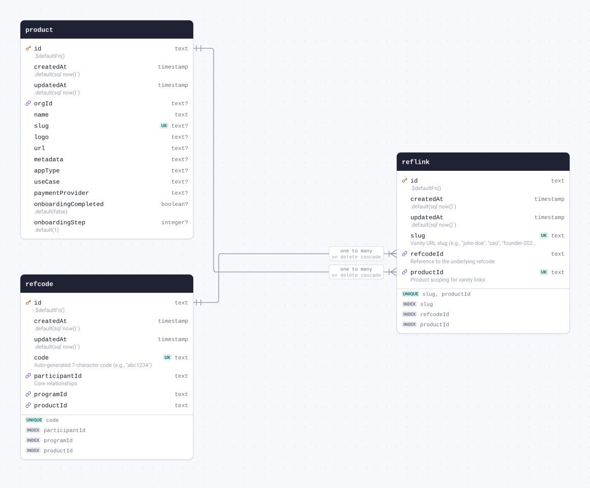

| Column                     | Type        | Constraints                             | Default                  | Description                                               |
| -------------------------- | ----------- | --------------------------------------- | ------------------------ | --------------------------------------------------------- |
| `id`                       | `text`      | PK NOT NULL                             | `.$defaultFn()`          |                                                           |
| `createdAt` (`created_at`) | `timestamp` | NOT NULL                                | ``.default(sql`now()`)`` |                                                           |
| `updatedAt` (`updated_at`) | `timestamp` | NOT NULL                                | ``.default(sql`now()`)`` |                                                           |
| `slug`                     | `text`      | NOT NULL                                |                          | Vanity URL slug (e.g., "john-doe", "ceo", "founder-2024") |
| `refcodeId` (`refcode_id`) | `text`      | NOT NULL → [refcode.id](#table-refcode) |                          | Reference to the underlying refcode                       |
| `productId` (`product_id`) | `text`      | NOT NULL → [product.id](#table-product) |                          | Product scoping for vanity links                          |

#### Definition

```sql
CREATE TABLE "reflink" (
	"id" text PRIMARY KEY,
	"created_at" timestamp DEFAULT now() NOT NULL,
	"updated_at" timestamp DEFAULT now() NOT NULL,
	"slug" text NOT NULL,
	"refcode_id" text NOT NULL,
	"product_id" text NOT NULL
);

CREATE UNIQUE INDEX "reflink_slug_product_unique_idx" ON "reflink" ("slug","product_id");

CREATE INDEX "reflink_slug_idx" ON "reflink" ("slug");

CREATE INDEX "reflink_refcode_id_idx" ON "reflink" ("refcode_id");

CREATE INDEX "reflink_product_id_idx" ON "reflink" ("product_id");

ALTER TABLE "reflink" ADD CONSTRAINT "reflink_refcode_id_refcode_id_fkey" FOREIGN KEY ("refcode_id") REFERENCES "refcode"("id") ON DELETE CASCADE;

ALTER TABLE "reflink" ADD CONSTRAINT "reflink_product_id_product_id_fkey" FOREIGN KEY ("product_id") REFERENCES "product"("id") ON DELETE CASCADE;
```

#### Indexes

- UNIQUE `slug`, `productId`
- INDEX `slug`
- INDEX `refcodeId`
- INDEX `productId`

#### References

- `refcodeId` → [refcode.id](#table-refcode) (many to one, on delete cascade)
- `productId` → [product.id](#table-product) (many to one, on delete cascade)

<details>
<summary>Queries and their SQL</summary>

**Select**: Every row of reflink.

```ts
db.select().from(reflink);
```

```sql
select "id", "created_at", "updated_at", "slug", "refcode_id", "product_id"
from "reflink"
```

**Count**: How many rows reflink has.

```ts
db.select({ count: count() }).from(reflink);
```

```sql
select count(*)
from "reflink"
```

**Find many**: The rows of reflink, through the relational query API.

```ts
db.query.reflink.findMany();
```

```sql
select "d0"."id" as "id", "d0"."created_at" as "createdAt", "d0"."updated_at" as "updatedAt", "d0"."slug" as "slug", "d0"."refcode_id" as "refcodeId", "d0"."product_id" as "productId"
from "reflink" as "d0"
```

**Find by primary key**: One row of reflink, through the relational query API.

```ts
db.query.reflink.findFirst({ where: { id: "id" } });
```

```sql
select "d0"."id" as "id", "d0"."created_at" as "createdAt", "d0"."updated_at" as "updatedAt", "d0"."slug" as "slug", "d0"."refcode_id" as "refcodeId", "d0"."product_id" as "productId"
from "reflink" as "d0"
where "d0"."id" = $1
limit $2
-- params: ["id",1]
```

**Insert**: Adds a row to reflink, giving the columns that have no default.

```ts
db.insert(reflink).values({ slug: "slug", refcodeId: "refcodeId", productId: "productId" });
```

```sql
insert into "reflink" ("id", "created_at", "updated_at", "slug", "refcode_id", "product_id")
values ($1, default, default, $2, $3, $4)
-- params: ["rl_nngoyw6lv3vks7022lnrehte","slug","refcodeId","productId"]
```

**Update**: Changes a row of reflink, found by its primary key.

```ts
db.update(reflink)
  .set({ createdAt: new Date("2026-01-01T00:00:00.000Z") })
  .where(eq(reflink.id, "id"));
```

```sql
update "reflink"
set "created_at" = $1
where "reflink"."id" = $2
-- params: ["2026-01-01T00:00:00.000Z","id"]
```

**Delete**: Deletes a row of reflink, found by its primary key.

```ts
db.delete(reflink).where(eq(reflink.id, "id"));
```

```sql
delete from "reflink"
where "reflink"."id" = $1
-- params: ["id"]
```

</details>

<a id="table-referral"></a>

### referral

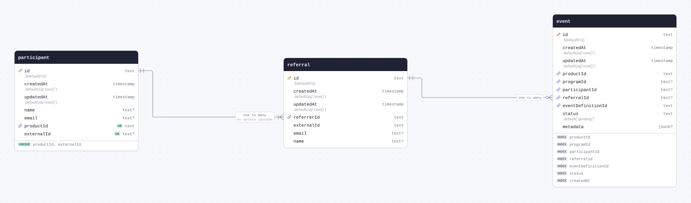

| Column                       | Type        | Constraints                                     | Default                  | Description |
| ---------------------------- | ----------- | ----------------------------------------------- | ------------------------ | ----------- |
| `id`                         | `text`      | PK NOT NULL                                     | `.$defaultFn()`          |             |
| `createdAt` (`created_at`)   | `timestamp` | NOT NULL                                        | ``.default(sql`now()`)`` |             |
| `updatedAt` (`updated_at`)   | `timestamp` | NOT NULL                                        | ``.default(sql`now()`)`` |             |
| `referrerId` (`referrer_id`) | `text`      | NOT NULL → [participant.id](#table-participant) |                          |             |
| `externalId` (`external_id`) | `text`      | NOT NULL                                        |                          |             |
| `email`                      | `text`      | NULL                                            |                          |             |
| `name`                       | `text`      | NULL                                            |                          |             |

#### Definition

```sql
CREATE TABLE "referral" (
	"id" text PRIMARY KEY,
	"created_at" timestamp DEFAULT now() NOT NULL,
	"updated_at" timestamp DEFAULT now() NOT NULL,
	"referrer_id" text NOT NULL,
	"external_id" text NOT NULL,
	"email" text,
	"name" text
);

ALTER TABLE "referral" ADD CONSTRAINT "referral_referrer_id_participant_id_fkey" FOREIGN KEY ("referrer_id") REFERENCES "participant"("id") ON DELETE CASCADE;
```

#### References

- `referrerId` → [participant.id](#table-participant) (many to one, on delete cascade)

#### Referenced by

- `id` → [event.referralId](#table-event) (one to many)

<details>
<summary>Queries and their SQL</summary>

**Select**: Every row of referral.

```ts
db.select().from(referral);
```

```sql
select "id", "created_at", "updated_at", "referrer_id", "external_id", "email", "name"
from "referral"
```

**Count**: How many rows referral has.

```ts
db.select({ count: count() }).from(referral);
```

```sql
select count(*)
from "referral"
```

**Find many**: The rows of referral, through the relational query API.

```ts
db.query.referral.findMany();
```

```sql
select "d0"."id" as "id", "d0"."created_at" as "createdAt", "d0"."updated_at" as "updatedAt", "d0"."referrer_id" as "referrerId", "d0"."external_id" as "externalId", "d0"."email" as "email", "d0"."name" as "name"
from "referral" as "d0"
```

**Find by primary key**: One row of referral, through the relational query API.

```ts
db.query.referral.findFirst({ where: { id: "id" } });
```

```sql
select "d0"."id" as "id", "d0"."created_at" as "createdAt", "d0"."updated_at" as "updatedAt", "d0"."referrer_id" as "referrerId", "d0"."external_id" as "externalId", "d0"."email" as "email", "d0"."name" as "name"
from "referral" as "d0"
where "d0"."id" = $1
limit $2
-- params: ["id",1]
```

**Insert**: Adds a row to referral, giving the columns that have no default.

```ts
db.insert(referral).values({ referrerId: "referrerId", externalId: "externalId" });
```

```sql
insert into "referral" ("id", "created_at", "updated_at", "referrer_id", "external_id", "email", "name")
values ($1, default, default, $2, $3, default, default)
-- params: ["ref_n7gpwda76pjxhdprwuhfxij0","referrerId","externalId"]
```

**Update**: Changes a row of referral, found by its primary key.

```ts
db.update(referral)
  .set({ createdAt: new Date("2026-01-01T00:00:00.000Z") })
  .where(eq(referral.id, "id"));
```

```sql
update "referral"
set "created_at" = $1
where "referral"."id" = $2
-- params: ["2026-01-01T00:00:00.000Z","id"]
```

**Delete**: Deletes a row of referral, found by its primary key.

```ts
db.delete(referral).where(eq(referral.id, "id"));
```

```sql
delete from "referral"
where "referral"."id" = $1
-- params: ["id"]
```

</details>

<a id="table-event"></a>

### event

Event table (moved here to fix forward reference to referral table)

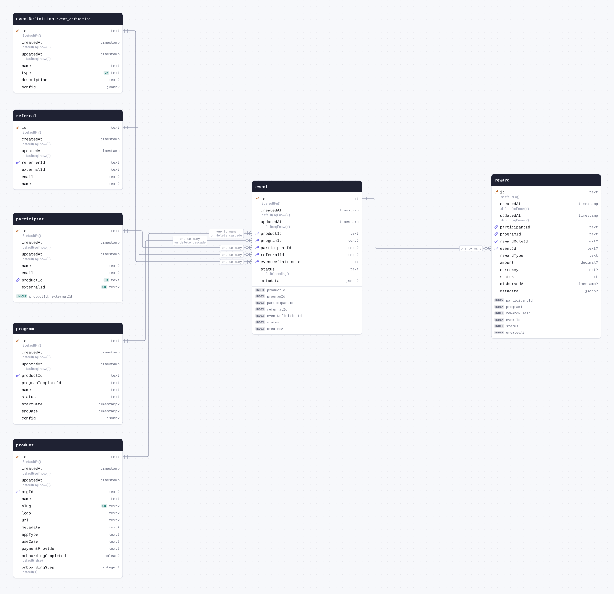

| Column                                      | Type        | Constraints                                             | Default                  | Description |
| ------------------------------------------- | ----------- | ------------------------------------------------------- | ------------------------ | ----------- |
| `id`                                        | `text`      | PK NOT NULL                                             | `.$defaultFn()`          |             |
| `createdAt` (`created_at`)                  | `timestamp` | NOT NULL                                                | ``.default(sql`now()`)`` |             |
| `updatedAt` (`updated_at`)                  | `timestamp` | NOT NULL                                                | ``.default(sql`now()`)`` |             |
| `productId` (`product_id`)                  | `text`      | NOT NULL → [product.id](#table-product)                 |                          |             |
| `programId` (`program_id`)                  | `text`      | NULL → [program.id](#table-program)                     |                          |             |
| `participantId` (`participant_id`)          | `text`      | NULL → [participant.id](#table-participant)             |                          |             |
| `referralId` (`referral_id`)                | `text`      | NULL → [referral.id](#table-referral)                   |                          |             |
| `eventDefinitionId` (`event_definition_id`) | `text`      | NOT NULL → [eventDefinition.id](#table-eventDefinition) |                          |             |
| `status`                                    | `text`      | NOT NULL                                                | `.default("pending")`    |             |
| `metadata`                                  | `jsonb`     | NULL                                                    |                          |             |

#### Definition

```sql
CREATE TABLE "event" (
	"id" text PRIMARY KEY,
	"created_at" timestamp DEFAULT now() NOT NULL,
	"updated_at" timestamp DEFAULT now() NOT NULL,
	"product_id" text NOT NULL,
	"program_id" text,
	"participant_id" text,
	"referral_id" text,
	"event_definition_id" text NOT NULL,
	"status" text DEFAULT 'pending' NOT NULL,
	"metadata" jsonb
);

CREATE INDEX "event_product_id_idx" ON "event" ("product_id");

CREATE INDEX "event_program_id_idx" ON "event" ("program_id");

CREATE INDEX "event_participant_id_idx" ON "event" ("participant_id");

CREATE INDEX "event_referral_id_idx" ON "event" ("referral_id");

CREATE INDEX "event_definition_id_idx" ON "event" ("event_definition_id");

CREATE INDEX "event_status_idx" ON "event" ("status");

CREATE INDEX "event_created_at_idx" ON "event" ("created_at");

ALTER TABLE "event" ADD CONSTRAINT "event_product_id_product_id_fkey" FOREIGN KEY ("product_id") REFERENCES "product"("id") ON DELETE CASCADE;

ALTER TABLE "event" ADD CONSTRAINT "event_program_id_program_id_fkey" FOREIGN KEY ("program_id") REFERENCES "program"("id") ON DELETE CASCADE;

ALTER TABLE "event" ADD CONSTRAINT "event_participant_id_participant_id_fkey" FOREIGN KEY ("participant_id") REFERENCES "participant"("id");

ALTER TABLE "event" ADD CONSTRAINT "event_referral_id_referral_id_fkey" FOREIGN KEY ("referral_id") REFERENCES "referral"("id");

ALTER TABLE "event" ADD CONSTRAINT "event_event_definition_id_event_definition_id_fkey" FOREIGN KEY ("event_definition_id") REFERENCES "event_definition"("id");
```

#### Indexes

- INDEX `productId`
- INDEX `programId`
- INDEX `participantId`
- INDEX `referralId`
- INDEX `eventDefinitionId`
- INDEX `status`
- INDEX `createdAt`

#### References

- `productId` → [product.id](#table-product) (many to one, on delete cascade)
- `programId` → [program.id](#table-program) (many to one, on delete cascade)
- `participantId` → [participant.id](#table-participant) (many to one)
- `referralId` → [referral.id](#table-referral) (many to one)
- `eventDefinitionId` → [eventDefinition.id](#table-eventDefinition) (many to one)

#### Referenced by

- `id` → [reward.eventId](#table-reward) (one to many)

<details>
<summary>Queries and their SQL</summary>

**Select**: Every row of event.

```ts
db.select().from(event);
```

```sql
select "id", "created_at", "updated_at", "product_id", "program_id", "participant_id", "referral_id", "event_definition_id", "status", "metadata"
from "event"
```

**Count**: How many rows event has.

```ts
db.select({ count: count() }).from(event);
```

```sql
select count(*)
from "event"
```

**Find many**: The rows of event, through the relational query API.

```ts
db.query.event.findMany();
```

```sql
select "d0"."id" as "id", "d0"."created_at" as "createdAt", "d0"."updated_at" as "updatedAt", "d0"."product_id" as "productId", "d0"."program_id" as "programId", "d0"."participant_id" as "participantId", "d0"."referral_id" as "referralId", "d0"."event_definition_id" as "eventDefinitionId", "d0"."status" as "status", "d0"."metadata" as "metadata"
from "event" as "d0"
```

**Find by primary key**: One row of event, through the relational query API.

```ts
db.query.event.findFirst({ where: { id: "id" } });
```

```sql
select "d0"."id" as "id", "d0"."created_at" as "createdAt", "d0"."updated_at" as "updatedAt", "d0"."product_id" as "productId", "d0"."program_id" as "programId", "d0"."participant_id" as "participantId", "d0"."referral_id" as "referralId", "d0"."event_definition_id" as "eventDefinitionId", "d0"."status" as "status", "d0"."metadata" as "metadata"
from "event" as "d0"
where "d0"."id" = $1
limit $2
-- params: ["id",1]
```

**Insert**: Adds a row to event, giving the columns that have no default.

```ts
db.insert(event).values({ productId: "productId", eventDefinitionId: "eventDefinitionId" });
```

```sql
insert into "event" ("id", "created_at", "updated_at", "product_id", "program_id", "participant_id", "referral_id", "event_definition_id", "status", "metadata")
values ($1, default, default, $2, default, default, default, $3, default, default)
-- params: ["evt_nz0b3ywd4y4810oyz5pxygy1","productId","eventDefinitionId"]
```

**Update**: Changes a row of event, found by its primary key.

```ts
db.update(event)
  .set({ createdAt: new Date("2026-01-01T00:00:00.000Z") })
  .where(eq(event.id, "id"));
```

```sql
update "event"
set "created_at" = $1
where "event"."id" = $2
-- params: ["2026-01-01T00:00:00.000Z","id"]
```

**Delete**: Deletes a row of event, found by its primary key.

```ts
db.delete(event).where(eq(event.id, "id"));
```

```sql
delete from "event"
where "event"."id" = $1
-- params: ["id"]
```

</details>
