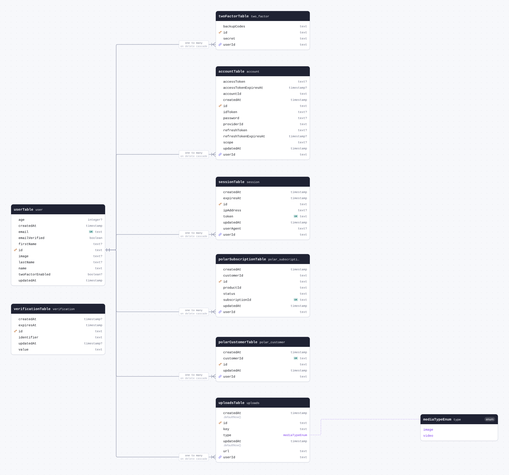
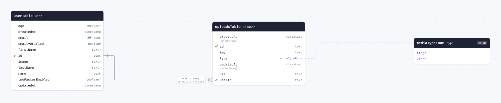
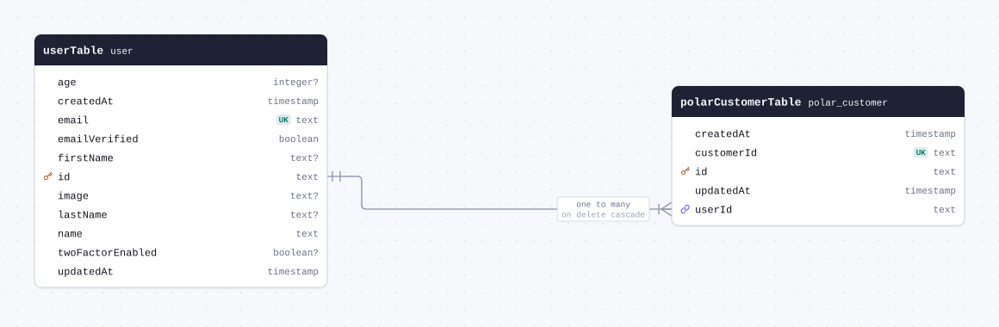
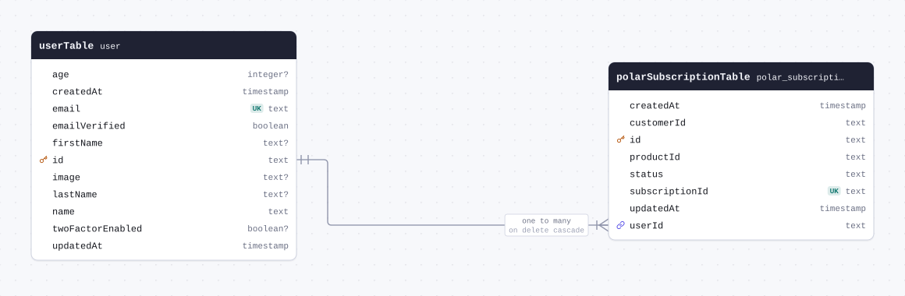
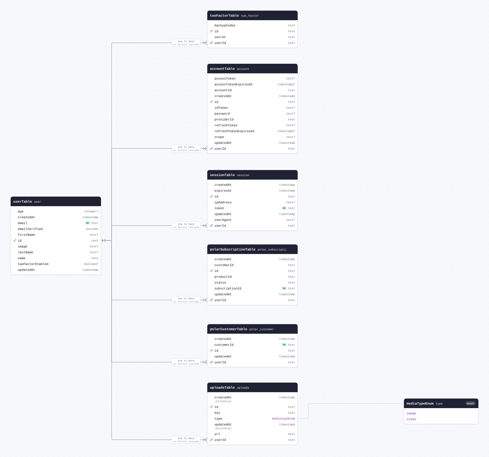
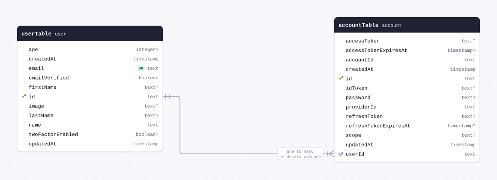
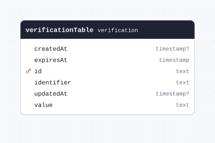
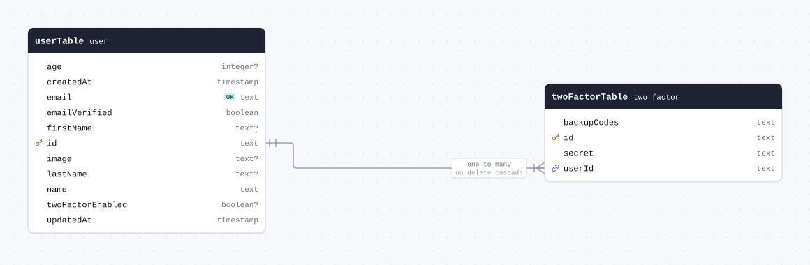

# Schema docs



<details>
<summary>The whole schema as SQL</summary>

```sql
CREATE TYPE "type" AS ENUM('image', 'video');

CREATE TABLE "account" (
	"access_token" text,
	"access_token_expires_at" timestamp,
	"account_id" text NOT NULL,
	"created_at" timestamp NOT NULL,
	"id" text PRIMARY KEY,
	"id_token" text,
	"password" text,
	"provider_id" text NOT NULL,
	"refresh_token" text,
	"refresh_token_expires_at" timestamp,
	"scope" text,
	"updated_at" timestamp NOT NULL,
	"user_id" text NOT NULL
);

CREATE TABLE "polar_customer" (
	"created_at" timestamp NOT NULL,
	"customer_id" text NOT NULL UNIQUE,
	"id" text PRIMARY KEY,
	"updated_at" timestamp NOT NULL,
	"user_id" text NOT NULL
);

CREATE TABLE "polar_subscription" (
	"created_at" timestamp NOT NULL,
	"customer_id" text NOT NULL,
	"id" text PRIMARY KEY,
	"product_id" text NOT NULL,
	"status" text NOT NULL,
	"subscription_id" text NOT NULL UNIQUE,
	"updated_at" timestamp NOT NULL,
	"user_id" text NOT NULL
);

CREATE TABLE "session" (
	"created_at" timestamp NOT NULL,
	"expires_at" timestamp NOT NULL,
	"id" text PRIMARY KEY,
	"ip_address" text,
	"token" text NOT NULL UNIQUE,
	"updated_at" timestamp NOT NULL,
	"user_agent" text,
	"user_id" text NOT NULL
);

CREATE TABLE "two_factor" (
	"backup_codes" text NOT NULL,
	"id" text PRIMARY KEY,
	"secret" text NOT NULL,
	"user_id" text NOT NULL
);

CREATE TABLE "uploads" (
	"created_at" timestamp DEFAULT now() NOT NULL,
	"id" text PRIMARY KEY,
	"key" text NOT NULL,
	"type" "type" NOT NULL,
	"updated_at" timestamp DEFAULT now() NOT NULL,
	"url" text NOT NULL,
	"user_id" text NOT NULL
);

CREATE TABLE "user" (
	"age" integer,
	"created_at" timestamp NOT NULL,
	"email" text NOT NULL UNIQUE,
	"email_verified" boolean NOT NULL,
	"first_name" text,
	"id" text PRIMARY KEY,
	"image" text,
	"last_name" text,
	"name" text NOT NULL,
	"two_factor_enabled" boolean,
	"updated_at" timestamp NOT NULL
);

CREATE TABLE "verification" (
	"created_at" timestamp,
	"expires_at" timestamp NOT NULL,
	"id" text PRIMARY KEY,
	"identifier" text NOT NULL,
	"updated_at" timestamp,
	"value" text NOT NULL
);

ALTER TABLE "account" ADD CONSTRAINT "account_user_id_user_id_fkey" FOREIGN KEY ("user_id") REFERENCES "user"("id") ON DELETE CASCADE;

ALTER TABLE "polar_customer" ADD CONSTRAINT "polar_customer_user_id_user_id_fkey" FOREIGN KEY ("user_id") REFERENCES "user"("id") ON DELETE CASCADE;

ALTER TABLE "polar_subscription" ADD CONSTRAINT "polar_subscription_user_id_user_id_fkey" FOREIGN KEY ("user_id") REFERENCES "user"("id") ON DELETE CASCADE;

ALTER TABLE "session" ADD CONSTRAINT "session_user_id_user_id_fkey" FOREIGN KEY ("user_id") REFERENCES "user"("id") ON DELETE CASCADE;

ALTER TABLE "two_factor" ADD CONSTRAINT "two_factor_user_id_user_id_fkey" FOREIGN KEY ("user_id") REFERENCES "user"("id") ON DELETE CASCADE;

ALTER TABLE "uploads" ADD CONSTRAINT "uploads_user_id_user_id_fkey" FOREIGN KEY ("user_id") REFERENCES "user"("id") ON DELETE CASCADE;
```

</details>

## Contents

| Table                                                   | Name in the database | Description |
| ------------------------------------------------------- | -------------------- | ----------- |
| [uploadsTable](#table-uploadsTable)                     | `uploads`            |             |
| [polarCustomerTable](#table-polarCustomerTable)         | `polar_customer`     |             |
| [polarSubscriptionTable](#table-polarSubscriptionTable) | `polar_subscription` |             |
| [userTable](#table-userTable)                           | `user`               |             |
| [sessionTable](#table-sessionTable)                     | `session`            |             |
| [accountTable](#table-accountTable)                     | `account`            |             |
| [verificationTable](#table-verificationTable)           | `verification`       |             |
| [twoFactorTable](#table-twoFactorTable)                 | `two_factor`         |             |

| Enum                                 | Name in the database | Description |
| ------------------------------------ | -------------------- | ----------- |
| [mediaTypeEnum](#enum-mediaTypeEnum) | `type`               |             |

## Tables

<a id="table-uploadsTable"></a>

### uploadsTable

Table `uploads`.



| Column                     | Type                                   | Constraints                                 | Default         | Description |
| -------------------------- | -------------------------------------- | ------------------------------------------- | --------------- | ----------- |
| `createdAt` (`created_at`) | `timestamp`                            | NOT NULL                                    | `.defaultNow()` |             |
| `id`                       | `text`                                 | PK NOT NULL                                 |                 |             |
| `key`                      | `text`                                 | NOT NULL                                    |                 |             |
| `type`                     | [`mediaTypeEnum`](#enum-mediaTypeEnum) | NOT NULL                                    |                 |             |
| `updatedAt` (`updated_at`) | `timestamp`                            | NOT NULL                                    | `.defaultNow()` |             |
| `url`                      | `text`                                 | NOT NULL                                    |                 |             |
| `userId` (`user_id`)       | `text`                                 | NOT NULL → [userTable.id](#table-userTable) |                 |             |

#### Definition

```sql
CREATE TABLE "uploads" (
	"created_at" timestamp DEFAULT now() NOT NULL,
	"id" text PRIMARY KEY,
	"key" text NOT NULL,
	"type" "type" NOT NULL,
	"updated_at" timestamp DEFAULT now() NOT NULL,
	"url" text NOT NULL,
	"user_id" text NOT NULL
);

ALTER TABLE "uploads" ADD CONSTRAINT "uploads_user_id_user_id_fkey" FOREIGN KEY ("user_id") REFERENCES "user"("id") ON DELETE CASCADE;
```

#### References

- `userId` → [userTable.id](#table-userTable) (many to one, on delete cascade)

<details>
<summary>Queries and their SQL</summary>

**Select**: Every row of uploadsTable.

```ts
db.select().from(uploadsTable);
```

```sql
select "created_at", "id", "key", "type", "updated_at", "url", "user_id"
from "uploads"
```

**Count**: How many rows uploadsTable has.

```ts
db.select({ count: count() }).from(uploadsTable);
```

```sql
select count(*)
from "uploads"
```

**Find many**: The rows of uploadsTable, through the relational query API.

```ts
db.query.uploadsTable.findMany();
```

```sql
select "d0"."created_at" as "createdAt", "d0"."id" as "id", "d0"."key" as "key", "d0"."type" as "type", "d0"."updated_at" as "updatedAt", "d0"."url" as "url", "d0"."user_id" as "userId"
from "uploads" as "d0"
```

**Find by primary key**: One row of uploadsTable, through the relational query API.

```ts
db.query.uploadsTable.findFirst({ where: { id: "id" } });
```

```sql
select "d0"."created_at" as "createdAt", "d0"."id" as "id", "d0"."key" as "key", "d0"."type" as "type", "d0"."updated_at" as "updatedAt", "d0"."url" as "url", "d0"."user_id" as "userId"
from "uploads" as "d0"
where "d0"."id" = $1
limit $2
-- params: ["id",1]
```

**Insert**: Adds a row to uploadsTable, giving the columns that have no default.

```ts
db.insert(uploadsTable).values({
  id: "id",
  key: "key",
  type: "image",
  url: "url",
  userId: "userId",
});
```

```sql
insert into "uploads" ("created_at", "id", "key", "type", "updated_at", "url", "user_id")
values (default, $1, $2, $3, default, $4, $5)
-- params: ["id","key","image","url","userId"]
```

**Update**: Changes a row of uploadsTable, found by its primary key.

```ts
db.update(uploadsTable)
  .set({ createdAt: new Date("2026-01-01T00:00:00.000Z") })
  .where(eq(uploadsTable.id, "id"));
```

```sql
update "uploads"
set "created_at" = $1
where "uploads"."id" = $2
-- params: ["2026-01-01T00:00:00.000Z","id"]
```

**Delete**: Deletes a row of uploadsTable, found by its primary key.

```ts
db.delete(uploadsTable).where(eq(uploadsTable.id, "id"));
```

```sql
delete from "uploads"
where "uploads"."id" = $1
-- params: ["id"]
```

</details>

<a id="table-polarCustomerTable"></a>

### polarCustomerTable

Table `polar_customer`.



| Column                       | Type        | Constraints                                 | Default | Description |
| ---------------------------- | ----------- | ------------------------------------------- | ------- | ----------- |
| `createdAt` (`created_at`)   | `timestamp` | NOT NULL                                    |         |             |
| `customerId` (`customer_id`) | `text`      | UNIQUE NOT NULL                             |         |             |
| `id`                         | `text`      | PK NOT NULL                                 |         |             |
| `updatedAt` (`updated_at`)   | `timestamp` | NOT NULL                                    |         |             |
| `userId` (`user_id`)         | `text`      | NOT NULL → [userTable.id](#table-userTable) |         |             |

#### Definition

```sql
CREATE TABLE "polar_customer" (
	"created_at" timestamp NOT NULL,
	"customer_id" text NOT NULL UNIQUE,
	"id" text PRIMARY KEY,
	"updated_at" timestamp NOT NULL,
	"user_id" text NOT NULL
);

ALTER TABLE "polar_customer" ADD CONSTRAINT "polar_customer_user_id_user_id_fkey" FOREIGN KEY ("user_id") REFERENCES "user"("id") ON DELETE CASCADE;
```

#### References

- `userId` → [userTable.id](#table-userTable) (many to one, on delete cascade)

<details>
<summary>Queries and their SQL</summary>

**Select**: Every row of polarCustomerTable.

```ts
db.select().from(polarCustomerTable);
```

```sql
select "created_at", "customer_id", "id", "updated_at", "user_id"
from "polar_customer"
```

**Count**: How many rows polarCustomerTable has.

```ts
db.select({ count: count() }).from(polarCustomerTable);
```

```sql
select count(*)
from "polar_customer"
```

**Find many**: The rows of polarCustomerTable, through the relational query API.

```ts
db.query.polarCustomerTable.findMany();
```

```sql
select "d0"."created_at" as "createdAt", "d0"."customer_id" as "customerId", "d0"."id" as "id", "d0"."updated_at" as "updatedAt", "d0"."user_id" as "userId"
from "polar_customer" as "d0"
```

**Find by primary key**: One row of polarCustomerTable, through the relational query API.

```ts
db.query.polarCustomerTable.findFirst({ where: { id: "id" } });
```

```sql
select "d0"."created_at" as "createdAt", "d0"."customer_id" as "customerId", "d0"."id" as "id", "d0"."updated_at" as "updatedAt", "d0"."user_id" as "userId"
from "polar_customer" as "d0"
where "d0"."id" = $1
limit $2
-- params: ["id",1]
```

**Insert**: Adds a row to polarCustomerTable, giving the columns that have no default.

```ts
db.insert(polarCustomerTable).values({
  createdAt: new Date("2026-01-01T00:00:00.000Z"),
  customerId: "customerId",
  id: "id",
  updatedAt: new Date("2026-01-01T00:00:00.000Z"),
  userId: "userId",
});
```

```sql
insert into "polar_customer" ("created_at", "customer_id", "id", "updated_at", "user_id")
values ($1, $2, $3, $4, $5)
-- params: ["2026-01-01T00:00:00.000Z","customerId","id","2026-01-01T00:00:00.000Z","userId"]
```

**Update**: Changes a row of polarCustomerTable, found by its primary key.

```ts
db.update(polarCustomerTable)
  .set({ createdAt: new Date("2026-01-01T00:00:00.000Z") })
  .where(eq(polarCustomerTable.id, "id"));
```

```sql
update "polar_customer"
set "created_at" = $1
where "polar_customer"."id" = $2
-- params: ["2026-01-01T00:00:00.000Z","id"]
```

**Delete**: Deletes a row of polarCustomerTable, found by its primary key.

```ts
db.delete(polarCustomerTable).where(eq(polarCustomerTable.id, "id"));
```

```sql
delete from "polar_customer"
where "polar_customer"."id" = $1
-- params: ["id"]
```

</details>

<a id="table-polarSubscriptionTable"></a>

### polarSubscriptionTable

Table `polar_subscription`.



| Column                               | Type        | Constraints                                 | Default | Description |
| ------------------------------------ | ----------- | ------------------------------------------- | ------- | ----------- |
| `createdAt` (`created_at`)           | `timestamp` | NOT NULL                                    |         |             |
| `customerId` (`customer_id`)         | `text`      | NOT NULL                                    |         |             |
| `id`                                 | `text`      | PK NOT NULL                                 |         |             |
| `productId` (`product_id`)           | `text`      | NOT NULL                                    |         |             |
| `status`                             | `text`      | NOT NULL                                    |         |             |
| `subscriptionId` (`subscription_id`) | `text`      | UNIQUE NOT NULL                             |         |             |
| `updatedAt` (`updated_at`)           | `timestamp` | NOT NULL                                    |         |             |
| `userId` (`user_id`)                 | `text`      | NOT NULL → [userTable.id](#table-userTable) |         |             |

#### Definition

```sql
CREATE TABLE "polar_subscription" (
	"created_at" timestamp NOT NULL,
	"customer_id" text NOT NULL,
	"id" text PRIMARY KEY,
	"product_id" text NOT NULL,
	"status" text NOT NULL,
	"subscription_id" text NOT NULL UNIQUE,
	"updated_at" timestamp NOT NULL,
	"user_id" text NOT NULL
);

ALTER TABLE "polar_subscription" ADD CONSTRAINT "polar_subscription_user_id_user_id_fkey" FOREIGN KEY ("user_id") REFERENCES "user"("id") ON DELETE CASCADE;
```

#### References

- `userId` → [userTable.id](#table-userTable) (many to one, on delete cascade)

<details>
<summary>Queries and their SQL</summary>

**Select**: Every row of polarSubscriptionTable.

```ts
db.select().from(polarSubscriptionTable);
```

```sql
select "created_at", "customer_id", "id", "product_id", "status", "subscription_id", "updated_at", "user_id"
from "polar_subscription"
```

**Count**: How many rows polarSubscriptionTable has.

```ts
db.select({ count: count() }).from(polarSubscriptionTable);
```

```sql
select count(*)
from "polar_subscription"
```

**Find many**: The rows of polarSubscriptionTable, through the relational query API.

```ts
db.query.polarSubscriptionTable.findMany();
```

```sql
select "d0"."created_at" as "createdAt", "d0"."customer_id" as "customerId", "d0"."id" as "id", "d0"."product_id" as "productId", "d0"."status" as "status", "d0"."subscription_id" as "subscriptionId", "d0"."updated_at" as "updatedAt", "d0"."user_id" as "userId"
from "polar_subscription" as "d0"
```

**Find by primary key**: One row of polarSubscriptionTable, through the relational query API.

```ts
db.query.polarSubscriptionTable.findFirst({ where: { id: "id" } });
```

```sql
select "d0"."created_at" as "createdAt", "d0"."customer_id" as "customerId", "d0"."id" as "id", "d0"."product_id" as "productId", "d0"."status" as "status", "d0"."subscription_id" as "subscriptionId", "d0"."updated_at" as "updatedAt", "d0"."user_id" as "userId"
from "polar_subscription" as "d0"
where "d0"."id" = $1
limit $2
-- params: ["id",1]
```

**Insert**: Adds a row to polarSubscriptionTable, giving the columns that have no default.

```ts
db.insert(polarSubscriptionTable).values({
  createdAt: new Date("2026-01-01T00:00:00.000Z"),
  customerId: "customerId",
  id: "id",
  productId: "productId",
  status: "status",
  subscriptionId: "subscriptionId",
  updatedAt: new Date("2026-01-01T00:00:00.000Z"),
  userId: "userId",
});
```

```sql
insert into "polar_subscription" ("created_at", "customer_id", "id", "product_id", "status", "subscription_id", "updated_at", "user_id")
values ($1, $2, $3, $4, $5, $6, $7, $8)
-- params: ["2026-01-01T00:00:00.000Z","customerId","id","productId","status","subscriptionId","2026-01-01T00:00:00.000Z","userId"]
```

**Update**: Changes a row of polarSubscriptionTable, found by its primary key.

```ts
db.update(polarSubscriptionTable)
  .set({ createdAt: new Date("2026-01-01T00:00:00.000Z") })
  .where(eq(polarSubscriptionTable.id, "id"));
```

```sql
update "polar_subscription"
set "created_at" = $1
where "polar_subscription"."id" = $2
-- params: ["2026-01-01T00:00:00.000Z","id"]
```

**Delete**: Deletes a row of polarSubscriptionTable, found by its primary key.

```ts
db.delete(polarSubscriptionTable).where(eq(polarSubscriptionTable.id, "id"));
```

```sql
delete from "polar_subscription"
where "polar_subscription"."id" = $1
-- params: ["id"]
```

</details>

<a id="table-userTable"></a>

### userTable

Table `user`.



| Column                                    | Type        | Constraints     | Default | Description |
| ----------------------------------------- | ----------- | --------------- | ------- | ----------- |
| `age`                                     | `integer`   | NULL            |         |             |
| `createdAt` (`created_at`)                | `timestamp` | NOT NULL        |         |             |
| `email`                                   | `text`      | UNIQUE NOT NULL |         |             |
| `emailVerified` (`email_verified`)        | `boolean`   | NOT NULL        |         |             |
| `firstName` (`first_name`)                | `text`      | NULL            |         |             |
| `id`                                      | `text`      | PK NOT NULL     |         |             |
| `image`                                   | `text`      | NULL            |         |             |
| `lastName` (`last_name`)                  | `text`      | NULL            |         |             |
| `name`                                    | `text`      | NOT NULL        |         |             |
| `twoFactorEnabled` (`two_factor_enabled`) | `boolean`   | NULL            |         |             |
| `updatedAt` (`updated_at`)                | `timestamp` | NOT NULL        |         |             |

#### Definition

```sql
CREATE TABLE "user" (
	"age" integer,
	"created_at" timestamp NOT NULL,
	"email" text NOT NULL UNIQUE,
	"email_verified" boolean NOT NULL,
	"first_name" text,
	"id" text PRIMARY KEY,
	"image" text,
	"last_name" text,
	"name" text NOT NULL,
	"two_factor_enabled" boolean,
	"updated_at" timestamp NOT NULL
);
```

#### Referenced by

- `id` → [uploadsTable.userId](#table-uploadsTable) (one to many, on delete cascade)
- `id` → [polarCustomerTable.userId](#table-polarCustomerTable) (one to many, on delete cascade)
- `id` → [polarSubscriptionTable.userId](#table-polarSubscriptionTable) (one to many, on delete cascade)
- `id` → [sessionTable.userId](#table-sessionTable) (one to many, on delete cascade)
- `id` → [accountTable.userId](#table-accountTable) (one to many, on delete cascade)
- `id` → [twoFactorTable.userId](#table-twoFactorTable) (one to many, on delete cascade)

<details>
<summary>Queries and their SQL</summary>

**Select**: Every row of userTable.

```ts
db.select().from(userTable);
```

```sql
select "age", "created_at", "email", "email_verified", "first_name", "id", "image", "last_name", "name", "two_factor_enabled", "updated_at"
from "user"
```

**Count**: How many rows userTable has.

```ts
db.select({ count: count() }).from(userTable);
```

```sql
select count(*)
from "user"
```

**Find many**: The rows of userTable, through the relational query API.

```ts
db.query.userTable.findMany();
```

```sql
select "d0"."age" as "age", "d0"."created_at" as "createdAt", "d0"."email" as "email", "d0"."email_verified" as "emailVerified", "d0"."first_name" as "firstName", "d0"."id" as "id", "d0"."image" as "image", "d0"."last_name" as "lastName", "d0"."name" as "name", "d0"."two_factor_enabled" as "twoFactorEnabled", "d0"."updated_at" as "updatedAt"
from "user" as "d0"
```

**Find by primary key**: One row of userTable, through the relational query API.

```ts
db.query.userTable.findFirst({ where: { id: "id" } });
```

```sql
select "d0"."age" as "age", "d0"."created_at" as "createdAt", "d0"."email" as "email", "d0"."email_verified" as "emailVerified", "d0"."first_name" as "firstName", "d0"."id" as "id", "d0"."image" as "image", "d0"."last_name" as "lastName", "d0"."name" as "name", "d0"."two_factor_enabled" as "twoFactorEnabled", "d0"."updated_at" as "updatedAt"
from "user" as "d0"
where "d0"."id" = $1
limit $2
-- params: ["id",1]
```

**Insert**: Adds a row to userTable, giving the columns that have no default.

```ts
db.insert(userTable).values({
  createdAt: new Date("2026-01-01T00:00:00.000Z"),
  email: "email",
  emailVerified: true,
  id: "id",
  name: "name",
  updatedAt: new Date("2026-01-01T00:00:00.000Z"),
});
```

```sql
insert into "user" ("age", "created_at", "email", "email_verified", "first_name", "id", "image", "last_name", "name", "two_factor_enabled", "updated_at")
values (default, $1, $2, $3, default, $4, default, default, $5, default, $6)
-- params: ["2026-01-01T00:00:00.000Z","email",true,"id","name","2026-01-01T00:00:00.000Z"]
```

**Update**: Changes a row of userTable, found by its primary key.

```ts
db.update(userTable).set({ age: 1 }).where(eq(userTable.id, "id"));
```

```sql
update "user"
set "age" = $1
where "user"."id" = $2
-- params: [1,"id"]
```

**Delete**: Deletes a row of userTable, found by its primary key.

```ts
db.delete(userTable).where(eq(userTable.id, "id"));
```

```sql
delete from "user"
where "user"."id" = $1
-- params: ["id"]
```

</details>

<a id="table-sessionTable"></a>

### sessionTable

Table `session`.


| Column                     | Type        | Constraints                                 | Default | Description |
| -------------------------- | ----------- | ------------------------------------------- | ------- | ----------- |
| `createdAt` (`created_at`) | `timestamp` | NOT NULL                                    |         |             |
| `expiresAt` (`expires_at`) | `timestamp` | NOT NULL                                    |         |             |
| `id`                       | `text`      | PK NOT NULL                                 |         |             |
| `ipAddress` (`ip_address`) | `text`      | NULL                                        |         |             |
| `token`                    | `text`      | UNIQUE NOT NULL                             |         |             |
| `updatedAt` (`updated_at`) | `timestamp` | NOT NULL                                    |         |             |
| `userAgent` (`user_agent`) | `text`      | NULL                                        |         |             |
| `userId` (`user_id`)       | `text`      | NOT NULL → [userTable.id](#table-userTable) |         |             |

#### Definition

```sql
CREATE TABLE "session" (
	"created_at" timestamp NOT NULL,
	"expires_at" timestamp NOT NULL,
	"id" text PRIMARY KEY,
	"ip_address" text,
	"token" text NOT NULL UNIQUE,
	"updated_at" timestamp NOT NULL,
	"user_agent" text,
	"user_id" text NOT NULL
);

ALTER TABLE "session" ADD CONSTRAINT "session_user_id_user_id_fkey" FOREIGN KEY ("user_id") REFERENCES "user"("id") ON DELETE CASCADE;
```

#### References

- `userId` → [userTable.id](#table-userTable) (many to one, on delete cascade)

<details>
<summary>Queries and their SQL</summary>

**Select**: Every row of sessionTable.

```ts
db.select().from(sessionTable);
```

```sql
select "created_at", "expires_at", "id", "ip_address", "token", "updated_at", "user_agent", "user_id"
from "session"
```

**Count**: How many rows sessionTable has.

```ts
db.select({ count: count() }).from(sessionTable);
```

```sql
select count(*)
from "session"
```

**Find many**: The rows of sessionTable, through the relational query API.

```ts
db.query.sessionTable.findMany();
```

```sql
select "d0"."created_at" as "createdAt", "d0"."expires_at" as "expiresAt", "d0"."id" as "id", "d0"."ip_address" as "ipAddress", "d0"."token" as "token", "d0"."updated_at" as "updatedAt", "d0"."user_agent" as "userAgent", "d0"."user_id" as "userId"
from "session" as "d0"
```

**Find by primary key**: One row of sessionTable, through the relational query API.

```ts
db.query.sessionTable.findFirst({ where: { id: "id" } });
```

```sql
select "d0"."created_at" as "createdAt", "d0"."expires_at" as "expiresAt", "d0"."id" as "id", "d0"."ip_address" as "ipAddress", "d0"."token" as "token", "d0"."updated_at" as "updatedAt", "d0"."user_agent" as "userAgent", "d0"."user_id" as "userId"
from "session" as "d0"
where "d0"."id" = $1
limit $2
-- params: ["id",1]
```

**Insert**: Adds a row to sessionTable, giving the columns that have no default.

```ts
db.insert(sessionTable).values({
  createdAt: new Date("2026-01-01T00:00:00.000Z"),
  expiresAt: new Date("2026-01-01T00:00:00.000Z"),
  id: "id",
  token: "token",
  updatedAt: new Date("2026-01-01T00:00:00.000Z"),
  userId: "userId",
});
```

```sql
insert into "session" ("created_at", "expires_at", "id", "ip_address", "token", "updated_at", "user_agent", "user_id")
values ($1, $2, $3, default, $4, $5, default, $6)
-- params: ["2026-01-01T00:00:00.000Z","2026-01-01T00:00:00.000Z","id","token","2026-01-01T00:00:00.000Z","userId"]
```

**Update**: Changes a row of sessionTable, found by its primary key.

```ts
db.update(sessionTable)
  .set({ createdAt: new Date("2026-01-01T00:00:00.000Z") })
  .where(eq(sessionTable.id, "id"));
```

```sql
update "session"
set "created_at" = $1
where "session"."id" = $2
-- params: ["2026-01-01T00:00:00.000Z","id"]
```

**Delete**: Deletes a row of sessionTable, found by its primary key.

```ts
db.delete(sessionTable).where(eq(sessionTable.id, "id"));
```

```sql
delete from "session"
where "session"."id" = $1
-- params: ["id"]
```

</details>

<a id="table-accountTable"></a>

### accountTable

Table `account`.



| Column                                               | Type        | Constraints                                 | Default | Description |
| ---------------------------------------------------- | ----------- | ------------------------------------------- | ------- | ----------- |
| `accessToken` (`access_token`)                       | `text`      | NULL                                        |         |             |
| `accessTokenExpiresAt` (`access_token_expires_at`)   | `timestamp` | NULL                                        |         |             |
| `accountId` (`account_id`)                           | `text`      | NOT NULL                                    |         |             |
| `createdAt` (`created_at`)                           | `timestamp` | NOT NULL                                    |         |             |
| `id`                                                 | `text`      | PK NOT NULL                                 |         |             |
| `idToken` (`id_token`)                               | `text`      | NULL                                        |         |             |
| `password`                                           | `text`      | NULL                                        |         |             |
| `providerId` (`provider_id`)                         | `text`      | NOT NULL                                    |         |             |
| `refreshToken` (`refresh_token`)                     | `text`      | NULL                                        |         |             |
| `refreshTokenExpiresAt` (`refresh_token_expires_at`) | `timestamp` | NULL                                        |         |             |
| `scope`                                              | `text`      | NULL                                        |         |             |
| `updatedAt` (`updated_at`)                           | `timestamp` | NOT NULL                                    |         |             |
| `userId` (`user_id`)                                 | `text`      | NOT NULL → [userTable.id](#table-userTable) |         |             |

#### Definition

```sql
CREATE TABLE "account" (
	"access_token" text,
	"access_token_expires_at" timestamp,
	"account_id" text NOT NULL,
	"created_at" timestamp NOT NULL,
	"id" text PRIMARY KEY,
	"id_token" text,
	"password" text,
	"provider_id" text NOT NULL,
	"refresh_token" text,
	"refresh_token_expires_at" timestamp,
	"scope" text,
	"updated_at" timestamp NOT NULL,
	"user_id" text NOT NULL
);

ALTER TABLE "account" ADD CONSTRAINT "account_user_id_user_id_fkey" FOREIGN KEY ("user_id") REFERENCES "user"("id") ON DELETE CASCADE;
```

#### References

- `userId` → [userTable.id](#table-userTable) (many to one, on delete cascade)

<details>
<summary>Queries and their SQL</summary>

**Select**: Every row of accountTable.

```ts
db.select().from(accountTable);
```

```sql
select "access_token", "access_token_expires_at", "account_id", "created_at", "id", "id_token", "password", "provider_id", "refresh_token", "refresh_token_expires_at", "scope", "updated_at", "user_id"
from "account"
```

**Count**: How many rows accountTable has.

```ts
db.select({ count: count() }).from(accountTable);
```

```sql
select count(*)
from "account"
```

**Find many**: The rows of accountTable, through the relational query API.

```ts
db.query.accountTable.findMany();
```

```sql
select "d0"."access_token" as "accessToken", "d0"."access_token_expires_at" as "accessTokenExpiresAt", "d0"."account_id" as "accountId", "d0"."created_at" as "createdAt", "d0"."id" as "id", "d0"."id_token" as "idToken", "d0"."password" as "password", "d0"."provider_id" as "providerId", "d0"."refresh_token" as "refreshToken", "d0"."refresh_token_expires_at" as "refreshTokenExpiresAt", "d0"."scope" as "scope", "d0"."updated_at" as "updatedAt", "d0"."user_id" as "userId"
from "account" as "d0"
```

**Find by primary key**: One row of accountTable, through the relational query API.

```ts
db.query.accountTable.findFirst({ where: { id: "id" } });
```

```sql
select "d0"."access_token" as "accessToken", "d0"."access_token_expires_at" as "accessTokenExpiresAt", "d0"."account_id" as "accountId", "d0"."created_at" as "createdAt", "d0"."id" as "id", "d0"."id_token" as "idToken", "d0"."password" as "password", "d0"."provider_id" as "providerId", "d0"."refresh_token" as "refreshToken", "d0"."refresh_token_expires_at" as "refreshTokenExpiresAt", "d0"."scope" as "scope", "d0"."updated_at" as "updatedAt", "d0"."user_id" as "userId"
from "account" as "d0"
where "d0"."id" = $1
limit $2
-- params: ["id",1]
```

**Insert**: Adds a row to accountTable, giving the columns that have no default.

```ts
db.insert(accountTable).values({
  accountId: "accountId",
  createdAt: new Date("2026-01-01T00:00:00.000Z"),
  id: "id",
  providerId: "providerId",
  updatedAt: new Date("2026-01-01T00:00:00.000Z"),
  userId: "userId",
});
```

```sql
insert into "account" ("access_token", "access_token_expires_at", "account_id", "created_at", "id", "id_token", "password", "provider_id", "refresh_token", "refresh_token_expires_at", "scope", "updated_at", "user_id")
values (default, default, $1, $2, $3, default, default, $4, default, default, default, $5, $6)
-- params: ["accountId","2026-01-01T00:00:00.000Z","id","providerId","2026-01-01T00:00:00.000Z","userId"]
```

**Update**: Changes a row of accountTable, found by its primary key.

```ts
db.update(accountTable).set({ accessToken: "accessToken" }).where(eq(accountTable.id, "id"));
```

```sql
update "account"
set "access_token" = $1
where "account"."id" = $2
-- params: ["accessToken","id"]
```

**Delete**: Deletes a row of accountTable, found by its primary key.

```ts
db.delete(accountTable).where(eq(accountTable.id, "id"));
```

```sql
delete from "account"
where "account"."id" = $1
-- params: ["id"]
```

</details>

<a id="table-verificationTable"></a>

### verificationTable

Table `verification`.



| Column                     | Type        | Constraints | Default | Description |
| -------------------------- | ----------- | ----------- | ------- | ----------- |
| `createdAt` (`created_at`) | `timestamp` | NULL        |         |             |
| `expiresAt` (`expires_at`) | `timestamp` | NOT NULL    |         |             |
| `id`                       | `text`      | PK NOT NULL |         |             |
| `identifier`               | `text`      | NOT NULL    |         |             |
| `updatedAt` (`updated_at`) | `timestamp` | NULL        |         |             |
| `value`                    | `text`      | NOT NULL    |         |             |

#### Definition

```sql
CREATE TABLE "verification" (
	"created_at" timestamp,
	"expires_at" timestamp NOT NULL,
	"id" text PRIMARY KEY,
	"identifier" text NOT NULL,
	"updated_at" timestamp,
	"value" text NOT NULL
);
```

<details>
<summary>Queries and their SQL</summary>

**Select**: Every row of verificationTable.

```ts
db.select().from(verificationTable);
```

```sql
select "created_at", "expires_at", "id", "identifier", "updated_at", "value"
from "verification"
```

**Count**: How many rows verificationTable has.

```ts
db.select({ count: count() }).from(verificationTable);
```

```sql
select count(*)
from "verification"
```

**Find many**: The rows of verificationTable, through the relational query API.

```ts
db.query.verificationTable.findMany();
```

```sql
select "d0"."created_at" as "createdAt", "d0"."expires_at" as "expiresAt", "d0"."id" as "id", "d0"."identifier" as "identifier", "d0"."updated_at" as "updatedAt", "d0"."value" as "value"
from "verification" as "d0"
```

**Find by primary key**: One row of verificationTable, through the relational query API.

```ts
db.query.verificationTable.findFirst({ where: { id: "id" } });
```

```sql
select "d0"."created_at" as "createdAt", "d0"."expires_at" as "expiresAt", "d0"."id" as "id", "d0"."identifier" as "identifier", "d0"."updated_at" as "updatedAt", "d0"."value" as "value"
from "verification" as "d0"
where "d0"."id" = $1
limit $2
-- params: ["id",1]
```

**Insert**: Adds a row to verificationTable, giving the columns that have no default.

```ts
db.insert(verificationTable).values({
  expiresAt: new Date("2026-01-01T00:00:00.000Z"),
  id: "id",
  identifier: "identifier",
  value: "value",
});
```

```sql
insert into "verification" ("created_at", "expires_at", "id", "identifier", "updated_at", "value")
values (default, $1, $2, $3, default, $4)
-- params: ["2026-01-01T00:00:00.000Z","id","identifier","value"]
```

**Update**: Changes a row of verificationTable, found by its primary key.

```ts
db.update(verificationTable)
  .set({ createdAt: new Date("2026-01-01T00:00:00.000Z") })
  .where(eq(verificationTable.id, "id"));
```

```sql
update "verification"
set "created_at" = $1
where "verification"."id" = $2
-- params: ["2026-01-01T00:00:00.000Z","id"]
```

**Delete**: Deletes a row of verificationTable, found by its primary key.

```ts
db.delete(verificationTable).where(eq(verificationTable.id, "id"));
```

```sql
delete from "verification"
where "verification"."id" = $1
-- params: ["id"]
```

</details>

<a id="table-twoFactorTable"></a>

### twoFactorTable

Table `two_factor`.



| Column                         | Type   | Constraints                                 | Default | Description |
| ------------------------------ | ------ | ------------------------------------------- | ------- | ----------- |
| `backupCodes` (`backup_codes`) | `text` | NOT NULL                                    |         |             |
| `id`                           | `text` | PK NOT NULL                                 |         |             |
| `secret`                       | `text` | NOT NULL                                    |         |             |
| `userId` (`user_id`)           | `text` | NOT NULL → [userTable.id](#table-userTable) |         |             |

#### Definition

```sql
CREATE TABLE "two_factor" (
	"backup_codes" text NOT NULL,
	"id" text PRIMARY KEY,
	"secret" text NOT NULL,
	"user_id" text NOT NULL
);

ALTER TABLE "two_factor" ADD CONSTRAINT "two_factor_user_id_user_id_fkey" FOREIGN KEY ("user_id") REFERENCES "user"("id") ON DELETE CASCADE;
```

#### References

- `userId` → [userTable.id](#table-userTable) (many to one, on delete cascade)

<details>
<summary>Queries and their SQL</summary>

**Select**: Every row of twoFactorTable.

```ts
db.select().from(twoFactorTable);
```

```sql
select "backup_codes", "id", "secret", "user_id"
from "two_factor"
```

**Count**: How many rows twoFactorTable has.

```ts
db.select({ count: count() }).from(twoFactorTable);
```

```sql
select count(*)
from "two_factor"
```

**Find many**: The rows of twoFactorTable, through the relational query API.

```ts
db.query.twoFactorTable.findMany();
```

```sql
select "d0"."backup_codes" as "backupCodes", "d0"."id" as "id", "d0"."secret" as "secret", "d0"."user_id" as "userId"
from "two_factor" as "d0"
```

**Find by primary key**: One row of twoFactorTable, through the relational query API.

```ts
db.query.twoFactorTable.findFirst({ where: { id: "id" } });
```

```sql
select "d0"."backup_codes" as "backupCodes", "d0"."id" as "id", "d0"."secret" as "secret", "d0"."user_id" as "userId"
from "two_factor" as "d0"
where "d0"."id" = $1
limit $2
-- params: ["id",1]
```

**Insert**: Adds a row to twoFactorTable, giving the columns that have no default.

```ts
db.insert(twoFactorTable).values({
  backupCodes: "backupCodes",
  id: "id",
  secret: "secret",
  userId: "userId",
});
```

```sql
insert into "two_factor" ("backup_codes", "id", "secret", "user_id")
values ($1, $2, $3, $4)
-- params: ["backupCodes","id","secret","userId"]
```

**Update**: Changes a row of twoFactorTable, found by its primary key.

```ts
db.update(twoFactorTable).set({ backupCodes: "backupCodes" }).where(eq(twoFactorTable.id, "id"));
```

```sql
update "two_factor"
set "backup_codes" = $1
where "two_factor"."id" = $2
-- params: ["backupCodes","id"]
```

**Delete**: Deletes a row of twoFactorTable, found by its primary key.

```ts
db.delete(twoFactorTable).where(eq(twoFactorTable.id, "id"));
```

```sql
delete from "two_factor"
where "two_factor"."id" = $1
-- params: ["id"]
```

</details>

## Enums

<a id="enum-mediaTypeEnum"></a>

### mediaTypeEnum

Type `type`.

- `image`
- `video`

#### Definition

```sql
CREATE TYPE "type" AS ENUM('image', 'video');
```
