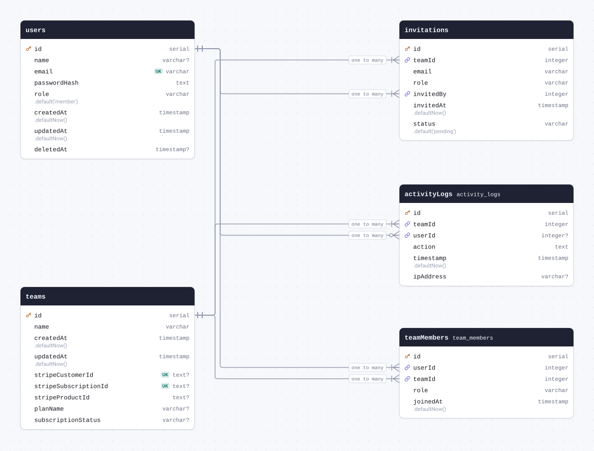
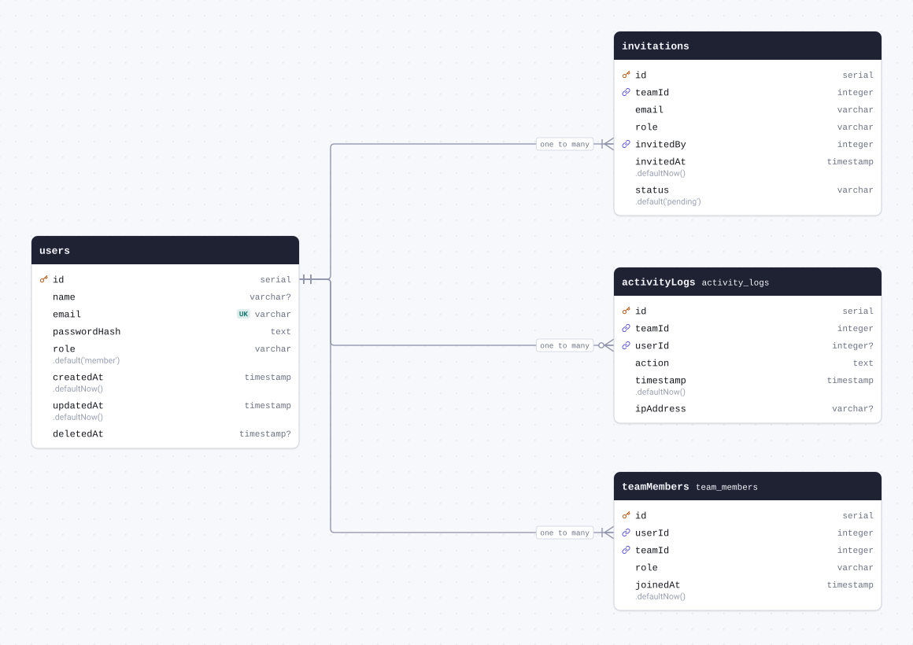
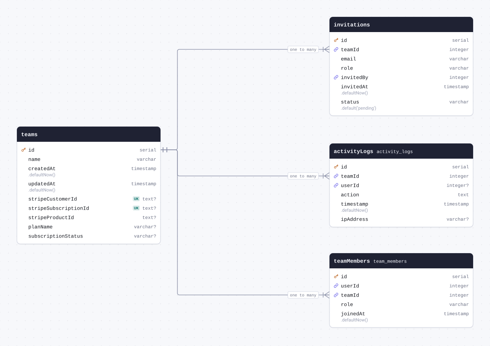
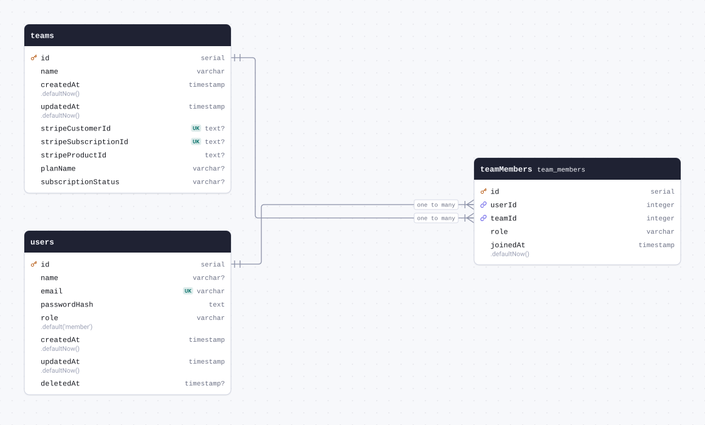
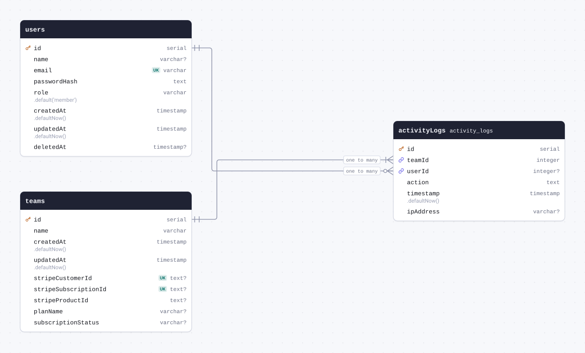
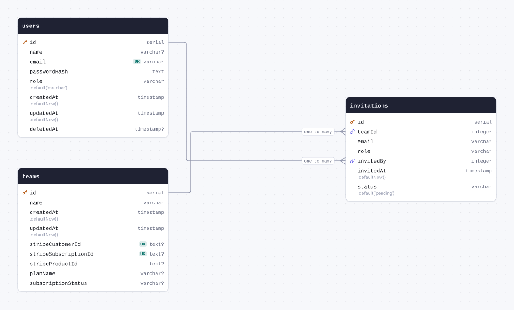

# Schema docs



<details>
<summary>The whole schema as SQL</summary>

```sql
CREATE TABLE "activity_logs" (
	"id" serial PRIMARY KEY,
	"team_id" integer NOT NULL,
	"user_id" integer,
	"action" text NOT NULL,
	"timestamp" timestamp DEFAULT now() NOT NULL,
	"ip_address" varchar(45)
);

CREATE TABLE "invitations" (
	"id" serial PRIMARY KEY,
	"team_id" integer NOT NULL,
	"email" varchar(255) NOT NULL,
	"role" varchar(50) NOT NULL,
	"invited_by" integer NOT NULL,
	"invited_at" timestamp DEFAULT now() NOT NULL,
	"status" varchar(20) DEFAULT 'pending' NOT NULL
);

CREATE TABLE "team_members" (
	"id" serial PRIMARY KEY,
	"user_id" integer NOT NULL,
	"team_id" integer NOT NULL,
	"role" varchar(50) NOT NULL,
	"joined_at" timestamp DEFAULT now() NOT NULL
);

CREATE TABLE "teams" (
	"id" serial PRIMARY KEY,
	"name" varchar(100) NOT NULL,
	"created_at" timestamp DEFAULT now() NOT NULL,
	"updated_at" timestamp DEFAULT now() NOT NULL,
	"stripe_customer_id" text UNIQUE,
	"stripe_subscription_id" text UNIQUE,
	"stripe_product_id" text,
	"plan_name" varchar(50),
	"subscription_status" varchar(20)
);

CREATE TABLE "users" (
	"id" serial PRIMARY KEY,
	"name" varchar(100),
	"email" varchar(255) NOT NULL UNIQUE,
	"password_hash" text NOT NULL,
	"role" varchar(20) DEFAULT 'member' NOT NULL,
	"created_at" timestamp DEFAULT now() NOT NULL,
	"updated_at" timestamp DEFAULT now() NOT NULL,
	"deleted_at" timestamp
);

ALTER TABLE "activity_logs" ADD CONSTRAINT "activity_logs_team_id_teams_id_fkey" FOREIGN KEY ("team_id") REFERENCES "teams"("id");

ALTER TABLE "activity_logs" ADD CONSTRAINT "activity_logs_user_id_users_id_fkey" FOREIGN KEY ("user_id") REFERENCES "users"("id");

ALTER TABLE "invitations" ADD CONSTRAINT "invitations_team_id_teams_id_fkey" FOREIGN KEY ("team_id") REFERENCES "teams"("id");

ALTER TABLE "invitations" ADD CONSTRAINT "invitations_invited_by_users_id_fkey" FOREIGN KEY ("invited_by") REFERENCES "users"("id");

ALTER TABLE "team_members" ADD CONSTRAINT "team_members_user_id_users_id_fkey" FOREIGN KEY ("user_id") REFERENCES "users"("id");

ALTER TABLE "team_members" ADD CONSTRAINT "team_members_team_id_teams_id_fkey" FOREIGN KEY ("team_id") REFERENCES "teams"("id");
```

</details>

## Contents

| Table                               | Name in the database | Description |
| ----------------------------------- | -------------------- | ----------- |
| [users](#table-users)               | `users`              |             |
| [teams](#table-teams)               | `teams`              |             |
| [teamMembers](#table-teamMembers)   | `team_members`       |             |
| [activityLogs](#table-activityLogs) | `activity_logs`      |             |
| [invitations](#table-invitations)   | `invitations`        |             |

## Tables

<a id="table-users"></a>

### users



| Column                           | Type        | Constraints     | Default              | Description |
| -------------------------------- | ----------- | --------------- | -------------------- | ----------- |
| `id`                             | `serial`    | PK NOT NULL     |                      |             |
| `name`                           | `varchar`   | NULL            |                      |             |
| `email`                          | `varchar`   | UNIQUE NOT NULL |                      |             |
| `passwordHash` (`password_hash`) | `text`      | NOT NULL        |                      |             |
| `role`                           | `varchar`   | NOT NULL        | `.default('member')` |             |
| `createdAt` (`created_at`)       | `timestamp` | NOT NULL        | `.defaultNow()`      |             |
| `updatedAt` (`updated_at`)       | `timestamp` | NOT NULL        | `.defaultNow()`      |             |
| `deletedAt` (`deleted_at`)       | `timestamp` | NULL            |                      |             |

#### Definition

```sql
CREATE TABLE "users" (
	"id" serial PRIMARY KEY,
	"name" varchar(100),
	"email" varchar(255) NOT NULL UNIQUE,
	"password_hash" text NOT NULL,
	"role" varchar(20) DEFAULT 'member' NOT NULL,
	"created_at" timestamp DEFAULT now() NOT NULL,
	"updated_at" timestamp DEFAULT now() NOT NULL,
	"deleted_at" timestamp
);
```

#### Referenced by

- `id` → [teamMembers.userId](#table-teamMembers) (one to many)
- `id` → [activityLogs.userId](#table-activityLogs) (one to many)
- `id` → [invitations.invitedBy](#table-invitations) (one to many)

<details>
<summary>Queries and their SQL</summary>

**Select**: Every row of users.

```ts
db.select().from(users);
```

```sql
select "id", "name", "email", "password_hash", "role", "created_at", "updated_at", "deleted_at"
from "users"
```

**Count**: How many rows users has.

```ts
db.select({ count: count() }).from(users);
```

```sql
select count(*)
from "users"
```

**Find many**: The rows of users, through the relational query API.

```ts
db.query.users.findMany();
```

```sql
select "d0"."id" as "id", "d0"."name" as "name", "d0"."email" as "email", "d0"."password_hash" as "passwordHash", "d0"."role" as "role", "d0"."created_at" as "createdAt", "d0"."updated_at" as "updatedAt", "d0"."deleted_at" as "deletedAt"
from "users" as "d0"
```

**Find by primary key**: One row of users, through the relational query API.

```ts
db.query.users.findFirst({ where: { id: 1 } });
```

```sql
select "d0"."id" as "id", "d0"."name" as "name", "d0"."email" as "email", "d0"."password_hash" as "passwordHash", "d0"."role" as "role", "d0"."created_at" as "createdAt", "d0"."updated_at" as "updatedAt", "d0"."deleted_at" as "deletedAt"
from "users" as "d0"
where "d0"."id" = $1
limit $2
-- params: [1,1]
```

**Insert**: Adds a row to users, giving the columns that have no default.

```ts
db.insert(users).values({ email: "email", passwordHash: "passwordHash" });
```

```sql
insert into "users" ("id", "name", "email", "password_hash", "role", "created_at", "updated_at", "deleted_at")
values (default, default, $1, $2, default, default, default, default)
-- params: ["email","passwordHash"]
```

**Update**: Changes a row of users, found by its primary key.

```ts
db.update(users).set({ name: "name" }).where(eq(users.id, 1));
```

```sql
update "users"
set "name" = $1
where "users"."id" = $2
-- params: ["name",1]
```

**Delete**: Deletes a row of users, found by its primary key.

```ts
db.delete(users).where(eq(users.id, 1));
```

```sql
delete from "users"
where "users"."id" = $1
-- params: [1]
```

</details>

<a id="table-teams"></a>

### teams



| Column                                            | Type        | Constraints | Default         | Description |
| ------------------------------------------------- | ----------- | ----------- | --------------- | ----------- |
| `id`                                              | `serial`    | PK NOT NULL |                 |             |
| `name`                                            | `varchar`   | NOT NULL    |                 |             |
| `createdAt` (`created_at`)                        | `timestamp` | NOT NULL    | `.defaultNow()` |             |
| `updatedAt` (`updated_at`)                        | `timestamp` | NOT NULL    | `.defaultNow()` |             |
| `stripeCustomerId` (`stripe_customer_id`)         | `text`      | UNIQUE NULL |                 |             |
| `stripeSubscriptionId` (`stripe_subscription_id`) | `text`      | UNIQUE NULL |                 |             |
| `stripeProductId` (`stripe_product_id`)           | `text`      | NULL        |                 |             |
| `planName` (`plan_name`)                          | `varchar`   | NULL        |                 |             |
| `subscriptionStatus` (`subscription_status`)      | `varchar`   | NULL        |                 |             |

#### Definition

```sql
CREATE TABLE "teams" (
	"id" serial PRIMARY KEY,
	"name" varchar(100) NOT NULL,
	"created_at" timestamp DEFAULT now() NOT NULL,
	"updated_at" timestamp DEFAULT now() NOT NULL,
	"stripe_customer_id" text UNIQUE,
	"stripe_subscription_id" text UNIQUE,
	"stripe_product_id" text,
	"plan_name" varchar(50),
	"subscription_status" varchar(20)
);
```

#### Referenced by

- `id` → [teamMembers.teamId](#table-teamMembers) (one to many)
- `id` → [activityLogs.teamId](#table-activityLogs) (one to many)
- `id` → [invitations.teamId](#table-invitations) (one to many)

<details>
<summary>Queries and their SQL</summary>

**Select**: Every row of teams.

```ts
db.select().from(teams);
```

```sql
select "id", "name", "created_at", "updated_at", "stripe_customer_id", "stripe_subscription_id", "stripe_product_id", "plan_name", "subscription_status"
from "teams"
```

**Count**: How many rows teams has.

```ts
db.select({ count: count() }).from(teams);
```

```sql
select count(*)
from "teams"
```

**Find many**: The rows of teams, through the relational query API.

```ts
db.query.teams.findMany();
```

```sql
select "d0"."id" as "id", "d0"."name" as "name", "d0"."created_at" as "createdAt", "d0"."updated_at" as "updatedAt", "d0"."stripe_customer_id" as "stripeCustomerId", "d0"."stripe_subscription_id" as "stripeSubscriptionId", "d0"."stripe_product_id" as "stripeProductId", "d0"."plan_name" as "planName", "d0"."subscription_status" as "subscriptionStatus"
from "teams" as "d0"
```

**Find by primary key**: One row of teams, through the relational query API.

```ts
db.query.teams.findFirst({ where: { id: 1 } });
```

```sql
select "d0"."id" as "id", "d0"."name" as "name", "d0"."created_at" as "createdAt", "d0"."updated_at" as "updatedAt", "d0"."stripe_customer_id" as "stripeCustomerId", "d0"."stripe_subscription_id" as "stripeSubscriptionId", "d0"."stripe_product_id" as "stripeProductId", "d0"."plan_name" as "planName", "d0"."subscription_status" as "subscriptionStatus"
from "teams" as "d0"
where "d0"."id" = $1
limit $2
-- params: [1,1]
```

**Insert**: Adds a row to teams, giving the columns that have no default.

```ts
db.insert(teams).values({ name: "name" });
```

```sql
insert into "teams" ("id", "name", "created_at", "updated_at", "stripe_customer_id", "stripe_subscription_id", "stripe_product_id", "plan_name", "subscription_status")
values (default, $1, default, default, default, default, default, default, default)
-- params: ["name"]
```

**Update**: Changes a row of teams, found by its primary key.

```ts
db.update(teams).set({ name: "name" }).where(eq(teams.id, 1));
```

```sql
update "teams"
set "name" = $1
where "teams"."id" = $2
-- params: ["name",1]
```

**Delete**: Deletes a row of teams, found by its primary key.

```ts
db.delete(teams).where(eq(teams.id, 1));
```

```sql
delete from "teams"
where "teams"."id" = $1
-- params: [1]
```

</details>

<a id="table-teamMembers"></a>

### teamMembers

Table `team_members`.



| Column                   | Type        | Constraints                         | Default         | Description |
| ------------------------ | ----------- | ----------------------------------- | --------------- | ----------- |
| `id`                     | `serial`    | PK NOT NULL                         |                 |             |
| `userId` (`user_id`)     | `integer`   | NOT NULL → [users.id](#table-users) |                 |             |
| `teamId` (`team_id`)     | `integer`   | NOT NULL → [teams.id](#table-teams) |                 |             |
| `role`                   | `varchar`   | NOT NULL                            |                 |             |
| `joinedAt` (`joined_at`) | `timestamp` | NOT NULL                            | `.defaultNow()` |             |

#### Definition

```sql
CREATE TABLE "team_members" (
	"id" serial PRIMARY KEY,
	"user_id" integer NOT NULL,
	"team_id" integer NOT NULL,
	"role" varchar(50) NOT NULL,
	"joined_at" timestamp DEFAULT now() NOT NULL
);

ALTER TABLE "team_members" ADD CONSTRAINT "team_members_user_id_users_id_fkey" FOREIGN KEY ("user_id") REFERENCES "users"("id");

ALTER TABLE "team_members" ADD CONSTRAINT "team_members_team_id_teams_id_fkey" FOREIGN KEY ("team_id") REFERENCES "teams"("id");
```

#### References

- `userId` → [users.id](#table-users) (many to one)
- `teamId` → [teams.id](#table-teams) (many to one)

<details>
<summary>Queries and their SQL</summary>

**Select**: Every row of teamMembers.

```ts
db.select().from(teamMembers);
```

```sql
select "id", "user_id", "team_id", "role", "joined_at"
from "team_members"
```

**Count**: How many rows teamMembers has.

```ts
db.select({ count: count() }).from(teamMembers);
```

```sql
select count(*)
from "team_members"
```

**Find many**: The rows of teamMembers, through the relational query API.

```ts
db.query.teamMembers.findMany();
```

```sql
select "d0"."id" as "id", "d0"."user_id" as "userId", "d0"."team_id" as "teamId", "d0"."role" as "role", "d0"."joined_at" as "joinedAt"
from "team_members" as "d0"
```

**Find by primary key**: One row of teamMembers, through the relational query API.

```ts
db.query.teamMembers.findFirst({ where: { id: 1 } });
```

```sql
select "d0"."id" as "id", "d0"."user_id" as "userId", "d0"."team_id" as "teamId", "d0"."role" as "role", "d0"."joined_at" as "joinedAt"
from "team_members" as "d0"
where "d0"."id" = $1
limit $2
-- params: [1,1]
```

**Insert**: Adds a row to teamMembers, giving the columns that have no default.

```ts
db.insert(teamMembers).values({ userId: 1, teamId: 1, role: "role" });
```

```sql
insert into "team_members" ("id", "user_id", "team_id", "role", "joined_at")
values (default, $1, $2, $3, default)
-- params: [1,1,"role"]
```

**Update**: Changes a row of teamMembers, found by its primary key.

```ts
db.update(teamMembers).set({ userId: 1 }).where(eq(teamMembers.id, 1));
```

```sql
update "team_members"
set "user_id" = $1
where "team_members"."id" = $2
-- params: [1,1]
```

**Delete**: Deletes a row of teamMembers, found by its primary key.

```ts
db.delete(teamMembers).where(eq(teamMembers.id, 1));
```

```sql
delete from "team_members"
where "team_members"."id" = $1
-- params: [1]
```

</details>

<a id="table-activityLogs"></a>

### activityLogs

Table `activity_logs`.



| Column                     | Type        | Constraints                         | Default         | Description |
| -------------------------- | ----------- | ----------------------------------- | --------------- | ----------- |
| `id`                       | `serial`    | PK NOT NULL                         |                 |             |
| `teamId` (`team_id`)       | `integer`   | NOT NULL → [teams.id](#table-teams) |                 |             |
| `userId` (`user_id`)       | `integer`   | NULL → [users.id](#table-users)     |                 |             |
| `action`                   | `text`      | NOT NULL                            |                 |             |
| `timestamp`                | `timestamp` | NOT NULL                            | `.defaultNow()` |             |
| `ipAddress` (`ip_address`) | `varchar`   | NULL                                |                 |             |

#### Definition

```sql
CREATE TABLE "activity_logs" (
	"id" serial PRIMARY KEY,
	"team_id" integer NOT NULL,
	"user_id" integer,
	"action" text NOT NULL,
	"timestamp" timestamp DEFAULT now() NOT NULL,
	"ip_address" varchar(45)
);

ALTER TABLE "activity_logs" ADD CONSTRAINT "activity_logs_team_id_teams_id_fkey" FOREIGN KEY ("team_id") REFERENCES "teams"("id");

ALTER TABLE "activity_logs" ADD CONSTRAINT "activity_logs_user_id_users_id_fkey" FOREIGN KEY ("user_id") REFERENCES "users"("id");
```

#### References

- `teamId` → [teams.id](#table-teams) (many to one)
- `userId` → [users.id](#table-users) (many to one)

<details>
<summary>Queries and their SQL</summary>

**Select**: Every row of activityLogs.

```ts
db.select().from(activityLogs);
```

```sql
select "id", "team_id", "user_id", "action", "timestamp", "ip_address"
from "activity_logs"
```

**Count**: How many rows activityLogs has.

```ts
db.select({ count: count() }).from(activityLogs);
```

```sql
select count(*)
from "activity_logs"
```

**Find many**: The rows of activityLogs, through the relational query API.

```ts
db.query.activityLogs.findMany();
```

```sql
select "d0"."id" as "id", "d0"."team_id" as "teamId", "d0"."user_id" as "userId", "d0"."action" as "action", "d0"."timestamp" as "timestamp", "d0"."ip_address" as "ipAddress"
from "activity_logs" as "d0"
```

**Find by primary key**: One row of activityLogs, through the relational query API.

```ts
db.query.activityLogs.findFirst({ where: { id: 1 } });
```

```sql
select "d0"."id" as "id", "d0"."team_id" as "teamId", "d0"."user_id" as "userId", "d0"."action" as "action", "d0"."timestamp" as "timestamp", "d0"."ip_address" as "ipAddress"
from "activity_logs" as "d0"
where "d0"."id" = $1
limit $2
-- params: [1,1]
```

**Insert**: Adds a row to activityLogs, giving the columns that have no default.

```ts
db.insert(activityLogs).values({ teamId: 1, action: "action" });
```

```sql
insert into "activity_logs" ("id", "team_id", "user_id", "action", "timestamp", "ip_address")
values (default, $1, default, $2, default, default)
-- params: [1,"action"]
```

**Update**: Changes a row of activityLogs, found by its primary key.

```ts
db.update(activityLogs).set({ teamId: 1 }).where(eq(activityLogs.id, 1));
```

```sql
update "activity_logs"
set "team_id" = $1
where "activity_logs"."id" = $2
-- params: [1,1]
```

**Delete**: Deletes a row of activityLogs, found by its primary key.

```ts
db.delete(activityLogs).where(eq(activityLogs.id, 1));
```

```sql
delete from "activity_logs"
where "activity_logs"."id" = $1
-- params: [1]
```

</details>

<a id="table-invitations"></a>

### invitations



| Column                     | Type        | Constraints                         | Default               | Description |
| -------------------------- | ----------- | ----------------------------------- | --------------------- | ----------- |
| `id`                       | `serial`    | PK NOT NULL                         |                       |             |
| `teamId` (`team_id`)       | `integer`   | NOT NULL → [teams.id](#table-teams) |                       |             |
| `email`                    | `varchar`   | NOT NULL                            |                       |             |
| `role`                     | `varchar`   | NOT NULL                            |                       |             |
| `invitedBy` (`invited_by`) | `integer`   | NOT NULL → [users.id](#table-users) |                       |             |
| `invitedAt` (`invited_at`) | `timestamp` | NOT NULL                            | `.defaultNow()`       |             |
| `status`                   | `varchar`   | NOT NULL                            | `.default('pending')` |             |

#### Definition

```sql
CREATE TABLE "invitations" (
	"id" serial PRIMARY KEY,
	"team_id" integer NOT NULL,
	"email" varchar(255) NOT NULL,
	"role" varchar(50) NOT NULL,
	"invited_by" integer NOT NULL,
	"invited_at" timestamp DEFAULT now() NOT NULL,
	"status" varchar(20) DEFAULT 'pending' NOT NULL
);

ALTER TABLE "invitations" ADD CONSTRAINT "invitations_team_id_teams_id_fkey" FOREIGN KEY ("team_id") REFERENCES "teams"("id");

ALTER TABLE "invitations" ADD CONSTRAINT "invitations_invited_by_users_id_fkey" FOREIGN KEY ("invited_by") REFERENCES "users"("id");
```

#### References

- `teamId` → [teams.id](#table-teams) (many to one)
- `invitedBy` → [users.id](#table-users) (many to one)

<details>
<summary>Queries and their SQL</summary>

**Select**: Every row of invitations.

```ts
db.select().from(invitations);
```

```sql
select "id", "team_id", "email", "role", "invited_by", "invited_at", "status"
from "invitations"
```

**Count**: How many rows invitations has.

```ts
db.select({ count: count() }).from(invitations);
```

```sql
select count(*)
from "invitations"
```

**Find many**: The rows of invitations, through the relational query API.

```ts
db.query.invitations.findMany();
```

```sql
select "d0"."id" as "id", "d0"."team_id" as "teamId", "d0"."email" as "email", "d0"."role" as "role", "d0"."invited_by" as "invitedBy", "d0"."invited_at" as "invitedAt", "d0"."status" as "status"
from "invitations" as "d0"
```

**Find by primary key**: One row of invitations, through the relational query API.

```ts
db.query.invitations.findFirst({ where: { id: 1 } });
```

```sql
select "d0"."id" as "id", "d0"."team_id" as "teamId", "d0"."email" as "email", "d0"."role" as "role", "d0"."invited_by" as "invitedBy", "d0"."invited_at" as "invitedAt", "d0"."status" as "status"
from "invitations" as "d0"
where "d0"."id" = $1
limit $2
-- params: [1,1]
```

**Insert**: Adds a row to invitations, giving the columns that have no default.

```ts
db.insert(invitations).values({ teamId: 1, email: "email", role: "role", invitedBy: 1 });
```

```sql
insert into "invitations" ("id", "team_id", "email", "role", "invited_by", "invited_at", "status")
values (default, $1, $2, $3, $4, default, default)
-- params: [1,"email","role",1]
```

**Update**: Changes a row of invitations, found by its primary key.

```ts
db.update(invitations).set({ teamId: 1 }).where(eq(invitations.id, 1));
```

```sql
update "invitations"
set "team_id" = $1
where "invitations"."id" = $2
-- params: [1,1]
```

**Delete**: Deletes a row of invitations, found by its primary key.

```ts
db.delete(invitations).where(eq(invitations.id, 1));
```

```sql
delete from "invitations"
where "invitations"."id" = $1
-- params: [1]
```

</details>
