# Schema docs

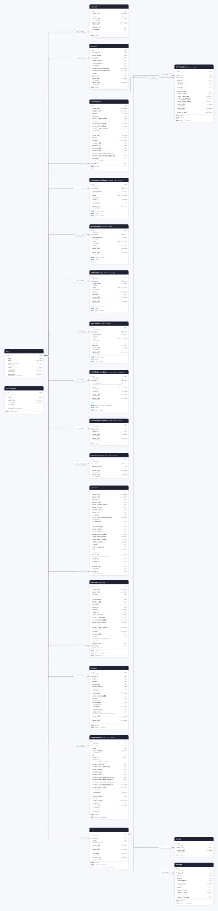

<details>
<summary>The whole schema as SQL</summary>

```sql
CREATE TABLE "account" (
	"id" text PRIMARY KEY,
	"account_id" text NOT NULL,
	"provider_id" text NOT NULL,
	"user_id" text NOT NULL,
	"access_token" text,
	"refresh_token" text,
	"id_token" text,
	"access_token_expires_at" timestamp,
	"refresh_token_expires_at" timestamp,
	"scope" text,
	"password" text,
	"created_at" timestamp DEFAULT now() NOT NULL,
	"updated_at" timestamp NOT NULL
);

CREATE TABLE "agent_mode_usage_events" (
	"id" text PRIMARY KEY,
	"user_id" text NOT NULL,
	"message_id" text NOT NULL,
	"date" timestamp DEFAULT now() NOT NULL,
	"reset_at" timestamp NOT NULL,
	"created_at" timestamp DEFAULT now() NOT NULL,
	"updated_at" timestamp DEFAULT now() NOT NULL
);

CREATE TABLE "anthropic_usage" (
	"id" text PRIMARY KEY,
	"user_id" text NOT NULL,
	"usage_count" integer DEFAULT 0 NOT NULL,
	"date" timestamp DEFAULT now() NOT NULL,
	"reset_at" timestamp NOT NULL,
	"metadata" jsonb,
	"created_at" timestamp DEFAULT now() NOT NULL,
	"updated_at" timestamp DEFAULT now() NOT NULL
);

CREATE TABLE "build_session" (
	"id" text PRIMARY KEY,
	"chat_id" text NOT NULL,
	"user_id" text NOT NULL,
	"box_id" text,
	"runtime" text DEFAULT 'node' NOT NULL,
	"status" text DEFAULT 'active' NOT NULL,
	"snapshot_id" text,
	"total_cost_usd" real,
	"total_compute_ms" integer,
	"total_input_tokens" integer,
	"total_output_tokens" integer,
	"created_at" timestamp DEFAULT now() NOT NULL,
	"updated_at" timestamp DEFAULT now() NOT NULL,
	"completed_at" timestamp
);

CREATE TABLE "chat" (
	"id" text PRIMARY KEY,
	"userId" text NOT NULL,
	"title" text DEFAULT 'New Chat' NOT NULL,
	"created_at" timestamp DEFAULT now() NOT NULL,
	"updated_at" timestamp DEFAULT now() NOT NULL,
	"is_pinned" boolean DEFAULT false NOT NULL,
	"visibility" varchar DEFAULT 'private' NOT NULL
);

CREATE TABLE "custom_instructions" (
	"id" text PRIMARY KEY,
	"user_id" text NOT NULL,
	"content" text NOT NULL,
	"created_at" timestamp DEFAULT now() NOT NULL,
	"updated_at" timestamp DEFAULT now() NOT NULL
);

CREATE TABLE "dodosubscription" (
	"id" text PRIMARY KEY,
	"created_at" timestamp NOT NULL,
	"updated_at" timestamp,
	"status" text NOT NULL,
	"product_id" text NOT NULL,
	"customer_id" text NOT NULL,
	"business_id" text,
	"brand_id" text,
	"currency" text NOT NULL,
	"amount" integer NOT NULL,
	"interval" text,
	"interval_count" integer,
	"trial_period_days" integer,
	"current_period_start" timestamp,
	"current_period_end" timestamp,
	"cancelled_at" timestamp,
	"cancel_at_period_end" boolean DEFAULT false,
	"ended_at" timestamp,
	"discount_id" text,
	"customer" json,
	"metadata" json,
	"product_cart" json,
	"user_id" text
);

CREATE TABLE "extreme_search_usage" (
	"id" text PRIMARY KEY,
	"user_id" text NOT NULL,
	"search_count" integer DEFAULT 0 NOT NULL,
	"date" timestamp DEFAULT now() NOT NULL,
	"reset_at" timestamp NOT NULL,
	"created_at" timestamp DEFAULT now() NOT NULL,
	"updated_at" timestamp DEFAULT now() NOT NULL
);

CREATE TABLE "google_usage" (
	"id" text PRIMARY KEY,
	"user_id" text NOT NULL,
	"usage_count" integer DEFAULT 0 NOT NULL,
	"date" timestamp DEFAULT now() NOT NULL,
	"reset_at" timestamp NOT NULL,
	"metadata" jsonb,
	"created_at" timestamp DEFAULT now() NOT NULL,
	"updated_at" timestamp DEFAULT now() NOT NULL
);

CREATE TABLE "lookout" (
	"id" text PRIMARY KEY,
	"user_id" text NOT NULL,
	"title" text NOT NULL,
	"prompt" text NOT NULL,
	"frequency" text NOT NULL,
	"cron_schedule" text NOT NULL,
	"timezone" text DEFAULT 'UTC' NOT NULL,
	"next_run_at" timestamp NOT NULL,
	"qstash_schedule_id" text,
	"status" text DEFAULT 'active' NOT NULL,
	"search_mode" text DEFAULT 'extreme' NOT NULL,
	"last_run_at" timestamp,
	"last_run_chat_id" text,
	"run_history" json DEFAULT '[]',
	"created_at" timestamp DEFAULT now() NOT NULL,
	"updated_at" timestamp DEFAULT now() NOT NULL
);

CREATE TABLE "message" (
	"id" text PRIMARY KEY,
	"chat_id" text NOT NULL,
	"role" text NOT NULL,
	"parts" json NOT NULL,
	"attachments" json NOT NULL,
	"created_at" timestamp DEFAULT now() NOT NULL,
	"model" text,
	"input_tokens" integer,
	"output_tokens" integer,
	"total_tokens" integer,
	"completion_time" real
);

CREATE TABLE "message_usage" (
	"id" text PRIMARY KEY,
	"user_id" text NOT NULL,
	"message_count" integer DEFAULT 0 NOT NULL,
	"date" timestamp DEFAULT now() NOT NULL,
	"reset_at" timestamp NOT NULL,
	"created_at" timestamp DEFAULT now() NOT NULL,
	"updated_at" timestamp DEFAULT now() NOT NULL
);

CREATE TABLE "payment" (
	"id" text PRIMARY KEY,
	"created_at" timestamp NOT NULL,
	"updated_at" timestamp,
	"brand_id" text,
	"business_id" text,
	"card_issuing_country" text,
	"card_last_four" text,
	"card_network" text,
	"card_type" text,
	"currency" text NOT NULL,
	"digital_products_delivered" boolean DEFAULT false,
	"discount_id" text,
	"error_code" text,
	"error_message" text,
	"payment_link" text,
	"payment_method" text,
	"payment_method_type" text,
	"settlement_amount" integer,
	"settlement_currency" text,
	"settlement_tax" integer,
	"status" text,
	"subscription_id" text,
	"tax" integer,
	"total_amount" integer NOT NULL,
	"billing" json,
	"customer" json,
	"disputes" json,
	"metadata" json,
	"product_cart" json,
	"refunds" json,
	"user_id" text
);

CREATE TABLE "session" (
	"id" text PRIMARY KEY,
	"expires_at" timestamp NOT NULL,
	"token" text NOT NULL UNIQUE,
	"created_at" timestamp DEFAULT now() NOT NULL,
	"updated_at" timestamp NOT NULL,
	"ip_address" text,
	"user_agent" text,
	"user_id" text NOT NULL
);

CREATE TABLE "stream" (
	"id" text PRIMARY KEY,
	"chatId" text NOT NULL,
	"createdAt" timestamp DEFAULT now() NOT NULL
);

CREATE TABLE "subscription" (
	"id" text PRIMARY KEY,
	"createdAt" timestamp NOT NULL,
	"modifiedAt" timestamp,
	"amount" integer NOT NULL,
	"currency" text NOT NULL,
	"recurringInterval" text NOT NULL,
	"status" text NOT NULL,
	"currentPeriodStart" timestamp NOT NULL,
	"currentPeriodEnd" timestamp NOT NULL,
	"cancelAtPeriodEnd" boolean DEFAULT false NOT NULL,
	"canceledAt" timestamp,
	"startedAt" timestamp NOT NULL,
	"endsAt" timestamp,
	"endedAt" timestamp,
	"customerId" text NOT NULL,
	"productId" text NOT NULL,
	"discountId" text,
	"checkoutId" text NOT NULL,
	"customerCancellationReason" text,
	"customerCancellationComment" text,
	"metadata" text,
	"customFieldData" text,
	"userId" text
);

CREATE TABLE "user" (
	"id" text PRIMARY KEY,
	"name" text NOT NULL,
	"email" text NOT NULL UNIQUE,
	"email_verified" boolean DEFAULT false NOT NULL,
	"image" text,
	"created_at" timestamp DEFAULT now() NOT NULL,
	"updated_at" timestamp DEFAULT now() NOT NULL
);

CREATE TABLE "user_mcp_server" (
	"id" text PRIMARY KEY,
	"user_id" text NOT NULL,
	"name" text NOT NULL,
	"transport_type" varchar DEFAULT 'http' NOT NULL,
	"url" text NOT NULL,
	"auth_type" varchar DEFAULT 'none' NOT NULL,
	"encrypted_credentials" text,
	"oauth_issuer_url" text,
	"oauth_authorization_url" text,
	"oauth_token_url" text,
	"oauth_scopes" text,
	"oauth_client_id" text,
	"oauth_client_secret_encrypted" text,
	"oauth_access_token_encrypted" text,
	"oauth_refresh_token_encrypted" text,
	"oauth_access_token_expires_at" timestamp,
	"oauth_connected_at" timestamp,
	"oauth_error" text,
	"is_enabled" boolean DEFAULT true NOT NULL,
	"disabled_tools" json DEFAULT '[]',
	"last_tested_at" timestamp,
	"last_error" text,
	"created_at" timestamp DEFAULT now() NOT NULL,
	"updated_at" timestamp DEFAULT now() NOT NULL
);

CREATE TABLE "user_preferences" (
	"id" text PRIMARY KEY,
	"user_id" text NOT NULL UNIQUE,
	"preferences" json DEFAULT '{}' NOT NULL,
	"created_at" timestamp DEFAULT now() NOT NULL,
	"updated_at" timestamp DEFAULT now() NOT NULL
);

CREATE TABLE "verification" (
	"id" text PRIMARY KEY,
	"identifier" text NOT NULL,
	"value" text NOT NULL,
	"expires_at" timestamp NOT NULL,
	"created_at" timestamp DEFAULT now() NOT NULL,
	"updated_at" timestamp DEFAULT now() NOT NULL
);

CREATE INDEX "account_userId_idx" ON "account" ("user_id");

CREATE INDEX "agentModeUsageEvents_userId_idx" ON "agent_mode_usage_events" ("user_id");

CREATE INDEX "agentModeUsageEvents_userId_date_idx" ON "agent_mode_usage_events" ("user_id","date");

CREATE UNIQUE INDEX "agentModeUsageEvents_messageId_unique" ON "agent_mode_usage_events" ("message_id");

CREATE UNIQUE INDEX "agentModeUsageEvents_userId_date_messageId_unique" ON "agent_mode_usage_events" ("user_id","date","message_id");

CREATE INDEX "anthropicUsage_userId_idx" ON "anthropic_usage" ("user_id");

CREATE INDEX "anthropicUsage_userId_date_idx" ON "anthropic_usage" ("user_id","date");

CREATE UNIQUE INDEX "anthropicUsage_userId_date_unique" ON "anthropic_usage" ("user_id","date");

CREATE INDEX "build_session_chatId_idx" ON "build_session" ("chat_id");

CREATE INDEX "build_session_userId_idx" ON "build_session" ("user_id");

CREATE INDEX "build_session_userId_status_idx" ON "build_session" ("user_id","status");

CREATE INDEX "chat_userId_idx" ON "chat" ("userId");

CREATE INDEX "chat_userId_createdAt_idx" ON "chat" ("userId","created_at");

CREATE INDEX "chat_userId_isPinned_updatedAt_idx" ON "chat" ("userId","is_pinned","updated_at");

CREATE INDEX "customInstructions_userId_idx" ON "custom_instructions" ("user_id");

CREATE INDEX "dodosubscription_userId_idx" ON "dodosubscription" ("user_id");

CREATE INDEX "dodosubscription_userId_status_idx" ON "dodosubscription" ("user_id","status");

CREATE INDEX "dodosubscription_customerId_idx" ON "dodosubscription" ("customer_id");

CREATE INDEX "extremeSearchUsage_userId_idx" ON "extreme_search_usage" ("user_id");

CREATE INDEX "extremeSearchUsage_userId_date_idx" ON "extreme_search_usage" ("user_id","date");

CREATE UNIQUE INDEX "extremeSearchUsage_userId_date_unique" ON "extreme_search_usage" ("user_id","date");

CREATE INDEX "googleUsage_userId_idx" ON "google_usage" ("user_id");

CREATE INDEX "googleUsage_userId_date_idx" ON "google_usage" ("user_id","date");

CREATE UNIQUE INDEX "googleUsage_userId_date_unique" ON "google_usage" ("user_id","date");

CREATE INDEX "lookout_userId_idx" ON "lookout" ("user_id");

CREATE INDEX "lookout_userId_status_idx" ON "lookout" ("user_id","status");

CREATE INDEX "message_chatId_idx" ON "message" ("chat_id");

CREATE INDEX "message_chatId_createdAt_idx" ON "message" ("chat_id","created_at");

CREATE INDEX "messageUsage_userId_idx" ON "message_usage" ("user_id");

CREATE INDEX "messageUsage_userId_date_idx" ON "message_usage" ("user_id","date");

CREATE UNIQUE INDEX "messageUsage_userId_date_unique" ON "message_usage" ("user_id","date");

CREATE INDEX "session_userId_idx" ON "session" ("user_id");

CREATE INDEX "stream_chatId_idx" ON "stream" ("chatId");

CREATE INDEX "subscription_userId_idx" ON "subscription" ("userId");

CREATE INDEX "subscription_userId_status_idx" ON "subscription" ("userId","status");

CREATE INDEX "userMcpServer_userId_idx" ON "user_mcp_server" ("user_id");

CREATE INDEX "userMcpServer_userId_enabled_idx" ON "user_mcp_server" ("user_id","is_enabled");

CREATE INDEX "verification_identifier_idx" ON "verification" ("identifier");

ALTER TABLE "account" ADD CONSTRAINT "account_user_id_user_id_fkey" FOREIGN KEY ("user_id") REFERENCES "user"("id") ON DELETE CASCADE;

ALTER TABLE "agent_mode_usage_events" ADD CONSTRAINT "agent_mode_usage_events_user_id_user_id_fkey" FOREIGN KEY ("user_id") REFERENCES "user"("id") ON DELETE CASCADE;

ALTER TABLE "anthropic_usage" ADD CONSTRAINT "anthropic_usage_user_id_user_id_fkey" FOREIGN KEY ("user_id") REFERENCES "user"("id") ON DELETE CASCADE;

ALTER TABLE "build_session" ADD CONSTRAINT "build_session_chat_id_chat_id_fkey" FOREIGN KEY ("chat_id") REFERENCES "chat"("id") ON DELETE CASCADE;

ALTER TABLE "build_session" ADD CONSTRAINT "build_session_user_id_user_id_fkey" FOREIGN KEY ("user_id") REFERENCES "user"("id") ON DELETE CASCADE;

ALTER TABLE "chat" ADD CONSTRAINT "chat_userId_user_id_fkey" FOREIGN KEY ("userId") REFERENCES "user"("id");

ALTER TABLE "custom_instructions" ADD CONSTRAINT "custom_instructions_user_id_user_id_fkey" FOREIGN KEY ("user_id") REFERENCES "user"("id") ON DELETE CASCADE;

ALTER TABLE "dodosubscription" ADD CONSTRAINT "dodosubscription_user_id_user_id_fkey" FOREIGN KEY ("user_id") REFERENCES "user"("id");

ALTER TABLE "extreme_search_usage" ADD CONSTRAINT "extreme_search_usage_user_id_user_id_fkey" FOREIGN KEY ("user_id") REFERENCES "user"("id") ON DELETE CASCADE;

ALTER TABLE "google_usage" ADD CONSTRAINT "google_usage_user_id_user_id_fkey" FOREIGN KEY ("user_id") REFERENCES "user"("id") ON DELETE CASCADE;

ALTER TABLE "lookout" ADD CONSTRAINT "lookout_user_id_user_id_fkey" FOREIGN KEY ("user_id") REFERENCES "user"("id") ON DELETE CASCADE;

ALTER TABLE "message" ADD CONSTRAINT "message_chat_id_chat_id_fkey" FOREIGN KEY ("chat_id") REFERENCES "chat"("id") ON DELETE CASCADE;

ALTER TABLE "message_usage" ADD CONSTRAINT "message_usage_user_id_user_id_fkey" FOREIGN KEY ("user_id") REFERENCES "user"("id") ON DELETE CASCADE;

ALTER TABLE "payment" ADD CONSTRAINT "payment_user_id_user_id_fkey" FOREIGN KEY ("user_id") REFERENCES "user"("id");

ALTER TABLE "session" ADD CONSTRAINT "session_user_id_user_id_fkey" FOREIGN KEY ("user_id") REFERENCES "user"("id") ON DELETE CASCADE;

ALTER TABLE "stream" ADD CONSTRAINT "stream_chatId_chat_id_fkey" FOREIGN KEY ("chatId") REFERENCES "chat"("id") ON DELETE CASCADE;

ALTER TABLE "subscription" ADD CONSTRAINT "subscription_userId_user_id_fkey" FOREIGN KEY ("userId") REFERENCES "user"("id");

ALTER TABLE "user_mcp_server" ADD CONSTRAINT "user_mcp_server_user_id_user_id_fkey" FOREIGN KEY ("user_id") REFERENCES "user"("id") ON DELETE CASCADE;

ALTER TABLE "user_preferences" ADD CONSTRAINT "user_preferences_user_id_user_id_fkey" FOREIGN KEY ("user_id") REFERENCES "user"("id") ON DELETE CASCADE;
```

</details>

## Contents

| Table                                               | Name in the database      | Description                                                                                                                                         |
| --------------------------------------------------- | ------------------------- | --------------------------------------------------------------------------------------------------------------------------------------------------- |
| [user](#table-user)                                 | `user`                    |                                                                                                                                                     |
| [session](#table-session)                           | `session`                 |                                                                                                                                                     |
| [account](#table-account)                           | `account`                 |                                                                                                                                                     |
| [verification](#table-verification)                 | `verification`            |                                                                                                                                                     |
| [chat](#table-chat)                                 | `chat`                    |                                                                                                                                                     |
| [message](#table-message)                           | `message`                 |                                                                                                                                                     |
| [stream](#table-stream)                             | `stream`                  |                                                                                                                                                     |
| [subscription](#table-subscription)                 | `subscription`            | Subscription table for Polar webhook data                                                                                                           |
| [extremeSearchUsage](#table-extremeSearchUsage)     | `extreme_search_usage`    | Extreme search usage tracking table                                                                                                                 |
| [messageUsage](#table-messageUsage)                 | `message_usage`           | Message usage tracking table                                                                                                                        |
| [anthropicUsage](#table-anthropicUsage)             | `anthropic_usage`         | Anthropic daily usage tracking table                                                                                                                |
| [googleUsage](#table-googleUsage)                   | `google_usage`            | Google (Gemini Max) monthly usage tracking table                                                                                                    |
| [agentModeUsageEvents](#table-agentModeUsageEvents) | `agent_mode_usage_events` | Agent mode monthly usage tracking (append-only events keyed by user message id) This prevents usage from being bypassed by deleting sessions/chats. |
| [customInstructions](#table-customInstructions)     | `custom_instructions`     | Custom instructions table                                                                                                                           |
| [userPreferences](#table-userPreferences)           | `user_preferences`        | User preferences table                                                                                                                              |
| [payment](#table-payment)                           | `payment`                 | Payment table for Dodo Payments webhook data                                                                                                        |
| [dodosubscription](#table-dodosubscription)         | `dodosubscription`        | Dodo Subscription table for Dodo Payments subscription webhook data                                                                                 |
| [lookout](#table-lookout)                           | `lookout`                 | Lookout table for scheduled searches                                                                                                                |
| [userMcpServer](#table-userMcpServer)               | `user_mcp_server`         |                                                                                                                                                     |
| [buildSession](#table-buildSession)                 | `build_session`           |                                                                                                                                                     |

## Tables

<a id="table-user"></a>

### user

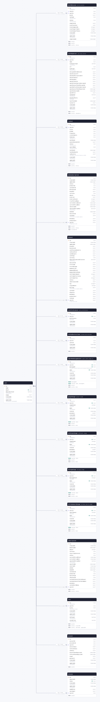

| Column                             | Type        | Constraints     | Default                        | Description |
| ---------------------------------- | ----------- | --------------- | ------------------------------ | ----------- |
| `id`                               | `text`      | PK NOT NULL     |                                |             |
| `name`                             | `text`      | NOT NULL        |                                |             |
| `email`                            | `text`      | UNIQUE NOT NULL |                                |             |
| `emailVerified` (`email_verified`) | `boolean`   | NOT NULL        | `.default(false)`              |             |
| `image`                            | `text`      | NULL            |                                |             |
| `createdAt` (`created_at`)         | `timestamp` | NOT NULL        | `.defaultNow()`                |             |
| `updatedAt` (`updated_at`)         | `timestamp` | NOT NULL        | `.defaultNow()` `.$onUpdate()` |             |

#### Definition

```sql
CREATE TABLE "user" (
	"id" text PRIMARY KEY,
	"name" text NOT NULL,
	"email" text NOT NULL UNIQUE,
	"email_verified" boolean DEFAULT false NOT NULL,
	"image" text,
	"created_at" timestamp DEFAULT now() NOT NULL,
	"updated_at" timestamp DEFAULT now() NOT NULL
);
```

#### Referenced by

- `id` → [session.userId](#table-session) (one to many, on delete cascade)
- `id` → [account.userId](#table-account) (one to many, on delete cascade)
- `id` → [chat.userId](#table-chat) (one to many)
- `id` → [subscription.userId](#table-subscription) (one to many)
- `id` → [extremeSearchUsage.userId](#table-extremeSearchUsage) (one to many, on delete cascade)
- `id` → [messageUsage.userId](#table-messageUsage) (one to many, on delete cascade)
- `id` → [anthropicUsage.userId](#table-anthropicUsage) (one to many, on delete cascade)
- `id` → [googleUsage.userId](#table-googleUsage) (one to many, on delete cascade)
- `id` → [agentModeUsageEvents.userId](#table-agentModeUsageEvents) (one to many, on delete cascade)
- `id` → [customInstructions.userId](#table-customInstructions) (one to many, on delete cascade)
- `id` → [userPreferences.userId](#table-userPreferences) (one to one, on delete cascade)
- `id` → [payment.userId](#table-payment) (one to many)
- `id` → [dodosubscription.userId](#table-dodosubscription) (one to many)
- `id` → [lookout.userId](#table-lookout) (one to many, on delete cascade)
- `id` → [userMcpServer.userId](#table-userMcpServer) (one to many, on delete cascade)
- `id` → [buildSession.userId](#table-buildSession) (one to many, on delete cascade)

<details>
<summary>Queries and their SQL</summary>

**Select**: Every row of user.

```ts
db.select().from(user);
```

```sql
select "id", "name", "email", "email_verified", "image", "created_at", "updated_at"
from "user"
```

**Count**: How many rows user has.

```ts
db.select({ count: count() }).from(user);
```

```sql
select count(*)
from "user"
```

**Find many**: The rows of user, through the relational query API.

```ts
db.query.user.findMany();
```

```sql
select "d0"."id" as "id", "d0"."name" as "name", "d0"."email" as "email", "d0"."email_verified" as "emailVerified", "d0"."image" as "image", "d0"."created_at" as "createdAt", "d0"."updated_at" as "updatedAt"
from "user" as "d0"
```

**Find by primary key**: One row of user, through the relational query API.

```ts
db.query.user.findFirst({ where: { id: "id" } });
```

```sql
select "d0"."id" as "id", "d0"."name" as "name", "d0"."email" as "email", "d0"."email_verified" as "emailVerified", "d0"."image" as "image", "d0"."created_at" as "createdAt", "d0"."updated_at" as "updatedAt"
from "user" as "d0"
where "d0"."id" = $1
limit $2
-- params: ["id",1]
```

**Insert**: Adds a row to user, giving the columns that have no default.

```ts
db.insert(user).values({ id: "id", name: "name", email: "email" });
```

```sql
insert into "user" ("id", "name", "email", "email_verified", "image", "created_at", "updated_at")
values ($1, $2, $3, default, default, default, default)
-- params: ["id","name","email"]
```

**Update**: Changes a row of user, found by its primary key.

```ts
db.update(user).set({ name: "name" }).where(eq(user.id, "id"));
```

```sql
update "user"
set "name" = $1, "updated_at" = $2
where "user"."id" = $3
-- params: ["name","2026-01-01T00:00:00.000Z","id"]
```

**Delete**: Deletes a row of user, found by its primary key.

```ts
db.delete(user).where(eq(user.id, "id"));
```

```sql
delete from "user"
where "user"."id" = $1
-- params: ["id"]
```

</details>

<a id="table-session"></a>

### session

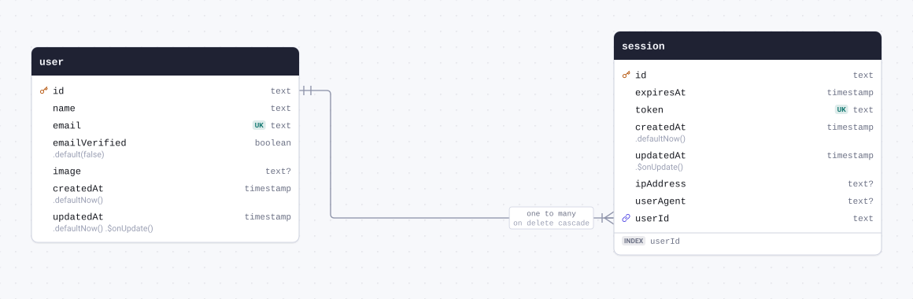

| Column                     | Type        | Constraints                       | Default         | Description |
| -------------------------- | ----------- | --------------------------------- | --------------- | ----------- |
| `id`                       | `text`      | PK NOT NULL                       |                 |             |
| `expiresAt` (`expires_at`) | `timestamp` | NOT NULL                          |                 |             |
| `token`                    | `text`      | UNIQUE NOT NULL                   |                 |             |
| `createdAt` (`created_at`) | `timestamp` | NOT NULL                          | `.defaultNow()` |             |
| `updatedAt` (`updated_at`) | `timestamp` | NOT NULL                          | `.$onUpdate()`  |             |
| `ipAddress` (`ip_address`) | `text`      | NULL                              |                 |             |
| `userAgent` (`user_agent`) | `text`      | NULL                              |                 |             |
| `userId` (`user_id`)       | `text`      | NOT NULL → [user.id](#table-user) |                 |             |

#### Definition

```sql
CREATE TABLE "session" (
	"id" text PRIMARY KEY,
	"expires_at" timestamp NOT NULL,
	"token" text NOT NULL UNIQUE,
	"created_at" timestamp DEFAULT now() NOT NULL,
	"updated_at" timestamp NOT NULL,
	"ip_address" text,
	"user_agent" text,
	"user_id" text NOT NULL
);

CREATE INDEX "session_userId_idx" ON "session" ("user_id");

ALTER TABLE "session" ADD CONSTRAINT "session_user_id_user_id_fkey" FOREIGN KEY ("user_id") REFERENCES "user"("id") ON DELETE CASCADE;
```

#### Indexes

- INDEX `userId`

#### References

- `userId` → [user.id](#table-user) (many to one, on delete cascade)

<details>
<summary>Queries and their SQL</summary>

**Select**: Every row of session.

```ts
db.select().from(session);
```

```sql
select "id", "expires_at", "token", "created_at", "updated_at", "ip_address", "user_agent", "user_id"
from "session"
```

**Count**: How many rows session has.

```ts
db.select({ count: count() }).from(session);
```

```sql
select count(*)
from "session"
```

**Find many**: The rows of session, through the relational query API.

```ts
db.query.session.findMany();
```

```sql
select "d0"."id" as "id", "d0"."expires_at" as "expiresAt", "d0"."token" as "token", "d0"."created_at" as "createdAt", "d0"."updated_at" as "updatedAt", "d0"."ip_address" as "ipAddress", "d0"."user_agent" as "userAgent", "d0"."user_id" as "userId"
from "session" as "d0"
```

**Find by primary key**: One row of session, through the relational query API.

```ts
db.query.session.findFirst({ where: { id: "id" } });
```

```sql
select "d0"."id" as "id", "d0"."expires_at" as "expiresAt", "d0"."token" as "token", "d0"."created_at" as "createdAt", "d0"."updated_at" as "updatedAt", "d0"."ip_address" as "ipAddress", "d0"."user_agent" as "userAgent", "d0"."user_id" as "userId"
from "session" as "d0"
where "d0"."id" = $1
limit $2
-- params: ["id",1]
```

**Insert**: Adds a row to session, giving the columns that have no default.

```ts
db.insert(session).values({
  id: "id",
  expiresAt: new Date("2026-01-01T00:00:00.000Z"),
  token: "token",
  updatedAt: new Date("2026-01-01T00:00:00.000Z"),
  userId: "userId",
});
```

```sql
insert into "session" ("id", "expires_at", "token", "created_at", "updated_at", "ip_address", "user_agent", "user_id")
values ($1, $2, $3, default, $4, default, default, $5)
-- params: ["id","2026-01-01T00:00:00.000Z","token","2026-01-01T00:00:00.000Z","userId"]
```

**Update**: Changes a row of session, found by its primary key.

```ts
db.update(session)
  .set({ expiresAt: new Date("2026-01-01T00:00:00.000Z") })
  .where(eq(session.id, "id"));
```

```sql
update "session"
set "expires_at" = $1, "updated_at" = $2
where "session"."id" = $3
-- params: ["2026-01-01T00:00:00.000Z","2026-01-01T00:00:00.000Z","id"]
```

**Delete**: Deletes a row of session, found by its primary key.

```ts
db.delete(session).where(eq(session.id, "id"));
```

```sql
delete from "session"
where "session"."id" = $1
-- params: ["id"]
```

</details>

<a id="table-account"></a>

### account

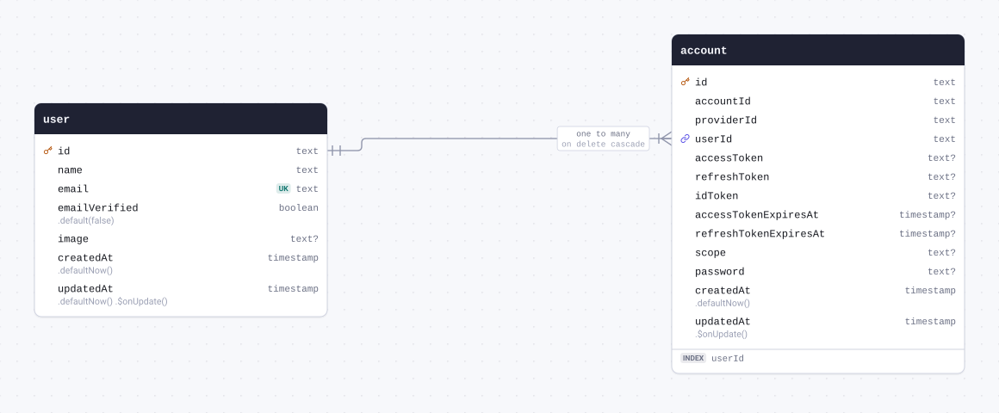

| Column                                               | Type        | Constraints                       | Default         | Description |
| ---------------------------------------------------- | ----------- | --------------------------------- | --------------- | ----------- |
| `id`                                                 | `text`      | PK NOT NULL                       |                 |             |
| `accountId` (`account_id`)                           | `text`      | NOT NULL                          |                 |             |
| `providerId` (`provider_id`)                         | `text`      | NOT NULL                          |                 |             |
| `userId` (`user_id`)                                 | `text`      | NOT NULL → [user.id](#table-user) |                 |             |
| `accessToken` (`access_token`)                       | `text`      | NULL                              |                 |             |
| `refreshToken` (`refresh_token`)                     | `text`      | NULL                              |                 |             |
| `idToken` (`id_token`)                               | `text`      | NULL                              |                 |             |
| `accessTokenExpiresAt` (`access_token_expires_at`)   | `timestamp` | NULL                              |                 |             |
| `refreshTokenExpiresAt` (`refresh_token_expires_at`) | `timestamp` | NULL                              |                 |             |
| `scope`                                              | `text`      | NULL                              |                 |             |
| `password`                                           | `text`      | NULL                              |                 |             |
| `createdAt` (`created_at`)                           | `timestamp` | NOT NULL                          | `.defaultNow()` |             |
| `updatedAt` (`updated_at`)                           | `timestamp` | NOT NULL                          | `.$onUpdate()`  |             |

#### Definition

```sql
CREATE TABLE "account" (
	"id" text PRIMARY KEY,
	"account_id" text NOT NULL,
	"provider_id" text NOT NULL,
	"user_id" text NOT NULL,
	"access_token" text,
	"refresh_token" text,
	"id_token" text,
	"access_token_expires_at" timestamp,
	"refresh_token_expires_at" timestamp,
	"scope" text,
	"password" text,
	"created_at" timestamp DEFAULT now() NOT NULL,
	"updated_at" timestamp NOT NULL
);

CREATE INDEX "account_userId_idx" ON "account" ("user_id");

ALTER TABLE "account" ADD CONSTRAINT "account_user_id_user_id_fkey" FOREIGN KEY ("user_id") REFERENCES "user"("id") ON DELETE CASCADE;
```

#### Indexes

- INDEX `userId`

#### References

- `userId` → [user.id](#table-user) (many to one, on delete cascade)

<details>
<summary>Queries and their SQL</summary>

**Select**: Every row of account.

```ts
db.select().from(account);
```

```sql
select "id", "account_id", "provider_id", "user_id", "access_token", "refresh_token", "id_token", "access_token_expires_at", "refresh_token_expires_at", "scope", "password", "created_at", "updated_at"
from "account"
```

**Count**: How many rows account has.

```ts
db.select({ count: count() }).from(account);
```

```sql
select count(*)
from "account"
```

**Find many**: The rows of account, through the relational query API.

```ts
db.query.account.findMany();
```

```sql
select "d0"."id" as "id", "d0"."account_id" as "accountId", "d0"."provider_id" as "providerId", "d0"."user_id" as "userId", "d0"."access_token" as "accessToken", "d0"."refresh_token" as "refreshToken", "d0"."id_token" as "idToken", "d0"."access_token_expires_at" as "accessTokenExpiresAt", "d0"."refresh_token_expires_at" as "refreshTokenExpiresAt", "d0"."scope" as "scope", "d0"."password" as "password", "d0"."created_at" as "createdAt", "d0"."updated_at" as "updatedAt"
from "account" as "d0"
```

**Find by primary key**: One row of account, through the relational query API.

```ts
db.query.account.findFirst({ where: { id: "id" } });
```

```sql
select "d0"."id" as "id", "d0"."account_id" as "accountId", "d0"."provider_id" as "providerId", "d0"."user_id" as "userId", "d0"."access_token" as "accessToken", "d0"."refresh_token" as "refreshToken", "d0"."id_token" as "idToken", "d0"."access_token_expires_at" as "accessTokenExpiresAt", "d0"."refresh_token_expires_at" as "refreshTokenExpiresAt", "d0"."scope" as "scope", "d0"."password" as "password", "d0"."created_at" as "createdAt", "d0"."updated_at" as "updatedAt"
from "account" as "d0"
where "d0"."id" = $1
limit $2
-- params: ["id",1]
```

**Insert**: Adds a row to account, giving the columns that have no default.

```ts
db.insert(account).values({
  id: "id",
  accountId: "accountId",
  providerId: "providerId",
  userId: "userId",
  updatedAt: new Date("2026-01-01T00:00:00.000Z"),
});
```

```sql
insert into "account" ("id", "account_id", "provider_id", "user_id", "access_token", "refresh_token", "id_token", "access_token_expires_at", "refresh_token_expires_at", "scope", "password", "created_at", "updated_at")
values ($1, $2, $3, $4, default, default, default, default, default, default, default, default, $5)
-- params: ["id","accountId","providerId","userId","2026-01-01T00:00:00.000Z"]
```

**Update**: Changes a row of account, found by its primary key.

```ts
db.update(account).set({ accountId: "accountId" }).where(eq(account.id, "id"));
```

```sql
update "account"
set "account_id" = $1, "updated_at" = $2
where "account"."id" = $3
-- params: ["accountId","2026-01-01T00:00:00.000Z","id"]
```

**Delete**: Deletes a row of account, found by its primary key.

```ts
db.delete(account).where(eq(account.id, "id"));
```

```sql
delete from "account"
where "account"."id" = $1
-- params: ["id"]
```

</details>

<a id="table-verification"></a>

### verification

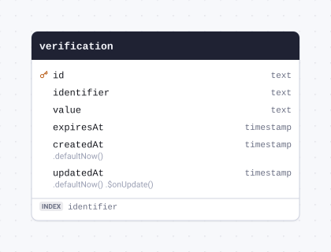

| Column                     | Type        | Constraints | Default                        | Description |
| -------------------------- | ----------- | ----------- | ------------------------------ | ----------- |
| `id`                       | `text`      | PK NOT NULL |                                |             |
| `identifier`               | `text`      | NOT NULL    |                                |             |
| `value`                    | `text`      | NOT NULL    |                                |             |
| `expiresAt` (`expires_at`) | `timestamp` | NOT NULL    |                                |             |
| `createdAt` (`created_at`) | `timestamp` | NOT NULL    | `.defaultNow()`                |             |
| `updatedAt` (`updated_at`) | `timestamp` | NOT NULL    | `.defaultNow()` `.$onUpdate()` |             |

#### Definition

```sql
CREATE TABLE "verification" (
	"id" text PRIMARY KEY,
	"identifier" text NOT NULL,
	"value" text NOT NULL,
	"expires_at" timestamp NOT NULL,
	"created_at" timestamp DEFAULT now() NOT NULL,
	"updated_at" timestamp DEFAULT now() NOT NULL
);

CREATE INDEX "verification_identifier_idx" ON "verification" ("identifier");
```

#### Indexes

- INDEX `identifier`

<details>
<summary>Queries and their SQL</summary>

**Select**: Every row of verification.

```ts
db.select().from(verification);
```

```sql
select "id", "identifier", "value", "expires_at", "created_at", "updated_at"
from "verification"
```

**Count**: How many rows verification has.

```ts
db.select({ count: count() }).from(verification);
```

```sql
select count(*)
from "verification"
```

**Find many**: The rows of verification, through the relational query API.

```ts
db.query.verification.findMany();
```

```sql
select "d0"."id" as "id", "d0"."identifier" as "identifier", "d0"."value" as "value", "d0"."expires_at" as "expiresAt", "d0"."created_at" as "createdAt", "d0"."updated_at" as "updatedAt"
from "verification" as "d0"
```

**Find by primary key**: One row of verification, through the relational query API.

```ts
db.query.verification.findFirst({ where: { id: "id" } });
```

```sql
select "d0"."id" as "id", "d0"."identifier" as "identifier", "d0"."value" as "value", "d0"."expires_at" as "expiresAt", "d0"."created_at" as "createdAt", "d0"."updated_at" as "updatedAt"
from "verification" as "d0"
where "d0"."id" = $1
limit $2
-- params: ["id",1]
```

**Insert**: Adds a row to verification, giving the columns that have no default.

```ts
db.insert(verification).values({
  id: "id",
  identifier: "identifier",
  value: "value",
  expiresAt: new Date("2026-01-01T00:00:00.000Z"),
});
```

```sql
insert into "verification" ("id", "identifier", "value", "expires_at", "created_at", "updated_at")
values ($1, $2, $3, $4, default, default)
-- params: ["id","identifier","value","2026-01-01T00:00:00.000Z"]
```

**Update**: Changes a row of verification, found by its primary key.

```ts
db.update(verification).set({ identifier: "identifier" }).where(eq(verification.id, "id"));
```

```sql
update "verification"
set "identifier" = $1, "updated_at" = $2
where "verification"."id" = $3
-- params: ["identifier","2026-01-01T00:00:00.000Z","id"]
```

**Delete**: Deletes a row of verification, found by its primary key.

```ts
db.delete(verification).where(eq(verification.id, "id"));
```

```sql
delete from "verification"
where "verification"."id" = $1
-- params: ["id"]
```

</details>

<a id="table-chat"></a>

### chat

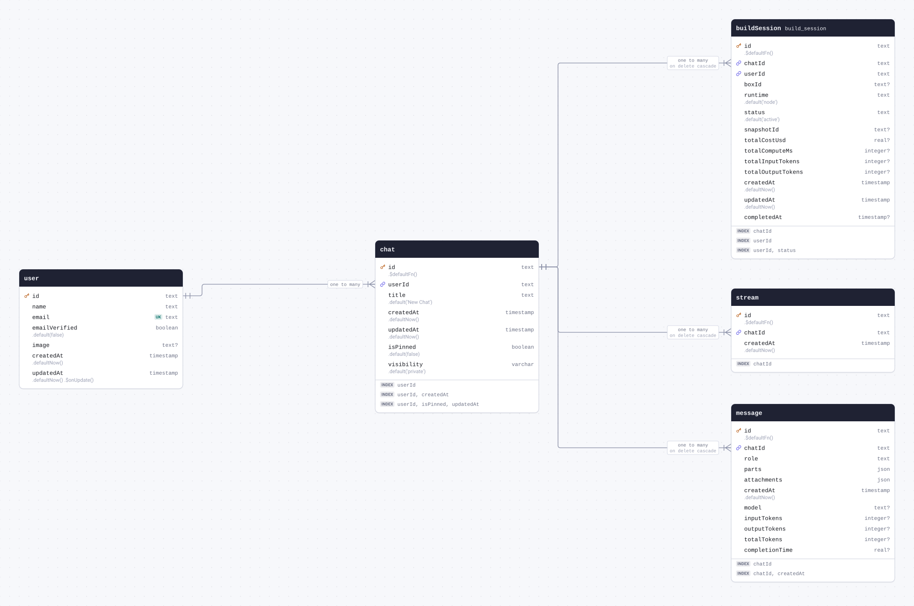

| Column                     | Type        | Constraints                       | Default                | Description |
| -------------------------- | ----------- | --------------------------------- | ---------------------- | ----------- |
| `id`                       | `text`      | PK NOT NULL                       | `.$defaultFn()`        |             |
| `userId`                   | `text`      | NOT NULL → [user.id](#table-user) |                        |             |
| `title`                    | `text`      | NOT NULL                          | `.default('New Chat')` |             |
| `createdAt` (`created_at`) | `timestamp` | NOT NULL                          | `.defaultNow()`        |             |
| `updatedAt` (`updated_at`) | `timestamp` | NOT NULL                          | `.defaultNow()`        |             |
| `isPinned` (`is_pinned`)   | `boolean`   | NOT NULL                          | `.default(false)`      |             |
| `visibility`               | `varchar`   | NOT NULL                          | `.default('private')`  |             |

#### Definition

```sql
CREATE TABLE "chat" (
	"id" text PRIMARY KEY,
	"userId" text NOT NULL,
	"title" text DEFAULT 'New Chat' NOT NULL,
	"created_at" timestamp DEFAULT now() NOT NULL,
	"updated_at" timestamp DEFAULT now() NOT NULL,
	"is_pinned" boolean DEFAULT false NOT NULL,
	"visibility" varchar DEFAULT 'private' NOT NULL
);

CREATE INDEX "chat_userId_idx" ON "chat" ("userId");

CREATE INDEX "chat_userId_createdAt_idx" ON "chat" ("userId","created_at");

CREATE INDEX "chat_userId_isPinned_updatedAt_idx" ON "chat" ("userId","is_pinned","updated_at");

ALTER TABLE "chat" ADD CONSTRAINT "chat_userId_user_id_fkey" FOREIGN KEY ("userId") REFERENCES "user"("id");
```

#### Indexes

- INDEX `userId`
- INDEX `userId`, `createdAt`
- INDEX `userId`, `isPinned`, `updatedAt`

#### References

- `userId` → [user.id](#table-user) (many to one)

#### Referenced by

- `id` → [message.chatId](#table-message) (one to many, on delete cascade)
- `id` → [stream.chatId](#table-stream) (one to many, on delete cascade)
- `id` → [buildSession.chatId](#table-buildSession) (one to many, on delete cascade)

<details>
<summary>Queries and their SQL</summary>

**Select**: Every row of chat.

```ts
db.select().from(chat);
```

```sql
select "id", "userId", "title", "created_at", "updated_at", "is_pinned", "visibility"
from "chat"
```

**Count**: How many rows chat has.

```ts
db.select({ count: count() }).from(chat);
```

```sql
select count(*)
from "chat"
```

**Find many**: The rows of chat, through the relational query API.

```ts
db.query.chat.findMany();
```

```sql
select "d0"."id" as "id", "d0"."userId" as "userId", "d0"."title" as "title", "d0"."created_at" as "createdAt", "d0"."updated_at" as "updatedAt", "d0"."is_pinned" as "isPinned", "d0"."visibility" as "visibility"
from "chat" as "d0"
```

**Find by primary key**: One row of chat, through the relational query API.

```ts
db.query.chat.findFirst({ where: { id: "id" } });
```

```sql
select "d0"."id" as "id", "d0"."userId" as "userId", "d0"."title" as "title", "d0"."created_at" as "createdAt", "d0"."updated_at" as "updatedAt", "d0"."is_pinned" as "isPinned", "d0"."visibility" as "visibility"
from "chat" as "d0"
where "d0"."id" = $1
limit $2
-- params: ["id",1]
```

**Insert**: Adds a row to chat, giving the columns that have no default.

```ts
db.insert(chat).values({ userId: "userId" });
```

```sql
insert into "chat" ("id", "userId", "title", "created_at", "updated_at", "is_pinned", "visibility")
values ($1, $2, default, default, default, default, default)
-- params: ["019b76da-a800-7000-8000-000000000000","userId"]
```

**Update**: Changes a row of chat, found by its primary key.

```ts
db.update(chat).set({ userId: "userId" }).where(eq(chat.id, "id"));
```

```sql
update "chat"
set "userId" = $1
where "chat"."id" = $2
-- params: ["userId","id"]
```

**Delete**: Deletes a row of chat, found by its primary key.

```ts
db.delete(chat).where(eq(chat.id, "id"));
```

```sql
delete from "chat"
where "chat"."id" = $1
-- params: ["id"]
```

</details>

<a id="table-message"></a>

### message

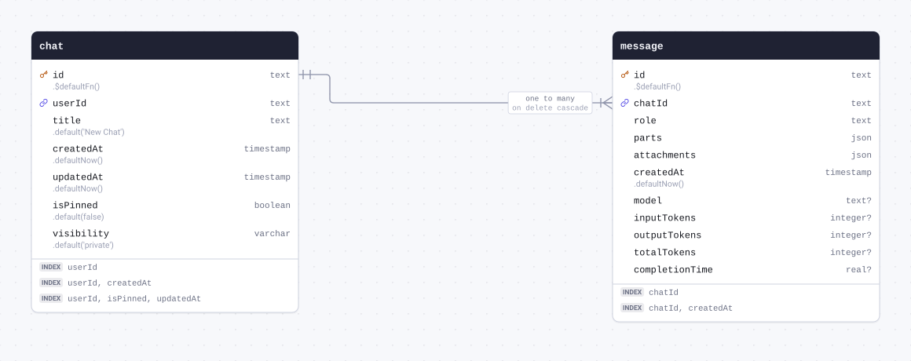

| Column                               | Type        | Constraints                       | Default         | Description |
| ------------------------------------ | ----------- | --------------------------------- | --------------- | ----------- |
| `id`                                 | `text`      | PK NOT NULL                       | `.$defaultFn()` |             |
| `chatId` (`chat_id`)                 | `text`      | NOT NULL → [chat.id](#table-chat) |                 |             |
| `role`                               | `text`      | NOT NULL                          |                 |             |
| `parts`                              | `json`      | NOT NULL                          |                 |             |
| `attachments`                        | `json`      | NOT NULL                          |                 |             |
| `createdAt` (`created_at`)           | `timestamp` | NOT NULL                          | `.defaultNow()` |             |
| `model`                              | `text`      | NULL                              |                 |             |
| `inputTokens` (`input_tokens`)       | `integer`   | NULL                              |                 |             |
| `outputTokens` (`output_tokens`)     | `integer`   | NULL                              |                 |             |
| `totalTokens` (`total_tokens`)       | `integer`   | NULL                              |                 |             |
| `completionTime` (`completion_time`) | `real`      | NULL                              |                 |             |

#### Definition

```sql
CREATE TABLE "message" (
	"id" text PRIMARY KEY,
	"chat_id" text NOT NULL,
	"role" text NOT NULL,
	"parts" json NOT NULL,
	"attachments" json NOT NULL,
	"created_at" timestamp DEFAULT now() NOT NULL,
	"model" text,
	"input_tokens" integer,
	"output_tokens" integer,
	"total_tokens" integer,
	"completion_time" real
);

CREATE INDEX "message_chatId_idx" ON "message" ("chat_id");

CREATE INDEX "message_chatId_createdAt_idx" ON "message" ("chat_id","created_at");

ALTER TABLE "message" ADD CONSTRAINT "message_chat_id_chat_id_fkey" FOREIGN KEY ("chat_id") REFERENCES "chat"("id") ON DELETE CASCADE;
```

#### Indexes

- INDEX `chatId`
- INDEX `chatId`, `createdAt`

#### References

- `chatId` → [chat.id](#table-chat) (many to one, on delete cascade)

<details>
<summary>Queries and their SQL</summary>

**Select**: Every row of message.

```ts
db.select().from(message);
```

```sql
select "id", "chat_id", "role", "parts", "attachments", "created_at", "model", "input_tokens", "output_tokens", "total_tokens", "completion_time"
from "message"
```

**Count**: How many rows message has.

```ts
db.select({ count: count() }).from(message);
```

```sql
select count(*)
from "message"
```

**Find many**: The rows of message, through the relational query API.

```ts
db.query.message.findMany();
```

```sql
select "d0"."id" as "id", "d0"."chat_id" as "chatId", "d0"."role" as "role", "d0"."parts" as "parts", "d0"."attachments" as "attachments", "d0"."created_at" as "createdAt", "d0"."model" as "model", "d0"."input_tokens" as "inputTokens", "d0"."output_tokens" as "outputTokens", "d0"."total_tokens" as "totalTokens", "d0"."completion_time" as "completionTime"
from "message" as "d0"
```

**Find by primary key**: One row of message, through the relational query API.

```ts
db.query.message.findFirst({ where: { id: "id" } });
```

```sql
select "d0"."id" as "id", "d0"."chat_id" as "chatId", "d0"."role" as "role", "d0"."parts" as "parts", "d0"."attachments" as "attachments", "d0"."created_at" as "createdAt", "d0"."model" as "model", "d0"."input_tokens" as "inputTokens", "d0"."output_tokens" as "outputTokens", "d0"."total_tokens" as "totalTokens", "d0"."completion_time" as "completionTime"
from "message" as "d0"
where "d0"."id" = $1
limit $2
-- params: ["id",1]
```

**Insert**: Adds a row to message, giving the columns that have no default.

```ts
db.insert(message).values({ chatId: "chatId", role: "role", parts: {}, attachments: {} });
```

```sql
insert into "message" ("id", "chat_id", "role", "parts", "attachments", "created_at", "model", "input_tokens", "output_tokens", "total_tokens", "completion_time")
values ($1, $2, $3, $4, $5, default, default, default, default, default, default)
-- params: ["VVVVVVVVVVVVVVVV","chatId","role",{},{}]
```

**Update**: Changes a row of message, found by its primary key.

```ts
db.update(message).set({ chatId: "chatId" }).where(eq(message.id, "id"));
```

```sql
update "message"
set "chat_id" = $1
where "message"."id" = $2
-- params: ["chatId","id"]
```

**Delete**: Deletes a row of message, found by its primary key.

```ts
db.delete(message).where(eq(message.id, "id"));
```

```sql
delete from "message"
where "message"."id" = $1
-- params: ["id"]
```

</details>

<a id="table-stream"></a>

### stream

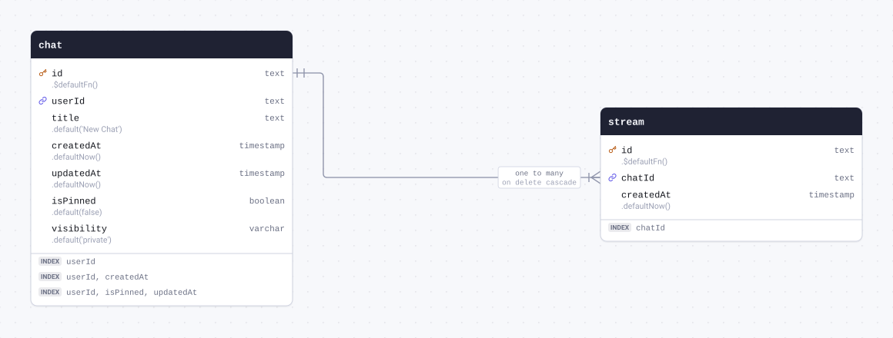

| Column      | Type        | Constraints                       | Default         | Description |
| ----------- | ----------- | --------------------------------- | --------------- | ----------- |
| `id`        | `text`      | PK NOT NULL                       | `.$defaultFn()` |             |
| `chatId`    | `text`      | NOT NULL → [chat.id](#table-chat) |                 |             |
| `createdAt` | `timestamp` | NOT NULL                          | `.defaultNow()` |             |

#### Definition

```sql
CREATE TABLE "stream" (
	"id" text PRIMARY KEY,
	"chatId" text NOT NULL,
	"createdAt" timestamp DEFAULT now() NOT NULL
);

CREATE INDEX "stream_chatId_idx" ON "stream" ("chatId");

ALTER TABLE "stream" ADD CONSTRAINT "stream_chatId_chat_id_fkey" FOREIGN KEY ("chatId") REFERENCES "chat"("id") ON DELETE CASCADE;
```

#### Indexes

- INDEX `chatId`

#### References

- `chatId` → [chat.id](#table-chat) (many to one, on delete cascade)

<details>
<summary>Queries and their SQL</summary>

**Select**: Every row of stream.

```ts
db.select().from(stream);
```

```sql
select "id", "chatId", "createdAt"
from "stream"
```

**Count**: How many rows stream has.

```ts
db.select({ count: count() }).from(stream);
```

```sql
select count(*)
from "stream"
```

**Find many**: The rows of stream, through the relational query API.

```ts
db.query.stream.findMany();
```

```sql
select "d0"."id" as "id", "d0"."chatId" as "chatId", "d0"."createdAt" as "createdAt"
from "stream" as "d0"
```

**Find by primary key**: One row of stream, through the relational query API.

```ts
db.query.stream.findFirst({ where: { id: "id" } });
```

```sql
select "d0"."id" as "id", "d0"."chatId" as "chatId", "d0"."createdAt" as "createdAt"
from "stream" as "d0"
where "d0"."id" = $1
limit $2
-- params: ["id",1]
```

**Insert**: Adds a row to stream, giving the columns that have no default.

```ts
db.insert(stream).values({ chatId: "chatId" });
```

```sql
insert into "stream" ("id", "chatId", "createdAt")
values ($1, $2, default)
-- params: ["VVVVVVVVVVVVVVVV","chatId"]
```

**Update**: Changes a row of stream, found by its primary key.

```ts
db.update(stream).set({ chatId: "chatId" }).where(eq(stream.id, "id"));
```

```sql
update "stream"
set "chatId" = $1
where "stream"."id" = $2
-- params: ["chatId","id"]
```

**Delete**: Deletes a row of stream, found by its primary key.

```ts
db.delete(stream).where(eq(stream.id, "id"));
```

```sql
delete from "stream"
where "stream"."id" = $1
-- params: ["id"]
```

</details>

<a id="table-subscription"></a>

### subscription

Subscription table for Polar webhook data

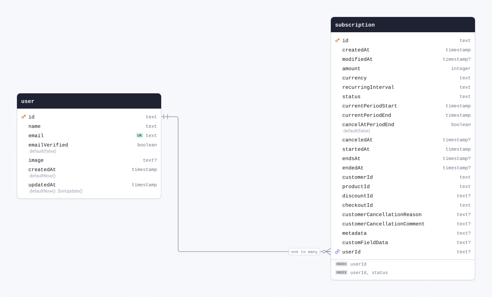

| Column                        | Type        | Constraints                   | Default           | Description |
| ----------------------------- | ----------- | ----------------------------- | ----------------- | ----------- |
| `id`                          | `text`      | PK NOT NULL                   |                   |             |
| `createdAt`                   | `timestamp` | NOT NULL                      |                   |             |
| `modifiedAt`                  | `timestamp` | NULL                          |                   |             |
| `amount`                      | `integer`   | NOT NULL                      |                   |             |
| `currency`                    | `text`      | NOT NULL                      |                   |             |
| `recurringInterval`           | `text`      | NOT NULL                      |                   |             |
| `status`                      | `text`      | NOT NULL                      |                   |             |
| `currentPeriodStart`          | `timestamp` | NOT NULL                      |                   |             |
| `currentPeriodEnd`            | `timestamp` | NOT NULL                      |                   |             |
| `cancelAtPeriodEnd`           | `boolean`   | NOT NULL                      | `.default(false)` |             |
| `canceledAt`                  | `timestamp` | NULL                          |                   |             |
| `startedAt`                   | `timestamp` | NOT NULL                      |                   |             |
| `endsAt`                      | `timestamp` | NULL                          |                   |             |
| `endedAt`                     | `timestamp` | NULL                          |                   |             |
| `customerId`                  | `text`      | NOT NULL                      |                   |             |
| `productId`                   | `text`      | NOT NULL                      |                   |             |
| `discountId`                  | `text`      | NULL                          |                   |             |
| `checkoutId`                  | `text`      | NOT NULL                      |                   |             |
| `customerCancellationReason`  | `text`      | NULL                          |                   |             |
| `customerCancellationComment` | `text`      | NULL                          |                   |             |
| `metadata`                    | `text`      | NULL                          |                   |             |
| `customFieldData`             | `text`      | NULL                          |                   |             |
| `userId`                      | `text`      | NULL → [user.id](#table-user) |                   |             |

#### Definition

```sql
CREATE TABLE "subscription" (
	"id" text PRIMARY KEY,
	"createdAt" timestamp NOT NULL,
	"modifiedAt" timestamp,
	"amount" integer NOT NULL,
	"currency" text NOT NULL,
	"recurringInterval" text NOT NULL,
	"status" text NOT NULL,
	"currentPeriodStart" timestamp NOT NULL,
	"currentPeriodEnd" timestamp NOT NULL,
	"cancelAtPeriodEnd" boolean DEFAULT false NOT NULL,
	"canceledAt" timestamp,
	"startedAt" timestamp NOT NULL,
	"endsAt" timestamp,
	"endedAt" timestamp,
	"customerId" text NOT NULL,
	"productId" text NOT NULL,
	"discountId" text,
	"checkoutId" text NOT NULL,
	"customerCancellationReason" text,
	"customerCancellationComment" text,
	"metadata" text,
	"customFieldData" text,
	"userId" text
);

CREATE INDEX "subscription_userId_idx" ON "subscription" ("userId");

CREATE INDEX "subscription_userId_status_idx" ON "subscription" ("userId","status");

ALTER TABLE "subscription" ADD CONSTRAINT "subscription_userId_user_id_fkey" FOREIGN KEY ("userId") REFERENCES "user"("id");
```

#### Indexes

- INDEX `userId`
- INDEX `userId`, `status`

#### References

- `userId` → [user.id](#table-user) (many to one)

<details>
<summary>Queries and their SQL</summary>

**Select**: Every row of subscription.

```ts
db.select().from(subscription);
```

```sql
select "id", "createdAt", "modifiedAt", "amount", "currency", "recurringInterval", "status", "currentPeriodStart", "currentPeriodEnd", "cancelAtPeriodEnd", "canceledAt", "startedAt", "endsAt", "endedAt", "customerId", "productId", "discountId", "checkoutId", "customerCancellationReason", "customerCancellationComment", "metadata", "customFieldData", "userId"
from "subscription"
```

**Count**: How many rows subscription has.

```ts
db.select({ count: count() }).from(subscription);
```

```sql
select count(*)
from "subscription"
```

**Find many**: The rows of subscription, through the relational query API.

```ts
db.query.subscription.findMany();
```

```sql
select "d0"."id" as "id", "d0"."createdAt" as "createdAt", "d0"."modifiedAt" as "modifiedAt", "d0"."amount" as "amount", "d0"."currency" as "currency", "d0"."recurringInterval" as "recurringInterval", "d0"."status" as "status", "d0"."currentPeriodStart" as "currentPeriodStart", "d0"."currentPeriodEnd" as "currentPeriodEnd", "d0"."cancelAtPeriodEnd" as "cancelAtPeriodEnd", "d0"."canceledAt" as "canceledAt", "d0"."startedAt" as "startedAt", "d0"."endsAt" as "endsAt", "d0"."endedAt" as "endedAt", "d0"."customerId" as "customerId", "d0"."productId" as "productId", "d0"."discountId" as "discountId", "d0"."checkoutId" as "checkoutId", "d0"."customerCancellationReason" as "customerCancellationReason", "d0"."customerCancellationComment" as "customerCancellationComment", "d0"."metadata" as "metadata", "d0"."customFieldData" as "customFieldData", "d0"."userId" as "userId"
from "subscription" as "d0"
```

**Find by primary key**: One row of subscription, through the relational query API.

```ts
db.query.subscription.findFirst({ where: { id: "id" } });
```

```sql
select "d0"."id" as "id", "d0"."createdAt" as "createdAt", "d0"."modifiedAt" as "modifiedAt", "d0"."amount" as "amount", "d0"."currency" as "currency", "d0"."recurringInterval" as "recurringInterval", "d0"."status" as "status", "d0"."currentPeriodStart" as "currentPeriodStart", "d0"."currentPeriodEnd" as "currentPeriodEnd", "d0"."cancelAtPeriodEnd" as "cancelAtPeriodEnd", "d0"."canceledAt" as "canceledAt", "d0"."startedAt" as "startedAt", "d0"."endsAt" as "endsAt", "d0"."endedAt" as "endedAt", "d0"."customerId" as "customerId", "d0"."productId" as "productId", "d0"."discountId" as "discountId", "d0"."checkoutId" as "checkoutId", "d0"."customerCancellationReason" as "customerCancellationReason", "d0"."customerCancellationComment" as "customerCancellationComment", "d0"."metadata" as "metadata", "d0"."customFieldData" as "customFieldData", "d0"."userId" as "userId"
from "subscription" as "d0"
where "d0"."id" = $1
limit $2
-- params: ["id",1]
```

**Insert**: Adds a row to subscription, giving the columns that have no default.

```ts
db.insert(subscription).values({
  id: "id",
  createdAt: new Date("2026-01-01T00:00:00.000Z"),
  amount: 1,
  currency: "currency",
  recurringInterval: "recurringInterval",
  status: "status",
  currentPeriodStart: new Date("2026-01-01T00:00:00.000Z"),
  currentPeriodEnd: new Date("2026-01-01T00:00:00.000Z"),
  startedAt: new Date("2026-01-01T00:00:00.000Z"),
  customerId: "customerId",
  productId: "productId",
  checkoutId: "checkoutId",
});
```

```sql
insert into "subscription" ("id", "createdAt", "modifiedAt", "amount", "currency", "recurringInterval", "status", "currentPeriodStart", "currentPeriodEnd", "cancelAtPeriodEnd", "canceledAt", "startedAt", "endsAt", "endedAt", "customerId", "productId", "discountId", "checkoutId", "customerCancellationReason", "customerCancellationComment", "metadata", "customFieldData", "userId")
values ($1, $2, default, $3, $4, $5, $6, $7, $8, default, default, $9, default, default, $10, $11, default, $12, default, default, default, default, default)
-- params: ["id","2026-01-01T00:00:00.000Z",1,"currency","recurringInterval","status","2026-01-01T00:00:00.000Z","2026-01-01T00:00:00.000Z","2026-01-01T00:00:00.000Z","customerId","productId","checkoutId"]
```

**Update**: Changes a row of subscription, found by its primary key.

```ts
db.update(subscription)
  .set({ createdAt: new Date("2026-01-01T00:00:00.000Z") })
  .where(eq(subscription.id, "id"));
```

```sql
update "subscription"
set "createdAt" = $1
where "subscription"."id" = $2
-- params: ["2026-01-01T00:00:00.000Z","id"]
```

**Delete**: Deletes a row of subscription, found by its primary key.

```ts
db.delete(subscription).where(eq(subscription.id, "id"));
```

```sql
delete from "subscription"
where "subscription"."id" = $1
-- params: ["id"]
```

</details>

<a id="table-extremeSearchUsage"></a>

### extremeSearchUsage

Table `extreme_search_usage`. Extreme search usage tracking table

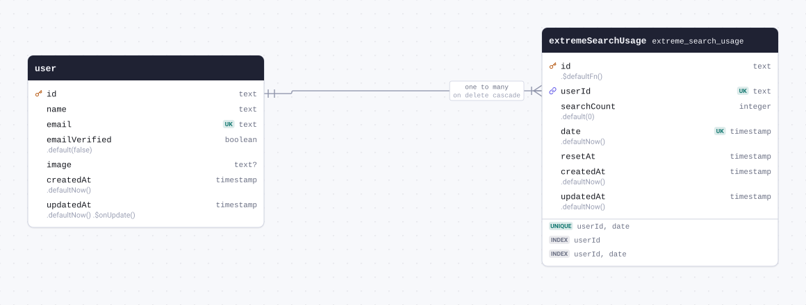

| Column                         | Type        | Constraints                       | Default         | Description |
| ------------------------------ | ----------- | --------------------------------- | --------------- | ----------- |
| `id`                           | `text`      | PK NOT NULL                       | `.$defaultFn()` |             |
| `userId` (`user_id`)           | `text`      | NOT NULL → [user.id](#table-user) |                 |             |
| `searchCount` (`search_count`) | `integer`   | NOT NULL                          | `.default(0)`   |             |
| `date`                         | `timestamp` | NOT NULL                          | `.defaultNow()` |             |
| `resetAt` (`reset_at`)         | `timestamp` | NOT NULL                          |                 |             |
| `createdAt` (`created_at`)     | `timestamp` | NOT NULL                          | `.defaultNow()` |             |
| `updatedAt` (`updated_at`)     | `timestamp` | NOT NULL                          | `.defaultNow()` |             |

#### Definition

```sql
CREATE TABLE "extreme_search_usage" (
	"id" text PRIMARY KEY,
	"user_id" text NOT NULL,
	"search_count" integer DEFAULT 0 NOT NULL,
	"date" timestamp DEFAULT now() NOT NULL,
	"reset_at" timestamp NOT NULL,
	"created_at" timestamp DEFAULT now() NOT NULL,
	"updated_at" timestamp DEFAULT now() NOT NULL
);

CREATE INDEX "extremeSearchUsage_userId_idx" ON "extreme_search_usage" ("user_id");

CREATE INDEX "extremeSearchUsage_userId_date_idx" ON "extreme_search_usage" ("user_id","date");

CREATE UNIQUE INDEX "extremeSearchUsage_userId_date_unique" ON "extreme_search_usage" ("user_id","date");

ALTER TABLE "extreme_search_usage" ADD CONSTRAINT "extreme_search_usage_user_id_user_id_fkey" FOREIGN KEY ("user_id") REFERENCES "user"("id") ON DELETE CASCADE;
```

#### Indexes

- INDEX `userId`
- INDEX `userId`, `date`
- UNIQUE `userId`, `date`

#### References

- `userId` → [user.id](#table-user) (many to one, on delete cascade)

<details>
<summary>Queries and their SQL</summary>

**Select**: Every row of extremeSearchUsage.

```ts
db.select().from(extremeSearchUsage);
```

```sql
select "id", "user_id", "search_count", "date", "reset_at", "created_at", "updated_at"
from "extreme_search_usage"
```

**Count**: How many rows extremeSearchUsage has.

```ts
db.select({ count: count() }).from(extremeSearchUsage);
```

```sql
select count(*)
from "extreme_search_usage"
```

**Find many**: The rows of extremeSearchUsage, through the relational query API.

```ts
db.query.extremeSearchUsage.findMany();
```

```sql
select "d0"."id" as "id", "d0"."user_id" as "userId", "d0"."search_count" as "searchCount", "d0"."date" as "date", "d0"."reset_at" as "resetAt", "d0"."created_at" as "createdAt", "d0"."updated_at" as "updatedAt"
from "extreme_search_usage" as "d0"
```

**Find by primary key**: One row of extremeSearchUsage, through the relational query API.

```ts
db.query.extremeSearchUsage.findFirst({ where: { id: "id" } });
```

```sql
select "d0"."id" as "id", "d0"."user_id" as "userId", "d0"."search_count" as "searchCount", "d0"."date" as "date", "d0"."reset_at" as "resetAt", "d0"."created_at" as "createdAt", "d0"."updated_at" as "updatedAt"
from "extreme_search_usage" as "d0"
where "d0"."id" = $1
limit $2
-- params: ["id",1]
```

**Insert**: Adds a row to extremeSearchUsage, giving the columns that have no default.

```ts
db.insert(extremeSearchUsage).values({
  userId: "userId",
  resetAt: new Date("2026-01-01T00:00:00.000Z"),
});
```

```sql
insert into "extreme_search_usage" ("id", "user_id", "search_count", "date", "reset_at", "created_at", "updated_at")
values ($1, $2, default, default, $3, default, default)
-- params: ["VVVVVVVVVVVVVVVV","userId","2026-01-01T00:00:00.000Z"]
```

**Update**: Changes a row of extremeSearchUsage, found by its primary key.

```ts
db.update(extremeSearchUsage).set({ userId: "userId" }).where(eq(extremeSearchUsage.id, "id"));
```

```sql
update "extreme_search_usage"
set "user_id" = $1
where "extreme_search_usage"."id" = $2
-- params: ["userId","id"]
```

**Delete**: Deletes a row of extremeSearchUsage, found by its primary key.

```ts
db.delete(extremeSearchUsage).where(eq(extremeSearchUsage.id, "id"));
```

```sql
delete from "extreme_search_usage"
where "extreme_search_usage"."id" = $1
-- params: ["id"]
```

</details>

<a id="table-messageUsage"></a>

### messageUsage

Table `message_usage`. Message usage tracking table


| Column                           | Type        | Constraints                       | Default         | Description |
| -------------------------------- | ----------- | --------------------------------- | --------------- | ----------- |
| `id`                             | `text`      | PK NOT NULL                       | `.$defaultFn()` |             |
| `userId` (`user_id`)             | `text`      | NOT NULL → [user.id](#table-user) |                 |             |
| `messageCount` (`message_count`) | `integer`   | NOT NULL                          | `.default(0)`   |             |
| `date`                           | `timestamp` | NOT NULL                          | `.defaultNow()` |             |
| `resetAt` (`reset_at`)           | `timestamp` | NOT NULL                          |                 |             |
| `createdAt` (`created_at`)       | `timestamp` | NOT NULL                          | `.defaultNow()` |             |
| `updatedAt` (`updated_at`)       | `timestamp` | NOT NULL                          | `.defaultNow()` |             |

#### Definition

```sql
CREATE TABLE "message_usage" (
	"id" text PRIMARY KEY,
	"user_id" text NOT NULL,
	"message_count" integer DEFAULT 0 NOT NULL,
	"date" timestamp DEFAULT now() NOT NULL,
	"reset_at" timestamp NOT NULL,
	"created_at" timestamp DEFAULT now() NOT NULL,
	"updated_at" timestamp DEFAULT now() NOT NULL
);

CREATE INDEX "messageUsage_userId_idx" ON "message_usage" ("user_id");

CREATE INDEX "messageUsage_userId_date_idx" ON "message_usage" ("user_id","date");

CREATE UNIQUE INDEX "messageUsage_userId_date_unique" ON "message_usage" ("user_id","date");

ALTER TABLE "message_usage" ADD CONSTRAINT "message_usage_user_id_user_id_fkey" FOREIGN KEY ("user_id") REFERENCES "user"("id") ON DELETE CASCADE;
```

#### Indexes

- INDEX `userId`
- INDEX `userId`, `date`
- UNIQUE `userId`, `date`

#### References

- `userId` → [user.id](#table-user) (many to one, on delete cascade)

<details>
<summary>Queries and their SQL</summary>

**Select**: Every row of messageUsage.

```ts
db.select().from(messageUsage);
```

```sql
select "id", "user_id", "message_count", "date", "reset_at", "created_at", "updated_at"
from "message_usage"
```

**Count**: How many rows messageUsage has.

```ts
db.select({ count: count() }).from(messageUsage);
```

```sql
select count(*)
from "message_usage"
```

**Find many**: The rows of messageUsage, through the relational query API.

```ts
db.query.messageUsage.findMany();
```

```sql
select "d0"."id" as "id", "d0"."user_id" as "userId", "d0"."message_count" as "messageCount", "d0"."date" as "date", "d0"."reset_at" as "resetAt", "d0"."created_at" as "createdAt", "d0"."updated_at" as "updatedAt"
from "message_usage" as "d0"
```

**Find by primary key**: One row of messageUsage, through the relational query API.

```ts
db.query.messageUsage.findFirst({ where: { id: "id" } });
```

```sql
select "d0"."id" as "id", "d0"."user_id" as "userId", "d0"."message_count" as "messageCount", "d0"."date" as "date", "d0"."reset_at" as "resetAt", "d0"."created_at" as "createdAt", "d0"."updated_at" as "updatedAt"
from "message_usage" as "d0"
where "d0"."id" = $1
limit $2
-- params: ["id",1]
```

**Insert**: Adds a row to messageUsage, giving the columns that have no default.

```ts
db.insert(messageUsage).values({ userId: "userId", resetAt: new Date("2026-01-01T00:00:00.000Z") });
```

```sql
insert into "message_usage" ("id", "user_id", "message_count", "date", "reset_at", "created_at", "updated_at")
values ($1, $2, default, default, $3, default, default)
-- params: ["VVVVVVVVVVVVVVVV","userId","2026-01-01T00:00:00.000Z"]
```

**Update**: Changes a row of messageUsage, found by its primary key.

```ts
db.update(messageUsage).set({ userId: "userId" }).where(eq(messageUsage.id, "id"));
```

```sql
update "message_usage"
set "user_id" = $1
where "message_usage"."id" = $2
-- params: ["userId","id"]
```

**Delete**: Deletes a row of messageUsage, found by its primary key.

```ts
db.delete(messageUsage).where(eq(messageUsage.id, "id"));
```

```sql
delete from "message_usage"
where "message_usage"."id" = $1
-- params: ["id"]
```

</details>

<a id="table-anthropicUsage"></a>

### anthropicUsage

Table `anthropic_usage`. Anthropic daily usage tracking table


| Column                       | Type        | Constraints                       | Default         | Description |
| ---------------------------- | ----------- | --------------------------------- | --------------- | ----------- |
| `id`                         | `text`      | PK NOT NULL                       | `.$defaultFn()` |             |
| `userId` (`user_id`)         | `text`      | NOT NULL → [user.id](#table-user) |                 |             |
| `usageCount` (`usage_count`) | `integer`   | NOT NULL                          | `.default(0)`   |             |
| `date`                       | `timestamp` | NOT NULL                          | `.defaultNow()` |             |
| `resetAt` (`reset_at`)       | `timestamp` | NOT NULL                          |                 |             |
| `metadata`                   | `jsonb`     | NULL                              |                 |             |
| `createdAt` (`created_at`)   | `timestamp` | NOT NULL                          | `.defaultNow()` |             |
| `updatedAt` (`updated_at`)   | `timestamp` | NOT NULL                          | `.defaultNow()` |             |

#### Definition

```sql
CREATE TABLE "anthropic_usage" (
	"id" text PRIMARY KEY,
	"user_id" text NOT NULL,
	"usage_count" integer DEFAULT 0 NOT NULL,
	"date" timestamp DEFAULT now() NOT NULL,
	"reset_at" timestamp NOT NULL,
	"metadata" jsonb,
	"created_at" timestamp DEFAULT now() NOT NULL,
	"updated_at" timestamp DEFAULT now() NOT NULL
);

CREATE INDEX "anthropicUsage_userId_idx" ON "anthropic_usage" ("user_id");

CREATE INDEX "anthropicUsage_userId_date_idx" ON "anthropic_usage" ("user_id","date");

CREATE UNIQUE INDEX "anthropicUsage_userId_date_unique" ON "anthropic_usage" ("user_id","date");

ALTER TABLE "anthropic_usage" ADD CONSTRAINT "anthropic_usage_user_id_user_id_fkey" FOREIGN KEY ("user_id") REFERENCES "user"("id") ON DELETE CASCADE;
```

#### Indexes

- INDEX `userId`
- INDEX `userId`, `date`
- UNIQUE `userId`, `date`

#### References

- `userId` → [user.id](#table-user) (many to one, on delete cascade)

<details>
<summary>Queries and their SQL</summary>

**Select**: Every row of anthropicUsage.

```ts
db.select().from(anthropicUsage);
```

```sql
select "id", "user_id", "usage_count", "date", "reset_at", "metadata", "created_at", "updated_at"
from "anthropic_usage"
```

**Count**: How many rows anthropicUsage has.

```ts
db.select({ count: count() }).from(anthropicUsage);
```

```sql
select count(*)
from "anthropic_usage"
```

**Find many**: The rows of anthropicUsage, through the relational query API.

```ts
db.query.anthropicUsage.findMany();
```

```sql
select "d0"."id" as "id", "d0"."user_id" as "userId", "d0"."usage_count" as "usageCount", "d0"."date" as "date", "d0"."reset_at" as "resetAt", "d0"."metadata" as "metadata", "d0"."created_at" as "createdAt", "d0"."updated_at" as "updatedAt"
from "anthropic_usage" as "d0"
```

**Find by primary key**: One row of anthropicUsage, through the relational query API.

```ts
db.query.anthropicUsage.findFirst({ where: { id: "id" } });
```

```sql
select "d0"."id" as "id", "d0"."user_id" as "userId", "d0"."usage_count" as "usageCount", "d0"."date" as "date", "d0"."reset_at" as "resetAt", "d0"."metadata" as "metadata", "d0"."created_at" as "createdAt", "d0"."updated_at" as "updatedAt"
from "anthropic_usage" as "d0"
where "d0"."id" = $1
limit $2
-- params: ["id",1]
```

**Insert**: Adds a row to anthropicUsage, giving the columns that have no default.

```ts
db.insert(anthropicUsage).values({
  userId: "userId",
  resetAt: new Date("2026-01-01T00:00:00.000Z"),
});
```

```sql
insert into "anthropic_usage" ("id", "user_id", "usage_count", "date", "reset_at", "metadata", "created_at", "updated_at")
values ($1, $2, default, default, $3, default, default, default)
-- params: ["VVVVVVVVVVVVVVVV","userId","2026-01-01T00:00:00.000Z"]
```

**Update**: Changes a row of anthropicUsage, found by its primary key.

```ts
db.update(anthropicUsage).set({ userId: "userId" }).where(eq(anthropicUsage.id, "id"));
```

```sql
update "anthropic_usage"
set "user_id" = $1
where "anthropic_usage"."id" = $2
-- params: ["userId","id"]
```

**Delete**: Deletes a row of anthropicUsage, found by its primary key.

```ts
db.delete(anthropicUsage).where(eq(anthropicUsage.id, "id"));
```

```sql
delete from "anthropic_usage"
where "anthropic_usage"."id" = $1
-- params: ["id"]
```

</details>

<a id="table-googleUsage"></a>

### googleUsage

Table `google_usage`. Google (Gemini Max) monthly usage tracking table

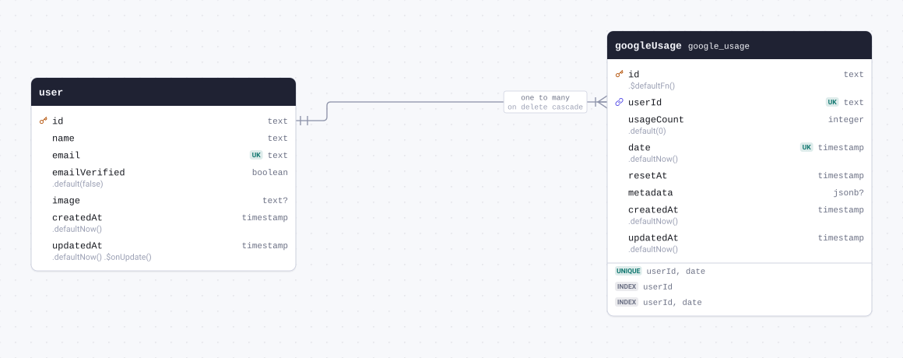

| Column                       | Type        | Constraints                       | Default         | Description |
| ---------------------------- | ----------- | --------------------------------- | --------------- | ----------- |
| `id`                         | `text`      | PK NOT NULL                       | `.$defaultFn()` |             |
| `userId` (`user_id`)         | `text`      | NOT NULL → [user.id](#table-user) |                 |             |
| `usageCount` (`usage_count`) | `integer`   | NOT NULL                          | `.default(0)`   |             |
| `date`                       | `timestamp` | NOT NULL                          | `.defaultNow()` |             |
| `resetAt` (`reset_at`)       | `timestamp` | NOT NULL                          |                 |             |
| `metadata`                   | `jsonb`     | NULL                              |                 |             |
| `createdAt` (`created_at`)   | `timestamp` | NOT NULL                          | `.defaultNow()` |             |
| `updatedAt` (`updated_at`)   | `timestamp` | NOT NULL                          | `.defaultNow()` |             |

#### Definition

```sql
CREATE TABLE "google_usage" (
	"id" text PRIMARY KEY,
	"user_id" text NOT NULL,
	"usage_count" integer DEFAULT 0 NOT NULL,
	"date" timestamp DEFAULT now() NOT NULL,
	"reset_at" timestamp NOT NULL,
	"metadata" jsonb,
	"created_at" timestamp DEFAULT now() NOT NULL,
	"updated_at" timestamp DEFAULT now() NOT NULL
);

CREATE INDEX "googleUsage_userId_idx" ON "google_usage" ("user_id");

CREATE INDEX "googleUsage_userId_date_idx" ON "google_usage" ("user_id","date");

CREATE UNIQUE INDEX "googleUsage_userId_date_unique" ON "google_usage" ("user_id","date");

ALTER TABLE "google_usage" ADD CONSTRAINT "google_usage_user_id_user_id_fkey" FOREIGN KEY ("user_id") REFERENCES "user"("id") ON DELETE CASCADE;
```

#### Indexes

- INDEX `userId`
- INDEX `userId`, `date`
- UNIQUE `userId`, `date`

#### References

- `userId` → [user.id](#table-user) (many to one, on delete cascade)

<details>
<summary>Queries and their SQL</summary>

**Select**: Every row of googleUsage.

```ts
db.select().from(googleUsage);
```

```sql
select "id", "user_id", "usage_count", "date", "reset_at", "metadata", "created_at", "updated_at"
from "google_usage"
```

**Count**: How many rows googleUsage has.

```ts
db.select({ count: count() }).from(googleUsage);
```

```sql
select count(*)
from "google_usage"
```

**Find many**: The rows of googleUsage, through the relational query API.

```ts
db.query.googleUsage.findMany();
```

```sql
select "d0"."id" as "id", "d0"."user_id" as "userId", "d0"."usage_count" as "usageCount", "d0"."date" as "date", "d0"."reset_at" as "resetAt", "d0"."metadata" as "metadata", "d0"."created_at" as "createdAt", "d0"."updated_at" as "updatedAt"
from "google_usage" as "d0"
```

**Find by primary key**: One row of googleUsage, through the relational query API.

```ts
db.query.googleUsage.findFirst({ where: { id: "id" } });
```

```sql
select "d0"."id" as "id", "d0"."user_id" as "userId", "d0"."usage_count" as "usageCount", "d0"."date" as "date", "d0"."reset_at" as "resetAt", "d0"."metadata" as "metadata", "d0"."created_at" as "createdAt", "d0"."updated_at" as "updatedAt"
from "google_usage" as "d0"
where "d0"."id" = $1
limit $2
-- params: ["id",1]
```

**Insert**: Adds a row to googleUsage, giving the columns that have no default.

```ts
db.insert(googleUsage).values({ userId: "userId", resetAt: new Date("2026-01-01T00:00:00.000Z") });
```

```sql
insert into "google_usage" ("id", "user_id", "usage_count", "date", "reset_at", "metadata", "created_at", "updated_at")
values ($1, $2, default, default, $3, default, default, default)
-- params: ["VVVVVVVVVVVVVVVV","userId","2026-01-01T00:00:00.000Z"]
```

**Update**: Changes a row of googleUsage, found by its primary key.

```ts
db.update(googleUsage).set({ userId: "userId" }).where(eq(googleUsage.id, "id"));
```

```sql
update "google_usage"
set "user_id" = $1
where "google_usage"."id" = $2
-- params: ["userId","id"]
```

**Delete**: Deletes a row of googleUsage, found by its primary key.

```ts
db.delete(googleUsage).where(eq(googleUsage.id, "id"));
```

```sql
delete from "google_usage"
where "google_usage"."id" = $1
-- params: ["id"]
```

</details>

<a id="table-agentModeUsageEvents"></a>

### agentModeUsageEvents

Table `agent_mode_usage_events`. Agent mode monthly usage tracking (append-only events keyed by user message id) This prevents usage from being bypassed by deleting sessions/chats.

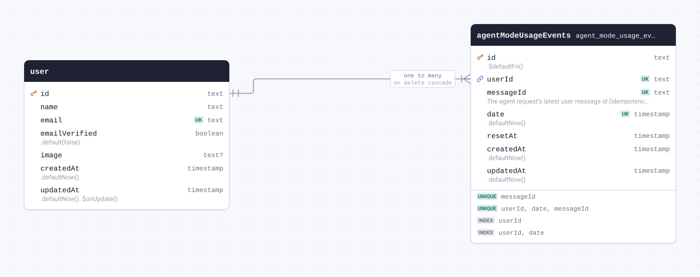

| Column                     | Type        | Constraints                       | Default         | Description                                                   |
| -------------------------- | ----------- | --------------------------------- | --------------- | ------------------------------------------------------------- |
| `id`                       | `text`      | PK NOT NULL                       | `.$defaultFn()` |                                                               |
| `userId` (`user_id`)       | `text`      | NOT NULL → [user.id](#table-user) |                 |                                                               |
| `messageId` (`message_id`) | `text`      | NOT NULL                          |                 | The agent request's latest user message id (idempotency key). |
| `date`                     | `timestamp` | NOT NULL                          | `.defaultNow()` |                                                               |
| `resetAt` (`reset_at`)     | `timestamp` | NOT NULL                          |                 |                                                               |
| `createdAt` (`created_at`) | `timestamp` | NOT NULL                          | `.defaultNow()` |                                                               |
| `updatedAt` (`updated_at`) | `timestamp` | NOT NULL                          | `.defaultNow()` |                                                               |

#### Definition

```sql
CREATE TABLE "agent_mode_usage_events" (
	"id" text PRIMARY KEY,
	"user_id" text NOT NULL,
	"message_id" text NOT NULL,
	"date" timestamp DEFAULT now() NOT NULL,
	"reset_at" timestamp NOT NULL,
	"created_at" timestamp DEFAULT now() NOT NULL,
	"updated_at" timestamp DEFAULT now() NOT NULL
);

CREATE INDEX "agentModeUsageEvents_userId_idx" ON "agent_mode_usage_events" ("user_id");

CREATE INDEX "agentModeUsageEvents_userId_date_idx" ON "agent_mode_usage_events" ("user_id","date");

CREATE UNIQUE INDEX "agentModeUsageEvents_messageId_unique" ON "agent_mode_usage_events" ("message_id");

CREATE UNIQUE INDEX "agentModeUsageEvents_userId_date_messageId_unique" ON "agent_mode_usage_events" ("user_id","date","message_id");

ALTER TABLE "agent_mode_usage_events" ADD CONSTRAINT "agent_mode_usage_events_user_id_user_id_fkey" FOREIGN KEY ("user_id") REFERENCES "user"("id") ON DELETE CASCADE;
```

#### Indexes

- INDEX `userId`
- INDEX `userId`, `date`
- UNIQUE `messageId`
- UNIQUE `userId`, `date`, `messageId`

#### References

- `userId` → [user.id](#table-user) (many to one, on delete cascade)

<details>
<summary>Queries and their SQL</summary>

**Select**: Every row of agentModeUsageEvents.

```ts
db.select().from(agentModeUsageEvents);
```

```sql
select "id", "user_id", "message_id", "date", "reset_at", "created_at", "updated_at"
from "agent_mode_usage_events"
```

**Count**: How many rows agentModeUsageEvents has.

```ts
db.select({ count: count() }).from(agentModeUsageEvents);
```

```sql
select count(*)
from "agent_mode_usage_events"
```

**Find many**: The rows of agentModeUsageEvents, through the relational query API.

```ts
db.query.agentModeUsageEvents.findMany();
```

```sql
select "d0"."id" as "id", "d0"."user_id" as "userId", "d0"."message_id" as "messageId", "d0"."date" as "date", "d0"."reset_at" as "resetAt", "d0"."created_at" as "createdAt", "d0"."updated_at" as "updatedAt"
from "agent_mode_usage_events" as "d0"
```

**Find by primary key**: One row of agentModeUsageEvents, through the relational query API.

```ts
db.query.agentModeUsageEvents.findFirst({ where: { id: "id" } });
```

```sql
select "d0"."id" as "id", "d0"."user_id" as "userId", "d0"."message_id" as "messageId", "d0"."date" as "date", "d0"."reset_at" as "resetAt", "d0"."created_at" as "createdAt", "d0"."updated_at" as "updatedAt"
from "agent_mode_usage_events" as "d0"
where "d0"."id" = $1
limit $2
-- params: ["id",1]
```

**Insert**: Adds a row to agentModeUsageEvents, giving the columns that have no default.

```ts
db.insert(agentModeUsageEvents).values({
  userId: "userId",
  messageId: "messageId",
  resetAt: new Date("2026-01-01T00:00:00.000Z"),
});
```

```sql
insert into "agent_mode_usage_events" ("id", "user_id", "message_id", "date", "reset_at", "created_at", "updated_at")
values ($1, $2, $3, default, $4, default, default)
-- params: ["VVVVVVVVVVVVVVVV","userId","messageId","2026-01-01T00:00:00.000Z"]
```

**Update**: Changes a row of agentModeUsageEvents, found by its primary key.

```ts
db.update(agentModeUsageEvents).set({ userId: "userId" }).where(eq(agentModeUsageEvents.id, "id"));
```

```sql
update "agent_mode_usage_events"
set "user_id" = $1
where "agent_mode_usage_events"."id" = $2
-- params: ["userId","id"]
```

**Delete**: Deletes a row of agentModeUsageEvents, found by its primary key.

```ts
db.delete(agentModeUsageEvents).where(eq(agentModeUsageEvents.id, "id"));
```

```sql
delete from "agent_mode_usage_events"
where "agent_mode_usage_events"."id" = $1
-- params: ["id"]
```

</details>

<a id="table-customInstructions"></a>

### customInstructions

Table `custom_instructions`. Custom instructions table

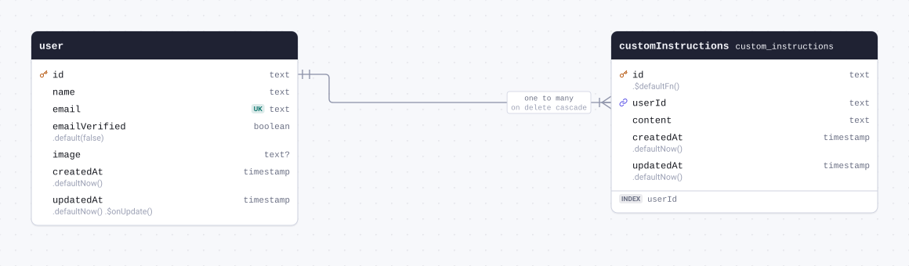

| Column                     | Type        | Constraints                       | Default         | Description |
| -------------------------- | ----------- | --------------------------------- | --------------- | ----------- |
| `id`                       | `text`      | PK NOT NULL                       | `.$defaultFn()` |             |
| `userId` (`user_id`)       | `text`      | NOT NULL → [user.id](#table-user) |                 |             |
| `content`                  | `text`      | NOT NULL                          |                 |             |
| `createdAt` (`created_at`) | `timestamp` | NOT NULL                          | `.defaultNow()` |             |
| `updatedAt` (`updated_at`) | `timestamp` | NOT NULL                          | `.defaultNow()` |             |

#### Definition

```sql
CREATE TABLE "custom_instructions" (
	"id" text PRIMARY KEY,
	"user_id" text NOT NULL,
	"content" text NOT NULL,
	"created_at" timestamp DEFAULT now() NOT NULL,
	"updated_at" timestamp DEFAULT now() NOT NULL
);

CREATE INDEX "customInstructions_userId_idx" ON "custom_instructions" ("user_id");

ALTER TABLE "custom_instructions" ADD CONSTRAINT "custom_instructions_user_id_user_id_fkey" FOREIGN KEY ("user_id") REFERENCES "user"("id") ON DELETE CASCADE;
```

#### Indexes

- INDEX `userId`

#### References

- `userId` → [user.id](#table-user) (many to one, on delete cascade)

<details>
<summary>Queries and their SQL</summary>

**Select**: Every row of customInstructions.

```ts
db.select().from(customInstructions);
```

```sql
select "id", "user_id", "content", "created_at", "updated_at"
from "custom_instructions"
```

**Count**: How many rows customInstructions has.

```ts
db.select({ count: count() }).from(customInstructions);
```

```sql
select count(*)
from "custom_instructions"
```

**Find many**: The rows of customInstructions, through the relational query API.

```ts
db.query.customInstructions.findMany();
```

```sql
select "d0"."id" as "id", "d0"."user_id" as "userId", "d0"."content" as "content", "d0"."created_at" as "createdAt", "d0"."updated_at" as "updatedAt"
from "custom_instructions" as "d0"
```

**Find by primary key**: One row of customInstructions, through the relational query API.

```ts
db.query.customInstructions.findFirst({ where: { id: "id" } });
```

```sql
select "d0"."id" as "id", "d0"."user_id" as "userId", "d0"."content" as "content", "d0"."created_at" as "createdAt", "d0"."updated_at" as "updatedAt"
from "custom_instructions" as "d0"
where "d0"."id" = $1
limit $2
-- params: ["id",1]
```

**Insert**: Adds a row to customInstructions, giving the columns that have no default.

```ts
db.insert(customInstructions).values({ userId: "userId", content: "content" });
```

```sql
insert into "custom_instructions" ("id", "user_id", "content", "created_at", "updated_at")
values ($1, $2, $3, default, default)
-- params: ["VVVVVVVVVVVVVVVV","userId","content"]
```

**Update**: Changes a row of customInstructions, found by its primary key.

```ts
db.update(customInstructions).set({ userId: "userId" }).where(eq(customInstructions.id, "id"));
```

```sql
update "custom_instructions"
set "user_id" = $1
where "custom_instructions"."id" = $2
-- params: ["userId","id"]
```

**Delete**: Deletes a row of customInstructions, found by its primary key.

```ts
db.delete(customInstructions).where(eq(customInstructions.id, "id"));
```

```sql
delete from "custom_instructions"
where "custom_instructions"."id" = $1
-- params: ["id"]
```

</details>

<a id="table-userPreferences"></a>

### userPreferences

Table `user_preferences`. User preferences table

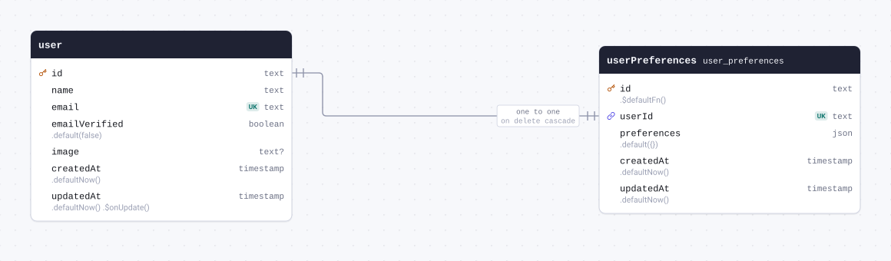

| Column                     | Type        | Constraints                              | Default         | Description |
| -------------------------- | ----------- | ---------------------------------------- | --------------- | ----------- |
| `id`                       | `text`      | PK NOT NULL                              | `.$defaultFn()` |             |
| `userId` (`user_id`)       | `text`      | UNIQUE NOT NULL → [user.id](#table-user) |                 |             |
| `preferences`              | `json`      | NOT NULL                                 | `.default({})`  |             |
| `createdAt` (`created_at`) | `timestamp` | NOT NULL                                 | `.defaultNow()` |             |
| `updatedAt` (`updated_at`) | `timestamp` | NOT NULL                                 | `.defaultNow()` |             |

#### Definition

```sql
CREATE TABLE "user_preferences" (
	"id" text PRIMARY KEY,
	"user_id" text NOT NULL UNIQUE,
	"preferences" json DEFAULT '{}' NOT NULL,
	"created_at" timestamp DEFAULT now() NOT NULL,
	"updated_at" timestamp DEFAULT now() NOT NULL
);

ALTER TABLE "user_preferences" ADD CONSTRAINT "user_preferences_user_id_user_id_fkey" FOREIGN KEY ("user_id") REFERENCES "user"("id") ON DELETE CASCADE;
```

#### References

- `userId` → [user.id](#table-user) (one to one, on delete cascade)

<details>
<summary>Queries and their SQL</summary>

**Select**: Every row of userPreferences.

```ts
db.select().from(userPreferences);
```

```sql
select "id", "user_id", "preferences", "created_at", "updated_at"
from "user_preferences"
```

**Count**: How many rows userPreferences has.

```ts
db.select({ count: count() }).from(userPreferences);
```

```sql
select count(*)
from "user_preferences"
```

**Find many**: The rows of userPreferences, through the relational query API.

```ts
db.query.userPreferences.findMany();
```

```sql
select "d0"."id" as "id", "d0"."user_id" as "userId", "d0"."preferences" as "preferences", "d0"."created_at" as "createdAt", "d0"."updated_at" as "updatedAt"
from "user_preferences" as "d0"
```

**Find by primary key**: One row of userPreferences, through the relational query API.

```ts
db.query.userPreferences.findFirst({ where: { id: "id" } });
```

```sql
select "d0"."id" as "id", "d0"."user_id" as "userId", "d0"."preferences" as "preferences", "d0"."created_at" as "createdAt", "d0"."updated_at" as "updatedAt"
from "user_preferences" as "d0"
where "d0"."id" = $1
limit $2
-- params: ["id",1]
```

**Insert**: Adds a row to userPreferences, giving the columns that have no default.

```ts
db.insert(userPreferences).values({ userId: "userId" });
```

```sql
insert into "user_preferences" ("id", "user_id", "preferences", "created_at", "updated_at")
values ($1, $2, default, default, default)
-- params: ["VVVVVVVVVVVVVVVV","userId"]
```

**Update**: Changes a row of userPreferences, found by its primary key.

```ts
db.update(userPreferences).set({ userId: "userId" }).where(eq(userPreferences.id, "id"));
```

```sql
update "user_preferences"
set "user_id" = $1
where "user_preferences"."id" = $2
-- params: ["userId","id"]
```

**Delete**: Deletes a row of userPreferences, found by its primary key.

```ts
db.delete(userPreferences).where(eq(userPreferences.id, "id"));
```

```sql
delete from "user_preferences"
where "user_preferences"."id" = $1
-- params: ["id"]
```

</details>

<a id="table-payment"></a>

### payment

Payment table for Dodo Payments webhook data

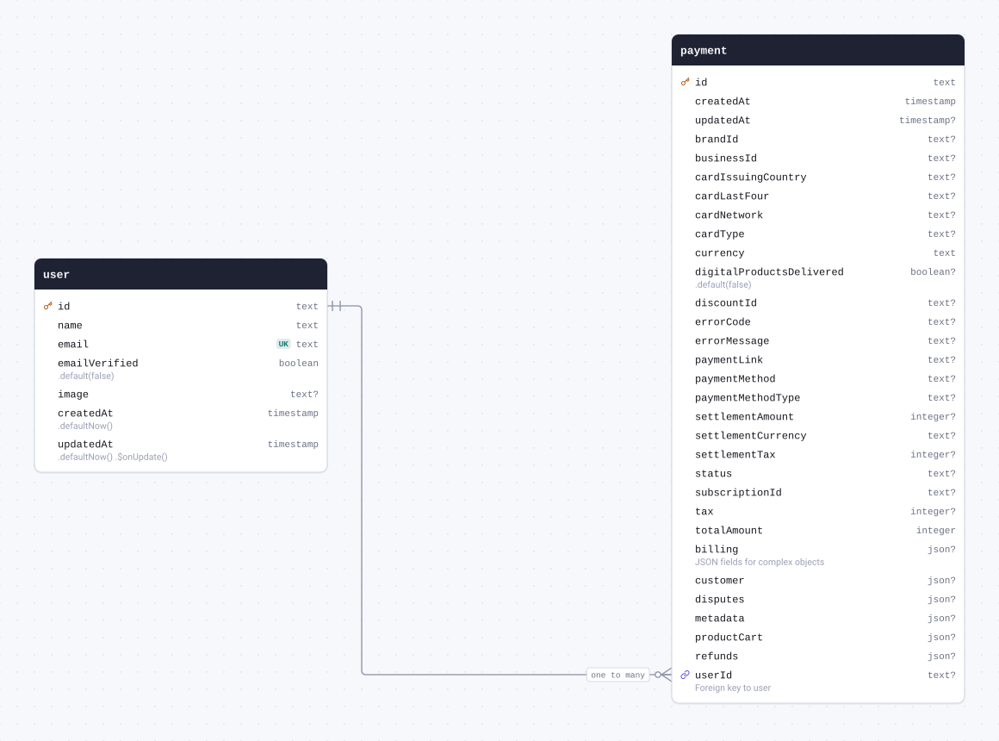

| Column                                                    | Type        | Constraints                   | Default           | Description                     |
| --------------------------------------------------------- | ----------- | ----------------------------- | ----------------- | ------------------------------- |
| `id`                                                      | `text`      | PK NOT NULL                   |                   |                                 |
| `createdAt` (`created_at`)                                | `timestamp` | NOT NULL                      |                   |                                 |
| `updatedAt` (`updated_at`)                                | `timestamp` | NULL                          |                   |                                 |
| `brandId` (`brand_id`)                                    | `text`      | NULL                          |                   |                                 |
| `businessId` (`business_id`)                              | `text`      | NULL                          |                   |                                 |
| `cardIssuingCountry` (`card_issuing_country`)             | `text`      | NULL                          |                   |                                 |
| `cardLastFour` (`card_last_four`)                         | `text`      | NULL                          |                   |                                 |
| `cardNetwork` (`card_network`)                            | `text`      | NULL                          |                   |                                 |
| `cardType` (`card_type`)                                  | `text`      | NULL                          |                   |                                 |
| `currency`                                                | `text`      | NOT NULL                      |                   |                                 |
| `digitalProductsDelivered` (`digital_products_delivered`) | `boolean`   | NULL                          | `.default(false)` |                                 |
| `discountId` (`discount_id`)                              | `text`      | NULL                          |                   |                                 |
| `errorCode` (`error_code`)                                | `text`      | NULL                          |                   |                                 |
| `errorMessage` (`error_message`)                          | `text`      | NULL                          |                   |                                 |
| `paymentLink` (`payment_link`)                            | `text`      | NULL                          |                   |                                 |
| `paymentMethod` (`payment_method`)                        | `text`      | NULL                          |                   |                                 |
| `paymentMethodType` (`payment_method_type`)               | `text`      | NULL                          |                   |                                 |
| `settlementAmount` (`settlement_amount`)                  | `integer`   | NULL                          |                   |                                 |
| `settlementCurrency` (`settlement_currency`)              | `text`      | NULL                          |                   |                                 |
| `settlementTax` (`settlement_tax`)                        | `integer`   | NULL                          |                   |                                 |
| `status`                                                  | `text`      | NULL                          |                   |                                 |
| `subscriptionId` (`subscription_id`)                      | `text`      | NULL                          |                   |                                 |
| `tax`                                                     | `integer`   | NULL                          |                   |                                 |
| `totalAmount` (`total_amount`)                            | `integer`   | NOT NULL                      |                   |                                 |
| `billing`                                                 | `json`      | NULL                          |                   | JSON fields for complex objects |
| `customer`                                                | `json`      | NULL                          |                   |                                 |
| `disputes`                                                | `json`      | NULL                          |                   |                                 |
| `metadata`                                                | `json`      | NULL                          |                   |                                 |
| `productCart` (`product_cart`)                            | `json`      | NULL                          |                   |                                 |
| `refunds`                                                 | `json`      | NULL                          |                   |                                 |
| `userId` (`user_id`)                                      | `text`      | NULL → [user.id](#table-user) |                   | Foreign key to user             |

#### Definition

```sql
CREATE TABLE "payment" (
	"id" text PRIMARY KEY,
	"created_at" timestamp NOT NULL,
	"updated_at" timestamp,
	"brand_id" text,
	"business_id" text,
	"card_issuing_country" text,
	"card_last_four" text,
	"card_network" text,
	"card_type" text,
	"currency" text NOT NULL,
	"digital_products_delivered" boolean DEFAULT false,
	"discount_id" text,
	"error_code" text,
	"error_message" text,
	"payment_link" text,
	"payment_method" text,
	"payment_method_type" text,
	"settlement_amount" integer,
	"settlement_currency" text,
	"settlement_tax" integer,
	"status" text,
	"subscription_id" text,
	"tax" integer,
	"total_amount" integer NOT NULL,
	"billing" json,
	"customer" json,
	"disputes" json,
	"metadata" json,
	"product_cart" json,
	"refunds" json,
	"user_id" text
);

ALTER TABLE "payment" ADD CONSTRAINT "payment_user_id_user_id_fkey" FOREIGN KEY ("user_id") REFERENCES "user"("id");
```

#### References

- `userId` → [user.id](#table-user) (many to one)

<details>
<summary>Queries and their SQL</summary>

**Select**: Every row of payment.

```ts
db.select().from(payment);
```

```sql
select "id", "created_at", "updated_at", "brand_id", "business_id", "card_issuing_country", "card_last_four", "card_network", "card_type", "currency", "digital_products_delivered", "discount_id", "error_code", "error_message", "payment_link", "payment_method", "payment_method_type", "settlement_amount", "settlement_currency", "settlement_tax", "status", "subscription_id", "tax", "total_amount", "billing", "customer", "disputes", "metadata", "product_cart", "refunds", "user_id"
from "payment"
```

**Count**: How many rows payment has.

```ts
db.select({ count: count() }).from(payment);
```

```sql
select count(*)
from "payment"
```

**Find many**: The rows of payment, through the relational query API.

```ts
db.query.payment.findMany();
```

```sql
select "d0"."id" as "id", "d0"."created_at" as "createdAt", "d0"."updated_at" as "updatedAt", "d0"."brand_id" as "brandId", "d0"."business_id" as "businessId", "d0"."card_issuing_country" as "cardIssuingCountry", "d0"."card_last_four" as "cardLastFour", "d0"."card_network" as "cardNetwork", "d0"."card_type" as "cardType", "d0"."currency" as "currency", "d0"."digital_products_delivered" as "digitalProductsDelivered", "d0"."discount_id" as "discountId", "d0"."error_code" as "errorCode", "d0"."error_message" as "errorMessage", "d0"."payment_link" as "paymentLink", "d0"."payment_method" as "paymentMethod", "d0"."payment_method_type" as "paymentMethodType", "d0"."settlement_amount" as "settlementAmount", "d0"."settlement_currency" as "settlementCurrency", "d0"."settlement_tax" as "settlementTax", "d0"."status" as "status", "d0"."subscription_id" as "subscriptionId", "d0"."tax" as "tax", "d0"."total_amount" as "totalAmount", "d0"."billing" as "billing", "d0"."customer" as "customer", "d0"."disputes" as "disputes", "d0"."metadata" as "metadata", "d0"."product_cart" as "productCart", "d0"."refunds" as "refunds", "d0"."user_id" as "userId"
from "payment" as "d0"
```

**Find by primary key**: One row of payment, through the relational query API.

```ts
db.query.payment.findFirst({ where: { id: "id" } });
```

```sql
select "d0"."id" as "id", "d0"."created_at" as "createdAt", "d0"."updated_at" as "updatedAt", "d0"."brand_id" as "brandId", "d0"."business_id" as "businessId", "d0"."card_issuing_country" as "cardIssuingCountry", "d0"."card_last_four" as "cardLastFour", "d0"."card_network" as "cardNetwork", "d0"."card_type" as "cardType", "d0"."currency" as "currency", "d0"."digital_products_delivered" as "digitalProductsDelivered", "d0"."discount_id" as "discountId", "d0"."error_code" as "errorCode", "d0"."error_message" as "errorMessage", "d0"."payment_link" as "paymentLink", "d0"."payment_method" as "paymentMethod", "d0"."payment_method_type" as "paymentMethodType", "d0"."settlement_amount" as "settlementAmount", "d0"."settlement_currency" as "settlementCurrency", "d0"."settlement_tax" as "settlementTax", "d0"."status" as "status", "d0"."subscription_id" as "subscriptionId", "d0"."tax" as "tax", "d0"."total_amount" as "totalAmount", "d0"."billing" as "billing", "d0"."customer" as "customer", "d0"."disputes" as "disputes", "d0"."metadata" as "metadata", "d0"."product_cart" as "productCart", "d0"."refunds" as "refunds", "d0"."user_id" as "userId"
from "payment" as "d0"
where "d0"."id" = $1
limit $2
-- params: ["id",1]
```

**Insert**: Adds a row to payment, giving the columns that have no default.

```ts
db.insert(payment).values({
  id: "id",
  createdAt: new Date("2026-01-01T00:00:00.000Z"),
  currency: "currency",
  totalAmount: 1,
});
```

```sql
insert into "payment" ("id", "created_at", "updated_at", "brand_id", "business_id", "card_issuing_country", "card_last_four", "card_network", "card_type", "currency", "digital_products_delivered", "discount_id", "error_code", "error_message", "payment_link", "payment_method", "payment_method_type", "settlement_amount", "settlement_currency", "settlement_tax", "status", "subscription_id", "tax", "total_amount", "billing", "customer", "disputes", "metadata", "product_cart", "refunds", "user_id")
values ($1, $2, default, default, default, default, default, default, default, $3, default, default, default, default, default, default, default, default, default, default, default, default, default, $4, default, default, default, default, default, default, default)
-- params: ["id","2026-01-01T00:00:00.000Z","currency",1]
```

**Update**: Changes a row of payment, found by its primary key.

```ts
db.update(payment)
  .set({ createdAt: new Date("2026-01-01T00:00:00.000Z") })
  .where(eq(payment.id, "id"));
```

```sql
update "payment"
set "created_at" = $1
where "payment"."id" = $2
-- params: ["2026-01-01T00:00:00.000Z","id"]
```

**Delete**: Deletes a row of payment, found by its primary key.

```ts
db.delete(payment).where(eq(payment.id, "id"));
```

```sql
delete from "payment"
where "payment"."id" = $1
-- params: ["id"]
```

</details>

<a id="table-dodosubscription"></a>

### dodosubscription

Dodo Subscription table for Dodo Payments subscription webhook data

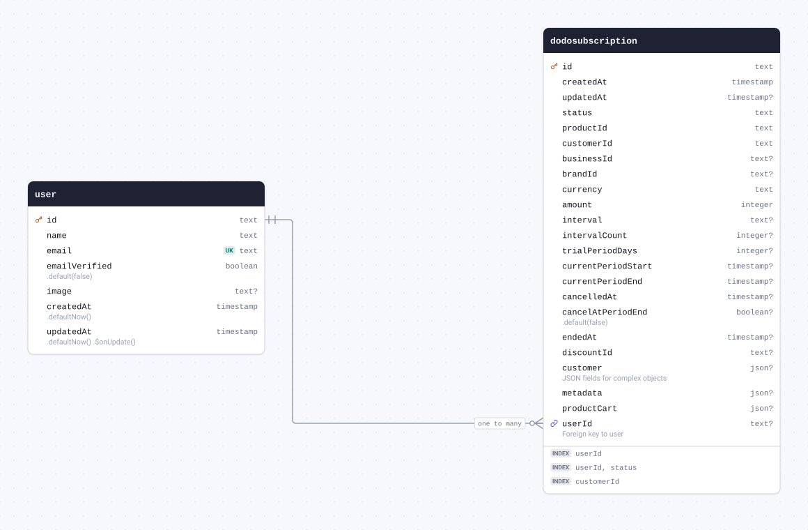

| Column                                        | Type        | Constraints                   | Default           | Description                     |
| --------------------------------------------- | ----------- | ----------------------------- | ----------------- | ------------------------------- |
| `id`                                          | `text`      | PK NOT NULL                   |                   |                                 |
| `createdAt` (`created_at`)                    | `timestamp` | NOT NULL                      |                   |                                 |
| `updatedAt` (`updated_at`)                    | `timestamp` | NULL                          |                   |                                 |
| `status`                                      | `text`      | NOT NULL                      |                   |                                 |
| `productId` (`product_id`)                    | `text`      | NOT NULL                      |                   |                                 |
| `customerId` (`customer_id`)                  | `text`      | NOT NULL                      |                   |                                 |
| `businessId` (`business_id`)                  | `text`      | NULL                          |                   |                                 |
| `brandId` (`brand_id`)                        | `text`      | NULL                          |                   |                                 |
| `currency`                                    | `text`      | NOT NULL                      |                   |                                 |
| `amount`                                      | `integer`   | NOT NULL                      |                   |                                 |
| `interval`                                    | `text`      | NULL                          |                   |                                 |
| `intervalCount` (`interval_count`)            | `integer`   | NULL                          |                   |                                 |
| `trialPeriodDays` (`trial_period_days`)       | `integer`   | NULL                          |                   |                                 |
| `currentPeriodStart` (`current_period_start`) | `timestamp` | NULL                          |                   |                                 |
| `currentPeriodEnd` (`current_period_end`)     | `timestamp` | NULL                          |                   |                                 |
| `cancelledAt` (`cancelled_at`)                | `timestamp` | NULL                          |                   |                                 |
| `cancelAtPeriodEnd` (`cancel_at_period_end`)  | `boolean`   | NULL                          | `.default(false)` |                                 |
| `endedAt` (`ended_at`)                        | `timestamp` | NULL                          |                   |                                 |
| `discountId` (`discount_id`)                  | `text`      | NULL                          |                   |                                 |
| `customer`                                    | `json`      | NULL                          |                   | JSON fields for complex objects |
| `metadata`                                    | `json`      | NULL                          |                   |                                 |
| `productCart` (`product_cart`)                | `json`      | NULL                          |                   |                                 |
| `userId` (`user_id`)                          | `text`      | NULL → [user.id](#table-user) |                   | Foreign key to user             |

#### Definition

```sql
CREATE TABLE "dodosubscription" (
	"id" text PRIMARY KEY,
	"created_at" timestamp NOT NULL,
	"updated_at" timestamp,
	"status" text NOT NULL,
	"product_id" text NOT NULL,
	"customer_id" text NOT NULL,
	"business_id" text,
	"brand_id" text,
	"currency" text NOT NULL,
	"amount" integer NOT NULL,
	"interval" text,
	"interval_count" integer,
	"trial_period_days" integer,
	"current_period_start" timestamp,
	"current_period_end" timestamp,
	"cancelled_at" timestamp,
	"cancel_at_period_end" boolean DEFAULT false,
	"ended_at" timestamp,
	"discount_id" text,
	"customer" json,
	"metadata" json,
	"product_cart" json,
	"user_id" text
);

CREATE INDEX "dodosubscription_userId_idx" ON "dodosubscription" ("user_id");

CREATE INDEX "dodosubscription_userId_status_idx" ON "dodosubscription" ("user_id","status");

CREATE INDEX "dodosubscription_customerId_idx" ON "dodosubscription" ("customer_id");

ALTER TABLE "dodosubscription" ADD CONSTRAINT "dodosubscription_user_id_user_id_fkey" FOREIGN KEY ("user_id") REFERENCES "user"("id");
```

#### Indexes

- INDEX `userId`
- INDEX `userId`, `status`
- INDEX `customerId`

#### References

- `userId` → [user.id](#table-user) (many to one)

<details>
<summary>Queries and their SQL</summary>

**Select**: Every row of dodosubscription.

```ts
db.select().from(dodosubscription);
```

```sql
select "id", "created_at", "updated_at", "status", "product_id", "customer_id", "business_id", "brand_id", "currency", "amount", "interval", "interval_count", "trial_period_days", "current_period_start", "current_period_end", "cancelled_at", "cancel_at_period_end", "ended_at", "discount_id", "customer", "metadata", "product_cart", "user_id"
from "dodosubscription"
```

**Count**: How many rows dodosubscription has.

```ts
db.select({ count: count() }).from(dodosubscription);
```

```sql
select count(*)
from "dodosubscription"
```

**Find many**: The rows of dodosubscription, through the relational query API.

```ts
db.query.dodosubscription.findMany();
```

```sql
select "d0"."id" as "id", "d0"."created_at" as "createdAt", "d0"."updated_at" as "updatedAt", "d0"."status" as "status", "d0"."product_id" as "productId", "d0"."customer_id" as "customerId", "d0"."business_id" as "businessId", "d0"."brand_id" as "brandId", "d0"."currency" as "currency", "d0"."amount" as "amount", "d0"."interval" as "interval", "d0"."interval_count" as "intervalCount", "d0"."trial_period_days" as "trialPeriodDays", "d0"."current_period_start" as "currentPeriodStart", "d0"."current_period_end" as "currentPeriodEnd", "d0"."cancelled_at" as "cancelledAt", "d0"."cancel_at_period_end" as "cancelAtPeriodEnd", "d0"."ended_at" as "endedAt", "d0"."discount_id" as "discountId", "d0"."customer" as "customer", "d0"."metadata" as "metadata", "d0"."product_cart" as "productCart", "d0"."user_id" as "userId"
from "dodosubscription" as "d0"
```

**Find by primary key**: One row of dodosubscription, through the relational query API.

```ts
db.query.dodosubscription.findFirst({ where: { id: "id" } });
```

```sql
select "d0"."id" as "id", "d0"."created_at" as "createdAt", "d0"."updated_at" as "updatedAt", "d0"."status" as "status", "d0"."product_id" as "productId", "d0"."customer_id" as "customerId", "d0"."business_id" as "businessId", "d0"."brand_id" as "brandId", "d0"."currency" as "currency", "d0"."amount" as "amount", "d0"."interval" as "interval", "d0"."interval_count" as "intervalCount", "d0"."trial_period_days" as "trialPeriodDays", "d0"."current_period_start" as "currentPeriodStart", "d0"."current_period_end" as "currentPeriodEnd", "d0"."cancelled_at" as "cancelledAt", "d0"."cancel_at_period_end" as "cancelAtPeriodEnd", "d0"."ended_at" as "endedAt", "d0"."discount_id" as "discountId", "d0"."customer" as "customer", "d0"."metadata" as "metadata", "d0"."product_cart" as "productCart", "d0"."user_id" as "userId"
from "dodosubscription" as "d0"
where "d0"."id" = $1
limit $2
-- params: ["id",1]
```

**Insert**: Adds a row to dodosubscription, giving the columns that have no default.

```ts
db.insert(dodosubscription).values({
  id: "id",
  createdAt: new Date("2026-01-01T00:00:00.000Z"),
  status: "status",
  productId: "productId",
  customerId: "customerId",
  currency: "currency",
  amount: 1,
});
```

```sql
insert into "dodosubscription" ("id", "created_at", "updated_at", "status", "product_id", "customer_id", "business_id", "brand_id", "currency", "amount", "interval", "interval_count", "trial_period_days", "current_period_start", "current_period_end", "cancelled_at", "cancel_at_period_end", "ended_at", "discount_id", "customer", "metadata", "product_cart", "user_id")
values ($1, $2, default, $3, $4, $5, default, default, $6, $7, default, default, default, default, default, default, default, default, default, default, default, default, default)
-- params: ["id","2026-01-01T00:00:00.000Z","status","productId","customerId","currency",1]
```

**Update**: Changes a row of dodosubscription, found by its primary key.

```ts
db.update(dodosubscription)
  .set({ createdAt: new Date("2026-01-01T00:00:00.000Z") })
  .where(eq(dodosubscription.id, "id"));
```

```sql
update "dodosubscription"
set "created_at" = $1
where "dodosubscription"."id" = $2
-- params: ["2026-01-01T00:00:00.000Z","id"]
```

**Delete**: Deletes a row of dodosubscription, found by its primary key.

```ts
db.delete(dodosubscription).where(eq(dodosubscription.id, "id"));
```

```sql
delete from "dodosubscription"
where "dodosubscription"."id" = $1
-- params: ["id"]
```

</details>

<a id="table-lookout"></a>

### lookout

Lookout table for scheduled searches

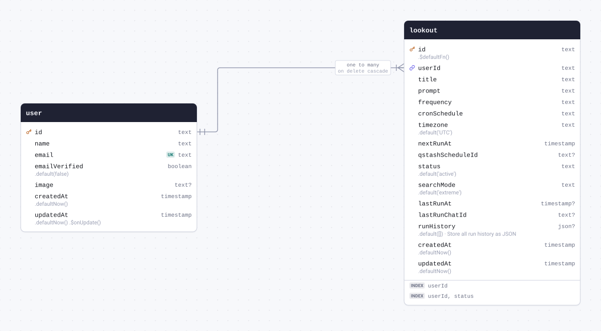

| Column                                    | Type        | Constraints                       | Default               | Description                   |
| ----------------------------------------- | ----------- | --------------------------------- | --------------------- | ----------------------------- |
| `id`                                      | `text`      | PK NOT NULL                       | `.$defaultFn()`       |                               |
| `userId` (`user_id`)                      | `text`      | NOT NULL → [user.id](#table-user) |                       |                               |
| `title`                                   | `text`      | NOT NULL                          |                       |                               |
| `prompt`                                  | `text`      | NOT NULL                          |                       |                               |
| `frequency`                               | `text`      | NOT NULL                          |                       |                               |
| `cronSchedule` (`cron_schedule`)          | `text`      | NOT NULL                          |                       |                               |
| `timezone`                                | `text`      | NOT NULL                          | `.default('UTC')`     |                               |
| `nextRunAt` (`next_run_at`)               | `timestamp` | NOT NULL                          |                       |                               |
| `qstashScheduleId` (`qstash_schedule_id`) | `text`      | NULL                              |                       |                               |
| `status`                                  | `text`      | NOT NULL                          | `.default('active')`  |                               |
| `searchMode` (`search_mode`)              | `text`      | NOT NULL                          | `.default('extreme')` |                               |
| `lastRunAt` (`last_run_at`)               | `timestamp` | NULL                              |                       |                               |
| `lastRunChatId` (`last_run_chat_id`)      | `text`      | NULL                              |                       |                               |
| `runHistory` (`run_history`)              | `json`      | NULL                              | `.default([])`        | Store all run history as JSON |
| `createdAt` (`created_at`)                | `timestamp` | NOT NULL                          | `.defaultNow()`       |                               |
| `updatedAt` (`updated_at`)                | `timestamp` | NOT NULL                          | `.defaultNow()`       |                               |

#### Definition

```sql
CREATE TABLE "lookout" (
	"id" text PRIMARY KEY,
	"user_id" text NOT NULL,
	"title" text NOT NULL,
	"prompt" text NOT NULL,
	"frequency" text NOT NULL,
	"cron_schedule" text NOT NULL,
	"timezone" text DEFAULT 'UTC' NOT NULL,
	"next_run_at" timestamp NOT NULL,
	"qstash_schedule_id" text,
	"status" text DEFAULT 'active' NOT NULL,
	"search_mode" text DEFAULT 'extreme' NOT NULL,
	"last_run_at" timestamp,
	"last_run_chat_id" text,
	"run_history" json DEFAULT '[]',
	"created_at" timestamp DEFAULT now() NOT NULL,
	"updated_at" timestamp DEFAULT now() NOT NULL
);

CREATE INDEX "lookout_userId_idx" ON "lookout" ("user_id");

CREATE INDEX "lookout_userId_status_idx" ON "lookout" ("user_id","status");

ALTER TABLE "lookout" ADD CONSTRAINT "lookout_user_id_user_id_fkey" FOREIGN KEY ("user_id") REFERENCES "user"("id") ON DELETE CASCADE;
```

#### Indexes

- INDEX `userId`
- INDEX `userId`, `status`

#### References

- `userId` → [user.id](#table-user) (many to one, on delete cascade)

<details>
<summary>Queries and their SQL</summary>

**Select**: Every row of lookout.

```ts
db.select().from(lookout);
```

```sql
select "id", "user_id", "title", "prompt", "frequency", "cron_schedule", "timezone", "next_run_at", "qstash_schedule_id", "status", "search_mode", "last_run_at", "last_run_chat_id", "run_history", "created_at", "updated_at"
from "lookout"
```

**Count**: How many rows lookout has.

```ts
db.select({ count: count() }).from(lookout);
```

```sql
select count(*)
from "lookout"
```

**Find many**: The rows of lookout, through the relational query API.

```ts
db.query.lookout.findMany();
```

```sql
select "d0"."id" as "id", "d0"."user_id" as "userId", "d0"."title" as "title", "d0"."prompt" as "prompt", "d0"."frequency" as "frequency", "d0"."cron_schedule" as "cronSchedule", "d0"."timezone" as "timezone", "d0"."next_run_at" as "nextRunAt", "d0"."qstash_schedule_id" as "qstashScheduleId", "d0"."status" as "status", "d0"."search_mode" as "searchMode", "d0"."last_run_at" as "lastRunAt", "d0"."last_run_chat_id" as "lastRunChatId", "d0"."run_history" as "runHistory", "d0"."created_at" as "createdAt", "d0"."updated_at" as "updatedAt"
from "lookout" as "d0"
```

**Find by primary key**: One row of lookout, through the relational query API.

```ts
db.query.lookout.findFirst({ where: { id: "id" } });
```

```sql
select "d0"."id" as "id", "d0"."user_id" as "userId", "d0"."title" as "title", "d0"."prompt" as "prompt", "d0"."frequency" as "frequency", "d0"."cron_schedule" as "cronSchedule", "d0"."timezone" as "timezone", "d0"."next_run_at" as "nextRunAt", "d0"."qstash_schedule_id" as "qstashScheduleId", "d0"."status" as "status", "d0"."search_mode" as "searchMode", "d0"."last_run_at" as "lastRunAt", "d0"."last_run_chat_id" as "lastRunChatId", "d0"."run_history" as "runHistory", "d0"."created_at" as "createdAt", "d0"."updated_at" as "updatedAt"
from "lookout" as "d0"
where "d0"."id" = $1
limit $2
-- params: ["id",1]
```

**Insert**: Adds a row to lookout, giving the columns that have no default.

```ts
db.insert(lookout).values({
  userId: "userId",
  title: "title",
  prompt: "prompt",
  frequency: "frequency",
  cronSchedule: "cronSchedule",
  nextRunAt: new Date("2026-01-01T00:00:00.000Z"),
});
```

```sql
insert into "lookout" ("id", "user_id", "title", "prompt", "frequency", "cron_schedule", "timezone", "next_run_at", "qstash_schedule_id", "status", "search_mode", "last_run_at", "last_run_chat_id", "run_history", "created_at", "updated_at")
values ($1, $2, $3, $4, $5, $6, default, $7, default, default, default, default, default, default, default, default)
-- params: ["VVVVVVVVVVVVVVVV","userId","title","prompt","frequency","cronSchedule","2026-01-01T00:00:00.000Z"]
```

**Update**: Changes a row of lookout, found by its primary key.

```ts
db.update(lookout).set({ userId: "userId" }).where(eq(lookout.id, "id"));
```

```sql
update "lookout"
set "user_id" = $1
where "lookout"."id" = $2
-- params: ["userId","id"]
```

**Delete**: Deletes a row of lookout, found by its primary key.

```ts
db.delete(lookout).where(eq(lookout.id, "id"));
```

```sql
delete from "lookout"
where "lookout"."id" = $1
-- params: ["id"]
```

</details>

<a id="table-userMcpServer"></a>

### userMcpServer

Table `user_mcp_server`.

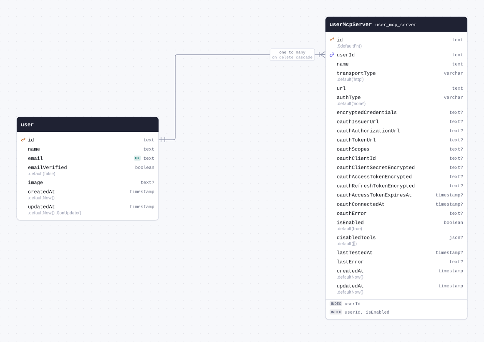

| Column                                                         | Type        | Constraints                       | Default            | Description |
| -------------------------------------------------------------- | ----------- | --------------------------------- | ------------------ | ----------- |
| `id`                                                           | `text`      | PK NOT NULL                       | `.$defaultFn()`    |             |
| `userId` (`user_id`)                                           | `text`      | NOT NULL → [user.id](#table-user) |                    |             |
| `name`                                                         | `text`      | NOT NULL                          |                    |             |
| `transportType` (`transport_type`)                             | `varchar`   | NOT NULL                          | `.default('http')` |             |
| `url`                                                          | `text`      | NOT NULL                          |                    |             |
| `authType` (`auth_type`)                                       | `varchar`   | NOT NULL                          | `.default('none')` |             |
| `encryptedCredentials` (`encrypted_credentials`)               | `text`      | NULL                              |                    |             |
| `oauthIssuerUrl` (`oauth_issuer_url`)                          | `text`      | NULL                              |                    |             |
| `oauthAuthorizationUrl` (`oauth_authorization_url`)            | `text`      | NULL                              |                    |             |
| `oauthTokenUrl` (`oauth_token_url`)                            | `text`      | NULL                              |                    |             |
| `oauthScopes` (`oauth_scopes`)                                 | `text`      | NULL                              |                    |             |
| `oauthClientId` (`oauth_client_id`)                            | `text`      | NULL                              |                    |             |
| `oauthClientSecretEncrypted` (`oauth_client_secret_encrypted`) | `text`      | NULL                              |                    |             |
| `oauthAccessTokenEncrypted` (`oauth_access_token_encrypted`)   | `text`      | NULL                              |                    |             |
| `oauthRefreshTokenEncrypted` (`oauth_refresh_token_encrypted`) | `text`      | NULL                              |                    |             |
| `oauthAccessTokenExpiresAt` (`oauth_access_token_expires_at`)  | `timestamp` | NULL                              |                    |             |
| `oauthConnectedAt` (`oauth_connected_at`)                      | `timestamp` | NULL                              |                    |             |
| `oauthError` (`oauth_error`)                                   | `text`      | NULL                              |                    |             |
| `isEnabled` (`is_enabled`)                                     | `boolean`   | NOT NULL                          | `.default(true)`   |             |
| `disabledTools` (`disabled_tools`)                             | `json`      | NULL                              | `.default([])`     |             |
| `lastTestedAt` (`last_tested_at`)                              | `timestamp` | NULL                              |                    |             |
| `lastError` (`last_error`)                                     | `text`      | NULL                              |                    |             |
| `createdAt` (`created_at`)                                     | `timestamp` | NOT NULL                          | `.defaultNow()`    |             |
| `updatedAt` (`updated_at`)                                     | `timestamp` | NOT NULL                          | `.defaultNow()`    |             |

#### Definition

```sql
CREATE TABLE "user_mcp_server" (
	"id" text PRIMARY KEY,
	"user_id" text NOT NULL,
	"name" text NOT NULL,
	"transport_type" varchar DEFAULT 'http' NOT NULL,
	"url" text NOT NULL,
	"auth_type" varchar DEFAULT 'none' NOT NULL,
	"encrypted_credentials" text,
	"oauth_issuer_url" text,
	"oauth_authorization_url" text,
	"oauth_token_url" text,
	"oauth_scopes" text,
	"oauth_client_id" text,
	"oauth_client_secret_encrypted" text,
	"oauth_access_token_encrypted" text,
	"oauth_refresh_token_encrypted" text,
	"oauth_access_token_expires_at" timestamp,
	"oauth_connected_at" timestamp,
	"oauth_error" text,
	"is_enabled" boolean DEFAULT true NOT NULL,
	"disabled_tools" json DEFAULT '[]',
	"last_tested_at" timestamp,
	"last_error" text,
	"created_at" timestamp DEFAULT now() NOT NULL,
	"updated_at" timestamp DEFAULT now() NOT NULL
);

CREATE INDEX "userMcpServer_userId_idx" ON "user_mcp_server" ("user_id");

CREATE INDEX "userMcpServer_userId_enabled_idx" ON "user_mcp_server" ("user_id","is_enabled");

ALTER TABLE "user_mcp_server" ADD CONSTRAINT "user_mcp_server_user_id_user_id_fkey" FOREIGN KEY ("user_id") REFERENCES "user"("id") ON DELETE CASCADE;
```

#### Indexes

- INDEX `userId`
- INDEX `userId`, `isEnabled`

#### References

- `userId` → [user.id](#table-user) (many to one, on delete cascade)

<details>
<summary>Queries and their SQL</summary>

**Select**: Every row of userMcpServer.

```ts
db.select().from(userMcpServer);
```

```sql
select "id", "user_id", "name", "transport_type", "url", "auth_type", "encrypted_credentials", "oauth_issuer_url", "oauth_authorization_url", "oauth_token_url", "oauth_scopes", "oauth_client_id", "oauth_client_secret_encrypted", "oauth_access_token_encrypted", "oauth_refresh_token_encrypted", "oauth_access_token_expires_at", "oauth_connected_at", "oauth_error", "is_enabled", "disabled_tools", "last_tested_at", "last_error", "created_at", "updated_at"
from "user_mcp_server"
```

**Count**: How many rows userMcpServer has.

```ts
db.select({ count: count() }).from(userMcpServer);
```

```sql
select count(*)
from "user_mcp_server"
```

**Find many**: The rows of userMcpServer, through the relational query API.

```ts
db.query.userMcpServer.findMany();
```

```sql
select "d0"."id" as "id", "d0"."user_id" as "userId", "d0"."name" as "name", "d0"."transport_type" as "transportType", "d0"."url" as "url", "d0"."auth_type" as "authType", "d0"."encrypted_credentials" as "encryptedCredentials", "d0"."oauth_issuer_url" as "oauthIssuerUrl", "d0"."oauth_authorization_url" as "oauthAuthorizationUrl", "d0"."oauth_token_url" as "oauthTokenUrl", "d0"."oauth_scopes" as "oauthScopes", "d0"."oauth_client_id" as "oauthClientId", "d0"."oauth_client_secret_encrypted" as "oauthClientSecretEncrypted", "d0"."oauth_access_token_encrypted" as "oauthAccessTokenEncrypted", "d0"."oauth_refresh_token_encrypted" as "oauthRefreshTokenEncrypted", "d0"."oauth_access_token_expires_at" as "oauthAccessTokenExpiresAt", "d0"."oauth_connected_at" as "oauthConnectedAt", "d0"."oauth_error" as "oauthError", "d0"."is_enabled" as "isEnabled", "d0"."disabled_tools" as "disabledTools", "d0"."last_tested_at" as "lastTestedAt", "d0"."last_error" as "lastError", "d0"."created_at" as "createdAt", "d0"."updated_at" as "updatedAt"
from "user_mcp_server" as "d0"
```

**Find by primary key**: One row of userMcpServer, through the relational query API.

```ts
db.query.userMcpServer.findFirst({ where: { id: "id" } });
```

```sql
select "d0"."id" as "id", "d0"."user_id" as "userId", "d0"."name" as "name", "d0"."transport_type" as "transportType", "d0"."url" as "url", "d0"."auth_type" as "authType", "d0"."encrypted_credentials" as "encryptedCredentials", "d0"."oauth_issuer_url" as "oauthIssuerUrl", "d0"."oauth_authorization_url" as "oauthAuthorizationUrl", "d0"."oauth_token_url" as "oauthTokenUrl", "d0"."oauth_scopes" as "oauthScopes", "d0"."oauth_client_id" as "oauthClientId", "d0"."oauth_client_secret_encrypted" as "oauthClientSecretEncrypted", "d0"."oauth_access_token_encrypted" as "oauthAccessTokenEncrypted", "d0"."oauth_refresh_token_encrypted" as "oauthRefreshTokenEncrypted", "d0"."oauth_access_token_expires_at" as "oauthAccessTokenExpiresAt", "d0"."oauth_connected_at" as "oauthConnectedAt", "d0"."oauth_error" as "oauthError", "d0"."is_enabled" as "isEnabled", "d0"."disabled_tools" as "disabledTools", "d0"."last_tested_at" as "lastTestedAt", "d0"."last_error" as "lastError", "d0"."created_at" as "createdAt", "d0"."updated_at" as "updatedAt"
from "user_mcp_server" as "d0"
where "d0"."id" = $1
limit $2
-- params: ["id",1]
```

**Insert**: Adds a row to userMcpServer, giving the columns that have no default.

```ts
db.insert(userMcpServer).values({ userId: "userId", name: "name", url: "url" });
```

```sql
insert into "user_mcp_server" ("id", "user_id", "name", "transport_type", "url", "auth_type", "encrypted_credentials", "oauth_issuer_url", "oauth_authorization_url", "oauth_token_url", "oauth_scopes", "oauth_client_id", "oauth_client_secret_encrypted", "oauth_access_token_encrypted", "oauth_refresh_token_encrypted", "oauth_access_token_expires_at", "oauth_connected_at", "oauth_error", "is_enabled", "disabled_tools", "last_tested_at", "last_error", "created_at", "updated_at")
values ($1, $2, $3, default, $4, default, default, default, default, default, default, default, default, default, default, default, default, default, default, default, default, default, default, default)
-- params: ["VVVVVVVVVVVVVVVV","userId","name","url"]
```

**Update**: Changes a row of userMcpServer, found by its primary key.

```ts
db.update(userMcpServer).set({ userId: "userId" }).where(eq(userMcpServer.id, "id"));
```

```sql
update "user_mcp_server"
set "user_id" = $1
where "user_mcp_server"."id" = $2
-- params: ["userId","id"]
```

**Delete**: Deletes a row of userMcpServer, found by its primary key.

```ts
db.delete(userMcpServer).where(eq(userMcpServer.id, "id"));
```

```sql
delete from "user_mcp_server"
where "user_mcp_server"."id" = $1
-- params: ["id"]
```

</details>

<a id="table-buildSession"></a>

### buildSession

Table `build_session`.

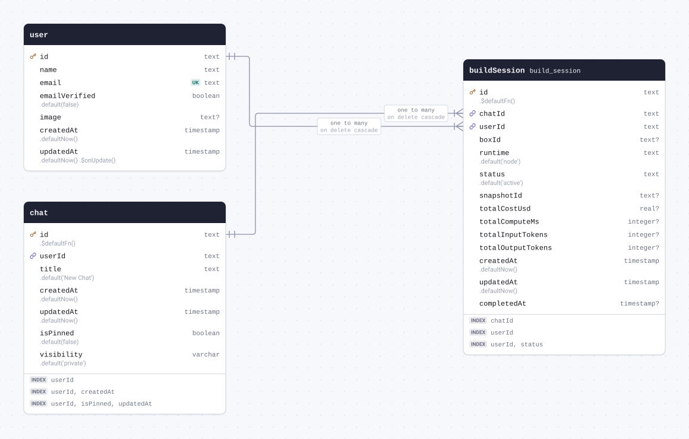

| Column                                      | Type        | Constraints                       | Default              | Description |
| ------------------------------------------- | ----------- | --------------------------------- | -------------------- | ----------- |
| `id`                                        | `text`      | PK NOT NULL                       | `.$defaultFn()`      |             |
| `chatId` (`chat_id`)                        | `text`      | NOT NULL → [chat.id](#table-chat) |                      |             |
| `userId` (`user_id`)                        | `text`      | NOT NULL → [user.id](#table-user) |                      |             |
| `boxId` (`box_id`)                          | `text`      | NULL                              |                      |             |
| `runtime`                                   | `text`      | NOT NULL                          | `.default('node')`   |             |
| `status`                                    | `text`      | NOT NULL                          | `.default('active')` |             |
| `snapshotId` (`snapshot_id`)                | `text`      | NULL                              |                      |             |
| `totalCostUsd` (`total_cost_usd`)           | `real`      | NULL                              |                      |             |
| `totalComputeMs` (`total_compute_ms`)       | `integer`   | NULL                              |                      |             |
| `totalInputTokens` (`total_input_tokens`)   | `integer`   | NULL                              |                      |             |
| `totalOutputTokens` (`total_output_tokens`) | `integer`   | NULL                              |                      |             |
| `createdAt` (`created_at`)                  | `timestamp` | NOT NULL                          | `.defaultNow()`      |             |
| `updatedAt` (`updated_at`)                  | `timestamp` | NOT NULL                          | `.defaultNow()`      |             |
| `completedAt` (`completed_at`)              | `timestamp` | NULL                              |                      |             |

#### Definition

```sql
CREATE TABLE "build_session" (
	"id" text PRIMARY KEY,
	"chat_id" text NOT NULL,
	"user_id" text NOT NULL,
	"box_id" text,
	"runtime" text DEFAULT 'node' NOT NULL,
	"status" text DEFAULT 'active' NOT NULL,
	"snapshot_id" text,
	"total_cost_usd" real,
	"total_compute_ms" integer,
	"total_input_tokens" integer,
	"total_output_tokens" integer,
	"created_at" timestamp DEFAULT now() NOT NULL,
	"updated_at" timestamp DEFAULT now() NOT NULL,
	"completed_at" timestamp
);

CREATE INDEX "build_session_chatId_idx" ON "build_session" ("chat_id");

CREATE INDEX "build_session_userId_idx" ON "build_session" ("user_id");

CREATE INDEX "build_session_userId_status_idx" ON "build_session" ("user_id","status");

ALTER TABLE "build_session" ADD CONSTRAINT "build_session_chat_id_chat_id_fkey" FOREIGN KEY ("chat_id") REFERENCES "chat"("id") ON DELETE CASCADE;

ALTER TABLE "build_session" ADD CONSTRAINT "build_session_user_id_user_id_fkey" FOREIGN KEY ("user_id") REFERENCES "user"("id") ON DELETE CASCADE;
```

#### Indexes

- INDEX `chatId`
- INDEX `userId`
- INDEX `userId`, `status`

#### References

- `chatId` → [chat.id](#table-chat) (many to one, on delete cascade)
- `userId` → [user.id](#table-user) (many to one, on delete cascade)

<details>
<summary>Queries and their SQL</summary>

**Select**: Every row of buildSession.

```ts
db.select().from(buildSession);
```

```sql
select "id", "chat_id", "user_id", "box_id", "runtime", "status", "snapshot_id", "total_cost_usd", "total_compute_ms", "total_input_tokens", "total_output_tokens", "created_at", "updated_at", "completed_at"
from "build_session"
```

**Count**: How many rows buildSession has.

```ts
db.select({ count: count() }).from(buildSession);
```

```sql
select count(*)
from "build_session"
```

**Find many**: The rows of buildSession, through the relational query API.

```ts
db.query.buildSession.findMany();
```

```sql
select "d0"."id" as "id", "d0"."chat_id" as "chatId", "d0"."user_id" as "userId", "d0"."box_id" as "boxId", "d0"."runtime" as "runtime", "d0"."status" as "status", "d0"."snapshot_id" as "snapshotId", "d0"."total_cost_usd" as "totalCostUsd", "d0"."total_compute_ms" as "totalComputeMs", "d0"."total_input_tokens" as "totalInputTokens", "d0"."total_output_tokens" as "totalOutputTokens", "d0"."created_at" as "createdAt", "d0"."updated_at" as "updatedAt", "d0"."completed_at" as "completedAt"
from "build_session" as "d0"
```

**Find by primary key**: One row of buildSession, through the relational query API.

```ts
db.query.buildSession.findFirst({ where: { id: "id" } });
```

```sql
select "d0"."id" as "id", "d0"."chat_id" as "chatId", "d0"."user_id" as "userId", "d0"."box_id" as "boxId", "d0"."runtime" as "runtime", "d0"."status" as "status", "d0"."snapshot_id" as "snapshotId", "d0"."total_cost_usd" as "totalCostUsd", "d0"."total_compute_ms" as "totalComputeMs", "d0"."total_input_tokens" as "totalInputTokens", "d0"."total_output_tokens" as "totalOutputTokens", "d0"."created_at" as "createdAt", "d0"."updated_at" as "updatedAt", "d0"."completed_at" as "completedAt"
from "build_session" as "d0"
where "d0"."id" = $1
limit $2
-- params: ["id",1]
```

**Insert**: Adds a row to buildSession, giving the columns that have no default.

```ts
db.insert(buildSession).values({ chatId: "chatId", userId: "userId" });
```

```sql
insert into "build_session" ("id", "chat_id", "user_id", "box_id", "runtime", "status", "snapshot_id", "total_cost_usd", "total_compute_ms", "total_input_tokens", "total_output_tokens", "created_at", "updated_at", "completed_at")
values ($1, $2, $3, default, default, default, default, default, default, default, default, default, default, default)
-- params: ["VVVVVVVVVVVVVVVV","chatId","userId"]
```

**Update**: Changes a row of buildSession, found by its primary key.

```ts
db.update(buildSession).set({ chatId: "chatId" }).where(eq(buildSession.id, "id"));
```

```sql
update "build_session"
set "chat_id" = $1
where "build_session"."id" = $2
-- params: ["chatId","id"]
```

**Delete**: Deletes a row of buildSession, found by its primary key.

```ts
db.delete(buildSession).where(eq(buildSession.id, "id"));
```

```sql
delete from "build_session"
where "build_session"."id" = $1
-- params: ["id"]
```

</details>
